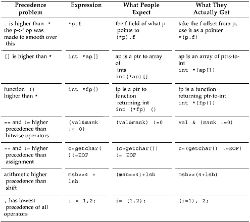
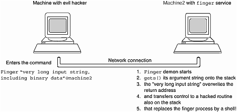
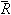

# Chương 2. Không phải lỗi, đó là tính năng ngôn ngữ

Bọ là lớp sinh vật đông đảo và thành công nhất, với gần một triệu loài đã biết. Xét mặt này, chúng đông gấp khoảng bốn lần mọi sinh vật đã biết khác.

—Bách khoa toàn thư về đời sống động vật của Giáo sư Snopes

vì sao tính năng ngôn ngữ quan trọng…tội làm điều không nên: switch khiến bạn thất vọng vì fall through…hardware có sẵn là bút sáp?…default visibility quá rộng…tội sai mục tiêu: chất nặng lưng lạc đà…"một số operator có precedence sai"…lỗi sớm gets() sâu Internet…tội bỏ sót: mail không đến user có "f" trong user name…space — biên giới cuối cùng…ngày tháng compiler bị hỏng…lint không nên bị tách riêng…giải trí nhẹ nhàng — một số tính năng thật sự là lỗi

## Vì sao tính năng ngôn ngữ quan trọng — Lỗi Fortran thực sự xảy ra thế nào!

Chi tiết ngôn ngữ lập trình thực sự quan trọng, vì chúng tạo khác biệt giữa ngôn ngữ đáng tin và ngôn ngữ error-prone. Điều này bộc lộ rõ mùa hè 1961 khi lập trình viên NASA kiểm thử subroutine Fortran tính quỹ đạo. <sup>\[1\]</sup> Subroutine đã dùng cho vài chuyến bay Mercury ngắn, nhưng bí ẩn thay không đạt precision mong muốn, cần cho nhiệm vụ quỹ đạo và mặt trăng sắp tới. Kết quả gần đúng nhưng chưa chính xác như dự kiến.

<sup>\[1\]</sup> Câu chuyện bị kể sai rất rộng, phiên bản không chính xác có trong nhiều sách ngôn ngữ lập trình. Thực sự nó đã thành truyền thuyết đô thị kinh điển giữa lập trình viên. Tường thuật xác thực từ Fred Webb, người làm NASA lúc đó và thấy source code thật, có trong "Fortran Story—The Real Scoop", Forum on Risks to the Public in Computers and Related Systems, tập 9, số 54, ACM Committee on Computers and Public Policy, ngày 12 tháng 12 năm 1989.

Sau khi kiểm tra thuật toán, data và kết quả dự kiến rất lâu, kỹ sư cuối cùng thấy câu lệnh:

```
DO 10 I=1.10
```

Rõ ràng lập trình viên định viết vòng lặp `DO` dạng:

```
DO 10 I=1,10
```

Trong Fortran, blank character không có ý nghĩa, thậm chí nằm giữa identifier được. Người thiết kế định giúp người đục thẻ và tăng tính dễ đọc, nên có identifier như `MAX Y`. Tiếc là compiler đọc hoàn toàn đúng câu lệnh thành `DO10I = 1.10`

Fortran không bắt khai báo variable. Câu lệnh đã viết gán 1.1 cho floating point variable khai báo ngầm `DO10I`. Statement trong body vòng lặp dự định chỉ chạy một thay vì mười lần, chỉ tính xấp xỉ đầu thay vì hội tụ lặp. Sau khi cor-recting dấu chấm thành dấu phẩy, kết quả đạt độ chính xác dự kiến.

Lỗi được phát hiện kịp, chưa bao giờ khiến chuyến bay Mercury thất bại như nhiều phiên bản kể (lỗi khác trong chuyến Mariner, cuối chương, thực sự gây hậu quả này), nhưng minh họa rõ tầm quan trọng thiết kế ngôn ngữ. C có all-too-many chỗ mơ hồ hay near-ambiguities tương tự. Chương mô tả mẫu đại diện những chỗ phổ biến nhất, cách chúng thường xuất hiện thành lỗi. Có vấn đề C khác; ví dụ gặp chuỗi `malloc(strlen(str));` gần như chắc là lỗi, vốn định `malloc(strlen(str)+1);`. Vì gần như mọi routine string-handling khác tính chỗ cho trailing nul terminator, mọi người quen không dự trù riêng như `strlen` cần. Ví dụ malloc là lỗi hiểu library routine của lập trình viên, còn chương này tập trung vùng có vấn đề của chính C, thay vì cách dùng. Có thể phân loại thiếu sót ngôn ngữ thành ba nhóm: thứ ngôn ngữ làm nhưng không nên; thứ không làm nhưng nên; thứ hoàn toàn lệch hướng. Tiện gọi lần lượt "tội làm điều không nên", "tội bỏ sót", "tội sai mục tiêu". Phần sau mô tả tính năng C trong các nhóm.

Chương không nhằm phê phán C chí mạng. C tuyệt vời, nhiều thế mạnh. Sự phổ biến như ngôn ngữ triển khai được chọn trên nhiều nền tảng rất well-deserved. Nhưng như bà tôi nói, không vận hành supercollider super-conducting mà không đập vài nguyên tử, cũng không phân tích C mà không xem khiếm khuyết lẫn ưu điểm. Xem vùng cần cải thiện giúp khoa học software engineering, nghệ thuật thiết kế ngôn ngữ dần tốt hơn. Vì vậy C++ thật đáng thất vọng: không giải quyết một số vấn đề nền tảng nhất C, còn bổ sung quan trọng nhất (class) lại xây trên type model thiếu sót. Với tinh thần tìm hiểu để cải thiện ngôn ngữ tương lai, đây là quan sát và chuyện thực tế.

### Mẹo thực hành hữu ích


nul một chữ 'l' và null hai chữ 'l'

Ghi nhớ vần nhỏ này để nhớ đúng thuật ngữ pointer và ASCII zero:

Một "l" `NUL` kết thúc ASCII string,

Hai "l" `NULL` chẳng trỏ thứ gì.

Xin lỗi Ogden Nash, nhưng nulll ba "l" nghĩa là kiểm tra chính tả. ASCII character có bit pattern zero gọi "NUL". Giá trị pointer đặc biệt chỉ nó không trỏ đâu gọi "NULL". Hai thuật ngữ không thay nhau về nghĩa được.

## Tội làm điều không nên

Nhóm này bao gồm thứ ngôn ngữ làm nhưng không nên, như tính năng error-prone switch statement, tự nối string literal liền nhau, default global scope.

### Switch khiến bạn thất vọng vì fall through

Dạng tổng quát switch statement:

```
switch (expression){
  case constant-expression: zero-or-more-statements
                   default: zero-or-more-statements
  case constant-expression: zero-or-more-statements
      }
```

Mỗi case bắt đầu bằng bộ ba keyword `case`, theo sau integer-valued constant hay constant expression, rồi dấu hai chấm. Execution bắt đầu ở case khớp expression. Default case (nếu có) ở đâu trong danh sách cũng được, chạy nếu không case nào khớp. Nếu không có default, không case khớp, statement không làm gì. Có người đề xuất tốt hơn là runtime error cho "không khớp", như Pascal. Runtime error checking gần như không có trong C — kiểm tra dereference pointer không hợp lệ gần như trường hợp duy nhất, ngay cả thế cũng không làm đầy đủ trên MS-DOS.

#### Mẹo thực hành hữu ích


Runtime checking trên MS-DOS

Pointer không hợp lệ có thể là tai họa đời lập trình viên. Quá dễ tham chiếu memory qua pointer sai. Mọi kiến trúc virtual memory báo fault cho process dereference pointer ngoài address space ngay khi xảy ra. Nhưng MS-DOS không hỗ trợ virtual memory, nên không bắt được trường hợp tổng quát ngay thời điểm lỗi.

Tuy nhiên, MS-DOS có thể và thực sự dùng heuristic kiểm tra trường hợp cụ thể dereference null pointer sau khi chương trình kết thúc. Cả Microsoft và Borland C trước khi vào chương trình lưu nội dung vị trí zero. Trong exit code, chúng kiểm tra giá trị đã đổi chưa. Nếu đổi, khá chắc chương trình ghi qua null pointer, runtime system in cảnh báo "null pointer assignment".

Xem thêm Chương 7.

Runtime checking trái triết lý C rằng lập trình viên biết đang làm gì và luôn đúng.

Case và default có thể theo bất kỳ thứ tự, dù quy ước default thường cuối. Compiler C conformant phải cho ít nhất 257 case label mỗi switch statement (chuẩn ANSI C, mục 5.2.4.1). Để cho switch theo character 8-bit (256 giá trị cộng EOF).

Switch có nhiều vấn đề, một là quá dễ dãi với thứ chấp nhận trong case. Ví dụ, có thể khai báo local storage bằng declaration sau ngoặc nhọn mở switch. Đây là di sản compiler đầu — phần lớn code xử lý compound statement tái dùng được cho phần braces-enclosed của switch. Vì vậy declaration tự nhiên được chấp nhận, dù thêm initial value là vô ích vì không exe-cuted — execution bắt đầu tại case khớp expression.

#### Mẹo thực hành hữu ích


Cần storage tạm? Hãy đứng đầu block!

Trong C, khi có statement mở block

```
 {
    statements
```

luôn thêm declaration vào giữa được, như sau:

```
 {
    declarations
    statements
```

Có thể dùng nếu cấp memory đắt và nên tránh khi được. Nhưng compiler tự do bỏ qua, cấp space cho mọi local block khi gọi function. Công dụng khác là khai báo variable chỉ dùng thật cục bộ trong block.

```
if ( a>b )
    /* swap a, b */
 {
    int tmp = a;
    a = b; b = tmp;
}
```

C++ đi xa hơn, cho trộn statement và declaration tùy ý, thậm chí nhúng declaration giữa statement "for".

```
for (int i=0; i<100; i++){...
```

Nếu không tiết chế, nhanh chóng gây rối. Vấn đề khác là statement trong switch đều có thể gắn label, nhảy tới, cho chuyển control tùy ý:

```
switch (i) {
  case 5+3: do_again:
  case 2: printf("I loop unremittingly \n"); goto do_again;
  default : i++;
  case 3: ;
}
```

Mọi case tùy chọn, mọi dạng statement gồm labelled statement đều được phép, nên có lỗi ngay lint cũng không phát hiện. Đồng nghiệp tôi từng gõ `defau1t` cho default label (số "1" thay chữ "l"). Rất khó lần ra, nó thực sự xóa default case khỏi switch. Nhưng vẫn compile không lỗi, thậm chí review source kỹ không thấy bất thường. Phần lớn lint không bắt lỗi này.

Nhân tiện, vì keyword `const` không thật nghĩa constant trong C,

```
const int two=2;

switch (i) {
  case 1: printf("case 1 \n");
  case two: printf("case 2 \n");
**error** ^^^ integral constant expression expected

  case 3: printf("case 3 \n");
  default: ; }
```

code trên tạo compilation error như minh họa. Không hẳn lỗi switch, nhưng switch statement là nơi vấn đề constant không constant lộ ra.

Có lẽ khuyết điểm lớn nhất switch là case không tự break sau action case label. Một case chạy xong, flow of control tiếp xuống mọi case sau đến break statement. Code

```
switch (2) {
  case 1: printf("case 1 \n");
  case 2: printf("case 2 \n");
  case 3: printf("case 3 \n");
  case 4: printf("case 4 \n");
  default: printf("default \n");
}
```

in ra

```
case 2
case 3
case 4
default
```

Đó là "fall through", nhằm cho xử lý cuối chung sau chuẩn bị case-specific. Thực tế là misfea-ture nghiêm trọng, vì gần mọi case action kết thúc `break;`. Phần lớn lint thậm chí cảnh báo nếu case rơi xuống case khác.

#### Giáo điều software


Fall through mặc định sai 97% trường hợp

Chúng tôi phân tích source compiler Sun C xem fall through mặc định dùng thường thế nào. Front end compiler Sun ANSI C có 244 switch statement, mỗi cái trung bình bảy case. Fall through chỉ có trong 3% case.

Nghĩa là hành vi switch bình thường sai 97% trường hợp. Không chỉ compiler — ngược lại, nơi dùng fall through trong phân tích thường là tình huống phổ biến trong compiler hơn software khác, ví dụ compile operator có một hoặc hai operand:

```
switch( operator->num_of_operands ) {
    case 2: process_operand( operator->operand_2 );
             /* FALLTHRU */
    case 1: process_operand( operator->operand_1 );
    break;
}
```

Fall through được công nhận rộng là khiếm khuyết đến mức có quy ước comment đặc biệt như trên nói lint "đây thật sự thuộc 3% trường hợp muốn fall through". Bất tiện của default fall through được chứng minh trong nhiều chương trình khác.

Chúng tôi kết luận fall through mặc định trên switch là lỗi thiết kế C. Trong overwhelm-ing đa số trường hợp, bạn không muốn và phải viết code thêm để chống lại. Như Red Queen nói với Alice trong Through the Looking Glass, dùng cả hai tay cũng không phủ nhận được.

#### Vấn đề switch khác — `break`

#### Thoát khỏi đâu?

Đây là bản sao code gây gián đoạn lớn dịch vụ điện thoại AT\&T toàn Mỹ. Network AT\&T phần lớn không dùng được khoảng chín giờ từ chiều 15 tháng 1 năm 1990. Tổng đài ("switching system" trong thuật ngữ điện thoại) ngày nay đều là computer system, code chạy trên model 4ESS Central Office Switching System. Nó cho thấy trong C quá dễ bỏ qua chính xác control construct nào chịu tác động "break".

```
network code()
{
  switch (line) {

      case THING1:
        doit1();
        break;

      case THING2:
        if (x == STUFF) {
            do_first_stuff();

            if (y == OTHER_STUFF)
                break;
                do_later_stuff();
            } /* coder meant to break to here... */
            initialize_modes_pointer();
            break;

          default:
            processing();
  } /* ...but actually broke to here! */

  use_modes_pointer();/* leaving the modes_pointer
uninitialized */

}
```

Đây là bản đơn giản hóa nhưng lỗi thật. Lập trình viên muốn thoát "if", quên "break" thực sự thoát iteration hoặc switch statement bao gần nhất. Ở đây thoát switch, chạy `use_modes_pointer()` nhưng chưa khởi tạo cần thiết, gây lỗi sau đó.

Code cuối cùng gây sự cố network lớn đầu tiên trong lịch sử 114-year của AT\&T. Chuyện mô tả kỹ hơn trang 11 Telephony ngày 22 tháng 1 năm 1990. Thiết kế được cho fail-safe của network signaling thật sự lan lỗi dây chuyền, hạ toàn mạng đường dài. Tất cả dựa trên statement C `switch`.

### Hardware có sẵn là bút sáp?

Tính năng ANSI C mới là quy ước string literal liền nhau nối thành một string. Thay cách cũ dựng thông báo nhiều dòng bằng escaped newline, bắt đầu mỗi continuation string cột một.

Kiểu cũ:

```
      printf( "A favorite children's book \
is 'Muffy Gets It: the hilarious tale of a cat, \
a boy, and his machine gun'" );
```

Nay viết thành chuỗi string literal liền nhau, tự nối thành một lúc compile-time. Nul character thường kết thúc literal bị bỏ khỏi mọi literal ghép trừ cái cuối.

Kiểu mới:

```
printf( "A second favorite children's book "
     "is 'Thomas the tank engine and the Naughty Enginedriver
who "
     "tied down Thomas's boiler safety valve'" );
```

Nhưng tự nối khiến thiếu dấu phẩy trong initialization list string literal không còn diagnostic message. Thiếu phẩy nay lặng lẽ kết hôn string liền kề. Hậu quả nghiêm trọng như sau:

```
char *available_resources[] = {
  "color monitor",
  "big disk",

  "Cray" /*           whoa! no comma! */
  "on-line drawing routines",

  "mouse",
  "keyboard",
  "power cables",     /* and what's this extra comma? */
};
```

Vậy available\_resources\[2\] là "Crayon-line drawing routines". Có "Cray" cùng "on-line drawing routines" rất khác chỉ có routine vẽ đường bằng bút sáp...

Tổng resource ít hơn dự kiến một, nên ghi `available_resources[6]` phá variable khác. Nhân tiện, trailing comma sau initializer cuối không phải lỗi gõ, mà bất thường syntax từ C nguyên thủy. Có hoặc không đều được, không có ý nghĩa. ANSI C rationale biện hộ là giúp tự tạo C dễ hơn. Đáng tin hơn nếu cho trailing comma trong mọi danh sách comma-sepa-rated như enum declaration hoặc nhiều variable declarator trong một declaration. Nhưng không.

#### Mẹo thực hành hữu ích


Lần đầu đi qua

Mẹo này chỉ cách đơn giản có hành động khác lần đầu qua đoạn code.

Function dưới làm hành động khác ở lần gọi đầu so với mọi lần sau. Có cách khác; cách này giảm switch và conditional testing tối đa.

```
generate_initializer(char * string)
{
  static char separator='';
  printf( "%c %s \n", separator, string);
  separator = ',';
}
```

Lần đầu, in dấu cách rồi initializer. Mọi initializer sau (nếu có) có dấu phẩy trước. Xem đặc tả là "lần đầu thêm dấu cách trước" thay vì "lần cuối bỏ dấu phẩy sau" khiến dễ lập trình.

Lời biện hộ khó tin vì chương trình tự động có thể xuất dấu phẩy hoặc không bằng character khai báo static khởi tạo dấu cách rồi đặt dấu phẩy. Nó có hành vi đúng, rất dễ viết code. C có ví dụ khác về mục comma-separated mà không được kết thúc bằng dấu phẩy. Dấu phẩy thừa nhưng được phép sau initializer cuối chủ yếu khuấy đục syntax vốn đã đục.

### Default visibility quá rộng

Khi định nghĩa C function, tên mặc định globally visible. Có thể thêm keyword thừa `extern` trước function name hoặc bỏ, tác dụng như nhau. Function thấy được với mọi thứ link object file đó. Muốn hạn chế truy cập phải chỉ định keyword `static`.

```
       function apple (){ /* visible everywhere */ }
extern function pear () { /* visible everywhere */ }

static function turnip(){ /* not visible outside this file */ }
```

Thực tế gần như ai cũng định nghĩa function không thêm storage-class specifier, nên global scope chiếm ưu thế.

Kinh nghiệm thực tế chứng minh nhiều lần dứt khoát default global visibility là sai. Software object nên mặc định scope hạn chế nhất. Lập trình viên phải chủ động khi định cho global scope.

Scope quá rộng tương tác với quy ước C phổ biến interpositioning. Đó là thay library function bằng function user-written cùng tên. Nhiều lập trình viên không biết tính năng, nên mô tả trong chương linking. Hiện chỉ nhớ: "interpositioning — nên tìm hiểu thêm".

Scope quá rộng thường thấy trong library: library cần object thấy được từ library khác. Cách duy nhất là globally known; nhưng rồi ai link library cũng thấy. Đây là visibil-ity "all-or-nothing" — symbol hoặc toàn cục hoặc hoàn toàn không biết. C không có cách chọn lọc hơn khi tiết lộ thông tin.

Vấn đề tệ hơn vì không lồng function definition trong function khác như Pascal được. Tập function "nội bộ" cho function lớn phải ở ngoài. Không ai nhớ làm static, mặc định globally visible. Ada và Modula-2 xử lý theo cách man-ageable: program unit chỉ định chính xác symbol export, import.

## Tội sai mục tiêu

Nhóm này gồm thứ C dường như sai hướng hoặc không phù hợp: tính ngắn gọn (một phần do tái dùng symbol quá mức), vấn đề operator precedence.

### Chất nặng lưng lạc đà

Một vấn đề là C quá ngắn gọn. Thêm, đổi, bỏ chỉ một character thường cho chương trình vẫn hợp lệ nhưng làm việc hoàn toàn khác. Tệ hơn, nhiều symbol "overloaded" — nghĩa khác theo context. Cả keyword cũng nhiều nghĩa, lý do chính C scope rule không trực giác rõ. Bảng 2-1 cho symbol tương tự có nhiều nghĩa.

Bảng 2-1. Symbol overloading trong C

| Symbol | Ý nghĩa |
|---|---|
| `static` | Trong function, giữ giá trị giữa các lời gọi <br> Ở function level, chỉ thấy trong file này <sup>\[1\]</sup> |
| `extern` | Với function definition, có global scope (và thừa) <br> Với variable, được định nghĩa nơi khác |
| `void` | Return type function, không trả value <br> Trong pointer declaration, type generic pointer <br> Trong parameter list, không nhận parameter |
| `*` | Multiplication operator <br> Áp dụng pointer, indirection <br> Trong declaration, pointer |
| `&` | Operator bitwise `AND` <br> Operator Address-of |
| `=` <br> `==` | Assignment operator <br> Comparison operator |
| `<=` <br> `<<=` | Operator Less-than-or-equal-to <br> Compound assignment operator shift-left |
| `<` <br> `<` | Operator Less-than <br> Left delimiter trong directive `#include` |
| `()` | Bao formal parameter trong function definition <br> Thực hiện function call <br> Xác lập expression precedence <br> Convert (cast) value sang type khác <br> Định nghĩa macro có argument <br> Gọi macro có argument <br> Bao operand operator `sizeof` khi là typename |

<sup>\[1\]</sup> Có lẽ bạn thắc mắc lý do re-using keyword `static` với nghĩa khác xa vậy. Tìm ra thì cho chúng tôi biết với.

Có symbol khác cũng giống đến khó hiểu. Lập trình viên bối rối từng nhìn `if (x>>4)` hỏi "Nghĩa gì? Có phải 'Nếu x lớn hơn 4 rất nhiều' không?"

Overloading có thể thành vấn đề trong statement như:

```
p = N * sizeof * q;
```

Nhanh nào, có hai multiplication hay một? Gợi ý: statement tiếp là:

```
r = malloc( p );
```

Chỉ một multiplication, vì sizeof là operator nhận operand là thứ q trỏ tới (tức `*q)`. Nó trả size tính bằng byte của type thứ q trỏ tới, tiện cho malloc cấp thêm memory. Operand sizeof là type phải nằm ngoặc đơn, khiến người ta tưởng function call; variable thì không cần.

Ví dụ phức tạp hơn:

```
apple = sizeof (int) * p;
```

Nghĩa gì? Size int nhân p? Hay size thứ p trỏ tới, nhưng cast int? Hay quái hơn? Không đưa đáp án vì làm chuyên gia có phần là học viết test program nhỏ thăm dò câu hỏi vậy. Thử xem!

Bắt một symbol làm càng nhiều việc, compiler càng khó phát hiện dùng bất thường. Không chỉ người hát theo Tiki bird ở Disneyland gặp khó ở đây. C dường như tiến xa trên mép mơ hồ token hơn phần lớn ngôn ngữ khác.

### "Một số operator có precedence sai"

Chắc chắn có vấn đề khi tác giả báo cáo C gốc nói "một số operator có precedence sai", như Kernighan, Ritchie ở trang 3 The C Programming Language. Dù thừa nhận, ANSI C không đổi operator precedence. Không lạ; thay đổi tạo gánh nặng không chịu được cho source base hiện có.

Cụ thể operator C nào precedence sai? Câu trả lời "bất cứ cái nào gây hiểu lầm khi dùng thông thường". Một số operator thường gây khó người thiếu cảnh giác trong Hình 2-1.

Hình 2-1. Vấn đề precedence của operator C



Phần lớn dễ hiểu hơn nếu ngồi xét kỹ. Nhưng dấu phẩy đôi khi khiến lập trình viên nổi điên. Ví dụ chạy dòng:

```
i=1,2;
```

i cuối cùng giá trị nào? Biết comma operator cho giá trị operand phải nhất. Nhưng ở đây assignment precedence cao hơn, nên thực sự là:

```
(i=1), 2; /* i gets the value 1 */
```

i nhận 1, rồi literal 2 được đánh giá, bỏ đi. i cuối cùng một, không hai.

Trong bài Usenet vài năm trước, Dennis Ritchie giải thích vài bất thường là tai nạn lịch sử.

#### Giáo điều software


'And' và 'AND' hay 'Or' hay 'OR'

Từ decvax!harpo!npoiv!alice!research!dmr

Ngày: Thứ Sáu 22 tháng 10 năm 1982 01:04:10

Chủ đề: Operator precedence

Newsgroup: net.lang.c

Priority của \&\& \|\| so với ==, v.v. ra đời như sau. C đầu không có operator riêng cho \& và \&\& hay \| và \|\|. (Hiểu chứ?) Thay vào đó dùng khái niệm "truth-value context" kế thừa B, BCPL: nơi cần Boolean value sau "if", "while", v.v., operator \& và \| được hiểu như \&\&, \|\| nay; expression thường thì hiểu bitwise. Khá tốt nhưng khó giải thích. (Có khái niệm "top-level operators" trong truth-value context.)

Precedence \& và \| giống hiện nay. Chủ yếu do Alan Snyder thúc giục, thêm \&\&, \|\|, tách thành công bitwise operation và short-circuit Boolean evaluation. Nhưng tôi chùn bước trước vấn đề precedence. Ví dụ nhiều chương trình có if (a==b \& c==d) ...

Nhìn lại, tốt hơn là cứ đổi precedence \& cao hơn ==, nhưng có vẻ an toàn hơn chỉ tách \& và \&\&, không đưa \& qua operator hiện có. (Dù sao có vài trăm kilobyte source code, có lẽ 3 nơi cài....)

Dennis Ritchie

#### Mẹo thực hành hữu ích


Thứ tự đánh giá

Bài học là luôn đặt ngoặc đơn quanh expression trộn Boolean, số học hoặc bit-twiddling với thứ khác.

Nhớ rằng precedence và associativity cho biết cái gì nhóm với cái gì, nhưng thứ tự đánh giá các nhóm luôn undefined. Trong expression:

```
x = f() + g() * h();
```

Giá trị trả bởi g(), h() nhóm để nhân, nhưng g và h có thể gọi bất kỳ thứ tự. Tương tự f có thể trước, sau phép nhân, thậm chí giữa g và h. Chỉ chắc multiplication xảy ra trước addition (vì kết quả multiplication là operand addition). Dựa vào kiến thức đó để viết chương trình vẫn là style kém. Phần lớn ngôn ngữ không quy định thứ tự đánh giá operand. Để undefined cho compiler-writers tận dụng đặc điểm kiến trúc hoặc biết value đã trong register.

Pascal tránh mọi vấn đề bằng buộc ngoặc đơn rõ quanh expression trộn Boolean operator và arithmetic operator. Một số chuyên gia khuyên chỉ nhớ hai mức precedence C: multiplication, division trước addition, subtraction. Mọi thứ khác trong ngoặc. Chúng tôi thấy lời khuyên tuyệt.

#### Mẹo thực hành hữu ích


"Associativity" nghĩa gì

Precedence có thể rối, nhiều người cũng bối rối associativity. Tài liệu C tiêu chuẩn dường như không bao giờ giải thích rõ. Mẹo này nói nó là gì, khi cần biết. Giải thích five-cent là "tie-breaker" cho operator cùng precedence.

Mỗi operator có mức precedence và associativity "trái" hay "phải". Precedence chỉ operand trong expression không ngoặc gắn "chặt" thế nào. Ví dụ `a * b + c,` vì multiplication cao hơn addition, làm trước, thừa số là `b,` không phải `b + c`.

Nhưng nhiều operator cùng mức, associativity xuất hiện ở đây. Là quy tắc giải thích precedence thực giữa operator cùng mức biểu kiến. Nếu có expression như

```
int a, b=1, c=2;
a = b = c;
```

vì chỉ có assignment operator, precedence không giúp hiểu nhóm operand. Vậy cái nào trước, gán c cho b hay b cho a? Trường hợp đầu a cuối là 2, sau a là 1.

Mọi assignment-operators có right associativity. Quy tắc nói operation phải nhất đánh giá trước, từ phải sang trái. Vậy c gán b, b lưu a, a nhận 2. Tương tự, operator left associativity (như bitwise and, or) nhóm từ trái sang phải.

Associativity chỉ dùng phân giải expression có hai hay nhiều operator equal-precedence. Mọi operator cùng mức precedence cũng cùng associativity. Phải vậy, không thì expression evaluation vẫn mơ hồ. Nếu cần xét associativity để tìm value, thường nên viết lại thành hai expression hoặc dùng ngoặc.

Thứ tự trong C có thứ được định nghĩa, có thứ không. Precedence, association well-defined, nhưng expression evaluation phần lớn unspecified (thuật ngữ đặc biệt chương trước), cho compiler-writers tự do tối đa tạo code nhanh nhất. "Phần lớn" vì thứ tự định nghĩa cho `&&`, `||` và vài operator khác. Hai cái này đánh giá operand left-to-right nghiêm ngặt, dừng khi biết kết quả. Nhưng thứ tự argument trong function call cũng unspecified.

### Lỗi sớm `gets()` sâu Internet

Vấn đề C không chỉ ngôn ngữ. Một số routine standard library có semantics không an toàn. Điều này thể hiện rõ tháng 11 năm 1988 với worm luồn qua hàng nghìn máy Internet. Sau khi khói tan, điều tra xong, một cách worm lan là điểm yếu finger daemon, nhận query network về ai đang login. Finger daemon in.fingerd dùng standard I/O routine `gets()`.

Nhiệm vụ danh nghĩa `gets()` là đọc string từ stream. Caller cho biết chỗ đặt character vào. Nhưng `gets()` không kiểm tra buffer space; thật ra không thể. Nếu caller đưa pointer tới stack, input nhiều hơn buffer, `gets()` vui vẻ ghi đè stack. Finger daemon có code:

```
main(argc, argv)
  char *argv[];
{
  char line[512];
      ...
  gets(line);
```

Ở đây `line` là array 512-byte cấp tự động trên stack. User đưa input nhiều hơn, `gets()` tiếp tục đặt lên stack. Phần lớn kiến trúc dễ bị ghi đè entry giữa stack bằng thứ lớn hơn, cũng ghi đè entry lân cận. Chi phí software kiểm tra size, permission mỗi stack access quá lớn. Kẻ xấu hiểu biết sửa return address trong procedure activation record trên stack bằng giấu binary pattern đúng trong argument string. Flow of execution không trở lại nơi gọi mà tới instruction sequence đặc biệt (cũng đặt cẩn thận trên stack), gọi `execv()` thay running image bằng shell. Thế là đang nói với shell máy từ xa thay finger daemon, có thể ra lệnh kéo bản sao virus sang máy khác. Lặp đến khi vào tù. Hình 2-2 minh họa.

Hình 2-2. Cách sâu Internet giành quyền thực thi từ xa



Mỉa mai là `gets()` lỗi thời, cung cấp tương thích phiên bản đầu portable I/O library, đã thay bằng standard I/O hơn thập kỷ trước. Manpage còn khuyên mạnh luôn dùng `fgets()`. Routine `fgets()` giới hạn character đọc, không vượt buffer. Finger daemon được bảo vệ bằng bản sửa two-line thay:

```
gets(line);
```

bằng các dòng:

```
if (fgets(line, sizeof(line), stdin) == NULL)
    exit(1);
```

Nó nhận lượng input hạn chế, không bị người chạy chương trình thao túng ghi đè vị trí quan trọng. Nhưng chuẩn ANSI C không loại `gets()` khỏi ngôn ngữ. Vậy chương trình cụ thể an toàn, nhưng khuyết điểm nền tảng C standard library chưa bỏ.

## Tội bỏ sót

Nhóm này gồm thứ ngôn ngữ không làm nhưng nên: thiếu tính năng như standard argument processing, sai lầm tách lint checking khỏi compiler.

### Mail không đến user có "f" trong user name

Báo cáo lỗi rất khó hiểu. Chỉ nói "mail không đến user có 'f' là ký tự thứ hai username". Nghe khó tin. Sao character username khiến mail thất bại? Không có liên hệ giữa character username và xử lý gửi mail. Tuy nhiên nhiều nơi báo vấn đề.

Sau kiểm thử khẩn, thấy mail thật sự rơi vào hư vô khi người nhận có "f" thứ hai username! Mail đến Fred, Muffy, không đến Effie. Xem source code nhanh chóng tìm rắc rối.

Nhiều người ngạc nhiên biết ANSI C bắt quy ước `argc, argv` truyền argument cho C program, nhưng đúng vậy. Quy ước UNIX nâng thành chuẩn, góp lỗi mail ở đây. Chương trình mail đã sửa trong bản trước thành:

```
if ( argv[argc-1][0] == '-' || (argv[argc-2][1] == 'f' ) )
  readmail(argc, argv);
else
  sendmail(argc, argv);
```

Chương trình "mail" dùng để gửi hoặc đọc mail tới. Không đi sâu ưu điểm của bắt một chương trình làm hai nhiệm vụ khác vậy. Code định xem argument quyết định đang đọc hay gửi. Cách phân biệt hơi heuristic: tìm switch riêng cho đọc hoặc gửi. Ở đây, argument cuối là switch (bắt đầu gạch ngang) thì chắc đọc mail. Cũng đọc nếu argument cuối không option mà filename, tức argument next-to-last là "`-f`".

Đây là nơi lập trình viên sai, được tiếp tay bởi ngôn ngữ thiếu hỗ trợ. Chỉ nhìn ký tự thứ hai option next-to-last. Nếu "f", cho rằng gọi mail dạng:

```
mail -h -d -f /usr/linden/mymailbox
```

Phần lớn đúng, mail đọc từ mymailbox. Nhưng cũng có thể gọi:

```
mail effie robert
```

Lúc này argument processing khiến chương trình nghĩ được yêu cầu đọc thay vì gửi. Trúng rồi! E-mail tới user có "f" thứ hai biến mất! Sửa one-liner: khi nhìn argument next-to-last tìm "f", bảo đảm trước đó còn dấu gạch ngang switch:

```
if ( argv[argc-1][0] == '-' ||
  argv[argc-2][0] == '-' && (argv[argc-2][1] == 'f' ) )
      readmail(argc, argv);
```

Vấn đề do parse argument sai nhưng được tạo thuận lợi bởi phân loại switch, filename không đủ. Nhiều operating system (như VAX/VMS) phân biệt runtime option và argument khác (như filename), UNIX không, ANSI C cũng không.

#### Giáo điều software


Shell vụng về parse argument

Argument parsing thiếu đầy đủ xuất hiện nhiều nơi UNIX. Để tìm file nào trong directory là link, có thể nhập:

```
ls -l | grep ->
```

Báo "Missing name for redirect"; phần lớn nhanh hiểu dấu chevron phải bị shell hiểu redirection thay argument grep. Họ dùng quote giấu khỏi shell, thử:

```
ls -l | grep "->"
```

Vẫn không được! grep nhìn dấu trừ đầu, hiểu argument là option greater-than không nhận dạng, thoát. Đáp án là lùi khỏi "ls", dùng:

```
file -h * | grep link
```

Nhiều người khổ vì tạo file tên bắt đầu gạch ngang rồi rm không xóa được. Cách giải là đưa toàn pathname để rm không thấy gạch đầu, không hiểu tên là option. Một số lập trình viên C theo quy ước argument " `--` " nghĩa "từ đây không argument nào là switch, dù bắt đầu gạch ngang". Tốt hơn là đặt gánh nặng lên hệ thống thay user, với argument pro-cessor chia thành option và non-options. Cơ chế argv đơn giản nay ăn sâu không đổi được. Chỉ đừng gửi mail Effie trên Berkeley UNIX pre-1990.

### Space — Biên giới cuối cùng

Nhiều người nói white space không có nghĩa trong C, nhiều ít tùy ý. Không đúng! Đây là ví dụ white space rad-ically đổi nghĩa hoặc tính hợp lệ chương trình.

- Backslash có thể "escape" nhiều character, gồm newline. Escaped newline được coi một logical line, dùng nối string dài. Vấn đề khi vô tình thêm một hai dấu cách giữa backslash và carriage return, vì `\` whitespace newline khác `\`newline. Khó tìm vì tìm thứ vô hình (space character nơi định newline). Thường escape newline để tiếp multiline macro definition. Compiler không có thông báo lỗi xuất sắc thì có lẽ bỏ cuộc ngay. Lý do khác là tiếp string literal, như:

- `char a[]= "Hi! How are you? I am quite a \`

```
long string, folded onto 2 lines";
```

ANSI C giải quyết multiline string literal bằng quy ước nối string literal liền nhau. Như đã chỉ trong chương, giải một vấn đề tiềm năng đổi lấy thêm vấn đề khác.

- Bỏ hết space vẫn gặp rắc rối. Ví dụ nghĩ code sau nghĩa gì?

```
z = y+++x;
```

Lập trình viên có thể định `z = y + ++x` hoặc `z = y++ + x`. Chuẩn ANSI đặt quy ước gọi maximal munch. Nếu token tiếp có nhiều khả năng, compiler thích ngoạm chuỗi character dài nhất. Vậy ví dụ trên parse thành `z = y++ + x`.

Vẫn gây vấn đề, vì code

```
z = y+++++x;
```

bị parse thành `z = y++ ++ + x`, báo compilation error kiểu "operator ++ trôi lơ lửng". Dù lý thuyết compiler suy được cách đặt space hợp lệ duy nhất là `z = y++ +`

```
++x.
```

- Vấn đề white space thứ ba xảy ra khi lập trình viên có hai pointers-to-int, muốn chia int này cho int kia. Code là

```
ratio = *x/*y;
```

nhưng compiler báo syntax error. Do thiếu space giữa division operator "`/` " và indirection operator "`*` ". Đặt sát mở comment, giấu hết code đến closing comment tiếp!

Liên quan vô tình mở comment là quên đóng comment khi muốn. Một bản compiler ANSI C có lỗi thú vị. Symbol table truy cập bằng hash function tính vị trí khả dĩ bắt đầu serial search. Phép tính được comment nhiều, cả sách nguồn thuật toán. Nhưng lập trình viên quên đóng comment! Toàn tính initial hash nằm trong comment kéo dài, tạo code dưới. Hãy xác định vấn đề, thử đoán chuyện gì xảy ra.

```
int hashval=0;
/* PJW hash function from "Compilers: Principles, Techniques,
and Tools"
 * by Aho, Sethi, and Ullman, Second Edition.
while (cp < bound)
{
 unsigned long overflow;

 hashval = ( hashval <<4)+*cp++;
 if ((overflow = hashval & (((unsigned long) 0xF) << 28)) != 0)
     hashval ^= overflow | (overflow >> 24);
}
hashval %= ST_HASHSIZE;         /* choose start bucket */
/* Look through each table, in turn, for the name. If we fail,
 * save the string, enter the string's pointer, and return it.
 */
for (hp = &st_ihash; ; hp = hp->st_hnext) {
     int probeval = hashval;    /* next probe value */
```

Toàn tính initial hash value bị bỏ, nên table luôn serial search từ phần tử zero! Symbol table lookup (operation rất thường trong compiler) chậm hơn đáng lẽ nhiều. Kiểm thử không thấy vì chỉ ảnh hưởng tốc độ, không kết quả. Vì vậy một số compiler phàn nàn nếu thấy opening comment trong comment string. Lỗi cuối cùng tìm khi tìm lỗi khác. Thêm closing comment tăng tốc compile ngay 15%!

### Rẽ sang comment C++

C++ không giải phần lớn khuyết điểm C nhưng có thể tránh comment run-on vô tình này. Như BCPL, comment C++ mở bằng `//`, đến hết dòng. Ban đầu nghĩ quy ước `//` không đổi nghĩa C code đúng syntax nào. Tiếc không vậy

```
a //*
//*/ b
```

là `a/b` trong C nhưng `a` trong C++. C++ cũng cho ký pháp comment C.

### Ngày tháng compiler bị hỏng

Lỗi phần này minh họa hoàn hảo dễ viết thứ compile ngon trong C nhưng ra rác runtime thế nào. Ngôn ngữ nào cũng làm được (như chia zero), nhưng ít ngôn ngữ cho nhiều cơ hội dồi dào, vô tình như C.

Compiler Pascal Sun mới "quốc tế hóa", tức điều chỉnh để (trong các việc khác) in ngày ở source listing theo local format. Ở Pháp có thể Lundi 6 Avril 1992. Làm bằng compiler gọi `stat()` lấy sourcefile modification time dạng UNIX, gọi `localtime()` đổi struct tm, cuối cùng hàm string-from-time `strftime()` đổi struct tm time thành ASCII string local format.

Tiếc có lỗi hiện thành date string hỏng. Ngày thực tế không ra

```
Lundi 6 Avril 1992
```

mà dạng hỏng, như

```
Lui*7& %' Y sxxdj @ ^F
```

Function chỉ bốn statement, argument các function call đều đúng. Thử tìm nguyên nhân string corruption.

```
/* Convert the source file timestamp into a localized date
string */
char *
localized_time(char * filename)
{
  struct tm *tm_ptr;
  struct stat stat_block;
  char buffer[120];

  /* get the sourcefile's timestamp in time_t format */
  stat(filename, &stat_block);

  /* convert UNIX time_t into a struct tm holding local time
*/
  tm_ptr = localtime(&stat_block.st_mtime);

  /* convert the tm struct into a string in local format */
  strftime(buffer, sizeof(buffer), "%a %b %e %T %Y", tm_ptr);

  return buffer;
}
```

Thấy chưa? Hết giờ! Vấn đề dòng cuối trả buffer. Buffer là automatic array cục bộ function. Automatic variable biến mất khi flow of control rời scope khai báo. Dù trả pointer như đây cũng không biết nó trỏ gì khi thoát function.

Trong C, automatic variable cấp trên stack. Chương 6 giải kỹ. Khi thoát function, block chứa nó, phần stack dùng lại được, chắc chắn bị function kế tiếp ghi đè. Tùy chỗ auto variable cũ trên stack và variable function đang hoạt động khai báo, ghi, có thể ghi đè ngay hoặc sau, gây corruption hard-to-find.

Có vài giải pháp.

1\. Trả pointer tới string literal. Ví dụ:

`2.`

```
char *func() { return "Only works for simple strings"; }
```

Đơn giản nhất nhưng không dùng được nếu cần tính nội dung string như đây. Cũng rắc rối nếu string literal lưu memory read-only, caller sau cố ghi đè.

3\. Dùng array khai báo global. Ví dụ:

`4.` `5.` `char *func() { 6.` `... 7.` `my_global_array[i] = 8.` `... 9.` `return my_global_array;`

```
}
```

Hoạt động cho string cần dựng, vẫn đơn giản dễ dùng. Nhược điểm ai cũng sửa global array bất kỳ lúc nào, function call tiếp ghi đè.

10\. Dùng static array. Ví dụ:

`11.` `12.` `char *func() { 13.` `static char buffer[20] ; 14.` `... 15.` `return buffer;`

```
}
```

Giải vấn đề ai cũng ghi đè string. Chỉ routine được đưa pointer sửa được static array. Nhưng caller phải dùng hay sao chép trước lần gọi khác ghi đè. Như global array, buffer lớn lãng phí memory khi không dùng.

16\. Cấp memory tường minh giữ return value. Ví dụ:

`17.` `18.` `char *func() { 19.` `char *s = malloc( 120 ) ; 20.` `... 21.` `return s;`

```
}
```

Có ưu điểm static array, mỗi lần gọi tạo buffer mới nên lần sau không ghi đè value lần đầu. Hoạt động với multithreaded code (chương trình có nhiều thread of control hoạt động cùng thời điểm). Nhược điểm lập trình viên chịu memory management. Dễ hay rất khó tùy độ phức tạp. Có thể gây lỗi không tưởng nếu free khi còn dùng, hoặc "memory leak" nếu giữ memory không dùng nữa. Quá dễ quên free.

22\. Có lẽ tốt nhất yêu cầu caller cấp memory giữ return value. Để an toàn, cho count buffer size (như `fgets()` yêu cầu trong standard library).

`23.` `24.` `void func( char * result, int size) { 25.` `... 26.` `strncpy(result,"That'd be in the data segment, Bob",`

```
size);
```

`27.` `} 28.` `29.` `buffer = malloc(size); 30.` `func( buffer, size ); 31.` `...`

```
free(buffer);
```

Memory management tốt nhất nếu viết "free" cùng lúc "malloc". Giải pháp này cho làm vậy.

Tránh "data corruption", lưu ý lint phàn nàn trường hợp đơn giản nhất:

```
return local_array;
```

bằng `warning: function returns pointer to automatic`. Nhưng compiler và lint không phát hiện mọi trường hợp trả local array (có thể bị giấu bởi mức indirection).

### Lint không nên bị tách riêng

Thấy chủ đề xuyên nhiều vấn đề: lint phát hiện, cảnh báo. Cần kỷ luật giữ code lint clean; compiler tự tạo lint warning sẽ tiết kiệm nhiều rắc rối.

Ngày đầu C trên UNIX, người ta quyết tách full semantic checking khỏi compiler. Thay bằng chương trình stand-alone "lint". Bỏ error-checking toàn diện khiến compiler nhỏ, nhanh, đơn giản. Dù sao tin lập trình viên luôn nói đúng ý, làm đúng lời được, phải không? Sai!

#### Mẹo thực hành hữu ích


Lint sớm, lint thường xuyên

Lint là lương tâm software. Nó báo khi làm điều xấu. Luôn dùng lint. Lắng nghe lương tâm.

Tách lint thành chương trình độc lập là sai lầm lớn nay mới chấp nhận. Đúng là compiler nhỏ, tập trung hơn, nhưng giá đắt là lỗi, code idiom đáng ngờ ẩn không thấy. Nhiều, có lẽ phần lớn lập trình viên không mặc định dùng lint sau mỗi compile. Code lỗi compile nhanh là trade-off tệ. Nhiều kiểm tra lint nay bắt đầu về compiler.

Nhưng lint thường làm một thứ phần lớn compiler C hiện không: kiểm tra nhất quán dùng function qua nhiều file. Nhiều người coi là thiếu sót compiler implementation, không phải justifi-cation cho lint riêng. Mọi compiler Ada làm kiểm tra nhất quán nhiều file; là xu hướng C++ translator, có lẽ cuối cùng C cũng vậy.

#### Tiệc lint SunOS

Nhóm SunOS tự hào chính đáng về kernel lint-clean. Chúng tôi chăm chút kernel 4.x qua lint không lỗi, giữ vậy. Khi đổi source base BSD UNIX sang SVR4 năm 1991, kế thừa kernel chưa biết trạng thái lint. Quyết lint kernel SVR4.

Hoạt động vài tuần, tên "tiệc lint", tạo khoảng 12.000 cảnh báo riêng, mỗi cái điều tra, sửa thủ công. Cuối cùng đổi khoảng 750 source file, công việc được gọi "lint merge từ địa ngục". Phần lớn thông báo chỉ cần cast rõ hoặc lint comment, nhưng quá trình cũng lôi ra lỗi thật:

- Argument type đảo giữa function và call

- Function được truyền một argument nhưng đòi ba, lấy rác khỏi stack. Phát hiện chữa vấn đề data corruption chập chờn trong streams subsystem.

- Variable dùng trước khi đặt giá trị.

Giá trị không chỉ xóa lỗi hiện có mà ngăn lỗi mới nhiễm source base. Nay giữ kernel lint-clean bằng buộc mọi source change, addition qua lint và cstyle. Nhờ đó không chỉ xóa lỗi cũ mà giảm lỗi tương lai.

Một số lập trình viên phản đối mạnh đưa lint về compiler vì chậm và quá nhiều cảnh báo giả. Tiếc kinh nghiệm nhiều lần chứng minh lint riêng chủ yếu khiến không dùng lint.

Kinh tế software cho thấy tìm lỗi càng sớm trong development cycle, sửa càng rẻ. Vậy đầu tư tốt là lint (tốt hơn compiler) làm thêm để tìm thay debugger; nhưng debugger tìm vẫn hơn nhóm kiểm thử nội bộ. Tệ nhất là để khách hàng tìm.

## Giải trí nhẹ nhàng — Một số tính năng thật sự là lỗi!

Chương chưa trọn nếu không kết thúc chuyện nhiệm vụ không gian và software. Chuyện vòng lặp Fortran `DO` đầu chương trong bối cảnh Mercury bay dưới quỹ đạo thường bị gắn sai với Mariner 1.

Trùng hợp Mariner 1 có thất bại software kịch tính nhưng xảy ra hoàn toàn khác, không liên quan chọn ngôn ngữ. Phóng tháng 7 năm 1962 mang probe tới Venus, nhưng phải hủy vài phút sau khi Atlas rocket lệch hướng.

Sau nhiều tuần phân tích, xác định vấn đề software, nhưng lỗi chép thuật toán thay vì program bug. Nghĩa là chương trình làm đúng lập trình viên nghĩ, nhưng specification chỉ sai! Tracking algorithm định dùng velocity làm mượt (trung bình). Ký hiệu toán là gạch ngang trên đại lượng. Trong guidance equation viết tay đưa lập trình viên, vô tình thiếu gạch.

Lập trình viên làm đúng thuật toán nhận, dùng raw velocity trực tiếp radar thay smoothed velocity. Chương trình thấy biến động nhỏ rocket velocity, trong negative feedback loop kinh điển gây hành vi thất thường thật khi cố sửa. Chương trình lỗi có ở nhiệm vụ trước nhưng đây là lần đầu chạy. Chuyến trước điều khiển mặt đất, lần này antenna hỏng, không nhận radio instruction, nên gọi software control on-board.

Bài học: dù ngôn ngữ tin cậy 100%, vẫn có lỗi thuật toán thảm họa. Chúng tôi lâu nay thấy người làm hệ thống real-time control nên được đặc quyền đi chuyến đầu trên prototype hoạt động. Nghĩa là nếu code làm life support tàu con thoi, bạn được phóng lên và tự debug trục trặc cuối. Chắc chắn đem tập trung hoàn toàn mới vào chất lượng. Bảng 2-2 cho vài cơ hội.

Bảng 2-2. Sự thật về hai thất bại software không gian nổi tiếng

| Khi nào | Nhiệm vụ | Lỗi | Kết quả | Nguyên nhân |
|---|---|---|---|---|
| Mùa hè 1961 | Mercury | Dùng . thay , | Không; tìm lỗi trước chuyến bay | Khiếm khuyết ngôn ngữ Fortran |
| 22 tháng 7 năm 1962 | Mariner 1 | Viết "R" thay " " trong specification | Rocket, probe $12M bị hủy | Lập trình viên theo lỗi specification |



Dành lời cuối cho chuyện software không gian hiện đại hơn, gần chắc hư cấu. Mỗi nhiệm vụ tàu con thoi có cargo manifest, danh sách mọi thứ nạp trước phóng. Nó ghi từng item cùng trọng lượng, thiết yếu tính fuel và cân bằng tàu. Dường như trước chuyến đầu, dock master kiểm từng món khi nạp. Kiểm computer system xong đến software. Manifest ghi software nặng zero, gây hoảng nhẹ — dù sao mọi thứ phải có trọng lượng!

Có liên lạc cuống cuồng giữa loading dock và computer center trước khi giải quyết, cho software zero-weight (bit pattern trong memory) qua! Dĩ nhiên ai cũng biết thông tin có khối lượng theo thuyết tương đối, nhưng đừng phá chuyện hay bằng soi mói, nhỉ?

### Tài liệu tham khảo

Ceruzzi, Paul, Beyond the Limits—Flight Enters the Computer Age, Cambridge, MA, MIT Press,1989

Hill, Gladwyn, "For Want of Hyphen Venus Rocket is Lost," New York Times, July 28, 1962.

Nicks, Oran W., Far Travelers—The Exploring Machines, NASA publication SP-480, 1985.

"Venus Shot Fails as Rocket Strays," Associated Press, New York Times, July 23, 1962.
