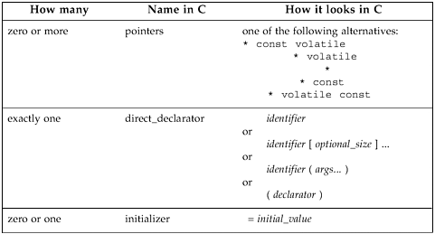
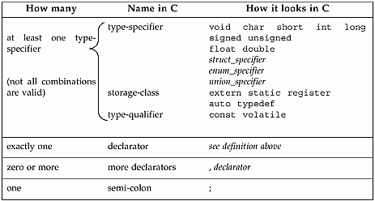
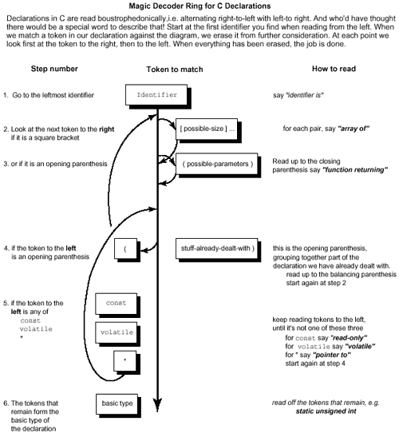
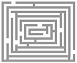

# Chương 3. Gỡ rối declaration trong C

"Tên bài hát được gọi là 'Mắt cá tuyết.'"

"Ồ, đó là tên bài hát phải không?" Alice cố tỏ ra hứng thú.

"Không, cô không hiểu," Hiệp sĩ hơi bực.

"Đó là cách gọi cái tên. Tên thật là 'Ông già già nua.'"

"Vậy tôi nên nói 'Đó là cách gọi bài hát'?" Alice sửa lời. "Không, không nên: đó là chuyện hoàn toàn khác! Bài hát được gọi 'Cách thức và phương tiện': nhưng chỉ là cách gọi thôi, cô biết đấy!"

"Vậy bài hát là gì?" Alice hỏi, giờ hoàn toàn rối.

"Tôi đang đến chỗ đó," Hiệp sĩ nói. "Bài hát thật sự là 'A-sitting On A Gate': giai điệu do tôi nghĩ ra."

—Lewis Carroll, Through the Looking Glass

syntax chỉ compiler yêu nổi…declaration hình thành thế nào…đôi lời về struct…đôi lời về union…đôi lời về enum…quy tắc precedence…gỡ declaration C bằng sơ đồ…typedef có thể là bạn…khác biệt typedef và #define…"typedef struct foo { ... foo } foo;" nghĩa gì…đoạn code hiểu mọi parsing…giải trí nhẹ nhàng — software cắn nòng nọc sáp

Có chuyện Nữ hoàng Victoria ấn tượng Alice in Wonderland đến mức xin các sách khác Lewis Carroll. Bà không biết Lewis Carroll là pen-name giáo sư toán Oxford Charles Dodgson. Bà chẳng vui khi cận thần cười thầm mang nhiều tập nặng gồm The Condensation (Factoring) of Determinants. Chuyện được kể nhiều thời Victoria, Dodgson cố bác bỏ:

"Tôi nhân cơ hội công khai hết mức có thể lời bác bỏ chuyện ngớ ngẩn báo chí truyền quanh, rằng tôi đã tặng vài sách cho Nữ hoàng. Chuyện lặp liên tục, hoàn toàn hư cấu, nên đáng khẳng định một lần dứt khoát rằng sai ở mọi chi tiết: chưa bao giờ có gì dù chỉ giống vậy."

—Charles Dodgson, Symbolic Logic, ấn bản thứ hai

Vì vậy, theo nguyên tắc "ông phản đối quá mức", có thể khá chắc chuyện xảy ra đúng như kể. Dù sao Dodgson hẳn hợp C, Nữ hoàng Victoria thì không. Đưa trích dẫn đầu chương vào bảng, có:

được gọi là là

tên bài hát "Mắt cá tuyết" "Ông già già nua" bài hát "Cách thức và phương tiện" "A-sitting On A Gate"

Đúng, Dodgson hẳn rất thoải mái với computer science, đặc biệt thích type model ngôn ngữ lập trình. Ví dụ với declaration C:

```
typedef char * string;
string punchline = "I'm a frayed knot";
```

thấy mô hình Hiệp sĩ áp dụng ra sao:

được gọi là là

type của variable `string` `char *` variable `punchline` `"I'm a frayed knot"` Còn gì trực giác hơn? Thật ra khá nhiều thứ, và sẽ rõ hơn sau khi đọc chương.

## Syntax chỉ compiler yêu nổi

Như Kernighan, Ritchie thừa nhận, "đôi khi C bị chỉ trích vì syntax declaration" (K\&R, ấn bản 2, tr.122). Syntax declaration C dễ cho compiler (hay compiler-writer) xử lý, khó cho lập trình viên trung bình. Người thiết kế cũng là con người, sẽ sai. Ví dụ Ada reference manual có grammar mơ hồ trong phụ lục. Ambiguity rất không mong muốn trong grammar, vì com-plicates đáng kể việc compiler-writer. Nhưng syntax declaration C thật sự hỗn độn kinh khủng, thấm vào toàn ngôn ngữ. Không quá lời rằng C phức tạp đáng kể, không cần thiết vì cách kết hợp type vụng về.

Có vài lý do declaration model C khó. Cuối thập niên 1960 khi thiết kế, "type model" chưa hiểu rõ trong lý thuyết ngôn ngữ. BCPL (ông nội C) type-poor, chỉ có binary word, nên C dựa nền thiếu sót. Rồi triết lý declaration object nên giống cách dùng. Array pointers-to-integers khai báo `int * p[3];`, integer được tham chiếu trong expression bằng `*p[i]`, nên declaration giống sử dụng. Lợi là precedence operator trong "declaration" giống "use". Hại là operator precedence (15 mức trở lên tùy đếm) cũng phức tạp quá mức. Phải nhớ rule riêng để biết `int *p[3]` là array pointers-to-int hay pointer tới array int.

Ý tưởng declaration giống sử dụng dường như riêng C, không ngôn ngữ khác theo. Có lẽ không tuyệt như từng nghĩ. Hai thứ khác nhau làm giống có gì hay? Người Bell Labs nhận phê bình nhưng vẫn bảo vệ đến cùng. Tốt hơn là khai báo pointer như

```
int &p;
```

ít nhất gợi `p` là address integer. Cú pháp nay C++ dùng chỉ call by reference parameter.

Vấn đề lớn nhất là không còn đọc declaration từ trái sang phải tự nhiên được. Tệ hơn khi ANSI C thêm keyword `volatile`, `const`; vì chỉ xuất hiện trong declaration, không trong sử dụng, ít trường hợp cách dùng variable mô phỏng declaration hơn. Thứ kiểu declaration mà không identifier (như formal parameter declaration, cast) trông lạ. Muốn cast sang type pointer-to-array phải diễn đạt:

```
char (*j)[20]; /* j is a pointer to an array of 20 char */
j = (char (*)[20]) malloc( 20 );
```

Bỏ ngoặc đơn có vẻ thừa quanh asterisk thành không hợp lệ. Declaration có pointer, `const` có vài thứ tự:

```
const int * grape;
int const * grape;
int * const grape_jelly;
```

Trường hợp cuối làm pointer read-only, hai trường hợp trước làm object được trỏ read-only; dĩ nhiên cả object và thứ nó trỏ có thể constant. Một trong hai declaration tương đương sau làm vậy:

```
const int * const grape_jam;
int const * const grape_jam;
```

Chuẩn ANSI ngầm nhận vấn đề khác khi nói typedef specifier chỉ gọi "storage-class specifier" cho tiện syntax. Ngay người C giàu kinh nghiệm cũng khó. Nếu syntax cho array pointer thẳng thắn còn xấu, hãy xem thứ hơi phức tạp. Chính xác declaration sau (phỏng từ `telnet`) khai báo gì?

```
char* const *(*next)();
```

Sẽ trả lời bằng ví dụ này sau trong chương. Qua nhiều năm, lập trình viên, sinh viên, giáo viên cố tìm mẹo nhớ, thuật toán đơn giản để hiểu syntax kinh khủng. Chương đưa thuật toán tiếp cận step-by-step. Làm vài ví dụ sẽ không phải lo declaration C nữa!

## Declaration hình thành thế nào

Đầu tiên xem thuật ngữ C và phần tạo declaration. Thành phần quan trọng là declarator — trái tim mọi declaration; đại khái identifier cùng pointer, function bracket, array indica-tions kèm theo, như Hình 3-1. Cho tiện, cũng nhóm initializer ở đây.

Hình 3-1. Declarator trong C



Declaration gồm phần trong Hình 3-2 Hình 3-2 (không mọi tổ hợp hợp lệ, nhưng bảng cho từ vựng thảo luận). Declaration cho basic type bên dưới variable và initial value nếu có.

Hình 3-2. Declaration trong C



Bắt đầu thấy declaration phức tạp khi kết hợp type. Nhớ có hạn chế declaration hợp lệ. Không có những thứ sau:

- Function không trả function, nên không bao giờ thấy `foo()()`

- Function không trả array, nên không bao giờ thấy `foo()[]`

- Array không giữ function, nên không bao giờ thấy `foo[]()`

Có thể có những thứ sau:

- Cho phép function trả pointer tới function: `int (* fun())();`

- Cho phép function trả pointer tới array: `int (* foo())[]`

- Cho phép array giữ pointer tới function: `int (*foo[])()`

- Array giữ array khác được, nên thường thấy `int foo[][]`

Trước kết hợp type, ôn cách kết hợp variable trong struct, union và xem enum.

### Đôi lời về `structs`

Struct chỉ là tập data item nhóm lại. Ngôn ngữ khác gọi "record". Syntax dễ nhớ: cách nhóm thông thường C là ngoặc nhọn: { thứ... } Keyword `struct` trước để compiler phân biệt block:

```
struct {stuff... }
```

Trong struct có thể là data declaration khác: data item riêng, array, struct khác, pointer, v.v. Sau struct definition có thể thêm variable name để khai báo variable kiểu struct, ví dụ:

```
struct {stuff... } plum, pomegranate, pear;
```

Điểm khác cần chú ý là có thể viết "structure tag" tùy chọn sau "struct":

```
struct fruit_tag {stuff... } plum, pomegranate, pear;
```

Nay dùng `struct fruit_tag` viết tắt cho

```
struct {stuff... }
```

trong declaration sau.

Vậy `struct` có dạng chung:

```
struct optional_tag {
              type_1 identifier_1;
              type_2 identifier_2;
              ...
              type_N identifier_N;
              } optional_variable_definitions;
```

Với các declaration

```
struct date_tag { short dd,mm,yy; } my_birthday, xmas;
struct date_tag easter, groundhog_day;
```

variable `my_birthday,` `xmas,` `easter,` `groundhog_day` cùng type. Struct còn có bit field, unnamed field, field word-aligned. Có được bằng thêm dấu hai chấm, số chỉ field length bằng bit sau field declaration.

```
/* process ID info */

struct pid_tag {
unsigned int inactive :1;
unsigned int          :1;       /* 1 bit of padding */
unsigned int refcount :6;
unsigned int          :0;       /* pad to next word boundary
*/
short pid_id;
struct pid_tag *link;
};
```

Thường dùng "lập trình sát silicon", gặp trong systems program. Cũng dùng lưu Boolean flag trong bit thay char. Bit field phải type int, unsigned int, signed int (hoặc phiên bản có qualifier). Bit field int có âm được không là implementation-dependent.

Chúng tôi thích không trộn struct declaration với variable definition. Thích

```
struct veg { int weight, price_per_lb; };
struct veg onion, radish, turnip;
```

hơn

```
struct veg { int weight, price_per_lb; } onion, radish, turnip;
```

Đúng, bản thứ hai đỡ gõ vài character code, nhưng nên quan tâm dễ đọc hơn dễ viết. Viết một lần, đọc nhiều lần khi bảo trì. Dòng chỉ làm một thứ dễ đọc hơn chút. Vì vậy variable declaration nên riêng type declaration.

Cuối cùng hai vấn đề truyền parameter với struct. Có sách C nói "parameter truyền bằng đẩy stack từ phải sang trái". Quá đơn giản hóa — có sách vậy hãy xé trang đốt. Có compiler vậy hãy xé byte đó. Parameter truyền register khi được (vì tốc độ). Lưu ý int "i" có thể truyền hoàn toàn khác struct "s" chỉ chứa int. Giả sử int parameter thường trong register, có thể struct lại trên stack. Điểm thứ hai là đặt array trong struct như:

```
/* array inside a struct */
struct s_tag { int a[100]; };
```

nay coi array first-class type được. Có thể copy toàn array bằng assignment, truyền function by value, làm return type function.

```
struct s_tag { int a[100]; };
struct s_tag orange, lime, lemon;
struct s_tag twofold (struct s_tag s) {
    int j;
    for (j=0;j<100;j++) s.a[j] *= 2;
    return s;
}

main() {
    int i;
    for (i=0;i<100;i++) lime.a[i] = 1;
    lemon = twofold(lime);
    orange = lemon; /* assigns entire struct */
}
```

Thường không muốn gán toàn array quá thường, nhưng làm được bằng chôn trong struct. Kết bằng cách struct chứa pointer tới chính type, cần cho list, tree, nhiều dynamic data structure.

```
/* struct that points to the next struct */
struct node_tag { int datum;
                  struct node_tag *next;
                };
struct node_tag a,b;
a.next = &b;       /* example link-up */
a.next->next=NULL;
```

### Đôi lời về `unions`

Union là variant part của variant record trong nhiều ngôn ngữ khác. Trông như struct nhưng memory layout có khác biệt then chốt. Thay mỗi member lưu sau member trước, mọi member offset zero. Storage member chồng nhau: chỉ lưu một member mỗi thời điểm.

Có tin tốt, xấu về union. Tin xấu là tin tốt chẳng tốt mấy. Tin tốt là dạng chung giống hệt struct, thay keyword `struct` bằng `union`. Quen mọi biến thể, khả năng struct là biết union. Dạng chung:

```
union optional_tag {
        type_1 identifier_1;
        type_2 identifier_2;
          ...
        type_N identifier_N;
} optional_variable_definitions;
```

Union thường trong struct lớn hơn, có thông tin ngầm hoặc rõ về type data hiện có. Rõ ràng thiếu type safety khi lưu kiểu này lấy kiểu khác. Ada buộc discriminant field lưu rõ trong record. C bảo tự lo, dựa lập trình viên nhớ đã đặt gì.

Union thường tiết kiệm space bằng không lưu mọi khả năng data item không cùng xuất hiện. Ví dụ lưu thông tin động vật học về loài, data record thử đầu:

```
struct creature {
 char has_backbone;
 char has_fur;
 short num_of_legs_in_excess_of_4;
};
```

Nhưng mọi sinh vật có hoặc không xương sống. Chỉ động vật có xương sống có lông, chỉ không xương sống có hơn bốn chân. Không thứ gì vừa hơn bốn chân vừa có lông, nên tiết kiệm bằng lưu hai field loại trừ nhau thành union:

```
union secondary_characteristics {
 char has_fur;
 short num_of_legs_in_excess_of_4;
};
struct creature {
           char has_backbone;
           union secondary_characteristics form;
};
```

Thường chồng space vậy để tiết kiệm backing store. Datafile 20 triệu con vật có thể tiết kiệm đến 20 Mb disk.

Nhưng union còn cách dùng khác. Không phải một diễn giải cho hai data khác, mà hai diễn giải cho cùng data. Thú vị là giống hệt REDEFINES clause COBOL. Ví dụ:

```
union bits32_tag {
        int whole;                       /* one 32-bit value
*/
        struct {char c0,c1,c2,c3;} byte; /* four 8-bit bytes
*/
} value;
```

Union cho lấy đầy đủ 32-bit value hoặc byte field riêng `value.byte.c0`, v.v. Có cách khác, nhưng union không cần assignment hay type cast thêm. Cho vui tôi xem khoảng 150.000 dòng source operating system machine-independent (ôi, mỏi tay quá). Struct phổ biến gấp khoảng trăm lần union, chỉ tần suất gặp struct nhiều hơn thực tế.

### Đôi lời về `enums`

Enum (enumerated type) chỉ là cách gắn chuỗi tên với chuỗi integer value. Trong ngôn ngữ weakly typed như C, thêm rất ít thứ không làm bằng `#define` được, nên bị bỏ trong phần lớn K\&R C đầu. Nhưng ngôn ngữ khác đều có nên cuối cùng C cũng có. Dạng chung giờ quen:

```
enum optional_tag {stuff... } optional_variable_definitions;
```

Thứ... ở đây là identifier list, có thể gán integer value. Ví dụ enumerated type:

```
enum sizes { small=7, medium, large=10, humungous };
```

Mặc định integer value từ zero. Gán value trong list thì value sau lớn hơn một, v.v. Ưu điểm enum: khác tên #defined thường bị bỏ khi compile, enum name thường đến debugger, dùng khi debug code được.

## Quy tắc precedence

Đã ôn thành phần declaration. Phần này đưa cách phân giải thành giải thích tiếng Anh. Quy tắc precedence hiểu declaration C được language lawyer thích nhất. Rất ngắn nhưng rất ít trực giác.

Quy tắc precedence hiểu declaration C

A Đọc declaration bắt đầu tên rồi theo precedence. B Precedence từ cao xuống thấp: B.1 ngoặc đơn nhóm phần declaration B.2 postfix operator: ngoặc đơn `()` chỉ function và

ngoặc vuông `[]` chỉ array.

B.3 prefix operator: asterisk nghĩa "pointer tới". C Nếu keyword `const` và/hoặc `volatile` sát type specifier (như `int, long`, v.v.) thì

áp dụng cho type specifier. Nếu không, keyword `const` và/hoặc `volatile` áp dụng pointer asterisk ngay bên trái.

Ví dụ giải declaration bằng quy tắc precedence:

```
char* const *(*next)();
```

Bảng 3-1. Giải declaration bằng quy tắc precedence

| Rule áp dụng | Giải thích |
|---|---|
| A | Trước tiên đến variable name "`next`", thấy được ngoặc đơn bao trực tiếp. |
| B.1 | Nhóm với phần khác trong ngoặc, được "`next` là pointer tới...". |
| B | Ra ngoài ngoặc, có lựa chọn prefix asterisk hoặc cặp postfix ngoặc đơn. |
| B.2 | Rule B.2 nói precedence cao nhất là ngoặc function bên phải, vậy "`next` là pointer tới function trả…" |
| B.3 | Xử lý prefix "`*`" để được "pointer tới". |
| C | Cuối cùng lấy "`char * const`" như constant pointer tới character. |

Ghép lại thành:

"`next` là pointer tới function trả pointer tới const pointer-to-char"

và xong. Mọi rule quy về precedence rule, nhưng muốn trực giác hơn, dùng Hình 3-3.

Hình 3-3. Parse declaration C thế nào



## Gỡ declaration C bằng sơ đồ

Phần này đưa sơ đồ có bước đánh số (Hình 3-3). Theo từng bước từ một, theo mũi tên, nhanh chóng dịch declaration C phức tạp tùy ý thành tiếng Anh (cũng phức tạp tùy ý). Đơn giản bằng bỏ typedef khỏi sơ đồ. Đọc typedef thì dịch declaration bỏ từ "typedef". Nếu ra "p là…", nay dùng tên "p" khi muốn khai báo thứ có type đã dịch.

Vòng giải mã thần kỳ cho declaration C

Declaration C đọc kiểu boustrophedon, tức luân phiên right-to-left với left-to right. Ai ngờ có từ riêng mô tả vậy! Bắt đầu identifier đầu khi đọc từ trái. Khi khớp token declaration với sơ đồ, xóa khỏi phần cần xét. Mỗi điểm xem token bên phải trước rồi trái. Xóa hết là xong. Thử vài ví dụ gỡ bằng sơ đồ. Giả sử muốn hiểu ví dụ code đầu:

```
char* const *(*next)();
```

Khi gỡ declaration, dần "tẩy trắng" phần đã xử lý để thấy chính xác còn bao nhiêu. Nhớ `const` nghĩa "read-only". Chỉ vì ghi constant không nhất thiết nghĩa constant.

Quá trình trong Bảng 3-2. Mỗi bước in đậm phần đang xử lý. Bắt đầu bước một, đi qua các bước.

Bảng 3-2. Các bước gỡ declaration C

| Declaration còn lại <br> (từ identifier trái nhất) | Bước tiếp áp dụng | Kết quả |
|---|---|---|
| `char * const *(*next` `)();` | bước 1 | nói "next là…" |
| `char * const *(*)` `();` | bước 2, 3 | không khớp, bước tiếp, nói "next là…" |
| `char * const *(*` `)();` | bước 4 | không khớp, bước tiếp |
| `char * const *(*` `)();` | bước 5 | asterisk khớp, nói "pointer tới …", về bước 4 |
| `char * const *()` `();` | bước 4 | "(" khớp đến ")", về bước 2 |
| `char * const *` `()` `;` | bước 2 | không khớp, bước tiếp |
| `char * const *` `()` `;` | bước 3 | nói "function trả…" |
| `char * const` `*` `;` | bước 4 | không khớp, bước tiếp |
| `char * const` `*` `;` | bước 5 | nói "pointer tới…" |
| `char *` `const` `;` | bước 5 | nói "read-only…" |
| `char` `*` `;` | bước 5 | nói "pointer tới…" |
| `char` `;` | bước 6 | nói "char" |

Ghép lại thành:

"next là pointer tới function trả pointer tới pointer-to-char read-only"

và xong.

Giờ thử ví dụ phức tạp hơn.

```
char *(*c[10])(int **p);
```

Thử theo bước như ví dụ trước. Các bước ở cuối chương để bạn tự thử, so đáp án.

## `typedef` có thể là bạn

Typedef là declaration thú vị: đưa tên mới cho type thay vì dành storage variable. Theo cách nào đó giống macro text replacement — không thêm type mới, chỉ tên mới, nhưng khác biệt then chốt giải thích sau.

Xem lại phần declaration hình thành, thấy keyword `typedef` có thể thuộc declaration thường, gần đầu. Thực tế format giống hệt variable declaration, chỉ thêm keyword để báo.

Vì giống variable declaration, đọc hệt. Kỹ thuật phần trước áp dụng. Thay declaration nói "tên tham chiếu variable type đã nêu", keyword `typedef` không tạo variable, khiến declaration nói "tên đồng nghĩa type đã nêu".

Thường dùng trường hợp khó pointer tới thứ gì. Ví dụ kinh điển declaration prototype `signal()`. Signal là system call bảo runtime gọi routine cụ thể khi "software interrupt" chỉ định đến. Đáng ra gọi "Call\_that\_routine\_when\_this\_interrupt\_comes\_in". Gọi `signal()` truyền argument chỉ interrupt nào, routine nào xử lý. Chuẩn ANSI khai báo:

```
void (*signal(int sig, void (*func)(int)) ) (int);
```

Luyện kỹ năng new-found đọc declaration, thấy nghĩa:

```
void (*signal(                          ) ) (int);
```

`signal` là function (argument hơi kỳ) trả pointer tới function (nhận int, trả void). Một argument kỳ là:

```
void (*func)(int) ;
```

pointer tới function nhận int, trả void. Có thể đơn giản bằng typedef "tách" phần chung:

```
typedef void (*ptr_to_func) (int);
/* this says that ptr_to_func is a pointer to a function
 * that takes an int argument, and returns void
 */


ptr_to_func signal(int, ptr_to_func);
/* this says that signal is a function that takes
 * two arguments, an int and a ptr_to_func, and
 * returns a ptr_to_func
 */
```

Nhưng typedef có nhược điểm. Cùng syntax rối của declaration khác, cùng nhồi nhiều declarator trong declaration. Gần như không thêm gì cho struct trừ khả năng không hữu ích bỏ keyword `struct`. Trong mọi `typedef`, thậm chí không cần đặt `typedef` đầu declaration!

### Mẹo thực hành hữu ích


Mẹo làm việc với declarator

Đừng đặt nhiều declarator trong một typedef như:

```
typedef int *ptr, (*fun)(), arr[5];
/* ptr is the type "pointer to int"
 * fun is the type "pointer to a function returning int"
 * arr is the type "array of 5 ints"
 */
```

Và tuyệt đối đừng chôn typedef giữa declaration như:

```
unsigned const long typedef int volatile *kumquat;
```

Typedef tạo alias data type thay vì data type mới. Có thể typedef mọi type.

```
typedef int (*array_ptr)[100];
```

Chỉ viết declaration variable type mong muốn. Tên variable là tên muốn cho alias. Viết keyword 'typedef' đầu như trên. Typedef name không trùng identifier khác cùng block.

## Khác biệt giữa `typedef int x[10]` và `#define x int[10]`

Như trên, khác biệt then chốt giữa typedef và macro text replacement. Nên xem typedef là type "đóng gói" hoàn chỉnh — không thêm sau khi khai báo. Khác macro thể hiện hai cách.

Có thể mở rộng macro typename bằng type specifier khác, không với typename typedef. Tức:

```
#define peach int
unsigned peach i; /* works fine */

typedef int banana;
unsigned banana i; /* Bzzzt! illegal */
```

Thứ hai, tên typedef cung cấp type cho mọi declarator trong declaration.

```
#define int_ptr int *
int_ptr chalk, cheese;
```

Sau macro expansion, dòng hai thực sự thành:

```
int * chalk, cheese;
```

Điều này làm chalk, cheese khác như chutney, chives: chalk là pointer-to-an-integer, cheese là integer. Ngược lại typedef:

```
typedef char * char_ptr;
char_ptr Bentley, Rolls_Royce;
```

khai báo Bentley, Rolls\_Royce giống nhau. Tên mặt trước khác nhưng cả hai pointer tới char.

## `typedef struct foo { ... foo; } foo;` nghĩa gì

C có nhiều namespace:

\* label name

\* tag (một namespace cho mọi struct, enum, union)

\* member name (mỗi struct, union có namespace riêng)

\* mọi thứ khác. Mọi thứ trong namespace phải duy nhất, nhưng tên giống áp cho thứ ở namespace khác được. Vì mỗi struct, union có namespace riêng, cùng member name tái dùng trong nhiều struct. Compiler rất cũ không vậy, một lý do code kernel BSD 4.2 thêm prefix đầu riêng vào field name như:

```
struct vnode {
        long              v_flag;
        long              v_usecount;
        struct vnode      *v_freef;
        struct vnodeops   *v_op;
};
```

Vì tên giống ở namespace khác hợp lệ, đôi khi thấy code:

```
struct foo {int foo;} foo;
```

Chắc chắn làm rối, nản người sau bảo trì. `sizeof( foo );` tham chiếu gì?

Còn đáng sợ hơn. Declaration sau hoàn toàn hợp lệ:

```
typedef struct baz {int baz;} baz;
        struct baz variable_1;
               baz variable_2;
```

Quá nhiều "baz"! Thử lại tên sáng sủa hơn để xem:

```
typedef struct my_tag {int i;} my_type;
        struct my_tag variable_1;
my_type variable_2;
```

Typedef thêm tên `my_type` viết tắt "`struct` `my_tag` `{int i}`", nhưng cũng thêm structure tag `my_tag` dùng được với keyword `struct`. Dùng cùng identifier cho type, tag trong typedef khiến keyword "`struct`" tùy chọn, tạo mental model hoàn toàn sai. Tiếc syntax struct typedef này giống hệt kết hợp struct type với variable declaration. Nên dù hai declaration hình thức tương tự,

```
typedef struct fruit {int weight, price_per_lb } fruit; /*
statement 1 */
        struct veg   {int weight, price_per_lb } veg;   /*
statement 2 */
```

việc rất khác đang xảy ra. Statement 1 khai báo structure tag "fruit", structure typedef "fruit", dùng như:

```
struct fruit mandarin; /* uses structure tag "fruit" */
       fruit tangerine; /* uses structure type "fruit" */
```

Statement 2 khai báo structure tag "veg" và variable veg. Chỉ structure tag dùng trong declaration sau như:

```
struct veg potato;
```

Thử khai báo `veg cabbage` là lỗi, như viết:

```
int i;
ij;
```

### Mẹo thực hành hữu ích


Mẹo làm việc với typedef

Đừng mất công `typedefs` cho `structs`.

Chỉ tiết kiệm viết "struct", vốn là gợi ý không nên giấu.

Dùng typedef cho:

- Type kết hợp array, struct, pointer, function.

- Type portable. Cần type ít nhất, chẳng hạn 20-bits, làm typedef. Port sang platform khác, chọn type đúng `short,` `int,` `long,` chỉ sửa typedef thay mọi declaration.

- Cast. Typedef đặt tên đơn giản cho type cast phức tạp. Ví dụ

- `typedef int (*ptr_to_int_fun)(void);`

- `char * p;`

```
                = (ptr_to_int_fun) p;
```

Luôn dùng tag trong structure definition, dù chưa cần. Sau sẽ cần.

Nguyên tắc khá tốt trong computer science: hai thứ khác nhau thì dùng hai tên khác. Giảm cơ hội nhầm (luôn tốt trong software). Bí tên structure tag thì đặt kết thúc "\_tag". Dễ phát hiện tên cụ thể là gì. Thế hệ sau sẽ chúc phúc tên bạn thay nguyền tác phẩm.

## Đoạn code hiểu mọi parsing

Dễ viết chương trình parse declaration C, dịch sang tiếng Anh. Sao không tự viết? Dạng cơ bản đã mô tả. Chỉ cần code hiểu dạng, gỡ như Hình 3-4. Để đơn giản, gần như bỏ error handling, xử lý struct, enum, union bằng rút về một từ "struct", "enum", "union". Cuối cùng, chương trình mong function có ngoặc trống (không argument list).

### Thử thách lập trình



Viết chương trình dịch declaration C sang tiếng Anh

Thiết kế như sau. Data structure chính là stack, lưu token đã đọc khi đọc tới identifier. Token bên phải xem bằng đọc, bên trái bằng pop stack. Data structure là:

```
struct token { char type;
              char string[MAXTOKENLEN]; };

 /* holds tokens we read before reaching first
identifier */
struct token stack[MAXTOKENS];

 /* holds the token just read */
struct token this;
```

Đoạn pseudo-code là:

utility routine----------

```
classify_string
    look at the current token and
    return a value of "type" "qualifier" or "identifier"
in this.type
gettoken
    read the next token into this.string
    if it is alphanumeric, classify_string
    else it must be a single character token
    this.type = the token itself; terminate this.string
with a nul.
read_to_first_identifier
    gettoken and push it onto the stack until the first
identifier is read.
    Print "identifier is", this.string
    gettoken
```

parsing routine----------

```
deal_with_function_args
    read past closing ')' print out "function returning"
deal_with_arrays
    while you've got "[size]" print it out and read past
it
deal_with_any_pointers
    while you've got "*" on the stack print "pointer to"
and pop it
deal_with_declarator
    if this.type is '[' deal_with_arrays
    if this.type is '(' deal_with_function_args
    deal_with_any_pointers
    while there's stuff on the stack
    if it's a '('
    pop it and gettoken; it should be the closing ')'
    deal_with_declarator
    else pop it and print it
```

main routine----------

```
main
    read_to_first_identifier
    deal_with_declarator
```

Chương trình nhỏ này được viết nhiều lần qua năm tháng, thường tên "cdecl". <sup>\[1\]</sup> Bản chưa đầy đủ trong The C Programming Language. Bản đặc tả ở đây đầy đủ hơn, hỗ trợ type qualifier "const", "volatile". Cũng biết struct, enum, union dù chưa tổng quát; dễ mở rộng xử lý argument declaration trong function. Khoảng 150 dòng C triển khai được. Thêm error handling, declaration tổng quát làm lớn hơn nhiều. Dù sao, viết parser này là triển khai một subsystem chính compiler — thành tựu lập trình đáng kể, giúp hiểu sâu lĩnh vực.

<sup>\[1\]</sup> Đừng lẫn với modifier cdecl trong Turbo C trên PC, chỉ code tạo ra không dùng convention gọi function mặc định Turbo Pascal. Modifier cdecl cho link Borland C với Turbo language khác có calling convention khác.

#### Đọc thêm

Đã nắm cách xây data structure trong C, có thể muốn sách general-purpose tốt. Một cuốn là Data Structures with Abstract Data Types của Daniel F. Stubbs, Neil W. Webre, ấn bản 2, Pacific Grove, CA, Brooks/Cole, 1989. Bao phủ string, list, stack, queue, tree, heap, set, graph. Rất đáng đọc.

## Giải trí nhẹ nhàng — Software cắn nòng nọc sáp…

Niềm vui lớn lập trình là software điều khiển vật thật (như tay robot, disk head). Chạy chương trình làm thứ ngoài đời chuyển động đem thỏa mãn lớn. Nghiên cứu sinh Artificial Intelligence Laboratory MIT được thúc đẩy khi nối computer khoa với nút gọi thang máy tầng chín. Gọi thang bằng lệnh từ LISP machine! Chương trình kiểm terminal thực sự trong lab rồi mới gọi, ngăn hacker đối thủ dùng mặt tối thần lực chiếm thang.

Niềm vui lớn khác là ăn junk food khi hack-ing. Còn gì tự nhiên hơn kết hợp hai thú vui? Nghiên cứu sinh Carnegie-Mellon University phát triển junk-food/com-puter interface giải quyết vấn đề long-standing: máy Coke<sup>®</sup> khoa computer science tầng ba, xa văn phòng nghiên cứu sinh. Họ chán đi xa chỉ thấy máy trống hoặc tệ hơn mới nạp nên chai ấm. John Zsarney, Lawrence Butcher nhận ra máy lưu hàng trong sáu col-umns làm lạnh, mỗi cột có đèn "empty" nháy khi nhả chai, sáng liên tục khi hết. Dễ nối đèn với serial interface, truyền "chai đã nhả" về mainframe PDP10 khoa. Từ PDP10, interface như telnet connection! Mike Kazar, Dave Nichols viết software đáp query, theo dõi cột chứa chai lạnh nhất.

Mike, Dave dĩ nhiên chưa dừng. Còn thiết kế network protocol cho mainframe trả query trạng thái từ mọi máy local ethernet, rồi Internet. Ivor Durham triển khai software và kiểm trạng thái từ máy khác. Tiết kiệm công đáng khen, Ivor tái dùng "finger" chuẩn — thường kiểm từ máy này user chỉ định có login máy khác không. Sửa finger server chạy Coke status khi ai finger user không tồn tại "coke". Vì finger request thuộc Internet protocol chuẩn, mọi máy CMU kiểm được. Thực ra chạy lệnh

```
finger coke@g.gp.cs.cmu.edu
```

biết trạng thái từ mọi máy mọi nơi Internet, dù xa hàng nghìn dặm! Người khác tham gia gồm Steve Berman, Eddie Caplan, Mark Wilkins, Mark Zaremsky <sup>\[2\]</sup>. Chương trình dùng hơn thập kỷ, thậm chí viết lại cho UNIX Vaxen khi PDP-10 nghỉ đầu 1980. Kết thúc vài năm trước khi nhà đóng chai Coke địa phương bỏ chai hoàn trả Coke-bottle-shaped. Máy cũ không xử lý hình chai mới, thay máy bán hàng cần interface mới. Một thời gian chẳng ai làm, nhưng caffeine cuối cùng thúc Greg Nelson thiết kế lại. Nghiên cứu sinh CMU còn nối máy kẹo, trường khác có dự án tương tự.

<sup>\[2\]</sup> Craig Everhart, Eddie Caplan, Robert Frederking, "Serious Coke Addiction," 25th Anniversary Sym-posium, Computer Science at CMU: A Commemorative Review, 1990, tr.70. Reed and Witting Company.

Computer club University of Western Australia có máy Coke nối CPU 68000, memory 80K, ethernet interface (mạnh hơn đa số PC thập kỷ trước). Computer Science House tại Rochester Institute of Technology, Rochester, NY, cũng có máy Coke Internet, mở rộng đồ uống tín dụng, billing tài khoản máy tính. Một sinh viên thích login từ nhà cách hàng trăm dặm mùa hè, ngẫu nhiên phát vài đồ uống miễn phí cho người đi qua. Sắp đến mức "máy Coke" là hardware phổ biến nhất Internet.

Sao dừng ở cola? Giáng sinh trước, lập trình viên Cygnus Support nối đồ trang trí cây thông văn phòng vào ethernet. Họ giải trí bằng tog-gling đèn từ workstation. Vậy mà người ta lo Nhật vượt Mỹ công nghệ! Trong Sun Microsystems, có e-mail address gate-wayed tới fax modem. Gửi e-mail đến, nó parse phone number rồi gửi fax. Lập trình viên tài năng Don Hopkins viết pizzatool tận dụng. Cho custom-select topping pizza qua GUI (đa số thêm phô mai GUI), gửi đơn fax tới Tony \& Alba's Pizza gần đó, nhận đơn fax và giao hàng.

Không nghĩ tiết lộ bí mật thương mại nếu nói đã dùng rất nhiều dịch vụ khi làm lab late-night phát triển Sun SPARCserver 600MP. Chúc ngon miệng!

### Lời giải lập trình


```
The Piece of Code that Understandeth All Parsing
1 #include <stdio.h>
2 #include <string.h>
3 #include <ctype.h>
4 #include <stdlib.h>
5 #define MAXTOKENS 100
6 #define MAXTOKENLEN 64
7
8 enum type_tag { IDENTIFIER, QUALIFIER, TYPE };
9
10 struct token {
11     char type;
12     char string[MAXTOKENLEN];
13 };
14
15 int top=-1;
16 struct token stack[MAXTOKENS];
17 struct token this;
18
19 #define pop stack[top--]
20 #define push(s) stack[++top]=s
21
22 enum type_tag classify_string(void)
23 /* figure out the identifier type */
24 {
25     char *s = this.string;
26     if (!strcmp(s,"const")) {
27         strcpy(s,"read-only");
28         return QUALIFIER;
29     }
30     if (!strcmp(s,"volatile")) return QUALIFIER;
31     if (!strcmp(s,"void")) return TYPE;
32     if (!strcmp(s,"char")) return TYPE;
33     if (!strcmp(s,"signed")) return TYPE;
34     if (!strcmp(s,"unsigned")) return TYPE;
35     if (!strcmp(s,"short")) return TYPE;
36     if (!strcmp(s,"int")) return TYPE;
37     if (!strcmp(s,"long")) return TYPE;
38     if (!strcmp(s,"float")) return TYPE;
39     if (!strcmp(s,"double")) return TYPE;
40     if (!strcmp(s,"struct")) return TYPE;
41     if (!strcmp(s,"union")) return TYPE;
42     if (!strcmp(s,"enum")) return TYPE;
43     return IDENTIFIER;
44 }
45
46 void gettoken(void) /* read next token into "this" */
47 {
48     char *p = this.string;
49
50     /* read past any spaces */
51     while ((*p = getchar()) == ' ' ) ;
52
53     if (isalnum(*p)) {
54         /* it starts with A-Z,0-9 read in identifier
*/
55         while ( isalnum(*++p=getchar()) );
56         ungetc(*p,stdin);
57         *p = '\0';
58         this.type=classify_string();
59         return;
60     }
61
62     if (*p=='*') {
63         strcpy(this.string,"pointer to");
64         this.type = '*';
65         return;
66     }
67     this.string[1]= '\0';
68     this.type = *p;
69     return;
70 }
71 /* The piece of code that understandeth all parsing.
*/
72 read_to_first_identifier() {
73     gettoken();
74     while (this.type!=IDENTIFIER) {
75         push(this);
76         gettoken();
77     }
78     printf("%s is ", this.string);
79     gettoken();
80 }
81
82 deal_with_arrays() {
83     while (this.type=='[') {
84         printf("array ");
85         gettoken(); /* a number or ']' */
86         if (isdigit(this.string[0])) {
87             printf("0..%d ",atoi(this.string)-1);
88             gettoken(); /* read the ']' */
89         }
90         gettoken(); /* read next past the ']' */
91         printf("of ");
92     }
93 }
94
95 deal_with_function_args() {
96     while (this.type!=')') {
97         gettoken();
98     }
99     gettoken();
100    printf("function returning ");
101 }
102
103 deal_with_pointers() {
104    while ( stack[top].type== '*' ) {
105        printf("%s ", pop.string );
106    }
107 }
108
109 deal_with_declarator() {
110    /* deal with possible array/function following
the identifier */
111    switch (this.type) {
112    case '[' : deal_with_arrays(); break;
113    case '(' : deal_with_function_args();
114    }
115
116    deal_with_pointers();
117
118    /* process tokens that we stacked while reading
to identifier */
119    while (top>=0) {
120        if (stack[top].type == '(' ) {
121            pop;
122            gettoken(); /* read past ')' */
123            deal_with_declarator();
124        } else {
125            printf("%s ",pop.string);
126        }
127    }
128 }
129
130 main()
131 {
132    /* put tokens on stack until we reach identifier
*/
133    read_to_first_identifier();
134    deal_with_declarator();
135    printf("\n");
136    return 0;
137 }
```

#### Mẹo thực hành hữu ích


Làm string comparison tự nhiên hơn

Vấn đề routine `strcmp ()` so hai string là trả zero khi giống. Code rắc rối khi comparison trong conditional statement:

```
if (!strcmp(s,"volatile")) return QUALIFIER;
```

zero chỉ false, phải negate để được ý muốn. Cách tốt hơn: định nghĩa:

```
#define STRCMP(a,R,b) (strcmp(a,b) R 0)
```

Nay viết string theo style tự nhiên

```
if ( STRCMP(s, ==, "volatile"))
```

Định nghĩa giúp code diễn đạt tự nhiên. Thử viết lại cdecl dùng cách so string này xem có thích không.

#### Lời giải lập trình


Gỡ declaration C (thêm lần nữa)

Đây là lời giải "Declaration này là gì?" trang 78. Mỗi bước in đậm phần xử lý. Từ bước một, qua các bước:

Declaration còn lại Bước tiếp Kết quả

áp dụng

bắt đầu identifier trái nhất `char *(*c` bước 1 nói "c là…"

`[10])(int **p);`

`char *(*` bước 2 nói "array\[0..9\] gồm…"

`[10]` `)(int **p);`

`char *(*` `)(int` bước 5 nói "pointer tới…"

`**p);`

đến bước 4

`char *()` `(int` bước 4 bỏ ngoặc, tới bước 2, rơi `**p);` qua bước 2 tới bước 3 `char *` `(int **p)` `;` bước 3 nói "function trả…" `char` `*` `;` bước 5 nói "pointer tới…" `char ;` bước 6 nói "char;"

Ghép lại thành:

"c là array\[0..9\] gồm pointer tới function trả pointer-to-char"

và xong. Lưu ý function được array trỏ tới nhận pointer tới pointer làm parameter duy nhất.
