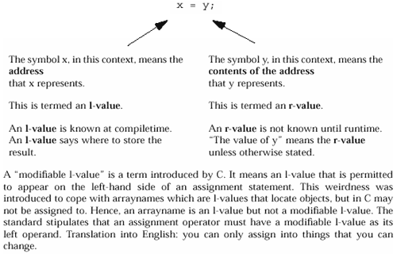
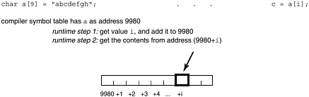
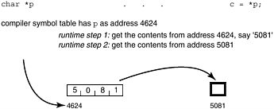
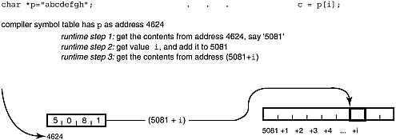

# Chương 4. Sự thật gây sốc: Array và pointer C KHÔNG giống nhau!

Array index nên bắt đầu 0 hay 1? Phương án dung hòa 0.5 của tôi bị bác bỏ mà, theo tôi, chưa được cân nhắc đúng mức.

—Stan Kelly-Bootle

array KHÔNG phải pointer…sao code không chạy?…declaration là gì? definition là gì?…khớp declaration với definition…khác biệt array, pointer…giải trí nhẹ nhàng — vui với palindrome!

## Array KHÔNG phải pointer!

Điều đầu người mới C thường nghe là "array giống pointer". Tiếc là half-truth nguy hiểm. Chuẩn ANSI C đoạn 6.5.4.2 khuyên bạn

chú ý phân biệt declaration:

```
extern int *x;
extern int y[];
```

Cái đầu khai báo `x` là pointer tới `int`; cái sau khai báo `y` là array `int` kích thước chưa xác định (incomplete type), storage định nghĩa nơi khác.

Chuẩn không đi sâu hơn. Quá nhiều sách C lướt khi nào array tương đương pointer, khi nào không, đẩy giải thích xuống chú thích trong khi đáng là tiêu đề chương. Sách này khôi phục cân bằng bằng giải thích đầy đủ khi tương đương, khi không và vì sao. Còn bảo đảm nhấn mạnh bằng tiêu đề, không chú thích.

## Sao code của tôi không chạy?

Nếu được mười xu mỗi lần ai mang chương trình như sau phàn nàn "không chạy", tôi sẽ có, ừ, xem nào, khoảng two-fifty. File 1:

```
int mango[100];
```

File 2:

```
extern int *mango;
...
/* some code that references mango[i] */
```

File 1 định nghĩa `mango` là array, file 2 khai báo pointer. Sai gì? Dù sao "ai cũng biết" array, pointer gần như giống trong C. Vấn đề "ai cũng" sai! Như nhầm integer với float:

File 1:

```
int guava;
```

File 2:

```
extern float guava;
```

Ví dụ `int`, `float` rõ ràng type mismatch nghiêm trọng, không ai mong chạy. Sao nghĩ pointer, array luôn đổi lẫn hoàn toàn được? Vì array reference luôn viết lại thành pointer reference, có context pointer, array definition tương đương. Tiếc context này liên quan cách dùng array rất phổ biến, nên người ta khái quát mọi trường hợp, gồm "định nghĩa array/khai báo ngoài pointer" sai rành rành trên.

## Declaration là gì? Definition là gì?

Trước khi tìm gốc vấn đề, cần ôn thuật ngữ C thiết yếu. Object trong C phải đúng một definition, có thể nhiều external declaration. Nhân tiện không có mumbo-jumbo C++ — "object" là "thứ" C linker biết, như function hay data item.

Definition là declaration đặc biệt tạo object; declaration chỉ tên để tham chiếu object tạo ở đây hoặc nơi khác. Ôn thuật ngữ:

definition chỉ xuất hiện một nơi, chỉ định type object; dành storage; dùng tạo

object mới

ví dụ: `int my_array[100];`

declaration có thể xuất hiện nhiều lần, mô tả type object; dùng tham chiếu object định nghĩa

nhiều lần

ở nơi khác (như file khác)

ví dụ: `extern int my_array[];`

### Mẹo thực hành hữu ích


Phân biệt definition với declaration

Phân biệt bằng nhớ:

Declaration giống tờ khai hải quan:

không phải chính thứ đó, chỉ mô tả hành lý bạn nói có đâu đó. Definition là loại declaration đặc biệt xác lập storage cho object.

Declaration external object nói compiler type, name và allocation memory ở nơi khác. Vì không allocation cho array lúc này, không cần tổng kích thước. Phải cho size mọi dimension trừ trái nhất — đủ thông tin tạo indexing code.

## Cách truy cập array và pointer

Phần này chỉ khác biệt tham chiếu bằng array và pointer. Đầu tiên phân biệt address y và contents of address y. Khá tinh tế vì phần lớn ngôn ngữ dùng cùng symbol cho cả hai, compiler suy từ context. Xem assignment đơn giản Hình 4-1.

Hình 4-1. Khác biệt address (l-value) và nội dung

address (r-value)



Symbol trái assignment đôi khi gọi l-value ("left-hand-side" hoặc "locator" value), symbol phải gọi r-value ("right-hand-side"). Compiler allocation address (l-value) cho mỗi variable. Address biết lúc compiletime, nơi giữ variable runtime. Ngược lại value lưu runtime (r-value) không biết đến runtime. Cần value thì compiler phát code đọc từ address cho trước vào register.

Điểm chính là address mỗi symbol biết compiletime. Nếu cần làm với address (như thêm offset), compiler làm trực tiếp, không cần code lấy address trước. Ngược lại current value pointer phải lấy runtime trước dereference (thành phần look-up tiếp). Sơ đồ A cho array reference.

Hình A. Array reference có subscript



Vì vậy viết `extern char` `a[];` hay `extern` `char` `a[100];` đều được. Cả hai chỉ a là array, memory location tìm được character. Compiler không cần tổng chiều dài vì chỉ tạo offset từ đầu. Lấy character bằng thêm subscript vào address symbol table cho `a`, lấy nội dung chỗ đó. Ngược lại khai báo `extern char` `*p` nói p là pointer (object four-byte trên nhiều máy hiện nay), object trỏ là character. Lấy char phải lấy nội dung address p, dùng nó làm address rồi lấy nội dung đó. Pointer access linh hoạt hơn, đổi lại thêm fetch instruction, như Sơ đồ B.

Hình B. Pointer reference



### Khi "định nghĩa pointer/tham chiếu array" thì sao

Nay thấy vấn đề khi external array định nghĩa pointer, tham chiếu array. Memory reference gián tiếp cho pointer (Sơ đồ B) diễn ra khi thực sự muốn trực tiếp (Sơ đồ A). Vì đã bảo compiler có pointer, như Sơ đồ C.

Hình C. Pointer reference có subscript



So truy cập Sơ đồ C trang 101

```
char * p = "abcdefgh"; ... p[3]
```

với Sơ đồ A trang 99

```
char a[] = "abcdefgh"; ... a[3]
```

Cả hai lấy character `'d'`, nhưng look-ups rất khác.

Viết `extern char` `*p,` rồi tham chiếu `p[3]` thực chất kết hợp A, B. Tham chiếu gián tiếp như sơ đồ 2 rồi tiến offset subscript như sơ đồ 1. Chính thức hơn, compiler phát code:

1\. Lấy address p biểu diễn, lấy pointer tại đó.

2\. Thêm offset subscript vào pointer value.

3\. Truy cập byte ở address kết quả.

Compiler được bảo p là pointer char. (Array definition nói p là chuỗi char.) Tham chiếu `p[i]` nói "từ nơi p trỏ, tiến 'i' thứ, mỗi thứ một char (1 byte)". Pointer tới type khác (`int`, `double`, v.v.) có scaling factor (size mỗi thứ) số byte khác.

Vì khai báo p pointer, look-up theo cách này bất kể ban đầu định nghĩa pointer (đúng) hay array (sai). Xét external declaration `extern char *p;` nhưng definition `char p[10];`. Lấy nội dung `p[i]` bằng extern, nhận character nhưng coi pointer. Diễn giải ASCII character thành address là rác; may thì chương trình coredump ở đó. Không may làm hỏng thứ trong address space, gây lỗi bí ẩn sau.

## Khớp declaration với definition

External declaration pointer không khớp array definition dễ sửa — đổi declaration cho khớp như:

File 1:

```
int mango[100];
```

File 2:

```
extern int mango[];
...
/* some code that references mango[i] */
```

Array definition `mango` allocation chỗ cho 100 integer. Ngược lại pointer definition:

```
int *raisin;
```

yêu cầu chỗ giữ pointer. Pointer tên `raisin`, trỏ được bất kỳ int (hay array int) ở đâu. Variable `raisin` luôn cùng address, nội dung đổi để trỏ int khác lúc khác. Mỗi int có value khác. Array `mango` không di chuyển nơi khác; lúc khác điền value khác, nhưng luôn cùng 100 memory location liên tiếp.

## Khác biệt khác giữa array và pointer

Cách khác xem là so đặc tính như Bảng 4-1.

Bảng 4-1. Khác biệt array và pointer

| Pointer | Array |
|---|---|
| Giữ address data | Giữ data |
| Truy cập data gián tiếp: lấy nội dung pointer, nạp làm address ("L"), rồi lấy nội dung. <br> Nếu pointer có subscript `[i]`, thay bằng nội dung vị trí sau "L" 'i' đơn vị | Truy cập data trực tiếp: với a\[i\], lấy nội dung vị trí sau a i đơn vị. |
| Thường dùng cho dynamic data structure | Thường giữ số phần tử cố định cùng data type |
| Thường dùng với `malloc(), free()` | Allocation, deallocation ngầm |
| Thường trỏ data vô danh | Bản thân là named variable |

Cả array, pointer đều khởi tạo bằng literal string trong definition được. Dù trông giống, việc khác xảy ra.

Pointer definition không allocation chỗ cho thứ trỏ, chỉ pointer, trừ khi gán literal string. Ví dụ definition dưới còn tạo string literal:

```
char *p = "breadfruit";
```

Chỉ hoạt động với string literal. Không thể mong allocation cho float literal chẳng hạn:

```
float *pip = 3.141; /* Bzzt! won't compile */
```

String literal tạo bởi pointer initialization là read-only trong ANSI C; ghi qua p để đổi gây undefined behavior. Có implementation đặt literal trong text segment, bảo vệ permission read-only.

Array cũng khởi tạo string literal được:

```
char a[] = "gooseberry";
```

Khác pointer, array khởi tạo literal string ghi được. Character riêng sau thay được. Statement:

```
strncpy(a, "black", 5);
```

cho string trong array giá trị mới "`blackberry`".

Chương 9 bàn khi pointer, array tương đương, vì sao và hoạt động thế nào. Chương 10 nói array hocus-pocus nâng cao dựa pointer. Đến cuối chương đó, bạn quên về array còn nhiều hơn nhiều lập trình viên C từng biết.

Pointer là phần khó hiểu, áp dụng đúng nhất C, chỉ sau syntax declaration. Nhưng cũng quan trọng nhất. Lập trình viên C chuyên nghiệp phải thạo `malloc()` và pointer tới anonymous memory.

## Giải trí nhẹ nhàng — Vui với palindrome!

Palindrome là từ, cụm đọc ngược giống đọc xuôi, ví dụ "do geese see God?" (đáp: "O, no!"). Là trò giải trí phòng khách, câu hay nhất có nghĩa tương đối như lời cuối buồn Napoleon "Able was I, ere I saw Elba". Palindrome kinh điển khác nhắc nỗ lực cá nhân anh hùng xây kênh Panama: "A man, a plan, a canal—Panama!".

Nhưng dĩ nhiên cần hơn một người, một kế hoạch để làm kênh — Jim Saxe, nghiên cứu sinh computer science Carnegie-Mellon University, nhận thấy. Tháng 10 năm 1983, Jim nghịch palindrome Panama, mở rộng:

A man, a plan, a cat, a canal—Panama?

Jim đưa lên computer system cho nghiên cứu sinh khác thấy, cuộc đua bắt đầu!

Steve Smith tại Yale nhại bằng:

A tool, a fool, a pool—loopaloofaloota!

Vài tuần sau Guy Jacobson mở rộng toàn cảnh thành:

A man, a plan, a cat, a ham, a yak, a yam, a hat, a canal—Panama!

Nay người ta thật sự quan tâm palindrome Panama! Dan Hoey mới tốt nghiệp viết chương trình C tìm, dựng tuyệt phẩm sau:

A man, a plan, a caret, a ban, a myriad, a sum, a lac, a liar, a hoop, a

pint, a catalpa, a gas, an oil, a bird, a yell, a vat, a caw, a pax, a wag,

a tax, a nay, a ram, a cap, a yam, a gay, a tsar, a wall, a car, a luger, a

ward, a bin, a woman, a vassal, a wolf, a tuna, a nit, a pall, a fret, a

watt, a bay, a daub, a tan, a cab, a datum, a gall, a hat, a fag, a zap, a say, a jaw, a lay, a wet, a gallop, a tug, a trot, a trap, a tram, a torr, a

caper, a top, a tonk, a toll, a ball, a fair, a sax, a minim, a tenor, a

bass, a passer, a capital, a rut, an amen, a ted, a cabal, a tang, a sun, an

ass, a maw, a sag, a jam, a dam, a sub, a salt, an axon, a sail, an ad, a

wadi, a radian, a room, a rood, a rip, a tad, a pariah, a revel, a reel, a

reed, a pool, a plug, a pin, a peek, a parabola, a dog, a pat, a cud, a nu,

a fan, a pal, a rum, a nod, an eta, a lag, an eel, a batik, a mug, a mot, a

nap, a maxim, a mood, a leek, a grub, a gob, a gel, a drab, a citadel, a

total, a cedar, a tap, a gag, a rat, a manor, a bar, a gal, a cola, a pap, a

yaw, a tab, a raj, a gab, a nag, a pagan, a bag, a jar, a bat, a way, a

papa, a local, a gar, a baron, a mat, a rag, a gap, a tar, a decal, a tot, a

led, a tic, a bard, a leg, a bog, a burg, a keel, a doom, a mix, a map, an

atom, a gum, a kit, a baleen, a gala, a ten, a don, a mural, a pan, a faun,

a ducat, a pagoda, a lob, a rap, a keep, a nip, a gulp, a loop, a deer, a

leer, a lever, a hair, a pad, a tapir, a door, a moor, an aid, a raid, a

wad, an alias, an ox, an atlas, a bus, a madam, a jag, a saw, a mass, an

anus, a gnat, a lab, a cadet, an em, a natural, a tip, a caress, a pass, a

baronet, a minimax, a sari, a fall, a ballot, a knot, a pot, a rep, a

carrot, a mart, a part, a tort, a gut, a poll, a gateway, a law, a jay, a

sap, a zag, a fat, a hall, a gamut, a dab, a can, a tabu, a day, a batt, a

waterfall, a patina, a nut, a flow, a lass, a van, a mow, a nib, a draw, a

regular, a call, a war, a stay, a gam, a yap, a cam, a ray, an ax, a tag, a

wax, a paw, a cat, a valley, a drib, a lion, a saga, a plat, a catnip, a

pooh, a rail, a calamus, a dairyman, a bater, a canal—Panama. "Catalpa" (nếu thắc mắc) là từ bản địa Mỹ chỉ loại cây. Tự tra axon, calamus nhé. Dan nói chút công cải thiện search algorithm có thể làm dài gấp vài lần.

Search algorithm tài tình — Dan lập finite state machine đánh giá chuỗi palindrome từng phần. Mỗi trạng thái gồm phần chưa khớp. Từ palindrome gốc, thấy "a ca" của "a canal" ngay giữa, nên thêm gì sau "a plan" cũng được miễn đảo ngược thành từ hoặc part-word khi đặt sau đó.

Để thêm từ sau "a plan", bắt đầu nhân đôi "a ca" giữa. Có "…, a plan, a ca… a canal,…". Dừng ngay nếu "ca" là từ, nhưng không. Tìm thứ hoàn chỉnh mảnh trái rồi thêm cùng thứ ngược phải, như "ret … ter."

Mỗi bước phần cuối từ thêm đảo ngược, thành phần đầu từ tiếp cần tìm. Bảng 4-2 cho quá trình:

Bảng 4-2. Dựng palindrome

| Trạng thái "-aca": | "A man, a plan, ... a canal, Panama" |
|---|---|
| Trạng thái "ret-": | "... a plan, a caret, ... a canal, Panama" |
| Trạng thái "-aba": | "... a plan, a caret, ... a bater, a canal, ..." |
| Trạng thái "n-": | "... a caret, a ban, ... a bater, a canal, ..." |
| Trạng thái "-adairyma": | "... a caret, a ban, ... a dairyman, a bater, ..." |
| Trạng thái "-a": | "... a ban, a myriad, ... a dairyman, a bater, ..." |

Accepting state của finite state machine là nơi phần chưa khớp tự palindromic. Nghĩa là lúc nào từ vừa chọn tự là palindrome, dừng được. Ở đây "… a nag, a pagan, …" ở giữa, thêm "-apa-" kết thúc thuật toán.

Dan dùng word list nhỏ chỉ noun. Không vậy sẽ có nhiều "a how, a running, a would, an expect, an and..." vô nghĩa. Cách khác là dictionary on-line thật (không chỉ word list), chỉ từ nào noun. Có thể tạo palindrome rất lớn. Nhưng Dan nói "nếu có palindrome 10.000 từ, không biết ai muốn. Tôi thích cái này vì nhỏ đủ truyền nhau. Tôi đã làm xong rồi." Không cãi được!

### Thử thách lập trình


Viết palindrome

Nhận 15 phút nổi tiếng: viết C program tạo palindrome 10,000-word đó. Muốn thật nổi thì đăng rec.arts.startrek.misc trên Usenet. Họ chán bàn tên đệm Captain Kirk, thích nghe trò mới.
