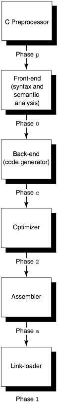
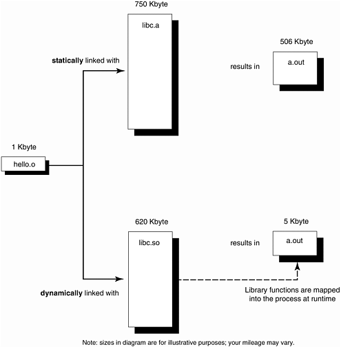
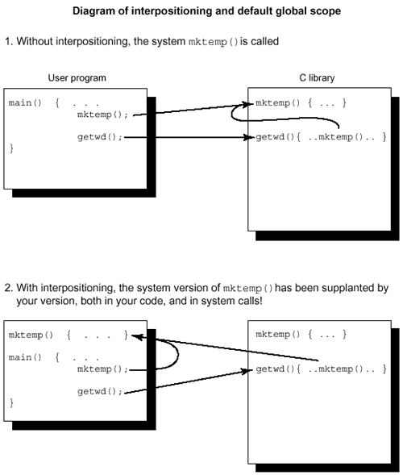

# Chương 5. Suy nghĩ về linking

Như tờ Pall Mall Gazette mô tả vào ngày 11 tháng 3 năm 1889: "Ông Thomas Edison đã thức suốt hai đêm vừa qua để tìm ra một 'bug' trong máy hát phonograph của mình."

—Thomas Edison phát hiện bug, 1878

Computer system tiên phong Harvard Mark II có một cuốn nhật ký hiện được lưu tại National Museum of American History thuộc Smithsonian. Trong mục nhật ký ngày 9 tháng 9 năm 1947, người ta dán lên trang giấy xác một con côn trùng đã bay vào một switch và mắc kẹt ở đó. Nhãn ghi: "Relay #70 Panel F (bướm đêm) trong relay." Bên dưới có dòng: "Trường hợp đầu tiên thực sự tìm thấy bug."

—Grace Hopper phát hiện bug, 1947

Ngay khi bắt đầu lập trình, chúng tôi đã ngạc nhiên nhận ra rằng làm cho chương trình hoạt động đúng không dễ như mình từng nghĩ. Người ta phải khám phá ra debugging. Tôi vẫn nhớ chính xác khoảnh khắc nhận ra rằng, từ đó trở đi, một phần lớn cuộc đời mình sẽ dành cho việc tìm lỗi trong chính các chương trình của mình.

—Maurice Wilkes phát hiện bug, 1949

Việc kiểm thử chương trình có thể cho thấy sự hiện diện của bug, nhưng không bao giờ có thể chứng minh rằng chúng không tồn tại.

—Edsger W. Dijkstra phát hiện bug, 1972

linking, library và loading…vị trí của linker trong các giai đoạn compilation…những lợi ích của dynamic linking…năm bí mật đặc biệt về linking với library…hãy cẩn thận với interpositioning…đừng dùng những tên này cho identifier của bạn…tạo linker report file…giải trí nhẹ nhàng — xem ai đang nói: thách thức Turing test

## Library, linking và loading

Hãy bắt đầu bằng cách ôn lại những kiến thức cơ bản về linker: compiler tạo ra một output file chứa các relocatable object. Những object này là dữ liệu và machine instruction tương ứng với các source program. Chương này lấy dạng linking tinh vi có trên mọi hệ thống SVR4 làm ví dụ.

### Linker ở đâu trong các giai đoạn compilation

Phần lớn compiler không phải là một chương trình khổng lồ duy nhất. Chúng thường gồm tới half-a-dozen chương trình nhỏ hơn, được gọi bởi một chương trình điều khiển có tên "compiler driver". Những thành phần có thể thuận tiện tách thành chương trình riêng gồm preprocessor, bộ kiểm tra cú pháp và ngữ nghĩa, code generator, assembler, optimizer, linker và dĩ nhiên một driver program để gọi tất cả những thành phần này và truyền đúng option cho từng phần (xem Hình 5-1). Có thể thêm optimizer sau gần như bất kỳ giai đoạn nào trong số đó. Các SPARCompiler hiện tại thực hiện phần lớn việc tối ưu trên intermediate representation nằm giữa front end và back end của compiler.

Hình 5-1. Compiler thường chia thành chương trình nhỏ



Chúng được viết thành nhiều phần vì việc thiết kế và bảo trì sẽ dễ hơn nếu mỗi phần chuyên biệt là một chương trình riêng. Chẳng hạn, các quy tắc điều khiển preprocessing chỉ dành cho giai đoạn đó và có ít điểm chung với phần còn lại của C. C preprocessor thường, nhưng không phải lúc nào cũng, là một chương trình riêng. Nếu code generator, còn gọi là "back end", được viết thành một chương trình stand-alone, có lẽ nó có thể dùng chung cho các ngôn ngữ khác. Sự trade-off là chạy nhiều chương trình nhỏ sẽ mất thời gian hơn chạy một chương trình lớn, do overhead khởi tạo process và truyền thông tin giữa các giai đoạn. Bạn có thể xem từng giai đoạn compilation bằng option -#. Option -V cung cấp thông tin phiên bản.

Bạn có thể truyền option cho từng giai đoạn bằng cách cung cấp cho compiler-driver một option -W đặc biệt, có nghĩa là "chuyển option này đến giai đoạn đó". Theo sau "W" là một character chỉ giai đoạn, một dấu phẩy, rồi đến option. Các character biểu diễn từng giai đoạn được liệt kê trong Hình 5-1.

Vì vậy, để truyền bất kỳ option nào qua compiler driver tới linker, bạn phải thêm tiền tố "-Wl," để thông báo cho compiler driver rằng option này dành cho link editor, thay vì preprocessor, compiler, assembler hay một giai đoạn compilation khác. Lệnh

```
cc -Wl,-m main.c > main.linker.map
```

sẽ truyền option "-m" cho ld, yêu cầu nó tạo linker map. Bạn nên thử một hoặc hai lần để xem loại thông tin được tạo ra.

Object file không thể thực thi trực tiếp; trước hết nó phải được đưa vào linker. Linker xác định routine main là initial entry point, tức nơi bắt đầu thực thi, gắn symbolic reference với địa chỉ memory, hợp nhất tất cả object file và kết hợp chúng với các library để tạo ra executable.

Có sự khác biệt lớn giữa các phương tiện linking trên PC và trên những hệ thống lớn hơn. PC thường chỉ cung cấp một số ít dịch vụ I/O cơ bản, được gọi là các routine `BIOS`. Chúng nằm ở vị trí cố định trong memory và không phải là một phần của từng executable. Nếu một chương trình hoặc bộ chương trình PC cần những dịch vụ phức tạp hơn, các dịch vụ đó có thể được cung cấp trong một library, nhưng người triển khai phải link library vào từng executable. MS-DOS không cung cấp cơ chế "tách riêng" một library dùng chung cho nhiều chương trình và chỉ cài nó một lần trên PC.

Các hệ thống UNIX trước đây cũng như vậy. Khi link một chương trình, một bản sao của mỗi library routine được sử dụng sẽ được đưa vào executable. Trong những năm gần đây, một mô hình hiện đại và ưu việt hơn, gọi là dynamic linking, đã được áp dụng. Dynamic linking cho phép hệ thống cung cấp một tập hợp lớn các library với nhiều dịch vụ hữu ích, nhưng chương trình sẽ tìm chúng tại runtime thay vì gắn các binary của library vào executable. Operating system OS/2 của IBM có dynamic linking, cũng như operating system chủ lực mới NT của Microsoft. Trong những năm gần đây, Microsoft Windows<sup>®</sup> cũng bổ sung khả năng này cho phần giao diện cửa sổ của các ứng dụng PC.

Nếu một bản sao của các library thực sự nằm trong executable, ta nói executable đã được statically linked; nếu executable chỉ chứa các filename cho phép loader tìm những library reference của chương trình tại runtime, ta nói nó đã được dynamically linked. Tên chuẩn của ba giai đoạn tập hợp module và chuẩn bị thực thi là link-editing, loading và runtime linking. Module được statically linked sẽ được link edit rồi load để chạy. Module được dynamically linked sẽ được link-edited, sau đó được load và runtime-linked để chạy. Khi thực thi, trước khi gọi `main()`, runtime loader đưa các shared data object vào process address space. Nó chưa resolve các external function call cho tới khi lời gọi thực sự được thực hiện, nên việc link với một library mà bạn có thể không gọi tới sẽ không gây thêm chi phí xử lý tương ứng. Hai phương thức linking được so sánh trong Hình 5-2.

Hình 5-2. Static linking và dynamic linking



Ngay cả với static linking, cũng chỉ những routine cần thiết của libc. a được đưa vào executable, chứ không phải toàn bộ library.

## Lợi ích dynamic linking

Dynamic linking là phương pháp hiện đại hơn và có ưu điểm là kích thước executable nhỏ hơn nhiều. Dynamic linking đánh đổi một chút chi phí tại runtime để sử dụng disk hiệu quả hơn và rút ngắn giai đoạn link-edit, vì một phần công việc của linker được hoãn đến loadtime.

### Mẹo thực hành hữu ích


Một mục đích dynamic linking là ABI

Một mục đích chủ yếu của dynamic linking là tách sự phụ thuộc của chương trình khỏi những phiên bản library cụ thể mà nó sử dụng. Thay vào đó, chúng ta có quy ước rằng hệ thống cung cấp một interface cho chương trình và interface này ổn định theo thời gian cũng như qua các bản phát hành OS liên tiếp.

Chương trình có thể gọi những dịch vụ mà interface cam kết cung cấp mà không phải lo chúng được cung cấp như thế nào hoặc implementation bên dưới có thể thay đổi ra sao. Vì đây là interface giữa các application program và những dịch vụ do các binary executable của library cung cấp, chúng ta gọi nó là Application Binary Interface, hay ABI.

Một ABI thống nhất là mục đích của việc hợp nhất thế giới UNIX quanh SVr4 của AT\&T. ABI bảo đảm các library tồn tại trên mọi máy tuân thủ chuẩn và bảo đảm tính toàn vẹn của interface. Có bốn library cụ thể bắt buộc phải dùng dynamic linking: libc (C runtime), libsys (các system runtime khác), libX (X windowing) và libnsl (dịch vụ networking). Các library khác có thể được statically linked, nhưng dynamic linking vẫn được khuyến khích mạnh mẽ.

Trước đây, các nhà cung cấp ứng dụng phải relink phần mềm của họ với mỗi bản phát hành OS hoặc library mới. Điều này gây ra một khối lượng công việc bổ sung khổng lồ cho tất cả các bên liên quan. ABI loại bỏ yêu cầu đó và bảo đảm những ứng dụng well-behaved sẽ không bị ảnh hưởng bởi những bản nâng cấp well-behaved của system software bên dưới.

Mặc dù mỗi executable riêng lẻ có chi phí start-up lớn hơn một chút, dynamic linking cải thiện hiệu năng tổng thể theo hai cách:

1\. Một executable được dynamically linked nhỏ hơn executable tương ứng được statically linked. Nó tiết kiệm disk và virtual memory vì library chỉ được map vào process khi cần. Trước đây, cách duy nhất để tránh gắn một bản sao library vào mỗi executable là đưa dịch vụ vào kernel thay vì library, góp phần tạo ra hiện tượng "kernel bloat" đáng sợ.

2\. Mọi executable được dynamically linked với một library cụ thể đều chia sẻ một bản sao duy nhất của library tại runtime. Kernel bảo đảm các library được map vào memory được chia sẻ giữa tất cả process sử dụng chúng. Điều này giúp sử dụng I/O và swap space hiệu quả hơn, tiết kiệm physical memory và tăng system throughput tổng thể. Nếu các executable được statically linked, mỗi executable sẽ chứa một bản sao đầy đủ riêng của library một cách lãng phí.

Ví dụ, nếu bạn chạy tám ứng dụng XView™, chỉ một bản sao text segment của XView library cần được map vào memory. Lời gọi mmap <sup>\[1\]</sup> của process đầu tiên sẽ khiến kernel map shared object vào memory. Các lời gọi mmap của bảy process tiếp theo sẽ khiến kernel chia sẻ mapping hiện có trong từng process. Cả tám process sẽ cùng chia sẻ một bản sao XView library trong memory. Nếu library được statically linked, tám bản sao riêng biệt sẽ tiêu tốn thêm physical memory và gây ra nhiều paging hơn.

<sup>\[1\]</sup> System call `mmap()` map một file vào process address space. Sau đó có thể lấy nội dung file bằng cách đọc các vị trí memory liên tiếp. Điều này đặc biệt phù hợp khi file chứa các instruction có thể thực thi. Trong SVr4, file system được xem là một phần của virtual memory system, và mmap là cơ chế đưa một file vào memory.

Dynamic linking giúp quản lý phiên bản library dễ dàng. Có thể phân phối những library mới; sau khi chúng được cài trên hệ thống, các chương trình cũ tự động hưởng lợi từ phiên bản mới mà không cần relink. Cuối cùng, dù ít phổ biến hơn nhiều nhưng vẫn có thể thực hiện được, dynamic linking cho phép người dùng chọn tại runtime library mà chương trình sẽ chạy cùng. Có thể tạo những phiên bản library được tối ưu cho tốc độ, hiệu quả sử dụng memory hoặc chứa thêm thông tin debugging, rồi cho người dùng thể hiện lựa chọn của mình khi thực thi bằng cách thay file library này bằng file library khác.

Dynamic linking là linking theo kiểu "just-in-time". Điều này có nghĩa là chương trình phải có khả năng tìm được các library của nó tại runtime. Linker thực hiện điều đó bằng cách đưa filename hoặc pathname của library vào executable; vì vậy, không thể di chuyển library hoàn toàn tùy ý. Nếu đã link chương trình với library `/usr/lib/libthread.so`, bạn không thể chuyển library sang thư mục khác trừ khi đã chỉ định thư mục đó cho linker. Nếu không, chương trình sẽ thất bại tại runtime khi gọi một function trong library, với thông báo lỗi như sau:

```
ld.so.1: main: fatal: libthread.so: can't open file: errno=2
```

Điều này cũng là một vấn đề khi bạn thực thi trên máy khác với máy đã dùng để compile. Máy thực thi phải có tất cả library mà bạn đã link cùng, và chúng phải nằm trong những thư mục mà bạn đã thông báo cho linker. Với các system library chuẩn, điều này không phải là vấn đề.

Lý do chính để dùng shared library là hưởng lợi từ ABI: giải phóng phần mềm của bạn khỏi yêu cầu compile lại với mỗi bản phát hành library hoặc OS mới. Một lợi ích bổ sung là hiệu năng tổng thể của hệ thống cũng được cải thiện.

Bất kỳ ai cũng có thể tạo static library hoặc dynamic library. Bạn chỉ cần compile một ít code không có routine main, rồi xử lý các file .o thu được bằng utility thích hợp: "ar" cho static library hoặc "ld" cho dynamic library.

#### Giáo điều software


Chỉ dùng dynamic linking!

Dynamic linking hiện là lựa chọn mặc định trên các máy chạy UNIX System V release 4 và luôn nên được sử dụng. Về mặt chức năng, static linking hiện đã lỗi thời và nên được để yên nghỉ.

Rủi ro lớn nhất khi dùng static linking là các phiên bản operating system trong tương lai có thể không tương thích với những system library được gắn vào executable của bạn. Nếu ứng dụng được statically linked trên OS phiên bản N rồi bạn thử chạy nó trên phiên bản N+1, nó có thể chạy được, hoặc thất bại với core dump hay một lỗi ít rõ ràng hơn.

Không có gì bảo đảm rằng một phiên bản system library cũ sẽ thực thi đúng trên phiên bản hệ thống mới hơn. Thực tế, thường an toàn hơn nếu giả định điều ngược lại. Tuy nhiên, nếu ứng dụng được dynamically linked trên phiên bản N của hệ thống, nó sẽ lấy đúng các library phiên bản N+1 khi chạy trên hệ thống phiên bản N+1. Ngược lại, các ứng dụng được statically linked phải được tạo lại cho mỗi bản phát hành operating system mới để bảo đảm chúng tiếp tục chạy.

Hơn nữa, một số library (chẳng hạn libaio.so, libdl.so, libsys.so, libresolv.so và librpcsvc.so) chỉ có ở dạng dynamic. Bạn buộc phải link dynamically nếu ứng dụng dùng bất kỳ library nào trong số đó. Chính sách tốt nhất là tránh vấn đề bằng cách bảo đảm mọi ứng dụng đều được dynamically linked.

Static library được gọi là archive và được tạo cũng như cập nhật bằng utility `ar`, viết tắt của archive. Utility `ar` được đặt tên không chính xác; nếu nguyên tắc quảng cáo đúng sự thật áp dụng cho phần mềm, nó thực sự phải mang tên như `glue_files_together` hoặc thậm chí `static_library_updater`. Theo quy ước, filename của static library có phần mở rộng ".a". Ở đây không có ví dụ tạo static library vì hiện chúng đã lỗi thời, và chúng tôi không muốn khuyến khích ai giao tiếp với thế giới linh hồn.

Từng có một kiểu linking trung gian được dùng trong SVR3, nằm giữa static linking và dynamic linking, gọi là "static shared libraries". Địa chỉ của chúng được cố định suốt vòng đời, nhờ đó có thể bind trực tiếp mà không cần bước gián tiếp như dynamic linking. Mặt khác, chúng thiếu linh hoạt và cần nhiều hỗ trợ đặc biệt từ hệ thống. Chúng ta sẽ không xem xét chúng thêm.

Dynamically linked library được tạo bởi link editor, `ld`. Phần mở rộng file theo quy ước của dynamic library là ".so", nghĩa là "shared object": mọi chương trình link với library này cùng chia sẻ một bản sao, trái với static linking, trong đó mỗi chương trình được cấp riêng một bản sao nội dung library một cách lãng phí. Ở dạng đơn giản nhất, có thể tạo dynamic library bằng option -G của cc như sau:

```
% cat tomato.c
    my_lib_function() {printf("library routine called\n"); }

% cc -o libfruit.so -G tomato.c
```

Sau đó bạn có thể viết những routine sử dụng library này và link với nó theo cách sau:

```
% cat test.c
    main() { my_lib_function(); }

% cc test.c -L/home/linden -R/home/linden -lfruit
% a.out
library routine called
```

Các option `-L/home/linden -R/home/linden` lần lượt cho linker biết những thư mục cần tìm library tại linktime và runtime.

Có lẽ bạn cũng muốn dùng compiler option `-K pic` để tạo position-independent code cho các library. Position-independent code có nghĩa là code được sinh ra bảo đảm mọi truy cập global data đều qua thêm một bước gián tiếp. Nhờ đó, có thể dễ dàng relocate dữ liệu chỉ bằng cách thay đổi một giá trị trong global offset table. Tương tự, mọi function call đều được sinh thành lời gọi qua một địa chỉ gián tiếp trong procedure linkage table. Vì vậy, text có thể dễ dàng relocate tới bất kỳ đâu chỉ bằng cách sửa các offset table. Khi code được map vào tại runtime, runtime linker có thể đặt nó trực tiếp ở bất kỳ đâu còn chỗ mà không phải thay đổi chính code.

Theo mặc định, compiler không sinh PICode vì việc dereference pointer bổ sung làm chương trình chậm hơn một chút tại runtime. Tuy nhiên, nếu không dùng PICode, code được sinh ra sẽ gắn với một địa chỉ cố định: điều này phù hợp cho executable nhưng chậm hơn cho shared library, vì lúc này mọi global reference đều phải được sửa tại runtime bằng cách sửa page, khiến page đó không thể chia sẻ được nữa.

Dù thế nào runtime linker cũng sẽ sửa các page reference, nhưng công việc đơn giản hơn nhiều với position-independent code. Việc PICode nhanh hay chậm hơn so với để runtime linker sửa code là một sự trade-off. Quy tắc kinh nghiệm là luôn dùng PICode cho library. Position-independent code đặc biệt hữu ích cho shared library vì mỗi process sử dụng shared library thường map nó tại một virtual address khác nhau, dù chúng chia sẻ một bản sao vật lý.

Một thuật ngữ liên quan là "pure code". Pure executable là executable chỉ chứa code, không chứa static data hay initialized data. Nó "pure" theo nghĩa không cần bị sửa đổi để được thực thi bởi bất kỳ process cụ thể nào. Nó tham chiếu dữ liệu trên stack hoặc từ một segment khác không pure. Pure code segment có thể chia sẻ được. Nếu đang sinh PIcode, tức hướng tới khả năng chia sẻ, thường bạn cũng muốn nó pure.

## Năm bí mật đặc biệt linking library

Có năm quy ước thiết yếu nhưng non-obvious mà bạn cần nắm vững khi sử dụng library. Phần lớn sách hoặc tài liệu hướng dẫn C không giải thích chúng rõ ràng, có lẽ vì người viết tài liệu ngôn ngữ xem linking là một phần của operating system xung quanh, còn những người làm operating system lại xem linking là một phần của ngôn ngữ. Kết quả là không ai đề cập quá sơ lược đến nó, trừ khi có người trong nhóm linker tham gia! Sau đây là những điều thực tế thiết yếu về linking trên UNIX:


1\. Dynamic library gọi `lib` `something` `.so`, static library `lib` `something` `.a`

Theo quy ước, mọi dynamic library có filename dạng `libname` `.so` (có thể nối thêm số phiên bản vào tên). Vì vậy, library chứa các thread routine được gọi là `libthread` `.so`. Static archive có filename dạng libname.a. Shared archive, với tên dạng `libname` `.sa`, là một hiện tượng tạm thời nhằm hỗ trợ việc chuyển từ static library sang dynamic library. Shared archive hiện cũng đã lỗi thời.

2\. Bảo compiler link chẳng hạn `libthread.so` bằng option `-lthread`

Command line argument truyền cho C compiler không nêu toàn bộ pathname tới file library. Nó thậm chí không nêu đầy đủ tên file trong thư mục library! Thay vào đó, compiler được yêu cầu link với một library bằng command line option `-lname`, trong đó library mang tên `libname` `.so`; nói cách khác, phần "`lib`" và phần mở rộng file được bỏ đi, còn `-l` được ghép vào đầu tên.

3\. Compiler mong đợi tìm library trong những thư mục nhất định. Đến đây, có thể bạn tự hỏi compiler biết phải tìm library trong thư mục nào bằng cách nào. Giống như có các quy tắc riêng về nơi tìm header file, compiler cũng tìm library tại một vài vị trí đặc biệt như `/usr/lib/`. Chẳng hạn, thread library nằm tại `/usr/lib/libthread.so`.

Compiler option `-Lpathname` được dùng để thông báo cho linker một danh sách các thư mục khác cần tìm các library đã chỉ định bằng option `-l`. Hai environment variable `LD_LIBRARY_PATH` và `LD_RUN_PATH,` cũng có thể cung cấp thông tin này. Việc dùng những environment variable đó hiện chính thức không được khuyến khích vì lý do bảo mật, hiệu năng và tính độc lập giữa build và execute. Thay vào đó, hãy dùng các option `-Lpathname` `-Rpathname` tại linktime.

4\. Nhận diện library qua header file đã dùng

Một câu hỏi then chốt khác có thể nảy ra là: "Làm sao biết tôi phải link với những library nào?" Câu trả lời, phỏng theo lời Obi-Wan Kenobi trong Star Wars, là: "Hãy dùng source, Luke!" Nếu xem source của chương trình, bạn sẽ thấy những routine mà mình gọi nhưng không tự triển khai. Chẳng hạn, nếu chương trình làm tính toán lượng giác, có lẽ bạn đã gọi các routine như `sin()` hoặc `cos()`, và chúng nằm trong math library. Các manpage cho biết chính xác argument type mà từng routine yêu cầu và cũng nên nêu library chứa nó.

Một gợi ý hữu ích là xem xét các `#include` mà chương trình sử dụng. Mỗi header file được include có thể tương ứng với một library mà bạn phải link cùng. Mẹo này cũng áp dụng cho C++. Tuy nhiên, ở đây xuất hiện một vấn đề lớn về tính thiếu nhất quán trong tên gọi: header file thường có tên chẳng giống chút nào với tên library tương ứng. Rất tiếc! Đây là một trong những điều bạn "buộc phải biết" để trở thành cao thủ C. Bảng 5-1 đưa ra một số ví dụ thường gặp.

Bảng 5-1. Quy ước library Solaris 2.x

| Filename trong `#include` | Pathname của library | Compiler option cần dùng |
|---|---|---|
| \<math.h\> | /usr/lib/libm.so | `-lm` |
| \<math.h\> | /usr/lib/libm.a | `-dn -lm` |
| \<stdio.h\> | /usr/lib/libc.so | được link tự động |
| "/usr/openwin/include/X11.h" | /usr/openwin/lib/libX11.so | `-L/usr/openwin/lib -lX11` |
| \<thread.h\> | /usr/lib/libthread.so | `-lthread` |
| \<curses.h\> | /usr/ccs/lib/libcurses.a | `-lcurses` |
| \<sys/socket.h\> | /usr/lib/libsocket.so | `-lsocket` |

Một điểm thiếu nhất quán khác là một library duy nhất có thể chứa các routine đáp ứng những prototype được khai báo trong nhiều header file. Chẳng hạn, các function được khai báo trong các header file `<string.h>`, `<stdio.h>` và `<time.h>` thường đều được cung cấp trong library duy nhất `libc.so`. Nếu không chắc, hãy dùng utility `nm` để liệt kê những routine mà library chứa. Mẹo tiếp theo sẽ nói thêm về điều này!

### Mẹo thực hành hữu ích


Khớp symbol với library thế nào

Nếu bạn đang cố link một chương trình và gặp lỗi kiểu sau:

```
ld: Undefined symbol
    _xdr_reference
*** Error code 2
make: Fatal error: Command failed for target 'prog'
```

Đây là cách xác định những library mà bạn cần link cùng. Ý tưởng cơ bản là dùng nm xem các symbol trong từng library ở /usr/lib, rồi dùng grep tìm những symbol đang thiếu. Theo mặc định, linker tìm trong /usr/ccs/lib và /usr/lib, và bạn cũng nên làm vậy. Nếu không có kết quả, hãy mở rộng tìm kiếm sang tất cả các thư mục library khác, chẳng hạn /usr/openwin/lib.

```
% cd /usr/lib
% foreach i (lib?*)
? echo $i
? nm $i | grep xdr_reference | grep -v UNDEF
? end
libc.so
libnsl.so
[2491] | 217028| 196|FUNC |GLOB |0 |8
|xdr_reference
libposix4.so
    ...
```

Đoạn lệnh này chạy "nm" trên từng library trong thư mục để liệt kê các symbol được biết đến trong library đó. Đưa output qua grep để chỉ giữ symbol đang tìm và loại các symbol được đánh dấu "`UNDEF`", tức được tham chiếu nhưng không được định nghĩa trong library này. Kết quả cho thấy `xdr_reference` nằm trong libnsl. Bạn cần thêm `-lnsl` vào cuối command line của compiler.

5\. Symbol từ static library được trích xuất theo cách hạn chế hơn symbol từ dynamic library. Cuối cùng, còn một khác biệt lớn trong link semantics giữa dynamic linking và static linking thường khiến người thiếu kinh nghiệm bối rối. Archive, tức static library, được xử lý khác với shared object, tức dynamic library. Với dynamic library, mọi symbol của library đều đi vào virtual address space của output file và đều sẵn có cho tất cả file khác tham gia link. Ngược lại, static linking chỉ tìm trong archive những undefined symbol mà loader đã biết tại thời điểm xử lý archive đó.

Nói đơn giản hơn, thứ tự của các statically linked library trên command line của compiler có ý nghĩa quan trọng. Linker rất khắt khe về vị trí và thứ tự nêu các library vì symbol được resolve từ trái sang phải. Điều này tạo ra khác biệt nếu cùng một symbol được định nghĩa theo những cách khác nhau trong hai library. Nếu cố tình làm như vậy, có lẽ bạn đã biết đủ để không cần được nhắc về những rủi ro.

Một vấn đề khác xảy ra nếu bạn đặt static library trước code của mình. Khi đó chưa có undefined symbol nào, nên không có gì được trích xuất. Sau đó, khi linker xử lý object file của bạn, tất cả library reference của nó đều không được đáp ứng! Mặc dù quy ước này đã tồn tại từ khi UNIX ra đời, nhiều người vẫn thấy bất ngờ; rất ít lệnh yêu cầu argument theo một thứ tự nhất định, và những lệnh có yêu cầu thường báo trực tiếp nếu bạn viết sai. Mọi người mới đều gặp khó khăn với khía cạnh linking này cho đến khi được giải thích khái niệm. Sau đó, họ chỉ còn gặp khó khăn với chính khái niệm ấy.

Vấn đề thường xuất hiện nhất khi ai đó link với math library. Math library được dùng rất nhiều trong các benchmark và ứng dụng, nên chúng ta muốn khai thác đến nanosecond hiệu năng runtime cuối cùng của nó. Vì thế, libm thường là một statically linked archive. Nếu chương trình của bạn dùng một số math routine như function `sin()` và bạn link statically như sau:

```
cc -lm main.c
```

bạn sẽ nhận được thông báo lỗi như sau:

```
Undefined                  first referenced
 symbol                       in file
 sin                           main.o
ld: fatal: Symbol referencing errors. No output
written to a.out
```

Để symbol được trích xuất từ math library, bạn cần đặt file chứa các unresolved reference trước, như sau:

```
cc main.c -lm
```

Điều này gây vô vàn lo lắng cho người không biết trước. Mọi người đã quen với dạng lệnh chung \<command\> \<options\> \<files\>, nên việc linker dùng quy ước khác là \<command\> \<files\> \<options\> rất dễ gây nhầm lẫn. Tình hình còn tệ hơn vì nó âm thầm chấp nhận dạng thứ nhất và làm sai. Có lúc, nhóm compiler của Sun đã sửa các compiler driver để xử lý tình huống này. Chúng tôi thay đổi các unbundled compiler driver của SunOS 4.x từ SC0.0 đến SC2.0.1 để chúng "làm điều đúng" nếu người dùng bỏ sót `-lm`. Mặc dù đó là điều đúng, nó khác với cách AT\&T làm và phá vỡ việc tuân thủ System V Interface Definition, nên hành vi cũ phải được khôi phục. Dù sao, từ SunOS 5.2 trở đi, một phiên bản dynamically linked của math library `/usr/lib/libm.so` đã được cung cấp.

#### Mẹo thực hành hữu ích


Đặt library option ở đâu

Luôn đặt các library option `-l` ở tận cùng bên phải command line compilation của bạn.

Những vấn đề tương tự cũng từng xuất hiện trên PC, nơi compiler driver của Borland cố đoán xem có cần link các floating-point library hay không. Đáng tiếc, đôi khi chúng đoán sai, dẫn tới lỗi:

```
scanf : floating point formats not linked
Abnormal program termination
```

Dường như chúng đoán sai khi chương trình dùng floating-point format trong `scanf()` hoặc `printf()` nhưng không gọi bất kỳ floating-point routine nào khác. Cách khắc phục là cung cấp thêm manh mối cho linker bằng cách khai báo một function như sau trong một module sẽ tham gia link:

```
static void forcefloat(float *p)
{ float f = *p; forcefloat(&f); }
```

Đừng thực sự gọi function này; chỉ cần bảo đảm nó được link vào. Điều này cung cấp một manh mối đủ rõ để Borland PC linker biết rằng floating-point library thực sự cần thiết.

Lưu ý: một thông báo tương tự, "floating point not loaded", được Microsoft C runtime system in ra khi phần mềm cần numeric coprocessor nhưng máy tính của bạn không được lắp bộ phận này. Bạn khắc phục bằng cách relink chương trình với floating-point emulation library.

## Cẩn thận interpositioning

Interpositioning (một số người gọi là "interposing") là việc thay một library function bằng một function user-written cùng tên. Kỹ thuật này chỉ dành cho những người thích mạo hiểm như đi bộ trên phần hoang dã của làn đường cao tốc mà không có lưới bảo vệ. Nó cho phép thay thế library function trong một chương trình cụ thể, thường vì mục đích debugging hoặc hiệu năng. Nhưng giống như khẩu súng không có chốt an toàn, tuy giúp chuyên gia đạt kết quả nhanh hơn, nó cũng khiến người mới rất dễ tự gây hại.

Interpositioning đòi hỏi hết sức thận trọng. Bạn rất dễ vô tình thay một symbol trong library bằng một definition khác trong code của mình. Không chỉ tất cả những lời gọi của bạn tới library routine bị thay bằng lời gọi tới phiên bản riêng, mà mọi lời gọi từ các system routine cũng chuyển sang tham chiếu routine của bạn. Compiler thường không đưa ra thông báo lỗi khi nhận thấy một library routine được định nghĩa lại. Theo triết lý của C rằng lập trình viên luôn đúng, nó giả định bạn cố ý làm vậy.

Qua nhiều năm, chúng tôi chưa thấy ví dụ thuyết phục nào mà interpositioning là thiết yếu và không thể đạt hiệu quả tương tự theo cách khác, dù có thể kém thuận tiện hơn. Chúng tôi đã thấy nhiều trường hợp một symbol mặc định có global scope kết hợp với interpositioning tạo ra bug hard-to-find (xem Hình 5-3). Chúng tôi đã nhận khoảng một chục bug report và yêu cầu xử lý sự cố khẩn cấp, ngay cả từ những nhà phát triển phần mềm am hiểu nhất. Đáng tiếc, đây không phải bug của implementation; nó được thiết kế để hoạt động như vậy.

Hình 5-3. Interpositioning và default global scope



Phần lớn lập trình viên không ghi nhớ tất cả tên trong C library, và các tên thông dụng như `index` hoặc `mktemp` được chọn thường xuyên đến mức đáng ngạc nhiên. Đôi khi bug kiểu này còn lọt vào production code.

### Giáo điều software


Lỗi interpositioning SunOS

Trên SunOS 4.0.3, chương trình in /usr/ucb/lpr đôi khi đưa ra thông báo lỗi "out of memory" và từ chối in. Lỗi xuất hiện ngẫu nhiên nên rất khó truy tìm. Cuối cùng, nó được xác định là một bug do interpositioning ngoài ý muốn.

Lập trình viên đã triển khai lpr với một routine có tên `mktemp()`, mặc định có global scope và nhận ba argument. Người đó không biết rằng tên này trùng với một tên đã có trong C library pre-ANSI, vốn làm công việc tương tự nhưng chỉ nhận một argument.

Đáng tiếc, lpr còn gọi library routine `getwd(),` vốn mong đợi sử dụng phiên bản `mktemp` trong library. Thay vào đó, nó lại được bind với phiên bản riêng của lpr! Vì vậy, khi `getwd()` gọi `mktemp,` nó đặt một argument lên stack, nhưng phiên bản `mktemp` của lpr lại lấy ba argument. Tùy những giá trị ngẫu nhiên mà nó tìm thấy, lpr có thể thất bại với lỗi "out of memory".

Bài học: đừng để bất kỳ symbol nào trong chương trình có global scope, trừ khi chúng được chủ ý thiết kế là một phần của interface!

lpr được sửa bằng cách khai báo mktemp của nó là static, khiến function này không còn được nhìn thấy bên ngoài file của nó; chúng tôi cũng có thể đổi tên nó để đạt kết quả tương tự. Trong ANSI C, Mktemp hiện đã được thay bằng library routine `tmpnam`. Tuy nhiên, khả năng xảy ra vấn đề interpositioning vẫn tồn tại.

Nếu một identifier xuất hiện trong Bảng 5-2, đừng bao giờ khai báo nó trong chương trình riêng của bạn. Một số tên luôn được dành riêng, còn những tên khác chỉ được dành riêng nếu bạn include một header file cụ thể. Một số chỉ được dành riêng trong global scope, còn những tên khác được dành riêng trong cả global scope lẫn file scope. Cũng lưu ý rằng tất cả keyword đều được dành riêng, nhưng được bỏ khỏi bảng dưới đây cho đơn giản. Cách dễ nhất để tránh rắc rối là luôn xem mọi identifier này thuộc về hệ thống. Đừng dùng chúng làm identifier của riêng bạn.

Có entry như `is[a-z]anything` `.`

Điều này có nghĩa là mọi identifier bắt đầu bằng string "is", theo sau là một chữ thường bất kỳ khác (nhưng không phải, chẳng hạn, một chữ số), rồi đến các character bất kỳ.

Entry khác `acos,-f,-l`.

Điều này cho biết ba identifier `acos`, `acosf` và `acosl` được dành riêng. Mọi routine trong math header file đều có phiên bản cơ bản nhận argument double-precision. Cũng có thể có thêm hai phiên bản: tên cơ bản với hậu tố `l` là phiên bản nhận argument quad precision (type "long double"), còn hậu tố `f` là phiên bản single precision ("float").

Bảng 5-2. Tên tránh dùng làm identifier (dành hệ thống trong ANSI C)

| Đừng dùng tên này làm identifier |  |  |  |
|---|---|---|---|
| \_anything |  |  |  |
| `abort` | `abs` | `acos,-f,-l` | `asctime` |
| `asin,-f,-l` | `assert` | `atan,-f,-l` | `atan2,-f,-l` |
| `atexit` | `atof` | `atoi` | `atol` |
| `bsearch` | `BUFSIZ` | `calloc` | `ceil,-f,-l` |
| `CHAR_BIT` | `CHAR_MAX` | `CHAR_MIN` | `clearerr` |
| `clock` | `clock_t` | `CLOCKS_PER_SEC` | `cos,-f,-l` |
| `cosh,-f,-l` | `ctime` | `currency_symbol` | `DBL_DIG` |
| `DBL_EPSILON` | `DBL_MANT_DIG` | `DBL_MAX` | `DBL_MAX_10_EXP` |
| `DBL_MAX_EXP` | `DBL_MIN` | `DBL_MIN_10_EXP` | `DBL_MIN_EXP` |
| `decimal_point` | `defined` | `difftime` | `div` |
| `div_t` | `E[0-9]` | `E[A-Z]`anything |  |
| `errno` | `exit` | `EXIT_FAILURE` | `EXIT_SUCCESS` |
| `exp,-f,-l` | `fabs,-f,-l` | `fclose` | `feof` |
| `ferror` | `fflush` | `fgetc` | `fgetpos` |
| `fgets` | `FILE` | `FILENAME_MAX` | `floor,-f,-l` |
| `FLT_DIG` | `FLT_EPSILON` | `FLT_MANT_DIG` | `FLT_MAX` |
| `FLT_MAX_10_EXP` | `FLT_MAX_EXP` | `FLT_MIN` | `FLT_MIN_10_EXP` |
| `FLT_MIN_EXP` | `FLT_RADIX` | `FLT_ROUNDS` | `fmod,-f,-l` |
| `fopen` | `FOPEN_MAX` | `fpos_t` | `fprintf` |
| `fputc` | `fputs` | `frac_digits` | `fread` |
| `free` | `freopen` | `frexp,-f,-l` | `fscanf` |
| `fseek` | `fsetpos` | `ftell` | `fwrite` |
| `getc` | `getchar` | `getenv` | `gets` |
| `gmtime` | `grouping` | `HUGE_VAL` | `int_curr_symbol` |
| `int_frac_digits` | `INT_MAX` | `INT_MIN` | `is[a-z]`anything |
| `jmp_buf` | `L_tmpnam` | `labs` | `LC_[A-Z]`anything |
| `lconv` | `LDBL_DIG` | `LDBL_EPSILON` | `LDBL_MANT_DIG` |
| `LDBL_MAX` | `LDBL_MAX_10_EXP` | `LDBL_MAX_EXP` | `LDBL_MIN` |
| `LDBL_MIN_10_EXP` | `LDBL_MIN_EXP` | `ldexp,-f,-l` | `ldiv` |
| `ldiv_t` | `localeconv` | `localtime` | `log,-f,-l` |
| `log10,-f,-l` | `LONG_MAX` | `LONG_MIN` | `longjmp` |
| `malloc` | `MB_CUR_MAX` | `MB_LEN_MAX` | `mblen` |
| `mbstowcs` | `mbtowc` | `mem[a-z]`anything | `mktime` |
| `modf,-f,-l` | `mon_decimal_point` | `mon_grouping` | `mon_thousands_sep` |
| `n_cs_precedes` | `n_sep_by_space` | `n_sign_posn` | `NDEBUG` |
| `negative_sign` | `NULL` |  |  |
| `offsetof` | `p_cs_precedes` | `p_sep_by_space` | `p_sign_posn` |
| `perror` | `positive_sign` | `pow,-f,-l` | `printf` |
| `ptrdiff_t` | `putc` | `putchar` | `puts` |
| `qsort` | `raise` | `rand` | `RAND_MAX` |
| `realloc` | `remove` | `rename` | `rewind` |
| `scanf` | `SCHAR_MAX` | `SCHAR_MIN` | `SEEK_CUR` |
| `SEEK_END` | `SEEK_SET` | `setbuf` | `setjmp` |
| `setlocale` | `setvbuf` | `SHRT_MAX` | `SHRT_MIN` |
| `SIG_[A-Z]`anything | `sig_atomic_t` | `SIG_DFL` | `SIG_ERR` |
| `SIG_IGN` | `SIG[A-Z]`anything | `SIGABRT` | `SIGFPE` |
| `SIGILL` | `SIGINT` | `signal` | `SIGSEGV` |
| `SIGTERM` | `sin,-f,-l` | `sinh,-f,-l` | `size_t` |
| `sprintf` | `sqrt,-f,-l` |  |  |
| `srand` | `sscanf` | `stderr` | `stdin` |
| `stdout` | `str[a-z]`anything | `system` | `tan,-f,-l` |
| `tanh,-f,-l` | `thousands_sep` | `time` | `time_t` |
| `tm` | `tm_hour` | `tm_isdst` | `tm_mday` |
| `tm_min` | `tm_mon` | `tm_sec` | `tm_wday` |
| `tm_yday` | `tm_year` | `TMP_MAX` | `tmpfile` |
| `tmpnam` | `to[a-z]`anything | `UCHAR_MAX` | `UINT_MAX` |
| `ULONG_MAX` | `ungetc` | `USHRT_MAX` | `va_arg` |
| `va_end` | `va_list` | `va_start` | `vfprintf` |
| `vprintf` | `vsprintf` | `wchar_t` | `wcs[a-z]`anything |
| `wcstombs` | `wctomb` |  |  |

Hãy nhớ rằng theo mục 6.1.2 (Identifiers) của ANSI, một implementation có thể quy định rằng external identifier không phân biệt chữ hoa và chữ thường. Ngoài ra, external identifier chỉ cần được phân biệt dựa trên sáu character đầu tiên (mục 5.2.4.1, Translation Limits của ANSI). Cả hai quy định đều làm tăng số identifier mà bạn nên tránh. Danh sách trên gồm các C library symbol mà bạn không được định nghĩa lại. Sẽ có thêm những symbol tương ứng với mỗi library bổ sung mà bạn link cùng. Hãy kiểm tra tài liệu ABI <sup>\[2\]</sup> để biết danh sách các symbol đó.

<sup>\[2\]</sup> The System V Application Binary Interface, AT\&T, 1990.

Vấn đề ô nhiễm name space chỉ được ANSI C giải quyết một phần. Trong mục 7.1.2.1, ANSI C out-laws việc người dùng định nghĩa lại một tên của hệ thống, qua đó thực chất cấm interpositioning:

7\.1.2.1 Identifier dành riêng: Mọi identifier có external linkage trong bất kỳ mục nào sau đây \[tiếp theo là một số mục định nghĩa các standard library function\]…đều luôn được dành riêng để sử dụng làm identifier có external linkage.

Nếu một identifier được dành riêng, nghĩa là người dùng không được phép định nghĩa lại nó. Tuy nhiên, đây không phải một constraint, nên implementation không bắt buộc đưa ra thông báo lỗi khi gặp việc đó. Nó chỉ dẫn đến hành vi không portable và undefined behavior. Nói cách khác, nếu tên một function của bạn trùng tên một C library function, dù cố ý hay vô tình, bạn đã tạo ra một chương trình không tuân thủ chuẩn, nhưng translator không buộc phải cảnh báo. Chúng tôi rất muốn chuẩn yêu cầu compiler đưa ra chẩn đoán cảnh báo và để nó tự quyết định những việc như số lượng case label tối đa có thể xử lý trong một switch statement.

## Tạo linker report file

Dùng option "`-m`" của ld để tạo linker report có ghi chú về những symbol đã bị interpose. Nói chung, option "`-m`" của ld sẽ tạo một memory map hoặc danh sách cho biết những gì đã được đặt ở đâu trong executable. Nó cũng hiển thị những lần xuất hiện của cùng một symbol; bằng cách xem chúng xuất hiện trong file nào, người dùng có thể xác định interpositioning có xảy ra hay không.

Option `-D` của ld được giới thiệu trong SunOS 5.3 để hỗ trợ debugging link-editor tốt hơn. Option này, được mô tả đầy đủ trong Linker and Libraries Manual, cho phép người dùng hiển thị quá trình link-editing và việc đưa input file vào. Nó đặc biệt hữu ích khi mon-itoring việc trích xuất object từ archive. Nó cũng có thể dùng để hiển thị runtime binding.

Ld là một chương trình phức tạp với nhiều option và quy ước hơn những gì được giải thích ở đây. Mô tả của chúng tôi đã quá đủ cho phần lớn mục đích; ngoài ra còn bốn nguồn trợ giúp sau, theo thứ tự mức độ chuyên sâu tăng dần:

- Dùng lệnh `ldd` để liệt kê các dynamic dependency của executable. Lệnh này cho biết những library mà chương trình được dynamically linked cần đến.

- Option `-Dhelp` của `ld` cung cấp thông tin về việc xử lý sự cố trong quá trình linking.

- Hãy thử các manpage on-line của ld.

- Đọc SunOS Linker and Libraries Manual (mã tài liệu 801-2869-10).

Kết hợp một số nguồn trên sẽ cung cấp thông tin về bất kỳ hiệu ứng đặc biệt tinh tế nào của linker mà bạn cần biết.

### Mẹo thực hành hữu ích


Khi "botch" xuất hiện

Trên SunOS 4.x, từ "botch" xuất hiện trong thông báo lỗi có nghĩa là loader đã phát hiện một sự không nhất quán nội bộ. Điều này thường do input file bị lỗi.

Trên SunOS 5.x, loader kiểm tra tính đúng đắn và nhất quán của input nghiêm ngặt hơn nhiều. Nó không cần báo lỗi nội bộ theo cách đó nữa, và các thông báo "botch" đã được loại bỏ.

## Giải trí nhẹ nhàng — Xem ai đang nói: thách thức Turing test

Vào buổi bình minh của thời đại điện tử, khi tiềm năng của computer bắt đầu được hé lộ, đã nảy sinh cuộc tranh luận liệu một ngày nào đó các hệ thống có artificial intelligence hay không. Điều đó nhanh chóng dẫn đến câu hỏi: "Làm sao biết một cỗ máy có suy nghĩ?" Trong một bài báo năm 1950 trên tạp chí Mind, nhà toán học người Anh Alan Turing đã gỡ mối rối triết học bằng cách đề xuất một phép thử thực tế. Turing đề nghị một người thẩm vấn trò chuyện với một người khác và một computer qua teletype để tránh những manh mối từ hình ảnh và âm thanh. Nếu sau năm phút, người thẩm vấn không thể xác định đúng bên nào là bên nào, computer sẽ được xem là đã thể hiện artificial intelligence. Kịch bản này được gọi là Turing Test. Trong những thập niên kể từ khi Turing đề xuất phép thử, Turing test đã được thực hiện vài lần, đôi khi đem lại kết quả đáng kinh ngạc. Chúng tôi mô tả một số lần thử đó và chép lại các cuộc đối thoại để bạn có thể tự đánh giá.

### Eliza

Một trong những computer program đầu tiên xử lý ngôn ngữ tự nhiên là "Eliza", được đặt theo tên nữ chính nói nhiều trong vở Pygmalion của Shaw. Phần mềm Eliza được Joseph Weizenbaum, một giáo sư tại MIT, viết năm 1965; nó mô phỏng các phản hồi của một bác sĩ tâm lý theo trường phái Rogerian khi nói chuyện với bệnh nhân. Chương trình phân tích sơ bộ văn bản được gõ vào rồi trả lại một trong rất nhiều câu đáp soạn sẵn được tích hợp trong nó. Ảo tưởng rằng computer hiểu được cuộc trò chuyện đã đánh lừa khá nhiều người com-puter-naive.

Weizenbaum nhận thấy dấu hiệu đầu tiên của hiện tượng này khi mời thư ký của mình thử hệ thống. Sau vài phút gõ với Eliza, người thư ký đã đề nghị Weizenbaum ra khỏi phòng để cô có thể tiếp tục cuộc đối thoại một cách riêng tư! Cô đã chứng kiến Weizenbaum làm việc với phần mềm suốt nhiều tháng trước đó, và đáng lẽ phải hiểu rõ hơn phần lớn mọi người rằng đây chỉ là một computer program.

Turing test đã thất bại ngay trong lần thử đầu tiên, vì người thư ký rõ ràng xem phần mềm sơ đẳng này, vốn không hề tự nhận có artificial intelligence, như một con người. Thay vì phần mềm thể hiện trí thông minh, con người lại thể hiện sự cả tin. Eliza trở thành một chương trình phổ biến và được Bolt Berenek and Newman, một công ty computer consul-tancy tại Boston, điều chỉnh. Điều này dẫn tới một phép thử khắt khe hơn khi một phó chủ tịch BBN nhận ra mình được kết nối với Eliza thay vì lập trình viên mà ông mong đợi.

### Eliza gặp phó chủ tịch

Nhà khoa học computer science Daniel Bobrow đã kể lại câu chuyện này trong số tháng 12 năm 1968 của SIGART Newsletter.

Một sáng thứ Bảy khoảng 9 giờ, một vice-president của BBN phụ trách bán dịch vụ thương mại Telcomp của chúng tôi tới phòng computer, hy vọng có thể dùng computer để trình diễn. Ông thấy một tờ ghi chú trên teletype: "Hãy gõ mọi thông điệp vào teletype này và kết thúc bằng dấu chấm." Ghi chú do một trong những tay lập trình vừa làm cho phiên bản Lisp của chương trình Doctor chạy được để lại; Doctor dựa trên ELIZA do Weizenbaum phát triển. Tuy nhiên, vị phó chủ tịch tưởng ghi chú có nghĩa là teletype này nối với teletype ở nhà tôi, vì tôi thường dùng computer suốt đêm. Thế là ông bắt đầu gõ cho "tôi", nhưng thực ra đang gõ cho chương trình Doctor. Cuộc đối thoại sau đã diễn ra:

vp: Anh có nghĩ sáng nay tôi có thể dùng computer không? teletype: Tại sao ông hỏi? vp: Tôi có thể bán thêm dịch vụ telcomp. teletype: Tại sao ông không chắc? vp: Khách hàng tiềm năng của tôi chưa bao giờ xem trình diễn hệ thống. teletype: Điều đó có ý nghĩa rất lớn với ông sao? vp: Tất nhiên là có. teletype: Ông có vẻ rất chắc chắn về điều đó. vp: Chuyện này thật nực cười. teletype: Ông nói chuyện này nực cười là có ý gì? vp: Có lý do nào khiến tôi không thể dùng computer ngay bây giờ không? teletype: Hãy kể thêm về những khách hàng tiềm năng của ông. vp: Hãy gọi cho tôi

Lưu ý rằng sau lời đó, vị phó chủ tịch không làm theo chỉ dẫn và bỏ quên dấu chấm. Vì vậy computer không trả lời ông. Điều này khiến ông, vốn tưởng tôi đang giỡn với mình, tức giận đến mức gọi điện, đánh thức tôi khỏi giấc ngủ say và nói:

vp: Tại sao anh lại hỗn xược với tôi như vậy? Bobrow: Ông nói tôi hỗn xược với ông là có ý gì?

Vị phó chủ tịch giận dữ đọc lại cuộc đối thoại mà "chúng tôi" vừa có, nhưng chỉ nhận được tiếng cười từ tôi. Phải mất một lúc tôi mới thuyết phục được ông rằng đó thực sự là computer.

Hãy lưu ý rằng phần mềm Eliza/Doctor thường đáp lại bằng một câu hỏi open-ended nhằm khiến người dùng gõ thêm câu. Nó không cố trả lời câu hỏi vì không có khả năng đó. Tuy vậy, chương trình đã đánh lừa được vị phó chủ tịch computer-literate. Nó lừa được người ta không phải vì nó thông minh và nhờ vậy vượt qua Turing test. Dù mới lạ vào thời đó, Eliza là một chương trình khá sơ đẳng theo tiêu chuẩn ngày nay. Nó đánh lừa được người ta vì con người quá dễ bị lừa, và do đó phép thử không thỏa đáng. Như vậy Turing test đã thất bại trong lần thử thứ hai.

### Bác sĩ, gặp bác sĩ

Vì sự ngẫu hứng, hack-value và niềm vui, Free Software Foundation đã tích hợp phần mềm đối thoại bác sĩ tâm lý này vào sản phẩm GNU editor phổ biến của họ. GNU-EMACS editor được cung cấp miễn phí và có trên phần lớn hệ thống UNIX. Sau khi khởi động GNU-EMACS, hãy nhập lệnh "escape-x doctor". Tôi nghĩ sẽ thú vị nếu nối hai instance của chương trình Doctor theo kiểu back-to-back để chúng nói chuyện với nhau. Đây là kết quả thử nghiệm:

1: Tôi là nhà trị liệu tâm lý. Hãy mô tả những vấn đề của anh. 2: Điều gì đưa anh đến gặp tôi? 1: Anh có thể nói rõ hơn về điều đó không? 2: Tôi sẽ rất biết ơn nếu anh tiếp tục. 1: Điều gì khiến anh tin rằng anh sẽ rất biết ơn nếu tôi tiếp tục? 2: Tại sao anh nói vậy? \[doctor 1 lúc này bắt đầu mắc lỗi ngữ pháp…\] 1: Khi nào anh lần đầu biết rằng có tôi nói vậy? \[doctor 2 cũng bắt đầu mắc lỗi ngữ pháp…\] 2: Chuyện gì đã xảy ra khi đã tôi lần đầu biết rằng có anh nói vậy? 1: Chuyện gì sẽ xảy ra nếu đã anh lần đầu biết rằng có tôi nói vậy? 2: Có phải việc có anh nói vậy là lý do thực sự? 1: Có phải việc có tôi nói vậy là lý do thực sự là lý do thực sự? 2: việc có anh nói vậy là lý do thực sự là lý do thực sự có giải thích điều gì khác không? 1: việc có tôi nói vậy là lý do thực sự là lý do thực sự có giải thích điều gì khác giải thích điều gì

khác không?

2: Anh có chắc có anh nói vậy là lý do thực sự là lý do thực sự có giải thích điều gì khác giải thích điều gì

khác không?

1: Anh có chắc lý do thực sự lý do thực sự có giải thích điều gì khác giải thích điều gì khác không? 2: Trước đó anh nói có tôi làm điều gì đưa tôi đến gặp anh? 1: Trước đó anh nói có anh làm điều gì đưa anh đến gặp tôi rằng tôi đã đến gặp anh? 2: Có phải vì anh đến gặp tôi mà anh đã đến gặp tôi? 1: Có phải vì tôi đến gặp anh mà anh đã đến gặp tôi? 2: Anh có bực mình rằng anh đến gặp tôi mà tôi đã đến gặp anh không? \[doctor 1 thử một hướng mới và khôi phục ngữ pháp, nhưng lại mắc kẹt trong việc lặp lại\] 1: Anh có thường bực mình không? 2: Anh có thường bực mình không? 1: Điều gì khiến anh bực mình? 2: Anh có chắc rằng mình đang bực mình không? 1: Điều gì khiến anh tin rằng mình đang bực mình? 2: Anh có thường bực mình không? 1: Anh có thường bực mình không?

Thực ra, như bạn thấy, cuộc đối thoại chẳng thú vị chút nào. Nó phơi bày thủ thuật "nhắc lại" vốn là phương thức trò chuyện chính của Doctor. Việc phân tích văn bản hời hợt của nó dễ bị một câu phức tạp làm chệch hướng. Khi Doctor cố nhại lại một phần nhận xét trước đó thành câu hỏi, nó thường tạo ra một câu quá phức tạp để chính nó xử lý. Mặc dù Doctor từng đánh lừa mọi người khiến họ tưởng nó là người, không ai đọc bản ghi này lại bị lừa.

### Giải thưởng Boston

Bây giờ hãy tua nhanh đến năm 1991. Computer system đã nhanh và mạnh hơn rất nhiều. Người ta đã nghiên cứu mọi khía cạnh của artificial intelligence trong hơn một phần tư thế kỷ. Chúng ta đi tới lần Turing test mới nhất và ngoạn mục nhất.

Tháng 11 năm 1991, Boston Computer Museum cùng National Science Foundation và Alfred P. Sloan Foundation tài trợ một cuộc trình diễn Turing test công khai. Bảo tàng chọn những người thẩm vấn bằng cách đăng quảng cáo trên các news-papers ở Boston. Họ muốn người thẩm vấn đại diện cho người bình thường, thay vì những nhà khoa học có kiến thức chuyên biệt về triết học hoặc ngôn ngữ học. Một nhóm mười người có ba giờ để trò chuyện qua terminal với hơn một chục chương trình và người đối thoại. Một cuộc đối thoại điển hình diễn ra như sau:

terminal: Một sự ngẫu hứng là hành vi bất chợt, tùy hứng và thường kỳ lạ. Một chút ánh nắng trong thế giới xám xịt, u ám.

người thẩm vấn: Giống như một linh cảm phải không?

terminal: Ai cũng dự định làm một việc và ai cũng làm một việc, nhưng chẳng ai làm đúng việc mình dự định.

người thẩm vấn: À, dù sao tôi hình dung một cuộc trò chuyện ngẫu hứng giống như chuỗi nước đi của quân mã trong cờ vua: hơi ngoằn ngoèo thay vì đi theo một hướng cụ thể.

terminal: Một người ngẫu hứng dễ có hành vi thất thường và những suy nghĩ khó đoán…khó đoán thật thú vị biết bao! Không có gì ngạc nhiên khi terminal ở trên thực chất là một computer program. Nó hoạt động giống Eliza: phân tích syntax và keyword trong văn bản của người thẩm vấn, rồi chọn một câu có chủ đề phù hợp từ database khổng lồ chứa các câu soạn sẵn. Nó tránh "thế khó của bác sĩ" bằng cách không nhại lại một phần lời người thẩm vấn; thay vào đó, nó duy trì cuộc trò chuyện bằng cách liên tục đưa ra những chủ đề mới, dù vẫn có liên quan.

Cũng không có gì ngạc nhiên khi chương trình trên đánh lừa năm trong số mười người thẩm vấn: họ đánh dấu nó là người sau cuộc trao đổi này và những cuộc trao đổi dài hơn với nó. Turing test gặp vận rủi lần thứ ba và bị đo ván.

### Kết luận

Việc chương trình trên không thể trực tiếp trả lời một câu hỏi đơn giản ("\[ý anh là\] giống như một linh cảm phải không?") là dấu hiệu lộ liễu đối với một nhà khoa học computer science, đồng thời làm nổi bật điểm yếu cốt lõi của Turing test: chỉ trao đổi những cụm từ semi-appropriate không chứng tỏ có suy nghĩ; chúng ta phải xem nội dung được truyền đạt.

Turing test đã nhiều lần được chứng minh là không thỏa đáng. Nó dựa vào surface appear-ances, mà con người lại quá dễ bị vẻ bề ngoài đánh lừa. Chưa xét đến câu hỏi triết học quan trọng rằng liệu mô phỏng những dấu hiệu bên ngoài của một hoạt động có phải bằng chứng cho các quá trình bên trong con người đi kèm hoạt động đó hay không, các human interro-gators thường đã cho thấy họ không thể phân biệt chính xác những điều cần phân biệt. Vì những thực thể duy nhất trò chuyện trong trải nghiệm hằng ngày đều là con người, việc giả định mọi cuộc trò chuyện, dù gượng gạo đến đâu, đều diễn ra với một người khác là điều tự nhiên.

Dù có những thất bại thực nghiệm, cộng đồng artificial intelligence vẫn rất không muốn từ bỏ phép thử. Có nhiều lập luận bảo vệ nó trong tài liệu nghiên cứu. Sự đơn giản về lý thuyết của nó có sức hấp dẫn mạnh mẽ; nhưng nếu một thứ không hoạt động trong thực tế, nó phải được sửa đổi hoặc loại bỏ.

Turing test ban đầu được diễn đạt theo khả năng người thẩm vấn phân biệt một phụ nữ với một đàn ông giả làm phụ nữ qua teletype. Trong bài báo của mình, Turing không trực tiếp đề cập rằng phép thử có lẽ cũng không thỏa đáng cho việc này.

Có thể người ta nghĩ rằng chỉ cần nhấn mạnh lại khía cạnh này của cuộc trò chuyện, tức yêu cầu người thẩm vấn tranh luận với bên teletype xem nó có phải con người hay không. Tôi nghi ngờ cách đó có thể mang lại kết quả tốt hơn. Để đơn giản, các phép thử năm 1991 của Computer Museum giới hạn cuộc trò chuyện vào một lĩnh vực duy nhất cho mỗi teletype. Những chương trình khác nhau có knowledge base khác nhau, bao quát các chủ đề đa dạng như mua sắm, thời tiết, sự ngẫu hứng, v.v. Chỉ cần cung cấp cho chương trình một tập hợp những nhận xét có thể gặp cùng các câu đáp thông minh về thân phận con người. Turing viết rằng năm phút là đủ cho phép thử; ngày nay, thời gian đó dường như còn lâu mới đủ.

Một cách sửa Turing test là khắc phục mắt xích yếu: yếu tố cả tin của con người. Giống như yêu cầu bác sĩ học nhiều năm trước khi được khám bệnh, chúng ta phải thêm điều kiện rằng người thẩm vấn Turing không nên là đại diện cho người bình thường ngoài phố. Thay vào đó, họ phải am hiểu computer science, có thể là nghiên cứu sinh quen thuộc với khả năng và điểm yếu của computer system. Khi đó, họ sẽ không bị đánh lạc hướng bởi những câu dí dỏm trích từ một database lớn để thay cho câu trả lời thực sự.

Một ý tưởng thú vị khác là khám phá óc hài hước mà terminal thể hiện. Hãy yêu cầu nó phân biệt xem một câu chuyện cụ thể có phải chuyện cười hay không và giải thích tại sao nó buồn cười. Tôi nghĩ phép thử như vậy quá khắt khe: quá nhiều người sẽ không vượt qua được. Dù là một nhà lý thuyết xuất sắc, Turing thường rất vụng về trước các vấn đề thực tế. Tính thiếu thực tế của ông bộc lộ theo những cách khác thường: ở văn phòng, ông xích chiếc cốc của mình vào bộ tản nhiệt để ngăn đồng nghiệp sử dụng. Dĩ nhiên họ xem đó là một thách thức, mở khóa và cố tình dùng cốc uống nước. Ông thường chạy bộ cả chục dặm hoặc hơn tới những cuộc hẹn ở xa thay vì dùng phương tiện công cộng, rồi đến nơi trong tình trạng nhớp nháp và kiệt sức. Khi chiến tranh bùng nổ ở châu Âu năm 1939, Turing đổi tiền tiết kiệm thành hai thỏi bạc và chôn ở vùng nông thôn cho an toàn; đến cuối chiến tranh, ông không còn nhớ đã giấu chúng ở đâu. Cuối cùng, Turing tự sát theo một cách thiếu thực tế đặc trưng: ông ăn một quả táo đã tự tiêm cyanide vào. Phép thử mang tên ông là một chiến thắng của lý thuyết trước kinh nghiệm thực tế. Trong thực tế, sự khác biệt giữa lý thuyết và thực hành lớn hơn rất nhiều so với trong lý thuyết.

### Tái bút

Turing còn viết rằng ông tin "đến cuối thế kỷ, cách dùng từ ngữ và quan điểm chung của giới có học sẽ thay đổi nhiều đến mức người ta có thể nói về máy móc suy nghĩ mà không sợ bị phản bác". Điều đó thực ra đã xảy ra sớm hơn nhiều so với dự tính của Turing. Lập trình viên thường giải thích những điều kỳ quặc của computer bằng các quá trình suy nghĩ: "Bạn chưa nhấn carriage return nên máy nghĩ rằng vẫn còn input sắp tới và đang chờ nó." Tuy nhiên, điều này là vì từ "nghĩ" đã bị dùng đến mức mất giá, chứ không phải vì máy đã có ý thức như Turing dự đoán.

Alan Turing được công nhận một cách xứng đáng là một trong những nhà tiên phong lý thuyết vĩ đại của computing. Association for Computing Machinery đã lập giải thưởng thường niên cao nhất của mình, Turing Award, để tưởng nhớ ông. Năm 1983, Turing Award được trao cho Dennis Ritchie và Ken Thompson để ghi nhận công trình của họ về UNIX và C.

#### Đọc thêm

Nếu quan tâm tìm hiểu thêm những tiến bộ và giới hạn của artificial intelligence, một cuốn sách hay nên đọc là What Computers Still Can't Do: A Critique of Artificial Reason của Hubert L. Dreyfus, do MIT Press xuất bản tại Boston năm 1992.
