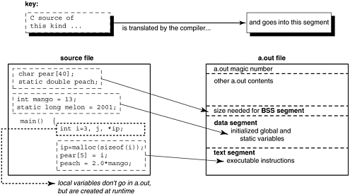
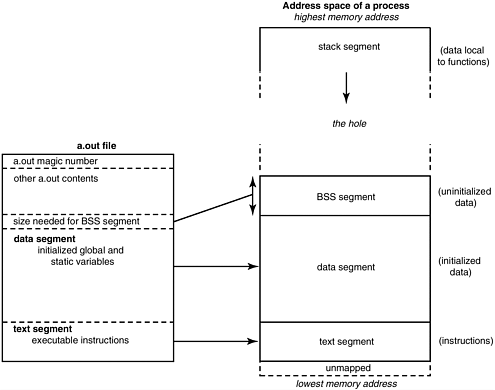
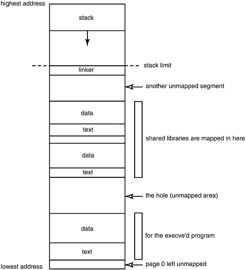
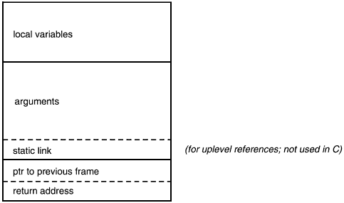
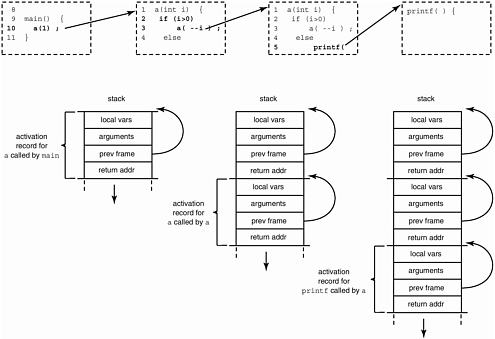

# Chương 6. Thơ ca chuyển động: Runtime data structure

\#41: Enterprise gặp Chúa, hóa ra trẻ con, computer hoặc chương trình C.

\#42: Dũng cảm đến nơi chỉ vài người mới qua, computer Enterprise bị life-form ngoài hành tinh mạnh, hình dạng giống người đáng kinh ngạc, chiếm quyền.

\#43: Trekkers gặp computer intelligence thù địch, lạm dụng triết hoặc logic khiến tự self-destruct.

\#44: Trekkers gặp văn minh giống kỳ lạ xã hội Trái Đất trước đây.

\#45: Bệnh làm một hay nhiều thủy thủ già nhanh. Có bản ngược: thành viên chủ chốt trở về tuổi thơ về thể chất, tinh thần hoặc cả hai.

\#46: Sinh vật ngoài hành tinh nhập cơ thể Trekker chiếm quyền. Vẫn đợi bản ngược… #47: Thuyền trưởng vi phạm Prime Directive, rồi gây nguy Enterprise hoặc tình ái với người ngoài hành tinh hấp dẫn, hoặc cả hai, trong lúc sửa sai.

\#48: Cuối cùng thuyền trưởng hòa giải hai xã hội nguyên thủy chiến tranh ("đến hòa bình, bắn chết") trên thế giới gợi nhớ Trái Đất kỳ lạ.

—Sách cốt truyện Star Trek chuẩn và công thức khoai ngon của Giáo sư Snopes

a.out và giai thoại…segment…OS làm gì với a.out…C runtime làm gì với a.out…khi function được gọi: procedure activation record…công cụ C hữu ích…giải trí nhẹ nhàng — câu đố lập trình Princeton

Phân đôi kinh điển lý thuyết ngôn ngữ là code với data. LISP hợp chúng, C thường tách. Sâu Internet Chương 2 khó hiểu vì tấn công biến data thành code. Cũng phân tích như compiletime với runtime. Phần lớn việc compiler dịch code; phần lớn quản lý data storage cần xảy ra runtime. Chương mô tả data structure ẩn của runtime system.

Ba lý do học runtime system:

- Giúp tinh chỉnh code hiệu năng cao nhất.

- Giúp hiểu nội dung nâng cao.

- Giúp chẩn đoán dễ hơn khi gặp trục trặc.

## `a.out` và giai thoại `a.out`

Từng thắc mắc chọn tên "a.out" thế nào? Mọi output mặc định cùng tên bất tiện, có thể quên source nào, compile file sau ghi đè. Đa số nghĩ mơ hồ từ UNIX ngắn gọn, "a" đầu alphabet nên gõ đầu cho filename mới. Thật ra chẳng liên quan.

Viết tắt "assembler output"! Manpage BSD cũ gợi:

```
NAME
    a.out - assembler and link editor output format
```

Vấn đề: không phải assembler output — linker output!

Tên thuần lịch sử. PDP-7 trước B chưa linker. Tạo chương trình bằng assemble nối mọi source file, output vào a.out. Quy ước giữ cho output cuối khi có linker PDP-11; tên thành nghĩa "chương trình mới sẵn thử chạy". Vậy tên mặc định là ví dụ UNIX "không lý do tốt, nhưng luôn vậy"! UNIX executable cũng gắn nhãn riêng để nhận đặc tính. Kỹ thuật phổ biến là gắn số duy nhất nhận dạng data quan trọng. Gọi "magic" number, cho sức mạnh bí ẩn nhận tập bit ngẫu nhiên. Ví dụ superblock (data structure nền tảng UNIX filesystem) có magic number:

```
#define FS_MAGIC 0x011954
```

Số strange-looking không hoàn toàn ngẫu nhiên: sinh nhật Kirk McKusick. Người triển khai Berkeley fast file system viết cuối 1970, magic number hữu ích nên nay vẫn trong source (file `sys/fs/ufs_fs.h`). Tăng filesystem reliability, mọi hacker filesystem còn biết gửi thiệp Kirk ngày 19 tháng 1.

Có magic number tương tự a.out. Trước AT\&T System V UNIX, a.out nhận bằng 0407 offset zero. Sao 0407? Opcode unconditional branch relative program counter PDP-11! Trên PDP-11 hay VAX compatibility mode, chạy word đầu, magic number tại đó nhảy qua header vào executable instruction thực đầu. PDP-11 là máy UNIX chuẩn lúc cần magic. SVr4 nhận executable byte đầu hex `7F`, chữ "ELF" ở byte 2, 3, 4.

## Segment

Object file, executable có nhiều format. Đa số SVr4 là ELF (ban đầu "Extensible Linker Format", nay "Executable and Linking Format"). Hệ khác COFF (Common Object-File Format). BSD UNIX (như Phật có Buddha-nature), a.out có a.out format. Gõ `man` `a.out` đọc thêm.

Mọi format chung khái niệm segment. Sẽ nói nhiều hơn, với object file chỉ là vùng binary giữ thông tin cùng loại (như symbol table entry). Section cũng phổ biến, đơn vị tổ chức nhỏ nhất ELF. Segment thường nhiều section.

Đừng lẫn segment UNIX với Intel x86.

- Segment UNIX là phần nội dung liên quan trong binary.

- Segment memory model Intel x86 do thiết kế vì tương thích chia address space không đồng nhất thành dải 64-Kbyte.

Segment Intel x86 xứng chương riêng. <sup>\[1\]</sup> Phần còn lại dùng nghĩa UNIX trừ nói khác.

<sup>\[1\]</sup> Gần như có rồi! Xem chương sau.

Chạy `size` executable cho size ba segment text, data, bss:

```
% echo; echo "text data bss total" ; size a.out

text          data       bss         total
1548   +      4236    +  4004 =      9788
```

Size không in heading, dùng echo tạo.

Cách khác xem executable là utility `nm`, `dump`. Compile source dưới, chạy `nm` trên a.out.

```
        char pear[40];
static double peach;
        int mango = 13;
static long melon = 2001;

main () {
    int i=3, j, *ip;
    ip=malloc(sizeof(i));
    pear[5] = i;
    peach = 2.0*mango;
}
```

Trích output `nm` dưới (sửa nhỏ cho dễ tiếp cận):

```
% nm -sx a.out
Symbols from a.out:

[Index]   Value      Size  Type  Bind   Segment Name
...
[29]  |0x00020790|0x00000008|OBJT |LOCL |.bss peach
[42]  |0x0002079c|0x00000028|OBJT |GLOB |.bss pear
[43]  |0x000206f4|0x00000004|OBJT |GLOB |.data mango
[30]  |0x000206f8|0x00000004|OBJT |LOCL |.data melon
[36]  |0x00010628|0x00000058|FUNC |GLOB |.text main
[50]  |0x000206e4|0x00000038|FUNC |GLOB |UNDEF malloc
                    ...
```

Hình 6-1 cho thứ compiler/linker đặt mỗi segment:

Hình 6-1. Loại statement C nào vào segment nào?



BSS viết tắt "Block Started by Symbol" — pseudo-op assembler IBM 704 cũ, mang vào UNIX rồi giữ. Có người nhớ "Better Save Space". Vì BSS chỉ giữ variable chưa value nên không cần lưu image. Runtime size ghi trong object file nhưng BSS, khác data segment, không thật chiếm chỗ object file.

### Thử thách lập trình


Xem segment executable

1\. Compile "hello world", chạy `ls -l` lấy tổng size, `size` lấy từng segment.

2\. Thêm global array 1000 int, recompile, đo lại, chú ý khác biệt.

3\. Thêm initial value array (C không buộc mọi phần tử initializer có value), chuyển BSS sang data. Đo lại, chú ý khác biệt.

4\. Thêm big array local function, thêm big local array thứ hai có initializer. Đo lại. Data local có lưu executable? Khởi tạo hay không khác không?

5\. File, segment size đổi gì khi compile debug? Optimization tối đa?

Phân tích "Thử thách lập trình" để tin:

- Data segment giữ trong object file

- BSS không giữ trong object file (trừ ghi runtime size)

- Text segment bị optimization ảnh hưởng nhất

- Compile debug ảnh hưởng a.out size, không segment.

## OS làm gì với `a.out`

Nay thấy vì sao a.out tổ chức segment. Map tiện vào object runtime linker nạp trực tiếp! Loader lấy image mỗi segment đặt thẳng memory. Segment thành vùng memory chương trình chạy, mỗi vùng mục đích riêng. Hình 6-2.

Hình 6-2. Segment executable bố trí memory thế nào



Text segment chứa instruction. Loader copy thẳng từ file vào memory (thường system call `mmap()`), không cần lo nữa vì text thường không đổi value, size. Một số OS, linker gán permission thích hợp section trong segment: text read-and-execute-only, data read-write-no-execute, data khác read-only, v.v.

Data segment chứa global, static variable khởi tạo cùng value. Lấy BSS size từ executable, loader cấp block ngay sau data, zero khi đưa vào address space. Cả data, BSS lúc này thường gọi chung data segment, vì segment theo OS memory management là dải virtual address liên tiếp, vùng sát được gộp. Data thường lớn nhất process.

Sơ đồ là memory layout chương trình sắp chạy. Còn cần memory cho local variable, temporary, parameter function call, v.v. Cấp stack segment. Cần heap cho dynamic memory, thiết lập theo yêu cầu khi gọi `malloc()` đầu.

Phần thấp nhất virtual address space unmapped: trong address space process nhưng chưa physical address, tham chiếu bất hợp lệ. Thường vài Kbyte từ zero, bắt null pointer và pointer integer nhỏ.

Tính shared library, process address space như Hình 6-3.

Hình 6-3. Virtual address space với shared library



## C runtime làm gì với `a.out`

Đến chi tiết tổ chức data structure chương trình chạy: stack, activation record, data, heap, v.v. Xem lần lượt, phân tích tính năng C hỗ trợ.

### Stack segment

Stack segment chứa một data structure: stack. Object kinh điển computer science, vùng memory động triển khai queue last-in-first-out, giống chồng đĩa quán ăn. Định nghĩa chuẩn cho bao nhiêu đĩa cũng được, operation hợp lệ chỉ thêm, bỏ trên đỉnh. Value push, pop. Push tăng stack, pop bỏ value.

Compiler-writers linh hoạt hơn: thêm bỏ chỉ trên đỉnh, nhưng đổi value đĩa giữa được. Function truy cập variable local function gọi qua parameter hay global pointer. Runtime giữ pointer thường register tên `sp` chỉ đỉnh hiện tại. Stack ba công dụng, hai function, một expression:

- Storage local variable trong function, gọi "automatic variable" trong C.

- Thông tin "quản gia" khi function call, gọi stack frame hay tổng quát procedure activation record. Sẽ mô tả sau, gồm address nơi gọi (nhảy về khi xong), parameter không vừa register và saved register value.

- Vùng scratch-pad, khi cần temporary storage như đánh giá expression số học dài, push partial result, pop khi cần. Storage `alloca()` cũng trên stack. Đừng dùng `alloca()` cho memory muốn sống lâu hơn routine cấp, vì function call sau ghi đè.

Không recursive call thì không cần stack. Local variable, parameter, return address biết space cố định compiletime, cấp BSS được. BASIC, COBOL, FORTRAN đầu cấm recursive function nên không cần dynamic stack runtime. Cho đệ quy phải cho mul-tiple instance local variable tồn tại cùng lúc, chỉ truy cập cái mới nhất — đúng stack.

#### Thử thách lập trình


Nghịch stack

Compile, chạy test nhỏ tìm vị trí stack xấp xỉ:

```
#include <stdio.h>
main()
 {
    int i;
    printf("The stack top is near %p\n", &i);
    return 0;
}
```

Tìm data, text, heap trong data bằng khai báo variable vào vùng, in address. Tăng stack bằng function call, large local array.

Address đỉnh stack giờ là gì?

Stack có thể address khác kiến trúc, OS revision. Dù nói đỉnh, stack phần lớn processor lớn xuống address thấp.

## Khi function được gọi: Procedure activation record

Phần mô tả C runtime quản chương trình trong address space riêng. Runtime routine C ít, nhẹ đáng kể. Khác C++, Ada, muốn service như dynamic storage thường phải xin rõ. Hiệu quả nhưng thêm gánh nặng lập trình viên.

Service tự động là theo call chain — routine gọi ai, control về đâu ở "return" tiếp. Cơ chế kinh điển là procedure activation record trên stack. Mỗi call statement chạy có record hay tương đương. Data structure sup-ports một invocation, ghi mọi thứ về nơi trước gọi. (Hình 6-4.)

Hình 6-4. Procedure activation record chuẩn



Nội dung record chỉ minh họa, structure, thứ tự field khác implementation. Có vùng lưu register trước call. Include file `/usr/include/sys/frame.h,` cho frame UNIX. SPARC frame lớn vài chục word để lưu register window. x86 nhỏ hơn. Runtime giữ pointer thường register tên `fp` chỉ active frame, gần hoặc ngay đỉnh.

### Giáo điều software


Sự thật C đáng kinh ngạc!

Phần lớn ngôn ngữ thuật toán hiện đại cho định nghĩa function (cả data) trong function. C không cho nested vậy. Mọi function C ở top lexical level.

Hạn chế đơn giản implementation chút. Pascal, Ada, Modula-2, PL/I, Algol-60 cho lexical nested procedure, activation record thường có pointer tới record function bao. Pointer static link <sup>\[1\]</sup> cho nested procedure truy cập frame ngoài, data local ngoài. Có thể nhiều invocation ngoài cùng active. Static link trỏ frame thích hợp, định địa chỉ đúng instance data.

Truy cập data item trong lexical enclosing scope gọi uplevel reference. Static link (trỏ frame procedure bao xác định compiletime) khác dynamic link frame pointer chain (trỏ frame invocation ngay trước runtime).

Compiler Pascal Sun coi static link là hidden parameter thêm cuối argument khi cần. Cho cùng activation record, code generator, làm việc với routine C. C không nested nên không uplevel reference, không static link trong record. Có người thúc C++ thêm nested function.

<sup>\[1\]</sup> Xin đừng lẫn static link record cho uplevel reference với static link chương trước, phương pháp lỗi thời bind bản mọi library vào executable. Chương trước static "lúc compiletime", đây "liên quan lexical layout".

Code dưới cho activation record stack tại các điểm chạy. Khó biểu diễn trong sách vì dynamic flow thay listing tĩnh. Khó theo thật, nhưng như Wendy Kaminer trong sách psy-chological kinh điển I'm Dysfunctional; You're Dysfunctional, chỉ người chết rất trẻ học hết thứ cần ở mẫu giáo.

```
1 a (int i) {
2       if (i>0)
3          a(--i);
4       else
5          printf("i has reached zero ");
6       return;
7 }
8
9 main(){
10  a(1);
11 }
```

Compile chạy code trên, flow Hình 6-5. Mỗi khung nét đứt là source fragment function call; statement chạy in đậm. Control sang function khác, trạng thái stack dưới. Execution từ `main`, stack lớn xuống.

Hình Figure6-5. Mỗi function call tạo activation record runtime



Compiler-writers tăng tốc bằng không lưu thông tin không dùng. Còn giữ register thay stack, không push frame đầy đủ leaf function (không gọi ai), cho callee lưu register thay caller. "Pointer tới frame trước" đơn giản pop về record trước khi return.

#### Thử thách lập trình


Stack frame

1\. Trace flow thủ công chương trình, điền frame mỗi call. Return address dùng số dòng quay về.

2\. Compile thật, chạy debugger. Xem stack thêm khi gọi. So kết quả bàn giấy để hiểu chính xác frame hệ mình.

Nhớ compiler-writers đặt record register tối đa vì nhanh, nên có thứ không thấy stack. Xem frame.h lấy layout.

## Keyword `auto` và `static`

Mô tả stack gọi function giải thích vì sao không trả pointer local automatic variable được:

```
char * favorite_fruit () {
    char deciduous [] = "apple";
    return deciduous;
}
```

Automatic variable `deciduous` cấp stack khi vào; thoát thì không tồn tại, space ghi đè lúc nào cũng được. Pointer mất hợp lệ do tham chiếu thứ hết sống gọi "dangling pointer", chẳng trỏ gì hữu ích, lơ lửng. Cần trả pointer thứ định trong function thì định `static`: cấp trong data thay stack. Lifetime bằng chương trình, tác dụng phụ giữ value sau function thoát, còn khi gọi lại.

Storage class specifier `auto` không bao giờ cần. Chủ yếu có nghĩa compiler-writer thêm symbol entry: "storage tự cấp khi vào block", khác static compiletime hay dynamic heap. Hầu như vô nghĩa với người khác vì chỉ dùng trong function, data declaration ở đó mặc định có. Công dụng duy nhất thấy của keyword `auto` là căn declaration đẹp:

```
register int filbert;
    auto int almond;
  static int hazel;
```

thay vì:

```
register int filbert;
int almond;
static int hazel;
```

### Stack frame có thể không trên stack

Dù nói "push stack frame", activation record không bắt trên stack. Nhanh tốt hơn giữ register tối đa. SPARC đẩy tận cùng bằng "register window", register riêng giữ parameter record. Vẫn push frame trống mỗi call; chain sâu hết window thì lấy lại register bằng spill xuống space đã dành stack.

Xerox PARC Mesa, Cedar cấp activation record linked list trên heap. PL/I đầu recursive record cũng heap-allocated, bị chê chậm vì stack cấp memory nhanh hơn.

## Thread of control

Nay rõ hỗ trợ nhiều thread of control (từng "lightweight process") trong process: mỗi thread stack riêng. Thread gọi foo(), bar(), baz() trong khi main chạy routine khác, mỗi bên cần stack theo vị trí. Mỗi thread stack 1Mb (tăng khi cần), một page red zone giữa stack. Mô hình mạnh, lợi hiệu năng cả uniprocessor. Nhưng sách C không thread; nên tìm chi tiết thêm.

## `setjmp` và `longjmp`

Cũng nói `setjmp()`, `longjmp()` vì thao tác activation record. Người mới thường không biết cơ chế mạnh riêng C. Bù phần branching hạn chế, làm cặp:

- `setjmp(jmp_buf j)` gọi trước. Dùng variable `j` nhớ chỗ hiện tại, trả 0.

- Sau gọi `longjmp(jmp_buf j,int i)`: quay chỗ `j` nhớ, như return từ `setjmp()` ban đầu nhưng trả `i` để biết thật về qua `longjmp()`. Phù!

- Nội dung `j` bị hủy khi dùng trong `longjmp()`.

Setjmp lưu program counter, pointer đỉnh stack hiện tại, tức initial value. Longjmp khôi phục, chuyển control, reset trạng thái về lúc lưu. Gọi "unwinding stack", tháo record đến cái lưu. Dù branch, khác goto:

- Goto C không nhảy khỏi function hiện tại (vì thế "longjmp", nhảy xa cả function file khác).

- Chỉ longjmp về nơi đã qua, đã setjmp, activation record còn sống. Setjmp giống "come from" hơn "go to". Longjmp nhận integer thêm truyền lại, giúp biết từ longjmp hay tiếp statement trước.

Code sau ví dụ `setjmp()`, `longjmp()`.

```
#include <setjmp.h>

jmp_buf buf;
#include <setjmp.h>
banana() {
    printf("in banana()\n");
    longjmp(buf, 1);
    /*NOTREACHED*/
    printf("you'll never see this, because I longjmp'd");
}


main()
{
    if (setjmp(buf))
        printf("back in main\n");
    else {
        printf("first time through\n");
        banana();
    }
}
```

Output:

```
% a.out
first time through
in banana()
back in main
```

Lưu ý cách đáng tin duy nhất giữ local variable có value lúc longjmp là volatile (cho variable đổi giữa setjmp, longjmp return).

Setjmp/longjmp hữu ích nhất phục hồi lỗi. Chưa return function, phát hiện lỗi không thể phục hồi thì về main input loop bắt đầu lại. Có người dùng thoát chuỗi vô số function cùng lúc, người khác che chắn code nguy hiểm như dereference pointer đáng ngờ:

```
switch(setjmp(jbuf)) {
    case 0:
        apple = *suspicious;
        break;
    case 1:
        printf("suspicious is indeed a bad pointer\n");
        break;
    default:
        die("unexpected value returned by setjmp");
}
```

Cần handler segmentation violation signal làm `longjmp(jbuf,1)` tương ứng, chương sau giải thích. Setjmp, longjmp biến thành exception routine tổng quát "catch", "throw" C++.

### Thử thách lập trình


Nhảy vào việc!

Lấy source chương trình cũ, thêm `setjmp/longjmp` để nhận input nào đó thì bắt đầu lại.

Mọi source dùng setjmp, longjmp cần include `<setjmp.h>`.

Như goto, chúng làm khó hiểu, debug; nên tránh trừ tình huống cụ thể đã nói.

## Stack segment UNIX

UNIX tự tăng stack khi process cần; lập trình viên giả định lớn vô hạn. Một trong nhiều lợi hơn MS-DOS. Thường dùng virtual memory; truy cập ngoài space stack hiện cấp tạo hardware interrupt page fault. Xử lý nhiều cách tùy reference hợp lệ.

Kernel thường gửi signal thích hợp (có lẽ segmentation fault) cho process truy cập address sai. Có red zone nhỏ dưới đỉnh stack. Truy cập đó không chuyển fault mà OS tăng segment một khối khá lớn. Chi tiết khác nhưng về thực chất map thêm virtual memory sau stack. Hardware memory mapping bảo đảm không truy cập ngoài OS cấp.

## Stack segment MS-DOS

DOS phải chỉ stack size khi build executable, không tăng runtime. Đoán sai, stack vượt cấp thì cả bạn, program thua; bật check thì báo `STACK` `OVERFLOW!`. Có thể compiletime nếu vượt segment limit.

Turbo C báo `Segment overflowed` `maximum` `size` `<lsegname>` nếu data/code quá nhiều một segment. Giới hạn 64Kbyte do 80x86.

Cách chỉ size tùy compiler. Microsoft cho linker parameter. Tham số

```
STACK:nnnn
```

bảo Microsoft linker dành nnnn byte stack.

Borland dùng variable tên đặc biệt:

```
unsigned int _stklen = 0x4000; /* 16K stack */
```

Vendor khác cách khác. Xem programmer reference "stack size".

## Công cụ C hữu ích

Phần liệt kê công cụ nhóm theo chức năng, Bảng 6-1 đến 6-4. Đã gợi vài thứ nhìn trong process, a.out, vài thứ riêng Sun OS. Tổng hợp easy-to-read về làm gì, tìm đâu. Học xong đọc manpage, thử từng trên "hello world", chương trình lớn.

Xem kỹ — bỏ 15 phút thử từng cái nay tiết kiệm hàng giờ sửa bug khó sau.

Bảng 6-1. Công cụ xem source

| Công cụ | Nơi tìm | Công dụng |
|---|---|---|
| `cb` | Kèm compiler | Làm đẹp C, chạy source qua filter cho layout, indent chuẩn. Từ Berkeley. |
| `indent` |  | Làm như `cb`, từ AT \& T. |
| `cdecl` | Sách này | Gỡ declaration C. |
| `cflow` | Kèm compiler | In quan hệ caller/callee. |
| `cscope` | Kèm compiler | C program browser tương tác `ASCII`-based. Nhóm OS dùng kiểm tác động đổi header, nhanh đáp "bao nhiêu lệnh dùng libthread?", "ai đọc kmem?" |
| `ctags` | /usr/bin | Tạo tags file cho vi, tăng tốc xem source bằng bảng vị trí phần lớn object. |
| `lint` | Kèm compiler | Kiểm tra C program. |
| `sccs` | /usr/ccs/bin | Source code version control. |
| `vgrind` | /usr/bin | Formatter in listing C đẹp. |

Bác sĩ dùng x-rays, siêu âm, nội soi khớp, phẫu thuật thăm dò xem trong bệnh nhân. Đây là x-rays của software.

Bảng 6-2. Công cụ xem executable

| Công cụ | Nơi tìm | Công dụng |
|---|---|---|
| `dis` | /usr/ccs/bin | Object code disassembler |
| `dump -Lv` | /usr/ccs/bin | In dynamic linking information |
| `ldd` | /usr/bin | In dynamic library file cần |
| `nm` | /usr/ccs/bin | In symbol table object file |
| `strings` | /usr/bin | Xem string nhúng binary: thông báo lỗi có thể tạo, filename built-in, đôi khi symbol name, version, copyright. |
| `sum` | /usr/bin | In checksum, block count. An-swers "hai executable cùng version?", "truyền tốt không?" |

Bảng 6-3. Công cụ debug

| Công cụ | Nơi tìm | Công dụng |
|---|---|---|
| `truss` | /usr/bin | Bản SVr4 của `trace`, in system call executable. Xem binary làm gì, vì sao kẹt, thất bại. Rất hữu ích! |
| `ps` | /usr/bin | Hiển thị đặc tính process. |
| `ctrace` | Kèm compiler | Sửa source in dòng khi chạy, tuyệt cho program nhỏ! |
| `debugger` | Kèm compiler | Debugger tương tác. |
| `file` | /usr/bin | Cho nội dung file (executable, data, ASCII, shell script, archive...). |

Bảng 6-4. Công cụ tinh chỉnh hiệu năng

| Công cụ | Nơi tìm | Công dụng |
|---|---|---|
| `collector` | Kèm debugger | Chỉ SunOS: thu runtime performance data dưới debugger. |
| `analyzer` | Kèm debugger | Chỉ SunOS: phân tích performance data đã thu. |
| `gprof` | /usr/ccs/bin | Hiển thị call-graph profile, nhận diện function compute-intensive. |
| `prof` | /usr/ccs/bin | Tỷ lệ thời gian mỗi routine. |
| `tcov` | Kèm compiler | Đếm mỗi statement chạy bao lần, nhận loop compute-intensive trong function. |
| `time` | /usr/bin/time | Tổng real, CPU time chương trình. |

Làm OS kernel thì phần lớn runtime tool không dùng vì kernel không là user process. Compiletime như lint dùng, còn lại dao đá rìu đá: đặt pattern không ngẫu nhiên xem lúc ghi đè (thích hex `dead-beef`, `abadcafe`), printf hay tương đương, ghi trace.

### Giáo điều software


Debug kernel bằng grep

Kernel "panic", dừng đột ngột khi thấy tình huống "không thể". Như null pointer khi tìm data thiết yếu; không phục hồi được nên an toàn nhất dừng processor trước mất thêm data. Muốn giải phải nghĩ chuyện gì dọa nổi OS.

Nhóm Sun có bug mờ rất khó tìm, kernel memory bị ghi đè ngẫu nhiên, đôi khi panic.

Hai kỹ sư giỏi nhất thấy luôn byte 19 từ đầu block bị đập. Offset hiếm, khác 2,4,8 thường. Một người lóe ý: kadb disassemble kernel binary image thành ASCII file (mất giờ!), grep "store" có operand offset 19! Một trong đó gần chắc gây corruption.

Chỉ tám cái, đều subsystem process control. Nay biết chỗ, cần biết nguyên nhân. Cuối cùng tìm race condition process control structure: một thread trả memory trước thread khác xong. Allocator giao cho người khác, process control vẫn tưởng giữ, ghi vào, gây corruption impossible-to-find!

Debug OS kernel bằng grep — ý tưởng thế đấy. Đôi lúc source tool cũng giải runtime problem!

Về tool, Bảng 0-5 cho cách xem cấu hình Sun chính xác. Không tool giúp trừ luyện dùng.

Bảng 6-5. Công cụ nhận diện hardware

| Nhận diện | Output điển hình | Cách gọi |
|---|---|---|
| Kernel architecture | sun4c | `/usr/kvm/arch -k` |
| OS patch đã áp | Chưa cài patch | `/usr/bin/showrev -p` |
| Nhiều thứ hardware | Rất nhiều | `/usr/sbin/prtconf` |
| CPU clock rate | Processor 40MHz | `/usr/sbin/psrinfo -v` |
| hostid | 554176fe | `/usr/ucb/hostid` |
| Memory | 32Mb | Hiển thị power up |
| Serial number | 4290302 | Hiển thị power up |
| ROM revision | 2\.4.1 | Hiển thị power up |
| Disk đã mount | Disk 198Mb | `/usr/bin/df -F ufs -k` |
| Swap space | 40Mb | `/etc/swap -s` |
| Ethernet address | 8:0:20:f:8c:60 | `/usr/sbin/ifconfig -a` <br> Ethernet address tích hợp trong máy |
| IP address | le0=129.144.248.36 | `/usr/sbin/ifconfig -a` <br> IP address tích hợp trong network |
| Hardware Floating-point | Tần số FPU có vẻ 38.2 MHz | `fpversion` kèm compiler |

## Giải trí nhẹ nhàng — Câu đố lập trình CMU

Vài năm trước, khoa Computer Science Carnegie-Mellon University thường thi nhỏ cho nghiên cứu sinh mới. Để có hands-on với hệ thống khoa, thể hiện tài năng. CMU có lịch sử máy tính lâu, nổi từ tiên phong, nên mong bài xuất sắc.

Hình thức đổi mỗi năm, năm nọ rất đơn giản: đọc file số, in trung bình. Chỉ hai rule:

1\. Chương trình chạy nhanh nhất có thể.

2\. Viết Pascal hoặc C.

Giảng viên gom bài gửi batch. Sinh viên gửi bao nhiêu cũng được, khuyến khích thuật toán xác suất non-deterministic (đoán đặc tính data, dùng đoán tăng tốc). Rule vàng: ít thời gian nhất thắng.

Họ rút góc tối, đập chương trình. Phần lớn ba bốn bản dự thi. Mời đoán kỹ thuật giúp nhanh.

### Thử thách lập trình


Vượt giới hạn tốc độ thế nào?

Được giao đọc file 10.000 số, tính trung bình, chương trình nhanh nhất.

Dùng kỹ thuật lập trình, compiler nào?

Đa số đoán code optimization, tường minh hoặc compiler option đúng. Chuẩn gồm loop unrolling, in-line expansion, common subexpression elimination, register allocation tốt, bỏ runtime array bound check, loop-invariant code motion, operator strength reduction (exponen-tiation thành nhân, nhân thành bit-shifting và/hoặc cộng), v.v.

File khoảng 10.000 số, giả sử millisecond đọc xử lý mỗi số (mức hệ lúc đó), nhanh nhất khoảng mười giây.

Kết quả ngạc nhiên: nhanh nhất OS báo âm ba giây. Đúng, người thắng chạy thời gian âm! Nhì chỉ vài millisecond, ba gần dưới 10 giây. Rõ thủ đoạn, nhưng gì, thế nào? Xem kỹ tìm đáp.

Chương trình chạy ngược tận dụng OS. Người viết biết process control block đâu relative đáy stack, tạo pointer truy cập, ghi field "CPU-time-used" value rất cao. <sup>\[2\]</sup> OS không đợi CPU time lớn, diễn số dương rất lớn thành âm theo two's complement.

<sup>\[2\]</sup> Lạm dụng trắng trợn như Diego Maradona dùng cẳng tay đẩy bóng vào lưới Anh thắng World Cup 1986.

Người runner-up vài millisecond khôn kiểu khác. Dùng rule thay code lạ, gửi hai bài. Một đọc tính bình thường, ghi file; bài hai ngủ hầu hết, vài giây dậy kiểm file kết quả, có thì in. Process hai tổng CPU chỉ vài millisecond. Được nhiều bài, thời gian nhỏ tính, đứng nhì.

Người ba dưới tối thiểu có kế phức nhất: tìm machine instruction tối ưu, lưu array integer. Dễ ghi đè return address stack (như Bob Morris, Jr. sau làm sâu Internet 1988), nhảy chạy array. Instruction giải trung thực thời gian kỷ lục.

Giảng viên ồn ào khi lộ. Có người đòi khiển trách, giáo sư trẻ đề xuất thưởng thêm sáng tạo. Cuối thỏa hiệp: không giải, không phạt, kết quả giữ. Tiếc cuộc thi hy sinh vì cảm xúc mạnh, năm cuối tổ chức.

## Chỉ dành sinh viên nâng cao

Lời khuyên: nhúng assembler trong source C được, thường chỉ machine-specific sâu kernel như đặt register khi supervisor sang user mode. Chèn no-op hay instruction khác với SunPro SPARCompiler:

```
banana() { asm("nop"); }
```

Nhúng assembly instruction bằng Microsoft C PC:

```
__asm mov ah, 2
__asm mov dl, 43h
```

Cũng prefix keyword "\_ \_asm"; hoặc dùng một lần rồi ngoặc toàn assembler:

```
__asm {
       mov ah, 2
       mov dl, 43h
       int 21h
       }
```

Ít kiểm tra, dễ tạo chương trình nổ tung. Nhưng tốt để thử, học instruction set. Xem SPARC architecture manual, assembler manual (chủ yếu syntax, directive), databook vendor như Cypress Semiconductor "SPARC RISC User's Guide".
