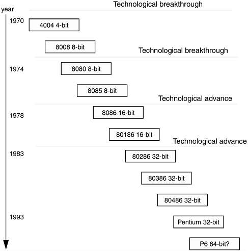
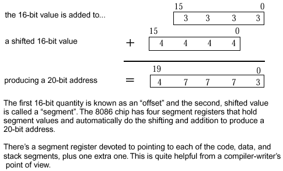
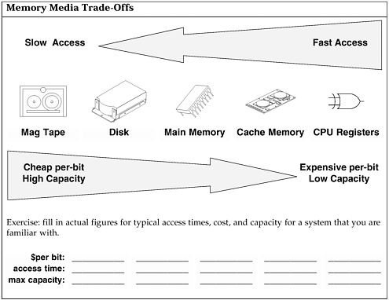
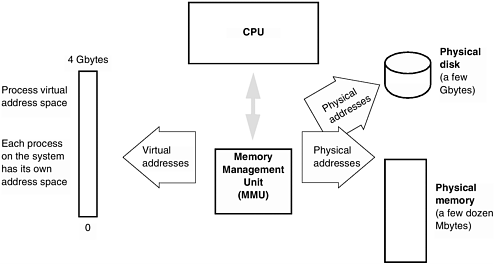
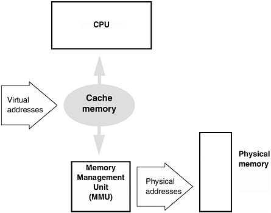
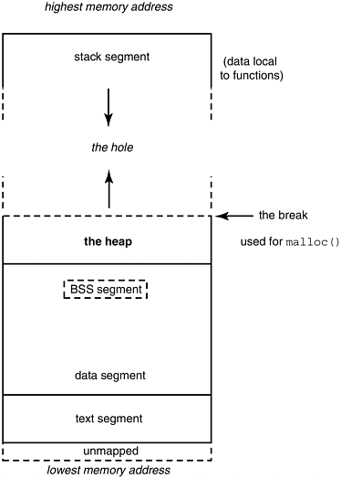

# Chương 7. Cảm ơn memory

Một vị thầy đang giảng bản chất Đạo cho môn sinh mới.

"Đạo hiện thân trong mọi software — bất kể nhỏ bé thế nào," thầy nói.

"Đạo có trong máy tính hand-held không?" môn sinh hỏi. "Có," thầy đáp.

"Đạo có trong video game?" môn sinh tiếp. "Ngay video game cũng có," thầy nói.

"Còn trong DOS của personal computer?"

Thầy ho, hơi đổi tư thế. "Cái đó ở stack frame, Bob, hôm nay học đến đây," thầy nói.

—Geoffrey James, The Tao of Programming

họ Intel 80x86…memory model Intel 80x86 và nguồn gốc…virtual memory…cache memory…data segment, heap…memory leak…bus error — đi tàu đi…giải trí nhẹ nhàng — vua đồ vật và trò paging

Chương bắt đầu bằng kiến trúc memory họ processor Intel 80x86 (trái tim IBM PC), so memory PC với virtual memory hệ khác. Hiểu kiến trúc giúp hiểu quy ước, giới hạn C.

## Họ Intel 80x86

Processor Intel hiện đại có nguồn gốc tận chip đầu. Khách dùng chip tinh vi, đòi hỏi hơn, Intel luôn sẵn follow-on processor tương thích. Tương thích giúp chuyển chip mới dễ nhưng hạn chế sáng tạo nghiêm trọng. Pentium hậu duệ trực tiếp 8086 15 năm trước, mang bất thường kiến trúc để backwards compatible (program compile 8086 chạy Pentium). Về trade-off sáng tạo/tương thích, có người ác miệng "Intel đặt 'lùi' vào 'tương thích ngược'…" (Hình 7-1).

Hình 7-1. Họ Intel 80x86: Đặt "lùi" vào "tương thích ngược"



Intel 4004 là microcontroller 4-bit năm 1970 cho một khách Busicom, hãng calculator Nhật. Kỹ sư nghĩ chip lập trình general-purpose thay logic riêng mỗi khách như lệ lúc đó. Intel nghĩ bán vài trăm nhưng thiết kế general-purpose có ứng dụng rộng hơn rất nhiều. Bốn bit hạn chế nên tháng 4 năm 1972 ra 8008 8-bit. Hai năm sau sinh 8080, đầu đủ mạnh gọi microcomputer. Có toàn instruction set 8008, thêm 30 instruction, mở xu hướng đến nay. Nếu 4004 khởi đầu, 8080 làm Intel giàu, doanh thu hơn $1 tỷ mỗi năm, cao Fortune 500.

8085 tận dụng integration ép ba chip thành một: 8080 cùng clock driver 8224, controller 8228. Internal data bus vẫn 8-bit, address bus 16-bit, định địa chỉ 2<sup>16</sup> hay 64 Kbyte.

Ra năm 1978, 8086 cải thiện data bus 16 bit, address 20 bit, memory 1 Mbyte khổng lồ lúc đó. Quyết định lạ: chồng hai word 16-bit thành address 20-bit thay nối thành 32-bit (Hình 7-2). Không 8085-compatible ở instruction-set nhưng assembler macro giúp chuyển dễ.

Hình 7-2. Intel 8086 định địa chỉ memory thế nào



Scheme bất thường cho chạy code 8085-ported đơn giản: nạp fixed value segment register rồi bỏ qua, dùng thẳng address 16-bit 8085. Nhóm bác nối segment word vì cho 32 bit, 4 Gbyte, lớn không thể lúc đó.

Model cơ bản đã định, mọi 80x86 sau phải theo hoặc bỏ tương thích. Nếu 8080 đưa lên danh, 8086 giữ. Chắc không biết chính xác vì sao IBM chọn Intel 8088 (anh em 8-bit 8086) năm 1979 giữa lựa chọn kỹ thuật hơn từ Motorola, National Semiconductor. IBM làm Intel giàu hai thập kỷ như chọn MS-DOS làm Microsoft giàu. Mỉa mai tháng 8 năm 1993 Intel vốn hóa $26.6 tỷ vượt IBM $24.5 tỷ, thành hãng điện tử giá trị nhất Mỹ. Intel, Microsoft thực chất IBM mới, hưởng lợi bất ngờ không xứng từ hệ đóng độc quyền. IBM cố giành lại bằng PowerPC thách hardware Intel, OS/2 thách software Microsoft. OS/2 có lẽ thua, PowerPC còn sớm xét.

8088 PC đầu chỉ bản 8-bit rẻ 8086, dùng nhiều support chip 8-bit sẵn. Mọi cải tiến sau "nhỏ, nhanh, đắt, thêm instruction". 80186 thêm 10 instruction not-very-important. 80286 là 80186 bỏ vài port built-in, lần đầu mở address space. Đưa memory controller off-chip, mode virtual tên tham vọng: segment register không cộng offset mà index table chứa address segment thật. Protected mode vẫn 16-bit-based. MS-Windows dùng 286 protected mode chuẩn.

80386 là 80286 thêm 32-bit protected mode, virtual 8086 mode. NT mới và MS-Windows enhanced dùng 32-bit protected, nên NT cần ít nhất 386. Virtual 8086 tạo máy ảo 1 Mbyte; chạy nhiều cùng lúc, mỗi MS-DOS session tưởng 8086 riêng. Hẳn bạn nghĩ xoay xở giới hạn scheme gốc thật kinh ngạc, đúng vậy. Viết compiler, application cho 80x86 khó, bực.

Mọi processor có thể coprocessor, thường floating point hardware. 8087, 80287 giống, trừ 287 định extended memory như 286. 387 cùng mode 386, thêm transcendental function built-in.

### Giáo điều software


Chọn thành phần IBM PC

Một số, có lẽ phần lớn quyết định IBM chắc non-technical. Trước MS-DOS, hẹn Gary Kildall Digital Research xét CP/M. Theo chuyện kể, trời đẹp nên Gary lái máy bay riêng. IBM có lẽ bực bị bỏ hẹn, ký Microsoft.

Bill Gates mua QDOS Seattle Computer Product <sup>\[1\]</sup>, dọn chút, đổi "MS-DOS". Còn lại là lịch sử. IBM, Intel vui, Microsoft rất rất vui. Digital Research không, Seattle Computer Products càng buồn khi nhận gần cho không quyền program best-selling mọi thời. Giữ quyền bán MS-DOS cùng hardware, nên từng thấy bản MS-DOS từ họ kèm Intel board/chip vô dụng đáng ngại để đúng hợp đồng.

Đừng thương quá — QDOS dựa nhiều CP/M Gary, mà ông thích bay. Bill Gates mua Porsche 959 super-fast từ lợi nhuận. Giá three-quarters triệu đô, nhập bị Hải quan Mỹ cản. Không lái được Mỹ vì chưa qua government-mandated crash-worthiness test. Nằm kho Oakland đến nay — sản phẩm Gates chắc không crash.

<sup>\[1\]</sup> Nghĩa đen "Quick and Dirty Operating System".

80486 đóng gói lại 80386, nhanh chút vì bus bỏ trạng thái cho coprocessor. Coprocessor built-in hoặc cấm, gọi DX, SX. Thêm ít instruction, cache on-board, phần lớn cải thiện còn lại. Đến hiện tại Intel sáng tạo và cãi trademark, gọi chip mới Pentium thay 80586. Nhanh, đắt, hỗ trợ mọi instruction trước, thêm mới. Có thể đoán 80686 nhanh, đắt, thêm instruction. Khẩu hiệu nội bộ "nhanh hoặc chết", họ sống đúng. Như bà tôi nói bên guồng quay, "Ai không nhớ lịch sử sẽ gặp vấn đề backward compatibility nghiêm trọng, nhất là đổi addressing mode, wordsize."

## Memory model Intel 80x86 và nguồn gốc

Chương trước segment ít nhất hai nghĩa (còn nghĩa OS memory-management-related thứ ba):

Segment UNIX là phần nội dung liên quan binary.

Segment Intel x86 do thiết kế tương thích chia address space không đồng nhất thành dải 64-Kbyte.

Ban đầu 8086 segment là vùng 64-Kbyte do segment register trỏ. Address lấy register dịch trái bốn chỗ (nhân 16), hay nối bốn zero thành 20-bit.

Offset 16-bit cho chỗ trong segment. Cộng nội dung segment register với offset được address cuối. Điểm lạ: như nhiều cặp số cộng 24, nhiều cặp segment + offset cùng address.

### Mẹo thực hành hữu ích


Pointer Different-Looking, cùng address

Address 8086 kết hợp segment 16-bit, offset 16-bit. Dịch segment trái bốn rồi cộng, nên nhiều cặp cùng address.

segment offset address kết quả

(dịch trái 4 bit)

`A0000` `+` `FFFF` `=` `AFFFF` `:`

`AFFF0` `+` `000F` `=` `AFFFF`

Thường có 0x1000 (4096) tổ hợp cho cùng address.

C compiler-writer phải so pointer canonical trên PC, nếu không bit pattern khác cùng address bị coi khác. Keyword "huge" làm, model "large" không. Microsoft C `far` giữ segment register và offset; `near` chỉ offset 16-bit, dùng data/stack segment register sẵn.

#### Mẹo thực hành hữu ích


Hướng dẫn memory prefix

Prefix Lũy thừa hai Ý nghĩa Số byte Kilo 2<sup>10</sup> Một nghìn byte 1,024 Mega 2<sup>20</sup> Một triệu byte 1,048,576 Giga 2<sup>30</sup> Một tỷ byte 1,073,741,824 Tera 2<sup>40</sup> Một nghìn tỷ byte 1,099,511,627,776 Bubba 2<sup>64</sup> Mười tám tỷ tỷ byte 18,446,744,073,709,551,616 Nhân tiện mọi hãng disk dùng thập phân thay nhị phân. Disk 2-Gbyte giữ 2,000,000,000 thay 2,147,483,648 byte.

Address space 64-bit thật lớn. Chứa cả phim TV high-definition trong memory. Chưa chốt đặc tả TV high-definition nhưng có lẽ gần SVGA 1024 x 768 pixel, mỗi pixel ba byte màu.

30 frame/giây (NTSC hiện tại), phim two-hour cần:

120 phút= x 60 giây x 30 frame x 786,432 pixel x 3 byte màu

\= 509,607,936,000 byte

\= 500Gbyte memory

Vậy không chỉ một mà 36 triệu phim TV high-definition (hơn mọi phim từng làm nhiều bậc) vào address space 64-bit. Còn chừa OS, không sao. SVID hiện <sup>\[1\]</sup> giới hạn UNIX kernel 512 Mbyte. Dĩ nhiên còn chuyện nhỏ physical disk backing virtual memory.

<sup>\[1\]</sup> SVID — System V Interface Definition — tài liệu dày mô tả System V API.

Thách thức kiến trúc không capacity mà speed. Pentium đỏ mới không giúp nếu software nghẽn disk, memory latency. Khoảng cách hiệu năng memory, CPU rộng tăng. Thập kỷ qua CPU gấp tốc mỗi one-and-a-half đến hai năm. Memory gấp mật độ (64-Kb lên 128 Kb) nhưng access time chỉ cải thiện 10%. Main memory time càng quan trọng máy address lớn. Data lớn, latency di chuyển chi phối. Dự kiến cache, công nghệ liên quan nhiều hơn.

#### Mẹo thực hành hữu ích


Giới hạn MS-DOS 640Kb từ đâu

MS-DOS application giới hạn cứng 640Kbyte do address range 8086, máy DOS gốc. 20-bit chỉ 1 Mbyte, còn reserve segment 64Kbyte cho hệ:

segment dành cho `F0000` đến `FFFFF` 64 Kb ROM cố định BIOS, diagnostic, v.v. `D0000` đến `EFFFF` 128 Kb cartridge ROM `C0000` đến `CFFFF` 64 Kb BIOS extension (XT hard disk) `B0000` đến `BFFFF` 64 Kb conventional memory display `A0000` đến `AFFFF` 64 Kb display memory extension

còn

`00000` đến `9FFFF` 640 Kb cho application.

Billion, trillion khác Mỹ, Anh. Mỹ là nghìn triệu (10<sup>9</sup>), triệu triệu (10<sup>12</sup>); Anh triệu triệu (10<sup>12</sup>), triệu triệu triệu (10<sup>18)</sup>). Thích Mỹ vì tăng nhất quán nghìn (10<sup>3</sup>), triệu (10<sup>6</sup>), billion (10<sup>9</sup>), trillion (10<sup>12</sup>). Tỷ phú Anh giàu hơn Mỹ — đến khi £1,000 đổi $1.

Giới hạn 640 Kb MS-DOS từ tổng 1 Mbyte 8086. MS-DOS dành sáu segment, chỉ mười segment 64-Kbyte từ zero cho ứng dụng (địa chỉ thấp block 0 cũng buffer, working store MS-DOS). Bill Gates nói 1981 "640 K đủ cho mọi người". PC đầu 640Kb có vẻ lớn; thực tế chuẩn chỉ 16K RAM.

#### Mẹo thực hành hữu ích


Memory model PC

Microsoft C nhận:

small Mọi pointer 16 bit, code, data mỗi thứ một segment,

tổng program 128 K.

large Mọi pointer 32 bit, nhiều segment 64-K. medium Function pointer 32 bit, nhiều code segment. Data

pointer 16 bit, chỉ một data segment 64-K.

compact Ngược medium: function pointer 16 bit, nên

code dưới 64K. Data pointer 32 bit, nhiều segment. Nhưng stack data vẫn một segment 64-K.

Microsoft C có keyword non-standard, áp object/function pointer ghi đè model riêng pointer đó.

`__near` Pointer 16-bit `__far` Pointer 32-bit, object phải toàn trong một segment (không

object lớn hơn 64 K), nạp segment register rồi định địa chỉ toàn object được.

`__huge` Pointer 32-bit, bỏ hạn chế toàn trong segment

đó.

Ví dụ: `char __huge * banana;`

Keyword sửa item ngay phải, khác type qualifier `const`, `volatile` sửa pointer ngay trái.

Ngoài mặc định, khai báo near, far, huge rõ trong mọi model được. Huge luôn compare, pointer arithmetic trên canonical <sup>\[1\]</sup> value. Canonical offset 0 đến 15, unsigned long comparison cho đúng.

Compile tương tác array/struct size, pointer size, memory model, mode hardware 80x86 khó, error-prone.

<sup>\[1\]</sup> Biết rồi. Dùng "canonical" theo cách canonical.

Spreadsheet, word processor hữu ích dần đòi memory ever-increasing. Nhiều công đối phó address IBM PC hạn chế, nhiều expander/extender nhưng không portable solution thỏa đáng. MS-DOS 1.0 port CP/M sang 8086. Bản sau tương thích đầu, nên DOS 6.0 vẫn single-tasking, mode "real-address" 8086-compatible, giữ giới hạn user address. Hệ quả khác mọi program MS-DOS đặc quyền vô hạn, virus dễ tấn công. Gần như không virus PC nếu MS-DOS dùng memory, task protection hardware từ 80286.

## Virtual memory

Có đó, thấy được — real

Không có, thấy được — virtual

Có đó, không thấy — transparent

Không có, không thấy — bạn xóa rồi!

—Poster IBM về virtual memory, khoảng 1978. Program bị main memory lắp hạn chế như MS-DOS rất bất tiện. Sớm phát triển virtual memory: dùng disk rẻ chậm mở main memory nhanh đắt. Vùng đang dùng đưa physical memory, vùng lâu không đụng lưu disk chừa chỗ. Mọi hệ hiện đại từ supercomputer lớn đến workstation nhỏ, riêng PC ngoại lệ, dùng virtual memory.

Thời máy tính đầu khi rắn còn đi, programmer tự chuyển phần không dùng ra disk, tốn nhiều công theo dõi gì trong memory, đổi segment. COBOL cũ còn nhiều tính năng diễn memory overlay, hoàn toàn lỗi thời khó hiểu với thế hệ nay.

Multilevel store quen thuộc như register và main memory. Lý thuyết mọi location là register được, thực quá đắt nên đổi speed lấy rẻ. Virtual memory thêm một bước, dùng disk giữ image process thay main memory, thành dải liên tục.

### Mẹo thực hành hữu ích




Process SunOS chạy address space 32-bit. OS cho mỗi process tưởng độc quyền toàn bộ. Ảo giác sus-tained bằng virtual memory chia sẻ physical memory, disk giữ data khi đầy. Data liên tục memory/disk khi chạy. Hardware dịch virtual sang physical, cho chạy bất kỳ real memory. Lập trình viên chỉ thấy virtual, không biết process ra disk về trừ elapsed time hoặc lệnh "`ps`". Hình 7-3 cơ bản.

Hình 7-3. Cơ bản virtual memory



Virtual memory thành page, đơn vị OS di chuyển, bảo vệ, thường vài Kbyte. Xem bằng `/usr/ucb/pagesize`. Đi memory gọi paged in, đi disk paged out.

Hệ thống có thể cần mọi memory process. Nếu khó chạy sớm (low-priority, sleep), lấy mọi physical resource backup disk, gọi "swapped out". Swap area thường lớn vài lần physical, giữ memory paged/swapped. Chỉ user process page/swap, kernel SunOS luôn memory-resident.

Process chỉ thao tác page trong memory. Tham chiếu page vắng, MMU page fault, kernel xét valid. Invalid gửi "segmentation violation"; valid lấy disk. Page về, process unblock, chạy không biết đã chờ page-in.

SunOS nhìn disk filesystem, memory thống nhất, dùng cùng vnode (virtual node). Mọi virtual operation theo map file region vào memory region, cải thiện hiệu năng, tái dùng code. "Hat layer" là software hardware address translation điều khiển MMU, rất hardware-dependent, phải viết lại mỗi kiến trúc.

Virtual memory thiết yếu, cho một quart process trong pint memory. Cuối chương thêm ngụ ngôn kinh điển.

#### Thử thách lập trình


Allocation được bao nhiêu memory?

Chạy chương trình xem process cấp được bao nhiêu.

```
#include <stdio.h>
#include <stdlib.h>
main() {
    int Mb = 0;
    while ( malloc(1<<20)) ++Mb;
    printf("Allocated %d Mb total\n", Mb);
}
```

Tổng tùy swap, process limit cấu hình. Khối nhỏ hơn Mbyte có thêm được không, vì sao?

Trên MS-DOS memory-limited dùng khối 1-Kbyte thay 1-Mbyte.

## Cache memory

Mở rộng multi-level store, buffer nhỏ đắt cực nhanh giữa CPU, physical memory. Có thể phía CPU của MMU như SPARCstation 2, cache virtual address, flush mỗi context switch (Hình 7-4); hoặc phía physical như SPARCstation 10, dễ chia sẻ multiprocessor qua physical address.

Hình 7-4. Cơ bản cache memory



Mọi processor hiện đại dùng cache. Đọc memory đưa cả line (16/32 byte) vào. Locality tốt (như đi dọc string), data cạnh lấy cache nhanh thay main chậm. Cache tốc độ system cycle, CPU 50 MHz thì 20 ns; main thường chậm bốn lần! Cache đắt, tốn space/power, nên phụ thay độc quyền.

Cache có address list, nội dung, liên tục đổi khi processor tham chiếu mới. Cả read/write qua cache. Xin address thì cache trước; có trả ngay, không chuyển main chậm, lấy line mới vào.

Nếu program quái, luôn vừa miss cache, còn chậm hơn không cache vì logic tìm vị trí không miễn phí.

Sun hiện hai loại:

- Write-through cache — luôn ghi main memory cùng lúc cache.

- Write-back cache — đầu chỉ cache, chuyển main khi line sắp ghi lại chưa save. Cũng chuyển khi context switch process khác hay kernel.

Cả hai instruction tiếp khi cache access xong, không chờ memory chậm.

SPARCstation 2 cache write-through 64 Kbyte, line 32 byte. Cache lớn phổ biến: SPARCserver 1000 write-back 1-Mbyte. Có thể cache I/O bus với I/O memory-mapped, thường instruction/data riêng. Có nhiều level, cache giữa thiết bị nhanh chậm như disk/memory. PC main memory cache giúp disk chậm gọi "RAMdisk". UNIX cache inode trong memory, nên power-ing tắt chưa "sync" flush disk có thể hỏng filesystem.

Cache, virtual memory vô hình với programmer nhưng cần hiểu lợi, cách ảnh hưởng lớn hiệu năng.

Bảng 7-1. Cache memory cấu thành thế này

| Thuật ngữ | Định nghĩa |
|---|---|
| Line | Đơn vị truy cập cache, hai phần: data và tag chỉ address biểu diễn. |
| Block | Data của line gọi block, byte chuyển giữa line, main, thường 32 byte. <br> Nội dung line biểu diễn block memory, đáp khi processor truy cập dải đó, "giả" dải memory nhưng nhanh hơn nhiều. <br> "Block", "line" đa số ngành dùng lỏng, thay nhau. |
| Cache | Tập line lớn, thường 64 Kbyte đến 1 Mbyte hơn. Đôi khi associative memory hardware tăng tốc tag. Cạnh CPU vì speed; system memory, bus tối ưu di chuyển khối cache-block-sized. |

### Mẹo thực hành hữu ích


Trải nghiệm với cache

Chạy program xem phát hiện cache effect không.

```
#define DUMBCOPY for (i = 0; i < 65536; i++) \
 destination[i] = source[i]

#define SMARTCOPY memcpy(destination, source, 65536)

main()
{
    char source[65536], destination[65536];
    int i, j;
    for (j = 0; j < 100; j++)
SMARTCOPY;

}

% cc -O cache.c
% time a.out
1.0 seconds user time

# change to DUMBCOPY and recompile
% time a.out
7.0 seconds user time
```

Compile đo hai cách: nguyên rồi đổi macro call `DUMBCOPY`. Trên SPARCstation 2 dumb copy chậm lớn nhất quán.

Vì source, destination cách bội chính xác cache size. SS2 không điền line tuần tự, thuật toán điền cùng line cho address cách bội cache, do tối ưu tag chỉ giữ high-order bit.

Mọi máy cache, cả supercomputer, PC, ở giữa đều chịu trường hợp bệnh lý vậy. Mức tùy máy, implementation.

Cả source, destination cùng line, mọi reference miss, processor stall chờ memory. Library `memcpy()` đặc biệt tối ưu, unroll loop đọc một cache line rồi ghi, né. Smart copy cải thiện cực lớn, cũng cho thấy ngu ngốc kết luận từ benchmark simple-minded.

## Data segment và heap

Đã nền tảng memory system-related, quay layout trong process. Biết system thì process có nghĩa hơn. Bắt đầu xem kỹ data segment.

Như stack tăng theo nhu cầu, data có heap làm được (Hình 7-5). Heap cho storage dynamic qua `malloc` (memory allocate), pointer truy cập. Mọi thứ anonymous, không tên trực tiếp. Library `malloc` và bạn calloc, realloc, v.v. là cách duy nhất lấy. `c` `alloc` giống malloc nhưng zero trước trả pointer. "`c` " trong `c` `alloc`() không liên quan C, nghĩa "cấp memory đã zero". `realloc()` đổi size block tăng/giảm, thường copy nơi khác, trả pointer mới. Hữu ích tăng table động, Chương 10.

Hình 7-5. Heap ở đâu



Heap không cần trả cùng thứ tự (không trả cũng được), malloc/free lộn xộn gây fragmentation. Heap theo vùng used/available. Cách là linked list block rảnh (free store), trước mỗi block giao malloc có size count. Có người gọi arena tập block allocator quản (SunOS giữa data end và break hiện). Memory malloc aligned cho atomic access lớn nhất, request có thể round lên lũy thừa hai tiện. Free về heap tái dùng, không cách tiện đưa khỏi process trả OS.

Cuối heap đánh pointer "break". <sup>\[2\]</sup> Cần thêm manager đẩy bằng system call `brk`, `sbrk`. Thường không tự brk, malloc đủ sẽ gọi. Call quản memory:

<sup>\[2\]</sup> Chương trình sẽ "break" nếu tham chiếu quá break...

`malloc`, `free` — lấy heap, trả heap

`brk`, `sbrk` — chỉnh size data segment tuyệt đối/theo phần tăng

Cẩn thận không gọi cả `malloc()`, `brk()`. Malloc mong độc quyền brk, sbrk. Vì sbrk cách duy nhất trả data segment kernel, dùng malloc thực chất không thu nhỏ được. Muốn memory trả kernel sau, mmap file /dev/zero, trả bằng munmap.

## Memory leak

Có program không cần quản dynamic, chỉ cấp cần, không free, như compiler và program chạy thời hạn cố định/hữu hạn rồi dừng. Xong tự trả mọi memory, ít cần công trả byte ngay hết dùng.

Program khác long-lived như calendar manager, mailtool, OS chạy nhiều ngày/tuần phải quản allocation/free. C thường không garbage collection (tự nhận, free block hết dùng), nên cẩn thận `malloc()`, `free()`. Hai heap problem thường:

- Free hay ghi đè thứ còn dùng (memory corruption)

- Không free thứ hết dùng (memory leak)

Khó debug bậc nhất. Không free block malloc khi hết cần, process tích memory không trả phần hết dùng.

### Mẹo thực hành hữu ích


Tránh memory leak

Viết `malloc` thì viết statement `free` tương ứng.

Không biết đặt "free" của "malloc" đâu, có lẽ đã tạo leak!

Cách đơn giản là `alloca()` khi được; routine `alloca()` cấp stack, rời function tự free.

Không dùng cho structure sống lâu hơn invocation tạo, nhưng nếu phù hợp thì low-overhead. Có người phản đối không portable; `alloca()` khó hiệu quả trên processor không stack hardware.

Gọi "memory leak" vì tài nguyên hiếm rút cạn process. Triệu chứng user-visible chính chậm: process lớn dễ swap cho process khác, swap cũng lâu. Memory leak không tham chiếu theo định nghĩa nhưng thường chung page thứ được tham chiếu, tăng working set. Leak thường lớn hơn data structure quên vì `malloc()` round request lên power-of-two. Cuối cùng chậm cả máy, không chỉ user. Size limit lý thuyết tùy OS, SunOS hiện address tối đa 4 Gbyte, thực tế hết swap trước. Đọc sau năm năm khoảng giao thiên niên kỷ, có lẽ cười giới hạn long-obsolete này.

### Kiểm memory leak thế nào

Quy trình two-step. Đầu swap xem chỗ còn:

```
/usr/sbin/swap -s
total: 17228k bytes allocated + 5396k reserved = 22624k used,
29548k
available
```

Gõ ba bốn lần trong một hai phút, xem available swap giảm. Còn tool `/usr/bin/*stat`, `netstat,`, `vmstat`, v.v. Memory tăng không trả có thể leak.

#### Mẹo thực hành hữu ích


Nghe nhịp mạng: click để chỉnh

Công cụ network tuyệt nhất `snoop.`

Thay `etherfind` SVr4, `snoop` capture packet, hiển thị workstation. Cho tập trung một hai máy như máy bạn, server, giúp lỗi kết nối, biết byte có rời máy.

Tốt nhất option `-a`, mỗi packet click loa. Nghe traffic ether, length khác modulation khác. Dùng `snoop -a` nhiều nhận âm đặc trưng, troubleshooting, tinh chỉnh "bằng tai"!

Bước hai nhận process nghi ngờ, xem leak. Có lẽ đã biết, không thì `ps -lu` `username` cho size mọi process:

```
F S UID PID PPID C PRI NI ADDR    SZ  WCHAN    TTY   TIME COMD
8 S 5303 226 224 80 1 20 ff38f000 199 ff38f1d0 pts/3 0:01 csh
8 O 5303 921 226 29 1 20 ff38c000 143          pts/3 0:00 ps
```

Cột `SZ` size bằng page (`pagesize` cho Kbyte nếu cần). Lặp vài lần, program dynamic sẽ lớn. Liên tục không ổn định thì nghi leak. Quản dynamic memory rất khó, có X-Window public domain leak nổi tiếng như hội đồng Apple Computer.

Hệ thường nhiều malloc library tối ưu speed/space/debug. Nhập

```
man -s 3c malloc
```

xem manpage, mọi routine malloc. Link đúng library. SPARCWorks debugger Solaris 2.x phát hiện leak phong phú, thay malloc library riêng Solaris 1.x.

#### Giáo điều software


Chủ tịch và printtool — Lỗi memory leak

Dạng đơn giản nhất:

```
for (i=0; i<10; i++)
     p = malloc(1024);
```

Exxon Valdez software, rò mọi thứ cho.

Mỗi vòng ghi đè address p cũ, block Kbyte nó trỏ rò. Không gì trỏ nên không truy cập/free được. Phần lớn leak không rõ như ghi đè pointer duy nhất trước free, nên khó tìm.

Printtool Sun có chuyện: OS test nội bộ cài desktop chủ tịch Scott McNealy. <sup>\[1\]</sup> Vài ngày máy chậm dần, reboot hết ngay. Ông báo, không gì tập trung đầu bằng bug report chủ tịch.

Do "printtool", window interface print command, chủ tịch dùng nhiều, OS developer ít nên ẩn. Giết thì hết leak, nhưng `ps -lu scott` cho printtool chỉ kích, không tự lớn. Phải xem system call.

Printtool tạo named pipe (file đặc biệt cho hai process không liên quan giao tiếp), nói line printer. Mỗi vài giây tạo pipe mới rồi hủy nếu không gì đáng nói. Leak thật ở pipe creation system call: cấp kernel memory vnode điều khiển nhưng reference count sai một.

User pipe thật zero nhưng count 1, kernel tưởng dùng, không free vnode khi đóng. Mỗi pipe vài trăm byte leak, cộng megabyte/ngày đủ làm workstation entry-level cấp chủ tịch quỵ sau hai ba ngày.

Sửa lỗi off-by-one count, routine free kernel chạy đúng. Đổi printtool thuật toán khôn thay liên tục hỏi printer. Leak vá, programmer thở, manager cười, chủ tịch dùng lại.

<sup>\[1\]</sup> Ý hay: chủ tịch chạy early release, tham gia test giữ ai cũng cảnh giác. Quản lý hiểu sản phẩm, tốc độ cải thiện, engineering có động lực, tài nguyên gỡ lỗi cuối.

Kernel cũng dynamic memory. Nhiều table cấp động không giới hạn cố định. Lỗi leak làm chậm, treo hay panic. Routine xin thường đợi đến có; leak hết, mọi người đợi, treo. Leak kernel lộ nhanh vì đa số path đi nhiều. Còn tool riêng kiểm thử memory management.

## Bus error, đi tàu đi

Bắt đầu UNIX cuối 1970, như nhiều người nhanh gặp hai runtime error:

```
bus error (core dumped)
```

và

```
segmentation fault (core dumped)
```

Rất bực: không giải đơn giản source error gây, message không chỗ tìm, khác biệt không rõ. Nay vẫn vậy.

Vì lỗi là anomaly OS phát hiện, báo theo cách tiện OS. Nguyên nhân bus error, segmentation fault tùy OS. Đây SunOS trên SPARC, nghĩa và nguyên nhân.

Cả hai khi hardware báo memory reference có vấn đề. OS gửi signal process, event notification hay software-generated interrupt, dùng nhiều UNIX systems, ít application. Mặc định bus error/segmentation fault dump core, kết thúc, nhưng signal handler đổi action được.

Signal theo hardware interrupt. Interrupt khó vì bất đồng bộ, lúc không đoán; signal programming/debug khó. Xem manpage signal, include file

```
/usr/include/sys/signal.h.
```

### Thử thách lập trình


Bắt signal PC

Signal handling nay thuộc ANSI C, cả PC/UNIX. PC dùng signal() bắt Ctrl-Break ngăn thoát.

Viết handler INT 1B (Ctrl-Break), in user-friendly message, không thoát.

UNIX viết handler nhận control-C (control-C truyền như `SIGINT`) thì restart thay quit. Typedef giúp ở Chương 3 declaration.

Source dùng signal cần `<signal.h>`.

"Core dump" di sản memory vòng ferrite, "core". Semiconductor chuẩn hơn 15 năm, core vẫn đồng nghĩa main memory.

### Bus error

Thực tế gần luôn read/write misaligned. Address bus nghẹn load/store misaligned nên tên. Alignment là chỉ lưu data tại address bội size. Kiến trúc hiện đại nhất RISC buộc vì logic alignment tùy ý làm memory system lớn chậm. Buộc access trong một cache line/page đơn giản, tăng tốc cache controller, MMU.

Nói rule "không data vượt page/cache boundary" qua address alignment hơi gián tiếp nhưng cùng nghĩa. Double 8-byte chỉ address bội 8: 24, 8008, 32768, không 1006. Page, cache size thiết kế để rule bảo đảm atomic data không tràn.

Gợi trò trẻ đi không giẫm khe gạch. "Giẫm khe, gãy lưng mẹ" thành "dereference lệch rồi chửi, bus lỗi". Có lẽ Freud: mẹ từng sợ kênh I/O Fortran tuổi nhạy cảm. Program nhỏ bus error:

```
union { char a[10];
        int i;
      } u;
int *p= (int*) &(u.a[1]);
*p = 17; /* the misaligned addr in p causes a bus error! */
```

Array/int union bảo đảm character array "a" aligned integer, "a+1" chắc không. Ghi 4 byte vào address chỉ aligned single-byte. Compiler tốt cảnh báo nhưng không thấy hết.

Compiler tự cấp, pad data alignment memory. Disk/tape không cần, nên không biết đến khi cast char pointer thành int pointer gây lỗi bí ẩn. Vài năm trước parity error cũng bus error. Nay chip tin, detection/correction tốt nên application gần không thấy. Memory không physical tồn tại cũng bus error, thường phải nhờ device driver nghịch mới sai vậy.

### Segmentation fault

Đã model segment thì rõ. Sun tạo từ exception MMU hỗ trợ virtual memory. Thường dereference (xem nội dung address chứa trong) pointer chưa khởi hay illegal. Tham chiếu segment ngoài address space, OS can thiệp. Program nhỏ:

```
int *p=0;
*p = 17;     /* causes a segmentation fault */
```

Tinh tế là lỗi lập trình khác khiến pointer invalid; khác bus error, segfault là triệu chứng gián tiếp thay nguyên nhân.

Tệ hơn pointer chưa khởi vô tình misaligned thì bus error thay segmentation. Đa số kiến trúc vì CPU thấy address trước MMU.

#### Thử thách lập trình


Thử crash software

Hoàn thành mảnh program trên.

Chạy xem OS báo sao.

Điểm thêm: handler bắt bus error, segmentation fault, in user-friendly message rồi thoát.

Chạy lại.

Dereference illegal pointer trực tiếp như trên hoặc library nếu truyền value xấu. Đổi code (compile debug, thêm statement) dễ đổi memory khiến lỗi chuyển/mất. Segfault khó, chỉ người mạnh sống. Biết bug khó khi đồng nghiệp nghiêm nghị mang logic analyz-ers, oscilloscope vào lab!

#### Giáo điều software


Lỗi segmentation violation SunOS

Gần đây sửa ncheck segfault trên filesystem hỏng. Khổ vì chính khi nghi hỏng mới dùng ncheck.

ncheck thất bại printf, dereference null, segv. Statement sai:

```
(void) printf("%s", p->name);
```

Lập trình viên trẻ Yoyodyne Software Corp. thường sửa long-winded:

```
if (p->name != NULL)
        (void) printf("%s", p->name );
else
        (void) printf("(null)");
```

Nhưng conditional operator đơn giản, giữ locality:

```
(void) printf("%s", p->name ? p->name : "(null)");
```

Nhiều người không thích — ? — : — vì rối. So if thì rõ:

```
if (expression) statement-when-non-zero else statement-
when-zero
    expression ?  expression-when-non-zero: expression-
when-zero
```

Nhìn vậy trực giác, vui với one-liner thay tăng code thừa. Nhưng không lồng conditional operator, khó biết cái nào với cái nào.

Nguyên nhân trực tiếp thường:

- Dereference pointer không value hợp lệ

- Dereference null, thường system routine trả mà không kiểm

- Truy cập không permission, như ghi text segment read-only

- Hết stack/heap, virtual memory lớn không vô hạn

Hơi đơn giản nhưng đa số kiến trúc bus error là CPU không thích memory reference, segv là MMU không thích.

Lỗi thường cuối gây segfault theo tần suất:

1\. Bad pointer: dùng trước gán, truyền library pointer xấu. Đừng bị lừa debugger segv system routine không nghĩa hệ gây; vẫn có lẽ code bạn. Thứ ba là truy cập sau free. Có thể sửa free để xóa pointer sau:

`2.`

```
free(p); p = NULL;
```

Ít nhất dùng sau free thì core dump ngay.

3\. Ghi đè: quá hai đầu array, block malloc, ghi heap management structure (rất dễ bằng ghi trước block malloc).

`4.`

```
p=malloc(256); p[-1]=0; p[256]=0;
```

5\. Free: cùng block hai lần, thứ không malloc, memory còn dùng, pointer sai. Rất thường cdr <sup>\[3\]</sup> linked list với `for (p=start; p; p=p->next)`, trong body `free(p)`, vòng sau dereference freed pointer khó đoán.

<sup>\[3\]</sup> Car, cdr LISP cho đầu, phần còn lại list. Cdr là lần lượt lấy phần tử đầu. Từ IBM 704, processor vacuum-tube 36-bit, address 15-bit. Core location gọi register. CAR "contents of address part of register", CDR "contents of decrement part of register". Routine ngắn, LISP 1.5 manual (MIT Press,1962) in đầy đủ. CAR:

```
CAR   SXA CARX,4
      PDX 0,4
      CLA 0,4
      PAX 0,4
      PXD 0,4
CARX  AXT **,4
      TRA 1,4
```

LISP 1.0 còn CTR, CXR cho tag part, index part register, ít hữu ích nên bỏ 1.5.

#### Mẹo thực hành hữu ích


Free phần tử linked list thế nào

Đúng là dùng temporary variable lưu address phần tử sau, rồi free hiện tại an toàn bất kỳ lúc nào, khỏi tham chiếu lại lấy next. Code:

```
struct node *p, *start, *tmp;
for (p=start; p; p=tmp) {
        tmp=p->next;
        free(p);
}
```

#### Giáo điều software


Program hết space?

Cần hơn OS cho thì "segmentation fault" kết thúc. Phân biệt với bug-based như sau.

Xem hết stack bằng dbx:

```
% dbx a.out

(dbx) catch SIGSEGV
(dbx) run
...
signal SEGV (segmentation violation) in <some_routine>
at 0xeff57708
(dbx) where
```

Thấy call chain thì chưa hết stack.

Nếu thay thấy:

```
fetch at 0xeffe7a60 failed -- I/O error
(dbx)
```

có lẽ hết stack. Hex là stack address không map/lấy được. Chỉnh segment limit C-shell:

```
limit stacksize 10
```

Chỉnh max stack/data trong C-shell. Dòng trên 10 Kbyte. Cho ít xem fail sớm, cho nhiều xem chạy. Tổng vẫn giới hạn swap, xem `swap -s`.

Bad pointer gì cũng có thể. "May" trỏ ngoài, dùng đầu core dump dừng. "Không may" trong, cor-rupt vùng trỏ, bug mờ khó tìm. Những năm gần nhiều tool xuất sắc giải.

## Giải trí nhẹ nhàng — Vua đồ vật và trò paging

Jeff Berryman viết 1972 khi ở project MAC, vận hành hệ virtual memory đầu. Hơi rue-fully nói trong mọi bài đây phổ biến nhất. Nay vẫn phù hợp như hai mươi năm trước.

### Trò paging

Bài non-working chính thức Project MAC Computer Systems Research Division. Nên sao chép, phát nơi thiếu vui, trích ở ấn phẩm khác tự chịu rủi ro.

### Luật

1\. Mỗi người vài triệu đồ vật.

2\. Trong thùng, mỗi thùng 4096 thứ. Cùng thùng là crate-mates.

3\. Thùng ở xưởng hoặc kho. Xưởng gần luôn quá nhỏ chứa hết.

4\. Chỉ một xưởng, có thể nhiều kho, mọi người chung.

5\. Mỗi thứ có số riêng.

6\. Việc làm là zark. Mọi người lần lượt zark.

7\. Chỉ zark đồ mình, không người khác.

8\. Chỉ zark khi ở xưởng.

9\. Chỉ Vua đồ vật biết ở xưởng hay kho.

10\. Càng lâu không zark càng bẩn.

11\. Xin Vua để có. Chỉ cho bội tám để giảm overhead hoàng gia.

12\. Zark bằng số. Nếu ở xưởng làm ngay. Nếu kho, Vua mang thùng về xưởng. Hết chỗ thì tìm thùng bẩn nhất, của ai cũng vậy, gửi cả crate-mates ra kho, thay thùng bạn. Thứ được zark, không biết vốn chẳng ở xưởng.

13\. Đồ mọi người cùng số nhau. Vua luôn biết ai sở hữu, lượt ai, nên không vô tình zark người khác dù cùng số.

### Ghi chú

1\. Theo truyền thống Vua ngồi bàn chia segment lớn, có page (so-called "table pages") giúp nhớ đồ ở đâu, của ai.

2\. Hệ quả Luật 13 là số mỗi người giống giữa trò bất kể số người.

3\. Vua có đồ riêng, vài thứ qua lại xưởng/kho như người khác, vài quá nặng không ra.

4\. Theo luật, thứ oft-zarked thường xưởng, little-zarked thường kho, kiểm kho hiệu quả.

Vua đồ vật muôn năm!

Thú vị hơn bản dịch non-allegorical dưới chứ?

### Luật

1\. Mỗi người vài triệu "byte".

2\. Byte trong "page", 4096 mỗi page. Cùng page có "locality of reference".

3\. Page ở memory hoặc disk. Memory gần luôn quá nhỏ chứa hết.

4\. Chỉ một memory, nhiều disk, cùng chia sẻ.

5\. Byte có "virtual address" riêng.

6\. Làm với byte là "reference", mọi người lần lượt.

7\. Chỉ reference byte mình.

8\. Chỉ reference trong memory.

9\. Chỉ "VM manager" biết memory hay disk.

10\. Càng lâu không reference càng "già".

11\. Xin VM manager, chỉ cho bội lũy thừa hai giảm overhead.

12\. Reference bằng virtual address. Nếu memory làm ngay. Nếu disk, manager mang page về. Không chỗ thì page già nhất của ai cũng đưa disk, thay page bạn. Byte được reference, không biết vốn chẳng ở memory.

13\. Byte mọi người cùng virtual address. VM manager luôn biết ai sở hữu, lượt ai, nên không vô tình reference byte người khác dù cùng address.

### Ghi chú

1\. VM manager dùng bàn segment lớn và "page table" nhớ byte ở đâu, của ai.

2\. Hệ quả Luật 13: virtual address giống giữa các lần chạy bất kể số process.

3\. VM manager có byte riêng, vài qua lại disk/memory như người khác, vài dùng quá nặng không rời memory.

4\. Theo luật byte oft-referenced thường memory, little-used thường disk, dùng memory hiệu quả.

VM Manager muôn năm!

#### Lời giải lập trình


Signal handler bắt segv

```
#include <signal.h>
#include <stdio.h>

void handler(int s)
{
    if (s == SIGBUS) printf(" now got a bus error
signal\n");
    if (s == SIGSEGV) printf(" now got a segmentation
violation signal\n");
    if (s == SIGILL) printf(" now got an illegal
instruction signal\n");
    exit(1);
}

main () {
    int *p=NULL;
    signal(SIGBUS, handler);
    signal(SIGSEGV, handler);
    signal(SIGILL, handler);
    *p=0;
}
```

Chạy ra:

```
% a.out

now got a segmentation violation signal
```

Lưu ý ví dụ giảng dạy. ANSI 7.7.1.1 nói trường hợp này handler gọi standard library như printf thì undefined.

#### Lời giải lập trình


Dùng setjmp/longjmp phục hồi signal

Program dùng `setjmp/longjmp`, signal handler, nhận control-C (truyền process UNIX như `SIGINT`) thì restart thay quit.

```
#include <setjmp.h>
#include <signal.h>
#include <stdio.h>
jmp_buf buf;
void handler(int s)
{
    if (s == SIGINT) printf(" now got a SIGINT
signal\n");
    longjmp(buf, 1);
    /*NOTREACHED*/
}
main () {
    signal(SIGINT, handler);
    if (setjmp(buf)) {
        printf("back in main\n");
        return 0;
    }else
        printf("first time through\n");
loop:
    /* spin here, waiting for ctrl-c */
    goto loop;
}
```

Lưu ý handler không nên gọi library trừ hoàn cảnh chuẩn hạn chế. Signal trong printf "lần đầu", printf handler giữa chừng có thể rối. Đây gian lận vì I/O tương tác dễ thấy nhất. Code thực đừng gian, nhé?

Chạy ra:

```
% a.out

first time through
^C now got a SIGINT signal
back in main
```

Program dùng `setjmp/longjmp`, signal handler, nhận control-C (truyền process UNIX như `SIGINT`) thì restart thay quit.
