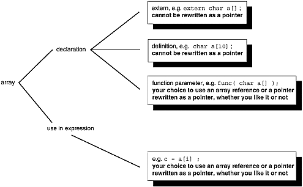
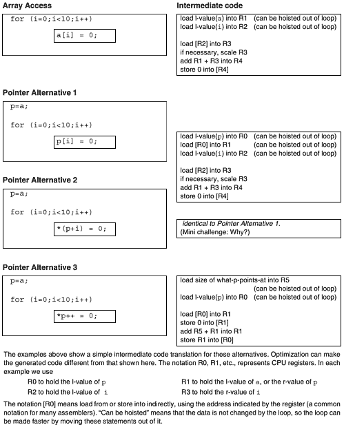
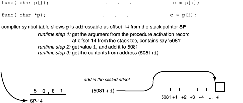
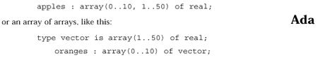
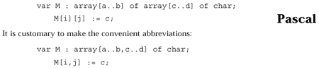
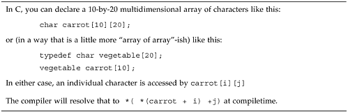
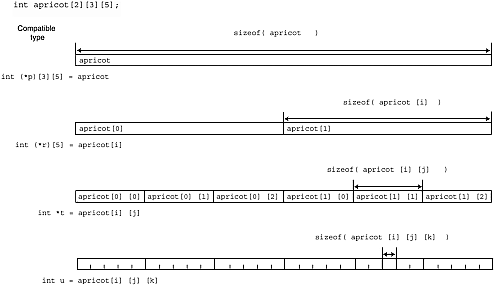
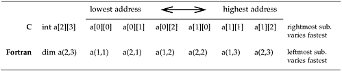
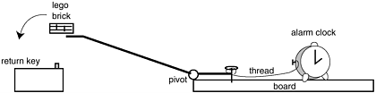

# Chương 9. Thêm về array

Đừng ăn nơi tên "Mom's". Đừng chơi bài với người tên "Doc".

Và tuyệt đối đừng quên C coi l-value array-of-T trong expression là pointer tới phần tử đầu array.

—Câu nói truyền thống của lập trình viên C

khi array là pointer…vì sao nhầm?…"array name trong expression" là pointer…vì sao subscript thành pointer offset…"array name làm function parameter" là pointer…vì sao array parameter là pointer…cách tham chiếu…index slice…tổng hợp thay thế…C có array multi-dimensional…ngôn ngữ khác gọi "array của array"…layout memory…initialize…giải trí nhẹ — hardware/software trade-offs

## Khi array là pointer

Chương trước nhấn trường hợp phổ biến array không viết pointer được. Đây bắt đầu khi có thể. Thực tế nhiều dịp thay được hơn không. Xét declaration, use theo nghĩa trực giác thông thường riêng.

Declaration chia ba:

- External array declaration

- Array definition (trường hợp đặc biệt declaration, allocation space, có thể initial value)

- Function parameter declaration

Mọi array name là function parameter luôn compiler đổi pointer. Trường hợp khác, nhất "định array file này/khai pointer file khác", declaration array cho array, pointer cho pointer, không gặp. Nhưng use (reference statement/expression) luôn viết pointer được. Tổng hợp Hình9-1.

Hình 9-1. Khi array là pointer



Tuy vậy compiler xử lý khác, biểu diễn runtime khác, có thể code khác. Với compiler array là address, pointer address của address. Chọn đúng công cụ.

## Vì sao nhầm?

Vì sao tưởng thay hoàn toàn? Vì đọc tài liệu tham khảo chuẩn!

The C Programming Language, ấn bản2, Kernighan \& Ritchie, cuối trang99:

Là formal parameter trong function definition

lật trang100:

```
char s[];
```

và

```
char *s;
```

tương đương; . . .

Arggggghhh! Argv! Argc! Ngắt trang K\&R2 quá xui! Dễ bỏ rằng tương đương chỉ formal parameter definition, nhất khi nhấn subscript expression luôn pointer-plus-offset.

"The C Programming Language," Ritchie, Johnson, Lesk \& Kernighan, The Bell System Technical Journal, tập57 số6 July-Aug 1978, trang 1991-2019:

có rule chung: array name trong expression đổi pointer tới member đầu.

Từ chính "expression" không định nghĩa trong bài.

Học lập trình thường đầu một function, rồi nhiều, rồi chia file. Vậy quen array/pointer argument thay nhau hoàn toàn:

```
char my_array[10];
 char * my_ptr;
...
 i = strlen( my_array );
 j = strlen( my_ptr );
```

Còn thường thấy statement

```
printf("%s %s", my_ptr, my_array);
```

rõ thay thế được, dễ quên chỉ actual parameter function call. Tệ hơn viết

```
printf("array at location %x holds string %s",a ,a);
```

cùng statement dùng array name như address(pointer), như array character. Chỉ vì `printf` function nên array truyền pointer. Cũng quen parameter `main` là `char` `**argv` hay `char *argv[]` thay nhau. Chỉ vì `argv` parameter nhưng ru người kết luận "C nhất quán, đều trong address arithmetic". Thêm phân tích dài subscript luôn pointer thì dễ hiểu nhầm.

Khung dưới rất quan trọng, giải rồi nhắc nhiều chương này, sau. Chú ý đánh dấu, sẵn tham khảo nhiều lần!

### Giáo điều software


Khi array là pointer

Chuẩn C nói:

Rule Array name trong expression (khác declaration) được

1\. compiler coi pointer tới phần tử đầu <sup>\[1\]</sup> (diễn ý ANSI6.2.2.1).

Rule Subscript luôn tương đương offset pointer (diễn ý 2. ANSI6.3.2.1). Rule Array name trong function parameter declaration được

3\. compiler coi pointer tới phần tử đầu (diễn ý ANSI6.7.1).

<sup>\[1\]</sup> Với người bắt bẻ: vài ngoại lệ nhỏ coi array toàn thể. Không thay bằng pointer đầu khi:

- `sizeof()`

- `&`

Tổng hợp array/pointer như limerick/haiku, nghệ thuật liên quan nhưng biểu đạt khác. Phần sau ý nghĩa thực tế.

### Rule1 "Array name trong expression" là pointer

Rule1,2 kết hợp: subscripted reference luôn pointer-to-base-of-array cộng offset. Khai báo:

```
int a[10], *p, i=2;
```

thì `a[i]` truy cập mọi cách:

```
p=a;       p=a;         p=a+i;
p[i];      *(p+i);      *p;
```

Thậm chí compiler luôn viết `a[i]` thành `*(a+i)` compiletime, chuẩn buộc về khái niệm. Nhớ `[]` subscript operator như plus addition. Nhận integer, pointer-to-type-T, cho object T. Array name expression thành pointer, cuối mọi thứ pointer nên array/pointer thay nhau, cả hai subscript được. Subscript giao hoán như addition (5+3=3+5). Với int `a[10];` cả hai đúng:

```
a[6] = ....;
6[a] = ....;
```

Bản thứ hai không thấy production, chỉ làm rối người mới.

Compiler scale subscript theo object. Int4 byte thì `a[i+1]` sau `a[i]`4 byte không1. Scale trước cộng base. Vì vậy pointer luôn typed, chỉ type duy nhất, biết byte lấy dereference, scale subscript bao nhiêu.

### Rule2 C coi subscript array là pointer offset

Dạng pointer-plus-offset từ BCPL. Khiến runtime range-checking không thực tế. Subscript chỉ gợi không bảo array access; có thể by-passed dùng pointer. Chỉ range-checking subset hạn chế, thường không đáng.

Tin thuật toán array dùng pointer "hiệu quả hơn" thường sai. Compiler production-quality tối ưu hiện đại không nhất thiết code one-dimensional khác pointer. Subscript định qua pointer nên optimizer đổi biểu diễn tốt nhất. Xem lại, tách initialization khỏi loop access:

```
int a[10], *p, i;
```

Variable `a[i]` truy cập như Hình9-2.

Hình 9-2. Array/pointer code Trade-offs



Dù dịch simple-minded khác code, đi one-dimensional pointer thường không nhanh hơn subscript. Cả hai scale qua memory liên tiếp, offset nhân size ra byte. Size thường lũy thừa2 (int4,double8), thay nhân chậm bằng shift trái. Một shift-left-by-three bằng nhân8. Element không lũy thừa2 như struct thì không hứa.

Đi array int là idiom dễ nhận. Compiler tốt phân tích giữ base register, nhận loop pattern, code cuối có thể giống.

Pointer không nhất thiết nhanh hơn subscript one-dimensional. Lý do nền tảng offset là model hardware bên dưới.

### Rule3 "Array name làm function parameter" là pointer

Rule3 cần giải thích, ôn thuật ngữ K\&R.

Thuật ngữ Định nghĩa Ví dụ

Parameter variable định trong function definition `int power( int base, int n);`

hoặc prototype. `base`, `n` là parameter, có người gọi formal parameter.

Argument value dùng khi gọi cụ thể `i = power(10, j);` `10`, `j` là

argument, có người gọi actual parameter. Argument khác theo lần gọi.

Chuẩn buộc parameter "array of type" chỉnh thành "pointer to type". Formal parameter definition, compiler bắt đổi array thành pointer đầu. Thay copy chỉ truyền address. Parameter function tương tự, nhưng tạm array. Conversion ngầm nghĩa

```
my_function( int * turnip ) {...}
my_function( int turnip[] ) {...}
my_function( int turnip[200]){...}
```

hoàn toàn tương đương. Vậy `my_function()` hợp lệ với actual argument array hoặc pointer.

## Vì sao C coi array parameter là pointer

Vì efficiency, cớ thường xuyên vi phạm software engineering tốt. Fortran I/O quanh co vì tưởng "hiệu quả" re-use IBM704 assembler I/O vụng,lỗi thời. Portable C Compiler bỏ semantic checking trên cớ đáng ngờ `lint` riêng hiệu quả. Compiler ANSI đa số kiểm lỗi tốt đã ngầm hủy quyết định.

Array/pointer parameter tương đương vì hiệu quả. Dữ liệu non-array làm argument C by value, copy cho callee, không đổi variable gốc. Copy array có thể rất tốn memory/time, thường không muốn copy, chỉ chỉ array nào. Có thể storage specifier chọn by value/reference như Pascal. Quy ước mọi array pointer đầu, mọi thứ khác copy đơn giản compiler. Return không array/function, chỉ pointer tới chúng.

Có người coi mọi argument C call-by-value trừ array/function call-by-reference. Dùng address of tường minh cũng call-by-reference, gửi address thay copy. Công dụng chính address-of `&` mô phỏng call-by-reference. Không thật chính xác vì callee vẫn chỉ pointer, không chính thứ, khác khi size/copy.

### Cách tham chiếu array parameter

Hình 9-3 cho bước subscript parameter.

Hình 9-3. Tham chiếu array parameter có subscript



Giống hệt Sơ đồ C trang101 lookup pointer subscript. C cho declare/reference array (ý muốn truyền) hay pointer (thật nhận). Compiler biết formal array trong function luôn pointer đầu array size không biết, tạo đúng code không phân case.

Dạng nào cũng không tự biết count phần tử pointed-to. Cần quy ước NUL hoặc parameter extent. Ada thì mỗi array mang element size, dimension,index.

Với definition:

```
    func( int * turnip){...}
or
    func( int turnip[]){...}
or
    func( int turnip[200]){...}

int my_int; /* data definitions */
int * my_int_ptr;
int my_int_array[10];
```

mọi prototype trên gọi hợp lệ với argument sau, thường mục đích khác:

Bảng 9-1. Cách dùng array/pointer actual parameter

| Actual argument | Type | Mục đích thường |
|---|---|---|
| `func(&my_int );` | Address integer | "Call-by-reference" int |
| `func( my_int_ptr );` | Pointer integer | Truyền pointer |
| `func( my_int_array );` | Array integer | Truyền array |
| `func(&my_int_array[i] );` | Address phần tử array int | Truyền slice array |

Ngược lại trong `func()` không dễ biết argument dạng nào,mục đích nào. Compiler compiletime đổi array argument pointer, nên reference parameter trong function tạo pointer code. Hình 9-3 trang247 ý nghĩa.

Không cách truyền chính array vì luôn pointer. Dùng pointer làm hầu hết thứ array, nhưng size không đúng.

Chọn parameter array/pointer tùy, compiler nhận case function argument, tạo dereference.

#### Thử thách lập trình


Nghịch array/pointer argument

Viết chạy program kiểm thông tin.

1\. Function nhận character array `ca`, in `&ca`, `&(ca[0])`, `&(ca[1]).`

2\. Function khác character pointer `pa`, in `&pa`, `&(pa[0])`, `&(pa[1])`, `++pa`.

3\. Global array `ga` alphabet, gọi hai function, so value.

4\. Main in `&ga`, `&(ga[0])` và

```
&(ga[1]).
```

5\. Trước chạy, đoán value nào khớp,vì sao, giải mọi lệch.

Cần kỷ luật giữ rõ! Chúng tôi thích parameter pointer vì compiler đổi vậy. Đặt tên sai bản chất style đáng ngờ. Nhưng có người thấy:

`int table[]` thay `int *table`

rõ ý hơn: `table[]` nói còn nhiều int sau thứ table trỏ, gợi xử lý hết.

Pointer làm được mà array name không: đổi value. Array name không modifiable l-values. Hình 9-4 function đặt cạnh so, cùng file.

Hình 9-4. Operation hợp lệ trên array argument

```
 pointer argument   array argument       pointer non-argument
                                     int array[100],
array2[100];
fun1(int *ptr)    fun2(int arr[])    main()
{                 {                  {
   ptr[1]=3;         arr[1]=3;          array[1]=3;
   *ptr = 3;         *arr = 3;          *array = 3;
   ptr = array2;     arr = array2;      array =
array2;/*FAILS*/
}                 }                  }
```

`array = array2;` lỗi compiletime "không đổi value array name". Nhưng `arr = array2;` hợp lệ vì `arr` khai array thật pointer.

## Index slice

Cả array truyền pointer phần tử zero, cũng pointer bất kỳ để truyền đuôi. Có người chủ yếu Fortran truyền address trước đầu (`a[-1]`) để range1..N thay0..N-1.

Quen thuật toán Fortran1..N rất hấp dẫn, nhưng ngoài chuẩn hoàn toàn, Mục6.3.6 Additive Operators cấm, undefined, nên đừng nói nghe tôi.

Đơn giản khai array lớn thêm một, range0..N, chỉ dùng1..N, không rắc rối.

## Tổng hợp array/pointer thay thế

Đừng đọc chưa hiểu chương trước, có thể brain-fade vĩnh viễn.

1\. Compiler luôn viết/hiểu `a[i]` thành `*(a+i);`

2\. Pointer chỉ pointer, không đổi array. Subscript được, thường khi function argument biết truyền array.

3\. Chỉ context parameter declaration array viết pointer tương đương. Array actual argument luôn đổi pointer đầu.

4\. Vậy chọn parameter array hay pointer đều nhận pointer trong function.

5\. Case khác definition khớp declaration. Định array thì extern array, pointer cũng vậy.

## C có multidimensional array…

Có người nói không, họ sai. ANSI6.5.4.2 chú69: nhiều "array of" liên tiếp (ngoặc vuông index) khai multidimensional.

## …Nhưng ngôn ngữ khác gọi "array của array"

Ý họ không như Pascal/Ada. Ada khai multidimensional như Hình9-5.

Hình 9-5. Ví dụ Ada



Không trộn táo, dưa cải. Ada multidimensional với array của array khác hoàn toàn.

Pascal ngược, coi hoàn toàn tương đương mọi lúc, khai/truy cập như Hình9-6.

Hình 9-6. Ví dụ Pascal



Pascal User Manual and Report <sup>\[1\]</sup> nói tương đương. Ada chặt, tách nghiêm. Memory giống nhưng type compatible/gán từng row khác. Như chọn float/int sát data. Ada multidimensional cho index độc lập như Cartesian point; array của array cho phân cấp như \[12\] tháng \[5\] tuần \[7\] ngày, vừa record mỗi ngày vừa thao tác cả tuần/tháng.

<sup>\[1\]</sup> The Pascal User Manual and Report, Springer-Verlag,1975,tr39.

### Mẹo thực hành hữu ích


"Multidimensional" nghĩa trong ngôn ngữ khác

Chuẩn Ada nói array của array khác multidimensional.

Chuẩn Pascal nói giống.

C chỉ thứ người khác gọi array của array, nhưng cũng gọi multidimensional.

C độc đáo: chỉ define/reference multidimensional bằng array của array. Không gộp `[i][j][k]` thành Pascal-style `[i,j,k].` Biết làm và chịu nonconforming thì tính offset `[i][j][k]`, dùng `[z]`, không khuyên. Tệ hơn `[i,j,z]` expression comma-separated hợp lệ nhưng không nhiều subscript. Làm rối rất nhiều người (Hình9-7).

Hình 9-7. Array của array



Dù tên multidimensional, C thật chỉ array của array. Nghĩ "array" là "vector" (one-dimensional thứ nào đó, có thể array khác) đơn giản rất nhiều.

#### Mẹo thực hành hữu ích


Array C là One-Dimensional

Thấy array nghĩ vector, one-dimensional của thứ có thể array khác.

## Multidimensional array phân thành component thế nào

Chú ý phân thành array thành phần. Khai báo

```
int apricot[2][3][5];
```

cho cùng storage nhìn theo Hình 9-8.

Hình 9-8. Storage multidimensional array



Thường gán type giống, int/int,double/double. Hình 9-8 mỗi array trong array-of-array-of-arrays tương thích pointer vì array-name expression decay "pointer-to-element" (Rule1 trang242). Không gán array cho cùng type vì không assignment toàn array. Pointer nhận value array-name theo rule "array-name expression decay pointer". Dimension của array pointer trỏ rất quan trọng. Với declaration trên,

```
r++;
t++;
```

tăng `r`, `t` trỏ respective next, cả hai là array. Scale khác vì `r` trỏ element lớn gấp ba `t`.

### Thử thách lập trình


Hoan hô array!

Với declaration:

```
int apricot[2][3][5];

int (*r)[5] = apricot[0];
int *t = apricot[0][0];
```

Viết in initial `r`, `t` hex bằng conversion `%x` printf, tăng pointer, in mới.

Đoán tăng bao byte trước chạy, dùng Hình 9-8 trang255.

## Array bố trí memory thế nào

C subscript phải nhất đổi nhanh nhất, "row major addressing". Vì row/column chỉ có nghĩa hai chiều, thích tên "rightmost subscript varies fastest". Đa số ngôn ngữ vậy, Fortran ngoại lệ trái/column. Ảnh hưởng layout, truyền C matrix Fortran hiện chuyển vị, kludge lớn đôi khi tận dụng.

Hình 9-9. Row major so column major



C thường multidimensional lưu nhiều string. Thứ tự rightmost-subscript-varies-fastest lợi vì character liền nhau cùng string ở cạnh, không vậy nếu leftmost-subscript-varies-fastest.

## Initialize array thế nào

Array one-dimensional đơn giản cho list value ngoặc nhọn. Bỏ size thì đúng số initializer.

```
float banana [5] = { 0.0, 1.0, 2.72, 3.14, 25.625 };

float honeydew[] = { 0.0, 1.0, 2.72, 3.14, 25.625 };
```

Chỉ assignment cả array lúc declaration, không lý do tốt hạn chế.

Multidimensional initialize ngoặc lồng:

```
short cantaloupe[2][5] = {
 {10, 12, 3, 4, -5},
 {31, 22, 6, 0, -5},
};

int rhubarb[][3] ={ {0,0,0}, {1,1,1}, };
```

Có/bỏ comma sau cuối, bỏ được chỉ dimension lớn nhất, compiler tính từ count initializer.

Dimension lớn hơn count thì phần còn zero, pointer NULL, floating0.0. IEEE754 IBM PC/Sun 0.0 cùng bit pattern integer zero.

### Thử thách lập trình


Kiểm bit pattern

Viết one-liner kiểm floating0.0 cùng integer zero không.

Initialize two-dimensional array string:

```
char vegetables[][9] = { "beet",
                         "barley",
                         "basil",
                         "broccoli",
                         "beans" };
```

Hữu ích array pointer. String literal làm initializer, compiler lưu address đúng. Vậy,

```
char *vegetables[] = { "carrot",
                       "celery",
                       "corn",
                       "cilantro",
                       "crispy fried potatoes" }; /* works
fine */
```

Phần initialization giống array array character. Chỉ string literal đặc quyền khởi pointer array, không trực tiếp non-string:

```
int *weights[] = {           /* will NOT compile successfully
*/
                  {1,2,3,4,5},
                  {6,7},
                  {8,9,10}
                };           /* will NOT compile successfully
*/
```

Bí mật là tạo row array riêng, dùng tên initialize array gốc.

```
int row_1[] = {1,2,3,4,5,-1}; /* -1 is end-of-row marker */
int row_2[] = {6,7,-1};
int row_3[] = {8,9,10,-1};

int *weights[] = {
                  row_1,
                  row_2,
                  row_3
};
```

Chương sau pointer thêm. Trước giải trí.

## Giải trí nhẹ — Hardware/software Trade-Offs

Programmer thành công hiểu hardware/software trade-offs. Ví dụ từ bạn của bạn: nhiều năm trước mail order company lớn dùng IBM legacy mainframe giữ database tên/address, không batch control.

IBM lỗi thời sắp Burroughs thay. Xưa đến mức Burroughs (chúng tôi đảo "Rubs-rough") không còn từ giữa1980 hợp Sperry thành Unisys. Trong khi IBM hết công suất cả ca đêm. Operator đêm chỉ đợi day job xong, khởi bốn job cách đêm.

Manager muốn chuyển người sang ngày, cần batch timed. IBM báo hàng chục nghìn đô nâng software, không ai muốn máy sắp nghỉ. Máy chia partition mỗi terminal riêng; sắp job mỗi terminal, chỉ cần return chạy. Manager thiết kế bốn "ngón tay ma" Hình9-10.

Hình 9-10. Ngón tay ma



Mỗi đêm đặt sau terminal, 2giờ alarm đầu kêu. Winder cuộn chỉ, kéo chốt, tay rơi return. Lego bật ra tránh bounce/repeat, job chạy.

Ai cười nhưng sáu tháng đến hệ mới! Vài giờ sau nghiệm thu, kỹ sư IBM/Burroughs xin mẫu Rube Goldberg còn. Đó là cốt software-hardware trade-off thành công.

### Lời giải lập trình


Nghịch array/pointer argument

```
char ga[] = "abcdefghijklm";

void my_array_func( char ca[10] )
{
   printf(" addr of array param = %#x \n",&ca);
   printf(" addr (ca[0]) = %#x \n",&(ca[0]));
   printf(" addr (ca[1]) = %#x \n",&(ca[1]));
   printf(" ++ca = %#x \n\n", ++ca);
}

void my_pointer_func( char *pa )
{
   printf(" addr of ptr param = %#x \n",&pa);
   printf(" addr (pa[0]) = %#x \n",&(pa[0]));
   printf(" addr (pa[1]) = %#x \n",&(pa[1]));
   printf(" ++pa = %#x \n", ++pa);
}

main()
{
   printf(" addr of global array = %#x \n",&ga);
   printf(" addr (ga[0]) = %#x \n",&(ga[0]));
   printf(" addr (ga[1]) = %#x \n\n",&(ga[1]));
   my_array_func( ga );
   my_pointer_func( ga );
}
```

Output:

```
% a.out
 addr of global array = 0x20900
 addr (ga[0]) = 0x20900
 addr (ga[1]) = 0x20901

 addr of array param = 0xeffffa14
 addr (ca[0]) = 0x20900
 addr (ca[1]) = 0x20901
 ++ca = 0x20901

 addr of ptr param = 0xeffffa14
 addr (pa[0]) = 0x20900
 addr (pa[1]) = 0x20901
 ++pa = 0x20901
```

Thoạt lạ address parameter array không bằng address phần tử đầu nhưng đúng.

Có thể thắng nhiều cược money-making với người mới về sizeof trường hợp này.
