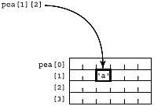
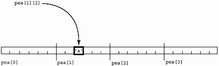
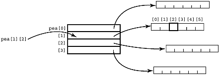
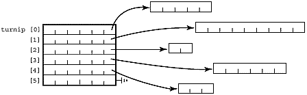

# Chương 10. Thêm về pointer

Đừng bao giờ quên rằng khi bạn chỉ tay vào ai đó, ba ngón tay của chính bạn đang chỉ ngược lại vào mình…

—Tục ngữ của một điệp viên đa nghi

cách bố trí multidimensional array…array chứa pointer là một "Iliffe vector"…dùng pointer cho ragged array…truyền array one-dimensional vào function…dùng pointer để truyền multidimensional array vào function…dùng pointer để trả array về từ function…dùng pointer để tạo và sử dụng dynamic array…một chút giải trí—những giới hạn của việc chứng minh chương trình

## Cách bố trí multidimensional array

Multidimensional array không phổ biến trong systems programming, nên không có gì ngạc nhiên khi C không định nghĩa những runtime routine phức tạp mà các ngôn ngữ khác cần để hỗ trợ tính năng này. Đối với một số cấu trúc, như dynamic array, lập trình viên phải chủ động cấp phát và thao tác memory bằng pointer thay vì để compiler làm việc đó. Đối với một cấu trúc khác (multidimensional array làm parameter), hoàn toàn không có cách biểu diễn trường hợp tổng quát trong C. Chương này đề cập tới những vấn đề đó. Đến đây, mọi người hẳn đã quen với cách bố trí multidimensional array trong memory. Nếu có declaration

```
char pea[4][6];
```

một số người nghĩ rằng từng hàng của array two-dimensional được bố trí thành một bảng, như trong Hình 10-1.

Hình 10-1. Cách bố trí memory được hình dung cho một array Two-dimensional



Đừng bao giờ để một lập trình viên như vậy đỗ xe giúp bạn. Vùng lưu trữ và việc tham chiếu tới từng phần tử thực tế được bố trí trong memory tuyến tính như Hình 10-2.

Hình 10-2. Cách bố trí memory thực tế của một array Two-dimensional



Các quy tắc về array subscript (xem Chương 9, trang 242) cho biết rằng để đánh giá l-value `pea[i][j]`, ta lấy thứ nằm tại `pea[i]`, sau đó lấy character tại offset `[j]` tính từ đó. Vì vậy, compiler phân giải `pea[i][j]` thành

```
*(*(pea+i)+j)
```

Nhưng (và đây là điểm mấu chốt!) ý nghĩa của "`pea[i]`" thay đổi tùy cách `pea` được định nghĩa. Chúng ta sẽ quay lại expression này ngay sau đây, nhưng trước hết hãy xem một data structure rất phổ biến và quan trọng của C: array one-dimensional chứa các pointer tới string.

## Array chứa pointer là một "Iliffe vector"

Có thể đạt hiệu quả tương tự array two-dimensional chứa char bằng cách khai báo một array onedimensional chứa pointer, mỗi pointer trỏ tới một string chứa character. <sup>\[1\]</sup> Declaration C tương ứng là

<sup>\[1\]</sup> Ở đây chúng ta đơn giản hóa đôi chút—pointer thực ra được khai báo là pointer tới một character duy nhất. Bằng cách khai báo pointer-to-character, ta để ngỏ khả năng lưu các character khác cạnh character đầu tiên, qua đó ngầm tạo thành string. Một declaration như `char (* rhubarb[4])[7];` mới thực sự là cách khai báo array chứa pointer tới string. Trong thực tế không bao giờ thấy cách này, vì nó ràng buộc không cần thiết kích thước các array pointed-to (phải dài đúng bảy character).

```
char * pea[4];
```

### Giáo điều software


Nhắc lại cú pháp declaration

Lưu ý rằng `char *turnip[23]` khai báo "turnip" là một array 23-element, mỗi phần tử là pointer tới một character (hoặc character-string—không thể phân biệt chỉ từ declaration). Hãy hình dung nó có ngoặc như sau—`(char *) turnip[23]`. Nó không có ý nghĩa như khi đọc từ trái sang phải: pointer tới array 23-element chứa character. Đó là vì dấu ngoặc chỉ số có độ ưu tiên cao hơn dấu sao của pointer. Chương 3 về declaration đã trình bày đầy đủ điều này.

Một array chứa pointer được dùng để hỗ trợ multidimensional array có thể được gọi là "Iliffe vector", "display" hoặc "dope vector". Ở Anh, display còn có nghĩa là vector chứa pointer tới các stack frame đang hoạt động của những procedure bao ngoài theo phạm vi từ vựng (thay cho một static link nối tiếp bằng linked list). Array chứa pointer như vậy là một kỹ thuật lập trình mạnh, có phạm vi ứng dụng rộng bên ngoài C. Dưới dạng sơ đồ, cấu trúc này được thể hiện trong Hình 10-3.

Hình 10-3. Một array chứa Pointers-to-String



Array phải được khởi tạo bằng các pointer tới memory đã cấp phát cho string, hoặc lúc compile bằng literal initializer, hoặc lúc chạy bằng code như sau:

```
for (j=0;j<=4;j++) {
    pea[j] = malloc( 6 );
```

Một cách khác là malloc toàn bộ array dữ liệu x nhân y cùng một lúc,

```
malloc(row_size * column_size * sizeof(char) ) ;
```

sau đó dùng loop để gán các pointer tới những vị trí trong vùng đó. Toàn bộ array được bảo đảm lưu trong memory liên tục, theo thứ tự mà C cấp phát static array. Cách này giảm chi phí quản lý của các lời gọi malloc nhưng không cho phép giải phóng riêng từng string khi dùng xong.

#### Giáo điều software


Khi thấy `squash[i][j]`—bạn không biết nó đã được khai báo thế nào!

Một vấn đề khi có thể dùng double-subscript cho cả array two-dimensional lẫn array one-dimensional chứa pointer là nhìn vào tham chiếu `squash[i][j]` không cho biết squash đã được khai báo theo cách nào:

```
int squash[23][12];    /* array [23] of array[12] of int
*/
```

hoặc

```
int * squash[23];      /* an Iliffe vector of 23
pointers-to-int */
```

hoặc

```
int ** squash;         /* pointer to a pointer to int */
```

hoặc thậm chí

```
int (* squash)[12];    /* pointer to array-of-12-ints */
```

Điều này tương tự việc không thể xác định (bên trong function) actual argument được truyền vào là array hay pointer, và tất nhiên cũng vì cùng một lý do: array name dưới dạng l-values "chuyển thành" pointer.

Cùng một tham chiếu `squash[i][j]` dùng được để truy cập bất kỳ definition nào trong số này, dù loại truy cập khác nhau giữa các trường hợp.

Cũng như array của array, từng character trong Iliffe vector được tham chiếu bằng hai chỉ số (ví dụ `pea[i][j]`). Các quy tắc về pointer subscript (xem Chương 9, trang 242) cho biết `pea[i][j]` trở thành:

```
* ( *(pea + i) + j )
```

Trông có quen không? Hẳn là có. Đây chính xác là expression mà tham chiếu multidimensional array được phân rã thành, và nhiều sách C giải thích theo cách này. Tuy nhiên, có một vấn đề lớn. Dù hai subscript trông giống hệt nhau trong source và đều phân rã thành cùng một pointer expression, mỗi trường hợp lại thực hiện một loại tham chiếu khác. Bảng 10-1 và 10-2 cho thấy sự khác biệt.

Bảng 10-1. `char a[4][6]`—Một Array-of-Arrays

`char a[4][6]`—Một Array-of-Arrays; symbol table của compiler ghi nhận `a` có địa chỉ 9980

Bước 1 lúc chạy: lấy giá trị `i`, nhân với kích thước một hàng (ở đây là 6 byte) rồi cộng với 9980

Bước 2 lúc chạy: lấy giá trị `j`, nhân với kích thước một phần tử (ở đây là 1 byte) rồi cộng vào kết quả bước trước

Bước 3 lúc chạy: lấy nội dung tại địa chỉ (9980 + `i*`scale-factor1 + `j*`scale-factor2)

`a[i][j]`

Definition `char a[4][6]` nói rằng `a` là array \[4\], mỗi phần tử là array \[6\], và mỗi phần tử của array đó là một `char`. Vì vậy, thao tác look-up đi tới array thứ i trong bốn array (bước qua i array six-byte để tới đó), rồi lấy character thứ j trong array ấy.

Bảng 10-2. `char *p[4]`—Một array chứa Pointers-to-String

`char *p[4]`—Một array chứa Pointers-to-String

symbol table của compiler ghi nhận `p` có địa chỉ 4624

Bước 1 lúc chạy: lấy giá trị `i`, nhân với kích thước một pointer (ở đây là 4 byte) rồi cộng với 4624

Bước 2 lúc chạy: lấy nội dung tại địa chỉ (4624 + giá trị `i` đã được nhân), giả sử là 5081

Bước 3 lúc chạy: lấy giá trị `j`, nhân với kích thước một phần tử (ở đây là 1 byte) rồi cộng với 5081

Bước 4 lúc chạy: lấy nội dung tại địa chỉ (5081 + `j`)

`p[i][j]`

Definition `char * p[4`\] nói rằng `p` là array \[4\], mỗi phần tử là pointer-to-char. Vì vậy, thao tác look-up thậm chí không thể hoàn tất trừ khi các pointer đã được điền để trỏ tới character (hoặc array chứa character). Giả sử mọi thứ đã có giá trị, look-up đi tới phần tử thứ i của array (mỗi phần tử là pointer), lấy giá trị pointer tại đó, cộng j vào rồi lấy nội dung tại địa chỉ kết quả.

Điều này hoạt động nhờ quy tắc 2 trong Chương 8: subscript luôn tương đương với offset tính từ pointer. Vì thế, `turnip[i]` chọn một phần tử riêng lẻ, tình cờ là pointer; sau đó áp dụng subscript `[j]` cho nó sẽ cho `*(pointer + j)`, đi tới một character duy nhất. Đây chỉ là sự mở rộng của việc cả a\[2\] lẫn p\[2\] đều được đánh giá thành character, như ta thấy ở chương trước.

## Dùng pointer cho ragged array

Iliffe vector là một kỹ thuật compiler-writing lâu đời, được sử dụng đầu tiên trong Algol-60. Ban đầu chúng được dùng để tăng tốc tham chiếu array và đơn giản hóa việc chỉ giữ một phần array trong main memory trên các máy limited-memory. Cả hai công dụng này đều ít phù hợp hơn với hệ thống hiện đại, nhưng Iliffe vector còn có giá trị theo hai cách khác: lưu những bảng có hàng dài khác nhau và truyền array chứa string trong lời gọi function. Nếu cần lưu 50 string có độ dài thay đổi tới 255 character, bạn có thể khai báo array two-dimensional sau:

```
char carrot[50][256];
```

Cách này dành sẵn 256 character cho mỗi string trong số năm mươi string, dù trên thực tế một số string chỉ dài một hoặc hai byte. Nếu dùng nhiều, nó có thể lãng phí memory. Một phương án khác là dùng array chứa pointers-to-strings; lưu ý rằng các array cấp thứ hai không nhất thiết phải cùng kích thước, như Hình 10-4.

Hình 10-4. Ragged string array



Nếu khai báo array chứa pointer tới string rồi cấp phát memory cho các string này khi cần, bạn sẽ tiết kiệm tài nguyên máy hơn nhiều. Một số người gọi đây là "ragged array" vì phần cuối right-hand không đều nhau. Bạn có thể tạo chúng bằng cách điền Iliffe vector với pointer tới các string đã tồn tại hoặc cấp phát memory cho một bản sao string mới. Cả hai cách được trình bày trong Hình 10-5.

Hình 10-5. Tạo ragged string array

```
                 char * turnip[UMPTEEN];
                 char my_string[] = "your message here";
        /* share the string */          /* copy the string */
turnip[i] = &my_string[0];       turnip[j] =
                                     malloc( strlen(my_string)
+ 1 );
                                 strcpy(turnip[j], my_string);
```

Bất cứ khi nào có thể, đừng tạo bản sao mới của toàn bộ string. Nếu cần tham chiếu string từ hai data structure khác nhau, sao chép pointer thay vì string sẽ nhanh hơn nhiều và tốn ít vùng lưu trữ hơn. Một khía cạnh hiệu năng khác cần cân nhắc là Iliffe vector có thể khiến string được cấp phát trên các page khác nhau trong memory. Điều này có thể làm giảm locality of reference và tăng paging, tùy cách thức cũng như tần suất bạn tham chiếu dữ liệu.

### Mẹo thực hành hữu ích


Cách compiler biến đổi array parameter và pointer parameter

Quy tắc "array name được viết lại thành pointer argument" không có tính đệ quy. Array của array được viết lại thành "pointer tới array", chứ không phải "pointer tới pointer".

Argument là: Khớp với formal parameter:

array của array `char c[8][10];` `char (*c)[10];` pointer tới array; array chứa pointer `char *c[15];` `char **c;` pointer tới pointer; pointer tới array `char (*c)[64];` `char (*c)[64];` không thay đổi; pointer tới pointer `char **c;` `char **c;` không thay đổi

Lý do bạn thấy `char ** argv` là vì `argv` là array chứa pointer (tức `char *argv[])`. Nó chuyển thành pointer tới phần tử, nghĩa là pointer tới pointer. Nếu parameter `argv` thực sự được khai báo là array của array (chẳng hạn `char argv[10][15])` thì nó sẽ chuyển thành `char (* argv)[15] (`tức pointer tới array chứa character), chứ không phải `char ** argv.`

### Chỉ dành cho học viên nâng cao

Hãy dành một chút thời gian xem lại Hình 9-8, "Vùng lưu trữ của multidimensional array", ở trang 255. Chú ý rằng các variable được ghi "compatible type" ở phía trái sơ đồ khớp chính xác với cách bạn sẽ khai báo array tương ứng làm function argument (trong bảng ở trên).

Điều này không quá bất ngờ. Hình 9-8 cho thấy cách array name trong expression chuyển thành pointer; bảng ở trên cho thấy cách array name làm function argument chuyển thành pointer. Cả hai trường hợp đều chịu chi phối của một quy tắc tương tự về việc viết lại array name thành pointer trong ngữ cảnh cụ thể đó.

Hình 10-6 trình bày mọi tổ hợp code hợp lệ. Chúng ta thấy rằng:

- Cả ba function nhận cùng type argument: array \[2\]\[3\]\[5\] hoặc pointer tới array\[3\]\[5\] chứa int.

- Cả ba variable `apricot,` `p,` `*q` đều khớp với declaration của parameter trong cả ba function.

Hình 10-6. Mọi tổ hợp code hợp lệ

```
my_function_1( int fruit [2][3][5] ) { ; }
my_function_2( int fruit [][3][5] ) { ; }
my_function_3( int (*fruit)[3][5] ) { ; }

                         int apricot[2][3][5];

                         my_function_1( apricot );
                         my_function_2( apricot );
                         my_function_3( apricot );

                         int (*p) [3][5] = apricot;

                         my_function_1( p );
                         my_function_2( p );
                         my_function_3( p );

                         int (*q)[2][3][5] = &apricot;

                         my_function_1( *q );
                         my_function_2( *q );
                         my_function_3( *q );
```

#### Thử thách lập trình


Hãy kiểm tra thử

Hãy nhập code C trong Hình 10-6 và tự mình thử nghiệm.

## Truyền array One-Dimensional vào function

Array One-dimensional của bất kỳ type nào đều có thể làm function argument trong C. Parameter được viết lại thành pointer tới phần tử đầu tiên, nên bạn có thể cần quy ước để cho biết tổng kích thước array. Có hai phương pháp cơ bản:

- Truyền thêm một parameter cho biết số phần tử (đây là việc mà `argc` thực hiện)

- Cho phần tử cuối của array một giá trị đặc biệt để đánh dấu kết thúc dữ liệu (đây là việc character nul ở cuối string thực hiện). Giá trị đặc biệt phải là một giá trị không thể xuất hiện ở nơi khác trong dữ liệu.

Array Two-dimensional phức tạp hơn đôi chút vì array được viết lại thành pointer tới hàng đầu tiên. Giờ bạn cần hai quy ước: một để đánh dấu kết thúc từng hàng, một để đánh dấu kết thúc tất cả các hàng. Có thể đánh dấu kết thúc từng hàng bằng một trong hai phương pháp dùng cho array one-dimensional; kết thúc tất cả các hàng cũng vậy. Ta được truyền một pointer tới phần tử đầu tiên của array. Mỗi lần tăng pointer, ta có địa chỉ hàng tiếp theo của array, nhưng làm sao biết đã tới giới hạn array? Có thể thêm một hàng chứa toàn giá trị out-of-bound không xuất hiện ở nơi khác—nếu có giá trị như vậy. Khi tăng pointer, hãy kiểm tra xem nó đã tới hàng đó chưa. Hoặc định nghĩa thêm một parameter nữa cho biết tổng số hàng.

## Dùng pointer để truyền multidimensional array vào function

Có thể giải quyết vấn đề đánh dấu phạm vi array bằng những phương pháp khó coi vừa mô tả. Nhưng ta còn phải khai báo argument array two-dimensional bên trong function, và đó mới là rắc rối thực sự. C không có cách biểu diễn khái niệm "giới hạn của array này có thể thay đổi giữa các lần gọi". C compiler nhất quyết phải biết các giới hạn để sinh đúng code đánh chỉ số. Về kỹ thuật, có thể xử lý việc này lúc chạy, và nhiều ngôn ngữ khác làm được, nhưng đó không phải triết lý của C. Có lẽ cách tốt nhất là từ bỏ array two-dimensional và đổi `array[x][y]` thành array one-dimensional `array[x+1]` chứa pointer tới `array[y]`. Điều này đưa vấn đề về trường hợp ta đã giải quyết, và có thể lưu null pointer ở phần tử cao nhất `array[x+1]` để đánh dấu kết thúc các pointer.

### Giáo điều software


Trong C, không có cách truyền một multidimensional array tổng quát vào function

Đó là vì ta cần biết kích thước từng chiều để điều chỉnh đúng address arithmetic. C không có cách truyền dữ liệu này (vốn thay đổi sau mỗi lần gọi) giữa actual parameter và formal parameter. Vì thế, bạn phải cung cấp kích thước của mọi chiều trừ chiều ngoài cùng bên trái trong formal parameter. Điều đó lại giới hạn actual parameter vào các array có kích thước khớp ở mọi chiều trừ chiều ngoài cùng bên trái.

```
invert_in_place( int a[][3][5] );
```

có thể được gọi bằng một trong hai cách:

```
int b[10][3][5]; invert_in_place( b );
int c[999][3][5]; invert_in_place( c );
```

Nhưng các array 3-dimensional tùy ý như:

```
int fails1[10][5][5];  invert_in_place( fails1 );/* does
NOT compile */
int fails2[999][3][6]; invert_in_place( fails2 );/* does
NOT compile */
```

sẽ không compile được.

Array có từ hai chiều trở lên không thể được dùng làm parameter trong trường hợp tổng quát trong C. Bạn không thể truyền một multidimensional array tổng quát vào function. Bạn có thể truyền những array cụ thể có kích thước đã biết và được định trước, nhưng không thể làm vậy trong trường hợp tổng quát.

Cách hiển nhiên nhất là khai báo function prototype như sau:

### Cách thử 1

```
my_function( int my_array [10][20] );
```

Dù đây là cách đơn giản nhất, nó cũng ít hữu ích nhất, vì buộc function chỉ xử lý array có kích thước chính xác là 10 nhân 20 integer. Điều thực sự cần là cách chỉ định multidimensional array parameter tổng quát hơn để function thao tác được trên array có kích thước bất kỳ. Lưu ý rằng không cần chỉ định kích thước chiều có ý nghĩa cao nhất. Function chỉ cần biết kích thước của tất cả các chiều khác và địa chỉ cơ sở của array. Thông tin đó đủ để "bước qua" cả một hàng và tới hàng tiếp theo.

### Cách thử 2

Ta có thể bỏ chiều đầu tiên một cách hợp lệ và khai báo multidimensional array như sau:

```
my_function( int my_array [][20] );
```

Cách này vẫn chưa đủ tốt vì tất cả các hàng vẫn buộc phải dài đúng 20 integer. Function cũng có thể được khai báo tương đương như sau:

```
my_function( int (* my_array)[20] );
```

Dấu ngoặc quanh `(* my_array)` trong danh sách parameter là hoàn toàn cần thiết để bảo đảm nó được diễn giải thành một pointer duy nhất tới array 20-element chứa int, chứ không phải array chứa 20 pointers-to-int. Tuy nhiên, một lần nữa ta vẫn bị ràng buộc vào array có kích thước hai mươi ở chiều ngoài cùng bên phải.

#### Giáo điều software


Conformant array

Trong thiết kế ban đầu, Pascal có cùng lỗ hổng chức năng như C—không có cách truyền các array khác kích thước vào cùng một function. Thực ra Pascal còn tệ hơn, vì nó thậm chí không hỗ trợ trường hợp array one-dimensional mà C làm được. Giới hạn array là một phần signature của function, và type mismatch xảy ra nếu kích thước argument không khớp về mọi mặt. Code Pascal như sau sẽ thất bại:

```
var apple : array[1..10] of integer;
procedure invert( a: array[1..15] of integer);
invert(apple); { fails to compile! }
```

Để sửa thiếu sót này, những bậc thầy language-meisters chuẩn hóa Pascal nghĩ ra khái niệm conformant array—đáng ra nên đặt tên là array gây bối rối. Đây là giao thức truyền kích thước array giữa actual parameter và formal parameter. Cách hoạt động của nó không dễ hiểu ngay đối với lập trình viên thông thường, và nó cũng không có trong ngôn ngữ phổ biến nào khác. Bạn phải viết code như sau:

```
procedure a(fname: array[lo..hi:integer] of char);
```

Các tên dữ liệu `lo` và `hi` (hoặc bất kỳ tên nào bạn chọn) được điền giới hạn array tương ứng từ actual parameter trong mỗi lần gọi. Kinh nghiệm cho thấy nhiều lập trình viên thấy điều này khó hiểu. Khi giải quyết trường hợp tổng quát, những người thiết kế ngôn ngữ còn khiến trường hợp đơn giản nhất dùng giới hạn array cố định bằng literal trở thành bất hợp lệ:

```
1 procedure a(fname: array[1..70] of char);
E --------------------------^--- Expected identifier
```

Khía cạnh này của định nghĩa ngôn ngữ rõ ràng trái với kỳ vọng của nhiều lập trình viên và đến nay vẫn gây ra nhiều cuộc gọi hỗ trợ. Trong nhóm compiler Sun, cứ vài tháng chúng tôi lại nhận một vụ chuyển cấp về "bug Pascal compiler" này. Pascal-conformant array còn có các vấn đề khác; ví dụ, conformant array chứa character không có string type (vì type của nó không được biểu thị bằng một array type), nên dù là array chứa character, nó không thể được dùng ở nơi yêu cầu string! Conformant formal array parameter gây phiền toái cho lập trình viên Pascal nhiều hơn hầu hết mọi thứ khác, có lẽ chỉ trừ interactive I/O. Tệ hơn nữa, hiện có người đang bàn việc bổ sung conformant array vào C.

### Cách thử 3

Khả năng thứ ba là từ bỏ array two-dimensional và đổi cách tổ chức thành Iliffe vector, tức tạo array one-dimensional chứa pointer tới thứ khác. Hãy nghĩ tới parameter của main routine. Ta quen thấy `char * argv[];`, đôi khi cả `char ** argv;`; nhớ lại điều đó giúp dễ giải nghĩa ký hiệu hơn. Chỉ cần truyền pointer tới phần tử số không làm parameter như sau (đối với array two-dimensional):

```
my_function( char **my_array );
```

Nhưng bạn chỉ làm được điều này nếu trước hết đổi array two-dimensional thành array chứa pointer tới vector!

Điểm hay của data structure Iliffe vector là cho phép truyền array tùy ý chứa pointer tới string vào function, nhưng chỉ áp dụng cho array chứa pointer và chỉ pointer tới string. Đó là vì cả string lẫn pointer đều có quy ước về một giá trị out-of-bound tường minh (lần lượt là `NUL` và `NULL,`) có thể dùng làm dấu kết thúc. Với các type khác, không có giá trị out-of-bound tổng quát nào bảo đảm tuyệt đối, nên cũng không có cách built-in để biết khi nào đã tới cuối một chiều. Ngay cả với array chứa pointer tới string, ta vẫn thường dùng số đếm `argc` cho biết số string.

### Cách thử 4

Khả năng cuối cùng một lần nữa là từ bỏ multidimensional array và tự thực hiện việc đánh chỉ số. Cách vòng vo này hẳn là điều Groucho Marx nghĩ tới khi nhận xét: "Nếu bạn hầm nam việt quất như sốt táo, chúng có vị giống mận hơn là đại hoàng."

```
char_array[ row_size *i+j]=...
```

Cách này rất dễ làm sai và hẳn khiến bạn tự hỏi tại sao còn dùng compiler nếu phải tự tay làm những việc như thế này.

Vì vậy, có thể tổng kết rằng nếu mọi multidimensional array của bạn đều cố định ở cùng một kích thước chính xác, bạn có thể truyền chúng vào function mà không gặp rắc rối. Trường hợp tổng quát hữu ích hơn, dùng array có kích thước bất kỳ làm function parameter, được chia như sau:

- Một chiều—hoạt động được, nhưng bạn cần kèm số đếm hoặc end-marker có giá trị "out-of-bound". Việc function được gọi không thể xác định phạm vi của array parameter là

nguyên nhân gây ra lỗ hổng an toàn trong `gets()` đã dẫn tới sâu Internet.

- Hai chiều—không thể thực hiện trực tiếp, nhưng bạn có thể viết lại matrix thành Iliffe vector one-dimensional và dùng cùng ký hiệu subscript. Điều này chấp nhận được với character string; với type khác, bạn cần kèm số đếm hoặc end-marker có giá trị "out-of-bound". Một lần nữa, nó dựa vào giao thức được thống nhất giữa routine gọi và routine được gọi.

- Ba chiều trở lên—không hoạt động với bất kỳ type nào. Bạn phải chia nó thành một loạt array lesser-dimension.

Việc thiếu hỗ trợ multidimensional array làm parameter là một hạn chế cố hữu của ngôn ngữ C, khiến một số loại chương trình (chẳng hạn thuật toán phân tích số) khó viết hơn nhiều.

## Dùng pointer để trả array về từ function

Phần trước phân tích việc truyền array vào function làm parameter. Phần này xem xét việc truyền dữ liệu theo hướng ngược lại: trả array về từ function.

Nói chính xác, function không thể trực tiếp trả về array. Tuy nhiên, bạn có thể có function trả về pointer tới bất cứ thứ gì, kể cả array. Hãy nhớ rằng declaration tuân theo cách sử dụng. Ví dụ declaration như sau:

```
int (*paf())[20];
```

Ở đây, `paf` là một function trả về pointer tới array chứa 20 integer. Definition có thể là:

```
int (*paf())[20] {
    int (*pear)[20];          /* declare a pointer to 20-int
array */
    pear = calloc( 20,sizeof(int));
    if (!pear) longjmp(error, 1);
    return pear;
}
```

Bạn sẽ gọi function như sau:

```
int (*result)[20];            /* declare a pointer to 20-int
array */
       ...
result = paf();               /* call the function */

(*result)[3] = 12;            /* access the resulting array */
```

Hoặc chọn cách ít mạo hiểm hơn và dùng struct:

```
struct a_tag {
              int array[20];
           } x,y;

struct a_tag my_function() { ... return y }
```

cách này cũng cho phép:

```
x=y;
x=my_function();
```

đổi lại, phải sử dụng thêm selector `x` khi truy cập các phần tử:

```
x.array[i] = 38;
```

Hãy bảo đảm bạn không trả về pointer tới một auto variable (xem Chương 2 để biết thêm chi tiết).

### Mẹo thực hành hữu ích


Vì sao null pointer khiến `printf` bị crash?

Một câu hỏi được đặt ra hết lần này tới lần khác là: "Vì sao argument null pointer truyền cho printf khiến chương trình của tôi crash?" Mọi người dường như muốn viết code như sau:

```
char *p = NULL;
    /* . . . */
printf("%s", p );
```

mà không bị crash. Khách hàng đôi khi phàn nàn: "Nó không crash khi tôi làm vậy trên máy HP/IBM/PC của mình." Họ muốn printf in string rỗng khi nhận null pointer.

Vấn đề là chuẩn C quy định argument ứng với specifier `%s` phải là pointer tới array chứa character. Vì `NULL` không phải pointer như vậy (nó là pointer, nhưng không trỏ tới array chứa character), lời gọi rơi vào "undefined behavior".

Vì lập trình viên đã viết sai, câu hỏi là: "Bạn muốn họ nhận ra lỗi ở thời điểm nào?" Nếu khăng khăng rằng printf phải xử lý null pointer như thể nó hợp lệ, những routine libc nào khác cũng phải làm vậy? strcmp() phải làm gì nếu một argument của nó là null? Bạn muốn printf cố giúp bằng cách làm điều nó nghĩ lập trình viên định làm (có khả năng để chương trình gặp rắc rối lớn hơn về sau), hay muốn kiểm tra chương trình tại thời điểm sớm nhất có thể?

Sun libc chọn phương án thứ hai. Các nhà cung cấp libc khác chọn phương án thứ nhất, có thể xem là thân thiện hơn nhưng cũng kém an toàn hơn. Còn có vấn đề về tính nhất quán: bạn sẽ mở rộng những routine libc nào khác để cho phép null pointer?

## Dùng pointer để tạo và sử dụng dynamic array

Lập trình viên dùng dynamic array khi không biết trước kích thước dữ liệu. Phần lớn ngôn ngữ có array cũng cho phép đặt kích thước của chúng lúc chạy. Chúng cho phép lập trình viên tính số đối tượng cần xử lý rồi tạo array vừa đủ chứa tất cả. Những ngôn ngữ lâu đời như Algol-60, PL/I và Algol-68 đã cho phép điều này. Các ngôn ngữ mới hơn như Ada, Fortran 90 và GNU C (ngôn ngữ do GNU C compiler triển khai) cũng cho phép khai báo array có kích thước được đặt lúc chạy.

Tuy nhiên, array trong ANSI C là static—kích thước array được cố định tại compiletime. C hỗ trợ lĩnh vực này kém đến mức bạn thậm chí không thể dùng một constant như sau:

```
const int limit=100;
char plum[limit];
           ^^^
            error: integral constant expression expected
```

Chúng ta sẽ không đặt những câu hỏi khó xử về lý do một `const int` không được coi là integral constant expression. Ví dụ, statement này hợp lệ trong C++.

Việc đưa dynamic array vào ANSI C lẽ ra rất dễ vì những tiền lệ cần thiết đã tồn tại. Chỉ cần đổi dòng trong Mục 5.5.4 từ

```
direct-declarator [constant-expression opt]
```

thành

```
direct-declarator [expression opt]
```

Điều đó thực ra còn đơn giản hóa định nghĩa bằng cách bỏ một hạn chế nhân tạo. Ngôn ngữ vẫn tương thích với K\&R C và có thêm chức năng hữu ích. Nhưng vì mong muốn mạnh mẽ bám sát những mục tiêu thiết kế đơn giản ban đầu của C, điều này đã không được thực hiện. May thay, vẫn có thể đạt hiệu quả của dynamic array (đổi lại phải tự thao tác pointer đôi chút).

### Mẹo thực hành hữu ích


Học hỏi từ các thông báo của chương trình

Dùng tiện ích `strings` để nhìn vào binary và xem những thông báo lỗi mà chương trình có thể tạo ra có thể đem lại nhiều hiểu biết. Bạn thậm chí không cần nhìn vào binary nếu software đã được quốc tế hóa và lưu thông báo trong file riêng. Nếu làm điều này với `yacc`, bạn sẽ nhận thấy thông báo lỗi của nó thay đổi đáng kể giữa hai phiên bản gần đây. Cụ thể, thông báo lỗi

```
% strings yacc
       :
       too many states
```

thành

```
% strings yacc
       :
       cannot expand table of states
```

Lý do là yacc được nâng cấp để các bảng nội bộ giờ được cấp phát động và mở rộng khi cần.

#### Giáo điều software


Thông báo lỗi có ý nghĩa

Các string thú vị cũng xuất hiện trong compiler. Người ta nói rằng tất cả các string sau đều được tìm thấy trong một Apollo C compiler:

```
00 cpp says it's hopeless but trying anyway
14 parse error: I just don't get it
77 you learned to program in Fortran, didn't you?
```

và thông báo chúng tôi thích nhất:

```
033 linker attempting to "duct tape" this "gerbil" of a
program
```

có lẽ đó là lý do linker còn được gọi là binder...

Ở đây, người nghe là lập trình viên nên có thể thưởng thức các thông báo này (có lẽ chỉ là giai thoại) như trò đùa nội bộ. Tuy nhiên, chỉ nên dùng sự hài hước đúng chỗ. Một lập trình viên (không ở Sun) đã thêm vào network driver thông báo "Bad bcb: we're in big trouble now". Nó nằm ở default case của switch statement mà theo tài liệu giao thức sẽ không bao giờ xảy ra.

Tất nhiên, nó đã xảy ra, nhưng chỉ khi hệ thống được đưa vào sử dụng thực tế. Cơ sở khách hàng nhận thông báo có khoảng một tá mainframe được nhân viên vận hành trông coi round-the-clock. Mọi thông báo console đều được in ra, và nhân viên phải ký log xác nhận đã đọc chúng.

Khi thông báo này xuất hiện, họ gọi người giám sát lúc 6 giờ sáng, và người đó lập tức gọi lập trình viên của nhà cung cấp lúc 3 giờ sáng theo giờ Thái Bình Dương. Người giám sát giải thích rằng vì môi trường xử lý của họ có vai trò sống còn đối với hoạt động kinh doanh, nhân viên phải hết sức nghiêm túc với mọi thông báo như vậy, nên thông báo này có nghĩa gì?

Lưu ý rằng thông báo không tục tĩu và đã cho lập trình viên biết điều gì sai. Vấn đề là nó khiến khách hàng lo lắng không cần thiết. Một phiên bản mới được phát hành ngay với đúng một thay đổi. Thông báo trở thành:

```
"buffer control block 35 checksum failed."
"packet rejected - inform support - not urgent."
```

Hai dòng là hoàn toàn chấp nhận được đối với thông báo hiếm gặp như vậy.

Hãy giữ cho thông báo có thông tin hữu ích, non-inflammatory và cố tránh ngôn ngữ thiếu chuyên nghiệp như lời tục tĩu, tiếng lóng, đùa cợt hay thậm chí phóng đại. Nhất là khi làm vậy giúp bạn tránh bị gọi dậy lúc 3 giờ sáng.

Đây là cách tạo hiệu quả của dynamic array trong C. Hãy thắt dây an toàn; chặng đường này có thể khá xóc. Ý tưởng cơ bản là dùng lời gọi thư viện `malloc()` (cấp phát memory) để nhận pointer tới một vùng memory lớn. Sau đó tham chiếu nó như array, dựa trên việc array có subscript chuyển thành pointer cộng offset.

```
#include <stdlib.h>
#include <stdio.h>
. . .
int    size;
char   *dynamic;
char   input[10];
printf("Please enter size of array: ");
size = atoi(fgets(input,7,stdin));
dynamic = (char *) malloc(size);
. . .
dynamic[0] = 'a';
dynamic[size-1] = 'z';
```

Dynamic array còn hữu ích để tránh các giới hạn định trước. Ví dụ kinh điển là compiler. Ta không muốn giới hạn số symbol bằng các bảng có kích thước cố định, nhưng cũng không muốn bắt đầu với một bảng fixed-size khổng lồ, vì có thể hết chỗ cho những thứ khác. Đến đây thì mọi việc vẫn ổn.

#### Mẹo thực hành hữu ích


Báo cáo bug giúp cải thiện sản phẩm

Vài năm trước, chúng tôi thêm code vào một Pascal compiler để nó mở rộng bảng nội bộ chứa tên include file khi cần. Bảng này bắt đầu với một tá ô trống; khi source file lồng include statement sâu hơn 12 cấp, bảng đáng ra phải tự mở rộng để đáp ứng.

Mọi software đáng kể đều có bug kiểu này hay kiểu khác, và trong trường hợp này một lập trình viên đã viết sai code. Kết quả là khi compiler cố mở rộng bảng, nó tạo core dump. Điều này rất tệ; compiler không bao giờ được abort, bất kể input bạn cung cấp là gì.

Nó gây rắc rối đặc biệt cho một khách hàng lớn ở châu Âu đang cố port một bộ software Pascal điều khiển phát điện lớn sang workstation Sun. Phần lớn chương trình của họ có include lồng sâu hơn 12 cấp, nên họ thường xuyên thấy compiler core dump. Lúc này, khách hàng mắc hai sai lầm: không báo cáo vấn đề và không điều tra vấn đề đầy đủ.

Sửa những vấn đề được báo cáo là một trong những ưu tiên cao nhất của chúng tôi, nhưng chúng tôi chỉ sửa được những vấn đề mình biết. Trong Pascal, việc lồng include file sâu như vậy không phổ biến (cơ chế include thậm chí không thuộc chuẩn Pascal). Không test suite hay khách hàng nào khác báo cáo vấn đề này. Kết quả là công ty phát điện nhận thấy vấn đề vẫn tồn tại trong phiên bản compiler tiếp theo.

Đến lúc này nó đã trở thành khủng hoảng đối với khách hàng, với hàng trăm nghìn đô la bị đe dọa. Không biết bao nhiêu trận golf bị gián đoạn khi các phó chủ tịch công ty (cả bên chúng tôi lẫn bên họ) được gọi tới để đưa ra ý kiến. Kết quả là khách hàng cử một kỹ sư cao cấp đáp chuyến bay quốc tế tới Mỹ, gặp tôi và khẩn cầu sửa bug. Đây là lần đầu tiên có người trong bộ phận compiler biết tới bug này! Chúng tôi sửa ngay và đưa cho ông một compiler đã vá để mang về. Nhưng tôi cũng ấn tượng rằng họ lẽ ra có thể dễ dàng viết code tránh bug nếu chịu bỏ chút thời gian điều tra chính xác nguyên nhân. Câu chuyện có hai bài học, tức two-fold:

1\. Hãy báo cho bộ phận hỗ trợ khách hàng mọi khiếm khuyết sản phẩm bạn tìm thấy. Chúng tôi chỉ có thể sửa bug mà mình biết và tái hiện được (một nguồn bực bội khác là các cơ quan chính phủ báo vấn đề nhưng "vì lý do bảo mật" không cung cấp ngay cả phiên bản code đã loại thông tin nhạy cảm để tái hiện chúng).

2\. Thiền và nghệ thuật bảo trì software gợi ý rằng bạn nên dành chút thời gian điều tra mọi bug tìm thấy; có thể có một workaround dễ dàng.

Điều ta thực sự muốn là khả năng mở rộng bảng khi cần để giới hạn duy nhất là tổng lượng memory. Điều này thực sự khả thi nếu bạn không khai báo array trực tiếp mà cấp phát chúng lúc chạy trên heap. Có một lời gọi thư viện, `realloc()`, cấp phát lại block memory hiện có với kích thước khác (thường lớn hơn), đồng thời giữ nguyên nội dung. Mỗi khi muốn thêm entry vào bảng động, thao tác trở thành:

1\. Kiểm tra xem bảng đã đầy chưa.

2\. Nếu đã đầy, dùng `realloc` để mở rộng bảng. Kiểm tra xem việc cấp phát lại có thành công không.

3\. Thêm entry.

Trong code C, nó có dạng:

```
int    current_element=0;
int    total_element=128;
char   *dynamic = malloc(total_element);

void add_element(char c) {
   if (current_element==total_element-1) {
      total_element*=2;
      dynamic = (char *) realloc(dynamic, total_element);
      if (dynamic==NULL) error("Couldn't expand the table");
   }
   current_element++;
   dynamic[current_element] = c;
}
```

Trong thực tế, đừng gán trực tiếp giá trị trả về của `realloc()` cho character pointer; nếu việc cấp phát lại thất bại, nó sẽ đặt pointer thành null và bạn sẽ mất tham chiếu tới bảng hiện có!

#### Thử thách lập trình


Mở rộng array một cách động

Hãy viết một routine `main()` đi cùng function trên, kiểm tra array lưu trữ ban đầu và điền đủ phần tử để khiến việc cấp phát lại xảy ra.

Bài tập bổ sung:

Thêm vài statement vào `add_element()` để nó cũng chịu trách nhiệm cấp phát memory ban đầu cho vùng động. Làm vậy có ưu điểm và nhược điểm gì? Bạn có thể dùng `setjmp()/longjmp()` như thế nào để xử lý khéo léo lỗi khi mở rộng bảng?

Kỹ thuật mô phỏng dynamic array này được áp dụng rộng rãi cho SunOS phiên bản 5.0. Mọi bảng fixed-size quan trọng (những bảng áp đặt giới hạn mà mọi người thực sự gặp phải) đều được đổi để mở rộng khi cần. Kỹ thuật này cũng được đưa vào nhiều system software khác như compiler và debugger. Tuy nhiên, nó không phù hợp để áp dụng đại trà khắp nơi vì những lý do sau:

- Hệ thống có thể chậm đi tại những thời điểm không dự đoán được khi một bảng lớn đột ngột cần mở rộng. Hệ số tăng kích thước là một parameter rất quan trọng.

- Việc cấp phát lại rất có thể chuyển toàn bộ vùng memory sang vị trí khác, khiến địa chỉ các phần tử trong bảng không còn hợp lệ. Hãy dùng chỉ số thay cho địa chỉ phần tử để tránh rắc rối.

- Mọi thao tác "thêm" và "xóa" phải đi qua routine bảo toàn tính toàn vẹn của bảng—giờ đây, thay đổi bảng đòi hỏi nhiều việc hơn là chỉ dùng subscript để truy cập nó.

- Nếu số entry giảm, có lẽ bạn cũng nên thu nhỏ bảng và giải phóng memory. Hệ số thu nhỏ là một parameter rất quan trọng. Mọi thứ tìm kiếm trong bảng đều nên biết kích thước của nó tại bất kỳ thời điểm nào.

- Bạn có thể phải bảo vệ việc truy cập bảng bằng lock để ngăn một thread đọc trong khi thread khác cấp phát lại. Dù sao thì code multithread cũng có thể cần lock.

Một cách khác để có data structure mở rộng động là linked list, đổi lại không có random access. Linked list chỉ có thể được truy cập tuần tự (trừ khi bạn bắt đầu cache địa chỉ các phần tử thường được truy cập), trong khi array cung cấp random access. Điều này có thể tạo khác biệt rất lớn về hiệu năng.

## Giải trí nhẹ — Giới hạn chứng minh program

Vấn đề với kỹ sư là họ gian lận để có được kết quả.

Vấn đề với nhà toán học là họ làm những bài toán đồ chơi để có được kết quả. Vấn đề với những người kiểm chứng chương trình là họ gian lận trên những bài toán đồ chơi để có được kết quả.

—Vô danh

Độc giả diễn đàn ngôn ngữ C trên mạng Usenet khá bất ngờ khi thấy bài đăng gay gắt sau đây vào một ngày hè. Người đăng (xin giấu tên để bảo vệ người có lỗi) đòi áp dụng chứng minh chương trình hình thức ở mọi nơi vì "mọi cách khác chỉ là engineering hacks". Lập luận của anh ta gồm một bài chứng minh 45-line về tính đúng đắn của chương trình C three-line. Để ngắn gọn, tôi đã cô đọng bài đăng đôi chút.

Bảng 10-3. Bài đăng về chứng minh chương trình

Từ: Một người ủng hộ chứng minh chương trình

Ngày: Fri May 15 1991, 12:43:52 PDT

Chủ đề: Re: Hoán đổi 2 giá trị mà không dùng biến tạm.

Có người hỏi đoạn chương trình sau (để hoán đổi 2 giá trị) có hoạt động không:

```
*a ^= *b;      /* Do 3 successive XORs */
*b ^= *a;
*a ^= *b;
```

Đây là câu trả lời.

Đưa ra các giả định tiêu chuẩn rằng (1) chuỗi thao tác này được thực hiện nguyên tử, và

(2) nó được thực hiện mà không có lỗi hardware, giới hạn memory hay lỗi toán học.

Khi đó, sau chuỗi thao tác

```
*a ^= *b; *b ^= *a; *a ^= *b;
```

\*a và \*b sẽ có giá trị f3(a) và f3(b), trong đó:

```
f3 = lambda x.(x == a? f2(a) ^ f2(b): f2(x))
f2 = lambda x.(x == b? f1(b) ^ f1(a): f1(x))
f1 = lambda x.(x == a? *a ^ *b: *x)
```

hoặc viết dễ đọc hơn:

```
f3(a) = f2(a) ^ f2(b), f3(x) = f2(x) else
f2(b) = f1(b) ^ f1(a), f2(x) = f1(x) else
f1(a) = *a ^ *b, f1(x) = *x else
```

(với điều kiện \*a và \*b được định nghĩa, tức a != NULL, b != NULL).

Điều này chỉ dẫn tới hai nghiệm (suy ra bằng beta reduction), cụ thể là:

```
if a and b are the same: f3(a) = f3(b) = 0
if a and b are different: f3(a) = b, f3(b) = a.
```

Còn về việc kiểm chứng và debug đáng tin cậy:

kiểm chứng và chứng minh bằng toán học là kỹ thuật đáng tin cậy duy nhất.

Mọi thứ khác chỉ là engineering hacks. Và trái với huyền thoại thường được

chấp nhận, toàn bộ C đều có thể dễ dàng xử lý theo cách này bằng

phân tích toán học.

Những độc giả tinh ý còn kinh ngạc hơn khi thấy chính người đó đăng bài tiếp theo vài phút sau…

Bảng 10-4. Bài đăng Follow-Up về chứng minh chương trình

Từ: Một người ủng hộ chứng minh chương trình

Ngày: Fri May 15 1991, 13:07:34 PDT

Chủ đề: Re: Hoán đổi 2 giá trị mà không dùng biến tạm.

Ở chỗ trước đây tôi đã viết:

Điều này chỉ dẫn tới hai nghiệm (suy ra bằng beta reduction),

cụ thể là:

```
if a and b are the same: f3(a) = f3(b) = 0
if a and b are different: f3(a) = b, f3(b) = a.
```

thực ra tôi định viết

```
f3(a) = *b, and f3(b) = *a...
```

Không chỉ bài chứng minh có hai lỗi, mà chương trình C được anh ta "kiểm chứng" ngay từ đầu thực ra cũng không đúng! Một kết quả khá nổi tiếng trong C là không thể hoán đổi hai giá trị (trong trường hợp tổng quát) mà không dùng biến tạm. Trong trường hợp này, nếu a và b trỏ tới các object chồng lấn, thuật toán thất bại. Ngoài ra, thuật toán thậm chí không áp dụng được nếu một giá trị cần hoán đổi nằm trong register hoặc là bitfield, vì không thể lấy địa chỉ bitfield hay register. Thuật toán không hoạt động nếu \*a hoặc \*b có type different-sized, hoặc một trong chúng trỏ tới array.

Nếu ai vẫn chưa bị thuyết phục và còn tin rằng chứng minh chương trình đã sẵn sàng để áp dụng thực tế, bên dưới là bản sao một mệnh đề kiểm chứng đơn lẻ điển hình lấy từ một bài chứng minh chương trình thực được tin là đúng. Mệnh đề xuất hiện trong chứng minh một phép Fourier transform (một loại phân tích dạng sóng tín hiệu khéo léo), được trình bày trong báo cáo năm 1973 "On Programming" của Jacob Schwartz thuộc Viện Courant, Đại học New York.

Nếu gặp ai vẫn tin rằng chứng minh chương trình có tính thực tiễn, hãy đưa cho họ thử thách này. Chúng tôi đã thực hiện một thay đổi đơn giản trong bài chứng minh; hãy tìm nó. Có thể xác định thay đổi từ những thông tin hiện có. Câu trả lời nằm ở cuối chương.

### Một điều kiện kiểm chứng đơn lẻ từ chứng minh chương trình Fast Fourier Transform

Cảnh báo sức khỏe dành cho lập trình viên: Đừng thực sự nghiên cứu phần này!

Mục đích của bài chứng minh chương trình trông đáng sợ này là thuyết phục bạn rằng chứng minh chương trình thiếu tính thực tiễn!

Bạn có muốn dành cả ngày nghiền ngẫm hết trang này tới trang khác như vậy không? Có khả năng đáng kể rằng chỉ riêng việc chép lại điều kiện ở đây đã đưa thêm lỗi vào. Làm sao có thể viết chính xác toàn bộ bài chứng minh dựa trên hàng tập điều kiện như thế, chứ chưa nói tới chứng minh tính đầy đủ, nhất quán và đúng đắn của nó?

Một số người đề xuất dùng chương trình chứng minh tự động để quản lý ký hiệu phức tạp. Nhưng làm sao ta chắc rằng chương trình chứng minh như vậy không có bug? Có lẽ đưa bộ kiểm chứng vào chính nó để kiểm chứng? Suy nghĩ một chút sẽ thấy vì sao cách đó không đủ. Nó giống như hỏi một người có thể nói dối: "Anh có nói dối không?" Bạn không thể tin câu phủ nhận.

### Đọc thêm

Để tìm hiểu kỹ hơn những vấn đề của việc kiểm chứng chương trình, có một bài báo rất dễ đọc trong Communications of the ACM, tập 22, số 5, tháng 5 năm 1979, tên "Social Processes and Proofs of Theorems and Programs", do Richard de Millo, Richard Lipton và Alan Perlis viết. Bài báo cung cấp bối cảnh giải thích vì sao chứng minh chương trình hiện chưa thực tiễn và có lẽ sẽ không bao giờ thực tiễn. Điều chính mà chứng minh chương trình chứng minh được là quy trình chứng minh chương trình hiện tại không phải một đề xuất khả thi trong thực tế. Phù! Tạm thời hãy cứ dùng "engineering hacks".

#### Lời giải lập trình


Câu trả lời về thay đổi trong bài chứng minh: Được rồi, tôi thú nhận. Tôi chẳng thay đổi gì trong bài chứng minh cả. Nhưng ai rà soát văn bản phức tạp đó có thể chắc chắn được theo cách này hay cách khác? Chứng minh chương trình không thực tiễn vì phần lớn lập trình viên thấy chúng quá khó tiếp cận.
