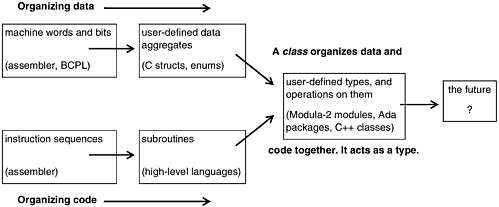
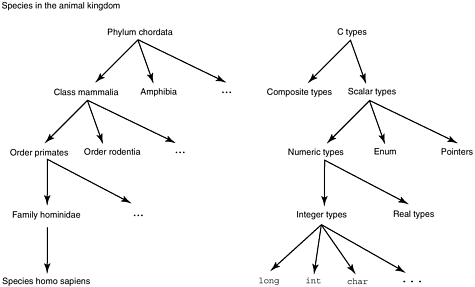
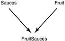
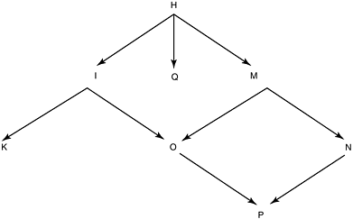
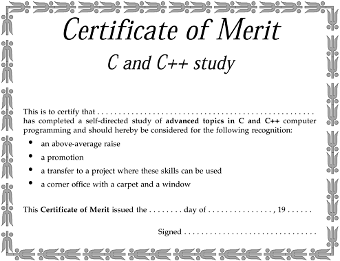

# Chương 11. Biết C rồi, C++ dễ thôi!

C++ sẽ làm với C điều Algol-68 đã làm với Algol. <sup>\[1\]</sup>

—David L. Jones

<sup>\[1\]</sup> Algol-68 là một ngôn ngữ monster-sized được xây dựng dựa trên Algol-60 nhỏ gọn và thành công. Nó khó hiểu (formal specification được viết bằng denotational semantics), khó triển khai và khó sử dụng. Nhưng ai cũng nói nó "rất mạnh". Algol-68 thực tế đã giết Algol-60 bằng cách thay thế nó, rồi self-destructing trong làn sóng thiếu tính thực tế. Một số người nhận thấy sự tương đồng giữa hai Algol và hai ngôn ngữ C.

Nếu không nghĩ C++ quá phức, protected abstract virtual base pure virtual private destructor là gì, lần cuối cần khi nào?

—Tom Cargill, C++ Journal, thu1990

allez-OOP!…abstraction lấy đặc trưng cốt…encapsulation nhóm type,data,function…class cho user-defined quyền như predefined…constructor,destructor…inheritance tái dùng…multiple inheritance từ nhiều base…overloading một tên cùng action khác type…I/O…polymorphism runtime binding…góc khác…nếu đi đó tôi không từ đây…crufty nhưng chỉ có nó…giải trí nhẹ — hội computer đã chết

## Allez-OOP!

Biết C thì C++ dễ? Có lẽ. Đa số sách300–400 trang chữ dày, lạc rừng chi tiết không thấy gỗ semantics vì binary tree. Phần lớn mục đích thực C++ superset ANSI C, ngoại lệ bảng cuối. Để hưởng,hiểu cần khái niệm object-oriented paradigm, shift thinking. Bỏ bí hiểm, mô tả đơn giản liên hệ C.

Điều này tương tự window-interface paradigm, khi chúng ta học cách viết lại chương trình theo quan điểm của window system. Control logic bị đảo inside-out để phù hợp với window\_main\_loop. Object-oriented programming cũng theo hướng đó, nhưng viết lại theo quan điểm của datatype.

Object-Oriented Programming (OOP) không phải ý tưởng mới; khái niệm này đã tồn tại từ khi Simula-67 tiên phong hơn một phần tư thế kỷ trước. Object-oriented programming đương nhiên lấy object làm chủ đề trung tâm. Có nhiều cách định nghĩa software object; phần lớn đều đồng ý rằng yếu tố chính là nhóm data với code xử lý nó và cung cấp những cách tinh vi để coi chúng như một đơn vị. Nhiều ngôn ngữ gọi thứ này là "class". Cũng có những định nghĩa ten-dollar về object-oriented programming mà bạn thường chỉ hiểu được khi đã biết OOP là gì. Chúng thường như sau: Object-oriented programming được đặc trưng bởi inheritance và dynamic binding. C++ hỗ trợ inheritance qua class derivation. Virtual class function cung cấp dynamic binding. Virtual function cho phép encapsulate các chi tiết triển khai của inheritance hierarchy.

Ừ, tất nhiên rồi! Ở đây chúng ta sẽ lướt nhanh qua C++, chỉ mô tả các điểm nổi bật. Bằng cách bỏ qua nhiều chi tiết ít quan trọng, chúng ta sẽ làm rõ framework của ngôn ngữ. Chúng ta xem xét các khái niệm OOP chính rồi tóm tắt những feature C++ hỗ trợ từng khái niệm. Các khái niệm xây dựng trên nhau theo thứ tự logic được trình bày ở đây. Một số ví dụ lập trình cố ý liên quan đến hoạt động hằng ngày như ép nước cam. Juice-squeezing thường không được thực hiện bằng software. Ở đây chúng ta gọi function để làm việc đó nhằm tập trung vào abstraction thay vì chi tiết triển khai lowest-level. Trước tiên, hãy tóm tắt thuật ngữ và mô tả chúng bằng những khái niệm C đã biết (xem Bảng 11-1).

Đến khoảng1985 gọi "C with classes", nay nhiều hơn. Khi đó extension hợp lý dễ giải,triển khai,dạy. Sóng nhiệt chưa đỉnh thêm cả bồn rửa bếp. Đề xuất "bảo toàn tính năng" như pub license Ireland: thêm một bỏ hai. Muốn multiple inheritance? Bỏ exception,template!

Bảng 11-1. Những khái niệm chính của Object-Oriented Programming

| Thuật ngữ | Định nghĩa |
|---|---|
| Abstraction | Lọc chi tiết không quan trọng chỉ còn đặc trưng cốt. Hoạt động thiết kế, khái niệm khác là tính năng OOP cung cấp nó. |
| Class | Một user-defined type, cũng như int là một built-in type. Các built-in type có operation well-defined (phép toán số học, v.v.), và cơ chế class cũng phải cho phép programmer chỉ định operation cho class type họ định nghĩa. Mọi thứ bên trong class được gọi là member của class. <br> Member function của class (các operation) còn được gọi là method. |
| Object | Variable cụ thể class type như `j` type `int`, còn instance class. |
| Encapsulation | Nhóm type,data,function class. Header C ví dụ yếu vì chỉ lexical convention, compiler không biết semantic unit. |
| Inheritance | Quan trọng: class nhận structure,function base đơn giản, specialize/customize khi cần, thêm member data/function. C không có tương đương. |

C++ là một ngôn ngữ khá lớn. Ví dụ cụ thể: front-end của C compiler có thể khoảng 40.000 dòng; front-end của C++ compiler có thể lớn gấp đôi hoặc hơn.

## Abstraction — Lấy đặc trưng cốt yếu

Object-oriented programming bắt đầu bằng object-oriented design. Và object-oriented design bắt đầu bằng abstraction.

Object là gì? Skill new-found abstraction so real-world car với software object, Bảng11-2.

### Giáo điều software


Ý chính: Abstraction

Nhìn nhóm thứ như xe,hóa đơn,program chạy, nhận chủ đề chung. Bỏ khác biệt phụ, ghi key data như biển số,nợ,address boundary. Là abstraction, data type là abstract data type. Nghe toán khó nhưng là đơn giản hóa.

Bảng 11-2. Ví dụ abstraction

| Ví dụ xe | Đặc tính object | Software: sorting program |
|---|---|---|
| "Xe" | Tên toàn thứ | "sort" |
| Input: nhiên liệu \& dầu <br> Output: vận chuyển | Input/output Well-defined | Input: file lộn <br> Output: record có thứ tự |
| Động cơ,hộp số,bơm… | Gồm object nhỏ self-contained | Module,header,function,structure |
| Nhiều xe,nhiều loại | Nhiều instance | Cho nhiều user sort cùng, không dựa global temporary chung. |
| Bơm nhiên liệu không dựa/ảnh hưởng rửa kính | Object nhỏ self-contained chỉ tương tác interface well-defined | Routine đọc record độc lập compare key. |
| Chỉnh timing không lái bình thường, driver không control trực tiếp | Không trực tiếp thao tác,thấy implementation | User không cần biết/tận dụng thuật toán quicksort,heapsort,shellsort… |
| Động cơ lớn hơn không đổi control driver | Đổi implementation không | Người triển khai thay thuật toán tốt |
|  | đổi user interface | không ảnh hưởng user. |

Nhiều thuộc tính là "nên". OOP C++ làm mục tiêu thành easily-accomplished fact. Abstraction giúp:

- Giấu chi tiết phụ,tập cốt.

- Interface hộp đen chỉ operation hợp lệ,không nội bộ.

- Chia hệ phức thành độc lập,cục bộ kiến thức,ngăn tương tác vô kỷ luật.

- Reuse,share code.

C cho type mới `struct, enum` gần tiện như `int, char,` v.v., dùng tương tự. "Gần" vì không redefine operator `*, <<, [], +` cho user-defined. C++ bỏ rào, thêm init tự động/kiểm soát,cleanup lifetime,implicit conversion, C thiếu hay bất tiện.

Abstraction tạo abstract type,C++ class triển khai. Top down nhìn thuộc tính, hoặc bottom up encapsulation nhóm data,method thực hiện type.

## Encapsulation — Nhóm type,data,function liên quan

Bundle abstract type với operation là encapsulation. Non-OOP thiếu cơ chế: không bảo compiler C "chỉ ba function thao tác struct" hay ngăn function khác truy cập thiếu kiểm,không nhất quán.

### Giáo điều software


Ý chính — Class encapsulate code với data liên quan

Khi lập trình mới xuất hiện, chương trình assembler chỉ thao tác được trên bit và word. Khi ngôn ngữ high-level phát triển, chúng cung cấp khả năng truy cập dễ dàng vào những hardware operand ngày càng đa dạng: float, double, long, char, v.v. Một số ngôn ngữ high-level áp dụng strong typing để bảo đảm chỉ thực hiện những operation phù hợp với type của variable. Đây là dạng class sơ khai, vì nó gắn data item với các operation được phép. Các operation thường chỉ giới hạn ở từng hardware instruction, như "floating-point multiply".

Sau cho nhóm data type thành record user-defined (struct C),không hạn function hay field access. Struct thấy thì sửa mọi cách,không buộc function thuộc type.



Hiện đại object-oriented buộc integrity bằng nhóm user-defined data, user-defined function được phép, không function khác. Mở strong typing từ built-in sang user-defined.

## Thể hiện class — User-Defined type có quyền như predefined

Class C++ thực hiện encapsulation. Type như `char, int, double,`, `struct rec *`, nên phải khai variable hữu ích. Làm như type: size,variable; object như variable: address,argument,return,constant,v.v. Khai:

```
Vegetable carrot;
```

`Vegetable` class, `carrot` object, sắp nói tạo class. Quy ước viết hoa đầu class hữu ích.

Class cho user-defined type:

- Nhóm type user-defined với operation.

- Quyền,diện mạo built-in.

- Xây type phức từ cơ bản.

### Giáo điều software


Ý chính: Class

Class chỉ user-defined type với mọi operation.

Thường struct data + pointers-to-functions xử lý. Compiler strong typing chỉ function đó cho object class,không khác.

Class C++ làm tất cả,so struct và triển khai struct tiện. Dạng:

```
class classname {
                  availability: declarations
                      . . .
                  availability: declarations
              };
```

## Availability

Keyword cho ai truy cập declaration theo sau:

`public:` Declaration sau thấy ngoài class,đặt,gọi,

thao tác tùy. Thích data không public vì private giữ ẩn dụ object tự đổi; ngoài dùng method để update kỷ luật.

`protected:` Declaration sau thấy từ function trong class và

class dẫn xuất.

`private:` Declaration sau chỉ member function

class dùng. Ngoài thấy tên nhưng không access.

Còn hai keyword khác, `friend` và `virtual`, ảnh hưởng đến availability. Chúng áp dụng cho từng declaration, thay vì cả nhóm như các keyword trên. Khác với ba cơ chế kiểm soát availability kia, `friend` và `virtual` không có dấu hai chấm theo sau.

`friend` Function không member nhưng access private,

protected như member. Friend là function hay class khác.

`virtual` Chưa khái niệm nên hoãn

giải thích.

Tôi gửi paper X3J16/93-0121 đề nghị năm keyword availability đầu "p": đổi `friend` thành `protégé` (quốc tế hóa,nói bất đối xứng `friend` không có)`.` Keyword `virtual` đổi `placeholder`, "pure" không availability đổi "empty". Tăng lexical orthogonality chút,nếu thích mở semantic quan trọng. <sup>\[2\]</sup> Chưa tin chấp thuận…

<sup>\[2\]</sup> Không đùa: `const` sai tên gây vấn đề thật,đây cơ hội tránh,tạo nhất quán C++ gai góc.

## Declaration

Declaration C thường function,type gồm class,data. Class buộc chung. Function cần implementation trong hoặc thường ngoài. Ví dụ:

```
class Fruit { public: peel(); slice(); juice();
              private: int weight, calories_per_oz;
            };

// an instance of the class
Fruit melon;
```

Nhớ comment C++ `//` đến cuối dòng.

### Thử thách lập trình


Thử compile,chạy C++…

Source thường `.cpp`,`.cc`,`.C`. Tạo file gõ trên,thêm main hello world,khai vài object fruit.

Nhiều hệ gọi compiler:

```
CC fruit.cpp
```

So C phải hét! Compile,chạy a.out. Chúc mừng,ít làm nhưng viết class thành công.

Implementation method ngoài class thêm syntactic sugar đầu.

`::` nói "Tôi quan trọng,tham chiếu thứ trong class!"

Thay declaration C thường,

```
return-type                   functionname(parameters) {...};
```

member function (method) dạng

```
return-type Classname ::      functionname(parameters)
{ . . . };
```

`::` scope resolution operator. Identifier trước là class tìm,không có là global. `peel()` trong class:

```
class Fruit { public: void peel(){ printf("in peel"); }
                          slice();
                          juice();
              private: int weight, calories_per_oz;
};
```

Ngoài thì

```
class Fruit { public: void peel();
                          slice();
                          juice();
              private: int weight, calories_per_oz;
};

void Fruit::peel(){ printf("in peel"); }
```

Semantics tương đương,ngoài phổ biến,dễ tổ chức source/include sạch. Trong cho function ngắn,tự inline thay call.

#### Thử thách lập trình


Viết method body

Viết tương tự `slice()`, `juice()` cho `Fruit`,copy peel đầu.

1\. Thật có lẽ robot arm chế biến,ở đây chỉ in đã gọi.

2\. Parameter/return hợp lý: `slice()` integer count, `juice()` float cc nước,v.v. Prototype khớp definition.

3\. Thử private data từ method rồi ngoài.

## Gọi method thế nào

Cách thú vị phải prefix instance/class variable muốn thao tác.

```
Fruit melon, orange, banana;

main() {
       melon.slice();
       orange.juice();
       return 0;
}
```

Object tự làm,như `i++` là lấy `i` post-increment. Tương đương "gửi message object" của ngôn ngữ object-oriented khác.

Mọi method ngầm `this` pointer để tự tham chiếu,bỏ viết rõ `this` trong method được.

```
class Fruit { public: void peel();
 private: int weight, calories_per_oz;
} ;

void Fruit::peel(){ printf("this ptr=%p", this);
                   this->weight--;
                   weight--;}

Fruit apple;
printf("address of apple=%x",&apple);
apple.peel();
```

### Thử thách lập trình


Gọi method

1\. Gọi `slice()`, `juice()` đã viết.

2\. Thử pointer `this` là argument đầu implicitly-passed.

### Constructor và destructor

Đa số class ít nhất constructor,ngầm gọi khi tạo,init value. Destructor clean-up khi hủy ra scope/trả heap,ít hơn constructor,tự code termination,garbage collection. Có người dùng bảo đảm release lock khi thoát scope,cleanup object và lock. Cần vì ngoài không private,cần privileged function trong tạo,điền data.

Khác C chỉ assignment trong definition hay chưa init. Nhiều constructor phân argument,cùng tên class:

```
Classname :: Classname (arguments) { . . . };
```

Ví dụ fruit:

```
class Fruit { public: peel(); slice(); juice();
               Fruit(int i, int j); // constructor
               ~Fruit(); // destructor
            private: int weight, calories_per_oz;
            } ;


// constructor body
Fruit::Fruit(int i, int j) { weight=i; calories_per_oz=j; }


// object declarations are initialized by the constructor.
Fruit melon(4,5), banana(12,8);
```

Cần vì struct nhiều field init phức. Constructor tự lúc tạo,không programmer gọi rõ. Global static tạo lúc start-up,hủy exit.

Vi phạm "không giấu tay" C,ngầm nhiều việc runtime,phá triết không hidden routine.

#### Thử thách lập trình


Làm việc hủy diệt

Body destructor `Fruit` có `printf()`,object `Fruit` inner scope,`#include <stdio.h>`,compile chạy,kiểm hủy khi ra scope.

## Inheritance — Tái dùng operation đã định

Single inheritance specialize/refine structure,method một base,tạo hierarchy như taxonomy,mỗi level chuyên hơn. Thiết yếu OOP,C không thật có,sẵn conceptual leap!

### Giáo điều software


Ý chính: Inheritance

Dẫn xuất một class từ class khác sao cho mọi đặc tính của class kia tự động có sẵn. Có thể khai báo những type chia sẻ một phần hoặc toàn bộ đặc tính của các previously-declared type. Có thể chia sẻ một số đặc tính từ nhiều parent type.

Inheritance thường cung cấp mức chuyên biệt hóa tăng dần khi đi từ base class đơn giản (ví dụ vehicle) đến derived class cụ thể hơn (ví dụ passenger car, fire truck hoặc delivery van). Tuy nhiên, nó cũng có thể thu hẹp hoặc mở rộng các operation hiện có. Class `shape` dường như là ví dụ được ưa chuộng trong tài liệu C++. Từ một `shape` cơ bản có thể dẫn xuất các cấu hình chuyên biệt hơn như `circle,` `square,` và `pentagon`. Chúng tôi cho rằng sẽ dễ hiểu hơn nếu trước tiên xem ví dụ real-world về "class inheritance" trong hệ thống phân loại giới động vật của Linnaeus (xem Hình 11-1), rồi một ví dụ tương tự cho thấy mối quan hệ với mô hình type hiện có của C.

Hình 11-1. Hai ví dụ Real-World inheritance



Ví dụ:

- Chordata mọi loài có notochord xấp xỉ tủy sống,chỉ chúng. Tổng32 phylum.

- Mammal kế thừa tủy từ chordata,thêm nuôi sữa,một xương hàm dưới,lông,tai trong riêng,hai đời răng,v.v.

- Primate kế mọi mammal,cả tủy,thêm mắt forward-facing,hộp sọ lớn,mẫu răng cửa riêng.

- Hominidae kế primate,tổ xa,thêm sửa xương đi hai chân. Chỉ homo sapiens còn,số khác tuyệt chủng.

Trừu tượng hơn type C:

- Type composite array/struct gồm element nhỏ hoặc scalar mỗi value atomic.

- Numeric kế scalar,thêm quantity số học.

- Integer kế numeric,chỉ số nguyên không phân số.

`char` range nhỏ trong integer.

Mô hình vui nhưng C không practical: không tạo first class type mới hay kế attribute. OOP cần tìm abstract type hierarchy. C++ novelty khó làm C kỷ luật là inheritance,cho hierarchy rõ,quan hệ điều khiển code.

Tạo `Apple` có mọi fruit,hai operation riêng:

- Bobbing for apples. Không pears vì đặc hơn và

chìm. Method `bob_for().`

- Táo kẹo (Anh toffee apple). Không nho caramel-covered ngay California. Method

```
make_candy_apple().
```

`Apple` kế mọi `Fruit`,thêm hai. Đừng mắc implementation xa computing,đang tập khái niệm không thuật toán.

#### Giáo điều software


C++ inheritance thế nào

Giữa hai class,không function riêng.

Base class:

```
class Fruit { public: peel(); slice(); juice();
               private: int weight, calories_per_oz;
               } ;
```

Kế thừa:

```
class Apple: public Fruit {
    public:
        void make_candy_apple(float weight);
        void bob_for(int tub_id, int
number_of_attempts);
}
```

Object declaration:

```
Apple teachers;
```

`class Apple` chuyên `Fruit`; `public` đầu Apple điều khiển access base từ ngoài derived,một trong vài khả năng quá chi tiết.

Syntax lạ: derived colon base,ngắn không gợi ai base,derived,không chuyên hóa,không idiom C nên orthogonality không giúp.

Đừng lẫn nesting: class trong không quyền/quan hệ riêng,thường container list/hash/queue. Template nay cũng container.

Inheritance derived biến thể base,semantics chi tiết access. Khác object nhỏ là phần lớn với object chuyên parent tổng quát. Không nói mammal nested dog,mà dog kế mammal. Chọn đúng idiom.

## Multiple inheritance — Từ hai base class trở lên

C dễ tự bắn chân. C++ khó hơn nhưng bắn thì mất cả chân.

—Bjarne Stroustrup

Kết hai class thành một,object như cả hai,tree thành lattice.

Ẩn dụ `Fruit`,còn `class` `Sauces`,fruit có thể sauce,hierarchy:



Object khả dĩ:

```
FruitSauce orange, cranberry; // Instances that are sauce and
fruit
```

Multiple inheritance ít phổ biến hơn single inheritance nhiều, và đã gây nhiều tranh luận về việc liệu nó có nên xuất hiện trong ngôn ngữ hay không. Các ngôn ngữ OOP như Smalltalk không có nó; những ngôn ngữ OOP khác như Eiffel có. Cần lưu ý rằng trong thực tế, type hierarchy thường giống Hình 11-2 hơn Hình 11-3 nhiều.

Hình 11-2. Direct inheritance


Hình 11-3. Multiple inheritance



Khó,error-prone cả triển khai,dùng. Có người nói không ví dụ thuyết phục không có design khác tránh.

## Overloading — Một tên cho cùng action khác type

Tái dùng tên function/operator cho type khác. C sơ khai có operator,ngôn ngữ hầu hết over-load built-in.

```
double e,f,g;
int i,j,k;
. . .
e = f+g;   /* floating-point addition */
i = j+k;   /* integer addition */
```

Operation `+` khác nhau trong hai trường hợp. Trường hợp đầu tạo floating-point add instruction, trường hợp sau tạo integer add instruction. Vì cùng thực hiện một operation về mặt khái niệm, tên hoặc operator nên giống nhau. Do C++ cho phép tạo type mới, programmer cũng được phép overload tên và operator cho các type mới đó. Overloading cho phép tái sử dụng tên function và phần lớn operator, `+`, `=`, `*`, `-`, `[]`, và `()`, bổ sung ý nghĩa cho các user-defined class type. Tất cả đều thuộc triết lý OOP coi object là một chỉnh thể.

Overloading theo định nghĩa resolve compiletime,compiler xem operand type đã declaration operator chưa. Chỉ overload tương tự,đừng `*` thành division để giữ tỉnh.

## C++ operator overloading

Overload "`+`" cho `Fruit`,thêm prototype:

```
class Fruit { public: void peel(); slice(); juice();

                  int operator+(Fruit &f); // overload "+"
operator

           private: int weight, calories_per_oz;
          } ;
```

Body:

```
int Fruit::operator+(Fruit &f) {

           printf("calling fruit addition\n"); // just so we
can see

           return weight + f.weight;
}
```

Ngầm `this` cho operand trái,phải parameter `f` instance Fruit,ampersand trước by reference.

Gọi:

```
Apple apple;
Fruit orange;

int ounces = apple+orange;
```

Precedence,arity giữ nguyên. Vậy cộng táo cam được nếu định trước,C++ "operator error" nghĩa mới,còn tiện I/O sau.

## I/O C++

Ngoài stdio C có routine,khái niệm mới,interface `iostream.h` tiện <sup>\[3\]</sup>,hợp object-oriented.

<sup>\[3\]</sup> Đừng lẫn iostream (trước streams) với UNIX kernel STREAMS giao tiếp device driver/user process.

Operator `<<` (đặt vào, hay "insert") và `>>` (lấy ra, hay "extract") được dùng thay cho function như `putchar()` và `getchar().` Các operator `<<` và `>>` vẫn dùng để shift trái và phải như trong C, nhưng được overload cho C++ I/O. Compiler xem type của operand để quyết định sinh code cho shift hay I/O. Nếu operand ngoài cùng bên trái là stream, ý định là I/O. Dùng operator thay cho function có bốn lợi thế lớn:

- Định mọi type,không cần function riêng hay

specifier string "`%d`" mỗi type.

- Tiện ký pháp khi

in nhiều. Như `i+j+k+l`,left-associativity cho chuỗi I/O:

```
cout << "the value is " << i << endl;
```

- Thêm layer đơn giản format,routine như

`scanf()`. Thẳng thắn họ `scanf()` cần đơn giản dù manual ngắn.

- Có thể,nên overload insert/extract cho cả object một operation,ứng dụng phần trước.

Dùng `stdio.h` C được nhưng nên sớm chuyển.

## Polymorphism — Runtime binding

Ai chơi nethack biết Hy Lạp nhiều hình. C++ hỗ trợ method khác object liên quan,runtime bind đúng. Qua overload cùng tên,runtime chọn. Inherit đôi lúc compile chưa biết base/derived,late binding báo keyword `virtual` method.

Overload compile-time signature đủ khác để compiler biết argument. Virtual signature giống,resolve runtime. Đây điểm cuối,dễ code hơn chữ.

### Giáo điều software


Ý chính: Polymorphism

Một tên function/operator dùng nhiều derived class,mỗi object biến thể phù hợp. Từ overload cùng khái niệm khác object,tương tự cùng tên,polymorphism khi runtime chọn đúng.

Base `Fruit` thêm peel,chỉ print không chi tiết:

```
#include <stdio.h>
class Fruit { public: void peel(){printf("peeling a base class
fruit\n");}
                       slice();
                       juice();
             private: int weight, calories_per_oz;
            } ;
```

Khai fruit,gọi `peel()`:

```
Fruit banana;
banana.peel();
```

message

```
peeling a base class fruit
```

Nay derive Apple,peel riêng vì chuối dùng ngón,táo dao. Method cùng tên overload được.

```
class Apple : public Fruit {
       public:
           void peel() {printf("peeling an apple\n");}
           void make_candy_apple(float weight);
};
```

Pointer fruit trỏ apple kế fruit,thử peel:

```
Fruit * p;
p = new Apple;
p->peel();
```

Ồ! Output:

```
% CC fruits.cpp
% a.out
peeling a base class fruit
```

Nói cách khác, method riêng của `Apple`, `peel()`, đã không được gọi; `peel()` của base class mới được gọi!

## Giải thích

C++ đòi báo thay base method bằng derived: thêm `virtual` base có thể thay. Nay hiểu sao hoãn `virtual` trang301,cần nền giờ có.

### Mẹo thực hành hữu ích


Hầu như phi thực

Sao không mặc định `virtual`? Base vẫn lấy bằng:

```
p->Fruit::peel();
```

Như C `register`,optimization ngớ ngẩn. Để không mọi method thêm indirection runtime,phải báo cái nào.

`virtual` sai tên chút: nơi khác là cho thấy thứ không có,duy trì ảo; đây giấu thứ có base method. Keyword ý nghĩa hơn nhưng dài:

```
choose_the_appropriate_method_at_runtime_for_whatever_object_t
his_is
```

hoặc `placeholder`.

## C++ polymorphism thế nào

Thêm `virtual` base,không gì khác:

```
#include <stdio.h>
class Fruit {
    public: virtual void peel(){printf("peeling a base class
fruit\n");}
           slice(); juice();
    private: int weight, calories_per_oz;
} ;
```

Compile,chạy:

```
% CC fruits.cpp
% a.out
peeling an apple
```

Đúng ý. Đến đây compiletime cũng làm được nhưng polymorphism runtime: object chọn function cho operation lúc chạy.

Runtime xem object gọi overload,chọn method class. Derived không muốn base mà derived,có thể compiler chưa thấy khi compile base,nên dynamic runtime,"virtually".

Single inheritance thường mỗi object pointer `vptr` tới vector `vtbl` pointer function,mỗi class một vector,mỗi method entry. Mọi object share code. Function pointer cùng offset virtual table mọi subclass. Mỗi call map offset `vtbl` compiletime,runtime gián tiếp. Multiple thêm layer. Không hiểu tự vẽ,xe này đến trạm cuối.

## Polymorphism kiểu cách

Nhiều trick,đôi lúc thiết yếu. Ưu tiên derived method nhưng base nếu chưa derived. Method đôi lúc chưa biết class mình/derived compiletime,phải đúng.

```
main() {
   Apple apple;
   Fruit orange;
    Fruit * p;
    p=&apple;
    p->peel();

    p=&orange;
    p->peel();
}
```

Runtime kết quả:

```
% a.out
peeling an apple
peeling a base class fruit
```

### Giáo điều software


Suy nghĩ sâu — Polymorphism giống interposing

Cả hai cho nhiều function một identifier. Interposing thô bind mọi tên cùng definition compiletime. Polymorphism chọn object-by-object runtime.

## Góc khác C++

Nhiều khái niệm nhỏ,rule chi tiết chưa bàn. Nắm đây đủ OOP và biểu diễn C++,khởi đầu program thử,đó là cách thật,duy nhất học ngôn ngữ.

Còn:

- Exception mượn Ada,Clu MIT (cluster chủ đạo),đổi control error-handling,tự chuyển nơi xử lý lỗi.

- Template type parameterized,như class/object,template/function cookie-cutter thuật toán,cắm type khác khi có thuật toán. Giống

`generic` Ada,module parameter Clu,semantics phức. Code:

```
template <class T> T min (T a, T b) { return (a < b) ? a :
b; }
```

Cho T tùy có `<` vào a,b,min. Gọi compiletime polymorphism hơi kéo nhưng cùng operation nhiều type resolve compiletime.

- In-lining function: chỉ expand in-line như macro thay call.

- Operator `new`,`delete` thay `malloc()`,`free()`. Các

operator tiện hơn,`sizeof` ngầm,gọi constructor/destructor đúng. `new` tạo object,

`malloc` chỉ cấp memory.

- Call-by-reference: C chỉ call-by-value trừ array,C++ đưa call-by-reference vào.

### Giáo điều software


Mục tiêu C++: khi ấy, bây giờ

SIGPLAN Notices tập21 số10 tháng10 1986 "An Overview of C++",Bjarne Stroustrup

Mục6. Thiếu gì?

C++ dưới hạn chế tương thích,nhất quán,hiệu quả nghiêm,không feature

1\. \[1\] gây bất tương thích lớn C ở source/linker.

2\. \[2\] tốn run-time/space program không dùng.

3\. \[3\] tăng run-time/space C program.

4\. \[4\] tăng compile time nhiều.

5\. \[5\] chỉ làm bằng yêu cầu môi trường linker/loader không triển khai đơn giản hiệu quả trong C truyền thống.

Feature có thể nhưng không vì tiêu chí gồm garbage collection,parameterized class,exception,multiple inheritance,concurrency,tích hợp môi trường. Không mọi extension hợp C++,không kềm chọn/design sẽ hỗn độn lớn khó dùng,kém hiệu quả. Hạn chế có lẽ tốt,tiếp tục dẫn tiến hóa.

Ôi năm Reagan,ketchup là rau,cây gây ô nhiễm chính,C++ bảo đảm không parameterized class,exception,multiple inheritance.

## Nếu đi đó tôi không bắt đầu đây

Orthogonality là mức feature theo nguyên tắc chung. Ada học package áp generic package. C++ nhiều không orthogonal,học cái này không model cho cái khác,đa số chỉ subset đơn giản.

### Giáo điều software


Subset C++ đơn giản

Nên dùng:

- Class

- Constructor/destructor chỉ body đơn giản

- Overload cả operator,I/O

- Single inheritance,polymorphic function

Tránh:

- Template

- Exception

- Virtual base class

- Multiple inheritance

Mục đích ngôn ngữ khung diễn giải pháp máy xử lý,càng tốt càng thành công. Fortran high-level đầu công thức toán (Formula translation),COBOL file,decimal,output editing thành công. C cho hardware-supported operator,không cản nhiều abstraction.

Thành công nếu building block hữu ích domain. Chọn block quan trọng nhất,semicolon terminator/separator không bỏ nhưng phụ. C++ tốt tùy giải vấn đề thú vị và người thường dùng tin cậy.

Có người nói class cách mạng reuse,mục tiêu mờ. Inheritance không thần dược,nhớ Ada thập kỷ trước. Program như sách,cả hai library,reuse routine như đoạn văn.

#### Giáo điều software


Thách thiết kế: Máy C++

Từng có hardware special-purpose hiệu quả ngôn ngữ:

Algol-60: Burroughs đầu Lisp: Symbolics Inc. Ada: Rational Computers

Máy C++ ra sao? Sao mọi processor ngôn ngữ riêng chết?

Câu bẫy,không chủ đề chung. Thị trường một ngôn ngữ nhỏ hơn general. Workstation ăn Lisp machine,Cold War hết giết Ada,Burroughs còn Unisys. Không tạo văn mới giá trị bằng cắt dán cả đoạn sách khác,abstraction sai. Chia word/letter (dòng/character code) thì cắt mệt hơn viết mới. Reuse library thực nghiệm ít hơn kỳ vọng.

Ít routine special-purpose chia được: math,structure,sort/search. Như diagram,table sách lấy nguyên hiểu nơi khác.

C++ có thể hơn vì inheritance object cho data lẫn code. Ada generic cũng nhưng cồng kềnh,trừu tượng. C++ mượn sách dễ,copy phần đúng vẫn khó.

## Có thể crufty \[4\], nhưng chỉ có nó

<sup>\[4\]</sup> "Crufty /kruhf'tee/ \[không rõ gốc\] adj. có thể over-complex" — The New Hacker's Dictionary,Eric Raymond,Cambridge MA MIT Press1991.

Thấy lỗi C đầu sách,muốn nói C++ giải mà giữ vị,nhưng không đúng. Có cải thiện riêng,giữ nhiều lỗi,thêm phức tạp. Triết không invisible runtime support bị thỏa hiệp.

### Giáo điều software


C++ hơn C

- Cấu trúc error-prone char array không chỗ

nul cuối là lỗi. `char b[3]="Bob";` lỗi C++,không C.

- Cast format normal-looking `float(i)` và

C strange-looking `(float)i`.

- Constant integer định array size được.

- `const int size=128;`

```
char a[size];
```

C++ cho,C báo lỗi.

- Declaration trộn statement,bỏ C buộc trước. Hay bỏ tùy tiện,nếu đã bất tương thích sao không sửa cả syntax declaration kinh khủng?

Crufty nhưng mọi bên lớn ủng hộ. AT\&T phát triển mới được nói C++,graphics NT trễ,chậm,lớn cũng C++. Đa số tool,library,technology mới C++ hoặc ANSI subset. Bao lâu bug lớn như AT\&T network do C++ thay C? Không quan trọng,sẽ rộng dù lỗi,hy vọng dẫn tốt hơn.

#### Mẹo thực hành hữu ích


Chuyển C sang C++

Cách tốt nhất để bắt đầu C++ là lập trình bằng ANSI C subset của nó. Tránh các translator đời đầu dựa trên cfront, vốn sinh C code thay vì machine code. Dùng C như một machine language portable khiến linking và debugging thực sự phức tạp, vì cfront biến đổi mọi tên function để encode thông tin argument. Name-mangling là một cách chắp vá tệ hại có lẽ còn tồn tại trong C++ rất lâu. Hãy so với Ada, vốn làm đúng và không định nghĩa semantics bằng một implementation chắp vá. Name-mangling là thủ thuật để kiểm tra type giữa các file. Nhưng nó buộc toàn bộ C++ của bạn phải được compile bằng cùng compiler, vì cơ chế name-mangling có thể khác giữa các compiler. Đây là khuyết điểm lớn trong mô hình tái sử dụng của C++, vì thực tế nó ngăn tái sử dụng ở binary level.

Mẫu C không subset C++ cho điểm rủi ro.

Hạn chế C++ không C:

- User không gọi main() trong C++,C được nhưng lạ.

- Prototype bắt buộc C++,C tùy.

- Typedef name không trùng struct tag C++,C namespace riêng được.

- C++ cần cast `void *` sang pointer khác,C không.

- Feature nghĩa khác:

- Hơn chục keyword mới,tên identifier C có thể lỗi C++.

- C++ declaration bất kỳ statement place,C trước statement block.

- Inner struct name giấu outer object C++,C không.

- Literal character `char` C++,`int` C, tức

`sizeof('a')` C++1,C lớn.

- Pathological case comment `//` C++ như

Chương2.

Còn nhiều nhưng đủ nguy hiểm. Ra và nguy hiểm đi. Quen compiler,tool ANSI subset rồi class. Chọn sách style thích,hiện hành ngôn ngữ tiến hóa,có exception,template mới nhất.

Như C,chuẩn C++ ISO WG21,ANSI X3J16 phối hợp. Lạc quan sáu năm xong1996,nhớ sách nói hướng ANSI.

#### Vậy protected abstract virtual base pure virtual private destructor là gì?

Tách hai: pure virtual private destructor kế từ protected abstract virtual base.

- Private destructor khi object ra scope,chỉ member/friend gọi.

- Pure virtual không code,dẫn derived qua inheritance.

- Pure virtual destructor chỉ nghĩa nếu derived định. Tự default clean-up như gọi member/base destructor nên thường không cần code rõ.

Đơn giản. Cụm hai

- Abstract virtual base chia sẻ multiply-inherited (virtual base),ít nhất pure virtual để derive (abstract base). Còn init semantics riêng.

- Protected abstract virtual base kế protectedly,con biết parent,ngoài không.

Ghép là destructor

- Chỉ member/friend gọi,

- Chưa definition base khai,derived sau định,

- Derived share base multiply inherited,

- Base được kế protected.

Lần cuối cần…chưa! Gợi proof FFT không? Phức ngang.

Code có thể:

```
class vbc {
 protected: virtual void v()=0;
 private: virtual ~vbc()=0; // private destructor
};
// vbc is an abstract class because it contains pure
virtual functions

classX:virtual protected vbc {
 // X inherits vbc virtually, and does it in a way such
that
 // vbc's protected members are protected members of X.
 // So vbc is a "protected abstract virtual base" class
of X.
    protected: void v() {}
 ~X() { /* do some X destruction */ }
};

// When an X object is destroyed, X::~X is called, and
then...
// X's "protected abstract virtual base pure virtual
private destructor"
// is called too. So even though it's declared pure, it
must be defined.
```

Semantics khiến tiếng quá phức. Không riêng feature mà tương tác. Dừng để độc giả kết luận.

## Giải trí nhẹ — Hội computer đã chết

Nhiều tổ chức computer-related nhưng lạ nhất Dead Computers Society! Theo Dead Poets Society tôn vinh thơ cổ,đây kiến trúc không còn. Bắt đầu panel1991 ASPLOS Architecture Support for Programming Languages and OS's Santa Clara,California. Bạn,đồng nghiệp thấy nhiều từng làm hệ ngừng.

Lập hội/forum bàn tròn làm nhẹ,hy vọng nhìn lại thông minh giúp designer sau học. Ai góp design/build/program hệ chết,lý tưởng hãng chết,đều vào. Nhiều lắm,Bảng11-3 phần.

Bảng 11-3. Computer đã chết

| Bảng vinh danh computer đã chết |  |
|---|---|
| American Supercomputer Inc. | Intel iPSC/1 |
| Ametek/Symult | Intel iPSC/2 |
| Astronautics | Intel/Siemens BiiN |
| Burroughs BSP | Masscomp/Concurrent |
| CDC 7600, Cyberplus | Multiflow |
| CHoPP | Myrias |
| Culler Scientific | Niche |
| Cydrome | Prisma |
| Denelcor | SCS |
| Elxsi | SSI |
| Evans \& Sutherland CD | Star Technologies |
| ETA/CDC | Supertek |
| FLEX (Flexible Computer) | Suprenum/Siemens |
| Goodyear Aerospace/Loral DataFlow Systems | Texas Instruments ASC |
| Guiltech/SAXPY | Topologix |
| Floating Point Systems AP-line and T-series | Unisys ISP |
| Intel 432 |  |

Ai chỉ thấy hay cũng vào,khai mạc hơn350.

Moderator hỏi một thứ gây chết nhất. Elxsi nói đẩy kỹ thuật,dùng ECL emitter-coupled logic sớm. Multiflow chết cùng thời lại nghĩ không dùng ECL là một yếu tố!

Chỉ đồng thuận quản lý,thị trường phá sản nhiều hơn kỹ thuật. Không nghe khách chết,đẩy tiên tiến thường thành công.

Có một vài chủ đề kỹ thuật nhỏ: làm sản phẩm khó lập trình không có lợi (ví dụ CDC7600 với two-level memory, phép toán one's complement hoặc hình phạt tàn nhẫn và khác thường là word 60-bit). Không quá ngạc nhiên khi không có chủ đề kỹ thuật chung lớn nào xuất hiện. Có lẽ chẳng có chủ đề như vậy. Nhưng có một điều chắc chắn: tất cả chúng ta học được từ thất bại nhiều hơn từ thành công.

## Giải trí cuối — Bằng khen của bạn!

\[Hướng dẫn: cắt sách,ghi tên,đưa sếp\]



### Đọc thêm

Sách C hữu ích C, A Reference Manual,Samuel P. Harbison,Guy L. Steele,Englewood Cliffs Prentice Hall1991. Từ kinh nghiệm compiler nhiều kiến trúc,hiểu biết thực tỏa từng trang.
