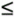
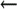
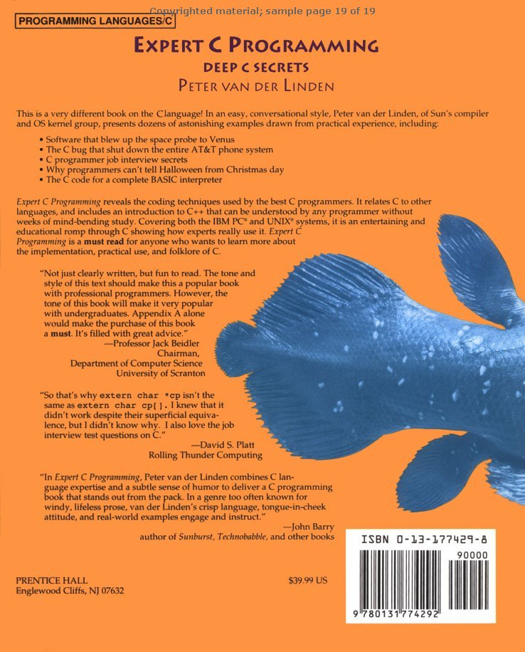

# Bí mật phỏng vấn tuyển programmer

Biết chút ít về hardware là một điều nguy hiểm. Một programmer tháo một tấm thiệp Giáng sinh biết phát nhạc và lấy chip giai điệu áp điện bên trong. Anh ta bí mật lắp nó vào bàn phím của sếp, nối với một đèn LED. Hóa ra điện áp trên LED đang sáng đủ để chạy chip này. Rồi tôi, à nhầm, "anh ta", sửa system editor để bật LED khi khởi động và tắt khi thoát. Kết quả: terminal của sếp liên tục phát nhạc Giáng sinh mỗi khi ông dùng editor! Sau half-an-hour, những người ở phòng bên cạnh tụ tập thành đám đông đòi xử tội và buộc ông ngừng mọi công việc cho đến khi tìm được nguyên nhân.

—The Second Official Handbook of Practical Jokes <sup>\[1\]</sup>

<sup>\[1\]</sup> Tác giả Peter van der Linden, © 1991 Peter van der Linden. Sử dụng với sự cho phép của Dutton Signet, một bộ phận của Penguin Books USA Inc.

Phỏng vấn programmer tại Silicon Valley… làm sao phát hiện cycle trong linked list?… những câu lệnh increment khác nhau của C dùng để làm gì?… library call khác system call thế nào?… file descriptor khác file pointer thế nào?… viết code xác định variable có signed hay không… time complexity khi in các giá trị trong binary tree là gì?… lấy ngẫu nhiên một string từ file này… thư giãn một chút—đo tòa nhà bằng khí áp kế

## Phỏng vấn programmer tại Silicon Valley

Phần này cung cấp một số gợi ý về quy trình phỏng vấn cho C programmer muốn vào các công ty hàng đầu. Một trong những điều hay nhất ở tuyến đầu ngành máy tính là cách khác thường mà chúng ta chọn nhân viên mới cho nhóm. Trong nhiều ngành, supervisor hay manager quyết định toàn bộ việc tuyển dụng; thực tế họ thường là người duy nhất gặp ứng viên. Nhưng ở tuyến đầu phát triển software, đặc biệt tại các high-tech start-ups, đôi khi programmer có khả năng đánh giá kỹ năng kỹ thuật của ứng viên với tư cách "người đóng góp cá nhân" tốt hơn manager. Năng lực để thực hiện một số công việc systems programming hiếm và chuyên biệt đến mức đôi khi khả năng kỹ thuật là đặc điểm quan trọng nhất cần tìm trong cuộc phỏng vấn.

Vì vậy đã hình thành một phong cách phỏng vấn riêng. Manager theo chính sách công ty để chọn nhóm ứng viên phỏng vấn. Sau đó từng người trong development team, chứ không chỉ manager, đều thực hiện một cuộc grill-ing về kỹ thuật với ứng viên. Một cuộc phỏng vấn điển hình kéo dài cả ngày, gồm các buổi hour-long liên tiếp với sáu hoặc bảy engi-neers khác nhau—và trước khi đề nghị tuyển dụng, tất cả đều phải tin vào khả năng lập trình của ứng viên.

Engineer thường có những câu hỏi ưa thích, và chương này tập hợp một số câu như vậy. Tiết lộ các "bí mật" này không có hại—người đọc sách này có lẽ đã biết đủ để được một công ty software tốt tuyển dụng. Nhiều bài toán bắt nguồn từ algorithm thực tế mà chúng tôi cố lập trình, rồi đã được thay bằng những bài toán mới hơn. Tất nhiên, khi phỏng vấn, bạn không chỉ xem họ trả lời gì mà còn xem cách họ trả lời. Họ suy nghĩ cẩn thận và đưa ra nhiều khả năng, hay buột miệng nói ý đầu tiên xuất hiện? Họ bảo vệ ý tưởng thuyết phục đến đâu? Họ khăng khăng theo một chiến lược rõ ràng sai hay linh hoạt điều chỉnh câu trả lời? Một số câu hỏi sau đây từng nhận được những câu trả lời kỳ lạ nhất. Hãy tự thử và xem bạn làm được đến đâu!

## Làm sao phát hiện cycle trong linked list?

Ban đầu là câu hỏi đơn giản: "Làm sao phát hiện cycle trong linked list?" Nhưng người hỏi liên tục thêm ràng buộc, và nó nhanh chóng trở nên cực kỳ khó.

Câu trả lời đầu tiên thường gặp: đánh dấu từng element khi đến thăm; tiếp tục duyệt; nếu gặp element đã đánh dấu thì list có cycle.

Ràng buộc thứ hai:

List nằm trong read-only memory, và bạn không thể đánh dấu element.

Câu trả lời thứ hai thường gặp:

Khi thăm mỗi element, lưu address của nó vào array; kiểm tra từng element kế tiếp xem đã có trong array chưa. Đôi khi ứng viên yếu mắc kẹt ở chi tiết hash table để tối ưu array lookup.

Ràng buộc thứ ba:

Uh-oh! Memory có giới hạn, không đủ chứa array với kích thước cần thiết. Tuy nhiên, bạn có thể giả định nếu có cycle thì nó nằm trong N element đầu tiên.

Câu trả lời thứ ba thường gặp (nếu ứng viên tới được đây):

Giữ một pointer ở đầu list. So pointer này với N - 1 element kế tiếp. Sau đó tiến pointer một element và so với N - 2 element kế tiếp. Tiếp tục đến khi tìm thấy trùng khớp hoặc toàn bộ N element đã được so với nhau.

Ràng buộc thứ tư:

Ôi không! List dài tùy ý, và cycle có thể nằm bất kỳ đâu. (Ngay cả ứng viên giỏi cũng có thể mắc kẹt ở đây).

Câu trả lời cuối cùng:

Trước tiên, loại trường hợp đặc biệt là list 3-element có cycle từ element 2 về 1. Giữ hai pointer: một ở element 1, một ở element 3. Kiểm tra xem chúng bằng nhau không; nếu không, di chuyển P1 một bước và P2 hai bước. Kiểm tra rồi tiếp tục. Nếu P1 hoặc P2 là null thì không có loop. Nếu có, chắc chắn sẽ phát hiện được. Cuối cùng một pointer sẽ đuổi kịp pointer kia (tức có cùng giá trị), dù có thể phải đi qua cycle vài lần.

Có những cách giải khác, nhưng trên đây là các cách phổ biến nhất.

### Thử thách lập trình


Bị cuốn vào loop Hãy tự chứng minh rằng algorithm trong câu trả lời cuối cùng ở trên sẽ phát hiện loop nếu có. Tạo một loop; chạy thử code bằng tay; tăng độ dài loop; chạy thử lại; lặp cho đến khi điều kiện quy nạp hiện rõ. Đồng thời hãy tự chứng minh rằng algorithm sẽ kết thúc nếu không có loop.

Gợi ý: viết chương trình rồi suy rộng từ đó.

## Những câu lệnh increment khác nhau trong C dùng để làm gì?

Xét bốn câu lệnh C sau:

```
x = x+1; /* regular */
++x;     /* pre-increment */
x++;     /* post-increment */
x += 1;  /* assignment operator */
```

Rõ ràng cả bốn câu lệnh đều làm cùng một việc: tăng x lên một. Khi đứng riêng như ở đây, không có ngữ cảnh xung quanh, chúng không khác nhau. Ứng viên cần bổ sung ngữ cảnh còn thiếu, dù ngầm hiểu hay nói rõ, để trả lời và phân biệt các câu lệnh. Lưu ý câu đầu là cách thông thường để diễn đạt "cộng một vào x" trong ngôn ngữ algorithm. Vì vậy đây là câu lệnh tham chiếu; chúng ta cần tìm đặc tính riêng của ba câu còn lại.

Hầu hết C programmer có thể chỉ ra ngay rằng `++x` là pre-increment, cộng một vào x trước khi dùng giá trị của nó trong expression xung quanh; còn `x++` là post-increment, chỉ tăng x sau khi dùng giá trị ban đầu trong expression xung quanh. Một số người nói operator "++" và "--" được đưa vào C chỉ vì `*p++` là một machine instruction trên PDP-11 (máy mà C compiler đầu tiên được viết cho). Không phải vậy. Feature này có từ ngôn ngữ B trên PDP-7, nhưng hóa ra increment và decrement operator cực kỳ hữu dụng trên mọi hardware.

Một số programmer bỏ cuộc ở đây, bỏ qua việc `x+=1` hữu ích khi x không phải variable đơn giản mà là expression có array. Nếu array reference phức tạp và bạn muốn cho thấy cả hai reference dùng cùng index, thì

```
node[i >> 3] += ~(0x01 << (i & 0x7));
```

là cách nên dùng. Chúng tôi lấy nguyên câu lệnh ví dụ này từ code trong một operating system. Chỉ thay tên data để bảo vệ người có lỗi. Ứng viên giỏi cũng sẽ chỉ ra rằng l-value (compiler-talk chỉ expression xác định vị trí object—thường là address, nhưng cũng có thể là register, hoặc một trong hai kèm bitfield) chỉ được evaluate một lần. Điều này tạo khác biệt vì câu lệnh

```
mango[i++] += y;
```

được xử lý như

```
mango[i] = mango[i] + y; i++;
```

chứ không phải

```
mango[i++] = mango[i++] + y;
```

Có lần khi phỏng vấn ứng viên vào nhóm Pascal compiler của Sun, ứng viên tốt nhất (cuối cùng anh ấy được tuyển—chào Arindam!) giải thích các khác biệt bằng compiler intermediate code. Chẳng hạn, "`++x`" nghĩa là lấy vị trí x, tăng nội dung tại đó, đưa giá trị này vào register; "`x++`" nghĩa là lấy vị trí x, nạp nội dung vào register, tăng giá trị x trong memory, v.v. Nhân tiện, hai câu lệnh kia sẽ được mô tả theo cách tương tự như thế nào?

Dù Kernighan và Ritchie nói increment thường hiệu quả hơn cộng một tường minh (K\&R2, trang 18), compiler hiện nay thường đủ tốt để mọi cách nhanh như nhau. Khi không có ngữ cảnh xung quanh làm lộ khác biệt, C compiler hiện đại phải compile bốn câu lệnh thành code giống hệt nhau. Đó phải là những instruction nhanh nhất để tăng variable. Hãy thử bằng C compiler bạn thích—có lẽ nó có option tạo assembler listing. Đồng thời bật option debugging, vì thường sẽ dễ kiểm tra cor-respondence giữa assembler và câu lệnh C hơn. Đừng bật optimizer, vì nó có thể tối ưu đến mức xóa luôn các câu lệnh. Trên Sun workstation, đọc câu thần chú "`-S`" để command line trông như sau

```
cc -S -Xc banana.c
```

`-S` khiến compilation dừng ở giai đoạn assembler, để assembly language trong file `banana.s`. Các compiler mới nhất, SPARCompilers 3.0, đã được cải tiến để xen source vào assembler output khi dùng option này. Điều đó giúp xử lý sự cố và chẩn đoán code generation dễ hơn.

`-Xc` yêu cầu compiler từ chối mọi cấu trúc non-ANSI C. Nên luôn dùng option này khi viết code mới, vì nó giúp đạt tính portable tối đa.

Vì vậy đôi khi khác biệt chỉ là cách nào trông đẹp hơn trong source. Thứ ngắn có thể dễ đọc hơn thứ dài. Tuy nhiên, quá ngắn cũng khó đọc (hãy hỏi bất kỳ ai từng sửa APL code của người khác). Khi tôi là trợ giảng cao học cho lớp systems programming, một sinh viên mang đến code có bug chưa rõ nguyên nhân, nhưng code bị nén đến mức không tìm ra được. Giữa những lời chế nhạo của vài C programmer khóa trên, chúng tôi tuần tự mở rộng một câu lệnh từ dạng như:

```
frotz[--j + i++] += --y;
```

thành dạng tương đương nhưng dài hơn:

```
--y;
--j;
frotz[j+i] = frotz[j+i] + y;
i++;
```

Trước sự bẽ bàng của những người đứng ngoài bình phẩm, việc này nhanh chóng cho thấy một operation được thực hiện sai chỗ!

### Bài học: đừng cố làm quá nhiều việc trong một câu lệnh.

Nó không làm code sinh ra hiệu quả hơn, mà còn phá hỏng cơ hội debug. Như Kernighan và Plauger chỉ ra: "Ai cũng biết debugging khó gấp đôi việc viết chương trình ban đầu. Vậy nếu đã dùng hết sự thông minh khi viết, bạn sẽ debug nó bằng cách nào?" <sup>\[2\]</sup>

<sup>\[2\]</sup> Brian W. Kernighan và P.J. Plauger, The Elements of Programming Style, ấn bản thứ hai, trang 10, New York, McGraw-Hill, 1978, trang 10.

## Library call khác system call thế nào?

Một câu chúng tôi đôi khi dùng để xem ứng viên có thông thạo lập trình không chỉ đơn giản là: "Library call khác system call thế nào?" Thật ngạc nhiên vì nhiều người chưa bao giờ tìm hiểu. Chúng tôi chưa thấy nhiều sách mô tả khác biệt, nên đây là cách tốt để xác định ứng viên đã lập trình nhiều chưa và có tò mò tìm hiểu các vấn đề như vậy không.

Câu trả lời ngắn là library call thuộc ngôn ngữ hoặc application, còn system call thuộc operating system. Nhớ nói từ khóa "trap". System call đi vào kernel bằng cách phát "trap" hoặc interrupt. Câu trả lời đầy đủ sẽ bao quát các điểm trong Bảng A-1.

Bảng A-1. Library call so với system call

| Library Call | System Call |
|---|---|
| C library giống nhau trên mọi ANSI C implementation | System call khác nhau ở từng OS |
| Gọi một routine trong library | Gọi kernel để yêu cầu service |
| Được link với user program | Là entry point vào OS |
| Chạy trong user address space | Chạy trong kernel address space |
| Được tính vào thời gian "user" | Được tính vào thời gian "system" |
| Overhead thấp hơn, chỉ là procedure call | Overhead cao do context switch sang kernel rồi quay lại |
| Có khoảng 300 routine trong C library libc | Có khoảng 90 system call trong UNIX (ít hơn ở MS-DOS) |
| Được mô tả trong Section 3 của UNIX OS manual | Được mô tả trong Section 2 của UNIX OS manual |
| C library call điển hình: system, fprintf, malloc | System call điển hình: chdir, fork, write, brk |

Library routine thường chậm hơn in-line code vì overhead của subroutine call, nhưng system call còn chậm hơn nhiều vì context switch vào kernel. Trên SPARCstation 1, chúng tôi đo overhead của library call (tức tốc độ thực hiện procedure call) khoảng nửa microsecond. System call mất thời gian thiết lập gấp bảy mươi lần (35 microsecond). Để đạt hiệu năng thuần túy, hãy giảm số system call ở bất kỳ đâu có thể; nhưng nhớ rằng nhiều routine trong C library thực hiện công việc bằng system call. Cuối cùng, người tin rằng vòng tròn trên đồng ruộng do người ngoài hành tinh tạo ra sẽ khó chấp nhận khái niệm rằng lời gọi `system()` thực ra là library call.

### Thử thách lập trình


Bài tập Gut-Busting của giáo sư Perlis

Chú ý: thử thách lập trình này có thể quá nặng đối với một số độc giả.

Một số trường cao học cũng dùng câu hỏi lập trình để kiểm tra sinh viên mới. Tại Yale University, giáo sư Alan Perlis (một trong những cha đẻ Algol-60) từng giao bài tập sau cho lớp cao học mới nhập học (hạn nộp một tuần).

Lập trình từng bài toán sau:

1\. Đọc một string và xuất mọi tổ hợp ký tự của nó.

2\. Bài toán "8-queens" (in mọi cách bố trí tám quân hậu trên bàn cờ sao cho không tấn công nhau).

3\. Cho N, liệt kê mọi số nguyên tố đến N.

4\. Viết subroutine nhân hai ma trận arbitrary-sized.

bằng từng ngôn ngữ sau:

1\. C

2\. APL

3\. Lisp

4\. Fortran

Chỉ một trong các bài lập trình này cũng đã là bài tập khá hợp lý cho một môn trong số nhiều môn mà sinh viên cao học theo học. Nhưng ở đây chúng tôi phải làm tất cả chỉ trong một tuần, bằng nhiều ngôn ngữ mà một số người chưa từng thấy!

Tất nhiên chúng tôi không biết Perlis chỉ thử thách và thực ra không định đánh trượt ai. Phần lớn sinh viên mới trải qua một tuần điên cuồng thức khuya, khom người trước terminal, để rồi khi trở lại lớp, Alan chỉ yêu cầu người tình nguyện trình bày một tổ hợp lan-guage/bài toán trên bảng.

Một số bài có thể giải bằng idiom, như APL one-liner <sup>\[1\]</sup> cho bài 3:

`(2=+.0=T .|T)/T`  `iN`

Như vậy, bất kỳ ai thử làm phần nào của bài tập đều có cơ hội trình bày. Ai choáng ngợp đến mức không thử dù chỉ phần nhỏ nhất sẽ nhận ra mình có lẽ không hợp với cao học. Đó là tuần hoạt động dữ dội, trong đó tôi học về APL và Lisp nhiều hơn cả chục năm trước hoặc sau đó.

<sup>\[1\]</sup> Bạn hiểu vì sao không có "Obfuscated APL Competition" rồi đấy—không cần, nó vốn đã như vậy

## File descriptor khác file pointer thế nào?

Câu này tự nhiên tiếp nối câu trước. Mọi UNIX routine thao tác file đều dùng file pointer hoặc file descriptor để xác định file đang xử lý; mỗi thứ là gì và dùng khi nào? Câu trả lời thực ra đơn giản, và cho thấy mức quen thuộc với UNIX I/O cùng các trade-offs.

Mọi system call thao tác file đều nhận (hoặc trả về) "file descriptor" làm argument. Tên "file descriptor" phần nào chưa chính xác; nó là integer nhỏ (thường từ 0 đến 255), được Sun implementation dùng làm index vào per-process table-of-open-files. Các system I/O call gồm `creat(), open(), read(), write(), close(), ioctl()`, v.v., nhưng không thuộc ANSI C, không tồn tại trong môi trường non-UNIX, và sẽ phá tính portable nếu dùng. Vì vậy một tập standard I/O library call được quy định, và ANSI C hiện yêu cầu mọi host hỗ trợ.

Để bảo đảm tính portable, dùng stdio I/O call `fopen(), fclose(), putc(), fseek()`—phần lớn tên routine bắt đầu bằng "f". Chúng nhận pointer đến `FILE` structure (đôi khi gọi stream pointer) làm argument. `FILE` pointer trỏ đến stream structure định nghĩa trong \<stdio.h\>. Nội dung structure khác nhau giữa các implementation; trên UNIX nó thường là một entry trong per-process table-of-open-files. Nó thường chứa stream buffer, mọi variable cần để chỉ bao nhiêu byte trong buffer thực sự là file data, các flag chỉ trạng thái stream (như ERROR và EOF), v.v.

- Vì vậy file descriptor là offset trong per-process table-of-open-files (ví dụ "3"). Nó được dùng trong UNIX system call để xác định file.

- `FILE` pointer chứa address của file structure dùng biểu diễn I/O stream đang mở (ví dụ hex 20938). Nó được dùng trong ANSI C stdio library call để xác định file.

C library function fdopen() có thể tạo `FILE` structure mới và liên kết với file descriptor chỉ định (thực tế chuyển giữa integer file descriptor và stream pointer tương ứng, dù nó tạo thêm một entry mới trong table-of-open-files).

## Viết code xác định variable có signed hay không

Một đồng nghiệp phỏng vấn tại Microsoft được yêu cầu "viết code xác định variable có signed hay không". Đây thực ra là câu khá khó vì để quá nhiều chỗ cho diễn giải. Một số người nhầm "signed" với "có dấu âm" và tưởng cần function hay macro đơn giản cho biết giá trị nhỏ hơn zero không.

Không phải vậy. Câu hỏi liên quan đến việc một type cho trước là signed hay unsigned trong một implementation cụ thể. Trong ANSI C, "char" có thể signed hoặc unsigned tùy implementation. Khi viết code sẽ được port sang nhiều platform, biết điều này hữu ích, và lý tưởng nhất kết quả là compiletime constant. Function không làm được: type của formal parameter được định nghĩa trong function, không thể truyền qua lời gọi. Vì vậy phải viết macro thao tác argument theo declaration của argument đó.

Tiếp theo cần làm rõ argument của macro là type hay value thuộc type đó. Giả sử argument là value, đặc tính căn bản của unsigned value là không bao giờ âm, còn với signed value, đảo most significant bit sẽ đổi dấu (giả định biểu diễn 2's complement, một giả định khá an toàn). Vì các bit khác không ảnh hưởng kiểm tra này, có thể đảo tất cả mà vẫn có cùng kết quả. Do đó hãy thử:

```
#define ISUNSIGNED(a) (a >= 0 && ~a >= 0)
```

Hoặc, nếu argument là type, một câu trả lời sẽ dùng type cast:

```
#define ISUNSIGNED(type) ((type)0 - 1 > 0)
```

Diễn giải đúng là chìa khóa! Hãy nghe kỹ và yêu cầu giải thích rõ những thuật ngữ không hiểu hoặc chưa được định nghĩa đầy đủ. Ví dụ code đầu chỉ hoạt động với K\&R C. Promotion rule mới khiến nó không hoạt động trong ANSI C. Bài tập: giải thích tại sao và cung cấp giải pháp ANSI C.

Phần lớn câu hỏi Microsoft có yếu tố đánh giá khả năng suy nghĩ dưới áp lực, nhưng không phải tất cả đều rõ ràng mang tính kỹ thuật. Câu phi kỹ thuật điển hình có thể là "Mỹ có bao nhiêu trạm xăng?" hoặc "Mỹ có bao nhiêu tiệm cắt tóc?" Họ muốn xem bạn có thể nghĩ ra và bảo vệ ước lượng tốt, hoặc đề xuất cách tìm câu trả lời đáng tin cậy hơn không. Một gợi ý: gọi cơ quan cấp phép từng bang. Chỉ 50 cuộc gọi sẽ có đáp án chính xác. Hoặc gọi half-a-dozen bang đại diện rồi nội suy. Bạn thậm chí có thể đáp như một ứng viên environmentally-conscious khi được hỏi "Bao nhiêu trạm xăng?": "Quá nhiều!", cô bực bội trả lời.

## Time complexity khi in các giá trị trong binary tree là gì?

Câu này từng được hỏi khi phỏng vấn vào compiler team của Intel. Điều đầu tiên học trong complexity theory là ký hiệu O(N) nghĩa là khi N (thường là số đối tượng được xử lý) tăng, thời gian tăng nhiều nhất tuyến tính. Tương tự, O(N<sup>2</sup>) nghĩa là khi N tăng, thời gian xử lý tăng nhanh hơn rất nhiều, thực tế tới N-squared. Điều thứ hai học được là mọi thứ trong binary tree đều O(log(n)), nên phần lớn ứng viên tự nhiên trả lời như vậy mà không nghĩ. Sai!

Hóa ra câu này giống câu hỏi nổi tiếng của Dan Rather, "What is the frequency, Kenneth?"—một câu được đặt ra để làm người nghe lúng túng, bối rối và bực bội chứ không nhằm tìm thông tin. Muốn in tất cả node trong binary tree, phải thăm tất cả! Vì vậy complexity là O(n).

Đồng nghiệp kể lại trò tương tự trong câu phỏng vấn electronic engineer tại Hewlett-Packard. Đề bài là một capacitor tích điện và một capacitor chưa tích điện đột ngột nối nhau trong mạch lý tưởng không có resistance. Mechanical engineer được hỏi câu tương tự về hai lò xo không khối lượng bị kéo lệch khỏi equi-librium rồi thả. Người phỏng vấn dùng hai định luật vật lý khác nhau (bảo toàn điện tích và bảo toàn năng lượng trong trường hợp capacitor) để suy ra hai end-states mâu thuẫn, rồi hỏi ứng viên tội nghiệp vì sao có mâu thuẫn.

Mánh ở đây là ít nhất một biểu thức cho end-state dùng công thức có tích phân trên sự kiện ngăn cách trạng thái đầu và cuối. Ngoài thực tế điều này ổn, nhưng trong thí nghiệm lý thuyết đặt ra, nó tạo tích phân qua điểm gián đoạn (vì các tác động điều hòa đã bị lý tưởng hóa loại bỏ), khiến công thức vô dụng. Engineer rất khó từng gặp điều này. Đúng vậy, lò xo không khối lượng và mạch không resistance lần nào cũng làm bạn mắc bẫy!

Một câu đánh đố khác xuất hiện khi phỏng vấn vị trí software consultant tại công ty tư vấn quản lý lớn: "System call execve trả về gì nếu thành công?" Nhớ rằng execve() thay process image đang gọi bằng executable chỉ định, rồi bắt đầu chạy nó. Execve thành công không quay lại, nên không có return value. Hỏi đố bạn bè thì vui, nhưng những câu như vậy thực sự không nên có trong phỏng vấn.

## Lấy ngẫu nhiên một string từ file này

Một câu Microsoft ưa thích khác. Người phỏng vấn yêu cầu ứng viên viết code chọn ngẫu nhiên một string từ file gồm nhiều string. Cách cổ điển là đọc file, đếm string và ghi offset bắt đầu của từng string. Sau đó chọn số ngẫu nhiên từ 1 đến tổng số, tới offset tương ứng trong file, và đó là string cần lấy.

Điều khiến bài khó là người phỏng vấn đặt điều kiện chỉ được duyệt tuần tự file một lần, không được lưu thông tin bổ sung như bảng offset. Đây lại là câu mà người phỏng vấn chủ yếu muốn xem bạn giải quyết vấn đề thế nào. Nếu yêu cầu, họ sẽ gợi ý, nên phần lớn cuối cùng cũng giải được. Bạn làm tốt đến đâu tùy vào tốc độ tìm ra lời giải.

Kỹ thuật cơ bản là chọn phần tử sống sót rồi tính lại khi đi tiếp. Nó kém hiệu quả về mặt com-putationally đến mức dễ bị bỏ qua. Mở file và lưu string đầu tiên. Lúc này có một string ứng viên với xác suất chọn 100%. Vẫn nhớ string đầu, bạn đọc string kế. Nay có hai ứng viên, mỗi cái xác suất 50%. Chọn một, lưu lại, bỏ cái kia. Đọc string tiếp theo và chọn giữa nó với string đã lưu, gán xác suất 33% cho string mới, 67% cho phần tử sống sót (đại diện cho bên thắng của lựa chọn two-way trước đó). Lưu phần tử sống sót mới.

Tiếp tục như vậy hết file; ở mỗi bước đọc string N rồi chọn giữa nó (xác suất 1/N) và phần tử sống sót trước đó (xác suất (N - 1)/N). Khi tới cuối file, phần tử sống sót hiện tại chính là string được chọn ngẫu nhiên!

Đây là bài khó: hoặc tự tìm đáp án với ít gợi ý nhất, hoặc chuẩn bị khôn ngoan bằng cách đọc sách này.

## Thư giãn một chút—đo tòa nhà bằng khí áp kế

Chúng tôi thấy những câu này vui đến mức tự đặt chúng trong bối cảnh non-computing. Sun có một e-mail alias "junk mail" để nhân viên chia sẻ những suy nghĩ thú vị bất chợt; thỉnh thoảng có người đặt bài toán và thách engineer khác gửi câu trả lời hay nhất. Sau đây là một câu đố mới được đưa ra. Có câu chuyện cũ về một sinh viên vật lý tìm những cách mới lạ để đo chiều cao tòa nhà bằng khí áp kế. Alexander Calandra kể lại trong The Teaching of Elementary Science and Mathematics. <sup>\[3\]</sup>

<sup>\[3\]</sup> St. Louis, Washington University, 1961.

Một sinh viên trượt kỳ thi vì không chịu nhắc lại như vẹt những gì học trên lớp. Khi sinh viên phản đối, tôi được nhờ làm trọng tài. Tôi đến văn phòng giáo sư và đọc đề: "Hãy chỉ ra cách xác định chiều cao một tòa nhà cao với sự trợ giúp của khí áp kế."

Sinh viên trả lời: "Mang khí áp kế lên đỉnh tòa nhà, buộc dây dài vào nó, hạ xuống mặt đường rồi kéo lên, đo chiều dài dây. Chiều dài dây là chiều cao tòa nhà."

Điểm cao phải chứng nhận năng lực vật lý, nhưng câu trả lời chưa chứng tỏ điều đó. Tôi đề nghị cho sinh viên thử trả lời lại, dành sáu phút và nhắc rằng phải thể hiện chút kiến thức vật lý. Chỉ một phút sau anh viết xong: "Mang khí áp kế lên đỉnh tòa nhà và nghiêng người qua mép mái. Thả khí áp kế, dùng đồng hồ bấm giây đo thời gian rơi. Sau đó dùng công thức quãng đường vật rơi S = 1/2 a t<sup>2</sup> để tính chiều cao tòa nhà." Đến đây tôi cho điểm tối đa.

Sinh viên tiếp tục đề xuất ba cách khác để đo chiều cao tòa nhà bằng khí áp kế:

Mang khí áp kế ra vào ngày nắng, đo chiều cao khí áp kế, độ dài bóng nó và bóng tòa nhà. Dùng tỷ lệ đơn giản để xác định chiều cao tòa nhà.

Mang khí áp kế đi lên cầu thang. Khi leo, đánh dấu từng đoạn bằng chiều dài khí áp kế trên tường. Đếm số dấu để biết chiều cao tòa nhà tính bằng đơn vị khí áp kế.

Cuối cùng (và có lẽ kém nhất), tặng khí áp kế cho người quản lý nếu ông ta chịu nói chiều cao tòa nhà.

Khi chuyện cũ này được nhắc lại ở Sun dưới dạng "câu đố khoa học", mọi người đề xuất thêm 16 phương pháp mới đầy sáng tạo! Các câu trả lời mới thuộc những loại sau:

Phương pháp áp suất: đo áp suất không khí ở chân và đỉnh tòa nhà, rồi tính chiều cao từ chênh lệch áp suất. Đây là cách duy nhất thực sự dùng khí áp kế đúng mục đích thiết kế là đo áp suất không khí. Dù máy đo độ cao trên máy bay thường hoạt động theo nguyên lý này, nó lại là một trong những cách đo chiều cao tòa nhà kém chính xác nhất.

Phương pháp con lắc: lên mái, dùng dây hạ khí áp kế đến gần mặt đất. Cho khí áp kế dao động và đo chu kỳ con lắc. Từ đó tính chiều dài con lắc, tức chiều cao tòa nhà.

Phương pháp tham lam: cầm khí áp kế lấy vốn cho chiến dịch thư dây chuyền. Xếp số tiền thu được dọc tòa nhà, đo bằng đơn vị độ dày tờ tiền. Không bình luận về việc làm sao tránh cảnh sát đủ lâu để đo xong. Phương pháp Mafia: dùng khí áp kế làm vũ khí ép người quản lý khai chiều cao.

Phương pháp đạn đạo: dùng súng cối bắn khí áp kế từ mặt đất vừa đủ cao để tới đỉnh tòa nhà. Có thể phải bắn vài phát lấy tầm để chọn lượng thuốc nổ và góc bắn chính xác. Bảng tính đạn đạo tiêu chuẩn sẽ cho chiều cao mà vật phóng đạt được.

Phương pháp chặn giấy: dùng khí áp kế chặn giấy trong khi xem bản vẽ tòa nhà.

Phương pháp âm thanh: thả khí áp kế từ đỉnh, đo khoảng thời gian từ lúc nhìn thấy nó chạm đất đến khi nghe tiếng động. Với khoảng cách thực tế, hình ảnh tới gần như tức thời, còn âm thanh truyền với vận tốc âm (1150 feet/giây ở temperature-pressure tiêu chuẩn và mực nước biển trung bình), cho phép tính chiều cao.

Phương pháp phản chiếu: dùng mặt kính khí áp kế làm gương và đo thời gian ánh sáng đi một vòng từ đỉnh xuống đất rồi trở lại. Vì đã biết vận tốc ánh sáng, có thể tính khoảng cách.

Phương pháp thương mại: bán khí áp kế rồi mua thiết bị thích hợp.

Phương pháp analog: buộc dây vào khí áp kế, quấn dây quanh trục máy phát điện nhỏ, đo điện năng sinh ra khi khí áp kế rơi từ đỉnh xuống đất. Năng lượng sinh ra tỷ lệ với số vòng quay của trục, do đó với khoảng cách xuống đất.

Phương pháp lượng giác: chọn điểm trên mặt đất có khoảng cách đã biết tới tòa nhà, mang khí áp kế và thước đo góc có cân bằng lên đỉnh, chờ mặt trời tới đường chân trời. Dùng khí áp kế làm gương chiếu một đốm nắng tới điểm đã chọn và đo góc của gương bằng thước. Dùng lượng giác tính chiều cao tòa nhà.

Phương pháp tỷ lệ: đo chiều cao khí áp kế. Mang theo một người bạn và thước dây. Đứng cách tòa nhà một khoảng đã biết, ngắm qua khí áp kế về phía tòa nhà. Di chuyển khí áp kế gần hoặc xa đến khi đỉnh và đáy của nó thẳng hàng với đỉnh và chân tòa nhà. Nhờ bạn đo khoảng cách từ khí áp kế tới mắt. Tính chiều cao bằng tỷ lệ.

Phương pháp nhiếp ảnh: đặt chân máy và camera cách tòa nhà một khoảng đã biết. Giữ khí áp kế cách camera một khoảng đã biết rồi chụp. Từ chiều cao tương đối của khí áp kế và tòa nhà trong ảnh, tính chiều cao tòa nhà.

Phương pháp trọng lực I: treo khí áp kế bằng sợi dây dài một yard. Đo chu kỳ dao động của con lắc tạo thành ở đỉnh và chân tòa nhà. Tính chiều cao từ chênh lệch gia tốc trọng trường.

Phương pháp trọng lực II: cân khí áp kế ở đỉnh và chân tòa nhà bằng cân lò xo (cân đòn không dùng được!). Chênh lệch số đo do gia tốc trọng trường khác nhau vì khoảng cách tới Trái Đất khác nhau. (Một độc giả cho biết gravimeter Lacoste Romberg cung cấp cách thực tế để đạt độ chính xác cần thiết.) Tính chiều cao từ hai phép đo. Phương pháp nhiệt lượng: thả khí áp kế từ mái vào thùng nước được đậy, chỉ chừa khe hẹp để giảm nước bắn. Mức tăng nhiệt độ nước phản ánh năng lượng khí áp kế khi va chạm, do đó phản ánh độ cao nó rơi xuống.

Vậy mà bạn tưởng những câu như thế chỉ xuất hiện trong bài toán đại số!

## Đọc thêm

Nếu thích sách này, bạn có thể cũng thích Bartholomew and the Oobleck của Dr. Seuss (New York, Random House, 1973). Như Dr. Seuss giải thích, Oobleck "ngọ nguậy trong nắm tay như viên bánh khoai tây trơn trượt làm bằng cao su." Ông không chỉ cách làm, nên tôi sẽ hướng dẫn ở đây.

### Cách làm Oobleck

1\. Lấy một cốc bột bắp.

2\. Thêm vài giọt phẩm màu thực phẩm xanh lá; Oobleck luôn phải có màu xanh lá.

3\. Từ từ nhào vào tối đa nửa cốc nước.

Oobleck có một số đặc tính non-Newtonian vô cùng kỳ lạ. Nó chảy qua các ngón tay như nước, trừ khi bạn nhào như bột—khi ấy lập tức trở nên rắn. Nhưng khi ngừng nhào, nó lại hóa lỏng. Nếu đập nhanh bằng vật cứng, bạn có thể làm nó vỡ tan!

Như mọi sách Dr. Seuss, Bartholomew and the Oobleck có thể được đọc và thưởng thức ở nhiều tầng nghĩa. Chẳng hạn, One Fish Two Fish, Red Fish Blue Fish có thể được giải cấu trúc thành lời lên án gay gắt hệ đếm binary narrow-minded. Software engineer có thể hưởng lợi từ cách đọc sâu sắc Bartholomew and the Oobleck.

Thế giới sẽ tốt hơn nếu mỗi programmer thỉnh thoảng chơi Oobleck. Programmer giỏi sẽ được nghỉ ngơi và hồi phục hơn, còn programmer tệ có lẽ sẽ dính đầu vào bàn. Nhưng luôn nhớ: dù là hacker thấp kém hay cao quý đến đâu, bạn vẫn là một child process của vũ trụ, không kém disk controller hay cơ chế stack frame (đã giải thích rất dài trong Chương 6).

Người ta nói khi bạn nhìn sâu vào vực thẳm, vực thẳm cũng nhìn lại bạn. Nhưng nếu nhìn chằm chằm vào sách này thì, chà, nhìn chằm chằm là bất lịch sự, hơn nữa có thể đau đầu hay gì đó.

Tôi không nghĩ ra công việc nào mình thích hơn lập trình máy tính. Suốt ngày, bạn tạo hình mẫu và cấu trúc từ khoảng không vô định, đồng thời giải hàng chục câu đố nhỏ trên đường đi. Trí thông minh và óc sáng tạo của bộ não con người đối đầu với tốc độ và độ chính xác không khoan nhượng của bộ não điện tử.

Xưa nay vẫn vậy. Mục đích cao cả hơn của nhân loại là phấn đấu, tìm kiếm, sáng tạo. Mỗi computer programmer đều nên tìm và nắm lấy cơ hội để—khoan! Đã đủ 75.000 từ của bạn rồi—


