# Chương 1. Giới thiệu

Hiểu vững pointer và biết cách sử dụng hiệu quả là điều phân biệt C programmer mới vào nghề với người nhiều kinh nghiệm. Pointer hiện diện khắp ngôn ngữ và tạo nên phần lớn tính linh hoạt của nó. Chúng hỗ trợ quan trọng cho dynamic memory allocation, gắn chặt với array notation và, khi dùng để trỏ đến function, bổ sung một chiều khác cho flow control trong chương trình.

Pointer từ lâu đã là trở ngại khi học C. Khái niệm cơ bản rất đơn giản: đó là variable lưu address của một vị trí memory. Tuy nhiên, khái niệm này nhanh chóng trở nên phức tạp khi bắt đầu áp dụng pointer operator và cố hiểu những ký hiệu thường khó giải mã của chúng. Nhưng không nhất thiết phải như vậy. Nếu bắt đầu từ những điều đơn giản và xây dựng nền tảng vững chắc, các cách dùng pointer nâng cao sẽ không khó hiểu và áp dụng.

Chìa khóa để hiểu pointer là hiểu cách quản lý memory trong chương trình C. Xét cho cùng, pointer chứa address trong memory. Nếu không hiểu cách tổ chức và quản lý memory, sẽ khó hiểu cách pointer hoạt động. Để giải quyết vấn đề này, cách tổ chức memory được minh họa bất cứ khi nào hữu ích cho việc giải thích khái niệm pointer. Một khi nắm vững memory và các cách tổ chức nó, việc hiểu pointer trở nên dễ hơn nhiều.

Chương này giới thiệu pointer, các operator của chúng và cách chúng tương tác với memory. Phần đầu xem xét cách khai báo, các pointer operator cơ bản và khái niệm null. C hỗ trợ nhiều loại “null” khác nhau, nên xem xét kỹ chúng có thể làm sáng tỏ nhiều điều.

Phần thứ hai xem xét kỹ hơn các memory model mà chắc chắn bạn sẽ gặp khi làm việc với C. Model được dùng với một compiler và môi trường operating system cụ thể ảnh hưởng đến cách sử dụng pointer. Ngoài ra, chúng ta xem xét kỹ các predefined type liên quan đến pointer và memory model. Phần tiếp theo đi sâu vào pointer operator, gồm pointer arithmetic và pointer comparison. Phần cuối xem xét constant và pointer. Nhiều tổ hợp declaration đem lại những khả năng thú vị và thường rất hữu ích.

Dù là C programmer mới hay nhiều kinh nghiệm, sách này sẽ giúp bạn hiểu vững pointer và lấp đầy những khoảng trống trong kiến thức. Programmer có kinh nghiệm sẽ muốn chọn các chủ đề mình quan tâm. Người mới có lẽ nên tiếp cận tuần tự, thận trọng hơn.

## Pointer và memory

Khi chương trình C được compile, nó làm việc với ba loại memory:

Static/Global

Variable được khai báo static được cấp phát vào loại memory này. Global variable cũng dùng vùng memory này. Chúng được cấp phát khi chương trình bắt đầu và tồn tại đến khi chương trình kết thúc. Mọi function đều truy cập được global variable, còn scope của static variable bị giới hạn trong function định nghĩa nó.

Automatic

Các variable này được khai báo bên trong function và được tạo khi function được gọi. Scope của chúng giới hạn trong function, và lifetime giới hạn trong thời gian function thực thi.

Dynamic

Memory được cấp phát từ heap và có thể giải phóng khi cần. Pointer tham chiếu memory đã cấp phát. Scope giới hạn ở pointer hoặc các pointer tham chiếu memory. Memory tồn tại cho đến khi được giải phóng. Đây là trọng tâm Chương 2.

Bảng 1-1 tóm tắt scope và lifetime của variable dùng trong những vùng memory này.

Bảng 1-1. Scope và lifetime

|  | Scope | Lifetime |
|---|---|---|
| Global | Toàn bộ file | Lifetime của application |
| Static | Function chứa declaration | Lifetime của application |
| Automatic (local) | Function chứa declaration | Khi function đang thực thi |
| Dynamic | Do các pointer tham chiếu memory này quyết định | Cho đến khi memory được giải phóng |

Hiểu những loại memory này giúp bạn hiểu rõ hơn cách pointer hoạt động. Phần lớn pointer dùng để thao tác data trong memory. Hiểu cách phân vùng và tổ chức memory sẽ làm rõ cách pointer thao tác memory. Pointer variable chứa address trong memory của variable, object hoặc function khác. Object được xem là memory cấp phát bằng một memory allocation function, chẳng hạn `malloc`. Pointer thường được khai báo có type cụ thể tùy thứ nó trỏ đến, như pointer đến `char`. Object có thể thuộc bất kỳ C data type nào như integer, character, string hoặc structure. Tuy nhiên, không có gì vốn có trong pointer chỉ ra type của data mà nó tham chiếu. Pointer chỉ chứa một address.

### Vì sao bạn nên thành thạo pointer

Pointer có nhiều công dụng, bao gồm:

- Tạo code nhanh và hiệu quả

- Cung cấp phương tiện thuận tiện để giải quyết nhiều loại bài toán

- Hỗ trợ dynamic memory allocation

- Làm expression gọn và súc tích

- Cho phép truyền data structure bằng pointer mà không gây overhead lớn

- Bảo vệ data được truyền làm parameter cho function

Có thể viết code nhanh và hiệu quả hơn vì pointer gần hardware hơn. Nghĩa là compiler dễ chuyển operation thành machine code hơn. Pointer không có nhiều overhead như một số operator khác.

Nhiều data structure dễ triển khai bằng pointer hơn. Ví dụ, linked list có thể dùng array hoặc pointer. Tuy nhiên, pointer dễ dùng hơn và ánh xạ trực tiếp tới liên kết kế tiếp hoặc trước đó. Triển khai bằng array đòi hỏi array index, vốn không trực quan hoặc linh hoạt bằng pointer.

Hình 1-1 minh họa cách biểu diễn linked list nhân viên bằng array và pointer. Bên trái hình dùng array. Variable head cho biết element đầu của linked list nằm ở index 10 của array. Mỗi element chứa structure biểu diễn một nhân viên. Field `next` chứa index trong array của nhân viên kế tiếp. Các element tô bóng biểu thị element chưa sử dụng.

Bên phải là biểu diễn tương đương bằng pointer. Variable head chứa pointer đến node của nhân viên đầu tiên. Mỗi node chứa data nhân viên và pointer đến node kế tiếp trong linked list.

Biểu diễn bằng pointer vừa rõ ràng vừa linh hoạt hơn. Kích thước array thường phải biết khi tạo, hạn chế số element có thể chứa. Biểu diễn bằng pointer không gặp giới hạn này vì có thể cấp phát động node mới khi cần.

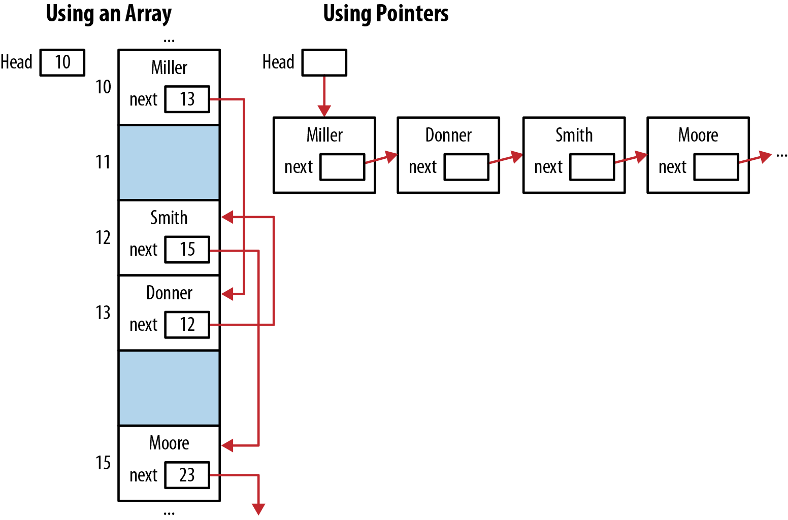

Hình 1-1. Biểu diễn linked list bằng array so với pointer

Dynamic memory allocation trong C được thực hiện bằng pointer. Các function `malloc` và `free` lần lượt cấp phát và giải phóng dynamic memory. Dynamic memory allocation cho phép array variable-sized và data structure như linked list, queue. Tuy nhiên, chuẩn C mới, C11, có hỗ trợ array với kích thước biến đổi.

Expression gọn có thể diễn đạt rất rõ nhưng cũng khó hiểu, vì nhiều programmer chưa hiểu đầy đủ pointer notation. Expression gọn nên đáp ứng nhu cầu cụ thể, không nên khó hiểu chỉ để tỏ ra khó hiểu. Ví dụ, trong chuỗi lệnh sau, ký tự thứ ba của element thứ hai trong `names'` được hiển thị bằng hai function `printf` khác nhau. Nếu cách dùng pointer này gây bối rối, đừng lo—chúng ta sẽ giải thích kỹ dereferencing trong mục “Dereference pointer bằng indirection operator” ở trang 11. Dù hai cách tương đương và đều hiển thị ký tự `n`, dùng array notation là cách đơn giản hơn.

```
char *names[] = {"Miller","Jones","Anderson"};
printf("%c\n",*(*(names+1)+2));
printf("%c\n",names[1][2]);
```

Pointer là công cụ mạnh để tạo và cải thiện application. Mặt khác, nhiều vấn đề có thể xảy ra khi dùng pointer, như:

- Truy cập array và data structure khác vượt giới hạn

- Tham chiếu automatic variable sau khi nó không còn tồn tại

- Tham chiếu memory cấp phát từ heap sau khi đã giải phóng

- Dereference pointer trước khi cấp phát memory cho nó

Các vấn đề này sẽ được xem xét kỹ hơn trong Chương 7.

Syntax và semantics khi dùng pointer được quy định khá rõ trong C specification. Tuy nhiên, có những tình huống specification không quy định tường minh hành vi pointer. Khi đó hành vi thuộc một trong các loại sau:

Implementation-defined

Có implementation cụ thể và được ghi tài liệu. Ví dụ về hành vi implementation-defined là cách truyền high-order bit khi shift phải một integer.

Unspecified

Có implementation nhưng không được ghi tài liệu. Ví dụ về unspecified behavior là lượng memory mà function `malloc` cấp phát với argument zero. Danh sách unspecified behavior có trong CERT Secure Coding Appendix DD.

Undefined

Không có yêu cầu nào được áp đặt, nên bất cứ điều gì cũng có thể xảy ra. Ví dụ là giá trị pointer đã được giải phóng bởi các function `free`. Danh sách unspecified behavior có trong CERT Secure Coding Appendix CC.

Đôi khi có hành vi locale-specific. Nhà cung cấp compiler thường ghi tài liệu về chúng. Cung cấp hành vi locale-specific cho compiler-writer sự linh hoạt để sinh code hiệu quả hơn.

### Khai báo pointer

Pointer variable được khai báo bằng data type, theo sau là dấu sao rồi tên pointer variable. Ví dụ sau khai báo một integer và một pointer đến integer:

```
int num;
int *pi;
```

Khoảng trắng quanh dấu sao không ảnh hưởng. Các declaration sau hoàn toàn tương đương:

```
int* pi;
int * pi;
int *pi;
int*pi;
```


Cách dùng khoảng trắng tùy sở thích người dùng.

Dấu sao khai báo variable là pointer. Đây là symbol overloaded vì cũng dùng cho phép nhân và dereference pointer.

Hình 1-2 minh họa cách memory thường được cấp phát cho declaration trên. Ba hình chữ nhật biểu diễn ba vị trí memory. Số bên trái mỗi hình là address. Tên bên cạnh address là variable được gán vào vị trí đó. Address 100 chỉ dùng để minh họa. Address thực của pointer, hay bất kỳ variable nào, thường không được biết trước và phần lớn application cũng không quan tâm giá trị cụ thể. Ba dấu chấm biểu thị memory chưa khởi tạo.

Pointer đến memory chưa khởi tạo có thể gây vấn đề. Nếu dereference, nội dung pointer có lẽ không phải address hợp lệ; ngay cả nếu hợp lệ, memory cũng có thể không chứa data hợp lệ. Address không hợp lệ là address chương trình không được phép truy cập. Trên phần lớn platform, điều này khiến chương trình kết thúc, một hậu quả nghiêm trọng có thể dẫn tới nhiều vấn đề như Chương 7 sẽ bàn.

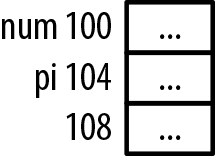

Hình 1-2. Sơ đồ memory

Các variable `num` và `pi` lần lượt ở address 100 và 104. Giả định mỗi variable chiếm bốn byte. Cả hai kích thước có thể khác tùy cấu hình hệ thống, như mục “Kích thước và type của pointer” ở trang 15 sẽ đề cập. Trừ khi nói khác, mọi ví dụ dùng integer four-byte.


Trong sách này, chúng ta dùng address như 100 để giải thích cách pointer hoạt động, giúp ví dụ đơn giản hơn. Khi chạy ví dụ, bạn sẽ nhận address khác; address thậm chí có thể đổi giữa các lần chạy chương trình.

Có vài điểm cần nhớ:

- Cuối cùng, nội dung `pi` cần được gán address của một integer variable.

- Các variable này chưa được khởi tạo, nên chứa garbage.

- Không có gì vốn có trong implementation của pointer cho biết type của data đang tham chiếu hoặc nội dung có hợp lệ không.

- Tuy nhiên, pointer type đã được chỉ định và compiler thường báo khi dùng pointer sai.


Garbage nghĩa là memory đã cấp phát có thể chứa bất kỳ giá trị nào. Khi được cấp phát, memory không được xóa sạch. Nội dung cũ có thể là bất cứ thứ gì. Nếu trước đó chứa floating point number, diễn giải thành integer có lẽ không hữu ích. Ngay cả khi chứa integer, nó cũng khó là integer đúng. Vì vậy nội dung được gọi là garbage.

Dù có thể sử dụng pointer chưa khởi tạo, nó không phải lúc nào cũng hoạt động đúng cho đến khi được khởi tạo.

### Cách đọc declaration

Đây là lúc thích hợp để giới thiệu cách đọc pointer declaration cho dễ hiểu hơn. Mẹo là đọc ngược. Dù chưa bàn pointer đến constant, hãy xét declaration sau:

```
const int *pci;
```

Đọc ngược giúp hiểu declaration từng bước (Hình 1-3).

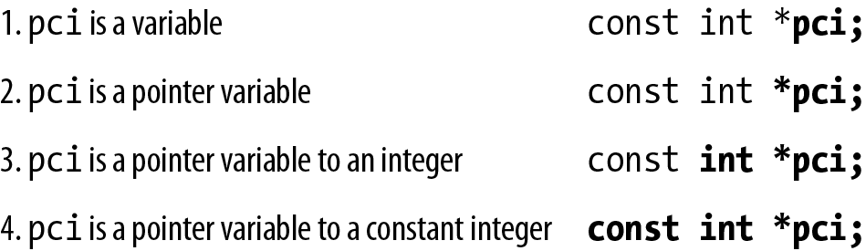

Hình 1-3. Declaration đọc ngược

Nhiều programmer thấy đọc ngược declaration ít phức tạp hơn.


Khi làm việc với pointer expression phức tạp, hãy vẽ hình, như chúng ta sẽ làm trong nhiều ví dụ.

### Address of operator

Address of operator, `&`, trả về address của operand. Có thể dùng nó để khởi tạo pointer `pi` bằng address của `num` như sau:

```
num = 0;
pi = &num;
```

Variable `num` được đặt bằng zero, còn `pi` được đặt để trỏ đến address của `num`, như Hình 1-4.

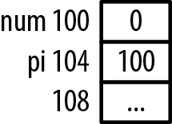

Hình 1-4. Gán memory

Có thể khởi tạo `pi` để trỏ đến address của `num` ngay khi khai báo các variable, như sau:

```
int num;
int *pi = &num;
```

Với các declaration này, câu lệnh sau gây syntax error trên phần lớn compiler:

```
num = 0;
pi = num;
```

Lỗi sẽ xuất hiện như sau:

```
error: invalid conversion from 'int' to 'int*'
```

Variable `pi` có type pointer đến integer, còn `num` có type integer. Thông báo nói rằng không thể chuyển integer thành pointer đến data type integer.


Gán integer cho pointer thường gây warning hoặc error.

Pointer và integer không giống nhau. Trên phần lớn máy chúng có thể được lưu bằng cùng số byte, nhưng vẫn khác nhau. Tuy nhiên, có thể cast integer thành pointer đến integer:

```
pi = (int *)num;
```

Điều này không gây syntax error. Nhưng khi chạy, chương trình có thể kết thúc bất thường khi cố dereference giá trị tại address zero. Trên phần lớn operating system, address zero không phải lúc nào cũng hợp lệ để chương trình dùng. Chúng ta sẽ bàn kỹ trong mục “Khái niệm null” ở trang 11.


Nên khởi tạo pointer sớm nhất có thể, như minh họa sau:

```
int num;
int *pi;
pi = &num;
```

### Hiển thị giá trị pointer

Variable chúng ta dùng hiếm khi thực sự có address như 100 và 104. Tuy nhiên, có thể xác định address bằng cách in như sau:

```
int num = 0;
int *pi = &num;

printf("Address of num: %d  Value: %d\n",&num, num);
printf("Address of pi: %d  Value: %d\n",&pi, pi);
```

Khi chạy, bạn có thể nhận output sau. Ví dụ dùng address thực. Address của bạn có lẽ sẽ khác:

```
Address of num: 4520836  Value: 0
Address of pi: 4520824  Value: 4520836
```

Function `printf` có một số field specifier khác hữu ích để hiển thị pointer value, được tóm tắt trong Bảng 1-2.

Bảng 1-2. Field specifier

| Specifier | Ý nghĩa |
|---|---|
| %x | Hiển thị giá trị dưới dạng số hexadecimal. |
| %o | Hiển thị giá trị dưới dạng số octal. |
| %p | Hiển thị giá trị theo cách implementation-specific; thường dưới dạng số hexadecimal. |

Cách dùng được minh họa sau:

```
printf("Address of pi: %d  Value: %d\n",&pi, pi);
printf("Address of pi: %x  Value: %x\n",&pi, pi);
printf("Address of pi: %o  Value: %o\n",&pi, pi);
printf("Address of pi: %p  Value: %p\n",&pi, pi);
```

Đoạn này hiển thị address và nội dung `pi` như sau. Trong trường hợp này, `pi` chứa address của `num`:

```
Address of pi: 4520824  Value: 4520836
Address of pi: 44fb78  Value: 44fb84
Address of pi: 21175570  Value: 21175604
Address of pi: 0044FB78  Value: 0044FB84
```

Specifier `%p` khác `%x` ở chỗ thường hiển thị số hexadecimal bằng chữ hoa. Trừ khi nói khác, chúng ta dùng specifier `%p` cho address.

Hiển thị pointer value nhất quán trên các platform có thể khó. Một cách là cast pointer thành pointer đến void rồi hiển thị bằng format specifier `%p`, như sau:

```
printf("Value of pi: %p\n", (void*)pi);
```

Pointer đến void được giải thích trong mục “Pointer đến void” ở trang 14. Để ví dụ đơn giản, chúng ta dùng specifier `%p` mà không cast address thành pointer đến void.

#### Virtual memory và pointer

Việc hiển thị address còn phức tạp hơn vì pointer address trên virtual operating system khó là physical memory address thực. Virtual operating system cho phép chương trình được phân tán khắp physical address space của máy. Application được chia thành page/frame. Các page này biểu diễn vùng main memory. Page của application được cấp phát vào các vùng memory khác nhau, có thể không liên tục, và có thể không đồng thời nằm hết trong memory. Nếu operating system cần memory đang do một page chiếm giữ, memory có thể được swap ra secondary storage rồi nạp lại sau, thường ở vị trí memory khác. Các khả năng này đem lại sự linh hoạt đáng kể trong quản lý memory.

Mỗi chương trình giả định nó có quyền truy cập toàn bộ physical memory space của máy. Thực tế không phải vậy. Address chương trình dùng là virtual address. Operating system ánh xạ virtual address sang physical memory address thực khi cần.

Nghĩa là code và data trong một page có thể nằm ở các vị trí physical khác nhau khi chương trình chạy. Virtual address của application không đổi; đó là những address thấy được khi xem nội dung pointer. Operating system ánh xạ virtual address sang address thực một cách trong suốt.

Operating system xử lý tất cả việc này; programmer không kiểm soát và cũng không cần lo. Hiểu các vấn đề này giúp giải thích những address mà chương trình chạy trên virtual operating system trả về.

### Dereference pointer bằng indirection operator

Indirection operator, \*, trả về giá trị mà pointer variable trỏ đến. Thao tác này thường được gọi là dereferencing pointer. Ví dụ sau khai báo và khởi tạo `num` và `pi`:

```
int num = 5;
int *pi = &num;
```

Sau đó indirection operator được dùng trong câu lệnh sau để hiển thị 5, giá trị của `num`:

```
printf("%p\n",*pi);   // Displays 5
```

Cũng có thể dùng kết quả dereference operator làm lvalue. Thuật ngữ lvalue chỉ operand bên trái assignment operator. Mọi `lvalues` phải có thể sửa đổi vì chúng được gán giá trị.

Đoạn sau gán 200 cho integer mà `pi` trỏ đến. Vì nó trỏ đến variable `num`, 200 được gán cho `num`. Hình 1-5 minh họa ảnh hưởng lên memory:

```
*pi = 200;
printf("%d\n",num);   // Displays 200
```

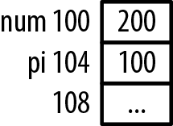

Hình 1-5. Gán memory bằng dereference operator

### Pointer đến function

Có thể khai báo pointer trỏ đến function. Declaration notation hơi khó hiểu. Đoạn sau minh họa khai báo pointer đến function. Function nhận void và trả về void. Tên pointer là `foo`:

```
void (*foo)();
```

Pointer đến function là chủ đề phong phú, sẽ được bàn kỹ hơn trong Chương 3.

### Khái niệm null

Khái niệm null thú vị và đôi khi bị hiểu nhầm. Sự nhầm lẫn có thể xảy ra vì thường làm việc với một số khái niệm tương tự nhưng khác nhau, gồm:

- Khái niệm null

- Null pointer constant

- Macro `NULL`

- ASCII `NUL`

- Null string

- Null statement

Khi `NULL` được gán cho pointer, nó nghĩa là pointer không trỏ đến gì. Khái niệm null nói đến việc pointer có thể chứa giá trị đặc biệt không bằng pointer khác. Nó không trỏ đến bất kỳ vùng memory nào. Hai null pointer luôn bằng nhau. Có thể có null pointer type cho mỗi pointer type, như pointer đến character hoặc integer, dù điều này không phổ biến.

Khái niệm null là abstraction được hỗ trợ bởi null pointer constant. Constant này có thể là hoặc không là constant zero. C programmer không cần quan tâm biểu diễn nội bộ thực tế.

Macro NULL là constant integer zero được cast thành pointer đến void. Nhiều library định nghĩa nó như sau:

```
#define NULL    ((void *)0)
```

Đây là thứ thường được nghĩ đến khi nói null pointer. Định nghĩa thường có trong nhiều header file khác nhau, gồm stddef.h, stdlib.h và stdio.h.

Nếu compiler dùng bit pattern khác zero để biểu diễn null, compiler chịu trách nhiệm bảo đảm mọi cách dùng `NULL` hoặc 0 trong pointer context đều được coi là null pointer. Biểu diễn nội bộ thực của null là implementation-defined. `NULL` và 0 là các symbol language-level biểu diễn null pointer.

ASCII `NUL` được định nghĩa là byte chứa toàn zero. Tuy nhiên, nó khác null pointer. String trong C được biểu diễn bằng chuỗi character kết thúc bởi giá trị zero. Null string là string rỗng, không chứa character nào. Cuối cùng, null statement là câu lệnh chỉ gồm một dấu chấm phẩy.

Như sẽ thấy, null pointer là feature rất hữu ích trong nhiều implementation data structure, như linked list, nơi nó thường đánh dấu cuối list.

Nếu muốn gán giá trị null cho `pi`, dùng type NULL như sau:

```
pi = NULL;
```


Null pointer khác pointer chưa khởi tạo. Pointer chưa khởi tạo có thể chứa bất kỳ giá trị nào, còn pointer chứa NULL không tham chiếu vị trí nào trong memory.

Thú vị là có thể gán zero cho pointer nhưng không thể gán integer khác. Xét các assignment operation sau:

```
pi = 0;
pi = NULL;
pi = 100;   // Syntax error
pi = num;   // Syntax error
```

Pointer có thể là operand duy nhất của logical expression. Ví dụ, có thể kiểm tra pointer đã được đặt bằng `NULL` chưa bằng chuỗi lệnh sau:

```
if(pi) {
   // Not NULL
} else {
   // Is NULL
}
```


Cả hai expression sau đều hợp lệ nhưng dư thừa. Có thể rõ hơn, nhưng không bắt buộc so sánh tường minh với NULL.

Nếu `pi` được gán giá trị `NULL` trong ngữ cảnh này, nó được diễn giải là binary zero. Vì trong C giá trị này biểu diễn false, mệnh đề else sẽ chạy nếu `pi` chứa `NULL`.

```
if(pi == NULL) ...
if(pi != NULL) ...
```


Không bao giờ nên dereference null pointer vì nó không chứa address hợp lệ. Khi thực thi, điều này sẽ làm chương trình kết thúc.

#### Dùng NULL hay không dùng NULL

Cách nào tốt hơn khi làm việc với pointer: dùng `NULL` hay dùng 0? Cả hai đều hoàn toàn chấp nhận được; lựa chọn tùy sở thích. Một số developer thích `NULL` vì nhắc rằng đang làm việc với pointer. Người khác thấy không cần vì chỉ là giấu số zero đi.

Tuy nhiên, không nên dùng `NULL` ngoài pointer context. Đôi lúc có thể hoạt động nhưng không được thiết kế cho mục đích đó. Dùng thay ASCII `NUL` chắc chắn có thể gây vấn đề. Character này không được định nghĩa trong standard C header file nào. Nó tương đương character literal `'\0'`, được evaluate thành giá trị decimal zero.

Ý nghĩa của zero thay đổi theo ngữ cảnh. Trong ngữ cảnh này có thể là integer zero, còn ở ngữ cảnh khác có thể là null pointer. Xét ví dụ sau:

```
int num;
int *pi = 0;   // Zero refers to the null pointer,NULL
pi = &num;
*pi = 0;        // Zero refers to the integer zero
```

Chúng ta quen với overloaded operator, như dấu sao dùng khai báo pointer, dereference pointer hoặc nhân. Zero cũng overloaded. Điều này có thể khiến khó chịu vì chúng ta chưa quen overload operand.

#### Pointer đến void

Pointer đến void là pointer general-purpose dùng giữ tham chiếu đến mọi data type. Ví dụ sau là pointer đến void:

```
void *pv;
```

Nó có hai đặc tính thú vị:

- Pointer đến void có cùng biểu diễn và memory alignment với pointer đến `char`.

- Pointer đến void không bao giờ bằng pointer khác. Tuy nhiên, hai void pointer được gán giá trị `NULL` sẽ bằng nhau.

Có thể gán mọi pointer cho pointer đến void, rồi cast lại về pointer type ban đầu. Khi đó giá trị bằng pointer value ban đầu. Chuỗi lệnh sau minh họa: pointer đến `int` được gán cho pointer đến void, rồi trở lại pointer đến `int`:

```
int num;
int *pi = &num;
printf("Value of pi: %p\n", pi);
void* pv = pi;
pi = (int*) pv;
printf("Value of pi: %p\n", pi);
```

Khi thực thi chuỗi này như dưới đây, pointer address giống nhau:

```
Value of pi: 100
Value of pi: 100
```

Pointer đến void dùng cho data pointer, không phải function pointer. Trong mục “Polymorphism trong C” ở trang 194, chúng ta sẽ xem lại cách dùng pointer đến void để xử lý polymorphic behavior.


Cẩn thận khi dùng pointer đến void. Nếu cast pointer tùy ý thành pointer đến void, không có gì ngăn bạn cast tiếp sang pointer type khác.

Có thể dùng operator `sizeof` với pointer đến void. Tuy nhiên, không thể dùng operator với void như sau:

```
size_t size = sizeof(void*);   // Legal
size_t size = sizeof(void);    // Illegal
```

`size_t` là data type dùng cho kích thước, được bàn trong mục “Các predefined type Pointer-Related” ở trang 16.

#### Global và static pointer

Nếu pointer được khai báo global hoặc static, nó được khởi tạo bằng `NULL` khi chương trình bắt đầu. Sau đây là ví dụ global và static pointer:

```
int *globalpi;

void foo() {
   static int *staticpi;
   ...
}

int main() {
   ...
}
```

Hình 1-6 minh họa bố trí memory này. Stack frame được push lên stack, còn heap dùng cho dynamic memory allocation. Vùng phía trên heap dùng cho static/global variable. Đây chỉ là sơ đồ khái niệm. Static và global variable thường được đặt trong data segment riêng, khác data segment của stack và heap. Stack và heap được bàn trong mục “Program stack và heap” ở trang 58.

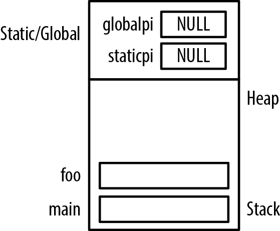

Hình 1-6. Cấp phát memory cho global và static pointer

## Kích thước và type của pointer

Kích thước pointer là vấn đề khi quan tâm compatibility và portability của application. Trên phần lớn platform hiện đại, pointer đến data thường có cùng kích thước bất kể pointer type. Pointer đến `char` có cùng kích thước với pointer đến structure. Dù chuẩn C không bắt buộc kích thước giống nhau cho mọi data type, thực tế thường như vậy. Tuy nhiên, pointer đến function có thể khác kích thước pointer đến data.

Kích thước pointer phụ thuộc máy và compiler. Ví dụ, trên Windows hiện đại pointer dài 32 hoặc 64 bit. Với DOS và Windows 3.1, pointer dài 16 hoặc 32 bit.

### Memory model

Sự xuất hiện của máy 64-bit làm rõ hơn những khác biệt về lượng memory cấp phát cho data type. Máy và compiler khác nhau đem lại các lựa chọn cấp phát không gian khác nhau cho C primitive data type. Một notation phổ biến để mô tả các data model được tóm tắt sau:

```
I In L Ln LL LLn P Pn
```

Mỗi chữ hoa tương ứng integer, long hoặc pointer. Chữ thường biểu diễn số bit cấp phát cho data type. Bảng 1-3[^1] tóm tắt các model, trong đó số là kích thước theo bit:

Bảng 1-3. Memory model của máy

| C data type | LP64 | ILP64 | LLP64 | ILP32 | LP32 |
|---|---|---|---|---|---|
| char | 8 | 8 | 8 | 8 | 8 |
| short | 16 | 16 | 16 | 16 | 16 |
| \_int32 |  | 32 |  |  |  |
| int | 32 | 64 | 32 | 32 | 16 |
| long | 64 | 64 | 32 | 32 | 32 |
| long long |  |  | 64 |  |  |
| pointer | 64 | 64 | 64 | 32 | 32 |

Model phụ thuộc operating system và compiler. Cùng một operating system có thể hỗ trợ nhiều model; điều này thường được kiểm soát qua compiler option.

### Các predefined type Pointer-Related

Bốn predefined type thường dùng khi làm việc với pointer gồm: `size_t`

Được tạo để cung cấp type an toàn cho kích thước

`ptrdiff_t`

Được tạo để xử lý pointer arithmetic

`intptr_t` and `uintprt_t`

Dùng để lưu pointer address

Các mục tiếp theo minh họa từng type, trừ `ptrdiff_t` sẽ bàn trong mục “Trừ hai pointer” ở trang 24.

#### Hiểu size\_t

Type `size_t` biểu diễn kích thước tối đa mà object trong C có thể có. Nó là unsigned integer vì số âm không có ý nghĩa ở đây. Mục đích là cung cấp cách khai báo kích thước portable, nhất quán với vùng memory có thể đánh địa chỉ trên hệ thống. Type `size_t` dùng làm return type của operator `sizeof` và argument cho nhiều function, gồm `malloc` và `strlen`, cùng nhiều function khác.


Nên dùng `size_t` khi khai báo variable kích thước như số character và array index. Nên dùng nó cho loop counter, index vào array, và đôi khi cho pointer arithmetic.

Declaration của `size_t` là implementation-specific. Nó nằm trong một hoặc nhiều standard header như stdio.h, stdlib.h, và thường được định nghĩa như sau:

```
#ifndef __SIZE_T
#define __SIZE_T
typedef unsigned int size_t;
#endif
```

Các directive define bảo đảm chỉ định nghĩa một lần. Kích thước thực tùy implementation. Thông thường, trên hệ thống 32-bit nó dài 32 bit, còn trên hệ thống 64-bit dài 64 bit. Giá trị tối đa có thể có của `size_t` thường là `SIZE_MAX`.


Thông thường có thể dùng `size_t` lưu pointer, nhưng không nên giả định `size_t` bằng kích thước pointer. Như sẽ thấy trong mục “Dùng sizeof operator với pointer” ở trang 18, `intptr_t` là lựa chọn tốt hơn.

Cẩn thận khi in giá trị được định nghĩa là `size_t`. Đây là unsigned value; chọn sai format specifier cho kết quả không đáng tin. Format specifier được khuyến nghị là `%zu`, nhưng không phải lúc nào cũng có. Có thể cân nhắc `%u` hoặc `%lu` thay thế.

Xét ví dụ sau: định nghĩa variable là `size_t` rồi hiển thị bằng hai format specifier khác nhau:

```
size_t sizet = -5;
printf("%d\n",sizet);
printf("%zu\n",sizet);
```

Vì variable type `size_t` dành cho integer dương, dùng giá trị âm có thể gây vấn đề. Khi gán số âm rồi dùng format specifier `%d` và `%zu`, nhận output sau:

```
-5
4294967291
```

Field `%d` diễn giải `size_t` là signed integer. Nó hiển thị –5 vì chứa –5. Field `%zu` định dạng `size_t` là unsigned integer. Khi –5 được diễn giải là signed integer, high-order bit được đặt bằng một để chỉ integer âm. Khi diễn giải là unsigned number, high-order bit được xem là lũy thừa lớn của 2. Đó là lý do thấy integer lớn khi dùng field specifier `%zu`.

Số dương được hiển thị đúng như sau:

```
sizet = 5;
printf("%d\n",sizet);    // Displays 5
printf("%zu\n",sizet);   // Displays 5
```

Vì `size_t` là unsigned, luôn gán số dương cho variable thuộc type này.

#### Dùng sizeof operator với pointer

Operator `sizeof` có thể xác định kích thước pointer. Đoạn sau hiển thị kích thước pointer đến `char`:

```
printf("Size of *char: %d\n",sizeof(char*));
```

Output như sau:

```
Size of *char: 4
```


Luôn dùng operator `sizeof` khi cần kích thước pointer.

Kích thước function pointer có thể thay đổi. Thường nó nhất quán với tổ hợp operating system và compiler cụ thể. Nhiều compiler hỗ trợ tạo application 32-bit hoặc 64-bit. Cùng một chương trình compile với option khác nhau có thể dùng kích thước pointer khác nhau.

Trên Harvard architecture, code và data được lưu trong physical memory khác nhau. Ví dụ, microcontroller Intel MCS-51 (8051) là máy Harvard. Dù Intel không còn sản xuất chip, nhiều phiên bản tương thích binary vẫn có và đang được dùng. Small Device C Complier (SDCC) hỗ trợ loại processor này. Pointer trên máy có thể dài từ 1 đến 4 byte. Vì vậy phải xác định kích thước pointer khi cần, do kích thước không nhất quán trong môi trường này.

#### Dùng intptr\_t và uintptr\_t

Type `intptr_t` và `uintptr_t` dùng lưu pointer address. Chúng cung cấp cách khai báo pointer portable và an toàn, có cùng kích thước với pointer nền tảng hệ thống dùng. Chúng hữu ích để chuyển pointer sang biểu diễn integer.

Type `uintptr_t` là phiên bản unsigned của `intptr_`t. Với phần lớn operation, nên dùng `intptr_t`. Type `uintptr_t` không linh hoạt bằng `intptr_t`. Đoạn sau minh họa cách dùng `intptr_t`:

```
int num;
intptr_t *pi = &num;
```

Nếu thử gán address của integer cho pointer type `uintptr_t` như sau, sẽ gặp syntax error:

```
uintptr_t *pu = &num;
```

Lỗi như sau:

```
error: invalid conversion from 'int*' to
       'uintptr_t* {aka unsigned int*}' [-fpermissive]
```

Tuy nhiên, thực hiện assignment bằng cast sẽ hoạt động:

```
intptr_t *pi = &num;
uintptr_t *pu = (uintptr_t*)&num;
```

Không thể dùng `uintptr_t` với data type khác mà không cast:

```
char c;
uintptr_t *pc = (uintptr_t*)&c;
```

Nên dùng các type này khi portability và safety là vấn đề. Tuy nhiên, để giải thích đơn giản, ví dụ trong sách không dùng chúng.


Tránh cast pointer thành integer. Với pointer 64-bit, thông tin sẽ mất nếu integer chỉ có bốn byte.


Intel processor đời đầu dùng segmented architecture 16-bit, nơi near và far pointer có vai trò. Với virtual memory architecture ngày nay, chúng không còn là yếu tố cần xét. Far và near pointer là extension của chuẩn C để hỗ trợ segmented architecture trên Intel processor đời đầu. Near pointer chỉ đánh địa chỉ khoảng 64KB memory mỗi lần. Far pointer đánh địa chỉ tới 1MB nhưng chậm hơn near pointer. Huge pointer là far pointer được normalize để dùng segment cao nhất có thể.

## Pointer operator

Có một số operator dùng với pointer. Đến đây đã xét dereference và address-of operator. Phần này xem kỹ pointer arithmetic và comparison. Bảng 1-4 tóm tắt các pointer operator.

Bảng 1-4. Pointer operator

| Operator | Tên | Ý nghĩa |
|---|---|---|
| \* |  | Dùng khai báo pointer |
| \* | Dereference | Dùng dereference pointer |
| \-\> | Point-to | Dùng truy cập field của structure được pointer tham chiếu |
| \+ | Addition | Dùng tăng pointer |
| \- | Subtraction | Dùng giảm pointer |
| \== != | Equality, inequality | So sánh hai pointer |
| \> \>= \< \<= | Greater than, greater than or equal, less than, less than or equal | So sánh hai pointer |
| (data type) | Cast | Thay đổi pointer type |

### Pointer arithmetic

Có một số arithmetic operation trên pointer đến data, gồm:

- Cộng integer vào pointer

- Trừ integer khỏi pointer

- Trừ hai pointer cho nhau

- So sánh pointer

Những operation này không phải lúc nào cũng được phép với pointer đến function.

#### Cộng integer vào pointer

Operation này rất phổ biến và hữu ích. Khi cộng integer vào pointer, lượng cộng bằng integer nhân số byte của data type nền tảng.

Kích thước primitive data type có thể khác giữa các hệ thống, như mục “Memory model” trang 16 đã bàn. Tuy nhiên, Bảng 1-5 cho các kích thước phổ biến trên phần lớn hệ thống. Trừ khi nói khác, ví dụ trong sách dùng các giá trị này.

Bảng 1-5. Kích thước data type

| Data type | Kích thước theo byte |
|---|---|
| byte | 1 |
| char | 1 |
| short | 2 |
| int | 4 |
| long | 8 |
| float | 4 |
| double | 8 |

Để minh họa việc cộng integer vào pointer, dùng array integer như sau. Mỗi lần cộng một vào `pi`, address tăng bốn. Memory cấp phát cho các variable được minh họa trong Hình 1-7. Pointer được khai báo với data type để thực hiện được những arithmetic operation này. Biết kích thước data type cho phép tự động điều chỉnh pointer value theo cách portable:

```
int vector[] = {28, 41, 7};
int *pi = vector;      // pi: 100
```

```
printf("%d\n",*pi);    // Displays 28
pi += 1;               // pi: 104
printf("%d\n",*pi);    // Displays 41
pi += 1;               // pi: 108
printf("%d\n",*pi);    // Displays 7
```


Khi dùng riêng tên array, nó trả về address của array, cũng là address của element đầu:

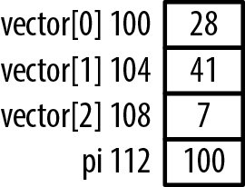

Hình 1-7. Cấp phát memory cho vector

Trong chuỗi sau, cộng ba vào pointer. Variable `pi` sẽ chứa address 112, address của `pi`:

```
pi = vector;
pi += 3;
```

Pointer đang trỏ đến chính nó. Điều này không hữu ích lắm nhưng minh họa sự cần thiết phải thận trọng với pointer arithmetic. Truy cập memory vượt cuối array nguy hiểm và nên tránh. Không có bảo đảm vùng memory truy cập là variable hợp lệ. Rất dễ tính ra address không hợp lệ hoặc vô dụng.

Các declaration sau minh họa addition operation với data type `short`, rồi `char`:

```
short s;
short *ps = &s;
char c;
char *pc = &c;
```

Giả định memory được cấp phát như Hình 1-8. Các address ở đây đều nằm trên ranh giới word four-byte. Address thực có thể được align theo ranh giới khác và thứ tự khác.

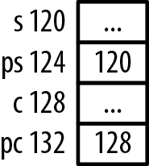

Hình 1-8. Pointer đến short và char

Chuỗi sau cộng một vào từng pointer rồi hiển thị nội dung:

```
printf("Content of ps before: %d\n",ps);
ps = ps + 1;
printf("Content of ps after:  %d\n",ps);

printf("Content of pc before: %d\n",pc);
pc = pc + 1;
printf("Content of pc after:  %d\n",pc);
```

Khi chạy, bạn sẽ nhận output tương tự:

```
Content of ps before: 120
Content of ps after:  122
Content of pc before: 128
Address of pc after:  129
```

Pointer `ps` tăng hai vì `short` có kích thước hai byte. Pointer `pc` tăng một vì kích thước của nó là một byte. Một lần nữa, các address này có thể không chứa thông tin hữu ích.

#### Pointer đến void và phép cộng

Phần lớn compiler cho phép arithmetic trên pointer đến void như một extension. Ở đây giả định kích thước pointer đến void bằng bốn. Tuy nhiên, thử cộng một vào pointer đến void có thể gây syntax error. Đoạn code sau khai báo và thử cộng một vào pointer:

```
int num = 5;
void *pv = &num;
printf("%p\n",pv);
pv = pv+1;        //Syntax warning
```

Warning nhận được như sau:

```
warning: pointer of type 'void *' used in arithmetic [-Wpointerarith]
```

Vì đây không phải standard C, compiler phát warning. Tuy nhiên, address kết quả chứa trong `pv` sẽ tăng bốn byte.

#### Trừ integer khỏi pointer

Có thể trừ integer khỏi pointer như cách cộng. Kích thước data type nhân giá trị integer dùng làm bước được trừ khỏi address. Để minh họa, dùng array integer như sau. Memory tạo cho các variable được minh họa trong Hình 1-7.

```
int vector[] = {28, 41, 7};
int *pi = vector + 2;  // pi: 108
```

```
printf("%d\n",*pi);    // Displays 7
pi--;                  // pi: 104
printf("%d\n",*pi);    // Displays 41
pi--;                  // pi: 100
printf("%d\n",*pi);    // Displays 28
```

Mỗi lần trừ một khỏi `pi`, address giảm bốn.

#### Trừ hai pointer

Khi trừ pointer này khỏi pointer kia, nhận chênh lệch giữa các address. Chênh lệch thường không hữu ích lắm, trừ khi xác định thứ tự element trong array.

Chênh lệch giữa pointer là số “đơn vị” cách nhau. Dấu phụ thuộc thứ tự operand. Điều này nhất quán với phép cộng pointer, nơi lượng cộng là kích thước data type của pointer. Chúng ta dùng “đơn vị” làm operand. Ví dụ sau khai báo array và pointer đến các element, rồi lấy hiệu:

```
int vector[] = {28, 41, 7};
int *p0 = vector;
int *p1 = vector+1;
int *p2 = vector+2;
```

```
printf("p2-p0:  %d\n",p2-p0);    // p2-p0:  2
printf("p2-p1:  %d\n",p2-p1);    // p2-p1:  1
printf("p0-p1:  %d\n",p0-p1);    // p0-p1:  -1
```

Trong câu `printf` đầu, chênh lệch vị trí giữa element cuối và đầu array là 2, tức index cách nhau 2. Trong câu `printf` cuối, chênh lệch –1 cho biết `p0` nằm ngay trước element mà `p1` trỏ đến. Hình 1-9 minh họa memory cấp phát cho ví dụ.

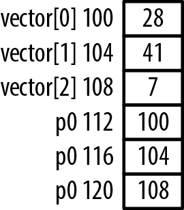

Hình 1-9. Trừ hai pointer

Type `ptrdiff_t` là cách portable để biểu diễn chênh lệch giữa hai pointer. Trong ví dụ trước, kết quả trừ hai pointer trả về type `ptrdiff_t`. Vì kích thước pointer có thể khác nhau, type này đơn giản hóa việc xử lý chênh lệch.

Đừng nhầm kỹ thuật này với dùng dereference operator để trừ hai số. Ví dụ sau dùng pointer xác định hiệu các giá trị lưu trong element đầu và thứ hai của array:

```
printf("*p0-*p1:  %d\n",*p0-*p1);  //  *p0-*p1:  -13
```

### So sánh pointer

Có thể so sánh pointer bằng standard comparison operator. Thông thường so sánh pointer không hữu ích lắm. Tuy nhiên, khi so pointer đến element của array, có thể dùng kết quả xác định thứ tự tương đối của các element.

Dùng ví dụ vector trong mục “Trừ hai pointer” trang 24 để minh họa comparison. Nhiều comparison operator được áp dụng cho các pointer, và kết quả hiển thị 1 cho true, 0 cho false:

```
int vector[] = {28, 41, 7};
int *p0 = vector;
int *p1 = vector+1;
int *p2 = vector+2;
```

```
printf("p2>p0:  %d\n",p2>p0);    // p2>p0:  1
printf("p2<p0:  %d\n",p2<p0);    // p2<p0:  0
printf("p0>p1:  %d\n",p0>p1);    // p0>p1:  0
```

## Các cách dùng pointer phổ biến

Pointer có thể dùng theo nhiều cách. Phần này xét các cách khác nhau, gồm:

- Nhiều mức indirection

- Constant pointer

### Nhiều mức indirection

Pointer có thể dùng nhiều mức indirection. Khai báo variable là pointer đến pointer, đôi khi gọi double pointer, không hiếm. Ví dụ điển hình là truyền program argument cho function `main` bằng parameter thường có tên `argc` và `argv`. Chương 5 sẽ bàn kỹ hơn.

Ví dụ sau dùng ba array. Array đầu là array string chứa danh sách tên sách:

```
char *titles[] = {"A Tale of Two Cities",
       "Wuthering Heights","Don Quixote",
       "Odyssey","Moby-Dick","Hamlet",
       "Gulliver's Travels"};
```

Hai array bổ sung duy trì danh sách “sách hay nhất” và sách tiếng Anh. Thay vì chứa bản sao tên sách, chúng chứa address của tên sách trong array `titles`. Cả hai phải được khai báo là pointer đến pointer đến `char`. Element của array chứa address của element trong array `titles`. Cách này tránh nhân đôi memory cho từng tên sách và chỉ có một vị trí lưu tên. Nếu cần sửa tên, chỉ phải sửa ở một chỗ.

Hai array được khai báo sau. Mỗi element chứa pointer trỏ đến pointer thứ hai đến `char`:

```
char **bestBooks[3];
char **englishBooks[4];
```

Hai array được khởi tạo rồi hiển thị một element như sau. Trong các assignment statement, giá trị vế phải được tính bằng subscript trước, rồi address-of operator. Ví dụ, câu thứ hai gán address của element thứ tư trong `titles` cho element thứ hai trong `bestBooks`:

```
bestBooks[0] = &titles[0];
bestBooks[1] = &titles[3];
bestBooks[2] = &titles[5];
```

```
englishBooks[0] = &titles[0];
englishBooks[1] = &titles[1];
englishBooks[2] = &titles[5];
englishBooks[3] = &titles[6];
```

```
printf("%s\n",*englishBooks[1]);   // Wuthering Heights
```

Memory cho ví dụ được cấp phát như Hình 1-10.

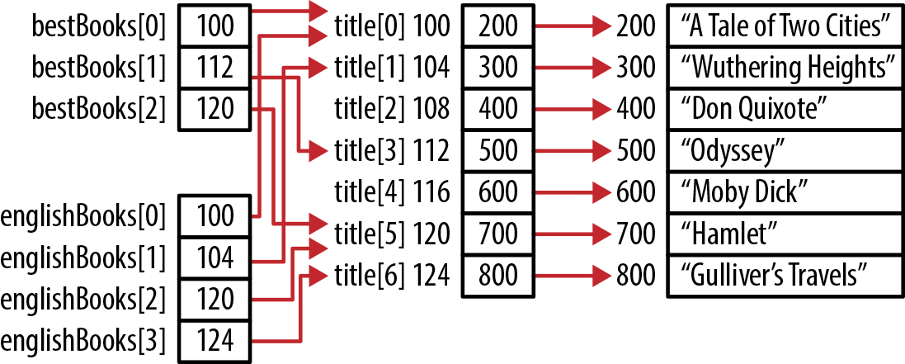

Hình 1-10. Pointer đến pointer

Nhiều mức indirection đem lại sự linh hoạt bổ sung khi viết và sử dụng code. Nếu không, một số operation sẽ khó hơn. Trong ví dụ này, nếu address của tên sách thay đổi, chỉ cần sửa array `title`, không phải sửa các array khác.

Không có giới hạn vốn có về số mức indirection. Tất nhiên, quá nhiều mức có thể gây khó hiểu và khó bảo trì.

### Constant và pointer

Dùng keyword `const` với pointer là một khía cạnh phong phú và mạnh của C. Nó cung cấp nhiều kiểu bảo vệ cho các nhóm bài toán khác nhau. Đặc biệt mạnh và hữu ích là pointer đến constant. Trong Chương 3 và 5, sẽ thấy cách nó bảo vệ người dùng function khỏi việc function sửa parameter.

#### Pointer đến constant

Có thể định nghĩa pointer trỏ đến constant. Nghĩa là không thể dùng pointer sửa giá trị đang tham chiếu. Ví dụ sau khai báo một integer và một integer constant. Tiếp theo khai báo pointer đến integer và pointer đến integer constant, rồi khởi tạo bằng các integer tương ứng:

```
int num = 5;
const int limit = 500;
int *pi;                // Pointer to an integer
const int *pci;         // Pointer to a constant integer

pi = &num;
pci = &limit;
```

Điều này được minh họa trong Hình 1-11.

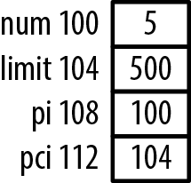

Hình 1-11. Pointer đến constant integer

Chuỗi sau hiển thị address và giá trị các variable:

```
printf("  num - Address: %p  value: %d\n",&num, num);
printf("limit - Address: %p  value: %d\n",&limit, limit);
printf("   pi - Address: %p  value: %p\n",&pi, pi);
printf("  pci - Address: %p  value: %p\n",&pci, pci);
```

Khi chạy, chuỗi này sinh các giá trị tương tự:

```
  num - Address: 100  value: 5
limit - Address: 104  value: 500
   pi - Address: 108  value: 100
  pci - Address: 112  value: 104
```

Dereference constant pointer không sao nếu chỉ đọc giá trị integer. Đọc là khả năng hoàn toàn hợp lệ và cần thiết, như sau:

```
printf("%d\n", *pci);
```

Không thể dereference constant pointer để thay đổi thứ pointer tham chiếu, nhưng có thể thay đổi pointer. Pointer value không phải constant. Có thể đổi pointer để tham chiếu constant integer khác hoặc integer thông thường mà không có vấn đề. Declaration chỉ hạn chế khả năng sửa variable được tham chiếu thông qua pointer.

Nghĩa là assignment sau hợp lệ:

```
pci = &num;
```

Có thể dereference `pci` để đọc; tuy nhiên không thể dereference để sửa.

Xét assignment sau:

```
*pci = 200;
```

Điều này gây syntax error sau:

```
'pci' : you cannot assign to a variable that is const
```

Pointer cho rằng nó trỏ đến constant integer; do đó nó cho phép sửa integer bằng pointer. Vẫn có thể sửa `num` qua tên, nhưng không thể dùng `pci` sửa nó.

Về khái niệm, constant pointer cũng có thể biểu diễn như Hình 1-12. Ô trong biểu diễn variable có thể thay đổi; ô tô bóng biểu diễn variable không thể thay đổi. Ô tô bóng mà `pci` trỏ đến không thể sửa bằng `pci`. Đường nét đứt cho biết pointer có thể tham chiếu data type đó. Trong ví dụ trước, `pci` trỏ đến `limit`.

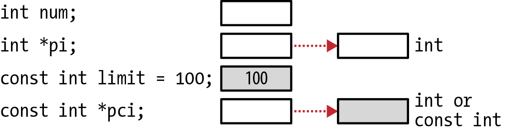

Hình 1-12. Pointer đến constant

Declaration `pci` là pointer đến constant integer nghĩa là:

- Có thể gán `pci` trỏ đến các constant integer khác nhau

- Có thể gán `pci` trỏ đến các nonconstant integer khác nhau

- Có thể dereference `pci` để đọc

- Không thể dereference `pci` để thay đổi thứ nó trỏ đến


Thứ tự type và keyword `const` không quan trọng. Các declaration sau tương đương:

```
const int *pci;
int const *pci;
```

#### Constant pointer đến nonconstant

Cũng có thể khai báo constant pointer đến nonconstant. Khi đó, pointer không thể thay đổi nhưng data được trỏ đến có thể sửa. Ví dụ:

```
int num;
int *const cpi = &num;
```

Với declaration này:

- `cpi` phải được khởi tạo bằng nonconstant variable

- Không thể sửa `cpi`

- Có thể sửa data mà `cpi` trỏ đến

Về khái niệm, loại pointer này có thể biểu diễn như Hình 1-13.

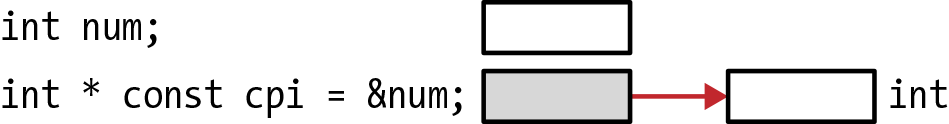

Hình 1-13. Constant pointer đến nonconstant

Có thể dereference `cpi` và gán giá trị mới cho thứ `cpi` tham chiếu. Sau đây là hai assignment hợp lệ:

```
*cpi = limit;
*cpi = 25;
```

Tuy nhiên, nếu thử khởi tạo `cpi` bằng constant `limit` như sau, sẽ nhận warning:

```
const int limit = 500;
int *const cpi = &limit;
```

Warning xuất hiện như sau:

```
warning: initialization discards qualifiers from pointer target type
```

Nếu `cpi` tham chiếu constant `limit`, constant có thể bị sửa. Điều này không mong muốn. Thường chúng ta muốn constant giữ nguyên. Một khi đã gán address cho `cpi`, không thể gán giá trị mới cho `cpi` như sau:

```
int num;
int age;
int *const cpi = &num;
cpi = &age;
```

Thông báo lỗi được sinh ra như sau:

```
'cpi' : you cannot assign to a variable that is const
```

#### Constant pointer đến constant

Constant pointer đến constant là pointer type ít dùng. Không thể thay đổi pointer, cũng không thể thay đổi data nó trỏ đến thông qua pointer. Sau đây là ví dụ constant pointer đến constant integer:

```
const int * const cpci = &limit;
```

Constant pointer đến constant có thể biểu diễn như Hình 1-14.

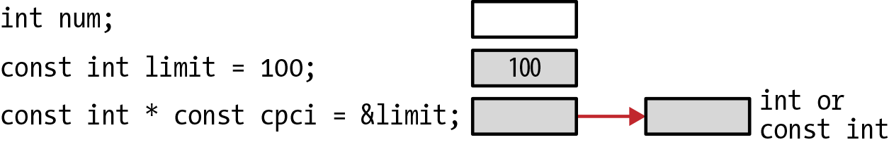

Hình 1-14. Constant pointer đến constant

Như pointer đến constant, không bắt buộc gán address của constant cho `cpci`. Thay vào đó có thể dùng `num` như sau:

```
int num;
const int * const cpci = &num;
```

Khi khai báo pointer, phải khởi tạo. Nếu không khởi tạo như sau, sẽ nhận syntax error:

```
const int * const cpci;
```

Syntax error tương tự:

```
'cpci' : const object must be initialized if not extern
```

Với constant pointer đến constant, không thể:

- Sửa pointer

- Sửa data mà pointer trỏ đến

Thử gán address mới cho `cpci` gây syntax error:

```
cpci = &num;
```

Syntax error như sau:

```
'cpci' : you cannot assign to a variable that is const
```

Nếu thử dereference pointer rồi gán giá trị như sau, cũng sẽ gặp syntax error:

```
*cpci = 25;
```

Lỗi sinh ra tương tự:

```
'cpci' : you cannot assign to a variable that is const
expression must be a modifiable lvalue
```

Constant pointer đến constant hiếm gặp.

#### Pointer đến (constant pointer đến constant)

Pointer đến constant cũng có thể có nhiều mức indirection. Ví dụ sau khai báo pointer đến pointer `cpci` đã giải thích ở mục trước. Đọc declaration phức tạp từ phải sang trái giúp làm rõ các declaration này:

```
const int * const cpci = &limit;
const int * const * pcpci;
```

Pointer đến constant pointer đến constant có thể biểu diễn như Hình 1-15.

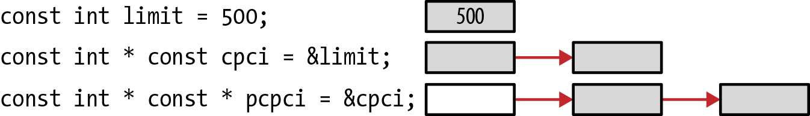

Hình 1-15. Pointer đến (constant pointer đến constant)

Đoạn sau minh họa cách dùng. Output của chuỗi này phải hiển thị 500 hai lần:

```
printf("%d\n",*cpci);
pcpci = &cpci;
printf("%d\n",**pcpci);
```

Bảng sau tóm tắt bốn pointer type đầu tiên đã bàn ở các mục trước:

| Pointer type | Pointer có thể sửa | Data được trỏ đến có thể sửa |
|---|---|---|
| Pointer đến nonconstant | ✓ | ✓ |
| Pointer đến constant | ✓ | X |
| Constant pointer đến nonconstant | X | ✓ |
| Constant pointer đến constant | X | X |

## Tóm tắt

Chương này đề cập các khía cạnh thiết yếu của pointer, gồm cách khai báo và dùng trong tình huống phổ biến. Khái niệm null thú vị cùng các biến thể đã được trình bày, bên cạnh một số pointer operator.

Chúng ta thấy kích thước pointer có thể khác nhau tùy memory model mà target system và compiler hỗ trợ. Cũng đã tìm hiểu keyword `const` với pointer.

Với nền tảng này, chúng ta sẵn sàng tìm hiểu các lĩnh vực khác mà pointer đã chứng minh sự hữu ích: làm parameter cho function, hỗ trợ data structure và dynamic memory allocation. Ngoài ra, sẽ thấy tác động của pointer trong việc làm application an toàn hơn.

[^1]: Phỏng theo http://en.wikipedia.org/wiki/64-bit.
