# Chương 2. Dynamic memory management trong C

Phần lớn sức mạnh của pointer bắt nguồn từ khả năng theo dõi memory được cấp phát động. Quản lý memory qua pointer là nền tảng của nhiều operation, gồm thao tác trên data structure phức tạp. Để tận dụng đầy đủ khả năng này, cần hiểu dynamic memory management diễn ra thế nào trong C.

Chương trình C thực thi bên trong runtime system, thường là môi trường do operating system cung cấp. Runtime system hỗ trợ stack, heap và các hành vi khác của chương trình.

Memory management là trọng tâm của mọi chương trình. Đôi khi runtime system quản lý memory ngầm, như khi cấp phát cho automatic variable. Khi ấy variable được cấp phát trong stack frame của function bao quanh. Với static và global variable, memory nằm trong data segment của application và được đặt toàn zero. Đây là vùng tách biệt executable code và các data khác mà runtime system quản lý.

Khả năng cấp phát rồi giải phóng memory cho phép application quản lý memory hiệu quả và linh hoạt hơn. Thay vì cấp phát đủ cho kích thước lớn nhất có thể của data structure, chỉ cần cấp phát đúng lượng thực sự cần.

Ví dụ, array có kích thước cố định trong các phiên bản C trước C99. Nếu cần chứa số element biến đổi, như employee record, phải khai báo array đủ lớn cho số nhân viên tối đa dự kiến. Nếu ước lượng thiếu, buộc phải recompile application với kích thước lớn hơn hoặc chọn cách khác. Nếu ước lượng thừa, sẽ lãng phí không gian. Khả năng cấp phát động cũng hữu ích với data structure có số element biến đổi như linked list hoặc queue.


C99 giới thiệu Variable Length Arrays (VLA). Kích thước array được xác định ở runtime thay vì compile time. Tuy nhiên, sau khi tạo, array vẫn không đổi kích thước.

Những ngôn ngữ như C cũng hỗ trợ dynamic memory management, trong đó object được cấp phát memory từ heap. Việc này được làm thủ công bằng function cấp phát và giải phóng memory. Quá trình được gọi là dynamic memory management.

Chúng ta bắt đầu bằng tổng quan nhanh cách cấp phát và giải phóng memory. Tiếp theo là các allocation function cơ bản như `malloc` và `realloc`. Function `free` được bàn cùng cách dùng NULL và các vấn đề như double free.

Dangling pointer là vấn đề phổ biến. Chúng ta sẽ dùng ví dụ minh họa khi nào nó xảy ra và các kỹ thuật xử lý. Phần cuối trình bày kỹ thuật quản lý memory thay thế. Dùng pointer sai có thể gây hành vi khó dự đoán: chương trình sinh kết quả không hợp lệ, làm hỏng data hoặc có thể kết thúc.

## Dynamic memory allocation

Các bước cơ bản để thực hiện dynamic memory allocation trong C là:

1\. Dùng function kiểu `malloc` để cấp phát memory

2\. Dùng memory này phục vụ application

3\. Giải phóng memory bằng function `free`

Dù có vài biến thể nhỏ, đây là kỹ thuật phổ biến nhất. Ví dụ sau cấp phát memory cho integer bằng `malloc`. Pointer gán năm cho memory đã cấp phát, rồi memory được giải phóng bằng `free`:

```
int *pi = (int*) malloc(sizeof(int));
*pi = 5;
printf("*pi: %d\n", *pi);
free(pi);
```

Khi chạy, chuỗi lệnh hiển thị số 5. Hình 2-1 minh họa memory ngay trước khi function `free` thực thi. Trong chương này, trừ khi nói khác, giả định code ví dụ nằm trong function `main`.

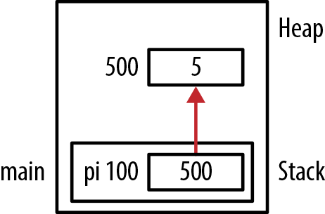

Hình 2-1. Cấp phát memory cho integer

Argument duy nhất của function `malloc` chỉ số byte cần cấp phát. Nếu thành công, nó trả pointer đến memory cấp phát từ heap; nếu thất bại, trả null pointer. Kiểm tra tính hợp lệ của pointer đã cấp phát được bàn trong “Dùng function malloc”. Operator `sizeof` làm application portable hơn và xác định đúng số byte cần cấp phát trên host system.

Ví dụ này cố cấp phát đủ memory cho integer. Nếu giả định kích thước là 4, có thể dùng:

```
int *pi = (int*) malloc(4));
```

Tuy nhiên, kích thước integer có thể khác tùy memory model. Cách portable là dùng operator `sizeof`, trả kích thước đúng bất kể chương trình thực thi ở đâu.


Sau đây minh họa lỗi phổ biến liên quan dereference operator:

```
int *pi;
*pi = (int*) malloc(sizeof(int));
```

Vấn đề nằm ở vế trái assignment. Chúng ta đang dereference pointer. Điều này gán address do `malloc` trả về vào address lưu trong `pi`. Nếu đây là lần đầu gán cho pointer, address trong nó có lẽ không hợp lệ. Cách đúng như sau:

```
pi = (int*) malloc(sizeof(int));
```

Không nên dùng dereference operator trong trường hợp này.

Function `free`, sẽ được bàn kỹ sau, phối hợp với `malloc` để giải phóng memory khi không còn cần.


Mỗi lần gọi function `malloc` (hoặc tương tự), phải có lời gọi `free` tương ứng khi application dùng xong memory, nhằm tránh memory leak.

Một khi đã giải phóng, không nên truy cập memory nữa. Thường bạn không cố ý làm vậy, nhưng có thể vô tình xảy ra, như mục “Dangling pointer” trang 51 minh họa. Khi đó hệ thống hành xử theo cách implementation-dependent. Thông lệ là luôn gán `NULL` cho pointer đã giải phóng, như mục “Gán NULL cho pointer đã giải phóng” trang 48.

Khi cấp phát memory, thông tin bổ sung được lưu trong data structure do heap manager duy trì. Trong đó có kích thước block và thông tin thường nằm sát block đã cấp phát. Nếu application ghi ra ngoài block, data structure có thể bị hỏng. Điều này dẫn đến hành vi lạ hoặc heap corruption, như Chương 7 sẽ trình bày.

Xét chuỗi code sau. Memory cấp phát cho string đủ chứa tối đa năm character và byte cho ký tự kết thúc `NUL`. Loop `for` ghi zero vào từng vị trí nhưng không dừng sau sáu byte. Điều kiện kết thúc của câu `for` khiến nó ghi tám byte. Zero được ghi là binary zero, không phải ASCII value của ký tự zero:

```
char *pc = (char*) malloc(6);
for(int i=0; i<8; i++) {
    *pc[i] = 0;
}
```

Trong Hình 2-2, có memory bổ sung ở cuối string six-byte. Đây là memory mà heap manager dùng theo dõi allocation. Nếu ghi vượt cuối string, vùng này bị hỏng. Ví dụ vẽ memory bổ sung sau string, nhưng vị trí thực và nội dung ban đầu tùy compiler.

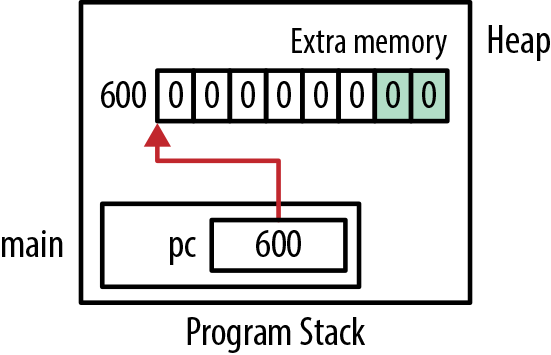

Hình 2-2. Memory bổ sung do heap manager sử dụng

### Memory leak

Memory leak xảy ra khi memory đã cấp phát không bao giờ dùng lại nhưng không được giải phóng. Có thể xảy ra khi:

- Address của memory bị mất

- Không gọi function `free` dù đáng ra phải gọi (đôi khi gọi hidden leak)

Vấn đề của memory leak là không thể thu hồi memory để dùng sau. Lượng memory sẵn có cho heap manager giảm. Nếu liên tục cấp phát rồi làm mất memory, chương trình có thể kết thúc khi cần thêm nhưng `malloc` không cấp phát được vì hết memory. Trường hợp nghiêm trọng có thể làm operating system crash.

Ví dụ đơn giản sau minh họa điều này:

```
char *chunk;
while (1) {
    chunk = (char*) malloc(1000000);
    printf("Allocating\n");
}
```

Variable `chunk` được gán memory từ heap. Tuy nhiên, memory này không được giải phóng trước khi block khác được gán cho nó. Cuối cùng application hết memory và kết thúc bất thường. Ít nhất thì memory cũng không được sử dụng hiệu quả.

#### Làm mất address

Chuỗi code sau minh họa làm mất address khi `pi` được gán address mới. Address của allocation đầu bị mất khi cấp phát memory cho `pi` lần thứ hai.

```
int *pi = (int*) malloc(sizeof(int));
*pi = 5;
...
pi = (int*) malloc(sizeof(int));
```

Hình 2-3 minh họa: ảnh trước và sau tương ứng trạng thái chương trình trước và sau lần `malloc` thứ hai. Memory ở address 500 chưa được giải phóng, nhưng chương trình không còn lưu address này ở đâu.

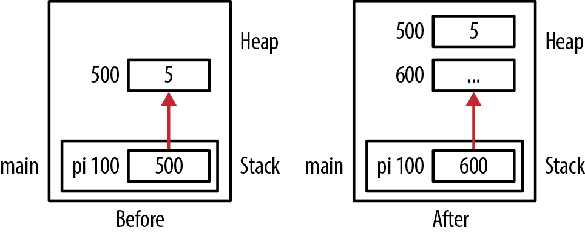

Hình 2-3. Làm mất address

Ví dụ khác cấp phát memory cho string, khởi tạo rồi hiển thị từng character:

```
char *name = (char*)malloc(strlen("Susan")+1);
strcpy(name,"Susan");
while(*name != 0) {
    printf("%c",*name);
    name++;
}
```

Tuy nhiên, mỗi vòng lặp tăng `name` một đơn vị. Cuối cùng `name` trỏ đến ký tự kết thúc `NUL` của string như Hình 2-4. Address bắt đầu của memory đã cấp phát bị mất.

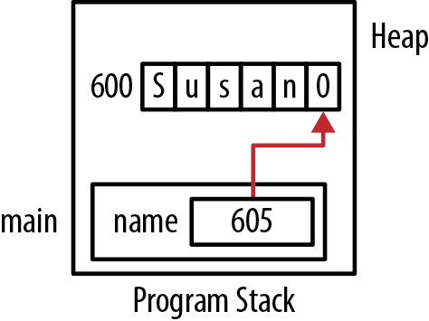

Hình 2-4. Làm mất address của memory cấp phát động

#### Hidden memory leak

Memory leak cũng xảy ra khi chương trình nên giải phóng memory nhưng không làm. Hidden memory leak xảy ra khi object vẫn được giữ trong heap dù không còn cần, thường do programmer sơ suất. Vấn đề chính là object chiếm memory không cần nữa và lẽ ra phải trả cho heap. Tệ nhất, heap manager không cấp phát được memory khi yêu cầu, có thể buộc chương trình kết thúc. Tốt nhất thì vẫn đang giữ memory không cần.

Memory leak cũng có thể xảy ra khi giải phóng structure tạo bằng keyword `struct`. Nếu structure chứa pointer đến memory cấp phát động, có thể phải giải phóng các pointer này trước khi giải phóng structure. Chương 6 có ví dụ.

## Dynamic memory allocation function

Có nhiều allocation function để quản lý dynamic memory. Tuy các function sẵn có tùy hệ thống, các function sau nằm trong header file stdlib.h trên phần lớn hệ thống:

- `malloc`

- `realloc`

- `calloc`

- `free`

Các function được tóm tắt trong Bảng 2-1.

Bảng 2-1. Dynamic memory allocation function

| Function | Mô tả |
|---|---|
| `malloc` | Cấp phát memory từ heap |
| `realloc` | Cấp phát lại lượng memory lớn hoặc nhỏ hơn dựa trên block đã cấp phát |
| `calloc` | Cấp phát memory từ heap và đặt toàn zero |
| `free` | Trả block memory về heap |

Dynamic memory được cấp phát từ heap. Các lời gọi liên tiếp không bảo đảm thứ tự hay tính liên tục của memory được cấp phát. Tuy nhiên, memory được align theo data type của pointer. Ví dụ integer four-byte được cấp phát trên ranh giới address chia hết cho bốn. Address heap manager trả về là address của byte thấp nhất.

Trong Hình 2-3, function `malloc` cấp bốn byte ở address 500. Lần `malloc` thứ hai cấp memory ở address 600. Cả hai trên ranh giới address four-byte và không cấp phát tại vị trí liên tiếp.

### Dùng function malloc

Function `malloc` cấp một block memory từ heap. Argument duy nhất chỉ số byte cấp phát. Return type là pointer đến void. Nếu không có memory, trả `NULL`. Function không xóa hay sửa memory, nên phải xem nội dung là garbage. Prototype như sau:

```
void*  malloc(size_t);
```

Function có argument duy nhất type `size_t`, đã bàn trong Chương 1. Cẩn thận khi truyền variable, vì argument âm có thể gây vấn đề. Trên một số hệ thống, argument âm khiến trả NULL.

Khi argument bằng zero, hành vi `malloc` là implementation-specific. Nó có thể trả pointer đến `NULL`, hoặc pointer đến vùng có zero byte được cấp phát. Nếu dùng `malloc` với argument `NULL`, thường sinh warning và chạy với kết quả trả về zero byte.

Sau đây là cách dùng điển hình của `malloc`:

```
int *pi = (int*) malloc(sizeof(int));
```

Khi function `malloc` thực thi, các bước sau diễn ra:

1\. Memory được cấp phát từ heap

2\. Memory không được sửa hay xóa

3\. Address của byte đầu được trả về


Vì `malloc` có thể trả NULL nếu không cấp phát được memory, nên kiểm tra NULL trước khi dùng pointer như sau:

```
int *pi = (int*) malloc(sizeof(int));
if(pi != NULL) {
   // Pointer should be good
} else {
   // Bad pointer
}
```

#### Cast hay không cast

Trước khi pointer đến void được đưa vào C, cần cast tường minh với `malloc` để tránh warning khi assignment giữa các pointer type không tương thích. Vì có thể gán pointer đến void cho mọi pointer type khác, không còn bắt buộc cast tường minh. Một số developer coi cast tường minh là thói quen tốt vì:

- Nó thể hiện ý định dùng function `malloc`

- Nó làm code tương thích C++ (hoặc C compiler đời trước), vốn yêu cầu cast tường minh

Dùng cast sẽ có vấn đề nếu quên include header file của `malloc`. Compiler có thể phát warning. Mặc định C giả định function trả integer. Nếu không include prototype của `malloc`, compiler sẽ phàn nàn khi thử gán integer cho pointer.

#### Không cấp phát memory

Nếu khai báo pointer nhưng không cấp memory tại address nó trỏ đến trước khi dùng, memory thường chứa garbage, thường dẫn tới invalid memory reference. Xét chuỗi code:

```
int *pi;
...
printf("%d\n",*pi);
```

Memory allocation được thể hiện trong Hình 2-5. Chương 7 bàn kỹ vấn đề này.

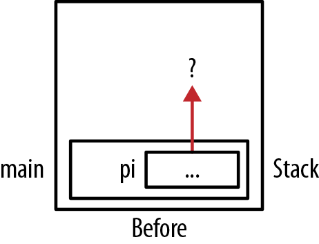

Hình 2-5. Không cấp phát memory

Khi chạy, điều này có thể gây runtime exception. Vấn đề này phổ biến với string, như sau:

```
char *name;
printf("Enter a name: ");
scanf("%s",name);
```

Dù có vẻ sẽ chạy đúng, chúng ta đang dùng memory do `name` tham chiếu nhưng chưa cấp phát nó. Có thể minh họa vấn đề bằng cách đổi variable `pi` trong Hình 2-5 thành `name`.

#### Dùng sai kích thước cho function malloc

Function `malloc` cấp số byte theo argument. Phải thận trọng cấp đúng số byte. Ví dụ, muốn chỗ cho 10 double thì cần 80 byte, như sau:

```
double *pd = (double*)malloc(NUMBER_OF_DOUBLES * sizeof(double));
```


Dùng operator `sizeof` khi chỉ số byte cần cấp cho data type bất cứ khi nào có thể.

Ví dụ sau thử cấp memory cho 10 double:

```
const int NUMBER_OF_DOUBLES = 10;
double *pd = (double*)malloc(NUMBER_OF_DOUBLES);
```

Tuy nhiên, code chỉ cấp 10 byte.

#### Xác định lượng memory đã cấp phát

Không có cách standard xác định tổng memory heap đã cấp. Tuy nhiên, một số compiler cung cấp extension cho mục đích này. Cũng không có cách standard xác định kích thước block do heap manager cấp.

Ví dụ, nếu cấp 64 byte cho string, heap manager cấp thêm memory để quản lý block. Tổng kích thước cấp phát và lượng heap manager dùng là tổng hai lượng này, như đã minh họa ở Hình 2-2.

Kích thước tối đa cấp bằng `malloc` tùy hệ thống. Có vẻ nên bị giới hạn bởi `size_t`, nhưng lượng physical memory và các ràng buộc operating system khác có thể áp giới hạn.

Khi `malloc` chạy, nó phải cấp lượng memory được yêu cầu rồi trả address. Nếu operating system nền dùng “lazy initialization”, chưa thật sự cấp memory cho đến khi truy cập thì sao? Lúc đó có thể có vấn đề nếu không đủ memory. Câu trả lời tùy runtime và operating system. Developer thông thường không cần xử lý câu hỏi này vì kiểu initialization như vậy khá hiếm.

#### Dùng malloc với static và global pointer

Không thể dùng function call khi khởi tạo static hoặc global variable. Chuỗi sau khai báo static variable rồi thử khởi tạo bằng `malloc`:

```
static int *pi = malloc(sizeof(int));
```

Điều này sinh compile-time error. Global variable cũng vậy, nhưng với static variable có thể tránh bằng câu lệnh riêng để cấp memory như sau. Không thể dùng assignment riêng với global variable vì chúng được khai báo ngoài function, còn executable code như assignment phải nằm trong function:

```
static int *pi;
pi = malloc(sizeof(int));
```


Theo compiler, dùng initialization operator = khác với dùng assignment operator =.

### Dùng function calloc

Function `calloc` cấp phát đồng thời xóa memory. Prototype như sau:

```
void *calloc(size_t numElements, size_t elementSize);
```


Xóa memory nghĩa là đặt toàn bộ nội dung thành binary zero.

Function cấp memory theo tích parameter `numElements` và `elementSize`. Nó trả pointer đến byte đầu. Nếu không cấp được, trả `NULL`. Ban đầu function này dùng hỗ trợ cấp memory cho array.

Nếu `numElements` hoặc `elementSize` bằng zero, có thể trả null pointer. Nếu `calloc` không cấp được memory, trả null pointer và đặt global variable `errno` thành `ENOMEM` (hết memory). Đây là error code `POSIX`, có thể không có trên mọi hệ thống.

Xét ví dụ sau, `pi` được cấp tổng cộng 20 byte, tất cả chứa zero:

```
int *pi = calloc(5,sizeof(int));
```

Thay vì `calloc`, có thể dùng `malloc` cùng `memset` để đạt kết quả tương tự:

```
int *pi = malloc(5 * sizeof(int));
memset(pi, 0, 5* sizeof(int));
```


Function `memset` điền một giá trị vào block. Argument đầu là pointer đến buffer cần điền. Argument thứ hai là giá trị, cuối cùng là số byte cần đặt.

Dùng `calloc` khi cần đặt memory toàn zero. Tuy nhiên, chạy `calloc` có thể lâu hơn `malloc`.


Function `cfree` không còn cần. Thời C ban đầu, nó dùng giải phóng memory do `calloc` cấp.

### Dùng function realloc

Đôi khi cần tăng hoặc giảm lượng memory cấp cho pointer. Điều này đặc biệt hữu ích khi cần array có kích thước biến đổi, như Chương 4 sẽ minh họa. Function `realloc` cấp phát lại memory. Prototype như sau:

```
void *realloc(void *ptr, size_t size);
```

Function `realloc` trả pointer đến block memory. Nó nhận hai argument: pointer đến block ban đầu và kích thước yêu cầu. Kích thước block cấp lại khác block mà argument đầu tham chiếu. Return value là pointer đến memory cấp lại.

Kích thước yêu cầu có thể nhỏ hoặc lớn hơn lượng hiện có. Nếu nhỏ hơn, memory dư được trả về heap, nhưng không bảo đảm được xóa. Nếu lớn hơn, khi có thể, memory được cấp ngay sau vùng hiện tại. Nếu không, cấp từ vùng heap khác và sao chép memory cũ sang vùng mới.

Nếu kích thước zero và pointer không null, pointer được giải phóng. Nếu không cấp được không gian, block ban đầu được giữ nguyên. Tuy nhiên, pointer trả về là null pointer và `errno` được đặt `ENOMEM`.

Hành vi function được tóm tắt trong Bảng 2-2.

Bảng 2-2. Hành vi function realloc

| Parameter thứ nhất | Parameter thứ hai | Hành vi |
|---|---|---|
| null | NA | Giống `malloc` |
| Not null | 0 | Block ban đầu được giải phóng |
| Not null | Nhỏ hơn kích thước block ban đầu | Cấp block nhỏ hơn bằng block hiện tại |
| Not null | Lớn hơn kích thước block ban đầu | Cấp block lớn hơn tại vị trí hiện tại hoặc vùng heap khác |

Ví dụ sau dùng hai variable cấp memory cho string. Ban đầu cấp 16 byte nhưng chỉ dùng 13 byte đầu (12 chữ số hexadecimal và ký tự kết thúc null (0)):

```
char *string1;
char *string2;
string1 = (char*) malloc(16);
strcpy(string1, "0123456789AB");
```

Tiếp theo dùng `realloc` chỉ định vùng memory nhỏ hơn. Sau đó hiển thị address và nội dung của hai variable:

```
string2 = realloc(string1, 8);
printf("string1  Value: %p [%s]\n", string1, string1);
printf("string2  Value: %p [%s]\n", string2, string2);
```

Output như sau:

```
string1  Value: 0x500 [0123456789AB]
string2  Value: 0x500 [0123456789AB]
```

Memory allocation được minh họa trong Hình 2-6.

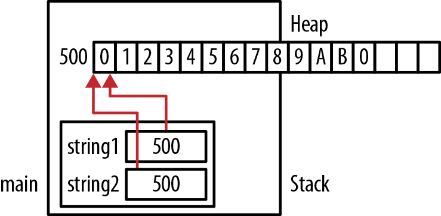

Hình 2-6. Ví dụ realloc

Heap manager tái sử dụng được block ban đầu mà không sửa nội dung. Tuy nhiên, chương trình tiếp tục dùng hơn tám byte yêu cầu; tức chưa sửa string để vừa block eight-byte. Trong ví dụ này, nên điều chỉnh độ dài string để vừa tám byte cấp lại. Cách đơn giản nhất là gán character `NUL` vào address 507. Dùng quá không gian cấp phát là thói quen xấu nên tránh, như Chương 7 sẽ trình bày kỹ.

Trong ví dụ tiếp theo, chúng ta cấp phát lại để có thêm memory:

```
string1 = (char*) malloc(16);
strcpy(string1, "0123456789AB");
string2 = realloc(string1, 64);
printf("string1  Value: %p [%s]\n", string1, string1);
printf("string2  Value: %p [%s]\n", string2, string2);
```

Khi chạy, có thể nhận kết quả tương tự:

```
string1  Value: 0x500 [0123456789AB]
string2  Value: 0x600 [0123456789AB]
```

Ở đây, `realloc` phải cấp block memory mới. Hình 2-7 minh họa allocation.

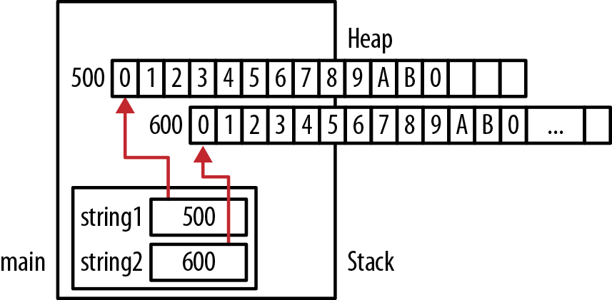

Hình 2-7. Cấp thêm memory

### Function alloca và Variable Length Array

Function `alloca` (`malloca` của Microsoft) cấp memory trong stack frame của function. Khi function return, memory tự giải phóng. Function này khó triển khai nếu runtime system không stack-based. Vì vậy nó không standard và nên tránh nếu application cần portable.

C99 giới thiệu Variable Length Array (VLA), cho phép khai báo và tạo array trong function với kích thước dựa trên variable. Ví dụ sau cấp array `char` để dùng trong function:

```
void compute(int size) {
    char* buffer[size];
    ...
}
```

Nghĩa là allocation diễn ra tại runtime, memory là một phần stack frame. Đồng thời, khi dùng operator `sizeof` với array, nó chạy tại runtime thay vì compile time.

Có một chút chi phí runtime. Ngoài ra, khi thoát function, memory thực tế được giải phóng. Vì không dùng function kiểu `malloc` để tạo, không nên dùng `free` để giải phóng. Function cũng không nên trả pointer đến memory này. Chương 5 bàn vấn đề đó.


VLA không đổi kích thước. Kích thước cố định sau khi cấp phát. Nếu cần array thực sự thay đổi kích thước, phải dùng cách như function `realloc`, đã bàn trong “Dùng function realloc” trang 44.

## Giải phóng memory bằng function free

Với dynamic memory allocation, programmer có thể trả memory khi không dùng nữa, dành cho mục đích khác. Thường làm bằng function `free`, có prototype sau:

```
void free(void *ptr);
```

Argument pointer phải chứa address memory cấp bởi function kiểu `malloc`. Memory này được trả về heap. Dù pointer có thể vẫn trỏ vào vùng đó, luôn giả định nó trỏ đến garbage. Vùng này có thể được cấp lại sau và chứa data khác.

Ví dụ đơn giản sau cấp memory cho `pi` rồi cuối cùng giải phóng:

```
int *pi = (int*) malloc(sizeof(int));
...
free(pi);
```

Hình 2-8 minh họa memory ngay trước và sau khi `free` thực thi. Ô nét đứt ở address 500 cho biết memory đã giải phóng nhưng vẫn có thể giữ giá trị. Variable `pi` vẫn chứa address 500. Đây là dangling pointer, được bàn kỹ trong “Dangling pointer” trang 51.

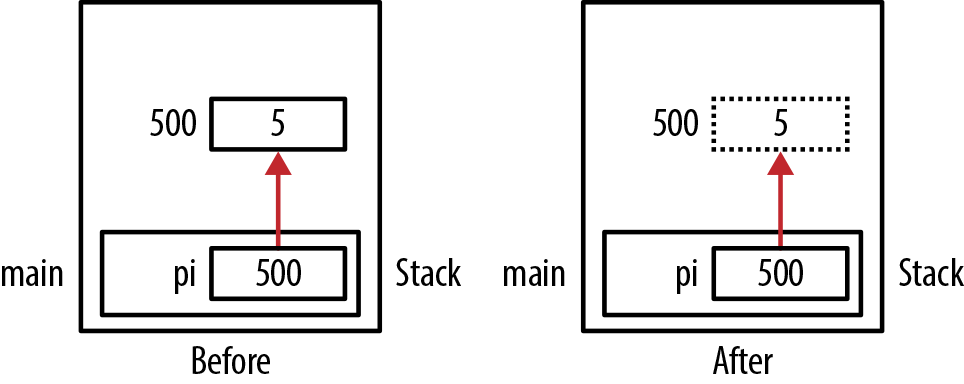

Hình 2-8. Giải phóng memory bằng free

Nếu truyền null pointer cho `free`, thường không làm gì. Nếu pointer không được cấp bởi function kiểu `malloc`, hành vi function là undefined. Ví dụ sau gán cho `pi` address của `num`, nhưng đây không phải heap address hợp lệ:

```
int num;
int *pi = &num;
free(pi);  // Undefined behavior
```


Quản lý cấp phát/giải phóng memory ở cùng cấp. Ví dụ, nếu cấp phát cho pointer trong function, hãy giải phóng trong chính function đó.

### Gán NULL cho pointer đã giải phóng

Pointer có thể gây vấn đề ngay cả sau khi được giải phóng. Nếu thử dereference pointer đã giải phóng, hành vi là undefined. Vì vậy, một số programmer gán tường minh `NULL` để đánh dấu pointer không hợp lệ. Dùng tiếp pointer như vậy sẽ gây runtime exception.

Sau đây là ví dụ cách này:

```
int *pi = (int*) malloc(sizeof(int));
...
free(pi);
pi = NULL;
```

Memory allocation được minh họa trong Hình 2-9.

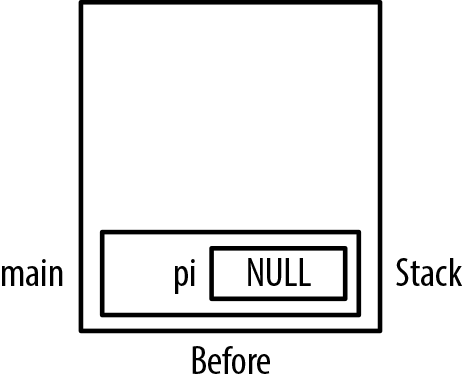

Hình 2-9. Gán NULL sau khi dùng free

Kỹ thuật này cố xử lý vấn đề như dangling pointer. Tuy nhiên, tốt hơn nên dành thời gian giải quyết điều kiện gây vấn đề, thay vì bắt lỗi thô bằng null pointer. Ngoài ra, không thể gán `NULL` cho constant pointer trừ lúc khởi tạo.

### Double free

Thuật ngữ double free chỉ việc cố giải phóng một block memory hai lần. Ví dụ đơn giản:

```
int *pi = (int*) malloc(sizeof(int));
*pi = 5;
free(pi);
 ...
free(pi);
```

Lần `free` thứ hai gây runtime exception. Ví dụ ít rõ hơn là hai pointer cùng trỏ một block. Như sau, vô tình giải phóng cùng memory lần thứ hai cũng gây runtime exception tương tự:

```
p1 = (int*) malloc(sizeof(int));
int *p2 = p1;
free(p1);
...
free(p2);
```

Memory allocation này được minh họa trong Hình 2-10.


Hai pointer tham chiếu cùng vị trí được gọi là aliasing. Chương 8 bàn khái niệm này.

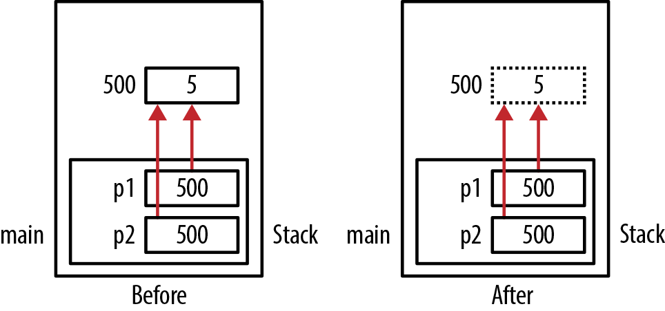

Hình 2-10. Double free

Đáng tiếc, heap manager khó xác định block đã được giải phóng chưa. Vì vậy chúng không cố phát hiện cùng memory bị giải phóng hai lần. Điều này thường làm hỏng heap và kết thúc chương trình. Ngay cả khi không kết thúc, logic giải quyết vấn đề cũng đáng nghi. Không có lý do giải phóng cùng memory hai lần.

Có đề xuất rằng `free` nên gán `NULL` hoặc giá trị đặc biệt khác cho argument khi return. Tuy nhiên, do pointer được truyền by value, `free` không thể gán tường minh `NULL` cho pointer. Mục “Truyền pointer đến pointer” trang 68 giải thích kỹ hơn.

### Heap và system memory

Heap thường dùng operating system function để quản lý memory. Kích thước heap có thể cố định lúc tạo chương trình hoặc được phép tăng. Tuy nhiên, heap manager không nhất thiết trả memory về operating system khi gọi `free`. Memory giải phóng chỉ trở nên sẵn có để application dùng tiếp. Vì vậy, khi chương trình cấp rồi giải phóng memory, việc giải phóng thường không thể hiện trong mức memory usage của application nhìn từ operating system.

### Giải phóng memory khi chương trình kết thúc

Operating system chịu trách nhiệm duy trì tài nguyên application, gồm memory. Khi application kết thúc, operating system chịu trách nhiệm cấp lại memory này cho application khác. Memory của application đã kết thúc có hỏng hay không không thành vấn đề. Thực tế, một nguyên nhân application kết thúc có thể là memory bị hỏng. Với kết thúc bất thường, có thể không cleanup được. Vì vậy không có lý do phải giải phóng memory đã cấp trước khi application kết thúc.

Tuy vậy, vẫn có lý do khác để giải phóng. Programmer có trách nhiệm có thể muốn giải phóng vì chất lượng. Giải phóng memory khi không cần nữa luôn là thói quen tốt, dù application đang kết thúc. Nếu dùng tool phát hiện memory leak hoặc tương tự, giải phóng sẽ làm output tool sạch hơn. Trong một số operating system ít phức tạp, memory có thể không được tự thu hồi, và chương trình phải làm trước khi kết thúc. Ngoài ra, phiên bản application sau có thể thêm code ở cuối. Nếu memory trước chưa giải phóng, có thể phát sinh vấn đề.

Vì vậy, bảo đảm mọi memory được giải phóng trước khi kết thúc:

- Có thể gây phiền phức nhiều hơn giá trị mang lại

- Có thể tốn thời gian và phức tạp khi giải phóng structure phức tạp

- Có thể tăng kích thước application

- Làm thời gian chạy dài hơn

- Tạo thêm cơ hội mắc lỗi lập trình

Có nên giải phóng memory trước khi kết thúc hay không là application-specific.

## Dangling pointer

Nếu pointer vẫn tham chiếu memory ban đầu sau khi memory được giải phóng, nó là dangling pointer. Pointer không trỏ đến object hợp lệ. Đôi khi gọi là premature free.

Dùng dangling pointer có thể dẫn tới nhiều vấn đề, gồm:

- Hành vi khó dự đoán nếu truy cập memory

- Segmentation fault khi memory không còn truy cập được

- Nguy cơ security tiềm tàng

Các vấn đề này có thể xảy ra khi:

- Truy cập memory sau khi giải phóng

- Trả pointer đến automatic variable của function call trước (bàn trong “Pointer đến local data” trang 66)

### Ví dụ dangling pointer

Ví dụ đơn giản sau cấp memory cho integer bằng `malloc`, rồi giải phóng bằng `free`:

```
int *pi = (int*) malloc(sizeof(int));
*pi = 5;
printf("*pi: %d\n", *pi);
free(pi);
```

Variable `pi` vẫn giữ address integer. Tuy nhiên heap manager có thể tái sử dụng memory này, chứa data khác integer. Hình 2-11 minh họa trạng thái ngay trước và sau khi `free` chạy. Giả định `pi` thuộc function `main`, ở address 100. Memory cấp bởi `malloc` nằm ở address 500.

Khi `free` chạy, memory ở address 500 đã giải phóng, không nên dùng. Tuy nhiên, phần lớn runtime system không ngăn truy cập hay sửa sau đó. Vẫn có thể thử ghi vào vị trí như sau, với kết quả không dự đoán được.

```
free(pi);
*pi = 10;
```

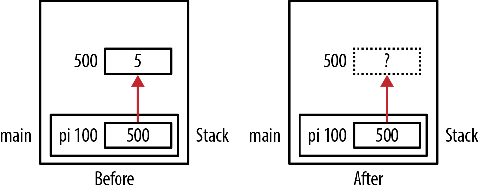

Hình 2-11. Dangling pointer

Ví dụ khó phát hiện hơn là nhiều pointer tham chiếu cùng vùng memory và một pointer được giải phóng. Như sau, `p1` và `p2` cùng tham chiếu một vùng, gọi là pointer aliasing. Tuy nhiên `p1` được giải phóng:

```
int *p1 = (int*) malloc(sizeof(int));
*p1 = 5;
...
int *p2;
p2 = p1;
...
free(p1);
...
*p2 = 10;   // Dangling pointer
```

Hình 2-12 minh họa allocation, ô nét chấm biểu diễn memory đã giải phóng.

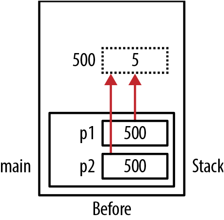

Hình 2-12. Dangling pointer với aliased pointer

Một vấn đề tinh vi có thể xảy ra khi dùng block statement như sau. Ở đây `pi` được gán address của `tmp`; `pi` có thể global hoặc local variable. Tuy nhiên, khi block chứa `tmp` bị pop khỏi program stack, address không còn hợp lệ:

```
int *pi;
...
{
   int tmp = 5;
   pi = &tmp;
}
// pi is now a dangling pointer
foo();
```

Phần lớn compiler coi block statement như stack frame. Variable `tmp` được cấp trên stack frame, rồi bị pop khỏi stack khi thoát block. Pointer `pi` còn trỏ đến vùng memory cuối cùng có thể bị activation record khác ghi đè, như function `foo`. Hình 2-13 minh họa.

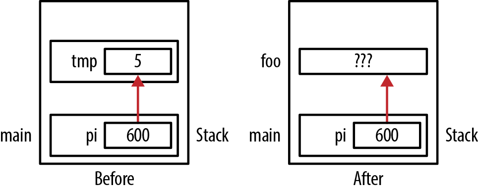

Hình 2-13. Vấn đề block statement

### Xử lý dangling pointer

Debug vấn đề pointer-induced đôi khi khó. Có nhiều cách xử lý dangling pointer, gồm:

- Đặt pointer bằng `NULL` sau khi giải phóng. Dùng tiếp sẽ kết thúc application. Tuy nhiên, nếu có nhiều bản sao pointer thì vấn đề vẫn có thể tồn tại, vì assignment chỉ ảnh hưởng một bản sao, như “Double free” trang 48 minh họa.

- Viết function đặc biệt thay `free` (xem “Tự viết function free” trang 70).

- Một số hệ thống (runtime/debugger) ghi đè data khi giải phóng (ví dụ 0xDEADBEEF - Visual Studio dùng 0xCC, 0xCD hoặc 0xDD tùy thứ được giải phóng). Dù không throw exception, khi thấy memory chứa các giá trị này ngoài dự kiến, programmer biết có thể chương trình đang truy cập memory đã giải phóng.

- Dùng tool third-party phát hiện dangling pointer và vấn đề khác.

Hiển thị pointer value hữu ích khi debug dangling pointer, nhưng phải cẩn thận cách hiển thị. Đã bàn trong “Hiển thị giá trị pointer” trang 9. Bảo đảm hiển thị nhất quán để tránh nhầm khi so sánh. Macro `assert` cũng hữu ích, như “Xử lý pointer chưa khởi tạo” trang 162 minh họa.

### Hỗ trợ phát hiện memory leak trong debug version

Microsoft cung cấp kỹ thuật xử lý ghi đè memory cấp phát động và memory leak. Cách này dùng kỹ thuật memory management đặc biệt trong debug version để:

- Kiểm tra tính toàn vẹn heap

- Kiểm tra memory leak

- Mô phỏng tình huống heap ít memory

Microsoft dùng data structure đặc biệt quản lý allocation. Nó giữ debug information như tên file và số dòng gọi `malloc`. Ngoài ra, cấp buffer trước và sau memory thực để phát hiện ghi đè. Có thêm thông tin tại Microsoft Developer Network.

Mudflap Libraries cung cấp khả năng tương tự cho GCC compiler. Runtime library hỗ trợ phát hiện memory leak và nhiều thứ khác, bằng cách instrument các operation dereference pointer.

## Công nghệ dynamic memory allocation

Đến đây đã nói về heap manager cấp phát và giải phóng memory. Tuy nhiên, implementation có thể khác theo compiler. Phần lớn dùng heap hoặc data segment làm nguồn memory. Cách này có thể bị fragmentation và va chạm program stack. Dù vậy, đây vẫn là cách triển khai heap phổ biến nhất.

Heap manager phải xử lý nhiều vấn đề, như cấp heap theo process và/hoặc thread, và bảo vệ heap khỏi vi phạm security.

Có nhiều heap manager, gồm malloc của OpenBSD, malloc của Hoard và TCMalloc do Google phát triển. Allocator của GNU C library dựa trên allocator general-purpose dlmalloc. Nó cung cấp công cụ debugging và hỗ trợ theo dõi memory leak. Logging feature của dlmalloc theo dõi memory usage, memory transaction và những hoạt động khác.

Kỹ thuật thủ công quản lý memory cho structure được trình bày trong “Tránh overhead malloc/free” trang 139.

### Garbage collection trong C

Các function `malloc` và `free` cho phép cấp phát và giải phóng thủ công. Tuy nhiên, manual memory management trong C có nhiều vấn đề như performance, đạt locality of reference tốt, threading và cleanup memory hợp lý.

Có thể dùng một số kỹ thuật không standard để xử lý; phần này xem xét vài kỹ thuật. Đặc điểm chính là tự động giải phóng memory. Khi không còn cần, memory được thu gom để dùng lại sau trong chương trình. Memory được giải phóng gọi là garbage, nên garbage collection chỉ quá trình xử lý memory đó.

Garbage collection hữu ích vì nhiều lý do, gồm:

- Giải phóng programmer khỏi việc quyết định lúc nào deallocate memory

- Cho phép programmer tập trung vào bài toán application

Một lựa chọn thay manual memory management là Boehm-Weiser Collector, nhưng không thuộc ngôn ngữ.

### Resource Acquisition Is Initialization

Resource Acquisition Is Initialization (RAII) do Bjarne Stroustrup phát minh, xử lý cấp phát và giải phóng tài nguyên trong C++. Kỹ thuật hữu ích để bảo đảm cấp phát rồi giải phóng tài nguyên khi có exception. Tài nguyên được cấp cuối cùng sẽ được giải phóng.

Có một số cách dùng RAII trong C. GNU compiler cung cấp extension không standard hỗ trợ. Chúng ta sẽ minh họa extension bằng cách cấp rồi giải phóng memory trong function. Khi variable ra khỏi scope, deallocation tự động diễn ra.

GNU extension dùng macro `RAII_VARIABLE`. Nó khai báo variable và liên kết với variable:

- Một type

- Một function thực thi khi variable được tạo

- Một function thực thi khi variable ra khỏi scope

Macro như sau:

```
#define RAII_VARIABLE(vartype,varname,initval,dtor) \
    void _dtor_ ## varname (vartype * v) { dtor(*v); } \
    vartype varname __attribute__((cleanup(_dtor_ ## varname))) = (initval)
```

Ví dụ sau khai báo variable `name` là pointer đến `char`. Khi tạo, function `malloc` thực thi, cấp 32 byte. Khi function kết thúc, `name` ra khỏi scope và function `free` thực thi:

```
void raiiExample() {
    RAII_VARIABLE(char*, name, (char*)malloc(32), free);
    strcpy(name,"RAII Example");
    printf("%s\n",name);
}
```

Khi chạy function, string “RAII\_Example” được hiển thị.

Có thể đạt kết quả tương tự không cần GNU extension.

### Dùng exception handler

Cách khác để giải phóng memory là exception handling. Dù không thuộc standard C, nó hữu ích nếu có sẵn và portability không phải mối lo. Ví dụ sau minh họa bằng phiên bản C của Microsoft Visual Studio.

Try block bao các câu lệnh có thể throw exception tại runtime. Finally block chạy bất kể exception có được throw không. Function `free` được bảo đảm thực thi.

```
void exceptionExample() {
   int *pi = NULL;
   __try {
      pi = (int*)malloc(sizeof(int));
      *pi = 5;
      printf("%d\n",*pi);
   }
   __finally {
      free(pi);
   }
}
```

Có thể triển khai exception handling trong C bằng nhiều cách khác.

## Tóm tắt

Dynamic memory allocation là feature quan trọng của C. Chương này tập trung cấp memory thủ công bằng `malloc` và `free`. Đã xem nhiều vấn đề phổ biến liên quan, gồm không cấp phát memory và dangling pointer.

Có những kỹ thuật không standard khác để quản lý dynamic memory trong C. Chúng ta đã đề cập một vài kỹ thuật garbage collection, gồm RAII và exception handling.
