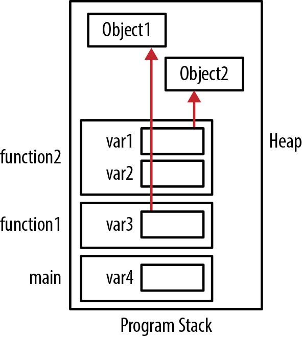
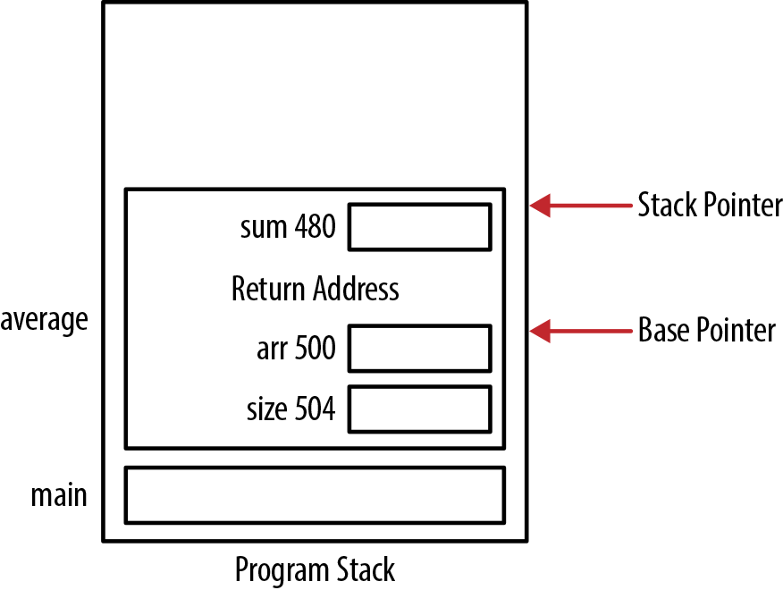
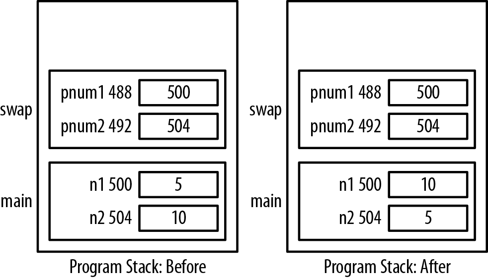
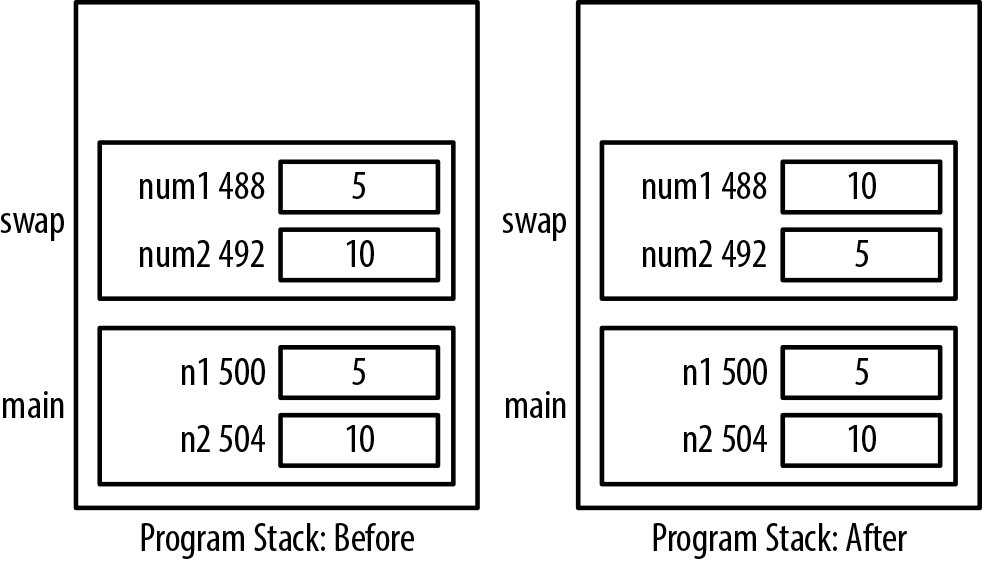
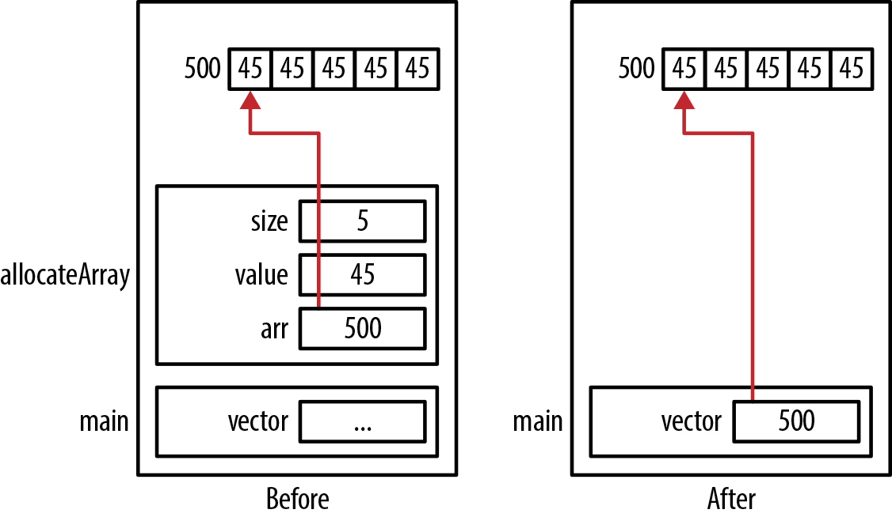
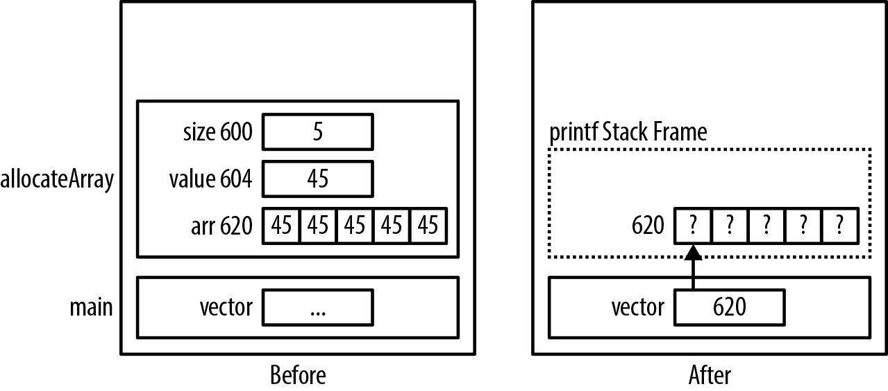
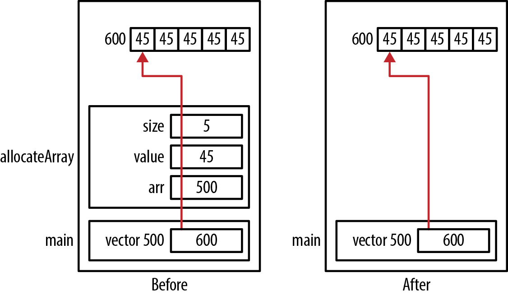
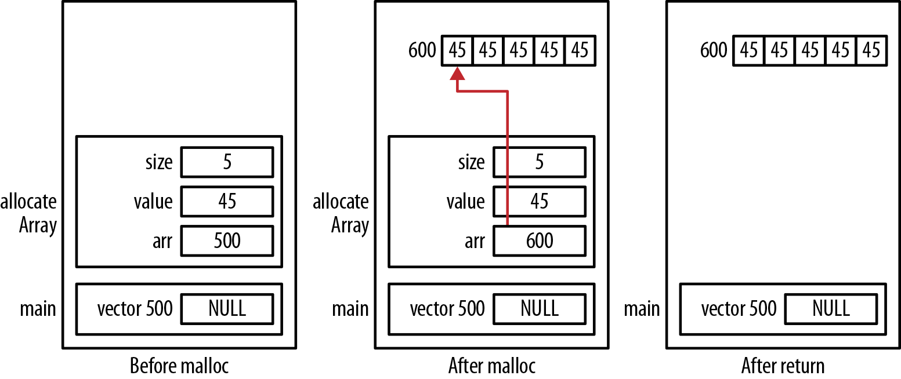
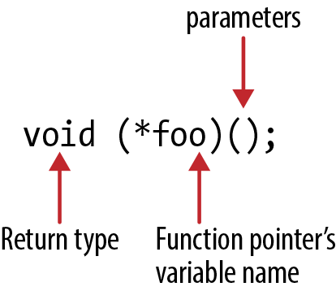
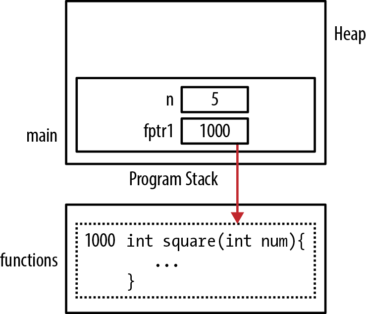

# Chương 3. Pointer và function

Pointer đóng góp rất lớn vào khả năng của function. Chúng cho phép truyền data và để function sửa data. Data phức tạp cũng có thể được truyền và trả về dưới dạng pointer đến structure. Khi chứa address của function, pointer cho phép điều khiển execution flow của chương trình một cách động. Chương này tìm hiểu sức mạnh của pointer khi dùng với function và cách dùng chúng giải nhiều bài toán real-world.

Để hiểu function và cách dùng với pointer, cần nắm program stack. Phần lớn ngôn ngữ block-structured hiện đại như C dùng program stack hỗ trợ function execution. Khi gọi function, stack frame được tạo rồi push lên program stack. Khi function return, stack frame bị pop khỏi program stack.

Khi làm việc với function, pointer hữu ích trong hai lĩnh vực. Thứ nhất là truyền pointer cho function, cho phép function sửa data được tham chiếu và truyền block thông tin hiệu quả hơn.

Thứ hai là khai báo pointer đến function. Về bản chất, function notation là pointer notation. Tên function được evaluate thành address của function, và các parameter được truyền cho function. Như sẽ thấy, function pointer bổ sung khả năng điều khiển execution flow của chương trình.

Phần này xây dựng nền tảng để hiểu và làm việc với function và pointer. Do function và pointer hiện diện khắp nơi, nền tảng này sẽ rất hữu ích.

## Program stack và heap

Program stack và heap là runtime element quan trọng của C. Phần này xem kỹ cấu trúc và cách dùng cả hai, cùng cấu trúc stack frame chứa local variable.


Local variable còn gọi là automatic variable. Chúng luôn được cấp phát trong stack frame.

### Program stack

Program stack là vùng memory hỗ trợ function execution và thường dùng chung với heap, tức chúng chia sẻ cùng vùng memory. Program stack thường chiếm phần thấp của vùng này, còn heap dùng phần cao.

Program stack chứa stack frame, đôi khi gọi activation record hoặc activation frame. Stack frame chứa parameter và local variable của function. Heap quản lý dynamic memory, được bàn trong “Dynamic memory allocation” trang 34.

Hình 3-1 minh họa tổ chức stack và heap về mặt khái niệm, dựa trên chuỗi code sau:

```
void function2() {
    Object *var1 = ...;
    int var2;
    printf("Program Stack Example\n");
}

void function1() {
    Object *var3 = ...;
    function2();
}

int main() {
    int var4;
    function1();
}
```

Khi gọi function, stack frame được push lên stack và stack tăng “lên trên”. Khi function kết thúc, stack frame bị pop khỏi program stack. Memory dùng cho stack frame không được xóa và cuối cùng có thể bị stack frame khác ghi đè khi được push lên program stack.



Hình 3-1. Stack và heap

Memory cấp phát động đến từ heap, thường tăng “xuống dưới”. Heap bị fragmentation khi memory được cấp rồi giải phóng. Dù thường tăng xuống dưới, đây chỉ là hướng tổng quát: memory có thể được cấp từ bất cứ đâu trong heap.

### Tổ chức stack frame

Stack frame gồm một số element, bao gồm:

Return address

Address trong chương trình mà function trở về khi hoàn tất

Vùng lưu local data

Memory cấp cho local variable

Vùng lưu parameter

Memory cấp cho parameter của function

Stack pointer và base pointer

Pointer mà runtime system dùng quản lý stack

C programmer thông thường không quan tâm stack pointer và base pointer hỗ trợ stack frame. Tuy nhiên, hiểu chúng là gì và dùng thế nào đem lại hiểu biết in-depth về program stack.

Stack pointer thường trỏ đến đỉnh stack. Stack base pointer (frame pointer) cũng thường có và trỏ đến address trong stack frame, như return address. Nó hỗ trợ truy cập element của stack frame. Cả hai không phải C pointer, mà là address runtime system dùng quản lý program stack. Nếu runtime system viết bằng C, chúng có thể là C pointer thực. Xét việc tạo stack frame cho function sau, nhận array integer và integer biểu diễn kích thước array. Ba câu `printf` hiển thị address của parameter và local variable:

```
float average(int *arr, int size) {
   int sum;
   printf("arr: %p\n",&arr);
   printf("size: %p\n",&size);
   printf("sum: %p\n",&sum);
```

```
   for(int i=0; i<size; i++) {
       sum += arr[i];
   }
   return (sum * 1.0f) / size;
}
```

Khi chạy, nhận output tương tự:

```
arr: 0x500
size: 0x504
sum: 0x480
```

Khoảng cách address giữa parameter và local variable là do các element stack frame khác mà runtime system dùng quản lý stack.

Khi tạo stack frame, parameter được push theo thứ tự ngược declaration, rồi đến local variable. Hình 3-2 minh họa. Ở đây `size` được push trước `arr`. Thường return address của function call được push tiếp, rồi local variable, theo thứ tự ngược danh sách khai báo.

Về khái niệm stack trong ví dụ tăng “lên”. Tuy nhiên, parameter, local variable và stack frame mới được thêm ở memory address thấp hơn. Hướng stack thực sự tăng là implementation-specific.

Variable `i` dùng trong câu `for` không thuộc stack frame này. C coi block statement là function “mini”, push và pop khi thích hợp. Ở đây block được push lên program stack phía trên stack frame `average` khi chạy rồi pop khi hoàn tất.

Dù address chính xác thay đổi, thứ tự thường không đổi. Hiểu điều này quan trọng vì giúp giải thích cách cấp memory và xác lập thứ tự tương đối của parameter và variable, hữu ích khi debug pointer. Nếu không biết cách cấp stack frame, việc gán address có thể khó hiểu.

Khi stack frame được push lên program stack, hệ thống có thể hết memory. Tình trạng này gọi stack overflow và thường khiến chương trình kết thúc bất thường. Nhớ rằng mỗi thread thường được cấp program stack riêng.



Hình 3-2. Ví dụ stack frame

Điều này có thể dẫn tới xung đột nếu một hoặc nhiều thread truy cập cùng object trong memory. Vấn đề được bàn trong “Chia sẻ pointer giữa các thread” trang 186.

## Truyền và trả về bằng pointer

Phần này xét ảnh hưởng của việc truyền pointer vào và trả pointer từ function. Truyền pointer cho phép nhiều function truy cập object được tham chiếu mà không biến nó thành global. Nghĩa là chỉ function cần truy cập mới được quyền đó, và không cần sao chép object.

Nếu function cần sửa data, phải truyền bằng pointer. Có thể truyền bằng pointer nhưng cấm sửa bằng cách dùng pointer đến constant, như mục “Truyền pointer đến constant” trang 63. Khi data là pointer cần sửa, truyền pointer đến pointer. Chủ đề này nằm trong “Truyền pointer đến pointer” trang 68.

Parameter, gồm pointer, được truyền by value: một bản sao argument được truyền cho function. Truyền pointer đến argument hiệu quả với data structure lớn. Ví dụ, structure lớn biểu diễn nhân viên: nếu truyền cả structure, phải sao chép từng byte, làm chương trình chậm và tốn chỗ trong stack frame. Truyền pointer đến object nghĩa là object phải được sao chép, và có thể truy cập object qua pointer.

### Truyền data bằng pointer

Một lý do chính để truyền data bằng pointer là cho phép function sửa data. Chuỗi sau triển khai function swap hoán đổi các giá trị được parameter tham chiếu, operation phổ biến trong nhiều sorting algorithm. Ở đây dùng integer pointer và dereference để thực hiện swap:

```
void swapWithPointers(int* pnum1, int* pnum2) {
    int tmp;
    tmp = *pnum1;
    *pnum1 = *pnum2;
    *pnum2 = tmp;
}
```

Chuỗi code sau minh họa function:

```
int main() {
    int n1 = 5;
    int n2 = 10;
    swapWithPointers(&n1, &n2);
    return 0;
}
```

Các pointer `pnum1` và `pnum2` được dereference trong swap, khiến giá trị `n1` và `n2` được sửa. Hình 3-3 minh họa tổ chức memory. `Before image` là program stack lúc bắt đầu function swap; `After image` là ngay trước khi return.



Hình 3-3. Swap bằng pointer

### Truyền data by value

Nếu không truyền bằng pointer, swap không xảy ra. Function sau nhận hai integer by value:

```
void swap(int num1, int num2) {
    int tmp;
    tmp = num1;
    num1 = num2;
    num2 = tmp;
}
```

Chuỗi code sau truyền hai integer cho function:

```
int main() {
    int n1 = 5;
    int n2 = 10;
    swap(n1, n2);
    return 0;
}
```

Tuy nhiên, cách này không hoạt động vì integer được truyền by value thay vì pointer. Chỉ bản sao argument lưu trong `num1` và `num2`. Sửa `num1` không đổi argument `n1`. Khi sửa parameter, không sửa argument gốc. Hình 3-4 minh họa cấp memory cho parameter.



Hình 3-4. Truyền by value

### Truyền pointer đến constant

Truyền pointer đến constant là kỹ thuật phổ biến trong C. Nó hiệu quả vì chỉ truyền address của data, đôi khi tránh sao chép lượng memory lớn. Tuy nhiên, pointer thông thường cho phép sửa data. Khi không muốn vậy, giải pháp là truyền pointer đến constant.

Ví dụ này truyền pointer đến constant integer và pointer đến integer. Bên trong function, không thể sửa giá trị truyền bằng pointer đến constant:

```
void passingAddressOfConstants(const int* num1, int* num2) {
    *num2 = *num1;
}
int main() {
    const int limit = 100;
    int result = 5;
    passingAddressOfConstants(&limit, &result);
    return 0;
}
```

Không sinh syntax error và function gán 100 cho variable `result`. Phiên bản sau thử sửa cả hai integer được tham chiếu:

```
void passingAddressOfConstants(const int* num1, int* num2) {
    *num1 = 100;
    *num2 = 200;
}
```

Điều này gây vấn đề nếu truyền constant `limit` hai lần:

```
const int limit = 100;
passingAddressOfConstants(&limit, &limit);
```

Nó sinh syntax error báo type mismatch giữa parameter thứ hai và argument. Ngoài ra, báo đang cố sửa constant được cho là do parameter đầu tham chiếu.

Function mong pointer đến integer, nhưng lại nhận pointer đến integer constant. Không thể truyền address của integer constant cho pointer đến constant, vì như vậy cho phép sửa constant value. Chi tiết ở “Constant và pointer” trang 27.

Thử truyền address của integer literal như sau cũng sinh syntax error:

```
passingAddressOfConstants(&23, &23);
```

Thông báo cho biết cần `lvalue` làm operand của address-of operator. Khái niệm `lvalue` được bàn trong “Dereference pointer bằng indirection operator” trang 11.

### Trả về pointer

Trả pointer dễ thực hiện: chỉ cần khai báo return type là pointer đến data type thích hợp. Nếu cần trả object từ function, thường dùng hai kỹ thuật:

- Cấp memory bên trong function bằng `malloc` rồi trả address. Caller chịu trách nhiệm giải phóng memory trả về.

- Truyền object cho function để sửa. Khi đó caller chịu trách nhiệm cấp và giải phóng memory của object.

Trước tiên minh họa dùng function kiểu `malloc` cấp memory trả về. Tiếp theo là ví dụ trả pointer đến local object, cách không được khuyến nghị. Cách ở bullet thứ hai được minh họa trong “Truyền null pointer” trang 67.

Ví dụ sau định nghĩa function nhận kích thước array integer và giá trị khởi tạo từng element. Function cấp memory cho array integer, khởi tạo bằng giá trị truyền vào rồi trả address của array:

```
int* allocateArray(int size, int value) {
    int* arr = (int*)malloc(size * sizeof(int));
    for(int i=0; i<size; i++) {
        arr[i] = value;
    }
    return arr;
}
```

Sau đây minh họa cách dùng function:

```
int* vector = allocateArray(5,45);
for(int i=0; i<5; i++) {
    printf("%d\n", vector[i]);
}
```

Hình 3-5 minh họa cấp memory cho function. Ảnh `Before` là trạng thái ngay trước return statement. Ảnh `After` là sau khi function return. Variable `vector` nay chứa address memory được cấp trong function. Dù variable `arr` biến mất khi function kết thúc, memory pointer tham chiếu vẫn tồn tại và cuối cùng cần giải phóng.

Dù ví dụ trước hoạt động đúng, trả pointer từ function có thể gặp các vấn đề:

- Trả pointer chưa khởi tạo

- Trả pointer đến address không hợp lệ

- Trả pointer đến local variable

- Trả pointer nhưng không giải phóng

Function `allocateArray` là ví dụ điển hình cho vấn đề cuối. Trả memory cấp động nghĩa là caller chịu trách nhiệm giải phóng. Xét ví dụ:

```
int* vector = allocateArray(5,45);
...
free(vector);
```



Hình 3-5. Trả pointer

Cuối cùng phải giải phóng khi dùng xong. Nếu không, sẽ có memory leak.

### Pointer đến local data

Trả pointer đến local data là lỗi dễ mắc nếu không hiểu program stack. Ví dụ sau sửa lại function `allocateAr` `ray` trong “Trả về pointer” trang 64. Thay vì cấp động memory cho array, dùng local array:

```
int* allocateArray(int size, int value) {
    int arr[size];
    for(int i=0; i<size; i++) {
        arr[i] = value;
    }
    return arr;
}
```

Đáng tiếc, address array trả về không còn hợp lệ sau khi function return vì stack frame bị pop. Dù từng element có thể còn chứa 45, giá trị có thể bị ghi đè khi gọi function khác. Chuỗi sau minh họa: gọi `printf` liên tục khiến array bị hỏng:

```
int* vector = allocateArray(5,45);
for(int i=0; i<5; i++) {
    printf("%d\n", vector[i]);
}
```

Hình 3-6 minh họa cấp memory khi điều này xảy ra. Ô nét đứt cho biết nơi có thể push stack frame khác, như của function `printf`, làm hỏng memory của array. Nội dung thực của stack frame đó là implementation-dependent.



Hình 3-6. Trả pointer đến local data

Cách thay thế là khai báo variable `arr` static. Scope vẫn giới hạn trong function nhưng memory cấp ngoài stack frame, loại bỏ khả năng function khác ghi đè giá trị:

```
int* allocateArray(int size, int value) {
    static int arr[5];
    ...
}
```

Tuy nhiên, không phải lúc nào cũng hoạt động. Mỗi lần gọi `allocateArray` sẽ tái sử dụng array, thực tế làm mất hiệu lực các lời gọi trước. Ngoài ra, static array phải có kích thước cố định, hạn chế khả năng xử lý kích thước array khác nhau.

Nếu function chỉ trả vài giá trị có thể có và chia sẻ không gây hại, nó có thể giữ danh sách các giá trị rồi trả giá trị thích hợp. Cách này hữu ích khi trả thông báo trạng thái, như mã lỗi ít khả năng bị sửa. Mục “Trả string” trang 126 minh họa dùng global và static value.

### Truyền null pointer

Phiên bản `allocateArray` sau nhận pointer đến array cùng kích thước và giá trị khởi tạo từng element. Pointer được trả về cho tiện. Dù phiên bản này không cấp memory, các phiên bản sau sẽ cấp:

```
int* allocateArray(int *arr, int size, int value) {
    if(arr != NULL) {
        for(int i=0; i<size; i++) {
            arr[i] = value;
        }
    }
    return arr;
}
```

Khi truyền pointer cho function, nên luôn xác nhận không null trước khi dùng.

Có thể gọi function như sau:

```
int* vector = (int*)malloc(5 * sizeof(int));
allocateArray(vector,5,45);
```

Nếu pointer là NULL, không làm gì và chương trình chạy mà không kết thúc bất thường.

### Truyền pointer đến pointer

Pointer truyền cho function được truyền by value. Muốn sửa pointer gốc thay vì bản sao, phải truyền pointer đến pointer. Ví dụ sau truyền pointer đến array integer để được cấp memory và khởi tạo. Function trả memory đã cấp qua parameter đầu. Trong function, trước tiên cấp memory rồi khởi tạo. Address memory được dự định gán cho pointer đến `int`. Để sửa pointer trong calling function, phải truyền address của pointer. Vì vậy parameter khai báo pointer đến pointer đến `int`. Calling function cần truyền address pointer:

```
void allocateArray(int **arr, int size, int value) {
    *arr = (int*)malloc(size * sizeof(int));
    if(*arr != NULL) {
        for(int i=0; i<size; i++) {
            *(*arr+i) = value;
        }
    }
}
```

Có thể kiểm thử function bằng code:

```
int *vector = NULL;
allocateArray(&vector,5,45);
```

Parameter đầu của `allocateArray` được truyền như pointer đến pointer đến integer. Khi gọi, cần truyền giá trị type này bằng cách truyền address của `vector`. Address do `malloc` trả được gán cho `arr`. Dereference pointer đến pointer đến integer cho pointer đến integer. Vì đây là address của `vector`, chúng ta sửa `vector`.

Memory allocation được minh họa trong Hình 3-7. Ảnh `Before` là stack sau khi `malloc` return và array được khởi tạo. Tương tự, ảnh `After` là stack sau khi function return.


Để dễ phát hiện vấn đề như memory leak, hãy vẽ sơ đồ memory allocation.



Hình 3-7. Truyền pointer đến pointer

Phiên bản function sau minh họa vì sao truyền pointer thông thường không hoạt động:

```
void allocateArray(int *arr, int size, int value) {
    arr = (int*)malloc(size * sizeof(int));
    if(arr != NULL) {
        for(int i=0; i<size; i++) {
            arr[i] = value;
        }
    }
}
```

Chuỗi sau minh họa cách dùng:

```
int *vector = NULL;
allocateArray(&vector,5,45);
printf("%p\n",vector);
```

Khi chạy, thấy 0x0 vì lúc `vector` được truyền cho function, giá trị được sao chép vào parameter `arr`. Sửa `arr` không ảnh hưởng `vector`. Khi function return, giá trị trong `arr` không được sao chép sang `vec` `tor`. Hình 3-8 minh họa memory. Ảnh `Before malloc` là ngay trước khi gán giá trị mới cho `arr`, khi nó chứa 500 do `vector` truyền vào. Ảnh `After malloc` là sau khi function `malloc` chạy trong `allocateArray` và array được khởi tạo. Variable `arr` được sửa để trỏ đến chỗ mới trong heap. Ảnh `After return` là program stack sau function return. Ngoài ra có memory leak vì mất quyền truy cập block ở address 600.



Hình 3-8. Truyền pointer

#### Tự viết function free

Một số vấn đề quanh `free` khiến programmer tạo phiên bản riêng. Function `free` không kiểm tra pointer truyền vào có `NULL` không và không đặt pointer thành `NULL` trước return. Đặt pointer bằng `NULL` sau giải phóng là thói quen tốt.

Dựa trên nền tảng “Truyền và trả về bằng pointer” trang 61, sau đây là cách triển khai function `free` riêng gán NULL cho pointer. Nó đòi hỏi pointer đến pointer:

```
void saferFree(void **pp) {
    if (pp != NULL && *pp != NULL) {
        free(*pp);
        *pp = NULL;
    }
}
```

Function `saferFree` gọi `free` để thực sự giải phóng memory. Parameter là pointer đến pointer đến `void`. Pointer đến pointer cho phép sửa pointer truyền vào. Type `void` cho phép truyền mọi pointer type. Tuy nhiên, nếu không cast tường minh pointer type thành void khi gọi, nhận warning. Cast tường minh sẽ loại warning.

Macro `safeFree` sau gọi `saferFree` với cast này và dùng address-of operator, giúp người dùng function không phải tự cast và truyền address pointer.

```
#define safeFree(p) saferFree((void**)&(p))
```

Chuỗi tiếp theo minh họa macro:

```
int main() {
    int *pi;
    pi = (int*) malloc(sizeof(int));
    *pi = 5;
    printf("Before: %p\n",pi);
    safeFree(pi);
    printf("After: %p\n",pi);
    safeFree(pi);
    return (EXIT_SUCCESS);
}
```

Giả định `malloc` trả memory ở address 1000, output sẽ là 1000 rồi 0. Lần dùng macro `safeFree` thứ hai với giá trị `NULL` không kết thúc application, vì function phát hiện rồi bỏ qua.

## Function pointer

Function pointer chứa address của function. Khả năng trỏ đến function là feature quan trọng và hữu ích của C, cho một cách khác thực thi function theo thứ tự có thể chưa biết tại compile time mà không cần conditional statement.

Một lo ngại là function pointer có thể làm chương trình chậm. Processor có thể không dùng được branch prediction kết hợp pipelining. Branch prediction là kỹ thuật processor đoán chuỗi thực thi nào sẽ chạy. Pipelining là công nghệ hardware thường dùng tăng performance bằng cách chồng lấp instruction execution. Processor bắt đầu xử lý branch nó cho là sẽ chạy. Nếu dự đoán đúng, các instruction đang trong pipeline không phải bị bỏ đi.

Sự chậm lại có thể có hoặc không. Dùng function pointer trong tình huống như table lookup có thể giảm vấn đề performance. Phần này học cách khai báo, dùng để hỗ trợ execution path thay thế và khám phá kỹ thuật tận dụng tiềm năng.

### Khai báo function pointer

Syntax khai báo pointer đến function có thể gây bối rối ban đầu. Như nhiều khía cạnh C, khi quen notation, mọi thứ dần rõ. Bắt đầu bằng declaration đơn giản: pointer đến function nhận void và trả void:

```
void (*foo)();
```

Declaration trông giống function prototype. Nếu bỏ cặp ngoặc đầu, nó sẽ là prototype function `foo`, nhận void và trả pointer đến void. Tuy nhiên, cặp ngoặc làm nó thành function pointer tên `foo`. Dấu sao cho biết là pointer. Hình 3-9 đánh dấu các phần declaration.



Hình 3-9. Declaration function pointer


Khi dùng function pointer, programmer phải bảo đảm dùng đúng vì C không kiểm tra các parameter truyền vào có đúng không.

Các ví dụ declaration function pointer khác như sau:

```
int (*f1)(double);       // Passed a double and
                         //    returns an int
void (*f2)(char*);       // Passed a pointer to char and
                         //    returns void
double* (*f3)(int, int); // Passed two integers and
                         //    returns a pointer to a double
```


Một naming convention được đề xuất là luôn bắt đầu tên function pointer bằng prefix `fptr`.

Đừng nhầm function trả pointer với function pointer. Sau đây `f4` là function trả pointer đến integer; `f5` là function pointer trả integer. Variable `f6` là function pointer trả pointer đến integer:

```
int  *f4();
int  (*f5)();
int* (*f6)();
```

Có thể sắp xếp lại khoảng trắng trong các expression để đọc như sau:

```
int*  f4();
int (*f5)();
```

Rõ ràng `f4` là function trả pointer đến integer. Nhưng ngoặc với `f5` buộc dấu sao “pointer” gắn với tên function, tạo function pointer.

### Dùng function pointer

Ví dụ đơn giản sau dùng function pointer cho function nhận integer và trả integer. Cũng định nghĩa function `square` tính bình phương integer rồi trả kết quả. Để đơn giản, bỏ qua khả năng integer overflow.

```
int (*fptr1)(int);

int square(int num) {
    return num*num;
}
```

Để dùng function pointer chạy `square`, cần gán address của function `square` cho function pointer như sau. Như tên array, dùng riêng tên function sẽ trả address function. Cũng khai báo integer để truyền cho function:

```
int n = 5;
fptr1 = square;
printf("%d squared is %d\n",n, fptr1(n));
```

Khi chạy sẽ hiển thị “5 squared is 25.” Có thể dùng address-of operator với tên function như sau, nhưng không cần và dư thừa. Compiler thực tế bỏ qua address-of operator trong ngữ cảnh này.

```
fptr1 = &square;
```

Hình 3-10 minh họa cấp memory. Function `square` đặt dưới program stack chỉ để minh họa. Function được cấp trong segment khác program stack. Thông thường vị trí thực của function không đáng quan tâm.



Hình 3-10. Vị trí function

Khai báo type definition cho function pointer rất tiện. Đoạn sau minh họa với function pointer trước. Type definition trông hơi lạ; thông thường tên type definition là element cuối declaration:

```
typedef int (*funcptr)(int);

...

funcptr fptr2;
fptr2 = square;
printf("%d squared is %d\n",n, fptr2(n));
```

“Function pointer và string” trang 130 cho ví dụ thú vị về dùng function pointer điều khiển cách sort array string.

### Truyền function pointer

Truyền function pointer khá dễ: chỉ dùng declaration function pointer làm parameter của function. Chúng ta minh họa bằng các function `add`, `sub` và `compute` khai báo sau:

```
int add(int num1, int num2) {
   return num1 + num2;
}

int subtract(int num1, int num2) {
   return num1 - num2;
}

typedef int (*fptrOperation)(int,int);

int compute(fptrOperation operation, int num1, int num2) {
    return operation(num1, num2);
}
```

Chuỗi sau minh họa các function:

```
printf("%d\n",compute(add,5,6));
printf("%d\n",compute(sub,5,6));
```

Output là 11 và –1. Address của `add` và `sub` được truyền cho `compute`, rồi dùng gọi operation tương ứng. Ví dụ cũng cho thấy function pointer giúp code linh hoạt hơn.

### Trả function pointer

Trả function pointer đòi hỏi khai báo return type là function pointer. Để minh họa, tái sử dụng function `add` và `sub` cùng type definition trong mục “Truyền function pointer” trang 74.

Dùng function `select` sau trả function pointer đến operation theo character input. Nó trả pointer đến `add` hoặc `subtract` tùy `opcode` truyền vào:

```
fptrOperation select(char opcode) {
    switch(opcode) {
        case '+': return add;
        case '-': return subtract;
    }
}
```

Function `evaluate` kết hợp các function này. Nó nhận hai integer và character biểu diễn operation. Nó truyền `opcode` cho `select`, nhận pointer đến function cần chạy. Trong return statement, nó chạy function đó và trả kết quả:

```
int evaluate(char opcode, int num1, int num2) {
    fptrOperation operation = select(opcode);
    return operation(num1, num2);
}
```

Các câu `printf` sau minh họa function:

```
printf("%d\n",evaluate('+', 5, 6));
printf("%d\n",evaluate('-', 5, 6));
```

Output là 11 và –1.

### Dùng array function pointer

Array function pointer có thể chọn function evaluate theo tiêu chí nào đó. Khai báo khá đơn giản: dùng declaration function pointer làm type array như sau. Array cũng được khởi tạo toàn `NULL`. Khi dùng block giá trị khởi tạo, chúng được gán vào element liên tiếp. Nếu số giá trị ít hơn kích thước array như ở đây, giá trị được dùng khởi tạo mọi element:

```
typedef int (*operation)(int, int);
operation operations[128] = {NULL};
```

Hoặc khai báo array mà không dùng `typedef` như sau:

```
int (*operations[128])(int, int) = {NULL};
```

Array này cho phép character index chọn function tương ứng để chạy. Ví dụ ký tự '\*' xác định multiplication function nếu có. Dùng character index được vì character literal là integer. 128 element tương ứng 128 ASCII character đầu. Chúng ta dùng định nghĩa cùng function `add` và `subtract` trong “Trả function pointer” trang 75.

Sau khi khởi tạo array toàn `NULL`, gán function `add` và `subtract` cho element tương ứng dấu cộng và trừ:

```
void initializeOperationsArray() {
    operations['+'] = add;
    operations['-'] = subtract;
}
```

Function `evaluate` trước được viết lại thành `evaluateArray`. Thay vì gọi `select` lấy function pointer, dùng `operations` với operation character làm index:

```
int evaluateArray(char opcode, int num1, int num2) {
    fptrOperation operation;
    operation = operations[opcode];
    return operation(num1, num2);
}
```

Kiểm thử function bằng chuỗi sau:

```
initializeOperationsArray();
printf("%d\n",evaluateArray('+', 5, 6));
printf("%d\n",evaluateArray('-', 5, 6));
```

Kết quả là 11 và –1. Phiên bản `evaluateArray` vững chắc hơn sẽ kiểm tra null function pointer trước khi chạy function.

### So sánh function pointer

Có thể so sánh function pointer bằng equality và inequality operator. Ví dụ sau dùng type definition `fptrOperator` và function `add` trong “Truyền function pointer” trang 74. Function `add` được gán cho function pointer `fptr1` rồi so với address của `add`:

```
fptrOperation fptr1 = add;

if(fptr1 == add) {
    printf("fptr1 points to add function\n");
} else {
    printf("fptr1 does not point to add function\n");
}
```

Khi chạy, output xác nhận pointer thực sự trỏ đến function `add`.

Ví dụ thực tế hơn cho comparison là array function pointer biểu diễn các bước của task. Chẳng hạn có chuỗi function thao tác array linh kiện tồn kho. Một nhóm operation sort linh kiện, tính tổng cộng dồn số lượng, rồi hiển thị array và tổng. Nhóm khác hiển thị array, tìm linh kiện đắt nhất và rẻ nhất rồi hiển thị chênh lệch. Mỗi operation có thể định nghĩa bằng array pointer đến từng function. Operation log có thể có trong cả hai danh sách. So sánh function pointer cho phép sửa động operation bằng cách tìm rồi xóa function như logging khỏi danh sách.

### Cast function pointer

Pointer đến function này có thể cast sang type khác. Phải cẩn thận vì runtime system không xác nhận parameter function pointer dùng có đúng không. Cũng có thể cast function pointer sang function pointer khác rồi trở lại; pointer kết quả bằng pointer ban đầu. Kích thước các function pointer dùng không nhất thiết giống nhau. Chuỗi sau minh họa:

```
typedef int (*fptrToSingleInt)(int);
typedef int (*fptrToTwoInts)(int,int);
int add(int, int);
```

```
fptrToTwoInts fptrFirst = add;
fptrToSingleInt fptrSecond = (fptrToSingleInt)fptrFirst;
fptrFirst = (fptrToTwoInts)fptrSecond;
printf("%d\n",fptrFirst(5,6));
```

Khi chạy, output là 11.


Không bảo đảm chuyển đổi giữa function pointer và pointer đến data hoạt động.

Không bảo đảm `void*` hoạt động với function pointer. Nghĩa là không nên gán function pointer cho `void*` như sau:

```
void* pv = add;
```

Tuy nhiên, khi trao đổi function pointer, thường thấy function pointer type “base” như sau. Nó khai báo `fptrBase` là function pointer đến function nhận void và trả void:

```
typedef void (*fptrBase)();
```

Chuỗi sau minh họa dùng base pointer, lặp lại ví dụ trước:

```
fptrBase basePointer;
fptrFirst = add;
basePointer = (fptrToSingleInt)fptrFirst;
fptrFirst = (fptrToTwoInts)basePointer;
printf("%d\n",fptrFirst(5,6));
```

Base pointer dùng làm placeholder để trao đổi function pointer value.


Luôn bảo đảm dùng argument list đúng cho function pointer. Nếu không sẽ gây indeterminate behavior.

## Tóm tắt

Hiểu cấu trúc program stack và heap giúp hiểu kỹ và đầy đủ hơn cách chương trình và pointer hoạt động. Chương này xem stack, heap và stack frame. Những khái niệm này giúp giải thích cơ chế truyền pointer vào và trả pointer từ function.

Ví dụ, trả pointer đến local variable là không tốt vì memory của local variable sẽ bị function call sau ghi đè. Truyền pointer đến constant data hiệu quả và ngăn function sửa data truyền vào. Truyền pointer đến pointer cho phép gán lại argument pointer đến vị trí memory khác. Stack và heap giúp mô tả chi tiết và minh họa khả năng này.

Function pointer cũng đã được giới thiệu và giải thích. Loại pointer này hữu ích để điều khiển thứ tự thực thi trong application, cho phép chạy function thay thế theo nhu cầu application.
