# Chương 4. Pointer và array

Array là data structure cơ bản được tích hợp trong C. Hiểu thấu đáo array và cách dùng chúng là điều cần thiết để phát triển ứng dụng hiệu quả. Hiểu nhầm cách dùng array và pointer có thể dẫn đến lỗi hard-to-find và hiệu năng ứng dụng chưa tối ưu. Array notation và pointer notation có quan hệ chặt chẽ và thường có thể dùng thay nhau trong context phù hợp.

Một ngộ nhận phổ biến là array và pointer hoàn toàn có thể thay thế nhau. Array name không phải pointer. Dù đôi khi có thể xem array name như pointer và dùng array notation với pointer, chúng là những thứ riêng biệt và không phải lúc nào cũng thay thế được nhau. Hiểu khác biệt này giúp bạn tránh dùng sai notation. Chẳng hạn, dù dùng riêng tên array trả về address của array, chúng ta không thể dùng riêng tên đó làm đích của assignment.

Array hỗ trợ nhiều phần của ứng dụng và có thể có một hoặc nhiều chiều. Trong chương này, chúng ta sẽ xử lý các khía cạnh cơ bản của array trong mối liên hệ với pointer để giúp bạn hiểu sâu array và nhiều cách thao tác chúng bằng pointer. Bạn sẽ thấy chúng được dùng trong các context nâng cao hơn xuyên suốt sách.

Chúng ta bắt đầu bằng việc ôn nhanh array, rồi xem xét điểm giống và khác giữa array notation và pointer notation. Array có thể được tạo bằng các function kiểu `malloc`. Những function này linh hoạt hơn cách khai báo array truyền thống. Chúng ta sẽ thấy cách dùng function `realloc` để thay đổi lượng memory được cấp cho array.

Cấp phát memory động cho array có thể đặt ra thách thức, đặc biệt khi xử lý array từ hai chiều trở lên, vì phải bảo đảm array được cấp trong memory liên tục. Chúng ta cũng tìm hiểu các vấn đề có thể xảy ra khi truyền và trả về array. Trong phần lớn tình huống, kích thước array phải được truyền để function xử lý đúng. Biểu diễn nội bộ của array không có thông tin vốn có nào xác định độ dài của nó. Nếu không truyền độ dài, function không có cách tiêu chuẩn để biết array kết thúc ở đâu. Chúng ta cũng xem cách tạo jagged array trong C, dù chúng ít được dùng. Jagged array là array two-dimensional mà mỗi row có thể có số column khác nhau.

Để minh họa, dùng vector cho array single-dimensional và matrix cho array two-dimensional. Vector và matrix được dùng rộng trong nhiều lĩnh vực, gồm phân tích trường điện từ, dự báo thời tiết và toán học.

## Ôn nhanh array

Array là một tập hợp liên tục các element đồng nhất, có thể được truy cập bằng index. Liên tục nghĩa là các element của array nằm sát nhau trong memory, không có khoảng trống. Đồng nhất nghĩa là tất cả đều có cùng type. Array declaration dùng các cặp ngoặc vuông và có thể có nhiều chiều.

Array Two-dimensional rất phổ biến, và chúng ta thường dùng các thuật ngữ row và column để mô tả vị trí element của array. Array có ba chiều trở lên ít phổ biến hơn nhưng có thể rất hữu ích trong một số ứng dụng. Không nên nhầm array two-dimensional với array gồm các pointer. Chúng tương tự nhưng hoạt động hơi khác, như sẽ thấy trong mục “Dùng array One-Dimensional gồm các pointer” ở trang 92.

Variable length array xuất hiện trong C99. Trước đó dùng kỹ thuật với `realloc` hỗ trợ array có kích thước thay đổi. Function `realloc` được minh họa trong “Dùng function realloc đổi kích thước array” trang 87.


Array có kích thước cố định. Khi khai báo array, chúng ta cần quyết định nó lớn đến đâu. Nếu chỉ định quá nhiều element, chúng ta lãng phí storage. Nếu quá ít, chúng ta giới hạn số element có thể xử lý. Function `realloc` và variable length array cung cấp các kỹ thuật xử lý array cần thay đổi kích thước. Với một chút công sức, chúng ta có thể resize array và dùng đúng lượng memory cần thiết.

### Array One-Dimensional

Array one-dimensional là cấu trúc tuyến tính, dùng một index truy cập member. Sau đây khai báo array integer five-element:

```
int vector[5];
```

Array index bắt đầu 0, kết thúc ở kích thước khai báo trừ một. Index hợp lệ của `vector` từ 0 đến 4. Tuy nhiên, C không cưỡng chế giới hạn này. Index không hợp lệ có thể gây hành vi khó dự đoán. Hình 4-1 minh họa cấp memory. Mỗi element dài bốn byte và chưa khởi tạo. Kích thước có thể khác tùy memory model như “Memory model” trang 16 đã giải thích.

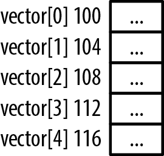

Hình 4-1. Memory allocation cho array

Biểu diễn nội bộ của array không có thông tin về số element mà nó chứa. Array name chỉ tham chiếu một block memory. Dùng operator `sizeof` với array trả về số byte được cấp cho array. Để xác định số element, chúng ta chia kích thước array cho kích thước element như minh họa dưới đây. Đoạn này sẽ hiển thị 5:

```
printf("%d\n", sizeof(vector)/sizeof(int));
```

Array One-dimensional dễ khởi tạo bằng câu lệnh dạng block. Trong chuỗi sau, từng element được khởi tạo bằng integer bắt đầu từ một:

```
int vector[5] = {1, 2, 3, 4, 5};
```

### Array Two-Dimensional

Array Two-dimensional dùng row và column để xác định element. Loại array này cần được map vào address space one-dimension của main memory. Trong C, điều này được thực hiện theo thứ tự row-column. Row đầu của array được đặt vào memory, tiếp theo là row thứ hai, rồi row thứ ba, và tiếp tục đến khi row cuối được đặt vào memory.

Đoạn sau khai báo một array two-dimensional với hai row và ba column. Array được khởi tạo bằng block statement. Hình 4-2 minh họa cách memory được cấp cho array này. Sơ đồ bên trái cho thấy cách memory được map. Sơ đồ bên phải cho thấy cách hình dung về mặt khái niệm:

```
int matrix[2][3] = {{1,2,3},{4,5,6}};
```

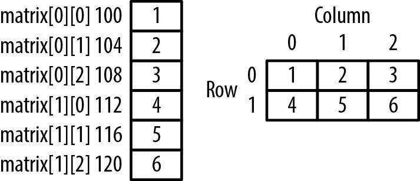

Hình 4-2. Array Two-dimensional

Array two-dimensional được xem là array của các array. Nghĩa là khi truy cập array bằng chỉ một subscript, chúng ta nhận pointer đến row tương ứng. Điều này được minh họa trong chuỗi code sau, nơi address và kích thước của từng row được hiển thị:

```
for (int i = 0; i < 2; i++) {
    printf("&matrix[%d]: %p  sizeof(matrix[%d]): %d\n",
            i, &matrix[i], i, sizeof(matrix[i]));
}
```

Output sau giả định array ở address 100. Kích thước là 12 vì mỗi row có ba element, mỗi element bốn byte:

```
&matrix[0]: 100 sizeof(matrix[0]): 12
&matrix[1]: 112 sizeof(matrix[1]): 12
```

Mục “Pointer và multidimensional array” trang 94 sẽ xét kỹ hành vi này.

### Multidimensional array

Multidimensional array có từ hai chiều. Như array two-dimensional, nhiều cặp ngoặc vuông định nghĩa type và kích thước. Ví dụ sau định nghĩa array three-dimensional gồm ba row, hai column và rank bốn. Thuật ngữ rank thường chỉ các element của chiều thứ ba:

```
int arr3d[3][2][4] = {
    {{1, 2, 3, 4}, {5, 6, 7, 8}},
    {{9, 10, 11, 12}, {13, 14, 15, 16}},
    {{17, 18, 19, 20}, {21, 22, 23, 24}}
};
```

Các element được cấp liên tục theo thứ tự row-column-rank như Hình 4-3.

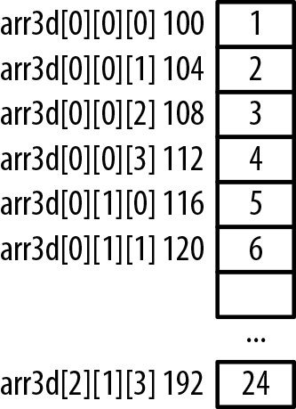

Hình 4-3. Array Three-dimensional

Chúng ta sẽ dùng các declaration này trong ví dụ sau.

## Pointer notation và array

Pointer rất hữu ích với array. Có thể dùng với array hiện có hoặc cấp memory từ heap rồi coi như array. Array notation và pointer notation có thể thay nhau ở một mức độ. Tuy nhiên, không hoàn toàn giống nhau, như mục “Khác biệt giữa array và pointer” trang 85 trình bày.

Dùng riêng tên array trả address của array. Có thể gán address cho pointer như sau:

```
int vector[5] = {1, 2, 3, 4, 5};
int *pv = vector;
```

Variable `pv` là pointer đến element đầu của array, không phải chính array. Khi lần đầu gán giá trị cho `pv`, chúng ta gán address của element đầu tiên trong array.

Chúng ta có thể dùng riêng array name hoặc dùng address-of operator với element đầu của array như minh họa dưới đây. Hai cách tương đương và trả về address của `vector`. Dùng address-of operator dài dòng hơn nhưng cũng tường minh hơn:

```
printf("%p\n",vector);
printf("%p\n",&vector[0]);
```

Expression `&vector` đôi khi được dùng để lấy address của array. Nó khác các notation kia ở chỗ trả về pointer đến toàn bộ array. Hai cách tiếp cận kia tạo pointer đến integer. Thay vì trả về pointer đến integer, nó trả về pointer đến array gồm các integer. Cách dùng type này sẽ được minh họa trong mục “Truyền multidimensional array” ở trang 96.

Cũng có thể dùng array subscript với pointer. Thực tế notation `pv[i]` được evaluate như sau:

```
*(pv + i)
```

Pointer `pv` chứa address block memory. Notation ngoặc vuông lấy address trong `pv` rồi cộng giá trị index `i` bằng pointer arithmetic. Address mới sau đó được dereference để trả nội dung.

Như đã thảo luận trong mục “Pointer arithmetic” ở trang 20, cộng một integer vào pointer sẽ tăng address mà nó chứa thêm tích của integer và kích thước data type. Điều tương tự đúng khi cộng integer vào array name. Hai statement sau tương đương:

```
*(pv + i)
*(vector + i)
```

Giả định `vector` ở address 100, `pv` ở address 96. Bảng 4-1 và Hình 4-4 minh họa array subscript và pointer arithmetic với tên array và pointer cho các giá trị khác nhau.

Bảng 4-1. Array/pointer notation

| Giá trị | Expression tương đương |  |  |  |
|---|---|---|---|---|
| 92 | \&vector\[-2\] | vector - 2 | \&pv\[-2\] | pv - 2 |
| 100 | vector | vector+0 | \&pv\[0\] | pv |
| 100 | \&vector\[0\] | vector+0 | \&pv\[0\] | pv |
| 104 | \&vector\[1\] | vector + 1 | \&pv\[1\] | pv + 1 |
| 140 | \&vector\[10\] | vector + 10 | \&pv\[10\] | pv + 10 |

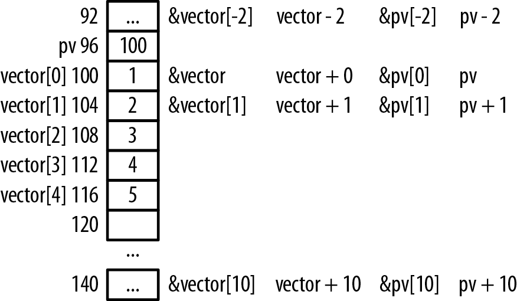

Hình 4-4. Array/pointer notation

Khi cộng 1 vào address của array, thực tế chúng ta cộng 4, kích thước integer, vì đây là array gồm các integer. Với thao tác đầu và cuối, chúng ta truy cập các vị trí ngoài giới hạn array. Dù đây không phải cách làm tốt, nó nhấn mạnh sự cần thiết phải cẩn thận khi dùng index hoặc pointer để truy cập element của array.

Có thể coi array notation là operation “dịch và dereference”. Expression `vector[2]` bắt đầu ở vector, pointer đến đầu array, dịch hai vị trí sang phải rồi dereference lấy giá trị. Dùng address-of operator với array notation như `&vector[2]` thực chất triệt tiêu dereferencing. Có thể diễn giải là đi sang trái hai vị trí rồi trả address đó.

Đoạn sau minh họa cách dùng pointer để triển khai scalar addition operation. Operation này nhận một giá trị và nhân nó với từng element của vector:

```
pv = vector;
int value = 3;
for(int i=0; i<5; i++) {
    *pv++ *= value;
}
```

### Khác biệt giữa array và pointer

Có một số khác biệt khi dùng array và pointer đến array. Phần này dùng array `vector` và pointer `pv` định nghĩa sau:

```
int vector[5] = {1, 2, 3, 4, 5};
int *pv = vector;
```

Code sinh bởi `vector[i]` khác code sinh bởi `vector+i`. Notation `vector[i]` sinh machine code bắt đầu tại `vector`, di chuyển `i` vị trí rồi dùng nội dung. Notation `vector+i` sinh machine code bắt đầu tại `vector`, cộng `i` vào address rồi dùng nội dung tại address đó. Dù kết quả giống nhau, machine code khác nhau. Khác biệt hiếm khi quan trọng với phần lớn programmer.

Có sự khác biệt khi áp dụng operator `sizeof` cho array và cho pointer đến cùng array đó. Áp dụng operator `sizeof` cho `vector` trả về 20, số byte được cấp cho array. Áp dụng operator `sizeof` cho `pv` trả về 4, kích thước pointer.

Pointer `pv` là `lvalue`. `lvalue` chỉ thành phần bên trái assignment operator. `lvalue` phải sửa được. Tên array như `vector` không phải `lvalue`, không sửa được. Address gán cho array không thể thay đổi. Pointer có thể nhận giá trị mới và tham chiếu vùng memory khác.

Xét đoạn sau:

```
pv = pv + 1;
vector = vector + 1; // Syntax error
```

Không thể sửa `vector`, chỉ sửa nội dung. Tuy nhiên, expression `vector+1` hợp lệ, như sau:

```
pv = vector + 1;
```

## Dùng malloc tạo array One-Dimensional

Nếu cấp memory từ heap và gán address cho pointer, không có lý do gì chúng ta không thể dùng array subscript với pointer và xem memory này như array. Trong chuỗi sau, chúng ta sao chép nội dung array `vector` đã dùng trước đó:

```
int *pv = (int*) malloc(5 * sizeof(int));
for(int i=0; i<5; i++) {
    pv[i] = i+1;
}
```

Có thể dùng pointer notation như sau, nhưng array notation thường dễ theo dõi hơn:

```
for(int i=0; i<5; i++) {
    *(pv+i) = i+1;
}
```

Hình 4-5 minh họa cách memory được cấp phát cho ví dụ này.

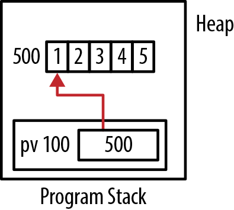

Hình 4-5. Array cấp từ heap

Kỹ thuật này tạo một vùng memory và xem nó như array. Kích thước được xác định tại runtime. Tuy nhiên, chúng ta cần nhớ giải phóng memory khi dùng xong.


Trong ví dụ trước, chúng ta dùng `*(pv+i)` thay vì `*pv+1`. Vì dereference operator có precedence cao hơn plus operator, pointer trong expression thứ hai được dereference, cho chúng ta giá trị mà pointer tham chiếu. Sau đó, chúng ta cộng `i` vào integer value này. Đó không phải điều dự định. Ngoài ra, khi dùng expression này làm `lvalue`, compiler sẽ phàn nàn. Vì vậy, để hoạt động đúng, chúng ta cần buộc phép cộng được thực hiện trước, rồi mới đến dereference operation.

## Dùng function realloc đổi kích thước array

Chúng ta có thể resize array hiện có được tạo bằng `malloc` bằng function `realloc`. Các điểm cơ bản của function `realloc` được trình bày chi tiết trong Chương 2. Tiêu chuẩn C99 hỗ trợ variable length array. Trong một số tình huống, đây có thể là giải pháp tốt hơn dùng function `realloc`. Nếu không dùng C99, bạn phải dùng function `realloc`. Ngoài ra, variable length array chỉ có thể được khai báo bên trong function. Nếu array cần tồn tại lâu hơn thời gian hoạt động của function, bạn phải dùng `realloc`.

Để minh họa function `realloc`, chúng ta sẽ triển khai một function đọc ký tự từ standard input và gán chúng vào buffer. Buffer chứa mọi ký tự đã đọc trừ ký tự return kết thúc. Vì không biết user sẽ nhập bao nhiêu ký tự, chúng ta không biết buffer cần dài bao nhiêu. Chúng ta sẽ dùng function `realloc` để cấp thêm storage theo một mức tăng cố định. Code triển khai function như sau:

```
char* getLine(void) {
    const size_t sizeIncrement = 10;
    char* buffer = malloc(sizeIncrement);
    char* currentPosition = buffer;
    size_t maximumLength = sizeIncrement;
    size_t length = 0;
    int character;

    if(currentPosition == NULL) { return NULL; }

    while(1) {
        character = fgetc(stdin);
        if(character == '\n') { break; }

        if(++length >= maximumLength) {
            char *newBuffer = realloc(buffer, maximumLength += sizeIncrement);

            if(newBuffer == NULL) {
                free(buffer);
                return NULL;
            }
```

```
            currentPosition = newBuffer + (currentPosition - buffer);
            buffer = newBuffer;
        }
        *currentPosition++ = character;
    }
    *currentPosition = '\0';
    return buffer;
}
```

Bắt đầu bằng một số declaration tóm tắt trong Bảng 4-2.

Bảng 4-2. Variable của getLine

| sizeIncrement | Kích thước buffer ban đầu và lượng tăng mỗi khi buffer cần được mở rộng |
|---|---|
| buffer | Pointer đến các character đọc vào |
| currentPosition | Pointer đến vị trí trống kế tiếp trong buffer |
| maximumLength | Số character tối đa lưu an toàn trong buffer |
| length | Số character đã đọc |
| character | Character cuối được đọc |

Buffer được tạo với kích thước `sizeIncrement`. Nếu function `malloc` không thể cấp memory, statement `if` đầu buộc function trả về `NULL`. Chương trình đi vào loop vô hạn, nơi từng ký tự được xử lý. Khi loop kết thúc, một NUL được thêm để kết thúc string và address của buffer được trả về.

Bên trong loop `while`, một ký tự được đọc. Nếu đó là carriage return, loop kết thúc. Tiếp theo, statement `if` xác định liệu chúng ta đã vượt kích thước buffer chưa. Nếu chưa, ký tự được thêm vào vị trí hiện tại trong buffer.

Nếu đã vượt kích thước buffer, function `realloc` tạo một block memory mới. Block này lớn hơn block cũ `sizeIncrement` byte. Nếu không thể cấp memory, chúng ta free memory đã cấp hiện có và buộc function trả về `NULL`. Nếu được, `currentPosition` được điều chỉnh để trỏ đúng vị trí trong buffer mới và chúng ta gán variable buffer trỏ đến buffer vừa cấp. Function `realloc` không nhất thiết giữ memory hiện có ở nguyên vị trí, nên bạn phải dùng pointer nó trả về để biết block memory mới đã resize nằm ở đâu.

Variable `newBuffer` giữ address của memory được cấp phát. Chúng ta cần một variable riêng, thay vì dùng `buffer`, phòng trường hợp `realloc` không thể cấp phát memory. Điều này cho phép phát hiện và xử lý tình huống ấy.

Chúng ta không free `buffer` nếu `realloc` thành công, vì `realloc` sẽ copy buffer ban đầu sang buffer mới và free buffer cũ. Nếu cố free `buffer`, chương trình thông thường sẽ kết thúc vì chúng ta cố free cùng một block memory hai lần.

Hình 4-6 minh họa memory cho `getLine` với input string “Once upon a time there was a giant pumpkin.” Program stack được đơn giản hóa, bỏ qua local variable ngoài `buffer` và `currentPosition`. Buffer đã được mở rộng bốn lần, thể hiện bằng hình chữ nhật chứa input string.

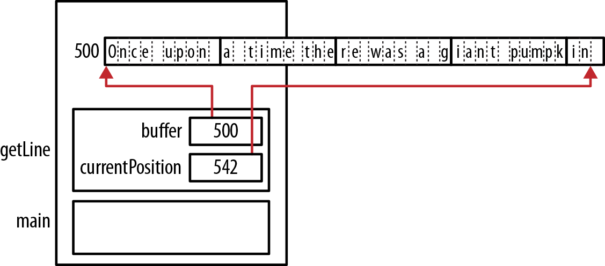

Hình 4-6. Memory allocation cho function getLine

Function `realloc` cũng có thể được dùng để giảm lượng storage mà pointer sử dụng. Để minh họa, function `trim` dưới đây sẽ bỏ các dấu cách ở đầu string:

```
char* trim(char* phrase) {
    char* old = phrase;
    char* new = phrase;
```

```
while(*old == ' ') {
    old++;
}
```

```
    while(*old) {
        *(new++) = *(old++);
    }
    *new = 0;
    return (char*) realloc(phrase,strlen(phrase)+1);
}

int main() {
    char* buffer = (char*)malloc(strlen("  cat")+1);
    strcpy(buffer,"  cat");
    printf("%s\n",trim(buffer));
}
```

Loop `while` đầu dùng variable `tmp` để bỏ qua mọi dấu cách ở đầu. Loop `while` thứ hai copy các ký tự còn lại trong string về đầu string. Nó được đánh giá là true cho đến khi gặp `NUL`, vốn được đánh giá là false. Sau đó, số 0 được thêm để kết thúc string. Function `realloc` tiếp theo được dùng để cấp lại memory dựa trên độ dài mới của string.

Hình 4-7 minh họa việc sử dụng function với string ban đầu là “cat.” Trạng thái string trước và sau khi function `trim` thực thi được trình bày. Memory màu đỏ là memory cũ và không nên được truy cập.

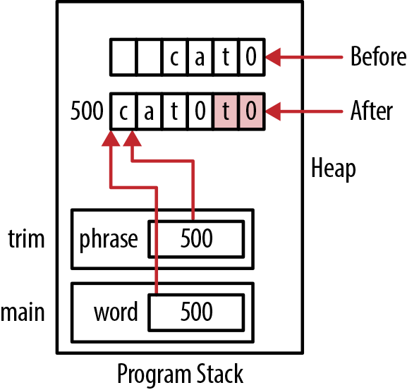

Hình 4-7. Ví dụ realloc

## Truyền array One-Dimensional

Khi array one-dimensional được truyền cho function, address của array được truyền by value. Điều này giúp việc truyền thông tin hiệu quả hơn vì không truyền toàn bộ array và không phải cấp memory trên stack cho nó. Thông thường, điều này có nghĩa phải truyền kích thước array. Nếu không, từ góc nhìn function, tất cả những gì có là address của array mà không có chỉ dấu về kích thước.

Trừ khi trong array có thứ gì cho biết giới hạn của nó, chúng ta cần truyền thông tin kích thước khi truyền array. Với string lưu trong array, có thể dựa vào ký tự kết thúc `NUL` để biết lúc nào dừng xử lý array. Chúng ta sẽ tìm hiểu điều này trong Chương 5. Nói chung, nếu không biết kích thước array, chúng ta không thể xử lý element đúng cách và có thể chỉ xử lý quá ít element hoặc xem memory ngoài array như một phần của array. Điều này thường khiến chương trình kết thúc bất thường.

Có thể khai báo array trong function declaration bằng array notation hoặc pointer notation.

### Dùng array notation

Ví dụ sau truyền array integer cùng kích thước cho function rồi hiển thị nội dung:

```
void displayArray(int arr[], int size) {
    for (int i = 0; i < size; i++) {
        printf("%d\n", arr[i]);
    }
}

    int vector[5] = {1, 2, 3, 4, 5};
    displayArray(vector, 5);
```

Output của chuỗi này là các số từ 1 đến 5. Chúng ta truyền số 5 cho function để chỉ kích thước. Có thể truyền bất kỳ số dương nào và function sẽ cố hiển thị số element tương ứng, bất kể kích thước có đúng không. Chương trình có thể kết thúc nếu cố truy cập memory ngoài giới hạn array. Memory allocation cho ví dụ được trình bày trong Hình 4-8.

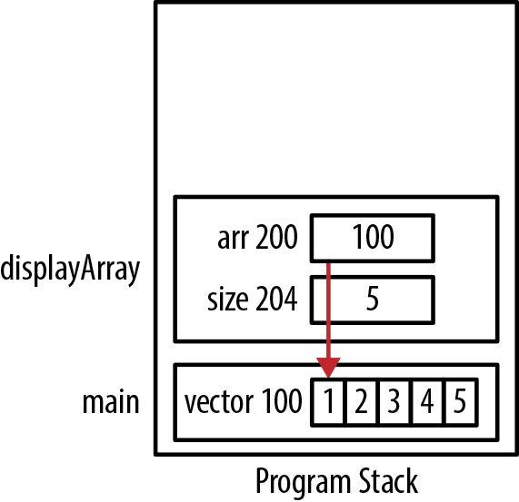

Hình 4-8. Dùng array notation


Một lỗi phổ biến là dùng operator `sizeof` với array để xác định số element, như dưới đây. Tuy nhiên, như giải thích trong mục “Array One-Dimensional” ở trang 80, đây không phải cách đúng để xác định kích thước. Trong trường hợp này, chúng ta sẽ truyền giá trị 20 cho array.

```
displayArray(arr, sizeof(arr));
```

Truyền kích thước nhỏ hơn số element thực của array là cách làm phổ biến. Mục đích là chỉ xử lý một phần array. Chẳng hạn, giả sử chúng ta đọc một chuỗi độ tuổi vào array nhưng không lấp đầy nó. Nếu gọi function `sort` để sắp xếp, chúng ta chỉ muốn sắp xếp các độ tuổi hợp lệ, không phải mọi element.

### Dùng pointer notation

Không bắt buộc dùng ngoặc vuông khi khai báo array parameter. Có thể dùng pointer notation như sau:

```
void displayArray(int* arr, int size) {
    for (int i = 0; i < size; i++) {
        printf("%d\n", arr[i]);
    }
}
```

Bên trong function vẫn dùng array notation. Nếu muốn có thể dùng pointer notation:

```
void displayArray(int* arr, int size) {
    for (int i = 0; i < size; i++) {
        printf("%d\n", *(arr+i));
    }
}
```

Nếu khai báo function bằng array notation, vẫn dùng pointer notation trong function body được:

```
void displayArray(int arr[], int size) {
    for (int i = 0; i < size; i++) {
        printf("%d\n", *(arr+i));
    }
}
```

## Dùng array One-Dimensional chứa pointer

Phần này xét các điểm chính của array pointer bằng array pointer đến integer. Ví dụ array pointer cũng có trong:

- “Dùng array function pointer” trang 76, nơi dùng array các function

pointer;

- “Memory được cấp cho structure thế nào” trang 135, nơi array structure

được dùng; và

- “Truyền argument cho application” trang 125, nơi xử lý array `argv`.

Mục đích phần này là chuẩn bị cho các ví dụ sau bằng cách minh họa bản chất của cách tiếp cận. Chuỗi sau khai báo một array gồm các integer pointer, cấp memory cho từng element và khởi tạo memory này bằng index của array:

```
int* arr[5];
for(int i=0; i<5; i++) {
    arr[i] = (int*)malloc(sizeof(int));
    *arr[i] = i;
}
```

Nếu hiển thị array này, các số 0 đến 4 sẽ được in. Chúng ta dùng `arr[i]` để tham chiếu pointer và `*arr[i]` để gán giá trị cho vị trí mà pointer tham chiếu. Đừng để array notation gây nhầm lẫn. Vì `arr` được khai báo là array gồm các pointer, `arr[i]` trả về address. Khi dereference pointer như `*arr[i]`, chúng ta nhận nội dung tại address đó.

Có thể dùng pointer notation tương đương sau cho loop body:

```
*(arr+i) = (int*)malloc(sizeof(int));
**(arr+i) = i;
```

Notation này khó theo dõi hơn, nhưng hiểu nó sẽ nâng cao trình độ C của bạn. Chúng ta dùng hai mức indirection trong statement thứ hai. Thành thạo notation kiểu này sẽ phân biệt bạn với các lập trình viên C ít kinh nghiệm hơn.

Subexpression `(arr+i)` biểu thị address của element thứ i<sup>th</sup> trong array. Chúng ta cần sửa nội dung tại address này nên dùng subexpression `*(arr+i)`. Memory được cấp được gán cho vị trí này trong statement đầu. Dereference subexpression lần thứ hai, như trong statement thứ hai, trả về vị trí memory đã cấp. Sau đó, chúng ta gán variable `i` cho nó. Hình 4-9 minh họa cách memory được cấp phát.

Chẳng hạn, `arr[1]` nằm tại address 104. Expression `(arr+1)` cho chúng ta 104. Dùng `*(arr+1)` cho nội dung của nó. Trong ví dụ này, đó là pointer 504. Dereference lần thứ hai bằng `**(arr+1)` cho nội dung của 504, là 1.

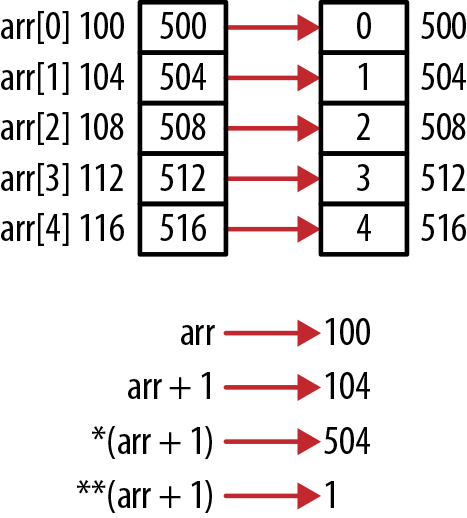

Hình 4-9. Array pointer

Các expression ví dụ được liệt kê trong Bảng 4-3. Đọc từ trái sang phải và không bỏ qua ngoặc giúp hiểu cách hoạt động.

Bảng 4-3. Expression của array pointer

| Expression | Giá trị |
|---|---|
| \*arr\[0\] | 0 |
| \*\*arr | 0 |
| \*\*(arr+1) | 1 |
| arr\[0\]\[0\] | 0 |
| arr\[3\]\[0\] | 3 |

Ba expression đầu giống giải thích trước. Hai expression cuối khác: notation pointer đến pointer gợi ý đang làm việc với array pointer, và thực tế đúng vậy. Xem lại Hình 4-9, giả sử mỗi element `arr` trỏ array kích thước một thì hai expression cuối có nghĩa. Chúng ta có array pointer five-element trỏ đến chuỗi array one-element.

Expression `arr[3][0]` chỉ element thứ tư của arr rồi element đầu của array nó trỏ đến. Expression `arr[3][1]` không hoạt động vì array mà element thứ tư trỏ đến không có hai element.

Điều này gợi ý khả năng tạo jagged array. Thực sự làm được, là chủ đề “Jagged array và pointer” trang 102.

## Pointer và multidimensional array

Các phần của multidimensional array có thể được coi là subarray. Ví dụ, mỗi row của array two-dimensional có thể được coi là array one-dimensional. Hành vi này ảnh hưởng cách chúng ta dùng pointer khi làm việc với multidimensional array.

Để minh họa, tạo và khởi tạo array two-dimensional như sau:

```
int matrix[2][5] = {{1,2,3,4,5},{6,7,8,9,10}};
```

Sau đó hiển thị address và giá trị tương ứng:

```
for(int i=0; i<2; i++) {
   for(int j=0; j<5; j++) {
      printf("matrix[%d][%d]  Address: %p  Value: %d\n",
                 i, j, &matrix[i][j], matrix[i][j]);
   }
}
```

Output như sau:

```
matrix[0][0]  Address: 100  Value: 1
matrix[0][1]  Address: 104  Value: 2
matrix[0][2]  Address: 108  Value: 3
matrix[0][3]  Address: 112  Value: 4
matrix[0][4]  Address: 116  Value: 5
matrix[1][0]  Address: 120  Value: 6
matrix[1][1]  Address: 124  Value: 7
matrix[1][2]  Address: 128  Value: 8
matrix[1][3]  Address: 132  Value: 9
matrix[1][4]  Address: 136  Value: 10
```

Array được lưu theo thứ tự row-column: row đầu lưu tuần tự trong memory, sau đó row thứ hai. Hình 4-10 minh họa.

Có thể khai báo pointer dùng với array như sau:

```
int (*pmatrix)[5] = matrix;
```

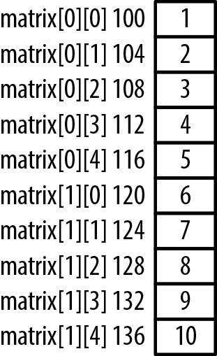

Hình 4-10. Memory allocation cho array Two-dimensional

Expression `(*pmatrix)` khai báo pointer đến array. Kết hợp phần còn lại declaration, `pmatrix` là pointer đến array integer two-dimensional có năm element mỗi column. Bỏ ngoặc sẽ khai báo array five-element chứa pointer đến integer. Kích thước chiều đầu là 2 vì biết kích thước của `matrix`. Nếu dùng kích thước khác truy cập array, kết quả khó dự đoán.

Muốn truy cập element thứ hai, 2, bằng pointer notation, có vẻ hợp lý dùng:

```
printf("%p\n", matrix);
printf("%p\n", matrix + 1);
```

Output như sau:

```
100
120
```

Address do `matrix+1` trả về không cách đầu array 4 byte. Thay vào đó, nó cách một lượng bằng kích thước row đầu, 20 byte. Dùng riêng `matrix` trả về address của element đầu trong array. Vì array two-dimensional là array của các array, chúng ta nhận address của một integer array five-element. Kích thước của nó là 20. Có thể xác minh bằng statement sau, sẽ hiển thị 20:

```
printf("%d\n",sizeof(matrix[0]));  // Displays 20
```

Để truy cập element thứ hai của array, chúng ta cần cộng 1 vào row đầu như sau: `*(matrix[0] + 1)`. Expression `matrix[0]` trả về address của element đầu trong row đầu. Address này là address của một array integer. Vì vậy, khi cộng 1, kích thước một integer được cộng vào, cho chúng ta element thứ hai. Output là 104 và 2.

```
printf("%p  %d\n", matrix[0] + 1, *(matrix[0] + 1));
```

Có thể biểu diễn array bằng đồ họa như Hình 4-11.

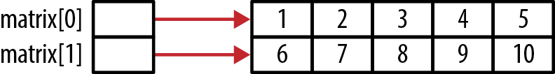

Hình 4-11. Biểu diễn đồ họa array two-dimensional

Có thể diễn giải notation array Two-dimensional như Hình 4-12.

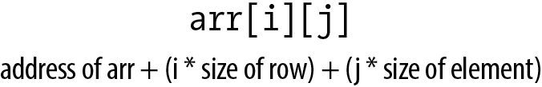

Hình 4-12. Notation array Two-dimensional

## Truyền multidimensional array

Truyền multidimensional array cho function có thể gây nhầm lẫn, đặc biệt khi dùng pointer notation. Khi truyền multidimensional array, chúng ta cần quyết định dùng array notation hay pointer notation trong function signature. Một điều khác cần cân nhắc là cách truyền hình dạng array. Hình dạng ở đây là số chiều và kích thước các chiều. Nếu muốn dùng array notation trong function, bắt buộc phải chỉ định hình dạng array. Nếu không, compiler không thể dùng subscript.

Để truyền array `matrix`, dùng:

```
void display2DArray(int arr[][5], int rows) {
```

hoặc:

```
void display2DArray(int (*arr)[5], int rows) {
```

Trong cả hai phiên bản, số column đều được chỉ định. Điều này cần thiết vì compiler cần biết số element trong mỗi row. Nếu không truyền thông tin này, nó không thể đánh giá expression như `arr[0][3]`, như giải thích trong mục “Pointer và multidimensional array” ở trang 94.

Trong phiên bản đầu, expression `arr[]` là declaration ngầm của pointer tới array. Trong phiên bản thứ hai, expression `(*arr)` là declaration tường minh của pointer.


Declaration sau không hoạt động đúng:

```
void display2DArray(int *arr[5], int rows) {
```

Dù không sinh syntax error, array truyền được coi là array five-element chứa pointer đến integer. “Dùng array One-Dimensional chứa pointer” trang 92 bàn array pointer.

Sau đây là implementation đơn giản và lời gọi:

```
void display2DArray(int arr[][5], int rows) {
    for (int i = 0; i<rows; i++) {
        for (int j = 0; j<5; j++) {
            printf("%d", arr[i][j]);
        }
        printf("\n");
    }
}

void main() {
    int matrix[2][5] = {
        {1, 2, 3, 4, 5},
        {6, 7, 8, 9, 10}
    };
    display2DArray(matrix, 2);
}
```

Function không cấp memory cho array. Chỉ address được truyền. Hình 4-13 cho trạng thái program stack của lời gọi.

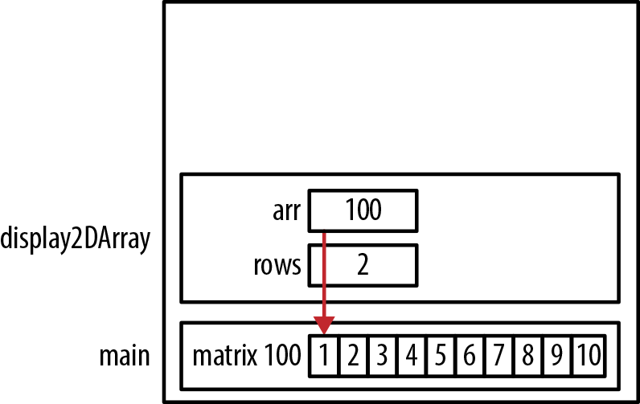

Hình 4-13. Truyền multidimensional array

Bạn có thể gặp function khai báo như sau, nhận một pointer cùng số row và column:

```
void display2DArrayUnknownSize(int *arr, int rows, int cols) {
    for(int i=0; i<rows; i++) {
        for(int j=0; j<cols; j++) {
            printf("%d ", *(arr + (i*cols) + j));
        }
        printf("\n");
    }
}
```

Statement `printf` tính address của từng element bằng cách cộng vào `arr` số element trong các row trước, `(i*cols)`, rồi cộng `j` để chỉ định column. Để gọi function, chúng ta có thể dùng:

```
display2DArrayUnknownSize(&matrix[0][0], 2, 5);
```

Trong function không thể dùng array subscript như sau:

```
printf("%d ", arr[i][j]);
```

Không thể làm vậy vì pointer không được khai báo là array two-dimensional. Tuy nhiên, có thể dùng array notation như dưới đây. Chúng ta có thể dùng một subscript vì nó đơn giản được diễn giải là offset trong array; không thể dùng hai subscript vì compiler không biết kích thước các chiều:

```
printf("%d ", (arr+i)[j]);
```

Address element đầu được truyền bằng `&matrix[0][0]` thay vì `matrix`. Dùng `matrix` vẫn chạy đúng nhưng sinh warning về pointer type không tương thích. Expression `&matrix[0][0]` là pointer đến integer, còn `matrix` là pointer đến array integer.

Khi truyền array nhiều hơn hai chiều, cần chỉ định kích thước mọi chiều trừ chiều đầu. Đoạn sau minh họa một function được viết để hiển thị array three-dimensional. Hai chiều cuối được chỉ định trong declaration:

```
void display3DArray(int (*arr)[2][4], int rows) {
    for(int i=0; i<rows; i++) {
        for(int j=0; j<2; j++) {
            printf("{");
            for(int k=0; k<4; k++) {
                printf("%d ", arr[i][j][k]);
            }
            printf("}");
        }
        printf("\n");
    }
}
```

Code sau cho cách gọi function:

```
int arr3d[3][2][4] = {
    {{1, 2, 3, 4}, {5, 6, 7, 8}},
    {{9, 10, 11, 12}, {13, 14, 15, 16}},
    {{17, 18, 19, 20}, {21, 22, 23, 24}}
};

display3DArray(arr3d,3);
```

Output như sau:

```
{1 2 3 4 }{5 6 7 8 }
{9 10 11 12 }{13 14 15 16 }
{17 18 19 20 }{21 22 23 24 }
```

Hình 4-14 mô tả memory allocation của array.


Hình 4-14. Array Three-dimensional

Expression `arr3d[1]` chỉ row thứ hai, là pointer đến array two-dimensional có hai row, bốn column. Expression `arr3d[1][0]` chỉ row thứ hai, column đầu, là pointer đến array one-dimensional kích thước 5.

## Cấp phát động array Two-Dimensional

Cấp memory động cho array two-dimensional liên quan một số vấn đề:

- Các element có cần liên tục không

- Array có jagged không

Memory được cấp liên tục khi khai báo array two-dimensional như sau:

```
int matrix[2][5] = {{1,2,3,4,5},{6,7,8,9,10}};
```

Tuy nhiên, khi dùng function như `malloc` tạo array two-dimensional, có nhiều cách cấp memory. Vì có thể coi array two-dimensional là array của array, không có lý do các array “bên trong” phải liên tục. Khi dùng array subscript, tính không liên tục được xử lý trong suốt.


Liên tục hay không ảnh hưởng operation khác như copy block memory. Nếu không liên tục, có thể phải copy nhiều lần.

### Cấp memory có thể không liên tục

Đoạn sau minh họa một cách cấp phát array two-dimensional mà memory được cấp không được bảo đảm liên tục. Trước tiên, array “bên ngoài” được cấp phát, rồi từng row được cấp bằng các statement `malloc` riêng:

```
int rows = 2;
int columns = 5;
```

```
int **matrix = (int **) malloc(rows * sizeof(int *));
```

```
for (int i = 0; i < rows; i++) {
    matrix[i] = (int *) malloc(columns * sizeof(int));
}
```

Vì dùng các lời gọi `malloc` riêng, không bảo đảm memory liên tục. Hình 4-15 minh họa.

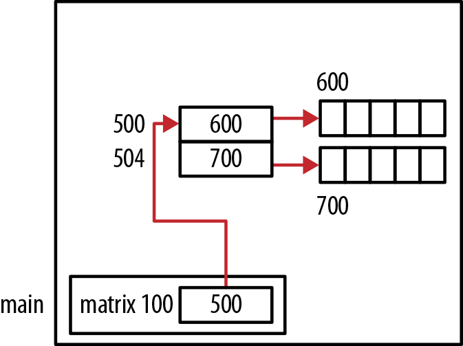

Hình 4-15. Allocation không liên tục

Allocation thực tùy heap manager và trạng thái heap. Nó vẫn có thể liên tục.

### Cấp memory liên tục

Chúng ta sẽ trình bày hai cách cấp memory liên tục cho array two-dimensional. Kỹ thuật đầu cấp array “bên ngoài” trước, rồi toàn bộ memory cho các row. Kỹ thuật thứ hai cấp tất cả memory trong một lần.

Kỹ thuật đầu được minh họa trong chuỗi sau. Lệnh `malloc` đầu cấp một array gồm các pointer đến integer. Mỗi element sẽ chứa pointer đến một row. Đây là block được cấp tại address 500 trong Hình 4-16. Lệnh `malloc` thứ hai cấp memory cho toàn bộ element của array tại vị trí 600. Trong loop `for`, mỗi element của array đầu được gán một phần memory được cấp bởi `malloc` thứ hai:

```
int rows = 2;
int columns = 5;
int **matrix = (int **) malloc(rows * sizeof(int *));
matrix[0] = (int *) malloc(rows * columns * sizeof(int));
for (int i = 1; i < rows; i++)
    matrix[i] = matrix[0] + i * columns;
```

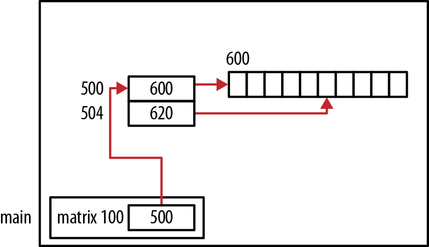

Hình 4-16. Cấp liên tục bằng hai lời gọi malloc

Về kỹ thuật, memory cho array đầu có thể tách khỏi memory cho “thân” array. Tuy nhiên thân được cấp một vùng liên tục.

Trong kỹ thuật thứ hai dưới đây, toàn bộ memory cho array được cấp phát trong một lần:

```
int *matrix = (int *)malloc(rows * columns * sizeof(int));
```

Hình 4-17 minh họa allocation.

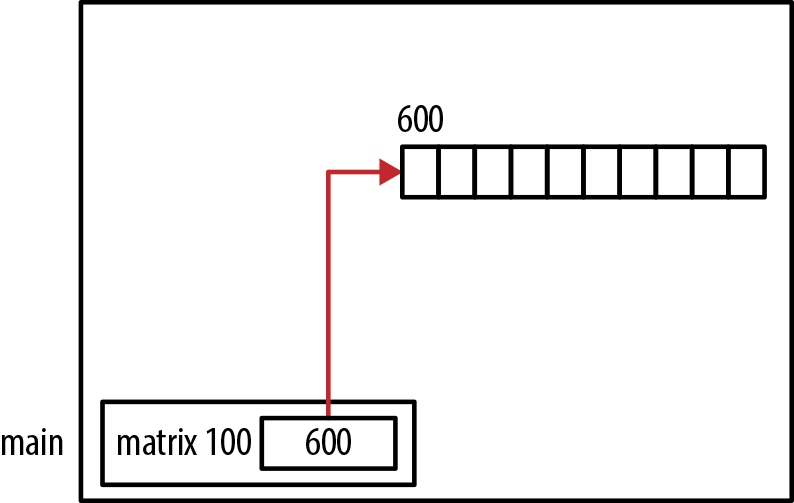

Hình 4-17. Cấp liên tục bằng một lời gọi malloc

Khi array được tham chiếu về sau trong code, không thể dùng array subscript. Thay vào đó, index vào array phải được tính thủ công, như minh họa trong chuỗi code sau. Mỗi element được khởi tạo bằng tích các index của nó:

```
for (int i = 0; i < rows; i++) {
    for (int j = 0; j < columns; j++) {
        *(matrix + (i*columns) + j) = i*j;
    }
}
```

Không thể dùng array subscript vì chúng ta đã mất thông tin hình dạng mà compiler cần để cho phép subscript. Khái niệm này được giải thích trong mục “Truyền multidimensional array” ở trang 96.

Cách này ít dùng thực tế, nhưng minh họa quan hệ giữa khái niệm array two-dimensional và tính one-dimensional của main memory. Notation array two-dimensional thuận tiện hơn làm ánh xạ trong suốt và dễ dùng.

Chúng ta đã minh họa hai cách tiếp cận tổng quát để cấp memory liên tục cho array two-dimensional. Cách nào được dùng phụ thuộc nhu cầu ứng dụng. Tuy nhiên, cách cuối tạo một block memory duy nhất cho “toàn bộ” array.

## Jagged array và pointer

Jagged array là array two-dimensional có số column khác nhau ở mỗi row. Về khái niệm, điều này được minh họa trong Hình 4-18, nơi array có ba row với số column mỗi row khác nhau.

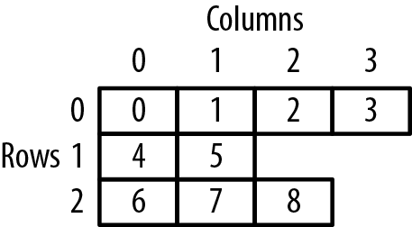

Hình 4-18. Jagged array

Trước khi học cách tạo array như vậy, hãy xem một array two-dimensional được tạo bằng compound literal. Compound literal là một cấu trúc C gồm thứ trông như cast operator theo sau bởi initializer list trong ngoặc nhọn. Sau đây là ví dụ compound literal cho cả constant integer và array integer. Chúng được dùng như một phần của declaration:

```
(const int) {100}
(int[3]) {10, 20, 30}
```

Declaration sau tạo array `arr1` bằng cách khai báo array pointer đến integer rồi khởi tạo bằng block statement gồm compound literal:

```
int (*(arr1[])) = {
    (int[]) {0, 1, 2},
    (int[]) {3, 4, 5},
    (int[]) {6, 7, 8}};
```

Array này có ba row và ba column. Các element được khởi tạo bằng giá trị từ 0 đến 8 theo thứ tự row column. Hình 4-19 mô tả cách bố trí memory cho array này.

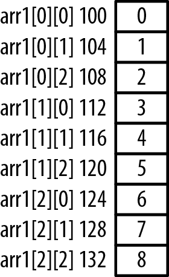

Hình 4-19. Array Two-dimensional

Chuỗi sau hiển thị address và giá trị từng element:

```
for(int j=0; j<3; j++) {
    for(int i=0; i<3; i++) {
        printf("arr1[%d][%d]  Address: %p  Value: %d\n",
                j, i, &arr1[j][i], arr1[j][i]);
    }
    printf("\n");
}
```

Khi chạy, nhận output:

```
arr1[0][0]  Address: 0x100  Value: 0
arr1[0][1]  Address: 0x104  Value: 1
arr1[0][2]  Address: 0x108  Value: 2

arr1[1][0]  Address: 0x112  Value: 3
arr1[1][1]  Address: 0x116  Value: 4
arr1[1][2]  Address: 0x120  Value: 5

arr1[2][0]  Address: 0x124  Value: 6
arr1[2][1]  Address: 0x128  Value: 7
arr1[2][2]  Address: 0x132  Value: 8
```

Có thể sửa nhẹ declaration để tạo jagged array như Hình 4-18. Declaration như sau:

```
int (*(arr2[])) = {
    (int[]) {0, 1, 2, 3},
    (int[]) {4, 5},
    (int[]) {6, 7, 8}};
```

Chúng ta dùng ba compound literal để khai báo jagged array. Các element được khởi tạo theo thứ tự row-column bắt đầu bằng 0. Chuỗi tiếp theo hiển thị array để xác minh việc tạo nó. Chuỗi cần ba loop `for` vì mỗi row có số column khác nhau:

```
int row = 0;
for(int i=0; i<4; i++) {
    printf("layer1[%d][%d]  Address: %p  Value: %d\n",
            row, i, &arr2[row][i], arr2[row][i]);
}
printf("\n");

row = 1;
for(int i=0; i<2; i++) {
    printf("layer1[%d][%d]  Address: %p  Value: %d\n",
            row, i, &arr2[row][i], arr2[row][i]);
}
printf("\n");

row = 2;
for(int i=0; i<3; i++) {
    printf("layer1[%d][%d]  Address: %p  Value: %d\n",
            row, i, &arr2[row][i], arr2[row][i]);
}
printf("\n");
```

Output của chuỗi như sau:

```
arr2[0][0]  Address: 0x000100  Value: 0
arr2[0][1]  Address: 0x000104  Value: 1
arr2[0][2]  Address: 0x000108  Value: 2
arr2[0][3]  Address: 0x000112  Value: 3

arr2[1][0]  Address: 0x000116  Value: 4
arr2[1][1]  Address: 0x000120  Value: 5

arr2[2][0]  Address: 0x000124  Value: 6
arr2[2][1]  Address: 0x000128  Value: 7
arr2[2][2]  Address: 0x000132  Value: 8
```

Hình 4-20 mô tả cách memory được bố trí cho array này.

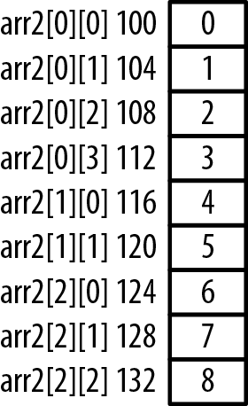

Hình 4-20. Memory allocation của jagged array

Trong các ví dụ này, chúng ta dùng array notation thay vì pointer notation khi truy cập nội dung array. Điều này giúp dễ nhìn và hiểu hơn một chút. Tuy nhiên, pointer notation cũng có thể hoạt động.

Compound literal hữu ích để tạo jagged array. Tuy nhiên, truy cập element của jagged array có thể bất tiện, như minh họa qua ba for loop trước. Ví dụ này có thể đơn giản hóa nếu dùng một array riêng để duy trì kích thước của từng column. Dù có thể tạo jagged array trong C, công sức bỏ ra có thể không đáng.

## Tóm tắt

Chúng ta bắt đầu bằng việc ôn nhanh array, rồi xem điểm giống và khác giữa array notation và pointer notation. Array có thể được tạo bằng các function kiểu `malloc`. Những function này linh hoạt hơn array declaration truyền thống. Chúng ta đã thấy cách dùng function `realloc` để thay đổi lượng memory được cấp cho array.

Cấp phát memory động cho array có thể đặt ra thách thức. Với array từ hai chiều trở lên, phải cẩn thận để bảo đảm array được cấp trong memory liên tục.

Chúng ta cũng tìm hiểu các vấn đề có thể xảy ra khi truyền và trả array. Thông thường, phải truyền kích thước array cho function để nó có thể xử lý đúng. Chúng ta cũng xem cách tạo jagged array trong C.
