# Chương 5. Pointer và string

String có thể được cấp phát tại những vùng memory khác nhau, và pointer thường được sử dụng để hỗ trợ các string operation. Pointer hỗ trợ cấp phát động string và truyền string cho function. Hiểu rõ pointer và cách sử dụng chúng với string giúp lập trình viên phát triển những ứng dụng đúng đắn và hiệu quả.

String là một thành phần thường gặp trong nhiều ứng dụng và là một chủ đề phức tạp. Trong chương này, chúng ta sẽ tìm hiểu các cách khai báo và khởi tạo string khác nhau. Chúng ta sẽ xem xét việc sử dụng literal pool trong ứng dụng C và tác động của chúng. Ngoài ra, chúng ta sẽ tìm hiểu những string operation phổ biến như so sánh, copy và nối string.

String thường được truyền vào và trả về từ function dưới dạng pointer tới `char`. Khi truyền một string, chúng ta có thể dùng pointer tới `char` hoặc pointer tới constant `char`. Cách thứ hai bảo vệ string khỏi bị sửa đổi bên trong function. Nhiều ví dụ trong chương này minh họa thêm những khái niệm đã trình bày trong chương về function. Điểm khác biệt là không cần truyền kích thước của string cho function.

Một function cũng có thể trả về string để đáp ứng một yêu cầu. String này có thể được truyền vào function để sửa đổi hoặc được cấp phát bên trong function. Chúng ta cũng có thể trả về một string được cấp phát tĩnh. Từng cách tiếp cận này sẽ được xem xét.

Chúng ta cũng sẽ xem xét việc sử dụng function pointer và cách chúng hỗ trợ các thao tác sắp xếp. Hiểu cách pointer hoạt động trong những tình huống này là trọng tâm chính của chương.

## Cơ bản về string

String là một dãy character kết thúc bằng ASCII character `NUL`. ASCII character `NUL` được biểu diễn là `\0`. String thường được lưu trong array hoặc trong memory cấp phát từ heap. Tuy nhiên, không phải mọi array gồm các character đều là string. Một array `char` có thể không chứa character `NUL`. Array `char` từng được dùng để biểu diễn những đơn vị integer nhỏ hơn, chẳng hạn boolean, nhằm tiết kiệm memory trong ứng dụng.

Có hai loại string trong C:

Byte string

Gồm một dãy phần tử thuộc data type `char`

Wide string

Gồm một dãy phần tử thuộc data type `wchar_t`

Data type `wchar_t` được dùng cho wide character và có thể rộng 16 hoặc 32 bit. Cả hai loại string đều kết thúc bằng character `NUL`. Các byte string function nằm trong file string.h. Các wide string function nằm trong file wchar.h. Trừ khi có ghi chú khác, chúng ta sẽ dùng byte string trong chương này. Wide char được tạo ra để hỗ trợ các character set non-Latin và hữu ích trong những ứng dụng hỗ trợ ngoại ngữ.

Độ dài của string là số character trong string, không bao gồm character `NUL`. Khi cấp phát memory cho string, hãy nhớ cấp đủ memory cho tất cả character cộng thêm character `NUL`.


Hãy nhớ rằng `NULL` và `NUL` khác nhau. `NULL` được dùng làm một pointer đặc biệt và thường được định nghĩa là `((void*)0)`. `NUL` là một `char` và được định nghĩa là `'\0'`. Không nên sử dụng chúng thay thế cho nhau.

Character constant là những dãy character đặt trong dấu nháy đơn. Thông thường chúng gồm một character, nhưng có thể chứa nhiều hơn một character, như trong các escape sequence. Trong C, chúng có type `int`. Điều này được minh họa như sau:

```
printf("%d\n",sizeof(char));
printf("%d\n",sizeof('a'));
```

Khi thực thi, kích thước của `char` sẽ là 1, còn kích thước của character literal sẽ là 4. Sự bất thường này là hệ quả của thiết kế ngôn ngữ.

### Khai báo string

Có ba cách khai báo string: dưới dạng literal, dưới dạng array gồm các character hoặc dùng pointer tới một character. String literal là một dãy character đặt trong dấu nháy kép. String literal thường được dùng để khởi tạo. Chúng nằm trong một string literal pool được thảo luận ở phần tiếp theo.

Không được nhầm string literal với các character đặt trong dấu nháy đơn; những character đó là character literal. Như sẽ thấy trong các phần sau, dùng character literal thay cho string literal có thể gây vấn đề. Ví dụ array character dưới đây khai báo một array header có kích thước đủ chứa tối đa 31 character. Vì string cần character kết thúc `NUL`, array được khai báo chứa 32 character chỉ có thể dùng 31 phần tử cho văn bản thực sự của string. Vị trí của string phụ thuộc vào nơi đặt declaration. Chúng ta sẽ tìm hiểu vấn đề này trong phần “Khởi tạo string” ở trang 110.

```
char header[32];
```

Ví dụ dưới đây minh họa một pointer tới character. Vì chưa được khởi tạo, nó không tham chiếu tới string nào. Lúc này, độ dài và vị trí của string chưa được chỉ định.

```
char *header;
```

### String literal pool

Khi các literal được định nghĩa, chúng thường được đưa vào literal pool. Vùng memory này lưu các dãy character tạo thành string. Khi một literal được dùng nhiều lần, thông thường string literal pool chỉ có một bản sao của string. Điều này giảm lượng vùng lưu trữ cần thiết cho ứng dụng. Vì literal thường được xem là immutable, việc chỉ có một bản sao không gây hại. Tuy nhiên, không nên giả định rằng luôn chỉ có một bản sao hoặc literal luôn immutable. Phần lớn compiler cung cấp option tắt string pooling. Khi tắt tính năng này, literal có thể được nhân bản, với mỗi bản có address riêng.


GCC dùng option `-fwritable-strings` để tắt string pooling. Trong Microsoft Visual Studio, option `/GF` bật string pooling.

Hình 5-1 minh họa cách memory có thể được cấp phát cho một literal pool.

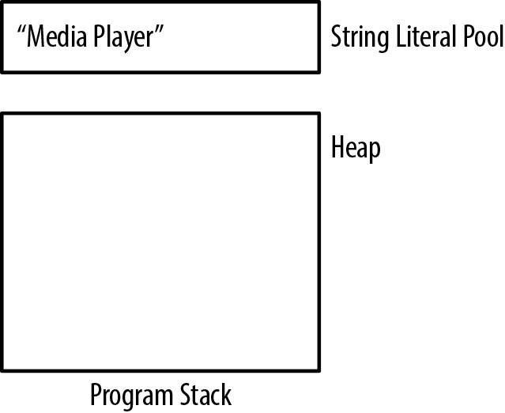

Hình 5-1. String literal pool. String literal thường được cấp phát trong read-only memory, khiến chúng trở thành immutable. Không quan trọng string literal được dùng ở đâu hoặc nó là global, static hay local. Theo nghĩa này, string literal không có scope.

#### Khi string literal không phải constant

Trong phần lớn compiler, string literal được xem là constant và không thể sửa đổi string. Tuy nhiên, một số compiler, chẳng hạn GCC, cho phép sửa đổi string literal. Hãy xét ví dụ sau:

```
char *tabHeader  = "Sound";
*tabHeader = 'L';
printf("%s\n",tabHeader);   // Displays "Lound"
```

Thao tác này sẽ đổi literal thành “Lound.” Thông thường điều này không mong muốn và nên tránh. Khai báo variable là constant như sau sẽ giải quyết một phần vấn đề. Mọi nỗ lực sửa string đều dẫn đến compile-time error.

```
const char *tabHeader  = "Sound";
```

### Khởi tạo string

Khi khởi tạo string, cách thực hiện phụ thuộc vào việc variable được khai báo là array character hay pointer tới character. Memory dùng cho string sẽ là một array hoặc vùng memory được pointer trỏ tới. Khi khởi tạo string, chúng ta có thể dùng string literal, một dãy character hoặc lấy character từ nguồn khác, chẳng hạn standard input. Chúng ta sẽ xem xét những cách này.

#### Khởi tạo array char

Có thể khởi tạo array `char` bằng initialization operator. Trong ví dụ sau, array header được khởi tạo bằng các character chứa trong một string literal:

```
char header[] = "Media Player";
```

Vì literal “Media Player” dài 12 character, cần 13 byte để biểu diễn nó. Array được cấp phát 13 byte để lưu string. Quá trình khởi tạo copy các character này vào array và kết thúc bằng character `NUL`, như Hình 5-2 minh họa, giả sử declaration nằm trong function `main`.

Cũng có thể khởi tạo array bằng function `strcpy`, được thảo luận chi tiết trong phần “Copy string” ở trang 116. Trong đoạn lệnh sau, string literal được copy vào array.

```
char header[13];
strcpy(header,"Media Player");
```

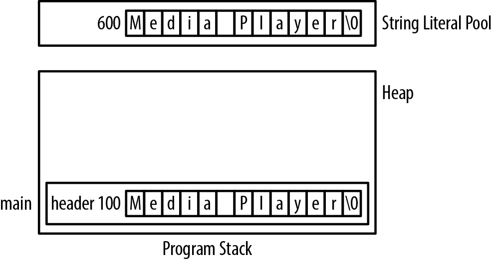

Hình 5-2. Khởi tạo array char

Một kỹ thuật tốn công hơn là gán từng character riêng lẻ như sau:

```
header[0] = 'M';
header[1] = 'e';
    ...
header[12] = '\0';
```


Phép gán sau không hợp lệ. Chúng ta không thể gán address của một string literal cho tên array.

```
char header2[];
header2 = "Media Player";
```

#### Khởi tạo pointer đến char

Sử dụng dynamic memory allocation đem lại sự linh hoạt và có thể cho phép memory tồn tại lâu hơn. Declaration sau sẽ được dùng để minh họa kỹ thuật này:

```
char *header;
```

Một cách phổ biến để khởi tạo string này là dùng các function `malloc` và `strcpy` để cấp phát memory rồi copy một literal vào string, như minh họa dưới đây:

```
char *header = (char*) malloc(strlen("Media Player")+1);
strcpy(header,"Media Player");
```

Giả sử code nằm trong function main, Hình 5-3 cho thấy trạng thái của program stack.

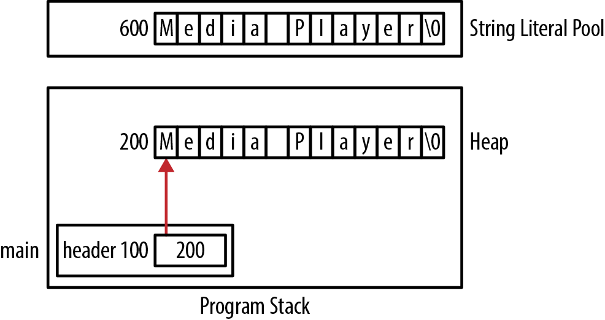

Hình 5-3. Khởi tạo pointer đến char

Trong lần sử dụng function `malloc` trước đó, chúng ta dùng function `strlen` với một string literal làm argument. Chúng ta cũng có thể khai báo kích thước một cách tường minh như dưới đây:

```
char *header = (char*) malloc(13);
```


Khi xác định độ dài string để dùng với `malloc`:

- Luôn nhớ cộng một cho ký tự kết thúc `NUL`.

- Đừng dùng operator `sizeof`. Thay vào đó, hãy dùng function `strlen` để xác định độ dài một string hiện có. Operator `sizeof` trả về kích thước của array hoặc pointer, chứ không phải độ dài string.

Thay vì dùng string literal và function `strcpy` để khởi tạo string, chúng ta có thể dùng cách sau:

```
*(header + 0) = 'M';
*(header + 1) = 'e';
    ...
*(header + 12) = '\0';
```

Có thể gán trực tiếp address của một string literal cho character pointer như dưới đây. Tuy nhiên, thao tác này không tạo ra một bản sao mới của string, như Hình 5-4 minh họa:

```
char *header = "Media Player";
```

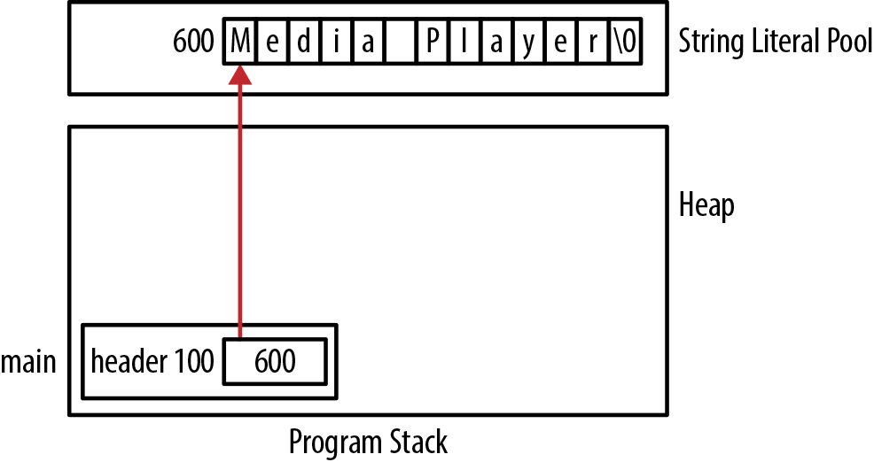

Hình 5-4. Copy address string literal vào pointer


Việc cố khởi tạo pointer tới char bằng character literal sẽ không hoạt động. Vì character literal có type `int`, chúng ta đang cố gán một integer cho character pointer. Điều này thường làm ứng dụng kết thúc khi pointer được dereference:

```
char* prefix = '+';   // Illegal
```

Cách hợp lệ dùng `malloc` như sau:

```
prefix = (char*)malloc(2);
*prefix = '+';
*(prefix+1) = 0;
```

#### Khởi tạo string từ standard input

String cũng có thể được khởi tạo từ một nguồn bên ngoài, chẳng hạn standard input. Tuy nhiên, khi đọc string từ standard input, có thể xảy ra các lỗi khởi tạo như dưới đây. Vấn đề là chúng ta chưa cấp memory cho variable `command` trước khi cố sử dụng nó:

```
char *command;
printf("Enter a Command: ");
scanf("%s",command);
```

Để giải quyết vấn đề này, trước hết chúng ta phải cấp phát memory cho pointer hoặc dùng array có kích thước cố định thay cho pointer. Tuy nhiên, người dùng có thể nhập nhiều dữ liệu hơn khả năng lưu trữ của những cách này. Chương 4 minh họa một cách tiếp cận vững chắc hơn.

#### Tóm tắt vị trí string

String có thể được cấp phát tại một số vị trí khác nhau. Ví dụ sau minh họa những biến thể có thể có, còn Hình 5-5 minh họa cách bố trí các string này trong memory:

```
char* globalHeader = "Chapter";
char globalArrayHeader[] = "Chapter";

void displayHeader() {
    static char* staticHeader = "Chapter";
    char* localHeader = "Chapter";
    static char staticArrayHeader[] = "Chapter";
    char localArrayHeader[] = "Chapter";
    char* heapHeader = (char*)malloc(strlen("Chapter")+1);
    strcpy(heapHeader,"Chapter");
}
```

Biết string nằm ở đâu hữu ích khi tìm hiểu cách chương trình hoạt động và khi dùng pointer truy cập string. Vị trí string quyết định thời gian tồn tại và những phần nào của ứng dụng có thể truy cập nó. Chẳng hạn, string được cấp phát trong global memory luôn tồn tại và có thể được nhiều function truy cập. Static string luôn tồn tại nhưng chỉ function định nghĩa nó mới truy cập được. String được cấp phát trên heap tồn tại cho đến khi được giải phóng và có thể được dùng trong nhiều function. Hiểu những vấn đề này giúp bạn đưa ra quyết định có cơ sở.

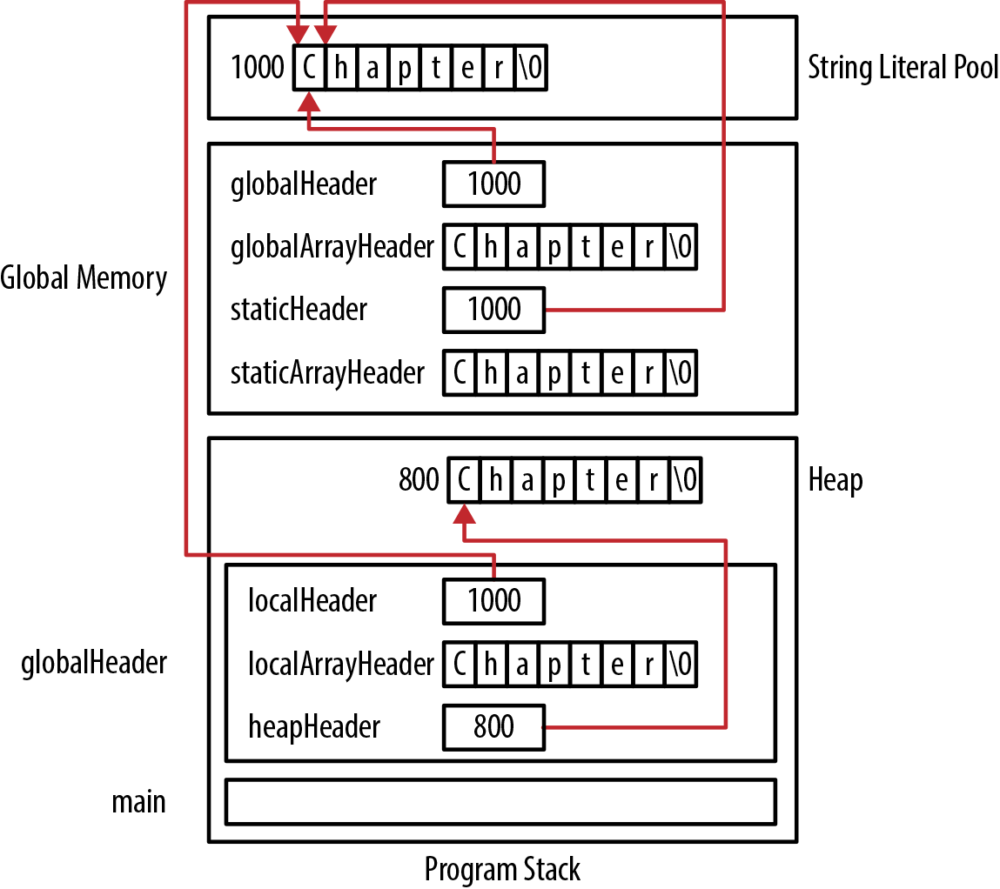

Hình 5-5. Cấp phát string trong memory

## Standard string operation

Trong phần này, chúng ta sẽ xem xét việc sử dụng pointer trong những string operation phổ biến, gồm so sánh, copy và nối string.

### So sánh string

So sánh string có thể là một phần không thể thiếu của ứng dụng. Chúng ta sẽ xem xét chi tiết cách thực hiện so sánh string, bởi so sánh sai có thể dẫn tới kết quả gây nhầm lẫn hoặc không hợp lệ. Hiểu cách các phép so sánh được thực hiện giúp bạn tránh những thao tác sai. Hiểu biết này cũng áp dụng được cho những tình huống tương tự.

Cách chuẩn để so sánh string là dùng function `strcmp`. Prototype của nó như sau:

```
int strcmp(const char *s1, const char *s2);
```

Cả hai string cần so sánh đều được truyền dưới dạng pointer tới constant `char`. Nhờ vậy, chúng ta có thể dùng function mà không sợ nó sửa đổi các string được truyền vào. Function này trả về một trong ba giá trị:

Âm

Nếu `s1` đứng trước `s2` theo thứ tự từ điển (bảng chữ cái)

Zero

Nếu hai string bằng nhau

Dương

Nếu `s1` đứng sau `s2` theo thứ tự từ điển

Những giá trị trả về dương và âm hữu ích cho việc sắp xếp string theo thứ tự bảng chữ cái. Dưới đây minh họa việc dùng function này để kiểm tra hai string có bằng nhau không. Nội dung người dùng nhập được lưu trong `command`, rồi được so sánh với string literal:

```
char command[16];

printf("Enter a Command: ");
scanf("%s", command);
if (strcmp(command, "Quit") == 0) {
    printf("The command was Quit");
} else {
    printf("The command was not Quit");
}
```

Memory cho ví dụ này được cấp phát như minh họa trong Hình 5-6.

Có một vài cách không đúng để so sánh hai string. Cách đầu tiên dưới đây cố dùng assignment operator để thực hiện phép so sánh:

```
char command[16];
```

```
printf("Enter a Command: ");
scanf("%s",command);
if(command = "Quit") {
   ...
```

Thứ nhất, thao tác này không thực hiện phép so sánh; thứ hai, nó dẫn đến một thông báo syntax error về các type không tương thích. Chúng ta không thể gán address của một string

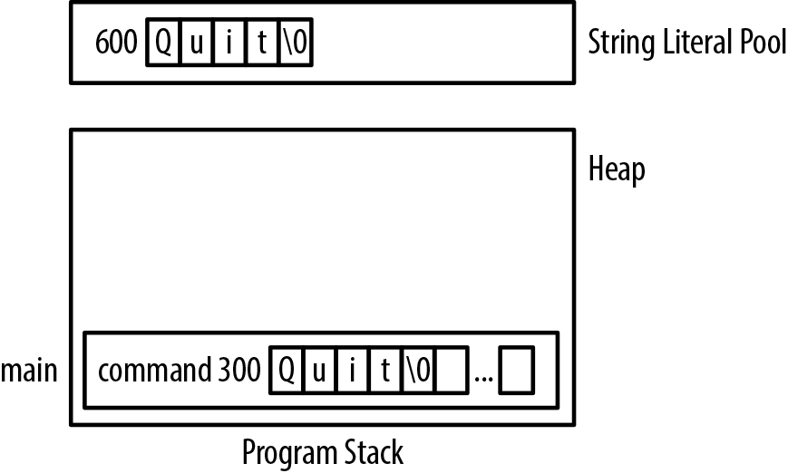

Hình 5-6. Ví dụ strcmp

literal cho tên array. Trong ví dụ này, chúng ta đã cố gán address 600 của string literal cho `command`. Vì `command` là array, không thể gán giá trị cho variable này mà không dùng array subscript.

Cách thứ hai dùng equality operator:

```
char command[16];
```

```
printf("Enter a Command: ");
scanf("%s",command);
if(command == "Quit") {
   ...
```

Biểu thức này phải được đánh giá là false, vì chúng ta đang so sánh address 300 của `command` với address 600 của string literal. Equality operator so sánh các address, chứ không so sánh nội dung được lưu tại những address đó. Dùng riêng tên array hoặc string literal sẽ trả về address của chúng.

### Copy string

Copy string là một thao tác phổ biến và thường được thực hiện bằng function `strcpy`, có prototype như sau:

```
char* strcpy(char *s1, const char *s2);
```

Trong phần này, chúng ta sẽ trình bày quá trình copy cơ bản và chỉ ra những lỗi thường gặp. Giả sử chúng ta cần copy một string hiện có sang một buffer mới được cấp phát động, dù cũng có thể dùng một array character.

Một ứng dụng thường gặp là đọc một chuỗi các string rồi lưu từng string trong một array, với lượng memory tối thiểu. Có thể thực hiện bằng cách tạo một array đủ lớn cho string dài nhất mà người dùng có thể nhập, rồi đọc string vào array đó. Dựa trên string vừa đọc, sau đó chúng ta cấp phát đúng lượng memory cần thiết. Cách thực hiện cơ bản là:

1\. Đọc string bằng array `char` lớn

2\. Dùng `malloc` cấp đúng lượng memory

3\. Dùng `strcpy` copy string vào memory cấp động

Đoạn lệnh sau minh họa kỹ thuật này. Array `names` lưu pointer tới từng tên được đọc vào. Variable `count` chỉ phần tử array còn trống tiếp theo. Array `name` lưu string vừa đọc và được tái sử dụng cho mỗi tên được nhập. Function `malloc` cấp phát memory cần thiết cho từng string và kết quả được gán cho phần tử còn trống tiếp theo của `names`. Sau đó tên được copy vào memory vừa cấp phát:

```
char name[32];
char *names[30];
size_t count = 0;
```

```
printf("Enter a name: ");
scanf("%s",name);
names[count] = (char*)malloc(strlen(name)+1);
strcpy(names[count],name);
count++;
```

Chúng ta có thể lặp thao tác này trong một loop, tăng count sau mỗi lần lặp. Hình 5-7 minh họa cách bố trí memory cho quá trình này sau khi đọc một tên duy nhất: “Sam.”

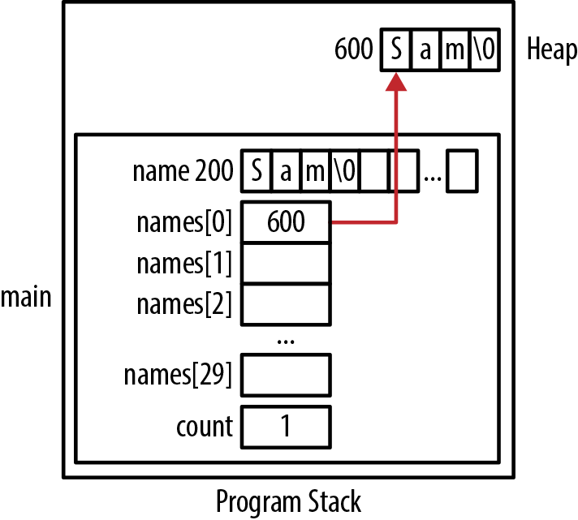

Hình 5-7. Copy string

Hai pointer có thể tham chiếu tới cùng một string. Khi hai pointer tham chiếu cùng vị trí, hiện tượng đó được gọi là aliasing, được trình bày trong Chương 8. Dù không nhất thiết gây vấn đề, hãy nhận thức rằng gán một pointer cho pointer khác không copy string. Thay vào đó, chúng ta chỉ copy address của string. Để minh họa, dưới đây khai báo một array pointer tới các page header. Trang có index 12 được gán address của một string literal. Tiếp theo, pointer trong `pageHeaders[12]` được copy sang `pageHeaders[13]`. Cả hai pointer lúc này tham chiếu cùng một string literal. Thứ được copy là pointer, chứ không phải string:

```
char *pageHeaders[300];
```

```
pageHeaders[12] = "Amorphous Compounds";
pageHeaders[13] = pageHeaders[12];
```

Các assignment được minh họa trong Hình 5-8.

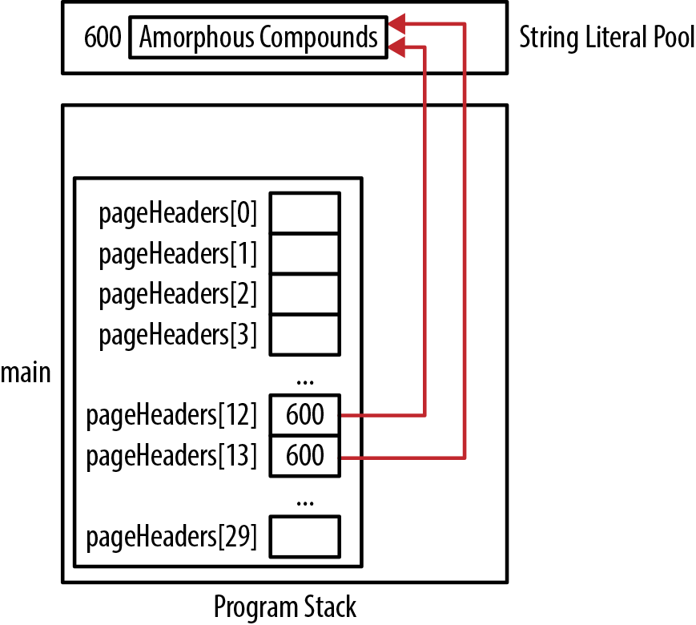

Hình 5-8. Tác động của copy pointer

### Nối string

Nối string là việc kết hợp hai string với nhau. Function `strcat` thường được sử dụng cho thao tác này. Function nhận pointer tới hai string cần nối và trả về một pointer tới kết quả đã nối. Prototype của function như sau:

```
char *strcat(char *s1, const char *s2);
```

Function nối string thứ hai vào cuối string thứ nhất. String thứ hai được truyền dưới dạng pointer tới constant `char`. Function không cấp phát memory. Điều đó có nghĩa là string thứ nhất phải đủ lớn để lưu kết quả nối; nếu không, function có thể ghi vượt cuối string, gây hành vi khó dự đoán. Giá trị trả về của function là cùng address với argument thứ nhất. Điều này thuận tiện trong một số tình huống, chẳng hạn dùng function làm argument cho function `printf`. Để minh họa việc sử dụng function này, chúng ta sẽ kết hợp hai string thông báo lỗi: string đầu là một tiền tố và string thứ hai là thông báo lỗi cụ thể. Như dưới đây, trước hết phải cấp đủ memory cho cả hai string trong một buffer, sau đó copy string đầu vào buffer và cuối cùng nối string thứ hai vào buffer:

```
char* error = "ERROR: ";
char* errorMessage = "Not enough memory";

char* buffer = (char*)malloc(strlen(error)+strlen(errorMessage)+1);
strcpy(buffer,error);
strcat(buffer, errorMessage);
```

```
printf("%s\n", buffer);
printf("%s\n", error);
printf("%s\n", errorMessage);
```

Chúng ta cộng thêm một vào argument của function `malloc` để dành chỗ cho character `NUL`. Nếu giả sử literal thứ nhất nằm ngay trước literal thứ hai trong memory, output của đoạn lệnh sẽ như sau. Hình 5-9 minh họa cách cấp phát memory:

```
ERROR: Not enough memory
ERROR:
Not enough memory
```

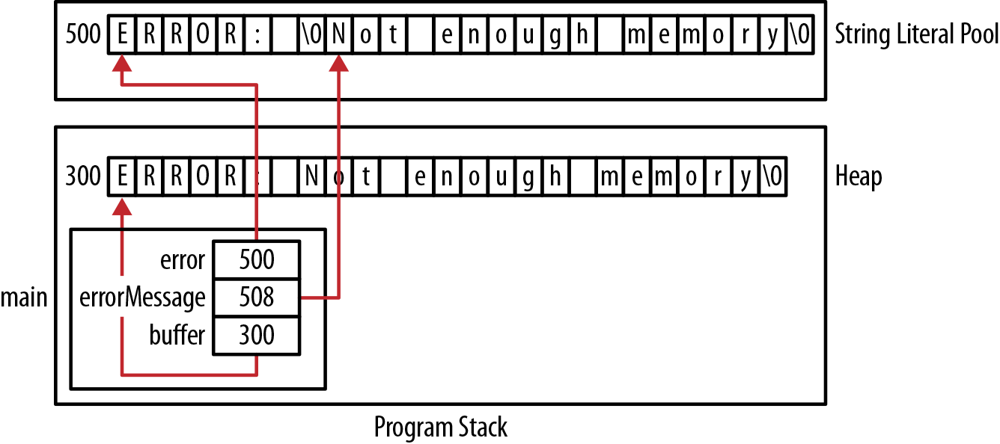

Hình 5-9. Copy operation đúng

Nếu không cấp phát một vị trí memory riêng cho string kết quả nối, chúng ta sẽ ghi đè string đầu tiên. Ví dụ sau minh họa điều này mà không dùng buffer. Chúng ta cũng giả sử literal đầu tiên nằm ngay trước literal thứ hai trong memory:

```
char* error = "ERROR: ";
char* errorMessage = "Not enough memory";
```

```
strcat(error, errorMessage);
printf("%s\n", error);
printf("%s\n", errorMessage);
```

Output của chuỗi như sau:

```
ERROR: Not enough memory
ot enough memory
```

String `errorMessage` đã bị dịch một character sang trái. Đó là vì string kết quả nối được ghi đè lên `errorMessage`. Vì literal “Not enough memory” nằm sau literal thứ nhất, literal thứ hai bị ghi đè. Hình 5-10 minh họa điều này bằng cách hiển thị trạng thái literal pool trước và sau thao tác copy.

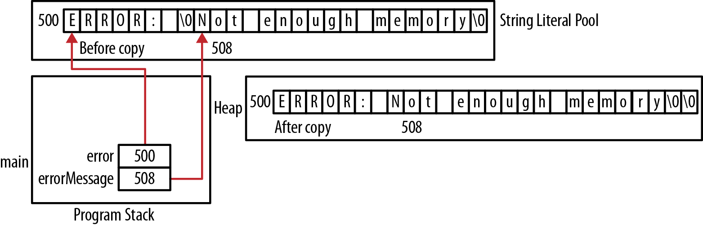

Hình 5-10. Copy string sai

Chúng ta có thể dùng array `char` thay cho pointer đối với các thông báo như dưới đây. Tuy nhiên, cách này không phải lúc nào cũng hoạt động:

```
char error[] = "ERROR: ";
char errorMessage[] = "Not enough memory";
```

Nếu dùng lời gọi `strcpy` sau, chúng ta sẽ nhận syntax error. Đó là vì chúng ta đang cố gán pointer do function trả về cho tên array. Kiểu thao tác này không hợp lệ:

```
error = strcat(error, errorMessage);
```

Nếu bỏ phép gán như dưới đây, rất có thể chúng ta sẽ gặp memory access violation vì thao tác copy đang ghi đè một phần stack frame. Điều này giả định các array declaration nằm trong một function, như minh họa trong Hình 5-11. Dù source string được lưu trong string literal pool hay trên stack frame, cũng không nên dùng chúng để trực tiếp chứa kết quả nối. Luôn cấp phát memory riêng dành cho việc nối string:

```
strcat(error, errorMessage);
```

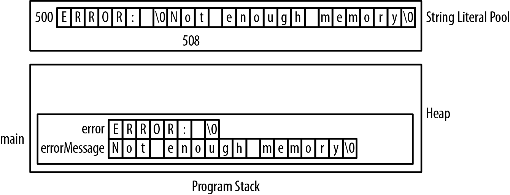

Hình 5-11. Ghi đè stack frame

Một lỗi đơn giản khác khi nối string là dùng character literal thay cho string literal. Trong ví dụ sau, chúng ta nối một string vào path string. Thao tác này sẽ hoạt động đúng như mong đợi:

```
char* path = "C:";
char* currentPath = (char*) malloc(strlen(path)+2);
currentPath = strcat(currentPath,"\\");
```

Chúng ta cộng hai vào độ dài string trong lời gọi `malloc` vì cần chỗ cho character bổ sung và character `NUL`. Chúng ta chỉ nối một character, là backslash, vì đã dùng escape sequence trong string literal.

Tuy nhiên, nếu dùng character literal thay thế như dưới đây, chúng ta sẽ gặp runtime error khi argument thứ hai bị diễn giải nhầm thành address của một `char`:

```
currentPath = strcat(path,'\\');
```

## Truyền string

Truyền string khá đơn giản. Trong function call, hãy dùng một biểu thức được đánh giá thành address của một `char`. Trong parameter list, hãy khai báo parameter là pointer tới một `char`. Những vấn đề đáng chú ý xuất hiện khi sử dụng string bên trong function. Trước hết, hai phần nhỏ đầu tiên sẽ xem xét cách truyền một string đơn giản, sau đó phần thứ ba xem xét cách truyền một string cần khởi tạo. Việc truyền string làm argument cho ứng dụng được trình bày trong phần “Truyền argument cho ứng dụng” ở trang 125.

### Truyền string đơn giản

Có một số cách truyền address của string cho function, tùy cách string được khai báo. Trong phần này, chúng ta sẽ minh họa các kỹ thuật đó bằng một function mô phỏng function `strlen`, được triển khai dưới đây. Chúng ta dùng dấu ngoặc để buộc post increment operator được thực hiện trước, làm tăng pointer. Nếu không, character được `string` tham chiếu sẽ bị tăng, điều không đúng với mong muốn:

```
size_t stringLength(char* string) {
    size_t length = 0;
    while(*(string++)) {
        length++;
    }
    return length;
}
```


Thực ra nên truyền string như pointer đến constant `char`, như mục “Truyền pointer đến constant char” trang 123.

Bắt đầu với các declaration:

```
char simpleArray[] = "simple string";
char *simplePtr = (char*)malloc(strlen("simple string")+1);
strcpy(simplePtr, "simple string");
```

Để gọi function với pointer, chỉ dùng tên pointer:

```
printf("%d\n",stringLength(simplePtr));
```

Để gọi function bằng array, chúng ta có ba lựa chọn như dưới đây. Trong câu lệnh thứ nhất, dùng tên array sẽ trả về address của nó. Trong câu lệnh thứ hai, address-of operator được dùng tường minh. Điều này dư thừa, không cần thiết và thường còn tạo ra cảnh báo. Trong câu lệnh thứ ba, chúng ta dùng address-of operator với phần tử đầu tiên của array. Mặc dù hoạt động, cách này hơi dài dòng:

```
printf("%d\n",stringLength(simpleArray));
printf("%d\n",stringLength(&simpleArray));
printf("%d\n",stringLength(&simpleArray[0]));
```

Hình 5-12 minh họa memory cho function `stringLength`.

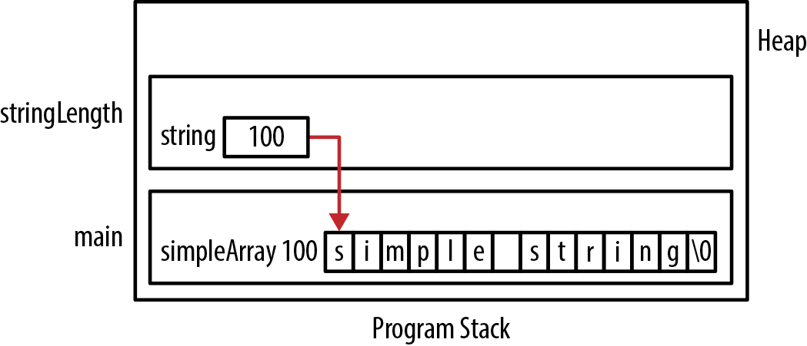

Hình 5-12. Truyền string. Bây giờ hãy chuyển sang cách khai báo formal parameter. Trong implementation trước của `stringLength`, parameter được khai báo là pointer tới `char`. Chúng ta cũng có thể dùng array notation như sau:

```
size_t stringLength(char string[]) { ... }
```

Phần thân function vẫn giữ nguyên. Thay đổi này không ảnh hưởng đến cách gọi function hoặc hành vi của nó.

### Truyền pointer đến constant char

Truyền pointer tới string dưới dạng constant `char` là một kỹ thuật rất phổ biến và hữu ích. Nó truyền string bằng pointer, đồng thời ngăn string được truyền vào bị sửa đổi. Implementation tốt hơn của function `stringLength`, đã phát triển trong phần “Truyền string” ở trang 121, dùng declaration này như sau:

```
size_t stringLength(const char* string) {
    size_t length = 0;
    while(*(string++)) {
        length++;
    }
    return length;
}
```

Nếu cố sửa string gốc như dưới đây, một thông báo compile-time error sẽ được tạo ra:

```
size_t stringLength(const char* string) {
      ...
    *string = 'A';
      ...
}
```

### Truyền string để khởi tạo

Có những tình huống chúng ta muốn function trả về một string do chính function khởi tạo. Chẳng hạn, chúng ta có thể muốn truyền thông tin về một linh kiện, như tên và số lượng, rồi nhận về một string đã định dạng biểu diễn thông tin đó. Giữ quá trình định dạng trong một function cho phép tái sử dụng nó ở những phần khác nhau của chương trình.

Tuy nhiên, chúng ta phải quyết định sẽ truyền cho function một buffer rỗng để nó điền và trả về, hay để function cấp phát động buffer rồi trả buffer đó cho chúng ta.

Khi truyền buffer:

- Phải truyền address và kích thước buffer

- Caller chịu trách nhiệm giải phóng buffer

- Function thường trả pointer đến buffer này

Cách này để trách nhiệm cấp phát và giải phóng buffer ở phía caller. Trả về một pointer tới buffer là điều phổ biến, dù không cần thiết, như ở `strcpy` và các function tương tự. Function `format` sau minh họa cách này:

```
char* format(char *buffer, size_t size,
        const char* name, size_t quantity, size_t weight) {
    snprintf(buffer, size, "Item: %s  Quantity: %u  Weight: %u",
            name, quantity, weight);
    return buffer;
}
```

Function `snprintf` được dùng như một cách đơn giản để định dạng string. Function này ghi vào buffer do parameter thứ nhất cung cấp. Argument thứ hai chỉ định kích thước buffer. Function không ghi vượt cuối buffer. Ngoài điểm đó, nó hoạt động giống `printf`.

Sau đây minh họa cách dùng:

```
printf("%s\n",format(buffer,sizeof(buffer),"Axle",25,45));
```

Output như sau:

```
Item: Axle  Quantity: 25  Weight: 45
```

Trả pointer đến `buffer` cho phép dùng function làm parameter của `printf`.

Một cách khác là truyền NULL làm address của buffer. Điều này ngụ ý caller không muốn cung cấp buffer hoặc không chắc buffer phải lớn bao nhiêu. Phiên bản function này có thể được triển khai như sau. Khi tính length, biểu thức con `10 + 10` biểu diễn độ rộng lớn nhất dự kiến dành cho số lượng và trọng lượng. Số một dành chỗ cho character kết thúc `NUL`:

```
char* format(char *buffer, size_t size,
        const char* name, size_t quantity, size_t weight) {

    char *formatString = "Item: %s  Quantity: %u  Weight: %u";
    size_t formatStringLength = strlen(formatString)-6;
    size_t nameLength = strlen(name);
    size_t length = formatStringLength + nameLength +
            10 + 10 + 1;
```

```
    if(buffer == NULL) {
        buffer = (char*)malloc(length);
        size = length;
    }
    snprintf(buffer, size, formatString, name, quantity, weight);
    return buffer;
}
```

Lựa chọn biến thể function phụ thuộc vào nhu cầu ứng dụng. Nhược điểm chính của cách thứ hai là caller lúc này chịu trách nhiệm giải phóng memory được cấp phát. Caller phải hiểu đầy đủ cách sử dụng function; nếu không, memory leak rất dễ xảy ra.

### Truyền argument cho application

Function `main` thường là function đầu tiên được thực thi trong ứng dụng. Với những chương trình console-based, người ta thường truyền thông tin cho chương trình để bật hoặc điều khiển hành vi ứng dụng theo cách khác. Các parameter này có thể chỉ định những file cần xử lý hoặc cấu hình output của ứng dụng. Chẳng hạn, Linux command `ls` liệt kê những file trong thư mục hiện tại dựa trên các parameter đi kèm lệnh.

C hỗ trợ command line argument thông qua các parameter mang tên truyền thống là `argc` và `argv`. Parameter thứ nhất, `argc`, là một integer cho biết có bao nhiêu parameter được truyền vào. Luôn có ít nhất một parameter: tên của `executable`. Parameter thứ hai, `argv`, thường được xem là một array one-dimensional gồm các string pointer. Mỗi pointer tham chiếu tới một command line argument.

Function `main` sau chỉ liệt kê các argument của nó, mỗi argument trên một dòng. Trong phiên bản này, `argv` được khai báo là pointer tới pointer tới `char`:

```
int main(int argc, char** argv) {
    for(int i=0; i<argc; i++) {
        printf("argv[%d] %s\n",i,argv[i]);
    }
    ...
}
```

Chạy chương trình bằng command line:

```
process.exe -f names.txt limit=12 -verbose
```

Output như sau:

```
argv[0] c:/process.exe
argv[1] -f
argv[2] names.txt
argv[3] limit=12
argv[4] -verbose
```

Mỗi command line parameter được phân tách bằng khoảng trắng. Memory được cấp phát cho chương trình được minh họa trong Hình 5-13.

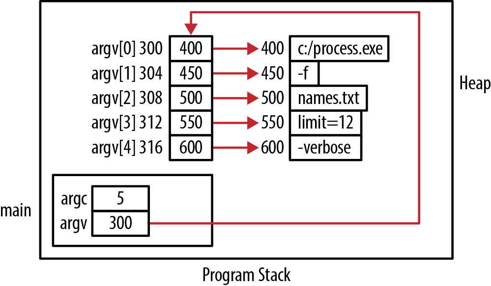

Hình 5-13. Dùng argc/argv

Có thể đơn giản hóa declaration `argv` như sau:

```
int main(int argc, char* argv[]) {
```

Declaration này tương đương với `char** argv`. Phần “Nhiều mức indirection” ở trang 25 giải thích chi tiết hơn về notation này.

## Trả string

Khi một function trả về string, nó trả về address của string. Điều quan trọng nhất là trả về một string address hợp lệ. Để làm vậy, chúng ta có thể trả về tham chiếu tới một trong những đối tượng sau:

- Literal

- Memory cấp phát động

- Local string variable

### Trả address của literal

Ví dụ trả về literal được trình bày dưới đây. Một integer code chọn một trong bốn trung tâm xử lý khác nhau. Mục đích của function là trả về tên trung tâm xử lý dưới dạng string. Trong ví dụ này, nó chỉ trả về address của literal:

```
char* returnALiteral(int code) {
    switch(code) {
        case 100:
            return "Boston Processing Center";
        case 200:
            return "Denver Processing Center";
        case 300:
            return "Atlanta Processing Center";
        case 400:
            return "San Jose Processing Center";
    }
}
```

Cách này hoạt động tốt. Chỉ cần nhớ rằng string literal không phải lúc nào cũng được xem là constant, như đã thảo luận trong phần “Khi string literal không phải constant” ở trang 110. Chúng ta cũng có thể khai báo các static literal như trong ví dụ sau. Một field `subCode` được thêm vào để lựa chọn giữa những trung tâm khác nhau. Ưu điểm của cách này là không phải dùng cùng một literal tại nhiều nơi, tránh nguy cơ gây lỗi do gõ nhầm literal:

```
char* returnAStaticLiteral(int code, int subCode) {
    static char* bpCenter = "Boston Processing Center";
    static char* dpCenter = "Denver Processing Center";
    static char* apCenter = "Atlanta Processing Center";
    static char* sjpCenter = "San Jose Processing Center";
```

```
    switch(code) {
        case 100:
            return bpCenter;
        case 135:
            if(subCode <35) {
                return dpCenter;
            } else {
                return bpCenter;
            }
        case 200:
            return dpCenter;
        case 300:
            return apCenter;
        case 400:
            return sjpCenter;
    }
}
```

Trả về pointer tới một static string được dùng cho nhiều mục đích có thể gây vấn đề. Hãy xét biến thể sau của function `format`, đã phát triển trong phần “Truyền string để khởi tạo” ở trang 123. Thông tin về một linh kiện được truyền vào function và một string đã định dạng biểu diễn string đó được trả về:

```
char* staticFormat(const char* name, size_t quantity, size_t weight) {
    static char buffer[64];  // Assume to be large enough
    sprintf(buffer, "Item: %s  Quantity: %u  Weight: %u",
            name, quantity, weight);
    return buffer;
}
```

Buffer được cấp phát 64 byte, có thể đủ hoặc không đủ. Trong ví dụ này, chúng ta sẽ bỏ qua vấn đề tiềm tàng đó. Vấn đề chính của cách tiếp cận này được minh họa bằng đoạn lệnh sau:

```
char* part1 = staticFormat("Axle",25,45);
char* part2 = staticFormat("Piston",55,5);
printf("%s\n",part1);
printf("%s\n",part2);
```

Khi chạy nhận output:

```
Item: Piston  Quantity: 55  Weight: 5
Item: Piston  Quantity: 55  Weight: 5
```

Vì method `staticFormat` dùng cùng một static buffer cho cả hai lời gọi, lời gọi cuối đã ghi đè kết quả của lời gọi đầu.

### Trả address của memory cấp động

Nếu cần trả về string từ một function, memory cho string có thể được cấp phát trên heap, rồi address của nó được trả về. Chúng ta sẽ minh họa kỹ thuật này bằng cách phát triển function `blanks`. Function trả về một string chứa một dãy khoảng trắng biểu diễn một “tab”, như dưới đây. Function nhận một integer chỉ định chiều dài của dãy tab:

```
char* blanks(int number) {
    char* spaces = (char*) malloc(number + 1);
    int i;
    for (i = 0; i<number; i++) {
        spaces[i] = ' ';
    }
    spaces[number] = '\0';
    return spaces;
}

    ...
    char *tmp = blanks(5);
```

Character kết thúc `NUL` được gán cho phần tử cuối của array, có index là `number`. Hình 5-14 minh họa việc cấp phát memory cho ví dụ này và trạng thái ứng dụng ngay trước cũng như ngay sau khi function `blanks` trả về.

Caller của function chịu trách nhiệm giải phóng memory được trả về. Không giải phóng khi memory không còn cần thiết sẽ gây memory leak. Ví dụ sau cho thấy một tình huống có thể xảy ra memory leak: string được dùng trong function `printf`, rồi address của nó bị mất vì không được lưu lại:

```
printf("[%s]\n",blanks(5));
```

Cách an toàn hơn như sau:

```
char *tmp = blanks(5);
printf("[%s]\n",tmp);
free(tmp);
```

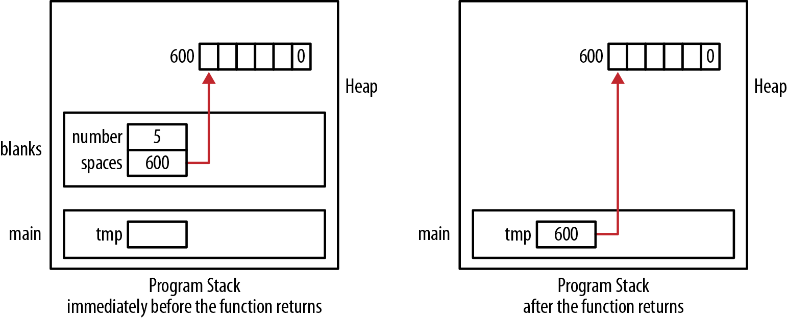

Hình 5-14. Trả string cấp động

#### Trả address của local string

Trả về address của local string sẽ gây vấn đề vì memory sẽ bị hỏng khi bị một stack frame khác ghi đè. Cần tránh cách này; nó được giải thích ở đây để minh họa những vấn đề tiềm tàng của lựa chọn đó.

Chúng ta viết lại function blanks trong phần trước như dưới đây. Thay vì cấp phát memory động, một array được khai báo bên trong function và do đó sẽ nằm trong một stack frame. Function trả về address của array:

```
#define MAX_TAB_LENGTH 32

char* blanks(int number) {
    char spaces[MAX_TAB_LENGTH];
    int i;
    for (i = 0; i < number && i < MAX_TAB_LENGTH; i++) {
        spaces[i] = ' ';
    }
    spaces[i] = '\0';
    return spaces;
}
```

Khi thực thi, function trả về address của string, nhưng vùng memory đó sau đó sẽ bị function tiếp theo được gọi ghi đè. Khi pointer này được dereference, nội dung ở vị trí memory đó có thể đã thay đổi. Trạng thái program stack được minh họa trong Hình 5-15.

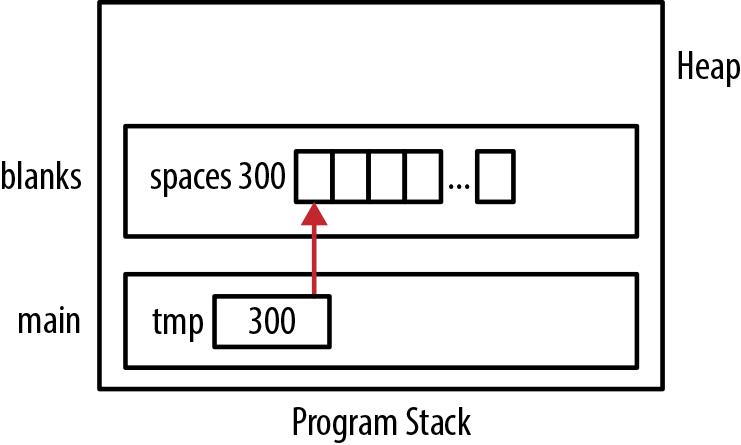

Hình 5-15. Trả address local string

## Function pointer và string

Function pointer được thảo luận sâu trong phần “Function pointer” ở trang 71. Chúng có thể là phương tiện linh hoạt để điều khiển cách chương trình thực thi. Trong phần này, chúng ta minh họa khả năng đó bằng cách truyền một comparison function cho một sort function. Bên trong sort function, các phần tử array được so sánh để quyết định có cần đổi chỗ chúng hay không. Phép so sánh quyết định array được sắp xếp tăng dần, giảm dần hay theo tiêu chí khác. Truyền một function để điều khiển phép so sánh giúp function linh hoạt hơn. Bằng cách truyền những comparison function khác nhau, chúng ta có thể khiến cùng một sort function hoạt động theo nhiều cách.

Những comparison function chúng ta sử dụng xác định thứ tự sắp xếp dựa trên chữ hoa và chữ thường của các phần tử array. Hai function `compare` và `compareIgnoreCase` sau so sánh hai string dựa trên chữ hoa và chữ thường của chúng. Function `compareIgnoreCase` chuyển các string thành chữ thường trước khi dùng function `strcmp` để so sánh. Function `strcmp` đã được trình bày trong phần “So sánh string” ở trang 115. Function `stringToLower` trả về pointer tới memory được cấp phát động. Điều đó có nghĩa là chúng ta phải giải phóng memory khi không còn cần:

```
int compare(const char* s1, const char* s2) {
    return strcmp(s1,s2);
}

int compareIgnoreCase(const char* s1, const char* s2) {
    char* t1 = stringToLower(s1);
    char* t2 = stringToLower(s2);
    int result = strcmp(t1, t2);
    free(t1);
    free(t2);
    return result;
}
```

Function `stringToLower` được trình bày dưới đây. Nó trả về phiên bản chữ thường tương đương của string được truyền vào:

```
char* stringToLower(const char* string) {
    char *tmp = (char*) malloc(strlen(string) + 1);
    char *start = tmp;
    while (*string != 0) {
        *tmp++ = tolower(*string++);
    }
    *tmp = 0;
    return start;
}
```

Function pointer sẽ dùng được khai báo bằng một type definition như sau:

```
typedef int (fptrOperation)(const char*, const char*);
```

Implementation của function `sort` sau dựa trên bubble sort algorithm. Nó nhận address của array, kích thước array và một pointer tới function điều khiển việc sắp xếp. Trong câu lệnh `if`, function được truyền vào được gọi với hai phần tử array. Nó quyết định liệu hai phần tử đó có được đổi chỗ hay không.

```
void sort(char *array[], int size, fptrOperation operation) {
    int swap = 1;
    while(swap) {
        swap = 0;
        for(int i=0; i<size-1; i++) {
            if(operation(array[i],array[i+1]) > 0){
                swap = 1;
                char *tmp = array[i];
                array[i] = array[i+1];
                array[i+1] = tmp;
            }
        }
    }
}
```

Một display function sẽ hiển thị nội dung array:

```
void displayNames(char* names[], int size) {
    for(int i=0; i<size; i++) {
        printf("%s   ",names[i]);
    }
    printf("\n");
}
```

Chúng ta có thể gọi function `sort` bằng một trong hai comparison function. Ví dụ sau dùng function `compare` để thực hiện việc sắp xếp case-sensitive:

```
char* names[] = {"Bob", "Ted", "Carol", "Alice", "alice"};
sort(names,5,compare);
displayNames(names,5);
```

Output của chuỗi như sau:

```
Alice   Bob   Carol   Ted   alice
```

Nếu dùng function `compareIgnoreCase` thay thế, output sẽ như dưới đây:

```
Alice   alice   Bob   Carol   Ted
```

Điều này làm function `sort` linh hoạt hơn nhiều. Bây giờ chúng ta có thể thiết kế và truyền một thao tác đơn giản hay phức tạp tùy ý để điều khiển việc sắp xếp, mà không phải viết những function `sort` khác nhau cho những nhu cầu sắp xếp khác nhau.

## Tóm tắt

Trong chương này, chúng ta tập trung vào string operation và việc sử dụng pointer. Cấu trúc của string và vị trí của chúng trong memory ảnh hưởng đến cách sử dụng. Pointer cung cấp một công cụ linh hoạt để làm việc với string, nhưng cũng tạo ra nhiều cơ hội sử dụng string sai cách.

String literal và việc sử dụng literal pool đã được trình bày. Hiểu literal giúp giải thích tại sao một số string assignment operation không phải lúc nào cũng hoạt động như mong đợi. Điều này liên quan chặt chẽ đến việc khởi tạo string, đã được xem xét chi tiết. Một số standard string operation đã được nghiên cứu và những vấn đề tiềm tàng đã được chỉ ra.

Truyền string vào function và trả string từ function là những thao tác phổ biến. Các vấn đề và nguy cơ của những loại thao tác này đã được trình bày chi tiết, gồm những vấn đề có thể xảy ra khi trả về một local string. Việc dùng pointer tới constant character cũng đã được thảo luận.

Cuối cùng, function pointer được sử dụng để minh họa một cách tiếp cận mạnh mẽ khi viết sort function. Cách tiếp cận này không chỉ giới hạn ở thao tác sắp xếp mà còn có thể áp dụng cho những lĩnh vực khác.
