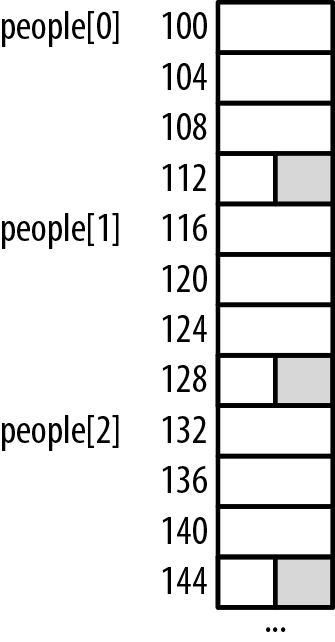
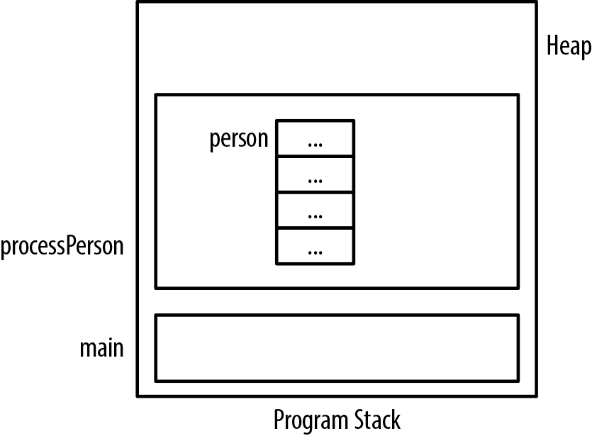
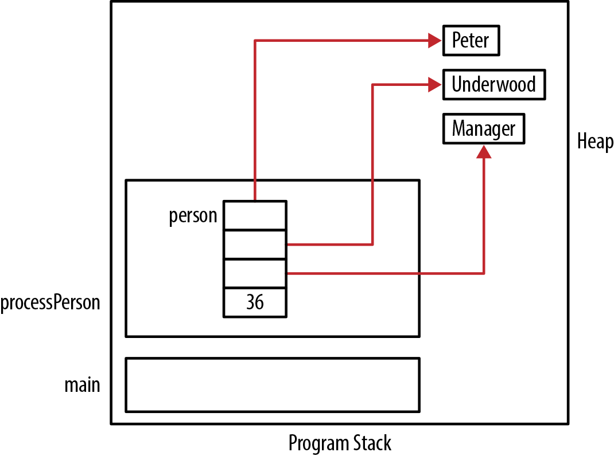
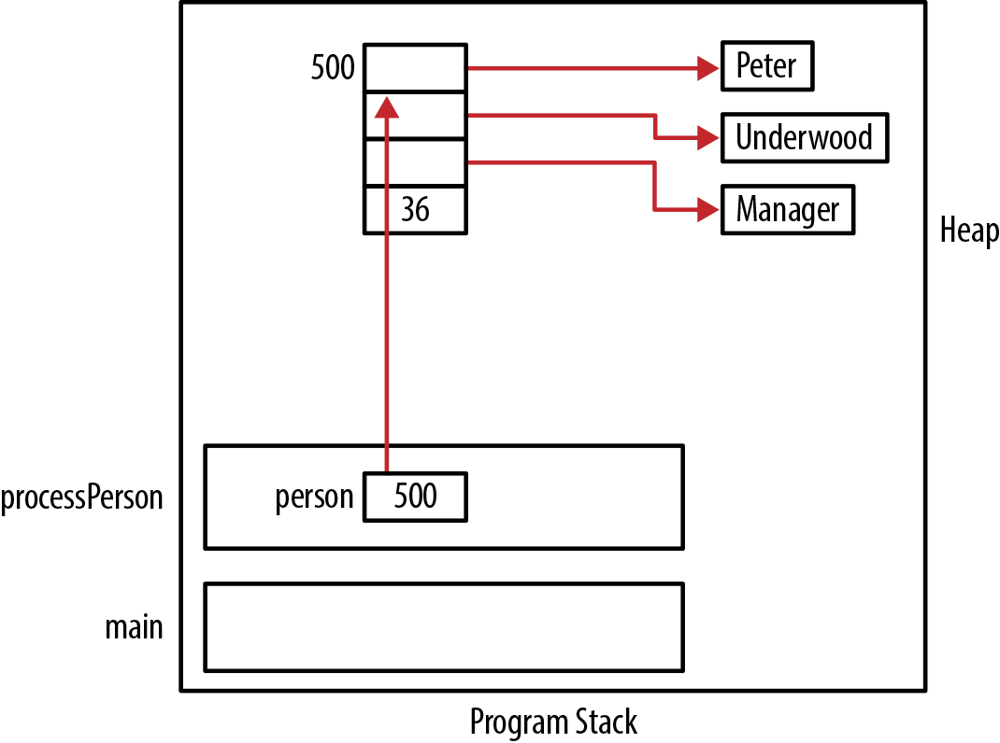
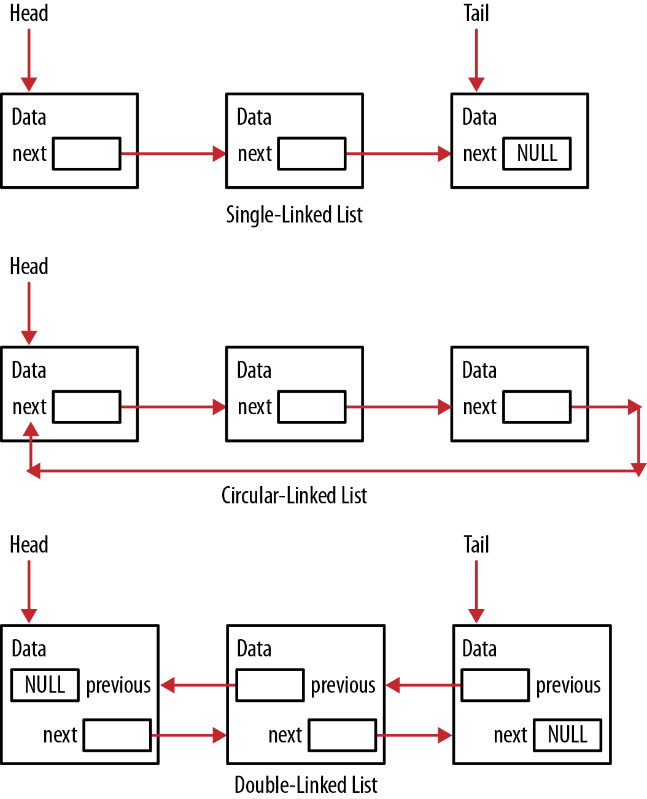
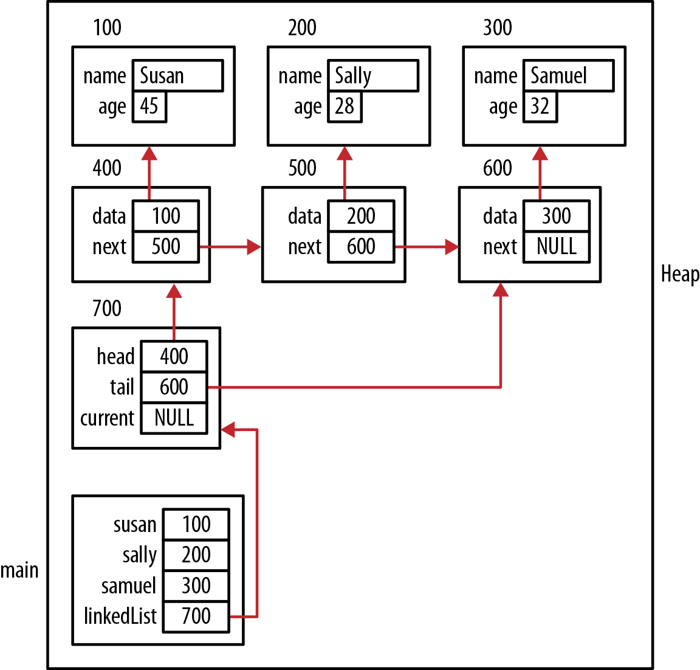
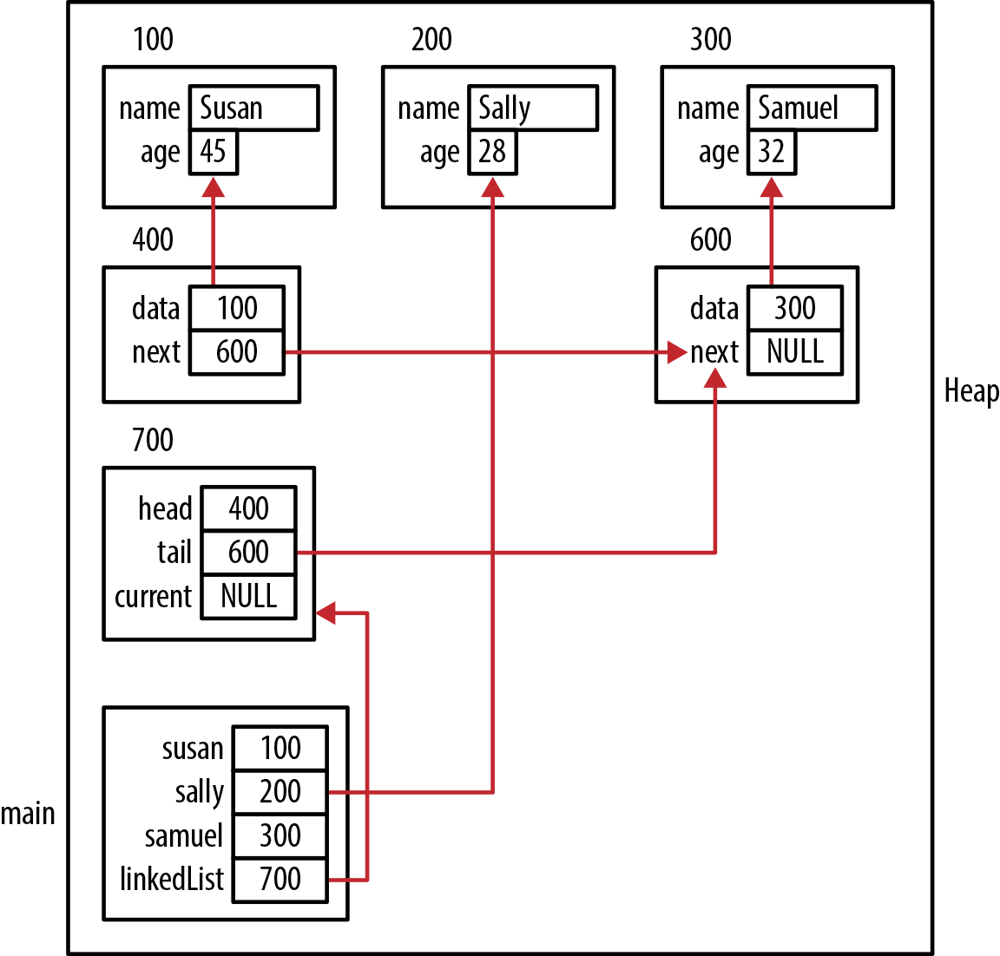
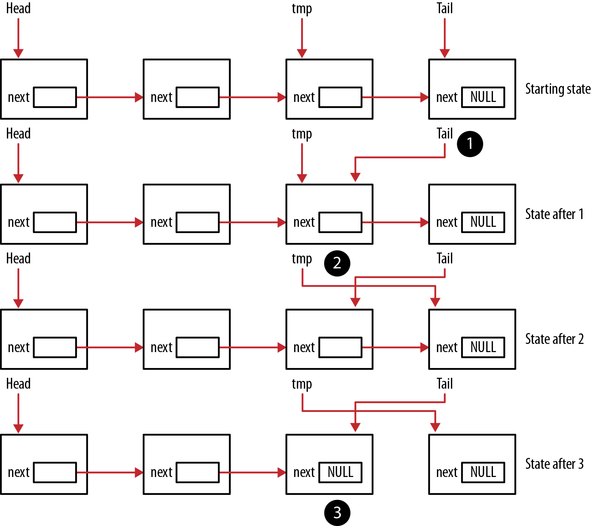
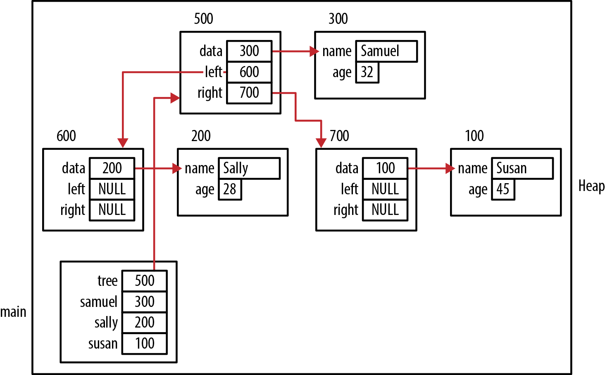
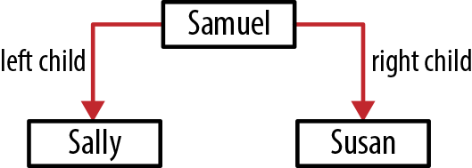

# Chương 6. Pointer và structure

Structure trong C có thể biểu diễn các phần tử của data structure, chẳng hạn node của linked list hoặc tree. Pointer là chất kết dính nối những phần tử này với nhau. Hiểu tính linh hoạt mà pointer đem lại cho các data structure thông dụng sẽ giúp bạn tạo ra data structure của riêng mình. Trong chương này, chúng ta sẽ tìm hiểu kiến thức cơ bản về cấp phát memory cho structure trong C và cách triển khai một số data structure thông dụng.

Structure làm các collection như array trở nên hữu ích hơn. Để tạo một array thực thể, chẳng hạn một color type có nhiều field, mà không dùng structure, cần khai báo một array cho mỗi field và giữ những giá trị tương ứng của field tại cùng index trong từng array. Tuy nhiên, với structure, chúng ta có thể khai báo một array duy nhất, trong đó mỗi phần tử là một instance của structure.

Chương này mở rộng những khái niệm pointer đã học. Nội dung gồm giới thiệu pointer notation dùng với structure, thảo luận cách memory được cấp phát cho structure, một kỹ thuật quản lý memory mà structure sử dụng và việc sử dụng function pointer.

Chúng ta sẽ bắt đầu bằng cách thảo luận việc cấp phát memory cho structure. Hiểu cách cấp phát này giúp giải thích hoạt động của những thao tác khác nhau. Tiếp theo là giới thiệu một kỹ thuật giảm tối đa overhead của heap management.

Phần cuối minh họa cách tạo một số data structure bằng pointer. Linked list được thảo luận trước và làm nền tảng cho một số data structure khác. Tree data structure được thảo luận cuối cùng và không dùng linked list.

## Giới thiệu

Có thể khai báo structure trong C theo nhiều cách. Trong phần này, chúng ta chỉ xem xét hai cách vì trọng tâm là sử dụng chúng với pointer. Cách thứ nhất khai báo structure bằng keyword `struct`. Cách thứ hai sử dụng một type definition. Trong declaration sau, tên structure có tiền tố là dấu gạch dưới. Điều này không bắt buộc nhưng thường được dùng làm quy ước đặt tên. Structure `_person` gồm các field tên, chức danh và tuổi:

```
struct _person {
    char* firstName;
    char* lastName;
    char* title;
    unsigned int age;
};
```

Declaration của structure thường dùng keyword `typedef` để đơn giản hóa việc sử dụng nó về sau trong chương trình. Ví dụ sau minh họa cách dùng với structure `_person`:

```
typedef struct _person {
    char* firstName;
    char* lastName;
    char* title;
    unsigned int age;
} Person;
```

Một instance của person được khai báo như sau:

```
Person person;
```

Một cách khác là khai báo pointer tới `Person` rồi cấp phát memory cho nó như dưới đây:

```
Person *ptrPerson;
ptrPerson = (Person*) malloc(sizeof(Person));
```

Nếu dùng declaration structure đơn giản như đã làm với `person`, chúng ta dùng dot notation để truy cập các field. Trong ví dụ sau, chúng ta gán giá trị cho các field `first` `Name` và `age`:

```
Person person;
person.firstName = (char*)malloc(strlen("Emily")+1);
strcpy(person.firstName,"Emily");
person.age = 23;
```

Tuy nhiên, nếu dùng pointer tới structure, chúng ta cần dùng points-to operator như sau. Operator này gồm dấu gạch ngang theo sau bởi dấu lớn hơn:

```
Person *ptrPerson;
ptrPerson = (Person*)malloc(sizeof(Person));
ptrPerson->firstName = (char*)malloc(strlen("Emily")+1);
strcpy(ptrPerson->firstName,"Emily");
ptrPerson->age = 23;
```

Chúng ta không bắt buộc dùng points-to operator. Thay vào đó, có thể dereference pointer trước rồi áp dụng dot operator. Dưới đây minh họa cách này bằng cách lặp lại những phép gán trước:

```
Person *ptrPerson;
ptrPerson = (Person*)malloc(sizeof(Person));
(*ptrPerson).firstName = (char*)malloc(strlen("Emily")+1);
strcpy((*ptrPerson).firstName,"Emily");
(*ptrPerson).age = 23;
```

Cách này rườm rà hơn, nhưng đôi khi bạn có thể thấy người ta sử dụng nó.

### Memory được cấp cho structure thế nào

Khi structure được cấp phát memory, lượng được cấp ít nhất bằng tổng kích thước các field riêng lẻ của nó. Tuy nhiên, kích thước thường lớn hơn tổng này vì có thể có padding giữa các field của structure. Padding có thể xuất phát từ yêu cầu căn chỉnh những data type nhất định theo các ranh giới cụ thể. Chẳng hạn, short thường được căn tại address chia hết cho hai, còn integer được căn tại address chia hết cho bốn.

Việc cấp phát thêm memory này dẫn đến một số hệ quả:

- Phải thận trọng khi sử dụng pointer arithmetic

- Array structure có thể có memory bổ sung giữa các phần tử

Chẳng hạn, khi một instance của structure `Person` trong phần trước được cấp phát memory, nó được cấp 16 byte, tức 4 byte cho mỗi phần tử. Phiên bản khác của `Person` dưới đây dùng short thay vì unsigned integer cho `age`. Lượng memory được cấp phát vẫn bằng nhau vì có hai byte padding ở cuối structure:

```
typedef struct _alternatePerson {
    char* firstName;
    char* lastName;
    char* title;
    short age;
} AlternatePerson;
```

Trong đoạn lệnh sau, chúng ta khai báo một instance của cả structure `Person` lẫn structure `Alternate` `Person`, rồi hiển thị kích thước của chúng. Cả hai đều có kích thước 16 byte:

```
Person person;
AlternatePerson otherPerson;
```

```
printf("%d\n",sizeof(Person));           // Displays 16
printf("%d\n",sizeof(AlternatePerson));  // Displays 16
```

Nếu tạo một array `AlternatePerson` như dưới đây, sẽ có padding giữa các phần tử array. Điều này được minh họa trong Hình 6-1. Vùng tô đậm cho thấy những khoảng trống giữa các phần tử array.

```
AlternatePerson people[30];
```



Hình 6-1. Array AlternativePerson

Nếu chuyển field `age` vào giữa hai field của structure, khoảng trống sẽ nằm bên trong structure. Tùy cách truy cập structure, điều này có thể quan trọng.

## Vấn đề giải phóng structure

Khi memory được cấp phát cho structure, runtime system không tự động cấp phát memory cho các pointer được định nghĩa bên trong nó. Tương tự, khi structure không còn tồn tại, runtime system cũng không tự động giải phóng memory được gán cho những pointer của structure.

Xét structure sau:

```
typedef struct _person {
    char* firstName;
    char* lastName;
    char* title;
    uint age;
} Person;
```

Khi khai báo một variable có type này hoặc cấp phát động memory cho type này, ba pointer sẽ chứa giá trị rác. Trong đoạn lệnh tiếp theo, chúng ta khai báo một `Person`. Việc cấp phát memory của nó được minh họa trong Hình 6-2. Ba dấu chấm biểu thị memory chưa được khởi tạo:

```
void processPerson() {
   Person person;
   ...
}
```



Hình 6-2. Structure Person chưa khởi tạo

Trong quá trình khởi tạo structure này, mỗi field được gán một giá trị. Memory cho các pointer field được cấp phát từ heap và gán cho từng pointer:

```
void initializePerson(Person *person, const char* fn,
        const char* ln, const char* title, uint age) {
    person->firstName = (char*) malloc(strlen(fn) + 1);
    strcpy(person->firstName, fn);
    person->lastName = (char*) malloc(strlen(ln) + 1);
    strcpy(person->lastName, ln);
    person->title = (char*) malloc(strlen(title) + 1);
    strcpy(person->title, title);
    person->age = age;
}
```

Chúng ta có thể dùng function này như dưới đây. Hình 6-3 minh họa cách memory được cấp phát:

```
void processPerson() {
   Person person;
   initializePerson(&person, "Peter", "Underwood", "Manager", 36);
    ...
}
int main() {
   processPerson();
   ...
}
```



Hình 6-3. Structure Person đã khởi tạo

Vì declaration này nằm trong một function, memory dành cho `person` sẽ không còn tồn tại khi function trả về. Tuy nhiên, các string được cấp phát động chưa được giải phóng và vẫn nằm trong heap. Đáng tiếc, chúng ta đã mất address của chúng nên không thể giải phóng, dẫn đến memory leak.

Khi sử dụng xong instance, chúng ta cần giải phóng memory. Function sau sẽ giải phóng memory đã cấp trước đó khi tạo instance:

```
void deallocatePerson(Person *person) {
    free(person->firstName);
    free(person->lastName);
    free(person->title);
}
```

Cần gọi function này trước khi function chứa declaration kết thúc:

```
void processPerson() {
   Person person;
   initializePerson(&person, "Peter", "Underwood", "Manager", 36);
    ...
   deallocatePerson(&person);
}
```

Đáng tiếc, chúng ta phải nhớ gọi các function `initialize` và `deallocate`. Những ngôn ngữ lập trình object-oriented như C++ tự động gọi các thao tác này trên object.

Nếu dùng pointer tới `Person`, chúng ta phải nhớ giải phóng cả person như dưới đây:

```
void processPerson() {
    Person *ptrPerson;
    ptrPerson = (Person*) malloc(sizeof(Person));
    initializePerson(ptrPerson, "Peter", "Underwood", "Manager", 36);
      ...
    deallocatePerson(ptrPerson);
    free(ptrPerson);
}
```

Hình 6-4 minh họa cách memory được cấp phát.



Hình 6-4. Pointer đến person instance

## Tránh overhead malloc/free

Khi structure được cấp phát rồi giải phóng lặp đi lặp lại, một lượng overhead phát sinh và có thể gây tổn thất hiệu năng đáng kể. Một cách xử lý là duy trì danh sách riêng những structure đã cấp phát. Khi người dùng không còn cần một instance của structure, instance được trả về pool. Khi cần một instance, object được lấy từ pool. Nếu pool không có phần tử sẵn dùng, một instance mới được cấp phát động. Cách này thực chất duy trì một pool structure để sử dụng và tái sử dụng khi cần.

Để minh họa cách này, chúng ta sẽ dùng structure `Person` đã định nghĩa trước đó. Một pool person được duy trì trong array. Cũng có thể dùng một list phức tạp hơn như linked list, được minh họa trong phần “Single-Linked List” ở trang 142. Để giữ ví dụ đơn giản, chúng ta dùng array pointer như khai báo dưới đây:

```
#define LIST_SIZE 10
Person *list[LIST_SIZE];
```

Trước khi sử dụng list, cần khởi tạo nó. Function sau gán `NULL` cho từng phần tử của array:

```
void initializeList() {
    for(int i=0; i<LIST_SIZE; i++) {
        list[i] = NULL;
    }
}
```

Hai function được dùng để thêm và lấy person. Đầu tiên là function `getPerson` dưới đây. Function lấy một person từ list nếu có thể. Các phần tử array được so sánh với `NULL`. Phần tử non-null đầu tiên được trả về, và vị trí của nó trong `list` sau đó được gán `NULL`. Nếu không có person sẵn dùng, một instance `Person` mới được tạo và trả về. Cách này tránh overhead cấp phát động memory cho person mỗi khi cần một instance mới. Chúng ta chỉ cấp phát memory nếu pool không còn instance. Việc khởi tạo instance trả về có thể được thực hiện trước khi trả về hoặc do caller thực hiện, tùy nhu cầu ứng dụng:

```
Person *getPerson() {
    for(int i=0; i<LIST_SIZE; i++) {
        if(list[i] != NULL) {
            Person *ptr = list[i];
            list[i] = NULL;
            return ptr;
        }
    }
    Person *person = (Person*)malloc(sizeof(Person));
    return person;
}
```

Function thứ hai là `returnPerson`, có nhiệm vụ thêm person vào list hoặc giải phóng nó. Các phần tử array được kiểm tra xem có giá trị `NULL` nào không. Nếu có, `person` được thêm vào vị trí đó rồi pointer được trả về. Nếu list đầy, các pointer bên trong `person` được giải phóng bằng function `deallocatePerson`, sau đó `person` được giải phóng và `NULL` được trả về:

```
Person *returnPerson(Person *person) {
    for(int i=0; i<LIST_SIZE; i++) {
        if(list[i] == NULL) {
            list[i] = person;
            return person;
        }
    }
    deallocatePerson(person);
    free(person);
    return NULL;
}
```

Ví dụ sau minh họa việc khởi tạo list và thêm một person vào list:

```
initializeList();
Person *ptrPerson;

ptrPerson = getPerson();
initializePerson(ptrPerson,"Ralph","Fitsgerald","Mr.",35);
displayPerson(*ptrPerson);
returnPerson(ptrPerson);
```

Một vấn đề của cách này liên quan đến kích thước list. Nếu list quá nhỏ, sẽ phải cấp phát và giải phóng memory động nhiều hơn. Nếu list lớn nhưng các structure không được sử dụng, một lượng memory lớn có thể bị giữ lại và không sẵn dùng cho việc khác. Có thể sử dụng một cơ chế quản lý list tinh vi hơn để quản lý kích thước list.

## Dùng pointer hỗ trợ data structure

Pointer có thể hỗ trợ linh hoạt hơn cho các data structure đơn giản cũng như phức tạp. Tính linh hoạt này đến từ dynamic memory allocation và sự dễ dàng trong việc thay đổi pointer reference. Memory không cần liên tiếp như với array. Chỉ cần cấp phát đúng lượng memory cần thiết.

Trong phần này, chúng ta sẽ xem xét cách triển khai một số data structure thường dùng bằng pointer. Nhiều C library cung cấp hỗ trợ tương đương và phong phú hơn các ví dụ ở đây. Tuy nhiên, hiểu cách triển khai chúng có thể hữu ích khi xây dựng những data structure không chuẩn. Trên một số platform, các library có thể không sẵn có và nhà phát triển sẽ cần tự triển khai phiên bản riêng.

Chúng ta xét bốn data structure:

Linked list

Một single-linked list

Queue

Một queue first-in first-out đơn giản

Stack

Một stack đơn giản

Tree

Một binary tree

Cùng với các data structure này, chúng ta sẽ kết hợp function pointer để minh họa sức mạnh của chúng khi xử lý generic structure. Linked list là một data structure rất hữu ích, và chúng ta sẽ dùng nó làm nền tảng để triển khai queue và stack. Chúng ta sẽ minh họa từng data structure bằng một employee structure. Chẳng hạn, linked list gồm những node nối với nhau. Mỗi node giữ user-supplied data. Structure employee đơn giản được liệt kê dưới đây. Data type `unsigned char` được dùng cho tuổi vì đủ lớn để lưu tuổi của con người:

```
typedef struct _employee{
    char name[32];
    unsigned char age;
} Employee;
```

Một array đơn giản được dùng để lưu một tên. Mặc dù pointer tới `char` có thể là data type linh hoạt hơn cho field này, chúng ta chọn array `char` để đơn giản hóa các ví dụ.

Chúng ta sẽ phát triển hai function. Function đầu so sánh hai employee và trả về một integer. Function này được mô phỏng theo function `strcmp`. Giá trị trả về 0 có nghĩa là hai employee structure được xem là bằng nhau. Giá trị trả về –1 có nghĩa là employee thứ nhất đứng trước employee thứ hai theo bảng chữ cái. Giá trị trả về 1 có nghĩa là employee thứ nhất đứng sau employee thứ hai. Function thứ hai hiển thị một employee:

```
int compareEmployee(Employee *e1, Employee *e2) {
    return strcmp(e1->name, e2->name);
}

void displayEmployee(Employee* employee) {
    printf("%s\t%d\n", employee->name, employee->age);
}
```

Ngoài ra, chúng ta sẽ dùng hai function pointer như định nghĩa dưới đây. Function pointer `DISPLAY` chỉ định một function nhận void và trả về void, nhằm hiển thị dữ liệu. Pointer thứ hai, `COMPARE`, biểu diễn một function dùng để so sánh dữ liệu được hai pointer tham chiếu. Function phải so sánh dữ liệu và trả về 0, –1 hoặc 1 như đã giải thích với function `compareEmployee`:

```
typedef void(*DISPLAY)(void*);
typedef int(*COMPARE)(void*, void*);
```

### Single-Linked List

Linked list là một data structure gồm một dãy node được nối với nhau bằng các link. Thông thường, một node được gọi là head node, và các node tiếp theo lần lượt nằm sau head. Node cuối được gọi là tail. Những link nối các node có thể dễ dàng được triển khai bằng pointer. Mỗi node có thể được cấp phát động khi cần.

Cách này được ưu tiên hơn một array node. Dùng array sẽ tạo ra một số lượng node cố định bất kể thực sự cần bao nhiêu node. Link được triển khai bằng index của các phần tử array. Dùng array không linh hoạt bằng dynamic memory allocation và pointer.

Chẳng hạn, nếu muốn đổi thứ tự các phần tử array, phải copy cả hai phần tử, mà với structure, lượng dữ liệu này có thể lớn. Ngoài ra, thêm hoặc xóa một phần tử có thể đòi hỏi di chuyển những phần lớn của array để nhường chỗ cho phần tử mới hoặc loại bỏ phần tử hiện có.

Có một số loại linked list. Đơn giản nhất là single-linked list, trong đó có một link từ một node tới node tiếp theo. Các link bắt đầu tại head và cuối cùng dẫn đến tail. Loại circular-linked list không có tail: node cuối của linked list trỏ trở lại head. Doubly linked list sử dụng hai link, một trỏ về phía trước và một trỏ về phía sau, cho phép duyệt list theo cả hai hướng. Loại linked list này linh hoạt hơn nhưng khó triển khai hơn. Hình 6-5 minh họa khái niệm các loại linked list này.



Hình 6-5. Các loại linked list. Trong phần này, chúng ta sẽ minh họa việc xây dựng và sử dụng single-linked list. Dưới đây là structure dùng để hỗ trợ linked list. Structure `Node` được định nghĩa để biểu diễn một node và gồm hai pointer. Pointer thứ nhất là pointer tới void, giữ một data type tùy ý. Pointer thứ hai trỏ tới node tiếp theo. Structure `LinkedList` biểu diễn linked list và chứa pointer tới head và tail. Pointer current sẽ hỗ trợ việc duyệt linked list:

```
typedef struct _node {
    void *data;
    struct _node *next;
} Node;

typedef struct _linkedList {
    Node *head;
    Node *tail;
    Node *current;
} LinkedList;
```

Chúng ta sẽ phát triển một số function sử dụng những structure này để hỗ trợ chức năng linked list:

| void initializeList(LinkedList\*) | Khởi tạo linked list |
|---|---|
| void addHead(LinkedList\*, void\*) | Thêm dữ liệu vào head của linked list |
| void addTail(LinkedList\*, void\*) | Thêm dữ liệu vào tail của linked list |
| void delete(LinkedList\*, Node\*) | Xóa một node khỏi linked list |
| Node \*getNode(LinkedList\*, COMPARE, void\*) | Trả về pointer tới node chứa một data item cụ thể |
| void displayLinkedList(LinkedList\*, DISPLAY) | Hiển thị linked list |

Trước khi sử dụng linked list, cần khởi tạo nó. Function `initializeList` dưới đây thực hiện nhiệm vụ này. Một pointer tới object `LinkedList` được truyền cho function, nơi từng pointer trong structure được đặt thành `NULL`:

```
void initializeList(LinkedList *list) {
    list->head = NULL;
    list->tail = NULL;
    list->current = NULL;
}
```

Các function `addHead` và `addTail` lần lượt thêm dữ liệu vào head và tail của linked list. Trong implementation này, các function `add` và `delete` chịu trách nhiệm cấp phát và giải phóng memory mà các node của linked list sử dụng. Người sử dụng linked list do đó không phải đảm nhiệm trách nhiệm này.

Trong function `addHead` dưới đây, trước hết memory được cấp phát cho node, rồi dữ liệu truyền vào function được gán cho field `data` của structure. Truyền dữ liệu dưới dạng pointer tới void cho phép linked list chứa bất kỳ data type nào người dùng muốn. Tiếp theo, chúng ta kiểm tra linked list có rỗng không. Nếu có, gán tail pointer trỏ tới node và gán `NULL` cho field `next` của node. Nếu không, pointer `next` của node được gán head của list. Trong cả hai trường hợp, head của list được gán trỏ tới node:

```
void addHead(LinkedList *list, void* data) {
    Node *node = (Node*) malloc(sizeof(Node));
    node->data = data;
    if (list->head == NULL) {
        list->tail = node;
        node->next = NULL;
    } else {
        node->next = list->head;
    }
    list->head = node;
}
```

Đoạn code sau minh họa cách dùng các function `initializeList` và `addHead`. Ba employee được thêm vào list. Hình 6-6 cho thấy cách memory được cấp phát sau khi những câu lệnh này thực thi. Một số mũi tên được bỏ đi để đơn giản hóa sơ đồ. Ngoài ra, structure `Employee` với array `name` cũng được đơn giản hóa:

```
LinkedList linkedList;

Employee *samuel = (Employee*) malloc(sizeof(Employee));
strcpy(samuel->name, "Samuel");
samuel->age = 32;

Employee *sally = (Employee*) malloc(sizeof(Employee));
strcpy(sally->name, "Sally");
sally->age = 28;

Employee *susan = (Employee*) malloc(sizeof(Employee));
strcpy(susan->name, "Susan");
susan->age = 45;

initializeList(&linkedList);

addHead(&linkedList, samuel);
addHead(&linkedList, sally);
addHead(&linkedList, susan);
```

Function `addTail` được trình bày dưới đây. Nó bắt đầu bằng việc cấp phát memory cho node mới và gán dữ liệu vào field `data`. Vì node luôn được thêm vào tail, field `next` của node được gán `NULL`. Nếu linked list rỗng, pointer `head` sẽ là `NULL` và có thể gán `head` trỏ tới node mới. Nếu không phải `NULL`, pointer `next` của tail được gán trỏ tới node mới. Trong cả hai trường hợp, pointer `tail` của linked list được gán trỏ tới node:



Hình 6-6. Ví dụ addHead

```
void addTail(LinkedList *list, void* data) {
    Node *node = (Node*) malloc(sizeof(Node));
    node->data = data;
    node->next = NULL;
    if (list->head == NULL) {
        list->head = node;
    } else {
        list->tail->next = node;
    }
    list->tail = node;
}
```

Đoạn lệnh sau minh họa function `addTail`. Việc tạo các employee object không được lặp lại ở đây. Các employee được thêm bằng function `addTail` theo thứ tự ngược với ví dụ trước. Điều này tạo ra cách cấp phát memory giống Hình 6-6:

```
initializeList(&linkedList);

addTail(&linkedList, susan);
addTail(&linkedList, sally);
addTail(&linkedList, samuel);
```

Function `delete` xóa một node khỏi linked list. Để đơn giản hóa function, một pointer tới node cần xóa được truyền vào. Người dùng function có thể có pointer tới dữ liệu nhưng không có pointer tới node giữ dữ liệu. Để hỗ trợ xác định node, helper function `getNode` được cung cấp để trả về một pointer tới node. Function `getNode` nhận ba parameter:

- Pointer đến linked list

- Pointer đến comparison function

- Pointer đến data cần tìm

Code của function `getNode` như sau. Variable `node` ban đầu trỏ tới head của list và duyệt list cho tới khi tìm được đối tượng khớp hoặc gặp cuối linked list. Function `compare` được gọi để xác định có khớp hay không. Khi hai data item bằng nhau, nó trả về zero.

```
Node *getNode(LinkedList *list, COMPARE compare , void* data) {
    Node *node = list->head;
    while (node != NULL) {
        if (compare(node->data, data) == 0) {
            return node;
        }
        node = node->next;
    }
    return NULL;
}
```

Function `compare` minh họa việc dùng function pointer tại runtime để quyết định function nào thực hiện phép so sánh. Điều này bổ sung sự linh hoạt đáng kể cho linked list implementation, vì chúng ta không cần viết cố định tên comparison function trong function `getNode`.

Function `delete` được trình bày dưới đây. Để giữ function đơn giản, nó không phải lúc nào cũng kiểm tra giá trị null trong linked list hoặc node được truyền vào. Câu lệnh `if` đầu tiên xử lý việc xóa node tại head. Nếu head node là node duy nhất, head và tail được gán null. Nếu không, head được gán trỏ tới node ngay sau head.

Câu lệnh `else` duyệt list từ head tới tail bằng pointer `tmp`. Loop `while` kết thúc nếu `tmp` được gán `NULL`, cho biết node không tồn tại trong list, hoặc node ngay sau `tmp` là node đang tìm. Vì đây là single-linked list, chúng ta cần biết node nào đứng trước node mục tiêu cần xóa. Thông tin này cần để gán node sau node mục tiêu vào field `next` của node đứng trước. Ở cuối function `delete`, node được giải phóng. Người dùng chịu trách nhiệm xóa dữ liệu mà node này trỏ tới trước khi gọi function `delete`.

```
void delete(LinkedList *list, Node *node) {
    if (node == list->head) {
        if (list->head->next == NULL) {
            list->head = list->tail = NULL;
        } else {
            list->head = list->head->next;
        }
    } else {
        Node *tmp = list->head;
        while (tmp != NULL && tmp->next != node) {
            tmp = tmp->next;
        }
        if (tmp != NULL) {
            tmp->next = node->next;
        }
    }
    free(node);
}
```

Đoạn lệnh tiếp theo minh họa cách dùng function này. Ba employee được thêm vào head của linked list. Chúng ta sẽ dùng function `compareEmployee`, được mô tả trong phần “Dùng pointer hỗ trợ data structure” ở trang 141, để thực hiện các phép so sánh:

```
addHead(&linkedList, samuel);
addHead(&linkedList, sally);
addHead(&linkedList, susan);

Node *node = getNode(&linkedList,
        (int (*)(void*, void*))compareEmployee, sally);
delete(&linkedList, node);
```

Khi đoạn lệnh này thực thi, program stack và heap sẽ có trạng thái như minh họa trong Hình 6-7.

Function `displayLinkedList` dưới đây minh họa cách duyệt linked list. Nó bắt đầu ở head và hiển thị từng phần tử bằng function được truyền làm argument thứ hai. Node pointer được gán giá trị của field `next`, và quá trình kết thúc sau khi node cuối được hiển thị:

```
void displayLinkedList(LinkedList *list, DISPLAY display) {
    printf("\nLinked List\n");
    Node *current = list->head;
    while (current != NULL) {
        display(current->data);
        current = current->next;
    }
}
```

Ví dụ sau minh họa function này bằng function `displayEmployee`, đã phát triển trong phần “Dùng pointer hỗ trợ data structure” ở trang 141:



Hình 6-7. Ví dụ xóa

```
addHead(&linkedList, samuel);
addHead(&linkedList, sally);
addHead(&linkedList, susan);

displayLinkedList(&linkedList, (DISPLAY)displayEmployee);
```

Output của chuỗi như sau:

```
Linked List
Susan     45
Sally     28
Samuel    32
```

### Dùng pointer hỗ trợ queue

Queue là một data structure tuyến tính có hành vi giống hàng người chờ. Nó thường hỗ trợ hai thao tác chính: enqueue và dequeue. Enqueue thêm một phần tử vào queue. Dequeue lấy một phần tử khỏi queue. Thông thường, phần tử được thêm đầu tiên cũng là phần tử được dequeue đầu tiên. Hành vi này được gọi là First-In-First-Out (FIFO).

Linked list thường được dùng để triển khai queue. Enqueue thêm một node vào head của linked list, còn dequeue lấy một node khỏi tail. Để minh họa queue, chúng ta sẽ dùng linked list đã phát triển trong phần “Single-Linked List” ở trang 142.

Hãy bắt đầu bằng một câu lệnh type definition để định nghĩa tên gọi queue. Nó dựa trên linked list như dưới đây. Lúc này, chúng ta có thể dùng `Queue` để thể hiện rõ ý định:

```
typedef LinkedList Queue;
```

Để triển khai thao tác khởi tạo, tất cả những gì cần làm là dùng function `initializeList`. Thay vì gọi trực tiếp function này, chúng ta sẽ dùng function `initializeQueue` sau:

```
void initializeQueue(Queue *queue) {
    initializeList(queue);
}
```

Tương tự, đoạn dưới đây thêm một node vào queue bằng function `addHead`:

```
void enqueue(Queue *queue, void *node) {
    addHead(queue, node);
}
```

Linked list implementation trước không có function tường minh để xóa tail node. Function `dequeue` sau lấy node cuối ra và xử lý ba trường hợp:

Queue rỗng

Trả `NULL`

Queue một node

Xử lý bằng câu `else if`

Queue nhiều node

Xử lý bằng mệnh đề `else`

Trong trường hợp cuối, pointer `tmp` tiến lần lượt qua các node cho tới khi trỏ vào node ngay trước tail node. Sau đó ba thao tác được thực hiện theo thứ tự sau:

1\. Gán tail trỏ tới node `tmp`

2\. Cho pointer `tmp` tiến tới node tiếp theo

3\. Đặt field `next` của tail thành `NULL` để cho biết không còn node nào tiếp theo trong queue

Thứ tự này cần thiết để bảo đảm tính toàn vẹn của list, như Hình 6-8 minh họa về mặt khái niệm. Các số khoanh tròn tương ứng với ba bước vừa liệt kê:

```
void *dequeue(Queue *queue) {
    Node *tmp = queue->head;
    void *data;
    if (queue->head == NULL) {
        data = NULL;
    } else if (queue->head == queue->tail) {
        queue->head = queue->tail = NULL;
        data = tmp->data;
        free(tmp);
    } else {
        while (tmp->next != queue->tail) {
            tmp = tmp->next;
        }
        queue->tail = tmp;
        tmp = tmp->next;
        queue->tail->next = NULL;
        data = tmp->data;
        free(tmp);
    }
    return data;
}
```



Hình 6-8. Ví dụ function dequeue. Dữ liệu gán cho node được trả về và node được giải phóng. Những function này được minh họa trong đoạn code sau bằng các employee đã tạo trước đó:

```
Queue queue;
initializeQueue(&queue);

enqueue(&queue, samuel);
enqueue(&queue, sally);
enqueue(&queue, susan);
```

```
void *data = dequeue(&queue);
printf("Dequeued %s\n", ((Employee*) data)->name);
data = dequeue(&queue);
printf("Dequeued %s\n", ((Employee*) data)->name);
data = dequeue(&queue);
printf("Dequeued %s\n", ((Employee*) data)->name);
```

Output như sau:

```
Dequeued Samuel
Dequeued Sally
Dequeued Susan
```

### Dùng pointer hỗ trợ stack

Stack data structure cũng là một loại list. Trong trường hợp này, các phần tử được push lên đỉnh stack rồi pop ra. Khi nhiều phần tử được push rồi pop, stack thể hiện hành vi First-In-Last-Out (FILO). Phần tử được push đầu tiên là phần tử được pop cuối cùng.

Giống implementation của queue, chúng ta có thể dùng linked list để hỗ trợ các stack operation. Hai thao tác phổ biến nhất là push và pop. Push được thực hiện bằng function `addHead`. Pop đòi hỏi bổ sung một function mới để xóa head node. Chúng ta bắt đầu bằng cách định nghĩa stack theo linked list như sau:

```
typedef LinkedList Stack;
```

Để khởi tạo stack, chúng ta thêm function `initializeStack`. Function này gọi function `initializeList`:

```
void initializeStack(Stack *stack) {
    initializeList(stack);
}
```

Thao tác push gọi function `addHead` như dưới đây:

```
void push(Stack *stack, void* data) {
    addHead(stack, data);
}
```

Implementation của thao tác pop như sau. Trước hết, chúng ta gán head của stack cho pointer `node`. Việc xử lý gồm ba trường hợp:

Stack rỗng

Function trả `NULL`

Stack có một element

Nếu node trỏ tới tail thì head và tail là cùng một phần tử. Head và tail được gán `NULL`, rồi dữ liệu được trả về.

Stack có nhiều hơn một element

Trong trường hợp này, head được gán trỏ tới phần tử tiếp theo trong list, rồi dữ liệu được trả về.

Trong hai trường hợp cuối, node được giải phóng:

```
void *pop(Stack *stack) {
    Node *node = stack->head;
    if (node == NULL) {
        return NULL;
    } else if (node == stack->tail) {
        stack->head = stack->tail = NULL;
        void *data = node->data;
        free(node);
        return data;
    } else {
        stack->head = stack->head->next;
        void *data = node->data;
        free(node);
        return data;
    }
}
```

Chúng ta sẽ tái sử dụng các employee instance đã tạo trong phần “Single-Linked List” ở trang 142 để minh họa stack. Đoạn code sau push ba employee rồi pop chúng ra khỏi stack:

```
Stack stack;
initializeStack(&stack);

push(&stack, samuel);
push(&stack, sally);
push(&stack, susan);

Employee *employee;
```

```
for(int i=0; i<4; i++) {
    employee = (Employee*) pop(&stack);
    printf("Popped %s\n", employee->name);
}
```

Khi thực thi, chúng ta nhận được output sau. Vì đã dùng function pop bốn lần, lần cuối trả về `NULL`:

```
Popped Susan
Popped Sally
Popped Samuel
Popped (null)
```

Những stack operation khác đôi khi gồm thao tác peek, trả về phần tử trên cùng nhưng không pop nó khỏi stack.

### Dùng pointer hỗ trợ tree

Tree là một data structure rất hữu ích, có tên bắt nguồn từ mối quan hệ giữa các phần tử. Thông thường, child node được gắn với một parent node. Hình dạng tổng thể giống một cây lộn ngược, trong đó root node biểu diễn phần tử bắt đầu của data structure.

Tree có thể có số child node bất kỳ. Tuy nhiên, binary tree phổ biến hơn, với mỗi node có zero, một hoặc hai child node. Các child được gọi là left child hoặc right child. Node không có child được gọi là leaf node, tương tự lá cây. Những ví dụ trong phần này minh họa binary tree.

Pointer cung cấp một cách trực quan và linh hoạt để duy trì quan hệ giữa các node của tree. Node có thể được cấp phát động và thêm vào tree khi cần. Chúng ta sẽ dùng structure sau cho một node. Dùng pointer tới void cho phép xử lý bất kỳ data type nào cần thiết:

```
typedef struct _tree {
    void *data;
    struct _tree *left;
    struct _tree *right;
} TreeNode;
```

Khi thêm node vào tree, việc thêm theo một thứ tự cụ thể là hợp lý. Điều này làm nhiều thao tác, chẳng hạn tìm kiếm, dễ hơn. Một thứ tự phổ biến là thêm node mới sao cho mọi child của node có giá trị nhỏ hơn parent node và mọi child bên phải có giá trị lớn hơn parent node. Đây được gọi là binary search tree.

Function `insertNode` sau chèn một node vào binary search tree. Tuy nhiên, để chèn node, cần so sánh node mới với các node hiện có của tree. Chúng ta dùng function pointer `COMPARE` để truyền address của comparison function. Phần đầu function cấp phát memory cho node mới và gán dữ liệu cho node. Left child và right child được đặt thành `NULL` vì node mới luôn được thêm vào tree dưới dạng leaf:

```
void insertNode(TreeNode **root, COMPARE compare, void* data) {
    TreeNode *node = (TreeNode*) malloc(sizeof(TreeNode));
    node->data = data;
    node->left = NULL;
    node->right = NULL;

    if (*root == NULL) {
        *root = node;
        return;
    }

    while (1) {
        if (compare((*root)->data, data) > 0) {
            if ((*root)->left != NULL) {
                *root = (*root)->left;
            } else {
                (*root)->left = node;
                break;
            }
        } else {
            if ((*root)->right != NULL) {
                *root = (*root)->right;
            } else {
                (*root)->right = node;
                break;
            }
        }
    }
}
```

Trước tiên, root được kiểm tra để xác định tree có rỗng không. Nếu rỗng, node mới được gán cho root và function trả về. Root được truyền dưới dạng pointer tới pointer tới `TreeNode`. Điều này cần thiết vì chúng ta muốn sửa pointer được truyền cho function, chứ không phải thứ mà pointer trỏ tới. Cách dùng hai mức indirection này được trình bày chi tiết trong phần “Nhiều mức indirection” ở trang 25.

Nếu tree không rỗng, chương trình đi vào một loop vô hạn và sẽ kết thúc khi node mới được thêm vào tree. Ở mỗi vòng lặp, node mới và parent node hiện tại được so sánh. Dựa trên phép so sánh này, local pointer `root` được gán lại trỏ tới left child hoặc right child. Pointer `root` này trỏ tới node hiện tại trong tree. Nếu left child hoặc right child là `NULL`, node được thêm làm child và loop kết thúc.

Để minh họa function `insertNode`, chúng ta sẽ dùng lại các employee instance đã tạo trong phần “Dùng pointer hỗ trợ data structure” ở trang 141. Đoạn lệnh sau khởi tạo một `TreeNode` rỗng rồi chèn ba employee. Trạng thái program stack và heap thu được được minh họa trong Hình 6-9. Một số đường trỏ tới employee được bỏ để đơn giản hóa sơ đồ. Vị trí node trong heap cũng được sắp xếp để phản ánh thứ tự của tree structure:

```
TreeNode *tree = NULL;

insertNode(&tree, (COMPARE) compareEmployee, samuel);
insertNode(&tree, (COMPARE) compareEmployee, sally);
insertNode(&tree, (COMPARE) compareEmployee, susan);
```



Hình 6-9. Function insertNode

Hình 6-10 minh họa cấu trúc logic của tree.



Hình 6-10. Tổ chức logic tree

Binary tree được dùng cho nhiều mục đích và có thể được duyệt theo ba cách: pre-order, in-order và post-order. Ba kỹ thuật dùng cùng các bước nhưng thực hiện theo những thứ tự khác nhau. Ba bước là:

Thăm node

Xử lý node

Đi trái

Chuyển sang node trái

Đi phải

Chuyển sang node phải

Trong ví dụ này, thăm một node có nghĩa là hiển thị nội dung của nó. Ba thứ tự là:

In-order

Đi trái, thăm node, đi phải

Pre-order

Thăm node, đi trái, đi phải

Post-order

Đi trái, đi phải, thăm node

Implementation của các function được trình bày dưới đây. Mỗi function nhận root của tree và một function pointer tới display function. Chúng là recursive function và sẽ tự gọi chừng nào root node được truyền vào không phải null. Chúng chỉ khác nhau ở thứ tự thực hiện ba bước:

```
void inOrder(TreeNode *root, DISPLAY display) {
    if (root != NULL) {
        inOrder(root->left, display);
        display(root->data);
        inOrder(root->right, display);
    }
}

void postOrder(TreeNode *root, DISPLAY display) {
    if (root != NULL) {
        postOrder(root->left, display);
        postOrder(root->right, display);
        display(root->data);
    }
}

void preOrder(TreeNode *root, DISPLAY display) {
    if (root != NULL) {
        display(root->data);
        preOrder(root->left, display);
        preOrder(root->right, display);
    }
}
```

Đoạn code sau gọi các function này:

```
preOrder(tree, (DISPLAY) displayEmployee);
inOrder(tree, (DISPLAY) displayEmployee);
postOrder(tree, (DISPLAY) displayEmployee);
```

Bảng 6-1 cho thấy output của mỗi function call dựa trên việc khởi tạo tree trước đó.

Bảng 6-1. Kỹ thuật duyệt

| pre-order | Samuel 32 Sally 28 Susan 45 |
|---|---|
| in-order | Sally 28 Samuel 32 Susan 45 |
| post-order | Sally 28 Susan 45 Samuel 32 |

Phép duyệt in-order trả về danh sách các thành viên của tree theo thứ tự đã sắp xếp. Phép duyệt pre-order và post-order có thể được dùng để đánh giá biểu thức số học khi kết hợp với stack và queue.

### Tóm tắt

Sức mạnh và tính linh hoạt của pointer thể hiện rõ khi dùng chúng để tạo và hỗ trợ data structure. Kết hợp với dynamic memory allocation cho structure, pointer cho phép tạo các data structure sử dụng memory hiệu quả, có thể mở rộng và thu nhỏ theo nhu cầu ứng dụng.

Chúng ta bắt đầu chương bằng việc thảo luận cách memory được cấp phát cho structure. Có thể xuất hiện padding giữa các field của structure và giữa các phần tử array structure. Dynamic memory allocation và deallocation có thể tốn kém. Chúng ta đã xem xét một kỹ thuật duy trì pool structure để giảm tối đa overhead này.

Chúng ta cũng đã minh họa implementation của một số data structure thường dùng. Linked list được dùng để hỗ trợ một số data structure đó. Function pointer được sử dụng để tăng tính linh hoạt cho các implementation, bằng cách cho phép lựa chọn comparison function hoặc display function tại runtime.
