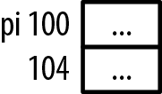
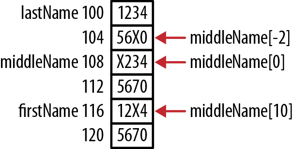
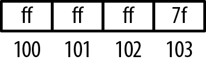
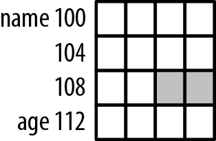

# Chương 7. Vấn đề security và dùng pointer sai

Hiếm có application nào mà security và reliability không quan trọng. Mối lo càng tăng bởi các báo cáo thường xuyên về vi phạm security và application failure. Trách nhiệm bảo vệ application phần lớn thuộc developer. Chương này xem các thực hành làm application an toàn và đáng tin cậy hơn.

Viết application an toàn bằng C có thể khó vì những đặc điểm vốn có của ngôn ngữ. Ví dụ C không ngăn programmer ghi ngoài giới hạn array, có thể làm hỏng memory và tạo nguy cơ security. Ngoài ra, dùng pointer sai thường là gốc rễ nhiều vấn đề security.

Application hành xử khó dự đoán có vẻ không phải vấn đề security, ít nhất xét truy cập trái phép. Tuy nhiên, đôi khi có thể khai thác hành vi này gây denial of service, làm tổn hại application. Hành vi khó dự đoán do dùng pointer sai đã được minh họa ở các phần khác. Chương này xác định thêm các cách dùng sai.

CERT là nguồn tốt để tìm hiểu toàn diện hơn vấn đề security trong C và ngôn ngữ khác. Tổ chức này nghiên cứu Internet security vulnerability. Chúng ta tập trung vấn đề liên quan pointer. Nhiều mối lo security của CERT bắt nguồn từ dùng pointer sai. Hiểu pointer và cách dùng đúng là công cụ quan trọng phát triển application an toàn, đáng tin. Một số chủ đề đã bàn trước, không nhất thiết theo góc security mà theo thực hành lập trình. Operating system (OS) đã có cải tiến security; một số thể hiện ở cách dùng memory. Dù thường ngoài tầm kiểm soát developer, cải tiến vẫn ảnh hưởng chương trình. Hiểu chúng giúp giải thích hành vi application. Chúng ta tập trung Address Space Layout Randomization và Data Execution Prevention.

Address Space Layout Randomization (ASLR) bố trí ngẫu nhiên data region của application trong memory, gồm code, stack, heap. Ngẫu nhiên hóa vị trí khiến attacker khó đoán memory sẽ nằm đâu, từ đó khó khai thác. Một số attack như return-to-libc ghi đè phần stack rồi chuyển control đến vùng này, thường là shared C library `libc`. Nếu không biết vị trí stack và `libc`, attack ít có khả năng thành công.

Data Execution Prevention (DEP) ngăn thực thi code nằm trong vùng memory nonexecutable. Trong một số attack, memory bị ghi đè bằng malicious code rồi control chuyển đến đó. Nếu vùng code này nonexecutable, như stack hoặc heap, nó bị ngăn thực thi. Kỹ thuật có thể triển khai bằng hardware hoặc software.

Chương này xét security theo các góc:

- Declaration và initialization của pointer

- Dùng pointer sai

- Vấn đề deallocation

## Declaration và initialization của pointer

Vấn đề có thể phát sinh khi khai báo, khởi tạo pointer, hoặc đúng hơn là không khởi tạo. Phần này xem các tình huống có thể xảy ra.

### Declaration pointer sai

Xét declaration:

```
int* ptr1, ptr2;
```

Declaration không nhất thiết sai, nhưng có thể không đúng ý định. Nó khai báo `ptr1` là pointer đến integer và `ptr2` là integer. Dấu sao cố ý đặt sát data type, khoảng trắng trước `ptr1`. Vị trí không ảnh hưởng compiler, nhưng người đọc có thể nghĩ cả `ptr1` và `ptr2` là pointer đến integer. Thực tế chỉ `ptr1` là pointer. Cách đúng là khai báo cả hai là pointer trên cùng dòng như sau:

```
int *ptr1, *ptr2;
```


Tốt hơn nữa là khai báo mỗi variable một dòng.

Thói quen tốt khác là dùng type definition thay macro definition. Chúng cho compiler kiểm tra scoping rule, điều không luôn đúng với macro.

Có thể khai báo variable với hỗ trợ directive như sau. Pointer đến integer được gói trong directive `define` rồi dùng khai báo variable:

```
#define PINT int*
PINT ptr1, ptr2;
```

Tuy nhiên, kết quả vẫn gặp vấn đề trên. Cách tốt hơn dùng type definition:

```
typedef int* PINT;
PINT ptr1, ptr2;
```

Cả hai variable đều là pointer đến integer.

### Không khởi tạo pointer trước khi dùng

Dùng pointer trước khi khởi tạo có thể gây run-time error, đôi khi gọi wild pointer. Ví dụ sau khai báo pointer đến integer nhưng chưa gán giá trị trước khi dùng:

```
int *pi;
...
printf(“%d\n”,*pi);
```

Hình 7-1 minh họa memory lúc này.



Hình 7-1. Wild pointer

Variable `pi` chưa khởi tạo, chứa garbage biểu thị bằng dấu chấm. Chuỗi có khả năng kết thúc khi chạy nếu memory address trong `pi` ngoài address space hợp lệ của application. Nếu không, giá trị hiển thị là thứ tình cờ ở address đó, diễn giải như integer. Nếu dùng pointer đến string, thường thấy loạt ký tự lạ cho tới terminating zero.

### Xử lý pointer chưa khởi tạo

Không có gì vốn có trong pointer cho biết hợp lệ hay không. Vì vậy không thể chỉ xem nội dung để xác định. Tuy nhiên có ba cách xử lý pointer chưa khởi tạo:

- Luôn khởi tạo pointer bằng `NULL`

- Dùng function `assert`

- Dùng tool third-party

Khởi tạo bằng `NULL` giúp kiểm tra cách dùng đúng dễ hơn. Dù vậy, kiểm tra null có thể tẻ nhạt như sau:

```
int *pi = NULL;
...
if(pi == NULL) {
   // pi should not be dereferenced
} else {
   // pi can be used
}
```

Function `assert` cũng kiểm tra null pointer value. Ví dụ sau kiểm tra variable `pi` với null. Nếu expression true, không có gì xảy ra; nếu false, chương trình kết thúc. Vì vậy pointer null sẽ làm chương trình kết thúc.

```
assert(pi != NULL);
```

Cách này có thể chấp nhận với debug version. Nếu pointer null, output tương tự:

```
Assertion failed: pi != NULL
```

Function `assert` nằm trong header file assert.h.

Tool Third-party cũng hỗ trợ phát hiện. Ngoài ra, compiler option có thể hữu ích, như “Dùng static analysis tool” trang 173 đề cập.

## Vấn đề sử dụng pointer

Phần này xem dùng sai dereference operator và array subscript, cùng vấn đề string, structure, function pointer. Nhiều vấn đề security xoay quanh buffer overflow: ghi đè memory ngoài giới hạn object. Memory có thể thuộc address space chương trình hoặc process khác. Khi ngoài program address space, phần lớn operating system phát segmentation fault rồi kết thúc chương trình. Nếu cố ý gây ra, đây là denial of service attack. Nó không cố truy cập trái phép mà làm application và có thể server ngừng hoạt động.

Nếu buffer overflow nằm trong address space application, có thể dẫn tới truy cập data trái phép và/hoặc chuyển control sang code segment khác, nguy cơ làm hệ thống bị xâm phạm. Đặc biệt đáng lo nếu application chạy với supervisor privilege.

Buffer overflow có thể xảy ra do:

- Không kiểm tra index khi truy cập array element

- Không thận trọng khi thực hiện pointer arithmetic với array pointer

- Dùng function như `gets` đọc string từ standard input

- Dùng sai function như `strcpy` và `strcat`

Khi buffer overflow xảy ra với element stack frame, có thể ghi đè return address bằng lời gọi malicious code được tạo cùng lúc. Xem “Program stack và heap” trang 58 để biết thêm về stack frame. Khi function return, control chuyển đến malicious function, có thể làm mọi operation chỉ bị giới hạn bởi privilege level của current user.

### Kiểm tra NULL

Luôn kiểm tra return value khi dùng function kiểu `malloc`. Không làm có thể gây kết thúc bất thường. Cách tổng quát:

```
float *vector = malloc(20 * sizeof(float));
if(vector == NULL) {
    // malloc failed to allocate memory
} else {
    // Process vector
}
```

### Dùng sai dereference operator

Cách phổ biến khai báo và khởi tạo pointer như sau:

```
int num;
int *pi = &num;
```

Chuỗi declaration có vẻ tương đương như sau:

```
int num;
int *pi;
*pi = &num;
```

Tuy nhiên không đúng. Chú ý dereference operator ở dòng cuối. Chúng ta cố gán address của `num` không phải cho `pi` mà vào vị trí memory do nội dung `pi` chỉ. Pointer `pi` chưa khởi tạo. Đây là lỗi đơn giản dùng sai dereference operator. Chuỗi đúng:

```
int num;
int *pi;
pi = &num;
```

Trong declaration gốc `int *pi = &num`, dấu sao khai báo variable là pointer, không phải dereference operator.

### Dangling pointer

Dangling pointer xảy ra khi pointer được giải phóng nhưng còn tham chiếu memory đó. “Dangling pointer” trang 51 mô tả kỹ. Nếu truy cập sau, nội dung có thể đã đổi. Ghi có thể làm hỏng memory; đọc có thể trả data không hợp lệ. Cả hai đều có thể kết thúc chương trình.

Cho đến gần đây, điều này chưa được xem là mối lo security. Như Dangling Pointer giải thích, có khả năng khai thác dangling pointer. Tuy nhiên cách này dựa trên khai thác VTable (Virtual Table) trong C++. VTable là array function pointer hỗ trợ virtual method C++. Trừ khi dùng cách tương tự với function pointer, đây không phải mối lo trong C.

### Truy cập memory ngoài giới hạn array

Không có gì ngăn chương trình truy cập memory ngoài vùng cấp cho array. Ví dụ này khai báo, khởi tạo ba array để minh họa. Giả định chúng được cấp ở vị trí memory liên tiếp.

```
char firstName[8] = "1234567";
char middleName[8] = "1234567";
char lastName[8] = "1234567";

middleName[-2] = 'X';
middleName[0] = 'X';
middleName[10] = 'X';

printf("%p  %s\n",firstName,firstName);
printf("%p  %s\n",middleName,middleName);
printf("%p  %s\n",lastName,lastName);
```

Để minh họa ghi đè, ba array được khởi tạo bằng chuỗi số đơn giản. Dù hành vi tùy compiler và máy, thường code chạy và ghi đè character trong `firstName` và `lastName`. Output dưới đây. Hình 7-2 cho allocation:

```
116  12X4567
108  X234567
100  123456X
```



Hình 7-2. Dùng array index không hợp lệ

Như Chương 4 giải thích, tính address bằng subscript không kiểm tra index. Đây là buffer overflow đơn giản.

### Tính sai kích thước array

Khi truyền array cho function, luôn truyền cùng kích thước. Thông tin giúp tránh vượt giới hạn. Function `replace` sau nhận address string cùng replacement character và kích thước buffer. Nó thay mọi character trước `NUL` bằng replacement character. Argument kích thước ngăn ghi vượt buffer:

```
void replace(char buffer[], char replacement, size_t size) {
    size_t count = 0;
    while(*buffer != NUL && count++<size) {
        *buffer = replacement;
        buffer++;
    }
}
```

Trong chuỗi sau, array `name` chỉ chứa bảy character cộng ký tự kết thúc `NUL`. Nhưng cố ý ghi vượt cuối để minh họa `replace`. Function `replace` nhận name và replacement character `+`:

```
char name[8];
strcpy(name,"Alexander");
replace(name,'+',sizeof(name));
printf("%s\n", name);
```

Khi chạy code nhận output:

```
++++++++r
```

Chỉ tám character plus-sign được thêm vào array. Dù `strcpy` cho phép buffer overflow, `replace` không cho. Giả định kích thước truyền hợp lệ. Cẩn thận với function như `strcpy` không nhận kích thước buffer. Truyền kích thước thêm một lớp bảo vệ.

### Dùng sai sizeof operator

Ví dụ dùng sai `sizeof` là cố kiểm tra giới hạn pointer nhưng làm sai. Ví dụ sau cấp memory cho array integer rồi khởi tạo từng element bằng 0.

```
int buffer[20];
int *pbuffer = buffer;
for(int i=0; i<sizeof(buffer); i++) {
    *(pbuffer++) = 0;
}
```

Tuy nhiên, `sizeof(buffer)` trả 80 vì buffer có 80 byte (20 nhân 4 byte mỗi element). Loop `for` chạy 80 lần thay vì 20, thường gây memory access exception làm application kết thúc. Tránh bằng expression `sizeof(buffer)/sizeof(int)` trong điều kiện kiểm tra câu `for`.

### Luôn dùng pointer type khớp

Nên luôn dùng pointer type thích hợp cho data. Để minh họa nguy cơ, xét chuỗi sau: pointer đến integer được gán cho pointer đến `short`:

```
int  num = 2147483647;
int *pi = &num;
short *ps = (short*)pi;
printf("pi: %p  Value(16): %x  Value(10): %d\n", pi, *pi, *pi);
printf("ps: %p  Value(16): %hx  Value(10): %hd\n",
        ps, (unsigned short)*ps, (unsigned short)*ps);
```

Output đoạn code:

```
pi: 100  Value(16): 7fffffff  Value(10): 2147483647
ps: 100  Value(16): ffff  Value(10): -1
```

Chú ý có vẻ chữ số hexadecimal đầu ở address 100 là `7` hoặc `f` tùy hiển thị integer hay short. Mâu thuẫn bề ngoài là hệ quả chạy trên máy little endian. Hình 7-3 minh họa bố trí memory của constant tại address 100.



Hình 7-3. Pointer type không khớp

Nếu coi là short và chỉ dùng hai byte đầu, nhận –1. Nếu coi integer và dùng cả bốn byte, nhận 2,147,483,647. Vấn đề tinh vi như vậy khiến C và pointer thành chủ đề đầy thách thức.

### Bounded pointer

Bounded pointer chỉ pointer bị giới hạn ở vùng hợp lệ. Ví dụ array khai báo 32 element, pointer dùng với nó bị ngăn truy cập memory trước hoặc sau array.

C không hỗ trợ trực tiếp, nhưng programmer có thể cưỡng chế tường minh như sau:

```
#define SIZE 32

char name[SIZE];
char *p = name;
if(name != NULL) {
    if(p >= name && p < name+SIZE) {
        // Valid pointer - continue
    } else {
        // Invalid pointer - error condition
    }
}
```

Cách này có thể tẻ nhạt. Thay vào đó static analysis trong “Dùng static analysis tool” trang 173 có thể hữu ích.

Biến thể thú vị là tạo pointer validation function; cần biết vị trí đầu và phạm vi.

Cách khác dùng Bounded Model Checking for ANSI-C and C++ (CBMC). Application này kiểm tra nhiều vấn đề safety, security trong C và tìm vấn đề array bound, buffer overflow.


Smart pointer trong C++ mô phỏng pointer và hỗ trợ bounds checking. Đáng tiếc không có trong C.

### Vấn đề string security

Vấn đề security của string thường xảy ra khi ghi vượt cuối. Phần này tập trung các function “standard” góp phần gây vấn đề.

Dùng string function như `strcpy` và `strcat` thiếu thận trọng có thể gây buffer overflow. Đã có đề xuất thay các method nhưng chưa cách nào được chấp nhận rộng. Function `strncpy` và `strncat` hỗ trợ phần nào, với parameter `size_t` chỉ số character tối đa cần copy. Tuy nhiên chúng cũng dễ sai nếu tính số character không đúng.

C11 (Annex K) thêm `strcat_s` và `strcpy_s`, trả error nếu buffer overflow. Hiện chỉ Microsoft Visual C++ hỗ trợ. Ví dụ sau minh họa `strcpy_s`, nhận destination buffer, kích thước destination buffer và source buffer. Return value zero nghĩa không lỗi. Ở đây có lỗi vì source quá lớn cho destination:

```
char firstName [8];
int result;
result = strcpy_s(firstName,sizeof(firstName),"Alexander");
```

Function `scanf_s` và `wscanf_s` cũng có để bảo vệ khỏi buffer overflow.

Function `gets` đọc string từ standard input rồi lưu character vào buffer chỉ định. Nó có thể ghi vượt độ dài khai báo. Nếu string quá dài, buffer overflow xảy ra.

Một số Linux system cũng hỗ trợ `strlcpy` và `srtlcat`, nhưng GNU C library không hỗ trợ. Có người cho rằng chúng gây nhiều vấn đề hơn giải quyết và tài liệu chưa tốt.

Một số function cho attacker truy cập memory bằng format string attack. Format string user-supplied như dưới được thiết kế để truy cập memory và có thể inject code. Trong chương trình đơn giản này, command line argument thứ hai làm parameter đầu của `printf`:

```
int main(int argc, char** argv) {
    printf(argv[1]);
    ...
}
```

Có thể chạy bằng command tương tự:

```
main.exe "User Supplied Input"
```

Output như sau:

```
User Supplied Input
```

Dù chương trình vô hại, attack tinh vi hơn có thể gây hại thực. Không trình bày toàn diện ở đây; chi tiết cách thực hiện có tại hackerproof.org.

Các function `printf`, `fprintf`, `snprintf`, `syslog` đều nhận format string argument. Phòng thủ đơn giản nhất là không bao giờ dùng format string user-supplied với chúng.

### Pointer arithmetic và structure

Chỉ nên dùng pointer arithmetic với array. Array bảo đảm cấp trong block liên tục, nên arithmetic cho offset hợp lệ. Không nên dùng trong structure vì field có thể không nằm ở vùng liên tiếp.

Structure sau minh họa. Field `name` được cấp 10 byte, sau là integer. Nhưng integer align theo ranh giới four-byte nên có khoảng trống giữa hai field. “Memory được cấp cho structure thế nào” trang 135 giải thích khoảng trống.

```
typedef struct _employee {
    char name[10];
    int age;
} Employee;
```

Chuỗi sau cố dùng pointer truy cập field `age`:

```
Employee employee;
// Initialize eployee
char *ptr = employee.name;
ptr += sizeof(employee.name);
```

Pointer chứa address 110, address hai byte giữa field. Dereference diễn giải bốn byte tại 110 thành integer. Hình 7-4 minh họa.



Hình 7-4. Ví dụ padding structure


Pointer align sai có thể gây kết thúc bất thường hoặc lấy data sai. Truy cập cũng có thể chậm hơn nếu compiler phải sinh thêm machine code bù alignment sai.

Ngay cả nếu memory trong structure liên tục, dùng pointer arithmetic với field vẫn không tốt. Structure sau định nghĩa `Item` gồm ba integer. Dù thường được cấp tại vị trí liên tiếp, không có bảo đảm:

```
typedef struct _item {
    int partNumber;
    int quantity;
    int binNumber;
}Item;
```

Chuỗi code sau khai báo part rồi dùng pointer arithmetic truy cập từng field:

```
Item part = {12345, 35, 107};
int *pi = &part.partNumber;
printf("Part number: %d\n",*pi);
pi++;
printf("Quantity: %d\n",*pi);
pi++;
printf("Bin number: %d\n",*pi);
```

Output thường như mong đợi nhưng không bảo đảm. Tốt hơn là gán từng field cho `pi`:

```
int *pi = &part.partNumber;
printf("Part number: %d\n",*pi);
pi = &part.quantity;
printf("Quantity: %d\n",*pi);
pi = &part.binNumber;
printf("Bin number: %d\n",*pi);
```

Tốt hơn nữa, không dùng pointer như sau:

```
printf("Part number: %d\n",part.partNumber);
printf("Quantity: %d\n",part.quantity);
printf("Bin number: %d\n",part.binNumber);
```

### Vấn đề function pointer

Function và function pointer điều khiển thứ tự thực thi nhưng có thể dùng sai, gây hành vi khó dự đoán. Xét function `getSystemStatus`, trả integer biểu thị trạng thái hệ thống:

```
int getSystemStatus() {
    int status;
    ...
    return status;
}
```

Cách tốt nhất xác định status zero:

```
if(getSystemStatus() == 0) {
    printf("Status is 0\n");
} else {
     printf("Status is not 0\n");
}
```

Ví dụ tiếp quên cặp ngoặc mở và đóng, code không thực thi đúng:

```
if(getSystemStatus == 0) {
    printf("Status is 0\n");
} else {
    printf("Status is not 0\n");
}
```

Mệnh đề `else` luôn chạy. Logical expression so address function với 0 thay vì gọi rồi so return value với 0. Nhớ rằng dùng riêng tên function trả address.

Lỗi tương tự là dùng trực tiếp return value của function mà không so kết quả với giá trị khác. Address chỉ được trả và evaluate true hoặc false. Address function khó bằng zero, nên được evaluate true vì C coi mọi nonzero value là true:

```
if(getSystemStatus) {
    // Will always be true
}
```

Đáng ra phải viết lời gọi như sau để xác định status zero.

```
if(getSystemStatus()) {
```

Đừng gán function cho function pointer có signature khác. Có thể gây undefined behavior. Ví dụ dùng sai:

```
int (*fptrCompute)(int,int);
int add(int n1, int n2, int n3) {
    return n1+n2+n3;
}

fptrCompute = add;
fptrCompute(2,5);
```

Chúng ta cố gọi `add` với hai argument trong khi cần ba. Code compile được nhưng output indeterminate.

Function pointer thực thi function khác nhau tùy address gán. Ví dụ muốn dùng `printf` bình thường nhưng đổi sang function khác để logging chuyên biệt. Declaration và cách dùng như sau:

```
int (*fptrIndirect)(const char *, ...) = printf;
fptrIndirect("Executing printf indirectly");
```

Attacker có thể dùng buffer overflow ghi đè address function pointer, chuyển control đến vị trí memory tùy ý.

## Vấn đề memory deallocation

Ngay cả khi memory đã giải phóng, chưa chắc đã xong với pointer hoặc memory đó. Một mối lo là cố free cùng memory hai lần. Ngoài ra, sau free có thể cần bảo vệ data còn dư. Phần này xét các vấn đề đó.

### Double free

Giải phóng block hai lần gọi double free, như “Double free” trang 48. Sau đây minh họa:

```
char *name = (char*)malloc(...);
...
free(name);     // First free
...
free(name);     // Double free
```

Trong phiên bản zlib compression library cũ, operation double-free có thể gây denial of service hoặc chèn code vào chương trình. Tuy nhiên rất ít khả năng và vulnerability đã được xử lý trong bản mới. Có thêm thông tin tại cert.org.

Kỹ thuật đơn giản tránh loại vulnerability này là luôn gán NULL cho pointer sau free. Phần lớn heap manager bỏ qua lần free null pointer sau đó.

```
char *name = (char*)malloc(...);
...
free(name);
name = NULL;
```

Trong “Tự viết function free” trang 70, đã phát triển function làm điều này.

### Xóa sensitive data

Nên ghi đè sensitive data trong memory khi không còn cần. Khi application kết thúc, phần lớn operating system không đặt zero hay sửa memory đã dùng. Vùng cũ có thể cấp cho chương trình khác, cho phép truy cập nội dung. Ghi đè khiến chương trình khác khó lấy thông tin hữu ích từ address space từng chứa sensitive data. Chuỗi sau minh họa đặt sensitive data toàn zero:

```
char name[32];
int userID;
char *securityQuestion;
```

```
// assign values
...
```

```
// Delete sensitive information
memset(name,0,sizeof(name));
userID = 0;
memset(securityQuestion,0,strlen(securityQuestion));
```

Nếu `name` khai báo pointer, nên xóa memory trước khi giải phóng như sau:

```
char *name = (char*)malloc(...);
...
memset(name,0,sizeof(name));
free(name);
```

## Dùng static analysis tool

Có nhiều static analysis tool phát hiện dùng pointer sai. Ngoài ra, phần lớn compiler có option phát hiện nhiều vấn đề chương này. Ví dụ option `-Wall` của GCC bật báo mọi compiler warning.

Sau đây là warning của một số ví dụ. Ở đây quên cặp ngoặc function call:

```
if(getSystemStatus == 0) {
```

Kết quả là warning:

```
warning: the address of 'getSystemStatus' will never be NULL
```

Ở đây mắc lỗi về cơ bản giống nhau:

```
if(getSystemStatus) {
```

Tuy nhiên warning khác:

```
warning: the address of 'getSystemStatus' will always evaluate as 'true'
```

Dùng pointer type không tương thích gây warning:

```
int (*fptrCompute)(int,int);
int addNumbers(int n1, int n2, int n3) {
    return n1+n2+n3;
}

    ...
    fptrCompute = addNumbers;
```

Warning như sau:

```
warning: assignment from incompatible pointer type
```

Không khởi tạo pointer thường gây vấn đề:

```
char *securityQuestion;
strcpy(securityQuestion,"Name of your home town");
```

Warning sinh ra rõ ràng đến ngạc nhiên:

```
warning: 'securityQuestion' is used uninitialized in this function
```

Cũng có nhiều static analysis tool khác: một số miễn phí, số khác trả phí. Thường chúng chẩn đoán tốt hơn phần lớn compiler. Vì phức tạp, ví dụ ngoài phạm vi sách.

## Tóm tắt

Chương này khảo sát pointer ảnh hưởng security và reliability của application thế nào. Các vấn đề chia theo declaration/initialization, sử dụng pointer và memory deallocation. Ví dụ, quan trọng là khởi tạo trước khi dùng, và có thể cần xóa memory string khi hết cần. Đặt pointer bằng `NULL` có thể hiệu quả trong nhiều tình huống.

Có nhiều cách dùng pointer sai. Nhiều cách ghi đè memory ngoài string, một dạng buffer overflow. Dùng sai gây undefined behavior ở nhiều nơi, gồm pointer type không khớp và pointer arithmetic sai.

Đã minh họa các kỹ thuật tránh vấn đề. Nhiều kỹ thuật chỉ đòi hiểu cách dùng pointer và string đúng. Cũng đề cập compiler và static analysis tool phát hiện vùng có nguy cơ.
