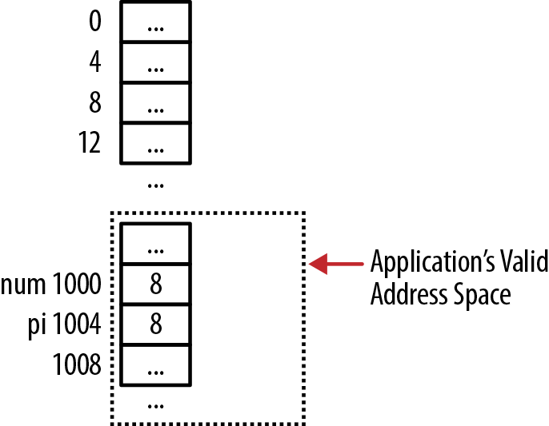
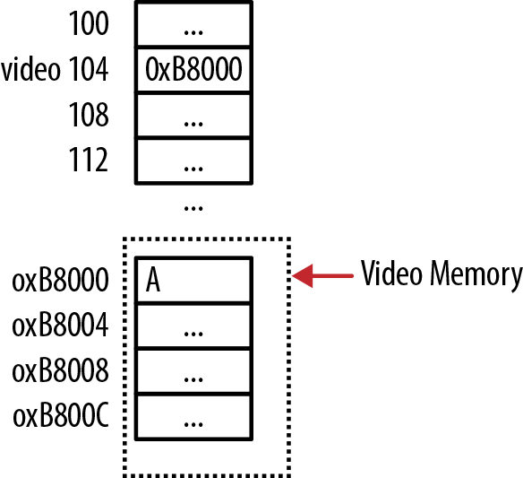
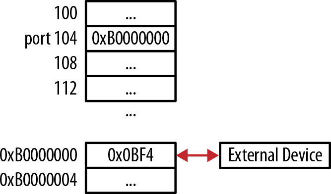
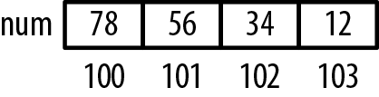
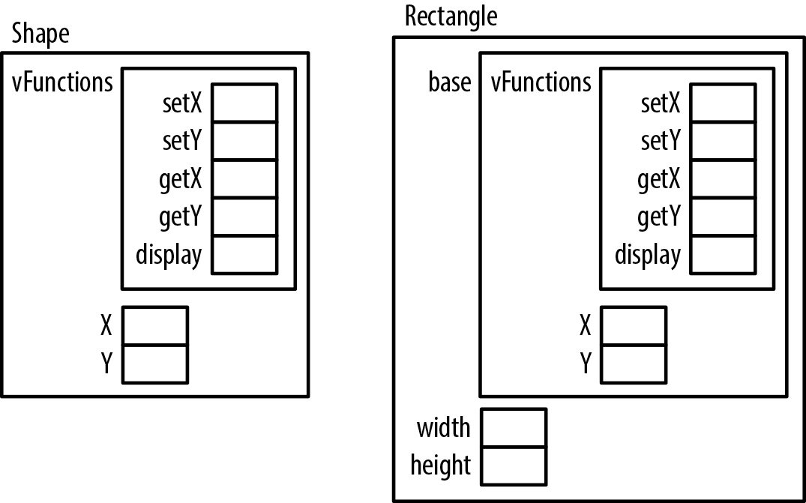

# Chương 8. Các chủ đề khác

Pointer thiết yếu với gần như mọi khía cạnh C. Nhiều lĩnh vực đã được xác định khá rõ như array và function. Chương này xem một số chủ đề không thật sự phù hợp các chương trước. Chúng sẽ hoàn thiện kiến thức về cách pointer hoạt động.

Chương này xem các chủ đề liên quan pointer:

- Cast pointer

- Truy cập hardware device

- Aliasing và strict aliasing

- Dùng keyword `restrict`

- Thread

- Kỹ thuật Object-oriented

Với thread, có hai lĩnh vực quan tâm. Đầu là vấn đề cơ bản chia sẻ data giữa thread bằng pointer. Thứ hai là dùng pointer hỗ trợ callback. Operation có thể gọi function thực hiện task. Khi function thực tế được gọi thay đổi, đó là callback function. Ví dụ sort function trong Chương 5 là callback function. Callback cũng dùng giao tiếp giữa thread.

Chúng ta trình bày hai cách hỗ trợ kiểu object-oriented trong C. Đầu dùng opaque pointer, giấu chi tiết implementation data structure khỏi người dùng. Kỹ thuật thứ hai minh họa tạo hành vi polymorphic type trong C.

## Cast pointer

Cast là operator cơ bản rất hữu ích với pointer. Cast pointer có ích vì nhiều lý do:

- Truy cập address cho mục đích đặc biệt

- Gán address biểu diễn port

- Xác định endianness của máy

Cũng sẽ bàn chủ đề gần với cast trong “Dùng union biểu diễn giá trị theo nhiều cách” trang 182.


Endianness của máy thường chỉ thứ tự byte trong data type. Hai loại phổ biến là little endian và big endian. Little endian lưu low-order byte tại address thấp nhất; big endian lưu high-order byte tại address thấp nhất.

Có thể cast integer thành pointer đến integer như sau:

```
int num = 8;
int *pi = (int*)num;
```

Tuy nhiên, thường không tốt vì cho phép truy cập address tùy ý, có thể là vị trí chương trình không có quyền. Hình 8-1 minh họa address 8 ngoài address space application. Dereference pointer thường làm application kết thúc.



Hình 8-1. Cast integer thành vị trí sai Trong một số tình huống như cần truy cập memory location zero, có thể phải cast pointer sang integer rồi trở lại pointer. Điều này phổ biến hơn ở hệ thống cũ có pointer cùng kích thước integer, nhưng không phải luôn hoạt động. Sau đây minh họa với output implementation-dependent:

```
pi = &num;
printf("Before: %p\n",pi);
int tmp = (int)pi;
pi = (int*)tmp;
printf("After: %p\n",pi);
```

Cast pointer sang integer rồi trở lại chưa bao giờ là thực hành tốt. Nếu phải làm, cân nhắc union như mục “Dùng union biểu diễn giá trị theo nhiều cách” trang 182.

Nhớ rằng cast sang và từ integer khác cast sang và từ void, như “Pointer đến void” trang 14 minh họa.


Handle đôi khi bị nhầm với pointer. Handle là tham chiếu đến system resource. Nó cho phép truy cập resource, nhưng thường không trực tiếp. Ngược lại, pointer chứa address resource.

### Truy cập address cho mục đích đặc biệt

Nhu cầu này thường xảy ra trên embedded system với operating system can thiệp tối thiểu. Ví dụ trong một số OS kernel low-level, address video RAM của PC là 0xB8000, chứa character hiển thị tại row đầu, column đầu trong text mode. Có thể gán address cho pointer rồi gán character vào đó như sau. Hình 8-2 cho memory layout:

```
#define VIDEO_BASE 0xB8000
int *video = (int *) VIDEO_BASE;
*video = 'A';
```

Nếu thích hợp, cũng có thể đọc address này. Thường không làm vậy với video memory.

Khi cần truy cập memory tại zero, đôi khi compiler coi đó là pointer value `NULL`. Truy cập zero thường cần trong kernel program low-level. Một số kỹ thuật xử lý:

- Đặt pointer bằng zero (không phải luôn hoạt động)

- Gán zero cho integer rồi cast integer thành pointer



Hình 8-2. Truy cập video memory trên PC

- Dùng union như mục “Dùng union biểu diễn giá trị theo nhiều cách” trang 182

- Dùng function `memset` gán zero cho pointer

Ví dụ dùng `memset` như sau. Memory mà `ptr` tham chiếu được đặt toàn zero:

```
memset((void*)&ptr, 0, sizeof(ptr));
```

Trên hệ thống cần truy cập vị trí zero, nhà cung cấp thường có workaround.

### Truy cập port

Port là khái niệm hardware lẫn software. Server dùng software port để chỉ việc nhận một số message gửi tới máy. Hardware port thường là thành phần input/output vật lý nối external device. Đọc hoặc ghi hardware port cho phép chương trình xử lý thông tin và command.

Software truy cập port thường thuộc OS. Sau đây minh họa pointer truy cập port:

```
#define PORT 0xB0000000
unsigned int volatile * const port = (unsigned int *) PORT;
```

Máy dùng hexadecimal address chỉ port. Data được xem là unsigned integer. Qualifier keyword `volatile` chỉ variable có thể thay đổi ngoài chương trình. Ví dụ external device ghi data vào port độc lập với processor máy tính. Đôi khi compiler dùng tạm cache hoặc register giữ giá trị tại memory location để tối ưu. Nếu external write sửa memory location, thay đổi không phản ánh trong giá trị cache hoặc register.

Dùng volatile ngăn runtime system dùng register tạm lưu port value. Mỗi truy cập buộc hệ thống đọc hoặc ghi port thay vì đọc giá trị có thể lỗi thời trong register. Không nên khai báo mọi variable volatile vì ngăn compiler thực hiện một số optimization.

Application có thể đọc/ghi port bằng dereference port pointer như sau. Hình 8-3 minh họa memory, External Device có thể đọc/ghi tại 0xB0000000:

```
*port = 0x0BF4; // write to the port
value = *port; // read from the port
```



Hình 8-3. Truy cập port


Không nên truy cập volatile memory bằng nonvolatile variable. Có thể dẫn tới undefined behavior.

### Truy cập memory bằng DMA

Direct Memory Access (DMA) là operation low-level hỗ trợ truyền data giữa main memory và device. Không thuộc ANSI C specification nhưng operating system thường hỗ trợ. DMA thường chạy song song CPU, giải phóng CPU xử lý việc khác và có thể tăng performance.

Programmer gọi DMA function rồi đợi hoàn tất. Thường programmer cung cấp callback function. Khi hoàn tất, operating system gọi callback. Callback được chỉ định bằng function pointer, sẽ bàn thêm trong “Dùng function pointer hỗ trợ callback” trang 188.

### Xác định endianness của máy

Cast operator cũng xác định endianness architecture. Endian chỉ thứ tự byte trong một đơn vị memory, thường little endian hoặc big endian. Ví dụ integer four-byte theo little endian lưu least significant byte ở address thấp nhất trong bốn byte.

Ví dụ sau cast address integer thành pointer đến `char`, rồi hiển thị từng byte:

```
int num = 0x12345678;
char* pc = (char*) &num;
for (int i = 0; i < 4; i++) {
    printf("%p: %02x \n", pc, (unsigned char) *pc++);
}
```

Output chạy trên Intel PC phản ánh architecture little-endian như sau. Hình 8-4 minh họa các giá trị trong memory:

```
100: 78
101: 56
102: 34
103: 12
```



Hình 8-4. Ví dụ endian

## Aliasing, strict aliasing và keyword restrict

Pointer này được gọi là alias pointer kia nếu cùng tham chiếu một memory location. Không hiếm, và có thể gây nhiều vấn đề. Chuỗi sau khai báo hai pointer rồi gán cùng address:

```
int num = 5;
int* p1 = &num;
int* p2 = &num;
```

Khi sinh code cho pointer, compiler phải giả định có aliasing trừ khi được thông báo khác. Aliasing đặt hạn chế lên code compiler-generated. Nếu hai pointer trỏ cùng vị trí, cả hai có thể sửa nó. Khi sinh code đọc/ghi, compiler không phải luôn tối ưu bằng lưu register được. Nó buộc thực hiện operation load/store machine-level mỗi tham chiếu. Lặp load/store có thể không hiệu quả. Trong một số tình huống còn phải quan tâm thứ tự operation.

Strict aliasing là dạng aliasing khác: không cho pointer của data type này alias pointer của data type khác. Chuỗi sau pointer integer alias pointer float, vi phạm strict aliasing rule. Chuỗi xác định số âm không. Thay vì so argument với zero để xem có dương không, cách này chạy nhanh hơn:

```
float number = 3.25f;
unsigned int *ptrValue = (unsigned int *)&number;
unsigned int result = (*ptrValue & 0x80000000) == 0;
```


Strict aliasing không áp cho pointer chỉ khác sign hoặc qualifier. Các trường hợp sau đều là strict alias hợp lệ:

```
int num;
const int *ptr1 = &num;
int *ptr2 = &num;
int volatile ptr3 = &num;
```

Tuy nhiên, có lúc dùng nhiều biểu diễn của cùng data hữu ích. Có các kỹ thuật tránh vấn đề aliasing:

- Dùng union

- Tắt strict aliasing

- Dùng pointer đến `char`

Union của hai data type có thể tránh strict aliasing problem, như “Dùng union biểu diễn giá trị theo nhiều cách” trang 182. Nếu compiler có option tắt strict aliasing, có thể tắt. GCC có option:

- `-fno-strict-aliasing` để tắt

- `-fstrict-aliasing` để bật

- `-Wstrict-aliasing` cảnh báo vấn đề aliasing-related của strict aliasing

Code đòi tắt strict aliasing có lẽ phản ánh cách truy cập memory chưa tốt. Khi có thể, hãy giải quyết vấn đề thay vì tắt.


Compiler không phải luôn báo alias-related warning tốt. Đôi lúc bỏ sót alias hoặc báo khi không có vấn đề. Cuối cùng programmer chịu trách nhiệm xác định alias condition.

Pointer đến `char` luôn được giả định có thể alias mọi object, nên dùng an toàn trong phần lớn tình huống. Nhưng cast pointer của data type này sang pointer đến `char`, rồi cast pointer đến `char` thành pointer data type thứ hai gây undefined behavior, nên tránh.

### Dùng union biểu diễn giá trị theo nhiều cách

C là typed language. Khi khai báo variable, gán type cho nó. Nhiều variable có thể có type khác nhau. Đôi khi muốn chuyển type này sang type khác, thường bằng cast nhưng cũng có thể dùng union. Type punning chỉ kỹ thuật phá rào type system.

Khi chuyển đổi liên quan pointer, có thể gây vấn đề nghiêm trọng. Để minh họa dùng ba function xác định floating point number có dương không.

Function đầu dùng union float và unsigned integer. Trước tiên gán floating point value cho union rồi lấy integer để kiểm tra:

```
typedef union _conversion {
    float fNum;
    unsigned int uiNum;
} Conversion;

int isPositive1(float number) {
    Conversion conversion = { .fNum =number};
    return (conversion.uiNum & 0x80000000) == 0;
}
```

Cách này đúng và không có aliasing vì không có pointer. Phiên bản tiếp dùng union chứa pointer đến hai data type. Address floating point number được gán cho pointer đầu, rồi dereference integer pointer để kiểm tra. Điều này vi phạm strict aliasing rule:

```
typedef union _conversion2 {
    float *fNum;
    unsigned int *uiNum;
} Conversion2;

int isPositive2(float number) {
    Conversion2 conversion;
    conversion.fNum =&number;
    return (*conversion.uiNum & 0x80000000) == 0;
}
```

Function sau không dùng union và vi phạm strict aliasing vì pointer `ptrValue` cùng address với `number`:

```
int isPositive3(float number) {
    unsigned int *ptrValue = (unsigned int *)&number;
    return (*ptrValue & 0x80000000) == 0;
}
```

Cách các function này dùng giả định:

- Chuẩn floating point IEEE-754 dùng biểu diễn floating point number

- Floating number được bố trí theo cách cụ thể

- Integer và floating point pointer được align đúng

Các giả định không phải luôn đúng. Dù tối ưu operation được, cách này không luôn portable. Khi portability quan trọng, so sánh floating point là cách tốt hơn.

### Strict aliasing

Compiler không cưỡng chế strict aliasing, chỉ sinh warning. Nó giả định hai hay nhiều pointer khác type không bao giờ tham chiếu cùng object, kể cả pointer đến structure khác tên nhưng phần khác giống hệt. Strict aliasing cho phép một số optimization. Nếu giả định sai, có thể có kết quả ngoài dự kiến.

Ngay cả nếu hai structure có cùng field nhưng khác tên, hai pointer đến chúng không nên tham chiếu cùng object. Ví dụ sau giả định pointer `person` và `employee` không bao giờ tham chiếu cùng object:

```
typedef struct _person {
    char* firstName;
    char* lastName;
    unsigned int age;
} Person;

typedef struct _employee {
    char* firstName;
    char* lastName;
    unsigned int age;
} Employee;

Person* person;
Employee* employee;
```

Tuy nhiên, pointer có thể tham chiếu cùng object nếu structure definition chỉ khác tên như sau:

```
typedef struct _person {
    char* firstName;
    char* lastName;
    unsigned int age;
} Person;

typedef Person Employee;

Person* person;
Employee* employee;
```

### Dùng keyword restrict

C compiler mặc định giả định pointer có alias. Keyword `restrict` trong declaration thông báo pointer không alias, cho phép sinh code hiệu quả hơn, thường bằng caching pointer. Nhớ đây chỉ là khuyến nghị, compiler có thể không tối ưu. Nếu dùng alias thì code gây undefined behavior; compiler không cảnh báo khi vi phạm giả định.


Khi phát triển code mới nên dùng `restrict` với phần lớn pointer declaration để tối ưu tốt hơn. Sửa code cũ có thể không đáng công.

Function sau minh họa định nghĩa và dùng `restrict`, cộng hai vector rồi lưu vào vector đầu:

```
void add(int size, double * restrict arr1, const double * restrict arr2) {
    for (int i = 0; i < size; i++) {
        arr1[i] += arr2[i];
    }
}
```

Keyword `restrict` dùng với cả hai array parameter, nhưng chúng không nên cùng tham chiếu một block. Cách đúng:

```
double vector1[] = {1.1, 2.2, 3.3, 4.4};
double vector2[] = {1.1, 2.2, 3.3, 4.4};
```

```
add(4,vector1,vector2);
```

Chuỗi sau gọi sai khi cùng vector được truyền cho cả hai parameter. Câu đầu dùng alias, câu hai dùng cùng vector hai lần:

```
double vector1[] = {1.1, 2.2, 3.3, 4.4};
double *vector3 = vector1;

add(4,vector1,vector3);
add(4,vector1,vector1);
```

Dù đôi lúc chạy đúng, kết quả lời gọi có thể không đáng tin.

Một số standard C function dùng `restrict`, gồm:

- `void *memcpy(void * restrict s1, const void * restrict s2, size_t n);`

- `char *strcpy(char * restrict s1, const char * restrict s2);`

- `char *strncpy(char * restrict s1, const char * restrict s2, size_t n);`

- `int printf(const char * restrict format, ... );`

- i`nt sprintf(char * restrict s, const char * restrict format, ... );`

- i`nt snprintf(char * restrict s, size_t n, const char * restrict for` `mat, ... );`

- `int scanf(const char * restrict format, ...);`

Keyword `restrict` có hai ý nghĩa:

1\. Với compiler, có thể thực hiện một số code optimization

2\. Với programmer, những pointer này không nên alias; nếu không,

kết quả operation là undefined.

## Thread và pointer

Nhiều vấn đề có thể xảy ra khi thread chia sẻ data, phổ biến là data corruption. Một thread có thể ghi object rồi bị tạm suspend, để object ở trạng thái không nhất quán. Thread thứ hai đọc object trước khi thread đầu resume, nên dùng object không hợp lệ hoặc đã hỏng.

Vì pointer thường tham chiếu data trong thread khác, sẽ xét vấn đề ảnh hưởng xấu multithreaded application. Như các ví dụ sẽ cho thấy, mutex thường dùng bảo vệ data.

Chuẩn C11 triển khai threading nhưng hiện chưa hỗ trợ rộng. Có nhiều library hỗ trợ thread trong C. Dùng Portable Operating System Interface (POSIX) thread vì sẵn có. Bất kể library, kỹ thuật ở đây vẫn áp dụng được. Dùng pointer hỗ trợ multithreaded application và callback. Thread là chủ đề phức tạp; giả định bạn quen khái niệm, thuật ngữ cơ bản, nên không đi sâu cách POSIX thread function hoạt động. Hãy xem PThreads Programming của O’Reilly để có thảo luận chi tiết hơn.

### Chia sẻ pointer giữa các thread

Khi hai hoặc nhiều thread chia sẻ data, data có thể hỏng. Để minh họa, triển khai function multi-threaded tính dot product hai vector. Nhiều thread đồng thời truy cập hai vector và field sum. Khi hoàn tất, sum chứa dot product.

Dot product được tính bằng tổng tích element tương ứng mỗi vector. Dùng hai data structure hỗ trợ. Đầu là `VectorInfo`, chứa thông tin hai vector, có pointer đến chúng, field `sum` giữ dot product và field `length` chỉ kích thước đoạn vector dot product function dùng. Field `length` biểu diễn phần thread xử lý, không phải toàn độ dài:

```
typedef struct {
    double *vectorA;
    double *vectorB;
    double sum;
    int length;
} VectorInfo;
```

Data structure thứ hai, `Product`, chứa pointer đến instance `VectorInfo` và starting index mà vector dot `Product` dùng. Tạo instance mới cho mỗi thread với starting index khác:

```
typedef struct {
    VectorInfo *info;
    int beginningIndex;
} Product;
```

Dù mỗi thread đồng thời thao tác cả hai vector, chúng truy cập phần khác nhau nên không xung đột. Mỗi thread tính tổng phần mình. Nhưng tổng phải thêm vào field `sum` của structure `VectorInfo`. Vì nhiều thread có thể truy cập `sum` đồng thời, cần mutex bảo vệ như dưới. Mutex chỉ cho một thread truy cập variable được bảo vệ tại một thời điểm. Sau đây khai báo mutex bảo vệ variable `sum`, ở global level để nhiều thread truy cập:

```
pthread_mutex_t mutexSum;
```

Function `dotProduct` như sau. Khi tạo thread, function này được gọi. Vì dùng POSIX, cần khai báo trả void và nhận pointer đến void. Pointer truyền thông tin cho function; chúng ta truyền instance structure `Product`.

Trong function, khai báo variable giữ starting/ending index. For loop thực hiện phép nhân, giữ tổng cộng dồn trong `total`. Phần cuối lock mutex, thêm `total` vào `sum`, rồi unlock. Khi mutex lock, không thread khác truy cập variable `sum` được:

```
void dotProduct(void *prod) {
    Product *product = (Product*)prod;
    VectorInfo *vectorInfo = Product->info;
    int beginningIndex = Product->beginningIndex;
    int endingIndex = beginningIndex + vectorInfo->length;
    double total = 0;

    for (int i = beginningIndex; i < endingIndex; i++) {
        total += (vectorInfo->vectorA[i] * vectorInfo->vectorB[i]);
    }

    pthread_mutex_lock(&mutexSum);
    vectorInfo->sum += total;
    pthread_mutex_unlock(&mutexSum);

    pthread_exit((void*) 0);
}
```

Code tạo thread như sau. Khai báo hai vector đơn giản cùng instance `VectorInfo`. Mỗi vector 16 element. Field `length` đặt 4:

```
#define NUM_THREADS  4

void threadExample() {
    VectorInfo vectorInfo;
    double vectorA[] = {1.0, 2.0, 3.0, 4.0, 5.0, 6.0, 7.0, 8.0,
        9.0, 10.0, 11.0, 12.0, 13.0, 14.0, 15.0, 16.0};
    double vectorB[] = {1.0, 2.0, 3.0, 4.0, 5.0, 6.0, 7.0, 8.0,
        9.0, 10.0, 11.0, 12.0, 13.0, 14.0, 15.0, 16.0};

    double sum;

    vectorInfo.vectorA = vectorA;
    vectorInfo.vectorB = vectorB;
    vectorInfo.length = 4;
```

Tiếp theo tạo array thread four-element, cùng code khởi tạo mutex và attribute field cho thread:

```
pthread_t threads[NUM_THREADS];

void *status;
pthread_attr_t attr;

pthread_mutex_init(&mutexSum, NULL);
pthread_attr_init(&attr);
pthread_attr_setdetachstate(&attr, PTHREAD_CREATE_JOINABLE);

int returnValue;
int threadNumber;
```

Mỗi vòng for tạo instance structure `Product`, gán address `vectorInfo` và index riêng theo `threadNumber`. Sau đó tạo thread:

```
for (threadNumber = 0; threadNumber < NUM_THREADS; threadNumber++) {
    Product *product = (Product*) malloc(sizeof(Product));
    product->beginningIndex = threadNumber * 4;
    product->info = &vectorInfo;
    returnValue = pthread_create(&threads[threadNumber], &attr,
                        dotProduct, (void *) (void*) (product));
    if (returnValue) {
        printf("ERROR; Unable to create thread: %d\n", returnValue);
        exit(-1);
    }
}
```

Sau loop `for`, hủy thread attribute và mutex variable. Loop `for` bảo đảm chương trình đợi cả bốn thread hoàn tất. Sau đó hiển thị dot product, bằng 1496 cho các vector trên:

```
    pthread_attr_destroy(&attr);

    for (int i = 0; i < NUM_THREADS; i++) {
        pthread_join(threads[i], &status);
    }

    pthread_mutex_destroy(&mutexSum);
    printf("Dot Product sum: %lf\n", vectorInfo.sum);
    pthread_exit(NULL);

}
```

Như vậy field `sum` được bảo vệ.

### Dùng function pointer hỗ trợ callback

Trước đó đã dùng callback trong sort function ở Chương 5. Vì sort không dùng nhiều thread, một số programmer không gọi đây là callback. Định nghĩa được chấp nhận rộng hơn là event trong thread này dẫn đến gọi, hay callback, function trong thread khác. Một thread được truyền function pointer đến callback. Event trong function có thể kích hoạt lời gọi callback. Cách này hữu ích trong GUI application xử lý user thread event.

Minh họa bằng function tính factorial của một số. Khi tính xong, function callback function thứ hai. Thông tin factorial được encapsulate trong structure `FactorialData`, truyền giữa các function. Structure và factorial function như dưới. Data gồm số cần tính, kết quả, function pointer callback. Function `factorial` dùng data tính factorial, lưu vào field `result`, gọi callback rồi kết thúc thread:

```
typedef struct _factorialData {
    int number;
    int result;
    void (*callBack)(struct _factorialData*);
} FactorialData;

void factorial(void *args) {
    FactorialData *factorialData = (FactorialData*) args;
    void (*callBack)(FactorialData*); // Function prototype

    int number = factorialData->number;
    callBack = factorialData->callBack;

    int num = 1;
    for(int i = 1; i<=number; i++) {
        num *= i;
    }

    factorialData->result = num;
    callBack(factorialData);

    pthread_exit(NULL);
}
```

Thread được tạo trong `startThread` sau, chạy `factorial` và truyền factorial data:

```
void startThread(FactorialData *data) {
    pthread_t thread_id;
    int thread =  pthread_create(&thread_id, NULL, factorial, (void *) data);
}
```

Callback chỉ hiển thị kết quả factorial:

```
void callBackFunction(FactorialData *factorialData) {
    printf("Factorial is %d\n", factorialData->result);
}
```

Khởi tạo factorial data rồi gọi `startThread` như sau. Function `Sleep` dành thời gian để mọi thread kết thúc đúng:

```
FactorialData *data =
    (FactorialData*) malloc(sizeof(FactorialData));

if(!data) {
    printf("Failed to allocate memory\n");
    return;
}

data->number = 5;
data->callBack = callBackFunction;

startThread(data);

Sleep(2000);
```

Khi chạy, output như sau:

```
Factorial is 120
```

Thay vì sleep, chương trình có thể làm task khác. Không phải đợi thread hoàn tất.

## Kỹ thuật Object-Oriented

C không nổi tiếng về hỗ trợ object-oriented programming. Nhưng có thể dùng opaque pointer encapsulate data và hỗ trợ một mức polymorphic behavior. Giấu implementation data structure cùng supporting function khiến người dùng không cần biết cách triển khai. Giấu thông tin giảm điều cần biết, từ đó giảm độ phức tạp application. Người dùng cũng không bị hấp dẫn khai thác chi tiết nội bộ, có thể gây vấn đề sau khi implementation đổi.

Polymorphic behavior giúp application dễ bảo trì. Hành vi polymorphic function phụ thuộc object nó thao tác. Nghĩa là dễ thêm chức năng hơn.

### Tạo và dùng opaque pointer

Opaque pointer thực hiện data encapsulation trong C. Một cách khai báo structure không chi tiết implementation trong header file, rồi định nghĩa function làm việc với implementation cụ thể trong implementation file. Người dùng thấy declaration và function prototype, còn implementation ẩn trong .c/.obj file. Chỉ thông tin cần dùng data structure được công khai. Nếu lộ quá nhiều, người dùng có thể dùng và phụ thuộc. Khi cấu trúc nội bộ đổi, code người dùng có thể hỏng.

Phát triển linked list minh họa opaque pointer. Người dùng gọi một function lấy pointer đến list, rồi dùng thêm/xóa thông tin. Chi tiết cấu trúc nội bộ và supporting function không được cung cấp. Các khía cạnh duy nhất được cung cấp qua header file như sau:

```
//link.h

typedef void *Data;
typedef struct _linkedList LinkedList;

LinkedList* getLinkedListInstance();
void removeLinkedListInstance(LinkedList* list);
void addNode(LinkedList*, Data);
Data removeNode(LinkedList*);
```

Data khai báo pointer đến void, cho implementation xử lý mọi data type. Type definition `LinkedList` xác định structure `_linkedList`. Định nghĩa structure bị giấu trong implementation file.

Có bốn method để dùng list. Đầu tiên lấy instance `LinkedList` bằng `getLinkedListInstance`. Khi không cần, gọi `removeLinkedListInstance`. Truyền pointer linked list cho phép function làm việc với một hoặc nhiều list.

Để thêm data dùng `addNode`, nhận list cần dùng và pointer đến data. Method `removeNode` trả data ở head.

Implementation nằm trong file link.c riêng. Phần đầu dưới khai báo variable giữ data người dùng và nối node kế. Tiếp theo định nghĩa structure `_linkedList`. Linked list đơn giản này chỉ dùng head pointer:

```
// link.c

#include <stdlib.h>
#include "link.h"

typedef struct _node {
      Data* data;
      struct _node* next;
} Node;
struct _linkedList {
    Node* head;
};
```

Phần hai implementation file triển khai bốn supporting function. Function đầu trả instance linked list:

```
LinkedList* getLinkedListInstance() {
    LinkedList* list = (LinkedList*)malloc(sizeof(LinkedList));
    list->head = NULL;
    return list;
}
```

Implementation `removeLinkedListInstance` sau giải phóng từng node nếu có, rồi free chính list. Có thể gây memory leak nếu data do node tham chiếu chứa pointer. Một giải pháp là truyền function giải phóng member của data:

```
void removeLinkedListInstance(LinkedList* list) {
    Node *tmp = list->head;
    while(tmp != NULL) {
        free(tmp->data);  // Potential memory leak!
        Node *current = tmp;
        tmp = tmp->next;
        free(current);
    }
    free(list);
}
```

Function `addNode` thêm data ở parameter hai vào list ở parameter đầu. Cấp memory node rồi liên kết data người dùng. Implementation này luôn thêm node vào head:

```
void addNode(LinkedList* list, Data data) {
    Node *node = (Node*)malloc(sizeof(Node));
    node->data = data;
    if(list->head == NULL) {
        list->head = node;
        node->next = NULL;
    } else {
        node->next = list->head;
        list->head = node;
    }
}
```

Function `removeNode` trả data của node đầu. Điều chỉnh head pointer sang node kế. Trả data và free head cũ về heap.


Cách này loại nhu cầu nhớ free node, tránh memory leak. Đây là lợi thế đáng kể của giấu implementation detail:

```
Data removeNode(LinkedList* list) {
    if(list->head == NULL) {
        return NULL;
    } else {
        Node* tmp = list->head;
        Data* data;
        list->head = list->head->next;
        data = tmp->data;
        free(tmp);
        return data;
    }
}
```

Để minh họa, tái sử dụng structure `Person` và function trong “Giới thiệu” trang 133. Chuỗi sau thêm hai người vào list rồi xóa. Đầu gọi `getLinkedListInstance` lấy list. Tiếp theo tạo instance `Person` bằng `initializePerson`, thêm vào bằng `addNode`. Function `displayPerson` hiển thị người mà function `remove` `Node` trả. Cuối cùng free list:

```
#include "link.h";
...
    LinkedList* list = getLinkedListInstance();
```

```
Person *person = (Person*) malloc(sizeof(Person));
initializePerson(person, "Peter", "Underwood", "Manager", 36);
addNode(list, person);
person = (Person*) malloc(sizeof(Person));
initializePerson(person, "Sue", "Stevenson", "Developer", 28);
addNode(list, person);

person = removeNode(list);
displayPerson(*person);

person = removeNode(list);
displayPerson(*person);
```

```
removeLinkedListInstance(list);
```

Có vài điểm thú vị. Phải tạo instance structure `_linkedList` trong list.c, vì operator `sizeof` không dùng được nếu chưa có complete structure declaration. Ví dụ cố cấp memory trong main như sau sẽ syntax error:

```
LinkedList* list = (LinkedList*)malloc(sizeof(LinkedList));
```

Syntax error tương tự:

```
error: invalid application of ‘sizeof’ to incomplete type ‘LinkedList’
```

Type incomplete vì compiler không thấy định nghĩa thực trong list.c. Nó chỉ thấy type definition của structure `_linkedList`, không thấy chi tiết implementation.

Khả năng xem và khai thác cấu trúc nội bộ list của người dùng bị hạn chế. Mọi thay đổi structure được giấu.

Chỉ signature bốn supporting function hiển thị. Ngoài ra, người dùng không dùng kiến thức implementation hoặc sửa chúng được. Structure và function được encapsulate, giảm gánh nặng người dùng.

### Polymorphism trong C

Polymorphism trong ngôn ngữ object-oriented như C++ dựa inheritance giữa base và derived class. Vì C không hỗ trợ inheritance, cần mô phỏng giữa structure. Định nghĩa và dùng hai structure minh họa. `Shape` biểu diễn base “class”; structure `Rectangle` dẫn xuất từ base `Shape`.

Thứ tự cấp variable của structure ảnh hưởng lớn kỹ thuật. Khi tạo instance derived class/structure, variable base được cấp trước, rồi variable derived. Như sẽ thấy, cũng cần tính các function định override.


Hiểu cấp memory cho object tạo từ class là chìa khóa hiểu inheritance và polymorphism trong ngôn ngữ object-oriented. Tương tự khi dùng kỹ thuật này trong C.

Bắt đầu định nghĩa `Shape` như sau. Trước tiên cấp structure chứa function pointer. Tiếp theo khai báo integer cho vị trí `x` và `y`:

```
typedef struct _shape {
    vFunctions functions;
    // Base variables
    int x;
    int y;
} Shape;
```

Structure `vFunction` và supporting declaration như sau. Khi function thao tác class/structure, hành vi tùy đối tượng. Display trên `Shape` phải hiển thị `Shape`; trên `Rectangle` phải hiển thị `Rectangle`. Ngôn ngữ object-oriented thường dùng Virtual Table hay VTable. Structure `vFunction` phục vụ vai trò này:

```
typedef void (*fptrSet)(void*,int);
typedef int (*fptrGet)(void*);
typedef void (*fptrDisplay)();

typedef struct _functions {
    // Functions
    fptrSet setX;
    fptrGet getX;
    fptrSet setY;
    fptrGet getY;
    fptrDisplay display;
} vFunctions;
```

Structure gồm nhiều function pointer. `fptrSet` và `fptrGet` định nghĩa getter/setter thông thường cho integer data. Ở đây dùng lấy/đặt giá trị `x`, `y` cho `Shape` hoặc `Rectangle`. Function pointer `fptrDisplay` định nghĩa function nhận `void` và trả `void`. Dùng display minh họa polymorphic behavior.

Structure `Shape` có bốn function làm việc với nó như dưới. Implementation đơn giản. Để ví dụ gọn, function `display` chỉ in string “Shape.” Truyền instance `Shape` làm argument đầu, cho phép function làm việc với nhiều instance `Shape`:

```
void shapeDisplay(Shape *shape) { printf("Shape\n");}
void shapeSetX(Shape *shape, int x) {shape->x = x;}
void shapeSetY(Shape *shape, int y) {shape->y = y;}
int shapeGetX(Shape *shape) { return shape->x;}
int shapeGetY(Shape *shape) { return shape->y;}
```

Để hỗ trợ tạo instance `Shape`, có function `getShapeInstance`, cấp memory object rồi gán các function:

```
Shape* getShapeInstance() {
    Shape *shape = (Shape*)malloc(sizeof(Shape));
    shape->functions.display = shapeDisplay;
    shape->functions.setX = shapeSetX;
    shape->functions.getX = shapeGetX;
    shape->functions.setY = shapeSetY;
    shape->functions.getY = shapeGetY;
    shape->x = 100;
    shape->y = 100;
    return shape;
}
```

Chuỗi sau minh họa:

```
Shape *sptr = getShapeInstance();
sptr->functions.setX(sptr,35);
sptr->functions.display();
printf("%d\n", sptr->functions.getX(sptr));
```

Output là:

```
Shape
35
```

Có vẻ tốn nhiều công chỉ để làm việc với `Shape`. Sức mạnh thực hiện ra khi tạo structure dẫn xuất từ `Shape`: `Rectangle`, như sau:

```
typedef struct _rectangle {
    Shape base;
    int width;
    int height;
} Rectangle;
```

Memory cấp cho field đầu structure `Rectangle` giống memory cho structure `Shape`, như Hình 8-5. Ngoài ra thêm field `width` và `height` biểu diễn đặc tính hình chữ nhật.



Hình 8-5. Memory allocation cho shape và rectangle `Rectangle`, như `Shape`, cần function liên quan, khai báo dưới. Chúng giống function của structure `Shape`, nhưng dùng base field của `Rectangle`:

```
void rectangleSetX(Rectangle *rectangle, int x) {
    rectangle->base.x = x;
}

void rectangleSetY(Rectangle *rectangle, int y) {
    rectangle->base.y;
}

int rectangleGetX(Rectangle *rectangle) {
    return rectangle->base.x;
}

int rectangleGetY(Rectangle *rectangle) {
    return rectangle->base.y;
}

void rectangleDisplay() {
    printf("Rectangle\n");
}
```

Function `getRectangleInstance` trả instance structure `Rectangle` như sau:

```
Rectangle* getRectangleInstance() {
    Rectangle *rectangle = (Rectangle*)malloc(sizeof(Rectangle));
    rectangle->base.functions.display = rectangleDisplay;
    rectangle->base.functions.setX = rectangleSetX;
    rectangle->base.functions.getX = rectangleGetX;
    rectangle->base.functions.setY = rectangleSetY;
    rectangle->base.functions.getY = rectangleGetY;
    rectangle->base.x = 200;
    rectangle->base.y = 200;
    rectangle->height = 300;
    rectangle->width = 500;
    return rectangle;
}
```

Sau đây minh họa cách dùng structure:

```
Rectangle *rptr = getRectangleInstance();
rptr->base.functions.setX(rptr,35);
rptr->base.functions.display();
printf("%d\n", rptr->base.functions.getX(rptr));
```

Output là:

```
Rectangle
35
```

Giờ tạo array pointer `Shape` và khởi tạo như sau. Khi gán `Rectangle` cho `shapes[1]`, không bắt buộc cast `(Shape*)`, nhưng nếu không sẽ warning:

```
Shape *shapes[3];
shapes[0] = getShapeInstance();
shapes[0]->functions.setX(shapes[0],35);
shapes[1] = getRectangleInstance();
shapes[1]->functions.setX(shapes[1],45);
shapes[2] = getShapeInstance();
shapes[2]->functions.setX(shapes[2],55);

for(int i=0; i<3; i++) {
    shapes[i]->functions.display();
    printf("%d\n", shapes[i]->functions.getX(shapes[i]));
}
```

Khi chạy chuỗi, output:

```
Shape
35
Rectangle
45
Shape
55
```

Dù tạo array pointer `Shape`, chúng ta tạo `Rectangle` rồi gán cho element thứ hai. Khi hiển thị trong for loop, nó dùng hành vi function của `Rectangle`, không của `Shape`. Đây là polymorphic behavior. Function `display` phụ thuộc structure nó thao tác.

Vì truy cập dưới dạng `Shape`, không nên cố truy cập width hoặc height qua `shapes[i]`, vì element có thể tham chiếu `Rectangle` hoặc không. Nếu làm, có thể truy cập memory trong shape khác không biểu diễn width/height, gây kết quả khó dự đoán.

Nay có thể thêm structure thứ hai dẫn xuất `Shape` như `Circle`, thêm vào array mà không sửa code nhiều. Cũng cần tạo function cho structure.

Nếu thêm function vào base structure `Shape`, như `getArea`, có thể triển khai `getArea` riêng từng class. Trong loop dễ tính tổng mọi `Shape` và structure dẫn xuất `Shape` mà không xác định trước type `Shape` đang làm việc. Nếu `Shape` có implementation `getArea` đủ dùng, không cần thêm cho structure khác. Điều này giúp bảo trì và mở rộng application dễ hơn.

## Tóm tắt

Chương này khám phá nhiều khía cạnh pointer, bắt đầu bằng cast. Ví dụ minh họa pointer truy cập memory và hardware port, cũng như xác định endianness máy.

Đã giới thiệu aliasing và keyword `restrict`. Aliasing xảy ra khi hai pointer tham chiếu cùng object. Compiler giả định có thể alias, nhưng khiến code generation kém hiệu quả. Keyword `restrict` cho phép tối ưu tốt hơn.

Đã thấy pointer dùng với thread và sự cần thiết bảo vệ data chia sẻ qua pointer. Ngoài ra, đã xét callback giữa thread bằng function pointer.

Phần cuối xét opaque pointer và polymorphic behavior. Opaque pointer cho phép C giấu data khỏi người dùng. Có thể đưa polymorphism vào chương trình để dễ bảo trì hơn.
