# A Các nguyên lý Instruction Set

> A n Cộng số tại vị trí lưu trữ n vào accumulator.

> E n Nếu số trong accumulator lớn hơn hoặc bằng không, tiếp theo thực thi lệnh tại vị trí lưu trữ n; nếu không, tiếp tục theo thứ tự.

> Z Dừng máy và rung chuông cảnh báo.

> Wilkes and Renwick

> Trích từ danh sách 18 Machine Instruction của EDSAC (1949)

## A.1 Giới thiệu

Trong phụ lục này, chúng ta tập trung vào instruction set architecture—phần của máy tính mà người lập trình hoặc người viết compiler có thể nhìn thấy. Phần lớn nội dung này nên là kiến thức ôn tập đối với độc giả của cuốn sách; chúng ta đưa nó vào đây để cung cấp kiến thức nền tảng. Phụ lục này giới thiệu rất nhiều phương án thiết kế mà người thiết kế instruction set có thể lựa chọn. Cụ thể, chúng ta tập trung vào bốn chủ đề. Trước hết, trình bày một hệ thống phân loại các phương án instruction set và đưa ra một số đánh giá định tính về ưu nhược điểm của những cách tiếp cận khác nhau. Thứ hai, trình bày và phân tích một số phép đo instruction set phần lớn độc lập với một instruction set cụ thể. Thứ ba, xem xét vấn đề ngôn ngữ và compiler cùng ảnh hưởng của chúng lên instruction set architecture. Cuối cùng, mục “Putting It All Together” cho thấy những ý tưởng này được phản ánh như thế nào trong MIPS instruction set, vốn điển hình cho các RISC architecture. Chúng ta kết thúc bằng những ngộ nhận và cạm bẫy trong thiết kế instruction set.

Để minh họa thêm các nguyên lý, Phụ lục K cũng đưa ra bốn ví dụ về RISC architecture general-purpose (MIPS, PowerPC, Precision Architecture, SPARC), bốn embedded RISC processor (ARM, Hitachi SH, MIPS 16, Thumb), và ba architecture cũ hơn (80x86, IBM 360/370 và VAX). Trước khi thảo luận cách phân loại architecture, cần đề cập đôi điều về phép đo instruction set.

Xuyên suốt phụ lục này, chúng ta xem xét rất nhiều phép đo architecture. Rõ ràng, những phép đo này phụ thuộc vào các chương trình được đo và các compiler được dùng khi thực hiện phép đo. Không nên diễn giải các kết quả là tuyệt đối, và bạn có thể thấy dữ liệu khác nếu thực hiện phép đo bằng một compiler khác hoặc một tập chương trình khác. Chúng tôi tin rằng các phép đo trong phụ lục này phản ánh tương đối hợp lý một nhóm ứng dụng điển hình. Nhiều phép đo được trình bày bằng một tập benchmark nhỏ, để có thể hiển thị dữ liệu hợp lý và nhìn thấy sự khác nhau giữa các chương trình. Người thiết kế một máy tính mới sẽ muốn phân tích một tập chương trình lớn hơn nhiều trước khi đưa ra các quyết định architecture. Các phép đo được thể hiện thường là dynamic—tức là tần suất của một sự kiện được đo được tính trọng số theo số lần sự kiện đó xảy ra trong quá trình thực thi chương trình được đo.

Trước khi bắt đầu với các nguyên lý tổng quát, hãy ôn lại ba lĩnh vực ứng dụng từ Chương 1. Desktop computing nhấn mạnh performance của các chương trình với các kiểu dữ liệu integer và floating-point, ít quan tâm đến kích thước chương trình. Chẳng hạn, kích thước code chưa bao giờ được báo cáo trong năm thế hệ SPEC benchmark. Server ngày nay chủ yếu được dùng cho database, file server và ứng dụng Web, cùng một số ứng dụng time-sharing cho nhiều người dùng. Vì vậy, floating-point performance ít quan trọng hơn nhiều đối với performance so với integer và chuỗi ký tự, nhưng hầu như mọi server processor vẫn bao gồm các floating-point instruction. Thiết bị di động cá nhân và ứng dụng embedded coi trọng chi phí và năng lượng, nên kích thước code quan trọng vì ít memory hơn vừa rẻ hơn vừa tiêu thụ ít năng lượng hơn, và một số nhóm instruction (như floating point) có thể là tùy chọn để giảm chi phí chip.

Vì thế, instruction set cho cả ba loại ứng dụng rất giống nhau. Thực tế, MIPS architecture làm nền tảng cho phụ lục này đã được dùng thành công trong desktop, server và ứng dụng embedded.

Một architecture thành công rất khác RISC là 80x86 (xem Phụ lục K). Đáng ngạc nhiên, thành công của nó không nhất thiết phủ nhận ưu điểm của một RISC instruction set. Tầm quan trọng thương mại của khả năng tương thích binary với PC software, kết hợp với lượng transistor dồi dào do định luật Moore mang lại, đã khiến Intel dùng một RISC instruction set bên trong trong khi hỗ trợ 80x86 instruction set bên ngoài. Các microprocessor 80x86 gần đây, như Pentium 4, dùng hardware để chuyển từ 80x86 instruction sang các instruction RISC-like rồi thực thi các phép toán đã chuyển đổi bên trong chip. Chúng duy trì hình ảnh về 80x86 architecture đối với người lập trình, đồng thời cho phép người thiết kế máy tính triển khai một processor RISC-style để đạt performance.

Sau khi có kiến thức nền tảng, chúng ta bắt đầu bằng việc khảo sát cách phân loại instruction set architecture.

## A.2 Phân loại Instruction Set Architecture

Loại lưu trữ bên trong một processor là điểm phân biệt cơ bản nhất, nên trong mục này chúng ta tập trung vào các phương án cho phần này của architecture. Những lựa chọn chính là stack, accumulator hoặc một tập register. Các toán hạng có thể được chỉ định tường minh hoặc ngầm định: Các toán hạng trong stack architecture ngầm định nằm ở đỉnh stack, và trong accumulator architecture một toán hạng ngầm định là accumulator. Các general-purpose register architecture chỉ có toán hạng tường minh—register hoặc vị trí memory. Hình A.1 cho thấy sơ đồ khối của các architecture này, và Hình A.2 cho thấy chuỗi code C = A + B thường xuất hiện như thế nào trong ba nhóm instruction set này. Các toán hạng tường minh có thể được truy cập trực tiếp từ memory hoặc cần được nạp trước vào vùng lưu trữ tạm thời, tùy theo nhóm architecture và lựa chọn instruction cụ thể.

Như các hình cho thấy, thực sự có hai nhóm máy tính register. Một nhóm có thể truy cập memory như một phần của bất kỳ instruction nào, gọi là register-memory architecture, và nhóm kia chỉ có thể truy cập memory bằng load instruction và store instruction, gọi là load-store architecture. Nhóm thứ ba, không có trong những máy tính được bán hiện nay, giữ tất cả toán hạng trong memory và được gọi là memory-memory architecture. Một số instruction set architecture có nhiều register hơn một accumulator duy nhất nhưng đặt ra hạn chế đối với việc dùng các register đặc biệt này. Một architecture như vậy đôi khi được gọi là máy tính extended accumulator hoặc special-purpose register.

Mặc dù phần lớn máy tính ban đầu dùng stack architecture hoặc accumulator-style architecture, hầu như mọi architecture mới được thiết kế sau năm 1980 đều dùng load-store register architecture. Có hai lý do chính cho sự xuất hiện của các máy tính general-purpose register (GPR). Thứ nhất, register—giống như những hình thức lưu trữ khác bên trong processor—nhanh hơn memory. Thứ hai, register hiệu quả hơn để compiler sử dụng so với các hình thức lưu trữ nội bộ khác. Chẳng hạn, trên một máy tính register, biểu thức (A * B) – (B * C) – (A * D) có thể được tính bằng cách thực hiện các phép nhân theo bất kỳ thứ tự nào, có thể hiệu quả hơn do vị trí các toán hạng hoặc do những cân nhắc về pipelining (xem Chương 3). Tuy nhiên, trên một máy tính stack, hardware phải tính biểu thức theo một thứ tự duy nhất, vì các toán hạng bị ẩn trên stack, và có thể phải nạp một toán hạng nhiều lần.

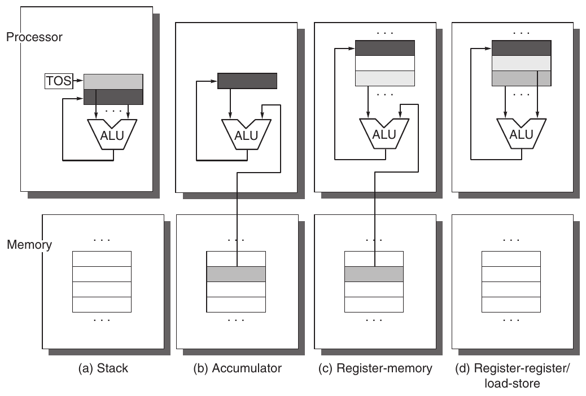

**Hình A.1 Vị trí toán hạng cho bốn nhóm instruction set architecture. Các mũi tên chỉ ra toán hạng là input hay kết quả của phép toán arithmetic-logical unit (ALU), hoặc vừa là input vừa là kết quả. Các sắc độ nhạt hơn chỉ input, còn sắc độ đậm chỉ kết quả. Trong (a), một Top Of Stack register (TOS) trỏ đến toán hạng input trên cùng, được kết hợp với toán hạng bên dưới. Toán hạng đầu tiên được lấy khỏi stack, kết quả thay thế toán hạng thứ hai, và TOS được cập nhật để trỏ đến kết quả. Tất cả toán hạng đều ngầm định. Trong (b), Accumulator vừa là toán hạng input ngầm định vừa là kết quả. Trong (c), một toán hạng input là register, một toán hạng nằm trong memory, và kết quả đi vào một register. Tất cả toán hạng đều là register trong (d) và, giống stack architecture, chỉ có thể được chuyển sang memory thông qua các instruction riêng: push hoặc pop cho (a) và load hoặc store cho (d).**

| Stack | Accumulator | Register (register-memory) | Register (load-store) |
|---|---|---|---|
| Push A | Load A | Load R1,A | Load R1,A |
| Push B | Add B | Add R3,R1,B | Load R2,B |
| Add | Store C | Store R3,C | Add R3,R1,R2 |
| Pop C |  |  | Store R3,C |

**Hình A.2 Chuỗi code cho C = A + B đối với bốn nhóm instruction set. Lưu ý rằng Add instruction có toán hạng ngầm định với stack architecture và accumulator architecture, và toán hạng tường minh với register architecture. Giả sử A, B và C đều nằm trong memory và không được phá hủy các giá trị A và B. Hình A.1 cho thấy phép toán Add cho mỗi nhóm architecture.**

Quan trọng hơn, có thể dùng register để giữ biến. Khi các biến được cấp phát vào register, memory traffic giảm, chương trình chạy nhanh hơn (vì register nhanh hơn memory), và code density được cải thiện (vì có thể chỉ định một register bằng ít bit hơn so với một vị trí memory).

Như được giải thích trong Mục A.8, người viết compiler muốn mọi register đều tương đương và không được dành riêng. Các máy tính cũ làm giảm khả năng đáp ứng mong muốn này bằng cách dành register cho những mục đích đặc biệt, thực chất giảm số lượng general-purpose register. Nếu số register thực sự general-purpose quá nhỏ, việc cố cấp phát biến vào register sẽ không có lợi. Thay vào đó, compiler sẽ dành tất cả register chưa được sử dụng cho việc tính biểu thức.

Bao nhiêu register là đủ? Tất nhiên, câu trả lời phụ thuộc vào hiệu quả của compiler. Phần lớn compiler dành một số register để tính biểu thức, dùng một số để truyền tham số, và cho phép cấp phát phần còn lại để giữ biến. Công nghệ compiler hiện đại và khả năng sử dụng hiệu quả số lượng register lớn hơn đã dẫn đến việc tăng số register trong những architecture gần đây hơn.

Hai đặc tính instruction set chính phân chia các GPR architecture. Cả hai đều liên quan đến bản chất của các toán hạng trong một arithmetic instruction hoặc logical instruction điển hình (ALU instruction). Đặc tính thứ nhất liên quan đến việc một ALU instruction có hai hay ba toán hạng. Trong định dạng three-operand, instruction chứa một toán hạng kết quả và hai toán hạng nguồn. Trong định dạng two-operand, một trong các toán hạng vừa là nguồn vừa là kết quả của phép toán. Đặc điểm phân biệt thứ hai giữa các GPR architecture liên quan đến việc có bao nhiêu toán hạng có thể là địa chỉ memory trong các ALU instruction. Số toán hạng memory được một ALU instruction điển hình hỗ trợ có thể thay đổi từ không đến ba. Hình A.3 cho thấy các tổ hợp của hai thuộc tính này cùng ví dụ về máy tính. Mặc dù có bảy tổ hợp khả dĩ, ba tổ hợp đủ để phân loại gần như mọi máy tính hiện có. Như đã đề cập, ba loại này là load-store (còn được gọi là register-register), register-memory và memory-memory.

Hình A.4 cho thấy ưu nhược điểm của mỗi phương án này. Tất nhiên, những ưu nhược điểm này không tuyệt đối: Chúng mang tính định tính và tác động thực tế phụ thuộc vào compiler và chiến lược triển khai. Các phép toán memory-memory của một máy tính GPR có thể dễ dàng bị compiler bỏ qua và máy được dùng như máy tính load-store. Một trong những tác động architecture rộng khắp nhất liên quan đến instruction encoding và số instruction cần để thực hiện một tác vụ. Chúng ta xem tác động của các phương án architecture này lên các cách tiếp cận triển khai trong Phụ lục C và Chương 3.

| Số địa chỉ memory | Số toán hạng tối đa được phép | Loại architecture | Ví dụ |
|---|---|---|---|
| 0 | 3 | Load-store | Alpha, ARM, MIPS, PowerPC, SPARC, SuperH, TM32 |
| 1 | 2 | Register-memory | IBM 360/370, Intel 80x86, Motorola 68000, TI TMS320C54x |
| 2 | 2 | Memory-memory | VAX (cũng có định dạng three-operand) |
| 3 | 3 | Memory-memory | VAX (cũng có định dạng two-operand) |

**Hình A.3 Các tổ hợp điển hình của toán hạng memory và tổng số toán hạng trên mỗi ALU instruction điển hình, cùng ví dụ về máy tính. Máy tính không có tham chiếu memory trên mỗi ALU instruction được gọi là máy tính load-store hoặc register-register. Các instruction có nhiều toán hạng memory trên mỗi ALU instruction điển hình được gọi là register-memory hoặc memory-memory, tùy theo chúng có một hay nhiều hơn một toán hạng memory.**

| Loại | Ưu điểm | Nhược điểm |
|---|---|---|
| Register-register (0, 3) | Instruction encoding đơn giản, fixed-length. Mô hình tạo code đơn giản. Các instruction cần số clock tương tự nhau để thực thi (xem Phụ lục C). | Số instruction cao hơn những architecture có tham chiếu memory trong instruction. Nhiều instruction hơn và instruction density thấp hơn dẫn đến chương trình lớn hơn. |
| Register-memory (1, 2) | Có thể truy cập dữ liệu mà không cần một load instruction riêng trước đó. Định dạng instruction thường dễ mã hóa và mang lại density tốt. | Các toán hạng không tương đương vì một toán hạng nguồn trong phép toán nhị phân bị phá hủy. Mã hóa một số register và một địa chỉ memory trong mỗi instruction có thể hạn chế số register. Số clock trên mỗi instruction thay đổi theo vị trí toán hạng. |
| Memory-memory (2, 2) hoặc (3, 3) | Gọn nhất. Không lãng phí register cho các giá trị tạm thời. | Kích thước instruction biến thiên lớn, đặc biệt với các instruction three-operand. Ngoài ra, lượng công việc trên mỗi instruction biến thiên lớn. Truy cập memory tạo ra memory bottleneck. (Không được dùng ngày nay.) |

**Hình A.4 Ưu nhược điểm của ba loại máy tính general-purpose register phổ biến nhất. Ký hiệu (m, n) có nghĩa là m toán hạng memory và tổng cộng n toán hạng. Nhìn chung, máy tính có ít phương án hơn đơn giản hóa tác vụ của compiler vì compiler phải đưa ra ít quyết định hơn (xem Mục A.8). Máy tính có nhiều định dạng instruction linh hoạt làm giảm số bit cần để mã hóa chương trình. Số register cũng ảnh hưởng đến kích thước instruction vì cần log (số register) cho mỗi bộ chỉ định reg-2 ister trong một instruction. Vì vậy, tăng gấp đôi số register cần thêm 3 bit cho một register-register architecture, hay khoảng 10% của một instruction 32-bit.**

### Tóm lược: Phân loại Instruction Set Architecture

Ở đây và ở cuối các Mục A.3 đến A.8, chúng ta tóm lược những đặc tính kỳ vọng sẽ có trong một instruction set architecture mới, xây dựng nền tảng cho MIPS architecture được giới thiệu trong Mục A.9. Từ mục này, rõ ràng chúng ta nên kỳ vọng việc sử dụng general-purpose register. Hình A.4, kết hợp với Phụ lục C về pipelining, dẫn đến kỳ vọng về một phiên bản load-store của general-purpose register architecture.

Sau khi đã trình bày các nhóm architecture, chủ đề tiếp theo là định địa chỉ các toán hạng.

## A.3 Định địa chỉ Memory

Bất kể architecture là load-store hay cho phép bất kỳ toán hạng nào là một tham chiếu memory, nó phải định nghĩa cách diễn giải các địa chỉ memory và cách chỉ định chúng. Những phép đo được trình bày ở đây phần lớn, nhưng không hoàn toàn, độc lập với máy tính. Trong một số trường hợp, các phép đo bị ảnh hưởng đáng kể bởi công nghệ compiler. Những phép đo này được thực hiện bằng một optimizing compiler, vì công nghệ compiler giữ vai trò then chốt.

### Diễn giải các địa chỉ Memory

Một địa chỉ memory được diễn giải như thế nào? Tức là đối tượng nào được truy cập theo địa chỉ và độ dài? Tất cả instruction set được thảo luận trong cuốn sách này đều định địa chỉ theo byte và cung cấp khả năng truy cập byte (8 bit), half word (16 bit) và word (32 bit). Phần lớn máy tính cũng cung cấp khả năng truy cập double word (64 bit).

Có hai quy ước khác nhau để sắp thứ tự các byte trong một đối tượng lớn hơn. Thứ tự byte Little Endian đặt byte có địa chỉ “x . . . x000” ở vị trí least-significant trong double word (đầu nhỏ). Các byte được đánh số:

7 6 5 4 3 2 1 0

Thứ tự byte Big Endian đặt byte có địa chỉ “x . . . x000” ở vị trí most-significant trong double word (đầu lớn). Các byte được đánh số:

0 1 2 3 4 5 6 7

Khi hoạt động trong một máy tính, thứ tự byte thường không thể nhận thấy—chỉ những chương trình truy cập cùng vị trí dưới cả hai dạng, chẳng hạn word và byte, mới có thể nhận thấy khác biệt. Tuy nhiên, thứ tự byte là một vấn đề khi trao đổi dữ liệu giữa các máy tính có thứ tự khác nhau. Thứ tự Little Endian cũng không khớp với thứ tự thông thường của các word khi so sánh chuỗi. Các chuỗi xuất hiện dưới dạng “SDRAWKCAB” (đảo ngược) trong các register.

Vấn đề memory thứ hai là trong nhiều máy tính, truy cập các đối tượng lớn hơn một byte phải được aligned. Một truy cập đến đối tượng có kích thước s byte tại địa chỉ byte A là aligned nếu A mod s = 0. Hình A.5 cho thấy các địa chỉ tại đó một truy cập là aligned hoặc misaligned.

Tại sao người ta lại thiết kế một máy tính có những hạn chế alignment? Misalignment làm hardware phức tạp hơn, vì memory thường được aligned tại bội số của ranh giới word hoặc double-word. Do đó, một truy cập memory misaligned có thể cần nhiều tham chiếu memory aligned. Vì thế, ngay cả trên những máy tính cho phép truy cập misaligned, chương trình có các truy cập aligned vẫn chạy nhanh hơn.

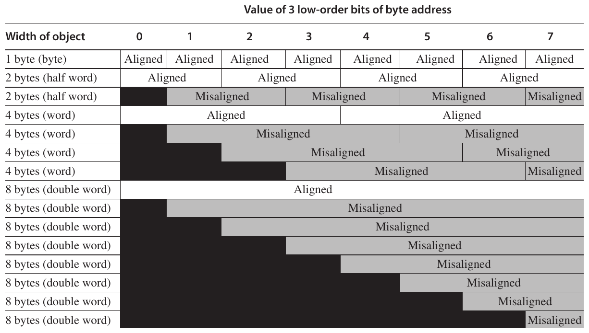

**Hình A.5 Các địa chỉ aligned và misaligned của các đối tượng byte, half-word, word và double-word trên máy tính byte-addressed. Với mỗi ví dụ misaligned, một số đối tượng cần hai truy cập memory để hoàn tất. Mọi đối tượng aligned luôn có thể hoàn tất trong một truy cập memory, miễn là memory rộng bằng đối tượng. Hình cho thấy memory được tổ chức với độ rộng 8 byte. Các byte offset ghi nhãn cho cột chỉ định low-order 3 bit của địa chỉ.**

Ngay cả khi dữ liệu aligned, hỗ trợ truy cập byte, half-word và word vẫn cần một alignment network để căn chỉnh byte, half word và word trong các register 64-bit. Chẳng hạn, trong Hình A.5, giả sử chúng ta đọc một byte từ địa chỉ có 3 low-order bit mang giá trị 4. Cần dịch sang phải 3 byte để căn byte vào vị trí thích hợp trong một register 64-bit. Tùy theo instruction, máy tính cũng có thể cần sign-extend đại lượng đó. Store thì dễ: Chỉ những byte được định địa chỉ trong memory mới có thể bị thay đổi. Trên một số máy tính, một phép toán byte, half-word và word không ảnh hưởng đến phần trên của một register. Mặc dù tất cả máy tính được thảo luận trong cuốn sách này cho phép truy cập byte, half-word và word vào memory, chỉ IBM 360/370, Intel 80x86 và VAX hỗ trợ các phép toán ALU trên các toán hạng register hẹp hơn toàn bộ độ rộng.

Sau khi thảo luận các cách diễn giải khác nhau của địa chỉ memory, chúng ta có thể thảo luận những cách instruction chỉ định địa chỉ, được gọi là addressing mode.

### Addressing Mode

Với một địa chỉ cho trước, giờ đây chúng ta biết những byte nào cần truy cập trong memory. Trong mục này, chúng ta sẽ xem xét addressing mode—cách các architecture chỉ định địa chỉ của đối tượng sẽ truy cập. Addressing mode chỉ định các hằng số và register bên cạnh các vị trí trong memory. Khi dùng một vị trí memory, địa chỉ memory thực tế được addressing mode chỉ định được gọi là effective address.

Hình A.6 cho thấy tất cả data addressing mode đã được dùng trong các máy tính gần đây. Immediate hoặc literal thường được xem là memory addressing mode (mặc dù giá trị chúng truy cập nằm trong instruction stream), trong khi register thường được tách riêng vì bình thường chúng không có địa chỉ memory. Chúng ta để riêng các addressing mode phụ thuộc vào program counter, gọi là PC-relative addressing. PC-relative addressing chủ yếu được dùng để chỉ định địa chỉ code trong control transfer instruction, được thảo luận trong Mục A.6.

| Addressing mode | Instruction ví dụ | Ý nghĩa | Khi nào dùng |
|---|---|---|---|
| Register | Add R4,R3 | Regs[R4] ← Regs[R4] + Regs[R3] | Khi một giá trị nằm trong một register. |
| Immediate | Add R4,#3 | Regs[R4] ← Regs[R4] + 3 | Cho các hằng số. |
| Displacement | Add R4,100(R1) | Regs[R4] ← Regs[R4] + Mem[100 + Regs[R1]] | Truy cập các biến cục bộ (+ mô phỏng register indirect, direct addressing mode). |
| Register indirect | Add R4,(R1) | Regs[R4] ← Regs[R4] + Mem[Regs[R1]] | Truy cập bằng một pointer hoặc một địa chỉ đã được tính. |
| Indexed | Add R3,(R1 + R2) | Regs[R3] ← Regs[R3] + Mem[Regs[R1] + Regs[R2]] | Đôi khi hữu ích trong định địa chỉ array: R1 = địa chỉ cơ sở của array; R2 = lượng index. |
| Direct or absolute | Add R1,(1001) | Regs[R1] ← Regs[R1] + Mem[1001] | Đôi khi hữu ích để truy cập dữ liệu static; hằng số địa chỉ có thể cần lớn. |
| Memory indirect | Add R1,@(R3) | Regs[R1] ← Regs[R1] + Mem[Mem[Regs[R3]]] | Nếu R3 là địa chỉ của một pointer p, mode này cho *p. |
| Autoincrement | Add R1,(R2)+ | Regs[R1] ← Regs[R1] + Mem[Regs[R2]]<br>Regs[R2] ← Regs[R2] + d | Hữu ích để duyệt qua array trong một loop. R2 trỏ đến đầu array; mỗi tham chiếu tăng R2 thêm kích thước của một phần tử, d. |
| Autodecrement | Add R1, –(R2) | Regs[R2] ← Regs[R2] – d<br>Regs[R1] ← Regs[R1] + Mem[Regs[R2]] | Cùng cách dùng như autoincrement. Autodecrement/-increment cũng có thể đóng vai trò push/pop để triển khai một stack. |
| Scaled | Add R1,100(R2)[R3] | Regs[R1] ← Regs[R1] + Mem[100 + Regs[R2] + Regs[R3] * d] | Được dùng để đánh index vào array. Trên một số máy tính, có thể áp dụng cho bất kỳ indexed addressing mode nào. |

**Hình A.6 Một tập các addressing mode với ví dụ, ý nghĩa và cách dùng. Trong autoincrement/-decrement và scaled addressing mode, biến d chỉ kích thước của mục dữ liệu được truy cập (tức là instruction truy cập 1, 2, 4 hay 8 byte). Các addressing mode này chỉ hữu ích khi các phần tử được truy cập nằm liền nhau trong memory. Máy tính RISC dùng displacement addressing để mô phỏng register indirect với 0 cho địa chỉ và mô phỏng direct addressing bằng 0 trong base register. Trong các phép đo, chúng ta dùng tên đầu tiên được thể hiện cho mỗi mode. Các phần mở rộng của C dùng làm mô tả hardware được định nghĩa ở trang A-36.**

Hình A.6 cho thấy các tên phổ biến nhất cho addressing mode, mặc dù tên gọi khác nhau giữa các architecture. Trong hình này và xuyên suốt cuốn sách, chúng ta sẽ dùng một phần mở rộng của ngôn ngữ lập trình C làm ký pháp mô tả hardware. Trong hình này, chỉ có một tính năng non-C được dùng: Mũi tên trái (←) được dùng cho phép gán. Chúng ta cũng dùng array Mem làm tên cho main memory và array Regs cho các register. Vì vậy, Mem[Regs[R1]] chỉ nội dung của vị trí memory có địa chỉ được cho bởi nội dung của register 1 (R1). Sau đó, chúng ta sẽ giới thiệu các phần mở rộng để truy cập và truyền dữ liệu nhỏ hơn một word.

Addressing mode có khả năng giảm đáng kể số instruction; chúng cũng làm tăng độ phức tạp khi xây dựng máy tính và có thể tăng số clock cycle trung bình trên mỗi instruction (CPI) của các máy tính triển khai những mode đó. Vì vậy, mức sử dụng các addressing mode khác nhau khá quan trọng để giúp người thiết kế chọn những gì cần đưa vào.

Hình A.7 cho thấy kết quả đo các mẫu sử dụng addressing mode trong ba chương trình trên VAX architecture. Chúng ta dùng VAX architecture cũ cho một vài phép đo trong phụ lục này vì nó có tập addressing mode phong phú nhất và ít hạn chế nhất về định địa chỉ memory. Chẳng hạn, Hình A.6 ở trang A-9 cho thấy tất cả mode mà VAX hỗ trợ. Tuy nhiên, phần lớn phép đo trong phụ lục này sẽ dùng những register-register architecture gần đây hơn để thể hiện cách chương trình dùng instruction set của máy tính hiện tại.

Như Hình A.7 cho thấy, displacement addressing và immediate addressing chiếm ưu thế trong việc sử dụng addressing mode. Hãy xem một số tính chất của hai mode được dùng nhiều này.

### Displacement Addressing Mode

Câu hỏi chủ yếu đặt ra với một addressing mode displacement-style là phạm vi displacement được dùng. Dựa trên việc sử dụng các kích thước displacement khác nhau, có thể quyết định những kích thước cần hỗ trợ. Chọn kích thước trường displacement quan trọng vì chúng ảnh hưởng trực tiếp đến độ dài instruction. Hình A.8 cho thấy các phép đo truy cập dữ liệu trên một load-store architecture bằng các chương trình benchmark của chúng ta. Chúng ta xem xét branch offset trong Mục A.6—các mẫu truy cập dữ liệu và branch khác nhau; kết hợp chúng không mang lại nhiều lợi ích, mặc dù trong thực tế các kích thước immediate được làm giống nhau để đơn giản hóa.

### Immediate hoặc Literal Addressing Mode

Immediate có thể được dùng trong phép toán arithmetic, trong phép so sánh (chủ yếu cho branch), và trong phép chuyển khi muốn đặt một hằng số vào register. Trường hợp cuối xảy ra với các hằng số được viết trong code—thường nhỏ—và với các hằng số địa chỉ, thường lớn. Đối với việc sử dụng immediate, điều quan trọng là biết chúng cần được hỗ trợ cho mọi phép toán hay chỉ một tập con. Hình A.9 cho thấy tần suất của immediate đối với các nhóm phép toán integer và floating-point tổng quát trong một instruction set.

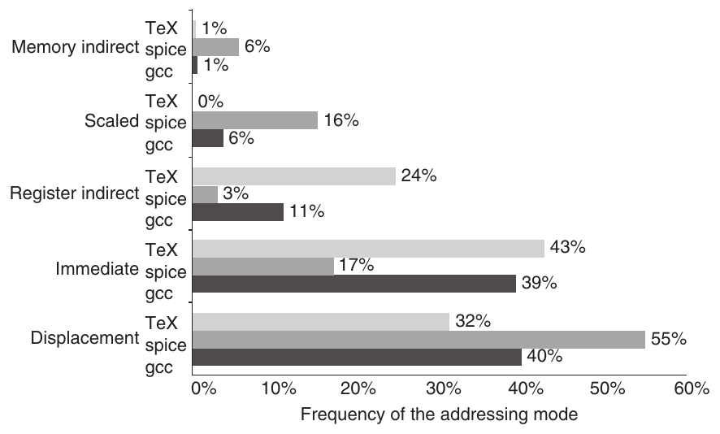

**Hình A.7 Tóm lược việc sử dụng memory addressing mode (bao gồm immediate). Các addressing mode chính này chiếm gần như toàn bộ truy cập memory, chỉ trừ một vài phần trăm (0% đến 3%). Register mode, không được tính ở đây, chiếm one-half số tham chiếu toán hạng, còn memory addressing mode (bao gồm immediate) chiếm nửa còn lại. Tất nhiên, compiler ảnh hưởng đến addressing mode được dùng; xem Mục A.8. Memory indirect mode trên VAX có thể dùng displacement, autoincrement hoặc autodecrement để tạo địa chỉ memory ban đầu; trong các chương trình này, gần như mọi tham chiếu memory indirect đều dùng displacement mode làm cơ sở. Displacement mode bao gồm tất cả độ dài displacement (8, 16 và 32 bit). Các addressing mode PC-relative, được dùng gần như chỉ riêng cho branch, không được đưa vào. Chỉ các addressing mode có tần suất trung bình trên 1% được thể hiện.**

Một phép đo instruction set quan trọng khác là phạm vi giá trị của immediate. Giống giá trị displacement, kích thước của giá trị immediate ảnh hưởng đến độ dài instruction. Như Hình A.10 cho thấy, các giá trị immediate nhỏ được dùng nhiều nhất. Tuy nhiên, đôi khi immediate lớn được dùng, nhiều khả năng trong tính toán địa chỉ.

### Tóm lược: Định địa chỉ Memory

Trước hết, do mức phổ biến của chúng, chúng ta kỳ vọng một architecture mới hỗ trợ ít nhất các addressing mode sau: displacement, immediate và register indirect. Hình A.7 cho thấy chúng đại diện cho 75% đến 99% số addressing mode được dùng trong các phép đo. Thứ hai, chúng ta kỳ vọng kích thước địa chỉ cho displacement mode ít nhất là 12 đến 16 bit, vì chú thích trong Hình A.8 gợi ý những kích thước này sẽ bao quát 75% đến 99% số displacement. Thứ ba, chúng ta kỳ vọng kích thước trường immediate ít nhất là 8 đến 16 bit. Khẳng định này không được chứng minh bởi chú thích của hình mà nó tham chiếu.

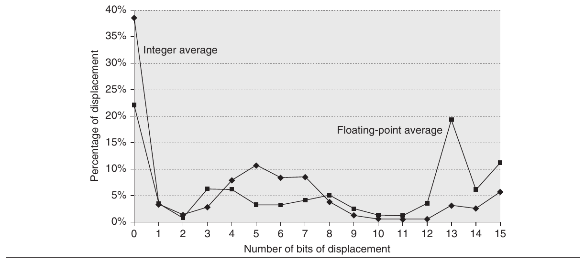

**Hình A.8 Các giá trị displacement phân bố rộng. Có cả một lượng lớn giá trị nhỏ lẫn khá nhiều giá trị lớn. Sự phân bố rộng của giá trị displacement là do có nhiều vùng lưu trữ cho biến và các displacement khác nhau để truy cập chúng (xem Mục A.8), cũng như cơ chế định địa chỉ tổng thể mà compiler dùng. x-axis là log<sub>2</sub> của displacement, tức kích thước trường cần để biểu diễn độ lớn của displacement. Giá trị không trên x-axis cho thấy tỷ lệ displacement có giá trị 0. Đồ thị không bao gồm sign bit, vốn bị ảnh hưởng lớn bởi storage layout. Phần lớn displacement dương, nhưng đa số displacement lớn nhất (14+ bit) âm. Vì dữ liệu được thu thập trên một máy tính có displacement 16-bit, chúng không thể cho biết về displacement dài hơn. Dữ liệu được lấy trên Alpha architecture với tối ưu hóa đầy đủ (xem Mục A.8) cho SPEC CPU2000, thể hiện trung bình của các chương trình integer (CINT2000) và trung bình của các chương trình floating-point (CFP2000).**

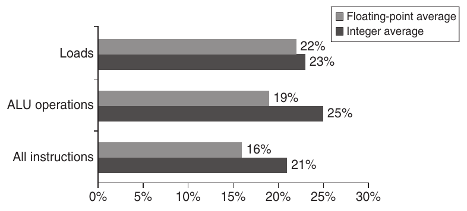

**Hình A.9 Khoảng one-quarter các phép truyền dữ liệu và phép toán ALU có một toán hạng immediate. Các thanh phía dưới cho thấy chương trình integer dùng immediate trong khoảng one-fifth số instruction, còn chương trình floating-point dùng immediate trong khoảng one-sixth số instruction. Với load, load immediate instruction nạp 16 bit vào một trong hai nửa của register 32-bit. Load immediate không phải load theo nghĩa chặt chẽ vì không truy cập memory. Đôi khi một cặp load immediate được dùng để nạp một hằng số 32-bit, nhưng điều này hiếm. (Với các phép toán ALU, các phép dịch với số vị trí hằng số được tính là phép toán có toán hạng immediate.) Các chương trình và máy tính dùng để thu thập thống kê này giống trong Hình A.8.**

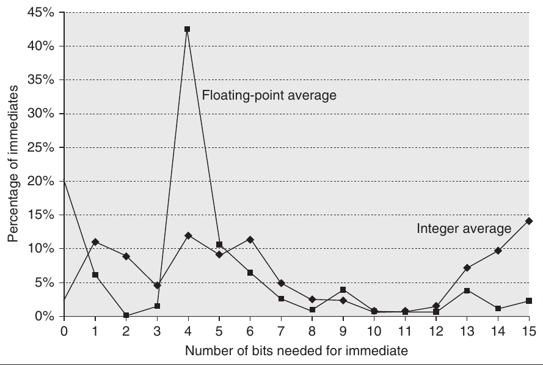

**Hình A.10 Phân bố các giá trị immediate. x-axis cho thấy số bit cần để biểu diễn độ lớn của một giá trị immediate—0 có nghĩa là giá trị trường immediate bằng 0. Đa số giá trị immediate dương. Khoảng 20% âm với CINT2000, và khoảng 30% âm với CFP2000. Những phép đo này được thực hiện trên một Alpha, nơi immediate tối đa là 16 bit, với cùng chương trình như trong Hình A.8. Một phép đo tương tự trên VAX, hỗ trợ immediate 32-bit, cho thấy khoảng 20% đến 25% immediate dài hơn 16 bit. Vì vậy, 16 bit sẽ bao quát khoảng 80% và 8 bit khoảng 50%.**

Sau khi trình bày các nhóm instruction set và quyết định chọn register-register architecture, cùng với những khuyến nghị trước về data addressing mode, tiếp theo chúng ta xem xét kích thước và ý nghĩa của dữ liệu.

## A.4 Kiểu và kích thước của toán hạng

Kiểu của một toán hạng được chỉ định như thế nào? Thông thường, mã hóa trong opcode chỉ định kiểu toán hạng—đây là phương pháp được dùng thường xuyên nhất. Một cách khác là dữ liệu có thể được gắn các tag mà hardware diễn giải. Các tag này chỉ định kiểu toán hạng, và phép toán được chọn tương ứng. Tuy nhiên, máy tính có tagged data chỉ còn có thể tìm thấy trong bảo tàng máy tính.

Hãy bắt đầu với desktop architecture và server architecture. Thông thường, kiểu của toán hạng—integer, single-precision floating point, ký tự, v.v.—về thực chất cho biết kích thước của nó. Các kiểu toán hạng phổ biến bao gồm ký tự (8 bit), half word (16 bit), word (32 bit), single-precision floating point (cũng 1 word), và double-precision floating point (2 word). Integer gần như luôn được biểu diễn dưới dạng số nhị phân two’s complement. Ký tự thường ở dạng ASCII, nhưng Unicode 16-bit (dùng trong Java) đang trở nên phổ biến với quá trình quốc tế hóa máy tính. Cho đến đầu những năm 1980, phần lớn nhà sản xuất máy tính chọn cách biểu diễn floating-point riêng. Gần như mọi máy tính kể từ đó tuân theo cùng tiêu chuẩn floating point, tiêu chuẩn IEEE 754. Tiêu chuẩn IEEE floating-point được thảo luận chi tiết trong Phụ lục J.

Một số architecture cung cấp các phép toán trên chuỗi ký tự, mặc dù những phép toán như vậy thường khá hạn chế và xem mỗi byte trong chuỗi là một ký tự. Các phép toán điển hình được hỗ trợ trên chuỗi ký tự là so sánh và chuyển.

Với các ứng dụng kinh doanh, một số architecture hỗ trợ định dạng thập phân, thường gọi là packed decimal hoặc binary-coded decimal—4 bit được dùng để mã hóa các giá trị từ 0 đến 9, và 2 chữ số thập phân được đóng gói vào mỗi byte. Các chuỗi ký tự số đôi khi được gọi là unpacked decimal, và các phép toán—gọi là packing và unpacking—thường được cung cấp để chuyển đổi qua lại giữa chúng.

Một lý do dùng toán hạng thập phân là để có kết quả khớp chính xác với các số thập phân, vì một số phân số thập phân không có cách biểu diễn chính xác ở dạng nhị phân. Chẳng hạn, 0.10<sub>10</sub> là một phân số đơn giản trong hệ thập phân, nhưng trong hệ nhị phân cần một dãy chữ số lặp vô hạn: 0.000110011$\overline{0011}$. . .<sub>2</sub>. Vì vậy, các phép tính chính xác trong hệ thập phân có thể gần đúng nhưng không chính xác trong hệ nhị phân, điều này có thể gây vấn đề cho các giao dịch tài chính. (Xem Phụ lục J để tìm hiểu thêm về arithmetic chính xác.)

Các SPEC benchmark của chúng ta dùng các kiểu dữ liệu byte hoặc ký tự, half-word (short integer), word (integer), double-word (long integer) và floating-point. Hình A.11 cho thấy phân bố dynamic của kích thước đối tượng được tham chiếu từ memory trong các chương trình này. Tần suất truy cập các kiểu dữ liệu khác nhau giúp quyết định những kiểu quan trọng nhất cần hỗ trợ hiệu quả. Máy tính nên có một đường truy cập 64-bit, hay cần hai cycle để truy cập một double word là đủ? Như đã thấy, truy cập byte cần một alignment network: Hỗ trợ byte như những thao tác primitive quan trọng đến mức nào? Hình A.11 dùng tham chiếu memory để xem xét các kiểu dữ liệu đang được truy cập.

Trong một số architecture, đối tượng trong register có thể được truy cập dưới dạng byte hoặc half word. Tuy nhiên, truy cập như vậy rất ít xảy ra—trên VAX, nó chiếm không quá 12% số tham chiếu register, hay khoảng 6% tổng số truy cập toán hạng trong những chương trình này.

## A.5 Các phép toán trong Instruction Set

Các toán tử được phần lớn instruction set architecture hỗ trợ có thể được phân loại như trong Hình A.12. Một quy tắc kinh nghiệm trên mọi architecture là các instruction được thực thi nhiều nhất là những phép toán đơn giản của một instruction set. Chẳng hạn, <sub>Figure A.13</sub> cho thấy 10 instruction đơn giản chiếm 96% số instruction được thực thi trong một tập chương trình integer chạy trên Intel 80x86 phổ biến. Vì vậy, người triển khai những instruction này cần bảo đảm chúng nhanh, vì chúng là trường hợp phổ biến.

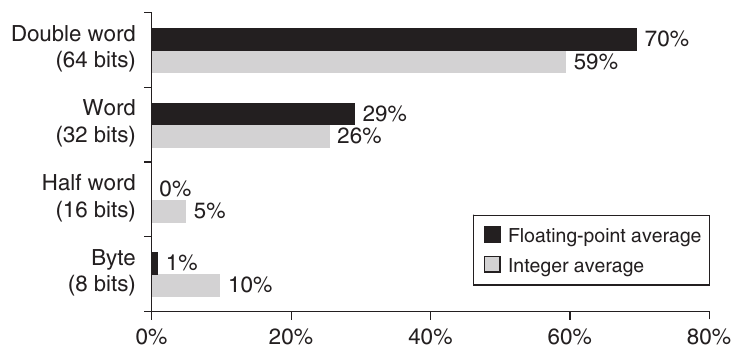

**Hình A.11 Phân bố truy cập dữ liệu theo kích thước cho các chương trình benchmark. Kiểu dữ liệu double-word được dùng cho double-precision floating point trong chương trình floating-point và cho địa chỉ, vì máy tính dùng địa chỉ 64-bit. Trên một máy tính địa chỉ 32-bit, các địa chỉ 64-bit sẽ được thay bằng địa chỉ 32-bit, nên gần như mọi truy cập double-word trong chương trình integer sẽ trở thành truy cập single-word.**

| Loại toán tử | Ví dụ |
|---|---|
| Arithmetic và logical | Các phép toán integer arithmetic và logical: add, subtract, and, or, multiply, divide |
| Truyền dữ liệu | Loads-stores (move instruction trên máy tính có định địa chỉ memory) |
| Điều khiển | Branch, jump, gọi và trả về từ procedure, trap |
| Hệ thống | Lời gọi operating system, các instruction quản lý virtual memory |
| Floating point | Các phép toán Floating-point: add, multiply, divide, compare |
| Thập phân | Cộng thập phân, nhân thập phân, chuyển đổi decimal-to-character |
| Chuỗi | Chuyển chuỗi, so sánh chuỗi, tìm kiếm chuỗi |
| Đồ họa | Các phép toán pixel và vertex, các phép toán nén/giải nén |

**Hình A.12 Các nhóm toán tử instruction và ví dụ cho mỗi nhóm. Mọi máy tính thường cung cấp một tập phép toán đầy đủ cho ba nhóm đầu tiên. Mức hỗ trợ các chức năng hệ thống trong instruction set thay đổi rất nhiều giữa các architecture, nhưng mọi máy tính phải có một số instruction hỗ trợ các chức năng hệ thống cơ bản. Mức hỗ trợ trong instruction set cho bốn nhóm cuối có thể thay đổi từ không có đến một tập instruction đặc biệt phong phú. Floating-point instruction sẽ được cung cấp trong bất kỳ máy tính nào dự định dùng cho một ứng dụng sử dụng floating point nhiều. Những instruction này đôi khi là một phần của một instruction set tùy chọn. Decimal instruction và string instruction đôi khi là primitive, như trong VAX hoặc IBM 360, hoặc có thể được compiler tổng hợp từ các instruction đơn giản hơn. Graphics instruction thường hoạt động song song trên nhiều mục dữ liệu nhỏ hơn—chẳng hạn, thực hiện tám phép cộng 8-bit trên hai toán hạng 64-bit.**

| Rank | 80x86 instruction | Integer average (% total executed) |
|---|---|---|
| 1 | load | 22% |
| 2 | conditional branch | 20% |
| 3 | compare | 16% |
| 4 | store | 12% |
| 5 | add | 8% |
| 6 | and | 6% |
| 7 | sub | 5% |
| 8 | move register-register | 4% |
| 9 | call | 1% |
| 10 | return | 1% |
| Tổng |  | 96% |

**Hình A.13 10 instruction hàng đầu của 80x86. Instruction đơn giản chiếm ưu thế trong danh sách này và chiếm 96% số instruction được thực thi. Các tỷ lệ này là trung bình của năm chương trình SPECint92.**

Như đã đề cập, các instruction trong Hình A.13 có trong mọi máy tính cho mọi ứng dụng––desktop, server, embedded––với sự biến thiên của các phép toán trong Hình A.12 phần lớn phụ thuộc vào những kiểu dữ liệu mà instruction set bao gồm.

## A.6 Instruction cho Control Flow

Vì những phép đo hành vi branch và jump khá độc lập với các phép đo và ứng dụng khác, giờ đây chúng ta xem xét việc sử dụng control flow instruction, vốn có ít điểm chung với các phép toán trong những mục trước.

Không có thuật ngữ nhất quán cho những instruction thay đổi control flow. Trong những năm 1950, chúng thường được gọi là transfer. Từ năm 1960, tên branch bắt đầu được dùng. Sau đó, các máy tính đưa thêm những tên gọi khác. Xuyên suốt cuốn sách này, chúng ta sẽ dùng jump khi thay đổi điều khiển là vô điều kiện và branch khi thay đổi có điều kiện.

Có thể phân biệt bốn loại thay đổi control flow khác nhau:

- Branch có điều kiện

- Jump

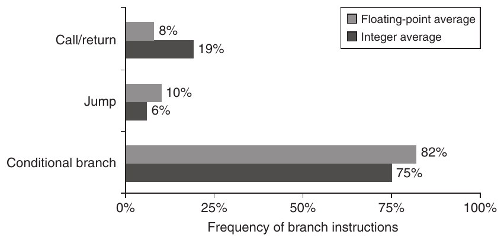

**Hình A.14 Phân chia control flow instruction thành ba nhóm: call hoặc return, jump, và branch có điều kiện. Branch có điều kiện rõ ràng chiếm ưu thế. Mỗi loại được đếm trong một trong ba thanh. Các chương trình và máy tính dùng để thu thập những thống kê này giống trong Hình A.8.**

- Gọi procedure

- Trả về từ procedure

Chúng ta muốn biết tần suất tương đối của những sự kiện này, vì mỗi sự kiện khác nhau, có thể dùng những instruction khác nhau và có hành vi khác nhau. Hình A.14 cho thấy tần suất của những control flow instruction này trên một máy tính load-store chạy các benchmark của chúng ta.

### Addressing Mode cho Control Flow Instruction

Địa chỉ đích của một control flow instruction luôn phải được chỉ định. Đích này được chỉ định tường minh trong instruction ở đại đa số trường hợp—trả về từ procedure là ngoại lệ chính, vì với return, đích chưa được biết tại compile time. Cách phổ biến nhất để chỉ định đích là cung cấp một displacement được cộng vào program counter (PC). Control flow instruction thuộc loại này được gọi là PC-relative. Branch hoặc jump PC-relative có lợi vì đích thường ở gần instruction hiện tại, và chỉ định vị trí tương đối với PC hiện tại cần ít bit hơn. Dùng PC-relative addressing cũng cho phép code chạy độc lập với nơi nó được nạp. Tính chất này, gọi là position independence, có thể loại bỏ một số công việc khi chương trình được link và cũng hữu ích trong các chương trình được link động khi thực thi.

Để triển khai return và indirect jump khi đích chưa được biết tại compile time, cần một phương pháp khác với PC-relative addressing. Ở đây phải có cách chỉ định đích động, để nó có thể thay đổi tại runtime. Địa chỉ động này có thể đơn giản là chỉ định một register chứa địa chỉ đích; một cách khác là jump có thể cho phép dùng bất kỳ addressing mode nào để cung cấp địa chỉ đích.

Những register indirect jump này cũng hữu ích cho bốn tính năng quan trọng khác:

- Câu lệnh case hoặc switch, có trong phần lớn ngôn ngữ lập trình (chọn một trong nhiều phương án)

- Hàm hoặc phương thức virtual trong các ngôn ngữ object-oriented như C++ hoặc Java (cho phép gọi những routine khác nhau tùy theo kiểu của đối số)

- Hàm High-order hoặc function pointer trong các ngôn ngữ như C hoặc C++ (cho phép truyền hàm làm đối số, mang lại phần nào đặc điểm của lập trình object-oriented)

- Thư viện chia sẻ động (cho phép một thư viện được nạp và link tại runtime chỉ khi chương trình thực sự gọi nó, thay vì được nạp và link tĩnh trước khi chương trình chạy)

Trong cả bốn trường hợp, địa chỉ đích chưa được biết tại compile time, nên thường được nạp từ memory vào một register trước register indirect jump.

Vì branch thường dùng PC-relative addressing để chỉ định đích, một câu hỏi quan trọng là đích branch cách branch bao xa. Biết phân bố của các displacement này sẽ giúp chọn những branch offset cần hỗ trợ, và do đó ảnh hưởng đến độ dài và encoding của instruction. Hình A.15 cho thấy phân bố displacement của PC-relative branch theo số instruction. Khoảng 75% branch đi theo hướng tiến.

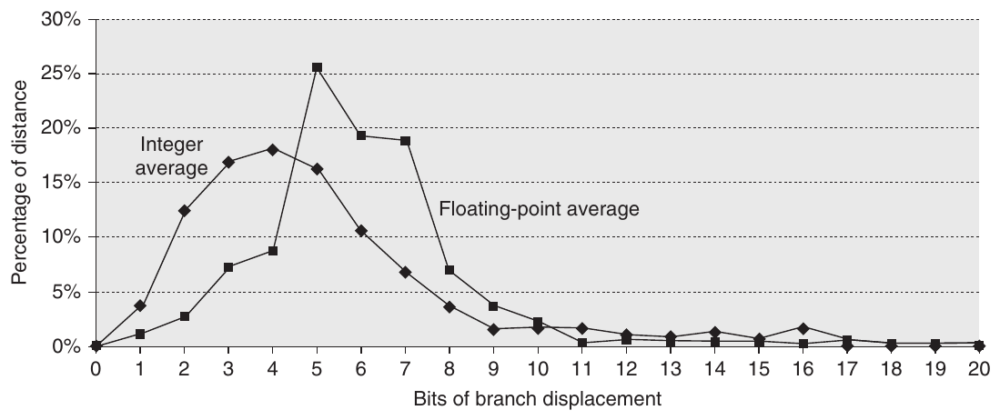

**Hình A.15 Khoảng cách branch theo số instruction giữa đích và branch instruction. Những branch thường gặp nhất trong chương trình integer đi đến các đích có thể được mã hóa bằng 4 đến 8 bit. Kết quả này cho thấy các trường displacement ngắn thường đủ cho branch và người thiết kế có thể tăng encoding density bằng cách có một instruction ngắn hơn với branch displacement nhỏ hơn. Những phép đo này được thực hiện trên một máy tính load-store (Alpha architecture) với tất cả instruction aligned tại ranh giới word. Một architecture cần ít instruction hơn cho cùng chương trình, như VAX, sẽ có khoảng cách branch ngắn hơn. Tuy nhiên, số bit cần cho displacement có thể tăng nếu máy tính có instruction variable-length được aligned tại bất kỳ ranh giới byte nào. Các chương trình và máy tính dùng để thu thập thống kê này giống trong Hình A.8.**

### Các phương án Conditional Branch

Vì phần lớn thay đổi control flow là branch, quyết định cách chỉ định điều kiện branch là quan trọng. Hình A.16 cho thấy ba kỹ thuật chính đang được dùng hiện nay cùng ưu nhược điểm của chúng.

Một trong những tính chất dễ nhận thấy nhất của branch là nhiều phép so sánh là kiểm tra đơn giản, và nhiều phép so sánh là so sánh với không. Vì vậy, một số architecture chọn xử lý những phép so sánh này như trường hợp đặc biệt, nhất là nếu dùng một compare and branch instruction. Hình A.17 cho thấy tần suất của các phép so sánh khác nhau được dùng cho conditional branching.

### Các phương án gọi Procedure

Gọi và trả về từ procedure bao gồm chuyển điều khiển và có thể lưu một số trạng thái; tối thiểu, địa chỉ trả về phải được lưu ở đâu đó, đôi khi trong một link register đặc biệt hoặc chỉ một GPR. Một số architecture cũ cung cấp cơ chế lưu nhiều register, trong khi các architecture mới hơn yêu cầu compiler tạo store và load cho mỗi register được lưu và khôi phục.

Có hai quy ước cơ bản đang được dùng để lưu register: tại nơi gọi hoặc bên trong procedure được gọi. Caller saving có nghĩa là procedure gọi phải lưu những register mà nó muốn bảo toàn để truy cập sau lời gọi, và do đó procedure được gọi không cần lo về register. Callee saving thì ngược lại: procedure được gọi phải lưu những register nó muốn dùng, để bên gọi không bị hạn chế. Có những lúc phải dùng caller save do mẫu truy cập các biến nhìn thấy toàn cục trong hai procedure khác nhau. Chẳng hạn, giả sử có một procedure P1 gọi procedure P2, và cả hai thao tác với biến toàn cục x. Nếu P1 đã cấp phát x vào một register, nó phải bảo đảm lưu x vào một vị trí mà P2 biết trước lời gọi đến P2. Khả năng của compiler phát hiện khi nào procedure được gọi có thể truy cập các đại lượng register-allocated trở nên phức tạp do khả năng biên dịch riêng biệt. Giả sử P2 có thể không đụng đến x nhưng có thể gọi một procedure khác, P3, có thể truy cập x, trong khi P2 và P3 được biên dịch riêng biệt. Do những phức tạp này, phần lớn compiler sẽ thận trọng thực hiện caller save với bất kỳ biến nào có thể được truy cập trong một lời gọi.

| Tên | Ví dụ | Cách kiểm tra điều kiện | Ưu điểm | Nhược điểm |
|---|---|---|---|---|
| Condition code (CC) | 80x86, ARM, PowerPC, SPARC, SuperH | Kiểm tra các bit đặc biệt được các phép toán ALU đặt, có thể dưới sự điều khiển của chương trình. | Đôi khi điều kiện được đặt mà không tốn thêm chi phí. | CC là trạng thái bổ sung. Condition code ràng buộc thứ tự instruction vì truyền thông tin từ một instruction đến một branch. |
| Condition register | Alpha, MIPS | Kiểm tra register tùy ý chứa kết quả của một phép so sánh. | Đơn giản. | Chiếm một register. |
| Compare and branch | PA-RISC, VAX | Compare là một phần của branch. Thường compare bị giới hạn vào một tập con. | Một instruction thay vì hai cho một branch. | Có thể quá nhiều công việc trên mỗi instruction cho thực thi pipelined. |

**Hình A.16 Các phương pháp chính để đánh giá điều kiện branch, ưu điểm và nhược điểm của chúng. Mặc dù condition code có thể được đặt bởi các phép toán ALU cần cho những mục đích khác, các phép đo trên chương trình cho thấy điều này hiếm xảy ra. Những vấn đề triển khai chính với condition code xuất hiện khi condition code được đặt bởi một tập con lớn hoặc được chọn tùy tiện của các instruction, thay vì được điều khiển bởi một bit trong instruction. Máy tính có compare and branch thường giới hạn tập phép so sánh và dùng một condition register cho các phép so sánh phức tạp hơn. Thường các kỹ thuật khác nhau được dùng cho branch dựa trên so sánh floating-point và branch dựa trên so sánh integer. Sự phân đôi này hợp lý vì số branch phụ thuộc vào so sánh floating-point nhỏ hơn nhiều số phụ thuộc vào so sánh integer.**

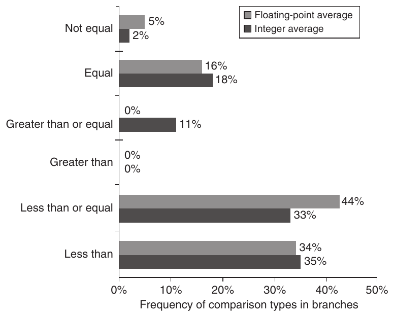

**Hình A.17 Tần suất các kiểu compare khác nhau trong conditional branch. Branch nhỏ hơn (hoặc bằng) chiếm ưu thế trong tổ hợp compiler và architecture này. Những phép đo này bao gồm cả compare integer và floating-point trong branch. Các chương trình và máy tính dùng để thu thập thống kê giống trong Hình A.8.**

Trong những trường hợp có thể dùng một trong hai quy ước, một số chương trình sẽ tối ưu hơn với callee save và một số tối ưu hơn với caller save. Vì vậy, phần lớn hệ thống thực tế ngày nay kết hợp hai cơ chế. Quy ước này được quy định trong một application binary interface (ABI), đặt ra các quy tắc cơ bản về register nào nên được caller save và register nào nên được callee save. Ở phần sau của phụ lục, chúng ta sẽ xem xét sự không khớp giữa những instruction tinh vi để tự động lưu register và nhu cầu của compiler.

### Tóm lược: Instruction cho Control Flow

Control flow instruction nằm trong số instruction được thực thi thường xuyên nhất. Mặc dù có nhiều phương án cho conditional branch, chúng ta kỳ vọng branch addressing trong một architecture mới có thể nhảy đến hàng trăm instruction phía trên hoặc phía dưới branch. Yêu cầu này gợi ý một branch displacement PC-relative ít nhất 8 bit. Chúng ta cũng kỳ vọng thấy register indirect và PC-relative addressing cho jump instruction để hỗ trợ return cũng như nhiều tính năng khác của các hệ thống hiện tại.

Đến đây chúng ta đã hoàn tất khảo sát instruction architecture ở mức mà người lập trình assembly language hoặc người viết compiler nhìn thấy. Chúng ta đang thiên về một load-store architecture có các addressing mode displacement, immediate và register indirect. Dữ liệu này là integer 8-, 16-, 32- và 64-bit, cùng dữ liệu floating-point 32- và 64-bit. Các instruction bao gồm các phép toán đơn giản, conditional branch PC-relative, jump and link instruction cho lời gọi procedure, và register indirect jump cho trả về từ procedure (cùng một vài cách dùng khác).

Bây giờ cần chọn cách biểu diễn architecture này dưới dạng giúp hardware dễ thực thi.

## A.7 Mã hóa một Instruction Set

Rõ ràng, những lựa chọn được đề cập phía trên sẽ ảnh hưởng đến cách mã hóa instruction thành biểu diễn nhị phân để processor thực thi. Cách biểu diễn này không chỉ ảnh hưởng đến kích thước chương trình đã biên dịch mà còn ảnh hưởng đến việc triển khai processor, vốn phải decode cách biểu diễn này để nhanh chóng tìm ra phép toán và các toán hạng. Phép toán thường được chỉ định trong một trường, gọi là opcode. Như sẽ thấy, quyết định quan trọng là cách mã hóa addressing mode cùng với phép toán.

Quyết định này phụ thuộc vào phạm vi addressing mode và mức độc lập giữa opcode và mode. Một số máy tính cũ có từ một đến năm toán hạng với 10 addressing mode cho mỗi toán hạng (xem Hình A.6). Với số tổ hợp lớn như vậy, thường cần một address specifier riêng cho mỗi toán hạng: Address specifier cho biết addressing mode nào được dùng để truy cập toán hạng. Ở thái cực kia là máy tính load-store chỉ có một toán hạng memory và chỉ một hoặc hai addressing mode; rõ ràng, trong trường hợp này addressing mode có thể được mã hóa như một phần của opcode.

Khi mã hóa instruction, cả số register lẫn số addressing mode đều ảnh hưởng đáng kể đến kích thước instruction, vì trường register và trường addressing mode có thể xuất hiện nhiều lần trong một instruction duy nhất. Thực tế, với phần lớn instruction, số bit dùng để mã hóa addressing mode và trường register nhiều hơn rất nhiều số bit chỉ định opcode. Người thiết kế phải cân bằng một số yếu tố cạnh tranh khi mã hóa instruction set:

1. Mong muốn có càng nhiều register và addressing mode càng tốt.

2. Tác động của kích thước trường register và addressing mode lên kích thước instruction trung bình, và do đó lên kích thước chương trình trung bình.

3. Mong muốn instruction được mã hóa với những độ dài dễ xử lý trong một cách triển khai pipelined. (Giá trị của instruction dễ decode được thảo luận trong Phụ lục C và Chương 3.) Tối thiểu, người thiết kế muốn instruction có độ dài là bội số của byte, thay vì một độ dài bit tùy ý. Nhiều người thiết kế desktop và server đã chọn instruction fixed-length để có lợi ích triển khai trong khi hy sinh kích thước code trung bình.

Hình A.18 cho thấy ba lựa chọn phổ biến để mã hóa instruction set. Chúng ta gọi lựa chọn đầu tiên là variable, vì nó cho phép gần như mọi addressing mode đi cùng mọi phép toán. Kiểu này tốt nhất khi có nhiều addressing mode và phép toán. Chúng ta gọi lựa chọn thứ hai là fixed, vì nó kết hợp phép toán và addressing mode vào opcode. Thường fixed encoding chỉ có một kích thước cho mọi instruction; nó hoạt động tốt nhất khi có ít addressing mode và phép toán. trade-off giữa variable encoding và fixed encoding là kích thước chương trình so với mức dễ decode trong processor. Variable cố dùng ít bit nhất có thể để biểu diễn chương trình, nhưng từng instruction có thể khác nhau rất nhiều cả về kích thước lẫn lượng công việc cần thực hiện.

Hãy xem một instruction 80x86 để thấy ví dụ về variable encoding: Tên add có nghĩa là một instruction cộng integer 32-bit với hai toán hạng, và opcode này chiếm 1 byte. Một address specifier 80x86 dài 1 hoặc 2 byte, chỉ định register nguồn/đích (EAX) và addressing mode (displacement trong trường hợp này) cùng base register (EBX) cho toán hạng thứ hai. Tổ hợp này cần 1 byte để chỉ định các toán hạng. Khi ở mode 32-bit (xem Phụ lục K), kích thước trường địa chỉ là 1 byte hoặc 4 byte. Vì 1000 lớn hơn 2<sup>8</sup>, tổng độ dài instruction là

```
add EAX,1000(EBX)
```

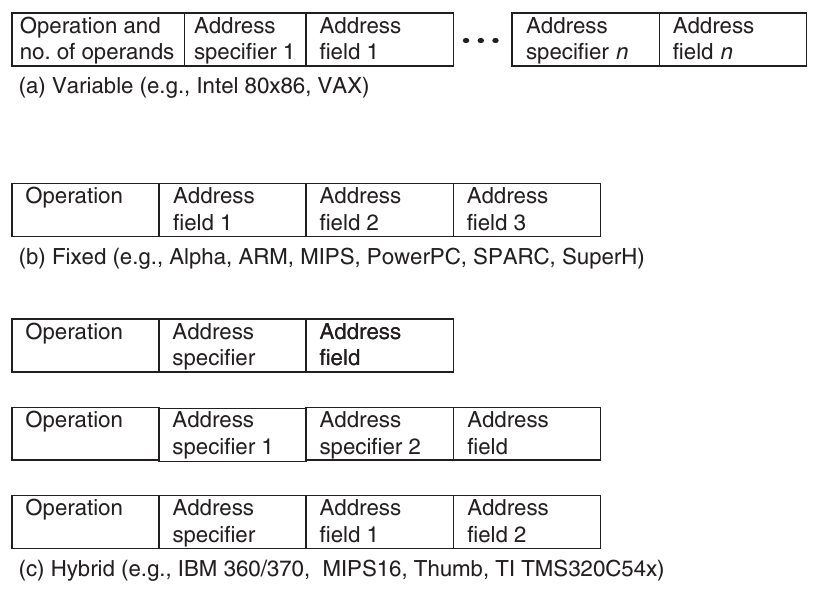

**Hình A.18 Ba biến thể cơ bản trong instruction encoding: độ dài variable, độ dài fixed và hybrid. Định dạng variable có thể hỗ trợ bất kỳ số toán hạng nào, với mỗi address specifier xác định addressing mode và độ dài specifier cho toán hạng đó. Nó thường cho cách biểu diễn code nhỏ nhất, vì không cần đưa vào những trường không dùng. Định dạng fixed luôn có cùng số toán hạng, với addressing mode (nếu có lựa chọn) được chỉ định như một phần của opcode. Nó thường cho kích thước code lớn nhất. Mặc dù vị trí các trường thường không thay đổi, chúng sẽ được các instruction khác nhau dùng cho những mục đích khác nhau. Cách tiếp cận hybrid có nhiều định dạng được opcode chỉ định, thêm một hoặc hai trường để chỉ định addressing mode và một hoặc hai trường để chỉ định địa chỉ toán hạng.**

1 + 1 + 4 = 6 byte

Độ dài instruction 80x86 thay đổi từ 1 đến 17 byte. Chương trình 80x86 nhìn chung nhỏ hơn chương trình trên các RISC architecture, vốn dùng định dạng fixed (xem Phụ lục K).

Với hai thái cực thiết kế instruction set là variable và fixed, phương án thứ ba lập tức xuất hiện: Giảm độ biến thiên về kích thước và công việc của variable architecture nhưng cung cấp nhiều độ dài instruction để giảm kích thước code. Cách tiếp cận hybrid này là phương án encoding thứ ba, và chúng ta sẽ sớm thấy các ví dụ.

### Giảm kích thước code trong RISC

Khi máy tính RISC bắt đầu được dùng trong ứng dụng embedded, định dạng fixed 32-bit trở thành một bất lợi vì chi phí và do đó code nhỏ hơn là quan trọng. Để đáp lại, một số nhà sản xuất cung cấp một phiên bản hybrid mới của RISC instruction set, với cả instruction 16-bit lẫn 32-bit. Các instruction hẹp hỗ trợ ít phép toán hơn, trường địa chỉ và immediate nhỏ hơn, ít register hơn, và định dạng two-address thay vì định dạng three-address kinh điển của máy tính RISC. Phụ lục K đưa ra hai ví dụ, ARM Thumb và MIPS MIPS16, cả hai đều tuyên bố giảm kích thước code đến 40%.

Khác với những phần mở rộng instruction set này, IBM đơn giản nén instruction set tiêu chuẩn của mình rồi thêm hardware để giải nén instruction khi chúng được fetch từ memory trong một instruction cache miss. Vì vậy, instruction cache chứa các instruction 32-bit đầy đủ, nhưng code nén được giữ trong main memory, ROM và đĩa. Ưu điểm của MIPS16 và Thumb là instruction cache hoạt động như thể lớn hơn khoảng 25%, trong khi CodePack của IBM có nghĩa là compiler không cần thay đổi để xử lý những instruction set khác nhau và instruction decoding có thể giữ sự đơn giản.

CodePack bắt đầu bằng nén run-length encoding trên bất kỳ chương trình PowerPC nào rồi nạp các bảng nén thu được vào một bảng 2 KB trên chip. Vì vậy, mỗi chương trình có encoding riêng độc nhất. Để xử lý branch, vốn không còn đi đến một ranh giới word aligned, PowerPC tạo một hash table trong memory ánh xạ giữa địa chỉ nén và địa chỉ chưa nén. Giống TLB (xem Chương 2), nó cache các ánh xạ địa chỉ được dùng gần đây nhất để giảm số truy cập memory. IBM tuyên bố chi phí performance tổng thể là 10%, mang lại mức giảm kích thước code 35% đến 40%.

Hitachi đơn giản tạo ra một RISC instruction set với định dạng fixed 16-bit, gọi là SuperH, cho ứng dụng embedded (xem Phụ lục K). Nó có 16 thay vì 32 register để vừa với định dạng hẹp hơn và ít instruction hơn, nhưng ngoài ra giống một RISC architecture kinh điển.

### Tóm lược: Mã hóa một Instruction Set

Các quyết định về những thành phần thiết kế instruction set được thảo luận trong các mục trước xác định liệu người thiết kế có lựa chọn giữa variable instruction encoding và fixed instruction encoding hay không. Khi có lựa chọn, người thiết kế quan tâm kích thước code hơn performance sẽ chọn variable encoding, còn người quan tâm performance hơn kích thước code sẽ chọn fixed encoding. Phụ lục E đưa ra 13 ví dụ về kết quả lựa chọn của người thiết kế. Trong Phụ lục C và Chương 3, tác động của sự biến thiên lên performance của processor sẽ được thảo luận thêm.

Chúng ta đã gần hoàn tất việc đặt nền tảng cho MIPS instruction set architecture sẽ được giới thiệu trong Mục A.9. Tuy nhiên, trước khi làm điều đó, sẽ hữu ích nếu xem qua công nghệ compiler và ảnh hưởng của nó lên các tính chất chương trình.

## A.8 Những vấn đề xuyên suốt: Vai trò của Compiler

Ngày nay gần như mọi hoạt động lập trình cho ứng dụng desktop và server đều được thực hiện bằng ngôn ngữ high-level. Sự phát triển này có nghĩa là vì phần lớn instruction được thực thi là output của một compiler, instruction set architecture về thực chất là một đích của compiler. Trước đây, đối với những ứng dụng này, các quyết định architecture thường được đưa ra để giúp lập trình assembly language dễ hơn hoặc phục vụ một kernel cụ thể. Vì compiler sẽ ảnh hưởng đáng kể đến performance của máy tính, hiểu công nghệ compiler ngày nay là điều then chốt để thiết kế và triển khai hiệu quả một instruction set.

Đã có thời người ta thường cố tách công nghệ compiler và ảnh hưởng của nó lên hardware performance khỏi architecture và performance của architecture, cũng như thường cố tách architecture khỏi cách triển khai nó. Sự tách biệt này về cơ bản là không thể với các desktop compiler và máy tính ngày nay. Các lựa chọn architecture ảnh hưởng đến chất lượng code có thể được tạo ra cho một máy tính và độ phức tạp khi xây dựng một compiler tốt cho nó, theo hướng tốt hơn hoặc xấu hơn.

Trong mục này, chúng ta thảo luận những mục tiêu then chốt của instruction set chủ yếu từ góc nhìn compiler. Phần này bắt đầu bằng việc ôn lại cấu trúc bên trong của các compiler hiện tại. Tiếp theo, thảo luận cách công nghệ compiler ảnh hưởng đến quyết định của người thiết kế, và cách người thiết kế có thể khiến compiler khó hoặc dễ tạo code tốt. Chúng ta kết thúc bằng việc xem xét compiler và các phép toán multimedia, vốn đáng tiếc là một ví dụ không tốt về sự hợp tác giữa người viết compiler và người thiết kế architecture.

### Cấu trúc của các Compiler gần đây

Để bắt đầu, hãy xem các optimizing compiler ngày nay như thế nào. Hình A.19 cho thấy cấu trúc của các compiler gần đây.

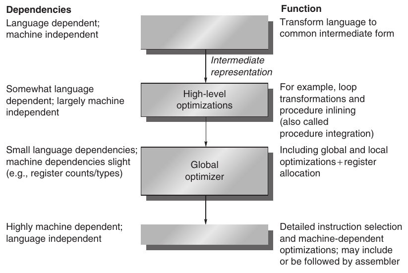

**Hình A.19 Compiler thường gồm hai đến bốn pass, với các compiler tối ưu hóa mạnh hơn có nhiều pass hơn. Cấu trúc này tối đa hóa xác suất một chương trình được biên dịch ở các mức tối ưu hóa khác nhau sẽ tạo cùng output khi được cho cùng input. Các optimizing pass được thiết kế là tùy chọn và có thể được bỏ qua khi mục tiêu là biên dịch nhanh hơn và có thể chấp nhận code lower-quality. Một pass đơn giản là một giai đoạn trong đó compiler đọc và biến đổi toàn bộ chương trình. (Thuật ngữ phase thường được dùng thay thế cho pass.) Vì các optimizing pass được tách biệt, nhiều ngôn ngữ có thể dùng chung các optimizing pass và code generation pass. Chỉ cần một front end mới cho một ngôn ngữ mới.**

Mục tiêu đầu tiên của người viết compiler là tính đúng đắn—mọi chương trình hợp lệ phải được biên dịch đúng. Mục tiêu thứ hai thường là tốc độ của code đã biên dịch. Thông thường, sau hai mục tiêu này là cả một tập mục tiêu khác, gồm biên dịch nhanh, hỗ trợ debugging và khả năng tương tác giữa các ngôn ngữ. Bình thường, các pass trong compiler biến đổi những cách biểu diễn higher-level, trừu tượng hơn thành các cách biểu diễn lower-level dần dần. Cuối cùng nó đạt đến instruction set. Cấu trúc này giúp quản lý độ phức tạp của các phép biến đổi và giúp viết một compiler bug-free dễ hơn.

Độ phức tạp khi viết một compiler đúng là hạn chế lớn đối với lượng tối ưu hóa có thể thực hiện. Mặc dù cấu trúc multiple-pass giúp giảm độ phức tạp của compiler, nó cũng có nghĩa là compiler phải sắp thứ tự và thực hiện một số phép biến đổi trước các phép biến đổi khác. Trong sơ đồ optimizing compiler ở Hình A.19, có thể thấy một số tối ưu hóa high-level được thực hiện từ lâu trước khi biết code thu được sẽ như thế nào. Khi đã thực hiện một phép biến đổi như vậy, compiler không thể quay lại và xem xét mọi bước, có thể hoàn tác các phép biến đổi. Việc lặp như vậy sẽ quá tốn kém cả về thời gian biên dịch lẫn độ phức tạp. Vì thế, compiler đưa ra những giả định về khả năng của các bước sau trong việc xử lý một số vấn đề. Chẳng hạn, compiler thường phải chọn những lời gọi procedure nào cần được mở rộng inline trước khi biết kích thước chính xác của procedure được gọi. Người viết compiler gọi đây là phase-ordering problem.

Thứ tự các phép biến đổi này tương tác với instruction set architecture như thế nào? Một ví dụ tốt xuất hiện với tối ưu hóa gọi là global common subexpression elimination. Tối ưu hóa này tìm hai lần xuất hiện của một biểu thức tính cùng giá trị và lưu giá trị của lần tính đầu tiên vào một biến tạm. Sau đó nó dùng giá trị tạm, loại bỏ lần tính thứ hai của biểu thức chung.

Để tối ưu hóa này có ý nghĩa, biến tạm phải được cấp phát vào register. Nếu không, chi phí lưu biến tạm trong memory rồi nạp lại sau đó có thể triệt tiêu phần tiết kiệm do không tính lại biểu thức. Thực tế có những trường hợp tối ưu hóa này làm code chậm hơn khi biến tạm không được cấp phát register. Thứ tự phase làm vấn đề phức tạp hơn vì register allocation thường được thực hiện gần cuối global optimization pass, ngay trước code generation. Vì vậy, một optimizer thực hiện tối ưu hóa này phải giả định register allocator sẽ cấp phát biến tạm vào register.

Các tối ưu hóa được compiler hiện đại thực hiện có thể được phân loại theo kiểu biến đổi như sau:

- Các tối ưu hóa High-level thường được thực hiện trên source với output được đưa đến những optimization pass sau.

- Local optimization chỉ tối ưu code trong một đoạn code straight-line (được giới compiler gọi là basic block).

- Global optimization mở rộng local optimization qua các branch và đưa vào một tập phép biến đổi nhằm tối ưu loop.

- Register allocation liên kết register với toán hạng.

- Các tối ưu hóa Processor-dependent cố tận dụng kiến thức về architecture cụ thể.

### Register Allocation

Do register allocation giữ vai trò trung tâm cả trong tăng tốc code lẫn giúp các tối ưu hóa khác hữu ích, nó là một trong những tối ưu hóa quan trọng nhất—nếu không phải quan trọng nhất. Các thuật toán register allocation ngày nay dựa trên một kỹ thuật gọi là graph coloring. Ý tưởng cơ bản của graph coloring là xây dựng một graph biểu diễn các ứng viên có thể được cấp phát vào register rồi dùng graph để cấp phát register. Nói gần đúng, vấn đề là cách dùng một tập màu hạn chế sao cho không có hai node liền kề trong dependency graph có cùng màu. Trọng tâm của cách tiếp cận là đạt register allocation 100% cho các biến đang hoạt động. Bài toán tô màu graph tổng quát có thể cần thời gian hàm mũ theo kích thước graph (NP-complete). Tuy nhiên, có những thuật toán heuristic hoạt động tốt trong thực tế, cho các cách cấp phát gần tối ưu chạy trong thời gian near-linear.

Graph coloring hoạt động tốt nhất khi có ít nhất 16 (và tốt hơn là nhiều hơn) general-purpose register sẵn cho global allocation đối với biến integer, cùng các register bổ sung cho floating point. Đáng tiếc, graph coloring không hoạt động tốt khi số register nhỏ vì các thuật toán heuristic để tô màu graph dễ thất bại.

### Tác động của tối ưu hóa lên Performance

Đôi khi khó tách một số tối ưu hóa đơn giản hơn—local optimization và tối ưu hóa processor-dependent—khỏi các phép biến đổi được thực hiện trong code generator. Ví dụ về những tối ưu hóa điển hình được đưa ra trong Hình A.20. Cột cuối của Hình A.20 cho biết tần suất áp dụng các phép biến đổi tối ưu hóa được liệt kê lên chương trình source.

Hình A.21 cho thấy ảnh hưởng của những tối ưu hóa khác nhau lên số instruction được thực thi cho hai chương trình. Trong trường hợp này, các chương trình được tối ưu thực thi ít hơn khoảng 25% đến 90% số instruction so với chương trình chưa tối ưu. Hình minh họa tầm quan trọng của việc xem code đã tối ưu trước khi đề xuất tính năng instruction set mới, vì compiler có thể loại bỏ hoàn toàn các instruction mà người thiết kế đang cố cải thiện.

### Tác động của công nghệ Compiler lên quyết định của người thiết kế

Sự tương tác của compiler và ngôn ngữ high-level ảnh hưởng đáng kể đến cách chương trình dùng instruction set architecture. Có hai câu hỏi quan trọng: Các biến được cấp phát và định địa chỉ như thế nào? Cần bao nhiêu register để cấp phát các biến thích hợp? Để trả lời, chúng ta phải xem ba vùng riêng biệt mà các ngôn ngữ high-level hiện tại dùng để cấp phát dữ liệu:

- Stack được dùng để cấp phát biến cục bộ. Stack tăng hoặc giảm tương ứng khi gọi hoặc trả về từ procedure. Các đối tượng trên stack được định địa chỉ tương đối với stack pointer và chủ yếu là scalar (biến đơn) thay vì array. Stack được dùng cho activation record, không phải như một stack để tính biểu thức. Vì thế, các giá trị gần như không bao giờ được push hoặc pop trên stack.

- Vùng global data được dùng để cấp phát các đối tượng được khai báo static, như biến toàn cục và hằng số. Một tỷ lệ lớn các đối tượng này là array hoặc những cấu trúc dữ liệu tổng hợp khác.

- Heap được dùng để cấp phát các đối tượng động không tuân theo quy tắc stack. Các đối tượng trong heap được truy cập bằng pointer và thường không phải scalar.

Register allocation hiệu quả hơn nhiều với các đối tượng stack-allocated so với biến toàn cục, và về cơ bản không thể register allocation cho các đối tượng heap-allocated vì chúng được truy cập bằng pointer. Không thể cấp phát một số biến toàn cục và biến stack vì chúng bị aliased—có nhiều cách tham chiếu đến địa chỉ của một biến, khiến việc đặt nó vào register không hợp lệ. (Phần lớn biến heap thực chất bị aliased với công nghệ compiler ngày nay.)

| Tên tối ưu hóa | Giải thích | Tỷ lệ trong tổng số phép biến đổi tối ưu hóa |
|---|---|---|
| High-level | Ở mức source hoặc gần mức source; processor-independent |  |
| Procedure integration | Thay lời gọi procedure bằng thân procedure | N.M. |
| Local | Trong code straight-line |  |
| Common subexpression elimination | Thay hai lần xuất hiện của cùng phép tính bằng một bản duy nhất | 18% |
| Constant propagation | Thay mọi lần xuất hiện của một biến được gán hằng số bằng hằng số đó | 22% |
| Stack height reduction | Sắp xếp lại cây biểu thức để giảm thiểu tài nguyên cần cho việc tính biểu thức | N.M. |
| Global | Qua một branch |  |
| Global common subexpression elimination | Giống local, nhưng phiên bản này đi qua các branch | 13% |
| Copy propagation | Thay mọi lần xuất hiện của một biến A đã được gán X (tức là A = X) bằng X | 11% |
| Code motion | Đưa khỏi loop đoạn code tính cùng giá trị ở mỗi lần lặp của loop | 16% |
| Induction variable elimination | Đơn giản hóa/loại bỏ các phép tính định địa chỉ array trong loop | 2% |
| Processor-dependent | Phụ thuộc vào kiến thức về processor |  |
| Strength reduction | Nhiều ví dụ, như thay phép nhân với một hằng số bằng phép cộng và phép dịch | N.M. |
| Pipeline scheduling | Sắp xếp lại instruction để cải thiện pipeline performance | N.M. |
| Branch offset optimization | Chọn branch displacement ngắn nhất có thể đến đích | N.M. |

**Hình A.20 Các loại tối ưu hóa chính và ví dụ trong mỗi nhóm. Dữ liệu này cho biết tần suất xuất hiện tương đối của các tối ưu hóa khác nhau. Cột thứ ba liệt kê tần suất static mà một số tối ưu hóa phổ biến được áp dụng trong một tập 12 chương trình Fortran và Pascal nhỏ. Có chín local optimization và global optimization do compiler thực hiện được đưa vào phép đo. Sáu tối ưu hóa trong số này được trình bày trong hình, còn ba tối ưu hóa còn lại chiếm 18% tổng số lần xuất hiện static. Viết tắt N.M. có nghĩa là số lần xuất hiện của tối ưu hóa đó không được đo. Các tối ưu hóa Processor-dependent thường được thực hiện trong code generator, và không có tối ưu hóa nào trong số đó được đo trong thử nghiệm này. Tỷ lệ phần trăm là phần của các tối ưu hóa static thuộc loại được chỉ định. Dữ liệu từ Chow [1983] (thu thập bằng Stanford UCODE compiler).**

Chẳng hạn, xét chuỗi code sau, trong đó & trả về địa chỉ của một biến và * dereference một pointer:

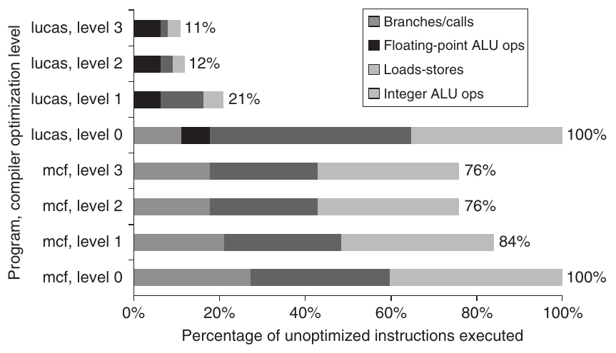

**Hình A.21 Thay đổi số instruction cho các chương trình lucas và mcf trong SPEC2000 khi mức tối ưu hóa compiler thay đổi. Mức 0 giống code chưa tối ưu. Mức 1 bao gồm local optimization, code scheduling và local register allocation. Mức 2 bao gồm global optimization, loop transformation (software pipelining) và global register allocation. Mức 3 thêm procedure integration. Các thử nghiệm này được thực hiện trên các Alpha compiler.**

```
p = &a-- gets address of a in p
a = ...-- assigns to a directly
*p = ...-- uses p to assign to a
...a...-- accesses a
```

Biến a không thể được register allocated xuyên qua phép gán cho *p mà không tạo ra code sai. Aliasing gây ra một vấn đề đáng kể vì thường khó hoặc không thể quyết định pointer có thể tham chiếu đến những đối tượng nào. Compiler phải thận trọng; một số compiler sẽ không cấp phát bất kỳ biến cục bộ nào của một procedure vào register khi có một pointer có thể tham chiếu đến một trong các biến cục bộ.

### Người thiết kế Architecture có thể giúp người viết Compiler như thế nào

Ngày nay, độ phức tạp của compiler không đến từ việc dịch những câu lệnh đơn giản như A = B + C. Phần lớn chương trình đơn giản ở phạm vi cục bộ, và các cách dịch đơn giản hoạt động tốt. Thay vào đó, sự phức tạp xuất hiện vì chương trình lớn và có tương tác phức tạp ở phạm vi toàn cục, và vì cấu trúc compiler khiến các quyết định về chuỗi code tốt nhất được đưa ra từng bước một.

Người viết compiler thường làm việc theo hệ luận riêng của một nguyên tắc cơ bản trong architecture: Làm cho trường hợp thường gặp nhanh và trường hợp hiếm gặp đúng. Tức là nếu biết trường hợp nào thường gặp, trường hợp nào hiếm, và việc tạo code cho cả hai đều đơn giản, chất lượng code cho trường hợp hiếm có thể không quá quan trọng—nhưng nó phải đúng!

Một số tính chất instruction set giúp ích cho người viết compiler. Không nên xem các tính chất này là quy tắc hard-and-fast, mà là các hướng dẫn giúp dễ viết một compiler tạo ra code hiệu quả và đúng hơn.

- Cung cấp tính đều đặn—Bất cứ khi nào hợp lý, ba thành phần chính của một instruction set—phép toán, kiểu dữ liệu và addressing mode—nên trực giao. Hai khía cạnh của một architecture được gọi là trực giao nếu chúng độc lập. Chẳng hạn, phép toán và addressing mode trực giao nếu với mọi phép toán có thể áp dụng một addressing mode, tất cả addressing mode đều có thể áp dụng. Tính đều đặn này giúp đơn giản hóa code generation và đặc biệt quan trọng khi quyết định tạo code nào được chia thành hai pass trong compiler. Một phản ví dụ tốt cho tính chất này là hạn chế những register có thể được dùng cho một nhóm instruction nhất định. Compiler cho special-purpose register architecture thường mắc kẹt trong tình thế này. Hạn chế đó có thể khiến compiler có rất nhiều register sẵn dùng, nhưng không có register nào đúng loại!

- Cung cấp primitive, không phải giải pháp—Các tính năng đặc biệt “khớp” với một cấu trúc ngôn ngữ hoặc một kernel function thường không dùng được. Những nỗ lực hỗ trợ ngôn ngữ high-level có thể chỉ hoạt động với một ngôn ngữ hoặc làm nhiều hơn hay ít hơn mức cần thiết để triển khai ngôn ngữ một cách đúng và hiệu quả. Một ví dụ về cách những nỗ lực như vậy thất bại được đưa ra trong Mục A.10.

- Đơn giản hóa trade-offs giữa các phương án—Một trong những việc khó nhất của người viết compiler là xác định chuỗi instruction nào tốt nhất cho mỗi đoạn code xuất hiện. Trước đây, số instruction hoặc tổng kích thước code có thể là thước đo tốt, nhưng—như đã thấy trong Chương 1—điều này không còn đúng. Với cache và pipelining, các trade-offs đã trở nên rất phức tạp. Bất cứ điều gì người thiết kế có thể làm để giúp người viết compiler hiểu chi phí của những chuỗi code khác nhau đều giúp cải thiện code. Một trong những trường hợp trade-offs phức tạp khó nhất xuất hiện trong register-memory architecture khi quyết định một biến cần được tham chiếu bao nhiêu lần trước khi việc nạp nó vào register trở nên rẻ hơn. Ngưỡng này khó tính và thực tế có thể khác nhau giữa các model của cùng architecture.

- Cung cấp instruction gắn các đại lượng đã biết tại compile time như hằng số—Người viết compiler không thích ý nghĩ processor diễn giải tại runtime một giá trị đã được biết tại compile time. Những phản ví dụ tốt của nguyên tắc này bao gồm các instruction diễn giải những giá trị đã cố định tại compile time. Chẳng hạn, VAX procedure call instruction (calls) diễn giải động một mask cho biết những register nào cần lưu trong một lời gọi, nhưng mask được cố định tại compile time (xem Mục A.10).

### Hỗ trợ của Compiler (hoặc sự thiếu hỗ trợ) cho Multimedia Instruction

Đáng tiếc, người thiết kế các SIMD instruction (xem Mục 4.3 trong Chương 4) về cơ bản bỏ qua mục trước. Những instruction này thường là giải pháp chứ không phải primitive; chúng thiếu register; và các kiểu dữ liệu không khớp với ngôn ngữ lập trình hiện có. Người thiết kế architecture hy vọng tìm một giải pháp ít tốn kém giúp một số người dùng, nhưng thường chỉ vài routine thư viện đồ họa low-level dùng chúng.

Các SIMD instruction thực sự là phiên bản rút gọn của một kiểu architecture tinh tế có công nghệ compiler riêng. Như giải thích trong Mục 4.2, vector architecture hoạt động trên các vector dữ liệu. Ban đầu được phát minh cho code khoa học, chúng cũng thường có thể vectorize multimedia kernel, dù thường với vector ngắn hơn. Như Mục 4.3 gợi ý, có thể xem MMX và SSE của Intel hoặc AltiVec của PowerPC đơn giản là các máy tính vector ngắn: MMX với vector gồm tám phần tử 8-bit, bốn phần tử 16-bit hoặc hai phần tử 32-bit, còn AltiVec có vector dài gấp đôi. Chúng được triển khai đơn giản như các phần tử hẹp nằm liền nhau trong register rộng.

Các microprocessor architecture này đưa kích thước vector register vào architecture: tổng kích thước các phần tử bị giới hạn ở 64 bit với MMX và 128 bit với AltiVec. Khi Intel quyết định mở rộng đến các vector 128-bit, hãng thêm một tập instruction hoàn toàn mới, gọi là Streaming SIMD Extension (SSE).

Một ưu điểm chính của máy tính vector là che giấu latency của truy cập memory bằng cách nạp nhiều phần tử cùng lúc rồi chồng lấp thực thi với truyền dữ liệu. Mục tiêu của vector addressing mode là thu thập dữ liệu nằm rải rác trong memory, đặt chúng ở dạng gọn để có thể thao tác hiệu quả, rồi đặt kết quả trở lại vị trí thích hợp.

Máy tính vector bao gồm strided addressing và gather/scatter addressing (xem Mục 4.2) để tăng số chương trình có thể vectorize. Strided addressing bỏ qua một số word cố định giữa mỗi lần truy cập, nên sequential addressing thường được gọi là unit stride addressing. Gather và scatter tìm địa chỉ của mình trong một vector register khác: Hãy xem đó như register indirect addressing cho máy tính vector. Ngược lại, từ góc nhìn vector, các máy tính SIMD short-vector này chỉ hỗ trợ truy cập unit strided: Truy cập memory nạp hoặc lưu tất cả phần tử cùng lúc từ một vị trí memory rộng duy nhất. Vì dữ liệu cho ứng dụng multimedia thường là các luồng bắt đầu và kết thúc trong memory, strided addressing mode và gather/scatter addressing mode thiết yếu cho vectorization thành công (xem Mục 4.7).

**Ví dụ** Hãy so sánh một máy tính vector với MMX cho việc chuyển đổi cách biểu diễn màu của pixel từ RGB (red, green, blue) sang YUV (luminosity chrominance), với mỗi pixel được biểu diễn bằng 3 byte. Phép chuyển đổi chỉ gồm ba dòng code C đặt trong một loop:

```
Y = (9798*R + 19235*G + 3736*B) / 32768;
U = (-4784*R - 9437*G + 4221*B) / 32768 + 128;
V = (20218*R - 16941*G - 3277*B) / 32768 + 128;
```

Một máy tính vector 64-bit-wide có thể tính 8 pixel đồng thời. Một máy tính vector cho media với strided address cần

- 3 vector load (để lấy RGB)

- 3 phép nhân vector (để chuyển đổi R)

- 6 phép nhân cộng vector (để chuyển đổi G và B)

- 3 phép dịch vector (để chia cho 32,768)

- 2 phép cộng vector (để cộng 128)

- 3 vector store (để lưu YUV)

Tổng cộng là 20 instruction để thực hiện 20 phép toán trong code C phía trên nhằm chuyển đổi 8 pixel [Kozyrakis 2000]. (Vì một vector có thể có 32 phần tử 64-bit, code này thực sự chuyển đổi đến 32 × 8 hay 256 pixel.)

Ngược lại, Web site của Intel cho thấy một library routine thực hiện cùng phép tính trên 8 pixel cần 116 MMX instruction cộng 6 instruction 80x86 [Intel 2001]. Số instruction tăng gấp sáu này là do cần nhiều instruction để load và unpack các pixel RGB, rồi pack và store các pixel YUV, vì không có truy cập memory strided.

Có các vector ngắn architecture-limited với ít register và memory addressing mode đơn giản khiến việc dùng công nghệ vectorizing compiler khó hơn. Vì thế, những SIMD instruction này có khả năng xuất hiện trong các thư viện hand-coded nhiều hơn trong code đã biên dịch.

### Tóm lược: Vai trò của Compiler

Mục này dẫn đến một số khuyến nghị. Trước hết, chúng ta kỳ vọng một instruction set architecture mới có ít nhất 16 general-purpose register—không tính các register riêng cho số floating-point—để đơn giản hóa register allocation bằng graph coloring. Lời khuyên về tính trực giao gợi ý rằng tất cả addressing mode được hỗ trợ nên áp dụng cho mọi instruction truyền dữ liệu. Cuối cùng, ba lời khuyên cuối—cung cấp primitive thay vì giải pháp, đơn giản hóa trade-offs giữa các phương án, không gắn hằng số tại runtime—đều gợi ý rằng nghiêng về sự đơn giản là tốt hơn. Nói cách khác, hãy hiểu rằng ít hơn có thể mang lại nhiều hơn trong thiết kế instruction set. Đáng tiếc, các phần mở rộng SIMD là ví dụ về tiếp thị tốt nhiều hơn là thành tựu nổi bật của hardware–software co-design.

## A.9 Kết hợp tất cả lại: MIPS Architecture

Trong mục này, chúng ta mô tả một architecture load-store 64-bit đơn giản gọi là MIPS. Instruction set architecture của MIPS và các họ hàng RISC dựa trên những quan sát tương tự những gì được trình bày trong các mục vừa qua. (Trong Mục L.3, chúng ta thảo luận cách và lý do những architecture này trở nên phổ biến.) Ôn lại kỳ vọng từ mỗi mục đối với ứng dụng desktop:

- Mục A.2—Dùng general-purpose register với một load-store architecture.

- Mục A.3—Hỗ trợ các addressing mode: displacement (với kích thước address offset từ 12 đến 16 bit), immediate (kích thước 8 đến 16 bit) và register indirect.

- Mục A.4—Hỗ trợ các kích thước và kiểu dữ liệu: integer 8-, 16-, 32- và 64-bit, cùng số IEEE 754 floating-point 64-bit.

- Mục A.5—Hỗ trợ các instruction đơn giản này vì chúng sẽ chiếm ưu thế trong số instruction được thực thi: load, store, add, subtract, move register-register và shift.

- Mục A.6—Compare equal, compare not equal, compare less, branch (với địa chỉ PC-relative dài ít nhất 8 bit), jump, call và return.

- Mục A.7—Dùng fixed instruction encoding nếu quan tâm performance, và dùng variable instruction encoding nếu quan tâm kích thước code.

- Mục A.8—Cung cấp ít nhất 16 general-purpose register, bảo đảm mọi addressing mode áp dụng cho mọi data transfer instruction, và hướng tới một instruction set tối giản. Mục này không đề cập chương trình floating-point, nhưng chúng thường dùng các floating-point register riêng. Lý do là tăng tổng số register mà không gây vấn đề trong định dạng instruction hoặc tốc độ của general-purpose register file. Tuy nhiên, sự thỏa hiệp này không trực giao.

Chúng ta giới thiệu MIPS bằng cách cho thấy nó tuân theo các khuyến nghị này như thế nào. Giống phần lớn máy tính gần đây, MIPS nhấn mạnh

- Một load-store instruction set đơn giản

- Thiết kế cho hiệu quả pipelining (được thảo luận trong Phụ lục C), bao gồm fixed instruction set encoding

- Tính hiệu quả với vai trò đích của compiler

MIPS cung cấp một mô hình architecture tốt để nghiên cứu, không chỉ vì mức phổ biến của loại processor này mà còn vì đây là một architecture dễ hiểu. Chúng ta sẽ dùng lại architecture này trong Phụ lục C và Chương 3, và nó làm cơ sở cho một số bài tập và dự án lập trình.

Trong những năm kể từ MIPS processor đầu tiên năm 1985, đã có nhiều phiên bản MIPS (xem Phụ lục K). Chúng ta sẽ dùng một tập con của thứ hiện được gọi là MIPS64, thường viết tắt đơn giản là MIPS, nhưng instruction set đầy đủ nằm trong Phụ lục K.

### Register của MIPS

MIPS64 có 32 general-purpose register (GPR) 64-bit, tên R0, R1, . . . , R31. GPR đôi khi cũng được gọi là integer register. Ngoài ra, có một tập 32 floating-point register (FPR), tên F0, F1, . . . , F31, có thể giữ 32 giá trị single-precision (32-bit) hoặc 32 giá trị double-precision (64-bit). (Khi giữ một số single-precision, nửa còn lại của FPR không được dùng.) Cả phép toán floating-point single- lẫn double-precision (32-bit và 64-bit) đều được cung cấp. MIPS cũng bao gồm các instruction hoạt động trên hai toán hạng single-precision trong một floating-point register 64-bit duy nhất.

Giá trị của R0 luôn bằng 0. Sau đây chúng ta sẽ thấy cách dùng register này để tổng hợp nhiều phép toán hữu ích từ một instruction set đơn giản.

Một vài special register có thể được truyền đến và đi từ general-purpose register. Một ví dụ là floating-point status register, được dùng để giữ thông tin về kết quả của các phép toán floating-point. Cũng có các instruction để chuyển giữa FPR và GPR.

### Kiểu dữ liệu của MIPS

Các kiểu dữ liệu là byte 8-bit, half word 16-bit, word 32-bit và double word 64-bit cho dữ liệu integer, cùng single precision 32-bit và double precision 64-bit cho floating point. Half word được bổ sung vì có trong những ngôn ngữ như C và phổ biến trong một số chương trình, như operating system, quan tâm đến kích thước cấu trúc dữ liệu. Chúng cũng sẽ phổ biến hơn nếu Unicode được dùng rộng rãi. Các toán hạng floating-point Single-precision được bổ sung vì lý do tương tự. (Hãy nhớ cảnh báo ban đầu rằng bạn nên đo nhiều chương trình hơn nữa trước khi thiết kế một instruction set.)

Các phép toán MIPS64 hoạt động trên integer 64-bit và floating point 32- hoặc 64-bit. Byte, half word và word được nạp vào general-purpose register với các bit không hoặc sign bit được lặp lại để điền đầy 64 bit của GPR. Khi đã được nạp, chúng được xử lý bằng các phép toán integer 64-bit.

### Addressing Mode cho truyền dữ liệu MIPS

Các data addressing mode duy nhất là immediate và displacement, cả hai có trường 16-bit. Register indirect được thực hiện đơn giản bằng cách đặt 0 trong trường displacement 16-bit, và absolute addressing với trường 16-bit được thực hiện bằng cách dùng register 0 làm base register. Tận dụng số không cho chúng ta bốn mode hiệu dụng, mặc dù architecture chỉ hỗ trợ hai mode.

Memory MIPS được định địa chỉ theo byte với địa chỉ 64-bit. Nó có một mode bit cho phép software chọn Big Endian hoặc Little Endian. Vì là load-store architecture, mọi tham chiếu giữa memory và GPR hoặc FPR đều thông qua load hoặc store. Với việc hỗ trợ các kiểu dữ liệu được đề cập phía trên, truy cập memory liên quan đến GPR có thể là byte, half word, word hoặc double word. FPR có thể được load và store với các số single-precision hoặc double-precision. Mọi truy cập memory phải aligned.

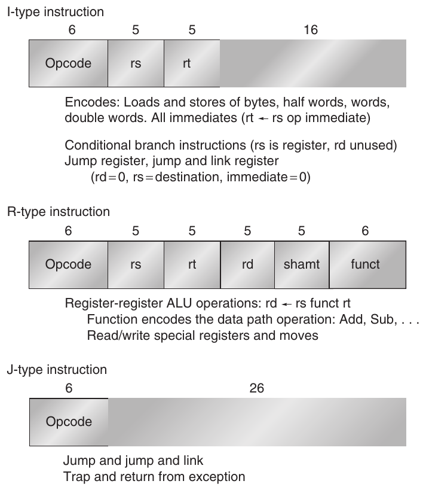

**Hình A.22 Instruction layout của MIPS. Mọi instruction được mã hóa theo một trong ba loại, với các trường chung ở cùng vị trí trong mỗi định dạng.**

### Định dạng MIPS Instruction

Vì MIPS chỉ có hai addressing mode, chúng có thể được mã hóa vào opcode. Tuân theo lời khuyên làm cho processor dễ pipeline và decode, mọi instruction đều dài 32 bit với primary opcode 6-bit. Hình A.22 cho thấy instruction layout. Các định dạng này đơn giản trong khi cung cấp trường 16-bit cho displacement addressing, hằng số immediate hoặc địa chỉ branch PC-relative.

Phụ lục K cho thấy một biến thể MIPS––gọi là MIPS16––có instruction 16-bit và 32-bit để cải thiện code density cho ứng dụng embedded. Trong cuốn sách này, chúng ta sẽ dùng định dạng 32-bit truyền thống.

### Các phép toán MIPS

MIPS hỗ trợ danh sách các phép toán đơn giản được khuyến nghị phía trên cùng một vài phép toán khác. Có bốn nhóm instruction lớn: load và store, phép toán ALU, branch và jump, và phép toán floating-point.

Bất kỳ register general-purpose hoặc floating-point nào cũng có thể được load hoặc store, ngoại trừ việc load R0 không có tác dụng. Hình A.23 đưa ra ví dụ về load instruction và store instruction. Các số floating-point Single-precision chiếm một nửa floating-point register. Chuyển đổi giữa single và double precision phải được thực hiện tường minh. Định dạng floating-point là IEEE 754 (xem Phụ lục J). Danh sách mọi MIPS instruction trong tập con của chúng ta xuất hiện trong Hình A.26 (trang A-40).

Để hiểu các hình này, cần giới thiệu một vài phần mở rộng bổ sung cho ngôn ngữ mô tả C được dùng ban đầu ở trang A-9:

- Một subscript được thêm vào ký hiệu ← bất cứ khi nào độ dài của dữ liệu được truyền có thể chưa rõ. Vì vậy, ←<sub>n</sub> có nghĩa là truyền một đại lượng n-bit. Chúng ta dùng x, y ← z để chỉ rằng z cần được truyền đến x và y.

- Một subscript được dùng để chỉ việc chọn một bit từ một trường. Các bit được đánh nhãn từ most-significant bit bắt đầu ở 0. Subscript có thể là một chữ số duy nhất (chẳng hạn, Regs[R4]<sub>0</sub> cho sign bit của R4) hoặc một khoảng con (chẳng hạn, Regs[R3]<sub>56..63</sub> cho least-significant byte của R3).

- Biến Mem, được dùng như một array đại diện cho main memory, được đánh index bằng một địa chỉ byte và có thể truyền bất kỳ số byte nào.

- Một superscript được dùng để lặp lại một trường (chẳng hạn, 0<sup>48</sup> cho một trường toàn bit không dài 48 bit).

- Ký hiệu ## được dùng để nối hai trường và có thể xuất hiện ở bất kỳ phía nào của một phép truyền dữ liệu.

| Instruction ví dụ | Tên instruction | Ý nghĩa |
|---|---|---|
| LD R1,30(R2) | Load double word | Regs[R1]←<sub>64</sub> Mem[30+Regs[R2]] |
| LD R1,1000(R0) | Load double word | Regs[R1]←<sub>64</sub> Mem[1000+0] |
| LW R1,60(R2) | Load word | Regs[R1]←<sub>64</sub> (Mem[60+Regs[R2]]<sub>0</sub>)<sup>32</sup>## Mem[60+Regs[R2]] |
| LB R1,40(R3) | Load byte | Regs[R1]←<sub>64</sub> (Mem[40+Regs[R3]]<sub>0</sub>)<sup>56</sup> ## Mem[40+Regs[R3]] |
| LBU R1,40(R3) | Load byte unsigned | Regs[R1]←<sub>64</sub> 0<sup>56</sup> ## Mem[40+Regs[R3]] |
| LH R1,40(R3) | Load half word | Regs[R1]←<sub>64</sub> (Mem[40+Regs[R3]]<sub>0</sub>)<sup>48</sup> ## Mem[40+Regs[R3]] ## Mem[41+Regs[R3]] |
| L.S F0,50(R3) | Load FP single | Regs[F0]←<sub>64</sub> Mem[50+Regs[R3]] ## 0<sup>32</sup> |
| L.D F0,50(R2) | Load FP double | Regs[F0]←<sub>64</sub> Mem[50+Regs[R2]] |
| SD R3,500(R4) | Store double word | Mem[500+Regs[R4]]←<sub>64</sub> Regs[R3] |
| SW R3,500(R4) | Store word | Mem[500+Regs[R4]]←<sub>32</sub> Regs[R3]<sub>32..63</sub> |
| S.S F0,40(R3) | Store FP single | Mem[40+Regs[R3]]←<sub>32</sub> Regs[F0]<sub>0..31</sub> |
| S.D F0,40(R3) | Store FP double | Mem[40+Regs[R3]]←<sub>64</sub> Regs[F0] |
| SH R3,502(R2) | Store half | Mem[502+Regs[R2]]←<sub>16</sub> Regs[R3]<sub>48..63</sub> |
| SB R2,41(R3) | Store byte | Mem[41+Regs[R3]]←<sub>8</sub> Regs[R2]<sub>56..63</sub> |

**Hình A.23 Các load instruction và store instruction trong MIPS. Tất cả dùng một addressing mode duy nhất và yêu cầu giá trị memory được aligned. Tất nhiên, cả load lẫn store đều có cho mọi kiểu dữ liệu được thể hiện.**

| Instruction ví dụ | Tên instruction | Ý nghĩa |
|---|---|---|
| DADDU R1,R2,R3 | Add unsigned | Regs[R1]← Regs[R2]+Regs[R3] |
| DADDIU R1,R2,#3 | Add immediate unsigned | Regs[R1]← Regs[R2]+3 |
| LUI R1,#42 | Load upper immediate | Regs[R1]← 0<sup>32</sup>##42##0<sup>16</sup> |
| DSLL R1,R2,#5 | Shift left logical | Regs[R1]← Regs[R2]<<5 |
| SLT R1,R2,R3 | Set less than | if (Regs[R2]<Regs[R3]) Regs[R1] ← 1 else Regs[R1]←0 |

**Hình A.24 Ví dụ về arithmetic/logical instruction trên MIPS, cả có lẫn không có immediate.**

Chẳng hạn, giả sử R8 và R10 là register 64-bit:

Regs[R10]<sub>32..63</sub> ← <sub>32</sub>(Mem[Regs[R8]]<sub>0</sub>)<sup>24</sup> ## Mem[Regs[R8]]

có nghĩa là byte tại vị trí memory được định địa chỉ bởi nội dung register R8 được sign-extended để tạo một đại lượng 32-bit được lưu vào nửa dưới của register R10. (Nửa trên của R10 không thay đổi.)

Mọi ALU instruction đều là register-register instruction. Hình A.24 đưa ra một số ví dụ về arithmetic/logical instruction. Các phép toán bao gồm các phép arithmetic và logical đơn giản: add, subtract, AND, OR, XOR và shift. Dạng immediate của mọi instruction này được cung cấp với một immediate sign-extended 16-bit. Phép toán LUI (load upper immediate) nạp các bit 32 đến 47 của một register, đồng thời đặt phần còn lại của register bằng 0. LUI cho phép xây dựng một hằng số 32-bit bằng hai instruction, hoặc thực hiện một phép truyền dữ liệu dùng bất kỳ địa chỉ hằng số 32-bit nào bằng một instruction bổ sung.

Như đã đề cập, R0 được dùng để tổng hợp các phép toán phổ biến. Nạp một hằng số đơn giản là một add immediate có toán hạng nguồn R0, còn một phép chuyển register-register đơn giản là một phép cộng có một trong các nguồn là R0. (Đôi khi chúng ta dùng mnemonic LI, viết tắt của load immediate, để biểu diễn trường hợp đầu, và mnemonic MOV cho trường hợp sau.)

### MIPS Control Flow Instruction

MIPS cung cấp compare instruction, so sánh hai register để xem register thứ nhất có nhỏ hơn register thứ hai hay không. Nếu điều kiện đúng, những instruction này đặt 1 vào destination register (để biểu diễn đúng); nếu không, đặt giá trị 0. Vì các phép toán này “set” một register, chúng được gọi là set-equal, set-not-equal, set-less-than, v.v. Cũng có các dạng immediate của những compare này.

Điều khiển được xử lý thông qua một tập jump và một tập branch. Hình A.25 đưa ra một số branch instruction và jump instruction điển hình. Bốn jump instruction được phân biệt bởi hai cách chỉ định địa chỉ đích và bởi việc có tạo link hay không. Hai jump dùng một offset 26-bit được dịch 2 bit rồi thay thế 28 bit thấp hơn của program counter (của instruction theo sau jump theo thứ tự tuần tự) để xác định địa chỉ đích. Hai jump instruction còn lại chỉ định một register chứa địa chỉ đích. Có hai dạng jump: jump thông thường và jump and link (dùng cho lời gọi procedure). Dạng sau đặt địa chỉ trả về—địa chỉ của instruction tuần tự kế tiếp—vào R31.

| Instruction ví dụ | Tên instruction | Ý nghĩa |
|---|---|---|
| J name | Jump | PC<sub>36..63</sub>←name |
| JAL name | Jump and link | Regs[R31]←PC+8; PC<sub>36..63</sub>←name; ((PC + 4)–2<sup>27</sup>) ≤ name < ((PC+4)+2<sup>27</sup>) |
| JALR R2 | Jump and link register | Regs[R31]←PC+8; PC←Regs[R2] |
| JR R3 | Jump register | PC←Regs[R3] |
| BEQZ R4,name | Branch equal zero | if (Regs[R4]==0) PC←name; ((PC+4)–2<sup>17</sup>) ≤ name < ((PC+4)+2<sup>17</sup>) |
| BNE R3,R4,name | Branch not equal zero | if (Regs[R3]!= Regs[R4]) PC←name; ((PC+4)–2<sup>17</sup>) ≤ name < ((PC+4)+2<sup>17</sup>) |
| MOVZ R1,R2,R3 | Conditional move if zero | if (Regs[R3]==0) Regs[R1]←Regs[R2] |

**Hình A.25 Các control flow instruction điển hình trong MIPS. Mọi control instruction, ngoại trừ jump đến một địa chỉ trong register, đều PC-relative. Lưu ý rằng khoảng cách branch dài hơn trường địa chỉ gợi ý; vì mọi MIPS instruction đều dài 32 bit, địa chỉ branch theo byte được nhân với 4 để có khoảng cách dài hơn.**

Mọi branch đều có điều kiện. Điều kiện branch được instruction chỉ định, có thể kiểm tra register nguồn bằng không hay khác không; register có thể chứa giá trị dữ liệu hoặc kết quả của một compare. Cũng có conditional branch instruction để kiểm tra register có âm hay không và kiểm tra sự bằng nhau giữa hai register. Địa chỉ branch-target được chỉ định bằng offset signed 16-bit, được dịch sang trái hai vị trí rồi cộng vào program counter, đang trỏ đến instruction tuần tự tiếp theo. Cũng có một branch để kiểm tra floating-point status register cho các conditional branch floating-point, được mô tả sau.

Phụ lục C và Chương 3 cho thấy conditional branch là một thách thức lớn với thực thi pipelined; vì vậy, nhiều architecture đã thêm instruction để chuyển một branch đơn giản thành một arithmetic instruction có điều kiện. MIPS bao gồm conditional move khi bằng không hoặc khác không. Giá trị destination register được giữ nguyên hoặc được thay bằng bản sao của một source register tùy theo giá trị của source register còn lại có bằng không hay không.

### Các phép toán MIPS Floating-Point

Các instruction Floating-point thao tác với các floating-point register và chỉ ra phép toán cần thực hiện là single hay double precision. Các phép toán MOV.S và MOV.D sao chép một floating-point register single-precision (MOV.S) hoặc double-precision (MOV.D) sang một register khác cùng kiểu. Các phép toán MFC1, MTC1, DMFC1 và DMTC1 chuyển dữ liệu giữa một floating-point register single hoặc double và một integer register. Chuyển đổi từ integer sang floating point cũng được cung cấp, và ngược lại.

Các phép toán floating-point là add, subtract, multiply và divide; hậu tố D được dùng cho double precision, và hậu tố S được dùng cho single precision (chẳng hạn, ADD.D, ADD.S, SUB.D, SUB.S, MUL.D, MUL.S, DIV.D, DIV.S). Các compare Floating-point đặt một bit trong floating-point status register đặc biệt, có thể được kiểm tra bằng một cặp branch: BC1T và BC1F, branch floating-point true và branch floating-point false.

Để đạt performance cao hơn cho các routine đồ họa, MIPS64 có instruction thực hiện hai phép toán floating-point 32-bit trên mỗi nửa của floating-point register 64-bit. Các phép toán paired single này bao gồm ADD.PS, SUB.PS, MUL.PS và DIV.PS. (Chúng được load và store bằng các load và store double-precision.)

Thể hiện sự ghi nhận tầm quan trọng của ứng dụng multimedia, MIPS64 cũng bao gồm các multiply-add instruction integer và floating-point: MADD, MADD.S, MADD.D và MADD.PS. Tất cả register có cùng độ rộng trong các phép toán kết hợp này. Hình A.26 chứa danh sách một tập con các phép toán MIPS64 và ý nghĩa của chúng.

### Sử dụng MIPS Instruction Set

Để cho biết những instruction nào phổ biến, Hình A.27 cho thấy tần suất instruction và các nhóm instruction cho năm chương trình SPECint2000, còn Hình A.28 cho thấy cùng dữ liệu cho năm chương trình SPECfp2000.

## A.10 Những ngộ nhận và cạm bẫy

Người thiết kế architecture đã nhiều lần vấp phải những niềm tin phổ biến nhưng sai lầm. Trong mục này, chúng ta xem xét một vài niềm tin như vậy.

**Cạm bẫy** Thiết kế một tính năng instruction set “high-level” hướng riêng đến việc hỗ trợ một cấu trúc ngôn ngữ high-level.

Những nỗ lực đưa tính năng ngôn ngữ high-level vào instruction set đã khiến người thiết kế cung cấp các instruction mạnh với phạm vi linh hoạt rộng. Tuy nhiên, những instruction này thường làm nhiều công việc hơn mức cần trong trường hợp thường gặp, hoặc không khớp chính xác với yêu cầu của một số ngôn ngữ. Nhiều nỗ lực như vậy nhắm đến việc loại bỏ điều được gọi vào những năm 1970 là semantic gap. Mặc dù ý tưởng là bổ sung instruction set bằng những phần thêm đưa hardware lên mức của ngôn ngữ, các phần thêm này có thể tạo ra điều mà Wulf, Levin và Harbison [1981] gọi là semantic clash:

| Loại instruction/opcode | Ý nghĩa instruction |
|---|---|
| Data transfers | Chuyển dữ liệu giữa register và memory, hoặc giữa integer register và FP register hay special register; memory address mode duy nhất là displacement 16-bit + nội dung một GPR |
| LB,LBU,SB | Load byte, load byte unsigned, store byte (đến/từ integer register) |
| LH,LHU,SH | Load half word, load half word unsigned, store half word (đến/từ integer register) |
| LW,LWU,SW | Load word, load word unsigned, store word (đến/từ integer register) |
| LD,SD | Load double word, store double word (đến/từ integer register) |
| L.S,L.D,S.S,S.D | Load SP float, load DP float, store SP float, store DP float |
| MFC0,MTC0 | Sao chép từ/đến GPR đến/từ một special register |
| MOV.S,MOV.D | Sao chép một SP hoặc DP FP register sang một FP register khác |
| MFC1,MTC1 | Sao chép 32 bit đến/từ FP register từ/đến integer register |
| Arithmetic/logical | Các phép toán trên dữ liệu integer hoặc logical trong GPR; signed arithmetic tạo trap khi overflow |
| DADD,DADDI,DADDU,DADDIU | Add, add immediate (mọi immediate đều dài 16 bit); signed và unsigned |
| DSUB,DSUBU | Subtract; signed và unsigned |
| DMUL,DMULU,DDIV, DDIVU,MADD | Multiply và divide, signed và unsigned; multiply-add; mọi phép toán nhận và cho các giá trị 64-bit |
| AND,ANDI | And, and immediate |
| OR,ORI,XOR,XORI | Or, or immediate, exclusive or, exclusive or immediate |
| LUI | Load upper immediate; nạp các bit 32 đến 47 của register bằng immediate, rồi sign-extends |
| DSLL,DSRL,DSRA,DSLLV, DSRLV,DSRAV | Shift: cả dạng immediate (DS__) lẫn variable (DS__V); các phép dịch là shift left logical, right logical, right arithmetic |
| SLT,SLTI,SLTU,SLTIU | Set less than, set less than immediate; signed và unsigned |
| Control | Conditional branch và jump; PC-relative hoặc qua register |
| BEQZ,BNEZ | Branch khi GPR bằng/khác không; offset 16-bit từ PC + 4 |
| BEQ,BNE | Branch khi GPR bằng/khác nhau; offset 16-bit từ PC + 4 |
| BC1T,BC1F | Kiểm tra comparison bit trong FP status register và branch; offset 16-bit từ PC + 4 |
| MOVN,MOVZ | Sao chép GPR sang một GPR khác nếu GPR thứ ba âm, bằng không |
| J,JR | Jump: offset 26-bit từ PC + 4 (J) hoặc đích trong register (JR) |
| JAL,JALR | Jump and link: lưu PC + 4 trong R31, đích là PC-relative (JAL) hoặc một register (JALR) |
| TRAP | Chuyển đến operating system tại một vectored address |
| ERET | Trả về user code từ một exception; khôi phục user mode |
| Floating point | Các phép toán FP trên định dạng DP và SP |
| ADD.D,ADD.S,ADD.PS | Cộng các số DP, SP và các cặp số SP |
| SUB.D,SUB.S,SUB.PS | Trừ các số DP, SP và các cặp số SP |
| MUL.D,MUL.S,MUL.PS | Nhân DP, SP floating point và các cặp số SP |
| MADD.D,MADD.S,MADD.PS | Multiply-add các số DP, SP và các cặp số SP |
| DIV.D,DIV.S,DIV.PS | Chia DP, SP floating point và các cặp số SP |
| CVT.\_.\_ | Convert instruction: CVT.x.y chuyển từ kiểu x sang kiểu y, trong đó x và y là L (integer 64-bit), W (integer 32-bit), D (DP) hoặc S (SP). Cả hai toán hạng đều là FPR. |
| C.\_\_.D,C.\_\_.S | Compare DP và SP: “\_\_” = LT,GT,LE,GE,EQ,NE; đặt bit trong FP status register |

**Hình A.26 Tập con các instruction trong MIPS64. Hình A.22 liệt kê định dạng của những instruction này. SP = single precision; DP = double precision. Danh sách này cũng có ở mặt trong bìa sau.**

| Instruction | gap | gcc | gzip | mcf | perlbmk | Trung bình integer |
|---|---|---|---|---|---|---|
| load | 26.5% | 25.1% | 20.1% | 30.3% | 28.7% | 26% |
| store | 10.3% | 13.2% | 5.1% | 4.3% | 16.2% | 10% |
| add | 21.1% | 19.0% | 26.9% | 10.1% | 16.7% | 19% |
| sub | 1.7% | 2.2% | 5.1% | 3.7% | 2.5% | 3% |
| mul | 1.4% | 0.1% |  |  |  | 0% |
| compare | 2.8% | 6.1% | 6.6% | 6.3% | 3.8% | 5% |
| load imm | 4.8% | 2.5% | 1.5% | 0.1% | 1.7% | 2% |
| cond branch | 9.3% | 12.1% | 11.0% | 17.5% | 10.9% | 12% |
| cond move | 0.4% | 0.6% | 1.1% | 0.1% | 1.9% | 1% |
| jump | 0.8% | 0.7% | 0.8% | 0.7% | 1.7% | 1% |
| call | 1.6% | 0.6% | 0.4% | 3.2% | 1.1% | 1% |
| return | 1.6% | 0.6% | 0.4% | 3.2% | 1.1% | 1% |
| shift | 3.8% | 1.1% | 2.1% | 1.1% | 0.5% | 2% |
| AND | 4.3% | 4.6% | 9.4% | 0.2% | 1.2% | 4% |
| OR | 7.9% | 8.5% | 4.8% | 17.6% | 8.7% | 9% |
| XOR | 1.8% | 2.1% | 4.4% | 1.5% | 2.8% | 3% |
| other logical | 0.1% | 0.4% | 0.1% | 0.1% | 0.3% | 0% |
| load FP |  |  |  |  |  | 0% |
| store FP |  |  |  |  |  | 0% |
| add FP |  |  |  |  |  | 0% |
| sub FP |  |  |  |  |  | 0% |
| mul FP |  |  |  |  |  | 0% |
| div FP |  |  |  |  |  | 0% |
| mov reg-reg FP |  |  |  |  |  | 0% |
| compare FP |  |  |  |  |  | 0% |
| cond mov FP |  |  |  |  |  | 0% |
| other FP |  |  |  |  |  | 0% |

**Hình A.27 MIPS dynamic instruction mix cho năm chương trình SPECint2000. Lưu ý rằng các integer register-register move instruction được tính trong OR instruction. Các ô trống có giá trị 0.0%.**

 . . . bằng cách gán quá nhiều nội dung ngữ nghĩa cho instruction, người thiết kế máy tính khiến instruction chỉ có thể được dùng trong những bối cảnh hạn chế. [trang 43]

Thường hơn, các instruction đơn giản là quá mức cần thiết—chúng quá tổng quát cho trường hợp thường gặp nhất, dẫn đến công việc không cần thiết và instruction chậm hơn. Một lần nữa, VAX CALLS là ví dụ tốt. CALLS dùng chiến lược callee save (các register cần lưu được callee chỉ định), nhưng việc lưu được thực hiện bởi call instruction trong caller. CALLS instruction bắt đầu với các đối số được push trên stack, rồi thực hiện các bước sau:

| Instruction | applu | art | equake | lucas | swim | Trung bình FP |
|---|---|---|---|---|---|---|
| load | 13.8% | 18.1% | 22.3% | 10.6% | 9.1% | 15% |
| store | 2.9% |  | 0.8% | 3.4% | 1.3% | 2% |
| add | 30.4% | 30.1% | 17.4% | 11.1% | 24.4% | 23% |
| sub | 2.5% |  | 0.1% | 2.1% | 3.8% | 2% |
| mul | 2.3% |  |  | 1.2% |  | 1% |
| compare |  | 7.4% | 2.1% |  |  | 2% |
| load imm | 13.7% |  | 1.0% | 1.8% | 9.4% | 5% |
| cond branch | 2.5% | 11.5% | 2.9% | 0.6% | 1.3% | 4% |
| cond mov |  | 0.3% | 0.1% |  |  | 0% |
| jump |  |  | 0.1% |  |  | 0% |
| call |  |  | 0.7% |  |  | 0% |
| return |  |  | 0.7% |  |  | 0% |
| shift | 0.7% |  | 0.2% | 1.9% |  | 1% |
| AND |  |  | 0.2% | 1.8% |  | 0% |
| OR | 0.8% | 1.1% | 2.3% | 1.0% | 7.2% | 2% |
| XOR |  | 3.2% | 0.1% |  |  | 1% |
| other logical |  |  | 0.1% |  |  | 0% |
| load FP | 11.4% | 12.0% | 19.7% | 16.2% | 16.8% | 15% |
| store FP | 4.2% | 4.5% | 2.7% | 18.2% | 5.0% | 7% |
| add FP | 2.3% | 4.5% | 9.8% | 8.2% | 9.0% | 7% |
| sub FP | 2.9% |  | 1.3% | 7.6% | 4.7% | 3% |
| mul FP | 8.6% | 4.1% | 12.9% | 9.4% | 6.9% | 8% |
| div FP | 0.3% | 0.6% | 0.5% |  | 0.3% | 0% |
| mov reg-reg FP | 0.7% | 0.9% | 1.2% | 1.8% | 0.9% | 1% |
| compare FP |  | 0.9% | 0.6% | 0.8% |  | 0% |
| cond mov FP |  | 0.6% |  | 0.8% |  | 0% |
| other FP |  |  |  | 1.6% |  | 0% |

**Hình A.28 MIPS dynamic instruction mix cho năm chương trình từ SPECfp2000. Lưu ý rằng các integer register-register move instruction được tính trong OR instruction. Các ô trống có giá trị 0.0%.**

1. Align stack nếu cần.

2. Push số lượng đối số lên stack.

3. Lưu các register được procedure call mask chỉ ra lên stack (như đã đề cập trong Mục A.8). Mask được giữ trong code của procedure được gọi—điều này cho phép callee chỉ định những register cần được caller lưu ngay cả khi biên dịch riêng biệt.

4. Push địa chỉ trả về lên stack, rồi push các pointer đỉnh và đáy stack (cho activation record).

5. Xóa các condition code, đưa trap enable về một trạng thái đã biết.

6. Push một word cho thông tin trạng thái và một word bằng không lên stack.

7. Cập nhật hai stack pointer.

8. Branch đến instruction đầu tiên của procedure.

Đại đa số lời gọi trong chương trình thực tế không cần lượng overhead này. Phần lớn procedure biết số lượng đối số của mình, và có thể thiết lập một quy ước linkage nhanh hơn nhiều bằng cách dùng register để truyền đối số thay vì stack trong memory. Hơn nữa, CALLS instruction buộc phải dùng hai register cho linkage, trong khi nhiều ngôn ngữ chỉ cần một linkage register. Nhiều nỗ lực hỗ trợ procedure call và quản lý activation stack đã không hữu ích, vì không khớp nhu cầu ngôn ngữ hoặc quá tổng quát nên quá tốn kém để dùng.

Người thiết kế VAX cung cấp một instruction đơn giản hơn, JSB, nhanh hơn nhiều vì chỉ push return PC lên stack và jump đến procedure. Tuy nhiên, phần lớn VAX compiler dùng CALLS instruction tốn kém hơn. Các call instruction được đưa vào architecture để tiêu chuẩn hóa quy ước procedure linkage. Những máy tính khác tiêu chuẩn hóa calling convention bằng thỏa thuận giữa những người viết compiler mà không cần overhead của một procedure call instruction phức tạp và rất tổng quát.

**Ngộ nhận** Có tồn tại một chương trình điển hình.

Nhiều người muốn tin rằng có một chương trình “điển hình” duy nhất có thể được dùng để thiết kế một instruction set tối ưu. Chẳng hạn, xem các synthetic benchmark được thảo luận trong Chương 1. Dữ liệu trong phụ lục này cho thấy rõ các chương trình có thể khác nhau đáng kể trong cách dùng instruction set. Chẳng hạn, Hình A.29 cho thấy tổ hợp kích thước truyền dữ liệu của bốn chương trình SPEC2000: Khó có thể nói điều gì là điển hình từ bốn chương trình này. Sự biến thiên còn lớn hơn trên một instruction set hỗ trợ một nhóm ứng dụng, như decimal instruction, mà những ứng dụng khác không dùng.

**Cạm bẫy** Đổi mới instruction set architecture để giảm kích thước code mà không tính đến compiler.

Hình A.30 cho thấy kích thước code tương đối của bốn compiler cho MIPS instruction set. Trong khi người thiết kế architecture vất vả giảm kích thước code 30% đến 40%, các chiến lược compiler khác nhau có thể thay đổi kích thước code theo những hệ số lớn hơn nhiều. Tương tự các kỹ thuật tối ưu performance, người thiết kế nên bắt đầu với code gọn nhất mà compiler có thể tạo ra trước khi đề xuất đổi mới hardware để tiết kiệm không gian.

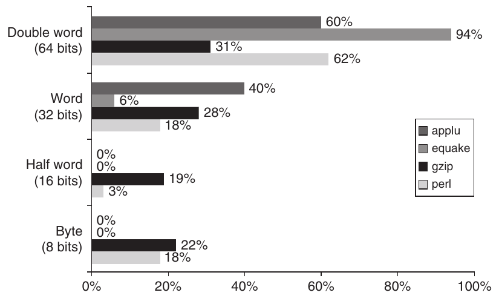

**Hình A.29 Kích thước tham chiếu dữ liệu của bốn chương trình từ SPEC2000. Mặc dù có thể tính kích thước trung bình, khó có thể khẳng định trung bình đó điển hình cho các chương trình.**

| Compiler | Apogee Software Version 4.1 | Green Hills Multi2000 Version 2.0 | Algorithmics SDE4.0B | IDT/c 7.2.1 |
|---|---|---|---|---|
| Architecture | MIPS IV | MIPS IV | MIPS 32 | MIPS 32 |
| Processor | NEC VR5432 | NEC VR5000 | IDT 32334 | IDT 79RC32364 |
| Autocorrelation kernel | 1.0 | 2.1 | 1.1 | 2.7 |
| Convolutional encoder kernel | 1.0 | 1.9 | 1.2 | 2.4 |
| Fixed-point bit allocation kernel | 1.0 | 2.0 | 1.2 | 2.3 |
| Fixed-point complex FFT kernel | 1.0 | 1.1 | 2.7 | 1.8 |
| Viterbi GSM decoder kernel | 1.0 | 1.7 | 0.8 | 1.1 |
| Trung bình hình học của năm kernel | 1.0 | 1.7 | 1.4 | 2.0 |

**Hình A.30 Kích thước code tương đối so với C compiler Apogee Software Version 4.1 cho ứng dụng Telecom của EEMBC benchmark. Các instruction set architecture gần như giống hệt nhau, nhưng kích thước code khác nhau với hệ số 2. Những kết quả này được báo cáo tháng 2–tháng 6 năm 2000.**

**Ngộ nhận** Một architecture có sai sót không thể thành công.

80x86 cung cấp một ví dụ rõ nét: Instruction set architecture này là thứ chỉ người tạo ra nó mới có thể yêu thích (xem Phụ lục K). Các thế hệ kỹ sư Intel kế tiếp đã cố sửa những quyết định architecture không được ưa chuộng khi thiết kế 80x86. Chẳng hạn, 80x86 hỗ trợ segmentation, trong khi tất cả những architecture khác chọn paging; nó dùng extended accumulator cho dữ liệu integer, nhưng processor khác dùng general-purpose register; và nó dùng stack cho dữ liệu floating-point khi mọi người khác đã từ bỏ execution stack từ rất lâu trước đó.

Bất chấp những khó khăn lớn này, 80x86 architecture đã thành công vượt bậc. Có ba lý do: Thứ nhất, việc được chọn làm microprocessor trong IBM PC ban đầu khiến tương thích binary 80x86 cực kỳ giá trị. Thứ hai, định luật Moore cung cấp đủ tài nguyên để các microprocessor 80x86 chuyển đổi sang một RISC instruction set nội bộ rồi thực thi các instruction RISC-like. Sự kết hợp này cho phép tương thích binary với nền tảng PC software giá trị và có performance ngang RISC processor. Thứ ba, sản lượng PC microprocessor rất cao có nghĩa là Intel dễ dàng chi trả chi phí thiết kế tăng thêm của hardware translation. Ngoài ra, sản lượng cao cho phép nhà sản xuất tiến lên trên learning curve, làm giảm giá thành sản phẩm.

Die lớn hơn và công suất tăng cho translation có thể là bất lợi với ứng dụng embedded, nhưng cực kỳ hợp lý về kinh tế cho desktop. Và cost-performance trên desktop cũng khiến nó hấp dẫn với server, với điểm yếu chính cho server là địa chỉ 32-bit, đã được giải quyết bằng địa chỉ 64-bit của AMD64 (xem Chương 2).

**Ngộ nhận** Bạn có thể thiết kế một architecture không tì vết.

Mọi thiết kế architecture đều có trade-offs được đưa ra trong bối cảnh một tập công nghệ hardware và software. Theo thời gian, những công nghệ đó có khả năng thay đổi, và các quyết định có thể đúng khi được đưa ra trông như sai lầm. Chẳng hạn, năm 1975 người thiết kế VAX quá nhấn mạnh hiệu quả kích thước code, đánh giá thấp tầm quan trọng của việc dễ decode và pipelining năm năm sau đó. Một ví dụ bên phía RISC là delayed branch (xem Phụ lục K). Kiểm soát pipeline hazard với pipeline five-stage là đơn giản, nhưng là thách thức cho processor có pipeline dài hơn issue nhiều instruction mỗi clock cycle. Ngoài ra, gần như mọi architecture cuối cùng đều chịu giới hạn do không đủ address space.

Nhìn chung, tránh những sai sót như vậy về dài hạn có lẽ đồng nghĩa với việc thỏa hiệp hiệu quả của architecture trong ngắn hạn, điều nguy hiểm vì một instruction set architecture mới phải chật vật để tồn tại qua những năm đầu.

## A.11 Nhận xét kết thúc

Các architecture đầu tiên bị giới hạn về instruction set bởi công nghệ hardware thời đó. Ngay khi công nghệ hardware cho phép, người thiết kế computer architecture bắt đầu tìm cách hỗ trợ ngôn ngữ high-level. Việc tìm kiếm này dẫn đến ba giai đoạn tư duy khác nhau về cách hỗ trợ chương trình hiệu quả. Trong những năm 1960, stack architecture trở nên phổ biến. Chúng được xem là phù hợp với ngôn ngữ high-level—và có lẽ đúng như vậy, xét công nghệ compiler lúc đó. Trong những năm 1970, mối quan tâm chính của người thiết kế architecture là cách giảm chi phí software. Mối quan tâm này chủ yếu được đáp ứng bằng cách thay software bằng hardware, hoặc cung cấp architecture high-level có thể đơn giản hóa công việc của người thiết kế software. Kết quả là cả phong trào high-level language computer architecture lẫn những architecture mạnh như VAX, có nhiều addressing mode, nhiều kiểu dữ liệu và architecture có tính trực giao cao. Trong những năm 1980, công nghệ compiler tinh vi hơn và việc tái nhấn mạnh processor performance dẫn đến sự trở lại của architecture đơn giản hơn, chủ yếu dựa trên kiểu máy tính load-store.

Những thay đổi instruction set architecture sau xảy ra trong những năm 1990:

- Kích thước địa chỉ tăng gấp đôi—Các instruction set địa chỉ 32-bit của phần lớn processor desktop và server được mở rộng đến địa chỉ 64-bit, mở rộng độ rộng register (cùng những thứ khác) đến 64 bit. Phụ lục K đưa ra ba ví dụ architecture đã chuyển từ 32 bit lên 64 bit.

- Tối ưu conditional branch qua thực thi có điều kiện—Trong Chương 3, chúng ta thấy conditional branch có thể hạn chế performance của các thiết kế máy tính mạnh. Vì vậy, đã có sự quan tâm đến việc thay conditional branch bằng hoàn tất phép toán có điều kiện, như conditional move (xem Phụ lục H), được bổ sung vào phần lớn instruction set.

- Tối ưu cache performance qua prefetch—Chương 2 giải thích vai trò ngày càng tăng của memory hierarchy đối với performance máy tính, với cache miss trên một số máy tính mất số instruction time tương đương thời gian page fault trên những máy trước đây. Vì vậy, prefetch instruction được bổ sung để cố che giấu chi phí cache miss bằng prefetching (xem Chương 2).

- Hỗ trợ multimedia—Phần lớn instruction set desktop và embedded được mở rộng với hỗ trợ ứng dụng multimedia.

- Các phép toán floating-point nhanh hơn—Phụ lục J mô tả những phép toán được bổ sung để tăng floating-point performance, như phép toán thực hiện một phép nhân và một phép cộng cùng paired single execution. (Chúng ta đưa chúng vào MIPS.)

Giữa năm 1970 và 1985, nhiều người nghĩ công việc chính của người thiết kế computer architecture là thiết kế instruction set. Vì vậy, giáo trình thời đó nhấn mạnh thiết kế instruction set, giống như giáo trình computer architecture những năm 1950 và 1960 nhấn mạnh computer arithmetic. Người thiết kế architecture có kiến thức được kỳ vọng có quan điểm rõ ràng về điểm mạnh và đặc biệt là điểm yếu của những máy tính phổ biến. Nhiều nhà nghiên cứu và người viết giáo trình không nhận thức được tầm quan trọng của tương thích binary trong việc dập tắt đổi mới instruction set, tạo ấn tượng rằng nhiều người thiết kế architecture sẽ có cơ hội thiết kế một instruction set.

Định nghĩa computer architecture ngày nay đã mở rộng để bao gồm thiết kế và đánh giá toàn bộ hệ thống máy tính—không chỉ định nghĩa instruction set và không chỉ processor—nên có rất nhiều chủ đề để người thiết kế architecture nghiên cứu. Thực tế, nội dung trong phụ lục này từng là trọng tâm của sách ở ấn bản đầu tiên năm 1990, nhưng giờ nằm trong phụ lục chủ yếu như tài liệu tham khảo!

Phụ lục K có thể đáp ứng những độc giả quan tâm instruction set architecture; nó mô tả nhiều instruction set quan trọng trên thị trường ngày nay hoặc quan trọng về lịch sử, và so sánh chín máy tính load-store phổ biến với MIPS.

## A.12 Góc nhìn lịch sử và tài liệu tham khảo

Mục L.4 (có sẵn trực tuyến) thảo luận sự tiến hóa của instruction set và bao gồm tài liệu tham khảo để đọc thêm và khám phá các chủ đề liên quan.

## Bài tập do Gregory D. Peterson biên soạn

**A.1** [15] <A.9> Tính CPI hiệu dụng cho MIPS bằng Hình A.27. Giả sử chúng ta đã đo CPI trung bình cho các loại instruction như sau:

| Instruction | Clock cycle |
|---|---|
| Mọi ALU instruction | 1.0 |
| Loads-stores | 1.4 |
| Conditional branches |  |
| Taken | 2.0 |
| Not taken | 1.5 |
| Jumps | 1.2 |

Giả sử 60% conditional branch là taken và mọi instruction trong nhóm “other” của Hình A.27 là ALU instruction. Lấy trung bình tần suất instruction của gap và gcc để thu được instruction mix.

**A.2** [15] <A.9> Tính CPI hiệu dụng cho MIPS bằng Hình A.27 và bảng phía trên. Lấy trung bình tần suất instruction của gzip và perlbmk để thu được instruction mix.

**A.3** [20] <A.9> Tính CPI hiệu dụng cho MIPS bằng Hình A.28. Giả sử chúng ta đã đo CPI trung bình cho các loại instruction như sau:

| Instruction | Clock cycle |
|---|---|
| Mọi ALU instruction | 1.0 |
| Loads-stores | 1.4 |
| Conditional branches: |  |
| Taken | 2.0 |
| Not taken | 1.5 |
| Jumps | 1.2 |
| FP multiply | 6.0 |
| FP add | 4.0 |
| FP divide | 20.0 |
| Load-store FP | 1.5 |
| Other FP | 2.0 |

Giả sử 60% conditional branch là taken và mọi instruction trong nhóm “other” của Hình A.28 là ALU instruction. Lấy trung bình tần suất instruction của lucas và swim để thu được instruction mix.

**A.4** [20] <A.9> Tính CPI hiệu dụng cho MIPS bằng Hình A.28 và bảng phía trên. Lấy trung bình tần suất instruction của applu và art để thu được instruction mix.

**A.5** [10] <A.8> Xét chuỗi code high-level gồm ba câu lệnh này:

```
A = B + C;
B = A + C;
D = A – B;
```

Dùng kỹ thuật copy propagation (xem Hình A.20) để biến đổi chuỗi code đến khi không toán hạng nào là một giá trị đã được tính. Ghi nhận những trường hợp phép biến đổi làm giảm lượng tính toán của một câu lệnh và những trường hợp công việc tăng lên. Điều này gợi ý gì về thách thức kỹ thuật khi cố đáp ứng mong muốn có optimizing compiler?

**A.6** [30] <A.8> Tối ưu hóa compiler có thể cải thiện kích thước code và/hoặc performance. Xét một hoặc nhiều chương trình benchmark từ bộ SPEC CPU2006. Dùng một processor có sẵn với bạn và GNU C compiler để tối ưu chương trình với không tối ưu hóa, –O1, –O2 và –O3. So sánh performance và kích thước các chương trình thu được. Đồng thời so sánh kết quả với Hình A.21.

**A.7** [20/20] <A.2, A.9> Xét đoạn code C sau:

```
for (i = 0; i <= 100; i++)
{ A[i] = B[i] + C; }
```

Giả sử A và B là array của integer 64-bit, còn C và i là integer 64-bit. Giả sử mọi giá trị dữ liệu và địa chỉ của chúng được giữ trong memory (lần lượt tại địa chỉ 1000, 3000, 5000 và 7000 cho A, B, C và i) trừ khi đang được xử lý. Giả sử các giá trị trong register bị mất giữa các lần lặp của loop.

a. [20] <A.2, A.9> Viết code cho MIPS. Cần bao nhiêu instruction tính theo dynamic? Bao nhiêu tham chiếu memory-data sẽ được thực hiện? Kích thước code theo byte là bao nhiêu?

b. [20] <A.2> Viết code cho x86. Cần bao nhiêu instruction tính theo dynamic? Bao nhiêu tham chiếu memory-data sẽ được thực hiện? Kích thước code theo byte là bao nhiêu?

**A.8** [10/10/10] <A.2, A.7> Trong phần sau, chúng ta xem xét instruction encoding cho instruction set architecture.

a. [10] <A.2, A.7> Xét một processor có độ dài instruction 12 bit và 32 general-purpose register nên kích thước trường địa chỉ là 5 bit. Có thể có instruction encoding cho các instruction sau hay không?

- 3 two-address instruction

- 30 one-address instruction

- 45 zero-address instruction

b. [10] <A.2, A.7> Giả sử cùng độ dài instruction và kích thước trường địa chỉ như trên, xác định có thể có những instruction sau hay không

- 3 two-address instruction

- 31 one-address instruction

- 35 zero-address instruction

Giải thích câu trả lời.

c. [10] <A.2, A.7> Giả sử cùng độ dài instruction và kích thước trường địa chỉ như trên. Giả sử thêm rằng đã có 3 instruction two-address và 24 instruction zero-address. Số instruction one-address tối đa có thể được mã hóa cho processor này là bao nhiêu?

**A.9** [10/15] <A.2> Trong phần sau, giả sử các giá trị A, B, C, D, E và F nằm trong memory. Cũng giả sử operation code của instruction được biểu diễn bằng 8 bit, địa chỉ memory dài 64 bit và địa chỉ register dài 6 bit.

a. [10] <A.2> Với mỗi instruction set architecture trong Hình A.2, có bao nhiêu địa chỉ hoặc tên xuất hiện trong mỗi instruction của code tính C = A + B, và tổng kích thước code là bao nhiêu?

b. [15] <A.2> Một số instruction set architecture trong Hình A.2 phá hủy toán hạng trong quá trình tính toán. Việc mất giá trị dữ liệu khỏi lưu trữ bên trong processor này có hệ quả về performance. Với mỗi architecture trong Hình A.2, viết chuỗi code để tính:

```
C = A + B
D = A – E
F = C + D
```

Trong code, đánh dấu mỗi toán hạng bị phá hủy trong khi thực thi và đánh dấu mỗi instruction “overhead” được đưa vào chỉ để khắc phục việc mất dữ liệu khỏi lưu trữ bên trong processor. Với mỗi chuỗi code, tổng kích thước code, số byte instruction và dữ liệu được chuyển đến hoặc đi từ memory, số instruction overhead và số byte dữ liệu overhead là bao nhiêu?

**A.10** [20] <A.2, A.7, A.9> Thiết kế MIPS cung cấp 32 general-purpose register và 32 floating-point register. Nếu register tốt, nhiều register hơn có tốt hơn không? Liệt kê và thảo luận càng nhiều trade-offs càng tốt cần được người thiết kế instruction set architecture cân nhắc khi xem xét có nên tăng số MIPS register hay không, và tăng bao nhiêu.

**A.11** [5] <A.3> Xét một struct C bao gồm các member sau:

```
struct foo {
       char a;
       bool b;
       int c;
       double d;
       short e;
       float f;
       double g;
       char * cptr;
       float * fptr;
       int x;
};
```

Với máy 32-bit, kích thước của struct foo là bao nhiêu? Kích thước tối thiểu cần cho struct này là bao nhiêu, giả sử bạn có thể tùy ý sắp xếp thứ tự các struct member? Còn với máy 64-bit thì sao?

**A.12** [30] <A.7> Nhiều nhà sản xuất máy tính hiện bao gồm công cụ hoặc simulator cho phép đo mức sử dụng instruction set của một chương trình người dùng. Trong những phương pháp đang dùng có machine simulation, hardware-supported trapping và một kỹ thuật compiler instrument object code module bằng cách chèn counter. Tìm một processor có sẵn với bạn có công cụ như vậy. Dùng nó để đo instruction set mix cho một SPEC CPU2006 benchmark. So sánh kết quả với những kết quả trong chương này.

**A.13** [30] <A.8> Các processor mới hơn như i7 Sandy Bridge của Intel bao gồm hỗ trợ AVX vector/multimedia instruction. Viết một hàm nhân ma trận đặc dùng giá trị single-precision và biên dịch bằng những compiler và optimization flag khác nhau. Code đại số tuyến tính dùng các routine Basic Linear Algebra Subroutine (BLAS) như SGEMM bao gồm các phiên bản nhân ma trận đặc được tối ưu. So sánh kích thước code và performance của code bạn với BLAS SGEMM. Khảo sát điều xảy ra khi dùng giá trị double-precision và DGEMM.

**A.14** [30] <A.8> Với code SGEMM được phát triển phía trên cho processor i7, thêm việc dùng AVX intrinsic để cải thiện performance. Cụ thể, cố vectorize code để tận dụng AVX hardware tốt hơn. So sánh kích thước code và performance với code ban đầu.

**A.15** [30] <A.7, A.9> SPIM là một simulator phổ biến để mô phỏng MIPS processor. Dùng SPIM để đo instruction set mix cho một số chương trình benchmark SPEC CPU2006.

**A.16** [35/35/35/35] <A.2–A.8> gcc nhắm đến phần lớn instruction set architecture hiện đại (xem www.gnu.org/software/gcc/). Tạo một phiên bản gcc cho một số architecture bạn có quyền truy cập, như x86, MIPS, PowerPC và ARM.

a. [35] <A.2–A.8> Biên dịch một tập con benchmark integer SPEC CPU2006 và tạo bảng kích thước code. Architecture nào tốt nhất cho mỗi chương trình?

b. [35] <A.2–A.8> Biên dịch một tập con benchmark floating-point SPEC CPU2006 và tạo bảng kích thước code. Architecture nào tốt nhất cho mỗi chương trình?

c. [35] <A.2–A.8> Biên dịch một tập con benchmark EEMBC AutoBench (xem www.eembc.org/home.php) và tạo bảng kích thước code. Architecture nào tốt nhất cho mỗi chương trình?

d. [35] <A.2–A.8> Biên dịch một tập con benchmark floating-point EEMBC FPBench và tạo bảng kích thước code. Architecture nào tốt nhất cho mỗi chương trình?

**A.17** [40] <A.2–A.8> Hiệu quả công suất đã trở nên rất quan trọng với processor hiện đại, đặc biệt với embedded system. Tạo một phiên bản gcc cho hai architecture bạn có quyền truy cập, như x86, MIPS, PowerPC và ARM. Biên dịch một tập con EEMBC benchmark đồng thời dùng EnergyBench để đo mức sử dụng năng lượng trong khi thực thi. So sánh kích thước code, performance và mức sử dụng năng lượng của các processor. Processor nào tốt nhất cho mỗi chương trình?

**A.18** [20/15/15/20] Nhiệm vụ của bạn là so sánh hiệu quả memory của bốn kiểu instruction set architecture khác nhau. Các kiểu architecture là

- Accumulator—Mọi phép toán xảy ra giữa một register duy nhất và một vị trí memory.

- Memory-memory—Mọi địa chỉ instruction chỉ tham chiếu các vị trí memory.

- Stack—Mọi phép toán xảy ra ở đỉnh stack. Push và pop là những instruction duy nhất truy cập memory; tất cả instruction khác lấy các toán hạng khỏi stack và thay chúng bằng kết quả. Cách triển khai dùng một hardwired stack chỉ cho hai entry trên cùng, giữ cho mạch processor rất nhỏ và chi phí thấp. Những vị trí stack bổ sung được giữ ở các vị trí memory, và truy cập những vị trí stack này cần tham chiếu memory.

- Load-store—Mọi phép toán xảy ra trong register, và các instruction register-to-register có ba tên register trên mỗi instruction.

Để đo hiệu quả memory, đưa ra các giả định sau cho cả bốn instruction set:

- Mọi instruction có độ dài là một số nguyên byte.

- Opcode luôn là một byte (8 bit).

- Truy cập memory dùng direct addressing, hoặc absolute addressing.

- Các biến A, B, C và D ban đầu nằm trong memory.

a. [20] <A.2, A.3> Tự tạo các mnemonic assembly language (Hình A.2 cung cấp một mẫu hữu ích để khái quát hóa), và với mỗi architecture viết code assembly language tương đương tốt nhất cho chuỗi code ngôn ngữ high-level này:

```
A = B + C;
B = A + C;
D = A – B;
```

b. [15] <A.3> Đánh dấu mỗi trường hợp trong code assembly của phần (a) mà một giá trị được nạp từ memory sau khi đã được nạp một lần. Đồng thời đánh dấu mỗi trường hợp trong code mà kết quả của một instruction được truyền sang instruction khác làm toán hạng, rồi phân loại thêm các sự kiện này là liên quan đến lưu trữ bên trong processor hay lưu trữ trong memory.

c. [15] <A.7> Giả sử chuỗi code đã cho thuộc một ứng dụng máy tính embedded nhỏ, như bộ điều khiển lò vi sóng, dùng địa chỉ memory và toán hạng dữ liệu 16-bit. Nếu dùng load-store architecture, giả sử nó có 16 general-purpose register. Với mỗi architecture, trả lời các câu hỏi sau: Bao nhiêu byte instruction được fetch? Bao nhiêu byte dữ liệu được truyền từ/đến memory? Architecture nào hiệu quả nhất khi đo bằng tổng memory traffic (code + dữ liệu)?

d. [20] <A.7> Bây giờ giả sử một processor có địa chỉ memory và toán hạng dữ liệu 64-bit. Với mỗi architecture, trả lời các câu hỏi ở phần (c). Ưu điểm tương đối của các architecture thay đổi như thế nào đối với các thước đo đã chọn?

**A.19** [30] <A.2, A.3> Dùng bốn kiểu instruction set architecture khác nhau phía trên, nhưng giả sử các phép toán memory được hỗ trợ bao gồm register indirect cũng như direct addressing. Tự tạo mnemonic assembly language (Hình A.2 cung cấp một mẫu hữu ích để khái quát hóa), và với mỗi architecture viết code assembly language tương đương tốt nhất cho đoạn code C này:

```
for (i = 0; i <= 100; i++)
{ A[i] = B[i] + C; }
```

Giả sử A và B là array của integer 64-bit, còn C và i là integer 64-bit.

Cột thứ hai và thứ ba lần lượt chứa tỷ lệ tích lũy của các tham chiếu dữ liệu và branch có thể được đáp ứng với số bit độ lớn tương ứng trong displacement. Đây là khoảng cách trung bình của tất cả chương trình integer và floating-point trong Hình A.8 và A.15.

**A.20** [20/20/20] <A.3> Chúng ta đang thiết kế định dạng instruction cho một load-store architecture và cố quyết định liệu có đáng cung cấp nhiều độ dài offset cho branch và tham chiếu memory hay không. Độ dài một instruction sẽ bằng 16 bit + độ dài offset theo bit, nên ALU instruction sẽ dài 16 bit. Hình A.31 chứa dữ liệu kích thước offset của Alpha architecture với tối ưu hóa đầy đủ cho SPEC CPU2000. Với tần suất instruction set, dùng dữ liệu MIPS từ trung bình của năm benchmark cho máy load-store trong Hình A.27. Giả sử các instruction khác đều là ALU instruction chỉ dùng register.

| Số bit độ lớn offset | Tham chiếu dữ liệu tích lũy | Branch tích lũy |
|---|---|---|
| 0 | 30.4% | 0.1% |
| 1 | 33.5% | 2.8% |
| 2 | 35.0% | 10.5% |
| 3 | 40.0% | 22.9% |
| 4 | 47.3% | 36.5% |
| 5 | 54.5% | 57.4% |
| 6 | 60.4% | 72.4% |
| 7 | 66.9% | 85.2% |
| 8 | 71.6% | 90.5% |
| 9 | 73.3% | 93.1% |
| 10 | 74.2% | 95.1% |
| 11 | 74.9% | 96.0% |
| 12 | 76.6% | 96.8% |
| 13 | 87.9% | 97.4% |
| 14 | 91.9% | 98.1% |
| 15 | 100% | 98.5% |
| 16 | 100% | 99.5% |
| 17 | 100% | 99.8% |
| 18 | 100% | 99.9% |
| 19 | 100% | 100% |
| 20 | 100% | 100% |
| 21 | 100% | 100% |

**Hình A.31 Dữ liệu kích thước offset của Alpha architecture với tối ưu hóa đầy đủ cho SPEC CPU2000.**

a. [20] <A.3> Giả sử offset được phép dài 0, 8, 16 hoặc 24 bit, bao gồm sign bit. Độ dài trung bình của một instruction được thực thi là bao nhiêu?

b. [20] <A.3> Giả sử muốn một instruction fixed-length và chọn độ dài instruction 24-bit (cho mọi thứ, bao gồm ALU instruction). Với mỗi offset dài hơn 8 bit, cần thêm instruction. Xác định số byte instruction được fetch trên máy có kích thước instruction cố định này so với số byte được fetch với instruction byte-variable-sized như định nghĩa trong phần (a).

c. [20] <A.3> Bây giờ giả sử dùng độ dài offset cố định 24 bit để không bao giờ cần instruction bổ sung. Cần bao nhiêu byte instruction? So sánh kết quả này với câu trả lời ở phần (b).

**A.21** [20/20] <A.3, A.6, A.9> Kích thước các giá trị displacement cần cho displacement addressing mode hoặc PC-relative addressing có thể được trích xuất từ ứng dụng đã biên dịch. Dùng một disassembler với một hoặc nhiều SPEC CPU2006 benchmark được biên dịch cho MIPS processor.

a. [20] <A.3, A.9> Với mỗi instruction dùng displacement addressing, ghi lại giá trị displacement được dùng. Tạo một histogram của các giá trị displacement. So sánh kết quả với những kết quả trong Hình A.8 của chương này.

b. [20] <A.6, A.9> Với mỗi branch instruction dùng PC-relative addressing, ghi lại giá trị displacement được dùng. Tạo một histogram của các giá trị displacement. So sánh kết quả với những kết quả trong Hình A.15 của chương này.

**A.22** [15/15/10/10] <A.3> Giá trị được biểu diễn bởi số hexadecimal 434F 4D50 5554 4552 sẽ được lưu trong một double word 64-bit aligned.

a. [15] <A.3> Dùng bố trí vật lý của hàng đầu tiên trong Hình A.5, viết giá trị cần lưu theo thứ tự byte Big Endian. Tiếp theo, diễn giải mỗi byte như một ký tự ASCII và viết ký tự tương ứng bên dưới mỗi byte, tạo chuỗi ký tự như nó sẽ được lưu theo thứ tự Big Endian.

b. [15] <A.3> Dùng cùng bố trí vật lý như trong phần (a), viết giá trị cần lưu theo thứ tự byte Little Endian, và bên dưới mỗi byte viết ký tự ASCII tương ứng.

c. [10] <A.3> Giá trị hexadecimal của mọi word 2-byte misaligned có thể được đọc từ double word 64-bit đã cho khi lưu theo thứ tự byte Big Endian là gì?

d. [10] <A.3> Giá trị hexadecimal của mọi word 4-byte misaligned có thể được đọc từ double word 64-bit đã cho khi lưu theo thứ tự byte Little Endian là gì?

**A.23** [Thảo luận] <A.2–A.12> Xét các ứng dụng điển hình cho desktop, server, cloud và embedded computing. Instruction set architecture sẽ bị ảnh hưởng như thế nào với những máy nhắm đến từng thị trường này?
