# B Ôn lại Memory Hierarchy

> Cache: một nơi an toàn để giấu hoặc cất giữ đồ vật.

> Webster’s New World Dictionary of the American Language

> Second College Edition (1976)

## B.1 Giới thiệu

Phụ lục này ôn lại nhanh về memory hierarchy, bao gồm kiến thức cơ bản về cache và virtual memory, các phương trình performance và những phép tối ưu đơn giản. Mục đầu tiên này ôn lại 36 thuật ngữ sau:

| cache | fully associative | write allocate |
|---|---|---|
| virtual memory | dirty bit | unified cache |
| memory stall cycles | block offset | misses per instruction |
| direct mapped | write-back | block |
| valid bit | data cache | locality |
| block address | hit time | address trace |
| write-through | cache miss | set |
| instruction cache | page fault | random replacement |
| average memory access time | miss rate | index field |
| cache hit | n-way set associative | no-write allocate |
| page | least recently used | write buffer |
| miss penalty | tag field | write stall |

Nếu phần ôn tập này đi quá nhanh, bạn có thể muốn xem Chương 7 trong Computer Organization and Design, cuốn sách chúng tôi viết cho những độc giả có ít kinh nghiệm hơn.

Cache là tên gọi dành cho level cao nhất, hay level đầu tiên, của memory hierarchy mà address gặp sau khi rời processor. Vì principle of locality áp dụng ở nhiều level và việc tận dụng locality để cải thiện performance rất phổ biến, thuật ngữ cache hiện được dùng bất cứ khi nào buffering được sử dụng để tái sử dụng những phần tử thường xuyên xuất hiện. Ví dụ bao gồm file cache, name cache, v.v.

Khi processor tìm thấy phần tử dữ liệu được yêu cầu trong cache, trường hợp đó được gọi là cache hit. Khi processor không tìm thấy phần tử dữ liệu cần thiết trong cache, cache miss xảy ra. Một tập hợp dữ liệu fixed-size chứa word được yêu cầu, gọi là block hoặc line run, được lấy từ main memory và đưa vào cache. Temporal locality cho biết chúng ta có khả năng sẽ cần word này lần nữa trong tương lai gần, nên việc đưa nó vào cache, nơi có thể truy cập nhanh, rất hữu ích. Do spatial locality, xác suất những dữ liệu khác trong block sớm được cần đến cũng cao.

Thời gian cần thiết cho cache miss phụ thuộc cả latency và bandwidth của memory. Latency quyết định thời gian lấy word đầu tiên của block, còn bandwidth quyết định thời gian lấy phần còn lại của block này. Cache miss được hardware xử lý và khiến processor dùng in-order execution phải tạm dừng, hay stall, cho đến khi dữ liệu sẵn sàng. Với out-of-order execution, instruction sử dụng kết quả vẫn phải chờ, nhưng các instruction khác có thể tiếp tục trong thời gian miss.

| Level | 1 | 2 | 3 | 4 |
|---|---|---|---|---|
| Tên | Registers | Cache | Main memory | Disk storage |
| Kích thước điển hình | <1 KB | 32 KB–8 MB | <512 GB | >1 TB |
| Công nghệ triển khai | Custom memory có nhiều port, CMOS | On-chip CMOS SRAM | CMOS DRAM | Magnetic disk |
| Access time (ns) | 0.15–0.30 | 0.5–15 | 30–200 | 5,000,000 |
| Bandwidth (MB/sec) | 100,000–1,000,000 | 10,000–40,000 | 5000–20,000 | 50–500 |
| Được quản lý bởi | Compiler | Hardware | Operating system | Operating system/operator |
| Được hỗ trợ bởi | Cache | Main memory | Disk | Các disk khác và DVD |

**Hình B.1 Các level điển hình trong hierarchy chậm hơn và lớn hơn khi chúng ta đi xa processor, đối với workstation lớn hoặc server nhỏ. Embedded computer có thể không có disk storage và có memory cũng như cache nhỏ hơn nhiều. Access time tăng khi chúng ta đi xuống các level thấp hơn của hierarchy, nhờ đó có thể quản lý quá trình truyền với yêu cầu đáp ứng bớt khắt khe hơn. Công nghệ triển khai cho thấy công nghệ điển hình được dùng cho những chức năng này. Access time được tính bằng nanosecond với các giá trị điển hình năm 2006; những thời gian này sẽ giảm theo thời gian. Bandwidth được tính bằng megabyte mỗi giây giữa các level trong memory hierarchy. Bandwidth của disk storage bao gồm cả media và buffered interface.**

Tương tự, không phải mọi object mà một chương trình tham chiếu đều cần nằm trong main memory. Virtual memory có nghĩa là một số object có thể nằm trên disk. Address space thường được chia thành các block fixed-size, gọi là page. Tại mỗi thời điểm, mỗi page nằm trong main memory hoặc trên disk. Khi processor tham chiếu một phần tử trong page không có trong cache hay main memory, một palt xảy ra và toàn bộ page được chuyển từ disk vào main memory. Vì page fault mất rất nhiều thời gian, chúng được software xử lý và processor không bị stall. Processor thường chuyển sang một task khác trong khi disk access diễn ra. Từ góc nhìn high-level, việc dựa vào locality của các reference cùng quan hệ tương đối về kích thước và chi phí mỗi bit giữa cache và main memory tương tự như giữa main memory và disk.

Hình B.1 cho thấy phạm vi kích thước và access time của mỗi level trong memory hierarchy đối với các computer từ desktop high-end đến server low-end.

### Ôn lại Cache Performance

Nhờ locality và tốc độ cao hơn của memory nhỏ hơn, memory hierarchy có thể cải thiện đáng kể performance. Một cách đánh giá cache performance là mở rộng phương trình processor execution time trong Chương 1. Bây giờ chúng ta tính đến số cycle mà processor bị stall để chờ memory access, gọi là memory stall cycles. Khi đó, performance là tích của clock cycle time với tổng processor cycles và memory stall cycles:

CPU execution time = ( CPU clock cycles + Memory stall cycles ) × Clock cycle time

Phương trình này giả định CPU clock cycles bao gồm thời gian xử lý cache hit và processor bị stall trong cache miss. Mục B.2 xem xét lại giả định đơn giản hóa này.

Số memory stall cycles phụ thuộc cả số miss lẫn chi phí cho mỗi miss, được gọi là miss penalty:

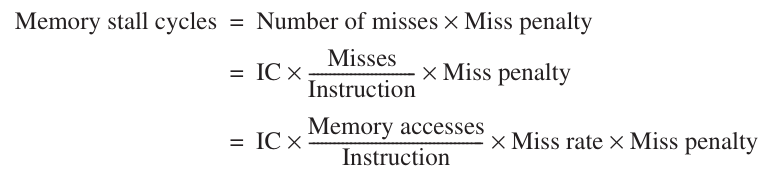

Ưu điểm của dạng cuối là các thành phần có thể được đo dễ dàng. Chúng ta đã biết cách đo instruction count (IC). (Với speculative processor, chúng ta chỉ đếm các instruction đã commit.) Việc đo số memory reference trên mỗi instruction có thể thực hiện theo cách tương tự; mọi instruction đều cần một instruction access, và có thể dễ dàng xác định instruction đó có cần thêm data access hay không.

Lưu ý rằng chúng ta đã tính miss penalty dưới dạng giá trị trung bình, nhưng bên dưới sẽ sử dụng nó như một hằng số. Memory phía sau cache có thể đang bận tại thời điểm miss vì các memory request trước đó hoặc memory refresh. Số clock cycle cũng thay đổi tại interface giữa các clock khác nhau của processor, bus và memory. Vì vậy, hãy nhớ rằng việc dùng một con số duy nhất cho miss penalty là một sự đơn giản hóa.

Thành phần miss rate đơn giản là tỷ lệ cache access dẫn đến miss (tức số access bị miss chia cho tổng số access). Có thể đo miss rate bằng cache simulator: chúng nhận address trace của các instruction reference và data reference, mô phỏng hành vi cache để xác định reference nào hit và reference nào miss, rồi báo cáo tổng số hit và miss. Nhiều microprocessor ngày nay cung cấp hardware để đếm số miss và memory reference; đây là cách đo miss rate dễ hơn và nhanh hơn nhiều.

Công thức trên là một phép xấp xỉ vì miss rate và miss penalty thường khác nhau giữa read và write. Khi đó, memory stall clock cycles có thể được định nghĩa theo số memory access trên mỗi instruction, miss penalty (tính bằng clock cycle) cho read và write, cùng miss rate cho read và write:

Memory stall clock cycles = IC × Reads per instruction × Read miss rate × Read miss penalty

\+ IC × Writes per instruction × Write miss rate × Write miss penalty

Chúng ta thường đơn giản hóa công thức đầy đủ bằng cách gộp read và write, rồi tìm miss rate trung bình và miss penalty trung bình của read và write:

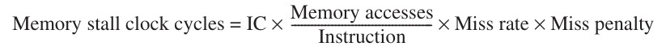

Miss rate là một trong những thước đo quan trọng nhất của thiết kế cache, nhưng như chúng ta sẽ thấy ở các mục sau, đó không phải thước đo duy nhất.

**Ví dụ** Giả sử chúng ta có một computer với cycles per instruction (CPI) bằng 1.0 khi mọi memory access đều hit trong cache. Các data access duy nhất là load và store, chiếm tổng cộng 50% số instruction. Nếu miss penalty là 25 clock cycle và miss rate là 2%, computer sẽ nhanh hơn bao nhiêu nếu mọi instruction đều là cache hit?

**Trả lời** Trước hết, tính performance cho computer luôn hit:

CPU execution time = ( CPU clock cycles + Memory stall cycles ) × Clock cycle

= ( IC × CPI + 0 ) × Clock cycle = IC × 1.0 × Clock cycle

Bây giờ, với computer có cache thực tế, trước hết chúng ta tính memory stall cycles:

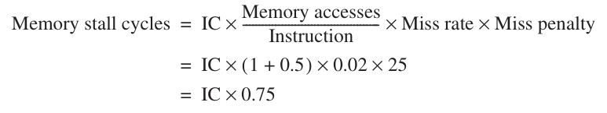

trong đó thừa số ở giữa (1 + 0.5) biểu diễn một instruction access và 0.5 data access trên mỗi instruction. Do đó, performance tổng thể là

CPU execution time<sub>cache</sub> = ( IC × 1.0 + IC × 0.75 ) × Clock cycle

= 1.75 × IC × Clock cycle

Tỷ số performance là nghịch đảo của tỷ số execution time:

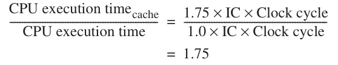

Computer không có cache miss nhanh hơn 1.75 lần.

Một số nhà thiết kế thích đo miss rate bằng số miss trên mỗi instruction thay vì số miss trên mỗi memory reference. Hai đại lượng này có quan hệ:

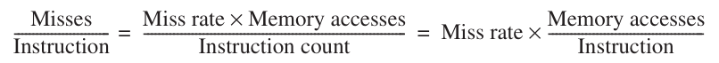

Công thức sau hữu ích khi bạn biết số memory access trung bình trên mỗi instruction, vì nó cho phép chuyển đổi miss rate thành số miss trên mỗi instruction và ngược lại. Ví dụ, chúng ta có thể chuyển miss rate trên mỗi memory reference trong ví dụ trước thành số miss trên mỗi instruction:

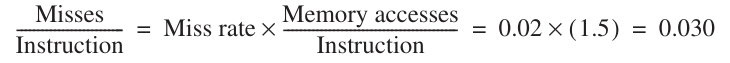

Nhân tiện, số miss trên mỗi instruction thường được báo cáo dưới dạng số miss trên 1000 instruction để thể hiện bằng số nguyên thay vì phân số. Vì vậy, kết quả trên cũng có thể được biểu diễn là 30 miss trên 1000 instruction.

Ưu điểm của số miss trên mỗi instruction là nó không phụ thuộc vào cách triển khai hardware. Ví dụ, speculative processor fetch số instruction nhiều gấp khoảng hai lần số thực sự commit, có thể làm giảm miss rate một cách giả tạo nếu đo bằng số miss trên mỗi memory reference thay vì trên mỗi instruction. Nhược điểm là số miss trên mỗi instruction phụ thuộc architecture; chẳng hạn, số memory access trung bình trên mỗi instruction có thể rất khác nhau giữa 80x86 và MIPS. Vì vậy, số miss trên mỗi instruction phổ biến nhất với các architect làm việc trong một họ computer, mặc dù sự tương đồng giữa các RISC architecture cho phép hiểu biết về một architecture giúp làm sáng tỏ các architecture khác.

**Ví dụ** Để chứng minh sự tương đương giữa hai phương trình miss rate, hãy làm lại ví dụ trên, lần này giả sử miss rate trên 1000 instruction là 30. Memory stall time theo instruction count là bao nhiêu?

**Trả lời** Tính lại memory stall cycles:

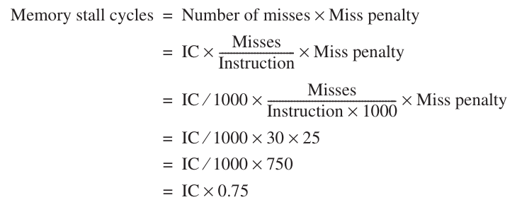

Chúng ta thu được cùng kết quả như ở trang B-5, cho thấy hai phương trình tương đương.

### Bốn câu hỏi về Memory Hierarchy

Chúng ta tiếp tục phần giới thiệu cache bằng cách trả lời bốn câu hỏi thường gặp cho level đầu tiên của memory hierarchy:

Q1: Có thể đặt block ở đâu trong upper level? (block placement)

Q2: Tìm block như thế nào nếu nó nằm trong upper level? (block identification)

Q3: Block nào cần được thay thế khi xảy ra miss? (block replacement)

Q4: Điều gì xảy ra khi write? (write strategy)

Các câu trả lời giúp chúng ta hiểu những trade-offs khác nhau của memory tại các level khác nhau trong hierarchy; vì vậy, chúng ta đặt bốn câu hỏi này cho mọi ví dụ.

#### Q1: Có thể đặt Block ở đâu trong Cache?

Hình B.2 cho thấy các giới hạn về vị trí đặt block tạo thành ba loại tổ chức cache:

- Nếu mỗi block chỉ có một vị trí có thể xuất hiện trong cache, cache được gọi là direct mapped. Phép ánh xạ thường là

(Block address) MOD (Number of blocks in cache)

- Nếu block có thể được đặt ở bất kỳ đâu trong cache, cache được gọi là fully associative.

- Nếu block có thể được đặt trong một tập vị trí giới hạn của cache, cache là set associative. Set là một nhóm block trong cache. Block trước hết được ánh xạ vào một set, sau đó có thể được đặt bất kỳ đâu trong set đó. Set thường được chọn bằng cách chọn bit; tức là,

(Block address) MOD (Number of sets in cache)

Nếu có n block trong một set, cách đặt cache được gọi là n-way set associative.

Dải cache từ direct mapped đến fully associative thực chất là một chuỗi liên tục các mức set associativity. Direct mapped đơn giản là one-way set associative, còn fully associative cache có m block có thể gọi là “m-way set associative.” Tương đương, có thể xem direct mapped là có m set, còn fully associative là có một set.

Phần lớn processor cache ngày nay là direct mapped, two-way set associative hoặc four-way set associative, vì những lý do chúng ta sẽ sớm thấy.

#### Q2: Tìm Block như thế nào nếu nó nằm trong Cache?

Cache có address tag trên mỗi block frame để cung cấp block address. Tag của mọi cache block có thể chứa thông tin mong muốn được kiểm tra xem có khớp block address từ processor hay không. Theo thông lệ, mọi tag có thể khớp đều được tìm song song vì tốc độ là yếu tố quyết định.

Phải có cách nhận biết cache block không chứa thông tin hợp lệ. Cách thông dụng nhất là thêm valid bit vào tag để cho biết entry này có chứa address hợp lệ hay không. Nếu bit không được đặt, address này không thể khớp.

Trước khi sang câu hỏi tiếp theo, hãy khám phá quan hệ giữa processor address và cache. Hình B.3 cho thấy cách chia address. Phép chia đầu tiên tách block address và block offset. Block frame address có thể tiếp tục chia thành tag field và index field. Block offset field chọn dữ liệu mong muốn trong block, index field chọn set, và tag field được so sánh với tag trong set để xác định hit. Mặc dù phép so sánh có thể dùng nhiều phần address hơn tag, điều đó không cần thiết vì các lý do sau:

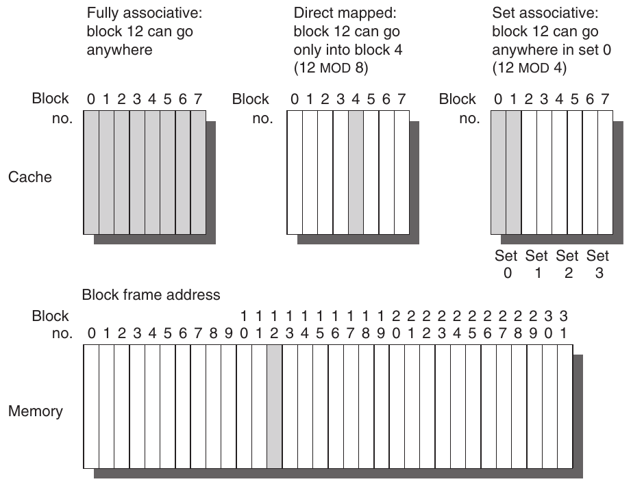

**Hình B.2 Cache trong ví dụ này có tám block frame và memory có 32 block. Ba phương án cache được trình bày từ trái sang phải. Với fully associative, block 12 từ lower level có thể vào bất kỳ block frame nào trong tám block frame của cache. Với direct mapped, block 12 chỉ có thể được đặt vào block frame 4 (12 modulo 8). Set associative, có một phần đặc điểm của cả hai, cho phép block được đặt ở bất kỳ đâu trong set 0 (12 modulo 4). Với hai block mỗi set, điều này có nghĩa block 12 có thể được đặt trong block 0 hoặc block 1 của cache. Cache thực tế chứa hàng nghìn block frame, còn memory thực tế chứa hàng triệu block. Tổ chức set associative có bốn set với hai block mỗi set, gọi là two-way set associative. Giả sử cache không chứa gì và block address đang xét xác định lower-level block 12.**

- Không nên dùng offset trong phép so sánh, vì toàn bộ block hoặc có mặt hoặc vắng mặt; do đó, theo định nghĩa, mọi block offset đều khớp.

- Kiểm tra index là dư thừa, vì nó đã được dùng để chọn set cần kiểm tra. Ví dụ, address lưu trong set 0 phải có 0 trong index field, nếu không nó không thể được lưu trong set 0; set 1 phải có index bằng 1; và tương tự. Phép tối ưu này tiết kiệm hardware và điện năng bằng cách giảm độ rộng của memory dùng cho cache tag.

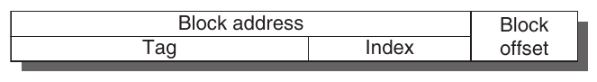

**Hình B.3 Ba phần của address trong set associative cache hoặc direct-mapped cache. Tag được dùng để kiểm tra mọi block trong set, còn index được dùng để chọn set. Block offset là address của dữ liệu mong muốn bên trong block. Fully associative cache không có index field.**

Nếu giữ nguyên tổng kích thước cache, tăng associativity sẽ tăng số block trên mỗi set, qua đó giảm kích thước index và tăng kích thước tag. Nghĩa là ranh giới tag-index trong Hình B.3 dịch sang phải khi associativity tăng, với điểm cuối là fully associative cache không có index field.

#### Q3: Block nào cần được thay thế khi xảy ra Cache Miss?

Khi miss xảy ra, cache controller phải chọn một block để thay bằng dữ liệu mong muốn. Lợi ích của direct-mapped placement là các quyết định hardware được đơn giản hóa—thực ra đơn giản đến mức không có lựa chọn: Chỉ một block frame được kiểm tra hit, và chỉ block đó có thể được thay thế. Với fully associative placement hoặc set associative placement, có nhiều block để chọn khi miss. Có ba chiến lược chính để chọn block cần thay thế:

- Random—Để phân bố allocation đồng đều, các block ứng viên được chọn ngẫu nhiên. Một số hệ thống tạo số block pseudorandom để hành vi có thể tái lập, đặc biệt hữu ích khi debug hardware.

- Least recently used (LRU)—Để giảm khả năng loại bỏ thông tin sắp cần đến, các lần truy cập block được ghi lại. Dựa vào quá khứ để dự đoán tương lai, block bị thay thế là block đã không được dùng trong thời gian lâu nhất. LRU dựa vào một hệ quả của locality: Nếu các block vừa dùng có khả năng được dùng lại, ứng viên phù hợp để loại bỏ là block ít được dùng gần đây nhất.

- First in, first out (FIFO)—Vì LRU có thể phức tạp khi tính toán, cách này xấp xỉ LRU bằng cách xác định block cũ nhất thay vì block LRU.

Ưu điểm của random replacement là dễ xây dựng bằng hardware. Khi số block cần theo dõi tăng, LRU ngày càng tốn kém và thường chỉ được xấp xỉ. Một phép xấp xỉ phổ biến (thường gọi là pseudo-LRU) có một tập bit cho mỗi set trong cache, mỗi bit tương ứng với một way (way là bank trong set associative cache; four-way set associative cache có bốn way) của cache. Khi truy cập một set, bit tương ứng với way chứa block mong muốn được bật; nếu mọi bit của một set đều được bật, chúng được reset trừ bit vừa được bật gần nhất. Khi phải thay block, processor chọn block từ way có bit tắt, thường chọn ngẫu nhiên nếu có nhiều lựa chọn. Cách này xấp xỉ LRU, vì block bị thay thế sẽ không được truy cập kể từ lần gần nhất mọi block trong set đều đã được truy cập. Hình B.4 cho thấy khác biệt về miss rate giữa LRU, random replacement và FIFO replacement.

|  | Associativity |  |  |  |  |  |  |  |  |
|---|---|---|---|---|---|---|---|---|---|
|  | Two-way |  |  | Four-way |  |  | Eight-way |  |  |
| Kích thước | LRU | Random | FIFO | LRU | Random | FIFO | LRU | Random | FIFO |
| 16 KB | 114.1 | 117.3 | 115.5 | 111.7 | 115.1 | 113.3 | 109.0 | 111.8 | 110.4 |
| 64 KB | 103.4 | 104.3 | 103.9 | 102.4 | 102.3 | 103.1 | 99.7 | 100.5 | 100.3 |
| 256 KB | 92.2 | 92.1 | 92.5 | 92.1 | 92.1 | 92.5 | 92.1 | 92.1 | 92.5 |

**Hình B.4 Số data cache miss trên 1000 instruction, so sánh least recently used, random replacement và first in, first out replacement với một số kích thước và associativity. Với cache lớn nhất, LRU và random khác nhau rất ít; với cache nhỏ hơn, LRU vượt trội các phương án còn lại. FIFO thường vượt trội random ở các kích thước cache nhỏ hơn. Dữ liệu này được thu thập với block size 64 byte cho Alpha architecture bằng 10 SPEC2000 benchmark. Năm benchmark thuộc SPECint2000 (gap, gcc, gzip, mcf và perl), năm benchmark thuộc SPECfp2000 (applu, art, equake, lucas và swim). Chúng ta sẽ dùng computer và những benchmark này trong phần lớn hình của phụ lục.**

#### Q4: Điều gì xảy ra khi Write?

Read chiếm phần lớn processor cache access. Mọi instruction access đều là read, và phần lớn instruction không write vào memory. Hình A.32 và A.33 trong Phụ lục A cho thấy tỷ lệ 10% store và 26% load trong các chương trình MIPS, khiến write chiếm 10%/(100% + 26% + 10%), hay khoảng 7% tổng memory traffic. Trong data cache traffic, write chiếm 10%/(26% + 10%), hay khoảng 28%. Làm cho trường hợp phổ biến chạy nhanh nghĩa là tối ưu cache cho read, đặc biệt vì theo truyền thống processor chờ read hoàn tất nhưng không cần chờ write. Tuy nhiên, định luật Amdahl (Mục 1.9) nhắc chúng ta rằng thiết kế high-performance không thể bỏ qua tốc độ write.

May thay, trường hợp phổ biến cũng là trường hợp dễ tăng tốc. Block có thể được đọc từ cache đồng thời với việc đọc và so sánh tag, nên việc đọc block bắt đầu ngay khi có block address. Nếu read là hit, phần được yêu cầu trong block được chuyển ngay cho processor. Nếu là miss, không có lợi ích—nhưng cũng không gây hại ngoài việc tốn thêm điện năng trên desktop computer và server computer; chỉ cần bỏ qua giá trị đã đọc.

Không thể lạc quan như vậy với write. Việc sửa block không thể bắt đầu trước khi tag được kiểm tra để xem address có hit hay không. Vì kiểm tra tag không thể diễn ra song song, write thường lâu hơn read. Một điểm phức tạp khác là processor còn chỉ định kích thước write, thường từ 1 đến 8 byte; chỉ phần đó của block được thay đổi. Ngược lại, read có thể truy cập nhiều byte hơn cần thiết mà không đáng lo.

Write policy thường là yếu tố phân biệt các thiết kế cache. Có hai lựa chọn cơ bản khi write vào cache:

- Write-through—Thông tin được ghi vào cả block trong cache lẫn block trong lower-level memory.

- Write-back—Thông tin chỉ được ghi vào block trong cache. Cache block đã sửa chỉ được ghi vào main memory khi nó bị thay thế.

Để giảm tần suất ghi block trở lại khi thay thế, một tính năng gọi là dirty bit thường được sử dụng. Status bit này cho biết block là dirty (đã sửa khi nằm trong cache) hay clean (chưa sửa). Nếu clean, block không được ghi trở lại khi miss vì các lower level đã có thông tin giống hệt cache.

Cả write-back và write-through đều có ưu điểm. Với write-back, write diễn ra ở tốc độ cache memory, và nhiều lần write trong một block chỉ đòi hỏi một lần write vào lower-level memory. Vì một số write không đến memory, write-back dùng ít memory bandwidth hơn, khiến write-back hấp dẫn với multiprocessor. Vì write-back sử dụng phần còn lại của memory hierarchy và memory interconnect ít hơn write-through, nó cũng tiết kiệm điện năng, khiến nó hấp dẫn với embedded application.

Write-through dễ triển khai hơn write-back. Cache luôn clean, nên khác với write-back, read miss không bao giờ dẫn đến write xuống lower level. Write-through còn có ưu điểm là lower level kế tiếp giữ bản sao dữ liệu mới nhất, giúp đơn giản hóa data coherency. Data coherency quan trọng với multiprocessor và I/O, được xem xét trong Chương 4 và Phụ lục D. Multilevel cache làm write-through khả thi hơn cho các upper-level cache, vì write chỉ cần truyền xuống lower level kế tiếp thay vì đi hết đến main memory.

Như chúng ta sẽ thấy, I/O và multiprocessor khá khó chiều: Chúng muốn write-back cho processor cache để giảm memory traffic, đồng thời muốn write-through để giữ cache nhất quán với các lower level của memory hierarchy.

Khi processor phải chờ write hoàn tất trong write-through, processor được gọi là bị write stall. Một phép tối ưu phổ biến để giảm write stall là write buffer, cho phép processor tiếp tục ngay khi dữ liệu được ghi vào buffer, nhờ đó chồng lấp processor execution với việc cập nhật memory. Như chúng ta sẽ sớm thấy, write stall vẫn có thể xảy ra ngay cả khi có write buffer.

Vì không cần dữ liệu cũ khi write, có hai lựa chọn khi write miss:

- Write allocate—Block được cấp phát khi write miss, sau đó thực hiện các hành động write hit ở trên. Trong lựa chọn tự nhiên này, write miss hoạt động như read miss.

- No-write allocate—Phương án có vẻ khác thường này là write miss không ảnh hưởng đến cache. Thay vào đó, block chỉ được sửa trong lower-level memory.

Vì vậy, với no-write allocate, block ở ngoài cache cho đến khi chương trình thử đọc chúng; nhưng với write allocate, ngay cả block chỉ được write vẫn nằm trong cache. Hãy xem một ví dụ.

**Ví dụ** Giả sử có một fully associative write-back cache với nhiều cache entry và ban đầu trống. Dưới đây là chuỗi năm memory operation (address nằm trong ngoặc vuông):

```
Write Mem[100];
Write Mem[100];
Read Mem[200];
Write Mem[200];
Write Mem[100].
```

Số hit và miss là bao nhiêu khi dùng no-write allocate so với write allocate?

**Trả lời** Với no-write allocate, address 100 không nằm trong cache và không có allocation khi write, nên hai lần write đầu dẫn đến miss. Address 200 cũng không nằm trong cache, nên lần read cũng miss. Lần write tiếp theo vào address 200 là hit. Lần write cuối vào 100 vẫn là miss. Kết quả với no-write allocate là bốn miss và một hit.

Với write allocate, lần truy cập đầu vào 100 và 200 là miss, còn lại đều hit vì cả 100 lẫn 200 đều có trong cache. Vì vậy, kết quả với write allocate là hai miss và ba hit.

Mỗi write miss policy đều có thể dùng với write-through hoặc write-back. Thông thường, write-back cache dùng write allocate, hy vọng những lần write tiếp theo vào block đó sẽ được cache giữ lại. Write-through cache thường dùng no-write allocate. Lập luận là ngay cả khi có những lần write tiếp theo vào block đó, write vẫn phải xuống lower-level memory, vậy lợi ích thu được là gì?

### Một ví dụ: Opteron Data Cache

Để cụ thể hóa các ý tưởng này, Hình B.5 cho thấy tổ chức data cache trong microprocessor AMD Opteron. Cache chứa 65,536 (64K) byte dữ liệu trong các block 64-byte với two-way set associative placement, least-recently used replacement, write-back và write allocate khi write miss.

Hãy lần theo cache hit qua các bước được đánh dấu trong Hình B.5. (Bốn bước được hiển thị bằng số khoanh tròn.) Như mô tả trong Mục B.5, Opteron đưa một virtual address 48-bit đến cache để so sánh tag, đồng thời address được dịch sang physical address 40-bit.

Lý do Opteron không dùng đủ 64 bit virtual address là các nhà thiết kế cho rằng chưa ai cần virtual address space lớn như vậy, và kích thước nhỏ hơn giúp đơn giản hóa virtual address mapping của Opteron. Các nhà thiết kế dự định mở rộng virtual address trong những microprocessor tương lai.

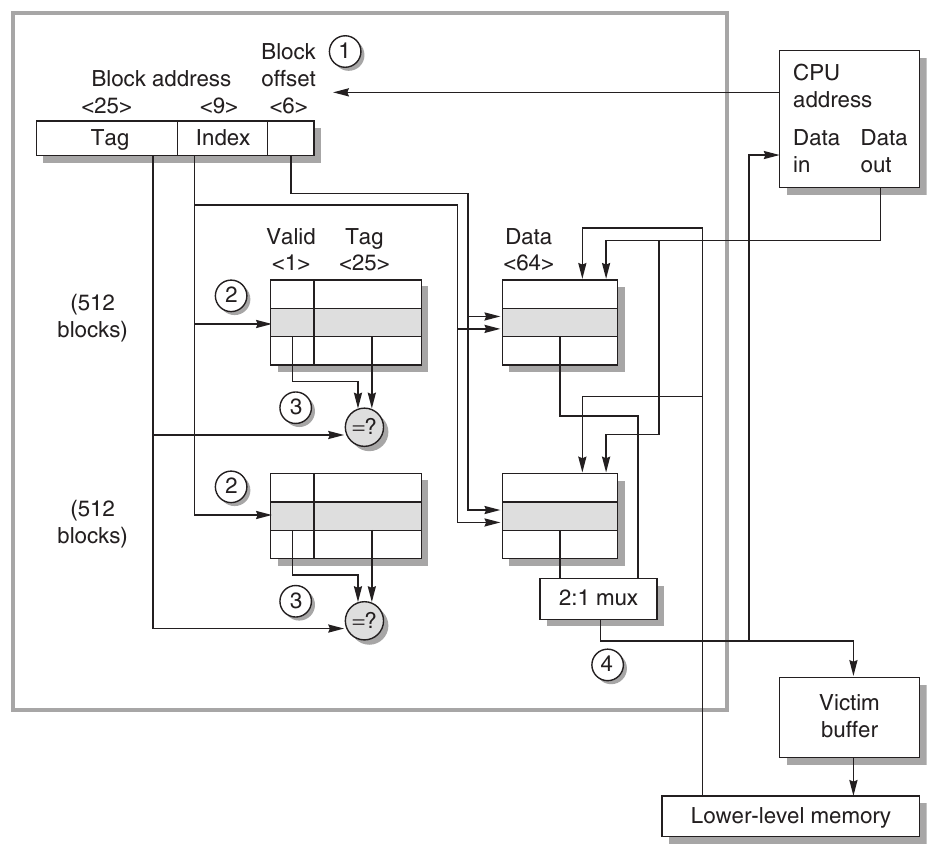

**Hình B.5 Tổ chức data cache trong microprocessor Opteron. Cache 64 KB là two-way set associative với block 64-byte. Index 9-bit chọn trong số 512 set. Bốn bước của read hit, thể hiện bằng các số khoanh tròn theo thứ tự diễn ra, được đánh dấu trên sơ đồ tổ chức này. Ba bit của block offset kết hợp với index để cung cấp RAM address nhằm chọn đúng 8 byte. Vì vậy, cache chứa hai nhóm gồm 4096 word 64-bit, mỗi nhóm chứa một nửa trong số 512 set. Mặc dù không được dùng trong ví dụ này, đường từ lower-level memory đến cache được dùng để nạp cache khi miss. Address rời processor có kích thước 40 bit vì đó là physical address, không phải virtual address. Hình B.24 ở trang B-47 giải thích cách Opteron ánh xạ từ virtual sang physical cho một cache access.**

Physical address đi vào cache được chia thành hai field: block address 34-bit và block offset 6-bit (64 = 2<sup>6</sup> và 34 + 6 = 40). Block address tiếp tục được chia thành address tag và cache index. Bước 1 thể hiện cách chia này.

Cache index chọn tag để kiểm tra xem block mong muốn có trong cache hay không. Kích thước index phụ thuộc cache size, block size và set associativity. Với cache Opteron, set associativity được đặt bằng hai, và chúng ta tính index như sau:

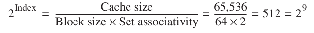

Vì vậy, index rộng 9 bit, còn tag rộng 34 – 9, hay 25 bit. Mặc dù đó là index cần để chọn đúng block, 64 byte lớn hơn nhiều so với lượng processor muốn sử dụng trong một lần. Vì vậy, tổ chức phần dữ liệu của cache memory với độ rộng 8 byte hợp lý hơn, vì đây là data word tự nhiên của processor Opteron 64-bit. Do đó, ngoài 9 bit để index đúng cache block, thêm 3 bit từ block offset được dùng để index đúng 8 byte. Việc chọn index là bước 2 trong Hình B.5.

Sau khi đọc hai tag từ cache, chúng được so sánh với phần tag của block address từ processor. Phép so sánh này là bước 3 trong hình. Để bảo đảm tag chứa thông tin hợp lệ, valid bit phải được đặt; nếu không, kết quả so sánh bị bỏ qua.

Giả sử một tag khớp, bước cuối là báo processor nạp dữ liệu phù hợp từ cache bằng cách dùng input thắng của multiplexor 2:1. Opteron dành 2 clock cycle cho bốn bước này, nên các instruction trong 2 clock cycle tiếp theo sẽ chờ nếu chúng thử dùng kết quả load.

Xử lý write trong Opteron phức tạp hơn xử lý read, cũng như trong mọi cache. Nếu word cần write nằm trong cache, ba bước đầu giống nhau. Vì Opteron thực thi out of order, dữ liệu chỉ được write vào cache sau khi nó báo instruction đã commit và phép so sánh cache tag cho biết hit.

Cho đến đây, chúng ta giả định trường hợp phổ biến là cache hit. Điều gì xảy ra khi miss? Khi read miss, cache gửi tín hiệu cho processor biết dữ liệu chưa sẵn sàng, và 64 byte được đọc từ level kế tiếp của hierarchy. Latency đến 8 byte đầu tiên của block là 7 clock cycle, sau đó là 2 clock cycle cho mỗi 8 byte còn lại. Vì data cache là set associative, có lựa chọn về block cần thay thế. Opteron dùng LRU, chọn block được tham chiếu cách đây lâu nhất, nên mỗi lần truy cập phải cập nhật LRU bit. Thay block nghĩa là cập nhật dữ liệu, address tag, valid bit và LRU bit.

Vì Opteron dùng write-back, data block cũ có thể đã được sửa, do đó không thể đơn giản loại bỏ. Opteron giữ 1 dirty bit cho mỗi block để ghi nhận block đã được write hay chưa. Nếu “victim” đã được sửa, dữ liệu và address của nó được gửi đến victim buffer. (Cấu trúc này tương tự write buffer ở các computer khác.) Opteron có chỗ cho tám victim block. Song song với các thao tác cache khác, nó write victim block xuống level kế tiếp của hierarchy. Nếu victim buffer đầy, cache phải chờ.

Write miss rất giống read miss, vì Opteron cấp phát block khi read miss hoặc write miss.

Chúng ta đã thấy cách nó hoạt động, nhưng data cache không thể đáp ứng mọi nhu cầu memory của processor: Processor còn cần instruction. Mặc dù một cache duy nhất có thể cố cung cấp cả hai, nó có thể trở thành bottleneck. Ví dụ, khi load instruction hoặc store instruction được thực thi, pipelined processor sẽ đồng thời yêu cầu cả data word lẫn instruction word. Vì vậy, một cache duy nhất sẽ tạo structural hazard cho load và store, dẫn đến stall. Một cách đơn giản để giải quyết là chia tách: Một cache dành riêng cho instruction và một cache khác dành cho dữ liệu. Phần lớn processor gần đây, bao gồm Opteron, đều có cache riêng biệt. Do đó, nó có instruction cache 64 KB bên cạnh data cache 64 KB.

Processor biết nó đang phát instruction address hay data address, nên có thể có port riêng cho cả hai, nhờ đó tăng gấp đôi bandwidth giữa memory hierarchy và processor. Cache riêng biệt còn tạo cơ hội tối ưu từng cache độc lập: Capacity, block size và associativity khác nhau có thể đem lại performance tốt hơn. (Đối lập với instruction cache và data cache của Opteron, thuật ngữ unified hoặc mixed được dùng cho cache có thể chứa instruction hoặc dữ liệu.)

Hình B.6 cho thấy instruction cache có miss rate thấp hơn data cache. Tách instruction và dữ liệu loại bỏ miss do conflict giữa instruction block và data block, nhưng việc tách cũng cố định không gian cache dành cho mỗi loại. Yếu tố nào quan trọng hơn đối với miss rate? So sánh công bằng instruction cache và data cache riêng biệt với unified cache đòi hỏi tổng cache size phải bằng nhau. Ví dụ, instruction cache 16 KB và data cache 16 KB riêng biệt cần được so sánh với unified cache 32 KB. Tính miss rate trung bình khi instruction cache và data cache riêng biệt đòi hỏi biết tỷ lệ memory reference đến mỗi cache. Từ dữ liệu trong Phụ lục A, chúng ta thấy tỷ lệ là 100%/(100% + 26% + 10%), hay khoảng 74% instruction reference, so với (26% + 10%)/(100% + 26% + 10%), hay khoảng 26% data reference. Việc tách còn ảnh hưởng performance ngoài những gì thể hiện qua thay đổi miss rate, như chúng ta sẽ sớm thấy.

| Kích thước (KB) | Instruction cache | Data cache | Unified cache |
|---|---|---|---|
| 8 | 8.16 | 44.0 | 63.0 |
| 16 | 3.82 | 40.9 | 51.0 |
| 32 | 1.36 | 38.4 | 43.3 |
| 64 | 0.61 | 36.9 | 39.4 |
| 128 | 0.30 | 35.3 | 36.2 |
| 256 | 0.02 | 32.6 | 32.9 |

**Hình B.6 Số miss trên 1000 instruction của instruction cache, data cache và unified cache với các kích thước khác nhau. Tỷ lệ instruction reference khoảng 74%. Dữ liệu dành cho two-way associative cache có block 64-byte, với cùng computer và benchmark như Hình B.4.**

## B.2 Cache Performance

Vì instruction count độc lập với hardware, việc dùng con số này để đánh giá processor performance rất hấp dẫn. Những thước đo performance gián tiếp như vậy đã khiến nhiều nhà thiết kế computer đi chệch hướng. Cám dỗ tương ứng khi đánh giá memory hierarchy performance là tập trung vào miss rate, vì nó cũng độc lập với tốc độ hardware. Như chúng ta sẽ thấy, miss rate có thể gây hiểu lầm chẳng kém instruction count. Thước đo tốt hơn cho memory hierarchy performance là average memory access time:

Average memory access time = Hit time + Miss rate × Miss penalty

trong đó hit time là thời gian để hit trong cache; chúng ta đã gặp hai thành phần còn lại. Các thành phần của average access time có thể được đo bằng thời gian tuyệt đối—chẳng hạn, 0.25 đến 1.0 nanosecond khi hit—hoặc bằng số clock cycle processor chờ memory—chẳng hạn miss penalty từ 150 đến 200 clock cycle. Hãy nhớ rằng average memory access time vẫn là thước đo performance gián tiếp; mặc dù tốt hơn miss rate, nó không thay thế được execution time.

Công thức này có thể giúp chúng ta quyết định giữa split cache và unified cache.

**Ví dụ** Phương án nào có miss rate thấp hơn: instruction cache 16 KB cùng data cache 16 KB hay unified cache 32 KB? Dùng miss rate trong Hình B.6 để tính câu trả lời đúng, giả sử 36% instruction là data transfer instruction. Giả sử hit mất 1 clock cycle và miss penalty là 100 clock cycle. Load hit hoặc store hit mất thêm 1 clock cycle trên unified cache nếu chỉ có một cache port để đáp ứng hai yêu cầu đồng thời. Theo thuật ngữ pipelining trong Chương 3, unified cache dẫn đến structural hazard. Average memory access time trong mỗi trường hợp là bao nhiêu? Giả sử cache là write-through với write buffer và bỏ qua stall do write buffer.

**Trả lời** Trước hết, hãy chuyển số miss trên 1000 instruction thành miss rate. Giải công thức tổng quát ở trên, miss rate là

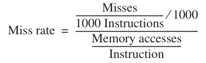

Vì mỗi instruction access có đúng một memory access để fetch instruction, instruction miss rate là

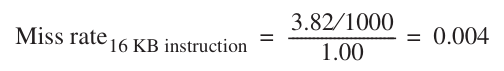

Vì 36% instruction là data transfer, data miss rate là

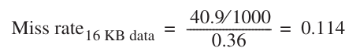

Unified miss rate cần tính đến cả instruction access lẫn data access:

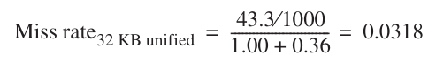

Như đã nêu, khoảng 74% memory access là instruction reference. Vì vậy, miss rate tổng thể cho split cache là

(74% × 0.004) + (26% × 0.114) = 0.0326

Vì vậy, unified cache 32 KB có effective miss rate thấp hơn một chút so với hai cache 16 KB.

Công thức average memory access time có thể được chia thành instruction access và data access:

Average memory access time

= % instructions × ( Hit time + Instruction miss rate × Miss penalty )

\+ % data × ( Hit time + Data miss rate × Miss penalty )

Do đó, thời gian cho mỗi tổ chức là

Average memory access time<sub>split</sub>

= 74% × ( 1 + 0.004 × 200 ) + 26% × ( 1 + 0.114 × 200 )

= ( 74% × 1.80 ) + ( 26% × 23.80 ) = 1.332 + 6.188 = 7.52

Average memory access time<sub>unified</sub>

= 74% × ( 1 + 0.0318 × 200 ) + 26% × ( 1 + 1 + 0.0318 × 200 )

= ( 74% × 7.36 ) + ( 26% × 8.36 ) = 5.446 + 2.174 = 7.62

Vì vậy, split cache trong ví dụ này—cung cấp hai memory port mỗi clock cycle, nhờ đó tránh structural hazard—có average memory access time tốt hơn single-ported unified cache dù effective miss rate kém hơn.

### Average Memory Access Time và Processor Performance

Một câu hỏi hiển nhiên là liệu average memory access time do cache miss có dự đoán được processor performance hay không.

Trước hết, còn có những lý do gây stall khác, chẳng hạn contention do thiết bị I/O sử dụng memory. Nhà thiết kế thường giả định mọi memory stall đều do cache miss, vì memory hierarchy thường lấn át những nguyên nhân stall khác. Ở đây chúng ta dùng giả định đơn giản hóa này, nhưng hãy tính đủ mọi memory stall khi tính performance cuối cùng.

Thứ hai, câu trả lời còn phụ thuộc processor. Nếu có processor dùng in-order execution (xem Chương 3), câu trả lời về cơ bản là có. Processor stall trong miss, và memory stall time tương quan chặt chẽ với average memory access time. Tạm thời hãy dùng giả định này, nhưng chúng ta sẽ quay lại out-of-order processor trong tiểu mục tiếp theo.

Như đã nêu trong mục trước, chúng ta có thể mô hình hóa CPU time như sau:

CPU time = (CPU execution clock cycles + Memory stall clock cycles) × Clock cycle time

Công thức này đặt ra câu hỏi liệu clock cycle cho cache hit nên được coi là một phần CPU execution clock cycles hay memory stall clock cycles. Mặc dù cả hai quy ước đều có lý, quy ước được chấp nhận rộng rãi nhất là tính hit clock cycles vào CPU execution clock cycles.

Giờ chúng ta có thể khám phá ảnh hưởng của cache đối với performance.

**Ví dụ** Hãy dùng computer với in-order execution cho ví dụ đầu tiên. Giả sử cache miss penalty là 200 clock cycle và mọi instruction bình thường mất 1.0 clock cycle (bỏ qua memory stall). Giả sử average miss rate là 2%, trung bình có 1.5 memory reference trên mỗi instruction, và số cache miss trung bình trên 1000 instruction là 30. Performance bị ảnh hưởng thế nào khi tính cả hành vi cache? Tính ảnh hưởng bằng cả số miss trên mỗi instruction lẫn miss rate.

**Trả lời**

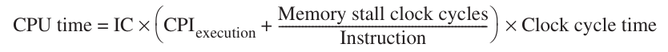

Performance khi tính cả cache miss là

CPU time<sub>with cache</sub> = IC × [1.0 + (30/1000 × 200)] × Clock cycle time

= IC × 7.00 × Clock cycle time

Bây giờ tính performance bằng miss rate:

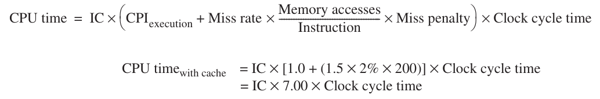

Clock cycle time và instruction count giống nhau dù có cache hay không. Vì vậy, CPU time tăng gấp bảy lần, với CPI từ 1.00 khi có “perfect cache” lên 7.00 khi có cache có thể miss. Nếu hoàn toàn không có memory hierarchy, CPI lại tăng lên 1.0 + 200 × 1.5, hay 301—lâu hơn hơn 40 lần so với hệ thống có cache!

Như ví dụ cho thấy, hành vi cache có thể ảnh hưởng rất lớn đến performance. Hơn nữa, cache miss gây tác động double-barreled lên processor có CPI thấp và clock nhanh:

1. CPI<sub>execution</sub> càng thấp, tác động tương đối của một số lượng cache miss clock cycle cố định càng cao.

2. Khi tính CPI, cache miss penalty được đo bằng processor clock cycle cho một miss. Do đó, ngay cả khi memory hierarchy của hai computer giống hệt nhau, processor có clock rate cao hơn sẽ có nhiều clock cycle hơn cho mỗi miss, do đó phần memory trong CPI cao hơn.

Vì vậy, cache càng quan trọng với processor có CPI thấp và clock rate cao; do đó, việc bỏ qua hành vi cache khi đánh giá performance của các computer như vậy càng nguy hiểm. Định luật Amdahl lại phát huy tác dụng!

Mặc dù giảm thiểu average memory access time là mục tiêu hợp lý—và chúng ta sẽ sử dụng trong phần lớn phụ lục—hãy nhớ mục tiêu cuối là giảm processor execution time. Ví dụ tiếp theo cho thấy hai mục tiêu này có thể khác nhau thế nào.

**Ví dụ** Hai tổ chức cache khác nhau ảnh hưởng thế nào đến performance của processor? Giả sử CPI với perfect cache là 1.6, clock cycle time là 0.35 ns, có 1.4 memory reference trên mỗi instruction, cả hai cache đều có kích thước 128 KB và block size 64 byte. Một cache là direct mapped, cache còn lại là two-way set associative. Hình B.5 cho thấy với set associative cache, chúng ta phải thêm multiplexor để chọn block trong set tùy theo tag match. Vì tốc độ processor có thể gắn trực tiếp với tốc độ cache hit, giả sử processor clock cycle time phải kéo dài 1.35 lần để đáp ứng selection multiplexor của set associative cache. Ở mức xấp xỉ đầu tiên, cache miss penalty là 65 ns cho cả hai tổ chức cache. (Trong thực tế, nó thường được làm tròn lên hoặc xuống thành số nguyên clock cycle.) Trước hết tính average memory access time, sau đó tính processor performance. Giả sử hit time là 1 clock cycle, miss rate của direct-mapped cache 128 KB là 2.1%, còn miss rate của two-way set associative cache cùng kích thước là 1.9%.

**Trả lời** Average memory access time là

Average memory access time = Hit time + Miss rate × Miss penalty

Vì vậy, thời gian cho mỗi tổ chức là

Average memory access time<sub>1-way</sub> = 0.35 + (.021 × 65) = 1.72 ns

Average memory access time<sub>2-way</sub> = 0.35 × 1.35 + (.019 × 65) = 1.71 ns

Average memory access time tốt hơn đối với two-way set-associative cache.

Processor performance là

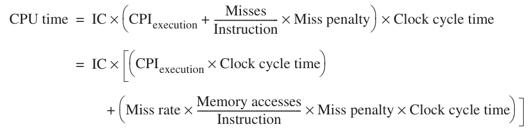

Thay 65 ns cho (Miss penalty × Clock cycle time), performance của mỗi tổ chức cache là

CPU time<sub>1-way</sub> = IC × [ 1.6 × 0.35 + ( 0.021 × 1.4 × 65 ) ] = 2.47 × IC

CPU time<sub>2-way</sub> = IC × [ 1.6 × 0.35 × 1.35 + ( 0.019 × 1.4 × 65 ) ] = 2.49 × IC

và relative performance là

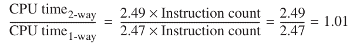

Trái với kết quả so sánh average memory access time, direct-mapped cache đem lại average performance tốt hơn một chút vì clock cycle bị kéo dài cho mọi instruction trong trường hợp two-way set associative, ngay cả khi có ít miss hơn. Vì CPU time là đánh giá bottom-line của chúng ta và direct mapped dễ xây dựng hơn, cache được ưu tiên trong ví dụ này là direct mapped.

### Miss Penalty và Processor với Out-of-Order Execution

Với processor dùng out-of-order execution, bạn định nghĩa “miss penalty” thế nào? Đó là toàn bộ latency của miss đến memory, hay chỉ latency “lộ ra”, tức phần không được chồng lấp khi processor phải stall? Câu hỏi này không xuất hiện ở processor stall cho đến khi data miss hoàn tất.

Hãy định nghĩa lại memory stall để đi đến định nghĩa mới cho miss penalty là latency không được chồng lấp:

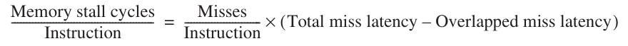

Tương tự, vì một số out-of-order processor kéo dài hit time, phần đó của phương trình performance có thể được phân chia theo tổng hit latency trừ hit latency được chồng lấp. Phương trình này có thể mở rộng thêm để tính contention đối với memory resource trong out-of-order processor bằng cách chia tổng miss latency thành latency không có contention và latency do contention. Ở đây hãy chỉ tập trung vào miss latency.

Bây giờ chúng ta phải quyết định những điều sau:

- Độ dài memory latency—Coi thời điểm nào là bắt đầu và kết thúc một memory operation trong out-of-order processor

- Độ dài latency overlap—Thời điểm nào bắt đầu chồng lấp với processor (hay tương đương, khi nào chúng ta nói một memory operation đang làm processor stall)

Với độ phức tạp của processor dùng out-of-order execution, không có một định nghĩa đúng duy nhất.

Vì chỉ các operation đã commit mới xuất hiện tại retirement pipeline stage, chúng ta nói processor bị stall trong một clock cycle nếu nó không retire số instruction tối đa có thể trong cycle đó. Chúng ta quy stall đó cho instruction đầu tiên không thể retire. Định nghĩa này hoàn toàn không bảo đảm không sai. Ví dụ, áp dụng một phép tối ưu để cải thiện một stall time cụ thể không phải lúc nào cũng cải thiện execution time, vì một loại stall khác—ẩn sau stall được nhắm tới—nay có thể lộ ra.

Với latency, chúng ta có thể bắt đầu đo từ lúc memory instruction được xếp hàng trong instruction window, khi address được tạo, hoặc khi instruction thực sự được gửi đến memory system. Lựa chọn nào cũng được, miễn sử dụng nhất quán.

**Ví dụ** Hãy làm lại ví dụ trên, nhưng lần này giả sử processor có clock cycle time dài hơn hỗ trợ out-of-order execution mà vẫn có direct-mapped cache. Giả sử có thể chồng lấp 30% miss penalty 65 ns; tức CPU memory stall time trung bình nay là 45.5 ns.

**Trả lời** Average memory access time cho computer out-of-order (OOO) là

Average memory access time<sub>1-way,OOO</sub> = 0.35 × 1.35 + (0.021 × 45.5) = 1.43 ns

Performance của OOO cache là

CPU time<sub>1-way,OOO</sub> = IC × [ 1.6 × 0.35 × 1.35 + ( 0.021 × 1.4 × 45.5 ) ] = 2.09 × IC

Do đó, dù clock cycle time chậm hơn nhiều và direct-mapped cache có miss rate cao hơn, out-of-order computer có thể nhanh hơn một chút nếu che giấu được 30% miss penalty.

Tóm lại, mặc dù các phương pháp tiên tiến hiện nay để định nghĩa và đo memory stall cho out-of-order processor khá phức tạp, hãy chú ý đến những vấn đề này vì chúng ảnh hưởng đáng kể đến performance. Sự phức tạp phát sinh vì out-of-order processor chịu được một phần latency do cache miss mà không làm giảm performance. Do đó, nhà thiết kế thường dùng simulator của out-of-order processor và memory khi đánh giá trade-offs trong memory hierarchy, để bảo đảm một cải tiến giúp average memory latency cũng thực sự giúp program performance.

Để giúp tổng kết mục này và làm tài liệu tra cứu thuận tiện, Hình B.7 liệt kê các phương trình cache trong phụ lục này.

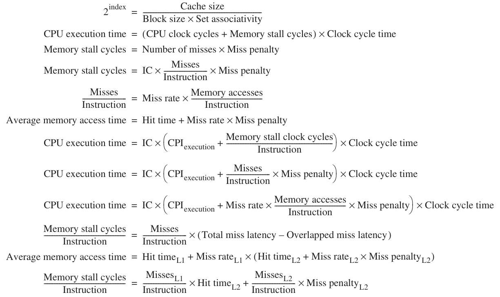

**Hình B.7 Tổng hợp các phương trình performance trong phụ lục này. Phương trình đầu tính kích thước cache index, các phương trình còn lại giúp đánh giá performance. Hai phương trình cuối xử lý multilevel cache, được giải thích ở đầu mục tiếp theo. Chúng được đưa vào đây để hình này trở thành tài liệu tra cứu hữu ích.**

## B.3 Sáu phép tối ưu Cache cơ bản

Công thức average memory access time cho chúng ta một khuôn khổ để trình bày các phép tối ưu cache nhằm cải thiện cache performance:

Average memory access time = Hit time + Miss rate × Miss penalty

Do đó, chúng ta tổ chức sáu phép tối ưu cache thành ba nhóm:

- Giảm miss rate—block size lớn hơn, cache size lớn hơn và associativity cao hơn

- Giảm miss penalty—multilevel cache và ưu tiên read hơn write

- Giảm thời gian hit trong cache—tránh address translation khi index cache

Hình B.18 ở trang B-40 kết thúc mục này bằng tổng hợp độ phức tạp triển khai và lợi ích performance của sáu kỹ thuật này.

Cách tiếp cận kinh điển để cải thiện hành vi cache là giảm miss rate, và chúng ta trình bày ba kỹ thuật để làm điều đó. Để hiểu rõ hơn nguyên nhân miss, trước hết chúng ta bắt đầu bằng mô hình phân mọi miss thành ba nhóm đơn giản:

- Compulsory—Lần truy cập đầu tiên đến một block không thể tìm thấy nó trong cache, nên block phải được đưa vào cache. Chúng còn được gọi là cold-start miss hoặc first-reference miss.

- Capacity—Nếu cache không chứa được mọi block cần thiết trong quá trình thực thi chương trình, capacity miss (ngoài compulsory miss) sẽ xảy ra vì block bị loại bỏ rồi được lấy lại sau đó.

- Conflict—Nếu block placement strategy là set associative hoặc direct mapped, conflict miss (ngoài compulsory miss và capacity miss) sẽ xảy ra vì block có thể bị loại bỏ rồi lấy lại sau đó nếu quá nhiều block được ánh xạ vào set của nó. Những miss này còn được gọi là collision miss. Ý tưởng là hit trong fully associative cache trở thành miss trong n-way set-associative cache do có hơn n yêu cầu đối với một số set được dùng nhiều.

(Chương 5 bổ sung chữ C thứ tư, dành cho coherency miss do cache flush để giữ nhiều cache coherent trong multiprocessor; chúng ta không xem xét chúng ở đây.)

Hình B.8 cho thấy tần suất tương đối của cache miss, chia theo ba chữ C. Compulsory miss là những miss xảy ra trong cache vô hạn. Capacity miss là những miss xảy ra trong fully associative cache. Conflict miss là những miss xảy ra khi chuyển từ fully associative sang eight-way associative, four-way associative, v.v. Hình B.9 biểu diễn cùng dữ liệu bằng đồ thị. Đồ thị trên cho thấy miss rate tuyệt đối; đồ thị dưới biểu diễn tỷ lệ mỗi loại miss trong tổng số miss theo cache size.

Để thể hiện lợi ích của associativity, conflict miss được chia thành những miss do mỗi bước giảm associativity gây ra. Dưới đây là bốn nhóm conflict miss và cách tính:

- Eight-way—Conflict miss do chuyển từ fully associative (không có conflict) sang eight-way associative

- Four-way—Conflict miss do chuyển từ eight-way associative sang four-way associative

- Two-way—Conflict miss do chuyển từ four-way associative sang two-way associative

- One-way—Conflict miss do chuyển từ two-way associative sang one-way associative (direct mapped)

Như chúng ta thấy từ các hình, compulsory miss rate của các chương trình SPEC2000 rất nhỏ, cũng như với nhiều chương trình long-running.

Sau khi xác định ba chữ C, nhà thiết kế computer có thể làm gì với chúng? Về khái niệm, conflict dễ xử lý nhất: Fully associative placement tránh mọi conflict miss. Tuy nhiên, full associativity tốn kém về hardware và có thể làm chậm processor clock rate (xem ví dụ ở trang B-29), dẫn đến overall performance thấp hơn.

|  |  |  | Các thành phần miss rate (phần trăm tương đối) (tổng = 100% tổng miss rate) |  |  |  |  |  |
|---|---|---|---|---|---|---|---|---|
| Cache size (KB) | Mức associativity | Tổng miss rate | Compulsory |  | Capacity |  | Conflict |  |
| 4 | 1-way | 0.098 | 0.0001 | 0.1% | 0.070 | 72% | 0.027 | 28% |
| 4 | 2-way | 0.076 | 0.0001 | 0.1% | 0.070 | 93% | 0.005 | 7% |
| 4 | 4-way | 0.071 | 0.0001 | 0.1% | 0.070 | 99% | 0.001 | 1% |
| 4 | 8-way | 0.071 | 0.0001 | 0.1% | 0.070 | 100% | 0.000 | 0% |
| 8 | 1-way | 0.068 | 0.0001 | 0.1% | 0.044 | 65% | 0.024 | 35% |
| 8 | 2-way | 0.049 | 0.0001 | 0.1% | 0.044 | 90% | 0.005 | 10% |
| 8 | 4-way | 0.044 | 0.0001 | 0.1% | 0.044 | 99% | 0.000 | 1% |
| 8 | 8-way | 0.044 | 0.0001 | 0.1% | 0.044 | 100% | 0.000 | 0% |
| 16 | 1-way | 0.049 | 0.0001 | 0.1% | 0.040 | 82% | 0.009 | 17% |
| 16 | 2-way | 0.041 | 0.0001 | 0.2% | 0.040 | 98% | 0.001 | 2% |
| 16 | 4-way | 0.041 | 0.0001 | 0.2% | 0.040 | 99% | 0.000 | 0% |
| 16 | 8-way | 0.041 | 0.0001 | 0.2% | 0.040 | 100% | 0.000 | 0% |
| 32 | 1-way | 0.042 | 0.0001 | 0.2% | 0.037 | 89% | 0.005 | 11% |
| 32 | 2-way | 0.038 | 0.0001 | 0.2% | 0.037 | 99% | 0.000 | 0% |
| 32 | 4-way | 0.037 | 0.0001 | 0.2% | 0.037 | 100% | 0.000 | 0% |
| 32 | 8-way | 0.037 | 0.0001 | 0.2% | 0.037 | 100% | 0.000 | 0% |
| 64 | 1-way | 0.037 | 0.0001 | 0.2% | 0.028 | 77% | 0.008 | 23% |
| 64 | 2-way | 0.031 | 0.0001 | 0.2% | 0.028 | 91% | 0.003 | 9% |
| 64 | 4-way | 0.030 | 0.0001 | 0.2% | 0.028 | 95% | 0.001 | 4% |
| 64 | 8-way | 0.029 | 0.0001 | 0.2% | 0.028 | 97% | 0.001 | 2% |
| 128 | 1-way | 0.021 | 0.0001 | 0.3% | 0.019 | 91% | 0.002 | 8% |
| 128 | 2-way | 0.019 | 0.0001 | 0.3% | 0.019 | 100% | 0.000 | 0% |
| 128 | 4-way | 0.019 | 0.0001 | 0.3% | 0.019 | 100% | 0.000 | 0% |
| 128 | 8-way | 0.019 | 0.0001 | 0.3% | 0.019 | 100% | 0.000 | 0% |
| 256 | 1-way | 0.013 | 0.0001 | 0.5% | 0.012 | 94% | 0.001 | 6% |
| 256 | 2-way | 0.012 | 0.0001 | 0.5% | 0.012 | 99% | 0.000 | 0% |
| 256 | 4-way | 0.012 | 0.0001 | 0.5% | 0.012 | 99% | 0.000 | 0% |
| 256 | 8-way | 0.012 | 0.0001 | 0.5% | 0.012 | 99% | 0.000 | 0% |
| 512 | 1-way | 0.008 | 0.0001 | 0.8% | 0.005 | 66% | 0.003 | 33% |
| 512 | 2-way | 0.007 | 0.0001 | 0.9% | 0.005 | 71% | 0.002 | 28% |
| 512 | 4-way | 0.006 | 0.0001 | 1.1% | 0.005 | 91% | 0.000 | 8% |
| 512 | 8-way | 0.006 | 0.0001 | 1.1% | 0.005 | 95% | 0.000 | 4% |

**Hình B.8 Tổng miss rate cho mỗi kích thước cache và tỷ lệ của từng loại theo ba chữ C. Compulsory miss độc lập với cache size, trong khi capacity miss giảm khi capacity tăng và conflict miss giảm khi associativity tăng. Hình B.9 biểu diễn cùng thông tin bằng đồ thị. Lưu ý rằng direct-mapped cache kích thước N có miss rate xấp xỉ two-way set-associative cache kích thước N/2 cho đến 128 K. Cache lớn hơn 128 KB không xác nhận quy tắc đó. Lưu ý cột Capacity cũng là miss rate của fully associative cache. Dữ liệu được thu thập như trong Hình B.4, dùng LRU replacement.**

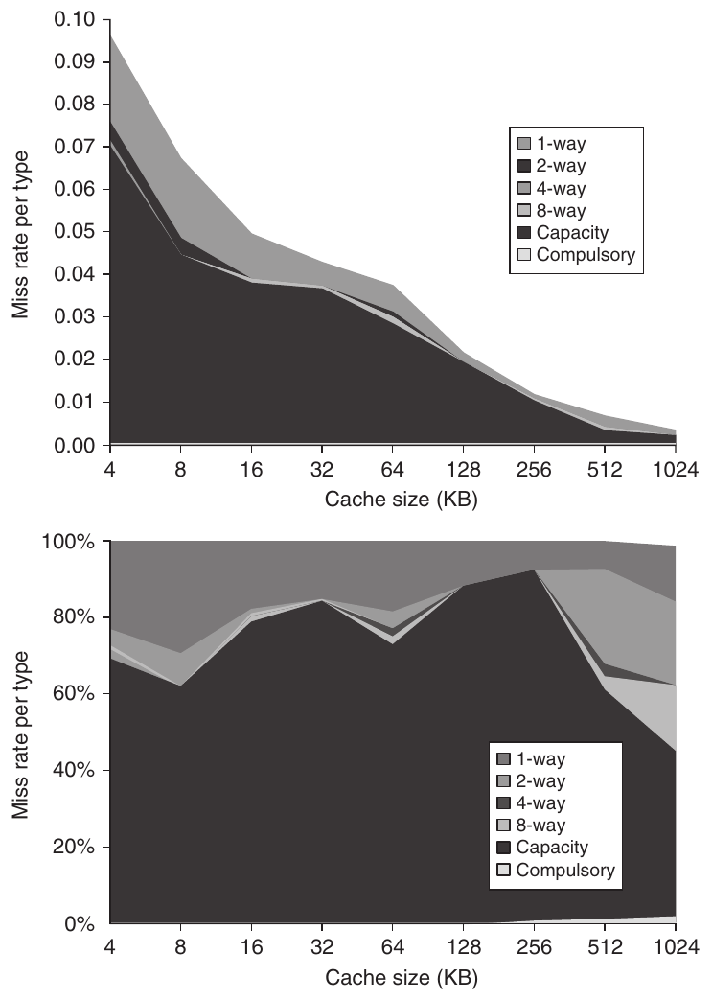

**Hình B.9 Tổng miss rate (trên) và phân bố miss rate (dưới) cho mỗi kích thước cache theo ba chữ C với dữ liệu trong Hình B.8. Sơ đồ trên cho thấy data cache miss rate thực tế, còn sơ đồ dưới cho thấy tỷ lệ trong mỗi nhóm. (Không gian cho phép đồ thị thể hiện thêm một kích thước cache so với số kích thước vừa trong Hình B.8.)**

Không có nhiều cách xử lý capacity ngoài việc mở rộng cache. Nếu upper-level memory nhỏ hơn nhiều so với nhu cầu của chương trình và một tỷ lệ thời gian đáng kể được dùng để di chuyển dữ liệu giữa hai level của hierarchy, memory hierarchy được gọi là bị thrash. Vì cần quá nhiều lần replacement, thrashing có nghĩa computer chạy gần tốc độ lower-level memory, hoặc thậm chí chậm hơn vì miss overhead.

Một cách khác để cải thiện ba chữ C là tăng kích thước block để giảm số compulsory miss, nhưng như chúng ta sẽ sớm thấy, block lớn có thể làm tăng các loại miss khác.

Ba chữ C giúp hiểu nguyên nhân miss, nhưng mô hình đơn giản này có giới hạn; nó giúp hiểu hành vi trung bình nhưng có thể không giải thích được từng miss riêng lẻ. Ví dụ, thay đổi cache size làm thay đổi cả conflict miss lẫn capacity miss vì cache lớn hơn phân bố các reference đến nhiều block hơn. Do đó, một miss có thể chuyển từ capacity miss sang conflict miss khi cache size thay đổi. Lưu ý ba chữ C cũng bỏ qua replacement policy vì khó mô hình hóa và nói chung ít quan trọng hơn. Trong những hoàn cảnh cụ thể, replacement policy thực sự có thể dẫn đến hành vi bất thường, chẳng hạn miss rate kém hơn khi associativity cao hơn, trái với mô hình ba chữ C. (Một số người đề xuất dùng address trace để xác định placement tối ưu trong memory nhằm tránh placement miss trong mô hình ba chữ C; ở đây chúng ta không làm theo lời khuyên đó.)

Tiếc rằng nhiều kỹ thuật giảm miss rate cũng làm tăng hit time hoặc miss penalty. Mong muốn giảm miss rate bằng ba phép tối ưu phải được cân bằng với mục tiêu làm toàn hệ thống chạy nhanh. Ví dụ đầu tiên này cho thấy tầm quan trọng của góc nhìn cân bằng.

### Phép tối ưu thứ nhất: Block Size lớn hơn để giảm Miss Rate

Cách đơn giản nhất để giảm miss rate là tăng block size. Hình B.10 cho thấy trade-off giữa block size và miss rate với một tập chương trình và kích thước cache. Block size lớn hơn cũng giảm compulsory miss. Sự giảm này xảy ra vì principle of locality có hai thành phần: temporal locality và spatial locality. Block lớn hơn tận dụng spatial locality.

Đồng thời, block lớn hơn làm tăng miss penalty. Vì chúng làm giảm số block trong cache, block lớn hơn có thể tăng conflict miss và thậm chí capacity miss nếu cache nhỏ. Rõ ràng, chẳng có mấy lý do để tăng block size đến mức làm tăng miss rate. Giảm miss rate cũng không đem lại lợi ích nếu làm tăng average memory access time. Mức tăng miss penalty có thể vượt mức giảm miss rate.

**Ví dụ** Hình B.11 cho thấy miss rate thực tế được vẽ trong Hình B.10. Giả sử memory system mất overhead 80 clock cycle rồi cung cấp 16 byte mỗi 2 clock cycle. Như vậy, nó có thể cung cấp 16 byte trong 82 clock cycle, 32 byte trong 84 clock cycle, v.v. Block size nào có average memory access time nhỏ nhất cho mỗi cache size trong Hình B.11?

**Trả lời** Average memory access time là

Average memory access time = Hit time + Miss rate × Miss penalty

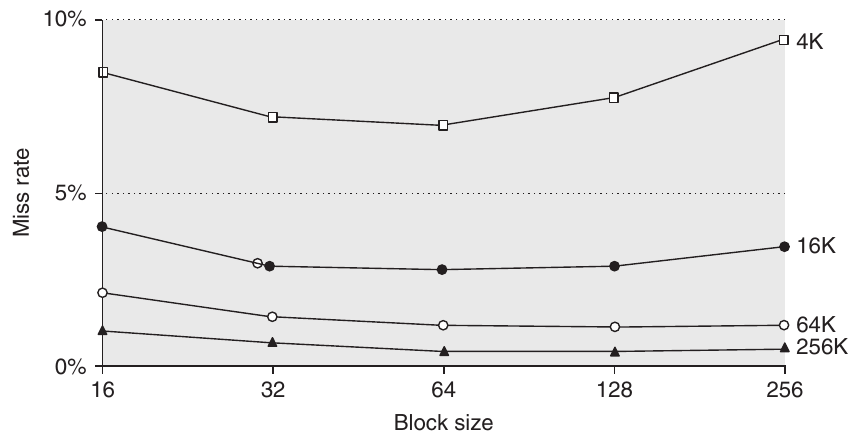

**Hình B.10 Miss rate theo block size cho năm cache different-sized. Lưu ý miss rate thực sự tăng nếu block size quá lớn so với cache size. Mỗi đường biểu diễn một cache có kích thước khác nhau. Hình B.11 cho thấy dữ liệu dùng để vẽ những đường này. Tiếc rằng SPEC2000 trace sẽ mất quá nhiều thời gian nếu tính cả block size, nên dữ liệu này dựa trên SPEC92 trên DECstation 5000 [Gee et al. 1993].**

Nếu giả sử hit time là 1 clock cycle, độc lập với block size, access time cho block 16-byte trong cache 4 KB là

Average memory access time = 1 + (8.57% × 82) = 8.027 clock cycles

và với block 256-byte trong cache 256 KB, average memory access time là

Average memory access time = 1 + (0.49% × 112) = 1.549 clock cycles

|  | Cache size |  |  |  |
|---|---|---|---|---|
| Block size | 4K | 16K | 64K | 256K |
| 16 | 8.57% | 3.94% | 2.04% | 1.09% |
| 32 | 7.24% | 2.87% | 1.35% | 0.70% |
| 64 | 7.00% | 2.64% | 1.06% | 0.51% |
| 128 | 7.78% | 2.77% | 1.02% | 0.49% |
| 256 | 9.51% | 3.29% | 1.15% | 0.49% |

**Hình B.11 Miss rate thực tế theo block size cho năm cache different-sized trong Hình B.10. Lưu ý với cache 4 KB, block 256-byte có miss rate cao hơn block 32-byte. Trong ví dụ này, cache phải là 256 KB thì block 256-byte mới giảm miss.**

|  |  | Cache size |  |  |  |
|---|---|---|---|---|---|
| Block size | Miss penalty | 4K | 16K | 64K | 256K |
| 16 | 82 | 8.027 | 4.231 | 2.673 | 1.894 |
| 32 | 84 | 7.082 | 3.411 | 2.134 | 1.588 |
| 64 | 88 | 7.160 | 3.323 | 1.933 | 1.449 |
| 128 | 96 | 8.469 | 3.659 | 1.979 | 1.470 |
| 256 | 112 | 11.651 | 4.685 | 2.288 | 1.549 |

**Hình B.12 Average memory access time theo block size cho năm cache different-sized trong Hình B.10. Block size 32 và 64 byte chiếm ưu thế. Thời gian trung bình nhỏ nhất cho mỗi cache size được in đậm.**

Hình B.12 cho thấy average memory access time cho mọi block size và cache size giữa hai cực đó. Các entry in đậm cho thấy block size nhanh nhất với cache size nhất định: 32 byte cho 4 KB và 64 byte cho cache lớn hơn. Thực tế, đây là các block size phổ biến cho processor cache ngày nay.

Cũng như mọi kỹ thuật này, người thiết kế cache cố giảm thiểu cả miss rate lẫn miss penalty. Việc chọn block size phụ thuộc cả latency và bandwidth của lower-level memory. Latency cao và bandwidth cao khuyến khích block size lớn vì cache nhận được nhiều byte hơn rất nhiều cho mỗi miss với miss penalty chỉ tăng ít. Ngược lại, latency thấp và bandwidth thấp khuyến khích block size nhỏ hơn vì block lớn không tiết kiệm được nhiều thời gian. Ví dụ, hai lần miss penalty của block nhỏ có thể gần bằng penalty của block có kích thước gấp đôi. Số block nhỏ nhiều hơn cũng có thể giảm conflict miss. Lưu ý Hình B.10 và B.12 cho thấy khác biệt giữa việc chọn block size dựa trên giảm thiểu miss rate và giảm thiểu average memory access time.

Sau khi thấy tác động tích cực và tiêu cực của block size lớn hơn lên compulsory miss và capacity miss, hai tiểu mục tiếp theo xem xét tiềm năng của capacity lớn hơn và associativity cao hơn.

### Phép tối ưu thứ hai: Cache lớn hơn để giảm Miss Rate

Cách hiển nhiên để giảm capacity miss trong Hình B.8 và B.9 là tăng capacity của cache. Nhược điểm hiển nhiên là hit time có thể dài hơn, chi phí và điện năng cao hơn. Kỹ thuật này đặc biệt phổ biến với <sub>off-chip</sub> cache.

### Phép tối ưu thứ ba: Associativity cao hơn để giảm Miss Rate

Hình B.8 và B.9 cho thấy miss rate cải thiện khi associativity cao hơn. Có thể rút ra hai quy tắc kinh nghiệm tổng quát từ những hình này. Thứ nhất, trên thực tế eight-way set associative hiệu quả ngang fully associative trong việc giảm miss cho cache có những kích thước này. Bạn có thể thấy khác biệt bằng cách so sánh các entry eight-way với cột capacity miss trong Hình B.8, vì capacity miss được tính bằng fully associative cache.

Nhận xét thứ hai, gọi là quy tắc kinh nghiệm cache 2:1, là direct-mapped cache kích thước N có miss rate xấp xỉ two-way set associative cache kích thước N/2. Điều này đúng trong các hình về ba chữ C với cache size nhỏ hơn 128 KB.

Như nhiều ví dụ này, cải thiện một khía cạnh của average memory access time phải đánh đổi bằng khía cạnh khác. Tăng block size giảm miss rate nhưng tăng miss penalty, và associativity cao hơn có thể phải trả giá bằng hit time tăng. Do đó, áp lực về processor clock cycle nhanh khuyến khích thiết kế cache đơn giản, nhưng miss penalty tăng lại làm associativity có lợi hơn, như ví dụ sau gợi ý.

**Ví dụ** Giả sử associativity cao hơn làm tăng clock cycle time như liệt kê bên dưới:

Clock cycle time<sub>2-way</sub> = 1.36 × Clock cycle time<sub>1-way</sub>

Clock cycle time<sub>4-way</sub> = 1.44 × Clock cycle time<sub>1-way</sub>

Clock cycle time<sub>8-way</sub> = 1.52 × Clock cycle time<sub>1-way</sub>

Giả sử hit time là 1 clock cycle, miss penalty trong trường hợp direct-mapped là 25 clock cycle đến level 2 cache (xem tiểu mục tiếp theo) không bao giờ miss, và miss penalty không cần được làm tròn thành số nguyên clock cycle. Dùng Hình B.8 cho miss rate, với cache size nào thì mỗi mệnh đề trong ba mệnh đề sau đúng?

Average memory access time<sub>8-way</sub> < Average memory access time<sub>4-way</sub>

Average memory access time<sub>4-way</sub> < Average memory access time<sub>2-way</sub>

Average memory access time<sub>2-way</sub> < Average memory access time<sub>1-way</sub>

|  | Associativity |  |  |  |
|---|---|---|---|---|
| Cache size (KB) | 1-way | 2-way | 4-way | 8-way |
| 4 | 3.44 | 3.25 | 3.22 | 3.28 |
| 8 | 2.69 | 2.58 | 2.55 | 2.62 |
| 16 | 2.23 | 2.40 | 2.46 | 2.53 |
| 32 | 2.06 | 2.30 | 2.37 | 2.45 |
| 64 | 1.92 | 2.14 | 2.18 | 2.25 |
| 128 | 1.52 | 1.84 | 1.92 | 2.00 |
| 256 | 1.32 | 1.66 | 1.74 | 1.82 |
| 512 | 1.20 | 1.55 | 1.59 | 1.66 |

**Hình B.13 Average memory access time dùng miss rate trong Hình B.8 với tham số trong ví dụ. Chữ in đậm có nghĩa thời gian này cao hơn số bên trái, tức associativity cao hơn làm tăng average memory access time.**

**Trả lời** Average memory access time cho mỗi associativity là

Average memory access time<sub>8-way</sub> = Hit time<sub>8-way</sub> + Miss rate<sub>8-way</sub> × Miss penalty<sub>8-way</sub>

= 1.52 + Miss rate<sub>8-way</sub> × 25

Average memory access time<sub>4-way</sub> = 1.44 + Miss rate<sub>4-way</sub> × 25

Average memory access time<sub>2-way</sub> = 1.36 + Miss rate<sub>2-way</sub> × 25

Average memory access time<sub>1-way</sub> = 1.00 + Miss rate<sub>1-way</sub> × 25

Miss penalty có thời gian như nhau trong mỗi trường hợp, nên chúng ta giữ nguyên là 25 clock cycle. Ví dụ, average memory access time cho direct-mapped cache 4 KB là

Average memory access time<sub>1-way</sub> = 1.00 + (0.098 × 25) = 3.44

và thời gian cho eight-way set associative cache 512 KB là

Average memory access time<sub>8-way</sub> = 1.52 + (0.006 × 25) = 1.66

Dùng những công thức này và miss rate từ Hình B.8, Hình B.13 cho thấy average memory access time cho mỗi cache và associativity. Hình cho thấy các công thức trong ví dụ này đúng với cache nhỏ hơn hoặc bằng 8 KB khi associativity tối đa là four-way. Bắt đầu từ 16 KB, hit time cao hơn của associativity lớn hơn vượt phần thời gian tiết kiệm nhờ giảm miss.

Lưu ý chúng ta chưa tính clock rate chậm hơn đối với phần còn lại của chương trình trong ví dụ này, qua đó đánh giá thấp lợi thế của direct-mapped cache<sub>.</sub>

### Phép tối ưu thứ tư: Multilevel Cache để giảm Miss Penalty

Giảm cache miss từng là trọng tâm truyền thống của nghiên cứu cache, nhưng công thức cache performance bảo đảm rằng cải thiện miss penalty có thể hữu ích ngang với cải thiện miss rate. Hơn nữa, Hình 2.2 ở trang 74 cho thấy xu hướng công nghệ đã cải thiện tốc độ processor nhanh hơn DRAM, khiến chi phí tương đối của miss penalty tăng theo thời gian.

Khoảng cách performance này giữa processor và memory dẫn architect đến câu hỏi: Nên làm cache nhanh hơn để theo kịp tốc độ processor, hay làm cache lớn hơn để vượt qua khoảng cách ngày càng rộng giữa processor và main memory?

Một câu trả lời là làm cả hai. Thêm một level cache giữa cache ban đầu và memory giúp đơn giản hóa quyết định. Cache first-level có thể đủ nhỏ để phù hợp clock cycle time của processor nhanh. Trong khi đó, second-level cache có thể đủ lớn để giữ lại nhiều access vốn sẽ đến main memory, qua đó giảm effective miss penalty.

Mặc dù khái niệm thêm level vào hierarchy khá đơn giản, nó làm phân tích performance phức tạp hơn. Các định nghĩa cho second level cache không phải lúc nào cũng rõ ràng. Hãy bắt đầu bằng định nghĩa average memory access time cho two-level cache. Dùng subscript L1 và L2 lần lượt chỉ first-level cache và second-level cache, công thức ban đầu là

Average memory access time = Hit time<sub>L1</sub>+ Miss rate<sub>L1</sub> × Miss penalty<sub>L1</sub>

và

Miss penalty<sub>L1</sub> = Hit time<sub>L2</sub> + Miss rate<sub>L2</sub> × Miss penalty<sub>L2</sub>

do đó

Average memory access time = Hit time<sub>L1</sub> + Miss rate<sub>L1</sub>

× (Hit time<sub>L2</sub> + Miss rate<sub>L2</sub> × Miss penalty<sub>L2</sub>)

Trong công thức này, second-level miss rate được đo trên phần còn lại sau first-level cache. Để tránh mơ hồ, các thuật ngữ sau được dùng ở đây cho hệ thống two-level cache:

- Local miss rate—Tỷ lệ này đơn giản là số miss trong một cache chia cho tổng số memory access đến cache đó. Như bạn dự đoán, với first-level cache nó bằng Miss rate<sub>L1</sub>, còn với second-level cache nó là Miss rate<sub>L2</sub>.

- Global miss rate—Số miss trong cache chia cho tổng số memory access do processor tạo ra. Dùng các thuật ngữ trên, global miss rate của first-level cache vẫn chỉ là Miss rate<sub>L1</sub>, nhưng với second-level cache nó là Miss rate<sub>L1</sub> × Miss rate<sub>L2</sub>.

Local miss rate này lớn đối với second-level cache vì first-level cache đã giữ lại phần tinh túy của memory access. Vì vậy, global miss rate là thước đo hữu ích hơn: Nó cho biết phần nào trong số memory access rời processor đi hết đến memory.

Đây là nơi thước đo số miss trên mỗi instruction phát huy ưu thế. Thay vì nhầm lẫn về local miss rate hay global miss rate, chúng ta chỉ mở rộng memory stall trên mỗi instruction để thêm ảnh hưởng của second-level cache.

Average memory stalls per instruction = Misses per instruction<sub>L1</sub> × Hit time<sub>L2</sub>

\+ Misses per instruction<sub>L2</sub> × Miss penalty<sub>L2</sub>

**Ví dụ** Giả sử trong 1000 memory reference có 40 miss ở first-level cache và 20 miss ở second-level cache. Các miss rate khác nhau là bao nhiêu? Giả sử miss penalty từ L2 cache đến memory là 200 clock cycle, hit time của L2 cache là 10 clock cycle, hit time của L1 là 1 clock cycle và có 1.5 memory reference trên mỗi instruction. Average memory access time và số stall cycle trung bình trên mỗi instruction là bao nhiêu? Bỏ qua ảnh hưởng của write.

**Trả lời** Miss rate (local hoặc global) của first-level cache là 40/1000, hay 4%. Local miss rate của second-level cache là 20/40, hay 50%. Global miss rate của second-level cache là 20/1000, hay 2%. Khi đó

Average memory access time = Hit time<sub>L1</sub> + Miss rate<sub>L1</sub> × (Hit time<sub>L2</sub> + Miss rate<sub>L2</sub> × Miss penalty<sub>L2</sub>)

= 1 + 4% × (10 + 50% × 200) = 1 + 4% × 110 = 5.4 clock cycles

Để xem có bao nhiêu miss trên mỗi instruction, chúng ta chia 1000 memory reference cho 1.5 memory reference trên mỗi instruction, thu được 667 instruction. Vì vậy, cần nhân số miss với 1.5 để có số miss trên 1000 instruction. Chúng ta có 40 × 1.5, hay 60 L1 miss, và 20 × 1.5, hay 30 L2 miss, trên 1000 instruction. Với số memory stall trung bình trên mỗi instruction, giả sử miss phân bố đồng đều giữa instruction và dữ liệu:

Average memory stalls per instruction = Misses per instruction<sub>L1</sub> × Hit time<sub>L2</sub> + Misses per instruction<sub>L2</sub>

× Miss penalty<sub>L2</sub>

= (60/1000) × 10 + (30/1000) × 200

= 0.060 × 10 + 0.030 × 200 = 6.6 clock cycles

Nếu lấy average memory access time (AMAT) trừ L1 hit time rồi nhân với số memory reference trung bình trên mỗi instruction, chúng ta thu được cùng số memory stall trung bình trên mỗi instruction:

(5.4 – 1.0) × 1.5 = 4.4 × 1.5 = 6.6 clock cycles

Như ví dụ cho thấy, có thể ít nhầm lẫn hơn với multilevel cache khi tính bằng số miss trên mỗi instruction thay vì miss rate.

Lưu ý các công thức này dành cho read và write gộp chung, giả sử first-level cache là write-back. Hiển nhiên, first-level cache write-through sẽ gửi mọi write đến second level, chứ không chỉ miss, và có thể dùng write buffer.

Hình B.14 và B.15 cho thấy miss rate và relative execution time thay đổi theo kích thước second-level cache trong một thiết kế. Từ những hình này, chúng ta rút ra hai nhận xét. Thứ nhất, global cache miss rate rất gần single cache miss rate của second-level cache, miễn second-level cache lớn hơn nhiều so với first-level cache. Vì vậy, trực giác và kiến thức về first-level cache vẫn áp dụng được. Thứ hai, local cache miss rate không phải thước đo tốt cho secondary cache; nó là hàm của miss rate của first-level cache, do đó có thể thay đổi khi thay first-level cache. Vì vậy, nên dùng global cache miss rate khi đánh giá second-level cache.

Với các định nghĩa này, chúng ta có thể xem xét tham số của second-level cache. Khác biệt quan trọng nhất giữa hai level là tốc độ first-level cache ảnh hưởng processor clock rate, trong khi tốc độ second-level cache chỉ ảnh hưởng miss penalty của first-level cache. Do đó, chúng ta có thể cân nhắc nhiều phương án cho second-level cache vốn không phù hợp với first-level cache. Có hai câu hỏi chính khi thiết kế second-level cache: Nó có giảm phần average memory access time trong CPI không, và chi phí là bao nhiêu?

Quyết định ban đầu là kích thước second-level cache. Vì mọi thứ trong first-level cache có khả năng nằm trong second-level cache, second-level cache nên lớn hơn nhiều so với first level. Nếu second-level cache chỉ lớn hơn một chút, local miss rate sẽ cao. Nhận xét này thúc đẩy thiết kế second-level cache khổng lồ—bằng kích thước main memory của các computer đời cũ!

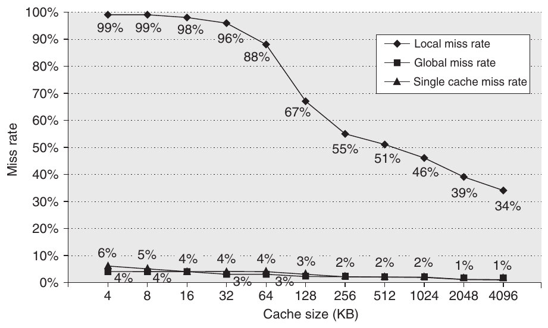

**Hình B.14 Miss rate theo cache size cho multilevel cache. Second-level cache nhỏ hơn tổng hai first-level cache 64 KB không có nhiều ý nghĩa, như thể hiện qua miss rate cao. Sau 256 KB, single cache nằm trong khoảng chênh lệch 10% so với global miss rate. Miss rate của single-level cache theo kích thước được vẽ cùng local miss rate và global miss rate của second-level cache dùng first-level cache 32 KB. Các L2 cache (unified) là two-way set associative với replacement. Mỗi cache có instruction cache và data cache L1 riêng biệt, mỗi cache 64 KB two-way set associative với LRU replacement. Block size cho cả L1 cache và L2 cache là 64 byte. Dữ liệu được thu thập như trong Hình B.4.**

Một câu hỏi là liệu set associativity có hợp lý hơn đối với second-level cache hay không.

**Ví dụ** Với dữ liệu bên dưới, associativity của second-level cache ảnh hưởng thế nào đến miss penalty của nó?

- Hit time<sub>L2</sub> for direct mapped = 10 clock cycles.

- Two-way set associativity làm hit time tăng 0.1 clock cycle lên 10.1 clock cycle.

- Local miss rate<sub>L2</sub> for direct mapped = 25%.

- Local miss rate<sub>L2</sub> for two-way set associative = 20%.

- Miss penalty<sub>L2</sub> = 200 clock cycles.

**Trả lời** Với second-level cache direct-mapped, miss penalty của first-level cache là

Miss penalty<sub>1-way L2</sub> = 10 + 25% × 200 = 60.0 clock cycles

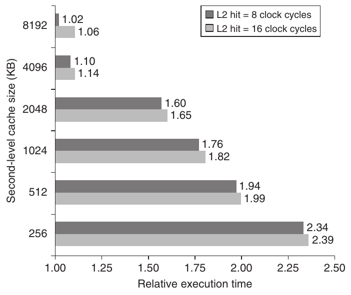

**Hình B.15 Relative execution time theo kích thước second-level cache. Hai thanh tương ứng với số clock cycle khác nhau cho một L2 cache hit. Reference execution time 1.00 dành cho second-level cache 8192 KB có latency 1-clock-cycle khi second-level hit. Dữ liệu này được thu thập giống cách trong Hình B.14, dùng simulator mô phỏng Alpha 21264.**

Thêm chi phí associativity chỉ tăng hit cost 0.1 clock cycle, khiến miss penalty mới của first-level cache là:

Miss penalty<sub>2-way L2</sub> = 10.1 + 20% × 200 = 50.1 clock cycles

Trên thực tế, second-level cache gần như luôn được đồng bộ với first-level cache và processor. Theo đó, second-level hit time phải là số nguyên clock cycle. Nếu may mắn, chúng ta rút second-level hit time xuống 10 cycle; nếu không, làm tròn lên 11 cycle. Cả hai lựa chọn đều cải thiện so với second-level cache direct-mapped:

Miss penalty<sub>2-way L2</sub> = 10 + 20% × 200 = 50.0 clock cycles

Miss penalty<sub>2-way L2</sub> = 11 + 20% × 200 = 51.0 clock cycles

Giờ chúng ta có thể giảm miss penalty bằng cách giảm miss rate của second-level cache.

Một yếu tố khác cần cân nhắc là liệu dữ liệu trong first-level cache có nằm trong second-level cache hay không. Multilevel inclusion là policy tự nhiên cho memory hierarchy: Dữ liệu L1 luôn hiện diện trong L2. Inclusion đáng mong muốn vì có thể xác định consistency giữa I/O và cache (hoặc giữa các cache trong multiprocessor) chỉ bằng cách kiểm tra second-level cache.

Một nhược điểm của inclusion là kết quả đo có thể gợi ý dùng block nhỏ hơn cho first-level cache nhỏ hơn và block lớn hơn cho second-level cache lớn hơn. Ví dụ, Pentium 4 có block 64-byte trong L1 cache và block 128-byte trong L2 cache. Vẫn có thể duy trì inclusion bằng cách làm thêm công việc khi second-level miss. Cache second-level phải invalidate mọi first-level block ánh xạ vào second-level block sắp bị thay thế, khiến first-level miss rate cao hơn một chút. Để tránh những vấn đề như vậy, nhiều nhà thiết kế cache giữ block size giống nhau ở mọi level cache.

Tuy nhiên, nếu nhà thiết kế chỉ đủ khả năng có L2 cache lớn hơn L1 cache một chút thì sao? Có nên dùng một phần đáng kể không gian của nó làm bản sao dư thừa của L1 cache? Trong trường hợp như vậy, policy đối lập hợp lý là multilevel exclusion: Dữ liệu L1 không bao giờ xuất hiện trong L2 cache. Thông thường, với exclusion, cache miss ở L1 dẫn đến hoán đổi block giữa L1 và L2 thay vì thay L1 block bằng L2 block. Policy này tránh lãng phí không gian L2 cache. Ví dụ, chip AMD Opteron tuân theo thuộc tính exclusion với hai L1 cache 64 KB và L2 cache 1 MB.

Như các vấn đề này cho thấy, mặc dù người mới có thể thiết kế các cache first- và second-level độc lập, người thiết kế first-level cache sẽ có công việc đơn giản hơn khi có second-level cache tương thích. Ví dụ, dùng write-through ít mạo hiểm hơn nếu level kế tiếp có write-back cache làm chỗ đỡ cho các write lặp lại và dùng multilevel inclusion.

Bản chất mọi thiết kế cache là cân bằng hit nhanh và ít miss. Với second-level cache, số hit ít hơn nhiều so với first-level cache, nên trọng tâm chuyển sang giảm số miss. Nhận thức này dẫn đến cache lớn hơn nhiều và các kỹ thuật giảm miss rate, chẳng hạn associativity cao hơn và block lớn hơn.

### Phép tối ưu thứ năm: Ưu tiên Read Miss hơn Write để giảm Miss Penalty

Phép tối ưu này phục vụ read trước khi write hoàn tất. Chúng ta bắt đầu bằng việc xem xét những phức tạp của write buffer.

Với write-through cache, cải tiến quan trọng nhất là write buffer có kích thước phù hợp. Tuy nhiên, write buffer làm memory access phức tạp hơn vì chúng có thể giữ giá trị cập nhật của một vị trí cần dùng khi read miss.

**Ví dụ** Hãy xem chuỗi code này:

```
SW R3, 512(R0)     ;M[512] ← R3     (cache index 0)
LW R1, 1024(R0)    ;R1 ← M[1024]    (cache index 0)
LW R2, 512(R0)     ;R2 ← M[512]     (cache index 0)
```

Giả sử một write-through cache direct-mapped ánh xạ 512 và 1024 vào cùng block, cùng write buffer four-word không được kiểm tra khi read miss. Giá trị trong R2 có luôn bằng giá trị trong R3 không?

**Trả lời** Dùng thuật ngữ trong Chương 2, đây là read-after-write data hazard trong memory. Hãy lần theo cache access để thấy nguy cơ. Dữ liệu trong R3 được đưa vào write buffer sau store. Load tiếp theo dùng cùng cache index nên là miss. Load instruction thứ hai thử đưa giá trị tại vị trí 512 vào register R2; điều này cũng dẫn đến miss. Nếu write buffer chưa hoàn tất write vào vị trí 512 trong memory, lần read vị trí 512 sẽ đưa giá trị cũ, sai vào cache block, rồi vào R2. Nếu không phòng ngừa đúng cách, R3 sẽ không bằng R2!

Cách đơn giản nhất để thoát tình thế khó xử này là để read miss chờ đến khi write buffer trống. Cách khác là kiểm tra nội dung write buffer khi read miss; nếu không có conflict và memory system sẵn sàng, cho read miss tiếp tục. Hầu như mọi desktop processor và server processor đều dùng cách sau, ưu tiên read hơn write.

Chi phí processor write trong write-back cache cũng có thể giảm. Giả sử read miss sẽ thay thế một dirty memory block. Thay vì write dirty block vào memory rồi read memory, chúng ta có thể sao chép dirty block vào buffer, sau đó read memory, rồi write memory. Theo cách này, lần read của processor—mà processor có lẽ đang chờ—sẽ hoàn tất sớm hơn. Tương tự tình huống trước, nếu read miss xảy ra, processor có thể stall cho đến khi buffer trống hoặc kiểm tra address của các word trong buffer để tìm conflict.

Sau khi có năm phép tối ưu giảm cache miss penalty hoặc miss rate, đã đến lúc xem xét giảm thành phần cuối của average memory access time. Hit time rất quan trọng vì có thể ảnh hưởng processor clock rate; ở nhiều processor ngày nay, cache access time giới hạn clock cycle rate, ngay cả với processor mất nhiều clock cycle để truy cập cache. Vì vậy, tầm quan trọng của hit time nhanh còn được nhân lên vượt khỏi công thức average memory access time vì nó giúp mọi thứ.

### Phép tối ưu thứ sáu: Tránh Address Translation trong quá trình Index Cache để giảm Hit Time

Ngay cả cache nhỏ và đơn giản cũng phải xử lý việc dịch virtual address từ processor thành physical address để truy cập memory. Như mô tả trong Mục B.4, processor xem main memory chỉ là một level khác của memory hierarchy; vì vậy, address của virtual memory tồn tại trên disk phải được ánh xạ vào main memory.

Nguyên tắc làm trường hợp phổ biến chạy nhanh gợi ý dùng virtual address cho cache, vì hit phổ biến hơn miss nhiều. Cache như vậy gọi là virtual cache, còn physical cache dùng để chỉ cache truyền thống sử dụng physical address. Như chúng ta sẽ sớm thấy, cần phân biệt hai task: index cache và so sánh address. Do đó, vấn đề là dùng virtual address hay physical address để index cache, và dùng virtual address hay physical address trong tag comparison. Dùng hoàn toàn virtual addressing cho cả index lẫn tag loại bỏ address translation time khỏi cache hit. Vậy vì sao không phải ai cũng xây dựng virtually addressed cache?

Một lý do là protection. Page-level protection được kiểm tra như một phần của virtual to physical address translation, và dù thế nào cũng phải được thực thi. Một giải pháp là sao chép protection information từ TLB khi miss, thêm một field để giữ nó và kiểm tra mỗi lần truy cập virtually addressed cache.

Lý do khác là mỗi khi process được chuyển đổi, virtual address tham chiếu đến physical address khác, đòi hỏi cache phải được flush. Hình B.16 cho thấy ảnh hưởng của việc flush này đối với miss rate. Một giải pháp là tăng độ rộng cache address tag bằng process-identifier tag (PID). Nếu operating system gán các tag này cho process, nó chỉ cần flush cache khi PID được tái sử dụng; nghĩa là PID phân biệt dữ liệu trong cache có thuộc chương trình này hay không. Hình B.16 cho thấy cải thiện miss rate khi dùng PID để tránh cache flush.

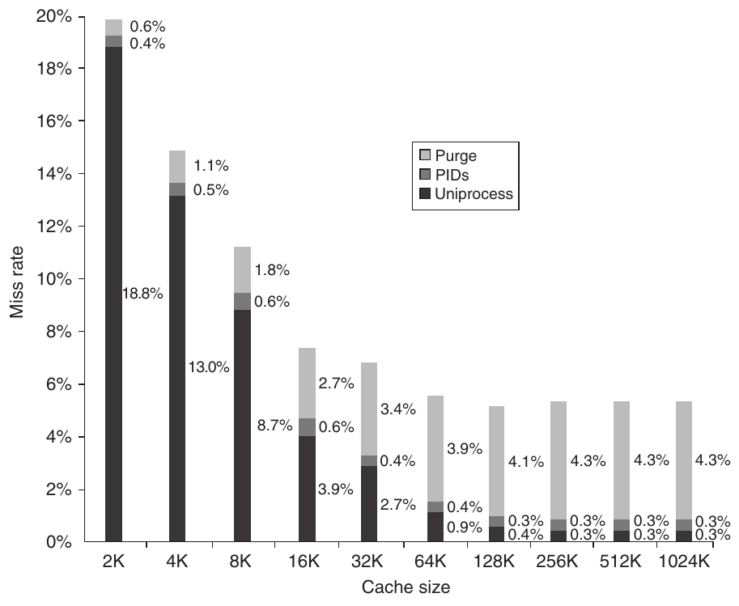

**Hình B.16 Miss rate theo kích thước virtually addressed cache của chương trình, đo bằng ba cách: không process switch (uniprocess), có process switch dùng process-identifier tag (PID), và có process switch nhưng không có PID (purge). PID làm tăng absolute miss rate của uniprocess từ 0.3% đến 0.6% và tiết kiệm từ 0.6% đến 4.3% so với purging. Agarwal [1987] thu thập thống kê này cho operating system Ultrix chạy trên VAX, giả sử direct-mapped cache có block size 16 byte. Lưu ý miss rate tăng từ 128K lên 256K. Hành vi trái trực giác như vậy có thể xảy ra trong cache vì thay đổi kích thước làm thay đổi ánh xạ memory block vào cache block, qua đó có thể làm thay đổi conflict miss rate.**

Lý do thứ ba khiến virtual cache không phổ biến hơn là operating system và user program có thể dùng hai virtual address khác nhau cho cùng physical address. Các address trùng này, gọi là synonym hoặc alias, có thể tạo hai bản sao của cùng dữ liệu trong virtual cache; nếu một bản được sửa, bản kia sẽ có giá trị sai. Với physical cache, điều này không xảy ra vì các access trước hết được dịch đến cùng physical cache block.

Các giải pháp hardware cho vấn đề synonym, gọi là antialiasing, bảo đảm mỗi cache block có physical address duy nhất. Ví dụ, AMD Opteron dùng instruction cache 64 KB với page 4 KB và two-way set associativity; vì vậy, hardware phải xử lý alias liên quan đến ba virtual address bit trong set index. Nó tránh alias bằng cách đơn giản kiểm tra cả tám vị trí có thể khi miss—hai block trong mỗi set của bốn set—để bảo đảm không vị trí nào khớp physical address của dữ liệu đang được fetch. Nếu tìm thấy một vị trí, nó bị invalidate, nên khi dữ liệu mới được nạp vào cache, physical address của chúng được bảo đảm duy nhất.

Software có thể làm vấn đề này dễ hơn nhiều bằng cách buộc alias chia sẻ một số address bit. Ví dụ, phiên bản UNIX cũ của Sun Microsystems yêu cầu mọi alias giống nhau ở 18 bit cuối của address; giới hạn này gọi là page coloring. Lưu ý page coloring đơn giản là set associative mapping áp dụng cho virtual memory: Các page 4 KB (2<sup>12</sup> ) được ánh xạ bằng 64 (2<sup>6</sup>) set để bảo đảm physical address và virtual address khớp nhau ở 18 bit cuối. Giới hạn này có nghĩa direct-mapped cache kích thước 2<sup>18</sup> (256K) byte hoặc nhỏ hơn không bao giờ có physical address trùng nhau cho các block. Từ góc nhìn cache, page coloring thực chất tăng page offset, vì software bảo đảm các bit cuối của virtual page address và physical page address giống nhau.

Mối quan tâm cuối cùng với virtual address là I/O. I/O thường dùng physical address, nên sẽ đòi hỏi ánh xạ sang virtual address để tương tác với virtual cache. (Ảnh hưởng của I/O đối với cache được thảo luận thêm trong Phụ lục D.)

Một phương án để lấy ưu điểm của cả virtual cache và physical cache là dùng một phần page offset—phần giống nhau trong cả virtual address lẫn physical address—để index cache. Đồng thời với việc cache được đọc bằng index đó, phần virtual của address được dịch và tag match dùng physical address.

Phương án này cho phép bắt đầu đọc cache ngay lập tức, trong khi tag comparison vẫn dùng physical address. Giới hạn của phương án virtually indexed, physically tagged này là direct-mapped cache không thể lớn hơn page size. Ví dụ, trong data cache ở Hình B.5 trang B-13, index là 9 bit và cache block offset là 6 bit. Để dùng mẹo này, virtual page size phải ít nhất 2<sup>(9+6)</sup> byte, hay 32 KB. Nếu không, một phần index phải được dịch từ virtual address sang physical address. Hình B.17 cho thấy tổ chức cache, translation lookaside buffer (TLB) và virtual memory khi dùng kỹ thuật này.

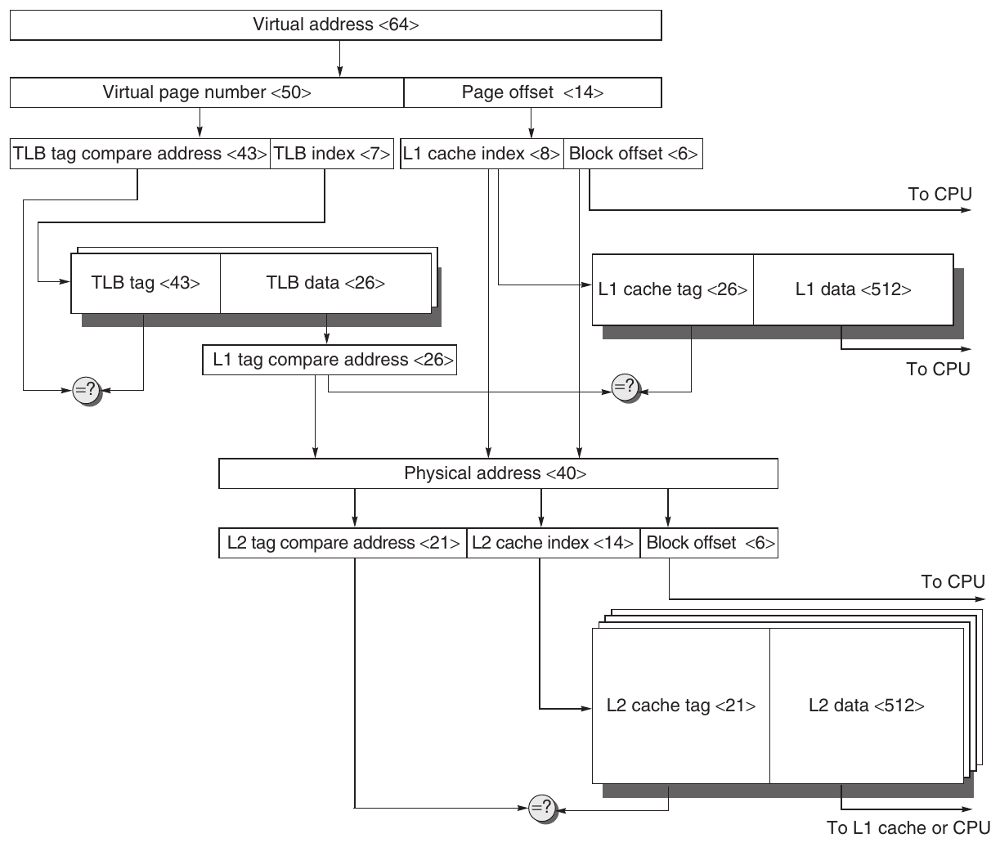

**Hình B.17 Bức tranh tổng thể của một memory hierarchy giả định, đi từ virtual address đến L2 cache access. Page size là 16 KB. TLB là two-way set associative với 256 entry. L1 cache là direct-mapped 16 KB, còn L2 cache là four-way set associative với tổng cộng 4 MB. Cả hai dùng block 64-byte. Virtual address là 64 bit và physical address là 40 bit.**

Associativity có thể giữ index trong phần physical của address mà vẫn hỗ trợ cache lớn. Nhớ rằng kích thước index được quyết định bởi công thức này:

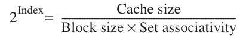

Ví dụ, tăng gấp đôi associativity và tăng gấp đôi cache size không thay đổi kích thước index. Một ví dụ cực đoan là cache IBM 3033 có 16-way set associative, mặc dù nghiên cứu cho thấy set associativity trên 8-way đem lại rất ít lợi ích cho miss rate. Associativity cao này cho phép cache 64 KB được đánh address bằng physical index, dù bị bất lợi bởi page 4 KB trong IBM architecture.

| Kỹ thuật | Hit time | Miss penalty | Miss rate | Độ phức tạp hardware | Nhận xét |
|---|---|---|---|---|---|
| Block size lớn hơn |  | – | + | 0 | Đơn giản; Pentium 4 L2 dùng 128 byte |
| Cache size lớn hơn | – |  | + | 1 | Được dùng rộng rãi, đặc biệt cho L2 cache |
| Associativity cao hơn | – |  | + | 1 | Được dùng rộng rãi |
| Multilevel cache |  | + |  | 2 | Hardware tốn kém; khó hơn nếu L1 block size ≠ L2 block size; được dùng rộng rãi |
| Ưu tiên read hơn write |  | + |  | 1 | Được dùng rộng rãi |
| Tránh address translation trong khi index cache | + |  |  | 1 | Được dùng rộng rãi |

**Hình B.18 Tổng hợp các phép tối ưu cache cơ bản, thể hiện ảnh hưởng lên cache performance và độ phức tạp của những kỹ thuật trong phụ lục này. Nói chung, một kỹ thuật chỉ giúp một yếu tố. + nghĩa là kỹ thuật cải thiện yếu tố đó, – nghĩa là làm yếu tố đó kém đi, ô trống nghĩa là không ảnh hưởng. Thước đo độ phức tạp mang tính chủ quan, với 0 là dễ nhất và 3 là thách thức.**

### Tổng kết các phép tối ưu Cache cơ bản

Các kỹ thuật trong mục này nhằm cải thiện miss rate, miss penalty và hit time nhìn chung cũng ảnh hưởng các thành phần khác trong phương trình average memory access cũng như độ phức tạp của memory hierarchy. Hình B.18 tổng hợp những kỹ thuật này và ước lượng ảnh hưởng đến độ phức tạp; + nghĩa là kỹ thuật cải thiện yếu tố đó, – nghĩa là làm yếu tố đó kém đi, ô trống nghĩa là không ảnh hưởng. Không phép tối ưu nào trong hình này giúp cải thiện nhiều hơn một nhóm.

## B.4 Virtual Memory

> . . . một hệ thống đã được nghĩ ra để làm tổ hợp core drum hiện ra với programmer như một single level store, trong đó các lần truyền cần thiết diễn ra tự động.

> Kilburn et al. [1962]

Tại mỗi thời điểm, computer đang chạy nhiều process, mỗi process có address space riêng. (Process được mô tả trong mục tiếp theo.) Dành riêng một lượng memory tương đương toàn bộ address space cho mỗi process sẽ quá tốn kém, đặc biệt vì nhiều process chỉ dùng một phần nhỏ address space của mình. Do đó, phải có cách chia sẻ lượng physical memory nhỏ hơn giữa nhiều process.

Một cách làm điều này, virtual memory, chia physical memory thành block và cấp phát chúng cho các process khác nhau. Cách tiếp cận như vậy nhất thiết phải có protection scheme giới hạn mỗi process trong những block chỉ thuộc process đó. Phần lớn dạng virtual memory cũng giảm thời gian khởi động chương trình, vì không phải toàn bộ code và dữ liệu đều cần nằm trong physical memory trước khi chương trình có thể bắt đầu.

Mặc dù protection do virtual memory cung cấp rất thiết yếu với computer hiện nay, sharing không phải lý do virtual memory được phát minh. Nếu chương trình trở nên quá lớn so với physical memory, programmer có trách nhiệm làm cho nó vừa. Programmer chia chương trình thành các phần, sau đó xác định các phần loại trừ lẫn nhau, rồi load hoặc unload những overlay này dưới sự điều khiển của user program trong khi thực thi. Programmer bảo đảm chương trình không bao giờ thử truy cập nhiều physical main memory hơn computer có, và overlay phù hợp được load đúng lúc. Như bạn có thể hình dung, trách nhiệm này làm giảm năng suất programmer.

Virtual memory được phát minh để giảm gánh nặng này cho programmer; nó tự động quản lý hai level của memory hierarchy là main memory và secondary storage. Hình B.19 cho thấy ánh xạ virtual memory vào physical memory cho chương trình có bốn page.

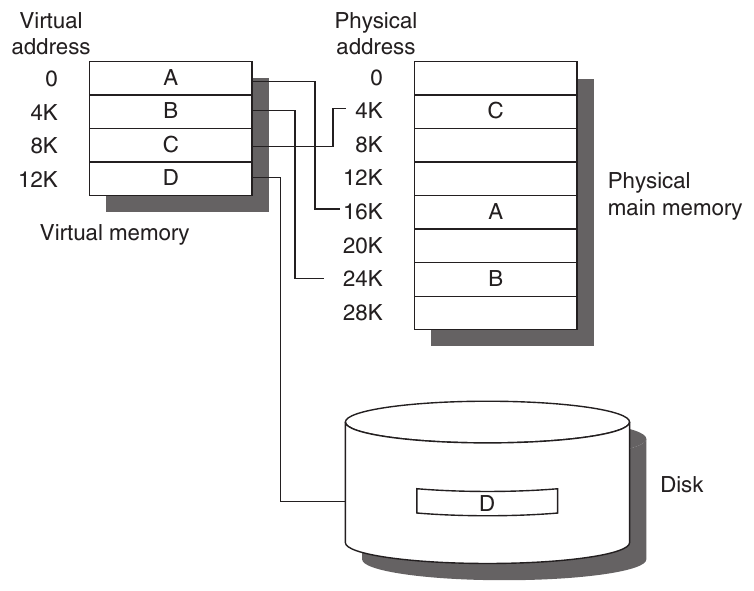

**Hình B.19 Chương trình logic trong virtual address space liên tục của nó được thể hiện bên trái. Nó gồm bốn page A, B, C và D. Vị trí thực tế của ba block là trong physical main memory, còn block kia nằm trên disk.**

Ngoài chia sẻ memory space được bảo vệ và tự động quản lý memory hierarchy, virtual memory còn đơn giản hóa việc load chương trình để thực thi. Cơ chế này, gọi là relocation, cho phép cùng một chương trình chạy ở bất kỳ vị trí nào trong physical memory. Chương trình trong Hình B.19 có thể được đặt bất kỳ đâu trong physical memory hoặc disk chỉ bằng cách thay đổi mapping giữa chúng. (Trước khi virtual memory phổ biến, processor thường có relocation register chỉ cho mục đích đó.) Phương án thay thế giải pháp hardware là software thay đổi mọi address trong chương trình mỗi lần nó chạy.

Một số ý tưởng memory hierarchy tổng quát về cache từ Chương 1 tương tự virtual memory, mặc dù nhiều thuật ngữ khác nhau. Page hoặc segment được dùng thay block, còn page fault hoặc address fault được dùng thay miss. Với virtual memory, processor tạo virtual address được tổ hợp hardware và software dịch thành physical address để truy cập main memory. Quá trình này gọi là memory mapping hoặc address translation. Ngày nay, hai level memory hierarchy do virtual memory điều khiển là DRAM và magnetic disk. Hình B.20 cho thấy phạm vi điển hình của các tham số memory hierarchy cho virtual memory.

Ngoài các khác biệt định lượng được đề cập trong Hình B.20, còn có những khác biệt khác giữa cache và virtual memory:

- Replacement khi cache miss chủ yếu do hardware điều khiển, còn virtual memory replacement chủ yếu do operating system điều khiển. Miss penalty dài hơn có nghĩa việc quyết định đúng quan trọng hơn, nên operating system có thể tham gia và dành thời gian quyết định thay thế gì.

- Kích thước processor address quyết định kích thước virtual memory, nhưng cache size độc lập với kích thước processor address.

| Tham số | First-level cache | Virtual memory |
|---|---|---|
| Block (page) size | 16–128 byte | 4096–65,536 byte |
| Hit time | 1–3 clock cycle | 100–200 clock cycle |
| Miss penalty | 8–200 clock cycle | 1,000,000–10,000,000 clock cycle |
| (access time) | (6–160 clock cycle) | (800,000–8,000,000 clock cycle) |
| (transfer time) | (2–40 clock cycle) | (200,000–2,000,000 clock cycle) |
| Miss rate | 0.1–10% | 0.00001–0.001% |
| Address mapping | Physical address 25–45-bit sang cache address 14–20-bit | Virtual address 32–64-bit sang physical address 25–45-bit |

**Hình B.20 Phạm vi tham số điển hình cho cache và virtual memory. Tham số virtual memory tăng từ 10 đến 1,000,000 lần so với tham số cache. Thông thường, first-level cache chứa tối đa 1 MB dữ liệu, trong khi physical memory chứa từ 256 MB đến 1 TB.**

- Ngoài vai trò lower-level backing store cho main memory trong hierarchy, secondary storage còn được dùng cho file system. Thực tế, file system chiếm phần lớn secondary storage. Nó thường không nằm trong address space.

Virtual memory còn bao gồm một số kỹ thuật liên quan. Hệ thống virtual memory có thể chia thành hai loại: loại có block fixed-size gọi là page, và loại có block variable-size gọi là segment. Page thường cố định ở 4096 đến 8192 byte, còn segment size thay đổi. Segment lớn nhất được hỗ trợ trên một processor nằm trong khoảng từ 2<sup>16</sup> byte đến 2<sup>32</sup>byte; segment nhỏ nhất là 1 byte. Hình B.21 cho thấy hai cách tiếp cận có thể chia code và dữ liệu như thế nào.

Quyết định dùng paged virtual memory hay segmented virtual memory ảnh hưởng processor. Paged addressing có một address fixed-size duy nhất, chia thành page number và offset trong page, tương tự cache addressing. Một address duy nhất không dùng được cho segmented address; kích thước segment thay đổi đòi hỏi 1 word cho segment number và 1 word cho offset trong segment, tổng cộng 2 word. Unsegmented address space đơn giản hơn cho compiler.

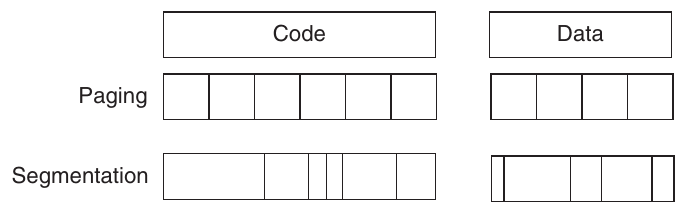

**Hình B.21 Ví dụ về cách paging và segmentation chia một chương trình.**

|  | Page | Segment |
|---|---|---|
| Số word trên mỗi address | Một | Hai (segment và offset) |
| Programmer có nhìn thấy không? | Application programmer không nhìn thấy | Application programmer có thể nhìn thấy |
| Thay block | Đơn giản (mọi block cùng kích thước) | Khó (phải tìm phần main memory liên tục, variable-size và chưa dùng) |
| Sử dụng memory không hiệu quả | Internal fragmentation (phần page chưa dùng) | External fragmentation (những phần main memory chưa dùng) |
| Disk traffic hiệu quả | Có (điều chỉnh page size để cân bằng access time và transfer time) | Không phải luôn luôn (segment nhỏ có thể chỉ truyền vài byte) |

**Hình B.22 Paging so với segmentation. Cả hai đều có thể lãng phí memory, tùy block size và mức độ các segment khớp với nhau trong main memory. Ngôn ngữ lập trình có pointer không bị giới hạn đòi hỏi truyền cả segment lẫn address. Cách tiếp cận lai, gọi là paged segment, hướng tới ưu điểm của cả hai: Segment gồm các page nên thay block dễ, nhưng segment vẫn có thể được xem là đơn vị logic.**

Ưu nhược điểm của hai cách tiếp cận này đã được trình bày kỹ trong giáo trình operating system; Hình B.22 tổng hợp các lập luận. Vì vấn đề replacement (dòng thứ ba của hình), ngày nay rất ít computer dùng segmentation thuần túy. Một số computer dùng cách tiếp cận lai gọi là paged segment, trong đó segment gồm một số nguyên page. Điều này đơn giản hóa replacement vì memory không cần liên tục và toàn bộ segment không cần nằm trong main memory. Một dạng lai mới hơn là computer cung cấp nhiều page size, với kích thước lớn hơn bằng lũy thừa của 2 nhân page size nhỏ nhất. Ví dụ, embedded processor IBM 405CR cho phép 1 KB, 4 KB (2<sup>2</sup> × 1 KB), 16 KB (2<sup>4</sup> × 1 KB), 64 KB (2<sup>6</sup> × 1 KB), 256 KB (2<sup>8</sup> × 1 KB), 1024 KB (2<sup>10</sup> × 1 KB) và 4096 KB (2<sup>12</sup>× 1 KB) hoạt động như một page duy nhất.

### Xem lại bốn câu hỏi về Memory Hierarchy

Giờ chúng ta đã sẵn sàng trả lời bốn câu hỏi memory hierarchy cho virtual memory.

#### Q1: Có thể đặt Block ở đâu trong Main Memory?

Miss penalty của virtual memory liên quan đến truy cập thiết bị lưu trữ từ tính quay nên khá cao. Khi được chọn giữa miss rate thấp hơn và placement algorithm đơn giản hơn, nhà thiết kế operating system thường chọn miss rate thấp hơn vì miss penalty rất lớn. Vì vậy, operating system cho phép block được đặt bất kỳ đâu trong main memory. Theo thuật ngữ trong Hình B.2 ở trang B-8, chiến lược này được gọi là fully associative.

#### Q2: Tìm Block như thế nào nếu nó nằm trong Main Memory?

Cả paging và segmentation đều dựa vào data structure được index bằng page number hoặc segment number. Data structure này chứa physical address của block. Với segmentation, offset được cộng vào physical address của segment để có physical address cuối. Với paging, offset chỉ được ghép vào physical page address này (xem Hình B.23).

Data structure chứa physical page address này thường có dạng page table. Được index bằng virtual page number, table có kích thước bằng số page trong virtual address space. Với virtual address 32-bit, page 4 KB và 4 byte mỗi page table entry (PTE), kích thước page table sẽ là (2<sup>32</sup>/2<sup>12</sup>) × 2<sup>2</sup> = 2<sup>22</sup>, hay 4 MB.

Để giảm kích thước data structure này, một số computer áp dụng hashing function lên virtual address. Hash cho phép data structure có độ dài bằng số physical page trong main memory. Con số này có thể nhỏ hơn nhiều so với số virtual page. Cấu trúc như vậy gọi là inverted page table. Dùng ví dụ trước, physical memory 512 MB chỉ cần 1 MB (8 × 512 MB/4 KB) cho inverted page table; 4 byte thêm vào mỗi page table entry dành cho virtual address. HP/Intel IA-64 đáp ứng cả hai bằng cách cung cấp cả page table truyền thống lẫn inverted page table, để operating system programmer chọn cơ chế.

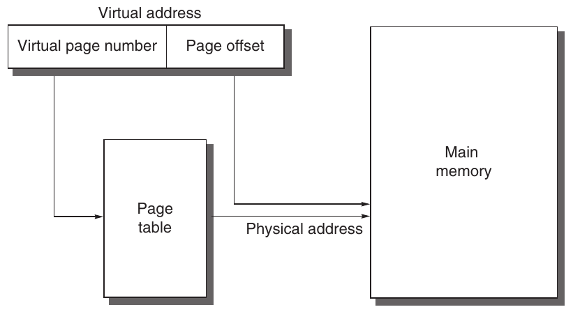

**Hình B.23 Ánh xạ virtual address sang physical address qua page table.**

Để giảm address translation time, computer dùng cache dành riêng cho những address translation này, gọi là translation lookaside buffer, hay đơn giản là translation buffer, sẽ được mô tả chi tiết hơn ngay sau đây.

#### Q3: Block nào cần được thay thế khi Virtual Memory Miss?

Như đã đề cập, nguyên tắc operating system quan trọng nhất là giảm thiểu page fault. Phù hợp với nguyên tắc này, gần như mọi operating system cố thay block least recently used (LRU), vì nếu quá khứ dự đoán tương lai thì đó là block ít có khả năng cần đến hơn.

Để giúp operating system ước lượng LRU, nhiều processor cung cấp use bit hoặc reference bit, về logic được đặt mỗi khi page được truy cập. (Để giảm công việc, thực tế nó chỉ được đặt khi translation buffer miss, sẽ được mô tả ngay sau đây.) Operating system định kỳ xóa use bit rồi ghi nhận chúng sau đó để xác định page nào đã được truy cập trong một khoảng thời gian cụ thể. Theo dõi như vậy cho phép operating system chọn một page thuộc nhóm ít được tham chiếu gần đây nhất.

#### Q4: Điều gì xảy ra khi Write?

Level bên dưới main memory chứa magnetic disk quay, mất hàng triệu clock cycle để truy cập. Vì chênh lệch access time quá lớn, chưa ai xây dựng virtual memory operating system write xuyên qua main memory xuống disk sau mỗi store của processor. (Đừng coi nhận xét này là cơ hội nổi tiếng nhờ trở thành người đầu tiên xây dựng hệ thống như vậy!) Vì vậy, write strategy luôn là write-back.

Vì chi phí một lần truy cập không cần thiết đến next-lower level rất cao, hệ thống virtual memory thường có dirty bit. Nó cho phép block chỉ được write xuống disk nếu đã bị sửa kể từ khi được đọc từ disk.

### Các kỹ thuật Address Translation nhanh

Page table thường lớn đến mức được lưu trong main memory và đôi khi chính chúng cũng được paging. Paging có nghĩa mỗi memory access về logic mất ít nhất gấp đôi thời gian, với một memory access để lấy physical address và lần access thứ hai để lấy dữ liệu. Như đã đề cập trong Chương 2, chúng ta dùng locality để tránh memory access bổ sung. Bằng cách giữ address translation trong một cache đặc biệt, memory access hiếm khi đòi hỏi lần access thứ hai để dịch dữ liệu. Address translation cache đặc biệt này được gọi là translation look aside buffer (TLB), cũng gọi là translation buffer (TB).

TLB entry giống cache entry, trong đó tag giữ các phần virtual address và phần dữ liệu giữ physical page frame number, protection field, valid bit, và thường cả use bit lẫn dirty bit. Để đổi physical page frame number hoặc protection của entry trong page table, operating system phải bảo đảm entry cũ không nằm trong TLB; nếu không, hệ thống sẽ không hoạt động đúng. Lưu ý dirty bit này nghĩa là page tương ứng bị dirty, không phải address translation trong TLB bị dirty hay một block cụ thể trong data cache bị dirty. Operating system reset những bit này bằng cách đổi giá trị trong page table rồi invalidate TLB entry tương ứng. Khi entry được nạp lại từ page table, TLB nhận bản sao chính xác của các bit.

Hình B.24 cho thấy tổ chức data TLB của Opteron, với từng bước translation được đánh dấu. TLB này dùng fully associative placement; vì vậy, translation bắt đầu (bước 1 và 2) bằng cách gửi virtual address đến mọi tag. Đương nhiên, tag phải được đánh dấu valid mới cho phép match. Đồng thời, loại memory access được kiểm tra xem có vi phạm protection information trong TLB hay không (cũng ở bước 2).

Vì những lý do tương tự trường hợp cache, không cần đưa 12 bit page offset vào TLB. Tag khớp gửi physical address tương ứng qua một multiplexor thực chất là 40:1 (bước 3). Page offset sau đó được kết hợp với physical page frame để tạo physical address đầy đủ (bước 4). Address size là 40 bit.

Address translation dễ nằm trên critical path quyết định clock cycle của processor, nên Opteron dùng L1 cache virtually addressed, physically tagged.

### Chọn Page Size

Tham số architecture hiển nhiên nhất là page size. Chọn page là bài toán cân bằng các yếu tố thiên về page size lớn hơn với các yếu tố thiên về kích thước nhỏ hơn. Những yếu tố sau thiên về kích thước lớn hơn:

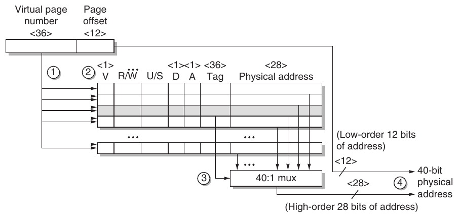

**Hình B.24 Hoạt động của data TLB Opteron trong address translation. Bốn bước của TLB hit được thể hiện bằng số khoanh tròn. TLB này có 40 entry. Mục B.5 mô tả các protection field và access field khác nhau của page table entry Opteron.**

- Kích thước page table tỷ lệ nghịch với page size; do đó có thể tiết kiệm memory (hoặc resource khác dùng cho memory map) bằng cách làm page lớn hơn.

- Như đã đề cập trong Mục B.3, page size lớn hơn có thể cho phép cache lớn hơn với cache hit time nhanh.

- Truyền page lớn hơn đến hoặc từ secondary storage, có thể qua network, hiệu quả hơn truyền page nhỏ hơn.

- Số TLB entry bị giới hạn, nên page size lớn hơn có nghĩa nhiều memory hơn có thể được ánh xạ hiệu quả, qua đó giảm số TLB miss.

Chính vì lý do cuối này mà các microprocessor gần đây quyết định hỗ trợ nhiều page size; với một số chương trình, TLB miss có thể ảnh hưởng CPI đáng kể ngang cache miss.

Động lực chính để dùng page size nhỏ hơn là tiết kiệm storage. Page size nhỏ sẽ gây ít storage lãng phí hơn khi một vùng virtual memory liên tục không có kích thước bằng bội số page size. Thuật ngữ cho phần memory không dùng trong page này là internal fragmentation. Giả sử mỗi process có ba segment chính (text, heap và stack), storage lãng phí trung bình trên mỗi process sẽ bằng 1.5 lần page size. Lượng này không đáng kể với computer có hàng trăm megabyte memory và page size từ 4 KB đến 8 KB. Đương nhiên, khi page size rất lớn (hơn 32 KB), storage (cả main lẫn secondary) có thể bị lãng phí, cũng như I/O bandwidth. Mối quan tâm cuối là process start-up time; nhiều process nhỏ, nên page size lớn sẽ kéo dài thời gian gọi process.

### Tổng kết Virtual Memory và Cache

Khi virtual memory, TLB, first-level cache và second-level cache đều ánh xạ các phần virtual address space và physical address space, việc bit nào đi đâu có thể gây nhầm lẫn. Hình B.25 đưa ra ví dụ giả định đi từ virtual address 64-bit đến physical address 41-bit với hai level cache. L1 cache này là virtually indexed, physically tagged vì cả cache size lẫn page size đều là 8 KB. L2 cache là 4 MB. Block size của cả hai là 64 byte.

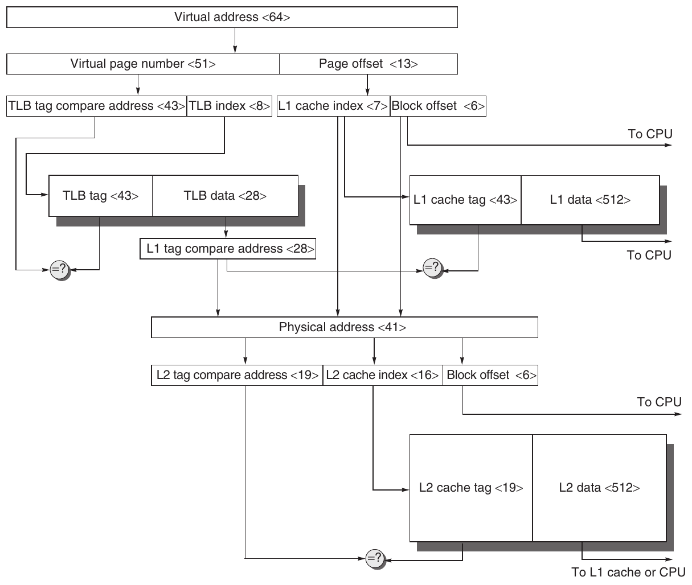

**Hình B.25 Bức tranh tổng thể của memory hierarchy giả định đi từ virtual address đến L2 cache access. Page size là 8 KB. TLB là direct mapped với 256 entry. L1 cache là direct-mapped 8 KB, còn L2 cache là direct-mapped 4 MB. Cả hai dùng block 64-byte. Virtual address là 64 bit và physical address là 41 bit. Khác biệt chính giữa hình đơn giản này và cache thực là sự lặp lại các phần của hình.**

Trước hết, virtual address 64-bit được chia về logic thành virtual page number và page offset. Phần trước được gửi đến TLB để dịch thành physical address, còn high bit của phần sau được gửi đến L1 cache làm index. Nếu TLB match là hit, physical page number được gửi đến L1 cache tag để kiểm tra match. Nếu khớp, đó là L1 cache hit. Block offset sau đó chọn word cho processor.

Nếu kiểm tra L1 cache dẫn đến miss, physical address được dùng để thử L2 cache. Phần giữa của physical address được dùng làm index vào L2 cache 4 MB. L2 cache tag thu được được so sánh với phần trên của physical address để kiểm tra match. Nếu khớp, chúng ta có L2 cache hit, và dữ liệu được gửi đến processor, nơi dùng block offset để chọn word mong muốn. Khi L2 miss, physical address được dùng để lấy block từ memory.

Mặc dù đây là ví dụ đơn giản, khác biệt chính giữa hình này và cache thực là sự lặp lại. Thứ nhất, chỉ có một L1 cache. Khi có hai L1 cache, nửa trên sơ đồ được nhân đôi. Lưu ý điều này dẫn đến hai TLB, vốn là thông lệ. Vì vậy, một cache và TLB dành cho instruction, được dẫn từ PC, còn một cache và TLB dành cho dữ liệu, được dẫn từ effective address.

Sự đơn giản hóa thứ hai là mọi cache và TLB đều direct mapped. Nếu bất kỳ cái nào là n-way set associative, chúng ta sẽ lặp lại mỗi tập tag memory, comparator và data memory n lần, rồi nối các data memory bằng multiplexor n:1 để chọn hit. Đương nhiên, nếu tổng cache size giữ nguyên, cache index cũng thu nhỏ log2n bit theo công thức trong Hình B.7 ở trang B-22.

## B.5 Protection và các ví dụ về Virtual Memory

Việc phát minh multiprogramming, trong đó computer được chia sẻ bởi nhiều chương trình chạy đồng thời, dẫn đến những yêu cầu mới về protection và sharing giữa các chương trình. Những yêu cầu này gắn chặt với virtual memory trong computer ngày nay, nên chúng ta trình bày chủ đề ở đây cùng hai ví dụ virtual memory.

Multiprogramming dẫn đến khái niệm process. Nói theo phép ẩn dụ, process là không khí để thở và không gian sống của chương trình—tức một chương trình đang chạy cộng mọi state cần thiết để tiếp tục chạy nó. Time-sharing là biến thể multiprogramming chia sẻ processor và memory với nhiều người dùng tương tác cùng lúc, tạo cảm giác mọi người dùng đều có computer riêng. Vì vậy, tại mọi thời điểm phải có khả năng chuyển từ process này sang process khác. Việc trao đổi này gọi là process switch hoặc context switch.

Process phải hoạt động đúng dù thực thi liên tục từ đầu đến cuối hay bị ngắt nhiều lần và chuyển đổi với process khác. Trách nhiệm duy trì hành vi process đúng đắn được chia sẻ giữa nhà thiết kế computer và operating system. Nhà thiết kế computer phải bảo đảm phần processor trong process state có thể được lưu và khôi phục. Nhà thiết kế operating system phải bảo đảm các process không can thiệp vào các phép tính của nhau.

Cách an toàn nhất để bảo vệ state của process này khỏi process khác là sao chép thông tin hiện tại xuống disk. Tuy nhiên, process switch khi đó mất nhiều giây—quá lâu đối với môi trường time-sharing.

Vấn đề này được giải quyết khi operating system phân chia main memory để nhiều process khác nhau đồng thời có state trong memory. Sự phân chia này nghĩa là nhà thiết kế operating system cần nhà thiết kế computer hỗ trợ protection để process này không thể sửa process khác. Ngoài protection, computer còn hỗ trợ chia sẻ code và dữ liệu giữa process, để cho phép giao tiếp giữa process hoặc tiết kiệm memory bằng cách giảm số bản sao thông tin giống nhau.

### Bảo vệ Process

Có thể bảo vệ các process khỏi nhau bằng cách cho chúng page table riêng, mỗi table trỏ đến những page memory riêng biệt. Hiển nhiên phải ngăn user program sửa page table của mình, nếu không protection sẽ bị vượt qua.

Protection có thể được tăng cường tùy mức lo ngại của nhà thiết kế computer hoặc người mua. Các ring bổ sung vào cấu trúc processor protection mở rộng memory access protection từ hai level (user và kernel) lên nhiều level hơn. Giống hệ thống phân loại quân sự gồm tuyệt mật, bí mật, mật và không phân loại, các ring đồng tâm của security level cho phép đối tượng được tin cậy nhất truy cập mọi thứ, đối tượng được tin cậy thứ hai truy cập mọi thứ trừ level trong cùng, v.v. Các chương trình “dân sự” ít được tin cậy nhất, nên có phạm vi access hạn chế nhất. Cũng có thể có giới hạn về phần memory nào được chứa code—execute protection—và thậm chí về điểm vào giữa các level. Cấu trúc protection Intel 80x86 dùng ring được mô tả sau trong mục này. Chưa rõ trên thực tế ring có cải thiện so với hệ thống user mode và kernel mode đơn giản hay không.

Khi nỗi lo của nhà thiết kế tăng thành sợ hãi, những ring đơn giản này có thể chưa đủ. Hạn chế sự tự do trao cho chương trình trong khu vực tối mật đòi hỏi hệ thống phân loại mới. Thay mô hình quân sự, phép ví von của hệ thống này là chìa khóa và ổ khóa: Chương trình không thể mở khóa để truy cập dữ liệu trừ khi có chìa khóa. Để những chìa khóa, hay capability, hữu ích, hardware và operating system phải có khả năng truyền chúng tường minh từ chương trình này sang chương trình khác mà không cho bản thân chương trình giả mạo chúng. Việc kiểm tra như vậy đòi hỏi rất nhiều hardware support nếu muốn giữ thời gian kiểm tra khóa thấp.

80x86 architecture đã thử một số phương án này qua nhiều năm. Vì backwards compatibility là một trong những nguyên tắc của architecture này, những phiên bản architecture mới nhất bao gồm mọi thử nghiệm virtual memory của nó. Ở đây chúng ta sẽ xem xét hai lựa chọn: trước hết segmented address space cũ hơn, sau đó flat address space 64-bit mới hơn.

### Ví dụ Segmented Virtual Memory: Protection trong Intel Pentium

> Hệ thống thứ hai là hệ thống nguy hiểm nhất mà một người từng thiết kế. . . . Xu hướng chung là over-design hệ thống thứ hai, dùng mọi ý tưởng và chi tiết tô điểm từng được thận trọng gạt sang một bên ở hệ thống đầu tiên.

> F. P. Brooks, Jr.
> The Mythical Man-Month (1975)

8086 ban đầu dùng segment để addressing nhưng không cung cấp gì cho virtual memory hay protection. Segment có base register nhưng không có bound register và không kiểm tra access; trước khi segment register có thể được load, segment tương ứng phải nằm trong physical memory. Cam kết của Intel đối với virtual memory và protection thể hiện rõ trong các thế hệ kế tiếp 8086, với một số field được mở rộng để hỗ trợ address lớn hơn. Protection scheme này rất công phu, với nhiều chi tiết được thiết kế cẩn thận để cố tránh security loophole. Chúng ta gọi nó là IA-32. Vài trang tiếp theo nêu bật một số biện pháp bảo vệ của Intel; nếu thấy khó đọc, hãy tưởng tượng việc triển khai chúng khó đến mức nào!

Cải tiến đầu tiên là tăng gấp đôi protection model two-level truyền thống: IA-32 có bốn level protection. Level trong cùng (0) tương ứng kernel mode truyền thống, còn level ngoài cùng (3) là mode ít đặc quyền nhất. IA-32 có stack riêng cho mỗi level để tránh vi phạm bảo mật giữa các level. Cũng có data structure tương tự page table truyền thống, chứa physical address của segment cùng danh sách các kiểm tra cần thực hiện trên translated address.

Các nhà thiết kế Intel không dừng ở đó. IA-32 chia address space, cho phép cả operating system lẫn user truy cập toàn bộ không gian. User IA-32 có thể gọi operating system routine trong không gian này và thậm chí truyền parameter cho nó mà vẫn giữ đầy đủ protection. Safe call này không phải thao tác đơn giản vì stack của operating system khác stack user. Hơn nữa, IA-32 cho phép operating system duy trì protection level của routine được gọi cho các parameter truyền vào nó. Lỗ hổng protection tiềm tàng này được ngăn bằng cách không cho user process yêu cầu operating system truy cập gián tiếp thứ mà bản thân user process không thể truy cập. (Security loophole như vậy gọi là Trojan horse.)

Các nhà thiết kế Intel tuân theo nguyên tắc tin operating system ít nhất có thể, trong khi vẫn hỗ trợ sharing và protection. Làm ví dụ về protected sharing như vậy, giả sử chương trình tính lương viết séc và đồng thời cập nhật thông tin year-to-date về tổng thanh toán lương và phúc lợi. Vì vậy, chúng ta muốn cho chương trình khả năng đọc thông tin lương và year-to-date, sửa thông tin year-to-date nhưng không sửa lương. Chúng ta sẽ sớm thấy cơ chế hỗ trợ những tính năng này. Trong phần còn lại của tiểu mục, chúng ta xem bức tranh tổng thể về protection của IA-32 và khảo sát động cơ của nó.

#### Bổ sung Bounds Checking và Memory Mapping

Bước đầu tăng cường Intel processor là làm segmented addressing kiểm tra bound bên cạnh cung cấp base. Thay vì base address, segment register trong IA-32 chứa index vào virtual memory data structure gọi là descriptor table. Descriptor table đóng vai trò page table truyền thống. Trên IA-32, phần tương đương page table entry là segment descriptor. Nó chứa các field có trong PTE:

- Present bit—Tương đương PTE valid bit, dùng để cho biết đây là translation hợp lệ

- Base field—Tương đương page frame address, chứa physical address của byte đầu tiên trong segment

- Access bit—Giống reference bit hoặc use bit trong một số architecture, hữu ích cho replacement algorithm

- Attributes field—Chỉ định operation hợp lệ và protection level cho operation dùng segment này

Còn có limit field, không có trong paged system, xác lập cận trên của offset hợp lệ cho segment này. Hình B.26 cho thấy các ví dụ segment descriptor IA-32.

IA-32 cung cấp paging system tùy chọn bên cạnh segmented addressing này. Phần trên của address 32-bit chọn segment descriptor, còn phần giữa là index vào page table do descriptor chọn. Bên dưới chúng ta mô tả protection system không dựa vào paging.

#### Bổ sung Sharing và Protection

Để hỗ trợ protected sharing, một nửa address space được mọi process chia sẻ và một nửa riêng cho từng process, lần lượt gọi là global address space và local address space. Mỗi nửa có descriptor table với tên tương ứng. Descriptor trỏ đến shared segment được đặt trong global descriptor table, còn descriptor cho private segment được đặt trong local descriptor table.

Chương trình load vào segment register IA-32 một index vào table và một bit cho biết table mong muốn. Operation được kiểm tra theo attribute trong descriptor; physical address được tạo bằng cách cộng offset trong processor vào base trong descriptor, miễn offset nhỏ hơn limit field. Mọi segment descriptor có field 2-bit riêng để cho biết access level hợp lệ của segment này. Vi phạm chỉ xảy ra nếu chương trình thử dùng segment có protection level thấp hơn trong segment descriptor.

Giờ chúng ta có thể cho thấy cách gọi chương trình tính lương đề cập ở trên để cập nhật thông tin year-to-date mà không cho phép cập nhật lương. Chương trình có thể được cấp descriptor đến thông tin với writable field bị xóa, nghĩa là nó có thể read nhưng không write dữ liệu. Sau đó có thể cung cấp trusted program chỉ write thông tin year-to-date. Nó được cấp descriptor có writable field được đặt (Hình B.26). Chương trình tính lương gọi trusted code bằng code segment descriptor có conforming field được đặt. Thiết lập này nghĩa là chương trình được gọi nhận privilege level của code được gọi thay vì privilege level của bên gọi. Vì vậy, chương trình tính lương có thể đọc lương và gọi trusted program để cập nhật tổng year-to-date, nhưng không thể sửa lương. Nếu có Trojan horse trong hệ thống này, để có hiệu lực nó phải nằm trong trusted code có nhiệm vụ duy nhất là cập nhật thông tin year-to-date. Lập luận ủng hộ kiểu protection này là giới hạn phạm vi dễ bị tổn thương sẽ tăng cường bảo mật.

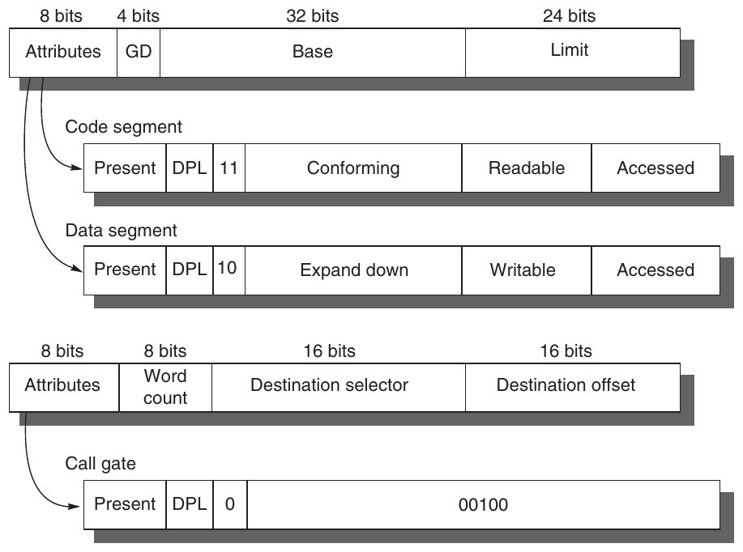

**Hình B.26 Segment descriptor IA-32 được phân biệt bằng các bit trong attributes field. Base, limit, present, readable và writable đều self-explanatory. D cho biết addressing size mặc định của instruction: 16 bit hoặc 32 bit. G cho biết granularity của segment limit: 0 nghĩa là theo byte và 1 nghĩa là theo page 4 KB. G được đặt bằng 1 khi paging bật để đặt kích thước page table. DPL nghĩa là descriptor privilege level—nó được kiểm tra với code privilege level để xem access có được phép không. Conforming cho biết code nhận privilege level của code được gọi thay vì privilege level của bên gọi; nó được dùng cho library routine. Field expand-down đảo phép kiểm tra để base field làm high-water mark và limit field làm low-water mark. Như bạn có thể đoán, điều này dùng cho stack segment phát triển xuống dưới. Word count điều khiển số word được sao chép từ stack hiện tại sang stack mới trên call gate. Hai field còn lại của call gate descriptor, destination selector và destination offset, lần lượt chọn descriptor của đích call và offset vào đó. Protection model IA-32 có nhiều hơn rất nhiều so với ba segment descriptor này.**

#### Bổ sung Safe Call từ User đến OS Gate và kế thừa Protection Level cho Parameter

Cho phép user jump vào operating system là bước đi táo bạo. Vậy nhà thiết kế hardware làm sao tăng khả năng có hệ thống an toàn mà không cần tin tưởng operating system hay bất kỳ phần code nào khác? Cách của IA-32 là giới hạn nơi user có thể đi vào một phần code, đặt parameter an toàn lên stack phù hợp và bảo đảm user parameter không nhận protection level của code được gọi.

Để giới hạn việc vào code của bên khác, IA-32 cung cấp segment descriptor đặc biệt, hay call gate, được nhận diện bằng một bit trong attributes field. Khác descriptor khác, call gate là physical address đầy đủ của object trong memory; offset processor cung cấp bị bỏ qua. Như đã nói, mục đích là ngăn user jump tùy tiện vào bất kỳ đâu trong code segment được bảo vệ hoặc có đặc quyền cao hơn. Trong ví dụ lập trình của chúng ta, điều này có nghĩa vị trí duy nhất chương trình tính lương có thể gọi trusted code là tại ranh giới phù hợp. Giới hạn này cần để conforming segment hoạt động như dự định.

Điều gì xảy ra nếu caller và callee “nghi ngờ lẫn nhau”, nên không bên nào tin bên kia? Giải pháp nằm trong word count field của descriptor dưới cùng ở Hình B.26. Khi call instruction gọi call gate descriptor, descriptor sao chép số word được chỉ định trong descriptor từ local stack sang stack tương ứng level của segment này. Việc sao chép cho phép user truyền parameter bằng cách trước hết push chúng lên local stack. Hardware sau đó truyền chúng an toàn lên stack đúng. Return từ call gate sẽ pop parameter khỏi cả hai stack và sao chép mọi return value sang stack phù hợp. Lưu ý mô hình này không tương thích với thông lệ hiện nay là truyền parameter trong register.

Scheme này vẫn để ngỏ lỗ hổng tiềm tàng là operating system dùng address của user, được truyền dưới dạng parameter, với security level của operating system thay vì level của user. IA-32 giải quyết bằng cách dành 2 bit trong mọi processor segment register cho requested protection level. Khi operating system routine được gọi, nó có thể thực thi instruction đặt field 2-bit này trong mọi address parameter theo protection level của user đã gọi routine. Vì vậy, khi các address parameter này được load vào segment register, chúng đặt requested protection level thành giá trị phù hợp. Hardware IA-32 sau đó dùng requested protection level để ngăn mọi hành động dại dột: System routine không thể dùng các parameter đó để truy cập segment có protection level đặc quyền cao hơn mức yêu cầu.

### Ví dụ Paged Virtual Memory: Memory Management của Opteron 64-Bit

Các kỹ sư AMD thấy mô hình protection công phu mô tả trên có ít chỗ sử dụng. Mô hình phổ biến là flat address space 32-bit do 80386 giới thiệu, đặt mọi base value của segment register bằng không. Vì vậy, AMD loại bỏ nhiều segment trong mode 64-bit. Nó giả định segment base bằng không và bỏ qua limit field. Page size là 4 KB, 2 MB và 4 MB.

Virtual address 64-bit của AMD64 architecture được ánh xạ vào physical address 52-bit, mặc dù implementation có thể triển khai ít bit hơn để đơn giản hóa hardware. Ví dụ, Opteron dùng virtual address 48-bit và physical address 40-bit. AMD64 yêu cầu 16 bit trên của virtual address chỉ là sign extension của 48 bit dưới, gọi là canonical form.

Kích thước page table cho address space 64-bit thật đáng lo ngại. Vì vậy, AMD64 dùng hierarchical page table nhiều level để ánh xạ address space nhằm giữ kích thước hợp lý. Số level phụ thuộc kích thước virtual address space. Hình B.27 cho thấy four-level translation của virtual address 48-bit trong Opteron.

Offset cho mỗi page table này lấy từ bốn field 9-bit. Address translation bắt đầu bằng cách cộng offset đầu tiên vào page-map level 4 base register rồi đọc memory tại vị trí này để lấy base của next-level page table. Address offset tiếp theo lần lượt được cộng vào address vừa fetch, rồi memory được truy cập lại để xác định base của page table thứ ba. Điều này tiếp tục xảy ra theo cùng cách. Address field cuối được cộng vào base address cuối này và memory được đọc bằng tổng đó để (cuối cùng) lấy physical address của page đang được tham chiếu. Address này được ghép với page offset 12-bit để có physical address đầy đủ. Lưu ý page table trong Opteron architecture nằm vừa trong một page 4 KB duy nhất.

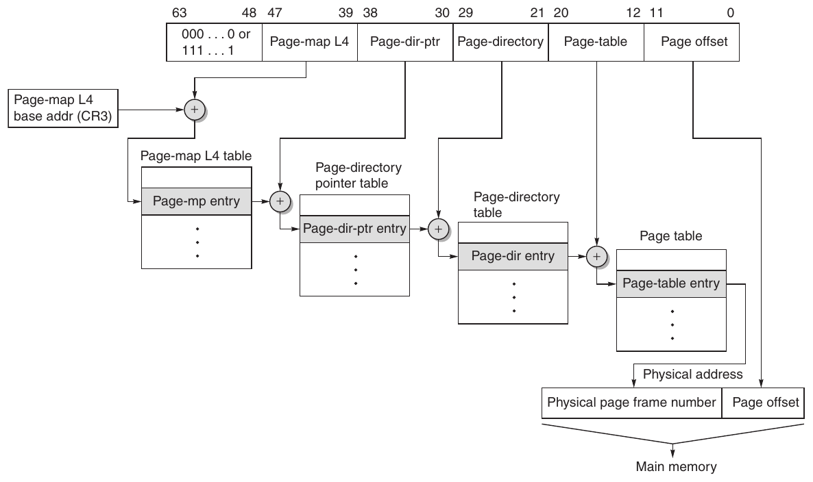

**Hình B.27 Ánh xạ virtual address của Opteron. Virtual memory implementation của Opteron với bốn page table level hỗ trợ effective physical address size 40 bit. Mỗi page table có 512 entry, nên mỗi level field rộng 9 bit. Tài liệu AMD64 architecture cho phép virtual address size tăng từ 48 bit hiện tại lên 64 bit và physical address size tăng từ 40 bit hiện tại lên 52 bit.**

Opteron dùng entry 64-bit trong mỗi page table này. 12 bit đầu được dành cho sử dụng tương lai, 52 bit tiếp theo chứa physical page frame number, và 12 bit cuối cho biết protection information và use information. Mặc dù các field thay đổi đôi chút giữa các page table level, dưới đây là những field cơ bản:

- Presence—Cho biết page hiện diện trong memory.

- Read/write—Cho biết page là read-only hay read-write.

- User/supervisor—Cho biết user có thể truy cập page hay page bị giới hạn cho ba privilege level trên.

- Dirty—Cho biết page đã được sửa hay chưa.

- Accessed—Cho biết page đã được read hoặc write kể từ lần xóa bit gần nhất hay chưa.

- Page size—Cho biết level cuối dành cho page 4 KB hay page 4 MB; nếu là trường hợp sau, Opteron chỉ dùng ba thay vì bốn level page.

- No execute—Không có trong protection scheme 80386, bit này được bổ sung để ngăn code thực thi trong một số page.

- Page level cache disable—Cho biết page có thể được cache hay không.

- Page level write-through—Cho biết page cho phép write-back hay write-through đối với data cache.

Vì Opteron thường đi qua bốn level table khi TLB miss, có ba vị trí tiềm năng để kiểm tra protection restriction. Opteron chỉ tuân theo bottom-level PTE, chỉ kiểm tra các entry khác để bảo đảm valid bit được đặt.

Vì entry dài 8 byte, mỗi page table có 512 entry và Opteron có page 4 KB, page table dài đúng một page. Mỗi field trong bốn level field dài 9 bit và page offset là 12 bit. Suy ra còn 64 – (4 × 9 + 12), hay 16 bit được sign extend để bảo đảm canonical address.

Mặc dù đã giải thích translation của address hợp lệ, điều gì ngăn user tạo address translation không hợp lệ và gây rắc rối? Bản thân page table được bảo vệ khỏi write của user program. Vì vậy, user có thể thử bất kỳ virtual address nào, nhưng bằng cách điều khiển page table entry, operating system điều khiển physical memory nào được truy cập. Chia sẻ memory giữa process được thực hiện bằng cách cho page table entry trong mỗi address space trỏ đến cùng physical memory page.

Opteron dùng bốn TLB để giảm address translation time, hai cho instruction access và hai cho data access. Giống multilevel cache, Opteron giảm TLB miss bằng hai L2 TLB lớn hơn: một cho instruction và một cho dữ liệu. Hình B.28 mô tả data TLB.

| Tham số | Mô tả |
|---|---|
| Block size | 1 PTE (8 byte) |
| L1 hit time | 1 clock cycle |
| L2 hit time | 7 clock cycle |
| L1 TLB size | Giống nhau cho instruction TLB và data TLB: 40 PTE mỗi TLB, với 32 cho page 4 KB và 8 cho page 2 MB hoặc 4 MB |
| L2 TLB size | Giống nhau cho instruction TLB và data TLB: 512 PTE của page 4 KB |
| Chọn block | LRU |
| Write strategy | (Không áp dụng) |
| L1 block placement | Fully associative |
| L2 block placement | 4-way set associative |

**Hình B.28 Tham số memory hierarchy của instruction TLB và data TLB L1 và L2 trong Opteron.**

### Tổng kết: Protection trên Intel Pentium 32-Bit so với AMD Opteron 64-Bit

Memory management trong Opteron là điển hình của phần lớn desktop computer hoặc server computer ngày nay, dựa vào page-level address translation và hoạt động đúng đắn của operating system để bảo đảm an toàn cho nhiều process chia sẻ computer. Mặc dù được trình bày như các phương án thay thế, Intel đã theo bước AMD và chấp nhận AMD64 architecture. Vì vậy, cả AMD lẫn Intel đều hỗ trợ phần mở rộng 64-bit của 80x86; tuy nhiên, vì compatibility, cả hai đều hỗ trợ segmented protection scheme công phu.

Nếu segmented protection model có vẻ khó xây dựng hơn AMD64 model, đó là vì thực sự như vậy. Nỗ lực này hẳn đặc biệt gây nản lòng cho kỹ sư, vì rất ít khách hàng dùng cơ chế protection công phu đó. Ngoài ra, việc protection model không phù hợp với simple paging protection của hệ thống UNIX-like có nghĩa nó chỉ được dùng bởi người viết operating system riêng cho computer này, điều chưa xảy ra.

## B.6 Những ngộ nhận và cạm bẫy

Ngay cả phần ôn tập memory hierarchy cũng có ngộ nhận và cạm bẫy!

**Cạm bẫy** Address space quá nhỏ.

Chỉ năm năm sau khi DEC và Carnegie Mellon University hợp tác thiết kế họ computer PDP-11 mới, rõ ràng sản phẩm của họ có nhược điểm chí mạng. Một architecture do IBM công bố trước PDP-11 sáu năm vẫn phát triển mạnh sau 25 năm, với những sửa đổi nhỏ. Còn DEC VAX, bị chỉ trích vì có những chức năng không cần thiết, đã bán hàng triệu máy sau khi PDP-11 ngừng sản xuất. Vì sao?

Nhược điểm chí mạng của PDP-11 là kích thước address của nó (16 bit) so với kích thước address của IBM 360 (24 đến 31 bit) và VAX (32 bit). Address size giới hạn độ dài chương trình, vì kích thước chương trình và lượng dữ liệu chương trình cần phải nhỏ hơn 2<sup>Address size</sup>. Lý do address size rất khó thay đổi là nó quyết định độ rộng tối thiểu của mọi thứ có thể chứa address: PC, register, memory word và effective-address arithmetic. Nếu không có kế hoạch mở rộng address ngay từ đầu, cơ hội đổi address size thành công mong manh đến mức điều đó thường đồng nghĩa kết thúc họ computer ấy. Bell và Strecker [1976] diễn đạt như sau:

Chỉ có một sai lầm trong thiết kế computer mà rất khó khắc phục—không có đủ address bit cho memory addressing và memory management. PDP-11 đi theo truyền thống không gián đoạn của gần như mọi computer từng được biết đến. [p. 2]

Một danh sách chưa đầy đủ những computer thành công cuối cùng chết đói vì thiếu address bit gồm PDP-8, PDP-10, PDP-11, Intel 8080, Intel 8086, Intel 80186, Intel 80286, Motorola 6800, AMI 6502, Zilog Z80, CRAY-1 và CRAY X-MP.

Dòng 80x86 lâu đời nổi bật nhờ đã được mở rộng hai lần, đầu tiên lên 32 bit với Intel 80386 năm 1985 và gần đây lên 64 bit với AMD Opteron.

**Cạm bẫy** Bỏ qua ảnh hưởng của operating system đối với performance của memory hierarchy.

Hình B.29 cho thấy memory stall time do operating system gây ra trên ba workload lớn. Khoảng 25% stall time hoặc dành cho miss trong operating system, hoặc do miss trong application program vì interference với operating system.

**Cạm bẫy** Trông chờ operating system thay đổi page size theo thời gian.

Các architect của Alpha có kế hoạch công phu để phát triển architecture theo thời gian bằng cách tăng page size, thậm chí đưa điều này vào kích thước virtual address. Khi đến lúc tăng page size ở các Alpha đời sau, nhà thiết kế operating system không chịu, và virtual memory system được sửa để mở rộng address space trong khi vẫn giữ page 8 KB.

Architect của các computer khác nhận thấy TLB miss rate rất cao, nên thêm nhiều page size lớn hơn vào TLB. Hy vọng là operating system programmer sẽ cấp phát object vào page lớn nhất hợp lý, nhờ đó tiết kiệm TLB entry. Sau một thập kỷ thử nghiệm, phần lớn operating system chỉ dùng các “superpage” này cho chức năng được lựa chọn riêng: ánh xạ display memory hoặc thiết bị I/O khác, hoặc dùng page rất lớn cho database code.

|  |  |  | Thời gian |  |  |  |  |  |  |
|---|---|---|---|---|---|---|---|---|---|
|  | Miss |  | % thời gian do application miss |  | % thời gian trực tiếp do OS miss |  |  |  |  |
| Workload | % trong application | % trong OS | Application miss vốn có | OS conflict với application | OS instruction miss | Data miss do migration | Data miss trong block operation | OS miss còn lại | % thời gian OS miss và application conflict |
| Pmake | 47% | 53% | 14.1% | 4.8% | 10.9% | 1.0% | 6.2% | 2.9% | 25.8% |
| Multipgm | 53% | 47% | 21.6% | 3.4% | 9.2% | 4.2% | 4.7% | 3.4% | 24.9% |
| Oracle | 73% | 27% | 25.7% | 10.2% | 10.6% | 2.6% | 0.6% | 2.8% | 26.8% |

**Hình B.29 Miss và thời gian dành cho miss của application và operating system. Operating system làm execution time của application tăng khoảng 25%. Mỗi processor có instruction cache 64 KB và data cache two-level với 64 KB ở level đầu và 256 KB ở level thứ hai; mọi cache đều direct mapped với block 16-byte. Dữ liệu được thu thập trên Silicon Graphics POWER station 4D/340, multiprocessor với bốn processor R3000 33 MHz chạy ba application workload dưới UNIX System V—Pmake, parallel compile 56 file; Multipgm, chương trình tính số song song MP3D chạy đồng thời với Pmake và phiên soạn thảo five-screen; và Oracle, chạy phiên bản giới hạn của benchmark TP-1 bằng database Oracle. (Dữ liệu từ Torrellas, Gupta và Hennessy [1992].)**

## B.7 Nhận xét kết thúc

Khó khăn khi xây dựng memory system theo kịp processor nhanh hơn được nhấn mạnh bởi thực tế nguyên liệu cho main memory giống nguyên liệu có trong computer rẻ nhất. Chính principle of locality giúp chúng ta ở đây—tính đúng đắn của nó được chứng minh ở mọi level memory hierarchy trong computer hiện nay, từ disk đến TLB.

Tuy nhiên, relative latency đến memory ngày càng tăng, mất hàng trăm clock cycle vào năm 2011, có nghĩa programmer và compiler writer phải biết các tham số cache và TLB nếu muốn chương trình hoạt động tốt.

## B.8 Góc nhìn lịch sử và tài liệu tham khảo

Trong Mục L.3 (có trực tuyến), chúng ta xem xét lịch sử cache, virtual memory và virtual machine. (Phần lịch sử bao quát cả phụ lục này lẫn Chương 3.) IBM đóng vai trò nổi bật trong lịch sử cả ba. Các tài liệu để đọc thêm cũng được đưa vào.

## Bài tập do Amr Zaky biên soạn

**B.1** [10/10/10/15] <B.1> Bạn đang tìm hiểu tầm quan trọng của principle of locality trong việc lý giải vì sao nên sử dụng cache memory, nên bạn thử nghiệm với một máy tính có L1 data cache và main memory (bạn chỉ tập trung vào các data access). Latency (tính bằng CPU cycle) của các loại access như sau: cache hit, 1 cycle; cache miss, 105 cycle; main memory access khi cache bị vô hiệu hóa, 100 cycle.

a. [10] <B.1> Khi bạn chạy một chương trình có miss rate tổng thể là 5%, average memory access time (tính bằng CPU cycle) sẽ là bao nhiêu?

b. [10] <B.1> Tiếp theo, bạn chạy một chương trình được thiết kế riêng để tạo ra các data address hoàn toàn ngẫu nhiên và không có locality. Để làm được điều đó, bạn sử dụng một array có kích thước 256 MB (toàn bộ array vừa trong main memory). Chương trình liên tục truy cập các phần tử ngẫu nhiên của array này (sử dụng bộ tạo số ngẫu nhiên phân bố đều để tạo index của các phần tử). Nếu data cache có kích thước 64 KB, average memory access time sẽ là bao nhiêu?

c. [10] <B.1> Nếu so sánh kết quả thu được ở phần (b) với main memory access time khi cache bị vô hiệu hóa, bạn có thể rút ra kết luận gì về vai trò của principle of locality trong việc lý giải vì sao nên sử dụng cache memory?

d. [15] <B.1> Bạn nhận thấy cache hit giúp tiết kiệm 99 cycle (1 cycle so với 100), nhưng cache miss lại gây tổn thất 5 cycle (105 cycle so với 100). Trong trường hợp tổng quát, ta có thể biểu diễn hai đại lượng này bằng G (phần tiết kiệm) và L (phần tổn thất). Sử dụng hai đại lượng này (G và L), hãy xác định miss rate cao nhất mà vượt quá nó thì việc sử dụng cache sẽ trở nên bất lợi.

**B.2** [15/15] <B.1> Trong bài tập này, ta giả sử có một cache 512-byte với các block 64-byte. Ta cũng giả sử main memory có kích thước 2 KB. Có thể xem memory là một array gồm các block 64-byte: M0, M1, …, M31. Hình B.30 phác họa các memory block có thể nằm trong những cache block khác nhau nếu cache là fully associative.

a. [15 ] <B.1> Hãy trình bày nội dung của bảng nếu cache được tổ chức thành direct-mapped cache.

b. [15] <B.1> Lặp lại phần (a) với cache được tổ chức thành four-way set associative cache.

**B.3** [10/10/10/10/15/10/15/20] <B.1> Tổ chức cache thường chịu ảnh hưởng của mong muốn giảm mức tiêu thụ công suất của cache. Để xem xét điều đó, ta giả sử cache được phân chia về mặt vật lý thành data array (chứa data), tag array (chứa tag) và replacement array (chứa thông tin cần thiết cho replacement policy). Hơn nữa, mỗi array này được phân chia về mặt vật lý thành nhiều sub-arrays (mỗi way có một), có thể được truy cập riêng biệt; chẳng hạn, một four-way set associative cache sử dụng least recently used (LRU) sẽ có bốn data sub-arrays, bốn tag sub-arrays và bốn replacement sub-arrays. Ta giả sử các replacement sub-arrays được truy cập một lần cho mỗi access khi sử dụng LRU replacement policy, và một lần cho mỗi miss nếu sử dụng first-in, first-out (FIFO) replacement policy. Chúng không cần thiết khi sử dụng random replacement policy. Đối với một cache cụ thể, người ta xác định được rằng việc truy cập những array khác nhau có các trọng số tiêu thụ công suất như sau:

| Cache block | Set | Way | Các memory block có thể nằm trong cache block |
|---|---|---|---|
| 0 | 0 | 0 | M0, M1, M2, …, M31 |
| 1 | 0 | 1 | M0, M1, M2, …, M31 |
| 2 | 0 | 2 | M0, M1, M2, …, M31 |
| 3 | 0 | 3 | M0, M1, M2, …, M31 |
| 4 | 0 | 4 | M0, M1, M2, …, M31 |
| 5 | 0 | 5 | M0, M1, M2, …, M31 |
| 6 | 0 | 6 | M0, M1, M2, …, M31 |
| 7 | 0 | 7 | M0, M1, M2, …, M31 |

**Hình B.30 Các memory block có thể nằm trong cache block.**

| Array | Trọng số tiêu thụ công suất (cho mỗi way được truy cập) |
|---|---|
| Data array | 20 đơn vị |
| Tag | Array 5 đơn vị *(ghi chú: sách in "Tag" / "Array 5 units"; đúng là "Tag array" / "5 units")* |
| Miscellaneous array | 1 đơn vị |

Hãy ước tính công suất mà cache sử dụng (tính bằng đơn vị công suất) cho các cấu hình sau. Ta giả sử cache là four-way set associative. Công suất truy cập main memory—mặc dù quan trọng—không được xét ở đây. Hãy đưa ra câu trả lời cho các replacement policy LRU, FIFO và random.

a. [10]<B.1> Một cache read hit. Tất cả các array được đọc đồng thời.

b. [10] <B.1> Lặp lại phần (a) cho một cache read miss.

c. [10] <B.1> Lặp lại phần (a), giả sử việc truy cập cache được chia thành hai cycle. Trong cycle đầu tiên, tất cả tag sub-arrays được truy cập. Trong cycle thứ hai, chỉ sub-array có tag khớp mới được truy cập.

d. [10] <B.1> Lặp lại phần (c) cho một cache read miss (không truy cập data array trong cycle thứ hai).

e. [15] <B.1> Lặp lại phần (c), giả sử bổ sung logic để dự đoán cache way cần truy cập. Chỉ tag sub-array của way được dự đoán mới được truy cập trong cycle một. Một way hit (address khớp trong way được dự đoán) hàm ý cache hit. Một way miss đòi hỏi kiểm tra tất cả tag sub-arrays trong cycle thứ hai. Trong trường hợp way hit, chỉ một data sub-array (array có tag khớp) được truy cập trong cycle hai. Giả sử xảy ra way hit.

f. [10] <B.1> Lặp lại phần (e), giả sử way predictor dự đoán sai (way mà nó chọn không đúng). Khi dự đoán sai, way predictor bổ sung một cycle để truy cập tất cả tag sub-arrays. Giả sử xảy ra cache read hit.

g. [15] <B.1> Lặp lại phần (f ), giả sử xảy ra cache read miss.

h. [20] <B.1> Sử dụng các phần (e), (f ) và (g) cho trường hợp tổng quát khi workload có các thống kê sau: way-predictor miss rate = 5% và cache miss rate = 3%. (Xét các replacement policy khác nhau.)

**B.4** [10/10/15/15/15/20] <B.1> Ta so sánh yêu cầu về write bandwidth của write-through cache và write-back cache bằng một ví dụ cụ thể. Giả sử ta có cache 64 KB với line size là 32 byte. Cache sẽ cấp phát một line khi xảy ra write miss. Nếu được cấu hình thành write-back cache, cache sẽ ghi trả toàn bộ dirty line khi cần thay thế line đó. Ta cũng giả sử cache được kết nối với cấp thấp hơn trong hierarchy qua bus 64-bit-wide (8-byte-wide). Số CPU cycle cho một write access có độ dài B-bytes trên bus này là

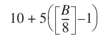

Chẳng hạn, một lần ghi 8-byte sẽ mất 10 + 5(⌈B/8⌉ – 1) cycle, trong khi theo cùng công thức đó, một lần ghi 12-byte sẽ mất 15 cycle. Hãy trả lời các câu hỏi sau, tham chiếu đến đoạn code C bên dưới:

…

```
#define PORTION 1 … Base = 8*i; for (unsigned int j=base;
j < base+PORTION; j++) //assume j is stored in a register

data[j] = j;
```

a. [10] <B.1> Đối với write-through cache, tổng số CPU cycle dành cho các lần ghi truyền đến memory trong tất cả các lượt lặp của vòng lặp j là bao nhiêu?

b. [10] <B.1> Nếu cache được cấu hình thành write-back cache, việc ghi trả một cache line mất bao nhiêu CPU cycle?

c. [15] <B.1> Đổi PORTION thành 8 và lặp lại phần (a).

d. [15] <B.1> Số lần cập nhật array tối thiểu lên cùng một cache line (trước khi thay thế line đó) để write-back cache trở nên có lợi hơn là bao nhiêu?

e. [15] <B.1> Hãy nghĩ ra một tình huống trong đó mọi word của cache line đều sẽ được ghi (không nhất thiết sử dụng đoạn code trên), và write-through cache cần tổng số CPU cycle ít hơn write-back cache.

**B.5** [10/10/10/10/] <B.2> Bạn đang xây dựng một hệ thống dựa trên processor sử dụng in-order execution, chạy ở 1.1 GHz và có CPI là 0.7 nếu không tính memory access. Những instruction duy nhất đọc hoặc ghi data từ memory là load (20% tổng số instruction) và store (5% tổng số instruction). Hệ thống memory của máy tính này gồm một split L1 cache không gây penalty khi hit. Cả I-cache và D-cache đều là direct mapped và mỗi cache chứa 32 KB. I-cache có miss rate là 2% và block 32-byte, còn D-cache là write-through với miss rate 5% và block 16-byte. D-cache có write buffer giúp loại bỏ stall cho 95% tổng số lần ghi. Unified L2 cache 512 KB sử dụng write-back, có block 64-byte và access time là 15 ns. Nó được kết nối với L1 cache qua data bus 128-bit chạy ở 266 MHz và có thể truyền một word 128-bit trong mỗi bus cycle. Trong tất cả memory reference được gửi đến L2 cache của hệ thống này, 80% được đáp ứng mà không cần truy cập main memory. Ngoài ra, 50% tổng số block bị thay thế là dirty. Main memory 128-bit-wide có access latency là 60 ns; sau đó có thể truyền số lượng bus word bất kỳ với tốc độ một word mỗi cycle trên main memory bus 128-bit-wide chạy ở 133 MHz.

a. [10] <B.2> Average memory access time cho các instruction access là bao nhiêu?

b. [10] <B.2> Average memory access time cho các lần đọc data là bao nhiêu?

c. [10] <B.2> Average memory access time cho các lần ghi data là bao nhiêu?

d. [10] <B.2> CPI tổng thể, bao gồm memory access, là bao nhiêu?

**B.6** [10/15/15] <B.2> Việc chuyển đổi miss rate (số miss trên mỗi reference) thành số miss trên mỗi instruction phụ thuộc vào hai hệ số: số reference trên mỗi instruction được fetch và tỷ lệ instruction được fetch thực sự được commit.

a. [10] <B.2> Công thức tính số miss trên mỗi instruction ở trang B-5 ban đầu được viết theo ba hệ số: miss rate, số memory access và instruction count. Mỗi hệ số này đại diện cho những sự kiện thực sự xảy ra. Cách viết số miss trên mỗi instruction bằng miss rate nhân với hệ số số memory access trên mỗi instruction có điểm gì khác?

b. [15] <B.2> Speculative processor sẽ fetch cả những instruction không được commit. Công thức tính số miss trên mỗi instruction ở trang B-5 nói đến số miss trên mỗi instruction trên execution path, tức là chỉ những instruction thực sự phải được thực thi để chạy chương trình. Hãy chuyển đổi công thức tính số miss trên mỗi instruction ở trang B-5 thành công thức chỉ sử dụng miss rate, số reference trên mỗi instruction được fetch và tỷ lệ instruction được fetch được commit. Tại sao nên dựa vào các hệ số này thay vì các hệ số trong công thức ở trang B-5?

c. [15] <B.2> Phép chuyển đổi ở phần (b) có thể cho giá trị không chính xác nếu giá trị của hệ số số reference trên mỗi instruction được fetch không bằng số reference của một instruction cụ thể bất kỳ. Hãy viết lại công thức ở phần (b) để khắc phục điểm thiếu sót này.

**B.7** [20] <B.1, B.3> Trong những hệ thống có write-through L1 cache được hỗ trợ bởi write-back L2 cache thay cho main memory, có thể đơn giản hóa merging write buffer. Hãy giải thích cách thực hiện điều đó. Có tình huống nào mà một write buffer đầy đủ (thay vì phiên bản đơn giản mà bạn vừa đề xuất) có thể hữu ích không?

**B.8** [20/20/15/25] <B.3> LRU replacement policy dựa trên giả định rằng nếu trong quá khứ, address A1 được truy cập cách đây lâu hơn address A2, thì trong tương lai A2 sẽ được truy cập lại trước A1. Vì vậy, A2 được ưu tiên hơn A1. Hãy thảo luận vì sao giả định này không còn đúng khi một vòng lặp lớn hơn instruction cache được thực thi liên tục. Chẳng hạn, xét một instruction cache fully associative có kích thước 128-byte với block 4-byte (mỗi block chứa vừa đúng một instruction). Cache sử dụng LRU replacement policy.

a. [20] <B.3> Instruction miss rate tiệm cận của một vòng lặp 64-byte có số lượt lặp lớn là bao nhiêu?

b. [20] <B.3> Lặp lại phần (a) cho các kích thước vòng lặp 192 byte và 320 byte.

c. [15] <B.3> Nếu cache replacement policy được đổi thành most recently used (MRU) (thay thế cache line được truy cập gần đây nhất), trường hợp nào trong ba trường hợp trên (các vòng lặp 64-, 192- hoặc 320-byte) sẽ được hưởng lợi từ policy này?

d. [25] <B.3> Hãy đề xuất thêm những replacement policy có thể đạt hiệu quả tốt hơn LRU.

**B.9** [20] < B.3> Về mặt thống kê, tăng associativity của cache (giữ nguyên tất cả tham số khác) sẽ làm giảm miss rate. Tuy nhiên, có thể có những trường hợp bất thường mà việc tăng associativity của cache lại làm tăng miss rate đối với một workload cụ thể. Xét trường hợp so sánh direct mapped cache với two-way set associative cache có cùng kích thước. Giả sử set associative cache sử dụng LRU replacement policy. Để đơn giản hóa, giả sử block size là một word. Hãy xây dựng một trace các lần truy cập word sao cho tạo ra nhiều miss hơn trong two-way associative cache. (Gợi ý: Tập trung xây dựng một trace các access chỉ hướng đến một set duy nhất trong two-way set associative cache, sao cho chính trace đó chỉ truy cập hai block trong direct-mapped cache.)

**B.10** [10/10/15] <B.3> Xét một two-level memory hierarchy gồm L1 và L2 data cache. Giả sử cả hai cache đều sử dụng write-back policy khi write hit và đều có cùng block size. Hãy liệt kê các hành động được thực hiện để đáp ứng những sự kiện sau:

a. [10] <B.3> Một L1 cache miss khi các cache được tổ chức theo inclusive hierarchy.

b. [10] <B.3> Một L1 cache miss khi các cache được tổ chức theo exclusive hierarchy.

c. [15] <B.3> Trong cả phần (a) và (b), hãy xét khả năng line bị đẩy ra có thể là clean hoặc dirty.

**B.11** [15/20] <B.2, B.3> Ngăn một số instruction đi vào cache có thể làm giảm conflict miss.

a. [15] <B.3> Hãy phác họa cấu trúc phân cấp của một chương trình mà trong đó, một số phần nên được ngăn không cho đi vào instruction cache. (Gợi ý: Xét chương trình có những code block nằm trong các vòng lặp lồng nhau sâu hơn các block khác.)

b. [20] <B.2, B.3> Hãy đề xuất các kỹ thuật software hoặc hardware để bảo đảm một số block nhất định không đi vào instruction cache.

**B.12** [15] <B.4> Một chương trình đang chạy trên máy tính có một (micro) translation lookaside buffer (TLB) loại four-entry, fully associative:

| VP# | PP# | Entry hợp lệ |
|---|---|---|
| 5 | 30 | 1 |
| 7 | 1 | 0 |
| 10 | 10 | 1 |
| 15 | 25 | 1 |

Sau đây là trace các virtual page number mà một chương trình truy cập. Đối với mỗi access, hãy cho biết nó tạo ra TLB hit hay miss và, nếu nó truy cập page table, hãy cho biết nó tạo ra page hit hay fault. Đặt dấu X trong cột page table nếu page table không được truy cập.

| Virtual page index | Physical page # | Có trong memory |
|---|---|---|
| 0 | 3 | Y |
| 1 | 7 | N |
| 2 | 6 | N |
| 3 | 5 | Y |
| 4 | 14 | Y |
| 5 | 30 | Y |
| 6 | 26 | Y |
| 7 | 11 | Y |
| 8 | 13 | N |
| 9 | 18 | N |
| 10 | 10 | Y |
| 11 | 56 | Y |
| 12 | 110 | Y |
| 13 | 33 | Y |
| 14 | 12 | N |
| 15 | 25 | Y |

| Virtual page được truy cập | TLB (hit hoặc miss) | Page table (hit hoặc fault) |
|---|---|---|
| 1 |  |  |
| 5 |  |  |
| 9 |  |  |
| 14 |  |  |
| 10 |  |  |
| 6 |  |  |
| 15 |  |  |
| 12 |  |  |
| 7 |  |  |
| 2 |  |  |

**B.13** [15/15/15/15/] <B.4> Một số hệ thống memory xử lý TLB miss bằng software (dưới dạng exception), trong khi các hệ thống khác sử dụng hardware để xử lý TLB miss.

a. [15] <B.4> Hai phương pháp xử lý TLB miss này có những trade-offs nào?

b. [15] <B.4> Xử lý TLB miss bằng software có luôn chậm hơn xử lý TLB miss bằng hardware không? Hãy giải thích.

c. [15] <B.4> Có cấu trúc page table nào khó xử lý bằng hardware nhưng có thể xử lý bằng software không? Có cấu trúc nào khó xử lý bằng software nhưng dễ quản lý bằng hardware không?

d. [15] <B.4> Tại sao TLB miss rate của các chương trình floating-point nhìn chung cao hơn của các chương trình integer?

**B.14** [25/25/25/25/20] <B.4> TLB nên lớn đến mức nào? TLB miss thường được xử lý rất nhanh (ít hơn 10 instruction cộng với chi phí của một exception), vì vậy có thể không đáng sử dụng một TLB khổng lồ chỉ để giảm TLB miss rate một chút. Sử dụng simulator SimpleScalar (www.cs.wisc.edu/~mscalar/simplescalar.html) và một hoặc nhiều benchmark SPEC95, hãy tính TLB miss rate và TLB overhead (theo phần trăm thời gian bị tiêu tốn để xử lý TLB miss) cho các cấu hình TLB sau. Giả sử mỗi TLB miss cần 20 instruction.

a. [25] <B.4> 128 entry, two-way set associative, các page từ 4 KB đến 64 KB (tăng theo lũy thừa của 2).

b. [25] <B.4> 256 entry, two-way set associative, các page từ 4 KB đến 64 KB (tăng theo lũy thừa của 2).

c. [25] <B.4> 512 entry, two-way set associative, các page từ 4 KB đến 64 KB (tăng theo lũy thừa của 2).

d. [25] <B.4> 1024 entry, two-way set associative, các page từ 4 KB đến 64 KB (tăng theo lũy thừa của 2).

e. [20] <B.4> Môi trường multitasking sẽ ảnh hưởng thế nào đến TLB miss rate và overhead? Tần suất context switch sẽ ảnh hưởng thế nào đến overhead?

**B.15** [15/20/20] <B.5> Có thể cung cấp cơ chế protection linh hoạt hơn cơ chế trong Intel Pentium architecture bằng cách sử dụng một cơ chế protection tương tự cơ chế trong Hewlett-Packard Precision Architecture (HP/PA). Trong cơ chế như vậy, mỗi page table entry chứa một “protection ID” (key) cùng với các quyền truy cập page. Với mỗi reference, CPU so sánh protection ID trong page table entry với các ID được lưu trong từng register thuộc nhóm bốn protection ID register (việc truy cập những register này đòi hỏi CPU phải ở supervisor mode). Nếu protection ID trong page table entry không khớp với ID nào, hoặc nếu access không được phép (chẳng hạn ghi vào read-only page), một exception sẽ được tạo ra.

a. [15] <B.5> Làm thế nào một process có thể có nhiều hơn bốn protection ID hợp lệ tại một thời điểm bất kỳ? Nói cách khác, giả sử một process muốn có đồng thời 10 protection ID. Hãy đề xuất cơ chế để thực hiện điều đó (có thể với sự hỗ trợ của software).

b. [20] <B.5> Hãy giải thích cách sử dụng mô hình này để tạo thuận lợi cho việc xây dựng operating system từ những phần code tương đối nhỏ không thể ghi đè lẫn nhau (microkernel). Operating system như vậy có thể có những ưu điểm nào so với monolithic operating system, trong đó bất kỳ code nào của OS cũng có thể ghi vào bất kỳ memory location nào?

c. [20] <B.5> Một thay đổi thiết kế đơn giản đối với hệ thống này sẽ cho phép mỗi page table entry có hai protection ID, một dành cho read access và một dành cho write access hoặc execute access (field này không được sử dụng nếu cả writable bit lẫn executable bit đều không được đặt). Việc có các protection ID khác nhau cho quyền đọc và quyền ghi có thể mang lại những ưu điểm gì? (Gợi ý: Điều này có thể giúp việc chia sẻ data và code giữa các process trở nên dễ dàng hơn không?)
