# C Pipelining: Các khái niệm cơ bản và trung cấp

> Đây quả là một bài toán three-pipe.

> Sir Arthur Conan Doyle

> The Adventures of Sherlock Holmes

## C.1 Giới thiệu

Nhiều độc giả của cuốn sách này đã học kiến thức cơ bản về pipelining trong một cuốn sách khác (như cuốn cơ bản hơn của chúng tôi, Computer Organization and Design) hoặc một khóa học khác. Vì Chương 3 dựa rất nhiều vào nội dung này, độc giả nên bảo đảm quen thuộc với các khái niệm được thảo luận trong phụ lục trước khi tiếp tục. Khi đọc Chương 2, bạn có thể thấy hữu ích khi quay lại nội dung này để ôn tập nhanh.

Chúng ta bắt đầu phụ lục với kiến thức cơ bản về pipelining, bao gồm thảo luận các hệ quả đối với data path, giới thiệu hazard và xem xét performance của pipeline. Mục này mô tả RISC pipeline five-stage cơ bản làm nền tảng cho phần còn lại của phụ lục. Mục C.2 mô tả vấn đề hazard, vì sao chúng gây vấn đề performance và cách xử lý. Mục C.3 thảo luận cách triển khai thực tế pipeline five-stage đơn giản, tập trung vào điều khiển và cách xử lý hazard.

Mục C.4 thảo luận tương tác giữa pipelining và các khía cạnh khác nhau của thiết kế instruction set, bao gồm chủ đề quan trọng về exception và tương tác của chúng với pipelining. Độc giả chưa quen các khái niệm precise interrupt, imprecise interrupt và tiếp tục sau exception sẽ thấy nội dung này hữu ích, vì chúng là chìa khóa để hiểu những cách tiếp cận nâng cao hơn trong Chương 3.

Mục C.5 thảo luận cách mở rộng pipeline five-stage để xử lý các instruction floating-point longer-running. Mục C.6 kết hợp những khái niệm này trong nghiên cứu tình huống về một processor được pipeline sâu, MIPS R4000/4400, bao gồm cả integer pipeline eight-stage và floating-point pipeline.

Mục C.7 giới thiệu khái niệm dynamic scheduling và việc dùng scoreboard để triển khai dynamic scheduling. Nó được giới thiệu như một vấn đề xuyên suốt vì có thể dùng làm phần nhập môn cho các khái niệm cốt lõi trong Chương 3, tập trung vào những cách tiếp cận dynamically scheduled. Mục C.7 cũng là phần giới thiệu dễ tiếp cận về thuật toán Tomasulo phức tạp hơn trong Chương 3. Mặc dù có thể trình bày và hiểu thuật toán Tomasulo mà không giới thiệu scoreboarding, cách tiếp cận scoreboarding đơn giản và dễ hiểu hơn.

### Pipelining là gì?

Pipelining là kỹ thuật triển khai trong đó nhiều instruction được thực thi chồng lấp; nó tận dụng parallelism tồn tại giữa các hành động cần để thực thi một instruction. Ngày nay, pipelining là kỹ thuật triển khai then chốt để tạo CPU nhanh.

Một pipeline giống dây chuyền lắp ráp. Trong dây chuyền lắp ráp ô tô, có nhiều bước, mỗi bước đóng góp một phần vào việc tạo ra xe. Mỗi bước hoạt động song song với các bước khác, dù trên một xe khác. Trong computer pipeline, mỗi bước của pipeline hoàn tất một phần của instruction. Giống dây chuyền lắp ráp, những bước khác nhau hoàn tất các phần khác nhau của những instruction khác nhau song song. Mỗi bước được gọi là pipe stage hoặc pipe segment. Các stage được nối lần lượt để tạo thành một pipe—instruction đi vào một đầu, tiến qua các stage và đi ra đầu kia, giống ô tô trong dây chuyền lắp ráp.

Trong dây chuyền lắp ráp ô tô, throughput được định nghĩa là số xe mỗi giờ và được xác định bởi tần suất một xe hoàn chỉnh rời dây chuyền. Tương tự, throughput của instruction pipeline được xác định bởi tần suất một instruction rời pipeline. Vì các pipe stage được nối với nhau, mọi stage phải sẵn sàng tiến tiếp cùng lúc, giống yêu cầu trong dây chuyền lắp ráp. Thời gian cần giữa các lần đưa instruction tiến thêm một bước trong pipeline là một processor cycle. Vì mọi stage tiến cùng lúc, độ dài processor cycle được xác định bởi thời gian cần cho pipe stage chậm nhất, giống trong dây chuyền ô tô, bước dài nhất xác định thời gian giữa các lần dây chuyền tiến lên. Trong máy tính, processor cycle này thường là 1 clock cycle (đôi khi là 2, hiếm khi nhiều hơn).

Mục tiêu của người thiết kế pipeline là cân bằng độ dài mỗi pipeline stage, giống người thiết kế dây chuyền lắp ráp cố cân bằng thời gian cho mỗi bước trong quy trình. Nếu các stage cân bằng hoàn hảo, thời gian trên mỗi instruction trên processor pipelined—giả sử điều kiện lý tưởng—bằng

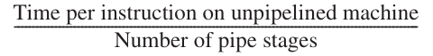

Trong các điều kiện này, mức tăng tốc từ pipelining bằng số pipe stage, giống dây chuyền lắp ráp có n stage lý tưởng có thể sản xuất xe nhanh gấp n lần. Tuy nhiên, thông thường các stage không cân bằng hoàn hảo; hơn nữa, pipelining có một số overhead. Vì vậy, thời gian trên mỗi instruction trên processor pipelined sẽ không đạt giá trị nhỏ nhất có thể, nhưng có thể gần với giá trị đó.

Pipelining làm giảm thời gian thực thi trung bình trên mỗi instruction. Tùy cách chọn mốc cơ sở, có thể xem mức giảm là giảm số clock cycle trên mỗi instruction (CPI), giảm clock cycle time hoặc kết hợp cả hai. Nếu điểm xuất phát là processor cần nhiều clock cycle trên mỗi instruction, pipelining thường được xem là giảm CPI. Đây là góc nhìn chính chúng ta sẽ dùng. Nếu điểm xuất phát là processor cần 1 clock cycle (dài) mỗi instruction, pipelining giảm clock cycle time.

Pipelining là kỹ thuật triển khai khai thác parallelism giữa các instruction trong một instruction stream tuần tự. Nó có ưu điểm đáng kể là, khác một số kỹ thuật tăng tốc (xem Chương 4), người lập trình không nhìn thấy nó. Trong phụ lục này, trước tiên chúng ta trình bày khái niệm pipelining bằng một pipeline five-stage kinh điển; những chương khác khảo sát các kỹ thuật pipelining tinh vi hơn đang dùng trong processor hiện đại. Trước khi nói thêm về pipelining và cách dùng nó trong processor, cần một instruction set đơn giản, được giới thiệu tiếp theo.

### Kiến thức cơ bản về một RISC Instruction Set

Xuyên suốt cuốn sách, chúng ta dùng một RISC (reduced instruction set computer) architecture hoặc load-store architecture để minh họa các khái niệm cơ bản, mặc dù gần như mọi ý tưởng được giới thiệu đều áp dụng cho processor khác. Trong mục này, chúng ta giới thiệu phần cốt lõi của một RISC architecture điển hình. Trong phụ lục này và xuyên suốt sách, RISC architecture mặc định là MIPS. Ở nhiều nơi, các khái niệm đủ tương đồng để áp dụng cho bất kỳ RISC nào. RISC architecture có một vài tính chất then chốt giúp đơn giản hóa đáng kể cách triển khai:

- Mọi phép toán trên dữ liệu áp dụng cho dữ liệu trong register và thường thay đổi toàn bộ register (32 hoặc 64 bit mỗi register).

- Các phép toán duy nhất ảnh hưởng đến memory là load và store, lần lượt chuyển dữ liệu từ memory sang register hoặc từ register sang memory. Các phép load và store nạp hoặc lưu ít hơn toàn bộ register (chẳng hạn byte, 16 bit hoặc 32 bit) thường có sẵn.

- Có ít định dạng instruction, và mọi instruction thường có một kích thước.

Những tính chất đơn giản này dẫn đến đơn giản hóa lớn trong triển khai pipelining, đó là lý do các instruction set được thiết kế như vậy.

Để nhất quán với phần còn lại của sách, chúng ta dùng MIPS64, phiên bản 64-bit của MIPS instruction set. Các instruction mở rộng 64-bit thường được đánh dấu bằng chữ D ở đầu hoặc cuối mnemonic. Chẳng hạn DADD là phiên bản 64-bit của add instruction, còn LD là phiên bản 64-bit của load instruction.

Giống RISC architecture khác, MIPS instruction set cung cấp 32 register, mặc dù register 0 luôn có giá trị 0. Phần lớn RISC architecture, như MIPS, có ba nhóm instruction (xem Phụ lục A để biết thêm):

1. ALU instruction—Những instruction này nhận hai register hoặc một register và một immediate sign-extended (gọi là ALU immediate instruction, chúng có offset 16-bit trong MIPS), thao tác trên chúng và lưu kết quả vào register thứ ba. Các phép toán điển hình gồm add (DADD), subtract (DSUB) và phép toán logical (như AND hoặc OR), không phân biệt phiên bản 32-bit và 64-bit. Phiên bản immediate dùng cùng mnemonic với hậu tố I. Trong MIPS, có cả dạng signed và unsigned của arithmetic instruction; dạng unsigned không tạo overflow exception—và do đó giống nhau trong mode 32-bit và 64-bit—có U ở cuối (chẳng hạn DADDU, DSUBU, DADDIU).

2. Load instruction và store instruction—Những instruction này nhận một register nguồn, gọi là base register, và một trường immediate (16-bit trong MIPS), gọi là offset, làm toán hạng. Tổng—gọi là effective address—của nội dung base register và offset sign-extended được dùng làm địa chỉ memory. Với load instruction, một toán hạng register thứ hai đóng vai trò đích cho dữ liệu được nạp từ memory. Với store, toán hạng register thứ hai là nguồn dữ liệu được lưu vào memory. Các instruction load word (LD) và store word (SD) nạp hoặc lưu toàn bộ nội dung register 64-bit.

3. Branch và jump—Branch là chuyển điều khiển có điều kiện. Thường có hai cách chỉ định điều kiện branch trong RISC architecture: bằng một tập condition bit (đôi khi gọi là condition code) hoặc bằng một tập phép so sánh hạn chế giữa một cặp register hay giữa một register với không. MIPS dùng cách sau. Trong phụ lục này, chỉ xét so sánh bằng nhau giữa hai register. Trong mọi RISC architecture, đích branch được lấy bằng cách cộng một offset sign-extended (16 bit trong MIPS) vào PC hiện tại. Unconditional jump được cung cấp trong nhiều RISC architecture, nhưng chúng ta không trình bày jump trong phụ lục này.

### Một cách triển khai đơn giản của RISC Instruction Set

Để hiểu cách triển khai RISC instruction set theo kiểu pipelined, cần hiểu cách triển khai không có pipelining. Mục này cho thấy một cách triển khai đơn giản trong đó mỗi instruction cần tối đa 5 clock cycle. Chúng ta sẽ mở rộng cách triển khai cơ bản này thành phiên bản pipelined, cho CPI thấp hơn nhiều. Cách triển khai unpipelined không phải cách tiết kiệm nhất hay highest-performance khi không có pipelining. Thay vào đó, nó được thiết kế để dẫn tự nhiên đến cách triển khai pipelined. Triển khai instruction set cần đưa vào một số register tạm không thuộc architecture; chúng được giới thiệu trong mục này để đơn giản hóa pipelining. Cách triển khai tập trung chỉ vào pipeline cho một tập con integer của RISC architecture gồm các phép toán load-store word, branch và integer ALU.

Mọi instruction trong tập con RISC này có thể được triển khai trong tối đa 5 clock cycle. 5 clock cycle như sau.

1. Instruction fetch cycle (IF):

Gửi program counter (PC) đến memory và fetch instruction hiện tại từ memory. Cập nhật PC đến PC tuần tự tiếp theo bằng cách cộng 4 (vì mỗi instruction dài 4 byte) vào PC.

2. Instruction decode/register fetch cycle (ID):

Decode instruction và đọc từ register file những register tương ứng với register source specifier. Thực hiện kiểm tra bằng nhau trên các register khi đọc chúng, để phục vụ một branch có thể xảy ra. Sign-extend trường offset của instruction phòng khi cần dùng. Tính địa chỉ đích branch có thể bằng cách cộng offset sign-extended vào PC đã tăng. Trong một cách triển khai mạnh mà chúng ta sẽ khảo sát sau, branch có thể hoàn tất ở cuối stage này bằng cách lưu địa chỉ branch-target vào PC nếu kiểm tra điều kiện cho kết quả đúng.

Decoding được thực hiện song song với đọc register, điều có thể thực hiện vì register specifier nằm ở vị trí cố định trong RISC architecture. Kỹ thuật này gọi là fixed-field decoding. Lưu ý rằng có thể đọc một register không dùng, điều này không giúp ích nhưng cũng không làm hại performance. (Đọc register không cần thiết gây lãng phí năng lượng, và thiết kế power-sensitive có thể tránh việc này.) Vì phần immediate của instruction cũng nằm ở vị trí giống nhau, immediate sign-extended cũng được tính trong cycle này phòng khi cần dùng.

3. Execution/effective address cycle (EX):

ALU thao tác trên các toán hạng đã chuẩn bị trong cycle trước, thực hiện một trong ba chức năng tùy loại instruction.

- Tham chiếu memory—ALU cộng base register và offset để tạo effective address.

- Register-Register ALU instruction—ALU thực hiện phép toán được ALU opcode chỉ định trên các giá trị đọc từ register file.

- Register-Immediate ALU instruction—ALU thực hiện phép toán được ALU opcode chỉ định trên giá trị đầu tiên đọc từ register file và immediate sign-extended.

Trong load-store architecture, effective address cycle và execution cycle có thể được kết hợp thành một clock cycle duy nhất, vì không instruction nào cần đồng thời tính địa chỉ dữ liệu và thực hiện phép toán trên dữ liệu.

4. Truy cập memory (MEM):

Nếu instruction là load, memory thực hiện đọc bằng effective address tính trong cycle trước. Nếu là store, memory ghi dữ liệu từ register thứ hai được đọc từ register file bằng effective address.

5. Cycle Write-back (WB):

- Register-Register ALU instruction hoặc load instruction:

Ghi kết quả vào register file, bất kể nó đến từ memory system (với load) hay ALU (với ALU instruction).

Trong cách triển khai này, branch instruction cần 2 cycle, store instruction cần 4 cycle, và mọi instruction khác cần 5 cycle. Giả sử tần suất branch 12% và tần suất store 10%, một phân bố instruction điển hình dẫn đến CPI tổng thể 4.54. Tuy nhiên, cách triển khai này không tối ưu về đạt performance tốt nhất hay dùng lượng hardware tối thiểu với mức performance đã cho; chúng ta để việc cải thiện thiết kế này làm bài tập và thay vào đó tập trung pipeline phiên bản này.

### Pipeline Five-Stage kinh điển cho một RISC Processor

Có thể pipeline việc thực thi mô tả phía trên mà gần như không thay đổi gì, chỉ bằng cách bắt đầu một instruction mới mỗi clock cycle. (Bạn thấy vì sao chúng ta chọn thiết kế này rồi chứ?) Mỗi clock cycle trong mục trước trở thành một pipe stage—một cycle trong pipeline. Điều này tạo ra mẫu thực thi trong Hình C.1, cách vẽ cấu trúc pipeline điển hình. Mặc dù mỗi instruction cần 5 clock cycle để hoàn tất, trong mỗi clock cycle hardware sẽ bắt đầu một instruction mới và thực thi một phần của năm instruction khác nhau.

|  | Số clock |  |  |  |  |  |  |  |  |
|---|---|---|---|---|---|---|---|---|---|
| Số instruction | 1 | 2 | 3 | 4 | 5 | 6 | 7 | 8 | 9 |
| Instruction i | IF | ID | EX | MEM | WB |  |  |  |  |
| Instruction i + 1 |  | IF | ID | EX | MEM | WB |  |  |  |
| Instruction i + 2 |  |  | IF | ID | EX | MEM | WB |  |  |
| Instruction i + 3 |  |  |  | IF | ID | EX | MEM | WB |  |
| Instruction i + 4 |  |  |  |  | IF | ID | EX | MEM | WB |

**Hình C.1 RISC pipeline đơn giản. Ở mỗi clock cycle, một instruction khác được fetch và bắt đầu quá trình thực thi five-cycle. Nếu một instruction được bắt đầu mỗi clock cycle, performance sẽ cao gấp đến năm lần processor không được pipeline. Tên các stage trong pipeline giống tên dùng cho cycle trong cách triển khai unpipelined: IF = instruction fetch, ID = instruction decode, EX = execution, MEM = memory access và WB = write-back.**

Bạn có thể khó tin pipelining lại đơn giản như vậy; thực tế không phải vậy. Trong mục này và các mục tiếp theo, chúng ta sẽ làm cho RISC pipeline trở nên “thực” bằng cách xử lý những vấn đề pipelining đưa vào.

Trước hết, phải xác định điều gì xảy ra ở mỗi clock cycle của processor và bảo đảm không cố thực hiện hai phép toán khác nhau bằng cùng tài nguyên data path trong cùng clock cycle. Chẳng hạn, không thể yêu cầu một ALU duy nhất tính effective address và thực hiện phép trừ cùng lúc. Vì vậy, phải bảo đảm việc chồng lấp instruction trong pipeline không gây conflict như thế. May mắn là sự đơn giản của RISC instruction set giúp việc đánh giá tài nguyên tương đối dễ. Hình C.2 cho thấy phiên bản đơn giản hóa của RISC data path được vẽ theo kiểu pipeline. Như có thể thấy, các functional unit chính được dùng trong cycle khác nhau, nên chồng lấp thực thi nhiều instruction tạo ra tương đối ít conflict. Có ba quan sát làm cơ sở cho điều này.

Thứ nhất, chúng ta dùng instruction memory và data memory riêng, thường được triển khai bằng instruction cache và data cache riêng (thảo luận trong Chương 2). Dùng cache riêng loại bỏ conflict đối với một memory duy nhất vốn sẽ xuất hiện giữa instruction fetch và truy cập data memory. Lưu ý nếu processor pipelined có clock cycle bằng phiên bản unpipelined, memory system phải cung cấp bandwidth gấp năm lần. Nhu cầu tăng này là một chi phí của performance cao hơn.

Thứ hai, register file được dùng trong hai stage: một để đọc trong ID và một để ghi trong WB. Hai cách dùng tách biệt, nên chúng ta đơn giản vẽ register file ở hai vị trí. Vì vậy, cần thực hiện hai lần đọc và một lần ghi mỗi clock cycle. Để xử lý đọc và ghi cùng register (và vì một lý do khác sẽ sớm rõ), chúng ta thực hiện ghi register trong nửa đầu clock cycle và đọc trong nửa sau.

Thứ ba, Hình C.2 không xử lý PC. Để bắt đầu instruction mới mỗi clock, phải tăng và lưu PC mỗi clock, và phải làm trong IF stage để chuẩn bị instruction tiếp theo. Hơn nữa, cũng phải có một adder để tính đích branch có thể trong ID. Một vấn đề nữa là branch không thay đổi PC cho đến ID stage. Điều này gây vấn đề tạm thời được bỏ qua, nhưng sẽ sớm được xử lý.

Mặc dù bảo đảm instruction trong pipeline không cố dùng tài nguyên hardware cùng lúc là thiết yếu, cũng phải bảo đảm instruction ở các stage khác nhau không can thiệp lẫn nhau. Việc tách biệt được thực hiện bằng cách đưa pipeline register vào giữa các stage liên tiếp, để ở cuối clock cycle mọi kết quả từ một stage được lưu vào một register dùng làm input cho stage tiếp theo ở clock cycle tiếp theo. Hình C.3 cho thấy pipeline được vẽ cùng các pipeline register này.

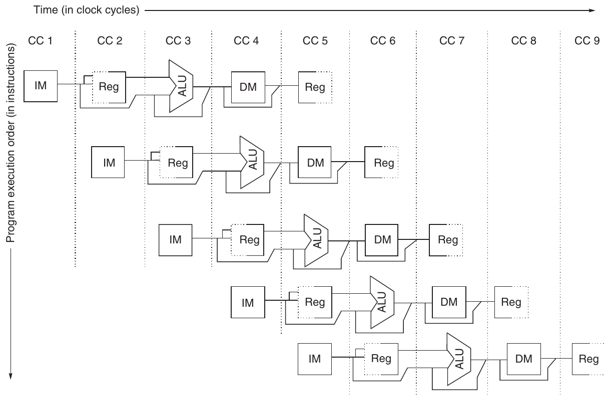

**Hình C.2 Có thể xem pipeline là một chuỗi data path dịch theo thời gian. Hình cho thấy sự chồng lấp giữa các phần data path, với clock cycle 5 (CC 5) thể hiện tình huống steady-state. Vì register file được dùng làm nguồn trong ID stage và đích trong WB stage, nó xuất hiện hai lần. Chúng ta thể hiện nó được đọc trong một phần stage và ghi trong phần khác bằng một đường liền lần lượt ở bên phải hoặc trái, và một đường đứt ở phía kia. Viết tắt IM dành cho instruction memory, DM cho data memory và CC cho clock cycle.**

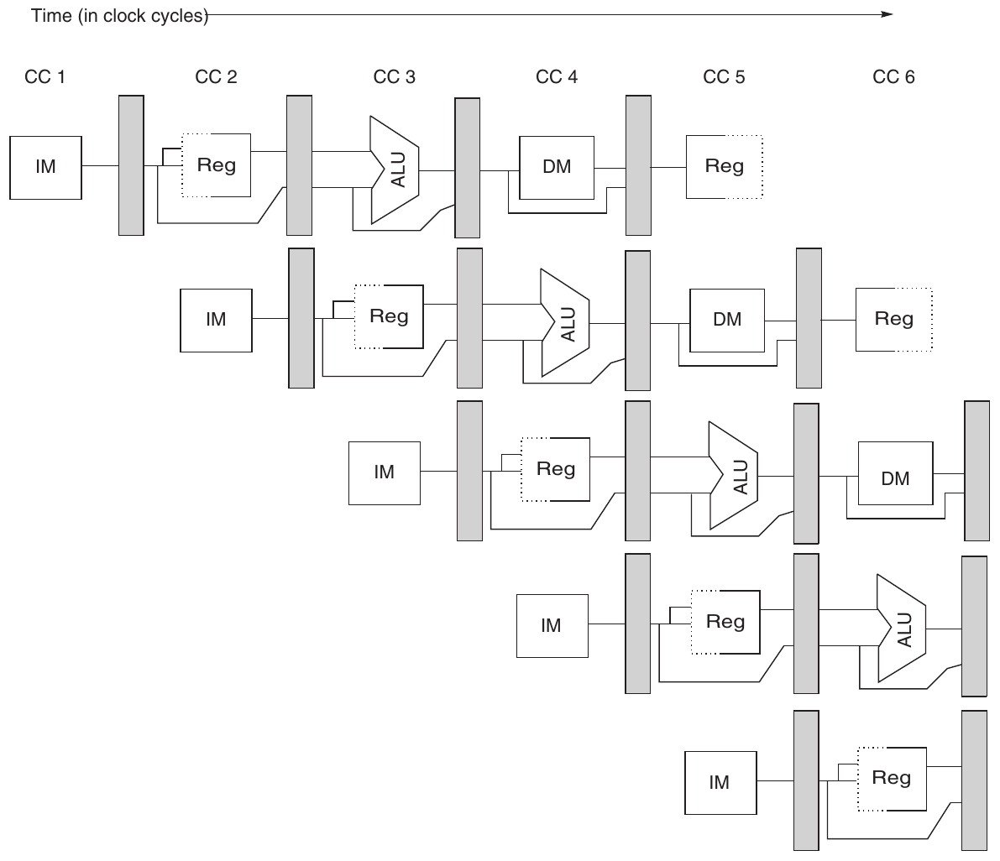

**Hình C.3 Một pipeline thể hiện các pipeline register giữa những pipeline stage liên tiếp. Lưu ý các register ngăn sự can thiệp giữa hai instruction khác nhau ở những stage liền kề trong pipeline. Register cũng giữ vai trò then chốt mang dữ liệu cho một instruction từ stage này sang stage khác. Tính chất edge-triggered của register—tức giá trị thay đổi tức thời trên một clock edge—là thiết yếu. Nếu không, dữ liệu từ một instruction có thể can thiệp vào việc thực thi instruction khác!**

Mặc dù nhiều hình bỏ các register như vậy để đơn giản, chúng cần thiết để pipeline hoạt động đúng và phải có mặt. Tất nhiên, register tương tự cũng cần ngay cả trong multicycle data path không có pipelining (vì chỉ giá trị trong register được giữ qua ranh giới clock). Với processor pipelined, pipeline register còn có vai trò then chốt mang kết quả trung gian từ stage này đến stage khác nơi nguồn và đích có thể không liền kề trực tiếp. Chẳng hạn, giá trị register sẽ được lưu trong store instruction được đọc trong ID nhưng chỉ được sử dụng khi đến MEM; nó đi qua hai pipeline register để đến data memory trong MEM stage. Tương tự, kết quả ALU instruction được tính trong EX nhưng chỉ thực sự lưu đến WB; nó đến đó bằng cách đi qua hai pipeline register. Đôi khi đặt tên pipeline register hữu ích, và chúng ta theo quy ước đặt tên theo các pipeline stage mà chúng nối, nên các register được gọi là IF/ID, ID/EX, EX/MEM và MEM/WB.

### Những vấn đề Performance cơ bản trong Pipelining

Pipelining tăng CPU instruction throughput—số instruction hoàn tất mỗi đơn vị thời gian—nhưng không giảm thời gian thực thi của từng instruction. Thực tế, nó thường làm thời gian thực thi mỗi instruction tăng nhẹ do overhead điều khiển pipeline. Instruction throughput tăng có nghĩa là chương trình chạy nhanh hơn và có tổng thời gian thực thi thấp hơn, dù không một instruction đơn lẻ nào chạy nhanh hơn!

Việc thời gian thực thi của mỗi instruction không giảm đặt ra giới hạn cho độ sâu pipeline thực tế, như sẽ thấy trong mục tiếp theo. Ngoài hạn chế do pipeline latency, còn có giới hạn do mất cân bằng giữa pipe stage và pipelining overhead. Mất cân bằng giữa pipe stage làm giảm performance vì clock không thể chạy nhanh hơn thời gian cần cho pipeline stage chậm nhất. Pipeline overhead xuất phát từ kết hợp pipeline register delay và clock skew. Pipeline register thêm setup time, tức thời gian input register phải ổn định trước khi tín hiệu clock kích hoạt ghi xảy ra, cùng propagation delay vào clock cycle. Clock skew, độ trễ tối đa giữa thời điểm clock đến hai register bất kỳ, cũng góp phần vào giới hạn dưới của clock cycle. Khi clock cycle nhỏ bằng tổng clock skew và latch overhead, pipelining thêm không còn hữu ích vì không còn thời gian trong cycle cho công việc có ích. Độc giả quan tâm nên xem Kunkel và Smith [1986]. Như đã thấy trong Chương 3, overhead này ảnh hưởng đến mức tăng performance của Pentium 4 so với Pentium III.

**Ví dụ** Xét processor unpipelined trong mục trước. Giả sử nó có clock cycle 1 ns và dùng 4 cycle cho phép toán ALU và branch, 5 cycle cho phép toán memory. Giả sử tần suất tương đối lần lượt là 40%, 20% và 40%. Giả sử do clock skew và setup, pipelining processor thêm overhead 0.2 ns vào clock. Bỏ qua mọi tác động latency, chúng ta sẽ đạt mức tăng tốc instruction execution rate bao nhiêu từ pipeline?

**Trả lời** Thời gian thực thi instruction trung bình trên processor unpipelined là

Thời gian thực thi instruction trung bình = Clock cycle × CPI trung bình

= 1 ns × [ ( 40% + 20% ) × 4 + 40% × 5 ]

= 1 ns × 4.4 = 4.4 ns

Trong cách triển khai pipelined, clock phải chạy theo tốc độ của stage chậm nhất cộng overhead, tức 1 + 0.2 hay 1.2 ns; đây là thời gian thực thi instruction trung bình. Vì vậy, mức tăng tốc từ pipelining là

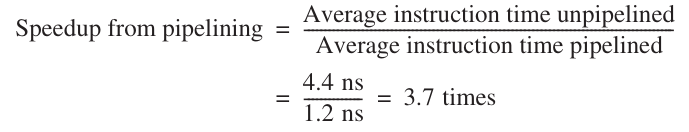

Overhead 0.2 ns về cơ bản thiết lập giới hạn hiệu quả pipelining. Nếu overhead không bị ảnh hưởng bởi thay đổi clock cycle, định luật Amdahl cho biết overhead giới hạn mức tăng tốc.

RISC pipeline đơn giản này sẽ hoạt động tốt với integer instruction nếu mọi instruction độc lập với mọi instruction khác trong pipeline. Thực tế, các instruction trong pipeline có thể phụ thuộc nhau; đây là chủ đề mục tiếp theo.

## C.2 Trở ngại chính của Pipelining—Pipeline Hazard

Có những tình huống, gọi là hazard, ngăn instruction tiếp theo trong instruction stream thực thi trong clock cycle được chỉ định. Hazard làm giảm performance so với mức tăng tốc lý tưởng có được nhờ pipelining. Có ba nhóm hazard:

1. Structural hazard xuất phát từ resource conflict khi hardware không thể đồng thời hỗ trợ mọi tổ hợp instruction có thể trong thực thi chồng lấp.

2. Data hazard xuất hiện khi một instruction phụ thuộc kết quả của instruction trước theo cách bị lộ ra bởi việc chồng lấp các instruction trong pipeline.

3. Control hazard xuất phát từ pipelining branch và những instruction khác thay đổi PC.

Hazard trong pipeline có thể khiến cần phải stall pipeline. Tránh một hazard thường đòi hỏi cho phép một số instruction trong pipeline tiến tiếp trong khi trì hoãn những instruction khác. Với các pipeline được thảo luận trong phụ lục, khi một instruction bị stall, mọi instruction được issue sau instruction đó—và do đó chưa đi xa bằng trong pipeline—cũng bị stall. Các instruction được issue trước instruction bị stall—và do đó đã đi xa hơn trong pipeline—phải tiếp tục, vì nếu không hazard sẽ không bao giờ hết. Kết quả là không fetch instruction mới trong thời gian stall. Chúng ta sẽ thấy một số ví dụ về cách pipeline stall hoạt động trong mục này—đừng lo, chúng không phức tạp như thoạt nghe có vẻ!

### Performance của Pipeline có Stall

Stall khiến pipeline performance giảm so với performance lý tưởng. Hãy xem một phương trình đơn giản để tìm mức tăng tốc thực tế từ pipelining, bắt đầu bằng công thức ở mục trước:

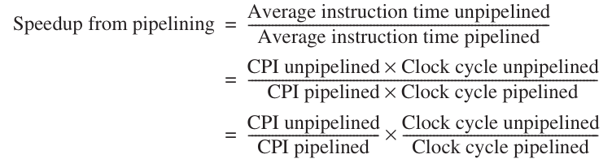

Có thể xem pipelining là giảm CPI hoặc clock cycle time. Vì theo truyền thống CPI được dùng để so sánh pipeline, hãy bắt đầu với giả định đó. CPI lý tưởng trên processor pipelined gần như luôn là 1. Vì vậy, có thể tính CPI pipelined:

CPI pipelined = CPI lý tưởng + Số clock cycle pipeline stall trên mỗi instruction

= 1 + Số clock cycle pipeline stall trên mỗi instruction

Nếu bỏ qua cycle time overhead của pipelining và giả sử các stage cân bằng hoàn hảo, cycle time của hai processor có thể bằng nhau, dẫn đến

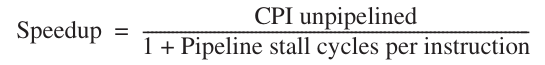

Một trường hợp đơn giản quan trọng là mọi instruction cần cùng số cycle, cũng phải bằng số pipeline stage (còn gọi là độ sâu pipeline). Trong trường hợp này, CPI unpipelined bằng độ sâu pipeline, dẫn đến

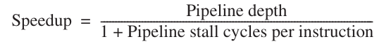

Nếu không có pipeline stall, điều này dẫn đến kết quả trực giác rằng pipelining có thể cải thiện performance theo độ sâu pipeline.

Một cách khác, nếu xem pipelining là cải thiện clock cycle time, có thể giả sử CPI của processor unpipelined cũng như processor pipelined đều là 1. Điều này dẫn đến

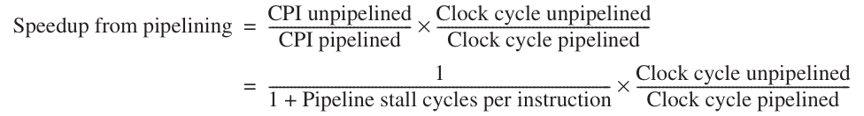

Trong các trường hợp pipe stage cân bằng hoàn hảo và không có overhead, clock cycle trên processor pipelined nhỏ hơn clock cycle của processor unpipelined theo một hệ số bằng độ sâu pipelined:

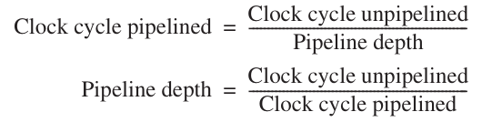

Điều này dẫn đến kết quả sau:

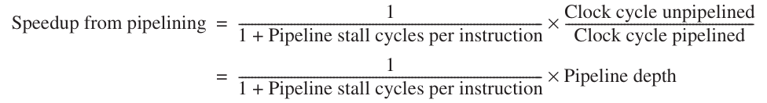

Vì vậy, nếu không có stall, mức tăng tốc bằng số pipeline stage, khớp với trực giác về trường hợp lý tưởng.

### Structural Hazard

Khi processor được pipeline, thực thi chồng lấp instruction cần pipeline functional unit và nhân bản tài nguyên để cho phép mọi tổ hợp instruction có thể trong pipeline. Nếu không thể đáp ứng một tổ hợp instruction do resource conflict, processor được nói là có structural hazard.

Các trường hợp structural hazard phổ biến nhất xuất hiện khi một functional unit không được pipeline đầy đủ. Khi đó, chuỗi instruction dùng unit unpipelined không thể tiến với tốc độ một instruction mỗi clock cycle. Một cách phổ biến khác gây structural hazard là tài nguyên chưa được nhân bản đủ để cho phép mọi tổ hợp instruction trong pipeline thực thi. Chẳng hạn, processor có thể chỉ có một register-file write port, nhưng trong một số tình huống pipeline muốn thực hiện hai lần ghi trong một clock cycle. Điều này tạo structural hazard.

Khi một chuỗi instruction gặp hazard này, pipeline sẽ stall một instruction cho đến khi unit cần thiết sẵn sàng. Những stall như vậy sẽ tăng CPI từ giá trị lý tưởng thông thường là 1.

Một số processor pipelined dùng chung một pipeline single-memory cho dữ liệu và instruction. Vì vậy, khi một instruction chứa tham chiếu data memory, nó xung đột với tham chiếu instruction của instruction sau, như Hình C.4. Để xử lý hazard này, chúng ta stall pipeline 1 clock cycle khi truy cập data memory xảy ra. Stall thường được gọi là pipeline bubble hoặc chỉ bubble, vì nó trôi qua pipeline, chiếm chỗ nhưng không mang công việc hữu ích. Chúng ta sẽ thấy một loại stall khác khi nói về data hazard.

Người thiết kế thường biểu diễn hành vi stall bằng một sơ đồ đơn giản chỉ có tên pipe stage, như Hình C.5. Dạng của Hình C.5 thể hiện stall bằng cách chỉ cycle không có hành động và đơn giản dịch instruction 3 sang phải (trì hoãn bắt đầu và kết thúc thực thi 1 cycle). Tác động của pipeline bubble thực tế là chiếm tài nguyên cho instruction slot đó khi nó đi qua pipeline.

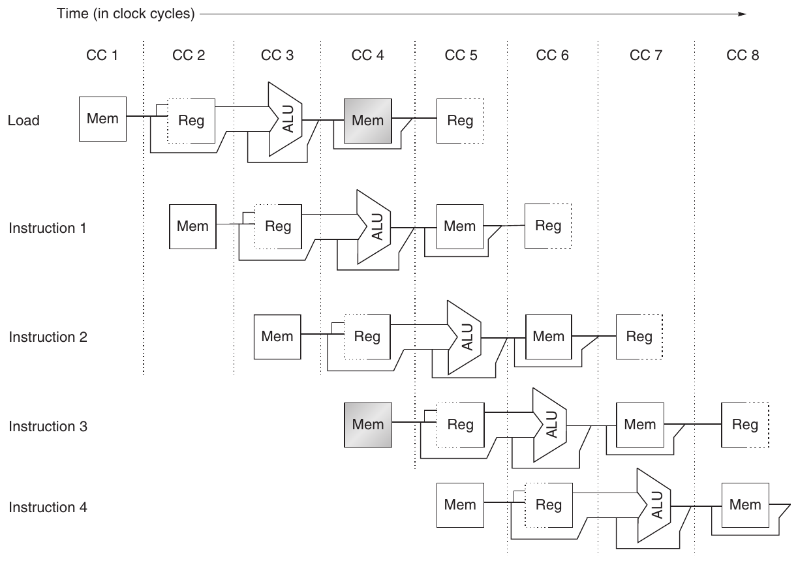

**Hình C.4 Processor chỉ có một memory port sẽ tạo conflict bất cứ khi nào có tham chiếu memory. Trong ví dụ này, load instruction dùng memory để truy cập dữ liệu cùng lúc instruction 3 muốn fetch instruction từ memory.**

**Ví dụ** Hãy xem load structural hazard có thể tốn bao nhiêu. Giả sử tham chiếu dữ liệu chiếm 40% instruction mix và CPI lý tưởng của processor pipelined, bỏ qua structural hazard, là 1. Giả sử processor có structural hazard có clock rate cao gấp 1.05 lần clock rate của processor không có hazard. Bỏ qua mọi tổn thất performance khác, pipeline có hay không có structural hazard nhanh hơn, và nhanh hơn bao nhiêu?

**Trả lời** Có một số cách giải bài toán này. Có lẽ đơn giản nhất là tính thời gian instruction trung bình trên hai processor:

Thời gian instruction trung bình = CPI × Clock cycle time

|  | Số clock cycle |  |  |  |  |  |  |  |  |  |
|---|---|---|---|---|---|---|---|---|---|---|
| Instruction | 1 | 2 | 3 | 4 | 5 | 6 | 7 | 8 | 9 | 10 |
| Load instruction | IF | ID | EX | MEM | WB |  |  |  |  |  |
| Instruction i + 1 |  | IF | ID | EX | MEM | WB |  |  |  |  |
| Instruction i + 2 |  |  | IF | ID | EX | MEM | WB |  |  |  |
| Instruction i + 3 |  |  |  | Stall | IF | ID | EX | MEM | WB |  |
| Instruction i + 4 |  |  |  |  |  | IF | ID | EX | MEM | WB |
| Instruction i + 5 |  |  |  |  |  |  | IF | ID | EX | MEM |
| Instruction i + 6 |  |  |  |  |  |  |  | IF | ID | EX |

**Hình C.5 Pipeline bị stall do structural hazard—một load với một memory port. Như thể hiện ở đây, load instruction thực chất lấy mất một instruction-fetch cycle, khiến pipeline stall—không instruction nào được bắt đầu trong clock cycle 4 (vốn thường bắt đầu instruction i + 3). Vì instruction đang fetch bị stall, mọi instruction khác trong pipeline đứng trước instruction bị stall có thể tiến bình thường. Stall cycle sẽ tiếp tục đi qua pipeline, nên không instruction nào hoàn tất trong clock cycle 8. Đôi khi các sơ đồ pipeline này được vẽ với stall chiếm toàn bộ một hàng ngang và instruction 3 được chuyển sang hàng tiếp theo; trong cả hai trường hợp, tác động giống nhau vì instruction i + 3 không bắt đầu thực thi cho đến cycle 5. Chúng ta dùng dạng phía trên vì chiếm ít không gian hơn trong hình. Lưu ý hình giả sử instruction i + 1 và i + 2 không phải tham chiếu memory.**

Vì không có stall, thời gian instruction trung bình của processor lý tưởng đơn giản là Clock cycle time<sub>ideal</sub>. Thời gian instruction trung bình của processor có structural hazard là

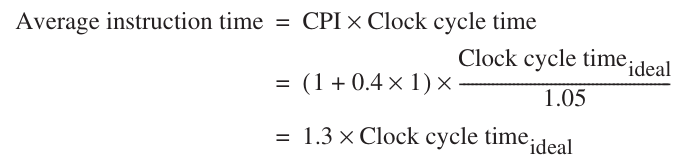

Rõ ràng, processor không có structural hazard nhanh hơn; có thể dùng tỷ lệ thời gian instruction trung bình để kết luận processor không có hazard nhanh gấp 1.3 lần.

Để tránh structural hazard này, người thiết kế có thể cung cấp một truy cập memory riêng cho instruction, bằng cách tách cache thành instruction cache và data cache riêng hoặc dùng một tập buffer, thường gọi là instruction buffer, để giữ instruction. Chương 5 thảo luận cả ý tưởng split cache lẫn instruction buffer.

Nếu mọi yếu tố khác bằng nhau, processor không có structural hazard luôn có CPI thấp hơn. Vậy tại sao người thiết kế cho phép structural hazard? Lý do chủ yếu là giảm chi phí unit, vì pipeline tất cả functional unit hoặc nhân bản chúng có thể quá tốn kém. Chẳng hạn, processor hỗ trợ cả truy cập instruction cache và data cache mỗi cycle (để tránh structural hazard trong ví dụ trên) cần tổng memory bandwidth gấp đôi và thường có bandwidth cao hơn tại các chân. Tương tự, pipeline đầy đủ một multiplier floating-point (FP) cần nhiều gate. Nếu structural hazard hiếm xảy ra, tránh nó có thể không đáng chi phí.

### Data Hazard

Một tác động chính của pipelining là thay đổi thời điểm tương đối của instruction bằng cách chồng lấp thực thi. Sự chồng lấp này đưa vào data hazard và control hazard. Data hazard xảy ra khi pipeline thay đổi thứ tự truy cập đọc/ghi các toán hạng, khiến thứ tự khác với thứ tự khi instruction thực thi tuần tự trên processor unpipelined. Xét thực thi pipelined của các instruction sau:

```
DADD       R1,R2,R3
DSUB       R4,R1,R5
AND        R6,R1,R7
OR         R8,R1,R9
XOR        R10,R1,R11
```

Mọi instruction sau DADD dùng kết quả của DADD instruction. Như thể hiện trong Hình C.6, DADD instruction ghi giá trị R1 trong WB pipe stage, nhưng DSUB instruction đọc giá trị trong ID stage của nó. Vấn đề này gọi là data hazard. Nếu không có biện pháp ngăn chặn, DSUB instruction sẽ đọc giá trị sai và cố dùng nó. Thực tế, giá trị DSUB instruction dùng thậm chí không xác định: Mặc dù có thể thấy hợp lý khi giả sử DSUB luôn dùng giá trị R1 do một instruction trước DADD gán, điều này không phải luôn đúng. Nếu interrupt xảy ra giữa DADD và DSUB, WB stage của DADD sẽ hoàn tất, và giá trị R1 lúc đó là kết quả DADD. Hành vi không thể dự đoán này rõ ràng không thể chấp nhận.

AND instruction cũng chịu ảnh hưởng hazard này. Như có thể thấy trong Hình C.6, việc ghi R1 chỉ hoàn tất cuối clock cycle 5. Vì vậy, AND instruction đọc register trong clock cycle 4 sẽ nhận kết quả sai.

XOR instruction hoạt động đúng vì đọc register trong clock cycle 6, sau khi ghi register. OR instruction cũng hoạt động không gặp hazard vì chúng ta thực hiện đọc register file trong nửa sau cycle và ghi trong nửa đầu.

Mục tiếp theo thảo luận một kỹ thuật loại bỏ stall cho hazard liên quan đến DSUB và AND instruction.

#### Giảm thiểu Data Hazard Stall bằng Forwarding

Vấn đề trong Hình C.6 có thể được giải quyết bằng một kỹ thuật hardware đơn giản gọi là forwarding (còn gọi là bypassing và đôi khi short-circuiting). Nhận xét then chốt của forwarding là DSUB thực sự chưa cần kết quả cho đến sau khi DADD tạo ra nó. Nếu có thể chuyển kết quả từ pipeline register nơi DADD lưu nó đến nơi DSUB cần, có thể tránh nhu cầu stall. Dựa trên nhận xét này, forwarding hoạt động như sau:

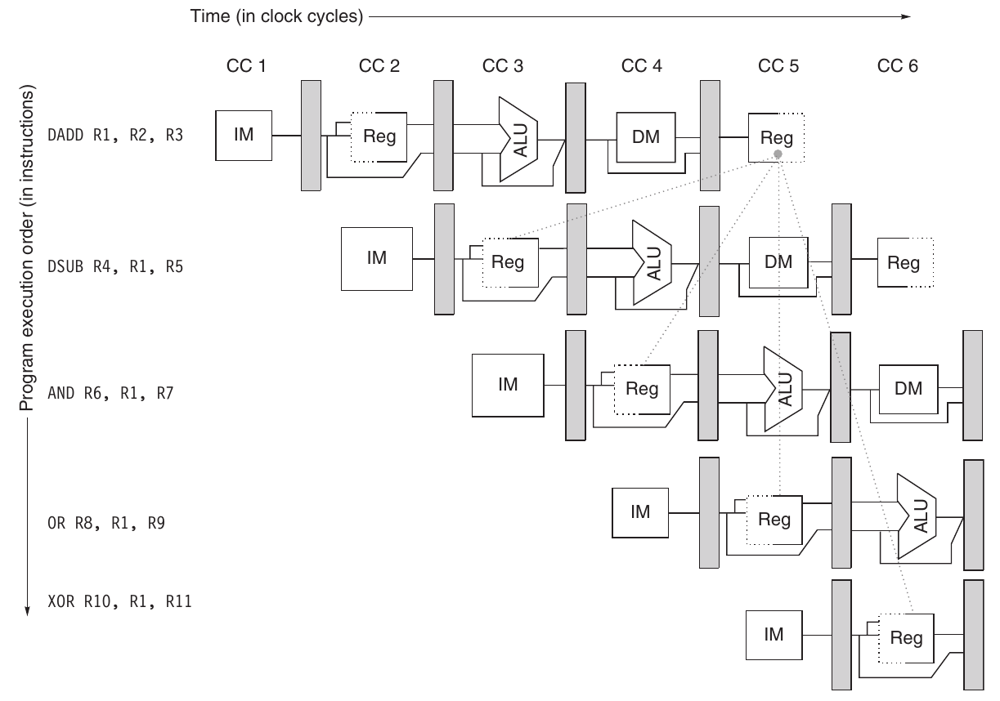

**Hình C.6 Việc dùng kết quả DADD instruction trong ba instruction tiếp theo gây hazard, vì register chỉ được ghi sau khi những instruction đó đọc nó.**

1. Kết quả ALU từ cả EX/MEM và MEM/WB pipeline register luôn được đưa trở lại ALU input.

2. Nếu forwarding hardware phát hiện phép toán ALU trước đã ghi register tương ứng với một nguồn của phép toán ALU hiện tại, control logic chọn kết quả được forward làm ALU input thay cho giá trị đọc từ register file.

Lưu ý rằng với forwarding, nếu DSUB bị stall, DADD sẽ hoàn tất và bypass sẽ không được kích hoạt. Quan hệ này cũng đúng khi có interrupt giữa hai instruction.

Như ví dụ Hình C.6 cho thấy, cần forward kết quả không chỉ từ instruction ngay trước mà có thể cả từ instruction bắt đầu sớm hơn 2 cycle. Hình C.7 cho thấy ví dụ với các bypass path và nhấn mạnh thời điểm đọc, ghi register. Chuỗi code này có thể được thực thi không stall.

Có thể tổng quát hóa forwarding để bao gồm truyền kết quả trực tiếp đến functional unit cần nó: Kết quả được forward từ pipeline register tương ứng với output một unit đến input unit khác, thay vì chỉ từ kết quả một unit đến input cùng unit đó. Chẳng hạn, xét chuỗi sau:

```
DADD       R1,R2,R3
LD         R4,0(R1)
SD         R4,12(R1)
```

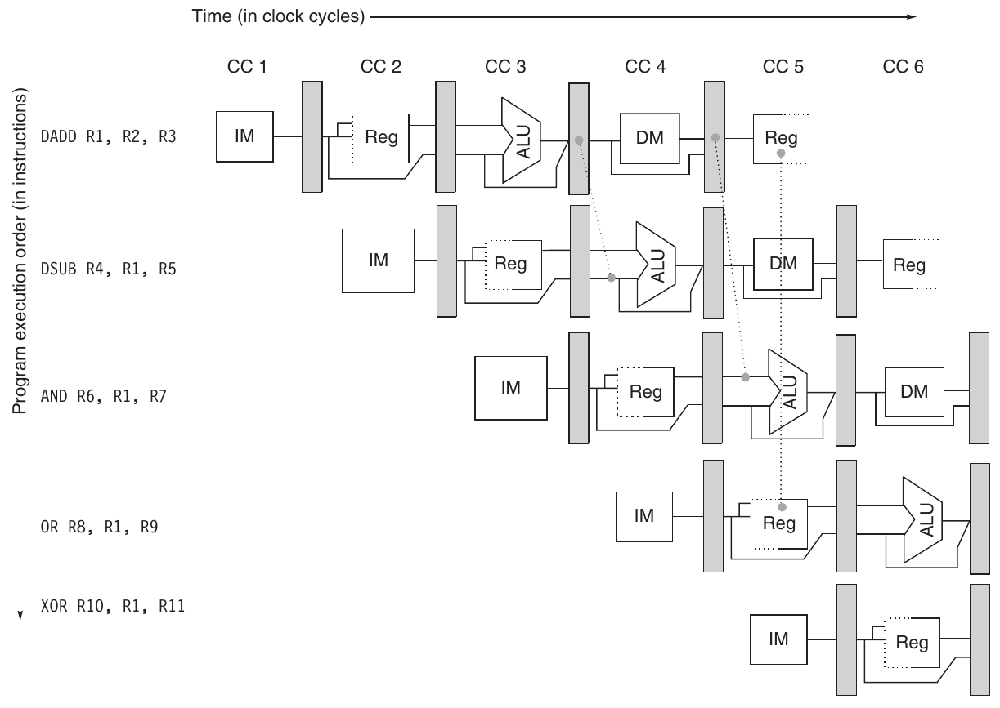

**Hình C.7 Một tập instruction phụ thuộc kết quả DADD dùng forwarding path để tránh data hazard. Input của DSUB và AND instruction được forward từ pipeline register đến ALU input thứ nhất. OR nhận kết quả bằng forwarding qua register file, dễ thực hiện bằng cách đọc register trong nửa sau cycle và ghi trong nửa đầu, như các đường đứt trên register chỉ ra. Lưu ý kết quả được forward có thể đi đến bất kỳ ALU input nào; thực tế, cả hai ALU input có thể dùng input được forward từ cùng pipeline register hoặc từ các pipeline register khác nhau. Điều này sẽ xảy ra, chẳng hạn, nếu AND instruction là AND R6,R1,R4.**

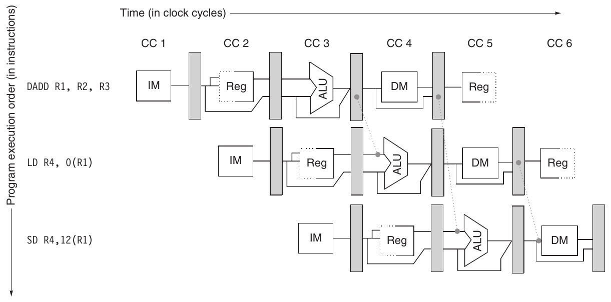

**Hình C.8 Forwarding toán hạng mà store cần trong MEM. Kết quả load được forward từ memory output đến memory input để lưu. Ngoài ra, ALU output được forward đến ALU input để tính địa chỉ cho cả load lẫn store (điều này không khác forwarding đến một phép toán ALU khác). Nếu store phụ thuộc phép toán ALU ngay trước (không thể hiện phía trên), kết quả cần được forward để tránh stall.**

Để tránh stall trong chuỗi này, cần forward các giá trị ALU output và memory unit output từ pipeline register đến ALU input và data memory input. Hình C.8 cho thấy mọi forwarding path cho ví dụ này.

#### Data Hazard cần Stall

Đáng tiếc, không phải mọi data hazard tiềm tàng đều xử lý được bằng bypassing. Xét chuỗi instruction sau:

```
LD         R1,0(R2)
DSUB       R4,R1,R5
AND        R6,R1,R7
OR         R8,R1,R9
```

Data path pipelined với các bypass path cho ví dụ này nằm trong Hình C.9. Trường hợp này khác tình huống các phép toán ALU back-to-back. LD instruction chưa có dữ liệu cho đến cuối clock cycle 4 (MEM cycle của nó), trong khi DSUB instruction cần có dữ liệu ở đầu clock cycle đó. Vì vậy, data hazard do dùng kết quả load instruction không thể được loại bỏ hoàn toàn bằng hardware đơn giản. Như thể hiện trong Hình C.9, forwarding path như vậy sẽ phải hoạt động ngược thời gian—một khả năng người thiết kế máy tính chưa có! Có thể forward kết quả ngay đến ALU từ pipeline register để dùng trong phép toán AND, bắt đầu sau load 2 clock cycle. Tương tự, OR instruction không có vấn đề vì nhận giá trị qua register file. Với DSUB instruction, kết quả được forward đến quá muộn—ở cuối clock cycle, trong khi cần ở đầu.

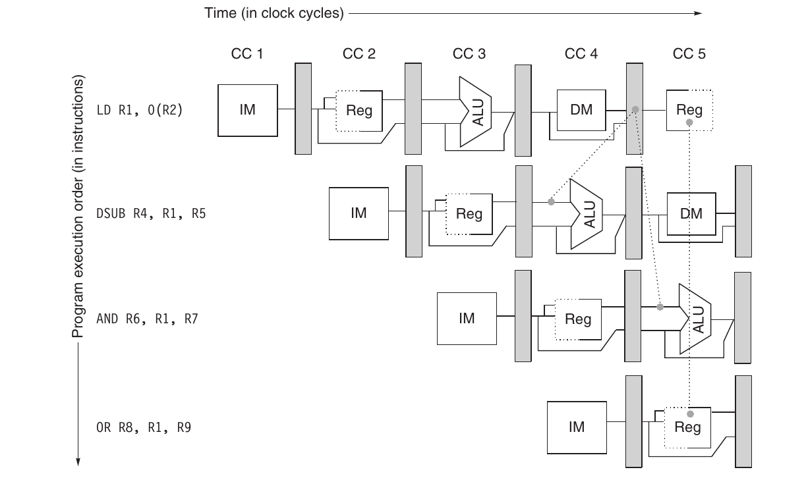

**Hình C.9 Load instruction có thể bypass kết quả đến AND và OR instruction, nhưng không đến DSUB, vì điều đó có nghĩa là forward kết quả trong “thời gian âm”.**

Load instruction có độ trễ hay latency không thể được loại bỏ chỉ bằng forwarding. Thay vào đó, cần thêm hardware gọi là pipeline interlock để giữ mẫu thực thi đúng. Nhìn chung, pipeline interlock phát hiện hazard và stall pipeline cho đến khi hazard được giải quyết. Trong trường hợp này, interlock stall pipeline, bắt đầu từ instruction muốn dùng dữ liệu cho đến khi instruction nguồn tạo dữ liệu. Pipeline interlock này đưa vào stall hoặc bubble, giống với structural hazard. CPI của instruction bị stall tăng theo độ dài stall (1 clock cycle trong trường hợp này).

Hình C.10 cho thấy pipeline trước và sau stall bằng tên các pipeline stage. Vì stall khiến các instruction bắt đầu từ DSUB chuyển muộn hơn 1 cycle, forwarding đến AND instruction giờ đi qua register file, và OR instruction hoàn toàn không cần forwarding. Chèn bubble khiến số cycle để hoàn tất chuỗi tăng một. Không instruction nào được bắt đầu trong clock cycle 4 (và không instruction nào hoàn tất trong cycle 6).

| LD R1,0(R2) | IF | ID | EX | MEM | WB |  |  |  |
|---|---|---|---|---|---|---|---|---|
| DSUB R4,R1,R5 |  | IF | ID | EX | MEM | WB |  |  |
| AND R6,R1,R7 |  |  | IF | ID | EX | MEM | WB |  |
| OR R8,R1,R9 |  |  |  | IF | ID | EX | MEM | WB |

| LD R1,0(R2) | IF | ID | EX | MEM | WB |  |  |  |  |
|---|---|---|---|---|---|---|---|---|---|
| DSUB R4,R1,R5 |  | IF | ID | stall | EX | MEM | WB |  |  |
| AND R6,R1,R7 |  |  | IF | stall | ID | EX | MEM | WB |  |
| OR R8,R1,R9 |  |  |  | stall | IF | ID | EX | MEM | WB |

**Hình C.10 Ở nửa trên, có thể thấy vì sao cần stall: MEM cycle của load tạo một giá trị cần trong EX cycle của DSUB, diễn ra cùng lúc. Vấn đề được giải quyết bằng cách chèn stall, như nửa dưới.**

### Branch Hazard

Control hazard có thể gây tổn thất performance cho MIPS pipeline lớn hơn data hazard. Khi branch được thực thi, nó có thể hoặc không thay đổi PC thành giá trị khác với giá trị hiện tại cộng 4. Nhớ rằng nếu branch thay đổi PC đến địa chỉ đích, nó là taken branch; nếu tiếp tục tuần tự, nó là not taken hay untaken. Nếu instruction i là taken branch, PC thường chỉ thay đổi cuối ID, sau khi hoàn tất tính địa chỉ và so sánh.

Hình C.11 cho thấy cách xử lý branch đơn giản nhất là fetch lại instruction theo sau branch khi phát hiện branch trong ID (khi instruction được decode). IF cycle đầu tiên thực chất là stall vì không làm công việc hữu ích. Bạn có thể nhận thấy nếu branch untaken, việc lặp IF stage không cần thiết vì instruction đúng đã được fetch. Chúng ta sẽ sớm phát triển một số cơ chế tận dụng điều này.

Một stall cycle cho mọi branch sẽ gây tổn thất performance 10% đến 30% tùy tần suất branch, nên chúng ta sẽ xem một số kỹ thuật xử lý tổn thất này.

| Branch instruction | IF | ID | EX | MEM | WB |  |  |
|---|---|---|---|---|---|---|---|
| Branch successor |  | IF | IF | ID | EX | MEM | WB |
| Branch successor + 1 |  |  |  | IF | ID | EX | MEM |
| Branch successor + 2 |  |  |  |  | IF | ID | EX |

**Hình C.11 Branch gây stall one-cycle trong pipeline five-stage. Instruction sau branch được fetch nhưng bị bỏ qua, và fetch bắt đầu lại khi biết đích branch. Có lẽ dễ thấy nếu branch không taken, IF thứ hai cho instruction kế sau branch là dư thừa. Điều này sẽ sớm được xử lý.**

#### Giảm Pipeline Branch Penalty

Có nhiều phương pháp xử lý pipeline stall do branch delay; trong mục này chúng ta thảo luận bốn cơ chế compile time đơn giản. Trong bốn cơ chế, hành động cho branch là static—được cố định cho mỗi branch trong toàn bộ quá trình thực thi. Software có thể cố giảm branch penalty bằng kiến thức về hardware scheme và hành vi branch. Chương 3 xem những kỹ thuật hardware và software mạnh hơn cho cả static và dynamic branch prediction.

Cơ chế xử lý branch đơn giản nhất là freeze hoặc flush pipeline, giữ hoặc xóa mọi instruction sau branch cho đến khi biết đích branch. Sức hấp dẫn của giải pháp chủ yếu nằm ở sự đơn giản cho cả hardware lẫn software. Đây là giải pháp được dùng trước đó trong pipeline Hình C.11. Trong trường hợp này, branch penalty cố định và software không thể giảm nó.

Một cơ chế higher-performance và chỉ phức tạp hơn một chút là xử lý mọi branch như not taken, đơn giản cho phép hardware tiếp tục như thể branch không được thực thi. Ở đây phải cẩn thận không thay đổi trạng thái processor cho đến khi biết chắc kết quả branch. Độ phức tạp của cơ chế đến từ việc phải biết khi nào instruction có thể thay đổi trạng thái và cách hoàn tác thay đổi đó.

Trong pipeline five-stage đơn giản, cơ chế predicted-not-taken hay predicted-untaken này được triển khai bằng cách tiếp tục fetch instruction như thể branch là instruction bình thường. Pipeline trông như không có gì bất thường. Tuy nhiên, nếu branch taken, cần chuyển instruction đã fetch thành no-op và bắt đầu lại fetch tại địa chỉ đích. Hình C.12 cho thấy cả hai tình huống.

| Untaken branch instruction | IF | ID | EX | MEM | WB |  |  |  |  |
|---|---|---|---|---|---|---|---|---|---|
| Instruction i + 1 |  | IF | ID | EX | MEM | WB |  |  |  |
| Instruction i + 2 |  |  | IF | ID | EX | MEM | WB |  |  |
| Instruction i + 3 |  |  |  | IF | ID | EX | MEM | WB |  |
| Instruction i + 4 |  |  |  |  | IF | ID | EX | MEM | WB |

| Taken branch instruction | IF | ID | EX | MEM | WB |  |  |  |  |
|---|---|---|---|---|---|---|---|---|---|
| Instruction i + 1 |  | IF | idle | idle | idle | idle |  |  |  |
| Branch target |  |  | IF | ID | EX | MEM | WB |  |  |
| Branch target + 1 |  |  |  | IF | ID | EX | MEM | WB |  |
| Branch target + 2 |  |  |  |  | IF | ID | EX | MEM | WB |

**Hình C.12 Cơ chế predicted-not-taken và chuỗi pipeline khi branch untaken (trên) và taken (dưới). Khi branch untaken, được xác định trong ID, chúng ta fetch fall-through rồi tiếp tục. Nếu branch taken trong ID, chúng ta bắt đầu lại fetch tại đích branch. Điều này khiến mọi instruction theo sau branch stall 1 clock cycle.**

Một cơ chế khác là xử lý mọi branch như taken. Ngay khi branch được decode và tính xong địa chỉ đích, chúng ta giả định branch taken và bắt đầu fetch, thực thi tại đích. Vì trong pipeline five-stage địa chỉ đích không được biết sớm hơn kết quả branch, cách này không có lợi cho pipeline này. Trong một số processor—đặc biệt loại có condition code được đặt ngầm định hoặc điều kiện branch mạnh hơn (và do đó chậm hơn)—đích branch được biết trước kết quả branch, và cơ chế predicted-taken có thể hợp lý. Trong cả cơ chế predicted-taken lẫn predicted-not-taken, compiler có thể cải thiện performance bằng cách tổ chức code để đường đi thường gặp nhất khớp lựa chọn hardware. Cơ chế thứ tư cho compiler nhiều cơ hội cải thiện performance hơn.

Cơ chế thứ tư được dùng trong một số processor gọi là delayed branch. Kỹ thuật này được dùng nhiều trong RISC processor ban đầu và hoạt động khá tốt trong pipeline five-stage. Với delayed branch, chu trình thực thi có branch delay bằng một là

<pre>branch instruction
sequential successor<sub>1</sub>
branch target if taken</pre>

Instruction kế sau theo thứ tự tuần tự nằm trong branch delay slot. Instruction này được thực thi bất kể branch taken hay không. Hành vi của pipeline five-stage có branch delay được thể hiện trong Hình C.13. Mặc dù có thể có branch delay dài hơn một, trong thực tế gần như mọi processor có delayed branch đều có độ trễ một instruction; kỹ thuật khác được dùng nếu pipeline có branch penalty tiềm tàng dài hơn.

| Untaken branch instruction | IF | ID | EX | MEM | WB |  |  |  |  |
|---|---|---|---|---|---|---|---|---|---|
| Branch delay instruction (i + 1) |  | IF | ID | EX | MEM | WB |  |  |  |
| Instruction i + 2 |  |  | IF | ID | EX | MEM | WB |  |  |
| Instruction i + 3 |  |  |  | IF | ID | EX | MEM | WB |  |
| Instruction i + 4 |  |  |  |  | IF | ID | EX | MEM | WB |

| Taken branch instruction | IF | ID | EX | MEM | WB |  |  |  |  |
|---|---|---|---|---|---|---|---|---|---|
| Branch delay instruction (i + 1) |  | IF | ID | EX | MEM | WB |  |  |  |
| Branch target |  |  | IF | ID | EX | MEM | WB |  |  |
| Branch target + 1 |  |  |  | IF | ID | EX | MEM | WB |  |
| Branch target + 2 |  |  |  |  | IF | ID | EX | MEM | WB |

**Hình C.13 Hành vi delayed branch giống nhau bất kể branch taken hay không. Các instruction trong delay slot (MIPS chỉ có một delay slot) được thực thi. Nếu branch untaken, thực thi tiếp tục với instruction sau branch delay instruction; nếu branch taken, thực thi tiếp tục tại đích branch. Khi instruction trong branch delay slot cũng là branch, ý nghĩa không rõ: Nếu branch không taken, điều gì nên xảy ra với branch trong branch delay slot? Do sự mơ hồ này, architecture có delay branch thường không cho đặt branch trong delay slot.**

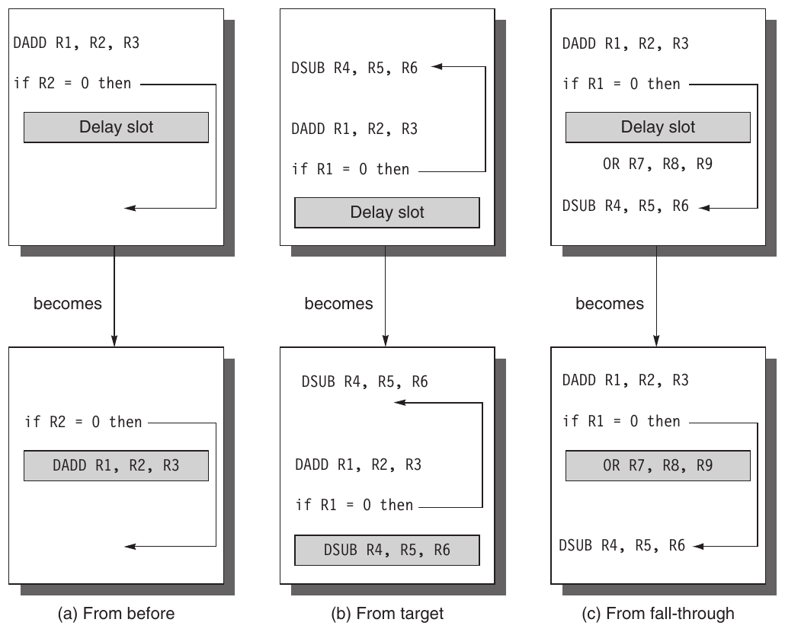

**Hình C.14 Scheduling branch delay slot. Ô trên trong mỗi cặp cho thấy code trước scheduling; ô dưới cho thấy code đã schedule. Trong (a), delay slot được schedule bằng một instruction độc lập từ trước branch. Đây là lựa chọn tốt nhất. Chiến lược (b) và (c) được dùng khi không thể dùng (a). Trong các chuỗi code (b) và (c), việc dùng R1 trong điều kiện branch ngăn DADD instruction (có đích R1) chuyển xuống sau branch. Trong (b), branch delay slot được schedule từ đích branch; thường cần sao chép target instruction vì có thể đến nó bằng đường khác. Chiến lược (b) được ưu tiên khi branch có xác suất taken cao, như loop branch. Cuối cùng, có thể schedule branch từ fall-through not-taken như (c). Để tối ưu hóa này hợp lệ cho (b) hoặc (c), phải chấp nhận được việc thực thi instruction được chuyển khi branch đi theo hướng ngoài dự đoán. Chấp nhận được có nghĩa công việc bị lãng phí nhưng chương trình vẫn thực thi đúng. Chẳng hạn, điều này đúng trong (c) nếu R7 là register tạm không dùng khi branch đi hướng ngoài dự đoán.**

Công việc của compiler là làm cho các successor instruction hợp lệ và hữu ích. Một số tối ưu hóa được dùng. Hình C.14 cho thấy ba cách schedule branch delay.

Giới hạn delayed-branch scheduling xuất phát từ: (1) hạn chế đối với instruction được schedule vào delay slot, và (2) khả năng dự đoán tại compile time liệu branch có khả năng taken hay không. Để cải thiện khả năng compiler lấp branch delay slot, phần lớn processor có conditional branch đã đưa vào canceling hoặc nullifying branch. Trong canceling branch, instruction bao gồm hướng branch được dự đoán. Khi branch hoạt động như dự đoán, instruction trong branch delay slot được thực thi bình thường như delayed branch. Khi dự đoán branch sai, instruction trong branch delay slot đơn giản được chuyển thành no-op.

#### Performance của các cơ chế Branch

Performance thực tế của mỗi cơ chế là bao nhiêu? Mức tăng tốc pipeline thực tế với branch penalty, giả sử CPI lý tưởng 1, là

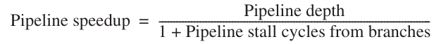

Vì có quan hệ sau:

Số pipeline stall cycle do branch = Tần suất branch × Branch penalty

chúng ta thu được:

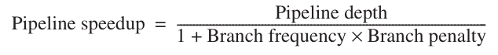

Tần suất branch và branch penalty có thể có thành phần từ cả branch vô điều kiện lẫn có điều kiện. Tuy nhiên, loại sau chiếm ưu thế vì thường gặp hơn.

**Ví dụ** Với pipeline sâu hơn, như trong MIPS R4000, cần ít nhất ba pipeline stage trước khi biết địa chỉ branch-target và thêm một cycle trước khi đánh giá điều kiện branch, giả sử không stall trên register trong phép so sánh điều kiện. Độ trễ three-stage dẫn đến branch penalty cho ba cơ chế prediction đơn giản nhất trong Hình C.15.

Tìm phần cộng thêm thực tế vào CPI do branch cho pipeline này, giả sử tần suất sau:

| Branch vô điều kiện | 4% |
|---|---|
| Conditional branch untaken | 6% |
| Conditional branch taken | 10% |

| Cơ chế branch | Penalty vô điều kiện | Penalty untaken | Penalty taken |
|---|---|---|---|
| Flush pipeline | 2 | 3 | 3 |
| Predicted taken | 2 | 3 | 2 |
| Predicted untaken | 2 | 0 | 3 |

**Hình C.15 Branch penalty cho ba cơ chế prediction đơn giản nhất trên pipeline sâu hơn.**

|  | Phần cộng thêm vào CPI do chi phí branch |  |  |  |
|---|---|---|---|---|
| Cơ chế branch | Branch vô điều kiệnes | Conditional branch untaken | Conditional branch taken | Mọi branch |
| Tần suất sự kiện | 4% | 6% | 10% | 20% |
| Stall pipeline | 0.08 | 0.18 | 0.30 | 0.56 |
| Predicted taken | 0.08 | 0.18 | 0.20 | 0.46 |
| Predicted untaken | 0.08 | 0.00 | 0.30 | 0.38 |

**Hình C.16 CPI penalty cho ba cơ chế branch-prediction trên pipeline sâu hơn.**

**Trả lời** Tìm CPI bằng cách nhân tần suất tương đối của branch vô điều kiện, có điều kiện untaken và có điều kiện taken với penalty tương ứng. Kết quả nằm trong Hình C.16.

Khác biệt giữa các cơ chế tăng đáng kể với độ trễ dài hơn này. Nếu CPI cơ sở là 1 và branch là nguồn stall duy nhất, pipeline lý tưởng sẽ nhanh gấp 1.56 lần pipeline dùng cơ chế stall-pipeline. Cơ chế predicted-untaken sẽ tốt hơn 1.13 lần cơ chế stall-pipeline với cùng giả định.

### Giảm chi phí Branch qua Prediction

Khi pipeline sâu hơn và penalty tiềm tàng của branch tăng, dùng delayed branch và cơ chế tương tự không còn đủ. Thay vào đó, cần chuyển sang phương tiện dự đoán branch mạnh hơn. Những cơ chế này chia thành hai nhóm: cơ chế static low-cost dựa trên thông tin có sẵn tại compile time và chiến lược dự đoán branch động dựa trên hành vi chương trình. Chúng ta thảo luận cả hai ở đây.

### Static Branch Prediction

Một cách then chốt để cải thiện compile-time branch prediction là dùng thông tin profile thu thập từ những lần chạy trước. Quan sát then chốt khiến cách này đáng làm là hành vi branch thường có phân bố hai đỉnh; tức là một branch riêng lẻ thường thiên mạnh về taken hoặc untaken. Hình C.17 cho thấy thành công của branch prediction dùng chiến lược này. Cùng dữ liệu input được dùng cho các lần chạy và thu thập profile; những nghiên cứu khác cho thấy thay input để profile thuộc một lần chạy khác chỉ làm thay đổi nhỏ độ chính xác profile-based prediction.

Hiệu quả của mọi cơ chế branch prediction phụ thuộc cả độ chính xác cơ chế lẫn tần suất conditional branch, thay đổi trong SPEC từ 3% đến 24%. Việc misprediction rate của chương trình integer cao hơn và những chương trình này thường có tần suất branch cao hơn là hạn chế lớn cho static branch prediction. Trong mục tiếp theo, chúng ta xem dynamic branch predictor được phần lớn processor gần đây sử dụng.

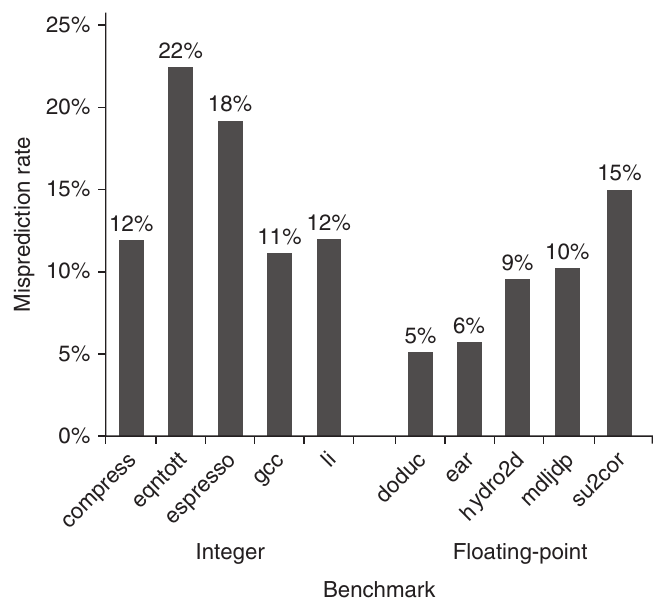

**Hình C.17 Misprediction rate trên SPEC92 của một predictor profile-based biến thiên rộng nhưng nhìn chung tốt hơn cho các chương trình floating-point, có misprediction rate trung bình 9% với độ lệch chuẩn 4%, so với chương trình integer, có misprediction rate trung bình 15% với độ lệch chuẩn 5%. Performance thực tế phụ thuộc cả độ chính xác prediction lẫn tần suất branch, thay đổi từ 3% đến 24%.**

### Dynamic Branch Prediction và Branch-Prediction Buffer

Cơ chế dynamic branch-prediction đơn giản nhất là branch-prediction buffer hoặc branch history table. branch-prediction buffer là memory nhỏ được đánh index bằng phần thấp của địa chỉ branch instruction. Memory chứa một bit cho biết branch gần đây có taken hay không. Đây là loại buffer đơn giản nhất; nó không có tag và chỉ hữu ích để giảm branch delay khi độ trễ dài hơn thời gian tính các target PC có thể.

Với buffer như vậy, thực tế không biết prediction có đúng hay không—nó có thể được một branch khác có cùng low-order address bit đặt vào đó. Nhưng điều này không quan trọng. Prediction là một gợi ý được giả định đúng, và fetch bắt đầu theo hướng dự đoán. Nếu gợi ý hóa ra sai, prediction bit được đảo rồi lưu trở lại.

Buffer này thực chất là cache mà mọi truy cập đều hit, và như sẽ thấy, performance của buffer phụ thuộc cả tần suất prediction dành cho branch đang quan tâm lẫn độ chính xác prediction khi khớp. Trước khi phân tích performance, sẽ hữu ích khi thực hiện một cải tiến nhỏ nhưng quan trọng về độ chính xác cơ chế branch-prediction.

Cơ chế prediction 1-bit đơn giản này có nhược điểm performance: Ngay cả nếu branch gần như luôn taken, chúng ta có khả năng dự đoán sai hai lần thay vì một khi nó không taken, vì misprediction khiến prediction bit bị đảo.

Để khắc phục điểm yếu này, cơ chế prediction 2-bit thường được dùng. Trong cơ chế 2-bit, prediction phải sai hai lần trước khi thay đổi. Hình C.18 cho thấy finite-state processor của cơ chế prediction 2-bit.

branch-prediction buffer có thể được triển khai như một “cache” nhỏ, đặc biệt, được truy cập bằng địa chỉ instruction trong IF pipe stage, hoặc như một cặp bit gắn vào mỗi block trong instruction cache và được fetch cùng instruction. Nếu instruction được decode là branch và branch được dự đoán taken, fetch bắt đầu từ đích ngay khi biết PC. Nếu không, fetch và thực thi tuần tự tiếp tục. Như Hình C.18, nếu prediction hóa ra sai, các prediction bit thay đổi.

Có thể kỳ vọng độ chính xác nào từ branch-prediction buffer dùng 2 bit mỗi entry trên ứng dụng thực? Hình C.19 cho thấy với SPEC89 benchmark, branch-prediction buffer 4096 entry cho độ chính xác prediction từ hơn 99% đến 82%, hay misprediction rate 1% đến 18%. Buffer 4K entry như dùng cho các kết quả này được coi là nhỏ theo tiêu chuẩn năm 2005, và buffer lớn hơn có thể cho kết quả tốt hơn phần nào.

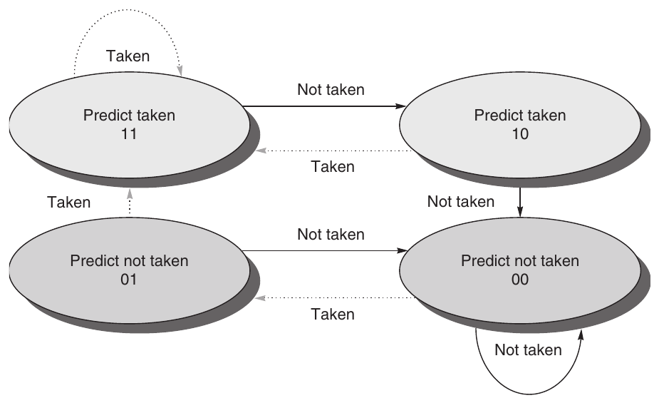

**Hình C.18 Các trạng thái trong cơ chế prediction 2-bit. Dùng 2 bit thay vì 1, một branch thiên mạnh về taken hoặc not taken—như nhiều branch—sẽ bị mispredict ít hơn với predictor 1-bit. 2 bit được dùng để mã hóa bốn trạng thái của hệ thống. Cơ chế 2-bit thực ra là một dạng chuyên biệt của cơ chế tổng quát hơn có một saturating counter n-bit cho mỗi entry trong prediction buffer. Với counter n-bit, counter có thể nhận giá trị từ 0 đến 2 – 1: Khi counn ter lớn hơn hoặc bằng one-half giá trị tối đa của nó (2<sup>n</sup> – 1), branch được dự đoán taken; nếu không, dự đoán untaken. Nghiên cứu predictor n-bit cho thấy predictor 2-bit hoạt động gần tốt bằng, nên phần lớn hệ thống dựa vào branch predictor 2-bit thay vì predictor n-bit tổng quát hơn.**

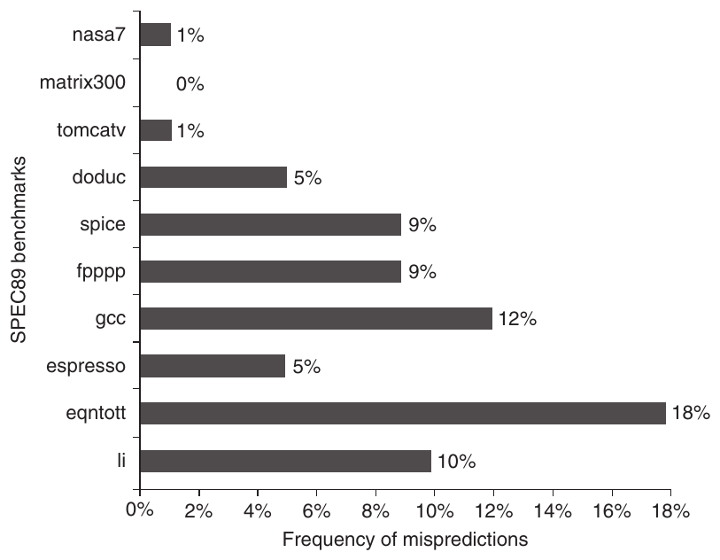

**Hình C.19 Độ chính xác prediction của prediction buffer 4096-entry 2-bit cho SPEC89 benchmark. Misprediction rate của benchmark integer (gcc, espresso, eqntott và li) cao hơn đáng kể (trung bình 11%) so với chương trình floating-point (trung bình 4%). Bỏ các kernel floating-point (nasa7, matrix300 và tomcatv) vẫn cho độ chính xác benchmark FP cao hơn benchmark integer. Dữ liệu này cũng như phần còn lại của dữ liệu trong mục được lấy từ nghiên cứu branch-prediction dùng IBM Power architecture và code tối ưu cho hệ thống đó. Xem Pan, So và Rameh [1992]. Mặc dù dữ liệu dành cho phiên bản cũ hơn của một tập con SPEC benchmark, các benchmark mới lớn hơn và sẽ cho hành vi hơi tệ hơn, đặc biệt với benchmark integer.**

Khi cố khai thác thêm ILP, độ chính xác branch prediction trở nên thiết yếu. Như thể hiện trong Hình C.19, độ chính xác predictor cho chương trình integer, thường cũng có tần suất branch cao hơn, thấp hơn so với các chương trình khoa học loop-intensive. Có thể giải quyết theo hai cách: tăng kích thước buffer và tăng độ chính xác cơ chế dùng cho mỗi prediction. Tuy nhiên, buffer 4K entry, như Hình C.20, hoạt động khá tương đương buffer vô hạn, ít nhất với benchmark như trong SPEC. Dữ liệu Hình C.20 cho thấy rõ hit rate của buffer không phải yếu tố giới hạn chính. Như đã đề cập, chỉ tăng số bit mỗi predictor mà không thay cấu trúc predictor cũng ít ảnh hưởng. Thay vào đó, cần xem cách tăng độ chính xác từng predictor.

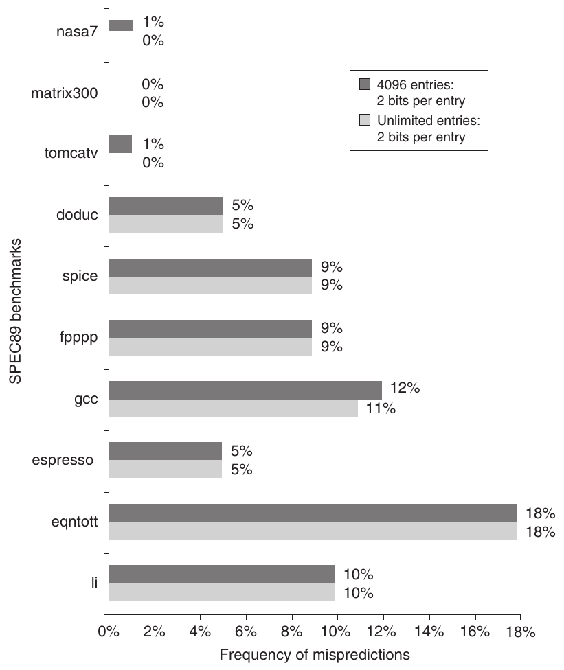

**Hình C.20 Độ chính xác prediction của prediction buffer 4096-entry 2-bit so với buffer vô hạn cho SPEC89 benchmark. Mặc dù dữ liệu dành cho phiên bản cũ hơn của một tập con SPEC benchmark, kết quả sẽ tương đương cho phiên bản mới hơn, có lẽ cần đến 8K entry để khớp một predictor 2-bit vô hạn.**

## C.3 Pipelining được triển khai như thế nào?

Trước khi tiếp tục với pipelining cơ bản, cần ôn lại một cách triển khai đơn giản của phiên bản MIPS unpipelined.

### Một cách triển khai MIPS đơn giản

Trong mục này, chúng ta theo cách của Mục C.1, trước tiên cho thấy cách triển khai unpipelined đơn giản rồi đến cách triển khai pipelined. Tuy nhiên, lần này ví dụ dành riêng cho MIPS architecture.

Trong mục này, chúng ta tập trung vào pipeline cho một tập con integer của MIPS gồm các phép toán load-store word, branch equal to zero và integer ALU. Ở phần sau phụ lục, chúng ta sẽ đưa vào các phép toán floating-point cơ bản. Mặc dù chỉ thảo luận một tập con MIPS, các nguyên lý cơ bản có thể được mở rộng để xử lý mọi instruction. Ban đầu chúng ta dùng cách triển khai branch instruction ít mạnh hơn. Chúng ta cho thấy cách triển khai phiên bản mạnh hơn ở cuối mục này.

Mọi MIPS instruction có thể được triển khai trong tối đa 5 clock cycle. 5 clock cycle như sau:

1. Instruction fetch cycle (IF):

```
IR ← Mem[PC];
NPC ← PC + 4;
```

Hoạt động—Đưa PC ra và fetch instruction từ memory vào instruction register (IR); tăng PC thêm 4 để định địa chỉ instruction tuần tự tiếp theo. IR giữ instruction sẽ cần trong các clock cycle sau; tương tự, register NPC giữ PC tuần tự tiếp theo.

2. Instruction decode/register fetch cycle (ID):

```
A ← Regs[rs];
B ← Regs[rt];
Imm ← sign-extended immediate field of IR;
```

Hoạt động—Decode instruction và truy cập register file để đọc register (rs và rt là register specifier). Output của general-purpose register được đọc vào hai register tạm (A và B) để dùng trong clock cycle sau. 16 bit thấp của IR cũng được sign extend và lưu vào register tạm Imm để dùng trong cycle tiếp theo.

Decoding được thực hiện song song với đọc register, điều có thể làm vì các trường nằm ở vị trí cố định trong định dạng MIPS instruction. Vì phần immediate của instruction nằm cùng vị trí trong mọi định dạng MIPS, immediate sign-extended cũng được tính trong cycle này phòng khi cần ở cycle tiếp theo.

3. Execution/effective address cycle (EX):

ALU thao tác trên các toán hạng chuẩn bị trong cycle trước, thực hiện một trong bốn chức năng tùy loại MIPS instruction:

- Tham chiếu memory:

```
ALUOutput ← A + Imm;
```

Hoạt động—ALU cộng các toán hạng để tạo effective address rồi đặt kết quả vào register ALUOutput.

- Register-register ALU instruction:

```
ALUOutput ← A func B;
```

Hoạt động—ALU thực hiện phép toán do function code chỉ định trên giá trị trong register A và giá trị trong register B. Kết quả được đặt trong register tạm ALUOutput.

- Register-Immediate ALU instruction:

```
ALUOutput ← A op Imm;
```

Hoạt động—ALU thực hiện phép toán do opcode chỉ định trên giá trị trong register A và giá trị trong register Imm. Kết quả được đặt trong register tạm ALUOutput.

- Branch:

```
ALUOutput ← NPC + (Imm << 2);
Cond ← (A == 0)
```

Hoạt động—ALU cộng NPC với giá trị immediate sign-extended trong Imm, được dịch sang trái 2 bit để tạo word offset, nhằm tính địa chỉ đích branch. Register A đã được đọc trong cycle trước được kiểm tra để xác định branch có taken hay không. Vì chỉ xét một dạng branch (BEQZ), phép so sánh là với 0. Lưu ý BEQZ thực ra là pseudoinstruction chuyển thành BEQ với R0 làm toán hạng. Để đơn giản, đây là dạng branch duy nhất được xét.

Architecture load-store của MIPS có nghĩa là có thể kết hợp effective address cycle và execution cycle thành một clock cycle, vì không instruction nào cần đồng thời tính địa chỉ dữ liệu, tính địa chỉ đích instruction và thực hiện phép toán trên dữ liệu. Những integer instruction khác chưa đưa vào phía trên là các dạng jump khác nhau, tương tự branch.

4. Memory access/branch completion cycle (MEM):

PC được cập nhật cho mọi instruction: PC ← NPC;

- Tham chiếu memory:

```
LMD ← Mem[ALUOutput] or
Mem[ALUOutput] ← B;
```

Hoạt động—Truy cập memory nếu cần. Nếu instruction là load, dữ liệu trở về từ memory và được đặt trong register LMD (load memory data); nếu là store, dữ liệu từ register B được ghi vào memory. Trong cả hai trường hợp, địa chỉ được dùng là địa chỉ tính trong cycle trước và lưu trong register ALUOutput.

- Branch:

```
if (cond) PC ← ALUOutput
```

Hoạt động—Nếu instruction thực hiện branch, PC được thay bằng địa chỉ đích branch trong register ALUOutput.

5. Cycle Write-back (WB):

- Register-register ALU instruction:

```
Regs[rd] ← ALUOutput;
```

- Register-immediate ALU instruction:

```
Regs[rt] ← ALUOutput;
```

- Load instruction:

```
Regs[rt] ← LMD;
```

Hoạt động—Ghi kết quả vào register file, bất kể đến từ memory system (nằm trong LMD) hay ALU (nằm trong ALUOutput); trường register đích cũng ở một trong hai vị trí (rd hoặc rt) tùy effective opcode.

Hình C.21 cho thấy cách instruction đi qua data path. Ở cuối mỗi clock cycle, mọi giá trị được tính trong clock cycle đó và cần ở clock cycle sau (cho instruction này hoặc instruction tiếp theo) được ghi vào một thiết bị lưu trữ, có thể là memory, general-purpose register, PC hoặc register tạm (tức LMD, Imm, A, B, IR, NPC, ALUOutput hoặc Cond). Các register tạm giữ giá trị giữa clock cycle cho một instruction, trong khi các phần tử lưu trữ khác là những phần nhìn thấy được của trạng thái và giữ giá trị giữa những instruction liên tiếp.

Mặc dù mọi processor ngày nay đều pipelined, cách triển khai multicycle này là một xấp xỉ hợp lý về cách phần lớn processor từng được triển khai trước đây. Một finite-state machine đơn giản có thể triển khai điều khiển theo cấu trúc 5-cycle phía trên. Với processor phức tạp hơn nhiều, có thể dùng microcode control. Trong cả hai trường hợp, chuỗi instruction như trên sẽ xác định cấu trúc điều khiển.

Có một số phần hardware dư thừa có thể loại bỏ trong cách triển khai multicycle này. Chẳng hạn, có hai ALU: một tăng PC và một dùng cho effective address cùng tính toán ALU. Vì không cần chúng trong cùng clock cycle, có thể hợp nhất bằng cách thêm multiplexer và chia sẻ cùng ALU. Tương tự, instruction và dữ liệu có thể được lưu trong cùng memory vì truy cập dữ liệu và instruction xảy ra ở clock cycle khác nhau.

Thay vì tối ưu cách triển khai đơn giản này, chúng ta giữ thiết kế như Hình C.21 vì nó cung cấp nền tảng tốt hơn cho cách triển khai pipelined.

Một phương án khác với thiết kế multicycle trong mục này là triển khai CPU để mọi instruction cần 1 clock cycle dài. Trong cách triển khai single-cycle đó, các register tạm được bỏ vì không có giao tiếp qua clock cycle trong một instruction. Mọi instruction thực thi trong 1 clock cycle dài, ghi kết quả vào data memory, register hoặc PC ở cuối clock cycle. CPI của processor như vậy bằng một. Tuy nhiên, clock cycle sẽ xấp xỉ năm lần clock cycle của processor multicycle vì mọi instruction cần đi qua mọi functional unit. Người thiết kế sẽ không bao giờ dùng cách triển khai single-cycle này vì hai lý do. Thứ nhất, nó rất kém hiệu quả cho phần lớn CPU có biến thiên đáng kể về lượng công việc, và do đó clock cycle time, cần cho các instruction khác nhau. Thứ hai, cách triển khai single-cycle cần nhân bản functional unit có thể dùng chung trong cách triển khai multicycle. Tuy nhiên, data path single-cycle này cho phép minh họa cách pipelining cải thiện clock cycle time thay vì CPI của processor.

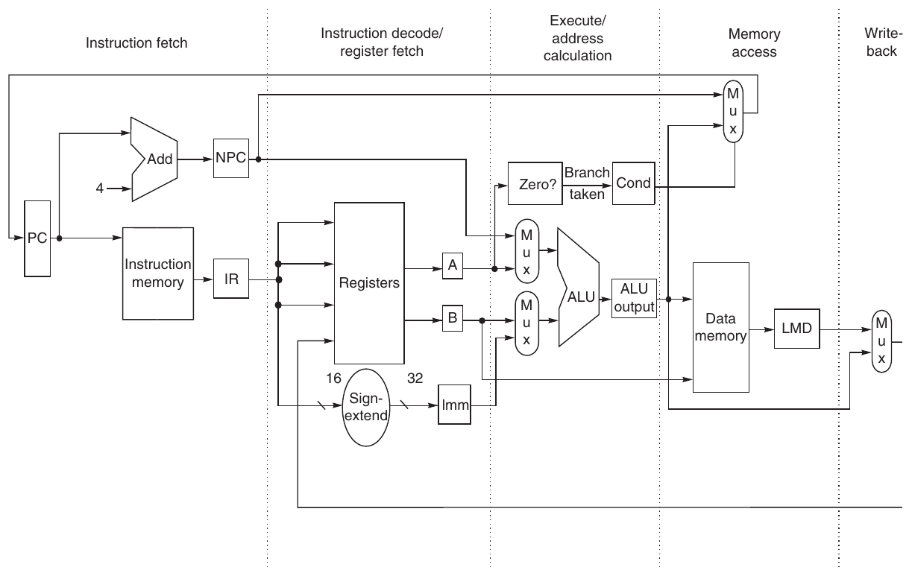

**Hình C.21 Cách triển khai MIPS data path cho phép mọi instruction được thực thi trong 4 hoặc 5 clock cycle. Mặc dù PC được thể hiện ở phần data path dùng trong instruction fetch và register ở phần dùng trong instruction decode/register fetch, cả hai functional unit này đều được một instruction đọc cũng như ghi. Mặc dù chúng ta vẽ chúng ở cycle tương ứng nơi chúng được đọc, PC được ghi trong memory access clock cycle và register được ghi trong write-back clock cycle. Trong cả hai trường hợp, việc ghi ở pipe stage sau được chỉ ra bằng multiplexer output (trong memory access hoặc write-back), mang giá trị trở lại PC hoặc register. Những tín hiệu backward-flowing này đưa vào phần lớn độ phức tạp của pipelining vì cho thấy khả năng hazard.**

### Một Pipeline cơ bản cho MIPS

Như trước, có thể pipeline data path trong Hình C.21 gần như không thay đổi bằng cách bắt đầu instruction mới mỗi clock cycle. Vì mọi pipe stage hoạt động mỗi clock cycle, mọi phép toán trong một pipe stage phải hoàn tất trong 1 clock cycle và bất kỳ tổ hợp phép toán nào cũng phải có thể xảy ra cùng lúc. Hơn nữa, pipeline data path đòi hỏi giá trị truyền từ pipe stage này sang pipe stage tiếp theo phải được đặt trong register. Hình C.22 cho thấy MIPS pipeline có các register thích hợp, gọi là pipeline register hoặc pipeline latch, giữa mỗi pipeline stage. Register được gắn tên các stage mà chúng nối. Hình C.22 được vẽ để làm rõ kết nối qua pipeline register từ stage này sang stage khác.

Mọi register cần để tạm giữ giá trị giữa clock cycle trong một instruction đều được gộp vào các pipeline register này. Các trường instruction register (IR), thuộc register IF/ID, được gắn nhãn khi dùng để cung cấp tên register. Pipeline register mang cả dữ liệu lẫn điều khiển từ pipeline stage này sang stage tiếp theo. Mọi giá trị cần ở pipeline stage sau phải được đặt trong register như vậy và sao chép từ pipeline register này sang pipeline register tiếp theo cho đến khi không còn cần. Nếu cố chỉ dùng các register tạm trong data path unpipelined trước đây, giá trị có thể bị ghi đè trước khi hoàn tất mọi lần sử dụng. Chẳng hạn, trường toán hạng register dùng để ghi trong load hoặc phép toán ALU được cung cấp từ MEM/WB pipeline register thay vì IF/ID register. Đó là vì chúng ta muốn load hoặc phép toán ALU ghi register được chính phép toán đó chỉ định, không phải trường register của instruction hiện đang chuyển từ IF sang ID! Trường destination register này đơn giản được sao chép từ pipeline register này sang pipeline register tiếp theo cho đến khi cần trong WB stage.

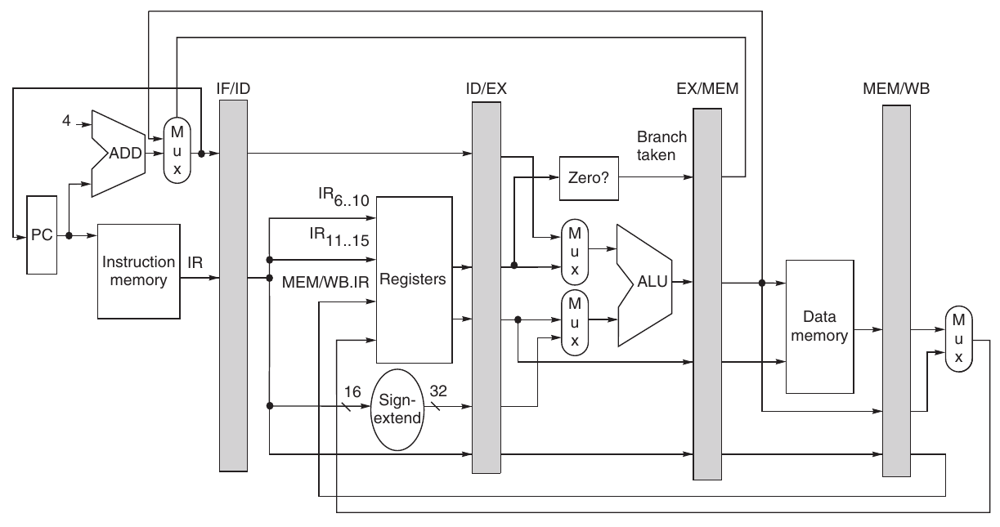

**Hình C.22 Data path được pipeline bằng cách thêm một tập register, mỗi register nằm giữa một cặp pipe stage. Register truyền giá trị và thông tin điều khiển từ stage này sang stage tiếp theo. Cũng có thể xem PC là pipeline register nằm trước IF stage, dẫn đến một pipeline register cho mỗi pipe stage. Nhớ rằng PC là register edge-triggered được ghi cuối clock cycle; do đó không có race condition khi ghi PC. Selection multiplexer của PC đã được chuyển để PC được ghi trong đúng một stage (IF). Nếu không chuyển nó, sẽ có conflict khi branch xảy ra vì hai instruction sẽ cố ghi giá trị khác nhau vào PC. Phần lớn data path đi từ trái sang phải, tức từ thời điểm sớm hơn đến muộn hơn. Các path đi từ phải sang trái (mang thông tin register write-back và thông tin PC khi branch) đưa vào những phức tạp trong pipeline.**

Mỗi instruction chỉ hoạt động trong đúng một stage của pipeline tại một thời điểm; vì vậy, mọi hành động thay mặt một instruction xảy ra giữa một cặp pipeline register. Do đó, cũng có thể xem hoạt động pipeline bằng cách xét điều phải xảy ra trên mỗi pipeline stage tùy loại instruction. Hình C.23 cho thấy góc nhìn này. Các trường của pipeline register được đặt tên để thể hiện luồng dữ liệu từ stage này sang stage tiếp theo. Lưu ý hành động trong hai stage đầu độc lập với loại instruction hiện tại; chúng phải độc lập vì instruction chỉ được decode ở cuối ID stage. Hoạt động IF phụ thuộc instruction trong EX/MEM có phải taken branch hay không. Nếu có, địa chỉ branch-target của branch instruction trong EX/MEM được ghi vào PC cuối IF; nếu không, PC đã tăng được ghi lại. (Như đã nói, tác động này của branch dẫn đến phức tạp trong pipeline mà chúng ta xử lý trong vài mục tiếp theo.) Encoding fixed-position của các toán hạng register nguồn thiết yếu để cho phép fetch register trong ID.

Để điều khiển pipeline đơn giản này, chỉ cần xác định cách đặt điều khiển cho bốn multiplexer trong data path Hình C.22. Hai multiplexer trong ALU stage được đặt tùy loại instruction, được quyết định bởi trường IR của register ID/EX. Multiplexer ALU input phía trên được đặt tùy instruction có phải branch hay không, còn multiplexer phía dưới tùy instruction là phép toán ALU register-register hay bất kỳ loại phép toán nào khác. Multiplexer trong IF stage chọn dùng giá trị PC đã tăng hay giá trị EX/MEM.ALUOutput (đích branch) để ghi vào PC. Multiplexer này được điều khiển bởi trường EX/MEM.cond. Multiplexer thứ tư được điều khiển tùy instruction trong WB stage là load hay phép toán ALU. Ngoài bốn multiplexer này, còn cần một multiplexer không được vẽ trong Hình C.22 nhưng có thể thấy rõ khi xem WB stage của phép toán ALU. Trường destination register nằm ở một trong hai vị trí khác nhau tùy loại instruction (ALU register-register so với ALU immediate hoặc load). Vì vậy, cần một multiplexer để chọn phần IR đúng trong register MEM/WB nhằm chỉ định trường register đích, giả sử instruction ghi một register.

### Triển khai điều khiển cho MIPS Pipeline

Quá trình để instruction chuyển từ instruction decode stage (ID) vào execution stage (EX) của pipeline thường được gọi là instruction issue; instruction đã thực hiện bước này được nói là đã issued. Với MIPS integer pipeline, mọi data hazard có thể được kiểm tra trong ID phase. Nếu có data hazard, instruction bị stall trước khi issue. Tương tự, có thể xác định forwarding cần thiết trong ID và đặt điều khiển thích hợp khi đó. Phát hiện interlock sớm trong pipeline giảm độ phức tạp hardware vì hardware không bao giờ phải đình chỉ một instruction đã cập nhật trạng thái processor, trừ khi toàn bộ processor bị stall. Một cách khác là phát hiện hazard hoặc forwarding ở đầu clock cycle dùng toán hạng (EX và MEM cho pipeline này). Để thể hiện khác biệt giữa hai cách, chúng ta cho thấy cách triển khai interlock cho read after write (RAW) hazard có nguồn từ load instruction (gọi là load interlock) bằng kiểm tra trong ID, trong khi các forwarding path đến ALU input có thể được triển khai trong EX. Hình C.24 liệt kê những tình huống khác nhau cần xử lý.

| Stage | Mọi instruction |  |  |
|---|---|---|---|
| IF | IF/ID.IR ← Mem[PC];<br>IF/ID.NPC,PC ← (if ((EX/MEM.opcode == branch) & EX/MEM.cond){EX/MEM.<br>ALUOutput} else {PC+4}); |  |  |
| ID | ID/EX.A ← Regs[IF/ID.IR[rs]]; ID/EX.B ← Regs[IF/ID.IR[rt]];<br>ID/EX.NPC ← IF/ID.NPC; ID/EX.IR ← IF/ID.IR;<br>ID/EX.Imm ← sign-extend(IF/ID.IR[immediate field]); |  |  |
|  | ALU instruction | Load instruction hoặc store instruction | Branch instruction |
| EX | EX/MEM.IR ← ID/EX.IR;<br>EX/MEM.ALUOutput ←<br>ID/EX.A func ID/EX.B;<br>or<br>EX/MEM.ALUOutput ←<br>ID/EX.A op ID/EX.Imm; | EX/MEM.IR to ID/EX.IR<br>EX/MEM.ALUOutput ←<br>ID/EX.A + ID/EX.Imm;<br>EX/MEM.B ← ID/EX.B; | EX/MEM.ALUOutput ←<br>ID/EX.NPC +<br>(ID/EX.Imm << 2);<br>EX/MEM.cond ←<br>(ID/EX.A == 0); |
| MEM | MEM/WB.IR ← EX/MEM.IR;<br>MEM/WB.ALUOutput ←<br>EX/MEM.ALUOutput; | MEM/WB.IR ← EX/MEM.IR;<br>MEM/WB.LMD ←<br>Mem[EX/MEM.ALUOutput];<br>or<br>Mem[EX/MEM.ALUOutput] ←<br>EX/MEM.B; |  |
| WB | Regs[MEM/WB.IR[rd]] ←<br>MEM/WB.ALUOutput;<br>or<br>Regs[MEM/WB.IR[rt]] ←<br>MEM/WB.ALUOutput; | Chỉ cho load:<br>Regs[MEM/WB.IR[rt]] ←<br>MEM/WB.LMD; |  |

**Hình C.23 Sự kiện trên mỗi pipe stage của MIPS pipeline. Hãy ôn lại các hành động trong stage đặc trưng cho tổ chức pipeline. Trong IF, ngoài fetch instruction và tính PC mới, chúng ta lưu PC đã tăng vào cả PC lẫn pipeline register (NPC) để dùng về sau cho việc tính địa chỉ branch-target. Cấu trúc giống tổ chức Hình C.22, nơi PC được cập nhật trong IF từ một trong hai nguồn. Trong ID, chúng ta fetch register, mở rộng dấu của 16 bit thấp IR (trường immediate) và truyền tiếp IR, NPC. Trong EX, thực hiện phép toán ALU hoặc tính địa chỉ; truyền tiếp IR và register B (nếu instruction là store). Cũng đặt cond bằng 1 nếu instruction là taken branch. Trong MEM phase, chúng ta thực hiện cycle memory, ghi PC nếu cần và truyền tiếp giá trị cần trong pipe stage cuối. Cuối cùng, trong WB, cập nhật trường register từ ALU output hoặc giá trị đã load. Để đơn giản luôn truyền toàn bộ IR từ stage này sang stage tiếp theo, mặc dù khi instruction tiến xuống pipeline, phần IR cần ngày càng ít.**

| Tình huống | Chuỗi code ví dụ | Hành động |
|---|---|---|
| No dependence | LD R1,45(R2)<br>DADD R5,R6,R7<br>DSUB R8,R6,R7<br>OR R9,R6,R7 | Không thể có hazard vì không có dependence trên R1 trong ba instruction ngay sau. |
| Dependence requiring stall | LD R1,45(R2)<br>DADD R5,R1,R7<br>DSUB R8,R6,R7<br>OR R9,R6,R7 | Comparator phát hiện việc dùng R1 trong DADD và stall DADD (cùng DSUB và OR) trước khi DADD bắt đầu EX. |
| Dependence overcome by forwarding | LD R1,45(R2)<br>DADD R5,R6,R7<br>DSUB R8,R1,R7<br>OR R9,R6,R7 | Comparator phát hiện việc dùng R1 trong DSUB và forward kết quả load đến ALU kịp để DSUB bắt đầu EX. |
| Dependence with accesses in order | LD R1,45(R2)<br>DADD R5,R6,R7<br>DSUB R8,R6,R7<br>OR R9,R1,R7 | Không cần hành động vì OR đọc R1 trong nửa sau ID phase, còn việc ghi dữ liệu đã load diễn ra trong nửa đầu. |

**Hình C.24 Các tình huống mà pipeline hazard detection hardware có thể thấy bằng cách so sánh đích và nguồn của các instruction liền kề. Bảng chỉ ra so sánh duy nhất cần thiết là giữa đích và các nguồn trên hai instruction theo sau instruction đã ghi đích. Khi có stall, pipeline dependence sẽ trông như trường hợp thứ ba khi thực thi tiếp tục. Tất nhiên, có thể bỏ qua hazard liên quan R0 vì register luôn chứa 0, và có thể mở rộng phép kiểm tra phía trên để làm vậy.**

Hãy bắt đầu triển khai load interlock. Nếu có RAW hazard với instruction nguồn là load, load instruction sẽ ở EX stage khi instruction cần dữ liệu load ở ID stage. Vì vậy, có thể mô tả mọi tình huống hazard khả dĩ bằng một bảng nhỏ, có thể chuyển trực tiếp thành cách triển khai. Hình C.25 cho thấy bảng phát hiện mọi load interlock khi instruction dùng kết quả load ở ID stage.

Khi phát hiện hazard, control unit phải chèn pipeline stall và ngăn instruction trong IF stage, ID stage tiến tiếp. Như đã nói, mọi thông tin điều khiển được mang trong pipeline register. (Mang theo instruction là đủ vì mọi điều khiển suy ra từ nó.) Vì vậy, khi phát hiện hazard, chỉ cần thay phần điều khiển của ID/EX pipeline register thành toàn bit 0, tình cờ là no-op (instruction không làm gì, như DADD R0,R0,R0). Ngoài ra, đơn giản cho nội dung các IF/ID register quay vòng để giữ instruction bị stall. Trong pipeline có hazard phức tạp hơn, cùng ý tưởng được áp dụng: Có thể phát hiện hazard bằng cách so sánh một tập pipeline register và đưa no-ops vào để ngăn thực thi sai.

Triển khai forwarding logic tương tự, dù có nhiều trường hợp hơn cần xem xét. Quan sát then chốt để triển khai forwarding logic là pipeline register chứa cả dữ liệu cần forward lẫn trường register nguồn và đích. Về logic, mọi forwarding diễn ra từ ALU output hoặc data memory output đến ALU input, data memory input hoặc zero detection unit. Vì vậy, có thể triển khai forwarding bằng cách so sánh các destination register của IR trong EX/MEM và MEM/WB stage với source register của IR trong ID/EX và EX/MEM register. Hình C.26 cho thấy các phép so sánh và forwarding operation có thể khi đích của kết quả được forward là một ALU input cho instruction hiện ở EX.

| Trường opcode của ID/EX (ID/EX.IR<sub>0..5</sub>) | Trường opcode của IF/ID (IF/ID.IR<sub>0..5</sub>) | Các trường toán hạng khớp |
|---|---|---|
| Load | Register-register ALU | ID/EX.IR[rt] == IF/ID.IR[rs] |
| Load | Register-register ALU | ID/EX.IR[rt] == IF/ID.IR[rt] |
| Load | Load, store, ALU immediate, or branch | ID/EX.IR[rt] == IF/ID.IR[rs] |

**Hình C.25 Logic phát hiện nhu cầu load interlock trong ID stage của instruction cần ba phép so sánh. Dòng 1 và 2 của bảng kiểm tra destination register của load có phải một source register của phép toán register-register trong ID hay không. Dòng 3 xác định destination register của load có phải nguồn cho effective address của load hoặc store, ALU immediate hoặc phép kiểm tra branch hay không. Nhớ rằng IF/ID register giữ trạng thái instruction trong ID, có thể dùng kết quả load, trong khi ID/EX giữ trạng thái instruction trong EX, chính là load instruction.**

Ngoài comparator và combinational logic cần để xác định khi nào bật forwarding path, cũng phải mở rộng multiplexer tại ALU input và thêm các kết nối từ pipeline register dùng để forward kết quả. Hình C.27 cho thấy các phần liên quan của data path pipelined với những multiplexer và kết nối bổ sung.

Với MIPS, hazard detection hardware và forwarding hardware khá đơn giản; chúng ta sẽ thấy mọi thứ phức tạp hơn phần nào khi mở rộng pipeline để xử lý floating point. Trước khi làm vậy, cần xử lý branch.

### Xử lý Branch trong Pipeline

Trong MIPS, branch (BEQ và BNE) cần kiểm tra một register có bằng register khác hay không, register đó có thể là R0. Nếu chỉ xét BEQZ và BNEZ, cần kiểm tra bằng không, có thể hoàn tất quyết định ở cuối ID cycle bằng cách chuyển zero test vào cycle đó. Để tận dụng quyết định sớm về branch có taken hay không, cả hai PC (taken và untaken) phải được tính sớm. Tính địa chỉ branch-target trong ID cần một adder bổ sung vì ALU chính, dùng cho chức năng này đến nay, không dùng được cho đến EX. Hình C.28 cho thấy data path pipelined đã sửa. Với adder riêng và quyết định branch trong ID, chỉ có stall 1-clock-cycle trên branch. Mặc dù giảm branch delay xuống 1 cycle, điều này có nghĩa một ALU instruction theo sau bởi branch trên kết quả của instruction đó sẽ chịu data hazard stall. Hình C.29 cho thấy phần branch của pipeline table được sửa từ Hình C.23.

| Pipeline register chứa source instruction | Opcode của source instruction | Pipeline register chứa destination instruction | Opcode của destination instruction | Destination của kết quả được forward | So sánh (nếu bằng nhau thì forward) |
|---|---|---|---|---|---|
| EX/MEM | Register-register ALU | ID/EX | Register-register ALU, ALU immediate, load, store, branch | ALU input phía trên | EX/MEM.IR[rd] == ID/EX.IR[rs] |
| EX/MEM | Register-register ALU | ID/EX | Register-register ALU | ALU input phía dưới | EX/MEM.IR[rd] == ID/EX.IR[rt] |
| MEM/WB | Register-register ALU | ID/EX | Register-register ALU, ALU immediate, load, store, branch | ALU input phía trên | MEM/WB.IR[rd] == ID/EX.IR[rs] |
| MEM/WB | Register-register ALU | ID/EX | Register-register ALU | ALU input phía dưới | MEM/WB.IR[rd] == ID/EX.IR[rt] |
| EX/MEM | ALU immediate | ID/EX | Register-register ALU, ALU immediate, load, store, branch | ALU input phía trên | EX/MEM.IR[rt] == ID/EX.IR[rs] |
| EX/MEM | ALU immediate | ID/EX | Register-register ALU | ALU input phía dưới | EX/MEM.IR[rt] == ID/EX.IR[rt] |
| MEM/WB | ALU immediate | ID/EX | Register-register ALU, ALU immediate, load, store, branch | ALU input phía trên | MEM/WB.IR[rt] == ID/EX.IR[rs] |
| MEM/WB | ALU immediate | ID/EX | Register-register ALU | ALU input phía dưới | MEM/WB.IR[rt] == ID/EX.IR[rt] |
| MEM/WB | Load | ID/EX | Register-register ALU, ALU immediate, load, store, branch | ALU input phía trên | MEM/WB.IR[rt] == ID/EX.IR[rs] |
| MEM/WB | Load | ID/EX | Register-register ALU | ALU input phía dưới | MEM/WB.IR[rt] == ID/EX.IR[rt] |

**Hình C.26 Việc forward data đến hai ALU input (cho instruction trong EX) có thể xuất phát từ ALU result (trong EX/MEM hoặc MEM/WB) hoặc load result trong MEM/WB. Cần 10 phép so sánh riêng để xác định có nên thực hiện forwarding operation hay không. ALU input phía trên và phía dưới lần lượt tương ứng source operand thứ nhất và thứ hai của ALU, được thể hiện rõ trong Hình C.21 trang C-34 và Hình C.27 trang C-41. Nhớ rằng pipeline latch cho destination instruction trong EX là ID/EX, còn source value đến từ phần ALUOutput của EX/MEM hoặc MEM/WB, hoặc phần LMD của MEM/WB. Có một điểm phức tạp mà logic này chưa xử lý: nhiều instruction ghi cùng register. Chẳng hạn, trong chuỗi code DADD R1, R2, R3; DADDI R1, R1, #2; DSUB R4, R3, R1, logic phải bảo đảm DSUB dùng kết quả DADDI thay vì DADD. Có thể mở rộng logic trên để xử lý bằng cách chỉ cho phép forwarding từ MEM/WB khi forwarding từ EX/MEM chưa được bật cho cùng input. Vì kết quả DADDI nằm trong EX/MEM, nó sẽ được forward thay vì kết quả DADD trong MEM/WB.**

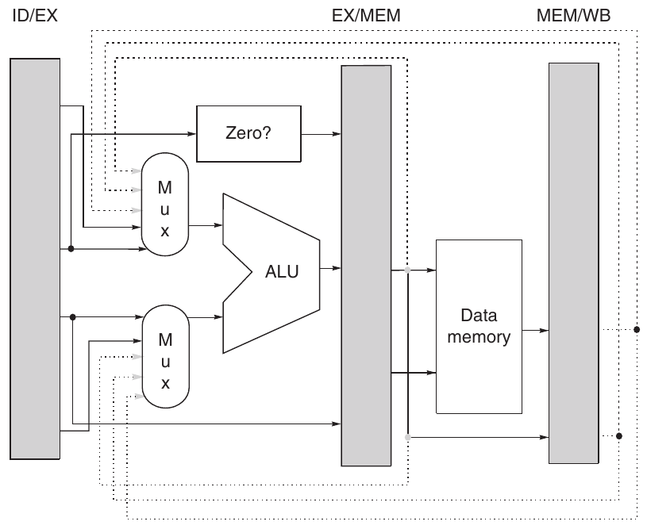

**Hình C.27 Forwarding kết quả đến ALU đòi hỏi thêm ba input trên mỗi ALU multiplexer và ba path đến các input mới. Những path tương ứng với bypass của: (1) ALU output ở cuối EX, (2) ALU output ở cuối MEM stage và (3) memory output ở cuối MEM stage.**

Trong một số processor, branch hazard còn tốn nhiều clock cycle hơn ví dụ này vì thời gian đánh giá branch condition và tính destination có thể dài hơn. Chẳng hạn, processor có decode stage và register fetch stage riêng có lẽ sẽ có branch delay — chiều dài control hazard — dài hơn ít nhất 1 clock cycle. Nếu không được xử lý, branch delay trở thành branch penalty. Nhiều CPU cũ triển khai instruction set phức tạp hơn có branch delay 4 clock cycle trở lên; các processor lớn với pipeline sâu thường có branch penalty 6 hoặc 7. Nhìn chung, pipeline càng sâu thì branch penalty tính bằng clock cycle càng lớn. Dĩ nhiên, ảnh hưởng tương đối của branch penalty dài hơn đến performance phụ thuộc tổng CPI của processor. Processor low-CPI có thể chấp nhận branch tốn kém hơn vì tỉ lệ performance bị mất do branch thấp hơn.

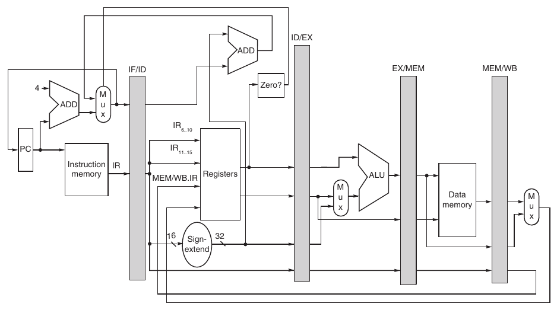

**Hình C.28 Có thể giảm stall do branch hazard bằng cách chuyển zero test và branch-target calculation vào ID phase của pipeline. Lưu ý có hai thay đổi quan trọng, mỗi thay đổi loại bỏ 1 cycle khỏi stall 3-cycle của branch. Thay đổi đầu là chuyển cả branch-target address calculation lẫn quyết định branch condition sang ID cycle. Thay đổi thứ hai là ghi PC của instruction trong IF phase, dùng branch-target address tính trong ID hoặc PC đã tăng tính trong IF. Ngược lại, Hình C.22 lấy branch-target address từ EX/MEM register và ghi kết quả trong MEM clock cycle. Như đã đề cập ở Hình C.22, có thể xem PC là pipeline register (chẳng hạn một phần ID/IF), được ghi address của instruction tiếp theo ở cuối mỗi IF cycle.**

| Pipe stage | Branch instruction |
|---|---|
| IF | IF/ID.IR ← Mem[PC];<br>IF/ID.NPC,PC ← (if ((IF/ID.opcode == branch) & (Regs[IF/ID.IR<sub>6..10</sub>]<br>op 0)) {IF/ID.NPC + sign-extended (IF/ID.IR[immediate field] << 2) else {PC + 4}); |
| ID | ID/EX.A ← Regs[IF/ID.IR<sub>6..10</sub>]; ID/EX.B ← Regs[IF/ID.IR<sub>11..15</sub>];<br>ID/EX.IR ← IF/ID.IR;<br>ID/EX.Imm ← (IF/ID.IR<sub>16</sub>)<sup>16</sup>##IF/ID.IR<sub>16..31</sub> |
| EX |  |
| MEM |  |
| WB |  |

**Hình C.29 Cấu trúc pipeline được sửa đổi này dựa trên bản gốc trong Hình C.23. Nó dùng adder riêng như Hình C.28 để tính branch-target address trong ID. Những operation mới hoặc thay đổi được in đậm. Vì phép cộng branch-target address diễn ra trong ID, nó xảy ra với mọi instruction; branch condition (Regs[IF/ID.IR<sub>6..10</sub>] op 0) cũng được thực hiện với mọi instruction. Việc chọn sequential PC hoặc branch-target PC vẫn diễn ra trong IF, nhưng giờ dùng các giá trị từ ID stage tương ứng với giá trị được instruction trước đặt. Thay đổi này giảm branch penalty 2 cycle: một cycle nhờ đánh giá branch target và condition sớm hơn, một cycle nhờ điều khiển PC selection trong cùng clock thay vì clock tiếp theo. Vì giá trị cond được đặt thành 0 trừ khi instruction trong ID là taken branch, processor phải decode instruction trước cuối ID. Vì branch hoàn tất ở cuối ID, các stage EX, MEM và WB không được dùng cho branch. Có thêm điểm phức tạp đối với jump có offset dài hơn branch. Có thể giải quyết bằng adder bổ sung cộng PC và 26 bit thấp của IR sau khi shift trái 2 bit.**

## C.4 Điều gì khiến Pipelining khó triển khai?

Bây giờ đã hiểu cách phát hiện và giải quyết hazard, chúng ta có thể xử lý một số điểm phức tạp đã tránh cho đến lúc này. Phần đầu mục này xem xét những thách thức của tình huống exception, khi instruction execution order thay đổi theo cách bất ngờ. Phần thứ hai thảo luận một số thách thức do những instruction set khác nhau đặt ra.

### Xử lý Exception

Tình huống exception khó xử lý hơn trong CPU pipelined vì sự chồng lấp instruction khiến khó biết một instruction có thể thay đổi CPU state một cách an toàn hay không. Trong CPU pipelined, instruction được thực thi từng phần và chỉ hoàn tất sau vài clock cycle. Đáng tiếc, các instruction khác trong pipeline có thể raise exception, buộc CPU hủy những instruction trong pipeline trước khi chúng hoàn tất. Trước khi thảo luận chi tiết các vấn đề và giải pháp, chúng ta cần hiểu những loại tình huống có thể xảy ra và yêu cầu architecture để hỗ trợ chúng.

#### Các loại Exception và yêu cầu

Thuật ngữ mô tả tình huống exception, khi normal execution order của instruction thay đổi, khác nhau giữa các CPU. Các thuật ngữ interrupt, fault và exception được dùng nhưng không nhất quán. Chúng ta dùng exception để bao quát mọi cơ chế này, bao gồm:

- Request từ I/O device

- Gọi một operating system service từ user program

- Theo dõi instruction execution

- Breakpoint (interrupt programmer-requested)

- Integer arithmetic overflow

- Bất thường trong FP arithmetic

- Page fault (không ở main memory)

- Memory access Misaligned (nếu yêu cầu alignment)

- Memory protection violation

- Sử dụng instruction undefined hoặc chưa được triển khai

- Trục trặc hardware

- Mất nguồn

Khi muốn nói đến một lớp exception cụ thể, chúng ta dùng tên dài hơn như I/O interrupt, exception floating-point hoặc page fault. Hình C.30 cho thấy các tên gọi khác nhau của những exception event phổ biến ở trên.

| Exception event | IBM 360 | VAX | Motorola 680x0 | Intel 80x86 |
|---|---|---|---|---|
| Request từ I/O device | Input/output interruption | Device interrupt | Exception (L0 to L7 autovector) | Vectored interrupt |
| Gọi operating system service từ user program | Supervisor call interruption | Exception (change mode supervisor trap) | Exception (unimplemented instruction)—on Macintosh | Interrupt (INT instruction) |
| Theo dõi instruction execution | Không áp dụng | Exception (trace fault) | Exception (trace) | Interrupt (single-step trap) |
| Breakpoint | Không áp dụng | Exception (breakpoint fault) | Exception (illegal instruction or breakpoint) | Interrupt (breakpoint trap) |
| Integer arithmetic overflow hoặc underflow; FP trap | Program interruption (overflow or underflow exception) | Exception (integer overflow trap or floating underflow fault) | Exception (floating-point coprocessor errors) | Interrupt (overflow trap or math unit exception) |
| Page fault (not in main memory) | Không áp dụng (chỉ trong 370) | Exception (translation not valid fault) | Exception (memory-management unit errors) | Interrupt (page fault) |
| Memory access Misaligned | Program interruption (specification exception) | Không áp dụng | Exception (address error) | Không áp dụng |
| Vi phạm memory protection | Program interruption (protection exception) | Exception (access control violation fault) | Exception (bus error) | Interrupt (protection exception) |
| Sử dụng instruction undefined | Program interruption (operation exception) | Exception (opcode privileged/reserved fault) | Exception (illegal instruction or breakpoint/unimplemented instruction) | Interrupt (invalid opcode) |
| Trục trặc hardware | Machine-check interruption | Exception (machine-check abort) | Exception (bus error) | Không áp dụng |
| Mất nguồn | Machine-check interruption | Urgent interrupt | Không áp dụng | Nonmaskable interrupt |

**Hình C.30 Tên của những exception phổ biến khác nhau giữa bốn architecture. Mọi event trên IBM 360 và 80x86 được gọi là interrupt, còn mọi event trên 680x0 được gọi là exception. VAX chia event thành interrupt hoặc exception. Những tính từ device, software và urgent được dùng với VAX interrupt, còn VAX exception được chia thành fault, trap và abort.**

Mặc dù dùng exception để bao quát mọi event này, từng event có những đặc điểm quan trọng quyết định hardware cần hành động gì. Có thể mô tả yêu cầu của exception theo năm trục semi-independent:

1. Synchronous so với asynchronous — Nếu event xảy ra tại cùng vị trí mỗi khi chương trình thực thi với cùng data và memory allocation, event là synchronous. Ngoại trừ hardware malfunction, asynchronous event do thiết bị bên ngoài CPU và memory gây ra. Asynchronous event thường có thể được xử lý sau khi instruction hiện tại hoàn tất, khiến chúng dễ xử lý hơn.

2. User requested so với coerced — Nếu user task trực tiếp yêu cầu, đó là event user-requested. Theo một nghĩa nào đó, exception user-requested không thực sự là exception vì có thể dự đoán. Tuy nhiên, chúng được xem là exception vì cùng cơ chế lưu và khôi phục state được dùng cho các event user-requested này. Vì chức năng duy nhất của instruction kích hoạt exception này là gây exception, exception user-requested luôn có thể được xử lý sau khi instruction hoàn tất. Exception coerced do một hardware event ngoài sự điều khiển của user program gây ra. Chúng khó triển khai hơn vì không thể dự đoán.

3. User maskable so với user nonmaskable — Nếu user task có thể mask hoặc disable event, event là user maskable. Mask này chỉ điều khiển hardware có phản hồi exception hay không.

4. Bên trong so với giữa các instruction — Phân loại này phụ thuộc event có ngăn instruction hoàn tất bằng cách xảy ra giữa quá trình thực thi — dù ngắn đến đâu — hay được nhận diện giữa các instruction. Exception xảy ra trong instruction thường synchronous vì instruction kích hoạt exception. Exception xảy ra trong instruction khó triển khai hơn exception giữa các instruction vì phải dừng rồi restart instruction. Asynchronous exception xảy ra trong instruction xuất phát từ tình huống thảm họa (chẳng hạn hardware malfunction) và luôn khiến chương trình kết thúc.

5. Resume so với terminate — Nếu execution của chương trình luôn dừng sau interrupt, đó là terminating event. Nếu chương trình tiếp tục sau interrupt, đó là resuming event. Exception kết thúc execution dễ triển khai hơn vì CPU không cần có khả năng restart execution của cùng chương trình sau khi xử lý exception.

Hình C.31 phân loại những ví dụ trong Hình C.30 theo năm nhóm này. Công việc khó là triển khai interrupt xảy ra trong instruction mà instruction phải được resume. Việc triển khai đòi hỏi gọi một chương trình khác để lưu state của chương trình đang thực thi, khắc phục nguyên nhân exception rồi khôi phục state trước khi thử lại instruction gây exception. Quá trình này thực chất phải vô hình đối với chương trình đang chạy. Nếu pipeline cho processor khả năng xử lý exception, lưu state và restart mà không ảnh hưởng execution của chương trình, pipeline hoặc processor được gọi là restartable. Trong khi supercomputer và microprocessor đời đầu thường thiếu tính chất này, gần như mọi processor ngày nay đều hỗ trợ nó, ít nhất cho integer pipeline, vì nó cần thiết để triển khai virtual memory (xem Chương 2).

| Exception type | Synchronous so với asynchronous | User request so với coerced | User maskable so với nonmaskable | Bên trong so với giữa các instruction | Resume so với terminate |
|---|---|---|---|---|---|
| Request từ I/O device | Asynchronous | Coerced | Nonmaskable | Between | Resume |
| Gọi operating system | Synchronous | User request | Nonmaskable | Between | Resume |
| Theo dõi instruction execution | Synchronous | User request | User maskable | Between | Resume |
| Breakpoint | Synchronous | User request | User maskable | Between | Resume |
| Integer arithmetic overflow | Synchronous | Coerced | User maskable | Within | Resume |
| Arithmetic overflow hoặc underflow Floating-point | Synchronous | Coerced | User maskable | Within | Resume |
| Page fault | Synchronous | Coerced | Nonmaskable | Within | Resume |
| Memory access Misaligned | Synchronous | Coerced | User maskable | Within | Resume |
| Vi phạm memory protection | Synchronous | Coerced | Nonmaskable | Within | Resume |
| Sử dụng instruction undefined | Synchronous | Coerced | Nonmaskable | Within | Terminate |
| Trục trặc hardware | Asynchronous | Coerced | Nonmaskable | Within | Terminate |
| Mất nguồn | Asynchronous | Coerced | Nonmaskable | Within | Terminate |

**Hình C.31 Năm nhóm được dùng để xác định hành động cần thiết cho những exception type trong Hình C.30. Exception phải cho phép tiếp tục được đánh dấu resume, mặc dù software thường có thể chọn kết thúc chương trình. Exception synchronous, coerced xảy ra trong instruction và có thể resume là loại khó triển khai nhất. Chúng ta có thể kỳ vọng memory protection access violation luôn dẫn đến kết thúc; tuy nhiên, operating system hiện đại dùng memory protection để phát hiện event như lần đầu thử dùng page hoặc lần đầu write vào page. Vì vậy, CPU nên có thể resume sau các exception như vậy.**

#### Dừng và khởi động lại Execution

Giống implementation unpipelined, những exception khó nhất có hai tính chất: (1) xảy ra bên trong instruction (tức giữa instruction execution, tương ứng EX hoặc MEM pipe stage) và (2) phải restartable. Chẳng hạn, trong pipeline MIPS, virtual memory page fault do data fetch chỉ có thể xảy ra tại một thời điểm trong MEM stage. Khi fault được nhận thấy, một số instruction khác đã đang thực thi. Page fault phải restartable và cần process khác như operating system can thiệp. Vì vậy, phải dừng pipeline an toàn và lưu state để instruction được restart đúng state. Restart thường được triển khai bằng cách lưu PC của instruction cần restart. Nếu instruction đó không phải branch, chúng ta tiếp tục fetch các instruction kế tiếp tuần tự và bắt đầu thực thi bình thường. Nếu là branch, chúng ta đánh giá lại branch condition và bắt đầu fetch từ target hoặc fall-through. Khi exception xảy ra, pipeline control có thể thực hiện những bước sau để lưu pipeline state an toàn:

1. Đưa bắt buộc một trap instruction vào pipeline ở IF tiếp theo.

2. Cho đến khi trap được thực hiện, tắt mọi write của instruction gây fault và mọi instruction theo sau trong pipeline; có thể làm bằng cách đặt zero vào pipeline latch của mọi instruction, bắt đầu từ instruction gây exception nhưng không bao gồm instruction trước nó. Cách này ngăn mọi state change của instruction sẽ không hoàn tất trước khi exception được xử lý.

3. Sau khi exception-handling routine trong operating system nhận quyền điều khiển, nó lập tức lưu PC của instruction gây fault. Giá trị này sẽ dùng để trở về từ exception sau đó.

Khi dùng delayed branch như đã đề cập ở mục trước, không còn có thể re-create state của processor bằng một PC duy nhất vì các instruction trong pipeline có thể không liên hệ tuần tự. Vì vậy, cần lưu và khôi phục số PC bằng chiều dài branch delay cộng một. Việc này được thực hiện ở bước thứ ba phía trên.

Sau khi exception được xử lý, các instruction đặc biệt đưa processor trở về từ exception bằng cách load lại PC và restart instruction stream (dùng RFE trong MIPS). Nếu có thể dừng pipeline sao cho những instruction ngay trước instruction gây fault đã hoàn tất và những instruction sau nó có thể restart từ đầu, pipeline được gọi là có precise exception. Lý tưởng nhất, instruction gây fault chưa thay đổi state, và việc xử lý đúng một số exception đòi hỏi instruction gây fault không có tác động nào. Với các exception khác, như floating-point exception, instruction gây fault trên một số processor ghi kết quả trước khi exception có thể được xử lý. Khi đó, hardware phải sẵn sàng lấy lại source operand ngay cả khi destination trùng một source operand. Vì floating-point operation có thể chạy nhiều cycle, rất có thể instruction khác đã ghi đè source operand (như sẽ thấy ở mục tiếp theo, floating-point operation thường hoàn tất out of order). Để khắc phục, nhiều CPU high-performance gần đây đưa vào hai mode hoạt động: một mode có precise exception, mode còn lại (fast hoặc performance mode) không có. Dĩ nhiên, precise exception mode chậm hơn vì cho phép ít chồng lấp giữa floating-point instruction. Trong một số CPU high-performance gồm Alpha 21064, Power2 và MIPS R8000, precise mode thường chậm hơn nhiều (>10 lần), nên chỉ hữu ích để debug code.

Hỗ trợ precise exception là yêu cầu trong nhiều hệ thống, còn trong hệ thống khác nó “chỉ” có giá trị vì đơn giản hóa operating system interface. Tối thiểu, mọi processor có demand paging hoặc IEEE arithmetic trap handler phải làm cho exception precise, bằng hardware hoặc một phần hỗ trợ software. Với integer pipeline, việc tạo precise exception dễ hơn, và nhu cầu đáp ứng virtual memory thúc đẩy mạnh việc hỗ trợ precise exception cho memory reference. Trong thực tế, những lý do này khiến người thiết kế và architect luôn cung cấp precise exception cho integer pipeline. Trong mục này, chúng ta mô tả cách triển khai precise exception cho MIPS integer pipeline. Những kỹ thuật xử lý thách thức phức tạp hơn trong floating-point pipeline sẽ được trình bày ở Mục C.5.

#### Exception trong MIPS

Hình C.32 cho thấy các MIPS pipeline stage và những problem exception có thể xảy ra ở mỗi stage. Với pipelining, nhiều exception có thể xuất hiện trong cùng clock cycle vì có nhiều instruction đang thực thi. Chẳng hạn, xét chuỗi instruction sau:

| LD | IF | ID | EX | MEM | WB |  |
|---|---|---|---|---|---|---|
| DADD |  | IF | ID | EX | MEM | WB |

Cặp instruction này có thể đồng thời gây data page fault và arithmetic exception, vì LD ở MEM stage còn DADD ở EX stage. Có thể xử lý bằng cách chỉ xử lý data page fault rồi restart execution. Exception thứ hai sẽ xảy ra lại (nhưng exception đầu thì không, nếu software đúng), và khi xảy ra, nó có thể được xử lý độc lập.

Trong thực tế, tình huống không trực tiếp như ví dụ đơn giản này. Exception có thể xảy ra out of order; tức một instruction gây exception trước khi instruction sớm hơn gây exception. Xét lại chuỗi LD theo sau bởi DADD. LD có thể gặp data page fault khi ở MEM, còn DADD có thể gặp instruction page fault khi ở IF. Instruction page fault thực ra xảy ra trước, dù do instruction xuất hiện sau gây ra!

Vì đang triển khai precise exception, pipeline phải xử lý exception do LD gây ra trước. Để giải thích, gọi instruction ở vị trí LD là i, instruction ở vị trí DADD là i + 1. Pipeline không thể đơn giản xử lý exception ngay khi nó xảy ra theo thời gian, vì sẽ khiến exception xuất hiện khác thứ tự unpipelined. Thay vào đó, hardware ghi mọi exception do một instruction gây ra vào status vector gắn với instruction đó. Exception status vector đi theo instruction dọc pipeline. Khi một exception indication được đặt trong vector, mọi control signal có thể khiến data value được ghi đều bị tắt (bao gồm cả register write và memory write). Vì store có thể gây exception trong MEM, hardware phải sẵn sàng ngăn store hoàn tất nếu nó raise exception.

| Pipeline stage | Problem exception xảy ra |
|---|---|
| IF | Page fault khi instruction fetch; memory access misaligned; memory protection violation |
| ID | Opcode undefined hoặc illegal |
| EX | Arithmetic exception |
| MEM | Page fault khi data fetch; memory access misaligned; memory protection violation |
| WB | None |

**Hình C.32 Những exception có thể xảy ra trong MIPS pipeline. Exception phát sinh từ instruction memory access hoặc data memory access chiếm sáu trong tám trường hợp.**

Khi instruction vào WB (hoặc sắp rời MEM), exception status vector được kiểm tra. Nếu có exception được ghi nhận, chúng được xử lý theo thứ tự thời gian trên processor unpipelined — exception tương ứng instruction sớm nhất (và thường pipe stage sớm nhất của instruction đó) được xử lý trước. Điều này bảo đảm mọi exception trên instruction i được thấy trước mọi exception trên i + 1. Dĩ nhiên, hành động được thực hiện ở pipe stage trước đó thay mặt instruction i có thể không hợp lệ, nhưng vì write vào register file và memory đã bị tắt, không state nào có thể thay đổi. Như sẽ thấy trong Mục C.5, duy trì model precise này cho FP operation khó hơn nhiều.

Trong tiểu mục tiếp theo, chúng ta mô tả vấn đề phát sinh khi triển khai exception trong pipeline của processor có instruction mạnh hơn và longer-running.

### Những điểm phức tạp của Instruction Set

Không MIPS instruction nào có nhiều hơn một kết quả, và MIPS pipeline chỉ ghi kết quả đó ở cuối execution của instruction. Khi instruction được bảo đảm hoàn tất, nó được gọi là committed. Trong MIPS integer pipeline, mọi instruction được commit khi đến cuối MEM stage (hoặc đầu WB), và không instruction nào cập nhật state trước stage đó. Vì vậy, precise exception khá trực tiếp. Một số processor có instruction thay đổi state giữa instruction execution, trước khi instruction và các instruction trước nó được bảo đảm hoàn tất. Chẳng hạn, autoincrement addressing mode trong IA-32 architecture cập nhật register giữa instruction execution. Khi đó, nếu instruction bị hủy do exception, processor state sẽ bị thay đổi. Mặc dù biết instruction gây exception, nếu không có hardware support bổ sung, exception sẽ imprecise vì instruction mới hoàn tất một nửa. Restart instruction stream sau một imprecise exception như vậy rất khó. Một cách khác là tránh cập nhật state trước khi instruction commit, nhưng có thể khó hoặc tốn kém vì có dependence vào state được cập nhật: hãy xét VAX instruction autoincrement cùng register nhiều lần. Vì vậy, để giữ precise exception model, phần lớn processor có những instruction như vậy có khả năng hoàn tác mọi state change trước khi instruction commit. Nếu exception xảy ra, processor dùng khả năng này để reset state về giá trị trước khi instruction bị interrupt bắt đầu. Ở mục tiếp theo, chúng ta sẽ thấy MIPS floating-point pipeline mạnh hơn có thể tạo vấn đề tương tự; Mục C.7 đưa ra những kỹ thuật khiến exception handling phức tạp hơn đáng kể.

Một nguồn khó khăn liên quan đến instruction cập nhật memory state trong quá trình thực thi, như string copy operation trên VAX hoặc IBM 360 (xem Phụ lục K). Để có thể interrupt và restart chúng, instruction được định nghĩa dùng register general-purpose làm working register. Vì vậy, state của instruction hoàn tất một phần luôn ở trong register, được lưu khi exception và khôi phục sau exception để instruction tiếp tục. Trong VAX, một state bit bổ sung ghi nhận khi instruction bắt đầu cập nhật memory state, để khi pipeline restart, CPU biết cần restart instruction từ đầu hay từ giữa. IA-32 string instruction cũng dùng register làm working storage, nên lưu và khôi phục register đồng thời lưu và khôi phục state của những instruction này.

Một nhóm khó khăn khác xuất phát từ những state bit đặc thù có thể tạo thêm pipeline hazard hoặc cần hardware bổ sung để lưu và khôi phục. Condition code là ví dụ điển hình. Nhiều processor đặt condition code ngầm như một phần instruction. Cách này có ưu điểm vì condition code tách việc đánh giá condition khỏi branch thực tế. Tuy nhiên, condition code được đặt ngầm có thể gây khó khăn khi scheduling pipeline delay giữa việc đặt condition code và branch, vì phần lớn instruction đặt condition code nên không thể dùng trong delay slot giữa condition evaluation và branch.

Ngoài ra, trong processor có condition code, processor phải quyết định khi nào branch condition được xác định. Điều này đòi hỏi tìm ra lần cuối condition code được đặt trước branch. Trong phần lớn processor có condition code được đặt ngầm, việc này được thực hiện bằng cách trì hoãn branch condition evaluation cho đến khi mọi instruction trước đó có cơ hội đặt condition code.

Dĩ nhiên, architecture có condition code được đặt tường minh cho phép schedule khoảng delay giữa condition test và branch; tuy nhiên, pipeline control vẫn phải theo dõi instruction cuối đặt condition code để biết khi nào branch condition được quyết định. Thực chất, phải coi condition code là operand cần hazard detection cho RAW hazard với branch, giống cách MIPS phải làm với register.

Một khía cạnh khó cuối cùng trong pipelining là multicycle operation. Hãy hình dung việc pipeline chuỗi VAX instruction sau:

```
MOVL      R1,R2                  ;moves between registers
ADDL3     42(R1),56(R1)+,@(R1)   ;adds memory locations
SUBL2     R2,R3                  ;subtracts registers
MOVC3     @(R1)[R2],74(R2),R3    ;moves a character string
```

Những instruction này khác nhau căn bản về số clock cycle cần thiết, từ ít nhất một đến hàng trăm clock cycle. Chúng cũng cần số data memory access khác nhau, từ zero đến có thể hàng trăm. Data hazard rất phức tạp và xảy ra cả giữa các instruction lẫn bên trong instruction. Giải pháp đơn giản cho mọi instruction thực thi cùng số clock cycle là không thể chấp nhận, vì tạo rất nhiều hazard và bypass condition, đồng thời làm pipeline cực dài. Pipelining VAX ở instruction level khó, nhưng người thiết kế VAX 8800 tìm được giải pháp thông minh: pipeline microinstruction execution. Microinstruction là instruction đơn giản được dùng thành chuỗi để triển khai instruction set phức tạp hơn. Vì microinstruction đơn giản (rất giống MIPS), pipeline control dễ hơn nhiều. Từ năm 1995, mọi microprocessor Intel IA-32 đều dùng chiến lược chuyển IA-32 instruction thành microoperation rồi pipeline microoperation.

Ngược lại, processor load-store có operation đơn giản với lượng công việc tương tự, nên dễ pipeline hơn. Nếu architect nhận ra quan hệ giữa instruction set design và pipelining, họ có thể thiết kế architecture để pipelining hiệu quả hơn. Trong mục tiếp theo, chúng ta sẽ thấy MIPS pipeline xử lý instruction long-running, cụ thể là floating-point operation, như thế nào.

Trong nhiều năm, người ta tin tương tác giữa instruction set và implementation nhỏ, nên implementation issue không phải trọng tâm chính khi thiết kế instruction set. Trong thập niên 1980, rõ ràng instruction set complication có thể làm tăng cả sự khó khăn lẫn tính kém hiệu quả của pipelining. Trong thập niên 1990, mọi công ty chuyển sang instruction set đơn giản hơn nhằm giảm độ phức tạp của implementation mạnh mẽ.

## C.5 Mở rộng MIPS Pipeline để xử lý Multicycle Operation

Bây giờ chúng ta muốn khảo sát cách mở rộng MIPS pipeline để xử lý floating-point operation. Mục này tập trung vào cách tiếp cận cơ bản và những lựa chọn thiết kế, kết thúc bằng một số phép đo performance của MIPS floating-point pipeline.

Yêu cầu mọi MIPS FP operation hoàn tất trong 1 clock cycle, hay thậm chí 2, là không thực tế. Điều đó đồng nghĩa phải chấp nhận clock chậm hoặc dùng lượng logic khổng lồ trong FP unit, hoặc cả hai. Thay vào đó, FP pipeline cho phép operation có latency dài hơn. Sẽ dễ hiểu hơn nếu hình dung FP instruction có cùng pipeline với integer instruction nhưng có hai thay đổi quan trọng. Thứ nhất, EX cycle có thể lặp lại số lần cần thiết để hoàn tất operation — số lần lặp thay đổi giữa các operation. Thứ hai, có thể có nhiều FP functional unit. Stall xảy ra nếu instruction cần issue sẽ gây structural hazard cho functional unit được dùng hoặc data hazard.

Trong mục này, giả sử có bốn functional unit riêng trong implementation MIPS:

1. Integer unit chính xử lý load, store, integer ALU operation và branch

2. FP multiplier và integer multiplier

3. FP adder xử lý FP add, subtract và conversion

4. FP divider và integer divider

Nếu cũng giả định execution stage của những functional unit này không pipelined, Hình C.33 cho thấy cấu trúc pipeline thu được. Vì EX không pipelined, không instruction nào khác dùng functional unit đó được issue cho đến khi instruction trước rời EX. Hơn nữa, nếu instruction không thể đến EX stage, toàn bộ pipeline phía sau nó sẽ stall.

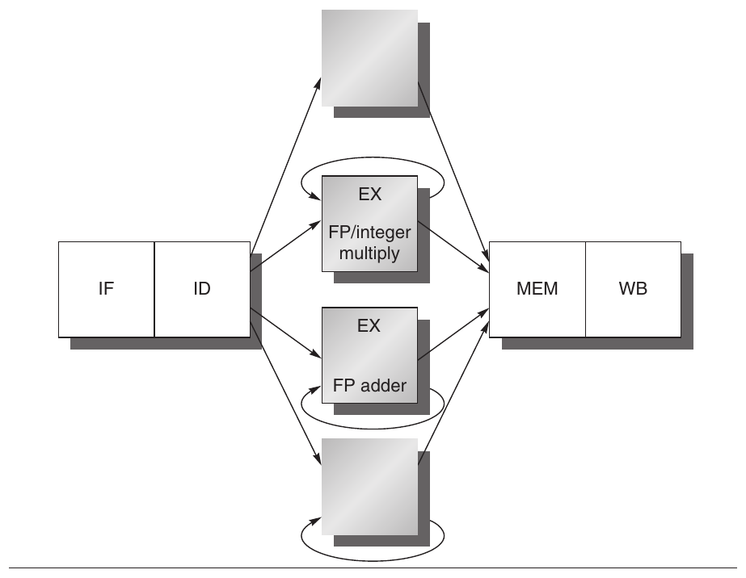

**Hình C.33 MIPS pipeline với ba functional unit floating-point bổ sung, unpipelined. Vì mỗi clock cycle chỉ issue một instruction, mọi instruction đi qua pipeline tiêu chuẩn cho integer operation. FP operation chỉ lặp lại khi đến EX stage. Sau khi hoàn tất EX, chúng đến MEM và WB để hoàn tất execution.**

Trong thực tế, intermediate result có lẽ không được tuần hoàn quanh EX unit như Hình C.33 gợi ý; thay vào đó, EX pipeline stage có số clock delay lớn hơn 1. Có thể tổng quát cấu trúc FP pipeline ở Hình C.33 để cho phép pipeline một số stage và có nhiều operation đang diễn ra. Để mô tả pipeline như vậy, phải định nghĩa cả latency của functional unit lẫn initiation interval hay repeat interval. Latency được định nghĩa như trước: số cycle xen giữa instruction tạo kết quả và instruction dùng kết quả. Initiation interval hay repeat interval là số cycle phải trôi qua giữa việc issue hai operation cùng loại. Chẳng hạn, chúng ta dùng latency và initiation interval trong Hình C.34.

Với định nghĩa latency này, integer ALU operation có latency 0 vì có thể dùng kết quả ở clock cycle tiếp theo; load có latency 1 vì có thể dùng kết quả sau một cycle xen giữa. Vì phần lớn operation tiêu thụ operand ở đầu EX, latency thường là số stage sau EX mà instruction tạo ra kết quả — chẳng hạn zero stage cho ALU operation và một stage cho load. Ngoại lệ chính là store, tiêu thụ giá trị cần lưu muộn hơn 1 cycle. Vì vậy, latency đến store cho giá trị cần lưu, nhưng không phải cho base address register, ít hơn 1 cycle. Pipeline latency về cơ bản bằng depth của execution pipeline trừ 1 cycle; depth là số stage từ EX đến stage tạo kết quả. Vì vậy, với pipeline ví dụ ngay trên, FP add có bốn stage, còn FP multiply có bảy stage. Để đạt clock rate cao hơn, người thiết kế cần đặt ít logic level hơn trong mỗi pipe stage, khiến operation phức tạp hơn cần nhiều pipe stage hơn. Cái giá cho clock rate nhanh hơn do đó là operation latency dài hơn.

| Functional unit | Latency | Initiation interval |
|---|---|---|
| Integer ALU | 0 | 1 |
| Data memory (integer load và FP load) | 1 | 1 |
| FP add | 3 | 1 |
| FP multiply (cả integer multiply) | 6 | 1 |
| FP divide (cả integer divide) | 24 | 25 |

**Hình C.34 Latency và initiation interval của functional unit.**

Cấu trúc pipeline ví dụ trong Hình C.34 cho phép tối đa bốn outstanding FP add, bảy outstanding FP/integer multiply và một FP divide. Hình C.35 cho thấy cách vẽ pipeline bằng việc mở rộng Hình C.33. Repeat interval được triển khai trong Hình C.35 bằng cách thêm pipeline stage, ngăn cách bởi pipeline register bổ sung. Vì các unit độc lập, chúng ta đặt tên stage khác nhau. Các pipeline stage cần nhiều clock cycle như divide unit được chia nhỏ thêm để thể hiện latency. Vì chúng không phải stage hoàn chỉnh, chỉ một operation có thể active. Cấu trúc pipeline cũng có thể được biểu diễn bằng sơ đồ quen thuộc ở phần trước của phụ lục, như Hình C.36 cho một tập FP operation độc lập cùng FP load và store. Dĩ nhiên, latency dài hơn của FP operation làm tăng tần suất RAW hazard và stall kéo theo, như sẽ thấy sau trong mục này.

Cấu trúc pipeline Hình C.35 đòi hỏi thêm pipeline register (chẳng hạn A1/A2, A2/A3, A3/A4) và sửa đổi kết nối đến chúng. ID/EX register phải được mở rộng để kết nối ID với EX, DIV, M1 và A1; có thể chỉ phần register gắn với một stage tiếp theo bằng ký hiệu ID/EX, ID/DIV, ID/M1 hoặc ID/A1. Pipeline register giữa ID và mọi stage khác có thể được xem là các register riêng về logic và thực tế có thể được triển khai thành register riêng. Vì mỗi lần chỉ một operation ở trong một pipe stage, control information có thể gắn với register ở đầu stage.

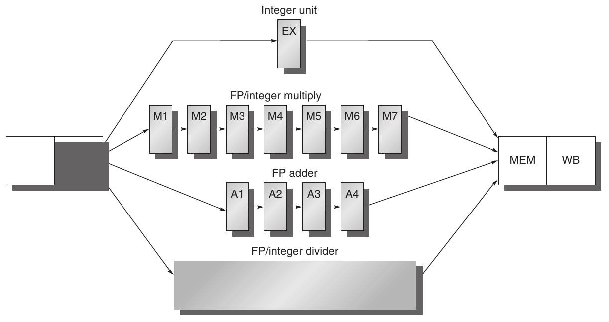

**Hình C.35 Pipeline hỗ trợ nhiều outstanding FP operation. FP multiplier và adder đều fully pipelined, có depth lần lượt bảy và bốn stage. FP divider không pipelined nhưng cần 24 clock cycle để hoàn tất. Latency tính bằng instruction giữa issue FP operation và sử dụng kết quả mà không chịu RAW stall được quyết định bởi số cycle trong execution stage. Chẳng hạn, instruction thứ tư sau FP add có thể dùng kết quả FP add. Với integer ALU operation, depth của execution pipeline luôn là một và instruction tiếp theo dùng được kết quả.**

| MUL.D | IF | ID | M1 | M2 | M3 | M4 | M5 | M6 | M7 | MEM | WB |
|---|---|---|---|---|---|---|---|---|---|---|---|
| ADD.D |  | IF | ID | A1 | A2 | A3 | A4 | MEM | WB |  |  |
| L.D |  |  | IF | ID | EX | MEM | WB |  |  |  |  |
| S.D |  |  |  | IF | ID | EX | MEM | WB |  |  |  |

**Hình C.36 Pipeline timing của một tập FP operation độc lập. Stage in nghiêng chỉ nơi data được cần đến, còn stage in đậm chỉ nơi kết quả khả dụng. Extension ”.D” trong instruction mnemonic chỉ operation floating-point double-precision (64-bit). FP load và store dùng path 64-bit đến memory nên pipeline timing giống integer load hoặc store.**

### Hazard và Forwarding trong Pipeline có Latency dài hơn

Hazard detection và forwarding cho pipeline như Hình C.35 có một số khía cạnh khác nhau.

1. Vì divide unit không fully pipelined, structural hazard có thể xảy ra. Cần phát hiện chúng và stall việc issue instruction.

2. Vì instruction có running time khác nhau, số register write cần trong một cycle có thể lớn hơn 1.

3. Có thể có write after write (WAW) hazard vì instruction không còn đến WB theo thứ tự. Lưu ý không thể có write after read (WAR) hazard vì register read luôn xảy ra trong ID.

4. Instruction có thể hoàn tất theo thứ tự khác thứ tự issue, gây vấn đề với exception; chúng ta xử lý điều này ở tiểu mục tiếp theo.

5. Vì operation latency dài hơn, stall cho RAW hazard sẽ thường xuyên hơn.

Số stall tăng do operation latency dài hơn về căn bản giống trường hợp integer pipeline. Trước khi mô tả vấn đề mới phát sinh trong FP pipeline này và xem giải pháp, hãy xét tác động tiềm tàng của RAW hazard. Hình C.37 cho thấy một chuỗi FP code điển hình và những stall kéo theo. Ở cuối mục, chúng ta sẽ khảo sát performance của FP pipeline cho tập con SPEC.

Bây giờ xem vấn đề phát sinh từ write, được mô tả ở (2) và (3) trong danh sách trước. Nếu FP register file có một write port, các chuỗi FP operation cũng như FP load đi cùng FP operation có thể conflict tại register write port. Xét chuỗi pipeline Hình C.38. Ở clock cycle 11, cả ba instruction đến WB và muốn ghi register file. Chỉ có một register file write port nên processor phải tuần tự hóa instruction completion. Register port duy nhất là structural hazard. Có thể tăng số write port để giải quyết, nhưng cách này có thể không hấp dẫn vì write port bổ sung chỉ hiếm khi dùng. Lý do là số write port tối đa cần thiết ở steady-state là 1. Thay vào đó, chúng ta chọn phát hiện và cưỡng chế access đến write port như một structural hazard.

Có hai cách triển khai interlock này. Cách thứ nhất theo dõi việc dùng write port trong ID stage và stall instruction trước issue, giống mọi structural hazard khác. Có thể theo dõi bằng shift register chỉ ra khi nào instruction already-issued sẽ dùng register file. Nếu instruction trong ID cần dùng register file cùng lúc với instruction đã issue, instruction trong ID bị stall một cycle. Mỗi clock, reservation register được shift 1 bit. Implementation này có ưu điểm là giữ tính chất mọi interlock detection và stall insertion đều xảy ra ở ID stage. Chi phí là thêm shift register và write conflict logic. Chúng ta giả định dùng cơ chế này xuyên suốt mục.

|  | Số clock cycle |  |  |  |  |  |  |  |  |  |  |  |  |  |  |  |  |
|---|---|---|---|---|---|---|---|---|---|---|---|---|---|---|---|---|---|
| Instruction | 1 | 2 | 3 | 4 | 5 | 6 | 7 | 8 | 9 | 10 | 11 | 12 | 13 | 14 | 15 | 16 | 17 |
| L.D F4,0(R2) | IF | ID | EX | MEM | WB |  |  |  |  |  |  |  |  |  |  |  |  |
| MUL.D F0,F4,F6 |  | IF | ID | Stall | M1 | M2 | M3 | M4 | M5 | M6 | M7 | MEM | WB |  |  |  |  |
| ADD.D F2,F0,F8 |  |  | IF | Stall | ID | Stall | Stall | Stall | Stall | Stall | Stall | A1 | A2 | A3 | A4 | MEM | WB |
| S.D F2,0(R2) |  |  |  |  | IF | Stall | Stall | Stall | Stall | Stall | Stall | ID | EX | Stall | Stall | Stall | MEM |

**Hình C.37 Chuỗi FP code điển hình thể hiện stall do RAW hazard. Pipeline dài hơn làm tăng đáng kể tần suất stall so với integer pipeline nông hơn. Mỗi instruction trong chuỗi phụ thuộc instruction trước và tiếp tục ngay khi data khả dụng, với giả định pipeline có đầy đủ bypassing và forwarding. S.D phải stall thêm một cycle để MEM của nó không conflict với ADD.D. Hardware bổ sung có thể dễ dàng xử lý trường hợp này.**

|  | Số clock cycle |  |  |  |  |  |  |  |  |  |  |
|---|---|---|---|---|---|---|---|---|---|---|---|
| Instruction | 1 | 2 | 3 | 4 | 5 | 6 | 7 | 8 | 9 | 10 | 11 |
| MUL.D F0,F4,F6 | IF | ID | M1 | M2 | M3 | M4 | M5 | M6 | M7 | MEM | WB |
| ... |  | IF | ID | EX | MEM | WB |  |  |  |  |  |
| ... |  |  | IF | ID | EX | MEM | WB |  |  |  |  |
| ADD.D F2,F4,F6 |  |  |  | IF | ID | A1 | A2 | A3 | A4 | MEM | WB |
| ... |  |  |  |  | IF | ID | EX | MEM | WB |  |  |
| ... |  |  |  |  |  | IF | ID | EX | MEM | WB |  |
| L.D F2,0(R2) |  |  |  |  |  |  | IF | ID | EX | MEM | WB |

**Hình C.38 Ba instruction muốn thực hiện write-back vào FP register file đồng thời, như clock cycle 11 cho thấy. Đây chưa phải trường hợp xấu nhất vì một divide trước đó trong FP unit cũng có thể hoàn tất cùng clock. Lưu ý mặc dù MUL.D, ADD.D và L.D đều ở MEM stage trong clock cycle 10, chỉ L.D thực sự dùng memory, nên không có structural hazard cho MEM.**

Một cơ chế khác là stall instruction conflict khi nó cố vào MEM hoặc WB stage. Nếu chờ đến khi instruction conflict muốn vào MEM hoặc WB mới stall, có thể chọn stall bất kỳ instruction nào. Một heuristic đơn giản dù đôi khi không tối ưu là ưu tiên unit có latency dài nhất, vì nó có khả năng cao nhất đã khiến instruction khác stall do RAW hazard. Ưu điểm là không cần phát hiện conflict cho đến lối vào MEM hoặc WB, nơi dễ nhận thấy. Nhược điểm là làm pipeline control phức tạp vì giờ stall có thể xuất hiện từ hai nơi. Lưu ý stall trước MEM khiến EX, A4 hoặc M7 bị chiếm dụng, có thể buộc stall lan ngược trong pipeline. Tương tự, stall trước WB khiến MEM bị dồn lại.

Vấn đề còn lại là khả năng WAW hazard. Để thấy chúng tồn tại, xét Hình C.38. Nếu L.D được issue sớm hơn một cycle và có destination F2, nó tạo WAW hazard vì ghi F2 sớm hơn ADD.D một cycle. Lưu ý hazard này chỉ xảy ra khi kết quả ADD.D bị ghi đè mà chưa instruction nào dùng! Nếu F2 được dùng giữa ADD.D và L.D, pipeline phải stall do RAW hazard và L.D không issue cho đến khi ADD.D hoàn tất. Có thể lập luận rằng trong pipeline này, WAW hazard chỉ xảy ra khi instruction vô dụng được thực thi, nhưng vẫn phải phát hiện và bảo đảm kết quả L.D nằm trong F2 khi hoàn tất. (Như sẽ thấy ở Mục C.8, những chuỗi như vậy đôi khi xuất hiện trong code hợp lý.)

Có hai cách xử lý WAW hazard này. Cách đầu trì hoãn issue load instruction cho đến khi ADD.D vào MEM. Cách thứ hai loại bỏ kết quả ADD.D bằng cách phát hiện hazard và đổi control để ADD.D không ghi kết quả; khi đó L.D có thể issue ngay. Vì hazard hiếm gặp, cả hai cơ chế đều tốt — có thể chọn cách dễ triển khai hơn. Trong cả hai trường hợp, hazard có thể được phát hiện trong ID khi L.D đang issue, và dễ stall L.D hoặc biến ADD.D thành no-op. Tình huống khó là phát hiện L.D có thể hoàn tất trước ADD.D, vì đòi hỏi biết pipeline length và vị trí ADD.D hiện tại. May thay, chuỗi này (hai write không có read xen giữa) rất hiếm, nên có thể dùng giải pháp đơn giản: nếu instruction trong ID muốn ghi cùng register với instruction đã issue, không issue instruction đó đến EX. Ở Mục C.7, chúng ta sẽ thấy hardware bổ sung có thể loại bỏ stall cho những hazard này. Trước hết, hãy ghép các phần để triển khai hazard logic và issue logic trong FP pipeline.

Khi phát hiện hazard tiềm tàng, phải xét hazard giữa FP instruction cũng như giữa FP instruction và integer instruction. Ngoại trừ FP loads-stores và move register FP-integer, FP register và integer register tách biệt. Mọi integer instruction hoạt động trên integer register, còn FP operation chỉ trên register riêng. Vì vậy, chỉ cần xét FP loads-stores và FP register move khi phát hiện hazard giữa FP instruction và integer instruction. Việc đơn giản hóa pipeline control là một ưu điểm bổ sung của register file riêng cho integer data và floating-point data. (Ưu điểm chính là gấp đôi số register mà không làm tập nào lớn hơn, và tăng bandwidth mà không thêm port cho tập nào. Nhược điểm chính, ngoài cần register file bổ sung, là chi phí nhỏ cho các move thỉnh thoảng cần giữa hai tập.) Giả sử pipeline thực hiện mọi hazard detection trong ID, có ba phép kiểm tra cần làm trước khi instruction được issue:

1. Kiểm tra structural hazard — Chờ functional unit cần thiết không busy (chỉ cần cho divide trong pipeline này) và bảo đảm register write port khả dụng khi cần.

2. Kiểm tra RAW data hazard — Chờ cho đến khi source register không được liệt kê là pending destination trong pipeline register sẽ chưa khả dụng vào lúc instruction này cần kết quả. Cần nhiều phép kiểm tra tùy source instruction, vốn quyết định khi nào kết quả khả dụng, và destination instruction, vốn quyết định khi nào cần giá trị. Chẳng hạn, nếu instruction trong ID là FP operation với source register F2, F2 không được liệt kê là destination trong ID/A1, A1/A2 hoặc A2/A3, tương ứng những FP add instruction chưa hoàn tất khi instruction trong ID cần kết quả. (ID/A1 là phần output register của ID được gửi đến A1.) Divide khó hơn đôi chút nếu muốn cho phép chồng lấp những cycle cuối, vì phải xử lý riêng trường hợp divide sắp hoàn tất. Trong thực tế, người thiết kế có thể bỏ phép tối ưu này để có issue test đơn giản hơn.

3. Kiểm tra WAW data hazard — Xác định có instruction nào trong A1, . . . , A4, D, M1, . . . , M7 có cùng register destination với instruction này hay không. Nếu có, stall việc issue instruction trong ID.

Mặc dù hazard detection phức tạp hơn với multicycle FP operation, khái niệm vẫn giống MIPS integer pipeline. Forwarding logic cũng vậy. Có thể triển khai forwarding bằng cách kiểm tra destination register trong bất kỳ register EX/MEM, A4/MEM, M7/MEM, D/MEM hoặc MEM/WB có phải source register của floating-point instruction hay không. Nếu có, phải bật input multiplexer thích hợp để chọn data được forward. Trong bài tập, bạn sẽ có cơ hội chỉ định logic cho RAW hazard detection, WAW hazard detection cũng như forwarding.

Multicycle FP operation còn tạo vấn đề cho các exception mechanism; chúng ta xử lý tiếp theo.

### Duy trì Precise Exception

Một vấn đề khác do những instruction long-running này gây ra có thể được minh họa bằng chuỗi code sau:

```
DIV.D       F0,F2,F4
ADD.D       F10,F10,F8
SUB.D       F12,F12,F14
```

Chuỗi code này có vẻ trực tiếp, không có dependence. Tuy nhiên, vấn đề xuất hiện vì instruction được issue sớm có thể hoàn tất sau instruction issue muộn hơn. Trong ví dụ, ADD.D và SUB.D có thể hoàn tất trước DIV.D. Điều này được gọi là out-of-order completion và phổ biến trong pipeline có operation long-running (xem Mục C.7). Vì hazard detection ngăn vi phạm mọi dependence giữa instruction, vì sao out-of-order completion là vấn đề? Giả sử SUB.D gây exception floating-point arithmetic tại thời điểm ADD.D đã hoàn tất nhưng DIV.D chưa hoàn tất. Kết quả là imprecise exception, điều chúng ta muốn tránh. Có vẻ có thể xử lý bằng cách để floating-point pipeline chạy hết như integer pipeline. Nhưng exception có thể nằm ở vị trí không cho phép điều đó. Chẳng hạn, nếu DIV.D quyết định gây exception floating-point-arithmetic sau khi add hoàn tất, không thể có precise exception ở hardware level. Thực ra, vì ADD.D phá hủy một operand của chính nó, không thể khôi phục state trước DIV.D ngay cả với software support.

Vấn đề này xuất hiện vì instruction hoàn tất theo thứ tự khác thứ tự issue. Có bốn cách xử lý out-of-order completion. Cách thứ nhất là bỏ qua vấn đề và chấp nhận imprecise exception. Cách này được dùng trong thập niên 1960 và đầu thập niên 1970. Nó vẫn dùng trong một số supercomputer, nơi một số lớp exception không được phép hoặc được hardware xử lý mà không dừng pipeline. Khó dùng cách này trong phần lớn processor ngày nay vì những tính năng như virtual memory và tiêu chuẩn floating-point IEEE về cơ bản đòi hỏi precise exception qua kết hợp hardware và software. Như đã đề cập, một số processor gần đây giải quyết bằng hai mode execution: mode nhanh nhưng có thể imprecise và mode chậm hơn, precise. Mode precise chậm hơn được triển khai bằng mode switch hoặc chèn instruction tường minh kiểm tra FP exception. Dù cách nào, mức chồng lấp và reordering trong FP pipeline bị hạn chế đáng kể, về thực chất mỗi lần chỉ một FP instruction active. Giải pháp này dùng trong DEC Alpha 21064 và 21164, IBM Power1 và Power2, MIPS R8000.

Cách thứ hai là buffer kết quả operation cho đến khi mọi operation issue trước đã hoàn tất. Một số CPU thực sự dùng cách này, nhưng nó trở nên tốn kém khi running time giữa các operation chênh lệch lớn vì số kết quả cần buffer có thể lớn. Hơn nữa, phải bypass kết quả từ queue để tiếp tục issue instruction trong lúc chờ instruction dài hơn. Điều này đòi hỏi nhiều comparator và một multiplexer rất lớn.

Có hai biến thể khả thi của cách cơ bản này. Thứ nhất là history file, dùng trong CYBER 180/990. History file theo dõi giá trị register ban đầu. Khi exception xảy ra và state phải được rollback về trước một instruction đã hoàn tất out of order, có thể khôi phục giá trị register ban đầu từ history file. Kỹ thuật tương tự dùng cho autoincrement addressing và autodecrement addressing trên processor như VAX. Cách khác là future file do Smith và Pleszkun [1988] đề xuất, giữ giá trị register mới hơn; khi mọi instruction trước đã hoàn tất, main register file được cập nhật từ future file. Khi exception, main register file chứa precise value cho interrupted state. Ở Chương 3, chúng ta thấy extension của ý tưởng này được dùng trong processor như PowerPC 620 và MIPS R10000 để cho phép chồng lấp và reordering trong khi giữ precise exception.

Kỹ thuật thứ ba đang được dùng cho phép exception có phần imprecise, nhưng giữ đủ thông tin để trap-handling routine tạo ra precise sequence cho exception. Điều này nghĩa là biết những operation trong pipeline và PC của chúng. Sau khi xử lý exception, software hoàn tất mọi instruction trước instruction cuối cùng đã hoàn tất, rồi chuỗi có thể restart. Xét chuỗi code worst-case sau:

Instruction<sub>1</sub>—Một instruction long-running cuối cùng gây gián đoạn thực thi.

Instruction<sub>2</sub>, . . . , Instruction<sub>n–1</sub> — Một chuỗi instruction chưa hoàn tất.

Instruction<sub>n</sub> — Một instruction đã hoàn tất.

Với PC của mọi instruction trong pipeline và exception return PC, software có thể tìm state của instruction<sub>1</sub> và instruction<sub>n</sub>. Vì instruction<sub>n</sub> đã hoàn tất, chúng ta muốn restart execution ở instruction<sub>n+1</sub>. Sau khi xử lý exception, software phải mô phỏng execution của instruction<sub>1</sub>, . . . , instruction<sub>n–1</sub>. Sau đó có thể trở về từ exception và restart ở instruction<sub>n+1</sub>. Độ phức tạp để handler thực thi đúng những instruction này là khó khăn chính của cơ chế.

Có một sự đơn giản hóa quan trọng cho pipeline MIPS-like đơn giản: nếu instruction<sub>2</sub>, . . . , instruction<sub>n</sub> đều là integer instruction, khi instruction<sub>n</sub> hoàn tất thì mọi instruction<sub>2</sub>, . . . , instruction<sub>n–1</sub> cũng đã hoàn tất. Vì vậy, chỉ FP operation cần được xử lý. Để cơ chế khả thi, có thể giới hạn số floating-point instruction được chồng lấp execution. Chẳng hạn, nếu chỉ chồng lấp hai instruction, software chỉ cần hoàn tất instruction gây interrupt. Hạn chế này có thể giảm throughput tiềm năng nếu FP pipeline sâu hoặc có nhiều FP functional unit. SPARC architecture dùng cách này để cho phép chồng lấp floating-point operation và integer operation.

Kỹ thuật cuối là cơ chế kết hợp, chỉ cho phép instruction issue tiếp tục nếu chắc chắn mọi instruction trước instruction đang issue sẽ hoàn tất mà không gây exception. Điều này bảo đảm khi exception xảy ra, không instruction nào sau instruction gây interrupt đã hoàn tất và mọi instruction trước nó có thể hoàn tất. Đôi khi phải stall CPU để giữ precise exception. Để cơ chế hoạt động, floating-point functional unit phải xác định sớm trong EX stage liệu exception có thể xảy ra hay không (trong 3 clock cycle đầu của MIPS pipeline), nhằm ngăn các instruction tiếp theo hoàn tất. Cơ chế này dùng trong MIPS R2000/3000, R4000 và Intel Pentium, được thảo luận thêm trong Phụ lục J.

### Performance của MIPS FP Pipeline

MIPS FP pipeline ở Hình C.35 trang C-54 có thể tạo cả structural stall cho divide unit lẫn stall do RAW hazard (cũng có thể có WAW hazard nhưng hiếm trong thực tế). Hình C.39 cho thấy số stall cycle cho từng loại floating-point operation trên cơ sở per-instance (tức cột đầu cho mỗi FP benchmark chỉ số FP result stall cho mỗi FP add, subtract hoặc convert). Như kỳ vọng, stall cycle trên mỗi operation biến thiên theo latency FP operation, từ 46% đến 59% latency functional unit.

Hình C.40 phân tách đầy đủ integer stall và FP stall cho năm SPECfp benchmark. Có bốn lớp stall: FP result stall, FP compare stall, load delay và branch delay, FP structural delay. Compiler cố schedule cả load delay lẫn FP delay trước branch delay. Tổng stall trên mỗi instruction từ 0.65 đến 1.21.

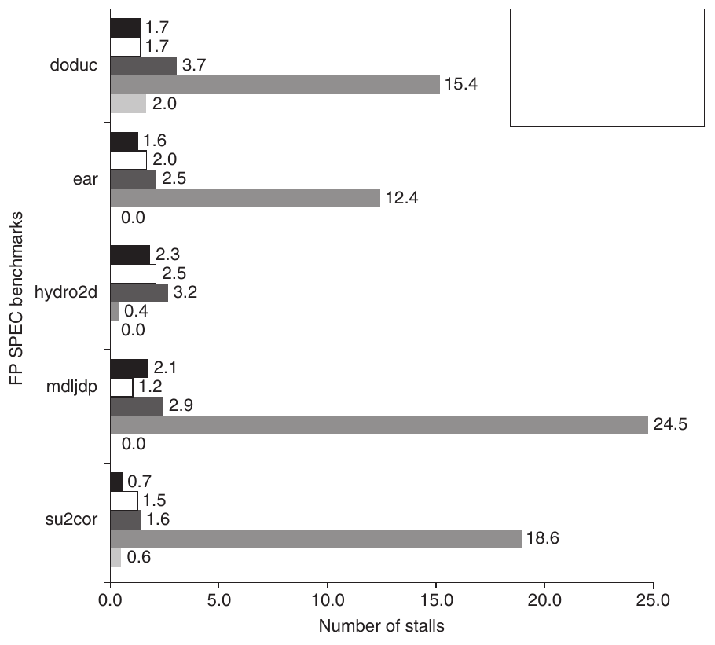

**Hình C.39 Stall trên mỗi FP operation cho từng loại FP operation chính trong SPEC89 FP benchmark. Ngoại trừ divide structural hazard, những data này không phụ thuộc tần suất operation, chỉ phụ thuộc latency và số cycle trước khi dùng kết quả. Số stall do RAW hazard gần tương ứng latency FP unit. Chẳng hạn, số stall trung bình mỗi FP add, subtract hoặc convert là 1.7 cycle, bằng 56% latency (3 cycle). Tương tự, số stall trung bình cho multiply và divide lần lượt là 2.8 và 14.2, bằng 46% và 59% latency tương ứng. Structural hazard cho divide hiếm vì divide frequency thấp.**

## C.6 Kết hợp mọi phần: MIPS R4000 Pipeline

Trong mục này, chúng ta xem cấu trúc pipeline và performance của họ processor MIPS R4000, bao gồm 4400. R4000 triển khai MIPS64 nhưng dùng pipeline sâu hơn thiết kế five-stage của chúng ta cho cả chương trình integer và FP. Pipeline sâu hơn giúp đạt clock rate cao hơn bằng cách chia integer pipeline five-stage thành tám stage. Vì cache access đặc biệt then chốt về thời gian, các pipeline stage bổ sung đến từ việc chia nhỏ memory access. Kiểu pipelining sâu hơn này đôi khi gọi là superpipelining.

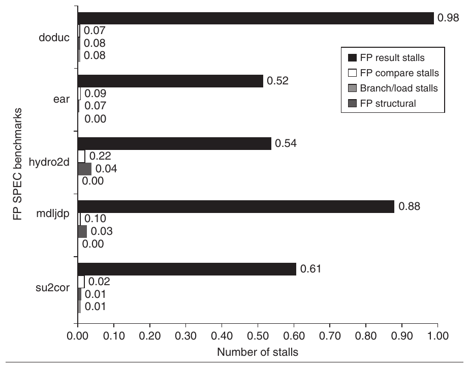

**Hình C.40 Những stall của MIPS FP pipeline cho năm SPEC89 FP benchmark. Tổng stall trên mỗi instruction từ 0.65 cho su2cor đến 1.21 cho doduc, trung bình 0.87. FP result stall chiếm ưu thế trong mọi trường hợp, trung bình 0.71 stall mỗi instruction, tức 82% stalled cycle. Compare tạo trung bình 0.1 stall mỗi instruction, là nguồn lớn thứ hai. Divide structural hazard chỉ đáng kể với doduc.**

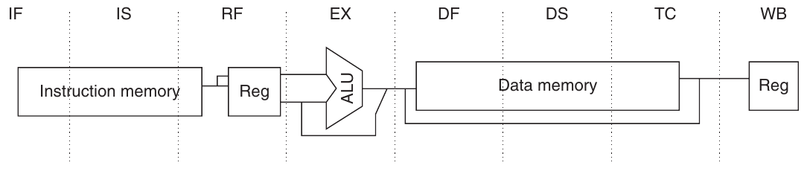

**Hình C.41 Cấu trúc pipeline eight-stage của R4000 dùng instruction cache và data cache pipelined. Các pipe stage được ghi nhãn và chức năng chi tiết được mô tả trong nội dung. Đường nét đứt dọc biểu thị stage boundary cũng như vị trí pipeline latch. Instruction thực ra khả dụng ở cuối IS nhưng tag check thực hiện trong RF trong lúc fetch register. Vì vậy, hình biểu diễn instruction memory hoạt động đến hết RF. TC stage cần cho data memory access vì không thể ghi data vào register cho đến khi biết cache access có hit hay không.**

Hình C.41 cho thấy cấu trúc pipeline eight-stage qua phiên bản trừu tượng hóa của data path. Hình C.42 cho thấy các instruction kế tiếp chồng lấp trong pipeline. Lưu ý mặc dù instruction memory và data memory chiếm nhiều cycle, chúng fully pipelined nên mỗi clock có thể bắt đầu instruction mới. Thực ra, pipeline dùng data trước khi cache hit detection hoàn tất; Chương 2 thảo luận chi tiết hơn cách thực hiện.

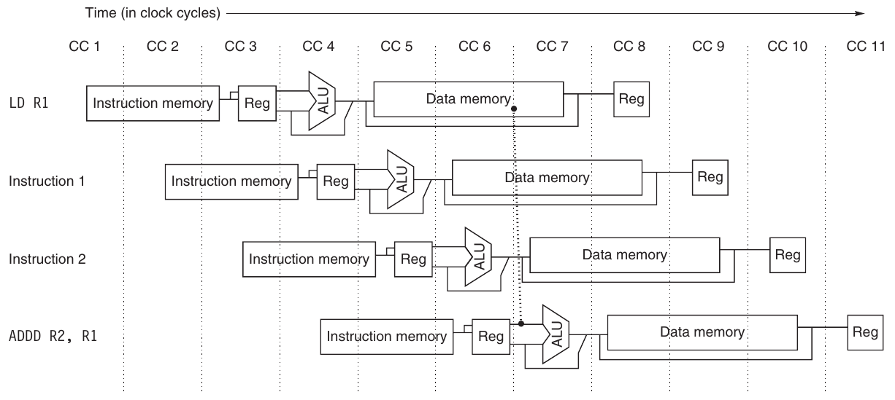

**Hình C.42 Cấu trúc R4000 integer pipeline dẫn đến load delay 2-cycle. Delay 2-cycle khả thi vì data value khả dụng ở cuối DS và có thể bypass. Nếu tag check trong TC chỉ ra miss, pipeline bị lùi một cycle, khi data đúng khả dụng.**

Chức năng của mỗi stage như sau:

- IF — Nửa đầu instruction fetch; PC selection thực sự diễn ra ở đây, cùng khởi tạo instruction cache access.

- IS — Nửa sau instruction fetch, hoàn tất instruction cache access.

- RF — Instruction decode và register fetch, kiểm tra hazard, phát hiện instruction cache hit.

- EX — Execution, bao gồm effective address calculation, ALU operation, branch-target computation và condition evaluation.

- DF — Data fetch, nửa đầu data cache access.

- DS — Nửa sau data fetch, hoàn tất data cache access.

- TC — Tag check để xác định data cache access có hit hay không.

- WB — Write-back cho load và operation register-register.

Ngoài tăng đáng kể lượng forwarding cần thiết, pipeline longer-latency này tăng cả load delay lẫn branch delay. Hình C.42 cho thấy load delay là 2 cycle vì data value khả dụng ở cuối DS. Hình C.43 biểu diễn pipeline schedule rút gọn khi có sử dụng ngay sau load, cho thấy cần forwarding kết quả load instruction đến destination muộn hơn 3 hoặc 4 cycle.

|  | Số clock |  |  |  |  |  |  |  |  |
|---|---|---|---|---|---|---|---|---|---|
| Số instruction | 1 | 2 | 3 | 4 | 5 | 6 | 7 | 8 | 9 |
| LD R1,... | IF | IS | RF | EX | DF | DS | TC | WB |  |
| DADD R2,R1,... |  | IF | IS | RF | Stall | Stall | EX | DF | DS |
| DSUB R3,R1,... |  |  | IF | IS | Stall | Stall | RF | EX | DF |
| OR R4,R1,... |  |  |  | IF | Stall | Stall | IS | RF | EX |

**Hình C.43 Load instruction theo sau ngay bởi một lần sử dụng tạo stall 2-cycle. Có thể dùng forwarding path thông thường sau 2 cycle nên DADD và DSUB nhận giá trị bằng forwarding sau stall. OR nhận giá trị từ register file. Vì hai instruction sau load có thể độc lập và không stall, bypass có thể đến instruction sau load 3 hoặc 4 cycle.**

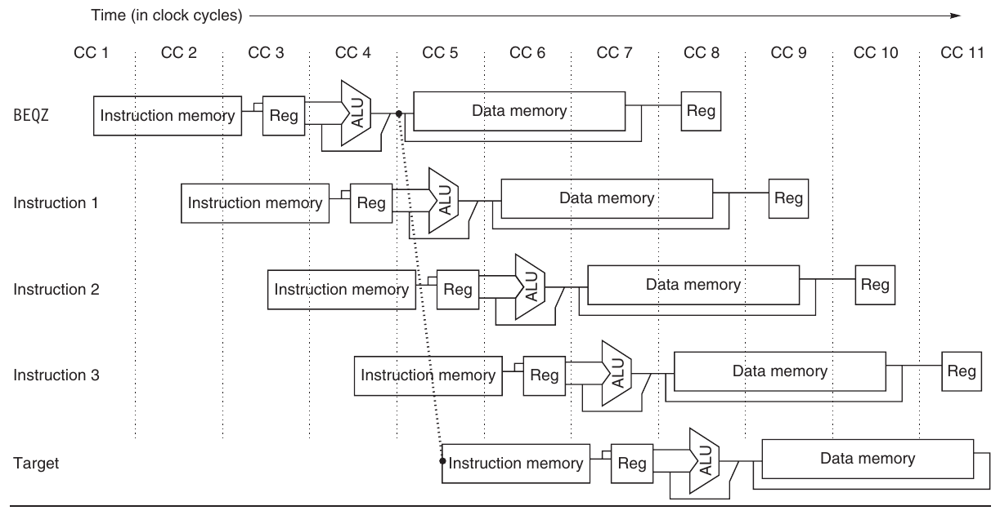

**Hình C.44 Branch delay cơ bản là 3 cycle vì condition evaluation được thực hiện trong EX.**

Hình C.44 cho thấy branch delay cơ bản 3 cycle vì branch condition được tính trong EX. MIPS architecture có delayed branch single-cycle. R4000 dùng chiến lược predicted-not-taken cho 2 cycle branch delay còn lại. Như Hình C.45 cho thấy, untaken branch chỉ là delayed branch 1-cycle, còn taken branch có delay slot 1-cycle theo sau bởi 2 idle cycle. Instruction set cung cấp instruction branch-likely đã mô tả trước, giúp lấp branch delay slot. Pipeline interlock thực thi cả branch stall penalty 2-cycle trên taken branch lẫn data hazard stall phát sinh do dùng load result.

|  | Số clock |  |  |  |  |  |  |  |  |
|---|---|---|---|---|---|---|---|---|---|
| Số instruction | 1 | 2 | 3 | 4 | 5 | 6 | 7 | 8 | 9 |
| Branch instruction | IF | IS | RF | EX | DF | DS | TC | WB |  |
| Delay slot |  | IF | IS | RF | EX | DF | DS | TC | WB |
| Stall |  |  | Stall | Stall | Stall | Stall | Stall | Stall | Stall |
| Stall |  |  |  | Stall | Stall | Stall | Stall | Stall | Stall |
| Branch target |  |  |  |  | IF | IS | RF | EX | DF |

|  | Số clock |  |  |  |  |  |  |  |  |
|---|---|---|---|---|---|---|---|---|---|
| Số instruction | 1 | 2 | 3 | 4 | 5 | 6 | 7 | 8 | 9 |
| Branch instruction | IF | IS | RF | EX | DF | DS | TC | WB |  |
| Delay slot |  | IF | IS | RF | EX | DF | DS | TC | WB |
| Branch instruction + 2 |  |  | IF | IS | RF | EX | DF | DS | TC |
| Branch instruction + 3 |  |  |  | IF | IS | RF | EX | DF | DS |

**Hình C.45 Taken branch ở phần trên hình có delay slot 1-cycle theo sau bởi stall 2-cycle, còn untaken branch ở phần dưới chỉ có delay slot 1-cycle. Branch instruction có thể là delayed branch thông thường hoặc branch-likely, hủy tác động của instruction trong delay slot nếu branch untaken.**

Ngoài tăng stall cho load và branch, pipeline sâu hơn còn tăng số mức forwarding cho ALU operation. Trong MIPS pipeline five-stage, forwarding giữa hai ALU instruction register-register có thể đến từ ALU/MEM hoặc MEM/WB register. Trong R4000 pipeline, có bốn source có thể cho ALU bypass: EX/DF, DF/DS, DS/TC và TC/WB.

### Floating-Point Pipeline

Unit floating-point R4000 gồm ba functional unit: floating-point divider, floating-point multiplier và floating-point adder. Adder logic được dùng ở bước cuối multiply hoặc divide. FP operation Double-precision có thể mất từ 2 cycle (negate) đến 112 cycle (square root). Ngoài ra, các unit có initiation rate khác nhau. Có thể xem FP functional unit gồm tám stage khác nhau ở Hình C.46; chúng được kết hợp theo thứ tự khác nhau để thực thi những FP operation khác nhau.

Mỗi stage chỉ có một bản, và các instruction khác nhau có thể dùng stage zero hoặc nhiều lần theo thứ tự khác nhau. Hình C.47 cho latency, initiation rate và pipeline stage được những FP operation double-precision phổ biến nhất sử dụng.

| Stage | Functional unit | Mô tả |
|---|---|---|
| A | FP adder | Mantissa ADD stage |
| D | FP divider | Divide pipeline stage |
| E | FP multiplier | Stage kiểm tra exception |
| M | FP multiplier | Stage đầu của multiplier |
| N | FP multiplier | Stage thứ hai của multiplier |
| R | FP adder | Rounding stage |
| S | FP adder | Operand shift stage |
| U |  | Unpack số FP |

**Hình C.46 Tám stage được dùng trong R4000 floating-point pipeline.**

| FP instruction | Latency | Initiation interval | Pipe stages |
|---|---|---|---|
| Add, subtract | 4 | 3 | U, S + A, A + R, R + S |
| Multiply | 8 | 4 | U, E + M, M, M, M, N, N + A, R |
| Divide | 36 | 35 | U, A, R, D<sup>28</sup>, D + A, D + R, D + A, D + R, A, R |
| Square root | 112 | 111 | U, E, (A+R)<sup>108</sup>, A, R |
| Negate | 2 | 1 | U, S |
| Absolute value | 2 | 1 | U, S |
| FP compare | 3 | 2 | U, A, R |

**Hình C.47 Latency và initiation interval của FP operation đều phụ thuộc những FP unit stage mà operation phải dùng. Latency giả định destination instruction là FP operation; latency ít hơn 1 cycle khi destination là store. Pipe stage được liệt kê theo thứ tự sử dụng cho mỗi operation. S + A chỉ clock cycle dùng cả stage S và A. D<sup>28</sup> chỉ D stage được dùng 28 lần liên tiếp.**

Từ Hình C.47, có thể xác định một chuỗi FP operation khác nhau, độc lập có thể issue mà không stall hay không. Nếu timing của chuỗi gây conflict cho shared pipeline stage, cần stall. Hình C.48, C.49, C.50 và C.51 cho bốn chuỗi two-instruction phổ biến: multiply theo sau bởi add, add theo sau bởi multiply, divide theo sau bởi add, và add theo sau bởi divide. Các hình thể hiện mọi vị trí bắt đầu đáng chú ý của instruction thứ hai, và instruction đó issue hay stall ở mỗi vị trí. Dĩ nhiên, có thể có ba instruction active; khi đó khả năng stall cao hơn nhiều và hình phức tạp hơn.

|  | Clock cycle |  |  |  |  |  |  |  |  |  |  |  |  |  |
|---|---|---|---|---|---|---|---|---|---|---|---|---|---|---|
| Operation | Issue/stall | 0 | 1 | 2 | 3 | 4 | 5 | 6 | 7 | 8 | 9 | 10 | 11 | 12 |
| Multiply | Issue | U | E + M | M | M | M | N | N + A | R |  |  |  |  |  |
| Add | Issue |  | U | S + A | A + R | R + S |  |  |  |  |  |  |  |  |
|  | Issue |  |  | U | S + A | A + R | R + S |  |  |  |  |  |  |  |
|  | Issue |  |  |  | U | S + A | A + R | R + S |  |  |  |  |  |  |
|  | Stall |  |  |  |  | U | S + A | A + R | R + S |  |  |  |  |  |
|  | Stall |  |  |  |  |  | U | S + A | A + R | R + S |  |  |  |  |
|  | Issue |  |  |  |  |  |  | U | S + A | A + R | R + S |  |  |  |
|  | Issue |  |  |  |  |  |  |  | U | S + A | A + R | R + S |  |  |

**Hình C.48 FP multiply issue ở clock 0 theo sau bởi một FP add duy nhất issue giữa clock 1 và 7. Cột thứ hai chỉ instruction thuộc loại đó có stall khi issue muộn hơn n cycle hay không, với n là clock cycle nơi U stage của instruction thứ hai diễn ra. Stage gây stall được in đậm. Lưu ý bảng chỉ xét tương tác giữa multiply và một add issue giữa clock 1 và 7. Khi đó, add stall nếu issue sau multiply 4 hoặc 5 cycle; nếu không, nó issue mà không stall. Lưu ý add stall 2 cycle nếu issue ở cycle 4 vì ở clock cycle tiếp theo nó vẫn conflict với multiply; nhưng nếu issue ở cycle 5, chỉ stall 1 clock cycle vì như vậy đủ loại bỏ conflict.**

|  | Clock cycle |  |  |  |  |  |  |  |  |  |  |  |  |  |
|---|---|---|---|---|---|---|---|---|---|---|---|---|---|---|
| Operation | Issue/stall | 0 | 1 | 2 | 3 | 4 | 5 | 6 | 7 | 8 | 9 | 10 | 11 | 12 |
| Add | Issue | U | S + A | A + R | R + S |  |  |  |  |  |  |  |  |  |
| Multiply | Issue |  | U | E + M | M | M | M | N | N + A | R |  |  |  |  |
|  | Issue |  |  | U | M | M | M | M | N | N + A | R |  |  |  |

**Hình C.49 Multiply issue sau add luôn có thể tiếp tục mà không stall, vì instruction ngắn hơn rời shared pipeline stage trước khi instruction dài hơn đến đó.**

### Performance của R4000 Pipeline

Trong mục này, chúng ta khảo sát các stall của SPEC92 benchmark khi chạy trên cấu trúc R4000 pipeline. Có bốn nguyên nhân chính gây pipeline stall hoặc tổn thất:

1. Load stall — Delay do sử dụng load result sau load 1 hoặc 2 cycle

2. Branch stall — Stall Two-cycle cho mỗi taken branch cộng branch delay slot chưa lấp hoặc bị hủy

3. FP result stall — Stall do RAW hazard đối với FP operand

|  | Clock cycle |  |  |  |  |  |  |  |  |  |  |  |  |
|---|---|---|---|---|---|---|---|---|---|---|---|---|---|
| Operation | Issue/stall | 25 | 26 | 27 | 28 | 29 | 30 | 31 | 32 | 33 | 34 | 35 | 36 |
| Divide | Issued in cycle 0. . . | D | D | D | D | D | D + A | D + R | D + A | D + R | A | R |  |
| Add | Issue |  | U | S + A | A + R | R + S |  |  |  |  |  |  |  |
|  | Issue |  |  | U | S + A | A + R | R + S |  |  |  |  |  |  |
|  | Stall |  |  |  | U | S + A | A + R | R + S |  |  |  |  |  |
|  | Stall |  |  |  |  | U | S + A | A + R | R + S |  |  |  |  |
|  | Stall |  |  |  |  |  | U | S + A | A + R | R + S |  |  |  |
|  | Stall |  |  |  |  |  |  | U | S + A | A + R | R + S |  |  |
|  | Stall |  |  |  |  |  |  |  | U | S + A | A + R | R + S |  |
|  | Stall |  |  |  |  |  |  |  |  | U | S + A | A + R | R + S |
|  | Issue |  |  |  |  |  |  |  |  |  | U | S + A | A + R |
|  | Issue |  |  |  |  |  |  |  |  |  |  | U | S + A |
|  | Issue |  |  |  |  |  |  |  |  |  |  |  | U |

**Hình C.50 FP divide có thể khiến add bắt đầu gần cuối divide bị stall. Divide bắt đầu ở cycle 0 và hoàn tất ở cycle 35; hình thể hiện 10 cycle cuối. Vì divide dùng nhiều rounding hardware mà add cần, nó làm add bắt đầu tại bất kỳ cycle nào từ 28 đến 33 bị stall. Lưu ý add bắt đầu ở cycle 28 bị stall đến cycle 36. Nếu add bắt đầu ngay sau divide, nó không conflict vì có thể hoàn tất trước khi divide cần shared stage, giống Hình C.49 cho multiply và add. Như hình trước, ví dụ giả định đúng một add đến U stage giữa clock cycle 26 và 35.**

|  | Clock cycle |  |  |  |  |  |  |  |  |  |  |  |  |  |
|---|---|---|---|---|---|---|---|---|---|---|---|---|---|---|
| Operation | Issue/stall | 0 | 1 | 2 | 3 | 4 | 5 | 6 | 7 | 8 | 9 | 10 | 11 | 12 |
| Add | Issue | U | S + A | A + R | R + S |  |  |  |  |  |  |  |  |  |
| Divide | Stall |  | U | A | R | D | D | D | D | D | D | D | D | D |
|  | Issue |  |  | U | A | R | D | D | D | D | D | D | D | D |
|  | Issue |  |  |  | U | A | R | D | D | D | D | D | D | D |

**Hình C.51 Add double-precision theo sau bởi divide double-precision. Nếu divide bắt đầu sau add 1 cycle, divide bị stall; sau đó không còn conflict.**

4. FP structural stall — Delay do issue restriction phát sinh từ conflict cho các functional unit trong FP pipeline

Hình C.52 phân tách pipeline CPI của R4000 pipeline cho 10 SPEC92 benchmark. Hình C.53 trình bày cùng data dưới dạng bảng.

Từ data trong Hình C.52 và C.53, có thể thấy cái giá của pipelining sâu hơn. Pipeline R4000 có branch delay dài hơn nhiều pipeline five-stage cổ điển. Branch delay dài hơn làm tăng đáng kể cycle dành cho branch, đặc biệt với chương trình integer có branch frequency cao hơn. Một tác động đáng chú ý với chương trình FP là latency FP functional unit dẫn đến nhiều result stall hơn structural hazard, vốn xuất phát cả từ giới hạn initiation interval lẫn conflict functional unit giữa các FP instruction khác nhau. Vì vậy, giảm latency FP operation nên là mục tiêu đầu tiên, thay vì pipeline sâu hơn hoặc nhân bản functional unit. Dĩ nhiên, giảm latency có lẽ làm tăng structural stall vì nhiều structural stall tiềm tàng đang bị data hazard che khuất.

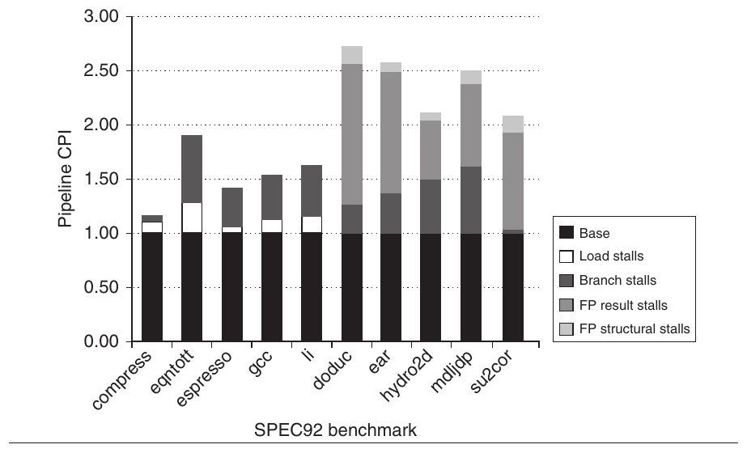

**Hình C.52 Pipeline CPI cho 10 SPEC92 benchmark, giả định perfect cache. Pipeline CPI từ 1.2 đến 2.8. Năm chương trình ngoài cùng trái là integer, với branch delay đóng góp CPI chủ yếu. Năm chương trình ngoài cùng phải là FP, với FP result stall đóng góp chủ yếu. Hình C.53 cho những con số dùng để tạo đồ thị này.**

| Benchmark | Pipeline CPI | Load stalls | Branch stalls | FP result stalls | FP structural stalls |
|---|---|---|---|---|---|
| Compress | 1.20 | 0.14 | 0.06 | 0.00 | 0.00 |
| Eqntott | 1.88 | 0.27 | 0.61 | 0.00 | 0.00 |
| Espresso | 1.42 | 0.07 | 0.35 | 0.00 | 0.00 |
| Gcc | 1.56 | 0.13 | 0.43 | 0.00 | 0.00 |
| Li | 1.64 | 0.18 | 0.46 | 0.00 | 0.00 |
| Trung bình integer | 1.54 | 0.16 | 0.38 | 0.00 | 0.00 |
| Doduc | 2.84 | 0.01 | 0.22 | 1.39 | 0.22 |
| Mdljdp2 | 2.66 | 0.01 | 0.31 | 1.20 | 0.15 |
| Ear | 2.17 | 0.00 | 0.46 | 0.59 | 0.12 |
| Hydro2d | 2.53 | 0.00 | 0.62 | 0.75 | 0.17 |
| Su2cor | 2.18 | 0.02 | 0.07 | 0.84 | 0.26 |
| Trung bình FP | 2.48 | 0.01 | 0.33 | 0.95 | 0.18 |
| Trung bình tổng thể | 2.00 | 0.10 | 0.36 | 0.46 | 0.09 |

**Hình C.53 Tổng pipeline CPI và đóng góp của bốn nguồn stall chính. Đóng góp chủ yếu là FP result stall (cả cho branch lẫn FP input) và branch stall, còn load cùng FP structural stall đóng góp ít hơn.**

## C.7 Những vấn đề xuyên suốt

### RISC Instruction Set và hiệu quả Pipelining

Chúng ta đã thảo luận ưu điểm của instruction set đơn giản khi xây dựng pipeline. Instruction set đơn giản còn có ưu điểm khác: giúp dễ schedule code để thực thi hiệu quả trong pipeline. Xét ví dụ đơn giản: giả sử cần cộng hai giá trị trong memory và store kết quả trở lại memory. Trong một số instruction set tinh vi, chỉ cần một instruction; trong những instruction set khác, cần hai hoặc ba. RISC architecture điển hình cần bốn instruction (hai load, một add và một store). Không thể schedule những instruction này tuần tự trong phần lớn pipeline mà không có stall xen giữa.

Với RISC instruction set, từng operation là instruction riêng và có thể được schedule riêng bởi compiler (dùng kỹ thuật đã thảo luận và kỹ thuật mạnh hơn ở Chương 3) hoặc bằng dynamic hardware scheduling (được thảo luận tiếp theo và chi tiết hơn ở Chương 3). Những lợi thế hiệu quả này kết hợp với việc dễ triển khai hơn có vẻ đáng kể đến mức gần như mọi implementation pipelined gần đây của instruction set phức tạp thực ra đều chuyển instruction phức tạp thành operation RISC-like đơn giản, rồi schedule và pipeline chúng. Chương 3 cho thấy cả Pentium III và Pentium 4 đều dùng cách này.

### Pipeline được Schedule động

Pipeline đơn giản fetch và issue instruction, trừ khi có data dependence giữa instruction đã trong pipeline với instruction vừa fetch không thể che giấu bằng bypassing hoặc forwarding. Forwarding logic giảm effective pipeline latency để một số dependence không tạo hazard. Nếu có hazard không thể tránh, hazard detection hardware stall pipeline (bắt đầu từ instruction dùng kết quả). Không instruction mới nào được fetch hoặc issue cho đến khi dependence được giải quyết. Để khắc phục tổn thất performance, compiler có thể cố schedule instruction tránh hazard; cách này gọi là compiler scheduling hoặc static scheduling.

Một số processor đầu tiên dùng cách khác gọi là dynamic scheduling, theo đó hardware sắp xếp lại instruction execution để giảm stall. Mục này giới thiệu dynamic scheduling đơn giản hơn bằng cách giải thích kỹ thuật scoreboarding của CDC 6600. Một số người đọc sẽ thấy dễ hơn nếu đọc nội dung này trước khi đi vào cơ chế Tomasulo phức tạp hơn trong Chương 3.

Mọi kỹ thuật đã thảo luận trong phụ lục đến đây dùng instruction issue in-order, nghĩa là nếu instruction bị stall trong pipeline thì không instruction xuất hiện sau nào có thể tiếp tục. Với issue in-order, nếu hai instruction có hazard, pipeline sẽ stall ngay cả khi những instruction sau độc lập và không cần stall.

Trong MIPS pipeline phát triển trước đó, cả structural hazard lẫn data hazard được kiểm tra khi instruction decode (ID): nếu instruction có thể thực thi đúng, nó được issue từ ID. Để instruction bắt đầu execution ngay khi operand khả dụng, dù predecessor bị stall, phải tách issue process thành hai phần: kiểm tra structural hazard và chờ không còn data hazard. Chúng ta decode và issue instruction theo thứ tự; tuy nhiên muốn chúng bắt đầu execution ngay khi data operand khả dụng. Vì vậy, pipeline thực hiện out-of-order execution, kéo theo out-of-order completion. Để triển khai out-of-order execution, phải tách ID pipe stage thành hai stage:

1. Issue — Decode instruction, kiểm tra structural hazard.

2. Read operands — Chờ không còn data hazard, sau đó đọc operand.

IF stage đi trước issue stage, EX stage theo sau read operands stage, giống MIPS pipeline. Như MIPS floating-point pipeline, execution có thể mất nhiều cycle tùy operation. Vì vậy, có thể cần phân biệt thời điểm instruction bắt đầu và hoàn tất execution; giữa hai thời điểm, instruction đang execution. Điều này cho phép nhiều instruction cùng execution. Ngoài thay đổi cấu trúc pipeline, chúng ta còn đổi functional unit design bằng cách thay số unit, operation latency và functional unit pipelining để khảo sát tốt hơn những kỹ thuật pipelining nâng cao này.

#### Dynamic Scheduling bằng Scoreboard

Trong pipeline được schedule động, mọi instruction đi qua issue stage theo thứ tự (in-order issue); tuy nhiên, chúng có thể bị stall hoặc vượt nhau ở stage thứ hai (read operands), do đó vào execution out of order. Scoreboarding là kỹ thuật cho phép instruction execute out of order khi đủ resource và không có data dependence; tên xuất phát từ scoreboard CDC 6600 đã phát triển khả năng này.

Trước khi xem cách dùng scoreboarding trong MIPS pipeline, cần lưu ý WAR hazard không tồn tại trong MIPS floating-point pipeline hoặc integer pipeline có thể xuất hiện khi instruction execute out of order. Chẳng hạn, xét chuỗi code sau:

```
DIV.D       F0,F2,F4
ADD.D       F10,F0,F8
SUB.D       F8,F8,F14
```

Có antidependence giữa ADD.D và SUB.D: nếu pipeline execute SUB.D trước ADD.D, nó vi phạm antidependence và thực thi sai. Tương tự, để tránh vi phạm output dependence, cũng phải phát hiện WAW hazard (chẳng hạn nếu destination của SUB.D là F10). Như sẽ thấy, scoreboard tránh cả hai hazard bằng cách stall instruction xuất hiện sau liên quan đến antidependence.

Mục tiêu của scoreboard là duy trì execution rate một instruction mỗi clock cycle (khi không có structural hazard) bằng cách thực thi instruction sớm nhất có thể. Vì vậy, khi instruction tiếp theo cần thực thi bị stall, instruction khác có thể được issue và execute nếu không phụ thuộc instruction active hoặc stalled nào. Scoreboard chịu hoàn toàn trách nhiệm instruction issue và execution, bao gồm mọi hazard detection. Khai thác out-of-order execution đòi hỏi nhiều instruction đồng thời ở EX stage. Có thể đạt được bằng nhiều functional unit, functional unit pipelined hoặc cả hai. Vì hai khả năng — functional unit pipelined và nhiều functional unit — về cơ bản tương đương đối với pipeline control, chúng ta giả định processor có nhiều functional unit.

CDC 6600 có 16 functional unit riêng, gồm 4 floating-point unit, 5 unit cho memory reference và 7 unit cho integer operation. Trên processor MIPS architecture, scoreboard chủ yếu có ý nghĩa ở floating-point unit vì latency của functional unit khác rất nhỏ. Giả sử có hai multiplier, một adder, một divide unit và một integer unit duy nhất cho mọi memory reference, branch và integer operation. Mặc dù ví dụ đơn giản hơn CDC 6600, nó đủ mạnh để minh họa nguyên tắc mà không quá nhiều chi tiết hoặc ví dụ quá dài. Vì cả MIPS lẫn CDC 6600 là architecture load-store, kỹ thuật gần như giống hệt nhau cho hai processor. Hình C.54 cho thấy cấu trúc processor.

Mọi instruction đi qua scoreboard, nơi một bản ghi data dependence được xây dựng; bước này tương ứng instruction issue và thay một phần ID step trong MIPS pipeline. Sau đó scoreboard xác định khi nào instruction có thể đọc operand và bắt đầu execution. Nếu quyết định instruction chưa thể execute ngay, scoreboard theo dõi mọi thay đổi hardware và quyết định khi nào nó có thể execute. Scoreboard cũng điều khiển thời điểm instruction ghi kết quả vào destination register. Vì vậy, mọi hazard detection và resolution tập trung trong scoreboard. Chúng ta sẽ xem hình scoreboard sau (Hình C.55 trang C-76), nhưng trước hết cần hiểu các bước trong issue segment và execution segment của pipeline.

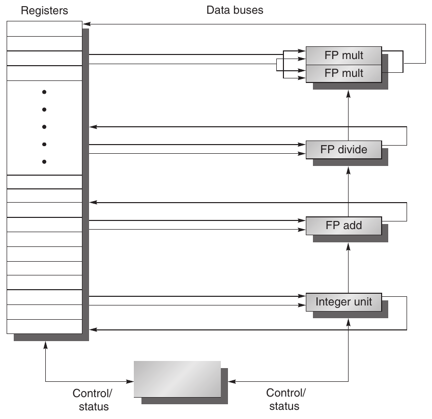

**Hình C.54 Cấu trúc cơ bản của MIPS processor có scoreboard. Chức năng scoreboard là điều khiển instruction execution (đường control dọc). Mọi data đi giữa register file và functional unit trên bus (đường ngang, gọi là trunk trong CDC 6600). Có hai FP multiplier, một FP divider, một FP adder và một integer unit. Một tập bus (hai input và một output) phục vụ một nhóm functional unit. Chi tiết scoreboard nằm trong Hình C.55 đến C.58.**

Mỗi instruction trải qua bốn bước khi thực thi. (Vì tập trung vào FP operation, chúng ta không xét bước memory access.) Trước hết xem các bước một cách khái quát, sau đó xem chi tiết cách scoreboard giữ thông tin cần thiết để quyết định khi nào chuyển từ bước này sang bước tiếp theo. Bốn bước thay thế ID, EX và WB trong MIPS pipeline tiêu chuẩn như sau:

1. Issue — Nếu functional unit cho instruction rảnh và không active instruction nào khác có cùng destination register, scoreboard issue instruction đến functional unit và cập nhật internal data structure. Bước này thay một phần ID trong MIPS pipeline. Bằng cách bảo đảm không functional unit active nào khác muốn ghi vào destination register, chúng ta bảo đảm không có WAW hazard. Nếu có structural hazard hoặc WAW hazard, instruction issue stall và không instruction tiếp theo nào được issue cho đến khi hazard được giải quyết. Khi issue stage stall, buffer giữa instruction fetch và issue đầy lên; nếu chỉ có một entry, instruction fetch stall ngay. Nếu buffer là queue nhiều instruction, nó stall khi queue đầy.

2. Read operands — Scoreboard theo dõi sự khả dụng của source operand. Source operand khả dụng nếu không active instruction nào đã issue trước sẽ ghi nó. Khi source operand khả dụng, scoreboard yêu cầu functional unit tiếp tục đọc operand từ register và bắt đầu execution. Scoreboard giải quyết RAW hazard động trong bước này và instruction có thể được đưa vào execution out of order. Bước này cùng issue hoàn tất chức năng ID trong MIPS pipeline đơn giản.

3. Execution — Functional unit bắt đầu execution khi nhận operand. Khi kết quả sẵn sàng, nó thông báo scoreboard rằng execution đã hoàn tất. Bước này thay EX trong MIPS pipeline và mất nhiều cycle trong MIPS FP pipeline.

4. Write result — Khi biết functional unit đã hoàn tất execution, scoreboard kiểm tra WAR hazard và stall instruction đang hoàn tất nếu cần.

WAR hazard tồn tại nếu có chuỗi code như ví dụ trước với ADD.D và SUB.D cùng dùng F8. Trong ví dụ đó, code là

```
DIV.D       F0,F2,F4
ADD.D       F10,F0,F8
SUB.D       F8,F8,F14
```

ADD.D có source operand F8, cùng register với destination của SUB.D. Nhưng ADD.D thực ra phụ thuộc instruction trước đó. Scoreboard vẫn stall SUB.D tại write result stage cho đến khi ADD.D đọc operand. Vì vậy, nhìn chung không được cho instruction đang hoàn tất ghi kết quả khi:

- Có instruction chưa đọc operand đứng trước (theo thứ tự issue) instruction đang hoàn tất, và

- Một operand là cùng register với result của instruction đang hoàn tất.

Nếu không có WAR hazard này hoặc khi nó được giải quyết, scoreboard yêu cầu functional unit lưu kết quả vào destination register. Bước này thay WB trong MIPS pipeline đơn giản.

Thoạt nhìn, có vẻ scoreboard sẽ khó phân biệt RAW hazard và WAR hazard.

Vì operand của instruction chỉ được đọc khi cả hai đều khả dụng trong register file, scoreboard này không tận dụng forwarding. Thay vào đó, register chỉ được đọc khi cả hai khả dụng. Mức phạt không lớn như bạn có thể nghĩ ban đầu. Khác pipeline đơn giản trước đó, instruction ghi kết quả vào register file ngay khi hoàn tất execution (giả sử không có WAR hazard), thay vì chờ write slot được gán tĩnh có thể cách nhiều cycle. Tác động là giảm pipeline latency và có lợi ích forwarding. Vẫn còn thêm một cycle latency vì write result stage và read operand stage không thể chồng lấp. Cần buffering bổ sung để loại overhead này.

Dựa trên data structure riêng, scoreboard điều khiển instruction chuyển giữa các bước bằng communication với functional unit. Tuy nhiên, có một điểm phức tạp nhỏ. Số source operand bus và result bus đến register file có giới hạn, tạo structural hazard. Scoreboard phải bảo đảm số functional unit được phép tiến vào bước 2 và 4 không vượt số bus khả dụng. Chúng ta không đi sâu hơn, chỉ lưu ý CDC 6600 giải quyết bằng cách chia 16 functional unit thành bốn nhóm, cấp một tập bus gọi là data trunk cho mỗi nhóm. Trong một clock, chỉ một unit trong nhóm có thể đọc operand hoặc ghi kết quả.

Bây giờ xem data structure chi tiết mà MIPS scoreboard có năm functional unit duy trì. Hình C.55 cho thấy thông tin scoreboard tại một thời điểm giữa quá trình thực thi chuỗi instruction đơn giản sau:

```
L.D         F6,34(R2)
L.D         F2,45(R3)
MUL.D       F0,F2,F4
SUB.D       F8,F6,F2
DIV.D       F10,F0,F6
ADD.D       F6,F8,F2
```

Scoreboard có ba phần:

1. Instruction status — Cho biết instruction đang ở bước nào trong bốn bước.

2. Functional unit status — Cho biết state của functional unit (FU). Mỗi functional unit có chín field:

- Busy — Cho biết unit có busy hay không.

- Op — Operation cần thực hiện trong unit (chẳng hạn add hoặc subtract).

- Fi — Destination register.

- Fj, Fk — Số Source-register.

- Qj, Qk — Functional unit tạo source register Fj, Fk.

- Rj, Rk — Flag chỉ khi nào Fj, Fk ready và chưa được đọc. Đặt thành No sau khi đọc operand.

|  | Instruction status |  |  |  |  |
|---|---|---|---|---|---|
| Instruction |  | Issue | Read operands | Execution complete | Write result |
| L.D | F6,34(R2) | √ | √ | √ | √ |
| L.D | F2,45(R3) | √ | √ | √ |  |
| MUL.D | F0,F2,F4 | √ |  |  |  |
| SUB.D | F8,F6,F2 | √ |  |  |  |
| DIV.D | F10,F0,F6 | √ |  |  |  |
| ADD.D | F6,F8,F2 |  |  |  |  |

|  | Functional unit status |  |  |  |  |  |  |  |  |
|---|---|---|---|---|---|---|---|---|---|
| Name | Busy | Op | Fi | Fj | Fk | Qj | Qk | Rj | Rk |
| Integer | Yes | Load | F2 | R3 |  |  |  | No |  |
| Mult1 | Yes | Mult | F0 | F2 | F4 | Integer |  | No | Yes |
| Mult2 | No |  |  |  |  |  |  |  |  |
| Add | Yes | Sub | F8 | F6 | F2 |  | Integer | Yes | No |
| Divide | Yes | Div | F10 | F0 | F6 | Mult1 |  | No | Yes |

|  | Register result status |  |  |  |  |  |  |  |  |
|---|---|---|---|---|---|---|---|---|---|
|  | F0 | F2 | F4 | F6 | F8 | F10 | F12 | . . . | F30 |
| FU | Mult1 | Integer |  |  | Add | Divide |  |  |  |

**Hình C.55 Các thành phần scoreboard. Mỗi instruction đã issue hoặc đang chờ issue có một entry trong instruction status table. Functional unit status table có một entry cho mỗi functional unit. Khi instruction issue, bản ghi operand được giữ trong functional unit status table. Cuối cùng, register result table chỉ unit nào tạo mỗi pending result; số entry bằng số register. Instruction status table cho biết: (1) L.D đầu đã hoàn tất và ghi kết quả, (2) L.D thứ hai đã hoàn tất execution nhưng chưa ghi kết quả. MUL.D, SUB.D và DIV.D đều đã issue nhưng stall chờ operand. Functional unit status cho biết multiply unit đầu đang chờ integer unit, add unit đang chờ integer unit và divide unit đang chờ multiply unit đầu. ADD.D stall vì structural hazard, được giải quyết khi SUB.D hoàn tất. Entry không được dùng trong những scoreboard table này được để trống. Chẳng hạn, Rk field không dùng cho load và Mult2 unit chưa dùng, nên những field đó không có ý nghĩa. Ngoài ra, khi operand đã đọc, Rj và Rk được đặt thành No. Hình C.58 cho thấy vì sao bước cuối này then chốt.**

3. Register result status — Chỉ functional unit nào sẽ ghi từng register nếu active instruction có register đó làm destination. Field được để trống khi không có pending instruction sẽ ghi register đó.

Bây giờ xem chuỗi code bắt đầu trong Hình C.55 tiếp tục execution như thế nào. Sau đó, chúng ta có thể khảo sát chi tiết những điều kiện scoreboard dùng để điều khiển execution.

**Ví dụ** Giả sử các EX cycle latency sau (được chọn để minh họa hành vi, không mang tính đại diện) cho floating-point functional unit: add là 2 clock cycle, multiply là 10 clock cycle và divide là 40 clock cycle. Dùng đoạn code Hình C.55, bắt đầu tại điểm instruction status ở Hình C.55 chỉ ra, hãy trình bày status table khi MUL.D và DIV.D lần lượt sẵn sàng đến write result state.

**Trả lời** Có RAW data hazard từ L.D thứ hai đến MUL.D, ADD.D và SUB.D, từ MUL.D đến DIV.D, và từ SUB.D đến ADD.D. Có WAR data hazard giữa DIV.D với ADD.D và SUB.D. Cuối cùng, có structural hazard trên add functional unit cho ADD.D và SUB.D. Hình C.56 và C.57 lần lượt cho thấy các bảng khi MUL.D và DIV.D sẵn sàng ghi kết quả.

Bây giờ có thể xem chi tiết hoạt động scoreboard qua những gì phải xảy ra để scoreboard cho từng instruction tiếp tục. Hình C.58 cho yêu cầu để mỗi instruction tiến lên và bookkeeping action cần thiết khi nó thực sự tiến lên. Scoreboard ghi operand specifier information như register number. Chẳng hạn, phải ghi source register khi instruction được issue. Vì chúng ta chỉ nội dung register bằng Regs[D], trong đó D là register name, không có sự mơ hồ. Ví dụ Fj[FU]← S1 đặt tên register S1 vào Fj[FU], chứ không phải nội dung register S1.

Chi phí và lợi ích scoreboarding đáng được xem xét. Người thiết kế CDC 6600 đo mức cải thiện performance 1.7 cho chương trình FORTRAN và 2.5 cho assembly language hand-coded. Tuy nhiên, đó là thời trước software pipeline scheduling, semiconductor main memory và cache (giúp giảm memory access time). Scoreboard CDC 6600 có lượng logic khoảng bằng một functional unit, thấp đến đáng ngạc nhiên. Chi phí chính nằm ở số bus lớn — khoảng gấp bốn lần mức cần nếu CPU chỉ execute instruction theo thứ tự (hoặc chỉ khởi tạo một instruction mỗi execute cycle). Sự quan tâm tăng gần đây đối với dynamic scheduling được thúc đẩy bởi nỗ lực issue nhiều instruction hơn mỗi clock (nên dù sao cũng phải trả chi phí nhiều bus hơn), cùng những ý tưởng như speculation (khảo sát ở Mục 4.7) vốn tự nhiên dựa trên dynamic scheduling.

Scoreboard dùng ILP khả dụng để giảm thiểu stall do true data dependence của chương trình. Khi loại stall, scoreboard bị giới hạn bởi một số yếu tố:

1. Mức độ song song giữa các instruction — Quyết định có tìm được instruction độc lập để execute hay không. Nếu mỗi instruction phụ thuộc predecessor, không dynamic scheduling scheme nào giảm được stall. Nếu những instruction đồng thời trong pipeline phải được chọn từ cùng basic block (như 6600), giới hạn này có khả năng khá nghiêm trọng.

|  | Instruction status |  |  |  |  |
|---|---|---|---|---|---|
| Instruction |  | Issue | Read operands | Execution complete | Write result |
| L.D | F6,34(R2) | √ | √ | √ | √ |
| L.D | F2,45(R3) | √ | √ | √ | √ |
| MUL.D | F0,F2,F4 | √ | √ | √ |  |
| SUB.D | F8,F6,F2 | √ | √ | √ | √ |
| DIV.D | F10,F0,F6 | √ |  |  |  |
| ADD.D | F6,F8,F2 | √ | √ | √ |  |

|  | Functional unit status |  |  |  |  |  |  |  |  |
|---|---|---|---|---|---|---|---|---|---|
| Name | Busy | Op | Fi | Fj | Fk | Qj | Qk | Rj | Rk |
| Integer | No |  |  |  |  |  |  |  |  |
| Mult1 | Yes | Mult | F0 | F2 | F4 |  |  | No | No |
| Mult2 | No |  |  |  |  |  |  |  |  |
| Add | Yes | Add | F6 | F8 | F2 |  |  | No | No |
| Divide | Yes | Div | F10 | F0 | F6 | Mult1 |  | No | Yes |

|  | Register result status |  |  |  |  |  |  |  |  |
|---|---|---|---|---|---|---|---|---|---|
|  | F0 | F2 | F4 | F6 | F8 | F10 | F12 | . . . | F30 |
| FU | Mult 1 |  |  | Add |  | Divide |  |  |  |

**Hình C.56 Scoreboard table ngay trước khi MUL.D đến write result. DIV.D chưa đọc operand nào vì phụ thuộc kết quả multiply. ADD.D đã đọc operand và đang execution, dù bị buộc chờ đến khi SUB.D hoàn tất để có functional unit. ADD.D chưa thể đến write result vì WAR hazard trên F6, được DIV.D sử dụng. Q field chỉ có ý nghĩa khi functional unit đang chờ unit khác.**

2. Số scoreboard entry — Quyết định pipeline có thể nhìn trước xa đến đâu để tìm instruction độc lập. Tập instruction được xét làm ứng viên execution tiềm năng gọi là window. Scoreboard size quyết định window size. Trong mục này, giả định window không vượt branch, nên window (và scoreboard) luôn chứa code straight-line từ một basic block. Chương 3 cho thấy cách mở rộng window qua branch.

3. Số lượng và loại functional unit — Quyết định mức quan trọng của structural hazard, có thể tăng khi dùng dynamic scheduling.

|  | Instruction status |  |  |  |  |
|---|---|---|---|---|---|
| Instruction |  | Issue | Read operands | Execution complete | Write result |
| L.D | F6,34(R2)d *(ghi chú: sách in "F6,34(R2)d"; đúng là "F6,34(R2)")* | √ | √ | √ | √ |
| L.D | F2,45(R3) | √ | √ | √ | √ |
| MUL.D | F0,F2,F4 | √ | √ | √ | √ |
| SUB.D | F8,F6,F2 | √ | √ | √ | √ |
| DIV.D | F10,F0,F6 | √ | √ | √ |  |
| ADD.D | F6,F8,F2 | √ | √ | √ | √ |

|  | Functional unit status |  |  |  |  |  |  |  |  |
|---|---|---|---|---|---|---|---|---|---|
| Name | Busy | Op | Fi | Fj | Fk | Qj | Qk | Rj | Rk |
| Integer | No |  |  |  |  |  |  |  |  |
| Mult1 | Yes | Mult | F0 | F2 | F4 |  |  | No | No |
| Mult2 | No |  |  |  |  |  |  |  |  |
| Add | Yes | Add | F6 | F8 | F2 |  |  | No | No |
| Divide | Yes | Div | F10 | F0 | F6 |  |  | No | Yes |

|  | Register result status |  |  |  |  |  |  |  |  |
|---|---|---|---|---|---|---|---|---|---|
|  | F0 | F2 | F4 | F6 | F8 | F10 | F12 | . . . | F30 |
| FU | Mult 1 |  |  | Add |  | Divide |  |  |  |

**Hình C.57 Scoreboard table ngay trước khi DIV.D đến write result. ADD.D có thể hoàn tất ngay khi DIV.D qua read operands và lấy một bản sao F6. Chỉ còn DIV.D cần hoàn tất.**

4. Sự hiện diện của antidependence và output dependence — Dẫn đến WAR stall và WAW stall.

Chương 3 tập trung vào kỹ thuật giải quyết việc bộc lộ và khai thác tốt hơn instruction-level parallelism (ILP) khả dụng. Có thể xử lý yếu tố thứ hai và thứ ba bằng cách tăng scoreboard size và số functional unit; tuy nhiên, thay đổi có tác động chi phí và có thể ảnh hưởng cycle time. WAW hazard và WAR hazard quan trọng hơn trong processor được schedule động vì pipeline bộc lộ nhiều name dependence hơn. WAW hazard cũng quan trọng hơn nếu dùng dynamic scheduling với branch-prediction scheme cho phép nhiều lần lặp của loop chồng lấp.

| Instruction status | Chờ đến khi | Bookkeeping |
|---|---|---|
| Issue | Not busy [FU] and not result [D] | Busy[FU]←yes; Op[FU]←op; Fi[FU]←D;<br>Fj[FU]←S1; Fk[FU]←S2;<br>Qj←Result[S1]; Qk← Result[S2];<br>Rj← not Qj; Rk← not Qk; Result[D]←FU; |
| Read operands | Rj and Rk | Rj← No; Rk← No; Qj←0; Qk←0 |
| Execution complete | Functional unit hoàn tất |  |
| Write result | ∀f((Fj[f ] ¦ Fi[FU] or Rj[f ] = No) & (Fk[f ] ¦ Fi[FU] or Rk[f ] = No)) | ∀f(if Qj[f ]=FU then Rj[f ]←Yes); ∀f(if Qk[f ]=FU then Rk[f ]←Yes); Result[Fi[FU]]← 0; Busy[FU]← No |

*(ghi chú: sách in "¦"; đúng là "≠")*

**Hình C.58 Các phép kiểm tra và bookkeeping action cần thiết cho mỗi bước instruction execution. FU là functional unit instruction dùng, D là destination register name, S1 và S2 là source register name, op là operation cần làm. Để truy cập scoreboard entry tên Fj cho functional unit FU, dùng Fj[FU]. Result[D] là tên functional unit sẽ ghi register D. Phép kiểm tra trong trường hợp write result ngăn write khi có WAR hazard, tồn tại nếu instruction khác có destination của instruction này (Fi[FU]) làm source (Fj[f ] hoặc Fk[ ]) và nếu instruction khác đã ghi register (Rj = Yes hoặc Rk = Yes). Variable f được dùng cho bất kỳ functional unit nào.**

## C.8 Ngộ nhận và cạm bẫy

**Cạm bẫy** Chuỗi execution bất ngờ có thể gây hazard bất ngờ.

Thoạt nhìn, WAW hazard có vẻ không bao giờ xuất hiện trong chuỗi code vì không compiler nào sinh hai write vào cùng register mà không có read xen giữa, nhưng chúng có thể xảy ra khi chuỗi diễn ra ngoài dự kiến. Chẳng hạn, write đầu có thể ở delay slot của taken branch khi scheduler tưởng branch không taken. Sau đây là chuỗi code có thể gây điều này:

```
           BNEZ    R1,foo
           DIV.D F0,F2,F4; moved into delay slot
                   ;from fall through
           .....
           .....
foo:       L.D     F0,qrs
```

Nếu branch taken, trước khi DIV.D hoàn tất, L.D đến WB, gây WAW hazard. Hardware phải phát hiện và có thể stall issue L.D. Một cách khác là write thứ hai nằm trong trap routine. Điều này xảy ra khi instruction gây trap và đang ghi kết quả tiếp tục, hoàn tất sau instruction ghi cùng register trong trap handler. Hardware cũng phải phát hiện và ngăn tình huống này.

**Cạm bẫy** Pipelining quá mức có thể ảnh hưởng các khía cạnh khác của thiết kế, dẫn đến tổng cost-performance kém hơn.

Ví dụ tốt nhất là hai implementation VAX, 8600 và 8700. Khi 8600 được cung cấp ban đầu, cycle time là 80 ns. Sau đó, phiên bản thiết kế lại tên 8650 với clock 55 ns được giới thiệu. 8700 có pipeline đơn giản hơn nhiều, hoạt động ở microinstruction level, tạo CPU nhỏ hơn với clock cycle nhanh hơn 45 ns. Kết quả tổng thể là 8650 có lợi thế CPI khoảng 20%, nhưng 8700 có clock rate nhanh hơn khoảng 20%. Vì vậy, 8700 đạt cùng performance với ít hardware hơn nhiều.

**Cạm bẫy** Đánh giá dynamic scheduling hoặc static scheduling dựa trên code chưa tối ưu.

Code chưa tối ưu — chứa load, store dư thừa và operation khác mà optimizer có thể loại bỏ — dễ schedule hơn code tối ưu “chặt”. Điều này đúng cho scheduling cả control delay (với delayed branch) lẫn delay do RAW hazard. Với gcc chạy trên R3000 có pipeline gần giống Mục C.1, tần suất idle clock cycle tăng 18% từ code chưa tối ưu đã schedule sang code tối ưu đã schedule. Dĩ nhiên, chương trình tối ưu nhanh hơn nhiều vì ít instruction hơn. Để đánh giá công bằng scheduler compile-time hoặc dynamic scheduling runtime, phải dùng code tối ưu, vì trong hệ thống thực, performance tốt đến từ các phép tối ưu khác bên cạnh scheduling.

## C.9 Nhận xét kết luận

Đầu thập niên 1980, pipelining chủ yếu dành cho supercomputer và mainframe lớn trị giá nhiều triệu đô la. Đến mid-1980s, microprocessor pipelined đầu tiên xuất hiện và góp phần thay đổi computing, cho phép microprocessor vượt minicomputer về performance rồi cuối cùng cạnh tranh và vượt mainframe. Đầu thập niên 1990, embedded microprocessor high-end tiếp nhận pipelining, còn desktop hướng đến những cách tiếp cận multiple-issue, được schedule động tinh vi trong Chương 3. Nội dung phụ lục này, từng được coi là khá nâng cao cho học viên sau đại học khi sách xuất hiện lần đầu năm 1990, nay là kiến thức đại học cơ bản và có thể thấy trong processor giá dưới $2!

## C.10 Góc nhìn lịch sử và tài liệu tham khảo

Mục L.5 (có trực tuyến) thảo luận sự phát triển pipelining và instruction-level parallelism, bao quát cả phụ lục này và nội dung Chương 3. Chúng tôi cung cấp nhiều tài liệu tham khảo để đọc thêm và khám phá các chủ đề này.

## Bài tập được Diana Franklin cập nhật

**C.1** [15/15/15/15/25/10/15] <A.2> Dùng đoạn code sau:

```
Loop:     LD         R1,0(R2)     ;load R1 from address 0+R2
          DADDI      R1,R1,#1     ;R1=R1+1
          SD         R1,0,(R2)    ;store R1 at address 0+R2
          DADDI      R2,R2,#4     ;R2=R2+4
          DSUB       R4,R3,R2     ;R4=R3-R2
          BNEZ       R4,Loop      ;branch to Loop if R4!=0
```

*(ghi chú: sách in "SD R1,0,(R2)"; đúng là "SD R1,0(R2)")*

Giả sử giá trị ban đầu của R3 là R2 + 396.

a. [15] <C.2> Data hazard do data dependence trong code gây ra. Một dependency có gây hazard hay không phụ thuộc implementation của máy (tức số pipeline stage). Liệt kê mọi data dependence trong code trên. Ghi register, source instruction và destination instruction; chẳng hạn có data dependency cho register R1 từ LD đến DADDI.

b. [15] <C.2> Trình bày timing của chuỗi instruction này trên RISC pipeline 5-stage không có forwarding hardware hoặc bypassing hardware, nhưng giả sử register read và write trong cùng clock cycle “forward” qua register file như Hình C.6. Dùng pipeline timing chart như Hình C.5. Giả sử branch được xử lý bằng flushing pipeline. Nếu mọi memory reference mất 1 cycle, loop này cần bao nhiêu cycle để thực thi?

c. [15] <C.2> Trình bày timing của chuỗi instruction này trên RISC pipeline 5-stage có đầy đủ forwarding hardware và bypassing hardware. Dùng pipeline timing chart như Hình C.5. Giả sử branch được xử lý bằng dự đoán not taken. Nếu mọi memory reference mất 1 cycle, loop này cần bao nhiêu cycle để thực thi?

d. [15] <C.2> Trình bày timing của chuỗi instruction này trên RISC pipeline 5-stage có đầy đủ forwarding hardware và bypassing hardware. Dùng pipeline timing chart như Hình C.5. Giả sử branch được xử lý bằng dự đoán taken. Nếu mọi memory reference mất 1 cycle, loop này cần bao nhiêu cycle để thực thi?

e. [25] <C.2> Processor High-performance có pipeline rất sâu — hơn 15 stage. Hình dung pipeline 10-stage trong đó mỗi stage của pipeline 5-stage được chia đôi. Điểm cần lưu ý duy nhất là với data forwarding, data được forward từ cuối một cặp stage đến đầu hai stage nơi cần chúng. Chẳng hạn, data được forward từ output của execute stage thứ hai đến input execute stage thứ nhất, vẫn gây delay 1-cycle. Trình bày timing của chuỗi instruction này trên RISC pipeline 10-stage có đầy đủ forwarding hardware và bypassing hardware. Dùng pipeline timing chart như Hình C.5. Giả sử branch được xử lý bằng dự đoán taken. Nếu mọi memory reference mất 1 cycle, loop này cần bao nhiêu cycle để thực thi?

f. [10] <C.2> Giả sử trong pipeline 5-stage, stage dài nhất cần 0.8 ns và pipeline register delay là 0.1 ns. Clock cycle time của pipeline 5-stage là bao nhiêu? Nếu pipeline 10-stage chia đôi mọi stage, cycle time của máy 10-stage là bao nhiêu?

g. [15] <C.2> Dùng câu trả lời phần (d) và (e), xác định cycles per instruction (CPI) của loop trên pipeline 5-stage và pipeline 10-stage. Bảo đảm chỉ đếm từ khi instruction đầu đến write-back stage cho đến cuối. Không tính start-up của instruction đầu. Dùng clock cycle time tính ở phần (f) để tính instruction execute time trung bình cho mỗi máy.

**C.2** [15/15] <C.2> Giả sử branch frequency (theo phần trăm mọi instruction) như sau:

| Conditional branch | 15% |
|---|---|
| Jump và call | 1% |
| Conditional branch taken | 60% là taken |

a. [15] <C.2> Chúng ta khảo sát pipeline four-deep trong đó branch được giải quyết cuối cycle thứ hai cho unconditional branch và cuối cycle thứ ba cho conditional branch. Giả sử chỉ pipe stage đầu luôn có thể thực hiện độc lập với hướng branch và bỏ qua pipeline stall khác, máy sẽ nhanh hơn bao nhiêu nếu không có branch hazard?

b. [15] <C.2> Bây giờ giả sử một processor high-performance có pipeline 15-deep, branch được giải quyết cuối cycle thứ năm cho unconditional branch và cuối cycle thứ mười cho conditional branch. Giả sử chỉ pipe stage đầu luôn có thể thực hiện độc lập với hướng branch và bỏ qua pipeline stall khác, máy sẽ nhanh hơn bao nhiêu nếu không có branch hazard?

**C.3** [5/15/10/10] <C.2> Chúng ta bắt đầu với máy tính có implementation single-cycle. Khi chia stage theo chức năng, thời gian cần cho các stage không hoàn toàn bằng nhau. Máy ban đầu có clock cycle time 7 ns. Sau khi chia stage, thời gian đo được là IF, 1 ns; ID, 1.5 ns; EX, 1 ns; MEM, 2 ns; WB, 1.5 ns. Pipeline register delay là 0.1 ns.

a. [5] <C.2> Clock cycle time của máy pipelined 5-stage là bao nhiêu?

b. [15] <C.2> Nếu mỗi 4 instruction có một stall, CPI của máy mới là bao nhiêu?

c. [10] <C.2> Speedup của máy pipelined so với máy single-cycle là bao nhiêu?

d. [10] <C.2> Nếu máy pipelined có vô hạn stage, speedup so với máy single-cycle sẽ là bao nhiêu?

**C.4** [15] <C.1, C.2> Một implementation hardware rút gọn của RISC pipeline five-stage cổ điển có thể dùng EX stage hardware để so sánh branch instruction, rồi chỉ thực sự đưa branch target PC đến IF stage ở clock cycle khi branch instruction đến MEM stage. Có thể giảm control hazard stall bằng cách giải quyết branch instruction trong ID, nhưng cải thiện performance ở một khía cạnh có thể làm giảm performance trong tình huống khác. Viết đoạn code nhỏ mà việc tính branch ở ID stage gây data hazard ngay cả khi có data forwarding.

**C.5** [12/13/20/20/15/15] <C.2, C.3> Trong những bài này, chúng ta khảo sát pipeline cho architecture register-memory. Architecture có hai instruction format: register-register và register-memory. Có một addressing mode single-memory (offset + base register). Một tập ALU operation có format:

```
ALUop Rdest, Rsrc1, Rsrc2
```

hoặc

```
ALUop Rdest, Rsrc1, MEM
```

trong đó ALUop là một trong những operation: add, subtract, AND, OR, load (bỏ qua Rsrc1) hoặc store. Rsrc và Rdest là register. MEM là cặp base register và offset. Branch dùng full compare của hai register và là PC relative. Giả sử máy pipelined để mỗi clock cycle bắt đầu một instruction mới. Cấu trúc pipeline tương tự VAX 8700 micropipeline [Clark 1987] là

| IF | RF | ALU1 | MEM | WB |  |  |  |  |  |  |
|---|---|---|---|---|---|---|---|---|---|---|
|  | IF | RF | ALU1 | MEM | ALU2 | WB |  |  |  |  |
|  |  | IF | RF | ALU1 | MEM | ALU2 | WB |  |  |  |
|  |  |  | IF | RF | ALU1 | MEM | ALU2 | WB |  |  |
|  |  |  |  | IF | RF | ALU1 | MEM | ALU2 | WB |  |
|  |  |  |  |  | IF | RF | ALU1 | MEM | ALU2 | WB |

ALU stage đầu dùng để tính effective address cho memory reference và branch. ALU cycle thứ hai dùng cho operation và branch comparison. RF vừa là decode cycle vừa là register-fetch cycle. Giả sử khi register read và register write cùng register xảy ra cùng clock, write data được forward.

a. [12] <C.2> Tìm số adder cần thiết, tính mọi adder hoặc incrementer; trình bày một tổ hợp instruction và pipe stage chứng minh câu trả lời. Chỉ cần một tổ hợp tối đa hóa adder count.

b. [13] <C.2> Tìm số register read port, write port và memory read port, write port cần thiết. Chứng minh câu trả lời bằng một tổ hợp instruction và pipeline stage, chỉ instruction và số read port, write port cần cho instruction đó.

c. [20] <C.3> Xác định mọi data forwarding cần thiết cho các ALU. Giả sử có ALU riêng cho ALU1 và ALU2 pipe stage. Bổ sung mọi forwarding giữa ALU cần để tránh hoặc giảm stall. Thể hiện quan hệ giữa hai instruction tham gia forwarding bằng format bảng Hình C.26 nhưng bỏ hai cột cuối. Cẩn thận xét forwarding qua một instruction xen giữa — chẳng hạn,

```
ADD           R1, ...
any instruction
ADD           ..., R1, ...
```

d. [20] <C.3> Trình bày mọi yêu cầu data forwarding cần để tránh hoặc giảm stall khi source unit hoặc destination unit không phải ALU. Dùng cùng format Hình C.26, vẫn bỏ hai cột cuối. Nhớ forward đến và từ memory reference.

e. [15] <C.3> Trình bày mọi hazard còn lại liên quan ít nhất một unit không phải ALU làm source unit hoặc destination unit. Dùng bảng như Hình C.25 nhưng thay cột cuối bằng chiều dài hazard.

f. [15] <C.2> Minh họa mọi control hazard bằng ví dụ và nêu stall length. Dùng format như Hình C.11, ghi nhãn từng ví dụ.

**C.6** [12/13/13/15/15] <C.1, C.2, C.3> Bây giờ thêm hỗ trợ ALU operation register-memory vào RISC pipeline five-stage cổ điển. Để bù độ phức tạp tăng, mọi memory addressing bị giới hạn ở register indirect (tức mọi address chỉ là giá trị trong register; không được cộng offset hoặc displacement vào register value). Chẳng hạn, instruction register-memory ADD R4, R5, (R1) nghĩa là cộng nội dung R5 với nội dung memory location có address bằng giá trị trong R1 và đặt tổng vào R4. ALU operation Register-register không thay đổi. Những mục sau áp dụng cho integer RISC pipeline:

a. [12] <C.1> Liệt kê thứ tự sắp xếp lại của năm stage RISC pipeline truyền thống để hỗ trợ operation register-memory chỉ được triển khai bằng register indirect addressing.

b. [13] <C.2, C.3> Mô tả các forwarding path mới cần cho pipeline được sắp xếp lại bằng cách nêu source, destination và thông tin được truyền trên mỗi path mới cần thiết.

c. [13] <C.2, C.3> Với stage RISC pipeline được đổi thứ tự, addressing mode này tạo data hazard mới nào? Cho chuỗi instruction minh họa từng hazard mới.

d. [15] <C.3> Liệt kê mọi cách mà RISC pipeline có ALU operation register-memory có thể có instruction count khác RISC pipeline ban đầu cho một chương trình cho trước. Cho một cặp chuỗi instruction cụ thể, một cho pipeline ban đầu và một cho pipeline sắp xếp lại, để minh họa từng cách.

e. [15] <C.3> Giả sử mọi instruction mất 1 clock cycle mỗi stage. Liệt kê mọi cách mà RISC register-memory có thể có CPI khác RISC pipeline ban đầu cho một chương trình cho trước.

**C.7** [10/10] <C.3> Trong bài này, chúng ta khảo sát pipeline sâu hơn ảnh hưởng performance theo hai cách: clock cycle nhanh hơn và tăng stall do data hazard, control hazard. Giả sử máy ban đầu là pipeline 5-stage với clock cycle 1 ns. Máy thứ hai là pipeline 12-stage với clock cycle 0.6 ns. Pipeline 5-stage có một stall do data hazard mỗi 5 instruction, còn pipeline 12-stage có 3 stall mỗi 8 instruction. Ngoài ra, branch chiếm 20% instruction và misprediction rate của cả hai máy là 5%.

a. [10] <C.3> Speedup của pipeline 12-stage so với pipeline 5-stage là bao nhiêu nếu chỉ xét data hazard?

b. [10] <C.3> Nếu branch mispredict penalty của máy đầu là 2 cycle còn máy thứ hai là 5 cycle, CPI mỗi máy là bao nhiêu khi tính stall do branch misprediction?

**C.8** [15] <C.5> Tạo bảng thể hiện forwarding logic cho R4000 integer pipeline bằng cùng format Hình C.26. Chỉ đưa vào những MIPS instruction đã xét trong Hình C.26.

**C.9** [15] <C.5> Tạo bảng thể hiện R4000 integer hazard detection bằng cùng format Hình C.25. Chỉ đưa vào những MIPS instruction đã xét trong Hình C.26.

**C.10** [25] <C.5> Giả sử MIPS chỉ có một register set. Xây dựng forwarding table cho FP instruction và integer instruction bằng format Hình C.26. Bỏ qua FP divide và integer divide.

**C.11** [15] <C.5> Xây dựng bảng như Hình C.25 để kiểm tra WAW stall trong MIPS FP pipeline Hình C.35. Không xét FP divide.

**C.12** [20/22/22] <C.4, C.6> Trong bài này, chúng ta xem một vector loop phổ biến chạy trên phiên bản MIPS pipeline được schedule tĩnh và động như thế nào. Loop so-called DAXPY (thảo luận rộng trong Phụ lục G), operation trung tâm của Gaussian elimination. Loop triển khai vector operation Y = a * X + Y cho vector dài 100. Sau đây là MIPS code:

```
foo:     L.D          F2, 0(R1)         ; load X(i)
         MUL.D        F4, F2, F0        ; multiply a*X(i)
         L.D          F6, 0($2)         ; load Y(i)
         ADD.D        F6, F4, F6        ; add a*X(i) + Y(i)
         S.D          0(R2), F6         ; store Y(i)
         DADDIU       R1, R1, #8        ; increment X index
         DADDIU       R2, R2, #8        ; increment Y index
         SGTIU        R3, R1, done      ; test if done
         BEQZ         R3, foo           ; loop if not done
```

*(ghi chú: sách in "0($2)"; đúng là "0(R2)")*

Cho phần (a) đến (c), giả sử integer operation issue và hoàn tất trong 1 clock cycle (bao gồm load), kết quả được bypass đầy đủ. Bỏ qua branch delay. Chỉ dùng FP latency trong Hình C.34, nhưng giả sử FP unit fully pipelined. Với các scoreboard dưới đây, giả sử instruction đang chờ kết quả từ function unit khác có thể qua read operands cùng lúc kết quả được ghi. Cũng giả sử instruction đang hoàn tất WR cho phép active instruction hiện tại đang chờ cùng functional unit issue ngay trong clock cycle mà instruction đầu hoàn tất WR.

a. [20] <C.5> Với bài này, dùng MIPS pipeline Mục C.5 với pipeline latency từ Hình C.34, nhưng FP unit fully pipelined nên initiation interval là 1. Vẽ timing diagram tương tự Hình C.37, thể hiện timing execution của từng instruction. Mỗi lần lặp loop mất bao nhiêu clock cycle, đếm từ khi instruction đầu vào WB stage đến khi instruction cuối vào WB stage?

b. [22] <C.6> Dùng MIPS code DAXPY trên, trình bày state các scoreboard table (như Hình C.56) khi SGTIU đến write result. Giả sử issue và read operands mỗi bước mất một cycle. Giả sử một integer functional unit chỉ cần một execution cycle (latency cần dùng là 0 cycle, bao gồm load và store). Giả sử cấu hình FP unit Hình C.54 với FP latency Hình C.34. Không đưa branch vào scoreboard.

c. [22] <C.6> Dùng MIPS code DAXPY trên, giả sử scoreboard với FP functional unit mô tả trong Hình C.54, cộng một integer functional unit (cũng dùng cho load-store). Giả sử latency Hình C.59. Trình bày state scoreboard (như Hình C.56) khi branch issue lần thứ hai. Giả sử branch được dự đoán taken đúng và mất 1 cycle. Mỗi lần lặp loop mất bao nhiêu clock cycle? Có thể bỏ qua mọi register port/bus conflict.

**C.13** [25] <C.8> Điều then chốt là scoreboard phân biệt được RAW hazard và WAR hazard, vì WAR hazard yêu cầu stall instruction ghi cho đến khi instruction đọc operand bắt đầu execution, còn RAW hazard yêu cầu trì hoãn instruction đọc cho đến khi instruction ghi hoàn tất — hoàn toàn ngược lại. Chẳng hạn, xét chuỗi sau:

| Instruction tạo kết quả | Instruction dùng kết quả | Latency tính bằng clock cycle |
|---|---|---|
| FP multiply | FP ALU op | 6 |
| FP add | FP ALU op | 4 |
| FP multiply | FP store | 5 |
| FP add | FP store | 3 |
| Integer operation (bao gồm load) | Bất kỳ | 0 |

**Hình C.59 Pipeline latency, trong đó latency là số.**

```
MUL.D      F0,F6,F4
DSUB.D     F8,F0,F2
ADD.D      F2,F10,F2
```

DSUB.D phụ thuộc MUL.D (RAW hazard), vì vậy phải cho MUL.D hoàn tất trước DSUB.D. Nếu MUL.D bị stall vì DSUB.D do không phân biệt RAW hazard và WAR hazard, processor sẽ deadlock. Chuỗi này chứa WAR hazard giữa ADD.D và DSUB.D, không được cho ADD.D hoàn tất cho đến khi DSUB.D bắt đầu execution. Khó khăn nằm ở việc phân biệt RAW hazard giữa MUL.D và DSUB.D với WAR hazard giữa DSUB.D và ADD.D. Để thấy vì sao tình huống three-instruction quan trọng, theo dõi cách từng instruction được xử lý qua issue, read operands, execute và write result. Giả sử mỗi scoreboard stage ngoài execute mất 1 clock cycle. Giả sử MUL.D cần 3 clock cycle để execute, còn DSUB.D và ADD.D mỗi instruction cần 1 cycle. Cuối cùng, giả sử processor có hai multiply function unit và hai add function unit. Trình bày trace như sau.

1. Tạo bảng có tiêu đề cột Instruction, Issue, Read Operands, Execute, Write Result và Comment. Trong cột đầu, liệt kê instruction theo program order (để nhiều khoảng trống giữa instruction; ô bảng lớn sẽ chứa kết quả phân tích tốt hơn). Bắt đầu bằng ghi 1 trong cột Issue của hàng MUL.D để cho biết MUL.D hoàn tất issue stage ở clock cycle 1. Bây giờ điền các cột stage đến cycle nơi scoreboard lần đầu stall instruction.

2. Với instruction stalled, ghi “đang chờ ở clock cycle X”, trong đó X là số clock cycle hiện tại, vào cột thích hợp để chỉ scoreboard đang giải quyết RAW hazard hoặc WAR hazard bằng cách stall stage đó. Trong cột Comment, nêu loại hazard và dependent instruction gây chờ.

3. Thêm “hoàn tất ở clock cycle Y” vào entry “đang chờ”, điền phần bảng còn lại đến khi mọi instruction hoàn tất. Với instruction từng stall, thêm mô tả trong cột Comments giải thích vì sao chờ kết thúc tại thời điểm đó và deadlock được tránh thế nào. (Gợi ý: nghĩ về cách ngăn WAW hazard và điều đó hàm ý gì về các active instruction sequence.) Lưu ý completion order của ba instruction so với program order.

**C.14** [10/10/10] <C.5> Trong bài này, bạn tạo một loạt đoạn code nhỏ minh họa những vấn đề khi dùng functional unit có latency khác nhau. Với mỗi đoạn, vẽ timing diagram tương tự Hình C.38 để minh họa từng khái niệm và chỉ rõ vấn đề.

a. [10] <C.5> Dùng code khác Hình C.38 để minh họa structural hazard khi hardware chỉ có một MEM stage và một WB stage.

b. [10] <C.5> Minh họa WAW hazard cần stall.
