# D Storage System

> Tôi nghĩ Silicon Valley đã bị đặt sai tên. Nếu nhìn lại giá trị bằng dollar của những sản phẩm được xuất xưởng trong thập niên vừa qua, doanh thu từ magnetic disk lớn hơn doanh thu từ silicon. Người ta nên đổi tên nơi đó thành Iron Oxide Valley.

> Al Hoagland

> Một người tiên phong trong lĩnh vực magnetic disk (1982)

> Kết hợp bandwidth và storage . . . cho phép truy cập nhanh chóng và đáng tin cậy vào những kho nội dung không ngừng mở rộng trên số lượng disk ngày càng tăng và . . . những kho lưu trữ của Internet . . . capacity của mọi loại storage array đang tăng vọt, vượt trước tốc độ phát triển của computer performance.

> George Gilder

> “The End Is Drawing Nigh,”

> Forbes ASAP (ngày 4 tháng Tư, 2000)

## D.1 Giới thiệu

Sự phổ biến của các dịch vụ Internet như search engine và đấu giá đã nâng cao tầm quan trọng của I/O đối với máy tính, vì không ai muốn một desktop computer không thể truy cập Internet. Sự gia tăng tầm quan trọng của I/O này được phản ánh qua những tên gọi dành cho thời đại của chúng ta. Khoảng thời gian từ thập niên 1960 đến thập niên 1980 được gọi là Cuộc cách mạng Điện toán; giai đoạn từ năm 1990 được gọi là Kỷ nguyên Thông tin, với mối quan tâm tập trung vào những tiến bộ trong công nghệ thông tin thay vì chỉ năng lực tính toán thuần túy. Các dịch vụ Internet phụ thuộc vào storage khổng lồ, trọng tâm của chương này, và networking, trọng tâm của Phụ lục F.

Sự chuyển hướng trọng tâm từ tính toán sang trao đổi và lưu trữ thông tin này nhấn mạnh reliability và scalability cũng như cost-performance. Mặc dù một chương trình bị crash gây bực bội, mọi người sẽ hoảng loạn nếu mất dữ liệu; vì thế, storage system thường phải đáp ứng tiêu chuẩn dependability cao hơn phần còn lại của máy tính. Dependability là nền tảng của storage, nhưng storage còn có một lý thuyết performance phong phú riêng—queuing theory—cân bằng throughput với response time. Software quyết định những tính năng nào của processor được sử dụng là compiler, nhưng đối với storage, operating system đảm nhận vai trò đó.

Vì thế, storage có một nền văn hóa đa diện, khác với processor, nhưng vẫn nằm trong phạm vi architecture. Chúng ta bắt đầu tìm hiểu với những tiến bộ của magnetic disk, vì hiện nay chúng là storage device chủ đạo trong desktop computer và server computer. Chúng ta giả định người đọc đã quen thuộc với những kiến thức cơ bản về storage device, trong đó một số đã được trình bày trong Chương 1.

## D.2 Các chủ đề nâng cao về Disk Storage

Trong lịch sử, ngành công nghiệp disk đã tập trung cải thiện capacity của disk. Sự cải thiện capacity thường được biểu diễn thông qua sự cải thiện areal density, đo bằng số bit trên mỗi square inch:

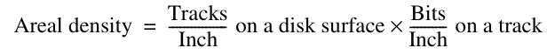

Cho đến khoảng năm 1988, tốc độ cải thiện areal density là 29% mỗi năm, nhờ đó density tăng gấp đôi sau mỗi 3 năm. Từ thời điểm đó đến khoảng năm 1996, tốc độ tăng lên 60% mỗi năm, khiến density tăng gấp bốn sau mỗi 3 năm và tương đương với tốc độ tăng truyền thống của DRAM. Từ năm 1997 đến khoảng năm 2003, tốc độ tăng lên 100%, tức tăng gấp đôi mỗi năm. Sau khi những đổi mới cho phép sự phục hưng này phần lớn đã được khai thác hết, gần đây tốc độ đã giảm xuống khoảng 30% mỗi năm. Năm 2011, density cao nhất trong các sản phẩm thương mại là 400 tỷ bit trên mỗi square inch. Chi phí trên mỗi gigabyte đã giảm ít nhất nhanh bằng tốc độ tăng của areal density, trong đó các drive có đường kính nhỏ hơn đóng vai trò lớn hơn trong sự cải thiện này. Chi phí trên mỗi gigabyte được cải thiện gần 1,000,000 lần từ năm 1983 đến năm 2011.

Magnetic disk đã nhiều lần bị thách thức về vị trí thống trị secondary storage. Hình D.1 cho thấy một lý do: khoảng cách nổi tiếng về access time giữa disk và DRAM. DRAM latency thấp hơn khoảng 100,000 lần so với disk, và lợi thế performance đó đi kèm chi phí trên mỗi gigabyte cao hơn từ 30 đến 150 lần đối với DRAM.

Khoảng cách về bandwidth phức tạp hơn. Ví dụ, một disk nhanh vào năm 2011 truyền dữ liệu từ disk media ở 200 MB/sec, có storage 600 GB và có giá khoảng $400. Một DRAM module 4 GB có giá khoảng $200 vào năm 2011 có thể truyền ở 16,000 MB/sec (xem Chương 2), khiến DRAM module có bandwidth cao hơn disk khoảng 80 lần. Tuy nhiên, bandwidth trên mỗi GB của DRAM cao hơn 6000 lần, còn bandwidth trên mỗi dollar cao hơn 160 lần.

Nhiều người đã cố gắng phát minh một công nghệ rẻ hơn DRAM nhưng nhanh hơn disk để lấp khoảng cách đó, nhưng cho đến nay tất cả đều thất bại. Những đối thủ thách thức chưa bao giờ đưa được sản phẩm ra thị trường đúng thời điểm. Đến khi một sản phẩm mới được xuất xưởng, DRAM và disk đã tiến bộ như dự đoán trước đó, chi phí cũng giảm tương ứng, và sản phẩm thách thức lập tức trở nên lỗi thời.

Đối thủ thách thức gần nhất là Flash memory. Semiconductor memory này là nonvolatile giống disk và có bandwidth gần bằng disk, nhưng latency nhanh hơn disk từ 100 đến 1000 lần. Năm 2011, giá trên mỗi gigabyte của Flash rẻ hơn DRAM từ 15 đến 20 lần. Flash phổ biến trong điện thoại di động vì có những mức capacity nhỏ hơn nhiều và power efficient hơn disk, mặc dù chi phí trên mỗi gigabyte cao hơn disk từ 15 đến 25 lần. Khác với disk và DRAM, các bit Flash memory bị hao mòn—thường bị giới hạn ở 1 triệu lần ghi—vì thế chúng không phổ biến trong desktop computer và server computer.

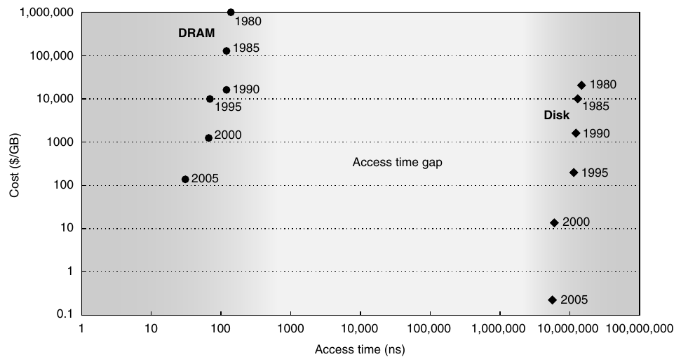

**Hình D.1 Chi phí so với access time của DRAM và magnetic disk vào các năm 1980, 1985, 1990, 1995, 2000 và 2005. Khoảng cách two-order-of-magnitude về chi phí và five-order-of-magnitude về access time giữa semiconductor memory và magnetic disk quay đã truyền cảm hứng cho hàng loạt công nghệ cạnh tranh cố gắng lấp đầy chúng. Cho đến nay, những nỗ lực đó đã trở nên lỗi thời trước khi được sản xuất do những cải tiến của magnetic disk, DRAM hoặc cả hai. Lưu ý rằng từ năm 1990 đến năm 2005, chi phí trên mỗi gigabyte của chip DRAM được cải thiện ít hơn, trong khi chi phí disk được cải thiện mạnh mẽ.**

Mặc dù disk sẽ tiếp tục có chỗ đứng trong tương lai có thể dự đoán được, mô hình sector-track-cylinder thông thường thì không. Những giả định của mô hình này là các block gần nhau nằm trên cùng track, các block trong cùng cylinder cần ít thời gian truy cập hơn vì không có seek time, và một số track gần hơn những track khác.

Thứ nhất, disk bắt đầu cung cấp những intelligent interface higher-level như ATA và SCSI khi chúng được tích hợp microprocessor bên trong. Để tăng tốc sequential transfer, những interface higher-level này tổ chức disk giống tape hơn là random access device. Các logical block được sắp xếp theo đường uốn lượn trên một mặt đĩa duy nhất, cố gắng bao quát tất cả sector được ghi ở cùng bit density. (Disk thay đổi recording density vì electronic circuit khó theo kịp những block quay nhanh hơn nhiều ở các track bên ngoài, và giảm linear density giúp đơn giản hóa nhiệm vụ đó.) Vì thế, các block tuần tự có thể nằm trên những track khác nhau. Sau này, trong Hình D.22 ở trang D-45, chúng ta sẽ thấy một minh họa cho ngộ nhận khi giả định mô hình sector-track thông thường lúc làm việc với disk hiện đại.

Thứ hai, không lâu sau khi microprocessor xuất hiện bên trong disk, disk được bổ sung buffer để giữ dữ liệu cho đến khi máy tính sẵn sàng nhận, rồi sau đó là cache để tránh những read access. Tiếp theo là command queue, cho phép disk quyết định thứ tự thực hiện command nhằm tối đa hóa performance trong khi vẫn duy trì hành vi đúng. Hình D.2 cho thấy queue depth bằng 50 có thể tăng gấp đôi số I/O mỗi giây của random I/O nhờ scheduling access tốt hơn. Mặc dù một hệ thống khó có khả năng thực sự có 256 command trong queue, mức đó sẽ tăng gấp ba số I/O mỗi giây. Với buffer, cache và access out-of-order, một performance model chính xác của disk thực tế phức tạp hơn nhiều so với sector-track-cylinder.

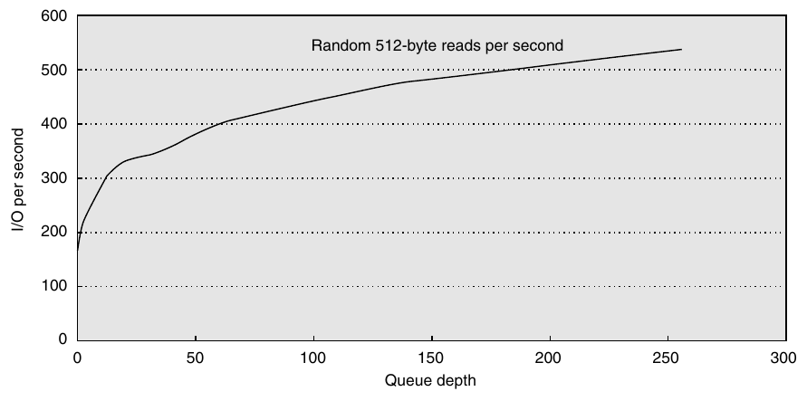

**Hình D.2 Throughput so với command queue depth khi sử dụng các thao tác đọc random 512-byte. Disk thực hiện 170 lần đọc mỗi giây khi bắt đầu không có command queue, tăng gấp đôi performance ở 50 và gấp ba ở 256 [Anderson 2003].**

Cuối cùng, số platter giảm từ 12 trước kia xuống 4 hoặc thậm chí 1 hiện nay, vì thế cylinder ít quan trọng hơn trước do tỷ lệ dữ liệu nằm trong một cylinder nhỏ hơn nhiều.

### Power của Disk

Power ngày càng là mối quan tâm đối với disk cũng như processor. Một ATA disk thông thường vào năm 2011 có thể tiêu thụ 9 watt khi idle, 11 watt khi đọc hoặc ghi và 13 watt khi seek. Vì quay khối lượng nhỏ hơn thì hiệu quả hơn, disk smaller-diameter có thể tiết kiệm power. Một công thức thể hiện tầm quan trọng của tốc độ quay và kích thước platter đối với power mà disk motor tiêu thụ là công thức sau [Gurumurthi và cộng sự 2005]:

Power ≈ Diameter<sup>4.6</sup> × RPM<sup>2.8</sup> × Number of platters

Vì thế, platter nhỏ hơn, tốc độ quay chậm hơn và số platter ít hơn đều giúp giảm disk motor power, và phần lớn power được tiêu thụ bởi motor.

Hình D.3 cho thấy thông số của hai disk 3.5-inch vào năm 2011. Các disk Serial ATA (SATA) hướng đến capacity cao và chi phí trên mỗi gigabyte tốt nhất, vì thế drive 2000 GB có giá dưới $0.05 trên mỗi gigabyte. Chúng sử dụng những platter rộng nhất có thể vừa với form factor, với bốn hoặc năm platter, nhưng quay ở 5900 RPM và seek tương đối chậm để cho phép areal density cao hơn và giảm power. Drive Serial Attach SCSI (SAS) tương ứng hướng đến performance, vì thế quay ở 15,000 RPM và seek nhanh hơn nhiều. Nó sử dụng areal density thấp hơn để quay ở tốc độ cao đó. Để giảm power, platter hẹp hơn nhiều so với form factor. Sự kết hợp này làm capacity của SAS drive giảm xuống còn 600 GB.

Chi phí trên mỗi gigabyte của SATA drive tốt hơn khoảng năm lần; ngược lại, chi phí trên mỗi I/O mỗi giây hoặc mỗi MB truyền mỗi giây của SAS drive tốt hơn khoảng năm lần. Mặc dù sử dụng platter nhỏ hơn và ít hơn nhiều, SAS disk tiêu thụ power gấp đôi SATA drive do RPM và tốc độ seek cao hơn nhiều.

|  | Capacity (GB) | Giá | Platter | RPM | Đường kính (inch) | Seek trung bình (ms) | Power (watt) | I/O/sec | Disk BW (MB/sec) | Buffer BW (MB/sec) | Kích thước buffer (MB) | MTTF (hrs) |
|---|---|---|---|---|---|---|---|---|---|---|---|---|
| SATA | 2000 | $85 | 4 | 5900 | 3.7 | 16 | 12 | 47 | 45–95 | 300 | 32 | 0.6M |
| SAS | 600 | $400 | 4 | 15,000 | 2.6 | 3–4 | 16 | 285 | 122–204 | 750 | 16 | 1.6M |

**Hình D.3 Drive Serial ATA (SATA) so với Serial Attach SCSI (SAS) trong form factor 3.5-inch vào năm 2011. Số I/O mỗi giây được tính bằng average seek cộng với thời gian cho one-half vòng quay cộng với thời gian truyền một sector 512 KB.**

### Các chủ đề nâng cao về Disk Array

Một đổi mới giúp cải thiện cả dependability lẫn performance của storage system là disk array. Một lập luận ủng hộ array là có thể tăng throughput tiềm năng bằng cách sử dụng nhiều disk drive, và do đó có nhiều disk arm, thay vì ít drive lớn hơn. Chỉ cần phân bố dữ liệu trên nhiều disk, được gọi là striping, là tự động buộc các access phải đi đến nhiều disk nếu data file lớn. (Mặc dù array cải thiện throughput, latency không nhất thiết được cải thiện.) Như chúng ta đã thấy trong Chương 1, nhược điểm là khi có nhiều device hơn, dependability giảm: N device nói chung có reliability bằng 1/N reliability của một device đơn lẻ.

Mặc dù một disk array sẽ có nhiều fault hơn so với một số lượng nhỏ hơn những disk lớn hơn khi mỗi disk có cùng reliability, dependability được cải thiện bằng cách bổ sung các disk dự phòng vào array để chịu được fault. Nghĩa là, nếu một disk hỏng, thông tin bị mất được tái tạo từ thông tin dự phòng. Mối nguy hiểm duy nhất là một disk khác bị hỏng trong mean time to repair (MTTR). Vì mean time to failure (MTTF) của disk là hàng chục năm, còn MTTR được đo bằng giờ, redundancy có thể khiến reliability đo được của nhiều disk cao hơn nhiều so với một disk đơn lẻ.

Những disk array dự phòng như vậy được biết đến qua từ viết tắt RAID, ban đầu là redundant array of inexpensive disks, mặc dù một số người thích dùng từ independent cho chữ I trong từ viết tắt. Khả năng khôi phục sau failure cùng throughput cao hơn, được đo bằng megabyte mỗi giây hoặc I/O mỗi giây, khiến RAID hấp dẫn. Khi kết hợp với lợi thế về kích thước nhỏ hơn và power thấp hơn của drive small-diameter, RAID hiện chiếm ưu thế trong các storage system large-scale.

Hình D.4 tóm tắt năm mức RAID tiêu chuẩn, cho thấy cần bổ sung những redundant disk hoặc check disk như thế nào cho tám disk dữ liệu người dùng ở mỗi mức RAID, đồng thời liệt kê ưu điểm và nhược điểm của từng mức. Các mức RAID tiêu chuẩn đã được trình bày đầy đủ trong tài liệu, vì thế ở đây chúng ta chỉ ôn lại nhanh và thảo luận sâu hơn về những mức nâng cao.

- RAID 0—Mức này không có redundancy và đôi khi được đặt biệt danh là JBOD, viết tắt của just a bunch of disks, mặc dù dữ liệu có thể được striped trên các disk trong array. Mức này thường được đưa vào để làm thước đo cho những mức RAID khác về chi phí, performance và dependability.

- RAID 1—Còn được gọi là mirroring hoặc shadowing, mức này có hai bản sao của mỗi phần dữ liệu. Đây là phương án disk redundancy đơn giản nhất và lâu đời nhất, nhưng cũng có chi phí cao nhất. Một số array controller tối ưu hóa read performance bằng cách cho phép các mirrored disk hoạt động độc lập khi đọc, nhưng cách tối ưu hóa này có nghĩa là những mirrored write có thể mất nhiều thời gian hơn để hoàn thành.

- RAID 2—Cách tổ chức này được lấy cảm hứng từ việc áp dụng error-correcting code (ECC) memory-style cho disk. Nó được đưa vào vì có một sản phẩm disk array như vậy vào thời điểm bài báo RAID đầu tiên được công bố, nhưng kể từ đó không còn sản phẩm nào vì các cách tổ chức RAID khác hấp dẫn hơn.

| Mức RAID |  | Số disk failure chịu được, overhead check space cho 8 data disk | Ưu điểm | Nhược điểm | Sản phẩm của công ty |
|---|---|---|---|---|---|
| 0 | Nonredundant striped | 0 failure, 0 check disk | Không có space overhead | Không được bảo vệ | Được sử dụng rộng rãi |
| 1 | Mirrored | 1 failure, 8 check disk | Không tính parity; khôi phục nhanh; small write nhanh hơn những mức RAID cao hơn; đọc nhanh | Check storage overhead cao nhất | EMC, HP (Tandem), IBM |
| 2 | Memory-style ECC | 1 failure, 4 check disk | Không phụ thuộc vào disk bị hỏng để self-diagnose | ~ Log 2 check storage overhead | Không được sử dụng |
| 3 | Bit-interleaved parity | 1 failure, 1 check disk | Check overhead thấp; bandwidth cao cho large read hoặc write | Không hỗ trợ small, random read hoặc write | Storage Concepts |
| 4 | Block-interleaved parity | 1 failure, 1 check disk | Check overhead thấp; bandwidth cao hơn cho small read | Parity disk là bottleneck của small write | Network Appliance |
| 5 | Block-interleaved distributed parity | 1 failure, 1 check disk | Check overhead thấp; bandwidth cao hơn cho small read và write | Small write → 4 disk access | Được sử dụng rộng rãi |
| 6 | Row-diagonal parity, EVEN-ODD | 2 failure, 2 check disk | Bảo vệ trước 2 disk failure | Small write → 6 disk access; check overhead 2× | <sub>Network</sub> <sub>Appliance</sub> |

**Hình D.4 Các mức RAID, fault tolerance của chúng và overhead tính theo redundant disk. Bài báo giới thiệu thuật ngữ RAID [Patterson, Gibson và Katz 1987] sử dụng một cách phân loại bằng số đã trở nên phổ biến. Thực tế, nonredundant disk array thường được gọi là RAID 0, thể hiện rằng dữ liệu được striped trên nhiều disk nhưng không có redundancy. Lưu ý rằng mirroring (RAID 1) trong trường hợp này có thể chịu được tối đa tám disk failure, miễn là mỗi mirrored pair chỉ có một disk hỏng; trường hợp xấu nhất là cả hai disk trong một mirrored pair cùng hỏng. Năm 2011, có thể không có triển khai thương mại nào của RAID 2; những mức còn lại có mặt trong nhiều sản phẩm. RAID 0 + 1, 1 + 0, 01, 10 và 6 được thảo luận trong phần văn bản.**

- RAID 3—Vì các disk interface higher-level hiểu tình trạng của disk, dễ dàng xác định disk nào bị hỏng. Những người thiết kế nhận ra rằng nếu một disk bổ sung chứa parity của thông tin trên các data disk, chỉ cần một disk là có thể khôi phục sau một disk failure. Dữ liệu được tổ chức thành các stripe, với N data block và một parity block. Khi một failure xảy ra, chúng ta chỉ cần “trừ” dữ liệu tốt từ những block tốt, và phần còn lại chính là dữ liệu bị thiếu. (Cách này hoạt động dù disk bị hỏng là data disk hay parity disk.) RAID 3 giả định dữ liệu được phân bố trên tất cả disk khi đọc và ghi, điều hấp dẫn khi đọc hoặc ghi lượng dữ liệu lớn.

- RAID 4—Nhiều ứng dụng chủ yếu thực hiện những access nhỏ. Vì sector có cơ chế error checking riêng, bạn có thể tăng số lần đọc mỗi giây một cách an toàn bằng cách cho phép mỗi disk thực hiện read độc lập. Có vẻ như write vẫn sẽ chậm nếu bạn phải đọc mọi disk để tính parity. Để tăng số lần ghi mỗi giây, một cách tiếp cận khác chỉ liên quan đến hai disk. Trước tiên, array đọc dữ liệu cũ sắp bị ghi đè, rồi tính những bit nào sẽ thay đổi trước khi ghi dữ liệu mới. Sau đó, nó đọc giá trị parity cũ trên check disk, cập nhật parity theo danh sách thay đổi, rồi ghi giá trị parity mới vào check disk. Vì thế, những thao tác so-called “small write” này vẫn chậm hơn small read—chúng liên quan đến bốn disk access—nhưng nhanh hơn trường hợp phải đọc tất cả disk trong mỗi lần ghi. RAID 4 có check disk overhead thấp giống RAID 3 và vẫn có thể thực hiện large read và write nhanh như RAID 3, bên cạnh small read và write, nhưng việc điều khiển phức tạp hơn.

- RAID 5—Lưu ý rằng một khiếm khuyết về performance đối với small write trong RAID 4 là tất cả đều phải đọc và ghi cùng một check disk, khiến nó trở thành performance bottleneck. RAID 5 chỉ đơn giản phân bố parity information trên tất cả disk trong array, nhờ đó loại bỏ bottleneck. Parity block trong mỗi stripe được luân phiên vị trí để parity phân bố đều trên tất cả disk. Lúc này, disk array controller phải tính disk nào chứa parity khi muốn ghi một block cho trước, nhưng đó có thể là một phép tính đơn giản. RAID 5 có check disk overhead thấp giống RAID 3 và 4, có thể thực hiện large read và write của RAID 3 cùng small read của RAID 4, nhưng có small write bandwidth cao hơn RAID 4. Dù vậy, RAID 5 đòi hỏi controller phức tạp nhất trong các mức RAID cổ điển.

Sau khi hoàn thành phần ôn nhanh về các mức RAID cổ điển, bây giờ chúng ta có thể xem xét hai mức đã trở nên phổ biến kể từ khi RAID được giới thiệu.

#### RAID 10 so với 01 (hay 1 + 0 so với RAID 0 + 1)

Một chủ đề không phải lúc nào cũng được mô tả trong tài liệu RAID là cách mirroring trong RAID 1 tương tác với striping. Giả sử bạn có dữ liệu cần lưu với dung lượng tương đương bốn disk và có tám physical disk để sử dụng. Bạn sẽ tạo bốn cặp disk—mỗi cặp được tổ chức theo RAID 1—rồi stripe dữ liệu trên bốn cặp RAID 1 đó? Hay thay vào đó, bạn sẽ tạo hai tập hợp gồm bốn disk—mỗi tập hợp được tổ chức theo RAID 0—rồi mirror các write đến cả hai tập hợp RAID 0? Thuật ngữ RAID đã phát triển để gọi cách đầu tiên là RAID 1 + 0 hoặc RAID 10 (“striped mirrors”), và cách sau là RAID 0 + 1 hoặc RAID 01 (“mirrored stripes”).

#### RAID 6: Vượt qua một Disk Failure duy nhất

Các phương án parity-based của RAID 1 đến 5 bảo vệ trước một failure self-identifying duy nhất; tuy nhiên, nếu người vận hành vô tình thay nhầm disk trong khi xảy ra failure, disk array sẽ gặp hai failure và dữ liệu sẽ bị mất. Một mối lo khác là vì disk bandwidth tăng chậm hơn disk capacity, MTTR của một disk trong hệ thống RAID đang tăng, từ đó làm tăng khả năng xảy ra failure thứ hai. Ví dụ, một SATA disk 500 GB có thể cần khoảng 3 giờ để đọc tuần tự với giả định không có sự can thiệp. Vì RAID bị hỏng có khả năng vẫn tiếp tục phục vụ dữ liệu, việc tái tạo có thể kéo dài đáng kể, qua đó làm tăng MTTR. Bên cạnh thời gian tái tạo tăng, một mối lo khác là việc đọc nhiều dữ liệu hơn trong quá trình tái tạo đồng nghĩa với khả năng uncorrectable media failure tăng lên, dẫn đến mất dữ liệu. Những lý do khác để lo ngại về nhiều failure đồng thời là số disk trong array ngày càng tăng và việc sử dụng ATA disk, vốn chậm hơn và lớn hơn SCSI disk.

Vì thế, qua nhiều năm, mối quan tâm đến việc bảo vệ trước nhiều hơn một failure ngày càng tăng. Chẳng hạn, Network Appliance (NetApp) bắt đầu bằng việc xây dựng RAID 4 file server. Khi double failure trở thành mối nguy hiểm đối với khách hàng, họ tạo ra một phương án vững chắc hơn để bảo vệ dữ liệu, được gọi là row-diagonal parity hoặc RAID-DP [Corbett và cộng sự 2004]. Giống các phương án RAID tiêu chuẩn, row-diagonal parity sử dụng redundant space dựa trên phép tính parity theo cơ sở per-stripe. Vì bảo vệ trước double failure, nó bổ sung hai check block cho mỗi stripe dữ liệu. Hãy giả sử tổng cộng có p + 1 disk, vì thế p – 1 disk chứa dữ liệu. Hình D.5 cho thấy trường hợp p bằng 5.

Row parity disk giống như trong RAID 4; nó chứa even parity của bốn data block còn lại trong stripe. Mỗi block của diagonal parity disk chứa even parity của các block nằm trên cùng diagonal. Lưu ý rằng mỗi diagonal không bao phủ một disk; chẳng hạn, diagonal 0 không bao phủ disk 1. Vì thế, chúng ta chỉ cần p – 1 diagonal để bảo vệ p disk, nên disk chỉ có các diagonal từ 0 đến 3 trong Hình D.5.

Hãy xem row-diagonal parity hoạt động như thế nào bằng cách giả sử data disk 1 và 3 bị hỏng trong Hình D.5. Chúng ta không thể thực hiện khôi phục RAID tiêu chuẩn cho hàng đầu tiên bằng row parity vì thiếu hai data block từ disk 1 và 3. Tuy nhiên, chúng ta có thể thực hiện khôi phục trên diagonal 0 vì nó chỉ thiếu data block liên quan đến disk 3. Vì thế, trong ví dụ này, row-diagonal parity bắt đầu bằng việc khôi phục một trong bốn block trên disk bị hỏng bằng diagonal parity. Vì mỗi diagonal bỏ qua một disk và tất cả diagonal đều bỏ qua những disk khác nhau, hai diagonal chỉ thiếu một block. Trong ví dụ này, đó là diagonal 0 và 2, vì thế tiếp theo chúng ta khôi phục block từ diagonal 2 trên disk 1 bị hỏng. Khi dữ liệu của những block đó đã được khôi phục, có thể sử dụng phương án khôi phục RAID tiêu chuẩn để khôi phục thêm hai block trong các stripe RAID 4 tiêu chuẩn 0 và 2, từ đó cho phép chúng ta khôi phục thêm diagonal. Quá trình này tiếp tục cho đến khi hai disk bị hỏng được khôi phục hoàn toàn.

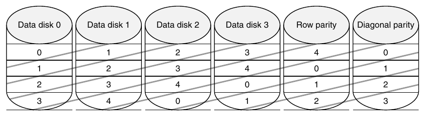

**Hình D.5 Row diagonal parity với p = 5, bảo vệ bốn data disk trước double failure [Corbett và cộng sự 2004]. Hình này cho thấy các nhóm diagonal mà parity được tính và lưu trong diagonal parity disk. Mặc dù hình thể hiện tất cả check data trên những disk riêng cho row parity và diagonal parity giống RAID 4, vẫn có một phiên bản luân phiên của row-diagonal parity tương tự RAID 5. Tham số p phải là số nguyên tố và lớn hơn 2; tuy nhiên, bạn có thể cho p lớn hơn số data disk bằng cách giả sử những disk bị thiếu đều chứa số không, và phương án vẫn hoạt động. Thủ thuật này giúp bổ sung disk vào một hệ thống hiện có dễ dàng hơn. NetApp chọn p bằng 257, cho phép hệ thống tăng lên tối đa 256 data disk.**

Phương án EVEN-ODD được các nhà nghiên cứu IBM phát triển trước đó tương tự row diagonal parity, nhưng cần tính toán nhiều hơn một chút trong khi hoạt động và khôi phục [Blaum 1995]. Những bài báo gần đây hơn cho thấy cách mở rộng EVEN-ODD để bảo vệ trước ba failure [Blaum, Bruck và Vardy 1996; Blaum và cộng sự 2001].

## D.3 Định nghĩa và ví dụ về Fault và Failure thực tế

Mặc dù mọi người có thể chấp nhận một máy tính thỉnh thoảng bị crash và buộc phải khởi động lại tất cả chương trình, họ yêu cầu thông tin của mình không bao giờ bị mất. Vì thế, nhiệm vụ tối thượng của storage là ghi nhớ thông tin, bất kể điều gì xảy ra.

Chương 1 đã trình bày những kiến thức cơ bản về dependability, và mục này mở rộng những thông tin đó để đưa ra các định nghĩa tiêu chuẩn cùng ví dụ về failure.

Bước đầu tiên là làm rõ sự nhầm lẫn về thuật ngữ. Những thuật ngữ fault, error và failure thường được sử dụng thay thế cho nhau, nhưng có ý nghĩa khác nhau trong tài liệu về dependability. Ví dụ, một sai sót lập trình là fault, error hay failure? Việc chúng ta đang nói đến thời điểm thiết kế hay thời điểm chạy chương trình có quan trọng không? Nếu chương trình đang chạy không thực thi phần có sai sót, đó có còn là fault/error/failure không? Hãy thử một ví dụ khác. Giả sử một hạt alpha va vào một DRAM memory cell. Đó có phải là fault/error/failure nếu giá trị không thay đổi không? Đó có phải là fault/error/failure nếu memory không truy cập bit đã thay đổi không? Fault/error/failure có vẫn xảy ra nếu memory có error correction và chuyển giá trị đã được sửa đến CPU không? Bạn có thể thấy những khó khăn này. Rõ ràng, chúng ta cần định nghĩa chính xác để thảo luận những sự kiện như vậy một cách thấu đáo.

Để tránh sự thiếu chính xác như vậy, tiểu mục này dựa trên thuật ngữ được Laprie [1985] và Gray cùng Siewiorek [1991] sử dụng, được IFIP Working Group 10.4 và IEEE Computer Society Technical Committee on Fault Tolerance tán thành. Chúng ta nói về một hệ thống như một module duy nhất, nhưng thuật ngữ này áp dụng đệ quy cho các submodule. Hãy bắt đầu với một định nghĩa về dependability:

Computer system dependability là chất lượng của dịch vụ được cung cấp sao cho có cơ sở chính đáng để tin cậy dịch vụ đó. Dịch vụ mà một hệ thống cung cấp là hành vi thực tế được quan sát của hệ thống, theo cảm nhận của những hệ thống khác tương tác với người dùng của hệ thống này. Mỗi module cũng có một hành vi lý tưởng được quy định, trong đó service specification là một mô tả đã được thống nhất về hành vi kỳ vọng. System failure xảy ra khi hành vi thực tế lệch khỏi hành vi được quy định. Failure xảy ra do một error, tức một khiếm khuyết trong module đó. Nguyên nhân của error là một fault.

Khi một fault xảy ra, nó tạo ra một latent error, và error này trở nên effective khi được kích hoạt; khi error thực sự ảnh hưởng đến dịch vụ được cung cấp, một failure xảy ra.

Khoảng thời gian giữa lúc một error xảy ra và failure phát sinh từ nó là error latency. Vì thế, error là biểu hiện của fault trong hệ thống, còn failure là biểu hiện của error trên dịch vụ. [tr. 3]

Hãy quay lại các ví dụ dẫn nhập ở trên. Một sai sót lập trình là fault. Hệ quả là một error (hoặc latent error) trong software. Khi được kích hoạt, error trở nên effective. Khi effective error này tạo ra dữ liệu sai ảnh hưởng đến dịch vụ được cung cấp, một failure xảy ra.

Một hạt alpha va vào DRAM có thể được xem là fault. Nếu nó làm thay đổi memory, nó tạo ra một error. Error vẫn latent cho đến khi memory word bị ảnh hưởng được đọc. Nếu word error đã trở nên effective ảnh hưởng đến dịch vụ được cung cấp, một failure xảy ra. Nếu ECC sửa error đó, failure sẽ không xảy ra.

Một sai sót của người vận hành là fault. Dữ liệu bị thay đổi do đó là error. Error vẫn latent cho đến khi được kích hoạt, rồi tiếp diễn như trước.

Để làm rõ, quan hệ giữa fault, error và failure như sau:

- Một fault tạo ra một hoặc nhiều latent error.

- Những đặc tính của error là (1) latent error trở nên effective sau khi được kích hoạt; (2) error có thể luân phiên giữa trạng thái latent và effective; và (3) effective error thường lan truyền từ thành phần này sang thành phần khác, qua đó tạo ra những error mới. Vì thế, effective error hoặc là một error trước đó latent trong thành phần đó, hoặc đã lan truyền từ một error khác trong thành phần đó hay từ nơi khác.

- Component failure xảy ra khi error ảnh hưởng đến dịch vụ được cung cấp.

- Những đặc tính này có tính đệ quy và áp dụng cho bất kỳ thành phần nào trong hệ thống.

Gray và Siewiorek phân loại fault thành bốn nhóm theo nguyên nhân:

1. Hardware fault—Device bị hỏng, chẳng hạn có thể do một hạt alpha va vào memory cell

2. Design fault—Fault trong software (thường gặp) và trong hardware design (đôi khi gặp)

3. Operation fault—Sai sót của nhân viên vận hành và bảo trì

4. Environmental fault—Hỏa hoạn, lũ lụt, động đất, power failure và hành vi phá hoại

Fault cũng được phân loại theo thời gian tồn tại thành transient, intermittent và permanent [Nelson 1990]. Transient fault tồn tại trong một khoảng thời gian giới hạn và không tái diễn. Intermittent fault khiến hệ thống luân phiên giữa hoạt động có fault và fault-free. Permanent fault không tự biến mất theo thời gian.

Sau khi đã định nghĩa sự khác biệt giữa fault, error và failure, chúng ta sẵn sàng xem một số ví dụ real-world. Những công bố về error rate thực tế rất hiếm vì hai lý do. Thứ nhất, các nhà nghiên cứu học thuật hiếm khi được tiếp cận những hardware resource đủ lớn để đo lường. Thứ hai, các nhà nghiên cứu trong công nghiệp hiếm khi được phép công bố thông tin failure vì lo ngại nó sẽ được sử dụng để chống lại công ty của họ trên thị trường. Sau đây là một vài ngoại lệ.

### Tertiary Disk của Berkeley

Dự án Tertiary Disk tại University of California tạo ra một server hình ảnh nghệ thuật cho Fine Arts Museums of San Francisco vào năm 2000. Database này gồm các hình ảnh high-quality của hơn 70,000 tác phẩm nghệ thuật [Talagala và cộng sự, 2000]. Database được lưu trên một cluster gồm 20 PC kết nối qua switched Ethernet và chứa 368 disk. Nó chiếm bảy rack 7-foot-high.

Hình D.6 cho thấy failure rate của các thành phần khác nhau trong Tertiary Disk. Trước khi xây dựng hệ thống, những người thiết kế giả định SCSI data disk sẽ là phần kém tin cậy nhất vì chúng vừa có bộ phận cơ khí vừa có số lượng lớn. Tiếp theo sẽ là IDE disk vì số lượng ít hơn, rồi đến power supply và sau đó là integrated circuit. Họ giả định những passive device như cable hầu như không bao giờ hỏng.

Hình D.6 phá vỡ một số giả định đó. Vì những người thiết kế làm theo khuyến cáo của nhà sản xuất để bảo đảm disk enclosure có độ rung thấp và được làm mát tốt, data disk rất đáng tin cậy. Ngược lại, PC chassis chứa IDE/ATA disk không có mức kiểm soát môi trường tương tự. (IDE/ATA disk không lưu dữ liệu mà hỗ trợ application và operating system khởi động các PC.) Hình D.6 cho thấy SCSI backplane, cable và Ethernet cable không đáng tin cậy hơn chính data disk!

Vì Tertiary Disk là một hệ thống lớn với nhiều thành phần dự phòng, nó có thể tiếp tục hoạt động trước phạm vi failure rộng như vậy. Các thành phần được kết nối và mirrored image được bố trí sao cho không một failure đơn lẻ nào có thể khiến bất kỳ hình ảnh nào trở nên unavailable. Chiến lược này ban đầu có vẻ quá mức cần thiết, nhưng sau đó đã chứng minh là thiết yếu.

Trải nghiệm này cũng cho thấy sự khác biệt giữa transient fault và hard fault. Hầu như tất cả failure trong Hình D.6 ban đầu đều xuất hiện dưới dạng transient fault. Người vận hành phải quyết định liệu hành vi của thành phần có tệ đến mức cần thay thế hay vẫn có thể tiếp tục sử dụng. Thực tế, từ “failure” không được sử dụng; thay vào đó, nhóm mượn những thuật ngữ thường dùng để xử lý nhân viên có vấn đề, với người vận hành quyết định một thành phần có vấn đề có nên bị “sa thải” hay không.

### Tandem

Ví dụ tiếp theo đến từ công nghiệp. Gray [1990] thu thập dữ liệu về fault tại Tandem Computers, một trong những công ty tiên phong trong fault-tolerant computing và được sử dụng chủ yếu cho database. Hình D.7 biểu diễn các fault gây system failure từ năm 1985 đến năm 1989 theo số fault tuyệt đối trên mỗi hệ thống và theo tỷ lệ phần trăm fault gặp phải. Dữ liệu cho thấy sự cải thiện rõ rệt về reliability của hardware và công việc bảo trì. Năm 1985, disk đòi hỏi Tandem bảo dưỡng hằng năm, nhưng chúng được thay bằng những disk không cần bảo trì theo lịch. Số chip và connector trên mỗi hệ thống giảm cùng khả năng software chịu được hardware fault làm đóng góp của hardware giảm xuống chỉ còn 7% failure vào năm 1989. Hơn nữa, khi hardware có fault, software embedded trong hardware device (firmware) thường là thủ phạm. Dữ liệu cho thấy software vào năm 1989 là nguồn chính của những outage được báo cáo (62%), tiếp theo là vận hành hệ thống (15%).

| Thành phần | Tổng số trong hệ thống | Tổng số bị hỏng | Tỷ lệ phần trăm bị hỏng |
|---|---|---|---|
| SCSI controller | 44 | 1 | 2.3% |
| SCSI cable | 39 | 1 | 2.6% |
| SCSI disk | 368 | 7 | 1.9% |
| IDE/ATA disk | 24 | 6 | 25.0% |
| Disk enclosure—backplane | 46 | 13 | 28.3% |
| Disk enclosure—power supply | 92 | 3 | 3.3% |
| Ethernet controller | 20 | 1 | 5.0% |
| Ethernet switch | 2 | 1 | 50.0% |
| Ethernet cable | 42 | 1 | 2.3% |
| CPU/motherboard | 20 | 0 | 0% |

**Hình D.6 Failure của các thành phần trong Tertiary Disk qua 18 tháng hoạt động. Với mỗi loại thành phần, bảng cho thấy tổng số trong hệ thống, số bị hỏng và failure rate theo phần trăm. Disk enclosure có hai mục trong bảng vì chúng gặp hai loại vấn đề: failure về backplane integrity và failure của power supply. Vì mỗi enclosure có hai power supply, failure của một power supply không ảnh hưởng đến availability. Cluster gồm 20 PC này, nằm trong bảy rack 7-foot-high, 19-inch-wide, chứa 368 disk IBM 8.4 GB, 7200 RPM, 3.5-inch. Các PC là P6-200 MHz, mỗi máy có 96 MB DRAM. Chúng chạy FreeBSD 3.0 và các host kết nối qua switched Ethernet 100 Mbit/sec. Tất cả SCSI disk được kết nối với hai PC qua các SCSI chain double-ended để hỗ trợ RAID 1. Ứng dụng chính có tên Zoom Project, vào năm 1998 là database hình ảnh nghệ thuật lớn nhất thế giới, với 72,000 hình ảnh. Xem Talagala và cộng sự [2000b].**

Vấn đề với mọi thống kê như vậy là dữ liệu chỉ phản ánh những gì được báo cáo; chẳng hạn, các environmental failure do mất điện không được báo cáo cho Tandem vì được xem là vấn đề local. Dữ liệu về operation fault rất khó thu thập vì người vận hành phải báo cáo sai sót cá nhân, điều có thể ảnh hưởng đến đánh giá của quản lý, từ đó ảnh hưởng đến sự ổn định công việc và khả năng tăng lương. Gray cho rằng cả environmental fault lẫn operator fault đều được báo cáo ít hơn thực tế. Nghiên cứu của ông kết luận rằng để đạt availability cao hơn, cần cải thiện software quality và software fault tolerance, đơn giản hóa vận hành và chịu được operational fault.

### Những nghiên cứu khác về vai trò của người vận hành đối với Dependability

Mặc dù Tertiary Disk và Tandem là những nghiên cứu dependability storage-oriented, chúng ta cần nhìn ra ngoài storage để tìm các phép đo tốt hơn về vai trò của con người trong failure. Murphy và Gent [1995] cố gắng cải thiện độ chính xác của dữ liệu operator fault bằng cách cho hệ thống tự động hỏi người vận hành lý do reboot trong mỗi lần boot. Họ phân loại những lần crash liên tiếp do cùng một fault là operator fault và đưa vào cả hành động của người vận hành trực tiếp gây crash, chẳng hạn đặt giá trị tham số không hợp lệ, cấu hình sai và cài đặt application không đúng. Mặc dù tin rằng operator error được báo cáo ít hơn thực tế, họ vẫn có được thông tin chính xác hơn Gray, người dựa vào một biểu mẫu mà người vận hành điền rồi gửi lên qua các cấp quản lý. Tỷ lệ failure do hardware/operating system trong hệ thống VAX giảm từ 70% năm 1985 xuống 28% năm 1993, còn failure do người vận hành tăng từ 15% lên 52% trong cùng giai đoạn. Murphy và Gent kỳ vọng quản lý hệ thống sẽ là thách thức chính đối với dependability trong tương lai.

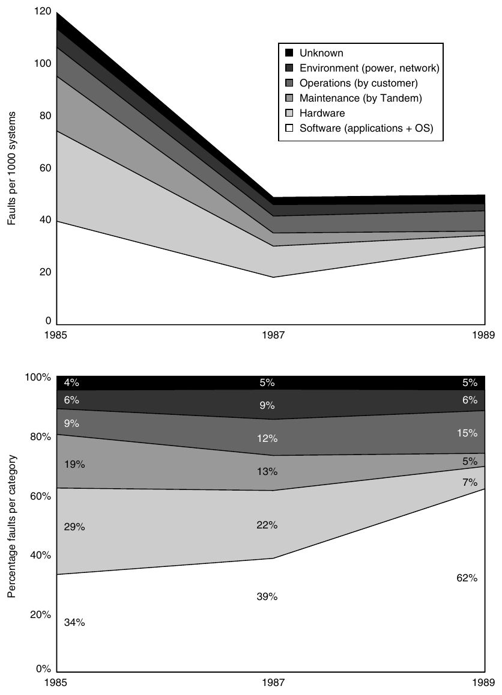

**Hình D.7 Fault tại Tandem từ năm 1985 đến năm 1989. Gray [1990] thu thập những dữ liệu này cho Tandem Computers fault-tolerant dựa trên báo cáo của khách hàng về component failure.**

Tập dữ liệu cuối cùng đến từ chính phủ. Federal Communications Commission (FCC) yêu cầu tất cả công ty điện thoại gửi giải trình khi gặp một outage ảnh hưởng ít nhất 30,000 người hoặc kéo dài 30 phút. Những báo cáo gián đoạn chi tiết này không gặp vấn đề self-reporting của các số liệu trước, vì điều tra viên xác định nguyên nhân outage thay vì người vận hành thiết bị. Kuhn [1997] nghiên cứu nguyên nhân outage từ năm 1992 đến năm 1994, còn Enriquez [2001] thực hiện một nghiên cứu follow-up cho nửa đầu năm 2001. Mặc dù failure do network quá tải được cải thiện đáng kể qua các năm, failure do con người tăng từ khoảng one-third lên two-thirds tổng số customer-outage minute.

Bốn ví dụ này cùng những ví dụ khác cho thấy nguyên nhân chính của failure trong các hệ thống lớn hiện nay là fault của người vận hành. Hardware fault đã giảm do số chip trong hệ thống giảm và có ít connector hơn. Hardware dependability đã được cải thiện thông qua các kỹ thuật fault tolerance như memory ECC và RAID. Ít nhất một số operating system đang xem xét tác động đến reliability trước khi bổ sung tính năng mới, vì thế vào năm 2011, failure chủ yếu xảy ra ở nơi khác.

Mặc dù failure có thể bắt nguồn từ fault của người vận hành, việc các quy trình bảo trì và nâng cấp dễ mắc lỗi đến vậy phản ánh tình trạng chưa tốt của công nghệ hệ thống hiện tại. Phần lớn nhà cung cấp storage ngày nay cho biết khách hàng chi nhiều hơn đáng kể cho việc quản lý storage trong suốt vòng đời so với chi phí mua storage. Vì thế, thách thức đối với dependable storage system trong tương lai là chịu được fault của người vận hành hoặc tránh fault bằng cách đơn giản hóa các nhiệm vụ system administration. Lưu ý rằng RAID 6 cho phép storage system tiếp tục hoạt động ngay cả khi người vận hành thay nhầm một disk tốt.

Chúng ta đã trình bày vấn đề nền tảng là dependability, đưa ra các định nghĩa, nghiên cứu tình huống và kỹ thuật cải thiện nó. Bước tiếp theo trong hành trình tìm hiểu storage là performance.

## D.4 I/O Performance, các thước đo Reliability và Benchmark

I/O performance có những thước đo không có đối ứng trong thiết kế. Một trong số đó là tính đa dạng: Những I/O device nào có thể kết nối với computer system? Một thước đo khác là capacity: Có bao nhiêu I/O device có thể kết nối với một computer system?

Ngoài những thước đo riêng này, các thước đo performance truyền thống (cụ thể là response time và throughput) cũng áp dụng cho I/O. (I/O throughput đôi khi được gọi là I/O bandwidth, còn response time đôi khi được gọi là latency.) Hai hình tiếp theo giúp làm rõ sự đánh đổi giữa response time và throughput. Hình D.8 cho thấy mô hình producer-server đơn giản. Producer tạo ra các task cần thực hiện và đặt chúng vào buffer; server lấy task từ buffer first in, first out và thực hiện chúng.

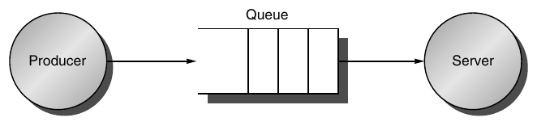

**Hình D.8 Mô hình producer-server truyền thống về response time và throughput. Response time bắt đầu khi một task được đặt vào buffer và kết thúc khi server hoàn thành task. Throughput là số task mà server hoàn thành trong một đơn vị thời gian.**

Response time được định nghĩa là thời gian của một task từ lúc được đặt vào buffer cho đến khi server hoàn thành task. Throughput đơn giản là số task trung bình mà server hoàn thành trong một khoảng thời gian. Để đạt throughput cao nhất có thể, server không bao giờ nên idle, vì thế buffer không bao giờ nên trống. Ngược lại, response time tính cả thời gian nằm trong buffer, nên buffer trống làm response time giảm.

Một thước đo khác của I/O performance là mức độ I/O cản trở processor execution. Việc truyền dữ liệu có thể cản trở thực thi một process khác. Ngoài ra còn có overhead do xử lý I/O interrupt. Điều chúng ta quan tâm ở đây là một process sẽ mất thêm bao nhiêu thời gian do I/O của một process khác.

### Throughput so với Response Time

Hình D.9 cho thấy throughput so với response time (hoặc latency) của một I/O system điển hình. Điểm gấp khúc của đường cong là vùng mà tăng throughput thêm một chút dẫn đến response time dài hơn nhiều, hoặc ngược lại, giảm response time một chút dẫn đến throughput thấp hơn nhiều.

Architect cân bằng những yêu cầu xung đột này như thế nào? Nếu máy tính tương tác với con người, Hình D.10 gợi ý một câu trả lời. Một lần tương tác, hay transaction, với máy tính được chia thành ba phần:

1. Entry time—Thời gian để người dùng nhập command.

2. System response time—Thời gian từ khi người dùng nhập command đến khi response đầy đủ được hiển thị.

3. Think time—Thời gian từ khi nhận response đến khi người dùng bắt đầu nhập command tiếp theo.

Tổng của ba phần này được gọi là transaction time. Một số nghiên cứu cho biết năng suất người dùng tỷ lệ nghịch với transaction time. Kết quả trong Hình D.10 cho thấy giảm system response time 0.7 giây giúp tiết kiệm 4.9 giây (34%) cho transaction thông thường và 2.0 giây (70%) cho transaction đồ họa. Kết quả có vẻ khó tin này được giải thích bằng bản tính con người: mọi người cần ít thời gian suy nghĩ hơn khi được phản hồi nhanh hơn. Mặc dù nghiên cứu này đã có từ 20 năm trước, response time vẫn thường chậm hơn 1 giây nhiều, ngay cả khi processor đã nhanh hơn 1000 lần. Ví dụ về những khoảng chờ dài bao gồm khởi động application trên desktop PC do nhiều disk I/O, hoặc network delay khi click các liên kết Web.

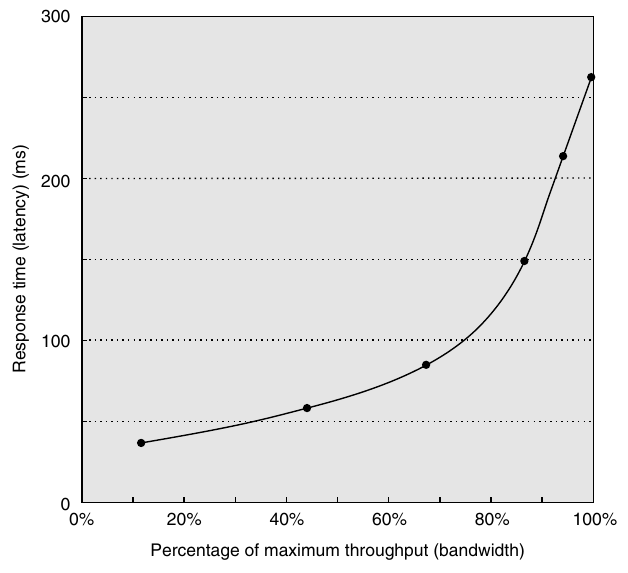

**Hình D.9 Throughput so với response time. Latency thường được báo cáo dưới dạng response time. Lưu ý rằng response time tối thiểu chỉ đạt 11% throughput, còn response time để đạt 100% throughput dài gấp bảy lần response time tối thiểu. Cũng lưu ý rằng biến độc lập trong đường cong này được ngầm định; để vẽ đường cong, thông thường bạn thay đổi load (concurrency). Chen và cộng sự [1990] thu thập dữ liệu này cho một array magnetic disk.**

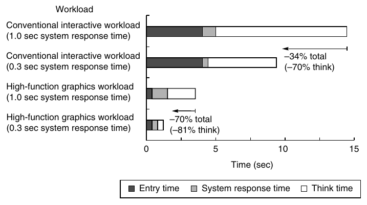

**Hình D.10 Một user transaction với máy tính tương tác được chia thành entry time, system response time và user think time cho một hệ thống thông thường và một hệ thống đồ họa. Entry time giống nhau, không phụ thuộc vào system response time. Entry time là 4 giây cho hệ thống thông thường và 0.25 giây cho hệ thống đồ họa. Việc giảm response time thực sự làm transaction time giảm nhiều hơn chính phần response time được giảm. (Từ Brady [1986].)**

| I/O benchmark | Giới hạn response time | Throughput metric |
|---|---|---|
| TPC-C: Complex Query OLTP | ≥90% transaction phải đáp ứng giới hạn response time; 5 giây cho phần lớn loại transaction | New order transaction mỗi phút |
| TPC-W: Transactional Web benchmark | ≥90% Web interaction phải đáp ứng giới hạn response time; 3 giây cho phần lớn loại Web interaction | Web interaction mỗi giây |
| SPECsfs97 | Response time trung bình ≤40 ms | NFS operation mỗi giây |

**Hình D.11 Những giới hạn response time cho ba I/O benchmark.**

Để phản ánh tầm quan trọng của response time đối với năng suất người dùng, I/O benchmark cũng giải quyết trade-off giữa response time và throughput. Hình D.11 cho thấy các giới hạn response time cho ba I/O benchmark. Chúng báo cáo throughput tối đa với điều kiện 90% response time phải thấp hơn một giới hạn, hoặc response time trung bình phải thấp hơn một giới hạn.

Tiếp theo, hãy xem xét những benchmark này chi tiết hơn.

### Transaction-Processing Benchmark

Transaction processing (TP, hoặc OLTP cho online transaction processing) chủ yếu quan tâm đến I/O rate (số disk access mỗi giây), thay vì data rate (đo bằng số byte dữ liệu mỗi giây). TP nói chung liên quan đến việc thay đổi một lượng thông tin chia sẻ lớn từ nhiều terminal, trong đó TP system bảo đảm hành vi đúng khi xảy ra failure. Ví dụ, giả sử máy tính của ngân hàng hỏng khi khách hàng cố rút tiền từ ATM. TP system sẽ bảo đảm tài khoản bị ghi nợ nếu khách hàng nhận được tiền, và tài khoản không thay đổi nếu không nhận được tiền. Các hệ thống đặt chỗ hàng không cùng với ngân hàng là những khách hàng truyền thống của TP.

Như đã đề cập trong Chương 1, hai mươi tư thành viên của cộng đồng TP cùng nhau xây dựng một benchmark cho ngành và, để tránh sự phản đối của các bộ phận pháp lý, đã công bố báo cáo ẩn danh [Anon. và cộng sự 1985]. Báo cáo này dẫn đến việc thành lập Transaction Processing Council, tổ chức đã tạo ra tám benchmark kể từ khi thành lập. Hình D.12 tóm tắt những benchmark này.

Hãy mô tả TPC-C để có hình dung về những benchmark này. TPC-C sử dụng một database để mô phỏng môi trường order-entry của một nhà cung cấp bán buôn, bao gồm nhập và giao đơn hàng, ghi nhận thanh toán, kiểm tra trạng thái đơn hàng và giám sát mức tồn kho tại các warehouse. Nó chạy năm transaction đồng thời có độ phức tạp khác nhau, và database gồm chín bảng với số lượng record và khách hàng có thể scale. TPC-C được đo bằng transaction mỗi phút (tpmC) và giá của hệ thống, bao gồm hardware, software cùng ba năm hỗ trợ bảo trì. Hình 1.16 ở trang 39 trong Chương 1 mô tả những hệ thống dẫn đầu về performance và cost-performance cho TPC-C.

| Benchmark | Kích thước dữ liệu (GB) | Performance metric | Thời điểm có kết quả đầu tiên |
|---|---|---|---|
| A: debit credit (đã ngừng) | 0.1–10 | Transaction mỗi giây | Tháng Bảy 1990 |
| B: batch debit credit (đã ngừng) | 0.1–10 | Transaction mỗi giây | Tháng Bảy 1991 |
| C: complex query OLTP | 100–3000 (tối thiểu 0.07 * TPM) | New order transaction mỗi phút (TPM) | Tháng Chín 1992 |
| D: decision support (đã ngừng) | 100, 300, 1000 | Query mỗi giờ | Tháng Mười Hai 1995 |
| H: ad hoc decision support | 100, 300, 1000 | Query mỗi giờ | Tháng Mười 1999 |
| R: business reporting decision support (đã ngừng) | 1000 | Query mỗi giờ | Tháng Tám 1999 |
| W: transactional Web benchmark | ≈ 50, 500 | Web interaction mỗi giây | Tháng Bảy 2000 |
| App: application server and Web services benchmark | ≈ 2500 | Web service interaction mỗi giây (SIPS) | Tháng Sáu 2005 |

**Hình D.12 Các benchmark của Transaction Processing Council. Kết quả tóm tắt bao gồm cả performance metric và price-performance của metric đó. TPC-A, TPC-B, TPC-D và TPC-R đã được ngừng sử dụng.**

Những TPC benchmark này là những benchmark đầu tiên—và trong một số trường hợp vẫn là duy nhất—có những đặc điểm khác thường sau:

- Giá được đưa vào cùng kết quả benchmark. Chi phí hardware, software và các thỏa thuận bảo trì được đưa vào hồ sơ gửi kết quả, cho phép đánh giá dựa trên price-performance cũng như performance cao.

- Dataset nói chung phải tăng kích thước khi throughput tăng. Các benchmark cố gắng mô hình hóa hệ thống thực tế, trong đó nhu cầu đặt lên hệ thống và kích thước dữ liệu lưu trong hệ thống cùng tăng. Chẳng hạn, việc hàng nghìn người mỗi phút truy cập hàng trăm tài khoản ngân hàng là không hợp lý.

- Kết quả benchmark được kiểm toán. Trước khi có thể gửi kết quả, chúng phải được một kiểm toán viên TPC được chứng nhận phê duyệt. Người này thực thi các quy tắc TPC nhằm bảo đảm chỉ những kết quả công bằng được gửi. Kết quả có thể bị phản biện và tranh chấp được giải quyết trước TPC.

- Throughput là performance metric, nhưng response time bị giới hạn. Ví dụ, với TPC-C, 90% response time của new order transaction phải dưới 5 giây.

- Một tổ chức độc lập duy trì các benchmark. Phí thành viên do TPC thu chi trả cho một cơ cấu hành chính, bao gồm một văn phòng điều hành trưởng. Tổ chức này giải quyết tranh chấp, tổ chức bỏ phiếu qua thư để phê duyệt thay đổi benchmark, tổ chức các cuộc họp hội đồng, v.v.

### Benchmark SPEC System-Level cho File Server, Mail và Web

Hoạt động benchmarking của SPEC được biết đến nhiều nhất nhờ đặc trưng hóa processor performance, nhưng cũng đã tạo ra benchmark cho file server, mail server và Web server.

Bảy công ty thống nhất một synthetic benchmark có tên SFS để đánh giá những hệ thống chạy network file service (NFS) của Sun Microsystems. Benchmark này được nâng cấp lên SFS 3.0 (còn gọi là SPEC SFS97_R1) để hỗ trợ NFS version 3, sử dụng TCP bên cạnh UDP làm transport protocol, và khiến cơ cấu operation thực tế hơn. Các phép đo trên hệ thống NFS dẫn đến một cơ cấu tổng hợp gồm read, write và file operation. SFS cung cấp các tham số mặc định để so sánh performance. Ví dụ, một nửa tổng số write được thực hiện theo block 8 KB và một nửa theo partial block 1, 2 hoặc 4 KB. Đối với read, cơ cấu là 85% full block và 15% partial block.

Giống TPC-C, SFS scale lượng dữ liệu được lưu theo throughput được báo cáo: cứ mỗi 100 NFS operation mỗi giây, capacity phải tăng 1 GB. Nó cũng giới hạn response time trung bình, trong trường hợp này là 40 ms. Hình D.13 cho thấy response time trung bình so với throughput của hai hệ thống NetApp. Đáng tiếc, khác với TPC benchmark, SFS không chuẩn hóa cho những cấu hình giá khác nhau.

SPECMail là benchmark giúp đánh giá performance của mail server tại một Internet service provider. SPECMail2001 dựa trên các Internet protocol tiêu chuẩn SMTP và POP3, đo throughput và user response time trong khi scale số người dùng từ 10,000 lên 1,000,000.

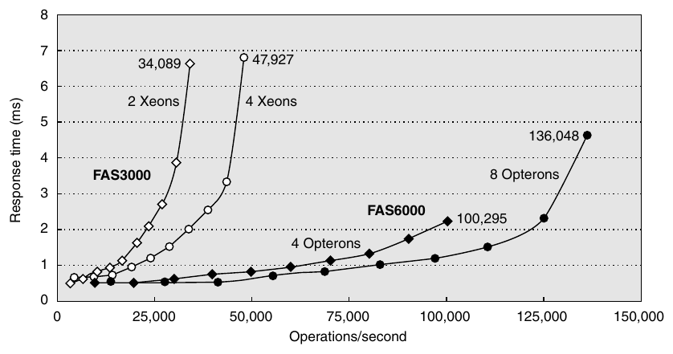

**Hình D.13 SPEC SFS97_R1 performance cho NFS server NetApp FAS3050c trong hai cấu hình. Hai processor đạt 34,089 operation mỗi giây, còn bốn processor đạt 47,927. Được báo cáo vào tháng Năm 2005, những hệ thống này sử dụng operating system Data ONTAP 7.0.1R1, microprocessor Pentium Xeon 2.8 GHz, 2 GB DRAM trên mỗi processor, 1 GB nonvolatile memory trên mỗi hệ thống và 168 disk Fibre Channel 15K RPM, 72 GB. Những disk này được kết nối bằng hai hoặc bốn disk controller QLogic ISP-2322 FC.**

SPECWeb là benchmark để đánh giá performance của World Wide Web server, đo số user session đồng thời. Workload SPECWeb2005 mô phỏng các access đến một Web service provider, trong đó server hỗ trợ home page cho nhiều tổ chức. Nó có ba workload: Banking (HTTPS), E-commerce (HTTP và HTTPS) và Support (HTTP).

### Ví dụ về Benchmark của Dependability

Benchmark TPC-C thực sự có một yêu cầu dependability. Hệ thống được benchmark phải có khả năng xử lý một disk failure đơn lẻ, điều trong thực tế có nghĩa là tất cả bên gửi kết quả đều chạy một cách tổ chức RAID nào đó trong storage system.

Những nỗ lực gần đây hơn tập trung vào hiệu quả của fault tolerance trong hệ thống. Brown và Patterson [2000] đề xuất đo availability bằng cách xem xét biến thiên của các quality-of-service metric của hệ thống theo thời gian khi fault được đưa vào hệ thống. Đối với Web server, những metric hiển nhiên là performance (đo bằng số request được đáp ứng mỗi giây) và mức fault tolerance (đo bằng số fault mà storage subsystem, network connection topology, v.v. có thể chịu được).

Thử nghiệm ban đầu đưa vào một fault đơn lẻ––chẳng hạn write error trong disk sector––và ghi lại hành vi hệ thống được phản ánh qua các quality-of-service metric. Ví dụ này so sánh những triển khai software RAID do Linux, Solaris và Windows 2000 Server cung cấp. SPECWeb99 được sử dụng để cung cấp workload và đo performance. Để đưa fault vào, một trong các SCSI disk trong software RAID volume được thay bằng emulated disk. Đó là một PC chạy software, sử dụng một SCSI controller xuất hiện với các device khác trên SCSI bus như một disk. Disk emulator cho phép đưa fault vào. Các fault được đưa vào bao gồm nhiều transient disk fault, như correctable read error, và permanent fault, như disk media failure khi ghi.

Hình D.14 cho thấy hành vi của từng hệ thống dưới các fault khác nhau. Hai đồ thị trên cùng thể hiện Linux (bên trái) và Solaris (bên phải). Vì hệ thống RAID có thể mất dữ liệu nếu disk thứ hai hỏng trước khi tái tạo hoàn tất, quá trình tái tạo (MTTR) càng dài thì availability càng thấp. Tuy nhiên, tái tạo nhanh hơn đồng nghĩa với application performance giảm, vì việc tái tạo chiếm I/O resource của những application đang chạy. Vì thế, cần chọn policy giữa việc chấp nhận giảm performance trong quá trình tái tạo và kéo dài khoảng thời gian dễ tổn thương, qua đó làm giảm MTTF được dự đoán.

Mặc dù không hệ thống nào được thử nghiệm mô tả reconstruction policy ngoài source code, chỉ một lần fault injection cũng đủ giúp hiểu những policy đó. Các thử nghiệm cho thấy cả Linux và Solaris đều tự động bắt đầu tái tạo RAID volume lên một hot spare khi một active disk bị ngừng sử dụng do failure. Mặc dù Windows hỗ trợ RAID reconstruction, quá trình tái tạo phải được khởi động thủ công. Vì thế, nếu không có sự can thiệp của con người, hệ thống Windows không rebuild sau failure đầu tiên vẫn dễ bị ảnh hưởng bởi failure thứ hai, khiến khoảng thời gian dễ tổn thương tăng lên. Khi được yêu cầu, nó thực sự sửa chữa nhanh chóng.

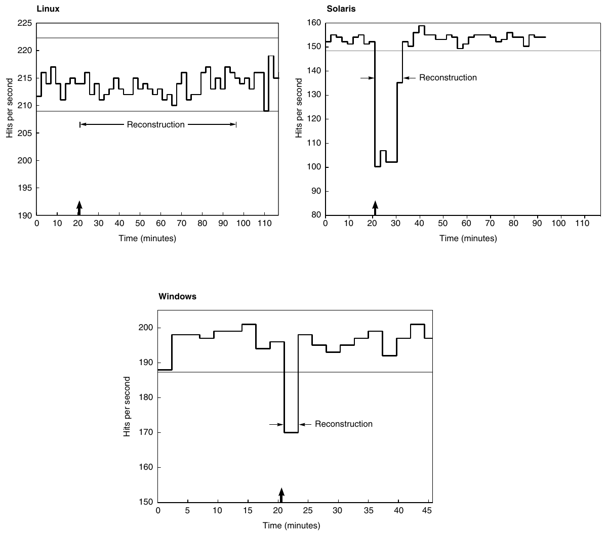

**Hình D.14 Availability benchmark cho các hệ thống software RAID trên cùng một máy tính chạy các operating system Red Hat 6.0 Linux, Solaris 7 và Windows 2000. Lưu ý sự khác biệt về triết lý tốc độ tái tạo của Linux so với Windows và Solaris. y-axis là hành vi tính bằng hit mỗi giây khi chạy SPECWeb99. Mũi tên biểu thị thời điểm đưa fault vào. Các đường ở phía trên cho biết khoảng tin cậy 99% của performance trước khi fault được đưa vào. Khoảng tin cậy 99% có nghĩa là nếu biến nằm ngoài khoảng này, xác suất để giá trị đó xuất hiện chỉ là 1%.**

Các thử nghiệm fault injection còn giúp hiểu những availability policy khác của Linux, Solaris và Windows 2000 liên quan đến automatic spare utilization, reconstruction rate, transient error, v.v. Một lần nữa, không hệ thống nào mô tả những policy của mình.

Về quản lý transient fault, các thử nghiệm fault injection cho thấy triển khai software RAID của Linux có cách tiếp cận ngược với các triển khai RAID trong Solaris và Windows. Triển khai Linux rất thận trọng––nó thà ngừng một disk theo cách có kiểm soát ngay khi có error đầu tiên, thay vì chờ xem error có phải transient hay không. Ngược lại, Solaris và Windows dễ chấp nhận hơn––chúng bỏ qua phần lớn transient fault với kỳ vọng fault sẽ không tái diễn. Vì thế, những hệ thống này vững vàng trước transient hơn đáng kể so với Linux. Lưu ý rằng cả Windows và Solaris đều ghi log transient fault, bảo đảm error được báo cáo ngay cả khi không có hành động xử lý. Khi fault là permanent, các hệ thống hành xử tương tự.

## D.5 Một chút Queuing Theory

Trong processor design, chúng ta có những phép tính performance back-of-the-envelope đơn giản gắn với công thức CPI trong Chương 1, hoặc có thể sử dụng simulation full-scale để đạt độ chính xác cao hơn với chi phí cao hơn. Trong I/O system, chúng ta cũng có best-case analysis dưới dạng một phép tính back-of-the-envelope. Simulation Full-scale cũng chính xác hơn nhiều nhưng cần nhiều công sức hơn để tính expected performance.

Tuy nhiên, với I/O system, chúng ta còn có một công cụ toán học để định hướng I/O design, đòi hỏi nhiều công sức hơn một chút nhưng chính xác hơn nhiều so với best-case analysis, trong khi ít công sức hơn nhiều so với simulation full-scale. Do tính xác suất của các sự kiện I/O và việc chia sẻ I/O resource, chúng ta có thể đưa ra một tập hợp những định lý đơn giản giúp tính response time và throughput của toàn bộ I/O system. Lĩnh vực hữu ích này được gọi là queuing theory. Vì đã có nhiều sách và khóa học về chủ đề này, mục này chỉ đóng vai trò giới thiệu ban đầu. Tuy nhiên, ngay cả lượng kiến thức nhỏ này cũng có thể dẫn đến thiết kế I/O system tốt hơn.

Hãy bắt đầu với cách tiếp cận black-box đối với I/O system, như trong Hình D.15. Trong ví dụ này, processor tạo ra các I/O request đến I/O device, và các request “rời đi” khi I/O device đáp ứng chúng.

Thông thường, chúng ta quan tâm đến trạng thái dài hạn, hay steady state, của một hệ thống hơn là những điều kiện start-up ban đầu. Giả sử không phải như vậy. Mặc dù có công cụ toán học trợ giúp (Markov chain), ngoại trừ một vài trường hợp, cách duy nhất để giải những phương trình thu được là simulation. Vì mục đích của mục này là trình bày điều gì đó khó hơn các phép tính back-of-the-envelope một chút nhưng đơn giản hơn simulation, chúng ta không trình bày những phân tích như vậy ở đây. (Xem tài liệu tham khảo trong Phụ lục L để biết thêm chi tiết.)

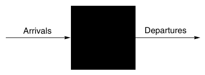

**Hình D.15 Xem I/O system như một black box. Điều này dẫn đến một quan sát đơn giản nhưng quan trọng: Nếu hệ thống ở steady state, số task đi vào hệ thống phải bằng số task rời khỏi hệ thống. Trạng thái flow-balanced này là điều kiện cần nhưng chưa đủ cho steady state. Nếu hệ thống đã được quan sát hoặc đo trong thời gian đủ dài và mean waiting time ổn định, chúng ta nói hệ thống đã đạt steady state.**

Vì thế, trong mục này, chúng ta đưa ra giả định đơn giản hóa rằng đang đánh giá các hệ thống có nhiều request độc lập cho I/O service và đang ở trạng thái cân bằng: input rate phải bằng output rate. Chúng ta cũng giả sử có một nguồn cung task đều đặn, không phụ thuộc vào thời gian chúng chờ được phục vụ. Trong nhiều hệ thống thực tế, như TPC-C, tốc độ tiêu thụ task được xác định bởi những đặc tính hệ thống khác, chẳng hạn memory capacity.

Điều này dẫn chúng ta đến định luật Little, liên hệ số task trung bình trong hệ thống, arrival rate trung bình của task mới và thời gian trung bình để thực hiện một task:

Mean number of tasks in system = Arrival rate × Mean response time

Định luật Little áp dụng cho bất kỳ hệ thống nào ở trạng thái cân bằng, miễn là không có gì bên trong black box tạo ra task mới hoặc hủy task. Lưu ý rằng arrival rate và response time phải sử dụng cùng đơn vị thời gian; sự không nhất quán về đơn vị thời gian là một nguyên nhân phổ biến gây lỗi.

Hãy thử suy ra định luật Little. Giả sử chúng ta quan sát một hệ thống trong Time<sub>observe</sub> phút. Trong khoảng quan sát đó, chúng ta ghi lại thời gian cần để mỗi task được phục vụ, rồi cộng các thời gian đó. Số task hoàn thành trong Time<sub>observe</sub> là Number<sub>task</sub>, còn tổng thời gian mà từng task ở trong hệ thống là Time<sub>accumulated</sub>. Lưu ý rằng các task có thể chồng lấn về thời gian, vì thế Time<sub>accumulated</sub>≥ Time<sub>observed</sub>. Khi đó,

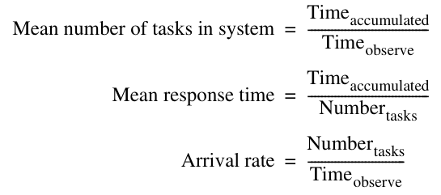

Phép biến đổi đại số cho phép chúng ta tách công thức đầu tiên:

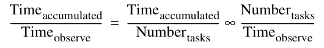

Nếu thay ba định nghĩa ở trên vào công thức này và đổi chỗ hai số hạng thu được ở right-hand side, chúng ta có định luật Little:

Mean number of tasks in system = Arrival rate × Mean response time

Phương trình đơn giản này có sức mạnh đáng ngạc nhiên, như chúng ta sẽ thấy.

Nếu mở black box, chúng ta thấy Hình D.16. Vùng mà các task tích tụ để chờ được phục vụ được gọi là queue, hay waiting line. Device thực hiện service được yêu cầu được gọi là server. Cho đến hai trang cuối của mục này, chúng ta giả sử chỉ có một server.

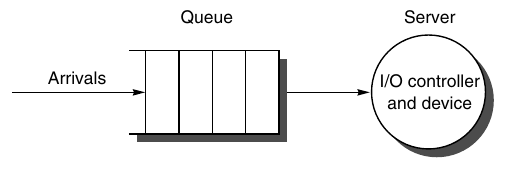

**Hình D.16 Mô hình single-server cho mục này. Trong tình huống này, một I/O request “rời đi” khi được server hoàn thành.**

Định luật Little cùng một loạt định nghĩa dẫn đến một số phương trình hữu ích:

- Time<sub>server</sub>—Thời gian trung bình để phục vụ một task; average service rate là 1/Time<sub>server</sub>, theo truyền thống được biểu diễn bằng ký hiệu µ trong nhiều tài liệu queuing.

- Time<sub>queue</sub>—Thời gian trung bình trên mỗi task trong queue.

- Time<sub>system</sub>—Thời gian trung bình/task trong hệ thống, hay response time, bằng tổng của Time<sub>queue</sub>và Time<sub>server</sub>.

- Arrival rate—Số task đến trung bình/giây, theo truyền thống được biểu diễn bằng ký hiệu λ trong nhiều tài liệu queuing.

- Length<sub>server</sub>—Số task trung bình đang được phục vụ.

- Length<sub>queue</sub>—Độ dài trung bình của queue.

- Length<sub>system</sub>—Số task trung bình trong hệ thống, bằng tổng của Length<sub>queue</sub>và Length<sub>server</sub>.

Những định nghĩa này có thể làm rõ một nhầm lẫn phổ biến: câu hỏi đang hỏi một task phải chờ trong queue bao lâu trước khi bắt đầu được phục vụ (Time<sub>queue</sub>), hay một task mất bao lâu cho đến khi hoàn thành (Time<sub>system</sub>). Thuật ngữ sau chính là điều chúng ta muốn nói khi nhắc đến response time, và quan hệ giữa các thuật ngữ là Time<sub>system</sub>= Time<sub>queue</sub>+ Time<sub>server</sub>.

Số task trung bình đang được phục vụ (Length<sub>server</sub>) đơn giản là Arrival rate × Time<sub>server</sub>, chính là định luật Little. Server utilization đơn giản là số task trung bình đang được phục vụ chia cho service rate. Với một server đơn lẻ, service rate là 1 ⁄ Time<sub>server</sub>. Vì thế, server utilization (và trong trường hợp này, số task trung bình trên mỗi server) đơn giản là:

Server utilization = Arrival rate × Time<sub>server</sub>

Service utilization phải nằm trong khoảng từ 0 đến 1; nếu không, số task đến sẽ nhiều hơn số task có thể được phục vụ, vi phạm giả định rằng hệ thống ở trạng thái cân bằng. Lưu ý rằng công thức này chỉ là cách phát biểu lại định luật Little. Utilization còn được gọi là traffic intensity và được biểu diễn bằng ký hiệu ρ trong nhiều tài liệu queuing theory.

**Ví dụ** Giả sử một I/O system có một disk nhận trung bình 50 I/O request mỗi giây. Giả sử thời gian trung bình để disk phục vụ một I/O request là 10 ms. Utilization của I/O system là bao nhiêu?

**Trả lời** Sử dụng phương trình ở trên, với 10 ms được biểu diễn thành 0.01 giây, chúng ta có:

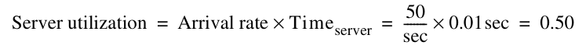

Vì thế, utilization của I/O system là 0.5.

Cách queue chuyển task đến server được gọi là queue discipline. Discipline đơn giản và phổ biến nhất là first in, first out (FIFO). Nếu giả sử FIFO, chúng ta có thể liên hệ thời gian chờ trong queue với số task trung bình trong queue:

Time<sub>queue</sub> = Length<sub>queue</sub> × Time<sub>server</sub> + Mean time to complete service of task when new task arrives if server is busy

Nghĩa là, thời gian trong queue bằng số task trong queue nhân với mean service time, cộng thời gian server cần để hoàn thành task đang được phục vụ khi một task mới đến. (Còn có một ràng buộc nữa về việc task đến, được trình bày ở trang D-28.)

Thành phần cuối của phương trình không đơn giản như thoạt nhìn. Một task mới có thể đến vào bất kỳ thời điểm nào, vì thế chúng ta không có cơ sở để biết task hiện có đã ở server bao lâu. Mặc dù những request như vậy là các sự kiện ngẫu nhiên, nếu biết một số thông tin về phân phối sự kiện, chúng ta có thể dự đoán performance.

### Phân phối Poisson của biến ngẫu nhiên

Để ước tính thành phần cuối cùng của công thức, chúng ta cần biết một chút về phân phối của các biến ngẫu nhiên. Một biến là ngẫu nhiên nếu nó nhận một trong một tập hợp giá trị được xác định với một xác suất được xác định; nghĩa là bạn không thể biết chính xác giá trị tiếp theo của nó, nhưng có thể biết xác suất của tất cả giá trị có thể xảy ra.

Những request service từ một I/O system có thể được mô hình hóa bằng một biến ngẫu nhiên, vì operating system thường chuyển đổi giữa nhiều process tạo ra các I/O request độc lập. Chúng ta cũng mô hình hóa I/O service time bằng một biến ngẫu nhiên, do tính xác suất của disk về seek delay và rotational delay.

Một cách để đặc trưng hóa phân phối giá trị của một biến ngẫu nhiên có giá trị rời rạc là histogram, chia khoảng giữa giá trị nhỏ nhất và lớn nhất thành các khoảng con được gọi là bucket. Sau đó, histogram biểu diễn số lượng trong mỗi bucket thành cột.

Histogram hoạt động tốt cho những phân phối có giá trị rời rạc—ví dụ, số I/O request. Với những phân phối không có giá trị rời rạc, chẳng hạn thời gian chờ một I/O request, chúng ta có hai lựa chọn. Hoặc cần một đường cong để biểu diễn các giá trị trên toàn khoảng nhằm có thể ước tính chính xác giá trị, hoặc cần một đơn vị thời gian rất nhỏ để có số bucket rất lớn nhằm ước tính thời gian chính xác. Ví dụ, có thể xây dựng histogram của disk service time được đo theo khoảng 10 μs, mặc dù disk service time thực sự là liên tục.

Vì thế, để giải phần cuối của phương trình trước, chúng ta cần đặc trưng hóa phân phối của biến ngẫu nhiên này. Mean time và một thước đo variance nào đó là đủ để thực hiện việc đặc trưng hóa.

Với số hạng đầu tiên, chúng ta sử dụng weighted arithmetic mean time. Trước tiên, hãy giả sử sau khi đo số lần xuất hiện của task, chẳng hạn n<sub>i</sub>, bạn có thể tính tần suất xuất hiện của task i:

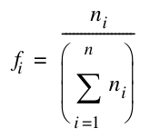

Khi đó, weighted arithmetic mean là

Weighted arithmetic mean time = f<sub>1</sub> × T<sub>1</sub> + f<sub>2</sub> × T<sub>2</sub> + . . . + f<sub>n</sub> × T<sub>n</sub>

trong đó T<sub>i</sub> là thời gian của task i và f<sub>i</sub> là tần suất xuất hiện của task i.

Để đặc trưng hóa sự biến thiên quanh mean, nhiều người sử dụng standard deviation. Thay vào đó, chúng ta sử dụng variance, đơn giản là bình phương của standard deviation, vì nó giúp đặc trưng hóa probability distribution. Khi đã có weighted arithmetic mean, variance có thể được tính như sau

Variance = ( f<sub>1</sub> × T<sub>1</sub><sup>2</sup> + f<sub>2</sub> × T<sub>2</sub><sup>2</sup> + … + f<sub>n</sub> × T<sub>n</sub><sup>2</sup>) – Weighted arithmetic mean time<sup>2</sup>

Cần nhớ các đơn vị khi tính variance. Hãy giả sử đây là phân phối thời gian. Nếu thời gian vào khoảng 100 millisecond, bình phương nó cho kết quả 10,000 millisecond bình phương. Đơn vị này rõ ràng không thông thường. Sẽ thuận tiện hơn nếu chúng ta có một thước đo không có đơn vị.

Để tránh vấn đề đơn vị này, chúng ta sử dụng squared coefficient of variance, theo truyền thống được gọi là C<sup>2</sup>:

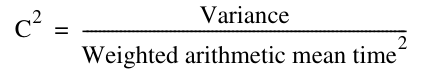

Chúng ta có thể giải để tìm C, coefficient of variance, như sau

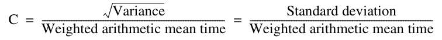

Chúng ta đang cố đặc trưng hóa các sự kiện ngẫu nhiên, nhưng để có thể dự đoán performance, cần một phân phối các sự kiện ngẫu nhiên có thể xử lý được về mặt toán học. Phân phối phổ biến nhất như vậy là exponential distribution, có giá trị C bằng 1.

Lưu ý rằng chúng ta đang sử dụng một hằng số để đặc trưng hóa sự biến thiên quanh mean. Sự bất biến của C theo thời gian phản ánh đặc tính rằng lịch sử các sự kiện không ảnh hưởng đến xác suất xảy ra một sự kiện ngay lúc này. Đặc tính quên lịch sử này được gọi là memoryless, và là một giả định quan trọng để dự đoán hành vi bằng những mô hình này. (Giả sử không có đặc tính memoryless này; khi đó, chúng ta phải quan tâm đến thời điểm đến chính xác của các request so với nhau, khiến việc xử lý toán học khó hơn đáng kể!)

Một trong những exponential distribution được sử dụng rộng rãi nhất được gọi là phân phối Poisson, theo tên nhà toán học Siméon Poisson. Nó được sử dụng để đặc trưng hóa những sự kiện ngẫu nhiên trong một khoảng thời gian cho trước và có một số tính chất toán học hữu ích. Phân phối Poisson được mô tả bởi phương trình sau (được gọi là probability mass function):

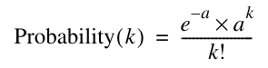

trong đó a = Rate of events × Elapsed time. Nếu interarrival time tuân theo exponential distribution và chúng ta sử dụng arrival rate ở trên làm rate of events, số lần đến trong một khoảng thời gian t là một Poisson process, có phân phối Poisson với a = Arrival rate × t. Như đã đề cập ở trang D-26, phương trình cho Time<sub>server</sub> còn có một ràng buộc khác về việc task đến: Nó chỉ đúng với Poisson process.

Cuối cùng, chúng ta có thể trả lời câu hỏi về khoảng thời gian mà một task mới phải chờ server hoàn thành một task, được gọi là average residual service time, một lần nữa với giả định các lần đến tuân theo Poisson:

Average residual service time = 1⁄2 × Arithemtic mean × ( 1 + C<sup>2</sup>) *(ghi chú: sách in "Arithemtic"; đúng là "Arithmetic")*

Mặc dù không suy ra công thức này, chúng ta có thể dựa vào trực giác. Khi phân phối không ngẫu nhiên và tất cả giá trị có thể xảy ra đều bằng average, standard deviation bằng 0, do đó C bằng 0. Khi đó, average residual service time chỉ bằng một nửa average service time, đúng như chúng ta kỳ vọng. Nếu phân phối ngẫu nhiên và là Poisson, C bằng 1 và average residual service time bằng weighted arithmetic mean time.

**Ví dụ** Sử dụng các định nghĩa và công thức ở trên, hãy suy ra thời gian chờ trung bình trong queue (Time<sub>queue</sub>) theo average service time (Time<sub>server</sub>) và server utilization.

**Trả lời** Tất cả task trong queue (Length<sub>queue</sub>) đứng trước task mới phải được hoàn thành trước khi task đó có thể được phục vụ; trung bình mỗi task mất Time<sub>server</sub>. Nếu một task đang ở server, nó cần average residual service time để hoàn thành. Xác suất server bận chính là server utilization; vì thế, thời gian phục vụ kỳ vọng là Server utilization × Average residual service time. Điều này dẫn đến công thức ban đầu của chúng ta:

Time<sub>queue</sub> = Length<sub>queue</sub> × Time<sub>server</sub>

\+ Server utilization × Average residual service time

Thay average residual service time bằng định nghĩa của nó và Length<sub>queue</sub> bằng Arrival rate × Time<sub>queue</sub> cho kết quả

Time<sub>queue</sub> = Server utilization × [ 1⁄2 × Time<sub>server</sub> × ( 1 + C<sup>2</sup>) ]<br>+ ( Arrival rate × Time<sub>queue</sub> ) × Time<sub>server</sub>

Vì mục này quan tâm đến exponential distribution, C<sup>2</sup> bằng 1. Vì thế

Time<sub>queue</sub> = Server utilization × Time<sub>server</sub> + ( Arrival rate × Time<sub>queue</sub> ) × Time<sub>server</sub>

Sắp xếp lại số hạng cuối, hãy thay Arrival rate × Time<sub>server</sub> bằng Server utilization:

Time<sub>queue</sub> = Server utilization × Time<sub>server</sub> + ( Arrival rate × Time<sub>server</sub> ) × Time<sub>queue</sub><br>= Server utilization × Time<sub>server</sub> + Server utilization × Time<sub>queue</sub>

Sắp xếp lại các số hạng và đơn giản hóa cho chúng ta phương trình cần tìm:

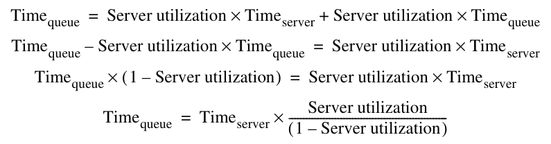

Định luật Little cũng có thể được áp dụng cho những thành phần của black box, vì chúng cũng phải ở trạng thái cân bằng:

Length<sub>queue</sub> = Arrival rate × Time<sub>queue</sub>

Nếu thay Time<sub>queue</sub> từ biểu thức ở trên, chúng ta có:

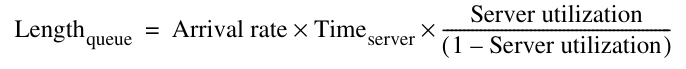

Vì Arrival rate × Time<sub>server</sub> = Server utilization, chúng ta có thể đơn giản hóa thêm:

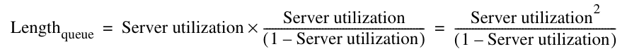

Biểu thức này liên hệ số phần tử trong queue với service utilization.

**Ví dụ** Với hệ thống trong ví dụ ở trang D-26 có server utilization bằng 0.5, số I/O request trung bình trong queue là bao nhiêu?

**Trả lời** Sử dụng phương trình ở trên,

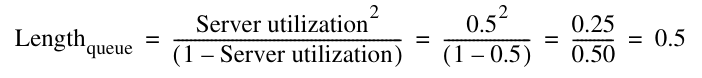

Vì thế, trung bình có 0.5 request trong queue.

Như đã đề cập trước đó, những phương trình này và mục này dựa trên một lĩnh vực toán học ứng dụng có tên queuing theory, cung cấp các phương trình để dự đoán hành vi của những biến ngẫu nhiên như vậy. Hệ thống thực tế quá phức tạp để queuing theory có thể phân tích chính xác, vì thế queuing theory hoạt động tốt nhất khi chỉ cần các câu trả lời gần đúng.

Queuing theory phân biệt rõ ràng giữa các sự kiện quá khứ, có thể được đặc trưng hóa bằng phép đo sử dụng số học đơn giản, và các sự kiện tương lai, là những dự đoán đòi hỏi toán học phức tạp hơn. Trong computer system, chúng ta thường dự đoán tương lai từ quá khứ; một ví dụ là least recently used block replacement (xem Chương 2). Vì thế, sự phân biệt giữa các phép đo và phân phối được dự đoán thường bị làm mờ; chúng ta sử dụng phép đo để xác minh loại phân phối, rồi dựa vào phân phối đó từ thời điểm ấy.

Hãy ôn lại những giả định về queuing model:

- Hệ thống ở trạng thái cân bằng.

- Thời gian giữa hai request đến liên tiếp, được gọi là interarrival time, tuân theo exponential distribution, đặc trưng hóa arrival rate đã đề cập trước đó.

- Số nguồn tạo request là không giới hạn. (Trong queuing theory, đây được gọi là infinite population model; finite population model được sử dụng khi arrival rate thay đổi theo số job đã có trong hệ thống.)

- Server có thể bắt đầu job tiếp theo ngay sau khi hoàn thành job trước.

- Không có giới hạn về độ dài queue, và queue tuân theo discipline first in, first out, vì thế tất cả task đang xếp hàng đều phải được hoàn thành.

- Có một server.

Một queue như vậy được gọi là M/M/1:

M = request arrival ngẫu nhiên theo exponential distribution (C<sup>2</sup> = 1), với M viết tắt của A. A. Markov, nhà toán học đã định nghĩa và phân tích các memoryless process được đề cập trước đó

M = service time ngẫu nhiên theo exponential distribution (C<sup>2</sup> = 1), với M một lần nữa chỉ Markov

1 = một server duy nhất

Mô hình M/M/1 là một mô hình đơn giản và được sử dụng rộng rãi.

Giả định exponential distribution thường được sử dụng trong các ví dụ queuing vì ba lý do—một lý do tốt, một lý do chấp nhận được và một lý do không tốt. Lý do tốt là sự chồng chập của nhiều phân phối tùy ý có hành vi như một exponential distribution. Trong computer system, nhiều khi một hành vi cụ thể là kết quả tương tác của nhiều thành phần, vì thế exponential distribution của interarrival time là mô hình phù hợp. Lý do chấp nhận được là khi chưa rõ variability, exponential distribution với variability trung bình (C = 1) là một phỏng đoán an toàn hơn so với variability thấp (C ≈ 0) hoặc variability cao (C lớn). Lý do không tốt là toán học đơn giản hơn nếu giả sử exponential distribution.

Hãy áp dụng queuing theory vào một vài ví dụ.

**Ví dụ** Giả sử một processor gửi 40 disk I/O mỗi giây, những request này tuân theo exponential distribution, và average service time của một disk cũ là 20 ms. Hãy trả lời những câu hỏi sau:

1. Trung bình, utilization của disk là bao nhiêu?

2. Thời gian trung bình ở trong queue là bao nhiêu?

3. Response time trung bình cho một disk request, bao gồm queuing time và disk service time, là bao nhiêu?

**Trả lời** Hãy phát biểu lại những dữ kiện này:

Số task đến trung bình mỗi giây là 40.

Thời gian trung bình để disk phục vụ một task là 20 ms (0.02 sec).

Khi đó, server utilization là

Server utilization = Arrival rate × Time<sub>server</sub> = 40 × 0.02 = 0.8

Vì service time tuân theo exponential distribution, chúng ta có thể sử dụng công thức đơn giản hóa cho thời gian trung bình chờ trong hàng:

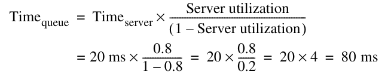

Response time trung bình là

Time<sub>system</sub> = Time<sub>queue</sub> + Time<sub>server</sub> = 80 + 20 ms = 100 ms

Vì thế, trung bình chúng ta dành 80% thời gian chờ trong queue!

**Ví dụ** Giả sử chúng ta có một disk mới, nhanh hơn. Hãy tính lại câu trả lời cho các câu hỏi ở trên, với giả định disk service time là 10 ms.

**Trả lời** Khi đó, disk utilization là

Server utilization = Arrival rate × Time<sub>server</sub> = 40 × 0.01 = 0.4

Công thức cho thời gian trung bình chờ trong hàng:

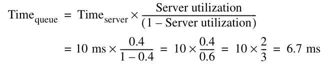

Response time trung bình là 10 + 6.7 ms, tức 16.7 ms, nhanh hơn response time cũ 6.0 lần, mặc dù service time mới chỉ nhanh hơn 2.0 lần.

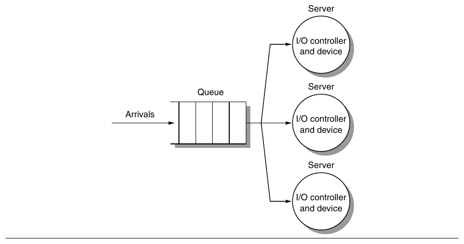

**Hình D.17 Mô hình multiple-server M/M/m.**

Cho đến đây, chúng ta giả sử chỉ có một server, chẳng hạn một disk duy nhất. Nhiều hệ thống thực tế có nhiều disk và vì thế có thể sử dụng nhiều server, như trong Hình D.17. Trong queuing theory, một hệ thống như vậy được gọi là mô hình M/M/m.

Hãy đưa ra những công thức tương ứng cho M/M/m queue, sử dụng N<sub>servers</sub> để biểu diễn số server. Hai công thức đầu tiên rất dễ:

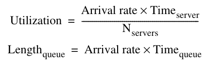

Thời gian chờ trong queue là

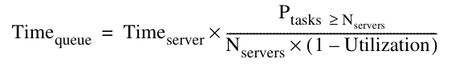

Công thức này liên quan đến công thức cho M/M/1, ngoại trừ việc thay utilization của một server bằng xác suất một task phải vào queue thay vì được phục vụ ngay, và chia thời gian trong queue cho số server. Đáng tiếc, tính xác suất job nằm trong queue phức tạp hơn nhiều khi có N<sub>servers</sub>. Trước tiên, xác suất không có task nào trong hệ thống là

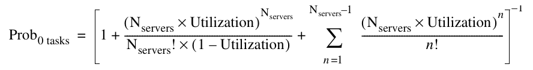

Sau đó, xác suất số task bằng hoặc nhiều hơn số server chúng ta có là

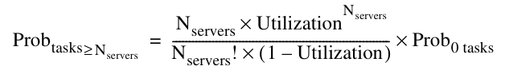

Lưu ý rằng nếu N<sub>servers</sub> bằng 1, Prob<sub>tasks≥N<sub>servers</sub></sub> được đơn giản hóa trở lại thành Utilization, và chúng ta có cùng công thức như M/M/1. Hãy thử một ví dụ.

**Ví dụ** Giả sử thay vì mua một disk mới nhanh hơn, chúng ta bổ sung một disk chậm thứ hai và nhân đôi dữ liệu để cả hai disk đều có thể phục vụ read. Hãy giả sử tất cả request đều là read. Hãy tính lại câu trả lời cho những câu hỏi trước đó, lần này sử dụng M/M/m queue.

**Trả lời** Khi đó, utilization trung bình của hai disk là

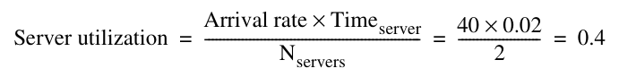

Trước tiên, chúng ta tính xác suất không có task trong queue:

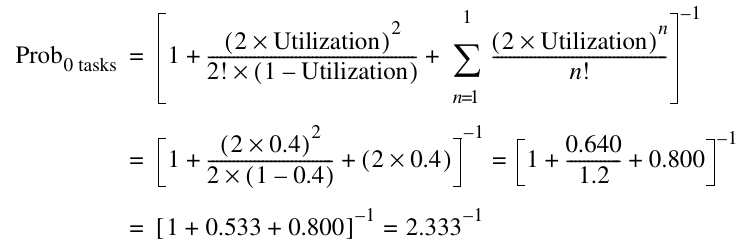

Chúng ta sử dụng kết quả này để tính xác suất có task trong queue:

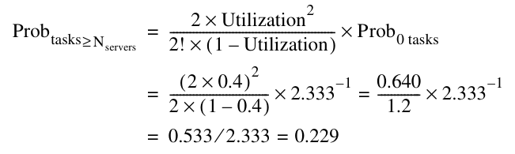

Cuối cùng, thời gian chờ trong queue:

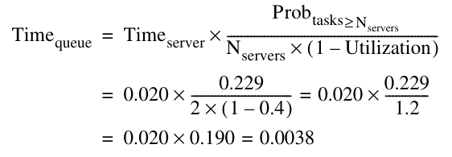

Response time trung bình là 20 + 3.8 ms, tức 23.8 ms. Với workload này, hai disk giảm queue waiting time theo hệ số 21 so với một disk chậm đơn lẻ và theo hệ số 1.75 so với một disk nhanh đơn lẻ. Tuy nhiên, mean service time của hệ thống có một disk nhanh vẫn nhanh hơn 1.4 lần so với hệ thống có hai disk, vì disk service time nhanh hơn 2.0 lần.

Sẽ rất tốt nếu chúng ta có thể tổng quát hóa mô hình M/M/m cho nhiều queue và nhiều server, vì bước này thực tế hơn nhiều. Đáng tiếc, những mô hình này rất khó giải và sử dụng, vì thế chúng ta không trình bày chúng ở đây.

## D.6 Những vấn đề liên quan xuyên suốt

### Point-to-Point Link và Switch thay thế Bus

Point-to-point link và switch ngày càng phổ biến khi định luật Moore tiếp tục giảm chi phí của các thành phần. Kết hợp với nhu cầu I/O bandwidth cao hơn từ processor nhanh hơn, disk nhanh hơn và local area network nhanh hơn, lợi thế chi phí ngày càng giảm của bus có nghĩa là thời gian tồn tại của bus trong desktop computer và server computer không còn dài. Xu hướng này bắt đầu ở high-performance computer vào lần xuất bản trước của cuốn sách, và đến năm 2011 đã lan rộng khắp storage. Hình D.18 cho thấy các tiêu chuẩn bus-based cũ và những công nghệ thay thế chúng.

Số bit và bandwidth của thế hệ mới được tính trên mỗi chiều, vì thế tăng gấp đôi nếu tính cả hai chiều. Vì những thiết kế mới này sử dụng ít dây hơn nhiều, một cách phổ biến để tăng bandwidth là cung cấp các phiên bản có số dây và bandwidth cao hơn vài lần.

### Block Server so với Filer

Cho đến đây, chúng ta phần lớn bỏ qua vai trò của operating system trong storage. Tương tự cách compiler sử dụng instruction set, operating system quyết định những kỹ thuật I/O được hardware triển khai nào sẽ thực sự được sử dụng. Operating system thường cung cấp file abstraction bên trên các block được lưu trên disk. Những thuật ngữ logical unit, logical volume và physical volume là các thuật ngữ liên quan, được sử dụng trong hệ thống Microsoft và UNIX để chỉ những tập hợp con của disk block.

Logical unit là đơn vị storage được xuất ra từ một disk array, thường được tạo thành từ một tập hợp con các disk của array. Đối với server, logical unit xuất hiện như một “disk” ảo duy nhất. Trong RAID disk array, logical unit được cấu hình theo một RAID layout cụ thể, chẳng hạn RAID 5. Physical volume là device file mà file system sử dụng để truy cập logical unit. Logical volume cung cấp một mức virtualization cho phép file system chia physical volume thành nhiều phần hoặc stripe dữ liệu trên nhiều physical volume. Logical unit là abstraction của disk array, trình bày một virtual disk cho operating system, trong khi physical volume và logical volume là những abstraction được operating system sử dụng để chia các virtual disk này thành những file system nhỏ hơn, độc lập.

| Tiêu chuẩn | Độ rộng (bit) | Chiều dài (meter) | Clock rate | MB/sec | Số I/O device tối đa |
|---|---|---|---|---|---|
| (Parallel) ATA | 8 | 0.5 | 133 MHz | 133 | 2 |
| Serial ATA | 2 | 2 | 3 GHz | 300 | ? |
| SCSI | 16 | 12 | 80 MHz (DDR) | 320 | 15 |
| Serial Attach SCSI | 1 | 10 |  | 375 | 16,256 |
| PCI | 32/64 | 0.5 | 33/66 MHz | 533 | ? |
| PCI Express | 2 | 0.5 | 3 GHz | 250 | ? |

**Hình D.18 Parallel I/O bus và các công nghệ point-to-point thay thế chúng. Lưu ý bandwidth và số dây được tính trên mỗi chiều, vì thế bandwidth tăng gấp đôi khi truyền theo cả hai chiều.**

Sau khi trình bày một số thuật ngữ cho những tập hợp block, bây giờ chúng ta phải hỏi: Nên duy trì ảo giác về file ở đâu: trong server hay ở đầu kia của storage area network?

Câu trả lời truyền thống là server. Server truy cập storage dưới dạng disk block và duy trì metadata. Phần lớn file system sử dụng file cache, vì thế server phải duy trì consistency của file access. Disk có thể là direct attached—nằm bên trong server và kết nối với I/O bus—hoặc được gắn qua storage area network, nhưng server truyền data block đến storage subsystem.

Câu trả lời thay thế là chính disk subsystem duy trì file abstraction, còn server sử dụng file system protocol để giao tiếp với storage. Ví dụ về protocol là Network File System (NFS) cho hệ thống UNIX và Common Internet File System (CIFS) cho hệ thống Windows. Những device như vậy được gọi là network attached storage (NAS) device vì việc storage được gắn trực tiếp với server không có ý nghĩa trong trường hợp này. Tên gọi này phần nào chưa chính xác vì storage area network như FC-AL cũng có thể được sử dụng để kết nối với block server. Thuật ngữ filer thường được sử dụng cho NAS device chỉ cung cấp file service và file storage. Network Appliance là một trong những công ty đầu tiên sản xuất filer.

Động lực đằng sau việc đưa storage lên network là giúp nhiều máy tính chia sẻ thông tin dễ dàng hơn và giúp người vận hành bảo trì hệ thống chia sẻ dễ dàng hơn.

### Asynchronous I/O và Operating System

Disk thường dành thời gian cho mechanical delay nhiều hơn rất nhiều so với truyền dữ liệu. Vì thế, một con đường tự nhiên để đạt I/O performance cao hơn là parallelism, cố gắng khiến nhiều disk đồng thời truy cập dữ liệu cho một chương trình.

Cách tiếp cận I/O trực tiếp là yêu cầu dữ liệu rồi bắt đầu sử dụng nó. Khi đó, operating system chuyển sang process khác cho đến khi dữ liệu mong muốn đến, rồi chuyển trở lại process đã yêu cầu. Phong cách này được gọi là synchronous I/O—process chờ cho đến khi dữ liệu được đọc từ disk.

Mô hình thay thế cho phép process tiếp tục sau khi gửi request, và process không bị block cho đến khi cố đọc dữ liệu đã yêu cầu. Asynchronous I/O như vậy cho phép process tiếp tục tạo request để nhiều I/O request có thể hoạt động đồng thời. Asynchronous I/O có cùng triết lý với cache trong CPU out-of-order, vốn đạt bandwidth cao hơn bằng cách có nhiều sự kiện outstanding.

## D.7 Thiết kế và đánh giá I/O System—Internet Archive Cluster

Nghệ thuật I/O system design là tìm một thiết kế đáp ứng các mục tiêu về chi phí, dependability và sự đa dạng device, đồng thời tránh bottleneck về I/O performance và dependability. Tránh bottleneck có nghĩa là các thành phần giữa main memory và I/O device phải cân bằng, vì performance và dependability—và do đó effective cost-performance hoặc cost-dependability—chỉ có thể tốt bằng mắt xích yếu nhất trong chuỗi I/O. Architect cũng phải lên kế hoạch mở rộng để khách hàng có thể điều chỉnh I/O theo application của họ. Khả năng mở rộng này, cả về số lượng lẫn loại I/O device, có chi phí tương ứng: I/O bus và network dài hơn, power supply lớn hơn để hỗ trợ I/O device, và cabinet lớn hơn.

Khi thiết kế một I/O system, chúng ta phân tích performance, chi phí, capacity và availability bằng những phương án kết nối I/O khác nhau cùng những số lượng I/O device mỗi loại khác nhau. Sau đây là một trình tự các bước để thiết kế I/O system. Câu trả lời cho mỗi bước có thể do yêu cầu thị trường quyết định, hoặc đơn giản do các mục tiêu chi phí, performance và availability.

1. Liệt kê những loại I/O device khác nhau sẽ được kết nối với máy, hoặc liệt kê các bus và network tiêu chuẩn mà máy sẽ hỗ trợ.

2. Liệt kê các yêu cầu vật lý cho mỗi I/O device. Những yêu cầu này bao gồm kích thước, power, connector, bus slot, expansion cabinet, v.v.

3. Liệt kê chi phí của mỗi I/O device, bao gồm phần chi phí của bất kỳ controller nào cần thiết cho device đó.

4. Liệt kê reliability của mỗi I/O device.

5. Ghi lại nhu cầu processor resource của mỗi I/O device. Danh sách này nên bao gồm:

- Clock cycle cho những instruction được sử dụng để bắt đầu I/O, hỗ trợ hoạt động của I/O device (như xử lý interrupt) và hoàn thành I/O

- Processor clock stall do chờ I/O kết thúc việc sử dụng memory, bus hoặc cache

- Processor clock cycle để khôi phục sau một hoạt động I/O, chẳng hạn cache flush

6. Liệt kê nhu cầu memory resource và I/O bus resource của mỗi I/O device. Ngay cả khi processor không sử dụng memory, bandwidth của main memory và kết nối I/O vẫn có giới hạn.

7. Bước cuối là đánh giá performance và availability của các cách tổ chức I/O device khác nhau. Khi có khả năng chi trả, hãy cố tránh single point of failure. Performance chỉ có thể được đánh giá đúng bằng simulation, mặc dù có thể được ước tính bằng queuing theory. Reliability có thể được tính với giả định các I/O device hỏng độc lập và time to failure tuân theo exponential distribution. Availability có thể được tính từ reliability bằng cách ước tính MTTF của các device, có tính đến thời gian từ failure đến khi sửa chữa.

Dựa trên các mục tiêu chi phí, performance và availability, sau đó bạn chọn cách tổ chức tốt nhất.

Các mục tiêu Cost-performance ảnh hưởng đến việc chọn phương án I/O và thiết kế vật lý. Performance có thể được đo bằng megabyte mỗi giây hoặc I/O mỗi giây, tùy nhu cầu application. Để đạt performance cao, những giới hạn duy nhất nên là tốc độ I/O device, số I/O device và tốc độ memory cùng processor. Để đạt chi phí thấp, phần lớn chi phí nên nằm ở chính I/O device. Các mục tiêu availability phụ thuộc một phần vào chi phí mà unavailability gây ra cho tổ chức.

Thay vì tạo một thiết kế trên giấy, hãy đánh giá một hệ thống thực tế.

### Internet Archive Cluster

Để làm rõ những ý tưởng này, chúng ta sẽ ước tính chi phí, performance và availability của một cluster storage-oriented lớn tại Internet Archive. Internet Archive bắt đầu vào năm 1996 với mục tiêu tạo hồ sơ lịch sử của Internet khi nó thay đổi theo thời gian. Bạn có thể sử dụng giao diện Wayback Machine của Internet Archive để du hành thời gian, xem website tại một URL trông như thế nào ở một thời điểm trong quá khứ. Nó chứa hơn một petabyte (10<sup>15</sup> byte) và tăng thêm 20 terabyte (10<sup>12</sup> byte) dữ liệu mới mỗi tháng, vì thế storage có khả năng mở rộng là một yêu cầu. Ngoài lưu hồ sơ lịch sử, cùng hardware đó còn được sử dụng để crawl Web sau mỗi vài tháng nhằm lấy snapshot của Internet.

Các cluster máy tính kết nối bằng local area network đã trở thành một công cụ tính toán rất kinh tế, hoạt động tốt cho một số application. Cluster cũng đóng vai trò quan trọng trong những dịch vụ Internet như Google search engine, nơi trọng tâm nằm ở storage nhiều hơn tính toán, như trong trường hợp ở đây.

Mặc dù đã sử dụng nhiều loại hardware qua các năm, Internet Archive đang chuyển sang một cluster mới để sử dụng power và diện tích sàn hiệu quả hơn. Khối xây dựng cơ bản là một storage node 1U có tên PetaBox GB2000 của Capricorn Technologies. Năm 2006, nó sử dụng bốn disk drive Parallel ATA (PATA) 500 GB, 512 MB DDR266 DRAM, một Ethernet interface 10/100/1000 và một processor C3 1 GHz của VIA, thực thi instruction set 80x86. Node này tiêu tán khoảng 80 watt trong những cấu hình điển hình.

Hình D.19 cho thấy cluster trong một VME rack tiêu chuẩn. Bốn mươi GB2000 vừa trong một VME rack tiêu chuẩn, cung cấp raw capacity 80 TB cho rack. 40 node được kết nối với nhau bằng một switch 48-port 10/100 hoặc 10/100/1000, và rack tiêu tán khoảng 3 KW. Giới hạn trong các cơ sở máy tính thường là 10 KW trên mỗi rack, vì thế mức này nằm thoải mái trong hướng dẫn.

Một petabyte cần 12 rack như vậy, được kết nối bằng một switch higher-level nối các Gbit link đến từ switch trong mỗi rack.

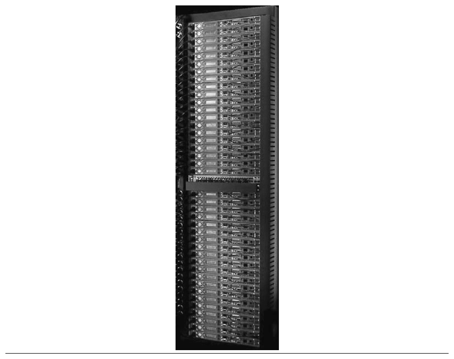

**Hình D.19 VME rack TB-80 của Capricorn Systems được Internet Archive sử dụng. Tất cả cable, switch và display đều có thể tiếp cận từ mặt trước, còn mặt sau chỉ dành cho airflow. Điều này cho phép đặt hai rack back-to-back, giảm nhu cầu diện tích sàn trong phòng máy.**

### Ước tính Performance, Dependability và chi phí của Internet Archive Cluster

Để minh họa cách đánh giá I/O system, chúng ta sẽ đưa ra một số phỏng đoán về chi phí, performance và reliability của các thành phần trong cluster này. Chúng ta đưa ra những giả định sau về chi phí và performance:

- Processor VIA, 512 MB DDR266 DRAM, ATA disk controller, power supply, fan và enclosure có giá $500.

- Mỗi drive trong bốn Parallel ATA drive 7200 RPM chứa 500 GB, có average seek time 8.5 ms, truyền dữ liệu từ disk ở 50 MB/sec và có giá $375. Tốc độ PATA link là 133 MB/sec.

- Ethernet switch 48-port 10/100/1000 cùng tất cả cable cho một rack có giá $3000.

- Performance của processor VIA là 1000 MIPS.

- ATA controller bổ sung overhead 0.1 ms để thực hiện một disk I/O.

- Operating system sử dụng 50,000 CPU instruction cho một disk I/O.

- Các network protocol stack sử dụng 100,000 CPU instruction để truyền một data block giữa cluster và thế giới bên ngoài.

- Kích thước I/O trung bình là 16 KB khi truy cập hồ sơ lịch sử qua giao diện Wayback, và 50 KB khi thu thập một snapshot mới.

**Ví dụ** Hãy đánh giá chi phí trên mỗi I/O mỗi giây (IOPS) của rack 80 TB. Giả sử mọi disk I/O đều cần average seek và average rotational delay. Giả sử workload được chia đều trên tất cả disk và mọi device có thể được sử dụng ở 100% capacity; nghĩa là hệ thống chỉ bị giới hạn bởi mắt xích yếu nhất và có thể vận hành mắt xích đó ở utilization 100%. Hãy tính cho cả hai kích thước I/O trung bình.

**Trả lời** I/O performance bị giới hạn bởi mắt xích yếu nhất trong chuỗi, vì thế chúng ta đánh giá performance tối đa của từng mắt xích trong chuỗi I/O cho mỗi cách tổ chức để xác định performance tối đa của cách tổ chức đó.

Hãy bắt đầu bằng việc tính số IOPS tối đa cho CPU, main memory và I/O bus của một GB2000. CPU I/O performance được xác định bởi tốc độ CPU cùng số instruction để thực hiện một disk I/O và gửi nó qua network:

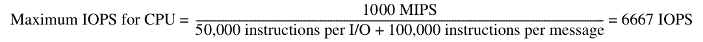

Performance tối đa của memory system được xác định bởi memory bandwidth và kích thước I/O transfer:

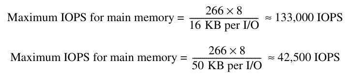

Performance của Parallel ATA link bị giới hạn bởi bandwidth và kích thước I/O:

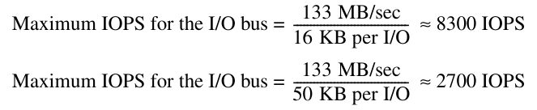

Vì thiết bị có hai bus, I/O bus giới hạn performance tối đa không quá 18,600 IOPS cho block 16 KB và 5400 IOPS cho block 50 KB.

Bây giờ hãy xem performance của mắt xích tiếp theo trong chuỗi I/O, các ATA controller. Thời gian truyền một block qua PATA channel là

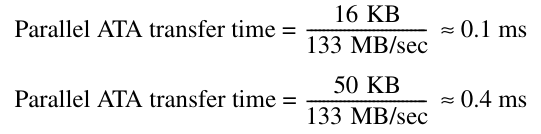

Cộng overhead 0.1 ms của ATA controller có nghĩa là mỗi I/O mất từ 0.2 ms đến 0.5 ms, khiến rate tối đa trên mỗi controller là

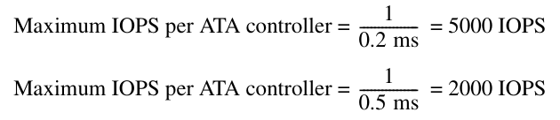

Mắt xích tiếp theo trong chuỗi là chính các disk. Thời gian cho một disk I/O trung bình là

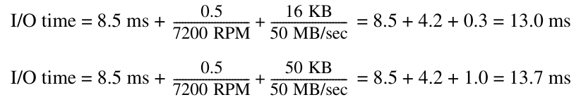

Vì thế, disk performance là

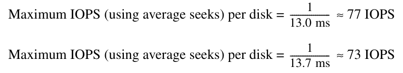

hay từ 292 đến 308 IOPS cho bốn disk.

Mắt xích cuối cùng trong chuỗi là network kết nối các máy tính với thế giới bên ngoài. Link speed xác định giới hạn:

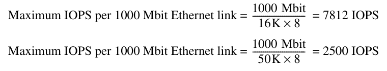

Rõ ràng, performance bottleneck của GB2000 là các disk. IOPS cho cả rack là 40 × 308, tức 12,320 IOPS, đến 40 × 292, tức 11,680 IOPS. Network switch sẽ là bottleneck nếu không hỗ trợ được 12,320 × 16K × 8, tức 1.6 Gbits/sec, cho block 16 KB và 11,680 × 50K × 8, tức 4.7 Gbits/sec, cho block 50 KB. Chúng ta giả sử 8 Gbit port bổ sung của switch 48-port kết nối rack với thế giới bên ngoài, vì thế nó có thể hỗ trợ đầy đủ IOPS của tổng cộng 160 disk trong rack.

Sử dụng những giả định này, chi phí là 40 × ($500 + 4 × $375) + $3000 + $1500, tức $84,500 cho một rack 80 TB. Riêng các disk chiếm gần 60% chi phí. Chi phí trên mỗi terabyte gần $1000, tốt hơn khoảng từ 10 đến 15 lần so với storage cluster trong lần xuất bản trước năm 2001. Chi phí trên mỗi IOPS vào khoảng $7.

### Tính MTTF của TB-80 Cluster

Các dịch vụ Internet như Google dựa vào nhiều bản sao dữ liệu ở application level để cung cấp dependability, thường tại những địa điểm địa lý khác nhau để bảo vệ trước environmental fault cũng như hardware fault. Vì thế, Internet Archive có hai bản sao dữ liệu tại mỗi địa điểm và có các địa điểm ở San Francisco, Amsterdam và Alexandria, Ai Cập. Mỗi địa điểm duy trì một bản sao dự phòng của nội dung high-value—âm nhạc, sách, phim và video—cùng một bản sao của các Web crawl lịch sử. Để giữ chi phí thấp, không có redundancy trong rack 80 TB.

**Ví dụ** Hãy xem mean time to fail thu được của rack. Thay vì sử dụng MTTF 600,000 giờ do nhà sản xuất công bố, chúng ta sử dụng dữ liệu từ một khảo sát gần đây về disk drive [Gray và van Ingen 2005]. Như đã đề cập trong Chương 1, khoảng 3% đến 7% ATA drive hỏng mỗi năm, cho MTTF khoảng 125,000 đến 300,000 giờ. Hãy đưa ra những giả định sau, một lần nữa giả sử lifetime tuân theo exponential distribution:

- MTTF của CPU/memory/enclosure là 1,000,000 giờ.

- MTTF của PATA Disk là 125,000 giờ.

- MTTF của PATA controller là 500,000 giờ.

- MTTF của Ethernet Switch là 500,000 giờ.

- MTTF của power supply là 200,000 giờ.

- MTTF của fan là 200,000 giờ.

- MTTF của PATA cable là 1,000,000 giờ.

**Trả lời** Tập hợp những dữ kiện này, chúng ta tính các failure rate sau:

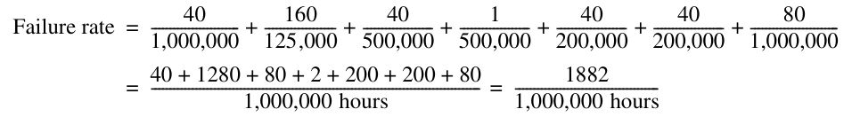

MTTF của hệ thống đơn giản là nghịch đảo của failure rate:

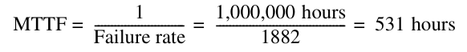

Nghĩa là, với những giả định này về MTTF của các thành phần, trung bình cứ mỗi 3 tuần lại có một thành phần trong rack bị hỏng. Khoảng 70% failure sẽ là disk, còn khoảng 20% là fan hoặc power supply.

## D.8 Kết hợp tất cả: NetApp FAS6000 Filer

Network Appliance bước vào thị trường storage năm 1992 với mục tiêu cung cấp một file server easy-to-operate chạy NSF bằng log-structured file system riêng và một RAID 4 disk array. Sau đó, công ty bổ sung hỗ trợ Windows CIFS file system và một phương án RAID 6 có tên row-diagonal parity hoặc RAID-DP (xem trang D-8). Để hỗ trợ những application muốn truy cập raw data block mà không chịu overhead của file system, chẳng hạn database system, filer NetApp có thể phục vụ data block qua một Fibre Channel interface tiêu chuẩn. NetApp cũng hỗ trợ iSCSI, cho phép SCSI command chạy qua TCP/IP network, qua đó cho phép sử dụng thiết bị mạng tiêu chuẩn như Ethernet để kết nối server với storage, và vì thế ở khoảng cách lớn hơn.

Sản phẩm hardware mới nhất là FAS6000. Đây là một multiprocessor dựa trên microprocessor AMD Opteron được kết nối bằng các HyperTransport link của nó. Các microprocessor chạy software stack của NetApp, bao gồm NSF, CIFS, RAID-DP, SCSI, v.v. FAS6000 có dạng dual processor (FAS6030) hoặc quad processor (FAS6070). Như đã đề cập trong Chương 5, DRAM được phân phối đến từng microprocessor trong Opteron. FAS6000 kết nối 8 GB DDR2700 với mỗi Opteron, cung cấp 16 GB cho FAS6030 và 32 GB cho FAS6070. Như đã đề cập trong Chương 4, DRAM bus rộng 128 bit, cộng các bit bổ sung cho SEC/DED memory. Cả hai model dành bốn HyperTransport link cho I/O.

Là một filer, FAS6000 cần nhiều I/O để kết nối với disk và với server. I/O tích hợp gồm:

- 8 Fibre Channel (FC) controller và port

- 6 Gigabit Ethernet link

- 6 slot cho card PCI Express x8 (2 GB/sec)

- 3 slot cho card PCI-X 133 MHz, 64-bit

- Những lựa chọn I/O tiêu chuẩn như IDE, USB và PCI 32-bit

Mỗi controller trong số 8 Fibre Channel controller có thể được gắn với 6 shelf, mỗi shelf chứa 14 FC disk 3.5-inch. Vì thế, số drive tối đa cho I/O tích hợp là 8 × 6 × 14, tức 672 disk. Có thể bổ sung FC controller vào các option slot để kết nối tối đa 1008 drive, giảm số drive trên mỗi FC network nhằm giảm contention, v.v. Với 500 GB trên mỗi FC drive, nếu giả sử nhóm RAID RDP gồm 14 data disk và 2 check disk, data capacity khả dụng là 294 TB cho 672 disk và 441 TB cho 1008 disk.

Hệ thống cũng có thể kết nối với Serial ATA disk qua một Fibre Channel to SATA bridge controller; đúng như tên gọi, controller này cho phép FC và SATA giao tiếp.

Sáu Ethernet link 1-gigabit kết nối với server để khiến FAS6000 xuất hiện như file server nếu chạy NTFS hoặc CIFS, hoặc như block server nếu chạy iSCSI.

Để có dependability cao hơn, các filer FAS6000 có thể được ghép cặp để nếu một filer hỏng, filer còn lại có thể tiếp quản. Clustered failover đòi hỏi cả hai filer có quyền truy cập tất cả disk trong cặp filer bằng FC interconnect. Interconnect này còn cho phép mỗi filer có một bản sao log data trong NVRAM của filer kia và giữ clock của cặp filer đồng bộ. Tình trạng của các filer được giám sát liên tục và failover diễn ra tự động. Filer hoạt động tốt duy trì network identity riêng và các chức năng chính riêng, nhưng cũng tiếp nhận network identity của filer bị hỏng và xử lý tất cả data request của nó qua một virtual filer cho đến khi administrator khôi phục data service về trạng thái ban đầu.

## D.9 Những ngộ nhận và cạm bẫy

**Ngộ nhận** Thành phần hỏng ngay lập tức.

Phần lớn tài liệu fault-tolerant dựa trên giả định đơn giản hóa rằng một thành phần hoạt động hoàn hảo cho đến khi latent error trở nên effective, rồi một failure xảy ra khiến thành phần ngừng hoạt động.

Dự án Tertiary Disk có trải nghiệm ngược lại. Nhiều thành phần bắt đầu hoạt động bất thường từ rất lâu trước khi hỏng, và nhìn chung người vận hành hệ thống phải quyết định có tuyên bố thành phần đó đã hỏng hay không. Thành phần thường vẫn sẵn sàng tiếp tục hoạt động theo cách vi phạm service agreement cho đến khi người vận hành “chấm dứt” thành phần đó.

Hình D.20 cho thấy lịch sử của bốn drive bị chấm dứt sử dụng và số giờ chúng bắt đầu hoạt động bất thường trước khi được thay thế.

**Ngộ nhận** Computer system đạt availability 99.999% (“five nines”) như được quảng cáo.

Bộ phận marketing của các công ty sản xuất server bắt đầu khoe khoang về availability của computer hardware; theo cách biểu diễn trong Hình D.21, họ tuyên bố availability 99.999%, được đặt biệt danh là five nines. Ngay cả bộ phận marketing của các công ty operating system cũng cố tạo ấn tượng này.

Năm phút unavailability mỗi năm chắc chắn ấn tượng, nhưng với dữ liệu failure thu thập được từ các khảo sát, điều đó khó tin. Ví dụ, Hewlett-Packard tuyên bố server hardware HP-9000 và operating system HP-UX có thể cung cấp bảo đảm availability 99.999% “trong những môi trường khách hàng pre-defined, pre-tested nhất định” (xem Hewlett-Packard [1998]). Bảo đảm này không bao gồm failure do operator fault, application fault hoặc environmental fault, những nhóm fault có khả năng chiếm ưu thế hiện nay. Nó cũng không bao gồm scheduled downtime. Ngoài ra, không rõ mức phạt tài chính đối với công ty là bao nhiêu nếu hệ thống không đáp ứng bảo đảm.

| Message trong system log cho disk bị hỏng | Số log message | Thời lượng (giờ) |
|---|---|---|
| Hardware Failure (Peripheral device write fault [for] Field Replaceable Unit) | 1763 | 186 |
| Not Ready (Diagnostic failure: ASCQ = Component ID [of] Field Replaceable Unit) | 1460 | 90 |
| Recovered Error (Failure Prediction Threshold Exceeded [for] Field Replaceable Unit) | 1313 | 5 |
| Recovered Error (Failure Prediction Threshold Exceeded [for] Field Replaceable Unit) | 431 | 17 |

**Hình D.20 Bản ghi trong system log cho 4 trong số 368 disk của Tertiary Disk được thay thế trong 18 tháng. Xem Talagala và Patterson [1999]. Những message này, phù hợp với SCSI specification, được device driver đưa vào system log. Message bắt đầu xuất hiện sớm đến một tuần trước khi một drive được người vận hành thay thế. Message thứ ba và thứ tư cho biết cơ chế failure prediction của drive đã phát hiện và dự đoán failure sắp xảy ra, nhưng vẫn mất nhiều giờ nữa người vận hành mới thay các drive.**

| Unavailability (phút mỗi năm) | Availability (phần trăm) | Availability class (“số chữ số chín”) |
|---|---|---|
| 50,000 | 90% | 1 |
| 5000 | 99% | 2 |
| 500 | 99.9% | 3 |
| 50 | 99.99% | 4 |
| 5 | 99.999% | 5 |
| 0.5 | 99.9999% | 6 |
| 0.05 | 99.99999% | 7 |

**Hình D.21 Số phút unavailable mỗi năm để đạt availability class. (Từ Gray và Siewiorek [1991].) Lưu ý rằng five nines có nghĩa là unavailable năm phút mỗi năm.**

Microsoft cũng triển khai một chiến dịch marketing five nines. Tháng Một 2001, www.microsoft.com unavailable trong 22 giờ. Để website đạt availability 99.999%, nó sẽ cần hoạt động không có thêm sự cố trong 250 năm.

Trái với những gợi ý marketing, các server well-managed thường đạt availability từ 99% đến 99.9%.

**Cạm bẫy** Nơi triển khai một chức năng ảnh hưởng đến reliability của nó.

Về lý thuyết, chuyển chức năng RAID sang software là hoàn toàn ổn. Trong thực tế, rất khó khiến nó hoạt động đáng tin cậy.

Văn hóa software nhìn chung dựa trên việc dần đạt tính đúng đắn thông qua một loạt bản phát hành và bản vá. Software cũng khó được cách ly khỏi các layer software khác. Ví dụ, hành vi đúng của software thường phụ thuộc vào việc có đúng version và patch release của operating system. Vì thế, nhiều khách hàng đã mất dữ liệu do software bug hoặc sự không tương thích của môi trường trong các hệ thống software RAID.

Rõ ràng, hệ thống hardware không miễn nhiễm với bug, nhưng văn hóa hardware có xu hướng nhấn mạnh hơn việc kiểm tra tính đúng đắn ngay trong lần phát hành đầu tiên. Ngoài ra, hardware có nhiều khả năng độc lập với version của operating system hơn.

**Ngộ nhận** Operating system là nơi tốt nhất để lập lịch disk access.

Các interface Higher-level như ATA và SCSI cung cấp logical block address cho host operating system. Với abstraction high-level này, điều tốt nhất OS có thể làm là cố sắp xếp logical block address theo thứ tự tăng dần. Vì chỉ disk biết ánh xạ từ logical address sang physical geometry của sector, track và surface, nó có thể giảm rotational latency và seek latency.

Ví dụ, giả sử workload là bốn lần read [Anderson 2003]:

| Operation | LBA bắt đầu | Độ dài |
|---|---|---|
| Read | 724 | 8 |
| Read | 100 | 16 |
| Read | 9987 | 1 |
| Read | 26 | 128 |

Host có thể sắp xếp lại bốn lần read theo thứ tự logical block:

| Read | 26 | 128 |
|---|---|---|
| Read | 100 | 16 |
| Read | 724 | 8 |
| Read | 9987 | 1 |

Tùy vị trí tương đối của dữ liệu trên disk, việc sắp xếp lại có thể khiến tình hình xấu hơn, như Hình D.22 cho thấy. Các read disk-scheduled hoàn thành trong three-quarters vòng quay disk, nhưng các read OS-scheduled mất ba vòng quay.

**Ngộ nhận** Thời gian average seek của một disk trong computer system là thời gian seek qua one-third số cylinder.

Ngộ nhận này bắt nguồn từ việc nhầm lẫn cách nhà sản xuất quảng bá disk với performance kỳ vọng, và từ giả định sai rằng seek time tuyến tính theo khoảng cách. Quy tắc kinh nghiệm one-third-distance xuất phát từ việc tính khoảng cách seek từ một vị trí ngẫu nhiên sang một vị trí ngẫu nhiên khác, không bao gồm track hiện tại và giả sử có số lượng track lớn. Trước đây, nhà sản xuất liệt kê seek của khoảng cách này để cung cấp cơ sở so sánh nhất quán. (Ngày nay, họ tính “average” bằng cách đo thời gian mọi seek rồi chia cho số seek.) Với giả định (sai) rằng seek time tuyến tính theo khoảng cách và sử dụng minimum seek time cùng “average” seek time do nhà sản xuất báo cáo, một kỹ thuật phổ biến để dự đoán seek time là

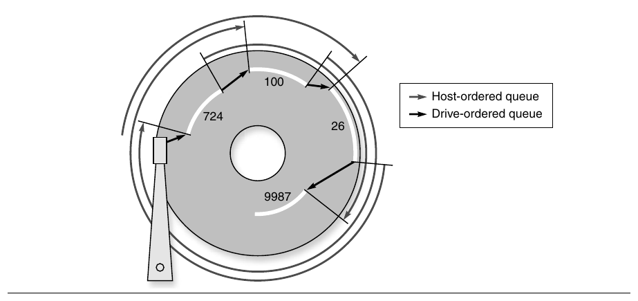

**Hình D.22 Ví dụ cho thấy access được OS lập lịch so với disk lập lịch, được gắn nhãn host-ordered và drive-ordered. Cách đầu mất 3 vòng quay để hoàn thành 4 lần read, còn cách sau hoàn thành chúng chỉ trong 3/4 vòng quay. (Từ Anderson [2003].)**

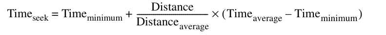

Ngộ nhận liên quan đến seek time có hai mặt. Thứ nhất, seek time không tuyến tính theo khoảng cách; arm phải tăng tốc để thắng quán tính, đạt tốc độ di chuyển tối đa, giảm tốc khi đến vị trí được yêu cầu, rồi chờ arm ngừng rung (settle time). Hơn nữa, đôi khi arm phải dừng lại để kiểm soát rung động. Với disk có hơn 200 cylinder, Chen và Lee [1995] mô hình hóa seek distance như sau:

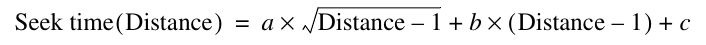

trong đó a, b và c được chọn cho một disk cụ thể sao cho công thức này khớp với các thời gian được công bố cho Distance = 1, Distance = max và Distance = 1/3 max. Hình D.23 vẽ phương trình này so với phương trình dựa trên ngộ nhận. Khác với phương trình đầu tiên, căn bậc hai của khoảng cách phản ánh việc tăng tốc và giảm tốc.

Vấn đề thứ hai là average trong product specification chỉ đúng nếu hoạt động disk không có locality. May mắn là có cả temporal locality lẫn spatial locality (xem trang B-2 trong Phụ lục B). Ví dụ, Hình D.24 cho thấy các phép đo mẫu về seek distance của hai workload: một workload UNIX time-sharing và một workload business-processing. Hãy chú ý tỷ lệ cao disk access đến cùng cylinder, được gắn nhãn khoảng cách 0 trong đồ thị, ở cả hai workload. Vì thế, ngộ nhận này không thể gây hiểu sai nhiều hơn nữa.

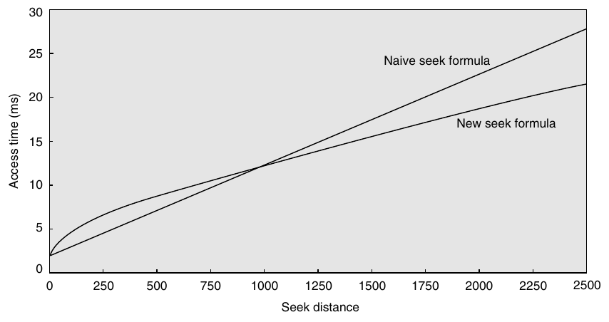

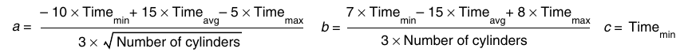

**Hình D.23 Seek time so với seek distance của mô hình tinh vi so với mô hình đơn giản. Chen và Lee [1995] nhận thấy những phương trình ở trên với các tham số a, b và c hoạt động tốt cho một số disk.**


**Hình D.24 Những phép đo mẫu về seek distance của hai hệ thống. Các phép đo bên trái được thực hiện trên một hệ thống UNIX time-sharing. Các phép đo bên phải được lấy từ một application business-processing, trong đó disk seek được lập lịch để cải thiện throughput. Seek distance bằng 0 có nghĩa là access được thực hiện đến cùng cylinder. Những con số còn lại cho biết tỷ lệ phần trăm cộng dồn cho các khoảng cách giữa những số trên y-axis. Ví dụ, 11% cho cột được gắn nhãn 16 trong đồ thị business có nghĩa là tỷ lệ seek có khoảng cách từ 1 đến 16 cylinder là 11%. Các phép đo UNIX dừng ở 200 trong số 1000 cylinder, nhưng bao quát 85% access. Các phép đo business theo dõi toàn bộ 816 cylinder của disk. Những seek distance duy nhất có tỷ lệ seek từ 1% trở lên không có trong đồ thị là 224 với 4%, và 304, 336, 512 cùng 624, mỗi khoảng cách có 1%. Tổng này là 94%, phần chênh lệch là những khoảng cách nhỏ nhưng khác không trong các nhóm khác. Các phép đo do Dave Anderson của Seagate cung cấp.**

## D.10 Nhận xét kết luận

> Storage là một trong những công nghệ mà chúng ta có xu hướng xem là hiển nhiên. Nhưng nếu nhìn vào tình trạng thực sự ngày nay, storage là vua. Thậm chí có thể lập luận rằng server, vốn đã trở thành hàng hóa phổ thông, nay đang dần trở thành phần phụ trợ cho storage device. Củng cố cho quan điểm đó là một số ước tính của IBM, theo đó doanh số storage dự kiến vượt doanh số server trong hai năm tới.

> Michael Vizard

> Editor-in-chief, Infoworld (ngày 11 tháng Tám, 2001)

Khi giá trị của storage system ngày càng rõ rệt, chúng trở thành mục tiêu của đổi mới và đầu tư.

Thách thức của storage system ngày nay là dependability và maintainability. Người dùng không chỉ muốn chắc chắn dữ liệu không bao giờ mất (reliability), mà application ngày nay còn ngày càng đòi hỏi dữ liệu luôn sẵn sàng để truy cập (availability). Bất chấp những cải thiện về hardware reliability, software reliability và fault tolerance, sự phức tạp khi bảo trì các hệ thống như vậy là vấn đề đối với cả chi phí lẫn availability. Một thống kê thường được nhắc đến là khách hàng chi từ $6 đến $8 để vận hành storage system cho mỗi $1 giá mua. Khi dependability được giải quyết bằng nhiều bản sao dự phòng ở một mức cao hơn của hệ thống—chẳng hạn cho tìm kiếm—những hệ thống rất lớn có thể nhạy cảm với price-performance của các thành phần storage.

Ngày nay, những thách thức về storage dependability và maintainability chi phối các thách thức của I/O.

## D.11 Góc nhìn lịch sử và tài liệu tham khảo

Mục L.9 (có trực tuyến) trình bày sự phát triển của storage device và các kỹ thuật liên quan, bao gồm người phát minh disk, câu chuyện đằng sau RAID và lịch sử operating system cùng database. Tài liệu tham khảo để tìm hiểu thêm cũng được cung cấp.

## Nghiên cứu tình huống kèm bài tập của Andrea C. Arpaci-Dusseau và Remzi H. Arpaci-Dusseau

### Nghiên cứu tình huống 1: Khám phá cấu trúc bên trong Disk

#### Những khái niệm được minh họa qua nghiên cứu tình huống này

- Các đặc tính Performance

- Microbenchmarks

Cấu trúc bên trong của storage system thường được ẩn sau một interface đơn giản, đó là một linear array gồm các block. Việc có một interface chung cho tất cả storage system mang lại nhiều lợi thế: operating system có thể sử dụng bất kỳ storage system nào mà không cần sửa đổi, trong khi storage system vẫn tự do đổi mới ở phía sau interface này. Ví dụ, một disk đơn lẻ có thể ánh xạ geometry <sector, track, surface> nội bộ của nó sang linear array theo bất kỳ cách nào đạt performance tốt nhất; tương tự, một hệ thống RAID nhiều disk có thể ánh xạ block trên số lượng disk bất kỳ sang cùng linear array này. Tuy nhiên, interface cố định này cũng có một số nhược điểm; cụ thể, operating system không thể thực hiện một số cách tối ưu hóa performance, reliability và security nếu không biết layout chính xác của các block bên trong storage system bên dưới.

Trong nghiên cứu tình huống này, chúng ta sẽ tìm hiểu cách sử dụng software để khám phá cấu trúc bên trong của một storage system ẩn sau interface block-based. Ý tưởng cơ bản là fingerprint storage system: bằng cách chạy một workload well-defined trên storage system và đo thời gian cần cho những request khác nhau, chúng ta có thể suy ra một lượng chi tiết đáng ngạc nhiên về hệ thống bên dưới.

Thuật toán Skippy, từ công trình của Nisha Talagala và các đồng nghiệp tại University of California–Berkeley, khám phá các tham số của một disk đơn lẻ. Điểm mấu chốt là tách ảnh hưởng của disk rotation bằng cách thực hiện những seek liên tiếp đến từng sector có địa chỉ chênh lệch nhau một lượng tăng tuyến tính (tăng lần lượt 1, 2, 3, v.v.). Vì thế, thuật toán cơ bản nhảy qua disk, tăng seek distance thêm một sector trước mỗi lần ghi, và xuất khoảng cách cùng thời gian cho mỗi lần ghi. Raw device interface được sử dụng để tránh những tối ưu hóa của file system. SECTOR SIZE được đặt bằng lượng dữ liệu tối thiểu có thể đọc cùng lúc từ disk (ví dụ: 512 byte). (Skippy được mô tả chi tiết hơn trong Talagala và Patterson [1999].)

```
fd = open("raw disk device");
for (i = 0; i < measurements; i++) {
    begin_time = gettime();
    lseek(fd, i*SECTOR_SIZE, SEEK_CUR);
    write(fd, buffer, SECTOR_SIZE);
    interval_time = gettime() -begin_time;

    printf("Stride: %d Time: %d\n", i, interval_time);
}
close(fd);
```

Bằng cách vẽ thời gian cần cho mỗi lần ghi theo seek distance, chúng ta có thể suy ra minimal transfer time (không có seek latency hoặc rotational latency), head switch time, cylinder switch time, rotational latency và số head trong disk. Một đồ thị điển hình có bốn đường phân biệt, mỗi đường có cùng độ dốc nhưng có offset khác nhau. Đường cao nhất và thấp nhất tương ứng với những request chịu rotational delay khác nhau nhưng không có chi phí cylinder switch hoặc head switch; chênh lệch giữa hai đường này cho biết rotational latency của disk. Đường thấp thứ hai tương ứng với những request chịu head switch (bên cạnh rotational delay tăng dần). Cuối cùng, đường thứ ba tương ứng với những request chịu cylinder switch (bên cạnh rotational delay).

**D.1** [10/10/10/10/10] <D.2> Kết quả chạy Skippy được thể hiện cho một disk giả lập (Disk Alpha) trong Hình D.25.

a. [10] <D.2> Minimal transfer time là bao nhiêu?

b. [10] <D.2> Rotational latency là bao nhiêu?

c. [10] <D.2> Head switch time là bao nhiêu?


**Hình D.25 Kết quả chạy Skippy trên Disk Alpha.**

d. [10] <D.2> Cylinder switch time là bao nhiêu?

e. [10] <D.2> Số disk head là bao nhiêu?

**D.2** [25] <D.2> Hãy vẽ gần đúng đồ thị sẽ thu được khi chạy Skippy trên Disk Beta, một disk có các tham số sau:

- Minimal transfer time, 2.0 ms

- Rotational latency, 6.0 ms

- Head switch time, 1.0 ms

- Cylinder switch time, 1.5 ms

- Số disk head, 4

- Số sector trên mỗi track, 100

**D.3** [10/10/10/10/10/10/10] <D.2> Hãy triển khai và chạy thuật toán Skippy trên một disk drive do bạn chọn.

a. [10] <D.2> Hãy vẽ đồ thị kết quả chạy Skippy. Báo cáo nhà sản xuất và model disk của bạn.

b. [10] <D.2> Minimal transfer time là bao nhiêu?

c. [10] <D.2> Rotational latency là bao nhiêu?

d. [10] <D.2> Head switch time là bao nhiêu?

e. [10] <D.2> Cylinder switch time là bao nhiêu?

f. [10] <D.2> Số disk head là bao nhiêu?

g. [10] <D.2> Kết quả chạy Skippy trên disk thực có khác biệt định tính nào so với disk giả lập không?

### Nghiên cứu tình huống 2: Khám phá cấu trúc bên trong Disk Array

#### Những khái niệm được minh họa qua nghiên cứu tình huống này

- Các đặc tính Performance

- Microbenchmarks

Thuật toán Shear, từ công trình của Timothy Denehy và các đồng nghiệp tại University of Wisconsin [Denehy và cộng sự 2004], khám phá các tham số của một hệ thống RAID. Ý tưởng cơ bản là tạo một workload gồm những request đến RAID array và đo thời gian của những request đó; bằng cách quan sát những tập request nào mất nhiều thời gian hơn, chúng ta có thể suy ra những block nào được phân bổ trên cùng disk.

Chúng ta định nghĩa các đặc tính RAID như sau. Dữ liệu được phân bổ vào disk trong RAID ở mức block, trong đó block là đơn vị dữ liệu tối thiểu mà file system đọc hoặc ghi từ storage system; vì thế, file system và fingerprinting software biết block size. Chunk là một tập block được phân bổ liên tục trong một disk. Stripe là một tập chunk trên mỗi một trong D data disk. Cuối cùng, pattern là chuỗi data block tối thiểu sao cho block offset i trong pattern luôn nằm trên disk j.

**D.4** [20/20] <D.2> Có thể khám phá pattern size bằng code sau. Code truy cập raw device để tránh những tối ưu hóa của file system. Điểm mấu chốt của tất cả thuật toán Shear là sử dụng random request để tránh kích hoạt bất kỳ cơ chế prefetch hoặc caching nào trong RAID hoặc trong từng disk. Ý tưởng cơ bản của đoạn code này là truy cập N random block ở một khoảng cố định p trong RAID array và đo completion time của mỗi khoảng.

```
for (p = BLOCKSIZE; p <= testsize; p += BLOCKSIZE) {
    for (i = 0; i < N; i++) {
        request[i] = random()*p;
    }
    begin_time = gettime();
    issues all request[N] to raw device in parallel;
    wait for all request[N] to complete;
    interval_time = gettime() - begin_time;
    printf("PatternSize: %d Time: %d\n", p,
        interval_time);
}
```

Nếu chạy code này trên một RAID array và vẽ thời gian đo được cho N request theo p, bạn sẽ thấy thời gian cao nhất khi tất cả N request rơi vào cùng disk; vì thế, giá trị p có thời gian cao nhất tương ứng với pattern size của RAID.


**Hình D.26 Kết quả chạy thuật toán pattern size của Shear trên một storage system giả lập.**

a. [20] <D.2> Hình D.26 cho thấy kết quả chạy thuật toán pattern size trên một hệ thống RAID chưa biết.

- Pattern size của storage system này là bao nhiêu?

- Những thời gian đo được là 0.4, 0.8 và 1.6 giây tương ứng với điều gì trong storage system này?

- Nếu đây là RAID 0 array, có bao nhiêu disk?

- Nếu đây là RAID 0 array, chunk size là bao nhiêu?

b. [20] <D.2> Hãy vẽ đồ thị thu được khi chạy code Shear này trên một storage system có các đặc tính sau:

- Số request, N = 1000

- Thời gian cho một random read trên disk, 5 ms

- Mức RAID, RAID 0

- Số disk, 4

- Chunk size, 8 KB

**D.5** [20/20] <D.2> Có thể khám phá chunk size bằng code sau. Ý tưởng cơ bản là thực hiện read từ N pattern được chọn ngẫu nhiên nhưng luôn ở những offset được kiểm soát, c và c – 1, bên trong pattern.

```
for (c = 0; c < patternsize; c += BLOCKSIZE) {
    for (i = 0; i < N; i++) {
        requestA[i] = random()*patternsize + c;
        requestB[i] = random()*patternsize +
            (c-1)%patternsize;
    }
```


**Hình D.27 Kết quả chạy thuật toán chunk size của Shear trên một storage system giả lập.**

```
    begin_time = gettime();

    issue all requestA[N] and requestB[N] to raw device
        in parallel;
    wait for requestA[N] and requestB[N] to complete;

    interval_time = gettime() - begin_time;
    printf("ChunkSize: %d Time: %d\n", c, interval_time);
}
```

Nếu chạy code này và vẽ thời gian đo được theo c, bạn sẽ thấy thời gian đo được thấp nhất khi các read requestA và requestB rơi vào hai disk khác nhau. Vì thế, những giá trị c có thời gian thấp tương ứng với các ranh giới chunk giữa các disk trong RAID.

a. [20] <D.2> Hình D.27 cho thấy kết quả chạy thuật toán chunk size trên một hệ thống RAID chưa biết.

- Chunk size của storage system này là bao nhiêu?

- Những thời gian đo được là 0.75 và 1.5 giây tương ứng với điều gì trong storage system này?

b. [20] <D.2> Hãy vẽ đồ thị thu được khi chạy code Shear này trên một storage system có các đặc tính sau:

- Số request, N = 1000

- Thời gian cho một random read trên disk, 5 ms

- Mức RAID, RAID 0

- Số disk, 8

- Chunk size, 12 KB

**D.6** [10/10/10/10] <D.2> Cuối cùng, có thể xác định layout của chunk trên các disk bằng code sau. Ý tưởng cơ bản là chọn N random pattern và đọc cùng nhau toàn bộ những tổ hợp từng cặp chunk trong pattern.

```
for (a = 0; a < numchunks; a += chunksize) {

    for (b = a; b < numchunks; b += chunksize) {

        for (i = 0; i < N; i++) {
            requestA[i] = random()*patternsize + a;
            requestB[i] = random()*patternsize + b;
        }

        begin_time = gettime();
        issue all requestA[N] and requestB[N] to raw device
            in parallel;
        wait for all requestA[N] and requestB[N] to
            complete;
        interval_time = gettime() - begin_time;
        printf("A: %d B: %d Time: %d\n", a, b,
            interval_time);
    }
}
```

Sau khi chạy code này, bạn có thể báo cáo thời gian đo được theo a và b. Cách đơn giản nhất để vẽ là tạo một bảng two-dimensional với a và b là các tham số và thời gian được quy đổi thành mức tô đậm; chúng ta sử dụng màu đậm hơn cho thời gian nhanh hơn và màu nhạt hơn cho thời gian chậm hơn. Vì thế, màu nhạt cho biết hai offset a và b trong pattern rơi vào cùng disk.

Hình D.28 cho thấy kết quả chạy thuật toán layout trên một storage system đã biết có pattern size 384 KB và chunk size 32 KB.

a. [20] <D.2> Có bao nhiêu chunk trong một pattern?

b. [20] <D.2> Những chunk nào của mỗi pattern có vẻ được phân bổ trên cùng disk?


**Hình D.28 Kết quả chạy thuật toán layout của Shear trên một storage system giả lập.**


**Hình D.29 Một storage system có bốn disk, chunk size bằng bốn block 4 KB và sử dụng layout RAID 5 Left-Asymmetric. Hai lần lặp lại của pattern được thể hiện.**

c. [20] <D.2> Storage system này có vẻ có bao nhiêu disk?

d. [20] <D.2> Hãy vẽ layout có khả năng đúng của các block trên các disk.

**D.7** [20] <D.2> Hãy vẽ đồ thị thu được khi chạy thuật toán layout trên storage system trong Hình D.29. Storage system này có bốn disk và chunk size bằng bốn block 4 KB (16 KB), và sử dụng layout RAID 5 Left-Asymmetric.

### Nghiên cứu tình huống 3: RAID Reconstruction

#### Những khái niệm được minh họa qua nghiên cứu tình huống này

- Các hệ thống RAID

- RAID Reconstruction

- Mean Time to Failure (MTTF)

- Mean Time until Data Loss (MTDL)

- Performability

- Double Failure

Hệ thống RAID bảo đảm dữ liệu không bị mất khi một disk hỏng. Vì thế, một trong những trách nhiệm chính của RAID là tái tạo dữ liệu từng nằm trên disk khi nó hỏng; quá trình này được gọi là reconstruction và là điều bạn sẽ tìm hiểu trong nghiên cứu tình huống này. Bạn sẽ xem xét cả hệ thống RAID có thể chịu được một disk failure và RAID-DP có thể chịu được hai disk failure.

Reconstruction thường được thực hiện theo hai cách khác nhau. Trong offline reconstruction, RAID dành tất cả resource để thực hiện reconstruction và không phục vụ request nào từ workload. Trong online reconstruction, RAID tiếp tục phục vụ workload request trong khi thực hiện reconstruction; reconstruction process thường bị giới hạn chỉ sử dụng một phần tổng bandwidth của hệ thống RAID.

Cách thực hiện reconstruction ảnh hưởng đến cả reliability lẫn performability của hệ thống. Trong RAID 5, dữ liệu bị mất nếu disk thứ hai hỏng trước khi dữ liệu từ disk đầu tiên được khôi phục; vì thế, reconstruction time (MTTR) càng dài, reliability hay mean time until data loss (MTDL) càng thấp. Performability là một metric nhằm kết hợp cả performance và availability của hệ thống; nó được định nghĩa là performance của hệ thống ở một trạng thái cho trước nhân với xác suất của trạng thái đó. Với RAID array, những trạng thái có thể có bao gồm hoạt động bình thường không có disk failure, reconstruction với một disk failure và shutdown do nhiều disk failure.

Đối với những bài tập này, giả sử bạn đã xây một hệ thống RAID với sáu disk cùng số lượng hot spare đủ dùng. Giả sử mỗi disk là SCSI disk 37 GB trong Hình D.3 và mỗi disk có thể đọc tuần tự dữ liệu ở tốc độ đỉnh 142 MB/sec và ghi tuần tự dữ liệu ở tốc độ đỉnh 85 MB/sec. Giả sử các disk kết nối với Ultra320 SCSI bus có thể truyền tổng cộng 320 MB/sec. Bạn có thể giả sử mỗi disk failure độc lập và bỏ qua những failure tiềm ẩn khác trong hệ thống. Đối với reconstruction process, bạn có thể giả sử overhead của mọi phép tính XOR hoặc memory copying là không đáng kể. Trong online reconstruction, giả sử reconstruction process bị giới hạn sử dụng tổng bandwidth 10 MB/sec từ hệ thống RAID.

**D.8** [10] <D.2> Giả sử bạn có một hệ thống RAID 4 với sáu disk. Hãy vẽ sơ đồ đơn giản thể hiện layout của các block trên các disk cho hệ thống RAID này.

**D.9** [10] <D.2, D.4> Khi một disk đơn lẻ hỏng, hệ thống RAID 4 sẽ thực hiện reconstruction. Thời gian kỳ vọng cho đến khi cần reconstruction là bao nhiêu?

**D.10** [10/10/10] <D.2, D.4> Giả sử reconstruction của RAID 4 array bắt đầu tại thời điểm t.

a. [10] <D.2, D.4> Cần những read operation và write operation nào để thực hiện reconstruction?

b. [10] <D.2, D.4> Với offline reconstruction, khi nào reconstruction process sẽ hoàn thành?

c. [10] <D.2, D.4> Với online reconstruction, khi nào reconstruction process sẽ hoàn thành?

**D.11** [10/10/10/10] <D.2, D.4> Trong bài tập này, chúng ta sẽ tìm hiểu mean time until data loss (MTDL). Trong RAID 4, dữ liệu chỉ bị mất nếu disk thứ hai hỏng trước khi disk hỏng đầu tiên được sửa.

a. [10] <D.2, D.4> Khả năng xảy ra failure thứ hai trong offline reconstruction là bao nhiêu?

b. [10] <D.2, D.4> Với khả năng xảy ra failure thứ hai trong reconstruction này, MTDL cho offline reconstruction là bao nhiêu?

c. [10] <D.2, D.4> Khả năng xảy ra failure thứ hai trong online reconstruction là bao nhiêu?

d. [10] <D.2, D.4> Với khả năng xảy ra failure thứ hai trong reconstruction này, MTDL cho online reconstruction là bao nhiêu?

**D.12** [10] <D.2, D.4> Performability của RAID 4 array với offline reconstruction là bao nhiêu? Hãy tính performability bằng IOPS, giả sử một workload random read-only được phân bố đều trên các disk của RAID 4 array.

**D.13** [10] <D.2, D.4> Performability của RAID 4 array với online reconstruction là bao nhiêu? Trong online repair, bạn có thể giả sử IOPS giảm xuống 70% peak rate. Offline reconstruction hay online reconstruction mang lại performability tốt hơn?

**D.14** [10] <D.2, D.4> RAID 6 được sử dụng để chịu được tối đa hai disk failure đồng thời. Giả sử bạn có một hệ thống RAID 6 dựa trên row-diagonal parity, hay RAID-DP; hệ thống RAID-DP six-disk của bạn dựa trên RAID 4, với p = 5, như trong Hình D.5. Nếu data disk 0 và data disk 3 hỏng, có thể tái tạo những disk đó như thế nào? Hãy thể hiện trình tự các bước cần thiết để tính những block bị thiếu trong bốn stripe đầu tiên.

### Nghiên cứu tình huống 4: Dự đoán Performance cho RAID

#### Những khái niệm được minh họa qua nghiên cứu tình huống này

- Các mức RAID

- Queuing Theory

- Ảnh hưởng của Workload

- Ảnh hưởng của Disk Layout

Trong nghiên cứu tình huống này, bạn sẽ tìm hiểu cách sử dụng queuing theory đơn giản để dự đoán performance của I/O system. Bạn sẽ khảo sát cách cả cấu hình storage system lẫn workload ảnh hưởng đến service time, disk utilization và response time trung bình.

Cấu hình storage system ảnh hưởng lớn đến performance. Các mức RAID khác nhau có thể được mô hình hóa bằng queuing theory theo những cách khác nhau. Ví dụ, RAID 0 array chứa N disk có thể được mô hình hóa thành N hệ thống M/M/1 queue riêng, với giả định request được phân bố phù hợp trên N disk. Hành vi của RAID 1 array phụ thuộc vào workload: read operation có thể được gửi đến một trong hai mirror, còn write operation phải được gửi đến cả hai disk. Vì thế, với workload read-only, RAID 1 array two-disk có thể được mô hình hóa thành M/M/2 queue, còn với workload write-only, có thể mô hình hóa thành M/M/1 queue. Hành vi của RAID 4 array chứa N disk cũng phụ thuộc vào workload: read được gửi đến một data disk cụ thể, còn tất cả write phải cập nhật parity disk, khiến nó trở thành bottleneck của hệ thống. Vì thế, với workload read-only, RAID 4 có thể được mô hình hóa thành N – 1 hệ thống riêng, còn với workload write-only, có thể mô hình hóa thành một M/M/1 queue.

Layout của block trong storage system có thể ảnh hưởng đáng kể đến performance. Hãy xem xét một disk đơn lẻ có capacity 40 GB. Nếu workload truy cập ngẫu nhiên 40 GB dữ liệu, layout của những block đó trên disk không ảnh hưởng nhiều đến performance. Tuy nhiên, nếu workload chỉ truy cập ngẫu nhiên một nửa capacity của disk (tức 20 GB dữ liệu trên disk đó), layout trở nên quan trọng: để giảm seek time, 20 GB dữ liệu có thể được gom trong 20 GB track liên tiếp thay vì phân bổ đều trên toàn bộ capacity 40 GB.

Đối với bài toán này, chúng ta sử dụng một mô hình khá đơn giản để ước tính service time của disk. Trong mô hình cơ bản này, average positioning and transfer time cho một small random request là hàm tuyến tính của seek distance. Với disk 40 GB trong bài toán này, giả sử service time là 5 ms * space utilization. Vì thế, nếu toàn bộ disk 40 GB được sử dụng, average positioning and transfer time cho một random request là 5 ms; nếu chỉ 20 GB đầu tiên của disk được sử dụng, average positioning and transfer time là 2.5 ms.

Trong suốt nghiên cứu tình huống này, bạn có thể giả sử processor gửi 167 small random disk request mỗi giây và những request này tuân theo exponential distribution. Bạn có thể giả sử kích thước request bằng block size 8 KB. Mỗi disk trong hệ thống có capacity 40 GB. Bất kể cấu hình storage system, workload truy cập tổng cộng 40 GB dữ liệu; bạn nên phân bổ 40 GB dữ liệu trên các disk trong hệ thống theo cách hiệu quả nhất.

**D.15** [10/10/10/10/10] <D.5> Bắt đầu bằng giả định storage system gồm một disk 40 GB duy nhất.

a. [10] <D.5> Với workload và storage system này, average service time là bao nhiêu?

b. [10] <D.5> Trung bình, utilization của disk là bao nhiêu?

c. [10] <D.5> Trung bình, mỗi request dành bao nhiêu thời gian chờ disk?

d. [10] <D.5> Số request trung bình trong queue là bao nhiêu?

e. [10] <D.5> Cuối cùng, response time trung bình cho các disk request là bao nhiêu?

**D.16** [10/10/10/10/10/10] <D.2, D.5> Hãy tưởng tượng storage system hiện được cấu hình chứa hai disk 40 GB trong một RAID 0 array; nghĩa là dữ liệu được striped đều theo block 8 KB trên hai disk mà không có redundancy.

a. [10] <D.2, D.5> 40 GB dữ liệu sẽ được phân bổ trên các disk như thế nào? Với workload random request trên tổng cộng 40 GB, service time kỳ vọng của mỗi request là bao nhiêu?

b. [10] <D.2, D.5> Có thể sử dụng queuing theory để mô hình hóa storage system này như thế nào?

c. [10] <D.2, D.5> Utilization trung bình của mỗi disk là bao nhiêu?

d. [10] <D.2, D.5> Trung bình, mỗi request dành bao nhiêu thời gian chờ disk?

e. [10] <D.2, D.5> Số request trung bình trong mỗi queue là bao nhiêu?

f. [10] <D.2, D.5> Cuối cùng, response time trung bình cho các disk request là bao nhiêu?

**D.17** [20/20/20/20/20] <D.2, D.5> Thay vào đó, hãy tưởng tượng storage system được cấu hình chứa hai disk 40 GB trong một RAID 1 array; nghĩa là dữ liệu được mirrored trên hai disk. Hãy sử dụng queuing theory để mô hình hóa hệ thống này cho một workload read-only.

a. [20] <D.2, D.5> 40 GB dữ liệu sẽ được phân bổ trên các disk như thế nào? Với workload random request trên tổng cộng 40 GB, service time kỳ vọng của mỗi request là bao nhiêu?

b. [20] <D.2, D.5> Có thể sử dụng queuing theory để mô hình hóa storage system này như thế nào?

c. [20] <D.2, D.5> Utilization trung bình của mỗi disk là bao nhiêu?

d. [20] <D.2, D.5> Trung bình, mỗi request dành bao nhiêu thời gian chờ disk?

e. [20] <D.2, D.5> Cuối cùng, response time trung bình cho các disk request là bao nhiêu?

**D.18** [10/10] <D.2, D.5> Hãy tưởng tượng thay vì workload read-only, lúc này bạn có workload write-only trên một RAID 1 array.

a. [10] <D.2, D.5> Hãy mô tả cách bạn có thể sử dụng queuing theory để mô hình hóa hệ thống và workload này.

b. [10] <D.2, D.5> Với hệ thống và workload này, utilization trung bình, waiting time trung bình và response time trung bình là bao nhiêu?

### Nghiên cứu tình huống 5: I/O Subsystem Design

#### Những khái niệm được minh họa qua nghiên cứu tình huống này

- Các hệ thống RAID

- Mean Time to Failure (MTTF)

- Các Trade-Offs giữa Performance và Reliability

Trong nghiên cứu tình huống này, bạn sẽ thiết kế một I/O subsystem với một ngân sách cho trước. Hệ thống của bạn phải có capacity tối thiểu được yêu cầu và bạn sẽ tối ưu hóa performance, reliability hoặc cả hai. Bạn có thể tự do sử dụng bao nhiêu disk và controller tùy ý miễn là vừa trong ngân sách.

Sau đây là những khối xây dựng của bạn:

- Một CPU 10,000 MIPS có giá $1000. MTTF của nó là 1,000,000 giờ.

- Một I/O bus 1000 MB/sec có chỗ cho 20 Ultra320 SCSI bus và controller.

- Những Ultra320 SCSI bus có thể truyền 320 MB/sec và hỗ trợ tối đa 15 disk trên mỗi bus (chúng còn được gọi là SCSI string). MTTF của SCSI cable là 1,000,000 giờ.

- Một Ultra320 SCSI controller có khả năng 50,000 IOPS, có giá $250 và MTTF 500,000 giờ.

- Một enclosure giá $2000 cung cấp power và làm mát cho tối đa tám disk. MTTF của enclosure là 1,000,000 giờ, MTTF của fan là 200,000 giờ và MTTF của power supply là 200,000 giờ.

- Những SCSI disk được mô tả trong Hình D.3.

- Việc thay thế bất kỳ thành phần bị hỏng nào cần 24 giờ.

Bạn có thể đưa ra những giả định sau về workload:

- Operating system cần 70,000 CPU instruction cho mỗi disk I/O.

- Workload gồm nhiều random I/O đồng thời, có kích thước trung bình 16 KB.

Tất cả hệ thống bạn xây dựng phải có những đặc tính sau:

- Bạn có ngân sách $28,000.

- Bạn phải cung cấp capacity ít nhất 1 TB.

**D.19** [10] <D.2> Bạn sẽ bắt đầu bằng việc thiết kế một I/O subsystem chỉ được tối ưu hóa cho capacity và performance (không phải reliability), cụ thể là IOPS. Hãy thảo luận mức RAID và block size mang lại performance tốt nhất.

**D.20** [20/20/20/20] <D.2, D.4, D.7> Cấu hình SCSI disk, controller và enclosure nào mang lại performance tốt nhất với các ràng buộc về ngân sách và capacity của bạn?

a. [20] <D.2, D.4, D.7> Bạn kỳ vọng hệ thống cung cấp được bao nhiêu IOPS?

b. [20] <D.2, D.4, D.7> Hệ thống của bạn có chi phí bao nhiêu?

c. [20] <D.2, D.4, D.7> Capacity của hệ thống là bao nhiêu?

d. [20] <D.2, D.4, D.7> MTTF của hệ thống là bao nhiêu?

**D.21** [10] <D.2, D.4, D.7> Bây giờ bạn sẽ thiết kế lại hệ thống để tối ưu hóa reliability bằng cách tạo một RAID 10 hoặc RAID 01 array. Storage system nên vững vàng không chỉ trước disk failure mà còn trước failure của controller, cable, power supply và fan; cụ thể, failure của một thành phần đơn lẻ không được ngăn cản truy cập cả hai replica của một cặp. Hãy vẽ sơ đồ minh họa cách block được phân bổ trên các disk trong cấu hình RAID 10 và RAID 01. RAID 10 hay RAID 01 phù hợp hơn trong môi trường này?

**D.22** [20/20/20/20/20] <D.2, D.4, D.7> Nếu chỉ tối ưu hóa RAID 10 hoặc RAID 01 array cho reliability (nhưng vẫn trong các ràng buộc capacity và ngân sách), cấu hình RAID của bạn là gì?

a. [20] <D.2, D.4, D.7> MTTF tổng thể của các thành phần trong hệ thống là bao nhiêu?

b. [20] <D.2, D.4, D.7> MTDL của hệ thống là bao nhiêu?

c. [20] <D.2, D.4, D.7> Capacity có thể sử dụng của hệ thống này là bao nhiêu?

d. [20] <D.2, D.4, D.7> Hệ thống của bạn có chi phí bao nhiêu?

e. [20] <D.2, D.4, D.7> Với giả định workload write-only, bạn kỳ vọng cung cấp được bao nhiêu IOPS?

**D.23** [10] <D.2, D.4, D.7> Giả sử lúc này bạn có một disk có capacity gấp đôi với cùng mức giá. Nếu tiếp tục chỉ thiết kế cho reliability, bạn sẽ thay đổi cấu hình storage system như thế nào? Tại sao?

### Nghiên cứu tình huống 6: Những bit hư hỏng

#### Những khái niệm được minh họa qua nghiên cứu tình huống này

- Partial Disk Failure

- Phân tích Failure

- Phân tích Performance

- Parity Protection

- Checksumming

Bạn được giao nhiệm vụ tránh vấn đề “bit rot”—những bit hoặc block trong một file hỏng dần theo thời gian. Vấn đề này đặc biệt quan trọng trong các tình huống lưu trữ lâu dài, khi dữ liệu được ghi một lần và có thể được truy cập sau nhiều năm; nếu không thực hiện biện pháp bổ sung để bảo vệ dữ liệu, các bit hoặc block của file có thể từ từ thay đổi hoặc trở nên unavailable do media error hoặc I/O fault khác.

Xử lý bit rot cần hai thành phần cụ thể: phát hiện và khôi phục. Để phát hiện bit rot hiệu quả, có thể sử dụng checksum trên mỗi block của file đang xét; checksum chỉ là một function nào đó nhận một chuỗi dữ liệu (có thể dài) làm input và tạo ra một chuỗi fixed-size (checksum) của dữ liệu làm output. Đặc tính bạn sẽ khai thác là nếu dữ liệu thay đổi, checksum được tính rất có khả năng cũng thay đổi.

Sau khi phát hiện, việc khôi phục từ bit rot cần một dạng redundancy nào đó. Ví dụ bao gồm mirroring (giữ nhiều bản sao của mỗi block) và parity (một lượng thông tin dự phòng bổ sung, thường sử dụng không gian hiệu quả hơn mirroring).

Trong nghiên cứu tình huống này, bạn sẽ phân tích hiệu quả của những kỹ thuật này trong các tình huống khác nhau. Bạn cũng sẽ viết code để triển khai data integrity protection trên một tập file.

**D.24** [20/20/20] <D.2> Giả sử bạn sử dụng simple parity protection trong các Bài tập D.24 đến D.27. Cụ thể, giả sử bạn tính một parity block cho mỗi file trong file system. Ngoài ra, giả sử bạn cũng sử dụng một MD5 checksum 20-byte cho mỗi block 4 KB của mỗi file. Trước tiên, chúng ta giải quyết vấn đề space overhead. Theo các nghiên cứu của Douceur và Bolosky [1999], đây là những phân phối file size được tìm thấy trong PC hiện đại:


Nghiên cứu còn nhận thấy file system thường đầy khoảng một nửa. Giả sử bạn có một disk volume 37 GB đầy khoảng một nửa và tuân theo cùng phân phối đó, rồi trả lời những câu hỏi sau:

a. [20] <D.2> Bạn phải giữ thêm bao nhiêu thông tin trên disk (cả theo byte và theo phần trăm volume) để có thể phát hiện một error đơn lẻ bằng checksum?

b. [20] <D.2> Bạn cần thêm bao nhiêu thông tin (cả theo byte và theo phần trăm volume) để vừa phát hiện một error đơn lẻ bằng checksum, vừa sửa được error đó?

c. [20] <D.2> Với phân phối file này, block size bạn đang sử dụng để tính checksum là quá lớn, quá nhỏ hay vừa đúng?

**D.25** [10/10] <D.2, D.3> Một vấn đề lớn nảy sinh trong data protection là error detection. Một cách tiếp cận là thực hiện error detection theo kiểu lazy—nghĩa là chờ đến khi một file được truy cập, rồi tại thời điểm đó kiểm tra để bảo đảm dữ liệu đúng vẫn còn. Vấn đề với cách này là những file ít được truy cập có thể từ từ hư hỏng và khi cuối cùng được truy cập thì có quá nhiều error để sửa. Vì thế, cách tiếp cận eager là thực hiện điều đôi khi được gọi là disk scrubbing—định kỳ duyệt qua toàn bộ dữ liệu và chủ động tìm error.

a. [10] <D.2, D.3> Giả sử bit flip xảy ra độc lập, với rate 1 flip trên mỗi GB dữ liệu mỗi tháng. Với cùng volume 20 GB đầy một nửa, và giả sử bạn sử dụng SCSI disk có thông số như Hình D.3 (seek 4 ms, transfer khoảng 100 MB/sec), bạn nên quét các file bao lâu một lần để kiểm tra và sửa integrity của chúng?

b. [10] <D.2, D.3> Ở bit flip rate nào thì không còn có thể duy trì data integrity? Một lần nữa, giả sử volume 20 GB và SCSI disk.

**D.26** [10/10/10/10] <D.2, D.4> Một chi phí tiềm ẩn khác của việc bổ sung data protection nằm ở performance overhead. Bây giờ chúng ta nghiên cứu performance overhead của cách tiếp cận data protection này.

a. [10] <D.2, D.4> Giả sử chúng ta ghi tuần tự một file 40 MB lên SCSI disk, rồi ghi ra disk một lần lượng thông tin bổ sung để triển khai phương án data protection. Phương án tạo ra bao nhiêu write traffic (cả theo tổng số byte và theo phần trăm tổng traffic)?

b. [10] <D.2, D.4> Giả sử lúc này chúng ta cập nhật file ngẫu nhiên, tương tự một database table. Nghĩa là giả sử thực hiện một chuỗi random write 4 KB đến file, và mỗi khi thực hiện một write đơn lẻ, phải cập nhật protection information on-disk. Giả sử thực hiện 10,000 random write, phương án tạo ra bao nhiêu I/O traffic (cả theo tổng số byte và theo phần trăm tổng traffic)?

c. [10] <D.2, D.4> Bây giờ, giả sử data protection information luôn được giữ trong một phần riêng của disk, cách xa file mà nó bảo vệ (nghĩa là giả sử với mỗi file A có một file khác A<sub>checksums</sub> giữ tất cả checksum cho A). Vì thế, một overhead tiềm ẩn mà chúng ta phải chịu phát sinh khi read—nghĩa là trong mỗi lần read, chúng ta sử dụng checksum để phát hiện data corruption.

Giả sử bạn đọc tuần tự 10,000 block, mỗi block 4 KB, từ disk. Với giả định average seek cost 4 ms và transfer rate 100 MB/sec (như SCSI disk trong Hình D.3), cần bao lâu để đọc file (và các checksum tương ứng) từ disk? Time penalty do bổ sung checksum là bao nhiêu?

d. [10] <D.2, D.4> Một lần nữa, giả sử data protection information được giữ riêng như trong phần (c), lúc này giả sử bạn phải đọc 10,000 random block, mỗi block 4 KB, từ một file rất lớn (nghĩa là lớn hơn 10,000 block nhiều). Với mỗi read, bạn lại phải sử dụng checksum để bảo đảm data integrity. Cần bao lâu để đọc 10,000 block từ disk, một lần nữa với cùng những đặc tính disk? Time penalty do bổ sung checksum là bao nhiêu?

**D.27** [40] <D.2, D.3, D.4> Cuối cùng, chúng ta đưa lý thuyết vào thực hành bằng cách phát triển một công cụ user-level để bảo vệ trước file corruption. Giả sử bạn phải viết một tập công cụ đơn giản để phát hiện và sửa data integrity. Công cụ đầu tiên được sử dụng cho checksum và parity. Nó nên có tên build và được sử dụng như sau:

```
build <filename>
```

Sau đó, chương trình build nên lưu checksum và redundancy information cần thiết cho file filename trong một file ở cùng directory có tên .file name.cp (để dễ tìm về sau).

Sau đó, một chương trình thứ hai được sử dụng để kiểm tra và có thể sửa những file bị hỏng. Nó nên có tên repair và được sử dụng như sau:

```
repair <filename>
```

Chương trình repair nên tham khảo file .cp cho filename đang xét và xác minh tất cả checksum được lưu khớp với checksum được tính cho dữ liệu. Nếu checksum không khớp cho một block đơn lẻ, repair nên sử dụng thông tin dự phòng để tái tạo dữ liệu đúng và sửa file. Tuy nhiên, nếu có hai block trở lên bị hỏng, repair chỉ nên báo cáo rằng file đã hỏng đến mức không thể sửa. Để thử nghiệm hệ thống của bạn, chúng tôi sẽ cung cấp một công cụ làm hỏng file có tên corrupt. Nó hoạt động như sau:

```
corrupt <filename> <blocknumber>
```

Tất cả những gì corrupt làm là điền nhiễu ngẫu nhiên vào block có số được chỉ định của file. Với checksum, bạn sẽ sử dụng MD5. MD5 nhận một input string và cho bạn một “fingerprint” hay checksum 128-bit làm output. Một triển khai MD5 tốt và đơn giản có tại đây:

http://sourceforge.net/project/showfiles.php?group_id=42360

Parity được tính bằng XOR operator. Trong code C, bạn có thể tính parity của hai block, mỗi block có kích thước BLOCKSIZE, như sau:

```
unsigned char block1[BLOCKSIZE];
unsigned char block2[BLOCKSIZE];
unsigned char parity[BLOCKSIZE];
// first, clear parity block
for (int i = 0; i < BLOCKSIZE; i++)
    parity[i] = 0;
// then compute parity; carat symbol does XOR in C
for (int i = 0; i < BLOCKSIZE; i++) {
    parity[i] = block1[i] ˆ block2[i];
}
```

### Nghiên cứu tình huống 7: Làm rõ việc sắp xếp

#### Những khái niệm được minh họa qua nghiên cứu tình huống này

- Benchmarking

- Phân tích Performance

- Phân tích Cost/Performance

- Phân bổ Overhead

- Những hệ thống cân bằng

Lĩnh vực database có lịch sử lâu dài sử dụng benchmark để so sánh hệ thống. Trong câu hỏi này, bạn sẽ tìm hiểu một trong những benchmark được Anon. và cộng sự [1985] giới thiệu (xem Chương 1): sắp xếp external, hay disk-to-disk.

Sorting là một benchmark thú vị vì nhiều lý do. Thứ nhất, sorting vận dụng mọi thành phần của computer system, bao gồm disk, memory và processor. Thứ hai, sorting với performance cao nhất có thể đòi hỏi nhiều chuyên môn về cách CPU cache, operating system và I/O subsystem hoạt động. Thứ ba, nó đủ đơn giản để một sinh viên triển khai (xem bên dưới!).

Tùy lượng dữ liệu bạn có, sorting có thể được thực hiện trong một hoặc nhiều pass. Nói đơn giản, nếu có đủ memory để giữ toàn bộ dataset, bạn có thể đọc toàn bộ dataset vào memory, sắp xếp rồi ghi nó ra; đây được gọi là phép sort “one-pass”.

Nếu không có đủ memory, bạn phải sắp xếp dữ liệu trong nhiều pass. Có thể sử dụng nhiều cách tiếp cận khác nhau. Một cách đơn giản là sắp xếp từng chunk của input file rồi ghi nó lên disk; cách này để lại (input file size)/(memory size) file đã sắp xếp trên disk. Sau đó, bạn phải merge từng temporary file đã sắp xếp thành output cuối cùng đã sắp xếp. Đây được gọi là phép sort “two-pass”. Cần thêm pass trong trường hợp ít có khả năng xảy ra là bạn không thể merge tất cả stream trong pass thứ hai.

Trong nghiên cứu tình huống này, bạn sẽ phân tích nhiều khía cạnh của sorting, xác định hiệu quả và cost-effectiveness trong những tình huống khác nhau. Bạn cũng sẽ viết phiên bản external sort riêng và đo performance của nó trên hardware thực.

**D.28** [20/20/20] <D.4> Chúng ta sẽ bắt đầu bằng việc cấu hình một hệ thống hoàn thành sort trong thời gian ít nhất có thể, không giới hạn số tiền được chi. Để đạt peak bandwidth từ sort, phải bảo đảm tất cả đường đi qua hệ thống có đủ bandwidth.

Để đơn giản, giả sử thời gian thực hiện sort các key in-memory tỷ lệ tuyến tính với CPU rate và memory bandwidth của máy cho trước (ví dụ, sắp xếp 1 MB record trên máy có memory bandwidth 1 MB/sec và processor 1 MIPS mất 1 giây). Giả sử thêm rằng bạn đã viết cẩn thận các pha I/O của sort để đạt sequential bandwidth. Và dĩ nhiên, hãy nhận ra rằng nếu không có đủ memory để giữ tất cả dữ liệu cùng lúc, phép sort đó sẽ cần hai pass.

Một vấn đề bạn có thể gặp khi thực hiện I/O là hệ thống thường thực hiện những memory copy bổ sung; ví dụ, khi read() system call được gọi, dữ liệu có thể trước tiên được đọc từ disk vào một system buffer, rồi sau đó được copy vào user buffer được chỉ định. Vì thế, memory bandwidth trong I/O có thể là vấn đề.

Cuối cùng, để đơn giản, giả sử không có sự chồng lấn giữa đọc, sắp xếp và ghi. Nghĩa là khi đọc dữ liệu từ disk, bạn chỉ làm việc đó; khi sắp xếp, bạn chỉ sử dụng CPU và memory bandwidth; khi ghi, bạn chỉ ghi dữ liệu lên disk.

Nhiệm vụ của bạn là cấu hình một hệ thống đạt peak performance khi sắp xếp 1 GB dữ liệu (tức khoảng 10 triệu record 100-byte). Hãy sử dụng bảng sau để chọn máy, memory, I/O interconnect và disk cần mua.


Lưu ý: Giả sử bạn mua một hệ thống single-processor và có thể có tối đa hai I/O interconnect. Tuy nhiên, lượng memory và số disk do bạn quyết định (giả sử không giới hạn số disk trên mỗi I/O interconnect).

a. [20] <D.4> Tổng chi phí máy của bạn là bao nhiêu? (Hãy phân tích theo từng phần, bao gồm chi phí CPU, lượng memory, số disk và I/O bus.)

b. [20] <D.4> Cần bao lâu để hoàn thành sort 1 GB record? (Hãy phân tích thành thời gian đọc từ disk, ghi lên disk và thời gian sắp xếp.)

c. [20] <D.4> Bottleneck trong hệ thống của bạn là gì?

**D.29** [25/25/25] <D.4> Bây giờ chúng ta xem xét các vấn đề cost-performance trong sorting. Suy cho cùng, mua một máy high-performing rất dễ; mua một máy cost-effective khó hơn nhiều.

Một nơi vấn đề này xuất hiện là cuộc thi PennySort (research. microsoft.com/barc/SortBenchmark/). PennySort yêu cầu bạn sắp xếp nhiều record nhất có thể với một penny. Để tính, bạn nên giả sử hệ thống mua về có tuổi thọ 3 năm (94,608,000 giây), rồi chia thời gian đó cho tổng chi phí của máy tính theo penny. Kết quả là ngân sách thời gian trên mỗi penny.

Nhiệm vụ ở đây đơn giản hơn một chút. Giả sử bạn có ngân sách cố định $2000 (hoặc ít hơn). Máy sorting nhanh nhất bạn có thể xây là gì? Hãy sử dụng cùng bảng hardware như trong Bài tập D.28 để cấu hình máy chiến thắng.

(Gợi ý: Bạn có thể muốn viết một chương trình máy tính nhỏ để tạo tất cả cấu hình có thể.)

a. [25] <D.4> Tổng chi phí máy của bạn là bao nhiêu? (Hãy phân tích theo từng phần, bao gồm chi phí CPU, lượng memory, số disk và I/O bus.)

b. [25] <D.4> Thời gian đọc, ghi và sắp xếp được phân chia như thế nào với cấu hình này?

c. [25] <D.4> Bottleneck trong hệ thống của bạn là gì?

**D.30** [20/20/20] <D.4, D.6> Đạt disk performance tốt thường đòi hỏi phân bổ overhead. Ý tưởng rất đơn giản: Nếu phải chịu một overhead nào đó, hãy thực hiện nhiều công việc hữu ích nhất có thể sau khi trả chi phí, nhờ đó giảm tác động của nó. Ý tưởng này khá tổng quát và có thể áp dụng cho nhiều lĩnh vực của computer system; với disk, nó xuất hiện ở chi phí seek và rotation (overhead) mà bạn phải chịu trước khi truyền dữ liệu. Bạn có thể phân bổ một seek và rotation tốn kém bằng cách truyền lượng dữ liệu lớn.

Trong bài tập này, chúng ta tập trung vào cách phân bổ chi phí seek và rotation trong pass thứ hai của một phép sort two-pass. Giả sử khi pass thứ hai bắt đầu, có N sorted run trên disk, mỗi run có kích thước vừa với main memory. Nhiệm vụ ở đây là đọc một chunk từ mỗi sorted run và merge các kết quả thành output cuối cùng đã sắp xếp. Lưu ý rằng một read từ một run sẽ chịu seek và rotation, vì rất có khả năng read trước đó đến từ một run khác.

a. [20] <D.4, D.6> Giả sử bạn có một disk có thể truyền ở 100 MB/sec, với average seek cost 7 ms và rotational rate 10,000 RPM.

Giả sử thêm rằng mỗi khi đọc từ một run, bạn đọc 1 MB dữ liệu và có 100 run, mỗi run có kích thước 1 GB. Đồng thời, giả sử write (vào output cuối cùng đã sắp xếp) được thực hiện theo những chunk lớn 1 GB. Merge phase sẽ mất bao lâu, với giả định I/O là chi phí chủ đạo (tức chi phí duy nhất)?

b. [20] <D.4, D.6> Bây giờ, giả sử bạn thay read size từ 1 MB thành 10 MB. Tổng thời gian thực hiện pass thứ hai của sort bị ảnh hưởng như thế nào?

c. [20] <D.4, D.6> Trong cả hai trường hợp, giả sử điều chúng ta muốn tối đa hóa là disk efficiency. Chúng ta tính disk efficiency bằng tỷ số giữa thời gian truyền dữ liệu và tổng thời gian truy cập disk. Disk efficiency trong mỗi tình huống ở trên là bao nhiêu?

**D.31** [40] <D.2, D.4, D.6> Trong bài tập này, bạn sẽ viết external sort riêng. Để tạo dataset, chúng tôi cung cấp công cụ generate hoạt động như sau:

```
generate <filename> <size (in MB)>
```

Bằng cách chạy generate, bạn tạo một file có tên filename với kích thước size MB. File gồm những key 100 byte, với record 10-byte (phần phải được sắp xếp).

Chúng tôi còn cung cấp một công cụ có tên check để kiểm tra một input file cho trước đã được sắp xếp hay chưa. Nó được chạy như sau:

```
check <filename>
```

Phép sort one-pass cơ bản thực hiện những bước sau: đọc dữ liệu vào, sắp xếp dữ liệu rồi ghi dữ liệu ra. Tuy nhiên, bạn có thể áp dụng nhiều cách tối ưu hóa: chồng lấn việc đọc và sắp xếp, tách key khỏi phần còn lại của record để cải thiện cache behavior và nhờ đó sắp xếp nhanh hơn, chồng lấn việc sắp xếp và ghi, v.v.

Một quy tắc quan trọng là dữ liệu phải luôn bắt đầu trên disk (không phải trong file system cache). Cách dễ nhất để bảo đảm điều này là unmount rồi remount file system.

Một mục tiêu: Phá kỷ lục sort Datamation. Hiện tại, kỷ lục sắp xếp 1 triệu record 100-byte là 0.44 giây, đạt được trên một cluster 32 máy. Nếu cẩn thận, bạn có thể phá kỷ lục đó trên một PC duy nhất được cấu hình với vài disk.
