# E Embedded System

Của Thomas M. Conte North Carolina State University

> Trong khi một máy tính toán trên ENIAC được trang bị 18,000 đèn chân không và nặng 30 tấn, máy tính tương lai có thể chỉ có 1,000 đèn chân không và có lẽ nặng 1 1/2 tấn.

> Popular Mechanics

> Tháng Ba năm 1949

## E.1 Giới thiệu

Embedded computer system — máy tính được đặt trong những thiết bị khác, nơi sự hiện diện của máy tính không thể nhận ra ngay — là phần thị trường máy tính tăng trưởng fastest-growing. Những thiết bị này trải từ máy móc hằng ngày (phần lớn lò vi sóng, máy giặt, máy in, network switch và ô tô có embedded microprocessor từ đơn giản tới rất tiên tiến), tới thiết bị số hand-held (như PDA, điện thoại di động, máy nghe nhạc), game console và digital set-top box. Dù trong một số ứng dụng (như PDA) máy tính có thể được lập trình, trong nhiều ứng dụng embedded, việc lập trình chỉ diễn ra khi load application code ban đầu hoặc nâng cấp software sau đó. Vì vậy, ứng dụng được tinh chỉnh cẩn thận cho processor và hệ thống. Quá trình này đôi khi dùng assembly language ở mức hạn chế trong các loop then chốt, dù áp lực time-to-market và thực hành software engineering tốt giới hạn phần assembly code đó ở một phần nhỏ của ứng dụng.

So với desktop và server, embedded system có phạm vi năng lực xử lý và chi phí rộng hơn nhiều — từ hệ thống có processor low-end 8-bit và 16-bit có thể có giá dưới một đô la, tới hệ thống có microprocessor 32-bit đầy đủ đạt khoảng 500 MIPS giá khoảng 10 đô la, rồi tới embedded processor high-end giá hàng trăm đô la thực thi vài tỷ instruction mỗi giây. Dù phạm vi năng lực tính toán rất lớn, giá là yếu tố then chốt khi thiết kế máy tính cho thị trường này. Dĩ nhiên vẫn có yêu cầu performance, nhưng mục tiêu chính thường là đáp ứng performance cần thiết với giá thấp nhất, thay vì đạt performance cao hơn với giá cao hơn.

Embedded system thường xử lý thông tin rất khác processor general-purpose. Các ứng dụng này thường có ràng buộc deadline-driven — những ràng buộc so-called real-time. Trong những ứng dụng này, một phép tính cụ thể phải hoàn tất trước thời điểm nhất định, nếu không hệ thống thất bại (còn những ràng buộc khác được xem là real time, thảo luận trong tiểu mục tiếp theo).

Ứng dụng embedded system thường xử lý thông tin dưới dạng signal. Từ “signal” trong cách dùng thông thường hay gợi tới truyền vô tuyến, đúng với một số embedded system (như điện thoại di động). Nhưng signal cũng có thể là hình ảnh, phim gồm chuỗi hình ảnh, phép đo cảm biến điều khiển, v.v. Signal processing đòi hỏi những phép tính cụ thể mà nhiều embedded processor được tối ưu để thực hiện. Chúng ta sẽ thảo luận sâu ở dưới. Yêu cầu benchmark rất đa dạng, từ khả năng chạy đoạn code nhỏ, giới hạn, tới khả năng chạy tốt trên ứng dụng có hàng chục tới hàng trăm nghìn dòng code.

Nhiều ứng dụng embedded còn có hai đặc tính then chốt khác: cần giảm tối đa memory và power. Trong nhiều ứng dụng, memory chiếm phần đáng kể chi phí hệ thống, nên tối ưu memory size rất quan trọng. Đôi khi ứng dụng được kỳ vọng nằm hoàn toàn trong memory trên processor chip; khi khác nó phải nằm trọn trong memory off-chip nhỏ. Trong cả hai trường hợp, tầm quan trọng của memory size dẫn tới chú trọng code size, vì data size do ứng dụng quyết định. Một số architecture có khả năng instruction set đặc biệt để giảm code size. Memory lớn hơn cũng có nghĩa là power cao hơn, và tối ưu power thường thiết yếu. Dù trọng tâm low power thường xuất phát từ việc dùng pin, nhu cầu dùng packaging rẻ hơn (nhựa thay gốm) và không có quạt làm mát cũng giới hạn tổng power consumption. Chúng ta sẽ xem xét vấn đề power chi tiết hơn ở phần sau phụ lục.

Xu hướng quan trọng khác trong embedded system là dùng processor core cùng mạch application-specific — so-called “core plus ASIC” hoặc “system on a chip” (SOC), cũng có thể xem là multiprocessor special-purpose (xem Mục E.4). Thường yêu cầu chức năng và performance được đáp ứng bằng cách kết hợp giải pháp hardware tùy biến với software chạy trên embedded processor core chuẩn hóa, được thiết kế để giao tiếp với hardware special-purpose đó. Trên thực tế, bài toán embedded thường được giải bằng một trong ba cách:

1. Người thiết kế dùng giải pháp hardware/software kết hợp, gồm một phần hardware tùy biến và embedded processor core được tích hợp với hardware đó, thường trên cùng chip.

2. Người thiết kế dùng software tùy biến chạy trên embedded processor off-the-shelf.

3. Người thiết kế dùng digital signal processor và software tùy biến cho nó. Digital signal processor được điều chỉnh đặc biệt cho ứng dụng signal-processing. Chúng ta thảo luận một số khác biệt quan trọng giữa digital signal processor và embedded processor general-purpose ở dưới.

Hình E.1 tổng hợp ba lớp môi trường tính toán và các đặc tính quan trọng của chúng.

### Real-Time Processing

Yêu cầu performance của ứng dụng embedded thường là yêu cầu real-time. Yêu cầu performance real-time đặt ra cho một phần ứng dụng mức execution time tối đa tuyệt đối được cho phép. Chẳng hạn trong digital set-top box, thời gian xử lý mỗi video frame bị giới hạn vì processor phải nhận và xử lý frame trước khi frame tiếp theo đến (thường gọi là hard real-time system). Trong một số ứng dụng có yêu cầu tinh vi hơn: cả thời gian trung bình của tác vụ lẫn số lần vượt thời gian tối đa đều bị ràng buộc. Những cách này (thường gọi là soft real-time) xuất hiện khi có thể thỉnh thoảng bỏ lỡ ràng buộc thời gian của sự kiện, miễn không quá nhiều lần. Real-time performance phụ thuộc ứng dụng rất lớn, thường được đo bằng kernel lấy từ ứng dụng hoặc benchmark chuẩn hóa (xem Mục E.3).

| Đặc tính | Desktop | Server | Embedded |
|---|---|---|---|
| Giá hệ thống | \$1000–\$10,000 | \$10,000–\$10,000,000 | \$10–\$100,000 (gồm network router ở phân khúc cao) |
| Giá microprocessor module | \$100–\$1000 | \$200–\$2000 (mỗi processor) | \$0.20–\$200 (mỗi processor) |
| Microprocessor bán mỗi năm (ước tính năm 2000) | 150,000,000 | 4,000,000 | 300,000,000 (chỉ processor 32-bit và 64-bit) |
| Vấn đề thiết kế hệ thống then chốt | Price-performance, graphics performance | Throughput, availability, scalability | Giá, power consumption, performance application-specific |

**Hình E.1 Tổng hợp ba lớp máy tính và đặc tính hệ thống. Lưu ý phạm vi giá rộng của server và embedded system. Với server, nguyên nhân là nhu cầu multiprocessor rất large-scale cho transaction processing high-end và Web server. Với embedded system, một ứng dụng high-end đáng kể là network router, có thể chứa nhiều processor, nhiều memory và linh kiện điện tử khác. Tổng số embedded processor được bán năm 2000 ước tính vượt 1 tỷ nếu tính microprocessor 8-bit và 16-bit. Thực tế, microprocessor largest-selling của mọi thời đại là microcontroller 8-bit do Intel bán! Khó tách phân khúc thấp thị trường server khỏi desktop, vì server low-end — đặc biệt giá dưới $5000 — về cơ bản không khác desktop PC. Vì thế, tới vài triệu PC có thể thực chất là server.**

Xây dựng hard real-time system liên quan tới ba biến then chốt. Thứ nhất là tần suất một tác vụ cụ thể phải xảy ra. Gắn với đó là hardware và software cần thiết để đạt tần suất real-time ấy. Thường các cấu trúc rất có lợi trên desktop lại là kẻ thù của hard real-time analysis. Chẳng hạn branch speculation, cache memory, v.v. đưa tính bất định vào code. Một chuỗi code có thể chạy rất hiệu quả hoặc rất kém, tùy hardware branch predictor và cache có “làm tròn nhiệm vụ” hay không. Kỹ sư phải phân tích code với worst-case execution time (WCET). Với microprocessor hardware truyền thống, giả định mọi branch bị dự đoán sai và mọi cache đều miss khiến WCET quá bi quan. Vì thế, người thiết kế có thể xây hệ thống vượt quá mức cần để đạt WCET nhất định, trong khi hệ thống rẻ hơn nhiều vốn đã đủ.

Để xử lý thách thức hard real-time system mà vẫn khai thác thuộc tính architecture well-known như branch behavior và access locality, có thể thay đổi cách thiết kế processor. Xét branch prediction: dù dynamic branch prediction được biết là chính xác hơn nhiều so với “hint bit” tĩnh thêm vào branch instruction, hành vi static hint dễ dự đoán hơn nhiều. Hơn nữa, dù cache có performance tốt hơn memory on-chip software-managed, loại sau cho memory latency có thể dự đoán được. Trong một số embedded processor, có thể chuyển cache thành memory on-chip software-managed bằng line locking. Theo cách này, cache line được khóa để không thể bị thay thế cho tới khi mở khóa.

## E.2 Signal Processing và ứng dụng Embedded: Digital Signal Processor

Digital signal processor (DSP) là processor special-purpose được tối ưu để thực thi thuật toán digital signal processing. Phần lớn thuật toán này, từ phép lọc time-domain (như infinite impulse response và finite impulse response), convolution, transform (như fast Fourier transform, discrete cosine transform), tới cả encoding forward error correction (FEC), đều có cùng một operation làm kernel: multiply-accumulate. Chẳng hạn discrete Fourier transform có dạng:

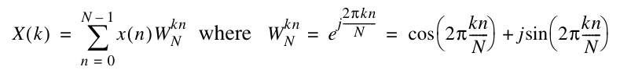

Discrete cosine transform thường thay thế phép này vì không cần operation số phức. Cả hai transform đều có lõi là tổng các tích. Để tăng tốc, DSP thường có hardware special-purpose thực hiện multiply-accumulate (MAC). Instruction “MAC A,B,C” có semantics “A = A + B * C.” Trong một số tình huống, performance của operation này quan trọng đến mức DSP được chọn cho ứng dụng chỉ dựa trên MAC operation throughput.

DSP thường dùng fixed-point arithmetic. Nếu coi integer là số có binary point bên phải least-significant bit, fixed point có binary point ngay bên phải sign bit. Vì thế, dữ liệu fixed-point là phân số giữa –1 và +1.

**Ví dụ** Sau đây là ba mẫu 16-bit đơn giản:

0100 0000 0000 0000

0000 1000 0000 0000

0100 1000 0000 1000

Chúng biểu diễn giá trị nào nếu là two’s complement integer? Nếu là số Fixed-point?

**Trả lời** Biểu diễn số cho biết chữ số thứ i bên trái binary point biểu diễn 2i–1, và chữ số thứ i bên phải biểu diễn 2–i. Trước tiên giả sử ba mẫu là integer. Khi đó binary point nằm ngoài cùng bên phải, nên chúng biểu diễn 214, 211 và (214+ 211+ 23), tức 16,384, 2048 và 18,440.

Fixed point đặt binary point ngay bên phải sign bit, nên theo fixed point, các mẫu biểu diễn 2–1, 2–4 và (2–1+ 2–4 + 2–12). Các phân số là 1/2, 1/16 và (2048 + 256 + 1)/4096 hay 2305/4096, tương ứng khoảng 0.50000, 0.06250 và 0.56274. Hoặc với số two’s complement fixed-point n-bit, có thể chia biểu diễn integer cho 2n–1 để có cùng kết quả:

16,384/32,768 = 1/2, 2048/32,768 = 1/16, and 18,440/32,768 = 2305/4096.

Có thể xem fixed point là floating point low-cost. Nó không có exponent trong mỗi word và không có hardware tự động căn chỉnh, chuẩn hóa operand. Thay vào đó, fixed point dựa vào lập trình viên DSP để giữ exponent trong biến riêng và bảo đảm mỗi kết quả được shift trái hoặc phải để đáp án căn chỉnh với biến đó. Vì biến exponent thường dùng chung cho một tập biến fixed-point, kiểu arithmetic này còn gọi là blocked floating point, vì một block biến có chung exponent.

Để hỗ trợ tính toán thủ công, DSP thường có một số register rộng hơn để ngăn round-off error, giống floating-point unit có guard bit bổ sung bên trong. Hình E.2 khảo sát bốn thế hệ DSP, liệt kê data size và độ rộng accumulating register. Lưu ý DSP architect không bị ràng buộc bởi lũy thừa 2 khi chọn word size. Hình E.3 trình bày kích thước data operand của TI TMS320C55 DSP.

Ngoài MAC operation, DSP còn thường có operation để tăng tốc các phần của thuật toán truyền thông. Một lớp quan trọng xoay quanh encoding và decoding forward error correction code — code thêm thông tin vào digital bit stream để phòng lỗi truyền. Code tỷ lệ m/n có m information bit cho (m + n) check bit. Chẳng hạn rate code 1/2 có 1 information bit trong mỗi 2 bit. Những code này thường được gọi là trellis code vì một dạng sơ đồ encoding phổ biến trông giống giàn cây. Thuật toán decoding trellis code phổ biến do Viterbi đưa ra. Thuật toán cần chuỗi compare và select để khôi phục giá trị thật của bit đã truyền. Vì vậy DSP thường có operation compare-select để hỗ trợ Viterbi decode cho FEC code.

| Thế hệ | Năm | DSP ví dụ | Data width | Accumulator width |
|---|---|---|---|---|
| 1 | 1982 | TI TMS32010 | 16 bits | 32 bits |
| 2 | 1987 | Motorola DSP56001 | 24 bits | 56 bits |
| 3 | 1995 | Motorola DSP56301 | 24 bits | 56 bits |
| 4 | 1998 | TI TMS320C6201 | 16 bits | 40 bits |

**Hình E.2 Bốn thế hệ DSP, data width và độ rộng register giúp giảm round-off error.**

| Data size | Memory operand trong operation | Memory operand khi truyền data |
|---|---|---|
| 16 bits | 89.3% | 89.0% |
| 32 bits | 10.7% | 11.0% |

**Hình E.3 Kích thước data operand của TMS320C55 DSP. Khoảng 90% operand là 16 bit. DSP này có hai accumulator 40-bit. Không có floating-point operation, như thường thấy trong nhiều DSP, nên các dữ liệu đều là integer fixed-point.**

Để giải thích DSP rõ hơn, chúng ta sẽ xem xét chi tiết hai DSP do Texas Instruments sản xuất. Dòng TMS320C55 hướng tới ứng dụng embedded battery-powered. Trái ngược rõ rệt, dòng TMS VelociTI 320C6x là processor VLIW eight-issue mạnh, hướng tới phạm vi ứng dụng rộng hơn có thể ít nhạy với power hơn.

### TI 320C55

Ở một đầu của phổ DSP là architecture TI 320C55. C55 được tối ưu cho ứng dụng embedded low-power. Hình E.4 trình bày architecture tổng thể. Cốt lõi của C55 là CPU pipelined seven-staged. Các stage được phác thảo dưới đây:

- Fetch stage đọc program data từ memory vào instruction buffer queue.

- Decode stage decode instruction và dispatch tác vụ tới các functional unit chính khác.

- Address stage tính address cho data access và branch address khi luồng chương trình bị gián đoạn.

- Access 1/Access 2 stage gửi data read address tới memory.

- Read stage truyền operand data trên B bus, C bus và D bus.

- Execute stage thực thi operation trong A unit, D unit và thực hiện ghi trên E bus, F bus.

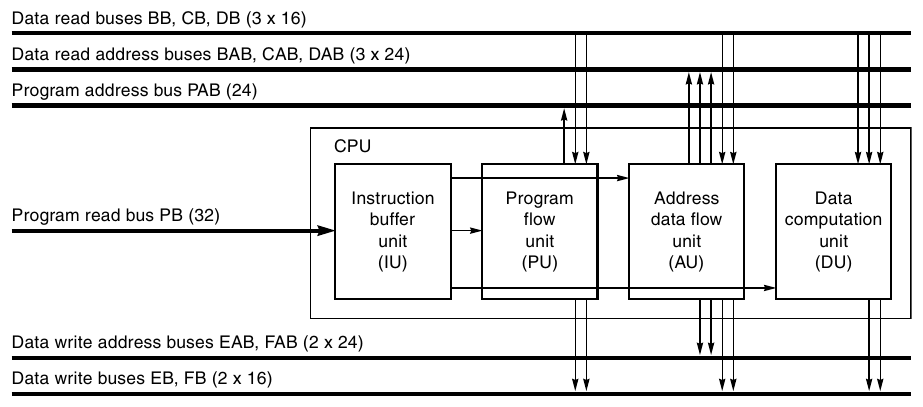

**Hình E.4 Architecture TMS320C55 DSP. C55 là pipelined processor seven-stage có một số khả năng instruction execution độc đáo. (Do Texas Instruments cung cấp.)**

Pipeline C55 thực hiện pipeline hazard detection và stall khi gặp write after read (WAR) hoặc read after write (RAW) hazard.

C55 có instruction cache 24 KB, nhưng có thể cấu hình cho nhiều workload. Có thể cấu hình nó thành two-way set associative, direct-mapped hoặc “ramset”. Mode cuối là một cách hỗ trợ ứng dụng hard real-time: trong mode này, block trong cache không thể bị thay thế.

C55 còn có power management tiên tiến, cho phép dynamic power management qua “idle domain” software-programmable. Các block mạch trên thiết bị được tổ chức thành idle domain. Mỗi domain có thể hoạt động bình thường hoặc được đặt ở idle state low-power. Idle Control Register (ICR) programmer-accessible quyết định domain nào sẽ được đưa vào idle state khi IDLE instruction tiếp theo thực thi. Sáu domain là CPU, direct memory access (DMA), peripheral, clock generator, instruction cache và external memory interface. Khi một domain ở idle state, các chức năng của riêng domain đó không còn khả dụng. Tuy nhiên trong peripheral domain, mỗi peripheral có Idle Enable bit điều khiển việc có đáp ứng thay đổi idle state hay không. Vì vậy có thể cấu hình riêng từng peripheral để idle hoặc vẫn active khi peripheral domain idle.

Vì C55 là DSP, tính năng trung tâm là MAC unit. C55 có hai MAC unit, mỗi unit gồm multiplier 17-bit nhân 17-bit nối với dedicated adder 40-bit. Mỗi MAC unit làm việc trong một cycle; vì thế C55 thực thi hai MAC mỗi cycle khi pipelined đầy đủ. Khả năng này thiết yếu để thực hiện hiệu quả ứng dụng signal processing. C55 còn có compare, select, and store unit (CSSU) cho phần add/compare của Viterbi decoder.

### TI 320C6x

Trái ngược rõ rệt với họ DSP C55 là họ processor Texas Instruments VelociTI 320C6x high-end. C6x gần processor very long instruction word (VLIW) truyền thống hơn vì tìm cách khai thác mức instruction-level parallelism (ILP) cao trong nhiều thuật toán signal processing. Texas Instruments không phải hãng duy nhất chọn VLIW để khai thác ILP trong embedded. Các nhà cung cấp VLIW DSP khác gồm Ceva, StarCore, Philips/TriMedia và STMicroelectronics. Vì sao họ chuộng VLIW hơn superscalar? Trong embedded, code compatibility ít gây vấn đề hơn, nên ứng dụng mới có thể được tinh chỉnh thủ công hoặc được recompile cho thế hệ processor mới nhất. Lý do khác khiến superscalar nổi trội trên desktop là compiler không dự đoán được memory latency tại compile time. Nhưng trong embedded, memory latency thường dễ dự đoán hơn nhiều. Thực tế, ràng buộc hard real-time buộc memory latency phải dự đoán được tĩnh. Dĩ nhiên superscalar cũng hoạt động tốt trong môi trường với các ràng buộc này, nhưng hardware bổ sung để schedule instruction động gây lãng phí cả chip area quý giá lẫn power consumption. Vì thế VLIW là lựa chọn tự nhiên cho embedded high-performance.

Họ C6x dùng độ sâu pipeline khác nhau tùy thành viên. Chẳng hạn với C64x, pipeline có 11 stage. Bốn stage đầu thực hiện instruction fetch, tiếp theo hai stage instruction decode, cuối cùng là bốn stage dành cho instruction execution. Hình E.5 dưới đây trình bày architecture tổng thể C64x.

Execution stage của C6x được chia thành hai phần: bên trái hay phía “1”, và bên phải hay phía “2”. L1 và L2 unit thực hiện logical và arithmetic operation. Ngược lại D unit thực hiện một tập con logical và arithmetic operation, đồng thời thực hiện memory access (load và store). Hai M unit thực hiện multiplication và operation liên quan (như shift). Cuối cùng S unit thực hiện comparison, branch và một số SIMD operation (xem giải thích chi tiết trong tiểu mục tới). Mỗi phía có register file 32-entry, 32-bit riêng (A file cho phía 1, B file cho phía 2). Một phía có thể truy cập register phía kia nhưng chịu penalty 1- cycle. Chẳng hạn instruction ở phía 1 có thể truy cập B5, nhưng vì vậy cần thêm 1- cycle để thực thi.

VLIW truyền thống rất kém về code size, trái với nhu cầu embedded system. Tuy nhiên cách của C6x “nén” instruction, cho phép VLIW code đạt mật độ bằng RISC (reduced instruction set computer) code tương đương. Để làm vậy, instruction fetch được thực hiện trên “instruction packet” trong Hình E.6. Mỗi instruction có p bit chỉ rõ instruction thuộc VLIW word hiện tại hay tiếp theo (xem giải thích chi tiết trong hình). Nhờ đó không còn cần NOP cho VLIW encoding.

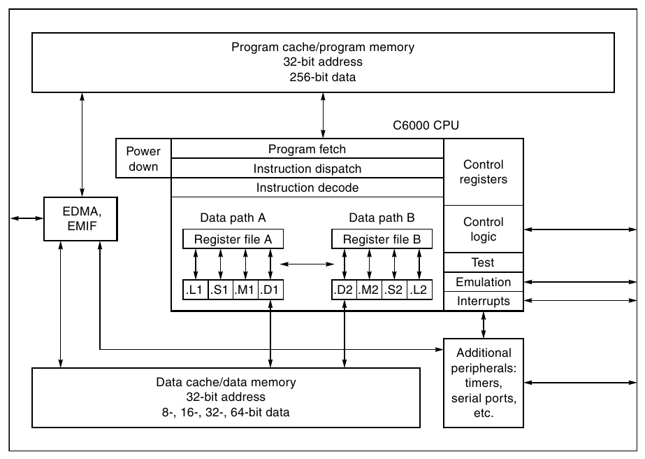

**Hình E.5 Architecture họ DSP TMS320C64x. C6x là VLIW processor eight-issue truyền thống. (Do Texas Instruments cung cấp.)**

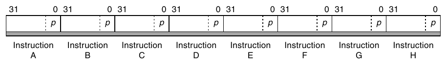

**Hình E.6 Instruction packet họ DSP TMS320C6x. p bit quyết định instruction có bắt đầu VLIW word mới không. Nếu p bit của instruction i bằng 1, instruction i + 1 thực thi song song (cùng cycle) với i. Nếu p bit bằng 0, instruction i + 1 thực thi trong cycle sau instruction i. (Do Texas Instruments cung cấp.)**

Software pipelining là kỹ thuật quan trọng để đạt performance cao trong VLIW. Nhưng nó dựa vào việc mỗi lần lặp có schedule giống mọi lần khác. Vì conditional branch instruction phá mẫu này, C6x cung cấp cách thực thi instruction có điều kiện bằng predication. Với predication, instruction làm công việc của nó; nhưng khi thực thi xong, register bổ sung, chẳng hạn A1, được kiểm tra. Nếu A1 bằng không, instruction không ghi kết quả. Nếu A1 khác không, instruction tiếp tục bình thường. Điều này cho phép gom các cấu trúc if-then và if-then-else đơn giản thành code straight-line cho software pipelining.

### Media Extension

Có một vùng trung gian giữa DSP và microcontroller: media extension. Những extension này thêm khả năng DSP-like vào microcontroller architecture với chi phí tương đối thấp. Vì chất lượng media processing được đánh giá bằng cảm nhận của con người, dữ liệu multimedia operation thường hẹp hơn nhiều data word 64-bit của processor desktop và server hiện đại. Chẳng hạn floating-point operation cho graphics thường dùng single precision thay vì double precision, thậm chí độ chính xác thấp hơn yêu cầu IEEE 754. Thay vì lãng phí arithmetic-logical unit (ALU) 64-bit khi thao tác integer 32-bit, 16-bit hoặc 8-bit, multimedia instruction có thể thao tác nhiều phần tử hẹp cùng lúc. Vì thế partitioned add trên dữ liệu 16-bit với ALU 64-bit thực hiện bốn phép cộng 16-bit trong một clock cycle. Chi phí hardware bổ sung chỉ để ngăn carry giữa bốn phần ALU 16-bit. Chẳng hạn instruction đó dùng cho graphics operation trên pixel. Những operation này thường gọi là instruction single-instruction multiple-data (SIMD) hoặc vector.

Phần lớn ứng dụng graphics multimedia dùng floating-point operation 32-bit. Một số máy tính tăng gấp đôi peak performance của floating-point operation single-precision: cho phép một instruction khởi động hai operation 32-bit trên operand nằm cạnh nhau trong double-precision register. Hai phần phải được cách ly để operation nửa này không ảnh hưởng nửa kia. Những floating-point operation đó được gọi là paired single operation. Chẳng hạn có thể dùng cho graphics transformation của vertex. Mức performance gấp đôi thường đạt được bằng cách tăng gấp đôi số floating-point unit, đắt hơn việc đơn giản chặn carry trong integer adder.

Hình E.7 tổng hợp multimedia instruction SIMD trong một số máy tính gần đây.

DSP cũng có operation trong ba hàng đầu Hình E.7, nhưng thay đổi semantics đôi chút. Thứ nhất, vì chúng thường được dùng trong ứng dụng real-time, không có lựa chọn gây exception khi arithmetic overflow (nếu không có thể bỏ lỡ sự kiện); vì thế kết quả sẽ được dùng bất kể input. Để hỗ trợ môi trường khắt khe đó, DSP architecture dùng saturating arithmetic: nếu kết quả quá lớn để biểu diễn, nó được đặt bằng số lớn nhất có thể biểu diễn, tùy dấu kết quả. Ngược lại, two’s complement arithmetic có thể cộng một số dương nhỏ vào một số dương lớn.

| Loại instruction | Alpha MAX | HP PA-RISC MAX2 | Intel Pentium MMX | PowerPC AltiVec | SPARC VIS |
|---|---|---|---|---|---|
| Cộng/trừ |  | 4H | 8B, 4H, 2W | 16B, 8H, 4W | 4H, 2W |
| Cộng/trừ saturating |  | 4H | 8B, 4H | 16B, 8H, 4W |  |
| Nhân |  |  | 4H | 16B, 8H |  |
| So sánh | 8B (>=) |  | 8B, 4H, 2W (=, >) | 16B, 8H, 4W (=, >, > =, <, <=) | 4H, 2W (=, not =, >, <=) |
| Shift phải/trái |  | 4H | 4H, 2W | 16B, 8H, 4W |  |
| Arithmetic shift phải |  | 4H |  | 16B, 8H, 4W |  |
| Nhân và cộng |  |  |  | 8H |  |
| Shift và cộng (saturating) |  | 4H |  |  |  |
| AND/OR/XOR | 8B, 4H, 2W | 8B, 4H, 2W | 8B, 4H, 2W | 16B, 8H, 4W | 8B, 4H, 2W |
| Chênh lệch tuyệt đối | 8B |  |  | 16B, 8H, 4W | 8B |
| Lớn nhất/nhỏ nhất | 8B, 4W |  |  | 16B, 8H, 4W |  |
| Pack (2n bit → n bit) | 2W → 2B, 4H → 4B | 2*4H → 8B | 4H → 4B, 2W → 2H | 4W → 4B, 8H → 8B | 2W → 2H, 2W → 2B, 4H → 4B |
| Unpack/merge | 2B → 2W, 4B → 4H |  | 2B → 2W, 4B → 4H | 4B → 4W, 8B → 8H | 4B → 4H, 2*4B → 8B |
| Permute/shuffle |  | 4H |  | 16B, 8H, 4W |  |

**Hình E.7 Tổng hợp hỗ trợ multimedia cho desktop processor. Lưu ý hỗ trợ đa dạng, có ít điểm chung giữa năm architecture. Tất cả là operation fixed-width, thực hiện nhiều operation hẹp trên ALU 64-bit hoặc 128-bit. B là byte (8 bit), H là half word (16 bit), W là word (32 bit). Vì vậy 8B nghĩa là operation trên 8 byte trong một instruction. AltiVec giả định ALU 128-bit, những loại còn lại giả định 64 bit. Pack và unpack dùng ký hiệu 2*2W để chỉ 2 operand, mỗi operand có 2 word. Bảng đơn giản hóa architecture multimedia đầy đủ, bỏ nhiều chi tiết. Chẳng hạn HP MAX2 có instruction tính trung bình, SPARC VIS có instruction đặt register bằng hằng số. Bảng cũng không gồm memory alignment operation của AltiVec, MAX và VIS.**

## E.3 Embedded Benchmark

Chỉ vài năm trước, trong thị trường embedded, nhiều nhà sản xuất còn công bố performance Dhrystone, benchmark bị desktop system chỉ trích và từ bỏ hơn 20 năm trước! Như đã nói, sự đa dạng rất lớn của ứng dụng embedded cùng khác biệt yêu cầu performance (hard real time, soft real time và cost-performance tổng thể) khiến việc dùng một bộ benchmark duy nhất trở nên không thực tế. Người thiết kế embedded system thường tự tạo benchmark phản ánh ứng dụng, dưới dạng kernel hoặc phiên bản stand-alone của toàn ứng dụng.

Với những ứng dụng embedded có thể được mô tả tốt bằng kernel performance, bộ benchmark chuẩn hóa tốt nhất có vẻ là bộ mới: EDN Embedded Microprocessor Benchmark Consortium (EEMBC, đọc “embassy”). Benchmark EEMBC chia sáu lớp (gọi là “tiểu ban” theo cách nói EEMBC): automotive/industrial, consumer, telecommunications, digital entertainment, networking (hiện ở phiên bản hai) và office automation (cũng phiên bản hai). Hình E.8 trình bày sáu lớp ứng dụng, gồm 50 benchmark.

Dù nhiều ứng dụng embedded nhạy với performance của kernel nhỏ, hãy nhớ performance tổng thể của toàn ứng dụng (có thể hàng nghìn dòng) thường cũng thiết yếu. Vì vậy với nhiều embedded system, benchmark EMBCC chỉ có thể được dùng để đánh giá một phần performance.

| Loại benchmark (“tiểu ban”) | Số kernel | Benchmark ví dụ |
|---|---|---|
| Automotive/industrial | 16 | 6 microbenchmark (arithmetic operation, pointer chasing, memory performance, matrix arithmetic, table lookup, bit manipulation), 5 benchmark điều khiển ô tô và 5 benchmark filter hoặc FFT |
| Consumer | 5 | 5 multimedia benchmark (JPEG compress/decompress, filtering và RGB conversion) |
| Telecommunications | 5 | Benchmark filtering và DSP (autocorrelation, FFT, decoder, encoder) |
| Digital entertainment | 12 | MP3 decode, MPEG-2 và MPEG-4 encode/decode (mỗi loại áp dụng cho năm dataset khác nhau), MPEG Encode Floating Point, 4 benchmark test cho chuẩn và thuật toán cryptographic phổ biến (AES, DES, RSA, Huffman decoding để giải nén data), cùng enhanced JPEG và color-space conversion test |
| Networking phiên bản 2 | 6 | IP Packet Check (mượn từ chuẩn RFC1812), IP Reassembly, IP Network Address Translator (NAT), Route Lookup, OSPF, Quality of Service (QOS) và TCP |
| Office automation phiên bản 2 | 6 | Ghostscript, text parsing, image rotation, dithering, Bézier |

**Hình E.8 Bộ benchmark EEMBC, gồm 50 kernel trong sáu lớp. Xem www.eembc.org để biết thêm benchmark và điểm số.**

### Dùng Power Consumption và Efficiency làm thước đo

Chi phí và power thường ít nhất cũng quan trọng như performance trong embedded. Ngoài chi phí processor module (gồm interface chip cần thiết), memory thường là thành phần đắt nhất tiếp theo của embedded system. Khác desktop hoặc server, phần lớn embedded system không có secondary storage; toàn ứng dụng phải nằm trong FLASH hoặc DRAM. Vì nhiều embedded system như PDA và điện thoại di động bị ràng buộc cả chi phí lẫn kích thước vật lý, lượng memory ứng dụng cần rất quan trọng. Tương tự, power thường quyết định chọn processor, đặc biệt với hệ thống battery-powered.

EEMBC EnergyBench cung cấp dữ liệu năng lượng processor tiêu thụ khi chạy performance benchmark EEMBC. Điểm Energymark EEMBC-certified là thước đo tùy chọn mà nhà sản xuất có thể cung cấp cùng điểm performance được chứng nhận để cho thấy mức sử dụng power và energy hiệu quả. EEMBC chuẩn hóa việc dùng graphical development environment LabVIEW và data acquisition hardware của National Instruments để triển khai EnergyBench.

Hình E.9 cho performance tương đối mỗi watt của typical operating power. Hãy so sánh với Hình E.10 biểu diễn raw performance để thấy các kết quả khác nhau tới mức nào. NEC VR 4122 có lợi thế rõ về performance mỗi watt nhưng lại là processor có performance second-lowest! Xét power consumption, NEC VR 4122, được thiết kế cho hệ thống battery-based, thắng lớn. IBM PowerPC thể hiện việc sử dụng power hiệu quả để đạt performance cao, dù với mức điển hình 6 W, có lẽ không phù hợp phần lớn thiết bị battery-based.

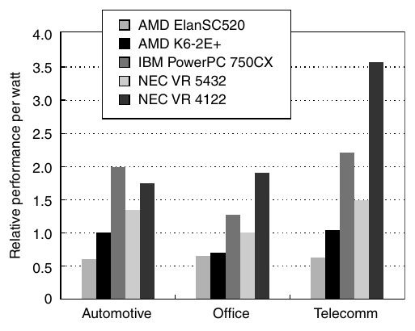

**Hình E.9 Performance tương đối mỗi watt của năm embedded processor. Power được đo là typical operating power của processor, không gồm interface chip.**

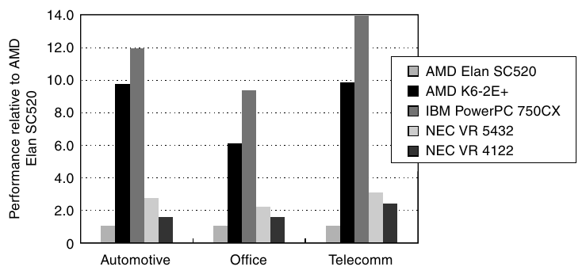

**Hình E.10 Raw performance của năm embedded processor, trình bày tương đối so với AMD ElanSC520.**

## E.4 Embedded Multiprocessor

Multiprocessor hiện phổ biến trong server, và có thể mua một số desktop multiprocessor từ nhà cung cấp như Sun, Compaq, Apple. Trong embedded, một số thiết kế special-purpose dùng multiprocessor tùy biến, gồm Sony PlayStation 2 (xem Mục E.5).

Nhiều thiết kế embedded special-purpose gồm processor general-purpose lập trình được hoặc DSP cùng finite-state machine special-purpose được dùng cho I/O stream-oriented. Trong ứng dụng từ graphics và media processing tới viễn thông, kiểu multiprocessor special-purpose này ngày càng phổ biến. Dù tương tác giữa processor được quy định chặt chẽ và tương đối đơn giản — chủ yếu là communication channel đơn giản — vì phần lớn thiết kế được cố định vào silicon, việc bảo đảm communication protocol giữa I/O processor và general-purpose processor đúng là thách thức lớn.

Gần đây hơn, trong lĩnh vực embedded đã lần đầu xuất hiện embedded multiprocessor được xây dựng từ nhiều processor general-purpose. Chúng chủ yếu hướng tới thị trường viễn thông và networking high-end, nơi scalability thiết yếu. Ví dụ là MXP processor do empowerTel Networks thiết kế cho hệ thống voice-over-IP. MXP gồm bốn thành phần chính:

- Interface tới serial voice stream, gồm hỗ trợ xử lý jitter

- Hỗ trợ packet routing và channel lookup nhanh

- Ethernet interface đầy đủ, gồm MAC layer

- Bốn processor MIPS32 R4000-class, mỗi processor có cache riêng (tổng 48 KB hoặc 12 KB mỗi processor)

MIPS processor chạy code duy trì channel voice-over-IP, gồm bảo đảm quality of service, echo cancellation, compression đơn giản và packet encoding. Vì mục tiêu là chạy nhiều voice stream độc lập nhất có thể, multiprocessor là giải pháp lý tưởng.

Vì MIPS core nhỏ, toàn chip chỉ cần 13.5M transistor. Những thế hệ chip tương lai được kỳ vọng xử lý nhiều hơn các voice channel, cũng như echo cancellation, voice activity detection và compression tinh vi hơn.

Multiprocessing phổ biến trong embedded computing vì hai lý do chính. Thứ nhất, vấn đề binary software compatibility gây khó cho desktop và server ít liên quan hơn trong embedded. Software của ứng dụng embedded thường được viết từ đầu cho ứng dụng đó hoặc chỉnh sửa đáng kể (đây cũng là lý do VLIW được chuộng hơn superscalar trong instruction-level parallelism embedded). Thứ hai, ứng dụng thường có tính song song tự nhiên, đặc biệt ở phân khúc embedded cao. Ví dụ rất nhiều: set-top box, network switch, điện thoại di động (Mục E.7), game system (Mục E.5). Rào cản dùng thread-level parallelism thấp hơn cùng mức nhạy cảm cao hơn với die cost (và dùng silicon hiệu quả) dẫn tới áp dụng multiprocessing rộng rãi khi nhu cầu ứng dụng đòi performance cao hơn.

## E.5 Nghiên cứu trường hợp: Emotion Engine của Sony PlayStation 2

Desktop và server dựa vào memory hierarchy để giảm access time trung bình tới dữ liệu tương đối tĩnh, nhưng có những ứng dụng embedded mà dữ liệu thường là stream liên tục. Trong những ứng dụng đó vẫn có spatial locality, còn temporal locality hạn chế hơn nhiều.

Để có góc nhìn khác về memory performance ngoài desktop, mục này khảo sát microprocessor ở trung tâm Sony PlayStation 2. Như sẽ thấy, stream graphics và audio liên tục mà game điện tử cần dẫn tới cách thiết kế memory khác: bandwidth cao nhờ nhiều memory độc lập chuyên dụng.

Hình E.11 là block diagram Sony PlayStation 2 (PS2). Đúng như kỳ vọng ở máy game, có interface cho video, sound và DVD player. Điều bất ngờ là có hai computer I/O bus tiêu chuẩn USB, IEEE 1394, PCMCIA slot như portable PC và modem. Chúng cho thấy Sony có kế hoạch lớn hơn cho PS2 ngoài game truyền thống. Dù I/O processor (IOP) dường như chỉ xử lý I/O device và game console, nó bao gồm một MIPS processor 34 MHz còn đóng vai máy emulation chạy game Sony PlayStation đời trước. Nó cũng kết nối với PC audio card tiêu chuẩn để cung cấp sound cho game.

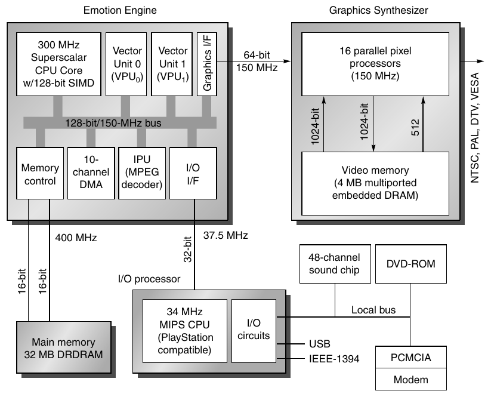

**Hình E.11 Block diagram Sony PlayStation 2. 10 DMA channel điều phối truyền giữa các memory nhỏ trên chip; khi xong, tất cả hướng tới Graphics Interface để Graphics Synthesizer render. Graphics Synthesizer dùng DRAM trên chip cung cấp toàn bộ frame buffer cùng graphics processor thực hiện rendering theo display command từ Emotion Engine. Embedded DRAM cho phép truyền 1024-bit giữa pixel processor và display buffer. Superscalar CPU là MIPS III 64-bit có issue two-instruction, instruction cache 16 KB set associative two-way, data cache 8 KB set associative two-way và scratchpad memory 16 KB. Nó được mở rộng với SIMD instruction 128-bit cho multimedia (Mục E.2). Vector Unit 0 chủ yếu là coprocessor DSP-like cho CPU (Mục E.2), có thể thao tác register 128-bit theo SIMD với mỗi word từ 8 tới 32 bit. Nó có instruction memory 4 KB và data memory 4 KB. Vector Unit 1 có chức năng tương tự VPU0 nhưng thường hoạt động độc lập với CPU, có instruction memory 16 KB và data memory 16 KB. Cả ba liên lạc qua system bus 128-bit, ngoài ra có path chuyên dụng 128-bit giữa CPU và VPU0, và path 128-bit giữa VPU1 và Graphics Interface. Dù VPU0 và VPU1 có microarchitecture giống nhau, khác biệt memory size và unit nối trực tiếp ảnh hưởng tới vai trò trong game. Với line width 0.25-micron, Emotion Engine dùng 13.5M transistor, diện tích 225 mm2, còn Graphics Synthesizer là 279 mm2. Để so sánh, Alpha 21264 trong công nghệ 0.25-micron khoảng 160 mm2, dùng 15M transistor. (Hình dựa trên Hình 1 trong “Sony’s Emotionally Charged Chip,” Microprocessor Report 13:5.)**

Vì vậy, một thách thức cho memory system của ứng dụng embedded này là làm nguồn hoặc đích cho số lượng I/O device rất lớn. Người thiết kế PS2 đáp ứng thách thức bằng hai DRDRAM chip PC800 (400 MHz) dùng hai channel, cung cấp storage 32 MB và peak memory bandwidth 3.2 GB/sec.

Phần còn lại trong hình về cơ bản là hai chip lớn: Graphics Synthesizer và Emotion Engine.

Graphics Synthesizer nhận rendering command từ Emotion Engine trong thứ thường gọi là display list. Đây là danh sách command 32-bit cho renderer biết dùng hình dạng gì, đặt ở đâu và tô chúng bằng màu và texture nào.

Chip này còn có phần bandwidth cao nhất của memory system. Dùng embedded DRAM trên Graphics Synthesizer, chip chứa toàn video buffer và có interface 2048-bit-wide để pixel filling không trở thành bottleneck. Embedded DRAM giảm mạnh nhu cầu bandwidth lên DRDRAM. Đây là kỹ thuật phổ biến trong embedded: memory riêng cho từng chức năng giúp toàn hệ thống đạt bandwidth cao hơn với chi phí thấp.

Chip lớn còn lại là Emotion Engine, nhận input từ IOP và tạo display list của game để hỗ trợ video transformation 3D trong real time. Một nhận định quan trọng định hình thiết kế: trong game đua xe, foreground object thường thay đổi liên tục, còn background object thay đổi ít hơn theo sự kiện, dù background có thể chiếm phần lớn màn hình. Quan sát này dẫn tới việc phân chia trách nhiệm.

CPU làm việc với VPU0 như coprocessor ghép chặt, vì mỗi VPU0 instruction là MIPS coprocessor instruction tiêu chuẩn và address được MIPS CPU tạo ra. VPU0 được gọi là vector processor nhưng giống SIMD extension 128-bit cho multimedia trên một số desktop processor hơn (Mục E.2).

Ngược lại, VPU1 tự fetch instruction và data, hoạt động song song với CPU/VPU0, giống vector unit truyền thống hơn. Với cách chia này, CPU/VPU0 linh hoạt hơn xử lý foreground, VPU1 xử lý background. Cả hai gửi display list kết quả vào Graphics Interface để chuyển tới Graphics Synthesizer.

Vì vậy, lập trình viên Emotion Engine có ba tập processor để lựa chọn khi triển khai chương trình: architecture MIPS 64-bit truyền thống gồm floating-point unit, MIPS architecture mở rộng multimedia instruction (VPU0) và vector processor độc lập (VPU1). Để tăng tốc MPEG decoding, có coprocessor khác (Image Processing Unit) có thể hoạt động độc lập với hai nhóm kia.

Với sự phân chia chức năng, câu hỏi là nối các unit ra sao, cho data chảy giữa chúng thế nào, và cung cấp memory bandwidth cần thiết bằng cách nào. Như đã nói, người thiết kế Emotion Engine chọn nhiều memory chuyên dụng. CPU có scratch pad memory (SPRAM) 16 KB ngoài instruction cache 16 KB và data cache 8 KB. VPU0 có instruction memory 4 KB, data memory 4 KB; VPU1 có instruction memory 16 KB, data memory 16 KB. Lưu ý đây là bốn memory, không phải cache của memory lớn hơn ở nơi khác. Mỗi memory có latency chỉ 1 clock cycle. VPU1 có nhiều memory hơn VPU0 vì tạo phần lớn display list và chủ yếu hoạt động độc lập.

Lập trình viên tổ chức mọi memory thành hai double buffer, một cặp cho DMA data vào và một cặp cho DMA data ra. Sau đó lập trình viên dùng các processor biến đổi data từ input buffer tới output buffer. Để giữ data chảy giữa các unit, lập trình viên thiết lập 10 DMA channel, chú ý đáp ứng real-time deadline để animation thực tế ở 15 frame mỗi giây.

Hình E.12 cho thấy cách tổ chức này hỗ trợ hai operating mode chính: serial, CPU/VPU0 tiền xử lý dữ liệu đưa cho VPU1 tạo nội dung cho Graphics Interface, dùng scratchpad memory làm buffer; và parallel, cả CPU/VPU0 lẫn VPU1 tạo display list. Display list và Graphics Synthesizer có nhiều context identifier để phân biệt display list song song nhằm tạo final image nhất quán.

Mọi unit trong Emotion Engine được kết nối bằng bus chung 150 MHz, 128-bit-wide. Để có bandwidth lớn hơn, còn có hai bus chuyên dụng: path 128-bit giữa CPU và VPU0, path 128-bit giữa VPU1 và Graphics Interface. Lập trình viên cũng chọn bus khi thiết lập DMA channel.

Nhìn tổng thể, nếu người thiết kế server-oriented nhận bài toán, có lẽ họ dùng một bus chung với nhiều local cache và cơ chế cache-coherent để giữ data nhất quán. Ngược lại, PlayStation 2 theo truyền thống thiết kế embedded, có ít nhất chín memory module riêng. Để data chảy real time từ memory tới display, PS2 dùng memory chuyên dụng, bus chuyên dụng và DMA channel. Coherency là trách nhiệm của lập trình viên; với dòng liên tục từ main memory tới graphics interface và yêu cầu real-time, coherency programmer-controlled hoạt động tốt cho ứng dụng này.

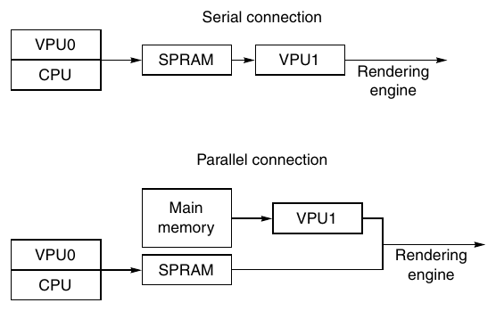

**Hình E.12 Hai mode sử dụng tổ chức Emotion Engine. Mode đầu chia công việc giữa hai unit, rồi Graphics Interface hợp nhất display list đúng cách. Mode thứ hai dùng CPU/VPU0 làm bộ lọc nội dung gửi VPU1, sau đó VPU1 tạo toàn bộ display list. Lập trình viên chọn data flow serial hay parallel. SPRAM là scratchpad memory.**

## E.6 Nghiên cứu trường hợp: Máy ảnh số Sanyo VPC-SX500

Một embedded system rất quen thuộc khác là máy ảnh số. Ở đây chúng ta xét Sanyo VPC-SX500. Khi được bật, microprocessor của máy ảnh trước tiên chạy diagnostic trên mọi thành phần và ghi mọi error message vào liquid crystal display (LCD) ở mặt sau máy. Máy ảnh này dùng LCD màu TFT (thin-film transistor) polysilicon low-temperature 1.8-inch. Khi chụp ảnh, người chụp trước tiên giữ nút chụp ở nửa hành trình để microprocessor đo ánh sáng. Sau đó microprocessor giữ màn trập mở để thu lượng ánh sáng cần thiết, được charge-coupled device (CCD) ghi nhận thành pixel đỏ, xanh lá và xanh dương. CCD là chip progressive-scan 1/2-inch, 1360 × 1024-pixel. Các pixel được quét ra từng hàng, đi qua routine hiệu chỉnh white balance, color và aliasing, rồi lưu vào frame buffer 4 MB. Bước tiếp theo là nén ảnh thành format tiêu chuẩn như JPEG và lưu vào Flash memory tháo rời. Người chụp chọn mức nén, ở máy này gọi là fine hoặc normal, với compression ratio từ 10 tới 20 lần. Flash memory 512 MB lưu được ít nhất 1200 ảnh nén fine-quality hoặc khoảng 2000 ảnh nén normal-quality. Microprocessor sau đó cập nhật LCD để cho thấy chỗ trống đã giảm một ảnh.

Dù đoạn trước bao quát những nguyên lý cơ bản của máy ảnh số, còn nhiều tính năng: hiển thị ảnh đã chụp trên LCD màu, sleep mode tiết kiệm pin, theo dõi năng lượng pin, buffering để chụp nhanh chuỗi ảnh chưa nén, và ở máy này là quay video MPEG, ghi audio WAV.

Bộ não điện tử của máy là embedded computer có nhiều chức năng đặc biệt tích hợp trên chip [Okada và cộng sự 1999]. Hình E.13 trình bày block diagram chip tương tự. Như đã nhắc trong Mục E.1, chip này được gọi là system on a chip (SOC) vì về cơ bản tích hợp trên một chip mọi phần từng nằm trên printed circuit board nhỏ. SOC thường giảm kích thước và power so với giải pháp ít tích hợp. Sanyo nói SOC giúp máy dùng số pin bằng một nửa và form factor nhỏ hơn máy đối thủ. Để đạt performance cao hơn, chip có hai bus. Bus 16-bit dành cho nhiều I/O device chậm hơn: SmartMedia interface, program/data memory và DMA. Bus 32-bit dành cho SDRAM, signal processor (nối CCD), Motion JPEG encoder và NTSC/PAL encoder (nối LCD). Khác desktop microprocessor, lưu ý chip phải tích hợp nhiều loại I/O bus. RISC MPU 32-bit là thiết kế độc quyền chạy 28.8 MHz, cùng clock rate với bus. Chip 700 mW có 1.8M transistor trong die 10.5 × 10.5 mm, công nghệ 0.35-micron.

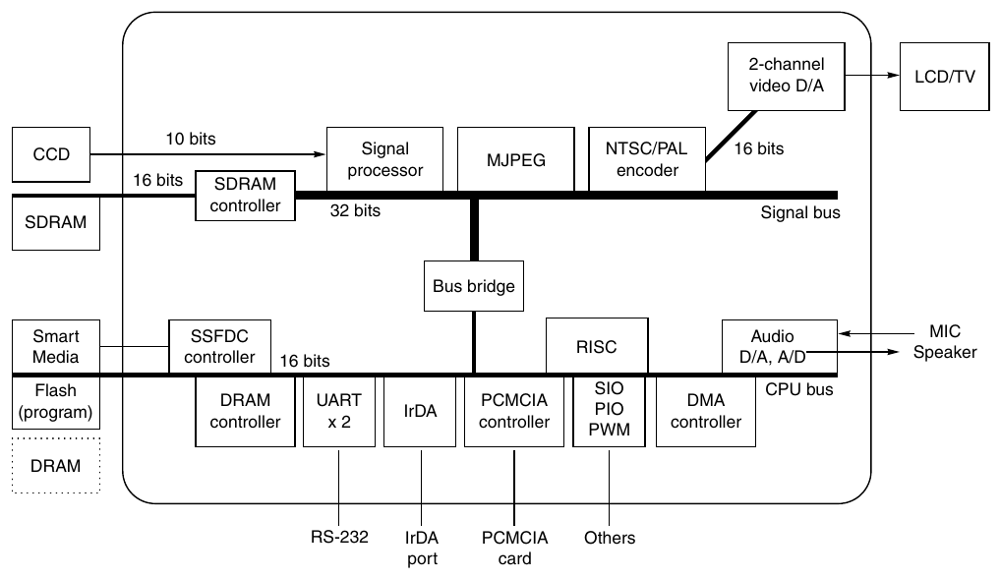

**Hình E.13 System on a chip (SOC) trong máy ảnh Sanyo. Block diagram trong Okada và cộng sự [1999] là SOC tiền nhiệm của chip được mô tả trong nội dung. SOC kế tiếp, Super Advanced IC, dùng ba bus thay hai, chạy 60 MHz, tiêu thụ 800 mW, có 3.1M transistor trong die 10.2 x 10.2 mm, công nghệ 0.35-micron. Lưu ý embedded system này có số transistor gấp đôi microprocessor state-of-the-art high-performance năm 1990! SOC trong hình giới hạn xử lý 1024 x 768 pixel, SOC kế tiếp hỗ trợ 1360 x 1024 pixel.**

## E.7 Nghiên cứu trường hợp: Bên trong điện thoại di động

Dù game console và máy ảnh số quen thuộc, embedded system quen thuộc nhất ngày nay là điện thoại di động. Năm 1999, Hoa Kỳ có 76 triệu thuê bao, tăng 25% so với năm trước. Toàn cầu tăng gần 35% mỗi năm, vì các nước đang phát triển thấy lắp cellular tower rẻ hơn nhiều infrastructure copper-wire-based. Vì thế ở nhiều nước số điện thoại di động đang dùng vượt số điện thoại có dây đang dùng.

Không ngạc nhiên, thị trường cellular handset tăng 35% mỗi năm, khoảng 280 triệu máy bán toàn cầu năm 1999. Để so sánh, trong cùng năm có 120 triệu PC được bán. Những con số này có nghĩa là có resource kỹ thuật rất lớn để cải thiện điện thoại; có lẽ chúng dẫn đầu đổi mới kỹ thuật trên mỗi inch khối [Grice và Kanellos 2000].

Trước khi khám phá cấu tạo điện thoại, hãy bắt đầu bằng phần giới thiệu ngắn về công nghệ wireless.

### Kiến thức nền về Wireless Network

Network có thể được tạo từ không khí cũng như đồng và kính, tạo wireless network. Phần lớn nội dung mục này dựa trên báo cáo National Research Council [1997].

Radio wave là sóng điện từ được antenna phát đi. Radio wave được modulate, nghĩa là sound signal được đặt lên sóng vô tuyến mạnh hơn mang nó, gọi là carrier signal. Radio wave có wavelength hoặc frequency cụ thể: đo bằng độ dài một chu kỳ sóng hoặc số sóng mỗi giây. Sóng dài có frequency thấp, sóng ngắn có frequency cao. Đài FM truyền trên băng 88 MHz tới 108 MHz, dùng frequency modulation (FM) để ghi sound signal.

Bằng cách chỉnh frequency khác nhau, radio receiver thu được signal cụ thể. Ngoài AM/FM radio, frequency khác dành cho citizens band radio, television, pager, air traffic control radar, Global Positioning System, v.v. Ở Hoa Kỳ, Federal Communications Commission quyết định ai được dùng frequency nào và cho mục đích gì.

Bit error rate (BER) của wireless link do received signal power, noise do interference từ receiver hardware, interference từ các nguồn khác và đặc tính channel quyết định. Noise thường tỷ lệ với radio frequency bandwidth; thước đo then chốt là signal-to-noise ratio (SNR) cần để đạt BER nhất định. Hình E.14 liệt kê thêm thách thức wireless communication.

Wireless communication thường được chọn vì các thiết bị liên lạc di động hoặc việc đi dây bất tiện, nghĩa là wireless network phải tự sắp xếp động. Điều đó làm routing khó hơn. Thách thức thứ hai là wireless signal không được bảo vệ nên chịu interference lẫn nhau, đặc biệt khi di chuyển. Power cũng là thách thức, vì thiết bị thường dùng pin và antenna phát power để liên lạc nhưng chỉ một phần nhỏ tới được receiver. Vì vậy raw bit error rate thường cao hơn dây đồng từ nghìn tới triệu lần.

| Thách thức | Mô tả | Tác động |
|---|---|---|
| Path loss | Received power chia transmitted power; radio phải vượt signal-to-noise ratio (SNR) của noise do can thiệp. Path loss tăng theo hàm mũ khoảng cách và phụ thuộc can thiệp nếu quá 100 mét. | Transmit power 1 W, transmit frequency 1 GHz, data rate 1 Mbit/sec tại BER 10–7, khoảng cách giữa radio là 728 mét trong không gian tự do so với 4 mét trong rừng rậm. |
| Shadow fading | Received signal bị vật thể, nhà ngoài trời hoặc tường trong nhà chặn; tăng power để cải thiện received SNR. Phụ thuộc số vật và đặc tính điện môi. | Nếu transmitter di chuyển, cần đổi transmit power để bảo đảm received SNR trong vùng. |
| Multipath fading | Can thiệp giữa các phiên bản signal đến lúc khác nhau, do thời gian giữa signal nhanh nhất và chậm nhất tương đối với signal bandwidth quyết định. | Signal power ở transmit frequency 900 MHz thay đổi mỗi 30 cm. |
| Interference | Frequency reuse, adjacent channel, narrow band interference. | Cần filter, spread spectrum. |

**Hình E.14 Thách thức wireless communication.**

Có hai architecture wireless network chính: base station và peer-to-peer. Base station nối bằng landline để liên lạc longer-distance, mobile unit chỉ liên lạc với một local base station. Architecture Peer-to-peer cho mobile unit liên lạc với nhau, message nhảy từ unit này sang unit khác tới đích. Dù peer-to-peer dễ tái cấu hình hơn, base station thường tin cậy hơn vì chỉ có một hop giữa thiết bị và trạm. Cellular telephony, ví dụ wireless network phổ biến nhất, dựa vào radio với base station.

Cellular system khai thác path loss theo hàm mũ để tái dùng frequency tại vị trí cách nhau, làm tăng mạnh số khách hàng có thể phục vụ. Hệ thống chia thành phố thành cell lục giác không chồng lấn, dùng frequency khác nếu gần nhau, chỉ tái dùng khi cell đủ xa để interference tương hỗ ở mức chấp nhận được.

Tại giao điểm ba cell lục giác là base station có transmitter và antenna, được nối tới switching office điều phối handoff khi mobile device rời cell sang cell khác, đồng thời nhận và thực hiện cuộc gọi qua landline. Tùy địa hình, dân số, v.v., bán kính cell điển hình là 2 tới 10 dặm.

### Điện thoại di động

Hình E.15 trình bày các thành phần radio, trái tim điện thoại. Radio signal được antenna thu, khuếch đại, đi qua mixer, lọc, demodulate rồi decode. Antenna là interface giữa môi trường truyền radio wave và mạch transmitter/receiver. Có thể thiết kế antenna để hoạt động tốt nhất theo các hướng cụ thể, tạo tính định hướng cả phát và thu. Modulation mã hóa thông tin trong amplitude, phase hoặc frequency của signal để tăng khả năng chịu đựng khi điều kiện bị suy giảm. Radio transmitter thực hiện cùng những bước nhưng ngược thứ tự.

Ban đầu mọi thành phần là analog, nhưng theo thời gian phần lớn được thay bằng digital component, đòi hỏi chuyển radio signal từ analog sang digital. Mong muốn linh hoạt số radio band dẫn tới software routine thay một số chức năng trong chip lập trình được như digital signal processor. Vì những processor đó thường được dùng trong mobile device, trọng tâm là performance mỗi joule để kéo dài pin, performance mỗi milimét vuông silicon để giảm kích thước và chi phí, cùng byte mỗi tác vụ để giảm memory size.

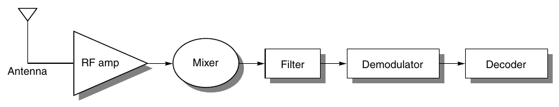

**Hình E.15 Radio receiver gồm antenna, radio frequency amplifier, mixer, filter, demodulator và decoder. Mixer nhận hai signal input, tạo output ở frequency tổng và hiệu. Filter chọn dải frequency hẹp hơn để chuyển tới stage tiếp theo. Modulation mã hóa thông tin để bền vững hơn. Decoding chuyển signal thành thông tin. Tùy ứng dụng, mọi thành phần điện có thể analog hoặc digital. Chẳng hạn radio ô tô toàn analog, còn PC modem toàn digital ngoại trừ amplifier. Hiện analog silicon chip được dùng cho RF amplifier và mixer đầu trong điện thoại di động.**

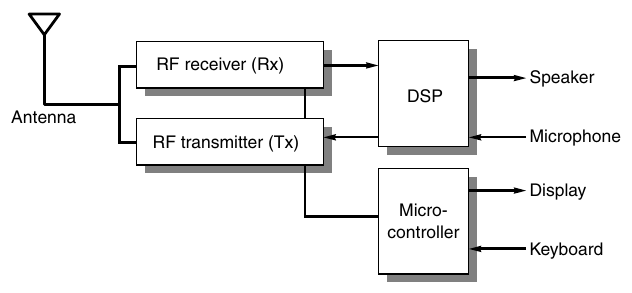

**Hình E.16 Block diagram điện thoại di động. DSP thực hiện các bước signal processing trong Hình E.15; microcontroller điều khiển user interface, battery management và call setup. (Dựa trên Hình 1.3 của Groe và Larson [2000].)**

Hình E.16 là block diagram tổng quát của phần điện tử trong handset, DSP thực hiện signal processing, microcontroller xử lý phần còn lại. Handset về cơ bản là mobile computer hoạt động như radio. Chúng gồm I/O device chuẩn — keyboard, LCD display — cùng microphone, speaker và antenna cho wireless networking. Hiệu quả pin ảnh hưởng doanh số, cả standby power khi chờ cuộc gọi lẫn số phút đàm thoại.

Khi điện thoại được bật, tác vụ đầu tiên là tìm một cell. Máy quét toàn bandwidth để tìm signal mạnh nhất, tiếp tục làm việc đó mỗi bảy giây hoặc khi cường độ signal giảm vì được thiết kế hoạt động từ xe đang chạy. Sau đó điện thoại chọn radio channel chưa dùng. Local switching office đăng ký máy, ghi phone number và electronic serial number, gán voice channel cho cuộc gọi. Để bảo đảm đúng channel, base station gửi tone đặc biệt, điện thoại gửi lại để xác nhận. Máy timeout sau 5 giây nếu không nghe supervisory tone, rồi bắt đầu lại. Base station ban đầu yêu cầu handoff tới trạm tiếp nhận khi signal strength giảm.

Để đàm thoại two-way qua radio, frequency band được dành riêng cho mỗi hướng, tạo frequency pair hay channel. Base station ban đầu phát 869.04 tới 893.97 MHz (forward path), điện thoại phát 824.04 tới 848.97 MHz (reverse path), khoảng cách frequency để chúng không gây interference cho nhau. Cell có thể có 4 tới 80 channel. Channel được chia thành setup channel cho thiết lập và voice channel cho data/voice traffic.

Liên lạc diễn ra digital như modem ở 9600 bit/sec. Vì wireless là môi trường mất mát, đặc biệt trên xe di chuyển, handset gửi mỗi message năm lần. Để tiết kiệm pin, điện thoại đời đầu thường phát hai mức signal strength — 0.6 W và 3.0 W — tùy khoảng cách tới cell. Power tương đối thấp không chỉ cho phép pin nhỏ hơn và do đó điện thoại nhỏ hơn, mà còn hỗ trợ frequency reuse, chìa khóa cellular telephony.

Hình E.17 là circuit board điện thoại Nokia với các thành phần được nhận diện. Lưu ý board có hai processor. Microcontroller Z-80 điều khiển chức năng board, I/O với keyboard/display và phối hợp với base station. DSP xử lý toàn bộ signal compression và decompression. Ngoài ra có chip chuyên dụng cho analog-to-digital và digital-to-analog conversion, amplifier, power management và RF interface.

Năm 2001, điện thoại có khoảng 10 integrated circuit, gồm phần làm bằng công nghệ đặc biệt như gallium arsinide *(ghi chú: sách in "arsinide"; đúng là "arsenide")* và silicon germanium cùng CMOS chuẩn. Yếu tố kinh tế và mong muốn có tính linh hoạt đã giảm số lượng này xuống chỉ còn vài chip. Tuy nhiên SOC vẫn có microcontroller và DSP riêng, với code triển khai nhiều chức năng vừa mô tả.

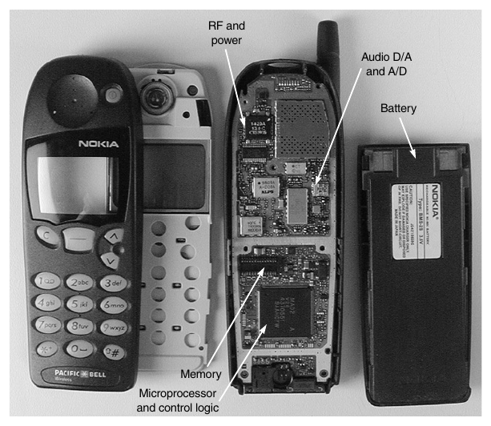

**Hình E.17 Circuit board điện thoại Nokia. (Do HowStuffWorks, Inc. cung cấp.)**

### Chuẩn và sự phát triển điện thoại di động

Tốc độ liên lạc điện thoại được cải thiện qua nhiều chuẩn. Code division multiple access (CDMA), ví dụ phổ biến, dùng radio frequency band rộng hơn cho path so với điện thoại ban đầu gọi là advanced mobile phone service (AMPS), chủ yếu analog. Frequency rộng hơn khiến nó khó bị chặn hơn và gọi là spread spectrum. Chuẩn khác là time division multiple access (TDMA), global system for mobile communication (GSM). Các chuẩn second-generation này — CDMA, GSM, TDMA — chủ yếu digital.

Khác biệt lớn của CDMA là mọi người gọi đều dùng chung một channel có tốc độ cao hơn nhiều, rồi phân biệt cuộc gọi bằng encoding riêng. Mỗi cuộc CDMA bắt đầu 9600 bit/sec, sau đó encode và truyền thành message equal-sized ở 1.25 Mbit/sec. Thay vì gửi mỗi signal năm lần như AMPS, mỗi bit được kéo dài để chiếm 11 lần frequency tối thiểu, cho phép chịu interference mà vẫn truyền thành công. Base station nhận message, tách thành stream 9600 bit/sec riêng cho từng cuộc gọi.

Để tăng privacy, CDMA dùng pseudorandom sequence từ tập 64 code định sẵn. Để đồng bộ handset và base station chọn cùng pseudorandom seed, CDMA dựa vào clock Global Positioning System liên tục phát time signal chính xác. Chọn code cẩn thận khiến shared traffic nghe như noise ngẫu nhiên. Vì vậy càng có nhiều người dùng chung một channel, noise càng lớn, signal-to-noise ratio giảm dần. Do đó capacity CDMA là vấn đề cảm nhận, tùy độ nhạy người nghe với background noise.

Ngoài ra CDMA dùng speech compression và thay đổi data rate theo mức hoạt động diễn ra trong cuộc gọi. Cả hai bảo toàn bandwidth, cho phép mỗi cell phục vụ nhiều cuộc gọi hơn. CDMA phải điều chỉnh power cẩn thận để signal gần tower không lấn át signal xa, nhằm để mọi signal tới tower ở mức gần như nhau. Lợi ích phụ là handset CDMA phát ít power hơn, vừa kéo dài pin vừa tăng capacity khi người dùng gần tower.

Vì vậy so với AMPS, CDMA tăng capacity hệ thống tới một bậc độ lớn, có call quality tốt hơn, pin lâu hơn và tăng privacy. Sau nhiều xáo trộn thương mại, chuẩn third-generation mới tên International Mobile Telephony 2000 (IMT-2000), chủ yếu dựa trên hai phiên bản CDMA cạnh tranh và một TDMA, đã xuất hiện. Chuẩn có thể dẫn tới điện thoại hoạt động mọi nơi trên thế giới.

## E.8 Kết luận

Embedded system là nhóm thiết bị tính toán rất rộng. Phụ lục này chỉ trình bày một số khía cạnh của nhóm đó. Chẳng hạn TI 320C55 DSP là processor tương đối “RISC-like” cho embedded, có các khả năng được tinh chỉnh rất fine-tuned. Ở đầu kia, TI 320C64x là VLIW processor eight-issue rất high-performance cho tác vụ đòi hỏi cao. Một số processor chỉ dùng pin; số khác có thể cắm điện lưới. Điểm chung là nhu cầu thực hiện signal processing ở mức nào đó cho embedded. Media extension cố hợp nhất DSP với khả năng general-purpose để dùng cho signal processing. Chúng ta đã khảo sát nhiều nghiên cứu trường hợp, gồm Sony PlayStation 2, máy ảnh số, điện thoại. PS2 thực hiện graphics three-dimensional chi tiết, còn điện thoại encode/decode signal theo chuẩn truyền thông phức tạp. Nhưng cả hai có system architecture rất khác nền tảng desktop/server general-purpose. Nhìn chung, quyết định architecture có vẻ thực tế cho general-purpose, như cache nhiều mức hoặc out-of-order superscalar execution, ít đáng mong muốn hơn trong embedded do chip area, chi phí, power và ràng buộc real-time. Programming model của những hệ thống này đòi hỏi nhiều hơn ở cả lập trình viên lẫn compiler trong việc trích xuất tính song song.
