# F Interconnection Network

Được hiệu đính bởi Timothy M. Pinkston, University of Southern California; cùng José Duato, Universitat Politècnica de València, và Simula

> “Phương tiện chính là thông điệp” vì chính phương tiện định hình và chi phối quá trình tìm kiếm cũng như hình thức liên kết và hành động của con người.

> Marshall McLuhan

> Understanding Media (1964)

> Những điều kỳ diệu—của điện ảnh, radio và truyền hình—là những điều kỳ diệu của giao tiếp one-way, vốn hoàn toàn không phải là giao tiếp.

> Milton Mayer

> On the Remote Possibility of Communication (1967)

> Interconnection network là trái tim của parallel architecture.

> Chuan-Lin Wu and Tse-Yun Feng

> Interconnection Networks for Parallel and Distributed Processing (1984)

> Quả thực, khi độ phức tạp và mức độ tích hợp của hệ thống tiếp tục tăng lên, nhiều nhà thiết kế nhận thấy việc định tuyến packet hiệu quả hơn việc định tuyến dây dẫn.

> Bill Dally

> Principles and Practices of Interconnection Networks (2004)

## F.1 Giới thiệu

Các chương và phụ lục trước trình bày các thành phần của một máy tính riêng lẻ nhưng ít xem xét cách kết nối các thành phần đó và cách nhiều hệ thống máy tính được kết nối với nhau. Những khía cạnh này của computer architecture đã trở nên quan trọng hơn đáng kể trong những năm gần đây. Trong phụ lục này, chúng ta xem xét cách kết nối các thiết bị riêng lẻ thành một cộng đồng các thiết bị giao tiếp với nhau, trong đó thuật ngữ thiết bị được dùng theo nghĩa tổng quát để chỉ bất cứ thứ gì, từ một thành phần hoặc một tập hợp thành phần trong máy tính, đến một máy tính riêng lẻ, hay cả một hệ thống máy tính. Hình F.1 cho thấy những yếu tố khác nhau tạo nên cộng đồng này: các end node gồm thiết bị và hardware interface cùng software interface liên quan, các link từ end node tới interconnection network, và chính interconnection network. Interconnection network còn được gọi là network, communication subnet hoặc communication subsystem. Việc kết nối nhiều network với nhau được gọi là internetworking. Việc này dựa vào các chuẩn giao tiếp để chuyển đổi thông tin từ loại network này sang loại khác, chẳng hạn như với Internet.

Có một số lý do khiến các nhà thiết kế computer architecture nên chú ý đến interconnection network. Ngoài việc cung cấp kết nối bên ngoài, network thường được dùng để kết nối các thành phần bên trong một máy tính ở nhiều cấp độ, kể cả processor microarchitecture. Network đã được dùng trong mainframe từ lâu, nhưng ngày nay cũng có thể tìm thấy những thiết kế như vậy trong máy tính cá nhân, do nhu cầu cao về communication bandwidth để tăng năng lực tính toán và dung lượng lưu trữ. Switched network đang thay thế bus để trở thành phương tiện giao tiếp thông thường giữa các máy tính, giữa các thiết bị I/O, giữa các board, giữa các chip và thậm chí giữa các module bên trong chip. Các nhà thiết kế computer architecture phải hiểu những vấn đề và giải pháp về interconnect để thiết kế và đánh giá hệ thống máy tính hiệu quả hơn.

Interconnection network bao quát nhiều lĩnh vực ứng dụng, rất giống với việc memory hierarchy bao quát nhiều mức tốc độ và dung lượng. Network được triển khai bên trong processor chip và hệ thống thường có nhiều đặc điểm chung với processor và memory, dựa nhiều hơn vào các giải pháp hardware high-speed và ít hơn vào một software stack linh hoạt. Network được triển khai giữa các hệ thống thường có nhiều điểm chung với storage và I/O, dựa nhiều hơn vào operating system và software protocol so với hardware high-speed—mặc dù hiện nay chúng ta đang chứng kiến sự hội tụ. Trong mọi lĩnh vực, performance bao gồm latency và effective bandwidth, và queuing theory là một công cụ phân tích có giá trị để đánh giá performance, bên cạnh các kỹ thuật mô phỏng.

Chủ đề này rất rộng lớn—những phần trong Hình F.1 là chủ đề của cả sách và khóa học đại học. Mục tiêu của phụ lục này là cung cấp cho nhà thiết kế computer architecture một cái nhìn tổng quan về các vấn đề và giải pháp network. Phụ lục đưa ra những giải thích nhập môn về các khái niệm và ý tưởng chủ chốt, trình bày tác động của công nghệ và kỹ thuật interconnection network đối với architecture, đồng thời cung cấp các tài liệu tham khảo hữu ích có mô tả chi tiết hơn. Phụ lục cũng đưa ra một framework chung để đánh giá mọi loại interconnection network, dùng cùng một tập thuật ngữ để mô tả các phương án cơ bản. Như chúng ta sẽ thấy, nhiều loại network có cùng những phương án được ưu tiên, nhưng với những loại khác thì các giải pháp tốt nhất lại rất khác nhau. Những khác biệt này trở nên rất rõ ràng khi chuyển từ lĩnh vực network này sang lĩnh vực khác.

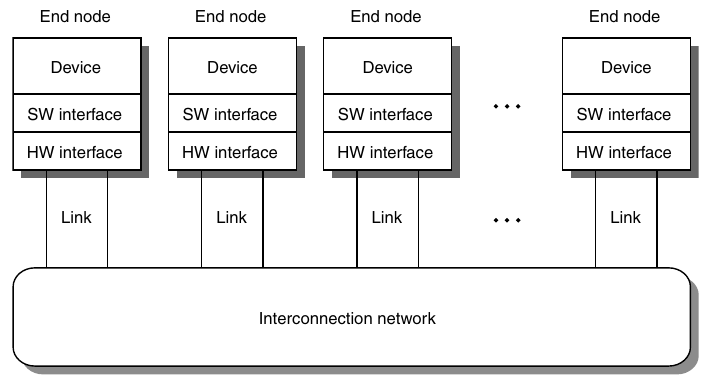

**Hình F.1 Minh họa khái niệm về một cộng đồng các thiết bị được kết nối với nhau.**

### Các lĩnh vực của Interconnection Network

Interconnection network được thiết kế để sử dụng ở các cấp độ khác nhau bên trong và giữa các hệ thống máy tính nhằm đáp ứng nhu cầu vận hành của nhiều lĩnh vực ứng dụng—tính toán high-performance, storage I/O, hệ thống cluster/workgroup/enterprise, internetworking, v.v. Tùy vào số lượng thiết bị cần kết nối và khoảng cách giữa chúng, chúng ta có thể chia interconnection network thành bốn lĩnh vực network chính:

- On-chip network (OCN)—Còn được gọi là network-on-chip (NoC), loại network này được dùng để kết nối các functional unit của microarchitecture, register file, cache, compute tile, cùng processor core và IP core bên trong chip hoặc multichip module. Các OCN hiện tại và trong tương lai gần hỗ trợ kết nối từ vài chục đến vài trăm thiết bị như vậy với khoảng cách kết nối tối đa ở mức centimet. Phần lớn OCN dùng trong chip high-performance được thiết kế riêng để giảm nhẹ vấn đề wire delay chip-crossing do mức độ thu nhỏ công nghệ và tích hợp transistor tăng lên, mặc dù một số thiết kế độc quyền đang được sử dụng rộng rãi hơn (ví dụ CoreConnect của IBM, AMBA của ARM và Smart Interconnect của Sonic). Ví dụ về OCN hiện tại gồm những network trong processor chip Intel Teraflops [Hoskote07], kết nối 80 core đơn giản; Intel Single-Chip Cloud Computer (SCCC) [Howard10], kết nối 48 core theo architecture IA-32; và dòng processor TILE-Gx của Tilera [TILE-GX], kết nối 100 processing core trong 4Q 2011 bằng quy trình 40 nanometer của TSMC, với kế hoạch 200 core vào năm 2013 (code name “Stratton”) bằng quy trình 28 nanometer của TSMC. Các network đạt mức đỉnh 256 GBps ở cả hai nguyên mẫu Intel và tới 200 Tbps đối với processor TILE-Gx100. Thông tin chi tiết hơn về OCN được cung cấp trong Flich [2010].

- System/storage area network (SAN)—Loại network này được dùng cho kết nối interprocessor và processor-memory bên trong hệ thống multiprocessor và multicomputer, cũng như kết nối các thành phần storage và I/O trong môi trường server và data center. Thông thường có thể kết nối vài trăm thiết bị như vậy, mặc dù một số SAN của supercomputer hỗ trợ kết nối hàng nghìn thiết bị, như supercomputer IBM Blue Gene/L. Khoảng cách kết nối tối đa bao phủ một khu vực tương đối nhỏ—thường ở mức vài chục mét—nhưng một số SAN có khoảng cách trải rộng vài trăm mét. Ví dụ, InfiniBand, một chuẩn SAN phổ biến được giới thiệu cuối năm 2000, hỗ trợ interconnect cho hệ thống và storage I/O với tốc độ tới 120 Gbps trên khoảng cách 300 m.

- Local area network (LAN)—Loại network này được dùng để kết nối các hệ thống máy tính tự chủ phân bố trong một phòng máy hoặc khắp một tòa nhà hay khuôn viên. Kết nối các PC trong một cluster là một ví dụ điển hình. Ban đầu LAN chỉ kết nối tối đa một trăm thiết bị, nhưng nhờ bridging, LAN hiện có thể kết nối tới vài nghìn thiết bị. Khoảng cách interconnect tối đa thường bao phủ một khu vực vài kilomet, nhưng một số có khoảng cách trải rộng vài chục kilomet. Chẳng hạn, Ethernet, LAN phổ biến và tồn tại lâu dài nhất, có một phiên bản chuẩn 10 Gbps hỗ trợ performance tối đa trên khoảng cách 40 km.

- Wide area network (WAN)—Còn được gọi là network long-haul, WAN kết nối các hệ thống máy tính phân bố trên khắp thế giới, đòi hỏi hỗ trợ internetworking. WAN kết nối nhiều triệu máy tính trên quy mô khoảng cách hàng nghìn kilomet. Asynchronous Transfer Mode (ATM) là một ví dụ về WAN.

Hình F.2 cho thấy khái quát mối quan hệ giữa các lĩnh vực network này xét theo số lượng thiết bị được kết nối và quy mô khoảng cách. Một số network chồng lấn nhau theo một hoặc cả hai chiều này, dẫn đến sự cạnh tranh giữa các sản phẩm. Một số giải pháp network đã trở thành chuẩn thương mại trong khi những giải pháp khác vẫn mang tính độc quyền. Mặc dù giải pháp được ưu tiên có thể khác nhau đáng kể giữa các lĩnh vực interconnection network tùy yêu cầu thiết kế, các vấn đề và khái niệm dùng để giải quyết vấn đề network vẫn tương đồng đáng kể giữa các lĩnh vực. Bất kể lĩnh vực mục tiêu, network nên được thiết kế sao cho không trở thành bottleneck đối với performance và hiệu quả chi phí của hệ thống. Do đó, mục tiêu cuối cùng của nhà thiết kế computer architecture là thiết kế interconnection network có chi phí thấp nhất có thể, có khả năng truyền lượng thông tin sẵn có lớn nhất trong thời gian ngắn nhất có thể.

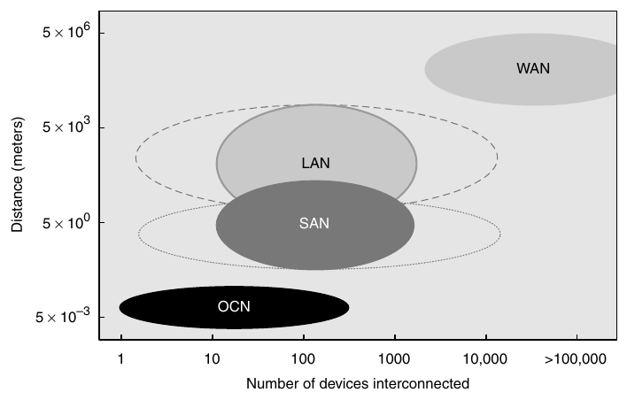

**Hình F.2 Mối quan hệ giữa bốn lĩnh vực interconnection network xét theo số lượng thiết bị được kết nối và quy mô khoảng cách: on-chip network (OCN), system/storage area network (SAN), local area network (LAN) và wide area network (WAN). Lưu ý rằng có những khoảng chồng lấn trong đó một số network này cạnh tranh với nhau. Một số hệ thống supercomputer dùng network thiết kế riêng độc quyền để kết nối hàng nghìn máy tính, trong khi những hệ thống khác, chẳng hạn cluster multicomputer, dùng network thương mại theo chuẩn.**

### Cách tiếp cận và bố cục của phụ lục này

Có thể hiểu rõ interconnection network bằng cách tiếp cận top-down để làm sáng tỏ các khái niệm và sự phức tạp trong thiết kế. Chúng ta thực hiện điều này bằng cách ban đầu xem network như một “hộp đen” kín, đơn giản thực hiện một số chức năng cần thiết theo cách lý tưởng. Sau đó, chúng ta mở từng lớp của hộp đen một cách có hệ thống, để bộc lộ các khái niệm phức tạp hơn và hành vi network không lý tưởng. Chúng ta bắt đầu thảo luận bằng cách trước tiên xem xét kết nối chỉ hai thiết bị trong Mục F.2, nơi network hộp đen có thể được xem như một network dedicated link đơn giản—tức là các dây hoặc tập hợp dây chạy theo hai chiều giữa các thiết bị. Tiếp đó, chúng ta xem xét kết nối nhiều hơn hai thiết bị trong Mục F.3, nơi network hộp đen có thể được xem như một network shared link hoặc switched network point-to-point kết nối các thiết bị. Chúng ta tiếp tục bóc các lớp khác của hộp đen bằng cách xem xét chi tiết hơn network topology (Mục F.4); routing, arbitration và switching (Mục F.5); cùng switch microarchitecture (Mục F.6). Các vấn đề thực tiễn của network thương mại được xem xét trong Mục F.7, tiếp theo là các ví dụ minh họa những trade-offs cho từng loại network trong Mục F.8. Internetworking được thảo luận ngắn gọn trong Mục F.9, và các vấn đề liên quan xuyên suốt khác của interconnection network được trình bày trong Mục F.10. Mục F.11 đưa ra một số ngộ nhận và cạm bẫy phổ biến liên quan đến interconnection network, còn Mục F.12 trình bày một số nhận xét kết luận. Cuối cùng, chúng ta cung cấp một góc nhìn lịch sử ngắn gọn và một số tài liệu nên đọc trong Mục F.13.

## F.2 Kết nối hai thiết bị

Mục này giới thiệu những khái niệm cơ bản cần có để hiểu cách giao tiếp diễn ra giữa chỉ hai thiết bị được nối network. Nội dung bao gồm các khái niệm xử lý tình huống bên nhận có thể chưa sẵn sàng xử lý dữ liệu đến từ bên gửi và tình huống có thể xảy ra lỗi truyền tải. Để dễ hiểu, ở thời điểm này network hộp đen có thể được hình dung như một network lý tưởng hoạt động giống các dedicated link đơn giản giữa hai thiết bị.

Hình F.3 minh họa điều này, trong đó các dây một chiều chạy từ thiết bị A đến thiết bị B và ngược lại, và mỗi end node chứa một buffer để giữ dữ liệu. Bất kể độ phức tạp của network, dù có phải dedicated link hay không, đều tồn tại một kết nối từ mỗi thiết bị end node tới network để đưa thông tin vào network và nhận thông tin từ network. Trước tiên, chúng ta mô tả các chức năng cơ bản phải được thực hiện tại end node để bắt đầu và hoàn tất giao tiếp, rồi thảo luận về môi trường truyền dẫn network và các chức năng cơ bản mà network phải thực hiện để tiến hành giao tiếp. Sau đó, một mô hình performance đơn giản được đưa ra, cùng một số ví dụ nhằm làm nổi bật tác động của những tham số network chủ chốt.

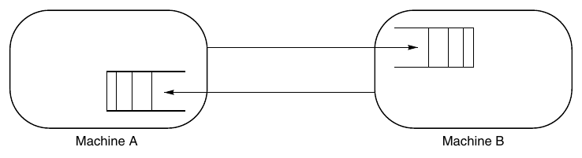

**Hình F.3 Một network dedicated link đơn giản kết nối hai thiết bị theo hai chiều.**

### Các chức năng của Network Interface: Tạo và xử lý Message

Giả sử chúng ta muốn hai thiết bị nối network đọc một word từ memory của nhau. Đơn vị thông tin được gửi hoặc nhận được gọi là message. Để lấy dữ liệu mong muốn, trước tiên hai thiết bị phải tạo và gửi một loại message nhất định dưới dạng request chứa address của dữ liệu bên trong thiết bị kia. Address (tức vị trí memory hoặc operand) cho phép bên nhận xác định nơi tìm thông tin đang được yêu cầu. Sau khi xử lý request, mỗi thiết bị tạo và gửi một loại message khác, một reply, chứa dữ liệu. Thông tin address và dữ liệu thường được gọi là message payload.

Ngoài payload, mỗi message chứa một số control bit mà network cần để chuyển message và xử lý nó tại bên nhận. Điển hình nhất là các bit phân biệt các loại message khác nhau (ví dụ request, reply, request acknowledge, reply acknowledge) và các bit cho phép network truyền thông tin đúng cách đến đích. Những control bit bổ sung này được mã hóa trong phần header và/hoặc trailer của message, tùy vị trí của chúng so với message payload. Ví dụ, Hình F.4 cho thấy định dạng message của network dedicated link đơn giản trong Hình F.3. Ví dụ này có payload single-word, nhưng message trong một số interconnection network có thể bao gồm hàng nghìn word.

Trước khi message được truyền qua network, message phải được tạo. Tương tự, khi nhận được từ network, chúng phải được xử lý. Những chức năng này cùng các chức năng khác được mô tả bên dưới là vai trò của network interface (còn gọi là channel adapter) nằm tại end node. Cùng với một direct memory access (DMA) engine và các link driver để truyền/nhận message tới/từ network, một phần memory hoặc register chuyên dụng có thể được dùng làm buffer cho message đi và đến. Tùy lĩnh vực network và đặc tả thiết kế network, hardware của network interface có thể chỉ gồm chính thiết bị giao tiếp (tức đối với OCN và một số SAN) hoặc một card riêng tích hợp vài embedded processor và DMA engine cùng hàng nghìn megabyte RAM (tức đối với nhiều SAN và phần lớn LAN và WAN).

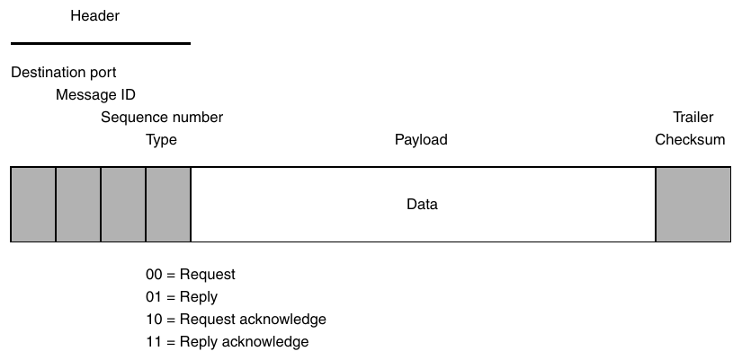

**Hình F.4 Một ví dụ về định dạng packet với header, payload và checksum trong trailer.**

Ngoài hardware, network interface có thể bao gồm software hoặc firmware để thực hiện các thao tác cần thiết. Ngay cả ví dụ đơn giản trong Hình F.3 cũng có thể gọi messaging software để chuyển request và reply thành message với header thích hợp. Bằng cách này, ứng dụng người dùng không cần bận tâm đến việc tạo và xử lý message vì các tác vụ này có thể được thực hiện tự động ở cấp thấp hơn. Một chương trình ứng dụng thường phối hợp với operating system hoặc runtime system để gửi và nhận message. Vì network có khả năng được nhiều process chạy trên mỗi thiết bị dùng chung, operating system không thể cho phép message dành cho process này lại được process khác nhận. Vì vậy, messaging software phải bao gồm các cơ chế bảo vệ để phân biệt các process. Sự phân biệt này có thể được thực hiện bằng cách mở rộng header với một port number mà cả process gửi và process nhận dự kiến đều biết.

Ngoài việc tạo và xử lý message, end node cần thực hiện các chức năng bổ sung để thiết lập giao tiếp giữa các thiết bị giao tiếp. Mặc dù hỗ trợ hardware có thể giảm khối lượng công việc, một số việc có thể được software thực hiện. Ví dụ, phần lớn network quy định lượng thông tin tối đa có thể truyền (tức maximum transfer unit) để có thể xác định dung lượng network buffer phù hợp. Message dài hơn maximum transfer unit được chia thành các đơn vị nhỏ hơn, gọi là packet (hoặc datagram), được truyền qua network. Các packet được ghép lại thành message tại end node đích trước khi chuyển tới ứng dụng. Packet thuộc cùng một message có thể được phân biệt với các packet khác bằng cách đưa một trường message ID vào packet header. Nếu packet đến đích sai thứ tự, chúng được sắp xếp lại khi ghép thành message. Một trường khác trong packet header chứa sequence number thường được dùng cho mục đích này.

Trình tự các bước mà end node thực hiện để bắt đầu và hoàn tất giao tiếp qua network được gọi là communication protocol. Nhìn chung, các bước gửi và nhận thông tin có tính đối xứng nhưng theo thứ tự ngược nhau. Communication protocol được triển khai bằng sự kết hợp software và hardware để tăng tốc thực thi. Chẳng hạn, nhiều network interface card triển khai hardware timer cũng như hỗ trợ hardware để chia message thành packet rồi ghép lại, tính checksum cyclic redundancy check (CRC), xử lý address của virtual memory, v.v.

Một số network interface có thêm hardware để chuyển phần xử lý protocol ra khỏi host computer, chẳng hạn TCP offload engine cho LAN và WAN. Nhưng đối với interconnection network như SAN có yêu cầu latency thấp, điều này có thể vẫn chưa đủ ngay cả khi dùng communication protocol lighter-weight như message passing interface (MPI). Communication performance có thể được cải thiện hơn nữa bằng cách bỏ qua operating system (OS). Việc bỏ qua OS có thể được triển khai bằng cách cấp phát message buffer trực tiếp trong memory của network interface để ứng dụng ghi trực tiếp vào và đọc trực tiếp từ các buffer đó. Cách này tránh các thao tác sao chép memory-to-memory bổ sung. Các protocol tương ứng được gọi là protocol zero-copy hoặc communication protocol user-level. Vẫn có thể duy trì bảo vệ bằng cách gọi OS để cấp phát các buffer đó lúc khởi tạo và ngăn memory access không được phép bằng hardware.

Nhìn chung, một số hoặc tất cả các bước sau là cần thiết để gửi message tại thiết bị end node qua network:

1. Ứng dụng thực thi một system call, sao chép dữ liệu cần gửi vào buffer của operating system hoặc network interface, chia message thành packet (nếu cần), rồi tạo header và trailer cho các packet.

2. Checksum được tính toán và đưa vào header hoặc trailer của packet.

3. Timer được khởi động, và hardware của network interface gửi các packet.

Việc nhận message diễn ra theo thứ tự ngược lại:

3. Hardware của network interface nhận các packet và đưa chúng vào buffer của nó hoặc buffer của operating system.

2. Checksum được tính cho mỗi packet. Nếu checksum khớp với checksum của bên gửi, bên nhận gửi một acknowledgment trở lại bên gửi packet. Nếu không khớp, nó xóa packet, giả định rằng bên gửi sẽ gửi lại packet khi timer tương ứng hết hạn.

1. Khi mọi packet đều vượt qua phép kiểm tra, hệ thống ghép lại message, sao chép dữ liệu vào address space của người dùng và báo hiệu cho ứng dụng tương ứng.

Bên gửi vẫn phải phản ứng với acknowledgment của packet:

- Khi bên gửi nhận được acknowledgment, nó giải phóng bản sao của packet tương ứng khỏi buffer.

- Nếu bên gửi đạt tới time-out thay vì nhận được acknowledgment, nó gửi lại packet và khởi động lại timer.

Tương tự như việc protocol được triển khai tại end node của network để hỗ trợ giao tiếp, các protocol cũng được dùng trong toàn bộ cấu trúc network ở physical layer, data link layer và network layer, chủ yếu chịu trách nhiệm về packet transport, flow control, xử lý lỗi và những chức năng khác được mô tả tiếp theo.

### Cấu trúc và chức năng cơ bản của Network: Môi trường truyền dẫn và Form Factor, Packet Transport, Flow Control và xử lý lỗi

Khi một packet đã sẵn sàng để truyền tại nguồn, nó được đưa vào network bằng một số hardware chuyên dụng ở network interface. Hardware bao gồm các transceiver circuit để điều khiển môi trường truyền dẫn vật lý của network—điện hoặc quang. Loại môi trường và form factor phụ thuộc phần lớn vào khoảng cách interconnect mà trên đó cần duy trì những signaling rate nhất định (ví dụ tốc độ truyền). Với khoảng cách từ centimet trở xuống trên chip hoặc multichip module, thông thường có thể dùng các lớp kim loại đồng từ giữa đến trên cho interconnect với signaling rate multi-Gbps trên mỗi đường. Hàng chục hoặc nhiều hơn các lớp đường đồng in trên circuit board, midplane và backplane có thể được dùng cho signaling rate differential-pair ở mức Gbps trên khoảng cách khoảng một mét. Dây đồng twisted-pair không bọc chống nhiễu Category 5E cho phép tốc độ truyền 0.25 Gbps trên khoảng cách 100 mét. Cáp đồng đồng trục có thể truyền 10 Mbps trên khoảng cách kilomet. Trong các đường dẫn điện này, thường có thể đánh đổi khoảng cách để lấy tốc độ truyền cao hơn, đến một giới hạn nhất định. Môi trường quang cho phép tốc độ truyền nhanh hơn trên khoảng cách kilomet. Multimode fiber hỗ trợ tốc độ truyền 100 Mbps trên vài kilomet, còn single-mode fiber đắt hơn hỗ trợ tốc độ truyền Gbps trên khoảng cách vài kilomet. Wavelength division multiplexing cho phép đạt bandwidth lớn hơn nhiều lần trong sợi quang (tức theo hệ số bằng số bước sóng được sử dụng).

Hardware dùng để điều khiển network link cũng có thể bao gồm encoder để mã hóa tín hiệu theo một định dạng khác binary, phù hợp với khoảng cách truyền tải cho trước. Các kỹ thuật mã hóa có thể dùng nhiều mức điện áp, tính dư thừa, luân phiên dữ liệu và điều khiển (ví dụ mã hóa 4b5b), và/hoặc một số lần chuyển trạng thái tín hiệu tối thiểu được bảo đảm trên mỗi đơn vị thời gian để cho phép khôi phục clock tại bên nhận. Tín hiệu được giải mã ở đầu nhận và packet được lưu vào buffer tương ứng. Tất cả thao tác này được thực hiện tại physical layer của network; chi tiết của chúng nằm ngoài phạm vi phụ lục này. May thay, chúng ta không cần bận tâm đến chúng. Từ góc nhìn của data link layer và các layer cao hơn, physical layer có thể được xem như một pipeline tuyến tính dài không có phân stage, trong đó tín hiệu lan truyền dưới dạng sóng qua môi trường truyền dẫn network. Tất cả chức năng trên thường được gọi chung là packet transport.

Bên cạnh packet transport, hardware và software của network cùng chịu trách nhiệm ở data link layer và network protocol layer để bảo đảm chuyển packet đáng tin cậy. Những trách nhiệm này gồm: (1) ngăn bên gửi gửi packet với tốc độ nhanh hơn khả năng xử lý của bên nhận, và (2) bảo đảm packet không bị sai hỏng hoặc thất lạc khi đang truyền. Trách nhiệm thứ nhất được đáp ứng bằng cách loại bỏ packet tại bên nhận khi buffer của nó đầy rồi sau đó thông báo bên gửi truyền lại, hoặc bằng cách thông báo bên gửi ngừng gửi packet khi buffer đầy và tiếp tục sau khi có chỗ cho thêm packet. Chiến lược thứ hai thường được biết đến là flow control.

Có một số kỹ thuật thú vị thường được dùng để triển khai flow control ngoài handshaking đơn giản giữa bên gửi và bên nhận. Những kỹ thuật phổ biến hơn là Xon/Xoff (còn được gọi là Stop & Go) và flow control credit-based. Xon/Xoff bao gồm việc bên nhận thông báo cho bên gửi ngừng hoặc tiếp tục gửi packet khi lần lượt đạt mức chiếm dụng buffer cao và thấp, với một mức hysteresis để giảm số thông báo. Các thông báo được gửi dưới dạng tín hiệu “stop” và “go” qua các dây điều khiển bổ sung hoặc được mã hóa trong control packet. Flow control Credit-based thường dùng một credit counter tại bên gửi, ban đầu chứa số credit bằng số buffer tại bên nhận. Mỗi khi truyền một packet, bên gửi giảm credit counter. Khi bên nhận tiêu thụ một packet từ buffer của nó, nó trả một credit cho bên gửi dưới dạng control packet thông báo cho bên gửi tăng counter khi nhận credit. Về bản chất, những kỹ thuật này điều khiển luồng packet vào network bằng cách hạn chế packet injection ở bên gửi khi bên nhận đạt low watermark hoặc khi bên gửi hết credit.

Xon/Xoff thường tạo ra ít control traffic hơn nhiều so với flow control credit-based vì thông báo chỉ được gửi khi vượt qua mức chiếm dụng buffer cao hoặc thấp. Ngược lại, flow control credit-based cần dung lượng buffer nhỏ hơn một nửa dung lượng mà Xon/Xoff yêu cầu. Buffer cho Xon/Xoff phải đủ lớn để ngăn overflow trước khi tín hiệu điều khiển “stop” tới bên gửi. Overflow không thể xảy ra khi dùng flow control credit-based vì bên gửi sẽ hết credit và do đó ngừng truyền. Với cả hai cơ chế, chỉ có thể sử dụng toàn bộ link bandwidth nếu buffer đủ lớn cho khoảng cách giao tiếp.

Hãy so sánh yêu cầu buffering của hai kỹ thuật flow control trong một ví dụ đơn giản bao quát các lĩnh vực interconnection network khác nhau.

**Ví dụ** Giả sử chúng ta có một network dedicated-link với raw data bandwidth 8 Gbps cho mỗi link theo mỗi chiều kết nối hai thiết bị. Các packet 100 byte (kể cả header) được truyền liên tục từ thiết bị này sang thiết bị kia để tận dụng đầy đủ network bandwidth. Số credit và dung lượng buffer tối thiểu mà flow control credit-based yêu cầu là bao nhiêu, giả sử khoảng cách interconnect là 1 cm, 1 m, 100 m và 10 km, nếu chỉ tính link propagation delay? Dung lượng buffer tối thiểu so với Xon/Xoff như thế nào?

**Trả lời** Lúc bắt đầu, buffer bên nhận ban đầu rỗng và bên gửi chứa số credit bằng dung lượng buffer. Bên gửi tiêu thụ một credit mỗi lần truyền một packet. Để bên gửi tiếp tục truyền packet ở tốc độ network, credit trả về đầu tiên phải tới bên gửi trước khi nó hết credit. Sau khi nhận credit đầu tiên, bên gửi tiếp tục nhận credit với cùng tốc độ truyền packet. Vì chúng ta chỉ xét propagation delay trên link và không xét nguồn delay hay overhead nào khác, thời gian xử lý tại bên gửi và bên nhận được giả định bằng không. Thời gian để credit đầu tiên tới bên gửi kể từ lúc bắt đầu truyền packet đầu tiên bằng propagation delay round-trip của packet truyền tới bên nhận và credit trả về truyền ngược tới bên gửi. Thời gian này phải nhỏ hơn hoặc bằng thời gian truyền packet nhân với số credit ban đầu:

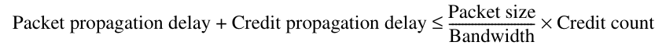

Tốc độ ánh sáng khoảng 300,000 km/sec. Giả sử chúng ta có thể đạt 66% tốc độ đó trong một dây dẫn. Khi đó, số credit tối thiểu cho mỗi khoảng cách được cho bởi

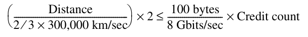

Vì mỗi credit đại diện cho một mục buffer packet-sized, số credit tối thiểu (và tương tự là dung lượng buffer) mà mỗi thiết bị cần là một cho khoảng cách 1 cm và 1 m, 10 cho khoảng cách 100 m, và 1000 packet cho khoảng cách 10 km. Đối với Xon/Xoff, dung lượng buffer tối thiểu này tương ứng với phần buffer từ mức chiếm dụng cao đến đỉnh buffer và từ mức chiếm dụng thấp đến đáy buffer. Khi bổ sung hysteresis giữa hai mức chiếm dụng để giảm thông báo, dung lượng buffer tối thiểu cho Xon/Xoff hóa ra lớn hơn gấp đôi so với flow control credit-based.

Network triển khai flow control không cần loại bỏ packet và đôi khi được gọi là lossless network; network loại bỏ packet đôi khi được gọi là lossy network. Chỉ riêng sự khác biệt này trong cách network xử lý packet đã ràng buộc rất mạnh các loại giải pháp có thể triển khai để giải quyết những vấn đề network liên quan khác, bao gồm packet routing, congestion, deadlock và reliability, như chúng ta sẽ thấy ở phần sau của phụ lục. Sự khác biệt này cũng ảnh hưởng đáng kể đến performance vì packet bị loại bỏ phải được truyền lại, do đó tiêu thụ thêm link bandwidth và chịu thêm delay. Những khác biệt về hành vi và performance này cuối cùng giới hạn những lĩnh vực interconnection network có thể áp dụng các giải pháp nhất định. Chẳng hạn, phần lớn network chuyển packet trên khoảng cách tương đối ngắn (ví dụ OCN và SAN) có xu hướng triển khai flow control; ngược lại, network chuyển packet trên khoảng cách tương đối dài (ví dụ LAN và WAN) có xu hướng được thiết kế để loại bỏ packet. Với khoảng cách ngắn hơn, delay khi truyền thông tin flow control ngược về bên gửi có thể không đáng kể, nhưng điều này không đúng với quy mô khoảng cách dài hơn. Loại ứng dụng thường chạy cũng ảnh hưởng đến lựa chọn giữa lossless và lossy network. Chẳng hạn, loại bỏ packet do một Internet client như Web browser gửi chỉ ảnh hưởng đến delay mà người dùng tương ứng quan sát được. Tuy nhiên, loại bỏ packet do một process trong ứng dụng song song gửi có thể làm tăng đáng kể tổng thời gian thực thi của ứng dụng nếu delay của packet đó nằm trên critical path.

Trách nhiệm thứ hai, bảo đảm packet không bị sai hỏng hoặc thất lạc khi truyền, có thể được đáp ứng bằng việc triển khai các cơ chế phát hiện và phục hồi lỗi truyền tải. Việc thêm checksum hoặc trường phát hiện lỗi khác vào định dạng packet, như Hình F.4, cho phép bên nhận phát hiện lỗi. Thông tin dư thừa này được tính khi gửi packet và kiểm tra khi nhận. Sau đó bên nhận gửi acknowledgment dưới dạng control packet nếu packet vượt qua phép kiểm tra. Lưu ý rằng control packet acknowledgment này có thể đồng thời chứa thông tin flow control (ví dụ một credit hoặc tín hiệu stop), do đó giảm control packet overhead. Như đã mô tả, cách phổ biến nhất để phục hồi lỗi là dùng timer ghi lại thời điểm mỗi packet được gửi và coi packet đã thất lạc hoặc được truyền sai nếu timer hết hạn trước khi acknowledgment đến. Khi đó packet được gửi lại.

Communication protocol trong network và tại end node của network phải xử lý nhiều vấn đề khác ngoài packet transport, flow control và reliability. Ví dụ, nếu hai thiết bị đến từ các nhà sản xuất khác nhau, chúng có thể sắp xếp byte trong một word khác nhau (byte ordering Big Endian so với Little Endian). Protocol phải đảo thứ tự byte trong mỗi word như một phần của hệ thống chuyển giao. Nó cũng phải đề phòng khả năng packet bị trùng nếu một packet bị trì hoãn được giải phóng. Tùy yêu cầu hệ thống, protocol có thể phải triển khai pipelining giữa các thao tác để cải thiện performance. Cuối cùng, protocol có thể cần xử lý network congestion để ngăn suy giảm performance khi kết nối nhiều hơn hai thiết bị, như được mô tả ở phần sau trong Mục F.7.

### Đặc trưng hóa Performance: Latency và Effective Bandwidth

Giờ đây, sau khi trình bày các bước cơ bản để gửi và nhận message giữa hai thiết bị, chúng ta có thể thảo luận về performance. Chúng ta bắt đầu bằng việc thảo luận latency khi truyền một packet riêng lẻ. Sau đó chúng ta thảo luận effective bandwidth (còn gọi là throughput) có thể đạt được khi việc truyền nhiều packet được pipeline qua network ở cấp packet.

Hình F.5 cho thấy các thành phần cơ bản của latency cho một packet riêng lẻ. Lưu ý rằng một số thành phần latency sẽ được phân tích sâu hơn trong các mục sau khi phần bên trong network “hộp đen” được hé lộ. Các tham số thời gian trong Hình F.5 áp dụng cho nhiều lĩnh vực interconnection network: bên trong chip, giữa các chip trên board, giữa các board trong chassis, giữa các chassis trong một máy tính, giữa các máy tính trong cluster, giữa các cluster, v.v. Giá trị có thể thay đổi, nhưng các thành phần latency vẫn như nhau.

Những thuật ngữ sau thường được dùng không chặt chẽ, dẫn tới nhầm lẫn, nên chúng ta định nghĩa chúng chính xác hơn ở đây:

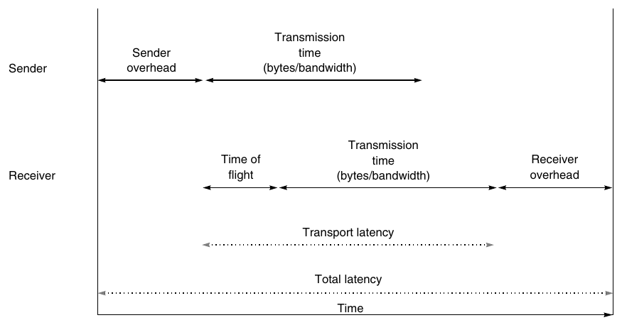

**Hình F.5 Các thành phần packet latency. Tùy là OCN, SAN, LAN hay WAN, tỷ lệ sending overhead và receiving overhead, time of flight và transmission time thường rất khác so với minh họa ở đây.**

- Bandwidth—Nói chính xác, bandwidth của môi trường truyền dẫn chỉ khoảng tần số mà tại đó độ suy hao trên một đơn vị chiều dài do môi trường đó gây ra thấp hơn một ngưỡng nhất định. Nó phải được phân biệt với transmission speed, tức lượng thông tin truyền qua môi trường trong một đơn vị thời gian. Ví dụ, modem đã tăng thành công transmission speed vào cuối những năm 1990 với bandwidth cố định (tức bandwidth 3 KHz do kênh thoại trên đường dây điện thoại cung cấp) bằng cách mã hóa nhiều mức điện áp hơn và do đó nhiều bit hơn trên mỗi chu kỳ tín hiệu. Tuy nhiên, để nhất quán với nghĩa được hiểu rộng rãi hơn, chúng ta dùng thuật ngữ bandwidth để chỉ tốc độ tối đa có thể truyền thông tin, trong đó thông tin bao gồm packet header, payload và trailer. Đơn vị truyền thống là bit trên giây, mặc dù đôi khi dùng byte trên giây. Thuật ngữ bandwidth cũng được dùng để chỉ tốc độ đo được của môi trường (tức network link). Aggregate bandwidth chỉ tổng data bandwidth mà network cung cấp, còn effective bandwidth hay throughput là phần aggregate bandwidth mà network chuyển tới ứng dụng.

- Time of flight—Đây là thời gian để bit đầu tiên của packet tới bên nhận, bao gồm propagation delay trên link và delay do các hardware khác trong network như link repeater và network switch. Đơn vị đo time of flight có thể là millisecond cho WAN, microsecond cho LAN, nanosecond cho SAN và picosecond cho OCN.

- Transmission time—Đây là thời gian để packet đi qua network, không bao gồm time of flight. Một cách đo là lấy chênh lệch thời gian giữa lúc bit đầu tiên của packet tới bên nhận và lúc bit cuối cùng của packet đó tới bên nhận. Theo định nghĩa, transmission time bằng kích thước packet chia cho data bandwidth của network link.

Phép đo này giả định không có packet nào khác tranh chấp bandwidth đó (tức network zero-load hoặc no-load).

- Transport latency—Đây là tổng time of flight và transmission time. Transport latency là thời gian packet ở trong interconnection network. Nói cách khác, đó là thời gian từ lúc bit đầu tiên của packet được đưa vào network đến khi bit cuối cùng của packet đó tới bên nhận. Nó không bao gồm overhead để chuẩn bị packet tại bên gửi hoặc xử lý khi packet tới bên nhận.

- Sending overhead—Đây là thời gian end node chuẩn bị packet (khác với message) để đưa vào network, bao gồm cả thành phần hardware và software. Lưu ý rằng end node bận trong toàn bộ khoảng thời gian này, do đó thuật ngữ overhead được sử dụng. Khi end node đã rảnh, mọi delay tiếp theo được xem là một phần của transport latency. Chúng ta giả định overhead gồm một thành phần hằng số cộng với một thành phần biến đổi phụ thuộc kích thước packet. Thành phần hằng số bao gồm cấp phát memory, chuẩn bị packet header, thiết lập thiết bị DMA, v.v. Thành phần biến đổi chủ yếu do sao chép từ buffer này sang buffer khác và thường không đáng kể với packet rất ngắn.

- Receiving overhead—Đây là thời gian end node xử lý packet đến, bao gồm cả thành phần hardware và software. Ở đây chúng ta cũng giả định overhead gồm một thành phần hằng số cộng với một thành phần biến đổi phụ thuộc kích thước packet. Nhìn chung, receiving overhead lớn hơn sending overhead. Ví dụ, bên nhận có thể phải chịu chi phí của interrupt hoặc phải sắp xếp lại và ghép packet thành message.

Tổng latency của một packet có thể được biểu diễn bằng biểu thức đại số sau:

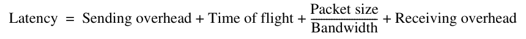

Hãy xem tầm quan trọng của các thành phần transport latency và sending overhead cùng receiving overhead thay đổi thế nào khi chúng ta đi qua các lĩnh vực interconnection network: từ OCN tới SAN tới LAN tới WAN.

**Ví dụ** Giả sử chúng ta có một network dedicated link với data bandwidth 8 Gbps cho mỗi link theo mỗi chiều kết nối hai thiết bị trong một OCN, SAN, LAN hoặc WAN, và muốn truyền packet 100 byte (kể cả header) giữa các thiết bị. End node có sending overhead per-packet là x + 0.05 ns/byte và receiving overhead là 4/3(x) + 0.05 ns/byte, trong đó x bằng 0 μs cho OCN, 0.3 μs cho SAN, 3 μs cho LAN và 30 μs cho WAN, là những giá trị điển hình của các loại network này. Hãy tính tổng latency để gửi packet từ thiết bị này sang thiết bị kia với khoảng cách kết nối 0.5 cm, 5 m, 5000 m và 5000 km, giả định time of flight chỉ bao gồm link propagation delay (tức không có switching hoặc nguồn delay khác).

**Trả lời** Dùng biểu thức trên và phép tính propagation delay qua dây dẫn trong ví dụ trước, chúng ta có thể thay các tham số cho mỗi network để tìm tổng packet latency. Đối với OCN:

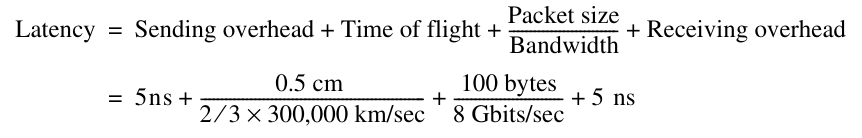

Chuyển tất cả thành phần sang nanosecond (ns) cho kết quả sau đối với OCN:

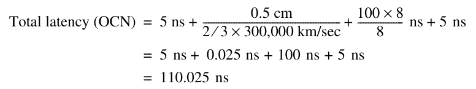

Thay các giá trị thích hợp cho SAN, ta thu được latency sau:

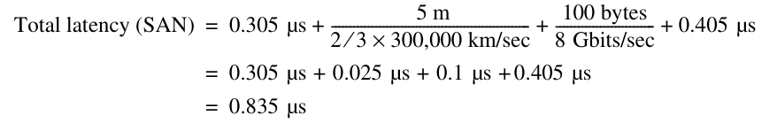

Thay các giá trị thích hợp cho LAN, ta thu được latency sau:

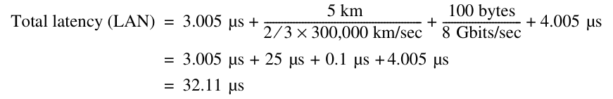

Thay các giá trị thích hợp cho WAN, ta thu được latency sau:

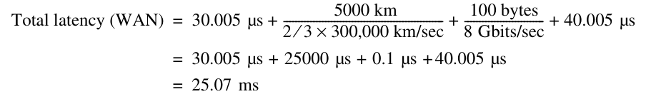

Tỷ lệ latency do time of flight tăng lên với khoảng cách dài hơn, cùng với khả năng lỗi cao hơn trên khoảng cách dài hơn, là những lý do khiến WAN và LAN dùng communication protocol phức tạp và time-consuming hơn, làm tăng sending overhead và receiving overhead. Nhu cầu chuẩn hóa là một lý do khác. Độ phức tạp cũng tăng do những yêu cầu mà các ứng dụng điển hình đặt lên protocol khi chạy trên các lĩnh vực interconnection network khác nhau, khi chúng ta chuyển từ hàng chục tới hàng trăm, hàng nghìn rồi nhiều nghìn thiết bị. Chúng ta sẽ xem xét điều này trong các mục sau khi thảo luận kết nối nhiều hơn hai thiết bị. Ví dụ trên cho thấy thành phần propagation delay của time of flight đối với WAN và một số LAN dài đến mức các thành phần latency khác—kể cả sending overhead và receiving overhead—trên thực tế có thể bị bỏ qua. Điều này không đúng với SAN và OCN, nơi propagation delay nhỏ bé so với overhead và transmission delay. Hãy nhớ rằng latency time-of-flight do switch và hardware khác trong network ngoài propagation delay thuần túy qua link đã bị bỏ qua trong ví dụ trên. Với network không bị congestion, switch latency nhìn chung nhỏ so với overhead và propagation delay qua link trong WAN và LAN, nhưng điều này không nhất thiết đúng với SAN multiprocessor và OCN multicore, như chúng ta sẽ thấy trong các mục sau.

Cho đến nay, chúng ta đã xét việc truyền một packet riêng lẻ và tính tổng packet latency end-to-end tương ứng. Để tính effective bandwidth cho hai thiết bị nối network, chúng ta phải xem xét một luồng packet liên tục được truyền giữa chúng. Cần ghi nhớ rằng, ngoài việc tối thiểu hóa packet latency, mục tiêu của mọi network được tối ưu cho một mức chi phí và điện năng tiêu thụ cho trước là truyền lượng thông tin sẵn có lớn nhất trong thời gian ngắn nhất có thể, được đo bằng effective bandwidth mà network cung cấp. Với ứng dụng không cần phản hồi trước khi gửi packet kế tiếp, bên gửi có thể cho sending overhead của packet sau chồng lấn với transport latency và receiver overhead của packet trước. Về bản chất, điều này pipeline việc truyền packet qua network, còn gọi là link pipelining. May thay, như đã thảo luận ở các chương trước của sách, có nhiều lĩnh vực ứng dụng mà giao tiếp từ nhiều ứng dụng hoặc nhiều thread trong cùng một ứng dụng có thể chạy đồng thời (ví dụ Web server đồng thời phục vụ hàng nghìn client request hoặc streaming media), do đó cho phép thiết bị gửi một luồng packet mà không phải đợi acknowledgment hay reply. Ngoài ra, vì message dài thường được chia thành packet có kích thước tối đa trước khi truyền, trong những trường hợp đó, nhiều packet được đưa liên tiếp vào network. Nếu không thể chồng lấn như vậy, packet sẽ phải đợi packet trước được acknowledgment rồi mới truyền, và do đó chịu suy giảm performance đáng kể.

Packet được truyền theo kiểu pipeline có thể được acknowledgment khá đơn giản bằng cách giữ một bản sao tại nguồn của mọi packet đã gửi nhưng chưa được acknowledgment, đồng thời theo dõi sự tương ứng giữa acknowledgment trả về và packet lưu trong buffer. Packet được xóa khỏi buffer khi bên gửi nhận được acknowledgment tương ứng. Điều này có thể được thực hiện bằng cách đưa message ID và packet sequence number của packet vào acknowledgment của nó. Hơn nữa, mỗi packet trong buffer phải có một timer riêng, cho phép gửi lại packet nếu time-out tương ứng hết hạn.

Pipelining packet transport qua network có nhiều điểm giống với pipelining tính toán bên trong processor. Tuy nhiên, một khác biệt là nó không cần staging latch nào. Thông tin chỉ đơn giản lan truyền qua network link dưới dạng chuỗi sóng tín hiệu. Vì thế, có thể xem network như một logical pipeline gồm bao nhiêu stage tùy cần thiết để time of flight không ảnh hưởng đến effective bandwidth có thể đạt được. Việc truyền một packet có thể bắt đầu ngay sau khi truyền packet trước, do đó chồng lấn sending overhead của packet với transport latency và receiver latency của các packet trước. Nếu sending overhead nhỏ hơn transmission time, các packet nối tiếp nhau back-to-back, và effective bandwidth tiến gần raw link bandwidth khi truyền packet liên tục. Ngược lại, nếu sending overhead lớn hơn transmission time, effective bandwidth tại injection point vẫn thấp hơn raw link bandwidth rất nhiều. Link injection bandwidth thu được, BWLinkInjection, cho mỗi link đưa một luồng packet liên tục vào network được tính bằng biểu thức sau:

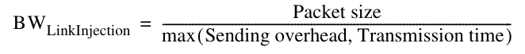

Chúng ta cũng phải xét điều xảy ra nếu bên nhận không thể tiêu thụ packet với cùng tốc độ chúng đến. Điều này xảy ra nếu receiving overhead lớn hơn sending overhead và bên nhận không xử lý packet đến đủ nhanh. Trong trường hợp này, link reception bandwidth, BWLinkReception, cho mỗi reception link của network nhỏ hơn link injection bandwidth và được tính bằng biểu thức sau:

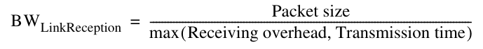

Khi giao tiếp diễn ra giữa hai thiết bị được kết nối bằng dedicated link, mọi packet do thiết bị này gửi sẽ được thiết bị kia nhận. Nếu bên nhận không xử lý packet đủ nhanh, buffer bên nhận sẽ đầy, và flow control sẽ hạn chế truyền tại bên gửi. Vì tình huống này do nguyên nhân bên ngoài network tạo ra, chúng ta sẽ không xét thêm ở đây. Hơn nữa, nếu receiving overhead lớn hơn sending overhead, buffer bên nhận sẽ đầy và flow control cũng sẽ hạn chế truyền tại bên gửi. Trong trường hợp này, tác động trung bình của flow control giống như khi chúng ta thay sending overhead bằng receiving overhead. Giả định một network lý tưởng hoạt động như hai dedicated link chạy ngược chiều với toàn bộ link bandwidth giữa hai thiết bị—nhất quán với cách nhìn network như hộp đen cho đến lúc này—effective bandwidth thu được là giá trị nhỏ hơn giữa hai lần injection bandwidth (để tính hai injection link, mỗi thiết bị một link) hoặc hai lần reception bandwidth. Điều này dẫn tới biểu thức effective bandwidth sau:

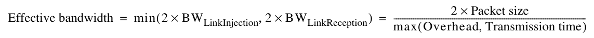

trong đó Overhead = max(Sending overhead, Receiving overhead). Xét biểu thức transmission time, rõ ràng effective bandwidth mà network cung cấp bằng aggregate network bandwidth khi transmission time lớn hơn overhead. Vì vậy, network được sử dụng đầy đủ bất kể giá trị time of flight và do đó bất kể khoảng cách packet di chuyển, giả định hành vi network lý tưởng (tức có đủ credit và buffer cho flow control credit-based và Xon/Xoff). Phân tích này giả định network interface bên gửi và bên nhận chỉ có thể xử lý mỗi lần một packet. Nếu có thể xử lý nhiều packet song song (ví dụ như trong network interface Federation của IBM), overhead của những packet đó có thể chồng lấn, làm tăng effective bandwidth theo hệ số chồng lấn đó đến mức giới hạn bởi transmission time.

Hãy dùng phương trình ở trang F-17 để tìm hiểu tác động của kích thước packet, transmission time và overhead lên BWLinkInjection, BWLinkReception và effective bandwidth cho các lĩnh vực network: OCN, SAN, LAN và WAN.

**Ví dụ** Như trong ví dụ trước, giả sử chúng ta có một network dedicated link với data bandwidth 8 Gbps cho mỗi link theo mỗi chiều kết nối hai thiết bị trong một OCN, SAN, LAN hoặc WAN. Hãy vẽ effective bandwidth theo kích thước packet cho mỗi loại network với packet có kích thước từ 4 byte (tức một word 32-bit) tới 1500 byte (tức maximum transfer unit cho Ethernet), giả định end node có cùng sending overhead và receiving overhead per-packet như trước: lần lượt là x + 0.05 ns/byte và 4/3(x) + 0.05 ns/byte, trong đó x bằng 0 μs cho OCN, 0.3 μs cho SAN, 3 μs cho LAN và 30 μs cho WAN. Điều gì giới hạn effective bandwidth, và với những kích thước packet nào thì effective bandwidth nằm trong khoảng chênh lệch 10% so với aggregate network bandwidth?

**Trả lời** Hình F.6 vẽ effective bandwidth theo kích thước packet cho bốn lĩnh vực network bằng phương trình đơn giản và các tham số đã cho ở trên. Với mọi kích thước packet trong OCN, transmission time lớn hơn overhead (gửi hoặc nhận), cho phép tận dụng đầy đủ aggregate bandwidth, bằng 16 Gbps—tức injection link bandwidth (hoặc reception link bandwidth) nhân hai để tính cả hai thiết bị. Với SAN, overhead—cụ thể là receiving overhead—lớn hơn transmission time cho packet nhỏ hơn khoảng 800 byte; vì vậy cần packet từ 655 byte trở lên để sử dụng ít nhất 90% aggregate bandwidth. Với LAN và WAN, phần lớn link bandwidth không được sử dụng vì overhead trong ví dụ này lớn hơn transmission time nhiều lần với mọi kích thước packet.

Ví dụ này làm nổi bật tầm quan trọng của việc giảm sending overhead và receiving overhead so với packet transmission time để tối đa hóa effective bandwidth mà network cung cấp.

Phân tích trên cho thấy có thể đưa ra một upper bound cho effective bandwidth bằng cách phân tích đường đi của packet và xác định nơi xảy ra bottleneck. Chúng ta có thể mở rộng ý tưởng này ra ngoài network interface bằng cách định nghĩa một mô hình xem toàn bộ network từ đầu đến cuối như một đường ống và xác định đoạn hẹp nhất của đường ống đó. Có ba vùng đáng quan tâm trong đường ống: tổng hợp mọi network injection link cùng network injection bandwidth tương ứng (BWNetworkInjection), tổng hợp mọi network reception link cùng network reception bandwidth tương ứng (BWNetworkReception), và tổng hợp mọi network link cùng network bandwidth tương ứng (BWNetwork). Biểu thức cho chúng sẽ được đưa ra trong các mục sau khi các lớp khác nhau của cách nhìn network như hộp đen được bóc đi.

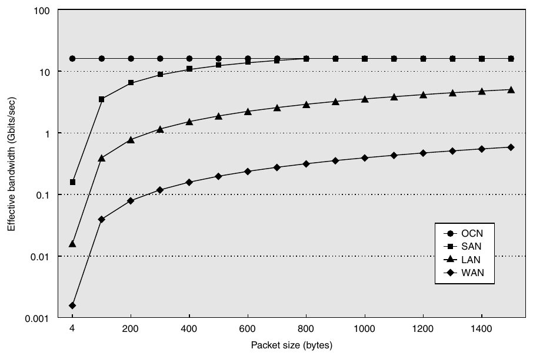

**Hình F.6 Effective bandwidth theo kích thước packet được vẽ ở dạng semi-log cho bốn lĩnh vực network. Overhead có thể được phân bổ bằng cách tăng kích thước packet, nhưng với overhead quá lớn (ví dụ cho WAN và một số LAN), tăng kích thước packet không giúp được nhiều. Những yếu tố khác tham gia vào và giới hạn kích thước packet tối đa.**

Cho đến lúc này, chúng ta đã giả định rằng với chỉ hai thiết bị được kết nối, network hộp đen hoạt động lý tưởng và network bandwidth bằng aggregate raw network bandwidth. Trên thực tế, nó có thể nhỏ hơn aggregate bandwidth nhiều, như chúng ta sẽ thấy trong các mục sau. Nhìn chung, effective bandwidth mà network cung cấp end-to-end cho ứng dụng bị chặn trên bởi giá trị nhỏ nhất trong cả ba vùng bottleneck tiềm tàng:

Effective bandwidth = min ( BWNetworkInjection, BWNetwork, BWNetworkReception)

Chúng ta sẽ mở rộng biểu thức này thêm trong các mục sau khi làm rõ hơn interconnection network và xem xét trường hợp tổng quát hơn là kết nối nhiều hơn hai thiết bị.

Trong một số mục của phụ lục này, chúng ta cho thấy các khái niệm được giới thiệu trong mục được triển khai như thế nào ở các sản phẩm thương mại high-end dùng làm ví dụ. Hình F.7 liệt kê một số máy tính thương mại mà tại một thời điểm trong vòng đời, chúng nằm trong số các hệ thống highest-performing trên thế giới trong phân khúc của mình. Mặc dù những hệ thống này có khả năng kết nối nhiều hơn hai thiết bị, chúng triển khai các chức năng cơ bản cần thiết cho việc kết nối chỉ hai thiết bị. Ngoài việc áp dụng cho SAN dùng trong các hệ thống đó, những vấn đề thảo luận ở mục này cũng áp dụng cho các lĩnh vực interconnect khác: từ OCN đến WAN.

| Công ty | Tên hệ thống [network] | Năm giới thiệu | Số compute node tối đa [× số CPU] | Diện tích hệ thống với cấu hình tối đa | Kích thước tối đa packet [header] (byte) | BW injection [reception] của node tính bằng MB/sec | Send/receive overhead tối thiểu | Chiều dài copper link tối đa; flow control; lỗi |
|---|---|---|---|---|---|---|---|---|
| Intel | ASCI Red Paragon | 2001 | 4510 [× 2] | 2500 ft2 | 1984 [4] | 400 [400] | Vài μs | Handshaking; CRC + parity |
| IBM | ASCI White SP Power3 [Colony] | 2001 | 512 [× 16] | 10,000 ft2 | 1024 [6] | 500 [500] | ~3 μs | 25 m; credit-based; CRC |
| Intel | Thunder Itanium2 Tiger4 [QsNetII] | 2004 | 1024 [× 4] | 120 m2 | 2048 [14] | 928 [928] | 0.240 μs | 13 m; credit-based; CRC cho link, đích |
| Cray | XT3 [SeaStar] | 2004 | 30,508 [× 1] | 263.8 m2 | 80 [16] | 3200 [3200] | Vài μs | 7 m; credit-based; CRC |
| Cray | X1E | 2004 | 1024 [× 1] | 27 m2 | 32 [16] | 1600 [1600] | 0 (truy cập LD ST trực tiếp) | 5 m; credit-based; CRC |
| IBM | ASC Purple pSeries 575 [Federation] | 2005 | >1280 [× 8] | 6720 ft2 | 2048 [7] | 2000 [2000] | ~1 μs với tối đa 4 packet được xử lý \|\| | 25 m; credit-based; CRC |
| IBM | Blue Gene/L eServer Sol. [Torus Net.] | 2005 | 65,536 [× 2] | 2500 ft2 (.9 × .9 × 1.9 m3/rack 1K node) | 256 [8] | 612.5 [1050] | ~3 μs (2300 cycle) | 8.6 m; credit-based; CRC (header/pkt) |

**Hình F.7 Các đặc điểm cơ bản của interconnection network trong hệ thống máy tính thương mại high-performance.**

## F.3 Kết nối nhiều hơn hai thiết bị

Cho đến lúc này, chúng ta đã xét kết nối chỉ hai thiết bị giao tiếp qua một network được xem như hộp đen, nhưng điều khiến interconnection network trở nên thú vị là khả năng kết nối hàng trăm hoặc thậm chí nhiều nghìn thiết bị với nhau. Vì vậy, chính điều làm chúng thú vị cũng khiến việc xây dựng chúng khó khăn hơn. Để kết nối nhiều hơn hai thiết bị, network phải hỗ trợ một cấu trúc phù hợp và nhiều chức năng hơn. Mục này tiếp tục cách tiếp cận hộp đen bằng việc giới thiệu ở cấp độ khái niệm những cấu trúc và chức năng network bổ sung phải được hỗ trợ khi kết nối nhiều hơn hai thiết bị. Chi tiết hơn về từng chủ đề được đưa ra trong các Mục F.4 đến F.7. Khi phù hợp, chúng ta liên hệ các cấu trúc và chức năng bổ sung với môi trường truyền dẫn network, flow control và những kiến thức cơ bản khác đã trình bày ở mục trước. Trong mục này, chúng ta cũng phân loại network thành hai nhóm lớn dựa trên cấu trúc kết nối—network shared-media so với switched-media—và so sánh chúng. Cuối cùng là các biểu thức mở rộng để đặc trưng hóa network performance, theo sau bởi một ví dụ.

### Cấu trúc và chức năng Network bổ sung: Topology, Routing, Arbitration và Switching

Network kết nối nhiều hơn hai thiết bị cần những cơ chế kết nối vật lý nguồn packet với đích để truyền packet và chuyển nó tới đúng đích. Các cơ chế này có thể được triển khai theo những cách khác nhau và biến đổi đáng kể giữa các lĩnh vực interconnection network. Tuy nhiên, các loại cấu trúc và chức năng network mà những cơ chế đó thực hiện rất giống nhau, bất kể lĩnh vực.

Khi nhiều thiết bị được kết nối bởi network, thường không thể thiết lập cố định kết nối giữa chúng bằng dedicated link. Điều này có thể quá hạn chế vì mọi packet từ một nguồn cho trước sẽ tới cùng một đích duy nhất (và không tới những đích khác), hoặc tốn kém đến mức không khả thi vì cần dedicated link từ mọi nguồn tới mọi đích (chúng ta sẽ đánh giá thêm trong mục tiếp theo). Vì vậy, network thường dùng chung đường đi giữa các cặp thiết bị khác nhau, nhưng cách các đường đi được dùng chung được xác định bởi cấu trúc kết nối network, thường được gọi là network topology. Topology giải quyết câu hỏi quan trọng “Packet có thể đi theo những đường nào?” để packet tới đích dự kiến.

Mọi network kết nối nhiều hơn hai thiết bị cũng cần một cơ chế để chuyển mỗi packet tới đúng đích. Chức năng liên quan được gọi là routing, có thể được định nghĩa là tập thao tác cần thực hiện để tính một đường đi hợp lệ từ nguồn packet tới các đích của nó. Routing giải quyết câu hỏi quan trọng “Trong những đường đi có thể có, đường nào được phép (hợp lệ) cho packet?” để packet tới đích dự kiến. Tùy network, chức năng này có thể được thực thi tại nguồn packet để tính toàn bộ đường đi, tại một số thiết bị trung gian để tính từng phần đường đi ngay trong quá trình truyền, hoặc thậm chí tại mọi thiết bị đích có thể có để xác minh thiết bị đó có phải đích dự kiến của packet hay không. Thông thường, packet header trong Hình F.4 được mở rộng để chứa thông tin routing cần thiết.

Nhìn chung, vì network thường chứa đường đi hoặc phần đường đi dùng chung giữa những cặp thiết bị khác nhau, packet có thể yêu cầu một số tài nguyên dùng chung. Khi nhiều packet đồng thời yêu cầu cùng tài nguyên, cần chức năng arbitration để giải quyết xung đột. Arbitration cùng flow control giải quyết câu hỏi quan trọng “Khi nào đường đi sẵn có cho packet?” Mỗi lần arbitration được thực hiện sẽ có một bên thắng và có thể nhiều bên thua. Những bên thua không được cấp quyền truy cập tài nguyên yêu cầu và thường được đưa vào buffer. Như đã chỉ ra ở mục trước, flow control có thể được triển khai để ngăn buffer overflow. Bên thắng tiến về đích khi các tài nguyên được cấp đã được chuyển mạch kết nối, tạo đường cho packet tiến lên. Chức năng này được gọi là switching. Switching giải quyết câu hỏi quan trọng “Đường đi được cấp phát cho packet như thế nào?” Để sử dụng tài nguyên giao tiếp hiện có tốt hơn, phần lớn network không thiết lập toàn bộ đường đi end-to-end cùng một lúc. Thay vào đó, như giải thích trong Mục F.5, đường đi thường được thiết lập từng đoạn một.

Ba chức năng network này—routing, arbitration và switching—phải được triển khai trong mọi network kết nối nhiều hơn hai thiết bị, bất kể network topology có hình thức nào. Chúng bổ sung cho các chức năng cơ bản đã đề cập trong mục trước. Tuy nhiên, độ phức tạp và thứ tự thực hiện các chức năng này phụ thuộc loại network topology, như thảo luận bên dưới. Nhìn chung, routing, arbitration và switching cần thiết để thiết lập đường đi hợp lệ từ nguồn tới đích trong số những đường đi có thể mà network topology cung cấp. Sau khi thiết lập đường đi, các chức năng packet transport mô tả trước đó được dùng để truyền packet đáng tin cậy và nhận chúng tại đích tương ứng. Flow control, nếu được triển khai, ngăn buffer overflow bằng cách hạn chế bên gửi. Nó có thể được triển khai ở cấp end-to-end, cấp link bên trong network hoặc cả hai.

### Network Shared-Media

Cách đơn giản nhất để kết nối nhiều thiết bị là cho chúng dùng chung môi trường truyền dẫn network, như minh họa bằng bus trong Hình F.8 (a). Đây là cách truyền thống để kết nối thiết bị. Môi trường dùng chung có thể hoạt động ở chế độ half-duplex, trong đó dữ liệu có thể được truyền theo một trong hai chiều nhưng cùng một thiết bị không được truyền và nhận dữ liệu đồng thời, hoặc ở chế độ full-duplex, trong đó dữ liệu có thể được truyền theo cả hai chiều và cùng một thiết bị có thể truyền và nhận đồng thời. Cho đến rất gần đây, thiết bị I/O trong phần lớn hệ thống thường dùng chung một I/O bus, và các thiết kế system-on-chip (SoC) ban đầu dùng shared bus để kết nối các thành phần on-chip. LAN phổ biến nhất, Ethernet, ban đầu được triển khai như một bus half-duplex dùng chung bởi tối đa một trăm máy tính, mặc dù hiện nay cũng có những phiên bản switched-media.

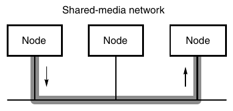

(a)

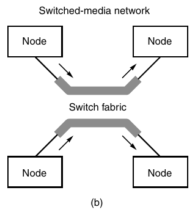

**Hình F.8 (a) Một network shared-media so với (b) một network switched-media. Ethernet ban đầu là network dùng chung môi trường truyền dẫn, nhưng hiện đã có switched Ethernet. Mọi node trên network shared-media phải chia sẻ động raw bandwidth của một link, nhưng network switched-media có thể hỗ trợ nhiều link, cung cấp raw aggregate bandwidth cao hơn.**

Vì môi trường truyền dẫn network được dùng chung, phải có cơ chế phối hợp và arbitration việc sử dụng môi trường dùng chung để mỗi lần chỉ gửi một packet. Nếu khoảng cách vật lý giữa các thiết bị network nhỏ, có thể dùng một central arbiter để cấp quyền gửi packet. Trong trường hợp này, network node có thể dùng đường điều khiển chuyên dụng để giao tiếp với arbiter. Tuy nhiên, centralized arbitration không thực tiễn với network có nhiều node trải rộng trên khoảng cách lớn, nên các hình thức arbitration phân tán cũng được dùng. Đó là trường hợp của LAN Ethernet shared-media ban đầu.

Bước đầu tiên hướng tới arbitration phân tán cho môi trường dùng chung là “nhìn trước khi nhảy”. Node trước tiên kiểm tra network để tránh cố gửi packet khi một packet khác đã ở trong network. Lắng nghe trước khi truyền để tránh collision được gọi là carrier sensing. Nếu interconnection rảnh, node cố gửi. Dĩ nhiên, nhìn trước không bảo đảm thành công vì node khác cũng có thể quyết định gửi đúng cùng lúc. Khi hai node gửi đồng thời, collision xảy ra. Hãy giả định network interface có thể phát hiện mọi collision phát sinh bằng cách lắng nghe xem dữ liệu có bị sai hỏng bởi dữ liệu khác xuất hiện trên đường truyền hay không. Lắng nghe để phát hiện collision được gọi là collision detection. Đây là bước thứ hai của arbitration phân tán.

Vấn đề vẫn chưa được giải quyết. Nếu sau khi phát hiện collision, mọi node trên network đều đợi cùng một khoảng thời gian chính xác, lắng nghe để chắc chắn không có traffic rồi thử gửi lại, chúng ta vẫn có thể có những node đồng bộ liên tục đụng nhau. Để tránh collision head-on lặp lại, mỗi node có packet bị sai hỏng sẽ đợi (hoặc back off) một khoảng thời gian ngẫu nhiên trước khi gửi lại. Việc ngẫu nhiên hóa phá vỡ sự đồng bộ. Các collision tiếp theo dẫn đến thời gian giữa những lần cố truyền lại tăng theo hàm mũ để không gây quá tải cho network.

Mặc dù cách này kiểm soát congestion trên môi trường dùng chung, nó không bảo đảm công bằng—một node đến sau có thể truyền khi các node đã collision đang đợi. Nếu network không chịu nhu cầu cao từ nhiều node, cách đơn giản này hoạt động tốt. Tuy nhiên, ở mức sử dụng cao, performance suy giảm vì môi trường được dùng chung và tính công bằng không được bảo đảm. Một cách arbitration phân tán khác cho môi trường dùng chung có thể hỗ trợ tính công bằng là truyền token giữa các node. Chức năng token là cấp cho node nhận token quyền sử dụng network. Nếu token lưu chuyển theo chu kỳ giữa các node, một mức độ công bằng nhất định được bảo đảm trong quá trình arbitration.

Sau khi arbitration được thực hiện và thiết bị được cấp quyền truy cập môi trường dùng chung, chức năng switching rất đơn giản. Thiết bị được cấp quyền chỉ cần kết nối chính nó vào môi trường dùng chung, qua đó thiết lập đường đi tới mọi đích có thể có. Routing cũng rất đơn giản để triển khai. Vì môi trường được dùng chung và gắn với mọi thiết bị, mọi thiết bị sẽ thấy mọi packet. Do đó, mỗi thiết bị chỉ cần kiểm tra một packet cho trước có dành cho nó hay không. Một tác dụng phụ có lợi của chiến lược này là thiết bị có thể gửi packet tới tất cả thiết bị gắn với môi trường dùng chung qua một lần truyền. Kiểu giao tiếp này gọi là broadcasting, trái với unicasting, trong đó mỗi packet chỉ dành cho một thiết bị. Môi trường dùng chung giúp dễ broadcast một packet tới mọi thiết bị, hoặc tới một tập con các thiết bị, gọi là multicasting.

### Network Switched-Media

Phương án thay cho việc chia sẻ toàn bộ môi trường truyền dẫn network cùng lúc giữa mọi node được gắn vào là chuyển mạch giữa các phần rời nhau của môi trường mà các node dùng chung. Các phần đó bao gồm những link point-to-point thụ động giữa các thành phần switch chủ động, thiết lập động giao tiếp giữa những tập cặp source-destination. Những thành phần thụ động và chủ động này tạo nên cái được gọi là network switch fabric hoặc network fabric, nơi các end node được kết nối vào. Cách tiếp cận này được minh họa ở cấp khái niệm trong Hình F.8(b). Switch fabric được mô tả chi tiết hơn trong các Mục F.4 đến F.7, nơi những lớp hộp đen khác nhau của network switched-media được hé lộ thêm. Tuy vậy, góc nhìn high-level trong Hình F.8(b) minh họa tiềm năng cải thiện bandwidth của network switched-media so với network shared-media: aggregate bandwidth có thể cao hơn nhiều lần so với network shared-media, tạo khả năng đạt effective bandwidth lớn hơn. Tốt nhất thì mỗi lần chỉ một node có thể truyền packet trên môi trường dùng chung, trong khi mọi node được gắn vào đều có thể làm điều đó trên network switched-media.

Tương tự network shared-media, network switched-media phải triển khai ba chức năng bổ sung đã đề cập: routing, arbitration và switching. Mỗi lần một packet vào network, nó được routing để chọn một đường hướng tới đích mà topology cung cấp. Đường đi packet yêu cầu phải được một arbiter tập trung hoặc phân tán cấp, giải quyết xung đột giữa các yêu cầu tài nguyên đồng thời trên cùng đường đi. Sau khi các tài nguyên yêu cầu được cấp, network kết nối chuyển mạch những kết nối cần thiết để thiết lập đường đi và cho phép packet được chuyển tiếp về đích. Nếu tài nguyên yêu cầu không được cấp, packet thường được đưa vào buffer, như đã đề cập. Các chức năng routing, arbitration và switching thường được thực hiện theo thứ tự này bên trong switched network, trong khi ở network shared-media, routing thường là chức năng được thực hiện cuối cùng.

### So sánh Network Shared- và Switched-Media

Nhìn chung, ưu điểm của network shared-media là chi phí thấp, nhưng hệ quả là aggregate network bandwidth hoàn toàn không tăng theo số lượng thiết bị được kết nối. Ngoài ra, cần một cơ chế global arbitration để giải quyết các nhu cầu xung đột, có thể tạo thêm một loại bottleneck và tiếp tục giới hạn scalability. Hơn nữa, mỗi thiết bị gắn với môi trường dùng chung làm tăng điện dung ký sinh của dây dẫn điện, do đó tăng tương ứng propagation delay của time of flight và có thể cả clock cycle time. Bên cạnh đó, việc pipeline truyền packet qua network khó hơn vì môi trường dùng chung liên tục được cấp cho những thiết bị yêu cầu khác nhau.

Ưu điểm chính của network switched-media là lượng tài nguyên network được triển khai tăng theo số thiết bị kết nối, làm tăng aggregate network bandwidth. Những network này cho phép nhiều cặp node giao tiếp đồng thời, đạt effective network bandwidth cao hơn nhiều so với network shared-media. Ngoài ra, network switched-media cho phép hệ thống mở rộng tới số lượng node rất lớn, điều không khả thi khi dùng môi trường dùng chung. Vì thế, lợi thế mở rộng này đồng thời có thể là nhược điểm nếu tài nguyên network tăng nhanh hơn tuyến tính. Network có chi phí tăng nhanh hơn tuyến tính nhưng effective network bandwidth chỉ tăng chậm hơn tuyến tính theo số thiết bị kết nối là những thiết kế kém hiệu quả cho nhiều ứng dụng và lĩnh vực interconnection network.

### Đặc trưng hóa Performance: Latency và Effective Bandwidth

Chức năng routing, switching và arbitration mô tả trên đưa thêm một số thành phần packet transport latency cần được tính vào biểu thức tổng packet latency. Giả định không có tranh chấp tài nguyên network—như trong network không tải—tổng packet latency được cho bởi:

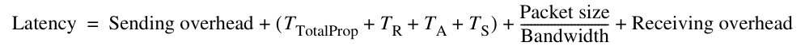

Ở đây TR , TA và TS lần lượt là tổng routing time, arbitration time và switching time mà packet trải qua, và là các đại lượng được đo hoặc được tính từ những phân tích chi tiết hơn. Các thành phần này được cộng với tổng propagation delay qua network link, TTotalProp, để cho time of flight tổng thể của packet.

Biểu thức trên chỉ cho một lower bound của tổng packet latency vì không tính đến các delay bổ sung do tranh chấp tài nguyên có thể xảy ra. Khi network chịu tải nặng, nhiều packet có thể đồng thời yêu cầu cùng tài nguyên network, gây tranh chấp làm suy giảm performance. Packet thua arbitration phải được đưa vào buffer, làm tăng packet latency thêm một khoảng thời gian chờ contention delay. Delay bổ sung này không được đưa vào biểu thức trên. Khi network hoặc một phần của nó gần đạt bão hòa, contention delay có thể lớn hơn nhiều bậc độ lớn so với tổng packet latency mà packet chịu trong điều kiện không tải hoặc thậm chí tải nhẹ. Tiếc là không dễ tính tổng packet latency bằng phân tích khi network chịu tải cao hơn mức vừa phải. Đo các đại lượng này bằng mô phỏng cycle-accurate một mô hình network chi tiết là cách tốt hơn và chính xác hơn để ước tính packet latency trong hoàn cảnh đó. Tuy nhiên, biểu thức trên hữu ích để tính lower bound best-case cho packet latency.

Vì những lý do tương tự, không dễ tính effective bandwidth chính xác, nhưng chúng ta có thể ước tính upper bound best-case bằng cách mở rộng phù hợp mô hình trình bày cuối mục trước. Điều cần làm là tìm đoạn hẹp nhất của đường ống network end-to-end bằng cách tìm network injection bandwidth (BWNetworkInjection), network reception bandwidth (BWNetworkReception) và network bandwidth (BWNetwork) trên toàn bộ network kết nối các thiết bị.

BWNetworkInjection có thể được tính đơn giản bằng cách nhân biểu thức link injection bandwidth, BWLinkInjection, với tổng số network injection link. BWNetworkReception được tính tương tự bằng BWLinkReception, nhưng còn phải nhân với một hệ số phản ánh application traffic và các đặc điểm khác. Với nhiều hơn hai thiết bị kết nối, không còn hợp lệ khi giả định quan hệ one-to-one giữa nguồn và đích lúc phân tích tác động flow control lên link reception bandwidth. Chẳng hạn, có thể xảy ra việc nhiều packet từ các injection link khác nhau đồng thời đến cùng một reception link đối với ứng dụng có đặc điểm traffic many-to-one, gây tranh chấp ở reception link. Tác động này có thể được tính bằng tham số average reception factor, σ, là đại lượng đo được hoặc tính được từ phân tích chi tiết. Nó được định nghĩa là tỷ phần hoặc tỷ lệ phần trăm trung bình của các packet đến reception link có thể được chấp nhận. Chỉ những packet đó mới có thể được chuyển ngay, do đó giảm network reception bandwidth theo hệ số đó. Sự giảm này là kết quả của hành vi ứng dụng bất kể đặc điểm nội bộ network. Cuối cùng, BWNetwork tính đến các đặc điểm nội bộ network, kể cả contention. Chúng ta sẽ dần xây dựng các biểu thức trong những mục tiếp theo cho phép tính đại lượng này khi thêm chi tiết về bên trong interconnection network hộp đen được hé lộ.

Nhìn chung, effective bandwidth mà network cung cấp end-to-end cho ứng dụng được xác định bằng giá trị nhỏ nhất trong ba phần, như mô tả sau:

Effective bandwidth = min ( BWNetworkInjection, BWNetwork, σ × BWNetworkReception)

= min ( N × BWLinkInjection, BWNetwork, σ × N × BWLinkReception)

Hãy dùng các biểu thức trên để so sánh latency và effective bandwidth của network shared-media với network switched-media cho bốn lĩnh vực interconnection network: OCN, SAN, LAN và WAN.

**Ví dụ** Hãy vẽ tổng packet latency và effective bandwidth khi số node được kết nối, N, tăng từ 4 lên 1024 cho OCN, SAN, LAN và WAN shared-media và switched-media. Giả định mọi network link, kể cả injection link và reception link tại node, đều có data bandwidth 8 Gbps, và các unicast packet 100 byte được truyền. Network Shared-media dùng chung một link, còn network switched-media có ít nhất số network link bằng số node. Với cả hai, bỏ qua tác động latency và bandwidth do contention bên trong network. End node có sending overhead và receiving overhead per-packet lần lượt là x + 0.05 ns/byte và 4/3(x) + 0.05 ns/byte, trong đó x bằng 0 μs cho OCN, 0.3 μs cho SAN, 3 μs cho LAN và 30 μs cho WAN, còn khoảng cách kết nối lần lượt là 0.5 cm, 5 m, 5000 m và 5000 km. Cũng giả định tổng routing time, arbitration time và switching time là các hằng số hoặc hàm của số node được kết nối: TR = 2.5 ns, TA = 2.5(N) ns và TS = 2.5 ns cho network shared-media, và TR = TA = TS = 2.5(log2 N) ns cho network switched-media. Cuối cùng, xét đặc điểm application traffic với cấu trúc network, average reception factor, σ, được giả định là N–1 cho môi trường dùng chung và polylogarithmic (log2 N)–1/4 cho môi trường chuyển mạch.

**Trả lời** Mọi thành phần của tổng packet latency giống ví dụ ở mục trước ngoại trừ time of flight, nay có thêm routing delay, arbitration delay và switching delay. Với network shared-media, tổng delay bổ sung là 5 + 2.5(N) ns; với network switched-media, tổng là 7.5(log2 N) ns. Chỉ latency của OCN và SAN được vẽ trong Hình F.9 vì những network này cho kết quả đáng chú ý hơn. Với OCN, TR, TA và TS cộng lại chi phối time of flight và lớn hơn nhiều so với từng thành phần latency khác khi số node từ vừa đến lớn. Điều này đặc biệt đúng với network shared-media. Latency tăng mạnh hơn nhiều theo số node với môi trường dùng chung so với môi trường chuyển mạch do khác biệt arbitration delay giữa hai loại. Với SAN, TR, TA và TS chi phối time of flight ở phần lớn kích thước network nhưng chỉ lớn hơn từng thành phần latency khác trong network shared-media khi network large-sized; chúng nhỏ hơn các thành phần latency khác đối với network switched-media nhưng không thể bỏ qua. Với LAN và WAN, time of flight bị propagation delay chi phối, và propagation delay chi phối các thành phần latency khác như tính ở mục trước; vì thế TR, TA và TS không đáng kể cho cả môi trường dùng chung lẫn chuyển mạch.

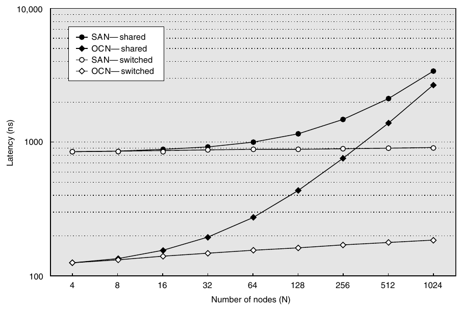

**Hình F.9 Latency theo số node được kết nối được vẽ ở dạng semi-log cho OCN và SAN. Routing, arbitration và switching tác động nhiều hơn đến latency của network trong hai lĩnh vực này, đặc biệt với network có nhiều node, do sending overhead, receiving overhead và propagation delay đều thấp.**

Hình F.10 vẽ effective bandwidth theo số node được kết nối cho bốn lĩnh vực network. Effective bandwidth của mọi network shared-media không đổi khi mở rộng network vì mỗi lần chỉ có thể nhận một unicast packet trên toàn bộ network reception link, và điều đó còn bị giới hạn bởi receiving overhead của từng network ngoại trừ OCN. Effective bandwidth của mọi network switched-media tăng theo số node được kết nối, nhưng bị giảm theo average reception factor. Receiving overhead tiếp tục giới hạn effective bandwidth với mọi loại ngoại trừ OCN.

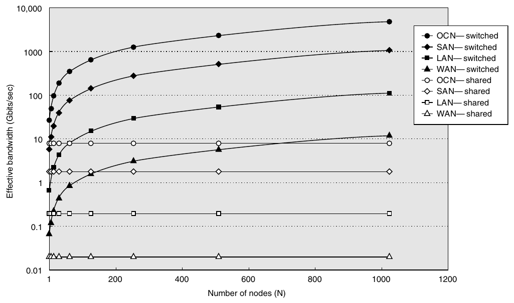

**Hình F.10 Effective bandwidth theo số node được kết nối được vẽ ở dạng semi-log cho bốn lĩnh vực network. Chênh lệch effective bandwidth giữa network shared- và switched-media trong mọi lĩnh vực interconnect mở rộng đáng kể khi số node trong network tăng. Chỉ switched network on-chip mới có thể đạt effective bandwidth bằng aggregate bandwidth với các tham số cho trong ví dụ này.**

Với những ưu điểm rõ ràng như vậy, tại sao switched network không phải lúc nào cũng được sử dụng? Máy tính trước đây chậm hơn nhiều và có thể dùng chung môi trường truyền dẫn network mà ít ảnh hưởng đến performance. Ngoài ra, switch cho LAN và WAN trước đây chiếm vài board lớn và có kích thước gần bằng cả một máy tính. Nhờ định luật Moore, kích thước switch đã giảm đáng kể, còn hệ thống có nhu cầu giao tiếp high-performance lớn hơn nhiều. Switched network cho phép giao tiếp hưởng cùng những tiến bộ nhanh chóng từ silicon như processor và main memory. Trong khi switch từ các công ty viễn thông trước đây từng có kích thước bằng mainframe, ngày nay chúng ta thấy switch single-chip và thậm chí toàn bộ switched network bên trong chip. Vì vậy, xu hướng công nghệ và ứng dụng hiện nay ủng hộ switched network. Cũng như processor single-chip đã khiến processor thay thế logic circuit ở nhiều nơi đến mức đáng ngạc nhiên, switch single-chip và switched network on-chip đang ngày càng thay thế network shared-media (tức bus) trong nhiều lĩnh vực ứng dụng. Ví dụ, PCI-Express (PCIe)—một switched network—được giới thiệu năm 2005 để thay thế bus PCI-X truyền thống trên motherboard của máy tính cá nhân.

Ví dụ trước cũng làm nổi bật tầm quan trọng của việc tối ưu các chức năng routing, arbitration và switching trong OCN và SAN. Đặc biệt với những lĩnh vực network này, khoảng cách interconnect và overhead thường đủ nhỏ để khiến latency và effective bandwidth nhạy cảm hơn nhiều với chất lượng triển khai các chức năng này, nhất là với network larger-sized. Điều này chủ yếu dẫn đến cách triển khai dựa phần lớn vào các giải pháp hardware nhanh hơn cho các lĩnh vực này. Trong LAN và WAN, cách triển khai dựa vào các giải pháp software chậm hơn nhưng linh hoạt hơn là đủ vì performance phần lớn được quyết định bởi những yếu tố khác. Thiết kế topology cho network switched-media cũng đóng vai trò lớn trong việc xác định network có thể đạt gần lower bound latency và upper bound effective bandwidth đến mức nào trong lĩnh vực OCN và SAN.

Ba mục tiếp theo đề cập đến những vấn đề quan trọng này trong switched network, với mục tiếp theo tập trung vào topology.

## F.4 Network Topology

Khi số thiết bị đủ nhỏ, một switch duy nhất đủ để kết nối chúng trong một network switched-media. Tuy nhiên, số switch port bị giới hạn bởi công nghệ very-large-scale integration (VLSI) hiện có, yếu tố chi phí, điện năng tiêu thụ, v.v. Khi số network port cần thiết vượt quá số port mà một switch hỗ trợ, cần một fabric gồm các switch được kết nối với nhau. Để có thuộc tính full access cần thiết (tức connectedness), network switch fabric phải cung cấp một đường đi từ mọi thiết bị end node tới mọi thiết bị khác. Mọi kết nối tới network fabric và giữa các switch trong fabric dùng link point-to-point thay cho shared link—tức link chỉ có một switch hoặc thiết bị end node ở mỗi đầu. Cấu trúc kết nối giữa mọi thành phần—gồm switch, link và thiết bị end node—được gọi là network topology.

Số network topology được mô tả trong tài liệu khó mà đếm hết, nhưng số đã được dùng thương mại không quá khoảng một tá. Trong những năm 1970 và đầu những năm 1980, các nhà nghiên cứu nỗ lực đề xuất topology mới có thể giảm số switch mà packet phải đi qua, được gọi là hop count. Trong những năm 1990, nhờ sự ra đời của kỹ thuật truyền pipeline và switching, hop count trở nên ít quan trọng hơn. Tuy vậy, ngày nay topology vẫn quan trọng, đặc biệt cho OCN và SAN, vì tồn tại các quan hệ tinh tế giữa topology và những tham số thiết kế network khác tác động đến performance, nhất là khi số end node rất lớn (ví dụ 64 K trong supercomputer Blue Gene/L) hoặc khi latency có tính then chốt (ví dụ trong multicore processor chip). Topology cũng ảnh hưởng lớn đến chi phí triển khai network.

Topology cho SAN của parallel supercomputer là những topology nổi bật và giàu sáng tạo nhất, thường hội tụ về những cấu trúc đều đặn để đơn giản hóa routing, packaging và scalability. Topology cho LAN và WAN thường tùy hứng hoặc ad hoc hơn, liên quan nhiều hơn đến thách thức khoảng cách xa hoặc kết nối giữa các communication subnet khác nhau. Topology Switch-based cho OCN chỉ mới xuất hiện gần đây nhưng nhanh chóng trở nên phổ biến. Mục này mô tả những topology phổ biến hơn được dùng trong sản phẩm thương mại. Ưu điểm, nhược điểm và ràng buộc của chúng cũng được thảo luận ngắn gọn.

### Centralized Switched Network

Như đã đề cập, một switch duy nhất đủ để kết nối một tập thiết bị khi số switch port bằng hoặc lớn hơn số thiết bị. Network đơn giản này thường được gọi là crossbar hoặc crossbar switch. Bên trong crossbar, độ phức tạp crosspoint switch tăng theo bình phương số port, như minh họa trong Hình F.11(a). Vì vậy, cần một giải pháp rẻ hơn khi số thiết bị cần kết nối tăng vượt quá mức công nghệ triển khai có thể hỗ trợ.

Một cách phổ biến để giải quyết vấn đề mở rộng crossbar là chia crossbar switch lớn thành nhiều stage gồm các switch nhỏ hơn, kết nối sao cho một lần đi qua switch fabric cho phép đi từ bất kỳ nguồn nào tới bất kỳ đích nào. Topology được bố trí theo cách này thường được gọi là multistage interconnection network hoặc multistage switch fabric, và độ phức tạp của những network này thường tăng tỷ lệ với N log N. Multistage interconnection network (MIN) ban đầu được đề xuất cho tổng đài điện thoại trong những năm 1950, và từ đó được dùng để xây dựng backbone giao tiếp cho parallel supercomputer, symmetric multiprocessor, multicomputer cluster và switch fabric của IP router.

Mẫu kết nối hoặc các mẫu kết nối giữa các stage của MIN là những hoán vị có thể được biểu diễn toán học bởi một tập hàm, mỗi stage một hàm. Hình F.11(b) cho thấy một MIN topology well-known, Omega, dùng hoán vị perfect-shuffle làm mẫu kết nối cho mỗi stage, theo sau bởi exchange switch, tạo ra perfect-shuffle exchange cho mỗi stage. Trong ví dụ này, tám port input-output được kết nối bằng ba stage gồm các switch 2 × 2. Dễ thấy một lần đi qua ba stage cho phép bất kỳ input port nào tới bất kỳ output port nào. Nhìn chung, khi dùng switch k × k, một MIN có N port input-output cần ít nhất logk N stage, mỗi stage chứa N/k switch, với tổng cộng N/k (logkN) switch.

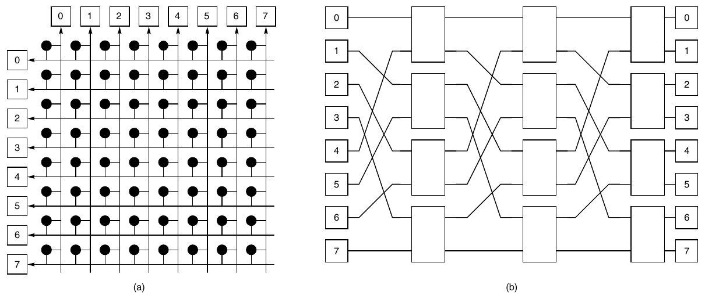

**Hình F.11 Những centralized switched network phổ biến: (a) network crossbar cần N2 crosspoint switch, biểu diễn bằng chấm đen; (b) Omega, một MIN, cần N/2 log2 N switch, biểu diễn bằng hình chữ nhật đứng. Thiết bị end node được biểu diễn bằng hình vuông đánh số (tổng cộng tám). Link có một chiều—dữ liệu đi vào ở bên trái và đi ra ở phía trên hoặc bên phải.**

Bất kể cấu trúc bên trong, MIN có thể được xem là centralized switch fabric có thiết bị end node kết nối tại ngoại vi network, do đó có tên centralized switched network. Từ góc nhìn khác, MIN có thể được xem là kết nối các node qua một tập switch có thể không có node nào được kết nối trực tiếp vào, dẫn tới một tên phổ biến khác cho centralized switched network—indirect network.

**Ví dụ** Hãy tính chi phí kết nối 4096 node bằng một crossbar switch duy nhất so với dùng MIN được xây từ switch 2 × 2, 4 × 4 và 16 × 16. Xét riêng chi phí tương đối của link một chiều và chi phí tương đối của switch. Chi phí switch được giả định tăng theo bình phương số input port (hoặc output port), k, cho switch k × k.

**Trả lời** Chi phí switch của network khi dùng một crossbar duy nhất tỷ lệ với 40962. Chi phí link một chiều là 8192, tính cả tập link từ end node đến crossbar và từ crossbar trở lại end node. Khi dùng MIN với switch k × k, chi phí mỗi switch tỷ lệ với k2 nhưng tổng cộng có 4096/k (logk 4096) switch. Tương tự, có (logk 4096) stage với N link một chiều mỗi stage đi từ các switch, cộng với N link từ end node tới MIN. Vì vậy, chi phí tương đối của crossbar so với từng MIN được cho bởi:

Relative cost (2 × 2)switches= 40962 / (22 × 4096/2 × log2 4096) = 170

Relative cost (4 × 4)switches= 40962 / (42 × 4096/4 × log4 4096) = 170

Relative cost (16 × 16)switches= 40962 / (162 × 4096/16 × log16 4096) = 85

Relative cost (2 × 2)links= 8192/ (4096 × (log2 4096 + 1)) = 2/13 = 0.1538

Relative cost (4 × 4)links= 8192/ (4096 × (log4 4096 + 1)) = 2/7 = 0.2857

Relative cost (16 × 16)links= 8192/ (4096 × (log16 4096 + 1)) = 2/4 = 0.5

Trong mọi trường hợp, crossbar đơn có chi phí switch cao hơn nhiều so với các MIN. Mức giảm chi phí mạnh nhất đến từ MIN gồm các switch nhỏ nhất nhưng có số lượng lớn nhất, tuy nhiên điều thú vị là MIN dùng switch 2 × 2 và 4 × 4 cho cùng chi phí switch tương đối. Chi phí link tương đối của crossbar thấp hơn MIN, nhưng ít hơn một bậc độ lớn trong mọi trường hợp. Cần nhớ rằng link của end node khác link của switch về chiều dài và yêu cầu packaging, nên chúng thường có chi phí liên quan khác nhau. Mặc dù chi phí link thấp hơn, crossbar có tổng chi phí tương đối cao hơn.

Sự giảm chi phí switch của MIN phải trả giá bằng performance: contention dễ xảy ra hơn trên network link, do đó làm suy giảm performance. Contention dưới dạng packet bị chặn trong network phát sinh vì các đường đi từ nguồn khác nhau tới đích khác nhau đồng thời dùng chung một hoặc nhiều link. Mức contention trong network phụ thuộc hành vi communication traffic. Ví dụ, trong network Omega ở Hình F.11(b), packet từ port 0 tới port 1 bị chặn ở stage switch đầu tiên khi đợi packet từ port 4 tới port 0. Trong crossbar, không xảy ra blocking như vậy vì link không được dùng chung giữa các đường tới những đích riêng biệt. Vì vậy, crossbar là nonblocking. Dĩ nhiên, nếu hai node cố gửi packet tới cùng một đích, blocking sẽ xảy ra ở reception link ngay cả với crossbar network. Điều này được tính đến bằng tham số average reception factor (σ) khi phân tích performance, như thảo luận cuối mục trước.

Để giảm blocking trong MIN, phải thêm switch hoặc dùng switch lớn hơn để cung cấp những đường thay thế từ mọi nguồn tới mọi đích. Giải pháp thường dùng thứ nhất là thêm tối thiểu logk N − 1 switch stage vào MIN sao cho chúng phản chiếu topology ban đầu. Network thu được là rearrangeably nonblocking vì cho phép thiết lập đường không xung đột giữa các cặp source-destination mới, nhưng cũng tăng gấp đôi hop count và có thể cần sắp xếp lại đường đi của một số cặp đang giao tiếp dưới một cơ chế điều khiển tập trung. Giải pháp thứ hai dùng cách khác. Thay vì dùng thêm switch stage, các switch lớn hơn—có thể được triển khai bằng nhiều stage nếu muốn—được dùng ở giữa hai switch stage khác sao cho đủ đường thay thế qua các switch middle-stage để thiết lập các đường không xung đột giữa stage đầu và cuối. Ví dụ best-known là network Clos, vốn là nonblocking. Thuộc tính multipath của topology Clos three-stage có thể được áp dụng đệ quy cho switch middle-stage để giảm kích thước mọi switch xuống 2 × 2, giả định ban đầu switch kích thước này được dùng ở stage đầu và cuối. Kết quả là topology Beneŝ gồm 2(log2 N) − 1 stage, có tính rearrangeably nonblocking. Hình F.12(a) minh họa cả hai topology, trong đó mọi switch không nằm ở stage đầu và cuối tạo thành các switch middle-stage (theo cách đệ quy) của network Clos.

Các MIN mô tả cho đến nay có network link một chiều, nhưng các dạng hai chiều dễ dàng được suy ra từ network đối xứng như Clos và Beneŝ chỉ bằng cách gấp chúng lại. Những link một chiều chồng lên nhau chạy theo hướng khác nhau, do đó tạo thành link hai chiều, và những switch chồng lên nhau hợp thành một switch duy nhất có số port gấp đôi (tức switch 4 × 4). Hình F.12(b) cho thấy topology folded Beneŝ thu được nhưng trong trường hợp này end node kết nối vào switch stage trong cùng của Beneŝ ban đầu. Các port vẫn rảnh ở phía bên kia network nhưng có thể được dùng để mở rộng network lên kích thước lớn hơn về sau. Loại network này được gọi là bidirectional multistage interconnection network. Trong số nhiều thuộc tính hữu ích của chúng là tính module và khả năng khai thác communication locality, giúp packet không phải đi qua mọi network stage. Tính đều đặn cũng giảm độ phức tạp routing, còn thuộc tính multipath cho phép routing traffic đều hơn trên các tài nguyên network và chịu được lỗi.

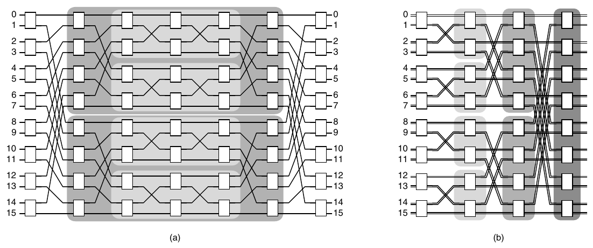

**Hình F.12 Hai network Beneŝ. (a) Một topology Clos 16-port, trong đó các switch middle-stage tô màu đậm hơn được triển khai bằng một network Clos khác có switch middle-stage tô màu nhạt hơn được triển khai bằng một network Clos nữa, và cứ thế cho tới khi tạo ra network Beneŝ chỉ dùng switch 2 × 2 ở khắp nơi. (b) Một network folded Beneŝ (hai chiều) dùng switch 4 × 4; end node gắn với tập switch trong cùng của network Beneŝ (một chiều). Topology này tương đương fat tree, trong đó các đỉnh cây được tô màu.**

Một cách khác để tạo MIN hai chiều với thuộc tính nonblocking (có thể sắp xếp lại) là hình thành cây cân bằng, trong đó thiết bị end node chiếm các lá và switch chiếm các đỉnh bên trong cây. Phải cung cấp đủ link ở mỗi mức cây sao cho tổng link bandwidth không đổi trên mọi mức. Ngoài ra, ngoại trừ root, số switch port cho mỗi đỉnh thường tăng theo ki × ki, trong đó i là mức cây. Có thể thực hiện điều này bằng cách dùng tổng cộng ki-1 switch tại mỗi đỉnh, mỗi switch có k input port và k output port, hoặc k port hai chiều (tức port input-output k × k). Network có topology như vậy được gọi là fat tree network. Vì chỉ một nửa số k port hai chiều được dùng theo mỗi hướng, cần 2N/k switch trong mỗi stage, với tổng cộng 2N/k (logk/2 N) switch trong fat tree. Số switch trong root stage có thể giảm một nửa vì không cần forward link, giảm số switch đi N/k. Hình F.12(b) cho thấy một fat tree dùng switch 4 × 4. Như có thể thấy, nó giống hệt folded Beneŝ.

Fat tree là topology được lựa chọn trên nhiều quy mô network cho phần lớn hệ thống thương mại dùng multistage interconnection network. Phần lớn SAN dùng trong multicomputer cluster, và nhiều SAN dùng trong những supercomputer mạnh nhất, dựa trên fat tree. Các communication subsystem thương mại do Myrinet, Mellanox và Quadrics cung cấp cũng được xây dựng từ fat tree.

### Distributed Switched Network

Network Switched-media cung cấp một framework rất linh hoạt để thiết kế communication subsystem nằm bên ngoài các thiết bị cần giao tiếp, như trình bày trên. Tuy nhiên, có những trường hợp nên tích hợp end node chặt chẽ hơn với tài nguyên network dùng để cho phép chúng giao tiếp. Thay vì tập trung switch fabric trong một subsystem bên ngoài, một cách khác là phân bố network switch giữa các end node, khi đó chúng trở thành network node hay đơn giản là node, tạo thành distributed switched network. Hệ quả là mỗi network switch có một hoặc nhiều thiết bị end node kết nối trực tiếp vào, tạo thành một network node. Những node này kết nối trực tiếp với node khác mà không gián tiếp đi qua switch bên ngoài nào, dẫn tới tên phổ biến khác cho các network này—direct network.

Topology cho distributed switched network có hình thức rất khác centralized switched network ở chỗ end node được kết nối khắp diện tích switch fabric, thay vì chỉ ở một hoặc hai cạnh ngoại vi của fabric. Điều này khiến số switch trong hệ thống bằng tổng số node. Một cách khá hiển nhiên để kết nối node là nối dedicated link giữa mỗi node với mọi node khác trong network. Topology fully connected này cung cấp connectivity tốt nhất (thực chất là full connectivity), nhưng tốn kém hơn crossbar network, như ví dụ sau cho thấy.

**Ví dụ** Hãy tính chi phí kết nối N node bằng topology fully connected so với dùng topology crossbar. Xét riêng chi phí tương đối của link một chiều và chi phí tương đối của switch. Chi phí switch được giả định tăng theo bình phương số port một chiều cho switch k × k nhưng chỉ tăng tuyến tính với switch 1 × k.

**Trả lời** Topology crossbar cần một switch N × N nên chi phí switch tỷ lệ với N2. Chi phí link là 2N, tính cả link một chiều từ end node tới centralized crossbar và ngược lại. Trong topology fully connected, hai tập switch 1 × (N − 1) (có thể hợp thành một tập) được dùng trong mỗi node trong số N node để kết nối trực tiếp tới và từ mọi node khác. Vì vậy, tổng chi phí switch cho cả N node tỷ lệ với 2N(N − 1). Về chi phí link, mỗi node trong số N node cần hai link một chiều chạy ngược hướng giữa thiết bị end node và local switch của nó. Ngoài ra, mỗi node có N − 1 link một chiều từ local switch tới các switch khác phân bố trên mọi end node còn lại. Do đó, tổng số link một chiều là 2N + N(N − 1), bằng N(N + 1) cho cả N node. Vì vậy, chi phí tương đối của topology fully connected so với crossbar là:

Relative costswitches = 2N(N − 1) / N2 = 2(N − 1) / N = 2(1 − 1/N)

Relative costlinks = N(N + 1) / 2N = (N + 1)/2

Khi số thiết bị được kết nối tăng, chi phí switch của topology fully connected gần gấp đôi crossbar, và cả hai đều rất cao (tức tăng theo bình phương). Hơn nữa, topology fully connected luôn có chi phí link tương đối cao hơn, tăng tuyến tính theo số node. Một lần nữa, cần nhớ rằng link của end node khác link của switch về chiều dài và packaging, đặc biệt với direct network, nên chúng thường có chi phí liên quan khác nhau. Mặc dù chi phí cao hơn, topology fully connected không đem lại lợi ích performance bổ sung so với crossbar vì cả hai đều nonblocking. Vì vậy, trên thực tế người ta thường dùng crossbar network thay cho fully connected network.

Một phương án lower-cost thay cho kết nối đầy đủ mọi node trong network là kết nối trực tiếp các node nối tiếp nhau theo topology ring, như Hình F.13. Với ring hai chiều, mỗi node trong số N node giờ chỉ dùng switch 3 × 3 và hai network link hai chiều (dùng chung với node lân cận), tổng cộng N switch và N network link hai chiều. Chi phí tuyến tính này không bao gồm N link injection-reception hai chiều cần thiết bên trong node.

Khác network shared-media, ring có thể cho phép nhiều lần truyền đồng thời: node thứ nhất có thể gửi cho node thứ hai trong khi node thứ hai gửi cho node thứ ba, v.v. Tuy nhiên, vì không tồn tại dedicated link giữa các cặp node không kề nhau về mặt logic, packet phải đi qua những node trung gian trước khi tới đích, làm tăng transport latency. Với ring hai chiều, packet có thể được truyền theo cả hai hướng, thường chọn đường ngắn nhất tới đích. Trong trường hợp này, packet phải đi trung bình N/4 network switch hop, với tổng switch hop count lớn hơn một để tính local switch tại node nguồn packet. Trên đường đi, packet có thể bị chặn tại tài nguyên network do các packet khác đồng thời tranh chấp cùng tài nguyên.

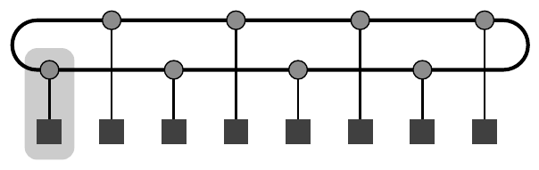

**Hình F.13 Một topology network ring, được gấp lại để giảm chiều dài link dài nhất. Hình tròn tô màu biểu diễn switch, còn hình vuông đen biểu diễn thiết bị end node. Hình chữ nhật xám chỉ một network node gồm switch, thiết bị và link kết nối của nó.**

Network fully connected và ring-connected xác định hai cực của distributed switched topology, nhưng ở giữa còn nhiều lựa chọn đáng quan tâm cho một tập yêu cầu cost-performance cho trước. Nhìn chung, topology switched-media lý tưởng có chi phí gần ring nhưng performance gần topology fully connected. Hình F.14 minh họa ba direct network topology phổ biến thường dùng trong các hệ thống trải rộng trên phổ cost-performance. Tất cả đều gồm các tập node bố trí theo nhiều chiều với mẫu kết nối đều đặn giữa các node có thể biểu diễn toán học. Trong topology mesh hay grid, mọi node ở mỗi chiều tạo thành một mảng tuyến tính. Trong topology torus, mọi node ở mỗi chiều tạo thành ring. Cả hai topology cung cấp giao tiếp trực tiếp tới node lân cận nhằm giảm số hop mà packet trải qua trong network so với ring. Điều này đạt được bằng cách cung cấp connectivity lớn hơn qua các chiều bổ sung, thường không quá ba trong hệ thống thương mại. Topology hypercube hay n-cube là trường hợp đặc biệt của mesh, trong đó chỉ hai node được kết nối theo mỗi chiều, dẫn tới số chiều n phải đủ lớn để kết nối cả N node trong hệ thống (tức n = log2 N). Hypercube cung cấp connectivity tốt hơn mesh và torus, đổi lại chi phí link và switch cao hơn, xét theo số link và số port mỗi node.

**Ví dụ** Hãy tính chi phí kết nối N thiết bị bằng topology torus so với dùng topology fat tree. Xét riêng chi phí tương đối của link hai chiều và chi phí tương đối của switch—được giả định tăng theo bình phương số port hai chiều. Hãy đưa ra một biểu thức xấp xỉ cho trường hợp switch có kích thước tương tự nhau.

**Trả lời** Dùng switch k × k, fat tree cần 2N/k (logk/2 N) switch, giả định stage cuối (root) có cùng số switch với từng stage còn lại. Vì số port hai chiều trong mỗi switch là k (tức có k input port và k output port cho switch k × k) và chi phí switch tăng theo bình phương giá trị này, tổng chi phí switch của network tỷ lệ với 2kN logk/2 N. Chi phí link là N logk/2 N vì mỗi stage trong số logk/2 N stage cần N link hai chiều, bao gồm link giữa thiết bị và fat tree. Torus cần số switch bằng số node, mỗi switch có 2n + 1 port hai chiều, kể cả port để gắn thiết bị giao tiếp, trong đó n là số chiều. Vì vậy, tổng chi phí switch cho torus là (2n + 1)2N. Mỗi node torus cần 2n + 1 link hai chiều cho n chiều khác nhau và kết nối thiết bị end node của nó, nhưng vì link theo chiều được hai node dùng chung, tổng số link là (2n/2 + 1)N = (n + 1)N link hai chiều cho cả N node. Do đó, chi phí tương đối của topology torus so với fat tree là

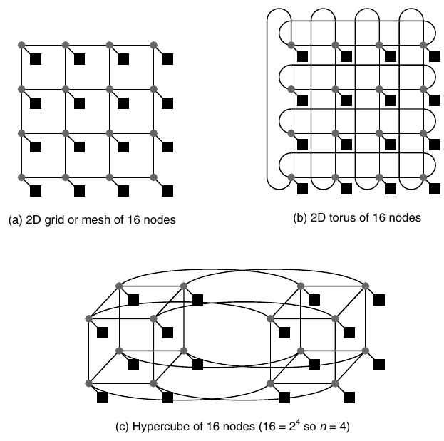

**Hình F.14 Direct network topology đã xuất hiện trong hệ thống thương mại, chủ yếu là supercomputer. Hình tròn tô màu biểu diễn switch, còn hình vuông đen biểu diễn thiết bị end node. Switch có nhiều network link hai chiều, nhưng ít nhất một link đi tới thiết bị end node. Các topology cơ bản này có thể được bổ sung link để cải thiện performance và reliability. Ví dụ, kết nối các switch ở ngoại vi mesh 2D trong (a) bằng các port chưa dùng trên mỗi switch tạo thành torus 2D trong (b). Topology hypercube trong (c) là một interconnect n-dimensional cho 2n node, cần n + 1 port mỗi switch: một port cho mỗi node trong số n node lân cận gần nhất và một port cho thiết bị end node.**

Relative costswitches = (2n + 1)2 N / 2kN logk/2 N = (2n + 1)2 / 2k logk/2 N

Relative costlinks = (n + 1)N / N logk/2 N = (n + 1) / logk/2 N

Khi kích thước switch tương tự nhau, 2n + 1 ≅ k. Trong trường hợp này, chi phí tương đối là

Relative costswitches = (2n + 1)2 / 2k logk/2 N = (2n + 1) / 2logk/2 N = k / 2logk/2 N

Khi số switch port (còn gọi là switch degree) nhỏ, torus có chi phí thấp hơn, đặc biệt khi số chiều thấp. Đây là thuộc tính đặc biệt hữu ích khi N lớn. Ngược lại, khi dùng switch lớn hơn và/hoặc số chiều torus cao, fat tree ít tốn kém hơn và được ưu tiên. Ví dụ, khi kết nối 256 node, fat tree đắt hơn bốn lần về chi phí switch và link khi dùng switch 4 × 4. Chi phí cao hơn này được bù bởi network contention trung bình thấp hơn. Fat tree có chi phí tương đương torus khi dùng switch 8 × 8 (ví dụ để kết nối 256 node). Với kích thước switch lớn hơn mức này, torus tốn kém hơn fat tree vì mỗi node bao gồm một switch. Chi phí này có thể được phân bổ bằng cách kết nối nhiều thiết bị end node vào mỗi switch, gọi là bristling.

Các topology trong Hình F.14 đều có chung một đặc điểm thú vị là network link được sắp xếp đều đặn theo nhiều chiều trực giao. Thực tế, tất cả topology này đều là những trường hợp riêng của một lớp direct network topology lớn hơn gọi là k-ary n-cubes, trong đó k chỉ số node được kết nối theo mỗi chiều trong n chiều. Tính đối xứng và đều đặn của những topology này đơn giản hóa triển khai network (tức packaging) và packet routing vì việc packet di chuyển dọc một chiều network cho trước không thay đổi số hop còn lại ở bất kỳ chiều nào khác để tới đích. Như chúng ta sẽ thấy trong mục tiếp theo, thuộc tính topology này có thể dễ dàng được khai thác bằng các routing algorithm đơn giản.

Tương tự network indirect tương ứng, direct network có thể tạo blocking giữa các packet đồng thời yêu cầu cùng đường đi hoặc một phần đường đi. Ngoại lệ duy nhất là fully connected network. Tương tự cách giảm số stage và switch hop trong indirect network bằng switch lớn hơn, hop count trong direct network cũng có thể giảm bằng cách tăng số chiều topology qua việc tăng switch degree.

Có vẻ luôn tối đa hóa số chiều cho một hệ thống có kích thước và chi phí switch nhất định là ý hay. Tuy nhiên, điều này không nhất thiết đúng. Phần lớn hệ thống điện tử được xây dựng trong thế giới three-dimensional (3D) của chúng ta bằng công nghệ packaging phẳng (2D) như chip mạch tích hợp, printed circuit board và backplane. Direct network có tới ba chiều có thể được triển khai bằng link tương đối ngắn trong không gian 3D này, không phụ thuộc kích thước hệ thống. Link trong network higher-dimensioned sẽ cần dây hoặc sợi quang ngày càng dài hơn. Sự tăng chiều dài link theo kích thước hệ thống này cũng đặc trưng cho MIN, kể cả fat tree, vốn cần link dài trong mọi stage hoặc link ngày càng dài hơn khi thêm stage. Như đã thấy trong ví dụ đầu tiên ở Mục F.2, buffer flow-controlled tăng dung lượng tỷ lệ với chiều dài link, do đó cần diện tích silicon lớn hơn. Đây là một trong những lý do supercomputer có số compute node lớn nhất tồn tại năm 2005, IBM Blue Gene/L, triển khai network torus 3D cho giao tiếp interprocessor. Fat tree sẽ cần link dài hơn nhiều, khiến hệ thống 64K node khó khả thi hơn. Điều này nhấn mạnh tầm quan trọng của việc lựa chọn đúng network topology phù hợp đáp ứng yêu cầu hệ thống.

Ngoài chiều dài link, những ràng buộc khác bắt nguồn từ việc triển khai topology cũng có thể giới hạn mức mở rộng của topology. Đó là pin-out sẵn có và bisection bandwidth có thể đạt được. Pin count là ràng buộc cục bộ đối với bandwidth của chip, printed circuit board và connector của backplane (hoặc chassis). Trong direct network tích hợp processor core và switch trên một chip hoặc multichip module, pin bandwidth được dùng cả để giao tiếp với main memory lẫn triển khai node link. Trong trường hợp này, pin count hạn chế có thể giảm số switch port hoặc bit line mỗi link. Trong indirect network, switch được triển khai tách biệt khỏi processor core, cho phép dành phần lớn pin cho communication bandwidth. Tuy nhiên, khi switch được nhóm lên board, tổng các link input-output của switch fabric trên một board cho một topology cho trước không được vượt quá pin-outs của board connector.

Bisection bandwidth là ràng buộc mang tính toàn cục hơn, cho biết interconnect density và bandwidth có thể đạt được bằng một công nghệ triển khai (packaging) cho trước. Interconnect density và clock frequency có liên hệ với nhau: khi các dây được bố trí gần nhau hơn, crosstalk và điện dung ký sinh tăng, thường buộc phải giảm clock frequency. Ví dụ, số lượng và khoảng cách giữa các lớp kim loại giới hạn wire density và frequency của network on-chip, còn mật độ đường đồng giới hạn wire density và frequency trên printed circuit board. Để có thể triển khai, topology của network không được vượt quá bisection bandwidth sẵn có của công nghệ triển khai. Phần lớn network được triển khai cho tới nay bị ràng buộc bởi giới hạn pin-out nhiều hơn bisection bandwidth, đặc biệt với sự chuyển dịch gần đây sang hệ thống blade-based. Tuy vậy, bisection bandwidth ảnh hưởng lớn đến performance.

Với một topology cho trước, bisection bandwidth, BWBisection, được tính bằng cách chia network thành hai phần gần bằng nhau—mỗi phần có một nửa số node—và cộng bandwidth của các link cắt qua đường chia tưởng tượng. Với topology không đối xứng, bisection bandwidth là giá trị nhỏ nhất trong mọi cặp phần chia equal-sized của network. Với fully connected network, bisection bandwidth tỷ lệ với N2/ 2 link một chiều (hoặc N2/ 4 link hai chiều), trong đó N là số node. Với bus, bisection bandwidth chỉ là bandwidth của một shared link half-duplex duy nhất. Với các topology khác, giá trị nằm giữa hai cực này. Network injection bisection bandwidth và reception bisection bandwidth thường được dùng làm giá trị tham chiếu, bằng N/2 cho network có lần lượt N injection link và N reception link. Bất kỳ network topology nào cung cấp bisection bandwidth này đều được gọi là có full bisection bandwidth.

Hình F.15 tóm tắt số switch và link cần thiết, kích thước switch tương ứng, khoảng cách switch hop tối đa và trung bình giữa các node, cùng bisection bandwidth tính theo số link cho một số topology thảo luận trong mục này để kết nối 64 node.

| Hạng mục đánh giá | Bus | Ring | Mesh 2D | Torus 2D | Hypercube | Fat tree | Fully connected |
|---|---|---|---|---|---|---|---|
| Performance |  |  |  |  |  |  |  |
| BWBisection tính theo số link | 1 | 2 | 8 | 16 | 32 | 32 | 1024 |
| Hop count tối đa (trung bình) | 1 (1) | 32 (16) | 14 (7) | 8 (4) | 6 (3) | 11 (9) | 1 (1) |
| Chi phí |  |  |  |  |  |  |  |
| Số I/O port mỗi switch | NA | 3 | 5 | 5 | 7 | 4 | 64 |
| Số switch | NA | 64 | 64 | 64 | 64 | 192 | 64 |
| Số network link | 1 | 64 | 112 | 128 | 192 | 320 | 2016 |
| Tổng số link | 1 | 128 | 176 | 192 | 256 | 384 | 2080 |

**Hình F.15 Performance và chi phí của một số network topology cho 64 node. Bus là chuẩn tham chiếu với chi phí network link và bisection bandwidth bằng đơn vị. Các giá trị được cho theo link và port hai chiều. Hop count bao gồm switch và output link của nó, nhưng không bao gồm injection link tại end node. Ngoại trừ bus, các giá trị được cho về số network link và tổng số link, kể cả injection/reception link giữa thiết bị end node và network.**

### Tác động của Topology lên Network Performance

Switched network topology yêu cầu packet đi một hoặc nhiều hop để tới đích, trong đó mỗi hop đại diện cho việc truyền packet qua một switch và một link tương ứng của nó. Điều thú vị là mỗi switch cùng các link tương ứng có thể được mô hình hóa như một network hộp đen kết nối nhiều hơn hai thiết bị, như mô tả ở mục trước, trong đó thuật ngữ “thiết bị” ở đây chỉ end node hoặc switch khác. Khác biệt duy nhất là sending overhead và receiving overhead qua switch bằng không, còn routing delay, switching delay và arbitration delay không phải tổng tích lũy mà là delay gắn với từng switch.

Do những điều trên, nếu packet trung bình phải đi qua d hop để tới đích thì TR + TA + TS = (Tr + Ta + Ts) × d, trong đó Tr, Ta và Ts lần lượt là routing delay, arbitration delay và switching delay của một switch. Với giả định pipelining qua network được chia stage tại mỗi hop ở cấp packet (giả định này sẽ được xem xét lại ở mục sau), transmission delay cũng tăng theo hệ số bằng số hop. Cuối cùng, với giả định đơn giản hóa rằng mọi injection link tới switch đầu tiên hoặc stage switch đầu tiên và mọi link (kể cả reception link) từ các switch có chiều dài và delay xấp xỉ nhau, tổng propagation delay qua network TTotalProp là propagation delay qua một link duy nhất, TLinkProp, nhân với d + 1, tức hop count cộng một để tính injection link. Do đó, biểu thức lower-bound best-case cho packet latency trung bình trong network (tức latency khi không có contention) được cho bởi biểu thức sau:

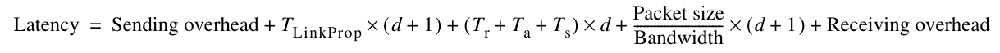

Một lần nữa, biểu thức ở trang F-40 giả định switch có thể pipeline việc truyền packet ở cấp packet.

Theo phương pháp trình bày trước đó, chúng ta có thể ước tính upper bound best-case của effective bandwidth bằng cách tìm đoạn hẹp nhất của đường ống network end-to-end. Tập trung vào phần network nội bộ của đường ống đó, network bandwidth được quyết định bởi các thuộc tính blocking của topology. Hành vi nonblocking chỉ có thể đạt được bằng cách cung cấp nhiều đường thay thế giữa mọi cặp source-destination, dẫn đến aggregate network bandwidth cao hơn nhiều lần aggregate network injection bandwidth hoặc reception bandwidth. Điều này khá tốn kém. Vì giải pháp này thường đắt đến mức không khả thi, phần lớn network có những mức blocking khác nhau, làm giảm mức sử dụng aggregate bandwidth mà topology cung cấp. Điều này cũng tốn kém, nhưng không xét theo performance.

Lượng blocking trong network phụ thuộc topology và phân bố traffic. Giả định bisection bandwidth, BWBisection, của topology có thể triển khai được (như thường xảy ra), nó có thể được dùng làm thước đo hằng số của mức blocking tối đa trong network. Trong trường hợp lý tưởng, network luôn đạt full bisection bandwidth bất kể hành vi traffic, do đó chuyển điểm bottleneck sang injection link hoặc reception link. Tuy nhiên, vì packet có đích ở nửa kia network nhất thiết phải đi qua bisection link, những link đó là bottleneck link tiềm tàng—có thể giảm network bandwidth xuống dưới full bisection bandwidth. May thay, không phải mọi traffic đều phải đi qua network bisection, cho phép sử dụng nhiều hơn aggregate network bandwidth mà topology cung cấp. Ngoài ra, network topology có số bisection link cao hơn thường có ít blocking hơn vì có nhiều đường thay thế hơn để tới đích, và do đó có thể sử dụng tỷ lệ aggregate network bandwidth cao hơn. Nếu chỉ một phần traffic phải đi qua network bisection, được biểu diễn bởi tham số bisection traffic fraction γ (0 < γ ≤ 1), thì đường ống network tại bisection được mở rộng hiệu dụng theo nghịch đảo của phần đó, giả định một phân bố traffic khiến bisection link chịu tải trung bình ít nhất cũng nặng như các network link khác. Điều này xác định giới hạn trên của network bandwidth có thể đạt được, BWNetwork:

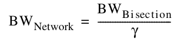

Theo đó, biểu thức effective bandwidth trở thành biểu thức sau khi tính đến network topology:

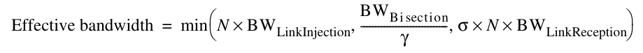

Cần lưu ý rằng γ phụ thuộc nhiều vào traffic pattern do ứng dụng sinh ra. Đây là đại lượng đo được hoặc được tính từ phân tích traffic chi tiết.

**Ví dụ** Một communication pattern phổ biến trong chương trình khoa học là cho các phần tử lân cận gần nhất của một array two-dimensional giao tiếp theo một hướng cho trước. Pattern này đôi khi được gọi là giao tiếp NEWS, viết tắt của north, east, west và south—những hướng trên la bàn. Hãy ánh xạ one-to-one một array phần tử 8 × 8 lên 64 thiết bị end node được kết nối theo các topology sau: bus, ring, mesh 2D, torus 2D, hypercube, fully connected và fat tree. Trong trường hợp tốt nhất, mất bao lâu để mỗi node gửi một message tới node lân cận phía bắc và một tới node lân cận phía đông, giả định packet được phép dùng bất kỳ minimal path nào mà topology cung cấp? Effective bandwidth tương ứng là bao nhiêu? Bỏ qua những phần tử không có node lân cận phía bắc hoặc phía đông. Để đơn giản hóa phân tích, giả định mọi network có packet transport time bằng một đơn vị cho mỗi network hop—tức tổng TLinkProp, Tr, Ta, Ts và packet transmission time cho mỗi hop bằng một. Cũng giả định delay qua injection link được tính trong đơn vị thời gian này và sending/receiving overhead bằng không.

**Trả lời** Communication pattern này yêu cầu chúng ta gửi tổng cộng 2 × (64 – 8), tức 112 packet—nghĩa là 56 packet trong mỗi pha giao tiếp: hướng bắc và hướng đông. Số hop mà packet trải qua phụ thuộc topology. Giao tiếp giữa nguồn và đích là one-to-one, nên σ bằng 100%. Injection bandwidth và reception bandwidth giới hạn effective bandwidth tối đa ở 64 đơn vị BW (mặc dù communication pattern chỉ cần 56 đơn vị BW). Tuy nhiên, mức tối đa này có thể bị giảm bởi network bandwidth có thể đạt được, được quyết định bởi bisection bandwidth và tỷ phần traffic đi qua nó, γ, cả hai đều phụ thuộc topology. Các trường hợp như sau:

- Bus — Ánh xạ các phần tử array 8 × 8 vào node không tạo khác biệt với bus vì mọi node đều cách nhau cùng một hop. Tuy nhiên, 112 lần truyền được thực hiện tuần tự, mất tổng cộng 112 đơn vị thời gian. Bisection bandwidth bằng 1, và γ bằng 100%. Do đó effective bandwidth chỉ bằng 1 đơn vị BW.

- Ring— Giả định hàng đầu tiên của array được ánh xạ vào node 0 đến 7, hàng thứ hai vào node 8 đến 15, v.v. Chỉ mất một đơn vị thời gian để mọi node đồng thời gửi tới node lân cận phía đông (tức truyền từ node i tới node i + 1). Với ánh xạ này, node lân cận phía bắc của mỗi node cách đúng tám hop nên cần tám đơn vị thời gian, cũng được thực hiện song song cho mọi node. Do đó tổng thời gian giao tiếp là 9 đơn vị thời gian. Bisection bandwidth là 2 link hai chiều (giả định ring hai chiều), nhỏ hơn full bisection bandwidth là 32 link hai chiều. Với giao tiếp hướng đông, vì chỉ 2 trong 56 packet hướng đông phải đi qua bisection trong trường hợp xấu nhất, bisection link không trở thành bottleneck. Với giao tiếp hướng bắc, 8 trong 56 packet phải đi qua hai bisection link, cho γ bằng 10/112 = 8.93%. Do đó network bandwidth là 2/.0893 = 22.4 đơn vị BW. Điều này cũng giới hạn effective bandwidth ở 22.4 đơn vị BW, chưa bằng một nửa bandwidth mà communication pattern yêu cầu.

- Mesh 2D— Có tám hàng và tám cột trong grid 64 node, khớp hoàn hảo với giao tiếp NEWS. Chỉ mất tổng cộng 2 đơn vị thời gian để mọi node đồng thời gửi tới node lân cận phía bắc, rồi đồng thời giao tiếp với node lân cận phía đông. Bisection bandwidth là 8 link hai chiều, nhỏ hơn full bisection bandwidth. Tuy nhiên, sự khớp hoàn hảo của communication pattern lân cận gần nhất này với topology cho phép đạt effective bandwidth tối đa bất chấp điều đó. Với giao tiếp hướng đông, 8 trong 56 packet phải đi qua bisection trong trường hợp xấu nhất, không vượt quá bisection bandwidth. Không có giao tiếp hướng bắc nào đi qua cùng network bisection, cho γ bằng 8/112 = 7.14% và network bandwidth bằng 8/0.0714 = 112 đơn vị BW. Do đó effective bandwidth bị giới hạn bởi communication pattern ở 56 đơn vị BW chứ không phải bởi mesh network.

- Torus 2D— Link Wrap-around của torus không được dùng cho communication pattern này, nên torus có cùng ánh xạ và performance với mesh.

- Hypercube — Giả định các phần tử trong mỗi hàng được ánh xạ vào cùng vị trí trong tám 3-cubes tạo thành hypercube, sao cho các phần tử liên tiếp trong hàng được ánh xạ vào những node chỉ cách nhau một hop. Node lân cận phía bắc có thể được ánh xạ tương tự vào những node chỉ cách một hop ở một chiều trực giao. Vì vậy, communication pattern chỉ mất 2 đơn vị thời gian. Hypercube cung cấp full bisection bandwidth là 32 link, nhưng tối đa chỉ 8 trong 112 packet phải đi qua bisection. Do đó effective bandwidth chỉ bị giới hạn bởi communication pattern ở 56 đơn vị BW, chứ không bởi hypercube network.

- Fully connected—Ở đây các node cách nhau cùng một hop bất kể ánh xạ. Truyền packet song song theo cả hướng bắc và đông sẽ chỉ mất 1 đơn vị thời gian nếu injection link và reception link có thể phát và nhận hai packet cùng lúc. Vì điều này không đúng, cần 2 đơn vị thời gian. Effective bandwidth bị giới hạn bởi communication pattern ở 56 đơn vị BW, nên 1024 network bisection link phần lớn không được tận dụng.

- Fat tree— Giả định ánh xạ phần tử vào node giống như với ring và dùng switch có tám port hai chiều. Điều này cho phép giao tiếp đồng thời tới node lân cận phía đông, mất tối đa ba hop và do đó 3 đơn vị thời gian qua ba stage hai chiều kết nối tám node trong mỗi nhóm của tám nhóm node. Node lân cận phía bắc của mỗi node nằm trong nhóm tám node liền kề, cần năm hop, hay 5 đơn vị thời gian. Vì thế, tổng thời gian cần trên fat tree là 8 đơn vị thời gian. Fat tree cung cấp full bisection bandwidth, nên trong trường hợp xấu nhất khi một nửa traffic cần đi qua bisection, effective bandwidth 56 đơn vị BW (bị giới hạn bởi communication pattern chứ không phải network fat-tree) đạt được khi packet được đưa vào liên tục.

Ví dụ trên không nên khiến người đọc kết luận sai rằng mesh tốt ngang torus, hypercube, fat tree và những network khác có bisection bandwidth cao hơn. Một số giả định đơn giản hóa có lợi cho network low-bisection đã được dùng để dễ phân tích. Trong thực tế, packet thường lớn hơn link width và chiếm link trong nhiều network cycle chứ không chỉ một. Ngoài ra, nhiều communication pattern không ánh xạ gọn gàng vào network topology mesh 2D; thay vào đó, chúng thường mang tính toàn cục và bất quy tắc hơn. Những yếu tố này cùng các yếu tố khác kết hợp làm tăng khả năng packet bị blocking trong network low-bisection, tăng latency và giảm effective bandwidth.

| Công ty | Tên hệ thống [network] | Số node tối đa [× số CPU] | Network topology cơ bản | BW injection [reception] của node tính bằng MB/sec | Số data bit mỗi link theo mỗi chiều | Raw network link BW mỗi chiều tính bằng MB/sec | Raw network bisection BW (hai chiều) tính bằng GB/sec |
|---|---|---|---|---|---|---|---|
| Intel | ASCI Red Paragon | 4816 [× 2] | 2D mesh 64 × 64 | 400 [400] | 16 bits | 400 | 51.2 |
| IBM | ASCI White SP Power3 [Colony] | 512 [× 16] | MIN hai chiều với switch hai chiều 8-port (thường là fat tree hoặc Omega) | 500 [500] | 8 bit (+1 control bit) | 500 | 256 |
| Intel | Thunder Itanium2 Tiger4 [QsNetII] | 1024 [× 4] | Fat tree với switch hai chiều 8-port | 928 [928] | 8 bit (+2 bit điều khiển cho mã hóa 4b/5b) | 1333 | 1365 |
| Cray | XT3 [SeaStar] | 30,508 [× 1] | 3D torus 40 × 32 × 24 | 3200 [3200] | 12 bits | 3800 | 5836.8 |
| Cray | X1E | 1024 [× 1] | Torus 2D bristled 4-way (~23 × 11) với express link | 1600 [1600] | 16 bit | 1600 | 51.2 |
| IBM | ASC Purple pSeries 575 [Federation] | >1280 [× 8] | MIN hai chiều với switch hai chiều 8-port (thường là fat tree hoặc Omega) | 2000 [2000] | 8 bit (+2 control bit cho cơ chế mã hóa 5b/6b mới) | 2000 | 2560 |
| IBM | Blue Gene/L eServer Sol. [Torus Net.] | 65,536 [× 2] | Torus 3D 32 × 32 × 64 | 612.5 [1050] | 1 bit (bit nối tiếp) | 175 | 358.4 |

**Hình F.16 Đặc điểm topology của interconnection network dùng trong máy tính thương mại high-performance.**

Để đặt thảo luận topology này vào góc nhìn đầy đủ hơn, Hình F.16 liệt kê các thuộc tính khác nhau của topology dùng trong máy tính thương mại high-performance.

## F.5 Network Routing, Arbitration và Switching

Routing, arbitration và switching được thực hiện tại mọi switch trên đường đi của packet trong switched media network, bất kể network topology. Nhiều kỹ thuật thú vị để thực hiện các chức năng network này đã được đề xuất trong tài liệu. Trong mục này, chúng ta tập trung mô tả một tập cách tiếp cận đại diện được dùng trong hệ thống thương mại cho những network topology phổ biến hơn. Tác động của chúng lên performance cũng được làm nổi bật.

### Routing

Routing algorithm xác định đường đi network nào hoặc những đường nào được phép cho mỗi packet. Lý tưởng là routing algorithm cung cấp shortest path cho mọi packet sao cho traffic load được phân bố đều trên các network link để giảm thiểu contention. Tuy nhiên, một số đường đi mà network topology cung cấp có thể không được phép để bảo đảm mọi packet đều có thể được chuyển tới đích, bất kể hành vi traffic. Chẳng hạn, đường đi có số nonminimal hop được phép từ nguồn packet không giới hạn có thể khiến packet không bao giờ tới đích. Tình huống này được gọi là livelock. Tương tự, đường đi khiến một tập packet bị chặn trong network mãi mãi chỉ để đợi tài nguyên network (tức link hoặc buffer liên quan) do các packet khác trong tập giữ cũng ngăn packet tới đích. Tình huống này được gọi là deadlock. Vì deadlock phát sinh do tính hữu hạn của tài nguyên network, xác suất xảy ra tăng khi network traffic tăng và tài nguyên network sẵn có giảm. Để network hoạt động đúng, routing algorithm phải phòng tránh bất thường này, vốn có thể xuất hiện dưới nhiều dạng—ví dụ routing deadlock, deadlock request-reply (protocol), và deadlock fault-induced (reconfiguration), v.v. Đồng thời, để network cung cấp performance cao nhất có thể, routing algorithm phải hiệu quả—trong trường hợp tốt nhất, cho phép packet có số tùy chọn routing bằng số đường đi mà topology cung cấp.

Cách đơn giản nhất để phòng tránh livelock là hạn chế routing sao cho chỉ minimal path từ nguồn tới đích được phép, hoặc ít hạn chế hơn là chỉ cho phép một số lượng nonminimal hop hữu hạn. Hình thức nghiêm ngặt nhất có thêm lợi ích là tiêu thụ lượng network bandwidth tối thiểu, nhưng ngăn packet dùng alternative nonminimal path khi có contention hoặc lỗi trên shortest path (minimal path).

Deadlock khó phòng tránh hơn. Hai chiến lược phổ biến được dùng trong thực tế là avoidance và recovery. Trong deadlock avoidance, routing algorithm giới hạn đường đi được phép của packet ở những đường giữ trạng thái network toàn cục deadlock-free. Một cách phổ biến là thiết lập thứ tự giữa một tập tài nguyên—tập tối thiểu cần để hỗ trợ network full access—và cấp các tài nguyên đó cho packet theo một thứ tự toàn phần hoặc bộ phận để cyclic dependency không thể hình thành trên những tài nguyên ấy. Điều này cho phép luôn cung cấp escape path cho packet dù ở đâu trong network để tránh rơi vào trạng thái deadlock. Trong deadlock recovery, tài nguyên được cấp cho packet mà không quan tâm tránh deadlock. Thay vào đó, vì deadlock có thể xảy ra, một cơ chế được dùng để phát hiện khả năng deadlock tồn tại. Nếu phát hiện, một hoặc nhiều packet bị loại khỏi tài nguyên trong deadlock set—có thể bằng cách loại bỏ packet theo hướng lùi hoặc chuyển hướng packet tiến lên các tài nguyên deadlock recovery đặc biệt. Tài nguyên network được giải phóng sau đó được cấp cho những packet khác cần chúng để giải quyết deadlock.

Hãy xem xét routing algorithm được thiết kế cho distributed switched network. Hình F.17(a) minh họa một trong nhiều cấu hình deadlock có thể xảy ra cho packet trong một vùng của mesh network 2D. Routing algorithm có thể tránh mọi deadlock (và livelock) như vậy bằng cách chỉ cho phép dùng minimal path đi qua các chiều network theo một thứ tự toàn phần. Nghĩa là link của một chiều cho trước không được routing algorithm cung cấp cho packet cho tới khi packet không còn cần link nào ở mọi chiều đi trước để tới đích. Điều này được minh họa trong Hình F.17(b), nơi các chiều được đi qua theo thứ tự XY. Mọi packet phải tuân theo cùng thứ tự khi đi qua các chiều, chỉ rời một chiều khi không còn cần link ở chiều đó. Algorithm well-known này được gọi là routing dimension-order (DOR) hoặc routing e-cube trong hypercube. Nó được dùng trong nhiều hệ thống thương mại xây dựng từ distributed switched network và network on-chip. Vì routing algorithm này luôn cung cấp cùng một đường cho một cặp source-destination cho trước, nó là deterministic routing algorithm.

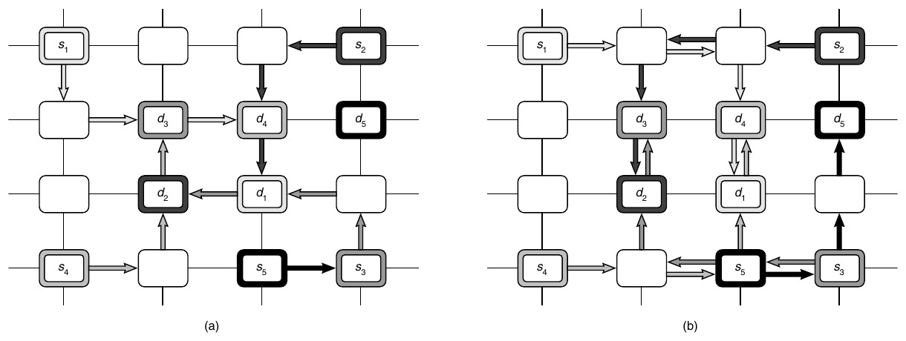

**Hình F.17 Một mesh network với packet được routing từ nguồn, si, tới đích, di. (a) Deadlock hình thành từ những packet có đích d1 đến d4 bị chặn bởi các packet khác trong cùng tập đang chiếm toàn bộ tài nguyên buffer mà chúng yêu cầu, cách đích của chúng một hop. Chu kỳ deadlock này khiến các packet khác cần những tài nguyên đó cũng bị chặn, như packet từ s5 có đích d5 đã tới node s3. (b) Deadlock được tránh bằng routing dimension-order. Trong trường hợp này, packet đi hết phần đường của chúng trong chiều X rồi mới rẽ vào chiều Y để hoàn tất routing.**

Đi qua các chiều theo thứ tự trên một tập tài nguyên tối thiểu cần để hỗ trợ network full access giúp tránh deadlock trong mesh và hypercube. Tuy nhiên, đối với distributed switched topology có link wrap-around (ví dụ ring và torus), cũng cần thứ tự toàn phần trên một tập tài nguyên tối thiểu trong mỗi chiều nếu muốn sử dụng tài nguyên hết dung lượng. Cách khác là phải giữ một số tài nguyên trống hoặc bubble dọc các chiều để duy trì dưới mức đầy dung lượng và tránh deadlock. Để cho phép full access, phải nhân đôi physical link hoặc nhân đôi logical buffer gắn với mỗi link, lần lượt tạo ra physical channel hoặc virtual channel để áp dụng thứ tự trên đó. Không cần áp dụng thứ tự trên mọi tài nguyên network để tránh deadlock—chỉ cần trên một tập tối thiểu cần thiết để hỗ trợ network full access (tức một escape resource set). Có thể định nghĩa routing algorithm dựa trên kỹ thuật này (gọi là protocol của Duato), cho phép dùng những đường thay thế do topology cung cấp cho một cặp source-destination cho trước bên cạnh escape resource set. Phải chọn một trong các đường được phép đó, ưu tiên đường hiệu quả nhất. Điều chỉnh đường đi theo tình trạng network traffic hiện tại cho phép tận dụng aggregate network bandwidth tốt hơn và giảm contention. Khả năng routing này được gọi là adaptive routing và được dùng trong nhiều hệ thống thương mại.

**Ví dụ** Thuật toán dimension-order routing loại bỏ bao nhiêu dimensional turn có thể có trên n-dimensional mesh network? Số turn ít nhất thực sự cần loại bỏ mà vẫn duy trì tính liên thông và không có deadlock là bao nhiêu? Hãy giải thích bằng một 2D mesh network.

**Trả lời** Thuật toán dimension-order routing loại bỏ đúng một nửa số dimensional turn có thể có, vì dễ chứng minh rằng mọi turn từ một dimension có thứ tự lower-ordered sang một dimension có thứ tự higher-ordered đều được phép, nhưng chiều ngược lại thì không. Chẳng hạn, trong tám turn có thể có trên 2D mesh ở Hình F.17, bốn turn từ X+ sang Y+, X+ sang Y–, X– sang Y+ và X– sang Y– được phép, trong đó các dấu (+ hoặc –) biểu thị hướng di chuyển trong một dimension. Bốn turn từ Y+ sang X+, Y+ sang X–, Y– sang X+ và Y– sang X– là những turn không được phép. Việc loại bỏ các turn này ngăn mọi loại cycle hình thành—và do đó tránh được deadlock—trong khi vẫn giữ cho network liên thông. Tuy nhiên, đổi lại, nó không cho phép bất kỳ khả năng thích nghi nào trong routing.

Thuật toán Turn Model routing chứng minh rằng số turn tối thiểu cần loại bỏ để ngăn cycle và duy trì tính liên thông là một phần tư số turn có thể có, nhưng phải chọn đúng tập turn. Chỉ một số tập turn bị loại bỏ cụ thể mới cho phép thỏa mãn cả hai yêu cầu. Nếu loại bỏ sai tập gồm một phần tư số turn, các tổ hợp turn được phép có thể mô phỏng những turn bị loại bỏ (và do đó tạo ra cycle cùng deadlock), hoặc network có thể mất tính liên thông. Chẳng hạn, với 2D mesh, có thể chỉ loại bỏ hai turn kết thúc theo hướng tây (tức là Y+ sang X– và Y– sang X–) bằng cách yêu cầu packet bắt đầu route theo hướng tây (nếu cần) để duy trì tính liên thông. Những lựa chọn thay thế cho west-first routing này trên 2D mesh là negative-first routing và north-last routing. Đối với chúng, một phần tư số turn được bổ sung ngoài những turn mà DOR cho phép tạo ra khả năng thích nghi một phần trong routing, khiến chúng trở thành các thuật toán adaptive routing.

Tương tự, có thể định nghĩa các thuật toán routing cho centralized switched network để tránh deadlock bằng cách hạn chế việc sử dụng resource theo một thứ tự toàn phần hoặc bộ phận nào đó. Đối với fat tree, các resource có thể được sắp theo thứ tự toàn phần dọc những path bắt đầu từ input leaf stage đi lên root rồi đi xuống output leaf stage. Thuật toán routing có thể cho phép packet sử dụng resource theo thứ tự bộ phận tăng dần, trước tiên đi lên tree cho đến khi gặp một least common ancestor (LCA) của source và destination, rồi đi xuống tree cho đến khi tới destination. Vì có nhiều least common ancestor cho một destination nhất định, nên có thể chọn nhiều path khác nhau khi đi lên tree, khiến thuật toán routing có tính thích nghi. Tuy nhiên, fat tree topology chỉ cung cấp một deterministic path duy nhất từ một least common ancestor đến destination. Thuộc tính self-routing này phổ biến ở nhiều MIN và có thể được khai thác dễ dàng: output port của switch tại mỗi stage được xác định đơn giản bằng cách dịch bit của destination node address.

Tổng quát hơn, một tree graph có thể được ánh xạ lên bất kỳ topology nào—dù direct hay indirect—và có thể cho phép các link giữa những node ở cùng tree level bằng cách gán hướng cho chúng, trong đó “up” chỉ các path tiến về tree root, còn “down” chỉ các path đi ra xa root node. Điều này cho phép định nghĩa up*/down* routing tổng quát trên bất kỳ topology nào sao cho packet đi theo các path (có thể theo cách thích nghi) gồm không hoặc nhiều up link, tiếp theo là không hoặc nhiều down link để tới destination. Thứ tự up/down ngăn cycle hình thành, tránh deadlock. Kỹ thuật routing này đã được sử dụng trong Autonet—một switched LAN có khả năng self-configuring—và các Myrinet SAN đời đầu.

Trong thực tế, các thuật toán routing được triển khai bằng cách kết hợp routing information mà source node đặt trong packet header với cơ chế routing control tích hợp trong các switch. Với source routing, toàn bộ routing path được source tính trước—có thể bằng cách tra bảng—và đặt trong packet header. Thông tin này thường gồm output port hoặc các output port được cung cấp cho từng switch dọc path đã định trước từ source đến destination; cơ chế routing control tại mỗi switch có thể loại bỏ phần thông tin tương ứng sau khi sử dụng. Có thể thêm một bit field trong header để cho biết có cho phép adaptive routing hay không (tức là có thể sử dụng bất kỳ output port nào trong số được cung cấp). Với distributed routing, routing information thường gồm destination address. Cơ chế routing control tại mỗi switch dọc path sử dụng thông tin này để xác định output port kế tiếp, bằng cách tính toán qua finite-state machine hoặc tra trong local routing table (tức forwarding table). So với distributed routing, source routing đơn giản hóa cơ chế routing control bên trong các network switch, nhưng đòi hỏi nhiều routing bit hơn trong header của mỗi packet, vì thế làm tăng header overhead.

### Arbitration

Thuật toán arbitration xác định khi nào các network path được yêu cầu có thể phục vụ packet. Lý tưởng nhất, các arbiter tối đa hóa việc ghép các network resource còn trống với những packet yêu cầu resource đó. Ở cấp switch, các arbiter tối đa hóa việc ghép output port còn trống với những packet nằm tại switch input port đang yêu cầu các output port ấy. Khi không thể chấp thuận đồng thời mọi yêu cầu, switch arbiter giải quyết xung đột bằng cách cấp output port cho packet một cách công bằng, sao cho packet không bị starvation đối với resource được yêu cầu. Điều này có thể xảy ra với packet trong những queue ngắn hơn nếu sử dụng cơ chế serve-longest-queue (SLQ). Đối với các packet có cùng mức ưu tiên, những cơ chế round-robin (RR) hoặc age-based đơn giản đã đủ công bằng và dễ triển khai.

Có thể phân tán arbitration để tránh bottleneck tập trung. Một kỹ thuật đơn giản gồm hai pha: request và grant. Giả sử mỗi switch input port có một queue tương ứng để chứa các packet đến, và mỗi switch output port có một local arbiter tương ứng sử dụng chiến lược round-robin. Hình F.18(a) cho thấy một tập request có thể có đối với four-port switch. Trong pha request, packet ở đầu mỗi input port queue gửi một request duy nhất đến các arbiter tương ứng với output port mà chúng yêu cầu. Sau đó, mỗi output port arbiter phân xử độc lập giữa các request nhận được và chỉ chọn một request. Trong pha grant, một request gửi đến mỗi arbiter được cấp output port đã yêu cầu. Khi hai packet từ các input port khác nhau yêu cầu cùng một output port, chỉ một packet được cấp, như hình minh họa. Vì thế, một phần output port bandwidth vẫn không được sử dụng, dù mọi input queue đều có packet cần truyền.

Có thể cải thiện kỹ thuật two-phase đơn giản bằng cách cho phép mỗi input port đưa ra đồng thời nhiều request, có thể đến từ các virtual channel khác nhau hoặc từ nhiều lựa chọn adaptive routing. Các request này được gửi tới những output port arbiter khác nhau. Việc đưa ra nhiều hơn một request cho mỗi input port làm tăng xác suất ghép thành công. Khi đó, arbitration cần ba pha: request, grant và acknowledgment. Hình F.18(b) minh họa trường hợp packet tại mỗi input port có thể đưa ra tối đa hai request. Trong pha request, request được gửi đến các output port arbiter, và những arbiter này chọn một trong các request nhận được, giống cách thực hiện ở two-phase arbiter. Tương tự, trong pha grant, các request được chọn được cấp cho những bên yêu cầu tương ứng. Vì một input port có thể đưa ra nhiều hơn một request, nó có thể nhận được nhiều hơn một grant. Do đó, nó chọn giữa những grant có thể nhận được bằng một chiến lược arbitration như round-robin. Các grant được chọn được xác nhận với output port arbiter tương ứng trong pha acknowledgment.

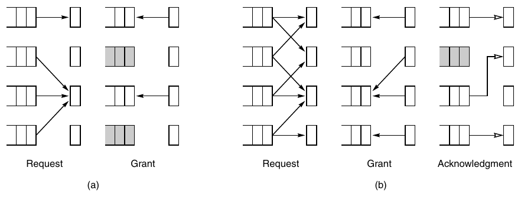

**Hình F.18 Hai kỹ thuật arbitration. (a) Two-phased arbitration, trong đó hai trong bốn input port được cấp output port đã yêu cầu. (b) Three-phased arbitration, trong đó ba trong bốn input port nhận được output port đã yêu cầu, nhờ đó nâng cao mức sử dụng switch.**

Như có thể thấy ở Hình F.18(b), một input port đưa ra nhiều request có thể không nhận được grant nào, trong khi một số port được yêu cầu vẫn còn trống. Vì vậy, một lượt arbitration thứ hai có thể cải thiện xác suất ghép thành công. Trong lượt này, chỉ các request tương ứng với những input port và output port thuộc loại non-matched mới được đưa ra. Các iterative arbiter với nhiều request trên mỗi input port có thể tăng mức sử dụng switch output port và do đó tăng mức sử dụng network link bandwidth. Tuy nhiên, đổi lại, arbiter trở nên phức tạp hơn và arbitration delay tăng lên; điều này có thể làm tăng router clock cycle time nếu nằm trên critical path.

### Switching

Kỹ thuật switching xác định cách thiết lập connection trong network. Lý tưởng nhất, connection giữa các network resource chỉ được thiết lập hay “switched in” trong khoảng thời gian chúng thực sự cần thiết, và đúng tại thời điểm chúng sẵn sàng và cần được sử dụng, xét cả thời gian lẫn không gian. Điều này cho phép các traffic flow cạnh tranh sử dụng network bandwidth sẵn có một cách hiệu quả và đạt latency tối thiểu. Có ba cách cơ bản để thiết lập connection tại mỗi hop dọc topological path mà thuật toán routing cho phép và thuật toán arbitration chấp thuận: trước khi packet đến bằng circuit switching, khi nhận đủ toàn bộ packet bằng store-and-forward packet switching, hoặc khi mới nhận một phần packet với đơn vị kích thước không nhỏ hơn packet header bằng cut-through packet switching.

Circuit switching thiết lập trước một circuit sao cho network bandwidth được cấp phát cho việc truyền packet dọc toàn bộ source-destination path. Có thể pipeline việc truyền packet qua circuit bằng cách lưu tạm tại mỗi hop dọc path, một kỹ thuật gọi là pipelined circuit switching. Vì routing, arbitration và switching chỉ được thực hiện một lần cho một hoặc nhiều packet, không cần routing bit trong header của packet, nhờ đó giảm latency và overhead. Cách này có thể rất hiệu quả khi thông tin được truyền liên tục giữa các thiết bị sử dụng cùng một cấu hình circuit. Tuy nhiên, vì network bandwidth bị lấy khỏi phần dùng chung và được cấp phát trước bất kể source có cần sử dụng hay không, circuit switching có thể rất kém hiệu quả và gây lãng phí bandwidth nghiêm trọng.

Packet switching cho phép network bandwidth được chia sẻ và sử dụng hiệu quả hơn khi packet được truyền không liên tục, vốn là trường hợp phổ biến hơn. Packet switching có hai loại chính—store-and-forward và cut-through switching; cả hai đều cho phép ghép kênh network link bandwidth theo những đơn vị thông tin packet-sized hoặc nhỏ hơn. Điều này giúp packet xuất phát từ những source khác nhau chia sẻ bandwidth tốt hơn. Tuy nhiên, mức chia sẻ càng nhỏ thì overhead cần thiết cho switching càng tăng: routing, arbitration và switching phải được thực hiện cho mọi packet, đồng thời mỗi packet đều cần routing bit và flow control bit nếu sử dụng flow control.

Store-and-forward packet switching thiết lập connection sao cho packet chỉ được chuyển tiếp tới hop kế tiếp theo trình tự dọc source-destination path sau khi toàn bộ packet đã được lưu (staged) tại switch nhận. Vì packet được lưu đầy đủ tại mọi switch trước khi truyền đi, các link hoàn toàn tách rời nhau, cho phép sử dụng toàn bộ link bandwidth ngay cả khi bandwidth của các link rất khác nhau. Thuộc tính này rất quan trọng trong WAN, nhưng cái giá phải trả là packet latency; tổng routing delay, arbitration delay và switching delay tăng theo phép nhân với số hop, như đã thấy ở Mục F.4 khi phân tích performance theo giả định này.

Cut-through packet switching thiết lập connection sao cho packet có thể “cut through” các switch theo kiểu pipeline ngay khi phần header của packet (hoặc lượng payload tương đương nằm sau header) được lưu tạm tại switch nhận. Nghĩa là không cần đợi phần còn lại của packet đến trước khi kết nối những resource đã được cấp. Điều này cho phép routing delay, arbitration delay và switching delay tăng theo phép cộng với số hop thay vì theo phép nhân, để giảm tổng packet latency. Cut-through có hai loại, khác biệt chính nằm ở kích thước đơn vị thông tin được áp dụng flow control và do đó ở yêu cầu về buffer tại switch. Virtual cut-through switching triển khai flow control ở cấp packet, trong khi wormhole switching triển khai trên các flow unit, hay flit, nhỏ hơn kích thước packet tối đa nhưng thường ít nhất lớn bằng packet header. Vì wormhole switch chỉ cần có khả năng lưu một phần nhỏ của packet, packet bị chặn trong network có thể trải dài qua nhiều switch. Điều này có thể khiến các packet khác bị chặn trên những link mà chúng chiếm giữ, dẫn đến network saturation sớm và effective bandwidth giảm, trừ khi sử dụng một central buffer trong switch để lưu chúng—kỹ thuật gọi là buffered wormhole switching. Vì với công nghệ hiện tại, chip có thể triển khai buffer tương đối lớn, virtual cut-through là kỹ thuật switching được sử dụng phổ biến hơn. Tuy nhiên, wormhole switching vẫn có thể được ưu tiên trong OCN được thiết kế nhằm giảm thiểu tài nguyên silicon.

Có thể giảm bớt network saturation sớm do wormhole switching gây ra bằng cách cho phép nhiều packet cùng chia sẻ physical bandwidth của một link thông qua time-multiplexed switching ở cấp flit. Điều này đòi hỏi physical link có một tập virtual channel (tức các logical buffer đã đề cập trước đó) ở mỗi đầu để packet được chuyển vào. Trước đó, ta đã thấy cách sử dụng virtual channel để tách physical link bandwidth khỏi các packet đang được lưu trong buffer nhằm tránh deadlock. Ở đây, virtual channel được ghép kênh sao cho bandwidth được kết nối và sử dụng bởi flit của một packet để tiến lên, dù packet đó có thể dùng chung một số link với một packet đang bị chặn phía trước. Một lần nữa, điều này cho phép sử dụng network bandwidth hiệu quả hơn, từ đó giảm average packet latency.

### Ảnh hưởng đến network performance

Routing, arbitration và switching có thể tác động đến packet latency của network có tải bằng cách giảm contention delay mà packet phải chịu. Đối với unloaded network không có contention, các thuật toán routing và arbitration không ảnh hưởng đến latency ngoài việc xác định lượng delay phát sinh khi triển khai các chức năng đó tại switch—thông thường, pin-to-pin latency của switch chip là vài chục nanosecond. Thay đổi duy nhất đối với biểu thức best-case packet latency ở mục trước đến từ kỹ thuật switching. Trước đó, ta giả sử sử dụng Store-and-forward packet switching, trong đó transmission delay của toàn bộ packet phát sinh trên tất cả d hop cộng thêm tại source node. Với cut-through packet switching, transmission delay được pipeline qua các network link tạo nên path của packet, theo đơn vị packet header thay vì toàn bộ packet. Do đó, thành phần delay này giảm đi, như trong biểu thức lower-bound cho packet latency sau đây:

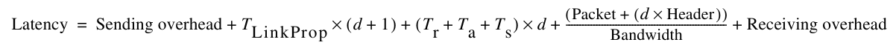

Effective bandwidth chịu ảnh hưởng bởi mức độ hiệu quả mà routing, arbitration và switching cho phép sử dụng network bandwidth. Thuật toán routing có thể phân phối traffic đồng đều hơn trên network có tải để tăng mức sử dụng aggregate bandwidth mà topology cung cấp—đặc biệt là qua các bisection link. Thuật toán arbitration có thể tối đa hóa số switch output port chấp nhận packet, qua đó cũng tăng mức sử dụng network bandwidth. Kỹ thuật switching có thể tăng mức độ chia sẻ resource giữa các packet, tiếp tục nâng cao mức sử dụng bandwidth. Những yếu tố này kết hợp tác động đến network bandwidth, BWNetwork, thông qua efficiency factor ρ, trong đó 0 < ρ ≤ 1:

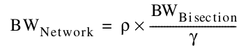

Efficiency factor ρ khó tính toán hoặc định lượng bằng phương pháp khác ngoài simulation. Tuy nhiên, với tham số này, ta có thể ước tính best-case upper-bound effective bandwidth bằng biểu thức sau, có xét đến ảnh hưởng của routing, arbitration và switching:

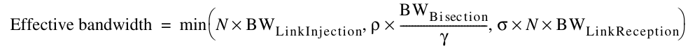

Lưu ý rằng ρ còn phụ thuộc vào mức độ network xử lý tốt traffic do ứng dụng tạo ra. Chẳng hạn, ρ của circuit switching có thể cao hơn cut-through switching nếu những luồng packet lớn được truyền liên tục giữa một cặp source-destination, trong khi điều ngược lại có thể đúng nếu packet được truyền không liên tục.

**Ví dụ** Hãy so sánh performance của deterministic routing với adaptive routing trên một 3D torus network kết nối 4096 node. Thực hiện bằng cách vẽ đồ thị latency theo applied load và throughput theo applied load. Đồng thời, so sánh hiệu suất của network tốt nhất và kém nhất trong số này. Giả sử triển khai virtual cut-through switching, three-phase arbitration và virtual channel. Xét riêng các trường hợp có hai và bốn virtual channel. Giả sử một virtual channel sử dụng bubble flow control theo dimension order để tránh deadlock; những virtual channel khác được sử dụng theo dimension order (đối với deterministic routing) hoặc theo cách tối thiểu dọc các shortest path (đối với adaptive routing), như trong torus network của IBM Blue Gene/L.

**Trả lời** Rất khó tính toán performance của các thuật toán routing bằng phương pháp giải tích vì hoạt động của chúng phụ thuộc vào nhiều tham số thiết kế network có quan hệ phụ thuộc lẫn nhau phức tạp. Do đó, các nhà thiết kế thường sử dụng cycle-accurate simulator để đánh giá performance. Một cách đánh giá tác động của quyết định thiết kế cụ thể là chạy các nhóm simulation trên một khoảng network load, mỗi lần thay đổi một tham số thiết kế cần quan tâm trong khi giữ nguyên những tham số còn lại. Synthetic traffic load được sử dụng khá thường xuyên trong những phép đánh giá này vì cho phép network ổn định tại một điểm làm việc nhất định và cho phép phân tích chi tiết hành vi. Đây là phương pháp ta sử dụng ở đây (ngoài ra, có thể sử dụng trace-driven simulation hoặc execution-driven simulation).

Hình F.19 trình bày những đồ thị performance điển hình của interconnection network. Bên trái, average packet latency (biểu diễn bằng network cycle) được vẽ theo applied load (tốc độ tạo traffic) cho hai thuật toán routing, mỗi thuật toán có hai và bốn virtual channel; bên phải, throughput (tốc độ chuyển giao traffic) cũng được vẽ tương tự. Applied load được chuẩn hóa bằng cách chia cho số node trong network (tức byte mỗi cycle mỗi node). Simulation được chạy theo giả định traffic phân bố đều gồm các packet 256-byte, trong đó flit có kích thước một byte. Tổng routing delay, arbitration delay và switching delay được giả sử bằng 1 network cycle mỗi hop, còn time-of-flight delay trên mỗi link được giả sử là 10 cycle. Link bandwidth là 1 byte mỗi cycle, nhờ đó kết quả không phụ thuộc network clock frequency.

Như có thể thấy, các đường biểu diễn trong mỗi đồ thị có hình dạng đặc trưng tương tự nhau nhưng giá trị khác nhau. Trong đồ thị latency, tất cả đều bắt đầu tại no-load latency như dự đoán bởi biểu thức latency ở trên, sau đó tăng nhẹ theo traffic load khi contention đối với network resource tăng lên. Ở applied load cao hơn, latency tăng theo hàm mũ và network tiến gần saturation point vì không thể tiếp nhận applied load, = khiến packet xếp hàng tại source node chờ được đưa vào network. Trong những simulation này, queue tiếp tục tăng theo thời gian, khiến latency tiến tới vô hạn. Tuy nhiên, trong thực tế, queue đạt giới hạn dung lượng rồi buộc ứng dụng ngừng tạo thêm packet, hoặc ứng dụng tự hạn chế tốc độ trong khi chờ acknowledgment/response cho các packet còn đang xử lý. Dù vậy, latency của adaptive routing tăng chậm hơn vì packet được cung cấp những path thay thế quanh các resource bị tắc nghẽn.

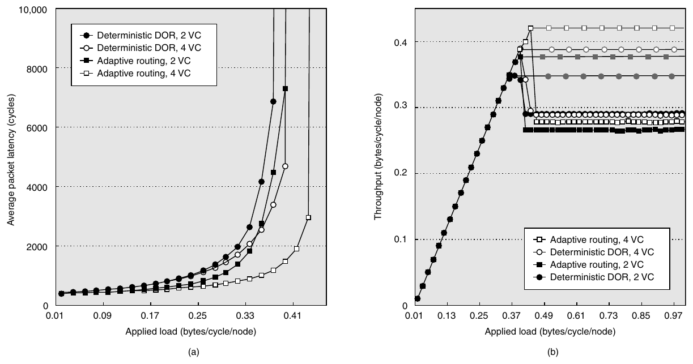

**Hình F.19 So sánh deterministic routing với adaptive routing, mỗi loại có hai hoặc bốn virtual channel, giả sử traffic phân bố đều trên một 3D torus network có 4K node, sử dụng virtual cut-through switching và bubble flow control để tránh deadlock. (a) Average latency được vẽ theo applied load, và (b) throughput được vẽ theo applied load (các đường màu xám phía trên biểu diễn peak throughput, còn các đường màu đen phía dưới biểu diễn sustained throughput). Dữ liệu simulation được P. Gilabert và J. Flich thu thập tại Universidad Politècnica de València, Tây Ban Nha (2006).**

Cũng vì lý do này, adaptive routing cho phép network đạt peak throughput cao hơn deterministic routing với cùng số virtual channel. Khi tải chưa gây saturation, throughput tăng gần tuyến tính theo applied load. Tuy nhiên, khi network đạt saturation point, nó không thể chuyển giao traffic với tốc độ bằng tốc độ tạo traffic. Vì thế, saturation point biểu thị throughput tối đa có thể đạt, hay “peak” throughput, không lớn hơn giá trị dự đoán bởi biểu thức effective bandwidth ở trên. Sau saturation, throughput có xu hướng giảm do head-of-line blocking xảy ra hàng loạt trên network (sẽ được giải thích thêm ở Mục F.6), tương tự việc xe cộ có xu hướng di chuyển chậm hơn vào giờ cao điểm. Đây là vùng quan trọng của đồ thị throughput vì cho thấy thuật toán routing có thể gây sụt giảm performance lớn đến mức nào nếu các kỹ thuật congestion management (được đề cập ngắn gọn ở Mục F.7) không được sử dụng hiệu quả. Trong trường hợp này, adaptive routing có mức sụt giảm performance sau saturation lớn hơn deterministic routing, nếu đo bằng sustained throughput sau saturation.

Đối với cả hai thuật toán routing, nhiều virtual channel hơn (tức bốn) giúp packet có khả năng vượt qua những packet bị chặn phía trước tốt hơn, cho phép đạt peak throughput cao hơn so với ít virtual channel hơn (tức hai). Với adaptive routing có bốn virtual channel, peak throughput 0.43 byte/cycle/node gần với mức tối đa 0.5 byte/cycle/node có thể đạt khi hiệu suất là 100% (tức ρ = 100%), giả sử injection bandwidth và reception bandwidth đủ lớn để network bisection trở thành bottleneck. Khi đó, network bandwidth đơn giản bằng 100% nhân với network bisection bandwidth (BWBisection) chia cho tỷ lệ traffic đi qua bisection (γ), như biểu thức ở trên. Vì bisection chia torus thành hai nửa bằng nhau, γ bằng 0.5 đối với uniform traffic, do chỉ một nửa traffic được đưa vào network có destination là node ở phía bên kia bisection. BWBisection của 4096-node 3D torus network bằng 16 × 16 × 4 unidirectional link nhân với link bandwidth (tức 1 byte/cycle). Nếu chuẩn hóa bisection bandwidth bằng cách chia cho số node (như đã làm với network bandwidth), BWBisection bằng 0.25 byte/cycle/node. Chia giá trị này cho γ cho ta network bandwidth lý tưởng tối đa có thể đạt là 0.5 byte/cycle/node.

Ta có thể tìm efficiency factor ρ của network được mô phỏng đơn giản bằng cách chia peak throughput đo được cho ideal throughput. Efficiency factor của network sử dụng fully adaptive routing và bốn virtual channel là 0.43/(0.25 /0.5) = 86%, còn của network sử dụng deterministic routing và hai virtual channel là 0.37/(0.25/0.5) = 74%. Ngoài chênh lệch hiệu suất 12% giữa hai trường hợp, có thể đạt thêm 14% hiệu suất nếu thiết kế routing, arbitration, switching và virtual channel tốt hơn nữa.

Để đặt phần thảo luận về routing, arbitration và switching vào bối cảnh thực tế, Hình F.20 liệt kê các kỹ thuật được sử dụng trong những SAN thiết kế cho máy tính high-performance thương mại. Ngoài việc áp dụng cho SAN như trong hình, những vấn đề được thảo luận ở mục này cũng áp dụng cho các interconnect domain khác: từ OCN đến WAN.

## F.6 Switch Microarchitecture

Network switch triển khai các chức năng routing, arbitration và switching của switched-media network. Switch còn triển khai cơ chế buffer management và, đối với lossless network, flow control tương ứng. Trong một số network, switch cũng triển khai một phần chức năng network management để khám phá, cấu hình và cấu hình lại network topology khi boot-up và khi có lỗi. Ở đây, ta tìm hiểu cấu trúc bên trong network switch bằng cách mô tả một switch microarchitecture cơ bản cùng các phương án thay thế phù hợp với những kỹ thuật routing, arbitration và switching đã trình bày trước đó.

### Switch microarchitecture cơ bản

Data path bên trong switch cung cấp kết nối giữa các input port và output port. Mặc dù có thể sử dụng shared bus hoặc multiported central memory, hai giải pháp này lần lượt không đáp ứng đủ hoặc quá đắt khi aggregate switch bandwidth cần thiết ở mức cao. Hầu hết switch high-performance triển khai internal crossbar để cung cấp kết nối nonblocking bên trong switch, qua đó cho phép kết nối đồng thời giữa nhiều cặp input-output port. Có thể lưu các packet bị chặn vào buffer bằng queue first in, first out (FIFO) hoặc circular queue, được triển khai thành dynamically allocatable multiqueues (DAMQ) trong static RAM để có dung lượng lớn và tính linh hoạt. Các queue này có thể được đặt tại input port (tức input buffered switch), output port (tức output buffered switch), tập trung bên trong switch (tức centrally buffered switch), hoặc tại cả input port và output port của switch (tức input-output-buffered switch). Hình F.21 trình bày block diagram của một input-output-buffered switch.

| Công ty | Tên hệ thống [network] | Số node tối đa [× # CPUs] | Network topology cơ bản | Queuing của switch (buffer) | Thuật toán network routing | Kỹ thuật switch arbitration | Kỹ thuật network switching |
|---|---|---|---|---|---|---|---|
| Intel | ASCI Red Paragon | 4510 [× 2] | 2D mesh (64 × 64) | Buffer ở input (1 flit) | dimension-order routing phân tán | 2-phased RR, phân tán trên switch | Wormhole không có virtual channel |
| IBM | ASCI White SP Power3 [Colony] | 512 [× 16] | Bidirectional MIN với các bidirectional switch 8-port (thường là fat tree hoặc Omega) | Buffer ở input và trung tâm với output queuing (speedup 8-way) | Source-based LCA adaptive, shortest-path routing và table-based multicast routing | 2-phased RR, tập trung và phân tán tại output cho các bypass path | Buffered wormhole và virtual cut-through cho multicasting, không có virtual channel |
| Intel | Thunder Itanium2 Tiger4 [QsNetII] | 1024 [× 4] | Fat tree với các bidirectional switch 8-port | Buffer ở input | Source-based LCA adaptive, shortest-path routing | 2-phased RR, priority, aging, phân tán tại output port | Wormhole với 2 virtual channel |
| Cray | XT3 [SeaStar] | 30,508 [× 1] | 3D torus (40 × 32 × 24) | Input với output lưu tạm | dimension-order routing table-based phân tán | 2-phased RR, phân tán tại output port | Virtual cut-through với 4 virtual channel |
| Cray | X1E | 1024 [× 1] | 2D torus có bristle 4-way (~23 × 11) với express link | Input với virtual output queuing | dimension-order routing table-based phân tán | Global arbiter wavefront 2-phased (pipelined) | Virtual cut-through với 4 virtual channel |
| IBM | ASC Purple pSeries 575 [Federation] | >1280 [× 8] | Bidirectional MIN với các bidirectional switch 8-port (thường là fat tree hoặc Omega) | Buffer ở input và trung tâm với output queuing (speedup 8-way) | LCA adaptive, shortest-path routing và multicast dùng source và table-based phân tán | 2-phased RR, tập trung và phân tán tại output cho các bypass path | Buffered wormhole và virtual cut-through cho multicasting với 8 virtual channel |
| IBM | Blue Gene/L eServer Solution [Torus Net.] | 65,536 [× 2] | 3D torus (32 × 32 × 64) | Buffer kiểu Input-output | Phân tán, adaptive với bubble escape virtual channel | 2-phased SLQ, phân tán tại input và output | Virtual cut-through với 4 virtual channel |

**Hình F.20 Các đặc điểm routing, arbitration và switching của interconnection network trong những máy thương mại.**

Routing có thể được triển khai bằng finite-state machine hoặc forwarding table bên trong routing control unit của switch. Trong trường hợp thứ nhất, routing information trong packet header được xử lý bởi finite-state machine, xác định switch output port được phép sử dụng (hoặc nhiều port nếu routing là adaptive) theo thuật toán routing. Các phần routing information trong header thường được routing control unit loại bỏ hoặc sửa đổi sau khi dùng để đơn giản hóa việc xử lý tại switch kế tiếp dọc path. Khi routing được triển khai bằng forwarding table, routing information trong packet header được sử dụng làm address để truy cập một forwarding table entry chứa switch output port được thuật toán routing cho phép. Forwarding table phải được nạp trước vào switch ngay từ khi network bắt đầu hoạt động. Cũng có những phương pháp kết hợp, trong đó forwarding table được rút gọn thành một tập nhỏ các routing bit và kết hợp với một logic block nhỏ. Routing control unit sử dụng các routing bit đó để biết những path nào được phép và quyết định output port mà packet cần đi qua. Mục tiêu của những phương pháp này là xây dựng routing control unit vừa linh hoạt vừa gọn, loại bỏ sự lãng phí diện tích và công suất của forwarding table lớn, nhờ đó phù hợp với OCN. Routing control unit thường được triển khai như resource tập trung, mặc dù có thể nhân bản tại mỗi input port để nó không trở thành bottleneck. Routing chỉ được thực hiện một lần cho mỗi packet, và packet thường đủ lớn để mất nhiều cycle khi đi qua switch, nên routing control unit tập trung hiếm khi trở thành bottleneck. Hình F.21 giả sử routing control unit được tập trung bên trong switch.

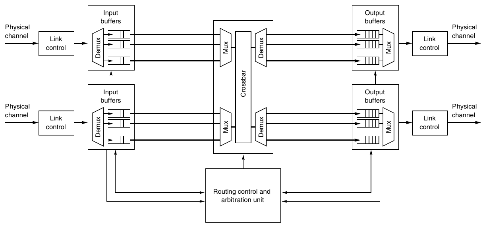

**Hình F.21 Những thành phần microarchitecture cơ bản của input-output-buffered switch.**

Cần arbitration khi hai hoặc nhiều packet đồng thời yêu cầu cùng một output port, như đã mô tả ở mục trước. Switch arbitration có thể được triển khai tập trung hoặc phân tán. Trong trường hợp tập trung, mọi request và thông tin trạng thái được truyền tới central switch arbitration unit; trong trường hợp phân tán, arbiter được phân bố trên switch, thường tại các input port và/hoặc output port. Arbitration có thể được thực hiện nhiều lần đối với packet, và mỗi input port có thể có nhiều queue tương ứng, làm tăng số arbitration request phải xử lý. Vì thế, nhiều thiết kế sử dụng hierarchical arbitration: trước hết thực hiện arbitration cục bộ tại mỗi input port để chỉ chọn một request trong các packet và queue tương ứng, sau đó thực hiện arbitration toàn cục để xử lý request do từng local input port arbiter đưa ra. Hình F.21 giả sử có một arbitration unit tập trung bên trong switch.

Switch microarchitecture cơ bản trong Hình F.21 hoạt động như sau. Khi packet bắt đầu đến switch input port, link controller giải mã tín hiệu đến và tạo ra một chuỗi bit, có thể chuyển data từ dạng nối tiếp sang song song để phù hợp với độ rộng internal data path nếu độ rộng này khác external link width. Thông tin cũng được trích xuất từ packet header hoặc link control signal để xác định queue lưu packet vào buffer. Trong khi packet đang được nhận và đưa vào buffer (hoặc sau khi toàn bộ packet đã được đưa vào buffer, tùy kỹ thuật switching), header được gửi đến routing unit. Unit này gửi request cho một hoặc nhiều output port tới arbitration unit. Arbitration cho output port được yêu cầu thành công nếu port còn trống và có đủ chỗ để lưu toàn bộ packet hoặc flit vào buffer, tùy kỹ thuật switching. Nếu triển khai wormhole switching với virtual channel, có thể cần thêm các bước arbitration và allocation để truyền từng flit riêng lẻ. Khi resource đã được cấp phát, packet được chuyển qua internal crossbar đến output buffer và link tương ứng nếu không có packet nào khác đứng trước và link còn trống. Flow control ở Link-level do link controller triển khai ngăn input queue overflow tại switch lân cận ở đầu kia của link. Nếu triển khai virtual channel switching, nhiều packet có thể được time-multiplexed trên link theo đơn vị flit-by-flit. Vì các input port và output port khác nhau hoạt động độc lập, nhiều packet đến có thể được xử lý đồng thời khi không có contention.

### Các cách tổ chức buffer

Như đã đề cập, queue có thể nằm ở phía input, output hoặc cả hai phía của switch. Output-buffered switch có ưu điểm loại bỏ hoàn toàn head-of-line blocking. Head-of-line (HOL) blocking xảy ra khi hai hoặc nhiều packet được lưu trong một queue và packet bị chặn ở đầu queue chặn các packet khác trong queue vốn có thể tiến lên nếu chúng nằm ở đầu queue. Điều này không thể xảy ra trong output-buffered switch vì mọi packet trong một queue nhất định có cùng trạng thái: chúng cần cùng một output port. Tuy nhiên, tất cả switch input port có thể đồng thời nhận packet cho cùng một output port. Vì không có buffer ở phía input, output buffer phải có khả năng lưu đồng thời mọi packet đến đó. Điều này đòi hỏi triển khai output queue với internal switch speedup bằng k. Nghĩa là output queue phải có write bandwidth bằng k lần link bandwidth, trong đó k là số switch port. Điều này thường quá đắt. Vì vậy, giải pháp này tự nó hiếm khi được triển khai trong lossless network. Do xác suất đồng thời nhận nhiều packet cho cùng một output port thường nhỏ, các hệ thống thương mại sử dụng output-buffered switch thường chỉ triển khai switch speedup vừa phải và loại bỏ packet khi hiếm hoi xảy ra buffer overflow.

Switch có buffer ở phía input có thể nhận packet mà không cần switch speedup; tuy nhiên, HOL blocking có thể xảy ra trong input port queue, như Hình F.22(a). Điều này có thể làm mức sử dụng switch output port giảm xuống dưới 60%, ngay cả khi destination của packet phân bố đều. Như Hình F.22(b), sử dụng virtual channel (hai trong trường hợp này) có thể giảm HOL blocking nhưng không loại bỏ được nó. Một giải pháp hiệu quả hơn là tổ chức các input queue thành virtual output queue (VOQ), như Hình F.22(c). Theo cách này, mỗi input port triển khai số queue bằng số output port, qua đó cung cấp buffer riêng cho những packet hướng tới các output port khác nhau. Đây là kỹ thuật phổ biến được sử dụng rộng rãi trong ATM switch và IP router. Tuy nhiên, những nhược điểm chính của VOQ là chi phí và khả năng mở rộng kém: số VOQ tăng theo bình phương số switch port. Hơn nữa, dù VOQ loại bỏ HOL blocking bên trong switch, HOL blocking end-to-end ở cấp network vẫn chưa được giải quyết. Dĩ nhiên, có thể thiết kế switch hỗ trợ VOQ ở cả cấp network—tức triển khai tại mỗi switch input port số queue bằng số output port trên toàn network—nhưng cách này cực kỳ tốn kém. Một phương án thay thế là gán động chỉ một phần số queue để lưu (cache) riêng những packet hướng tới destination đang bị tắc nghẽn.

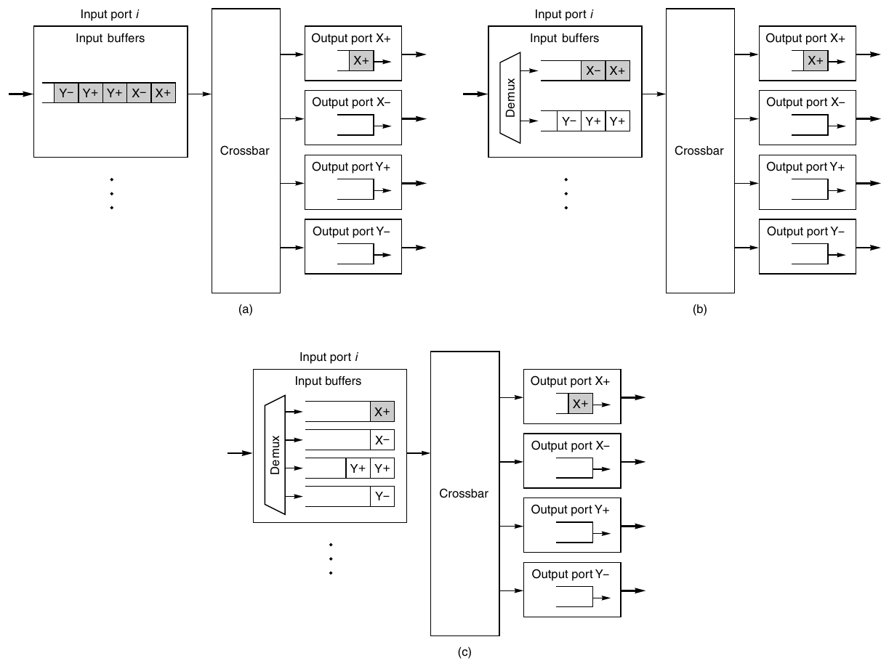

**Hình F.22 (a) Head-of-line blocking trong input buffer, (b) sử dụng hai virtual channel để giảm HOL blocking, và (c) sử dụng virtual output queuing để loại bỏ HOL blocking bên trong switch. Input buffer được tô màu là buffer đang được cấp crossbar. Ở đây giả sử mỗi input port chỉ có một access port đến internal crossbar của switch.**

Switch kết hợp input-output-buffered giảm thiểu HOL blocking khi phía output có đủ buffer space để chứa packet, đồng thời giảm thiểu switch speedup cần thiết nhờ có buffer ở phía input. Giải pháp này còn có lợi ích tách việc truyền packet qua internal crossbar của switch khỏi việc truyền qua external link. Điều này đặc biệt hữu ích với các thiết kế cut-through switching sử dụng virtual channel, trong đó việc truyền flit được time-multiplexed trên link. Nhiều thiết kế trong hệ thống thương mại triển khai input-output-buffered switch.

### Triển khai thuật toán routing

Cần phân biệt thuật toán routing với cách triển khai thuật toán đó. Thuật toán routing mô tả những quy tắc chuyển tiếp packet qua network và ảnh hưởng đến packet latency cùng network throughput, còn cách triển khai ảnh hưởng đến delay mà packet chịu khi đến một node, diện tích silicon cần thiết và mức tiêu thụ công suất gắn với routing computation. Nhiều kỹ thuật đã được đề xuất để pre-compute thuật toán routing và/hoặc che giấu routing computation delay. Tuy nhiên, nỗ lực nhằm giảm diện tích silicon và mức tiêu thụ công suất mà không ảnh hưởng đáng kể tới tính linh hoạt của routing còn ít hơn nhiều. Cả hai vấn đề này đều đã trở nên rất quan trọng, đặc biệt với OCN. Nhiều thiết kế hiện có giải quyết chúng bằng cách triển khai những thuật toán routing tương đối đơn giản, nhưng trong tương lai có thể cần thuật toán routing phức tạp hơn để ứng phó với lỗi sản xuất ngày càng tăng, biến thiên quy trình và những vấn đề khác do công nghệ tiếp tục thu nhỏ, như được thảo luận ngắn gọn bên dưới.

Như đã đề cập ở mục trước, tùy nơi tính toán thuật toán routing, có hai dạng routing cơ bản: source và distributed routing. Trong source routing, độ phức tạp triển khai được chuyển tới end node, nơi các path cần được lưu trong bảng, và path cho một packet nhất định được chọn dựa trên destination end node identifier. Trong distributed routing, độ phức tạp lại được chuyển tới switch, nơi tại mỗi hop dọc path của packet đều thực hiện việc chọn output port cần đi qua. Distributed routing có hai cách triển khai cơ bản. Cách thứ nhất sử dụng logic block triển khai một thuật toán routing cố định cho topology cụ thể. Ví dụ phổ biến nhất là dimension-order routing, trong đó độ lệch theo các dimension được xử lý theo thứ tự đã thiết lập. Ngoài ra, distributed routing có thể được triển khai bằng forwarding table, trong đó mỗi entry mã hóa output port cần sử dụng cho một destination cụ thể. Vì vậy, trong trường hợp xấu nhất, cần số entry bằng số destination node.

Cả hai phương pháp triển khai distributed routing đều có ưu và nhược điểm. Logic-based routing có computation delay rất ngắn, thường cần diện tích silicon nhỏ và tiêu thụ công suất thấp. Tuy nhiên, logic-based routing cần được thiết kế cho một topology cụ thể, nên bị giới hạn trong topology đó. Table-based distributed routing khá linh hoạt và hỗ trợ mọi topology cũng như thuật toán routing. Chỉ cần điền nội dung thích hợp vào các bảng dựa trên thuật toán routing được áp dụng (chẳng hạn có thể định nghĩa up*/down* routing cho mọi irregular topology). Tuy nhiên, nhược điểm của table-based distributed routing là chi phí diện tích và công suất non-negligible. Khả năng mở rộng cũng là vấn đề đối với giải pháp table-based vì trong trường hợp xấu nhất, một hệ thống có N end node (và switch) cần tới N bảng, mỗi bảng có N entry, do đó chi phí tăng theo bình phương.

Tùy network domain, một giải pháp sẽ phù hợp hơn giải pháp còn lại. Chẳng hạn, trong SAN thường có các giải pháp table-based, như trường hợp InfiniBand. Trong những môi trường khác như OCN, người ta tránh triển khai table-based do các chi phí công suất và diện tích silicon đã nêu. Ở những môi trường đó, nên dựa vào cách triển khai logic-based. Đây là một số thách thức mà nhà thiết kế OCN phải đối mặt: công nghệ liên tục thu nhỏ thông qua việc thu nhỏ thiết bị làm tăng số lỗi sản xuất, tăng tỷ lệ hỏng (tạm thời hoặc vĩnh viễn), tạo ra biến thiên quy trình đáng kể (transistor hoạt động khác thông số thiết kế), đòi hỏi các clock frequency domain và voltage domain khác nhau, đồng thời giới hạn chặt chẽ công suất và năng lượng. Tất cả những thách thức này khiến network cần hỗ trợ tính không đồng nhất. Các vùng khác nhau—có thể không đều đặn—của network sẽ hình thành do component bị hỏng, switch và link bị tắt nguồn, component bị vô hiệu hóa (do biến thiên performance không thể chấp nhận), v.v. Vì vậy, hệ thống không đồng nhất có thể xuất hiện từ một thiết kế đồng nhất. Trong bối cảnh này, cần triển khai hiệu quả những thuật toán routing được thiết kế để cung cấp đủ tính linh hoạt nhằm giải quyết các thách thức mới.

Một giải pháp well-known cung cấp mức linh hoạt nhất định trong khi gọn hơn nhiều so với cách tiếp cận table-based truyền thống là interval routing [Leeuwen 1987], trong đó một khoảng destination được định nghĩa cho mỗi output port. Mặc dù cách này chưa đủ linh hoạt, nó gợi ý cách giải quyết những thách thức mới xuất hiện. Một cách tiếp cận gần đây hơn cung cấp một điểm thiết kế triển khai hợp lý nằm giữa cách triển khai logic-based (hiệu quả) và table-based (linh hoạt). Logic-Based Distributed Routing (LBDR) là cách tiếp cận kết hợp, lấy một regular 2D mesh làm cơ sở nhưng cho phép suy ra một irregular network từ đó do thay đổi topology gây ra bởi lỗi sản xuất, hỏng hóc và những bất thường khác. Vì các component bị lỗi, bị vô hiệu hóa và powered-down, tính đều đặn bị phá vỡ và không thể tiếp tục sử dụng thuật toán dimension-order routing. Để hỗ trợ những topology như vậy, LBDR định nghĩa một tập configuration bit tại mỗi switch. Bốn connectivity bit được sử dụng tại mỗi switch để biểu thị kết nối của switch với các switch lân cận trong topology. Như vậy, mỗi port sử dụng một connectivity bit. Chẳng hạn, các connectivity bit đó được dùng để vô hiệu hóa output port dẫn đến component bị lỗi. Ngoài ra, tám routing bit, hai bit mỗi output port, được dùng để định nghĩa các lựa chọn routing sẵn có. Giá trị routing bit được thiết lập khi power-on và được tính từ thuật toán routing cần triển khai trong network. Về cơ bản, khi một routing bit được đặt, nó biểu thị rằng packet có thể rời switch qua output port tương ứng và được phép thực hiện một turn nhất định tại switch kế tiếp. Ở khía cạnh này, LBDR tương tự interval routing, nhưng định nghĩa những vùng địa lý thay vì khoảng destination. Hình F.23 minh họa một ví dụ triển khai thuật toán routing topology-agnostic bằng LBDR trên irregular topology. Hình cho thấy các configuration bit đã được tính toán.

Connectivity bit và routing bit được dùng để triển khai thuật toán routing. Để làm điều đó, một tập nhỏ logic gate được sử dụng kết hợp với configuration bit. Về cơ bản, cách tiếp cận LBDR lấy topology ban đầu (2D mesh) làm cơ sở và đưa ra quyết định dựa trên tọa độ hiện tại của router, tọa độ destination router và các configuration bit. Hình F.24 trình bày logic cần thiết, còn Hình F.25 minh họa một ví dụ trong đó packet được chuyển tiếp từ source đến destination bằng cách sử dụng configuration bit. Có thể thấy rằng các hạn chế routing được thực thi bằng cách ngăn sử dụng west port tại switch 10.

LBDR là một phương pháp triển khai routing hiệu quả trong OCN. Cơ chế này gần đây đã được mở rộng để hỗ trợ nonminimal path, collective communication operation và traffic isolation. Tất cả những cải tiến này đều được thực hiện trong khi vẫn duy trì cách triển khai gọn và hiệu quả nhờ một tập nhỏ configuration bit. Có thể tìm thấy mô tả chi tiết về LBDR cùng các phần mở rộng và nghiên cứu hiện tại về OCN trong Flich [2010].

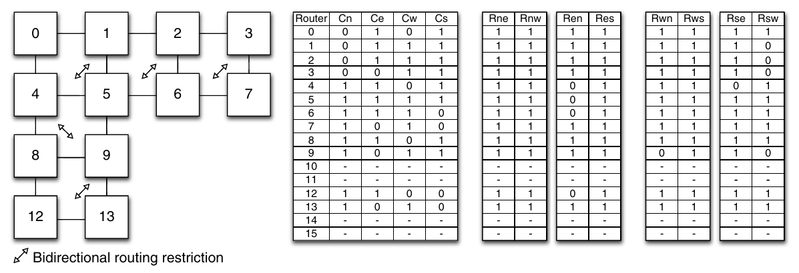

**Hình F.23 Ví dụ về irregular network sử dụng LBDR để triển khai thuật toán routing. Với mỗi router, các connectivity bit và routing bit được định nghĩa.**

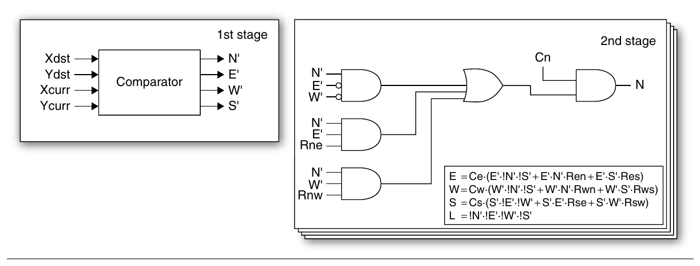

**Hình F.24 Logic LBDR tại mỗi input port của router.**

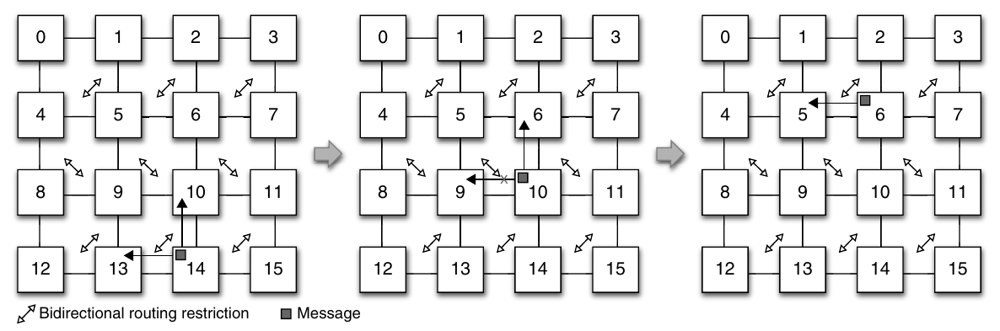

**Hình F.25 Ví dụ về routing một message từ Router 14 đến Router 5 bằng LBDR tại mỗi router.**

### Pipeline hóa switch microarchitecture

Có thể nâng cao performance bằng cách pipeline hóa switch microarchitecture. Xử lý packet theo pipeline trong switch có những điểm tương đồng với thực thi instruction theo pipeline trong vector processor. Trong vector pipeline, một instruction duy nhất chỉ định operation cần áp dụng cho mọi vector element được thực thi theo pipeline. Tương tự, trong switch pipeline, một packet header duy nhất chỉ định cách xử lý mọi physical transfer unit (hay phit) của internal data path thuộc một packet; chúng được xử lý theo pipeline. Ngoài ra, vì packet tại các input port khác nhau độc lập với nhau, có thể xử lý chúng song song, tương tự cách thực thi song song nhiều instruction độc lập hoặc nhiều thread gồm các instruction theo pipeline.

Có thể pipeline hóa switch microarchitecture bằng cách phân tích các chức năng cơ bản thực hiện trong switch và tổ chức chúng thành nhiều stage. Hình F.26 trình bày block diagram của tổ chức pipeline five-stage cho switch microarchitecture cơ bản ở Hình F.21, giả sử sử dụng cut-through switching và forwarding table để triển khai routing. Sau khi nhận phần header của packet ở stage đầu tiên, routing information (tức destination address) được dùng ở stage thứ hai để tra các lựa chọn routing được phép trong forwarding table. Đồng thời, những phần khác của packet được nhận và lưu vào input port queue ở stage đầu tiên. Arbitration được thực hiện ở stage thứ ba. Crossbar được cấu hình để cấp output port đã chấp thuận cho packet ở stage thứ tư, và packet header được lưu vào switch output port, sẵn sàng truyền qua external link ở stage thứ năm. Lưu ý rằng chỉ packet header sử dụng stage thứ hai và thứ ba; phần payload và trailer của packet chỉ sử dụng ba stage—những stage dành cho data flow-thru sau khi internal data path của switch đã được thiết lập.

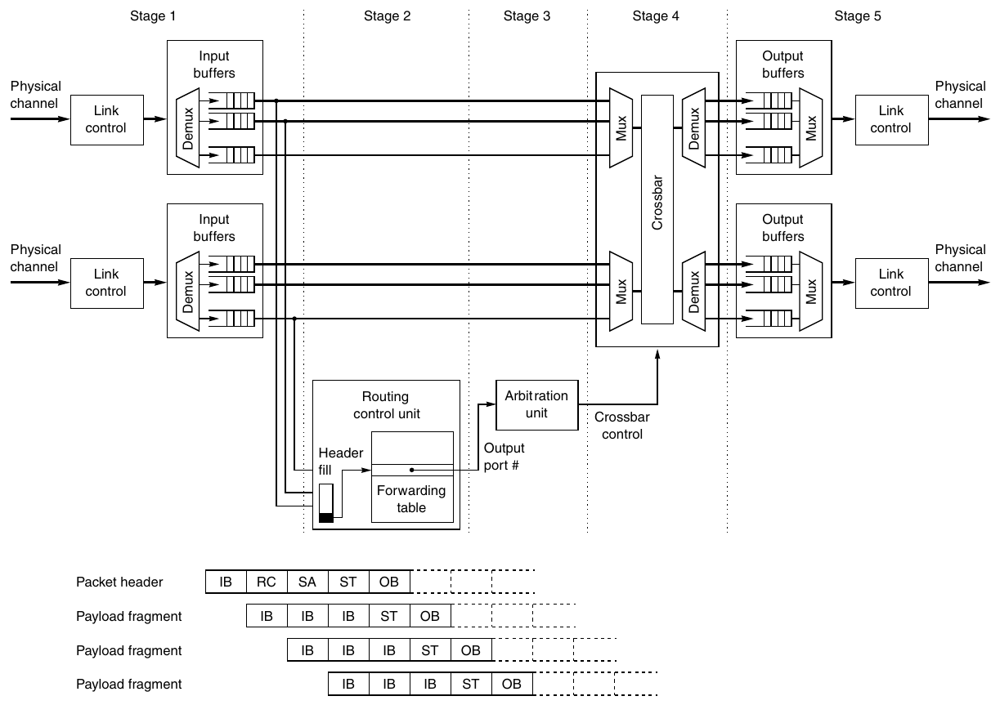

**Hình F.26 Phiên bản pipeline của input-output-buffered switch cơ bản. Các ký hiệu trong hình như sau: IB là input link control and buffer stage, RC là route computation stage, SA là crossbar switch arbitration stage, ST là crossbar switch traversal stage và OB là output buffer and link control stage. Những mảnh packet (flit) đi sau header vẫn ở IB stage cho đến khi header được xử lý và resource của crossbar switch được cung cấp.**

Virtual channel switch thường cần thêm một stage để cấp phát virtual channel. Hơn nữa, cần arbitration cho mọi flit trước khi truyền qua crossbar. Cuối cùng, tùy độ phức tạp của thuật toán routing và arbitration, những thao tác này có thể cần nhiều clock cycle.

### Những cải tiến khác cho switch microarchitecture

Như đã đề cập, đôi khi internal switch speedup được triển khai để tăng mức sử dụng switch output port. Speedup này thường được thực hiện bằng cách tăng clock frequency và/hoặc độ rộng internal data path (tức phit size) của switch. Một giải pháp thay thế là triển khai nhiều data path song song từ tập queue của mỗi input port đến các output port. Một cách thực hiện là tăng số crossbar input port. Khi triển khai nhiều physical queue trên mỗi input port, có thể làm điều đó bằng cách dành riêng một crossbar port cho mỗi input queue. Chẳng hạn, IBM Blue Gene/L triển khai hai crossbar access port và hai read port trên mỗi switch input port.

Một cách khác để triển khai các data path song song giữa input port và output port là chuyển buffer tới các crosspoint của crossbar. Switch architecture này thường được gọi là buffered crossbar switch. Buffered crossbar cung cấp data path độc lập từ mỗi input port tới các output port khác nhau, nhờ đó có thể gửi đồng thời tối đa k packet từ một input port nhất định tới k output port khác nhau. Bằng cách triển khai crosspoint memory độc lập cho mỗi cặp input-output port, HOL blocking được loại bỏ ở cấp switch. Hơn nữa, arbitration đơn giản hơn đáng kể so với những switch architecture khác. Cụ thể, mỗi output port chỉ có thể nhận packet từ một tập con các crosspoint memory, tách biệt với các tập của output port khác. Do đó, có thể triển khai một arbiter hoàn toàn độc lập tại mỗi switch output port, và mỗi arbiter đều rất đơn giản.

Buffered crossbar sẽ là switch architecture lý tưởng nếu không quá đắt. Số crosspoint memory tăng theo bình phương số switch port, khiến chi phí tăng mạnh và khả năng mở rộng giảm so với switch architecture cơ bản. Ngoài ra, mỗi crosspoint memory phải đủ lớn để triển khai link-level flow control hiệu quả. Để giảm chi phí, phần lớn nhà thiết kế ưu tiên input-buffered switch hoặc switch kết hợp input-output-buffered, được bổ sung một số cơ chế đã mô tả trước đó.

## F.7 Những vấn đề thực tế đối với interconnection network thương mại

Ngoài những vấn đề kỹ thuật đã mô tả đến đây, còn có các vấn đề thực tế cần xem xét đối với interconnection network trong những domain nhất định. Dưới đây, ta đề cập một vài vấn đề trong số đó.

### Khả năng kết nối

Loại và số lượng thiết bị giao tiếp, cùng những yêu cầu giao tiếp của chúng, ảnh hưởng đến độ phức tạp của interconnection network và các protocol. Các protocol phải hướng tới kích thước network lớn nhất và xử lý những sự kiện bất thường có thể xảy ra trên toàn hệ thống. Một số vấn đề gồm: network interface hardware/software nên gọn nhẹ đến mức nào? Nó nên gắn với memory network hay I/O network? Có nên hỗ trợ cache coherence không? Nếu operating system phải tham gia vào mọi network transaction, sending overhead và receiving overhead sẽ trở nên khá lớn. Nếu network interface gắn với I/O network (PCI-Express hoặc HyperTransport interconnect), injection bandwidth và reception bandwidth sẽ bị giới hạn bởi bandwidth của I/O network. Đây là trường hợp của Cray XT3 SeaStar, Intel Thunder Tiger 4 QsNetII và nhiều supercomputer network cũng như cluster network khác. Để hỗ trợ coherence, sender có thể phải flush cache trước mỗi lần gửi, và receiver có thể phải flush cache trước mỗi lần nhận để ngăn vấn đề stale-data. Những lần flush đó tiếp tục làm tăng sending overhead và receiving overhead, thường khiến network interface trở thành network bottleneck.

Hệ thống máy tính thường có nhiều interconnect với các chức năng và mục tiêu cost-performance khác nhau. Chẳng hạn, processor-memory interconnect thường cung cấp bandwidth cao hơn và latency thấp hơn I/O interconnect, có khả năng hỗ trợ cache coherence cao hơn, nhưng ít có khả năng tuân theo hoặc trở thành standard hơn. Máy tính cá nhân thường có processor-memory interconnect và I/O interconnect (ví dụ PCI-X 2.0, PCIe hoặc HyperTransport) được thiết kế để kết nối cả thiết bị nhanh lẫn chậm (ví dụ USB 2.0, Gigabit Ethernet LAN, Firewire 800). Supercomputer Blue Gene/L sử dụng năm interconnection network, chỉ một trong số đó là 3D torus dành cho phần lớn application traffic giữa các processor. Những network còn lại gồm collective communication network tree-based cho broadcast và multicast; barrier network tree-based để kết hợp kết quả (scatter, gather); control network cho chẩn đoán, debugging và khởi tạo; cùng Gigabit Ethernet network cho I/O giữa các node và disk. TRIPS Edge processor của University of Texas tại Austin có tám on-chip network chuyên biệt—một số có bidirectional channel rộng tới 128 bit, một số có 168 bit ở mỗi hướng—để kết nối 106 tile không đồng nhất tạo nên hai processor core với L2 on-chip cache. Nó còn có chip-to-chip switched network để kết nối nhiều chip trong cấu hình multiprocessor. Hai trong số on-chip network là switched network: một network dùng cho operand transport, network còn lại dùng cho on-chip memory communication. Những network khác về cơ bản là các fan-out tree hoặc recombination dedicated link network dùng cho trạng thái và điều khiển. Phần diện tích chip dành cho interconnect là đáng kể, với năm trong bảy metal layer được dùng cho global network wiring.

### Chuẩn hóa: Khả năng tương tác Cross-Company

Standard hữu ích trong nhiều khía cạnh thiết kế máy tính, bao gồm interconnection network. Ưu điểm của những standard thành công gồm chi phí thấp và tính ổn định. Khách hàng có nhiều nhà cung cấp để lựa chọn, nhờ đó cạnh tranh giữ giá bán gần với chi phí. Điều này khiến khả năng tồn tại của interconnection không phụ thuộc vào sự ổn định của một công ty duy nhất. Những component được thiết kế cho standard interconnection cũng có thể có thị trường lớn hơn, và sản lượng cao hơn này có thể giảm chi phí của nhà cung cấp, tiếp tục mang lại lợi ích cho khách hàng. Cuối cùng, standard cho phép nhiều công ty xây dựng sản phẩm với interface tuân theo standard đó, nên khách hàng không phải chờ một công ty duy nhất phát triển interface cho mọi sản phẩm mình quan tâm.

Một nhược điểm của standard là thời gian để các ủy ban và nhóm special-interest thống nhất về định nghĩa standard, điều này trở thành vấn đề khi công nghệ thay đổi nhanh chóng. Một vấn đề khác là thời điểm chuẩn hóa: một mặt, nhà thiết kế muốn có standard trước khi xây dựng bất cứ thứ gì; mặt khác, sẽ tốt hơn nếu có sản phẩm được xây dựng trước khi chuẩn hóa để tránh quy định những tính năng vô dụng hoặc bỏ sót tính năng quan trọng. Nếu thực hiện quá sớm, việc chuẩn hóa thường hoàn toàn do ủy ban quyết định, giống như yêu cầu tất cả đầu bếp ở Pháp cùng chuẩn bị một món ăn—hiếm khi có kiệt tác được dọn ra. Standard cũng có thể kìm hãm đổi mới ở cấp đó vì cố định interface—ít nhất cho đến khi phiên bản standard tiếp theo xuất hiện, có thể sau vài năm hoặc lâu hơn. Ngày càng thường thấy các liên minh công ty cùng xác định và thống nhất công nghệ đóng vai trò standard công nghiệp “de facto”. InfiniBand là một trường hợp như vậy.

LAN và WAN sử dụng standard và tương tác hiệu quả với nhau. WAN liên quan đến nhiều loại công ty và phải kết nối với nhiều thương hiệu máy tính, nên khó hình dung một proprietary WAN có thể thành công. Sự hiện diện khắp nơi của Ethernet cho thấy mức phổ biến của standard đối với cả LAN lẫn WAN, và có vẻ ít khách hàng muốn ràng buộc khả năng tồn tại của LAN của mình với sự ổn định của một công ty duy nhất. Một số SAN được chuẩn hóa, như Fibre Channel, nhưng phần lớn là proprietary. OCN chủ yếu là thiết kế proprietary, trong đó một vài thiết kế được sử dụng thương mại rộng rãi trong ứng dụng system-on-chip (SoC), như CoreConnect của IBM và AMBA của ARM.

### Quản lý congestion

Congestion xuất hiện khi quá nhiều packet cố sử dụng cùng một link hoặc một tập link. Điều này dẫn đến tình huống bandwidth cần thiết vượt bandwidth được cung cấp. Bản thân congestion không làm giảm network performance: đơn giản là các link bị tắc nghẽn đang chạy ở dung lượng tối đa. Performance suy giảm khi có HOL blocking: vì packet hướng tới destination không bị tắc nghẽn bị chặn bởi packet hướng tới destination đang tắc nghẽn, một phần link bandwidth bị lãng phí và network throughput giảm, như ví dụ ở cuối Mục F.4. Congestion control chỉ những cơ chế giảm traffic khi tổng traffic của tất cả node quá lớn để network xử lý.

Một ưu điểm của circuit-switched network là khi đã thiết lập circuit, nó bảo đảm có đủ bandwidth để chuyển giao mọi thông tin gửi dọc circuit đó. Interconnection bandwidth được dành riêng khi thiết lập circuit, và nếu network đã đầy thì không thể thiết lập thêm circuit. Những kỹ thuật switching khác thường không dành trước interconnect bandwidth, nên interconnection network có thể bị nghẽn vì quá nhiều packet. Tương tự cảnh khổ sở của người đi lại vào rush-hour, tình trạng tắc nghẽn packet làm tăng packet latency và, trong trường hợp nghiêm trọng, interconnect chuyển giao ít packet hơn mỗi giây. Để xử lý congestion trong packet-switched network, phải triển khai một hình thức congestion management nào đó. Hai loại cơ chế được sử dụng là cơ chế kiểm soát congestion và cơ chế loại bỏ sự suy giảm performance do congestion gây ra.

Có ba cơ chế cơ bản được sử dụng cho congestion control trong interconnection network, mỗi cơ chế có nhược điểm riêng: packet discarding, flow control và choke packet. Cơ chế đơn giản nhất là packet discarding, đã được đề cập ngắn gọn ở Mục F.2. Nếu packet đến switch mà buffer không còn chỗ, packet bị loại bỏ. Cơ chế này dựa vào higher-level software xử lý lỗi truyền để gửi lại packet bị mất. Điều này gây lãng phí bandwidth đáng kể vì packet được truyền hoặc truyền lại rồi sau đó bị loại bỏ, nên thường chỉ được sử dụng trong lossy network như Internet.

Cơ chế thứ hai dựa vào flow control, cũng đã được thảo luận trước đó. Khi buffer đầy, link-level flow control cung cấp phản hồi để ngăn truyền thêm packet. Phản hồi backpressure này nhanh chóng lan ngược về sender của những packet gây congestion, buộc giảm tốc độ đưa packet vào network. Các nhược điểm chính của cơ chế này là source nhận biết congestion quá muộn khi network đã bị tắc nghẽn, và không có hành động nào được thực hiện để giảm congestion. Backpressure flow control phổ biến trong lossless network như SAN được sử dụng trong supercomputer và hệ thống doanh nghiệp.

Một cách sử dụng flow control tinh vi hơn là triển khai trực tiếp giữa sender end node và receiver end node, gọi chung là end-to-end flow control. Windowing là một dạng end-to-end credit-based flow control, trong đó window size cần đủ lớn để pipeline packet qua network hiệu quả. Mục tiêu của window là giới hạn số packet chưa được acknowledgment, qua đó giới hạn mức đóng góp của mỗi source vào congestion nếu xảy ra. TCP protocol sử dụng sliding window. Lưu ý rằng end-to-end flow control mô tả tương tác giữa chỉ hai node của interconnection network, thay vì toàn bộ interconnection network giữa mọi end node. Vì vậy, flow control hỗ trợ congestion control nhưng không phải giải pháp toàn cục.

Choke packet được sử dụng trong cơ chế thứ ba, dựa trên tiền đề rằng chỉ nên hạn chế traffic injection khi có congestion trên network. Ý tưởng là mỗi switch theo dõi mức bận của chính mình và chuyển sang trạng thái cảnh báo khi vượt một ngưỡng. Mỗi packet được switch ở trạng thái cảnh báo nhận sẽ được gửi trả về source qua một choke packet có chứa destination dự kiến. Source được kỳ vọng giảm traffic tới destination đó theo một tỷ lệ phần trăm cố định. Vì có thể source đã gửi thêm các packet khác dọc path này, source node đợi tất cả packet đang truyền được trả về trước khi hành động theo choke packet. Trong cơ chế này, congestion được kiểm soát bằng cách giảm packet injection rate cho đến khi traffic giảm, tương tự đèn điều tiết tại on-ramps kiểm soát tốc độ xe đi vào đường cao tốc. Cơ chế này hoạt động hiệu quả khi feedback delay ngắn. Khi thông báo congestion mất nhiều thời gian, thường do time of flight dài, cơ chế congestion control có thể trở nên không ổn định—phản ứng quá chậm hoặc gây dao động packet injection rate; cả hai đều dẫn đến sử dụng network bandwidth kém hiệu quả.

Một phương án thay thế congestion control là loại bỏ hậu quả tiêu cực của congestion. Có thể làm điều này bằng cách loại bỏ HOL blocking tại mọi switch trong network như đã thảo luận. Có thể sử dụng virtual output queue cho mục đích đó; tuy nhiên, cần triển khai tại mỗi switch input port số queue bằng số thiết bị gắn vào network. Giải pháp này rất đắt và hoàn toàn không có khả năng mở rộng. May mắn là có thể đạt kết quả tốt bằng cách gán động một vài set-aside queue để chỉ lưu những packet bị tắc nghẽn đi qua các vùng hot-spot của network, tương tự cache chỉ nhằm lưu những memory location được truy cập thường xuyên hơn. Chiến lược này được gọi là regional explicit congestion notification (RECN).

### Khả năng chịu lỗi

Xác suất hệ thống gặp lỗi tăng khi mật độ tích hợp transistor và số thiết bị trong hệ thống tăng. Vì vậy, độ tin cậy và tính sẵn sàng của hệ thống đã trở thành những mối quan tâm lớn và sẽ càng quan trọng trong các hệ thống tương lai khi các thiết bị kết nối với nhau ngày càng phổ biến. Do đó, một vấn đề thực tế đặt ra là liệu interconnection network có cần mọi thiết bị đều hoạt động thì network mới hoạt động đúng hay không. Vì lỗi software nhìn chung xảy ra thường xuyên hơn nhiều so với lỗi hardware, một câu hỏi khác xuất hiện: liệu software crash trên một thiết bị có thể ngăn các thiết bị còn lại giao tiếp hay không. Dù một số nhà thiết kế hardware cố xây dựng các network fault-free, trong thực tế vấn đề chỉ là tần suất lỗi, chứ không phải có thể ngăn chúng hoàn toàn hay không. Vì vậy, communication subsystem phải có cơ chế xử lý lỗi khi chúng xảy ra — chắc chắn chúng sẽ xảy ra.

Có hai loại lỗi chính trong interconnection network: tạm thời và vĩnh viễn. Lỗi tạm thời thường do nhiễu điện từ gây ra và có thể được phát hiện, sửa chữa bằng các kỹ thuật mô tả trong Mục F.2. Nhiều khi có thể xử lý chúng đơn giản bằng cách truyền lại packet ở cấp link hoặc end-to-end. Lỗi vĩnh viễn xảy ra khi một thành phần không còn hoạt động đúng thông số. Chúng thường do quá nhiệt, quá áp phân cực, sử dụng quá mức, lão hóa, v.v. và không thể khắc phục chỉ bằng cách truyền lại packet nhờ một software protocol higher-layer nào đó. Hoặc network phải có một đường vật lý thay thế, được routing algorithm cung cấp để đi vòng qua lỗi, hoặc network sẽ bị tê liệt, không thể chuyển các packet mà đường đi duy nhất của chúng đi qua tài nguyên bị lỗi.

Ba nhóm kỹ thuật chính được dùng để xử lý lỗi vĩnh viễn: dự phòng tài nguyên, routing fault-tolerant và tái cấu hình network. Trong kỹ thuật đầu tiên, tài nguyên bị lỗi được tắt hoặc đi vòng qua, và một số tài nguyên dự phòng được đưa vào thay thế. Ví dụ, interconnection network ServerNet được thiết kế với hai switch fabric giống hệt nhau, nhưng tại mỗi thời điểm chỉ có thể sử dụng một fabric. Khi một fabric bị lỗi, fabric còn lại được sử dụng. Kỹ thuật này cũng có thể được triển khai mà không đưa tài nguyên dự phòng vào, dẫn đến chế độ hoạt động suy giảm sau lỗi. Chẳng hạn, supercomputer IBM Blue Gene/L có khả năng đi vòng qua tài nguyên network bị lỗi mà vẫn giữ cấu trúc topology cơ sở và routing algorithm. Nhược điểm chính của kỹ thuật này là có thể phải tắt một số lượng tương đối lớn tài nguyên còn tốt (ví dụ các midplane node board) sau một lỗi để giữ cấu trúc topology cơ sở (ví dụ một 3D torus).

Ngược lại, routing Fault-tolerant tận dụng các đường đi đã có trong network topology để route message khi có lỗi mà không cần tài nguyên dự phòng. Các đường thay thế cho mỗi tổ hợp lỗi được hỗ trợ được xác định khi thiết kế và tích hợp vào routing algorithm. Khi phát hiện lỗi, một đường thay thế phù hợp được sử dụng. Khó khăn chính khi dùng kỹ thuật này là bảo đảm routing algorithm vẫn deadlock-free khi dùng các đường thay thế, vì có thể xuất hiện các mẫu lỗi bất kỳ. Điều này đặc biệt khó trong direct network, nơi mẫu lỗi có thể phá vỡ tính đều đặn. Cray T3E là một hệ thống ví dụ áp dụng thành công kỹ thuật này trên direct network 3D torus của nó. Có nhiều ví dụ về kỹ thuật này trong các hệ thống dùng indirect network, chẳng hạn các bidirectional multistage network trong ASCI White và ASC Purple. Các network đó cung cấp nhiều minimal path giữa các end node và vốn không có vấn đề routing deadlock (xem Mục F.5). Trong những network này, đường thay thế được chọn tại source node khi có lỗi.

Tái cấu hình network là một kỹ thuật khác, tổng quát hơn, để xử lý những thay đổi chủ động và ngoài ý muốn trong network topology do lỗi hoặc nguyên nhân khác. Để tái cấu hình network, trước hết phải khám phá những phần topology không bị lỗi, sau đó tính toán routing table mới và phân phối chúng đến các vị trí tương ứng trong network (tức các switch và/hoặc thiết bị end node). Tái cấu hình network đòi hỏi dùng switch và/hoặc network interface có thể lập trình, tùy cách thực hiện routing. Nó cũng có thể sử dụng routing algorithm tổng quát (ví dụ routing up*/down*) có thể cấu hình cho mọi network topology có khả năng hình thành sau lỗi. Chiến lược này giúp nhà thiết kế không phải cung cấp đường thay thế cho mỗi tổ hợp lỗi có thể có ngay khi thiết kế. Các thành phần network có thể lập trình mang lại mức linh hoạt cao nhưng phải trả giá bằng chi phí và latency cao hơn. Phần lớn interconnection network tiêu chuẩn và độc quyền cho cluster và SAN — gồm Myrinet, Quadrics, InfiniBand, Advanced Switching và Fibre Channel — đều tích hợp software để (tái) cấu hình network routing theo topology hiện tại.

Một vấn đề thực tế khác liên quan đến khả năng chịu lỗi node. Nếu interconnection network có thể tiếp tục tồn tại sau lỗi, liệu nó có tiếp tục hoạt động khi thêm hoặc gỡ một node khỏi network, thường gọi là hot swapping, hay không? Nếu không, mỗi lần thêm hoặc gỡ node mới đều vô hiệu hóa interconnection network, điều không thực tế với WAN và LAN và thường không thể chấp nhận với phần lớn SAN. Mở rộng hệ thống trực tuyến đòi hỏi hot swapping nên hầu hết network đều cho phép điều đó. Hot swapping thường được hỗ trợ bằng tái cấu hình network động, trong đó network được tái cấu hình mà không phải dừng traffic của người dùng. Khó khăn chính là bảo đảm routing deadlock-free trong khi routing table của switch và/hoặc thiết bị end node được cập nhật động và bất đồng bộ, vì nhiều routing algorithm có thể cùng tồn tại (và có lẽ xung đột) trong network tại một thời điểm. Phần lớn WAN giải quyết vấn đề bằng cách loại bỏ packet bất cứ khi nào cần, nhưng tái cấu hình network động phức tạp hơn nhiều trong lossless network. Gần đây, một số lý thuyết và kỹ thuật thực tế đã được phát triển để giải quyết hiệu quả vấn đề này.

**Ví dụ** Hình F.27 cho biết số lỗi của 58 desktop computer trên một local area network trong khoảng thời gian hơn một năm một chút. Giả sử một local area network dựa trên network đòi hỏi mọi máy phải hoạt động thì interconnection network mới gửi được dữ liệu; nếu một node crash, nó không thể nhận message nên interconnection bị nghẽn bởi dữ liệu đang chờ chuyển đến. Một phương án khác là local area network truyền thống có thể hoạt động khi node bị lỗi; interconnection chỉ đơn giản loại bỏ message dành cho node quyết định không nhận chúng. Giả sử bạn cần cả workstation của mình lẫn LAN kết nối để làm việc, khả năng bạn không thể hoàn thành công việc khi dùng LAN failure-intolerant cao hơn bao nhiêu so với LAN truyền thống? Giả sử thời gian ngừng hoạt động sau một crash ít hơn 30 phút. Hãy tính toán bằng các khoảng one-hour trong hình này.

**Trả lời** Với các số liệu trong Hình F.27, tỷ lệ phần trăm số giờ bạn không thể làm việc khi dùng network failure-intolerant là

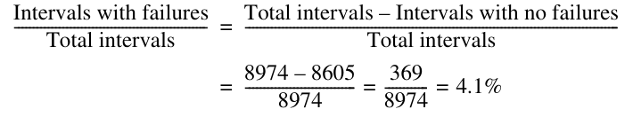

Tỷ lệ phần trăm số giờ bạn không thể làm việc khi dùng network truyền thống chỉ là thời gian workstation của bạn bị crash. Nếu các lỗi này phân bố đều giữa các workstation, tỷ lệ phần trăm là

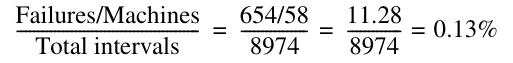

Do đó, theo thống kê lỗi trong Hình F.27, khả năng bạn không thể làm việc khi dùng LAN failure-intolerant cao hơn 30 lần so với LAN truyền thống. Nói cách khác, người phụ trách bảo trì LAN sẽ nhận số cuộc gọi từ người dùng bực tức tăng 30-fold!

| Số máy lỗi trong mỗi khoảng thời gian | Số khoảng One-hour có số máy lỗi như cột đầu | Tổng số lỗi trong mỗi khoảng one-hour | Số khoảng One-day có số máy lỗi như cột đầu | Tổng số lỗi trong mỗi khoảng one-day |
|---|---|---|---|---|
| 0 | 8605 | 0 | 184 | 0 |
| 1 | 264 | 264 | 105 | 105 |
| 2 | 50 | 100 | 35 | 70 |
| 3 | 25 | 75 | 11 | 33 |
| 4 | 10 | 40 | 6 | 24 |
| 5 | 7 | 35 | 9 | 45 |
| 6 | 3 | 18 | 6 | 36 |
| 7 | 1 | 7 | 4 | 28 |
| 8 | 1 | 8 | 4 | 32 |
| 9 | 2 | 18 | 2 | 18 |
| 10 | 2 | 20 |  |  |
| 11 | 1 | 11 | 2 | 22 |
| 12 |  |  | 1 | 12 |
| 17 | 1 | 17 |  |  |
| 20 | 1 | 20 |  |  |
| 21 | 1 | 21 | 1 | 21 |
| 31 |  |  | 1 | 31 |
| 38 |  |  | 1 | 38 |
| 58 |  |  | 1 | 58 |
| Tổng | 8974 | 654 | 373 | 573 |

**Hình F.27 Đo số lần reboot của 58 DECstation 5000 chạy Ultrix trong khoảng 373-day. Các lần reboot này được phân vào các khoảng thời gian một giờ và một ngày. Cột đầu sắp xếp các khoảng theo số máy bị lỗi trong khoảng đó. Hai cột tiếp theo liên quan đến các khoảng one-hour, còn hai cột cuối liên quan đến các khoảng one-day. Cột thứ hai và thứ tư cho biết số khoảng tương ứng với từng số lượng máy lỗi. Cột thứ ba và thứ năm chỉ là tích của số máy lỗi và số khoảng. Ví dụ, có 50 khoảng one-hour với 2 máy lỗi, tổng cộng 100 máy lỗi, và có 35 ngày với 2 máy lỗi, tổng cộng 70 lỗi. Như dự kiến, số lỗi trong mỗi khoảng thay đổi theo độ dài khoảng đó. Ví dụ, ngày có 31 lỗi có thể gồm một giờ có 11 lỗi và một giờ có 20 lỗi. Hàng cuối cho biết tổng của từng cột; số lỗi không khớp vì nhiều lần reboot của cùng một máy trong cùng một khoảng không tạo thành các mục riêng. (Randy Wang thuộc University of California–Berkeley thu thập dữ liệu này.)**

## F.8 Ví dụ về Interconnection Network

Để làm các khái niệm mô tả trong những mục trước cụ thể hơn, chúng ta xem xét năm network ví dụ thuộc bốn lĩnh vực interconnection network được xét trong phụ lục này. Ngoài một ví dụ cho mỗi lĩnh vực OCN, LAN và WAN, chúng ta xem xét hai ví dụ thuộc SAN: một cho system area network và một cho system/storage area network. Hai ví dụ đầu là network độc quyền dùng trong các hệ thống high-performance; ba ví dụ sau là các tiêu chuẩn network được dùng rộng rãi trong hệ thống thương mại.

### Network On-Chip: Intel Single-Chip Cloud Computer

Khi mức tích hợp transistor tiếp tục tăng như dự đoán của định luật Moore, các nhà thiết kế processor chịu sức ép tìm cách đối phó với wire delay chip-crossing và các vấn đề khác liên quan đến việc thu nhỏ công nghệ deep submicron. Multicore microarchitecture đã trở nên phổ biến nhờ các ưu điểm về sự đơn giản, tính module và khả năng khai thác parallelism vượt quá mức đạt được bằng pipelining mạnh và phát hành nhiều instruction/data trên một core. Dù processor có một core hay nhiều core, yêu cầu đặt lên bandwidth giao tiếp bên trong chip vẫn ngày càng cao để theo kịp — chưa kể bandwidth giữa các chip. Điều này thúc đẩy sự quan tâm lớn đến thiết kế OCN hỗ trợ hiệu quả việc giao tiếp instruction, register operand, memory và dữ liệu I/O bên trong và giữa các processor core, cả trong lẫn ngoài chip. Ở đây, chúng ta tập trung vào một network on-chip như vậy: nguyên mẫu Intel Single-chip Cloud Computer.

Single-chip Cloud Computer (SCC) là một nguyên mẫu chip multiprocessor có 48 core Intel thuộc architecture IA-32. Các core được bố trí (xem Hình F.28) trên một network có topology 2D mesh (6 × 4). Network kết nối 24 tile, 4 memory controller on-die, một voltage regulator controller (VRC) và một system interface controller (SIF) bên ngoài. Trong mỗi tile, hai core kết nối với một router. Bốn memory controller được nối ở biên mesh, mỗi bên hai controller, còn VRC và SIF controller được nối ở biên dưới của mesh.

Mỗi memory controller có thể định địa chỉ cho hai DDR3 DIMMS, mỗi DIMM có tối đa 8 GB memory, nên tổng memory tối đa là 64 GB. VRC controller cho phép bất kỳ core hoặc system interface nào điều chỉnh điện áp trong bất kỳ vùng nào trong sáu vùng pre-defined cấu thành network (hai vùng 2-tile). Clock cũng có thể được điều chỉnh ở mức chi tiết hơn khi mỗi tile có tần số hoạt động riêng. Các vùng này có thể được tắt hoặc giảm mức hoạt động để tiết kiệm đáng kể năng lượng. Phương pháp này cho phép application kiểm soát hoàn toàn trạng thái nguồn của các core. Thật vậy, application có API để xác định điện áp và tần số của từng vùng. SIF controller được dùng để giao tiếp với network từ bên ngoài chip.

Mỗi tile gồm hai processor core (IA P54C-based) với L1 data cache 16 KB và instruction cache 16 KB tương ứng cùng L2 cache 256 KB (với controller tương ứng), một router 5-port, traffic generator (chỉ để kiểm thử), mesh interface unit (MIU) xử lý mọi yêu cầu message passing, memory look-up table (với configuration register để thiết lập ánh xạ physical address của core sang extended memory map của hệ thống), một buffer message-passing và mạch tạo clock, đồng bộ hóa để đi qua ranh giới bất đồng bộ.

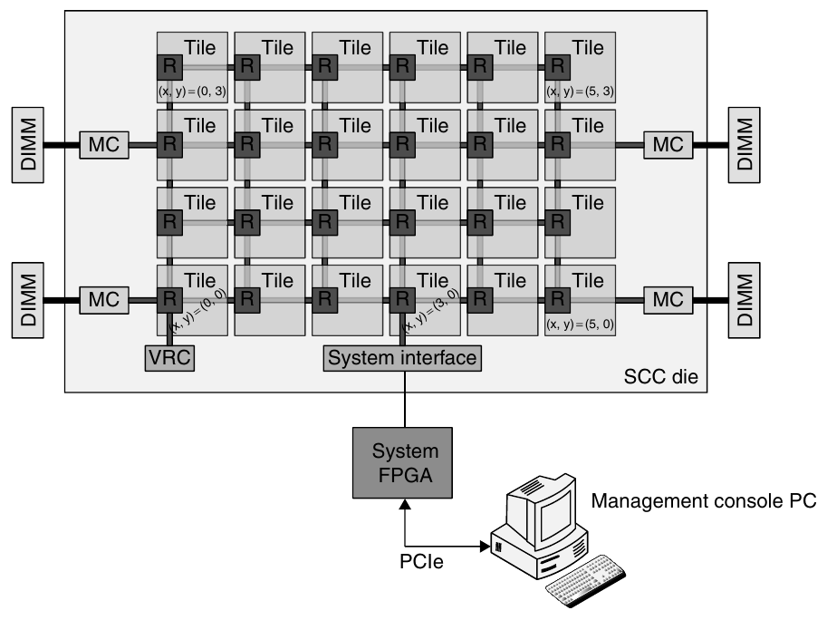

**Hình F.28 Architecture Top-level của SCC. Trích Howard, J. và cộng sự, IEEE International Solid-State Circuits Conference Digest of Technical Papers, tr. 58–59.**

Xét riêng OCN, MIU đảm nhiệm giao tiếp các core với network, gồm packetization và de-packetization các message lớn; chuyển đổi command và giải mã/tra cứu address; flow control link-level và quản lý credit; cùng quyết định của arbiter theo cơ chế round-robin. Một cơ chế flow control credit-based được dùng cùng switching virtual cut-through (do đó cần chia message dài thành packet). Các router được nối theo bố cục 2D mesh, mỗi router có nguồn điện và clock source riêng. Các link kết nối router có side band 16B + 2B chạy ở 2 GHz. Latency Zero-load được đặt là 4 cycle, gồm cả việc đi qua link. Tám virtual channel được dùng cho performance (6 VC) và xử lý deadlock protocol-level (2 VC). Arbitration message-level được thực hiện bằng arbiter wave-front dạng wrapped. Routing algorithm dimension-order XY được dùng và pre-computation của output port được thực hiện tại mỗi router.

Ngoài các tile có vùng xác định điện áp và tần số, network (gồm router và link) có một vùng riêng duy nhất. Vì vậy, mọi thành phần network chạy cùng tốc độ và dùng cùng nguồn điện. Cần một chuyển tiếp clock bất đồng bộ giữa router và tile.

| Tổ chức và tên processor [network] | Năm xây dựng | Số network port [core hoặc tile + port khác] | Network topology cơ bản | Số data bit trên mỗi link theo mỗi hướng | Link bandwidth [tốc độ link clock] | Routing; arbitration; switching | Số lớp kim loại trên chip; flow control; số virtual channel |
|---|---|---|---|---|---|---|---|
| MIT Raw [General Dynamic Network] | 2002 | 16 port [16 tile] | 2D mesh (4 × 4) | 32 bit | 0.9 GB/sec [225 MHz, clock ở tốc độ processor] | XY DOR với khôi phục deadlock request-reply; RR arbitration; wormhole | 6 lớp; credit-based; không có virtual channel |
| IBM Power5 | 2004 | 7 port [2 PE core + 5 port khác] | Crossbar | 256 bit Inst fetch; 64 bit cho store; 256 bit LD | [1.9 GHz, clock ở tốc độ processor] | Shortest-path; nonblocking; circuit switch | 7 lớp; handshaking; không có virtual channel |
| U.T. Austin TRIP Edge [Operand Network] | 2005 | 25 port [25 tile execution unit] | 2D mesh (5 × 5) | 110 bit | 5.86 GB/sec [clock 533 MHz được scale 80%] | YX DOR; RR arbitration phân tán; wormhole | 7 lớp; flow control on/off; không có virtual channel |
| U.T. Austin TRIP Edge [On-Chip Network] | 2005 | 40 port [16 L2 tile + 24 network interface tile] | 2D mesh (10 × 4) | 128 bit | 6.8 GB/sec [clock 533 MHz được scale 80%] | YX DOR; RR arbitration phân tán; VCT switched | 7 lớp; flow control credit-based; 4 virtual channel |
| Sony, IBM, Toshiba Cell BE [Element Interconnect Bus] | 2005 | 12 port [1 PPE và 8 SPE + 3 port khác cho memory, I/O interface] | Ring (tổng 4, 2 theo mỗi hướng) | 128 bit dữ liệu (+ 16 bit tag) | 25.6 GB/sec [1.6 GHz, clock bằng nửa tốc độ processor] | Shortest-path; RR arbitration tree-based (tập trung); circuit switch pipelined | 8 lớp; flow control credit-based; không có virtual channel |
| Sun UltraSPARC T1 processor | 2005 | Tối đa 13 port [8 PE core + 4 L2 bank + 1 I/O dùng chung] | Crossbar | 128 bit cho cả 8 core và 4 L2 bank | 19.2 GB/sec [1.2 GHz, clock ở tốc độ processor] | Shortest-path; arbitration age-based; VCT switched | 9 lớp; handshaking; không có virtual channel |

**Hình F.29 Đặc điểm của các network on-chip được triển khai trong các processor nghiên cứu và thương mại gần đây. Một số processor triển khai nhiều network on-chip (không phải tất cả đều được trình bày) — ví dụ, hai network trong MIT Raw và tám trong TRIP Edge.**

Một đặc điểm nổi bật của SCC architecture là hỗ trợ communication protocol messaging-based thay vì memory hardware cache-coherent cho giao tiếp inter-core. Message passing buffer được đặt trên mọi router và các API được cung cấp để kiểm soát hoàn toàn các cấu trúc MPI. Cache coherency có thể được triển khai bằng software.

SCC router là một cải tiến đáng kể so với chip Teraflops processor trong triển khai interconnect 2D on-chip. So với 2D mesh trong Teraflops processor, triển khai này được tinh chỉnh cho data path rộng hơn trong multiprocessor interconnect, và được tối ưu hơn về latency, diện tích và công suất cho độ rộng đó. Nó hướng tới tần số hoạt động 2-GHz thấp hơn so với 5 GHz của Teraflops processor tiền nhiệm, nhưng có interconnect architecture higher-performance.

### System Area Network: Network IBM Blue Gene/L 3D Torus

IBM BlueGene/L là computer system largest-scaled, highest-performing trên thế giới năm 2005, theo www.top500.org. Với 65,536 compute node dual-processor và 1024 I/O node, supercomputer 360 TFLOPS (peak) này chiếm diện tích khoảng 2500 foot vuông. Cả hai processor tại mỗi node đều có thể dùng cho tính toán và tự xử lý communication protocol trong virtual mode; hoặc một processor có thể dùng cho tính toán, processor còn lại xử lý network interface. Kích thước packet từ 32 byte đến tối đa 256 byte, với 8 byte dùng cho header. Header chứa thông tin routing, virtual channel, flow control link-level, kích thước packet và thông tin tương tự khác, cùng 1 byte CRC để bảo vệ header. Ba byte được dùng cho CRC ở cấp packet, và 1 byte làm chỉ báo hợp lệ.

Interconnection network chính là một SAN 3D torus 32 × 32 × 64 độc quyền kết nối toàn bộ 64K node. Mỗi node switch có sáu link hai chiều 350 MB/sec đến các torus node lân cận, injection bandwidth 612.5 MB/sec từ hai node processor và reception bandwidth 1050 MB/sec đến hai node processor. Reception bandwidth từ network bằng inbound bandwidth qua mọi switch port, ngăn reception link trở thành nút thắt performance của network. Nhiều packet có thể được nhận đồng thời ở mỗi destination node nhờ reception link bandwidth cao hơn.

Hai node được triển khai trên một compute card 2 × 1 × 1, 16 compute card và 2 I/O card trên một node board 4 × 4 × 2, 16 node board trên một midplane 8 × 8 × 8, và 2 midplane tạo thành một rack 1024-node có kích thước vật lý 0.9 × 0.9 × 1.9 mét khối. Link có chiều dài vật lý tối đa 8.6 mét, cho phép flow control link-level hiệu quả với yêu cầu buffering tương đối thấp. Latency thấp đạt được nhờ triển khai switching virtual cut-through, phân tán arbitration tại input và output port của switch, và tính trước routing path hiện tại ở switch trước bằng một finite-state machine để loại một phần routing delay khỏi critical path trong switch. Effective bandwidth cao đạt được bằng các switch input-buffered có hai read port, switching virtual cut-through với bốn virtual channel và routing thích nghi hoàn toàn, deadlock-free, dựa trên bubble flow control.

Một đặc điểm then chốt trong các network cỡ này là khả năng chịu lỗi. Tần suất lỗi được giảm bằng cách dùng link clock frequency tương đối thấp là 700 MHz (bằng processor clock), sử dụng cả hai cạnh clock (tức hỗ trợ transfer rate 1.4 Gbps hoặc 175 MB/sec cho mỗi network link bit-serial theo mỗi hướng), nhưng lỗi vẫn có thể xảy ra trong network. Khi có lỗi, các midplane node board chứa lỗi được tắt và đi vòng qua để cô lập lỗi, và việc tính toán tiếp tục từ checkpoint cuối cùng. Việc bypass được thực hiện bằng các bypass switch board riêng gắn với từng midplane, bổ sung ngoài tập torus node board. Mỗi bypass switch board có thể cấu hình để nối với các link tương ứng trong midplane node board hoặc với bypass board tiếp theo, qua đó thực chất loại bỏ tập midplane node board tương ứng. Dù số processing node bị giảm phần nào ở một số chiều network, máy vẫn giữ cấu trúc topology và routing algorithm.

Một số collective communication operation như barrier synchronization, broadcast/multicast, reduction, v.v. không hoạt động tốt trên 3D torus vì network sẽ ngập traffic. Để khắc phục, hai tree network riêng có bandwidth per-link cao hơn được dùng để triển khai collective và combining operation hiệu quả hơn. Ngoài hỗ trợ synchronization và broadcast/multicast hiệu quả, hardware được dùng để thực hiện hiệu quả một số arithmetic reduction operation (ví dụ tính tổng hoặc giá trị lớn nhất của một tập giá trị, mỗi processing node cung cấp một giá trị). Ngoài 3D torus và hai tree network, Blue Gene/L triển khai một network I/O Gigabit Ethernet và một control system network Fast Ethernet có bandwidth thấp hơn để phục vụ I/O song song, cấu hình, debugging và bảo trì.

### System/Storage Area Network: InfiniBand

InfiniBand là một tiêu chuẩn networking de facto trên toàn ngành, được phát triển vào tháng Mười năm 2000 bởi một liên minh công ty thuộc InfiniBand Trade Association. InfiniBand có thể dùng làm system area network cho giao tiếp giữa các processor hoặc storage area network cho server I/O. Đây là một công nghệ interconnect switch-based cho phép linh hoạt về topology, routing algorithm và arbitration technique do vendor và người dùng triển khai. InfiniBand hỗ trợ data transmission rate từ 2 đến 120 Gbp/link theo mỗi hướng trên khoảng cách 300 mét. Nó sử dụng switching cut-through, 16 virtual channel và service level, flow control link-level credit-based cùng fair scheduling weighted round-robin, và triển khai programmable forwarding table. Nó cũng gồm các đặc điểm hữu ích để tăng độ tin cậy và tính sẵn sàng của hệ thống, như quản lý communication subnet, thiết lập path end-to-end và đặt tên virtual destination. Hình F.30 trình bày packet format của InfiniBand cạnh hai tiêu chuẩn network khác thuộc LAN và WAN. Hình F.31 so sánh nhiều đặc điểm của tiêu chuẩn InfiniBand với hai system area network độc quyền được dùng rộng rãi trong computer system high-performance nghiên cứu và thương mại.

InfiniBand cung cấp hai cơ chế cơ bản để hỗ trợ giao tiếp user-level: send/receive và remote DMA (RDMA). Với send/receive, bên nhận phải đăng ký rõ ràng một receive buffer (tức cấp phát không gian trong network interface channel adapter của nó) trước khi bên gửi có thể truyền dữ liệu. Với RDMA, bên gửi có thể DMA từ xa dữ liệu trực tiếp vào memory của thiết bị nhận. Ví dụ, với nominal packet size 4 byte đo trên channel adapter Mellanox MHEA28-XT kết nối với host device Intel Xeon 3.4 GHz, overhead gửi và nhận lần lượt là 0.946 và 1.423 μs với cơ chế send/receive, trong khi lần lượt là 0.910 và 0.323 μs với cơ chế RDMA.

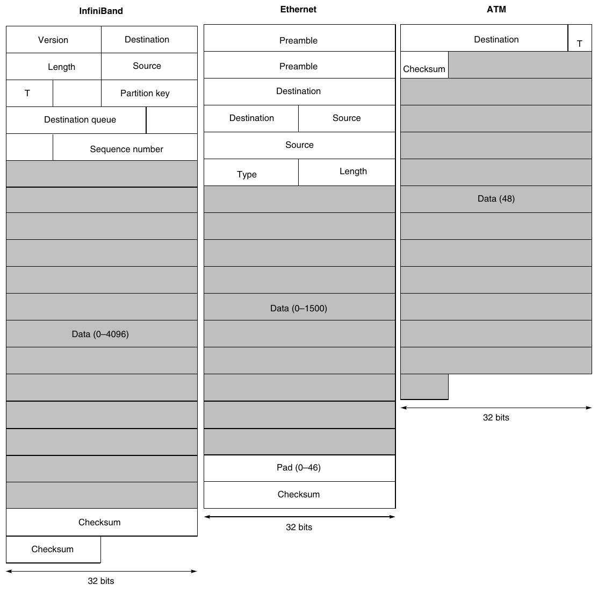

**Hình F.30 Packet format của InfiniBand, Ethernet và ATM. ATM gọi message là “cell” thay vì packet nên tên đúng là ATM cell format. Độ rộng mỗi hình vẽ là 32 bit. Cả ba format đều có trường destination addressing, được encode khác nhau tùy trường hợp. Cả ba cũng có trường checksum để phát hiện transmission error, dù trường checksum ATM chỉ được tính trên header; ATM dựa vào protocol higher-level để phát hiện lỗi trong dữ liệu. Cả InfiniBand và Ethernet đều có trường length vì packet chứa lượng dữ liệu biến đổi, loại trước đếm theo word 32-bit còn loại sau theo byte. Header của InfiniBand và ATM có trường type (T) cho biết loại packet. Các trường Ethernet còn lại gồm preamble cho phép bên nhận khôi phục clock từ code self-clocking dùng trên Ethernet, source address và trường pad để bảo đảm packet nhỏ nhất là 64 byte (gồm header). InfiniBand có trường version cho protocol version, sequence number để cho phép chuyển giao in-order, trường chọn destination queue và trường partition key. Infiniband có nhiều trường nhỏ khác không được trình bày và nhiều packet format khác; trên đây là cách nhìn đơn giản hóa. Packet cố định ngắn của ATM phù hợp với yêu cầu real-time của digital voice.**

| Tên network [vendor] | Được dùng trong top 10 supercomputer cluster (2005) | Số node | Network topology cơ bản | Raw link BW hai chiều | Routing algorithm | Arbitration technique | Switching technique; flow control |
|---|---|---|---|---|---|---|---|
| InfiniBand [Mellanox, Voltair] | SGI Altrix và Dell Poweredge Thunderbird | >Hàng triệu (2128 GUID address, như IPv6) | Có thể cấu hình hoàn toàn (tùy ý) | 4–240 Gbps | Tùy ý (table-driven), thường là up*/down* | Fair scheduling weighted RR (priority 2-level) | Cut-through, 16 virtual channel (15 cho dữ liệu); credit-based |
| Myrinet-2000 [Myricom] | Barcelona Supercomputer Center tại Tây Ban Nha | 8192 node | MIN hai chiều với switch hai chiều 16-port (Clos net.) | 4 Gbps | Minimal routing phân tán Source-based (thích nghi) | Arbitration Round-robin | Switching Cut-through không có virtual channel; flow control Xon/Xoff |
| QsNetII [Quadrics] | Intel Thunder Itanium2 Tiger4 | >Hàng chục nghìn | Fat tree với switch hai chiều 8-port | 21.3 Gbps | Routing LCA Source-based thích nghi shortest-path | RR 2-phased, priority, aging, phân tán tại output port | Wormhole với 2 virtual channel; credit-based |

**Hình F.31 Đặc điểm của system area network được triển khai trong nhiều supercomputer cluster thuộc top 10 năm 2005.**

Như đã thảo luận trong Mục F.2, kích thước packet rất quan trọng để tận dụng đầy đủ network bandwidth. Có thể đặt câu hỏi: “Kích thước tự nhiên của message là bao nhiêu?” Hình F.32(a) cho biết kích thước message của một application mô phỏng động lực học chất lưu thương mại tên Fluent, được thu thập trên một InfiniBand network tại Network-Based Computer Laboratory của The Ohio State University. Một đồ thị biểu diễn tích lũy theo số message đã gửi, đồ thị còn lại theo số byte dữ liệu đã gửi. Message trong đồ thị này là các đơn vị thông tin message passing interface (MPI), được chia thành các maximum transfer unit (packet) InfiniBand để truyền qua network. Như hình cho thấy, kích thước message tối đa vượt 512 KB, nhưng khoảng 90% message nhỏ hơn 512 byte. Message 2 KB chiếm khoảng 50% số byte được truyền. Một application kernel Integer Sort trong bộ NAS Parallel Benchmark cũng được đo thấy có khoảng 75% message dưới 512 byte (không trình bày đồ thị). Nhiều application gửi số message nhỏ nhiều hơn hẳn message lớn, đặc biệt vì request và acknowledgment thường xuyên hơn data response và block write.

InfiniBand giảm overhead xử lý protocol bằng cách cho phép chuyển công việc này từ host computer sang một controller trên InfiniBand network interface card. Lợi ích của protocol offloading và bỏ qua operating system được trình bày trong Hình F.32(b) cho MVAPICH, một triển khai MPI trên InfiniBand được dùng rộng rãi. Effective bandwidth được vẽ theo kích thước message cho MVAPICH cấu hình ở hai mode và hai network speed. Một mode chạy IPoIB, trong đó giao tiếp InfiniBand do IP layer được operating system của host triển khai xử lý (tức không OS bypass). Mode còn lại chạy MVAPICH trực tiếp trên VAPI, native Mellanox InfiniBand interface chuyển việc xử lý transport protocol sang channel adapter hardware (tức OS bypass). Kết quả được trình bày cho InfiniBand network single data rate (SDR) 10 Gbps và double data rate (DDR) 20 Gbps. Kết quả cho thấy rõ rằng offloading xử lý protocol và bỏ qua OS làm giảm đáng kể overhead gửi và nhận, cho phép đạt effective bandwidth gần wire-speed.

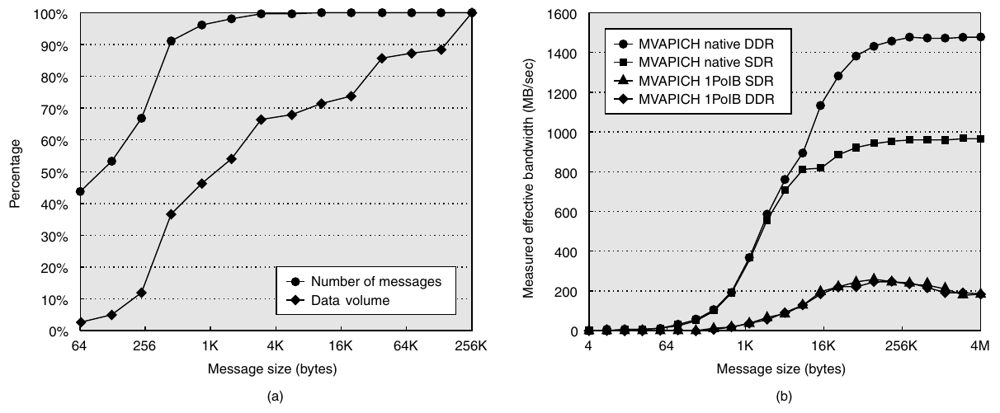

**Hình F.32 Dữ liệu do D.K. Panda, S. Sur và L. Chai (2005) thu thập tại Network-Based Computing Laboratory của The Ohio State University. (a) Phần trăm tích lũy của message và khối lượng dữ liệu được truyền khi kích thước message thay đổi đối với application Fluent (www.fluent.com). Mỗi mục x-axis bao gồm mọi byte đến mốc kế tiếp; ví dụ, 128 biểu thị từ 1 byte đến 128 byte. Khoảng 90% message nhỏ hơn 512 byte, chiếm khoảng 40% tổng số byte được truyền. (b) Effective bandwidth theo kích thước message được đo trên InfiniBand network SDR và DDR chạy MVAPICH (http://nowlab.cse.ohio-state.edu/projects/mpi-iba), có OS bypass (native) và không có (IPoIB).**

### Ethernet: Local Area Network

Ethernet đã thành công phi thường với vai trò LAN — từ tiêu chuẩn 10 Mbit/sec đề xuất năm 1978 được sử dụng gần như khắp nơi ngày nay đến tiêu chuẩn 10 Gbit/sec gần đây hơn, có khả năng được dùng rộng rãi. Nhiều loại computer có Ethernet làm communication interface tiêu chuẩn. Ethernet, được hệ thống hóa thành tiêu chuẩn IEEE 802.3, là network packet-switched route packet bằng destination address. Ban đầu nó được thiết kế cho cáp đồng trục nhưng hiện chủ yếu dùng dây đồng Cat5E, còn cáp quang dành cho khoảng cách dài và bandwidth cao hơn. Thậm chí còn có phiên bản không dây (802.11), minh chứng cho tính phổ biến của nó.

Trong khoảng 20-year, computer trở nên nhanh hơn hàng nghìn lần so với năm 1978, nhưng Ethernet network dùng chung môi trường truyền vẫn giữ nguyên. Vì vậy, engineer phải nghĩ ra giải pháp tạm thời cho đến khi có network nhanh hơn, higher-bandwidth. Một giải pháp là dùng nhiều Ethernet để kết nối các máy và nối những Ethernet đó bằng thiết bị internetworking có thể chuyển traffic từ Ethernet này sang Ethernet khác khi cần. Các thiết bị này cho phép từng Ethernet hoạt động song song, qua đó tăng aggregate interconnection bandwidth của một tập computer. Trên thực tế, chúng cung cấp chức năng tương tự các switch đã mô tả cho network point-to-point.

Hình F.33 cho thấy parallelism tiềm năng có thể đạt được. Tùy cách chúng chuyển traffic và những loại interconnection có thể nối với nhau, các thiết bị này có tên khác nhau:

- Bridge — Các thiết bị này nối các LAN, chuyển traffic từ bên này sang bên kia tùy address trong packet. Bridge hoạt động ở cấp Ethernet protocol và thường đơn giản, rẻ hơn router sẽ được thảo luận tiếp theo. Theo ký hiệu của OSI model mô tả trong mục sau (xem Hình F.36 ở trang F-85), bridge hoạt động ở layer 2, data link layer.

- Router hoặc gateway — Các thiết bị này nối LAN với WAN hoặc WAN với WAN và giải quyết việc định địa chỉ không tương thích. Nhìn chung chậm hơn bridge, chúng hoạt động ở OSI layer 3, network layer. WAN router chia network thành các subnet nhỏ tách biệt, đơn giản hóa việc quản lý và cải thiện bảo mật.

Loại thiết bị internetworking cuối cùng là hub, nhưng chúng chỉ mở rộng nhiều segment thành một LAN. Vì vậy hub không giúp cải thiện performance do mỗi lần chỉ một message có thể truyền. Hub hoạt động ở OSI layer 1, gọi là physical layer. Vì những thiết bị này không được dự tính là một phần của tiêu chuẩn Ethernet, tính chắp vá của chúng làm tăng khó khăn và chi phí bảo trì LAN.

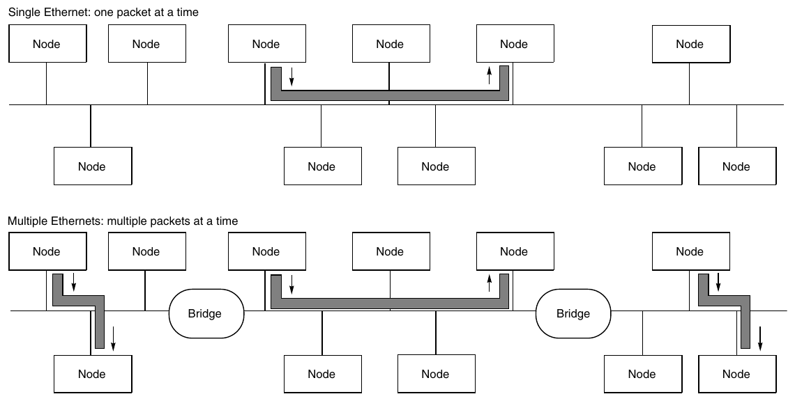

**Hình F.33 Khả năng tăng bandwidth khi dùng nhiều Ethernet và bridge.**

Tính đến năm 2011, Ethernet link speed có các mức 10, 100, 10,000 và 100,000 Mbits/sec. Dù Ethernet 10 và 100 Mbits/sec dùng chung môi trường truyền giữa nhiều thiết bị, Ethernet 1000 Mbits/sec trở lên dựa vào link point-to-point và switch. Ethernet switch thường dùng một hình thức store-and-forward.

Ethernet không có flow control thực sự, ngay từ phiên bản đầu tiên. Ban đầu, nó dùng carrier sensing với back-off tăng theo hàm mũ (xem trang F-23) để arbitration cho môi trường truyền dùng chung. Một số switch cố dùng interface đó để bổ sung phiên bản flow control của mình, nhưng flow control không thuộc tiêu chuẩn Ethernet.

### Wide Area Network: ATM

Asynchronous Transfer Mode (ATM) là tiêu chuẩn wide area networking do ngành viễn thông thiết lập. Dù từng có ý định cạnh tranh với Ethernet ở vai trò LAN trong thập niên 1990, sau đó ATM đã rút về thế mạnh WAN của mình.

Tiêu chuẩn viễn thông này có sẵn bandwidth có thể mở rộng. Nó bắt đầu ở 155 Mbits/sec và tăng theo hệ số 4 lên 620 Mbits/sec, 2480 Mbits/sec, v.v. Vì là WAN, môi trường truyền của ATM là cáp quang, cả single mode lẫn multimode. Dù là môi trường switched, khác với những ví dụ còn lại, nó dựa vào virtual connection để giao tiếp. ATM sử dụng virtual channel cho routing để ghép nhiều connection trên một network segment, nhờ đó tránh sự kém hiệu quả của networking connection-based thông thường. Việc tập trung vào WAN cũng dẫn đến switching store-and-forward. Khác các protocol còn lại, Hình F.30 cho thấy ATM có packet nhỏ fixed-sized với payload 48 byte. Nó dùng cơ chế flow control credit-based, khác IP router không triển khai flow control.

Lý do dùng virtual connection và packet nhỏ là quality of service. Vì ngành viễn thông quan tâm đến voice traffic, khả năng dự đoán quan trọng không kém bandwidth. Thiết lập virtual connection có ít biến thiên hơn connectionless networking và đơn giản hóa switching store-and-forward. Packet nhỏ cố định cũng giúp tạo router và switch nhanh dễ hơn. Hướng tới mục tiêu đó, ATM thậm chí cung cấp protocol stack riêng để cạnh tranh với TCP/IP. Điều đáng ngạc nhiên là dù switch đơn giản, bộ protocol ATM lại lớn và phức tạp. Ước mơ là có một infrastructure liền mạch từ LAN đến WAN, tránh mớ router chắp vá phổ biến ngày nay. Ước mơ ấy đã phai nhạt từ nguồn cảm hứng thành nỗi hoài niệm.

## F.9 Internetworking

Không nghi ngờ gì, internetworking là một trong những đổi mới quan trọng nhất trong cộng đồng truyền thông. Nó cho phép computer trên các network độc lập, không tương thích giao tiếp tin cậy và hiệu quả. Hình F.34 minh họa nhu cầu đi qua nhiều network. Hình cho biết những network và máy tham gia truyền một file từ Stanford University đến University of California tại Berkeley, khoảng cách chừng 75 km.

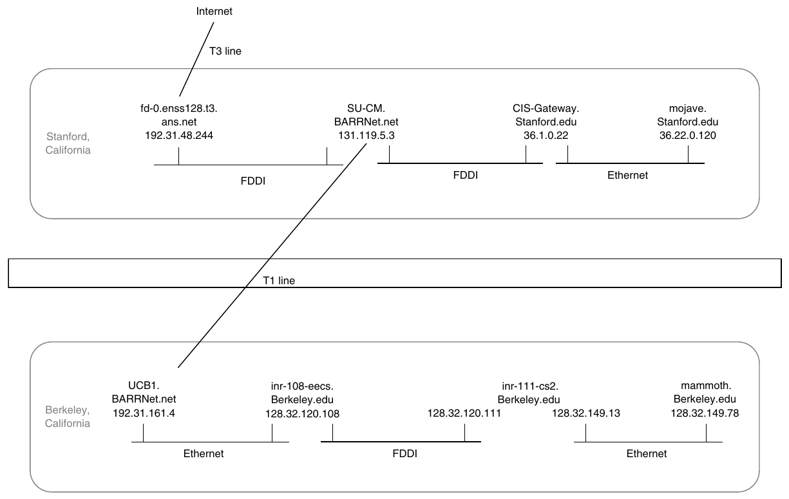

**Hình F.34 Connection được thiết lập giữa mojave.stanford.edu và mammoth.berkeley.edu (1995). FDDI là LAN 100 Mbit/sec, còn đường T1 là đường viễn thông 1.5 Mbit/sec và T3 là đường viễn thông 45 Mbit/sec. BARRNet là viết tắt của Bay Area Research Network. Lưu ý inr-111-cs2.Berkeley.edu là router có hai Internet address, mỗi port một address.**

Chi phí thấp của internetworking thật đáng chú ý. Ví dụ, gửi thư điện tử rẻ hơn rất nhiều so với gọi điện coast-to-coast và để lại lời nhắn trên máy trả lời tự động. Mức cải thiện chi phí mạnh mẽ này đạt được bằng chính các đường truyền thông long-haul của cuộc điện thoại, khiến cải tiến càng ấn tượng.

Các công nghệ cho phép internetworking là những software standard hỗ trợ giao tiếp tin cậy mà không đòi hỏi network tin cậy. Nguyên lý nền tảng của những tiêu chuẩn thành công này là chúng được tổ chức thành hệ phân cấp layer, mỗi layer chịu trách nhiệm một phần của tác vụ truyền thông tổng thể. Mỗi computer, network và switch triển khai layer của mình trong tiêu chuẩn, dựa vào các thành phần khác thực hiện đúng trách nhiệm của chúng. Các software standard phân lớp này được gọi là protocol family hoặc protocol suite. Chúng cho phép application hoạt động với bất kỳ interconnection nào mà application programmer không phải làm thêm việc. Hình F.35 gợi ra mô hình truyền thông phân cấp.

Tiêu chuẩn internetworking phổ biến nhất là TCP/IP (Transmission Control Protocol/Internet Protocol). Protocol family này là nền tảng của mạng mang cái tên khiêm tốn Internet, kết nối hàng trăm triệu computer trên thế giới. Sự phổ biến này khiến TCP/IP được dùng ngay cả khi giao tiếp cục bộ giữa những network tương thích; ví dụ, network file system (NFS) dùng IP dù rất có thể nó đang giao tiếp trên một LAN đồng nhất như Ethernet. Chúng ta dùng TCP/IP làm ví dụ protocol family; các protocol family khác tuân theo hướng tương tự. Mục F.13 trình bày lịch sử TCP/IP.

Mục tiêu của một protocol family là đơn giản hóa tiêu chuẩn bằng cách phân chia trách nhiệm theo hệ phân cấp layer, mỗi layer cung cấp dịch vụ cần thiết cho layer bên trên. Application program ở trên cùng, còn dưới cùng là môi trường truyền thông vật lý gửi các bit. Giống như abstract data type đơn giản hóa công việc của programmer bằng cách che giấu chi tiết triển khai data type, chiến lược phân lớp này giúp tiêu chuẩn dễ hiểu hơn.

Đã có nhiều nỗ lực phát triển network protocol, dẫn đến sự lẫn lộn thuật ngữ. Vì vậy, Open Systems Interconnect (OSI) phát triển một model giúp phổ biến cách mô tả network dưới dạng một chuỗi layer. Hình F.36 trình bày model đó. Dù không phải protocol nào cũng theo đúng cách phân lớp này, hệ thuật ngữ cho các layer được dùng rộng rãi. Do đó, bạn có thể nghe thảo luận về switch layer 3 đơn giản so với smart switch layer 7.

Điểm then chốt của protocol family là giao tiếp diễn ra về mặt logic ở cùng cấp protocol ở cả bên gửi lẫn bên nhận, nhưng do dịch vụ của cấp thấp hơn triển khai. Kiểu giao tiếp này gọi là peer-to-peer. Để so sánh, hãy hình dung tướng A cần gửi thông điệp cho tướng B trên chiến trường. Tướng A viết thông điệp, đặt vào phong bì đề tên tướng B và đưa cho một đại tá với lệnh chuyển đi. Đại tá đặt nó vào một phong bì khác, viết tên đại tá tương ứng dưới quyền tướng B rồi đưa cho một thiếu tá cùng chỉ thị chuyển giao. Thiếu tá cũng làm vậy và đưa cho một đại úy; đại úy đưa cho trung úy, trung úy đưa cho trung sĩ. Trung sĩ lấy phong bì từ trung úy, đặt vào phong bì đề tên một trung sĩ thuộc sư đoàn tướng B và tìm một binh nhì, ra lệnh mang phong bì lớn đi. Binh nhì mượn xe máy và chuyển phong bì cho trung sĩ bên kia. Khi đến nơi, nó được chuyển ngược lên chuỗi chỉ huy; mỗi người bóc lớp phong bì ngoài có tên mình và chuyển phong bì bên trong cho cấp trên. Với tướng B, bức thư đến từ một vị tướng khác. Không vị tướng nào biết ai tham gia chuyển phong bì, cũng không biết nó được vận chuyển từ sư đoàn này sang sư đoàn khác bằng cách nào.

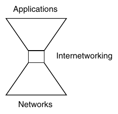

**Hình F.35 Vai trò của internetworking. Độ rộng biểu thị số lượng tương đối các đối tượng ở mỗi cấp.**

| Số layer | Tên layer | Chức năng chính | Protocol ví dụ | Thành phần network |
|---|---|---|---|---|
| 7 | Application | Dùng cho application được viết riêng để chạy trên network | FTP, DNS, NFS, http | Gateway, smart switch |
| 6 | Presentation | Chuyển từ application format sang network format và ngược lại |  | Gateway |
| 5 | Session | Thiết lập, duy trì và kết thúc session qua network | Named pipes, RPC | Gateway |
| 4 | Transport | Connection bổ sung bên dưới session layer | TCP | Gateway |
| 3 | Network | Chuyển logical network address và tên sang physical address tương ứng (ví dụ computer name sang MAC address) | IP | Router, ATM switch |
| 2 | Data Link | Chuyển packet thành raw bit và ở phía nhận chuyển bit thành packet | Ethernet | Bridge, network interface card |
| 1 | Physical | Truyền raw bit stream qua cáp vật lý | IEEE 802 | Hub |

**Hình F.36 Các layer của OSI model. Dựa trên www.geocities.com/SiliconValley/Monitor/3131/ne/osimodel.html.**

Protocol family giống phép so sánh này hơn bạn có thể nghĩ, như Hình F.37 cho thấy. Message gốc gồm header và có thể cả trailer do protocol lower-level gửi. Đến lượt mình, protocol next-lower thêm header riêng vào message, có thể chia nó thành message nhỏ hơn nếu quá lớn đối với layer này. Dùng lại phép so sánh, thông điệp dài của vị tướng được chia và đặt vào nhiều phong bì nếu không vừa một phong bì. Việc chia message và thêm header, trailer tiếp tục cho đến khi message xuống môi trường truyền vật lý. Message sau đó được gửi đến đích. Mỗi cấp của protocol family ở bên nhận kiểm tra message tại cấp mình và bóc header, trailer, chuyển lên cấp tiếp theo và ghép các phần lại. Việc lồng các protocol layer cho một message cụ thể gọi là protocol stack, phản ánh tính vào sau, ra trước của việc thêm và bỏ header, trailer.

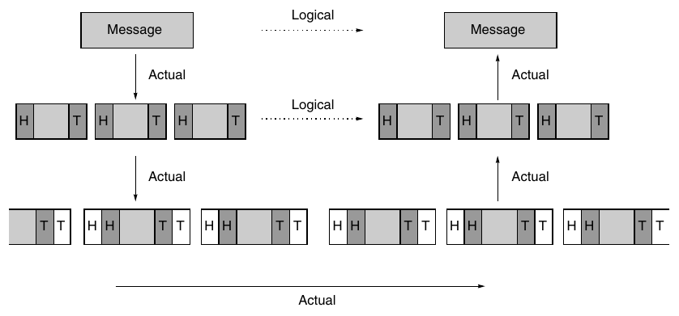

**Hình F.37 Một protocol stack tổng quát có hai layer. Lưu ý giao tiếp là peer-to-peer, với header và trailer dành cho peer được thêm tại mỗi layer gửi và bỏ tại mỗi layer nhận. Mỗi layer cung cấp dịch vụ cho layer bên trên để che giấu các chi tiết không cần thiết.**

Như trong phép so sánh, nguy cơ của cách tiếp cận phân lớp này là latency đáng kể được thêm vào quá trình chuyển message. Rõ ràng, một cách giảm latency là giảm số layer, nhưng cần nhớ protocol family xác định tiêu chuẩn chứ không bắt buộc cách triển khai. Giống như có nhiều cách triển khai instruction set architecture, cũng có nhiều cách triển khai protocol family.

Ví dụ protocol stack của chúng ta là TCP/IP. Giả sử protocol layer dưới cùng là Ethernet. Cấp tiếp theo bên trên là Internet Protocol, hay IP layer; thuật ngữ chính thức cho IP packet là datagram. IP layer route datagram tới máy đích, có thể qua nhiều máy hoặc switch trung gian. IP cố gắng tối đa để chuyển packet nhưng không bảo đảm datagram được chuyển đến, nội dung hay thứ tự của chúng. TCP layer bên trên IP bảo đảm chuyển giao tin cậy, in-order và ngăn datagram bị hỏng.

Theo ví dụ trong Hình F.37, giả sử một application program muốn gửi message tới một máy qua Ethernet. Nó bắt đầu bằng TCP. Số byte tối đa gửi một lần là 64 KB. Vì dữ liệu có thể lớn hơn nhiều so với 64 KB, TCP phải chia chúng thành segment nhỏ hơn và ghép lại đúng thứ tự khi đến nơi. TCP thêm header 20-byte (Hình F.38) vào mỗi datagram rồi chuyển xuống IP. IP layer bên trên physical layer thêm một header 20-byte, cũng được trình bày trong Hình F.38. Dữ liệu gửi từ IP level xuống Ethernet được gửi trong packet có format ở Hình F.30. Lưu ý TCP packet nằm trong phần dữ liệu của IP datagram, đúng như Hình F.37 gợi ý.

**Hình F.38 Header của IP và TCP. Hình vẽ này rộng 32 bit. Header tiêu chuẩn của cả hai là 20 byte, nhưng cả hai cho phép tùy chọn kéo dài header để chứa thông tin ít được truyền. Cả hai header đều có trường độ dài header (L) để hỗ trợ các trường tùy chọn, cùng trường source và destination. Độ dài toàn bộ datagram nằm trong trường length riêng của IP, còn TCP kết hợp độ dài datagram với sequence number của datagram bằng cách biểu diễn sequence number theo byte. TCP dùng trường checksum để bảo đảm datagram không bị hỏng, và trường sequence number để bảo đảm datagram được ghép đúng thứ tự khi đến nơi. IP chỉ cung cấp checksum error detection cho header vì TCP đã bảo vệ phần packet còn lại. Một tối ưu hóa là TCP có thể gửi một chuỗi datagram trước khi chờ cho phép gửi tiếp. Số datagram có thể gửi mà không chờ chấp thuận gọi là window, và trường window cho biết có thể gửi bao nhiêu byte sau byte đang được datagram này xác nhận. TCP điều chỉnh kích thước window tùy mức thành công của IP layer trong việc gửi datagram; IP càng tin cậy và nhanh thì TCP tạo window càng lớn. Vì window trượt về trước khi dữ liệu đến và được xác nhận, kỹ thuật này gọi là sliding window protocol. Trường piggyback acknowledgment của TCP là một tối ưu hóa khác. Vì một số application gửi dữ liệu qua lại trên cùng connection, gửi datagram chỉ chứa acknowledgment có vẻ lãng phí. Trường piggyback này cho phép datagram mang dữ liệu đồng thời mang acknowledgment cho lần truyền trước, “đi nhờ” trên một lần truyền dữ liệu. Trường urgent pointer của TCP cho biết address trong datagram của một byte quan trọng, như ký tự break. Pointer này cho phép application software bỏ qua dữ liệu để người dùng không phải chờ xử lý mọi dữ liệu trước đó rồi mới thấy ký tự yêu cầu software dừng. Trường identifier và fragment của IP cho phép các máy trung gian chia datagram gốc thành nhiều datagram nhỏ hơn. Một identifier duy nhất được gắn với datagram gốc và đặt vào mỗi fragment, trong đó trường fragment cho biết mỗi mảnh là mảnh nào. Trường time-to-live cho phép loại bỏ datagram sau khi qua số switch trung gian tối đa, bất kể nó đang ở đâu trong network. Biết số hop tối đa mà datagram phải đi để đến nơi — nếu nó đến được — đơn giản hóa protocol software. Trường protocol xác định upper layer protocol nào đã gửi IP datagram; trong trường hợp này là TCP. Trường V (version) và type cho phép có nhiều phiên bản IP protocol software cho network. Việc đánh số version tường minh được đưa vào để software có thể được nâng cấp thuận lợi từng máy một mà không dừng toàn network. Ngày nay, phiên bản sáu của Internet protocol (IPv6) đã được sử dụng rộng rãi.**

## F.10 Các vấn đề xuyên suốt về Interconnection Network

Mục này mô tả năm chủ đề được thảo luận ở các chương khác chịu ảnh hưởng căn bản từ interconnection network, và ngược lại.

### Processor Density-Optimized so với Processor SPEC-Optimized

Vì mọi người trên khắp thế giới truy cập Web site, vị trí server thực ra không quan trọng. Vì vậy nhiều server được đặt tại collocation site, nơi tính phí theo network bandwidth được đặt trước và sử dụng, không gian chiếm dụng và năng lượng tiêu thụ. Desktop microprocessor trước đây được thiết kế để nhanh nhất có thể với bất kỳ mức nhiệt nào có thể tản ra, ít quan tâm đến kích thước package và các chip xung quanh. Thực tế, một số desktop microprocessor của Intel và AMD gần đây, vào năm 2006, tiêu thụ đến 130 watt! Hiệu quả sử dụng diện tích sàn cũng phần lớn bị bỏ qua. Do các ưu tiên này, điện năng là chi phí lớn của collocation site, còn processor density bị giới hạn bởi năng lượng tiêu thụ và tản ra, kể cả trong interconnect!

Với sự phổ biến của computer di động (doanh số notebook lần đầu vượt desktop năm 2005) cùng mức tiêu thụ điện và yêu cầu làm mát giảm, có cơ hội dùng công nghệ này để tạo mật độ tính toán cao hơn đáng kể. Ví dụ, Intel Pentium M năm 2006 tiêu thụ 25 watt nhưng đem lại performance gần desktop microprocessor cho nhiều application. Vì thế có thể hình dung performance trên watt hoặc performance trên foot khối sẽ thay performance trên microprocessor làm thước đo quan trọng. Điểm mấu chốt là nhiều application đã sử dụng cluster lớn, nên thay 64 processor power-hungry bằng, chẳng hạn, 256 processor power-efficient có thể rẻ hơn mà vẫn tương thích software. Điều này làm thiết kế interconnection network power-and performance-efficient càng quan trọng.

Google cluster là ví dụ tiêu biểu của việc chuyển sang nhiều processor “mát hơn” thay vì ít processor “nóng hơn”. Nó dùng rack chứa tối đa 80 processor Intel Pentium III 1 GHz thay cho processor high-end power-hungry hơn. Những ví dụ khác gồm blade server với rack unit blade 1-inch-wide × 7-inch-high được thiết kế dựa trên mobile processor. Blade server HP ProLiant BL10e G2 hỗ trợ tối đa 20 processor Intel Pentium M ultra-low-voltage 1-GHz với bus front-side 400-MHz, L2 cache 1-MB và memory tối đa 1 GB. Blade server Fujitsu Primergy BX300 hỗ trợ tối đa 20 processor Intel Pentium M 1.4- hoặc 1.6-GHz, mỗi processor có memory 512 MB mở rộng được lên 4 GB.

### Smart Switch so với Smart Interface Card

Hình F.39 trình bày một trade-off về vị trí đặt khả năng xử lý thông minh trong network. Nhìn chung, câu hỏi là nên có network interface thông minh hơn hay switch thông minh hơn. Làm một phía thông minh hơn thường giúp phía còn lại đơn giản và rẻ hơn. Nhờ interface rẻ, Ethernet có thể trở thành trang bị tiêu chuẩn trong phần lớn desktop và server computer. Switch Lower-cost được cung cấp cho người có cấu hình nhỏ, không cần forwarding table phức tạp và protocol spanning-tree của các Ethernet switch lớn hơn.

**Hình F.39 Khả năng xử lý thông minh trong network: switch so với network interface card. Lưu ý Ethernet switch có hai kiểu tùy kích thước network và InfiniBand network interface có hai kiểu tùy chúng được gắn vào computer hay storage device. Myrinet là một system area network độc quyền.**

Myrinet theo cách tiếp cận ngược lại. Switch của nó là thành phần đơn giản, ngoài triển khai flow control và arbitration thì chỉ lấy byte đầu từ packet header rồi dùng trực tiếp để chọn output port. Không có routing table nào được triển khai, nên khả năng xử lý thông minh nằm ở network interface card (NIC). NIC chịu trách nhiệm hỗ trợ giao tiếp hiệu quả và triển khai distributed protocol để (tái) cấu hình network. InfiniBand dùng cách kết hợp, cung cấp interface card lower-cost ít phức tạp hơn gọi là target channel adapter (TCA) cho thiết bị ít yêu cầu như disk — với hy vọng có thể tích hợp vào một số I/O device — và cung cấp interface card đắt hơn, mạnh hơn cho host gọi là host channel adapter (HCA). Switch triển khai routing table.

### Protection và quyền truy cập Network của người dùng

Một thách thức là bảo đảm giao tiếp an toàn qua network mà không gọi operating system trong trường hợp thông thường. Supercomputer Cray Research T3D là một case study thú vị. Giống Cray X1E gần đây hơn, T3D hỗ trợ global address space nên load và store có thể truy cập memory qua network. Protection được bảo đảm vì mỗi access được TLB kiểm tra. Để hỗ trợ truyền đối tượng lớn hơn, một block transfer engine (BLT) được thêm vào hardware. Protection cho access đòi hỏi gọi operating system trước khi dùng BLT để kiểm tra phạm vi access, bảo đảm không xảy ra protection violation.

**Hình F.40 Bandwidth theo transfer size của memory access instruction đơn giản so với block transfer device trên Cray Research T3D. (Trích Arpaci và cộng sự [1995].)**

Hình F.40 so sánh bandwidth đạt được khi kích thước đối tượng thay đổi đối với read và write. Với read rất lớn (ví dụ 512 KB), BLT đạt performance cao nhất: 140 MB/sec. Nhưng load đơn giản có performance cao hơn ở 8 KB trở xuống. Với write, cả hai đạt đỉnh 90 MB/sec, có lẽ do giới hạn memory bus. Tuy nhiên, với write, BLT chỉ sánh được performance của store đơn giản khi truyền 2 MB; nhỏ hơn mức đó thì gửi store nhanh hơn. Rõ ràng, BLT có thể tránh gọi operating system trong trường hợp thông thường sẽ hữu ích hơn.

### Interface hiệu quả với Memory Hierarchy so với Network

Các cách đánh giá processor performance truyền thống như SPECint và SPECfp khuyến khích tích hợp memory hierarchy với processor vì hiệu quả memory hierarchy chuyển trực tiếp thành processor performance. Vì vậy microprocessor có nhiều cấp cache trên chip cùng buffer cho write. Vì benchmark như SPECint và SPECfp không ghi nhận lợi ích của interface tốt với interconnection network, nhiều máy để toàn bộ memory hierarchy làm chậm thời gian truy cập network. Write phải ì ạch đi qua các write buffer đầy, còn read phải qua các cycle cache miss first-, second- và thường cả third-level trước khi tới interconnection network. Hierarchy này khiến các hệ thống mới có latency tới interconnect cao hơn máy cũ.

Hãy so sánh ba máy trước đây: SPARCstation-2 40-MHz, SPARCstation-20 50-MHz không có external cache và SPARCstation-20 50-MHz có external cache. Theo SPECint95, danh sách này theo thứ tự performance tăng dần. Tuy nhiên, thời gian truy cập I/O bus (S-bus) tăng theo thứ tự: 200 ns, 500 ns và 1000 ns. SPARCstation-2 nhanh nhất vì có một bus chung cho memory và I/O, và chỉ một cấp cache. Memory access của SPARCstation-20 trước hết phải qua memory bus (M-bus) rồi đến I/O bus, thêm 300 ns. Máy có cache second-level chịu thêm penalty 500 ns trước khi truy cập I/O bus.

### Processor Compute-Optimized so với Receiver Overhead

Overhead nhận message có khả năng liên quan đến interrupt, vốn phải chịu chi phí flush rồi khởi động lại processor pipeline nếu không được offload. Như đã đề cập, đọc network status và nhận dữ liệu từ network interface có khả năng diễn ra ở tốc độ cache miss. Nếu microprocessor trở nên superscalar hơn và có clock rate nhanh hơn nữa, số cơ hội instruction issue bị bỏ lỡ trong mỗi lần nhận message có khả năng tăng tới mức không thể chấp nhận.

## F.11 Ngộ nhận và cạm bẫy

Ngộ nhận và nguy cơ rất phổ biến với interconnection network. Mục này nêu một số cảnh báo, vì vậy hãy tiến hành thận trọng.

**Ngộ nhận** Interconnection network rất nhanh và không cần cải tiến.

Interconnection network cung cấp một số chức năng nhất định cho hệ thống, rất giống memory và I/O subsystem. Nó nên được thiết kế để cho phép processor thực thi instruction ở tốc độ tối đa. Interconnection network subsystem phải cung cấp bandwidth đủ cao để tránh liên tục bão hòa và trở thành nút thắt của toàn hệ thống.

Trong thập niên 1980, khi switching wormhole ra đời, việc thiết kế topology large-diameter với switch single-chip trở nên khả thi để bandwidth capacity của network không phải yếu tố giới hạn. Điều này dẫn đến niềm tin sai lầm rằng interconnection network không cần cải tiến thêm. Từ thập niên 1980, nhiều sự chú ý dành cho cải thiện processor performance, nhưng tương đối ít hơn dành cho interconnection network. Khi công nghệ tiến bộ, interconnection network có xu hướng chiếm tỷ trọng ngày càng lớn trong tài nguyên hệ thống, chi phí, năng lượng tiêu thụ và nhiều thuộc tính khác tác động đến chức năng và performance. Mở rộng bandwidth đơn giản bằng over-dimensioning một số network parameter không còn là phương án cost-viable. Nhà thiết kế phải cân nhắc kỹ thiết kế interconnection network end-to-end cùng processor, memory và I/O subsystem để đạt các mục tiêu về chi phí, công suất, chức năng và performance của toàn hệ thống. Một ví dụ rõ ràng là multicore processor với network on-chip.

**Ngộ nhận** Bisection bandwidth là một ràng buộc chi phí chính xác của network.

Dù rất phổ biến, bisection bandwidth chưa từng là một ràng buộc thực tế khi triển khai interconnection network, mặc dù có thể trở thành như vậy trong thiết kế tương lai. Nó hữu ích với vai trò thước đo performance hơn là thước đo chi phí. Chip pin-outs là ràng buộc bandwidth thực tế hơn.

**Cạm bẫy** Dùng bandwidth (đặc biệt bisection bandwidth) làm thước đo duy nhất cho network performance.

Hiếm khi aggregate network bandwidth (hay network bisection bandwidth) là điểm nghẽn end-to-end qua network. Ngay cả khi như vậy, network gần như không bao giờ hiệu quả 100% khi chuyển packet qua bisection (tức ρ < 100%) hoặc khi nhận chúng tại network endpoint (tức σ < 100%). Hiệu quả trước phụ thuộc nhiều vào routing, switching, arbitration và yếu tố tương tự, còn cả hai đều phụ thuộc mạnh vào traffic characteristic. Bỏ qua các yếu tố quan trọng này và chỉ tập trung raw bandwidth có thể đưa ra dự đoán performance rất sai lệch. Ví dụ, hoàn toàn có thể có network có aggregate bandwidth và/hoặc bisection bandwidth cao hơn network khác nhưng measured performance lại thấp hơn!

Dường như với những protocol phức tạp như TCP/IP tối đa hóa delivered bandwidth, nhiều công ty network tin rằng chỉ có một thước đo chất lượng network. Điều này có thể đúng với một số application như video streaming, nơi có ít tương tác giữa bên gửi và bên nhận. Tuy nhiên, nhiều application có bản chất request-response, nên với mỗi message lớn phải có một hoặc nhiều message nhỏ. NFS là một ví dụ.

Hình F.41 so sánh Ethernet LAN 10-Mbit/sec dùng chung với ATM LAN 155-Mbit/sec switched cho NFS traffic. Ethernet driver được tinh chỉnh tốt hơn ATM driver, khiến Ethernet 10-Mbit/sec nhanh hơn ATM 155-Mbit/sec với payload từ 512 byte trở xuống. Hình F.41 trình bày overhead time, transmission time và tổng thời gian gửi toàn bộ NFS message trên Ethernet và ATM. Peak link speed của ATM nhanh gấp 15 lần, và measured link speed cho message 8-KB nhanh gần 9 lần. Nhưng overhead cao hơn bù trừ lợi ích, khiến ATM chỉ truyền NFS traffic nhanh gấp 1.2 lần.

**Cạm bẫy** Không cung cấp đủ reception link bandwidth, khiến network end node càng trở thành nút thắt performance.

Trừ khi traffic pattern là một permutation, nhiều packet sẽ đến đồng thời ở một số đích khi phần lớn source device đưa traffic vào, gây contention. Nếu không xử lý vấn đề này, contention có thể biến thành congestion lan ra toàn network. Có thể xử lý bằng cách phân tích traffic pattern và cung cấp thêm reception bandwidth. Ví dụ, có thể triển khai reception bandwidth lớn hơn injection bandwidth. IBM Blue Gene/L chẳng hạn triển khai switch on-chip với injection link 7-bit và reception link 12-bit, trong đó reception BW bằng aggregate switch input link BW.

|  |  | Overhead (sec) |  |  | Truyền (sec) |  | Tổng thời gian (sec) |  |
|---|---|---|---|---|---|---|---|---|
| Kích thước | Số message | ATM | Ethernet | Số byte dữ liệu | ATM | Ethernet | ATM | Ethernet |
| 32 | 771,060 | 532 | 389 | 33,817,052 | 4 | 48 | 536 | 436 |
| 64 | 56,923 | 39 | 29 | 4,101,088 | 0 | 5 | 40 | 34 |
| 96 | 4,082,014 | 2817 | 2057 | 428,346,316 | 46 | 475 | 2863 | 2532 |
| 128 | 5,574,092 | 3846 | 2809 | 779,600,736 | 83 | 822 | 3929 | 3631 |
| 160 | 328,439 | 227 | 166 | 54,860,484 | 6 | 56 | 232 | 222 |
| 192 | 16,313 | 11 | 8 | 3,316,416 | 0 | 3 | 12 | 12 |
| 224 | 4820 | 3 | 2 | 1,135,380 | 0 | 1 | 3 | 4 |
| 256 | 24,766 | 17 | 12 | 9,150,720 | 1 | 9 | 18 | 21 |
| 512 | 32,159 | 22 | 16 | 25,494,920 | 3 | 23 | 25 | 40 |
| 1024 | 69,834 | 48 | 35 | 70,578,564 | 8 | 72 | 56 | 108 |
| 1536 | 8842 | 6 | 4 | 15,762,180 | 2 | 14 | 8 | 19 |
| 2048 | 9170 | 6 | 5 | 20,621,760 | 2 | 19 | 8 | 23 |
| 2560 | 20,206 | 14 | 10 | 56,319,740 | 6 | 51 | 20 | 61 |
| 3072 | 13,549 | 9 | 7 | 43,184,992 | 4 | 39 | 14 | 46 |
| 3584 | 4200 | 3 | 2 | 16,152,228 | 2 | 14 | 5 | 17 |
| 4096 | 67,808 | 47 | 34 | 285,606,596 | 29 | 255 | 76 | 290 |
| 5120 | 6143 | 4 | 3 | 35,434,680 | 4 | 32 | 8 | 35 |
| 6144 | 5858 | 4 | 3 | 37,934,684 | 4 | 34 | 8 | 37 |
| 7168 | 4140 | 3 | 2 | 31,769,300 | 3 | 28 | 6 | 30 |
| 8192 | 287,577 | 198 | 145 | 2,390,688,480 | 245 | 2132 | 444 | 2277 |
| Tổng | 11,387,913 | 7858 | 5740 | 4,352,876,316 | 452 | 4132 | 8310 | 9872 |

**Hình F.41 Tổng thời gian trên Ethernet 10-Mbit và ATM 155-Mbit, tính riêng tổng overhead và transmission time. Lưu ý cần cộng kích thước header vào số byte dữ liệu để tính transmission time. Overhead cao hơn của software driver ATM bù trừ bandwidth cao hơn của network. Các phép đo này được thực hiện năm 1994 bằng SPARCstation 10s, interface card ForeSystems SBA-200 ATM và switch Fore Systems ASX-200. (Các phép đo NFS do Mike Dahlin thuộc University of California–Berkeley thực hiện.)**

**Cạm bẫy** Dùng network interface card high-performance nhưng quên I/O subsystem nằm giữa network interface và host processor.

Vấn đề này liên quan đến vấn đề trước. Message thường được tạo trong user space buffer rồi gửi bằng cách gọi send function từ communication library. Hoặc, một cache controller triển khai cache coherence protocol có thể tạo message trong một số SAN và trong OCN. Trong cả hai trường hợp, message phải được copy đến network interface memory trước khi truyền. Nếu I/O bandwidth thấp hơn link bandwidth hoặc gây overhead đáng kể, communication performance sẽ bị ảnh hưởng đáng kể. Ví dụ, các card Ethernet 10-Gigabit đầu tiên trên thị trường có PCI-X bus interface với hệ thống với bandwidth thấp hơn đáng kể 10 Gbps.

**Ngộ nhận** Protocol Zero-copy không đòi hỏi copy message hoặc fragment từ buffer này sang buffer khác.

Các communication protocol truyền thống cho computer network chỉ cho phép truy cập communication device qua system call trong supervisor mode. Vì vậy communication routine phải copy message tương ứng từ user buffer đến kernel buffer khi gửi message. Lưu ý communication protocol có thể phải giữ một bản copy message để truyền lại khi lỗi, và application có thể sửa nội dung user buffer khi system call trả quyền điều khiển về application. Việc copy buffer-to-buffer này được loại bỏ trong protocol zero-copy vì communication routine thực thi trong user space và protocol đơn giản hơn nhiều.

Tuy nhiên, message vẫn cần được copy từ application buffer đến memory trong network interface card (NIC) để card hardware truyền từ đó qua network. Dù có thể loại bỏ lần copy này bằng cách cấp phát application message buffer trực tiếp trong NIC memory (và thực tế một số protocol làm vậy), điều này có thể không thuận tiện trong hệ thống hiện tại vì truy cập NIC memory thường qua I/O subsystem, vốn thường chậm hơn nhiều so với truy cập main memory. Vì vậy nhìn chung hiệu quả hơn là tạo message trong main memory và để DMA device lo việc truyền đến NIC memory.

Hơn nữa, ít người tính đến lần copy từ nơi tính các message fragment (thường là ALU, với kết quả được lưu trong processor register nào đó) đến main memory. Một số architecture systolic-like trong thập niên 1980 như iWarp có thể truyền trực tiếp message fragment từ processor đến network, thực chất loại bỏ toàn bộ message copy. Đây là cách tiếp cận của supercomputer multiprocessor shared-memory Cray X1E.

Có thể nhận xét tương tự về phía nhận; tuy nhiên điều này không có nghĩa protocol zero-copy kém hiệu quả. Các protocol này là loại triển khai hiệu quả nhất được dùng trong hệ thống hiện tại.

**Cạm bẫy** Bỏ qua software overhead khi xác định performance.

Software overhead thấp đòi hỏi phối hợp với operating system và communication library, nhưng ngay cả với protocol offloading, nó vẫn lấn át hardware overhead và không được bỏ qua. Hình F.32 và F.41 cho hai ví dụ, một về tiêu chuẩn SAN và một về tiêu chuẩn WAN. Những ví dụ khác đến từ SAN độc quyền cho supercomputer. Supercomputer Connection Machine CM-5 đầu thập niên 1990 có software overhead 20 µs để gửi message và hardware overhead chỉ 0.5 µs. Supercomputer Intel Paragon đầu tiên xây dựng đầu thập niên 1990 có hardware overhead chỉ 0.2 µs, nhưng bản software đầu tiên có overhead 250 µs. Các bản sau giảm overhead này xuống 25 µs, và gần đây hơn xuống chỉ vài microsecond, nhưng nó vẫn lấn át hardware overhead. IBM Blue Gene/L có MPI sending/receiving overhead khoảng 3 µs, trong đó tối đa chỉ một phần ba được quy cho hardware.

Cạm bẫy này đơn giản là định luật Amdahl áp dụng cho network: network hardware nhanh hơn là thừa nếu software overhead không giảm tương ứng. Hiện software overhead được giảm nhiều bằng OS bypass, lightweight protocol và protocol offloading xuống thường chỉ vài microsecond hoặc ít hơn, nhưng vẫn là yếu tố quan trọng khi xác định performance.

**Ngộ nhận** MIN có tính cost-effective cao hơn direct network.

MIN thường được triển khai bằng số switch ít hơn đáng kể số thiết bị cần kết nối. Ngược lại, direct network thường tích hợp switch trong mỗi node, do đó cần số switch bằng số node phải kết nối. Tuy nhiên, không gì ngăn triển khai node chứa nhiều computing device (ví dụ multicore processor với switch on-chip) hoặc nhiều thiết bị gắn vào mỗi switch (tức bristling). Trong những trường hợp này, direct network có thể cost-effective ngang hoặc hơn MIN. Lưu ý với MIN, mỗi node có thể cần nhiều network interface để khớp bandwidth được cung cấp bởi nhiều link trên mỗi node của direct network.

**Ngộ nhận** Direct network Low-dimensional đạt performance cao hơn network high-dimensional như hypercube.

Kết luận này được rút ra từ một số nghiên cứu phân tích số chiều tối ưu với ràng buộc vật lý chính là bisection bandwidth. Tuy nhiên phần lớn nghiên cứu không xét link pipelining, chỉ xét link rất ngắn và/hoặc không xét ràng buộc thiết kế switch architecture. Giả định sai rằng bisection bandwidth là giới hạn chính cũng không giúp ích. Ngày nay phần lớn nhà nghiên cứu và thiết kế tin rằng switch high-radix cost-effective hơn switch low-radix, kể cả một số người trước đó kết luận ngược lại.

**Ngộ nhận** Switching Wormhole đạt performance tốt hơn các switching technique khác.

Switching Wormhole có latency no-load giống các kỹ thuật switching pipelined khác như switching virtual cut-through. Việc wormhole switch ra đời cuối thập niên 1980 trùng với sự tăng mạnh network bandwidth khiến nhiều người tin wormhole switching là nguyên nhân chính của mức tăng performance. Thực ra phần lớn cải thiện performance đến từ link bandwidth tăng mạnh, mà điều đó lại nhờ khả năng buffering packet fragment bằng buffer on-chip của wormhole switching thay vì dùng main memory của node hoặc nguồn off-chip khác cho tác vụ này. Gần đây hơn, buffer on-chip lớn hơn nhiều trở nên khả thi và virtual cut-through đạt latency no-load bằng wormhole nhưng throughput cao hơn nhiều. Điều này không có nghĩa wormhole switching đã hết thời. Nó tiếp tục là switching technique được chọn cho application chỉ nên dùng buffer nhỏ (ví dụ có thể là network on-chip).

**Ngộ nhận** Triển khai một vài virtual channel luôn tăng throughput bằng cách cho phép packet vượt qua các packet bị chặn ở phía trước.

Nhìn chung, triển khai một vài virtual channel trong wormhole switch là ý hay vì packet có khả năng vượt các packet bị chặn phía trước, giảm latency và tăng throughput đáng kể. Tuy nhiên cải thiện không mạnh như vậy với switch virtual cut-through. Trong virtual cut-through, buffer nên đủ lớn để chứa nhiều packet. Do đó mỗi virtual channel có thể gây HOL blocking, có khả năng làm giảm performance ở tải cao. Thêm virtual channel tăng chi phí nhưng có thể mang lại ít performance bổ sung, trừ khi số virtual channel bằng số switch port và packet được ánh xạ vào virtual channel theo đích (tức virtual output queueing). Chắc chắn virtual channel có thể hữu ích trong network virtual cut-through để tách các traffic class, điều có thể rất có lợi. Tuy nhiên multiplexing packet qua physical link theo cơ chế flit-by-flit làm mọi packet từ các virtual channel khác nhau đều bị chậm. Average packet delay ngắn hơn đáng kể nếu multiplexing theo packet-by-packet, nhưng khi đó kích thước packet phải được giới hạn để ngăn một packet độc chiếm phần lớn link bandwidth.

**Ngộ nhận** Adaptive routing khiến packet được chuyển out-of-order, do đó gây quá nhiều overhead cần thiết để sắp xếp lại packet tại thiết bị đích.

Adaptive routing cho phép packet đi theo đường thay thế qua network tùy network traffic; vì vậy adaptive routing thường dẫn đến chuyển packet out-of-order. Tuy nhiên điều này không nhất thiết nghĩa là sắp xếp lại packet tại thiết bị đích sẽ gây overhead lớn, khiến adaptive routing vô ích. Ví dụ, các adaptive routing algorithm hiệu quả nhất đến nay hỗ trợ routing thích nghi hoàn toàn ở một số virtual channel nhưng yêu cầu deterministic routing được triển khai ở một số virtual channel khác để ngăn deadlock (như IBM Blue Gene/L). Khi đó rất dễ chọn giữa adaptive và deterministic routing cho từng packet. Chỉ một bit trong packet header có thể báo cho switch biết được dùng mọi virtual channel hay chỉ những channel triển khai deterministic routing. Hardware support này có thể được dùng như dưới đây để loại bỏ overhead sắp xếp lại packet tại đích.

Phần lớn communication protocol cho parallel computer và cluster triển khai hai protocol khác nhau tùy kích thước message. Với message ngắn, eager protocol được dùng, trong đó message được truyền trực tiếp và node nhận dùng buffer cấp phát trước để lưu tạm message đến. Ngược lại, với message dài, rendezvous protocol được dùng. Khi đó control message được gửi trước, yêu cầu destination node cấp phát buffer đủ lớn để chứa toàn bộ message. Destination node xác nhận buffer allocation bằng cách trả acknowledgment, và bên gửi có thể chia message thành các packet bounded-size rồi truyền tới đích.

Nếu eager message chỉ dùng deterministic routing, rõ ràng chúng không tạo overhead sắp xếp lại tại đích. Ngược lại, packet thuộc message dài có thể truyền bằng adaptive routing. Vì mỗi packet chứa sequence number trong message (hoặc offset từ đầu message), destination node có thể lưu trực tiếp từng packet đến vào đúng vị trí trong message buffer, do đó không phát sinh overhead so với deterministic routing. Điều khác duy nhất là điều kiện hoàn tất. Thay vì kiểm tra packet cuối của message đã đến, giờ cần đếm packet đến và báo kết thúc nhận khi bộ đếm bằng kích thước message. Xét rằng message dài, dù không thường xuyên, thường tiêu thụ phần lớn network bandwidth, rõ ràng phần lớn packet có thể hưởng lợi từ adaptive routing mà không gây overhead sắp xếp lại khi dùng protocol mô tả trên.

**Ngộ nhận** Adaptive routing tự nó luôn cải thiện khả năng chịu lỗi của network vì cho phép packet đi theo đường thay thế.

Chỉ adaptive routing không đủ để chịu lỗi link và/hoặc switch. Cần cơ chế phát hiện và thông báo lỗi để routing logic loại trừ đường bị lỗi và dùng đường còn lại. Hơn nữa, trong khi một lỗi link hoặc switch ảnh hưởng số đường nhất định khi dùng deterministic routing, cùng lỗi đó có thể ảnh hưởng nhiều cặp source/destination hơn nhiều khi dùng adaptive routing. Vì vậy một số switch triển khai adaptive routing chuyển sang deterministic routing khi có lỗi. Khi đó thường chịu lỗi bằng cách gửi message qua đường thay thế từ source node. Ví dụ, Cray T3E triển khai routing direction-order để chịu được một vài lỗi. Kỹ thuật routing fault-tolerant này tránh cycle trong sử dụng tài nguyên bằng cách đi qua các hướng theo thứ tự (ví dụ X+, Y+, Z+, Z–, Y– rồi X–). Đồng thời nó cung cấp cách đơn giản để gửi packet qua nonminimal path nếu cần nhằm tránh thành phần bị lỗi. Chẳng hạn, packet ban đầu có thể được chuyển vài hop theo hướng X+ ngay cả khi về sau nó phải đi hướng X–.

**Cạm bẫy** Cố cung cấp tính năng chỉ bên trong network thay vì end-to-end.

Điều đáng lo là cung cấp ở cấp thấp các tính năng chỉ có thể thực hiện ở cấp cao nhất, do đó chỉ đáp ứng một phần nhu cầu giao tiếp. Saltzer, Reed và Clark [1984] đưa ra lập luận end-to-end như sau:

Chức năng đang xét chỉ có thể được đặc tả đầy đủ và đúng đắn khi có kiến thức cùng sự hỗ trợ của application nằm tại các endpoint của communication system. Vì vậy không thể cung cấp chức năng đó như một tính năng của chính communication system. [trang 278]

Ví dụ về cạm bẫy của họ là một network tại MIT dùng nhiều gateway, mỗi gateway thêm checksum từ gateway này đến gateway kế tiếp. Application programmer cho rằng checksum bảo đảm độ chính xác, tin sai rằng message được bảo vệ khi lưu trong memory của mỗi gateway. Một gateway gặp lỗi tạm thời làm hoán đổi một cặp byte trong mỗi triệu byte truyền qua. Theo thời gian, source code của một operating system nhiều lần đi qua gateway, khiến code bị hỏng. Giải pháp duy nhất là sửa các source file bị ảnh hưởng bằng cách so với listing trên giấy và sửa code thủ công! Nếu checksum được application chạy trên end system tính và kiểm tra, tính an toàn đã được bảo đảm.

Tuy nhiên, kiểm tra trung gian ở link level vẫn có vai trò hữu ích, miễn có kiểm tra end-to-end. Kiểm tra End-to-end có thể chỉ ra thứ gì đó bị hỏng giữa hai node nhưng không cho biết vấn đề ở đâu. Kiểm tra trung gian có thể phát hiện thành phần hỏng.

Vấn đề thứ hai liên quan đến performance khi dùng kiểm tra trung gian. Dù truyền lại toàn bộ từ endpoint khi có lỗi là đủ, truyền lại một phần message tại điểm trung gian có thể nhanh hơn nhiều so với chờ time-out và truyền lại toàn message tại endpoint.

**Cạm bẫy** Dựa vào TCP/IP cho mọi network bất kể latency, bandwidth hoặc yêu cầu software.

Các nhà thiết kế network trên những workstation đầu tiên quyết định rằng dùng một protocol stack duy nhất bất kể đích của message ở đâu là cách thanh nhã: qua một căn phòng hay vượt đại dương đều phải trả TCP/IP overhead. Có thể đó là quyết định khôn ngoan khi ấy, nhất là khi Ethernet hardware ban đầu thiếu tin cậy, nhưng nó dựng rào cản software overhead cao cho hệ thống thương mại ngày nay. Trở ngại đó làm giảm hứng thú với network interface hardware low-latency và interconnection network low-latency nếu software cứ lãng phí hàng trăm microsecond khi message chỉ cần đi vài chục mét hoặc ít hơn. Nó cũng có thể dùng đáng kể processor resource. Một quy tắc ước lượng thô là mỗi Mbit/sec TCP/IP bandwidth cần khoảng 1 MHz processor speed, nên link 1000-Mbit/sec có thể làm bão hòa processor với clock từ 800- đến 1000-MHz.

Ở chiều ngược lại, từ góc nhìn software, TCP/IP là đích mong muốn nhất vì nó có độ kết nối lớn nhất và do đó đem lại nhiều cơ hội nhất. Nhược điểm của việc dùng software tối ưu cho một LAN hoặc SAN cụ thể là phạm vi hạn chế. Ví dụ, giao tiếp từ Java program phụ thuộc TCP/IP nên tối ưu cho protocol khác đòi hỏi tạo glue software để giao tiếp Java với nó.

Những người ủng hộ TCP/IP chỉ ra bản thân protocol về lý thuyết không nặng nề như các triển khai hiện tại, nhưng tiến bộ trong hệ thống thương mại còn khiêm tốn. Trên thị trường cũng có TCP/IP offloading engine với hy vọng giữ universal software model trong khi giảm processor utilization và message latency. Nếu processor tiếp tục cải thiện nhanh hơn network speed rất nhiều, hoặc nhiều processor trở nên phổ biến, software TCP/IP có thể ít ảnh hưởng hơn đến processor utilization và message latency.

## F.12 Nhận xét kết thúc

Thiết kế interconnection network là một trong những lĩnh vực phát triển computer architecture thú vị nhất hiện nay. Với sự ra đời của các mô hình multicore processor mới và tiến bộ trong hệ thống multiprocessor/cluster truyền thống cùng Internet, có nhiều thách thức và cơ hội đổi mới interconnect architecture. Chúng áp dụng cho mọi cấp computer system: giao tiếp giữa các core trên chip, giữa chip trên board, giữa board trong hệ thống và giữa computer trong machine room, trên phạm vi cục bộ và toàn cầu. Bất kể lĩnh vực ứng dụng, interconnection network phải truyền lượng thông tin tối đa trong thời gian ngắn nhất với ràng buộc chi phí và công suất đã cho để không làm nghẽn hệ thống. Topology, routing, arbitration, switching và flow control là những khái niệm then chốt để hiện thực các thiết kế high-performance như vậy.

Thiết kế interconnection network mang tính end-to-end: nó bao gồm injection link, reception link và interface tại network endpoint cũng như topology, switch và link bên trong network fabric. Bandwidth và overhead tại end node interface thường là nút thắt, nhưng nhiều người lầm tưởng interconnection network chỉ có nghĩa network fabric. Điều này cũng tệ như nhà thiết kế processor nghĩ computer architecture chỉ là instruction set architecture hoặc chỉ là microarchitecture! Các vấn đề End-to-end và sự hiểu biết về traffic characteristic khiến thiết kế interconnection network đầy thách thức và vẫn rất thiết thực ngày nay. Ví dụ, nhu cầu latency end-to-end thấp đang thúc đẩy phát triển network interface hiệu quả đặt gần processor/memory controller hơn. Có thể sớm thấy phần lớn multicore processor dùng trong multiprocessor system triển khai network interface on-chip, dành một hoặc vài core để thực thi communication task. Điều này đã có ở supercomputer IBM Blue Gene/L, dùng một trong hai core trên mỗi processor chip cho mục đích ấy.

Networking còn một chặng đường dài từ khởi đầu khiêm tốn shared-media. Nó đang ở chế độ “catch-up”, với network switched-media point-to-point chỉ gần đây mới thay thế network bus-based truyền thống trong nhiều lĩnh vực networking, gồm trên chip, I/O và cục bộ. Chúng ta chưa gần bất kỳ mức chững performance nào nên kỳ vọng WAN, LAN, SAN và đặc biệt OCN tiến bộ nhanh trong tương lai gần. Interconnection network performance cao hơn là chìa khóa cho tầm nhìn tương lai của lĩnh vực chúng ta lấy information- và communication-centric làm trọng tâm; đến nay nó đã đem lại lợi ích theo nhiều cách cho hàng triệu người trên thế giới. Như các trích dẫn đầu phụ lục gợi ý, cuộc cách mạng giao tiếp two-way này nằm ở trung tâm những thay đổi về hình thức quan hệ và hành động của con người.

### Lời cảm ơn

Chúng tôi chân thành cảm ơn những người sau, theo cách nào đó đã đóng góp cho nội dung phiên bản trước của phụ lục: Lei Chai, Scott Clark, José Flich, Jose Manuel Garcia, Paco Gilabert, Rama Govindaraju, Manish Gupta, Wai Hong Ho, Siao Jer, Steven Keckler, Dhabaleswar (D.K.) Panda, Fabrizio Petrini, Steve Scott, Jeonghee Shin, Craig Stunkel, Sayantan Sur, Michael B. Taylor và Bilal Zafar. Chúng tôi đặc biệt trân trọng những đóng góp mới của Jose Flich cho phiên bản phụ lục này.

## F.13 Góc nhìn lịch sử và tài liệu tham khảo

Phụ lục này tiếp cận theo quan điểm rằng interconnection network cho những lĩnh vực rất khác nhau — từ network on-chip bên trong processor chip đến wide area network kết nối computer toàn cầu — cùng có nhiều mối quan tâm. Theo đó, các khái niệm interconnection network được trình bày thống nhất bất kể ứng dụng; tuy nhiên lịch sử của chúng rất khác nhau, thể hiện qua những giải pháp khác nhau để giải quyết vấn đề tương tự. Việc thiếu tương tác đáng kể giữa cộng đồng nghiên cứu của các lĩnh vực chắc chắn góp phần tạo nên sự đa dạng giải pháp triển khai. Dưới đây nêu những tài liệu đọc phù hợp cho từng chủ đề. Ngoài ra, Davie, Peterson và Clark [1999] cùng Kurose và Ross [2001] đã viết những giáo trình tổng quát tốt về WAN và LAN networking. Duato, Yalamanchili và Ni [2003] cùng Dally và Towles [2004] đã viết những giáo trình tốt tập trung vào SAN cho multiprocessor và cluster. Pinkston [2004] viết một chương giàu thông tin dành cho deadlock resolution trong interconnection network. Cuối cùng, công trình biên tập của Jantsch và Tenhunen [2003] về OCN cho multicore processor và system-on-chips cũng là tài liệu đọc thú vị.

### Wide Area Network

Wide area network là loại data interconnection network xuất hiện sớm nhất. Tiền thân Internet là ARPANET, năm 1969 kết nối các khoa computer science trên khắp Hoa Kỳ có tài trợ nghiên cứu từ Advanced Research Project Agency (ARPA), một cơ quan chính phủ Hoa Kỳ. Ban đầu, nó được hình dung dùng giao tiếp tin cậy ở cấp thấp. Kinh nghiệm thực tế với lỗi công nghệ nền tảng dẫn đến TCP/IP failure-tolerant, nền tảng Internet ngày nay. Vint Cerf và Robert Kahn được ghi nhận phát triển TCP/IP protocol vào mid-1970s, nhận ACM Software Award để ghi nhận thành tựu đó. Kahn [1972] là tài liệu tham khảo sớm về ý tưởng ARPANET. Với người muốn tìm hiểu thêm TPC/IP, Stevens [1994–1996] đã viết các sách kinh điển về chủ đề này.

Năm 1975 có khoảng 100 network trong ARPANET; năm 1983 chỉ có 200. Năm 1995 Internet bao gồm 50,000 network trên thế giới, khoảng một nửa tại Hoa Kỳ. Hiện khó tính con số này, nhưng số IP host tăng hệ số 15 từ 1995 đến 2000, đạt 100 triệu Internet host vào cuối năm 2000. Kể từ đó nó tăng nhanh hơn nhiều. Với phần lớn service provider cấp phát IP address động, nhiều local area network dùng private IP address và phần lớn network cho phép kết nối không dây, gần như không thể tính tổng số host trên Internet. Tháng Bảy năm 2005, Internet Systems Consortium (www.isc.org) ước tính hơn 350 triệu Internet host, với mức tăng hằng năm dự kiến khoảng 25%. Dù các government network then chốt khiến Internet khả thi (tức ARPANET và NSFNET), chúng đã được khu vực thương mại tiếp quản, cho phép Internet phát triển mạnh. Nhưng những đổi mới lớn cho Internet vẫn có khả năng đến từ dự án nghiên cứu government-sponsored hơn là khu vực thương mại. Sáng kiến Global Environment for Network Innovation (GENI) của National Science Foundation là một ví dụ.

Ứng dụng thú vị nhất của Internet là World Wide Web, được Tim Berners-Lee, một programmer tại European Center for Particle Research (CERN), phát triển năm 1989 để truy cập thông tin. Năm 1992, programmer trẻ tại University of Illinois, Marc Andreessen, phát triển graphical interface cho Web tên Mosaic. Nó trở nên cực kỳ phổ biến. Sau đó ông trở thành người sáng lập Netscape, công ty phổ biến commercial browser. Tháng Năm năm 1995, khi xuất bản ấn bản thứ hai của sách này, có hơn 30,000 Web page, và con số tăng gấp đôi mỗi hai tháng. Khi viết ấn bản thứ ba, có hơn 1.3 tỷ Web page. Tháng Mười Hai năm 2005, số Web server đạt gần 75 triệu, tăng 30% ngay trong năm đó.

Asynchronous Transfer Mode (ATM) là nỗ lực thiết kế tiêu chuẩn truyền thông tối hậu. Nó hỗ trợ tốt cả data transmission lẫn digital voice transmission (tức cuộc gọi điện thoại). Về kỹ thuật, nó kết hợp điểm tốt nhất của packet switching và circuit switching, đồng thời hỗ trợ xuất sắc quality of service (QoS). Alles [1995] đưa ra khảo sát tốt về ATM. Năm 1995, không ai nghi ngờ ATM sẽ là tương lai của cộng đồng này. Mười năm sau, chi phí thiết bị và đào tạo nhân sự cao về cơ bản đã giết chết ATM, và chúng ta trở lại sự đơn giản của TCP/IP. Một đòn quan trọng khác với ATM là thất bại trước họ Ethernet trong LAN, nơi packet switching đạt latency thấp hơn đáng kể ATM, vốn đòi hỏi thiết lập connection trước khi truyền dữ liệu. Sau đó ATM connectionless server được đưa vào nhằm sửa vấn đề, nhưng chúng đắt và tạo nút thắt trung tâm trong LAN.

Cuối cùng, WAN ngày nay dựa vào optical fiber. Công nghệ fiber tiến bộ đến mức WAN fiber bandwidth hiện thường chưa được tận dụng hết. Lý do chính là wavelength division multiplexing (WDM) được thương mại hóa, cho phép mỗi fiber truyền đồng thời nhiều data stream trên wavelength khác nhau, qua đó tăng bandwidth ba bậc độ lớn chỉ trong một thế hệ, tức 3 đến 5 năm (giáo trình tốt của Senior [1993] thảo luận optical fiber communication). Tuy nhiên, IP router vẫn có thể thành nút thắt. Ở link rate 10- đến 40-Gbps, với hàng nghìn port trong core IP router lớn, packet phải được xử lý rất nhanh — trong vài chục nanosecond. Operation time-consuming nhất là routing. Cách IP address được định nghĩa và cấp cho Internet host khiến routing rất phức tạp, thường đòi hỏi tìm kiếm phức tạp trong tree structure cho mỗi packet. Network processor trở nên phổ biến như giải pháp cost-effective để triển khai routing và các operation packet-filtering khác. Chúng thường RISC-like, có multithreading cao và triển khai local store thay vì cache.

### Local Area Network

Thành công của ARPA với wide area network trực tiếp dẫn đến những local area network phổ biến nhất. Nhiều nhà nghiên cứu tại Xerox Palo Alto Research Center từng được ARPA tài trợ khi làm việc ở đại học, nên đều biết giá trị networking. Năm 1974, nhóm này phát minh Alto, tiền thân desktop computer ngày nay [Thacker và cộng sự 1982], và Ethernet [Metcalfe và Boggs 1976], LAN ngày nay. Nhóm này — David Boggs, Butler Lampson, Ed McCreight, Bob Sprowl và Chuck Thacker — trở thành những tên tuổi lớn trong computer science và engineering, cùng giành rất nhiều giải thưởng.

Ethernet đầu tiên cung cấp interconnection 3-Mbit/sec, dường như là communication bandwidth vô hạn với computer thời đó. Nó dựa trên interconnect technology phát triển cho ngành truyền hình cáp. Microcode support đặc biệt cho Alto round-trip time 50 µs trên Ethernet, vẫn là latency đáng nể. Kinh nghiệm làm người vận hành vô tuyến nghiệp dư của Boggs dẫn đến thiết kế không cần central arbiter mà lắng nghe trước khi dùng rồi thay đổi thời gian back-off nếu có xung đột.

Thông báo của Digital Equipment Corporation, Intel và Xerox về tiêu chuẩn Ethernet 10-Mbit/sec có ý nghĩa quyết định với thành công thương mại của Ethernet. Thông báo này short-circuited một nỗ lực xây dựng tiêu chuẩn IEEE kéo dài, cuối cùng vẫn công bố IEEE 802.3 làm tiêu chuẩn Ethernet.

Đã có một số ứng viên không thành công cố thay Ethernet. Tiếc là ủy ban Fiber Data Distribution Interconnect (FDDI) mất rất lâu mới thống nhất tiêu chuẩn và interface tạo ra rất đắt. Nó còn dùng môi trường truyền chung đúng khi switch trở nên vừa túi tiền. ATM cũng bỏ lỡ cơ hội, một phần do mất quá lâu để chuẩn hóa phiên bản LAN của ATM, một phần do latency cao và hoạt động kém của ATM connectionless server như đã nói. InfiniBand cũng chững lại vì những lý do bên dưới. Do đó Ethernet tiếp tục dẫn đầu tuyệt đối trong LAN, và vẫn là đối thủ mạnh trên thị trường tính toán high-performance, cạnh tranh với SAN bằng bandwidth cao với chi phí thấp. Nhược điểm chính của Ethernet cho hệ thống high-end là latency tương đối cao và phần lớn interface card thiếu hỗ trợ triển khai các protocol cần thiết.

Do những thất bại trước đây, nỗ lực hiện đại hóa LAN tập trung mở rộng Ethernet tới môi trường lower-cost như unshielded twisted pair (UTP), switched interconnect và link speed cao hơn, cùng lĩnh vực mới như giao tiếp không dây. Gần như mọi PC motherboard và laptop mới đều triển khai Fast/Gigabit Ethernet port (100/1000 Mbps), và phần lớn laptop triển khai Wireless Ethernet connection 54 Mbps. Ngoài ra, LAN có dây hoặc không dây trong nhà kết nối mọi thiết bị gia dụng, set-top box, desktop và laptop tới Internet connection dùng chung rất phổ biến. Spurgeon [2006] cung cấp bản tổng kết trực tuyến hữu ích về Ethernet technology, gồm một phần lịch sử.

### System Area Network

Một trong những nonblocking multistage interconnection network đầu tiên được Clos [1953] đề xuất dùng trong tổng đài điện thoại. Dựa trên đó, nhiều phát minh sớm về system area network xuất phát từ việc dùng chúng trong massively parallel processor (MPP). Một MPP đầu tiên là Illiac IV, SIMD array xây dựng đầu thập niên 1970 với 64 processing element (“massive” vào thời đó), kết nối bằng topology dựa trên 2D torus cung cấp giao tiếp neighbor-to-neighbor. Một đại diện MPP sớm khác là Cosmic Cube, dùng Ethernet interface chip kết nối 64 processor trong 6-cube. Giao tiếp giữa các node không lân cận được thực hiện bằng store-and-forwarding packet ở node trung gian hướng tới đích cuối. MPP lớn hơn nhiều và thực sự “massive” xây dựng vào mid-1980s là Connection Machine, SIMD multiprocessor gồm 64K processing element 1-bit, cũng dùng hypercube với store-and-forwarding. Từ những máy MPP ban đầu này, interconnection network đã cải thiện đáng kể.

Từ thập niên 1970 đến 1990, nhiều nghiên cứu cố tối ưu topology, rồi routing algorithm, switching, arbitration và flow control technique. Ban đầu nghiên cứu tập trung tối đa performance, ít chú ý ràng buộc triển khai hoặc vấn đề xuyên suốt. Nhiều topology lạ có thuộc tính rất thú vị được đề xuất, nhưng phần lớn làm routing phức tạp. Nổi lên trong cuộc cạnh tranh là hypercube, network rất phổ biến trong thập niên 1980 nhưng gần như biến mất khỏi MPP từ thập niên 1990. Một yếu tố góp phần tạo thay đổi là performance model của Dally [1990], cho thấy nếu triển khai bị giới hạn bởi dây dẫn, topology lower-dimensional đạt performance tốt hơn topology higher-dimensional nhờ link rộng hơn với cùng wire budget. Nhiều nhà thiết kế theo xu hướng đó, giả định thiết kế bị giới hạn bởi dây dù phần lớn triển khai từng (và vẫn) bị giới hạn bởi pin. Một số supercomputer từ thập niên 1990 triển khai topology low-dimensional, gồm Intel Paragon, Cray T3D, Cray T3E, HP AlphaServer, Intel ASCI Red và IBM Blue Gene/L.

Trong khi đó, các nhà thiết kế khác theo hướng rất khác, triển khai bidirectional MIN để giảm số switch cần thiết xuống dưới số network node. Bidirectional MIN phổ biến nhất là fat tree topology, ban đầu được Leiserson [1985] đề xuất và dùng đầu tiên trong supercomputer Connection Machine CM-5, sau đó là IBM ASCI White và ASC Purple. Indirect topology này cũng được dùng trong một số parallel computer châu Âu dựa trên Transputer. Quadrics network kế thừa đặc điểm từ một số network Transputer-based đó. Myrinet cũng tiến hóa đáng kể từ phiên bản đầu, với Myrinet 2000 tích hợp fat tree làm topology chính. Thật vậy, phần lớn SAN triển khai hiện tại, gồm Myrinet, InfiniBand, Quadrics cũng như triển khai tương lai như PCI-Express Advanced Switching, đều dựa trên fat tree.

Dù topology là khía cạnh dễ thấy nhất của network, các đặc điểm khác cũng tác động đáng kể đến performance. Holt [1972] công bố một công trình nền tảng nâng cao nhận thức về thuộc tính deadlock trong computer system. Những kỹ thuật sớm để tránh deadlock trong network store-and-forward được Merlin và Schweitzer [1980] cùng Gunther [1981] đề xuất. Switching technique pipelined lần đầu được Kermani và Kleinrock [1979] giới thiệu (virtual cut-through), rồi được Dally và Seitz [1986] cải thiện (wormhole), giảm đáng kể latency low-load và tác động của topology lên message latency so với các kỹ thuật trước. Switching Wormhole ban đầu tốt hơn virtual cut-through chủ yếu vì flow control có thể triển khai với granularity nhỏ hơn packet, cho phép link high-bandwidth ít bị giới hạn bởi switch memory bandwidth sẵn có. Ngày nay virtual cut-through thường được ưa chuộng hơn wormhole vì đạt throughput cao hơn nhờ ít tác động HOL blocking hơn, và khả thi nhờ công nghệ tích hợp hiện tại cho phép triển khai nhiều packet buffer trên mỗi link.

Tamir và Frazier [1992] đặt nền tảng cho virtual output queuing với khái niệm multiqueue cấp phát động. Cùng khoảng thời gian đó, Dally [1992] đóng góp khái niệm virtual channel, then chốt cho việc phát triển routing algorithm deadlock-free hiệu quả hơn và flow control technique congestion-reducing để cải thiện network throughput. Một đóng góp rất quan trọng khác cho routing là lý thuyết mới của Duato [1993] cho phép triển khai routing thích nghi hoàn toàn với chỉ một virtual channel “escape” để tránh deadlock. Trước đó, số virtual channel cần để tránh deadlock tăng theo hàm mũ với số chiều network. Pinkston và Warnakulasuriya [1997] tiếp tục chỉ ra rằng deadlock thực tế có thể rất hiếm, củng cố các cách routing dựa trên deadlock recovery. Scott và Goodman [1994] thuộc những người đầu tiên phân tích tính hữu ích của pipelined channel trong việc làm link bandwidth độc lập với time of flight. Những đổi mới này cùng nhiều đổi mới khác trở nên khá phổ biến, được dùng trong phần lớn interconnection network high-performance trước đây và hiện nay. Ví dụ, IBM Blue Gene/L triển khai switching virtual cut-through, bốn virtual channel trên mỗi link, routing thích nghi hoàn toàn với một escape channel và pipelined link.

MPP chiếm một phần rất nhỏ (và hiện đang thu hẹp) của thị trường công nghệ thông tin, nhường chỗ cho blade server và cluster. Tại Hoa Kỳ, các chương trình chính phủ như Advanced Simulation and Computing (ASC) (trước đây tên Accelerated Strategic Computing Initiative, hay ASCI) thúc đẩy thiết kế các máy đó, tạo ra chuỗi MPP one-of-a-kind ngày càng mạnh với giá từ $50 triệu đến $100 triệu. Ngày nay, nhiều máy về cơ bản là cluster lower-cost của symmetric multiprocessor (SMP) (xem Pfister [1998] và Sterling [2001] để có hai góc nhìn về clustering). Thực tế, năm 2005 gần 75% supercomputer TOP500 là cluster. Tuy vậy, thiết kế mỗi thế hệ MPP và cả cluster đều thúc đẩy nghiên cứu interconnection network giải quyết vấn đề mới phát sinh do kích thước rất lớn và các scaling factor khác. Chẳng hạn, routing source-based — dạng routing đơn giản nhất — không mở rộng tốt tới hệ thống lớn. Tương tự, fat tree cần link ngày càng dài khi network lớn lên, khiến nhà thiết kế IBM Blue Gene/L chọn network 3D torus với distributed routing có thể triển khai bằng link bounded-length.

### Storage Area Network

System area network ban đầu được thiết kế cho một phòng hoặc một tầng (do đó khoảng cách từ vài chục đến vài trăm mét) để dùng trong MPP và cluster. Những năm sau, chữ viết tắt SAN được co-opted để còn mang nghĩa storage area network, trong đó networking technology kết nối storage device với compute server. Ngày nay nhiều người muốn nói “storage” khi nói SAN. Ví dụ SAN được dùng rộng nhất năm 2006 là Fibre Channel (FC), có nhiều dạng, gồm các phiên bản Fibre Channel Arbitrated Loop (FC-AL) và Fibre Channel Switched (FC-SW). Không chỉ disk array nối với server qua FC link, mà thậm chí có disk với FC link gắn vào switch để storage area network hưởng lợi từ bandwidth và interconnectivity cao hơn của switching.

Tháng Mười năm 2000, InfiniBand Trade Association công bố specification InfiniBand phiên bản 1.0 [InfiniBand Trade Association 2001]. Dưới sự dẫn dắt của Intel, HP, IBM, Sun và công ty khác, nó hướng tới thị trường tính toán high-performance như người kế nhiệm PCI bus, nhờ link point-to-point và switch với bộ protocol riêng. Các đặc điểm của nó có thể phù hợp cho cả system area network kết nối cluster và storage area network nối disk array với server. Vì vậy nó gặp cạnh tranh mạnh từ cả hai phía. Về storage area networking, đối thủ chính của InfiniBand là Ethernet technology cải thiện nhanh và được dùng rộng trong LAN. Internet Engineering Task Force đề xuất tiêu chuẩn iSCSI gửi SCSI command qua IP network [Satran và cộng sự 2001]. Với lợi thế chi phí của Ethernet switch và interface card higher-volume, Gigabit Ethernet thống trị phân khúc low-end và tầm trung của thị trường này. Hơn nữa, InfiniBand ra mắt chậm và thị phần nhỏ làm trì hoãn phát triển chip set có native support cho InfiniBand. Vì vậy network interface card phải cắm vào PCI hoặc PCI-X bus, nên không bao giờ thực hiện lời hứa thay PCI bus.

Chính một I/O standard khác, PCI-Express, cuối cùng thay PCI bus. Giống InfiniBand, PCI-Express triển khai switched network nhưng với serial link point-to-point. Điểm đáng ghi nhận là nó duy trì tương thích software với PCI bus, đơn giản hóa mạnh việc chuyển sang I/O interface mới. Hơn nữa, PCI-Express hưởng lợi đáng kể từ sản xuất đại trà và được ứng dụng trong desktop để nối một hoặc nhiều graphics card high-end, làm game thủ rất hài lòng. Mọi PC motherboard hiện triển khai một hoặc nhiều interface PCI-Express 16x. PCI-Express hoàn toàn thống trị I/O interface, nhưng tiêu chuẩn hiện tại không hỗ trợ giao tiếp giữa các processor.

Một tiêu chuẩn khác nữa, Advanced Switching Interconnect (ASI), có thể xuất hiện như công nghệ bổ sung cho PCI-Express. ASI tương thích PCI-Express nên kết nối trực tiếp với motherboard hiện tại, nhưng còn hỗ trợ giao tiếp giữa processor bên cạnh I/O. Người ủng hộ tin nó cuối cùng sẽ thay cả SAN và LAN bằng network thống nhất trong thị trường data center, nhưng trớ trêu là điều này cũng từng được nói về InfiniBand. Bạn đọc quan tâm có thể xem Pinkston và cộng sự [2003] để có thảo luận chi tiết. Cũng có disk interface standard mới tên Serial Advanced Technology Attachment (SATA), đang thay Integrated Device Electronics (IDE) song song bằng công nghệ serial signaling để tăng bandwidth. Phần lớn disk trên thị trường dùng interface mới này, nhưng cần nhớ Fibre Channel vẫn tồn tại và phát triển tốt. Thật vậy, phần lớn lời hứa của InfiniBand trên thị trường SAN đã được Fibre Channel thực hiện trước, nhờ đó tăng thị phần của nó.

Một số người tin Ethernet, PCI-Express và SATA có lợi thế tương ứng trong lĩnh vực LAN, I/O interface và disk interface. Nhưng số phận các đối thủ storage area networking còn lại phụ thuộc nhiều yếu tố. Một nét tuyệt vời của computer architecture là những vấn đề đó sẽ không mãi là tranh luận học thuật vô tận, không có kết quả trong khi mọi người lặp đi lặp lại cùng lập luận. Thay vào đó, cuộc chiến diễn ra trên thị trường, với các nhóm well-funded tài năng nỗ lực hết mình định hình tương lai. Hơn nữa, công nghệ liên tục thay đổi tưởng thưởng người nhạy bén hoặc may mắn. Sự kết hợp tốt nhất giữa công nghệ và follow-through thường quyết định thành công thương mại. Thời gian sẽ cho biết ai thắng ai thua, ít nhất ở vòng tiếp theo!

### Network On-Chip

So với các lĩnh vực network khác, network on-chip còn sơ khai. Mới cuối thập niên 1990, cách truyền thống kết nối thiết bị như cache, register file, ALU và functional unit khác trong chip là dùng dedicated link nhằm giảm tối đa latency hoặc shared bus nhằm đơn giản hóa. Nhưng sau đó số thiết bị kết nối trên một chip, chiều dài và delay của dây đi qua chip, cùng năng lượng chip tiêu thụ đều tăng, nên việc chia sẻ interconnect bandwidth on-chip theo cách có cấu trúc hơn trở nên quan trọng, tạo ra khái niệm network on-chip. Trong số người đầu tiên nhận ra điều này có Agarwal [Waingold và cộng sự 1997] và Dally [Dally 1999; Dally và Towles 2001]. Họ cùng những người khác lập luận rằng network on-chip route packet cho phép chia sẻ hiệu quả nguồn dây dẫn tăng nhanh giữa nhiều communication flow, đồng thời giúp module hóa để giảm vấn đề wire delay chip-crossing được Ho, Mai và Horowitz [2001] nhận diện. Network on-chip switched cũng được xem là cách cô lập và chịu lỗi tốt hơn. Thách thức thiết kế các network này sau đó được Taylor và cộng sự [2005] mô tả, đồng thời đề xuất model 5-tuple để đặc trưng delay của OCN. Bertozzi và cộng sự [2005] đề xuất quy trình thiết kế OCN có synthesis flow hoàn chỉnh. Sau các công trình sớm này, nhiều nghiên cứu và phát triển tập trung vào thiết kế network on-chip, khiến nó thành lĩnh vực microarchitecture rất sôi động.

Thiết kế multicore và tiled có network on-chip trở nên rất phổ biến từ đầu thiên niên kỷ. Pinkston và Shin [2005] khảo sát network on-chip dùng trong hệ thống multicore/tiled ban đầu. Phần lớn thiết kế khai thác độ phức tạp dây dẫn giảm của switched OCN vì đường giữa các core/tile có thể được định nghĩa chính xác và tối ưu sớm trong thiết kế, giúp cải thiện đặc tính công suất và performance. Với thường hàng chục nghìn dây nối vào bốn cạnh của core hoặc tile như “pin-outs”, tài nguyên dây có thể được đánh đổi để cải thiện network performance bằng channel rất rộng cho phép gửi dữ liệu đồng thời trên toàn bề rộng (và có thể scale lên hoặc xuống tùy power management technique), thay vì serializing dữ liệu qua channel hẹp cố định.

Ring, mesh và crossbar dễ triển khai trong công nghệ chip phẳng, routing trên đó dễ xác định nên chúng là lựa chọn topology phổ biến của switched OCN ban đầu. Sẽ thú vị khi xem xu hướng này có tiếp tục trong tương lai hay không, khi có khả năng hàng chục đến hàng trăm core và tile không đồng nhất được kết nối trên một chip, có thể bằng công nghệ tích hợp 3D. Xét processor microarchitecture đã phát triển đáng kể từ ban đầu để đáp ứng application demand và tiến bộ công nghệ, chúng ta cũng kỳ vọng những cải tiến architecture rất lớn cho network on-chip.

### Tài liệu tham khảo

Agarwal, A. [1991]. “Limits on interconnection network performance,” IEEE Trans. on Parallel and Distributed Systems 2:4 (April), 398–412.

Alles, A. [1995]. “ATM internetworking” (May), www.cisco.com/warp/public/614/12.html.

Anderson, T. E., D. E. Culler, and D. Patterson [1995]. “A case for NOW (networks of workstations),” IEEE Micro 15:1 (February), 54–64.

Anjan, K. V., and T. M. Pinkston [1995]. “An efficient, fully-adaptive deadlock recovery scheme: Disha,” Proc. 22nd Annual Int’l. Symposium on Computer Architecture, June 22–24, 1995, Santa Margherita Ligure, Italy.

Arpaci, R. H., D. E. Culler, A. Krishnamurthy, S. G. Steinberg, and K. Yelick [1995]. “Empirical evaluation of the Cray-T3D: A compiler perspective,” Proc. 22nd Annual Int’l. Symposium on Computer Architecture, June 22–24, 1995, Santa Margherita Ligure, Italy.

Bell, G., and J. Gray [2001]. Crays, Clusters and Centers, MSR-TR-2001-76, Microsoft Corporation, Redmond, Wash.

Benes, V. E. [1962]. “Rearrangeable three stage connecting networks,” Bell System Technical Journal 41, 1481–1492.

Bertozzi, D., A. Jalabert, S. Murali, R. Tamhankar, S. Stergiou, L. Benini, and G. De Micheli [2005]. “NoC synthesis flow for customized domain specific multiprocessor systems-on-chip,” IEEE Trans. on Parallel and Distributed Systems 16:2 (February), 113–130.

Bhuyan, L. N., and D. P. Agrawal [1984]. “Generalized hypercube and hyperbus structures for a computer network,” IEEE Trans. on Computers 32:4 (April), 322–333.

Brewer, E. A., and B. C. Kuszmaul [1994]. “How to get good performance from the CM-5 data network.” Proc. Eighth Int’l Parallel Processing Symposium, April 26–29, 1994, Cancun, Mexico.

Clos, C. [1953]. “A study of nonblocking switching networks,” Bell Systems Technical Journal 32 (March), 406–424.

Dally, W. J. [1990]. “Performance analysis of k-ary n-cube interconnection networks,” IEEE Trans. on Computers 39:6 (June), 775–785.

Dally, W. J. [1992]. “Virtual channel flow control,” IEEE Trans. on Parallel and Distributed Systems 3:2 (March), 194–205.

Dally, W. J. [1999]. “Interconnect limited VLSI architecture,” Proc. of the Int’l. Interconnect Technology Conference, May 24–26, 1999, San Francisco, Calif.

Dally, W. J., and C. I. Seitz [1986]. “The torus routing chip,” Distributed Computing 1:4, 187–196.

Dally, W. J., and B. Towles [2001]. “Route packets, not wires: On-chip interconnection networks,” Proc. of the 38th Design Automation Conference, June 18–22, 2001, Las Vegas, Nev.

Dally, W. J., and B. Towles [2004]. Principles and Practices of Interconnection Networks, Morgan Kaufmann Publishers, San Francisco.

Davie, B. S., L. L. Peterson, and D. Clark [1999]. Computer Networks: A Systems Approach, 2nd ed., Morgan Kaufmann Publishers, San Francisco.

Duato, J. [1993]. “A new theory of deadlock-free adaptive routing in wormhole networks,” IEEE Trans. on Parallel and Distributed Systems 4:12 (December) 1320–1331.

Duato, J., I. Johnson, J. Flich, F. Naven, P. Garcia, and T. Nachiondo [2005]. “A new scalable and cost-effective congestion management strategy for lossless multistage interconnection networks,” Proc. 11th Int’l. Symposium on High Performance Computer Architecture, February 12–16, 2005, San Francisco.

Duato, J., O. Lysne, R. Pang, and T. M. Pinkston [2005]. “Part I: A theory for deadlock-free dynamic reconfiguration of interconnection networks,” IEEE Trans. on Parallel and Distributed Systems 16:5 (May), 412–427.

Duato, J., and T. M. Pinkston [2001]. “A general theory for deadlock-free adaptive routing using a mixed set of resources,” IEEE Trans. on Parallel and Distributed Systems 12:12 (December), 1219–1235.

Duato, J., S. Yalamanchili, and L. Ni [2003]. Interconnection Networks: An Engineering Approach, 2nd printing, Morgan Kaufmann Publishers, San Francisco.

Flich, J., and Bertozzi, D. [2010]. Designing Network-on-Chip Architectures in the Nanoscale Era, CRC Press, Boca Raton, FL.

Glass, C. J., and L. M. Ni [1992]. “The Turn Model for adaptive routing,” Proc. 19th Int’l. Symposium on Computer Architecture, May, Gold Coast, Australia.

Gunther, K. D. [1981]. “Prevention of deadlocks in packet-switched data transport systems,” IEEE Trans. on Communications COM–29:4 (April), 512–524.

Ho, R., K. W. Mai, and M. A. Horowitz [2001]. “The future of wires,” Proc. of the IEEE 89:4 (April), 490–504.

Holt, R. C. [1972]. “Some deadlock properties of computer systems,” ACM Computer Surveys 4:3 (September), 179–196.

Hoskote, Y., S. Vangal, A. Singh, N. Borkar, and S. Borkar S. [2007] “A 5-ghz mesh interconnect for a teraflops processor,” IEEE Micro 27:5, 51–61.

Howard, J., S. Dighe, Y. Hoskote, S. Vangal, S. Finan, G. Ruhl, D. Jenkins, H. Wilson, N. Borka, G. Schrom, F. Pailet, S. Jain, T. Jacob, S. Yada, S. Marella, P. Salihundam, V. Erraguntla, M. Konow, M. Riepen, G. Droege, J. Lindemann, M. Gries, T. Apel, K. Henriss, T. Lund-Larsen, S. Steibl, S. Borkar, V. De, R. Van Der Wijngaart, and T. Mattson [2010]. “A 48-core IA-32 message-passing processor with DVFS in 45nm CMOS,” IEEE International Solid-State Circuits Conference Digest of Technical Papers, pp. 58–59.

InfiniBand Trade Association [2001]. InfiniBand Architecture Specifications Release 1.0.a, www.infinibandta.org.

Jantsch, A., and H. Tenhunen, eds. [2003]. Networks on Chips, Kluwer Academic Publishers, The Netherlands.

Kahn, R. E. [1972]. “Resource-sharing computer communication networks,” Proc. IEEE 60:11 (November), 1397–1407.

Kermani, P., and L. Kleinrock [1979]. “Virtual cut-through: A new computer communication switching technique,” Computer Networks 3 (January), 267–286.

Kurose, J. F., and K. W. Ross [2001]. Computer Networking: A Top-Down Approach Featuring the Internet, Addison-Wesley, Boston.

Leiserson, C. E. [1985]. “Fat trees: Universal networks for hardware-efficient supercomputing,” IEEE Trans. on Computers C–34:10 (October), 892–901.

Merlin, P. M., and P. J. Schweitzer [1980]. “Deadlock avoidance in store-and-forward networks. I. Store-and-forward deadlock,” IEEE Trans. on Communications COM–28:3 (March), 345–354.

Metcalfe, R. M. [1993]. “Computer/network interface design: Lessons from Arpanet and Ethernet.” IEEE J. on Selected Areas in Communications 11:2 (February), 173–180.

Metcalfe, R. M., and D. R. Boggs [1976]. “Ethernet: Distributed packet switching for local computer networks,” Comm. ACM 19:7 (July), 395–404.

Partridge, C. [1994]. Gigabit Networking. Addison-Wesley, Reading, Mass.

Peh, L. S., and W. J. Dally [2001]. “A delay model and speculative architecture for pipelined routers,” Proc. 7th Int’l. Symposium on High Performance Computer Architecture, January 20–24, 2001, Monterrey, Mexico.

Pfister, G. F. [1998]. In Search of Clusters, 2nd ed., Prentice Hall, Upper Saddle River, N.J.

Pinkston, T. M. [2004]. “Deadlock characterization and resolution in interconnection networks,” in Deadlock Resolution in Computer-Integrated Systems, M. C. Zhu and M. P. Fanti, eds., CRC Press, Boca Raton, Fl., 445–492.

Pinkston, T. M., A. Benner, M. Krause, I. Robinson, and T. Sterling [2003]. “InfiniBand: The ‘de facto’ future standard for system and local area networks or just a scalable replacement for PCI buses?” Cluster Computing (Special Issue on Communication Architecture for Clusters) 6:2 (April), 95–104.

Pinkston, T. M., and J. Shin [2005]. “Trends toward on-chip networked microsystems,” Int’l. J. of High Performance Computing and Networking 3:1, 3–18.

Pinkston, T. M., and S. Warnakulasuriya [1997]. “On deadlocks in interconnection networks,” Proc. 24th Int’l. Symposium on Computer Architecture, June 2–4, 1997, Denver, Colo.

Puente, V., R. Beivide, J. A. Gregorio, J. M. Prellezo, J. Duato, and C. Izu [1999]. “Adaptive bubble router: A design to improve performance in torus networks,” Proc. 28th Int’l. Conference on Parallel Processing, September 21–24, 1999, Aizu-Wakamatsu, Japan.

Rodrigo, S., J. Flich, J. Duato, and M. Hummel [2008] “Efficient unicast and multicast support for CMPs,” Proc. 41st Annual IEEE/ACM International Symposium on Microarchitecture (MICRO-41), November 8–12, 2008, Lake Como, Italy, pp. 364–375.

Saltzer, J. H., D. P. Reed, and D. D. Clark [1984]. “End-to-end arguments in system design,” ACM Trans. on Computer Systems 2:4 (November), 277–288.

Satran, J., D. Smith, K. Meth, C. Sapuntzakis, M. Wakeley, P. Von Stamwitz, R. Haagens, E. Zeidner, L. Dalle Ore, and Y. Klein [2001]. “iSCSI,” IPS working group of IETF, Internet draft, www.ietf.org/internet-drafts/draft-ietf-ips-iscsi-07.txt.

Scott, S. L., and J. Goodman [1994]. “The impact of pipelined channels on k-ary n-cube networks,” IEEE Trans. on Parallel and Distributed Systems 5:1 (January), 1–16.

Senior, J. M. [1993]. Optical Fiber Commmunications: Principles and Practice, 2nd ed., Prentice Hall, Hertfordshire, U.K.

Spurgeon, C. [2006]. “Charles Spurgeon’s Ethernet Web Site,” www.ethermanage.com/ethernet/ethernet.html.

Sterling, T. [2001]. Beowulf PC Cluster Computing with Windows and Beowulf PC Cluster Computing with Linux, MIT Press, Cambridge, Mass.

Stevens, W. R. [1994–1996]. TCP/IP Illustrated (three volumes), Addison-Wesley, Reading, Mass.

Tamir, Y., and G. Frazier [1992]. “Dynamically-allocated multi-queue buffers for VLSI communication switches,” IEEE Trans. on Computers 41:6 (June), 725–734.

Tanenbaum, A. S. [1988]. Computer Networks, 2nd ed., Prentice Hall, Englewood Cliffs, N.J.

Taylor, M. B., W. Lee, S. P. Amarasinghe, and A. Agarwal [2005]. “Scalar operand networks,” IEEE Trans. on Parallel and Distributed Systems 16:2 (February), 145–162.

Thacker, C. P., E. M. McCreight, B. W. Lampson, R. F. Sproull, and D. R. Boggs [1982]. “Alto: A personal computer,” in Computer Structures: Principles and Examples, D. P. Siewiorek, C. G. Bell, and A. Newell, eds., McGraw-Hill, New York, 549–572.

TILE-GX, http://www.tilera.com/sites/default/files/productbriefs/PB025_TILE-Gx_Processor_A_v3.pdf.

von Eicken, T., D. E. Culler, S. C. Goldstein, and K. E. Schauser [1992]. “Active messages: A mechanism for integrated communication and computation,” Proc. 19th Annual Int’l. Symposium on Computer Architecture, May 19–21, 1992, Gold Coast, Australia.

Vaidya, A. S., A Sivasubramaniam, and C. R. Das [1997]. “Performance benefits of virtual channels and adaptive routing: An application-driven study,” Proc. 11th ACM Int’l Conference on Supercomputing, July 7–11, 1997, Vienna, Austria.

Van Leeuwen, J., and R. B. Tan [1987] “Interval Routing,” The Computer Journal 30:4, 298–307.

Waingold, E., M. Taylor, D. Srikrishna, V. Sarkar, W. Lee, V. Lee, J. Kim, M. Frank, P. Finch, R. Barua, J. Babb, S. Amarasinghe, and A. Agarwal [1997]. “Baring it all to software: Raw Machines,” IEEE Computer 30 (September), 86–93.

Yang, Y., and G. Mason [1991]. “Nonblocking broadcast switching networks,” IEEE Trans. on Computers 40:9 (September), 1005–1015.

## Bài tập

Lời giải cho các bài tập “đánh dấu sao” được cung cấp cho giảng viên đăng ký tại textbooks.elsevier.com.

**F.1** ✪ [15] <F.2, F.3> Giao tiếp điện tử có luôn nhanh hơn phương thức phi điện tử ở khoảng cách xa hơn không? Tính thời gian gửi 1000 GB bằng 25 băng 8-mm và dịch vụ chuyển phát qua đêm so với gửi 1000 GB bằng FTP trên Internet. Dùng bốn giả định sau:

- Băng được lấy lúc 4 P.M. giờ Thái Bình Dương và giao cách đó 4200 km lúc 10 A.M. giờ miền Đông (7 A.M. giờ Thái Bình Dương).

- Trên một route, link chậm nhất là đường T3 truyền ở 45 Mbits/sec.

- Trên route khác, link chậm nhất là Ethernet 100-Mbit/sec.

- Bạn có thể dùng 50% link chậm nhất giữa hai địa điểm.

Liệu toàn bộ byte gửi qua một trong hai Internet route có đến trước người giao hàng qua đêm không?

**F.2** ✪ [10] <F.2, F.3> Với cùng giả định như Bài tập F.1, bandwidth của dịch vụ chuyển phát qua đêm cho kiện hàng 1000-GB là bao nhiêu?

**F.3** ✪ [10] <F.2, F.3> Với cùng giả định như Bài tập F.1, bandwidth tối thiểu của link chậm nhất để nhanh hơn chuyển phát qua đêm là bao nhiêu? Những lựa chọn network tiêu chuẩn nào đạt tốc độ đó?

**F.4** ✪ [15] <F.2, F.3> Tiêu chuẩn Ethernet ban đầu dành cho 10 Mbits/sec và khoảng cách tối đa 2.5 km. Có thể có bao nhiêu byte đang trên đường truyền trong Ethernet ban đầu? Giả sử bạn có thể dùng 90% peak bandwidth.

**F.5** ✪ [15] <F.2, F.3> Flow control là vấn đề đối với WAN do time of flight dài, như ví dụ trang F-14 minh họa. Ethernet không có flow control khi lần đầu được chuẩn hóa ở 10 Mbits/sec. Tính số byte đang trên đường truyền cho Ethernet 10-Gbit/sec trên link dài 100 mét, giả sử bạn dùng được 90% peak bandwidth. Đáp án của bạn có ý nghĩa gì với nhà thiết kế network?

**F.6** ✪ [15] <F.2, F.3> Giả sử tổng overhead gửi data packet zero-length trên Ethernet là 100 µs và network không tải có thể truyền ở 90% tốc độ đỉnh danh định 1000-Mbit/sec. Trong câu hỏi này, giả sử kích thước Ethernet header và trailer là 56 byte. Giả sử có stream liên tục gồm packet cùng kích thước. Vẽ delivered bandwidth của user data theo Mbits/sec khi kích thước payload data thay đổi từ 32 byte đến tối đa 1500 byte theo bước 32-byte.

**F.7** ✪ [10] <F.2, F.3> Bài tập F.6 gợi ý delivered Ethernet bandwidth cho một người dùng có thể gây thất vọng. Với cùng giả định trong bài đó, phải tăng maximum payload size bao nhiêu để đạt một nửa peak bandwidth?

**F.8** ✪ [10] <F.2, F.3> Một lý do ATM có transfer size cố định là khi message ngắn đứng sau message dài, node có thể phải chờ toàn bộ lần truyền hoàn tất. Với application nhạy thời gian như truyền voice hoặc video, transfer size lớn có thể gây transmission delay quá dài cho application. Trên interconnection không tải, delay worst-case theo microsecond là bao nhiêu nếu node phải chờ một packet Ethernet full-size so với một lần truyền ATM? Xem Hình F.30 (trang F-78) để biết kích thước packet. Trong câu hỏi này, giả sử bạn có thể truyền ở 100% network ATM 622-Mbits/sec và 100% Ethernet 1000-Mbit/sec.

**F.9** ✪ [10] <F.2, F.3> Bài tập F.7 gợi ý cần mở rộng maximum payload để tăng delivered bandwidth, nhưng Bài tập F.8 cho thấy tác động lên latency worst-case khi làm nó dài hơn. Tăng maximum payload size theo đáp án Bài tập F.7 sẽ ảnh hưởng latency thế nào?

**F.10** ✪ [12/12/20] <F.4> Omega network trong Hình F.11 trang F-31 gồm ba cột, mỗi cột bốn switch, mỗi switch có hai input và hai output. Mỗi switch có thể đặt ở trạng thái straight, nối input trên với output trên và input dưới với output dưới, hoặc exchange, nối input trên với output dưới và ngược lại cho input dưới. Với mỗi cột switch, gán nhãn input và output 0, 1, . . . , 7 từ trên xuống dưới để tương ứng cách đánh số processor.

a. [12] <F.4> Khi switch đặt ở exchange và message đi qua, giá trị nhãn input và output của switch được message dùng có quan hệ gì? (Gợi ý: Hãy xét operation trên các chữ số của biểu diễn binary của số nhãn.)

b. [12] <F.4> Giữa hai switch bất kỳ trong các cột kề nhau được nối bằng link, nhãn output được nối với input có quan hệ gì?

c. [20] <F.4> Dựa trên kết quả phần (a) và (b), thiết kế và mô tả một routing scheme đơn giản để điều khiển phân tán Omega network. Message mang routing tag do processor gửi tính. Mô tả cách processor tính tag và cách mỗi switch tự thiết lập bằng cách kiểm tra một bit của routing tag.

**F.11** ✪ [12/12/12/12/12/12] <F.4> Chứng minh có thể hay không thể hiện thực các permutation (tức communication pattern) sau trên Omega network eight-node trong Hình F.11 trang F-31:

a. [12] <F.4> Permutation Bit-reversal — node có tọa độ binary an–1, an–2, . . . , a1, a0 giao tiếp với node a0, a1, . . . , an–2, an–1.

b. [12] <F.4> Permutation perfect shuffle — node có tọa độ binary an–1, an–2, . . . , a1, a0 giao tiếp với node an–2, an–3, . . . , a0, an–1 (tức quay trái 1 bit).

c. [12] <F.4> Permutation Bit-complement — node có tọa độ binary an–1, an–2, . . . , a1, a0 giao tiếp với node a̅n–1, a̅n–2, . . . , a̅1, a̅0 (tức lấy phần bù mỗi bit).

d. [12] <F.4> Permutation butterfly — node có tọa độ binary an–1, an–2, . . . , a1, a0 giao tiếp với node a0, an–2, . . . , a1, an–1 (tức hoán đổi bit có trọng số lớn nhất và nhỏ nhất).

e. [12] <F.4> Permutation matrix transpose — node có tọa độ binary an–1, an–2, . . . , a1, a0 giao tiếp với node an/2–1, . . . , a0, an–1, . . . , an/2 (tức hoán vị các bit ở vị trí cách nhau xấp xỉ nửa vòng).

f. [12] <F.4> Permutation Barrel-shift — node i giao tiếp với node i + 1 modulo N – 1, trong đó N là tổng số node và 0 ≤ i.

**F.12** ✪ [12] <F.4> Thiết kế network topology dùng crossbar switch 18-port có số switch tối thiểu để nối 64 node. Mỗi switch port hỗ trợ giao tiếp đến và từ một thiết bị.

**F.13** ✪ [15] <F.4> Thiết kế network topology có latency qua switch tối thiểu cho 64 node bằng crossbar switch 18-port. Giả sử switch có unit delay và dây có delay bằng không.

**F.14** ✪ [15] <F.4> Thiết kế switch topology cân bằng bandwidth cần cho mọi link đối với 64 node bằng crossbar switch 18-port. Giả sử traffic pattern đồng đều.

**F.15** ✪ [15] <F.4> So sánh interconnection latency của crossbar, Omega network và fat tree có tám node. Dùng Hình F.11 trang F-31, Hình F.12 trang F-33 và Hình F.14 trang F-37. Giả sử fat tree được xây hoàn toàn từ switch two-input, two-output để hardware resource dễ so sánh hơn với Omega network. Giả sử mỗi switch tốn một đơn vị time delay. Giả sử fat tree chọn đường ngẫu nhiên, nên hãy đưa ra trường hợp tốt nhất và tệ nhất cho mỗi ví dụ. Gửi message từ node 0 đến node 6 mất bao lâu? Node 1 và node 7 giao tiếp mất bao lâu?

**F.16** ✪ [15] <F.4> Vẽ topology của 6-cube theo cùng cách với 4-cube trong Hình F.14 trang F-37. Số hop tối đa và trung bình packet cần đi là bao nhiêu, giả sử destination của packet phân bố đều?

**F.17** ✪ [15] <F.4> Hoàn thành bảng tương tự Hình F.15 trang F-40 ghi nhận performance và chi phí của các network topology, nhưng cho trường hợp tổng quát N node dùng switch k × k thay vì trường hợp cụ thể 64 node.

**F.18** ✪ [20] <F.4> Lặp lại ví dụ trang F-41 nhưng dùng communication pattern bit-complement trong Bài tập F.11 thay cho giao tiếp NEWS.

**F.19** ✪ [15] <F.5> Nêu bốn điều kiện cụ thể cần để deadlock tồn tại trong interconnection network. Routing dimension-order loại bỏ điều kiện nào? Adaptive routing dùng routing path “escape” loại bỏ điều kiện nào? Adaptive routing với kỹ thuật deadlock recovery (regressive hoặc progressive) loại bỏ điều kiện nào? Giải thích đáp án.

**F.20** ✪ [12/12/12/12] <F.5> Chứng minh các routing algorithm sau dựa trên cấm rẽ giữa các chiều có thích hợp làm escape path cho 2D mesh hay không, bằng cách phân tích chúng có vừa liên thông vừa deadlock-free không. Giải thích đáp án. (Gợi ý: Có thể tham khảo Turn Model algorithm và/hoặc chứng minh bằng cách vẽ directed graph cho mesh 4 × 4 biểu diễn dependence giữa các channel và kiểm tra channel dependency graph không có cycle.) Các routing algorithm được biểu diễn bằng viết tắt: W = tây, E = đông, N = bắc và S = nam.

a. [12] <F.5> Các lượt rẽ được phép là W sang N, E sang N, S sang W và S sang E.

b. [12] <F.5> Các lượt rẽ được phép là W sang S, E sang S, N sang E và S sang E.

c. [12] <F.5> Các lượt rẽ được phép là W sang S, E sang S, N sang W, S sang E, W sang N và S sang W.

d. [12] <F.5> Các lượt rẽ được phép là S sang E, E sang S, S sang W, N sang W, N sang E và E sang N.

**F.21** ✪ [15] <F.5> Tính và so sánh cận trên của efficiency factor, ρ, cho routing dimension-order và routing up*/down*, giả sử traffic phân bố đều trên network 2D mesh 64-node. Với routing up*/down*, giả sử đặt root node tối ưu (tức node gần giữa mesh). (Gợi ý: Bạn phải tìm tải của các link qua network bisection mang global load như routing algorithm xác định.)

**F.22** ✪ [15] <F.5> Với cùng giả định như Bài tập F.21, tìm efficiency factor cho routing up*/down* trên network fat tree 64-node dùng switch 4 × 4. So sánh kết quả với ρ tìm được cho routing up*/down* trên 2D mesh. Giải thích.

**F.23** ✪ [15] <F.5> Tính xác suất ghép đồng thời các arbitration request two-phased từ toàn bộ k input port của switch với k output port, giả sử request và grant tới/từ output port phân bố đều. So sánh với xác suất ghép của arbitration three-phased, trong đó mỗi input port trong số k input port có thể gửi hai request đồng thời (vẫn giả sử request và grant phân bố ngẫu nhiên đồng đều).

**F.24** ✪ [15] <F.5> Phương trình trang F-52 cho thấy giá trị của switching cut-through. Ethernet switch dùng để xây cluster thường không hỗ trợ switching cut-through. So sánh thời gian truyền 1500 byte qua Ethernet 1000-Mbit/sec có và không có switching cut-through cho cluster 64-node. Giả sử mỗi Ethernet switch mất 1.0 µs và message đi qua bảy switch trung gian.

**F.25** ✪ [15] <F.5> Với cùng giả định như Bài tập F.24, khác biệt giữa switching cut-through và store-and-forward cho 32 byte là bao nhiêu?

**F.26** ✪ [15] <F.5> Một cách giảm latency là dùng switch lớn hơn. Khác Bài tập F.24, giả sử chỉ cần ba switch trung gian để nối hai node bất kỳ trong cluster. Với các parameter còn lại, dùng cùng giả định như Bài tập F.24. Khác biệt giữa cut-through và store-and-forward cho 1500 byte là bao nhiêu? Cho 32 byte thì sao?

**F.27** ✪ [20] <F.5> Dùng FlexSim 1.2 (http://ceng.usc.edu/smart/FlexSim/flexsim.html) hoặc network simulator cycle-accurate khác, mô phỏng network 2D torus 256-node, giả sử wormhole routing, packet 32-flit, communication pattern đồng đều (ngẫu nhiên) và bốn virtual channel. So sánh performance của deterministic routing dùng DOR, adaptive routing dùng escape path (tức Duato’s Protocol) và routing thích nghi hoàn toàn thực sự dùng progressive deadlock recovery (tức Disha routing). Thực hiện bằng cách vẽ latency theo applied load và throughput theo applied load cho từng loại, như Hình F.19 với ví dụ trang F-53. Đồng thời chạy mô phỏng và vẽ kết quả cho hai và tám virtual channel đối với từng loại. So sánh và giải thích kết quả bằng cách làm rõ số lượng và cách các routing algorithm sử dụng virtual channel ảnh hưởng network performance thế nào/vì sao. (Gợi ý: Bảo đảm mô phỏng đạt steady state bằng cách cho một giai đoạn warm-up vài nghìn network cycle trước khi thu thập kết quả.)

**F.28** ✪ [20] <F.5> Lặp lại Bài tập F.27 bằng giao tiếp bit-reversal thay communication pattern ngẫu nhiên đồng đều. So sánh và giải thích kết quả bằng cách làm rõ communication pattern ảnh hưởng network performance thế nào/vì sao.

**F.29** ✪ [40] <F.5> Lặp lại Bài tập F.27 và F.28 với packet 16-flit và 128-flit. So sánh và giải thích kết quả bằng cách làm rõ kích thước packet cùng các design parameter khác ảnh hưởng network performance thế nào/vì sao.

**F.30** [20] <F.2, F.4, F.5, F.8> Hình F.7, F.16 và F.20 trình bày interconnection network characteristic của một số supercomputer trong top 500 theo loại máy tại thời điểm xuất bản ấn bản thứ tư. Cập nhật hình đó theo top 500 mới nhất. Hệ thống và network của chúng đã thay đổi thế nào so với dữ liệu trong hình gốc? So sánh tương tự cho OCN dùng trong microprocessor và SAN nhắm tới cluster bằng Hình F.29 và F.31.

**F.31** ✪ [12/12/12/15/15/18] <F.8> Dùng queuing model M/M/1 để giải bài tập này. Đo đạc một network bridge cho thấy packet đến ở tốc độ 200 packet mỗi giây và gateway chuyển chúng đi trong khoảng 2 ms.

a. [12] <F.8> Utilization của gateway là bao nhiêu?

b. [12] <F.8> Số packet trung bình trong gateway là bao nhiêu?

c. [12] <F.8> Thời gian trung bình ở trong gateway là bao nhiêu?

d. [15] <F.8> Vẽ response time theo utilization khi thay đổi arrival rate.

e. [15] <F.8> Với queue M/M/1, xác suất có n task trở lên trong hệ thống là Utilizationn. Xác suất FIFO overflow là bao nhiêu nếu nó chứa được 10 message?

f. [18] <F.8> Gateway phải lớn bao nhiêu để packet loss do FIFO overflow ít hơn một packet trên mỗi triệu packet?

**F.32** ✪ [20] <F.8> Sự mất cân bằng thời gian gửi và nhận có thể gây vấn đề network performance. Gửi quá nhanh có thể khiến network ùn tắc và tăng message latency vì bên nhận không lấy message ra đủ nhanh. Kỹ thuật bandwidth matching đề xuất giải pháp đơn giản: làm chậm bên gửi để khớp performance bên nhận [Brewer và Kuszmaul 1994]. Nếu hai máy trao đổi số message bằng nhau bằng protocol như UDP, một máy sẽ vượt trước máy kia, khiến nó gửi hết message của mình trước. Sau khi bên nhận lưu hết những message đó, nó mới gửi message của mình. Ước tính performance cho trường hợp này so với trường hợp bandwidth-matched. Giả sử send overhead là 200 µs, receive overhead là 300 µs, time of flight là 5 µs, latency là 10 µs và hai máy muốn trao đổi 100 message.

**F.33** [40] <F.8> So sánh performance của UDP có và không có bandwidth matching bằng cách làm chậm UDP send code để khớp receive code theo khuyến nghị bandwidth matching [Brewer và Kuszmaul 1994]. Thiết kế thí nghiệm để xem performance thay đổi bao nhiêu. Nên thay send rate thế nào khi hai node gửi tới cùng một đích? Nếu một bên gửi gửi đến hai đích thì sao?

**F.34** ✪ [40] <F.6, F.8> Nếu có quyền sử dụng SMP và cluster, viết program đo communication latency và communication bandwidth giữa các processor, như được vẽ trong Hình F.32 trang F-80.

**F.35** [20/20/20] <F.9> Nếu có quyền sử dụng UNIX system, hãy dùng ping để khám phá Internet. Trước hết, hãy đọc manual page. Sau đó dùng ping không có option flag để bảo đảm truy cập được các site sau. Nó phải thông báo X đang hoạt động. Tùy hệ thống, bạn có thể xem path bằng cách đặt flag sang verbose mode (-v) và trace route mode (-R) để thấy path giữa máy mình và máy ví dụ. Hoặc có thể cần program trace route để xem path. Nếu vậy, hãy tham khảo manual page của nó. Bạn có thể muốn dùng UNIX command script để ghi lại session.

a. [20] <F.9> Truy vết route đến máy khác trên cùng local area network. Latency là bao nhiêu?

b. [20] <F.9> Truy vết route đến máy khác trong khuôn viên trường nhưng không cùng local area network. Latency là bao nhiêu?

c. [20] <F.9> Truy vết route đến máy khác ngoài trường. Ví dụ, nếu có người bạn thường gửi email, hãy thử truy vết route đó. Xem bạn có tìm được những loại network dùng dọc route không. Latency là bao nhiêu?

**F.36** [15] <F.9> Hãy dùng FTP để truyền một file từ remote site, rồi truyền giữa các local site trên cùng LAN. Bandwidth của mỗi lần truyền khác nhau thế nào? Thử truyền vào các thời điểm khác nhau trong ngày hoặc các ngày trong tuần. WAN hay LAN là bottleneck?

**F.37** ✪ [10/10] <F.9, F.11> Hình F.41 trang F-93 so sánh latency của network high-bandwidth có overhead cao với network low-bandwidth có overhead thấp cho các kích thước TCP/IP message khác nhau.

a. [10] <F.9, F.11> Với kích thước message nào, delivered bandwidth của network high-bandwidth cao hơn?

b. [10] <F.9, F.11> Theo đáp án phần (a), delivered bandwidth của mỗi network là bao nhiêu?

**F.38** ✪ [15] <F.9, F.11> Dùng số liệu trong Hình F.41 trang F-93, ước tính overhead per-message cho mỗi network.

**F.39** ✪ [15] <F.9, F.11> Bài tập F.37 tính kích thước message nào nhanh hơn cho hai network có overhead và peak bandwidth khác nhau. Dùng số liệu Hình F.41 trang F-93, bao nhiêu phần trăm message được truyền nhanh hơn trên network có overhead và bandwidth thấp? Bao nhiêu phần trăm dữ liệu được truyền nhanh hơn trên network có overhead và bandwidth cao?

**F.40** ✪ [15] <F.9, F.11> Một thước đo thú vị về latency và bandwidth của interconnection là tính kích thước message cần để đạt one-half peak bandwidth. Điểm nửa chừng này đôi khi gọi là n1/2, lấy từ thuật ngữ vector processing. Dùng Hình F.41 trang F-93, ước tính n1/2 cho TCP/IP message dùng ATM 155-Mbit/sec và Ethernet 10-Mbit/sec.

**F.41** [Thảo luận] <F.10> Google cluster trước đây được tạo từ PC 1 rack unit (RU), mỗi máy có một processor và hai disk. Ngày nay có các lựa chọn mật độ cao hơn đáng kể. Nếu thay PC 1 RU bằng phương án hiện đại, diện tích sàn cần dùng sẽ giảm bao nhiêu? Vào Web site Compaq hoặc Dell để tìm phương án mật độ cao nhất. Tác động ước tính lên chi phí thiết bị là gì? Tác động ước tính lên chi phí thuê diện tích sàn là gì? Tác động lên thiết kế interconnection network nhằm đạt hiệu quả power/performance là gì?

**F.42** [Thảo luận] <F.13> Khi viết ấn bản thứ tư, chưa rõ điều gì sẽ xảy ra với Ethernet so với InfiniBand so với Advanced Switching trong machine room. Mỗi loại có ưu điểm kỹ thuật gì? Mỗi loại có ưu điểm kinh tế gì? Vì sao người bảo trì hệ thống thích loại này hơn loại khác? Mỗi network hiện nay phổ biến thế nào? Chúng so với network thương mại độc quyền như Myrinet và Quadrics ra sao?
