# G Tìm hiểu sâu hơn về Vector Processor

Hiệu đính bởi Krste Asanovic<br>Massachusetts Institute of Technology

> Tôi chắc chắn không phải người phát minh vector processor. Tôi biết hiện có ba loại. Chúng được đại diện bởi Illiac-IV, processor (CDC) Star và processor TI (ASC). Cả ba đều là những processor tiên phong. . . . Một vấn đề khi làm người tiên phong là bạn luôn mắc sai lầm và tôi không bao giờ, không bao giờ muốn là người tiên phong. Luôn tốt nhất là đến thứ hai, khi bạn có thể nhìn những sai lầm mà người tiên phong đã mắc phải.

> Seymour Cray

> Bài giảng công khai tại Lawrence Livermore Laboratories nhân dịp giới thiệu Cray-1 (1976)

## G.1 Giới thiệu

Chương 4 giới thiệu vector architecture và đặt các phần mở rộng Multimedia SIMD cùng GPU vào bối cảnh thích hợp so với vector architecture.

Trong phụ lục này, chúng ta đi sâu hơn vào vector architecture, bao gồm các mô hình performance chính xác hơn và mô tả những vector architecture trước đây. Hình G.1 cho thấy đặc điểm của một số vector processor điển hình, bao gồm kích thước và số register, số lượng và loại functional unit, số load-store unit và số lane.

## G.2 Tìm hiểu sâu hơn về Vector Performance

Phép xấp xỉ chime khá chính xác với vector dài. Một nguồn overhead khác đáng kể hơn nhiều so với giới hạn issue.

Nguồn overhead quan trọng nhất bị mô hình chime bỏ qua là thời gian start-up vector. Thời gian start-up đến từ pipelining latency của phép toán vector và chủ yếu được xác định bởi độ sâu pipeline của functional unit được dùng. Thời gian start-up làm thời gian thực tế để thực thi một convoy tăng lên hơn một chime. Do giả định các convoy không chồng lấp theo thời gian, thời gian start-up trì hoãn việc thực thi các convoy tiếp theo. Tất nhiên, instruction trong các convoy liên tiếp hoặc có structural conflict với một functional unit nào đó, hoặc phụ thuộc dữ liệu, nên giả định không chồng lấp là hợp lý. Thời gian thực tế để hoàn tất một convoy được xác định bằng tổng độ dài vector và thời gian start-up. Nếu độ dài vector vô hạn, overhead start-up này sẽ được phân bổ hết, nhưng độ dài vector hữu hạn làm lộ nó, như ví dụ sau cho thấy.

**Ví dụ** Giả sử overhead start-up của các functional unit được cho trong Hình G.2.

Cho biết thời điểm mỗi convoy có thể bắt đầu và tổng số cycle cần thiết. Thời gian này so với xấp xỉ chime cho một vector dài 64 như thế nào?

**Trả lời** Hình G.3 cung cấp câu trả lời theo các convoy, giả sử độ dài vector là n. Một câu hỏi khó là khi nào chúng ta giả định chuỗi vector hoàn tất; điều này xác định thời gian start-up của SV có lộ ra hay không. Chúng ta giả định các instruction theo sau không thể nằm trong cùng convoy, và đã giả định các convoy không chồng lấp. Vì vậy, tổng thời gian được cho bởi thời gian cho đến khi vector instruction cuối trong convoy cuối hoàn tất. Đây là một phép xấp xỉ, và thời gian start-up của vector instruction cuối có thể lộ ra trong một số chuỗi nhưng không lộ trong những chuỗi khác. Để đơn giản, chúng ta luôn tính nó.

Thời gian trên mỗi kết quả với vector dài 64 là 4 + (42/64) = 4.65 clock cycle, trong khi xấp xỉ chime cho 4. Thời gian thực thi có overhead start-up cao gấp 1.16 lần.

| Processor (năm) | Tần số vector clock (MHz) | Vector register | Số phần tử trên mỗi register (phần tử 64-bit) | Vector arithmetic unit | Vector load-store unit | Lane |
|---|---|---|---|---|---|---|
| Cray-1 (1976) | 80 | 8 | 64 | 6: FP add, FP multiply, FP reciprocal, integer add, logical, shift | 1 | 1 |
| Cray X-MP (1983)<br>Cray Y-MP (1988) | 118<br>166 | 8 | 64 | 8: FP add, FP multiply, FP reciprocal, integer add, 2 logical, shift, population count/parity | 2 loads<br>1 store | 1 |
| Cray-2 (1985) | 244 | 8 | 64 | 5: FP add, FP multiply, FP reciprocal/sqrt, integer add/shift/population count, logical | 1 | 1 |
| Fujitsu VP100/VP200 (1982) | 133 | 8–256 | 32–1024 | 3: FP or integer add/logical, multiply, divide | 2 | 1 (VP100)<br>2 (VP200) |
| Hitachi S810/S820 (1983) | 71 | 32 | 256 | 4: FP multiply-add, FP multiply/divide-add unit, 2 integer add/logical | 3 loads<br>1 store | 1 (S810)<br>2 (S820) |
| Convex C-1 (1985) | 10 | 8 | 128 | 2: FP or integer multiply/divide, add/logical | 1 | 1 (64 bit)<br>2 (32 bit) |
| NEC SX/2 (1985) | 167 | 8 + 32 | 256 | 4: FP multiply/divide, FP add, integer add/logical, shift | 1 | 4 |
| Cray C90 (1991)<br>Cray T90 (1995) | 240<br>460 | 8 | 128 | 8: FP add, FP multiply, FP reciprocal, integer add, 2 logical, shift, population count/parity | 2 loads<br>1 store | 2 |
| NEC SX/5 (1998) | 312 | 8 + 64 | 512 | 4: FP or integer add/shift, multiply, divide, logical | 1 | 16 |
| Fujitsu VPP5000 (1999) | 300 | 8–256 | 128–4096 | 3: FP or integer multiply, add/logical, divide | 1 load<br>1 store | 16 |
| Cray SV1 (1998)<br>SV1ex (2001) | 300<br>500 | 8 | 64 (MSP) | 8: FP add, FP multiply, FP reciprocal, integer add, 2 logical, shift, population count/parity | 1 load-store<br>1 load | 2<br>8 (MSP) |
| VMIPS (2001) | 500 | 8 | 64 | 5: FP multiply, FP divide, FP add, integer add/shift, logical | 1 load-store | 1 |
| NEC SX/6 (2001) | 500 | 8 + 64 | 256 | 4: FP or integer add/shift, multiply, divide, logical | 1 | 8 |
| NEC SX/8 (2004) | 2000 | 8 + 64 | 256 | 4: FP or integer add/shift, multiply, divide, logical | 1 | 4 |
| Cray X1 (2002)<br>Cray XIE (2005) | 800<br>1130 | 32 | 64<br>256 (MSP) | 3: FP or integer, add/logical, multiply/shift, divide/square root/logical | 1 load<br>1 store | 2<br>8 (MSP) |

**Hình G.1 Đặc điểm của một số vector-register architecture. Nếu máy là multiprocessor, các mục tương ứng với đặc điểm của một processor. Một số máy có clock rate khác nhau trong vector unit và scalar unit; clock rate được thể hiện dành cho vector unit. Vector register của các máy Fujitsu có thể cấu hình: Kích thước và số lượng của các entry 64-bit tổng cộng 8K có thể thay đổi tỷ lệ nghịch với nhau (chẳng hạn, trên VP200, từ tám register mỗi register dài 1K phần tử đến 256 register mỗi register dài 32 phần tử). Các máy NEC có tám foreground vector register nối với arithmetic unit cùng 32 đến 64 background vector register nối giữa memory system và foreground vector register. Add pipeline thực hiện add và subtract. Unit multiply/divide-add trên Hitachi S810/820 thực hiện một phép nhân hoặc chia FP rồi một phép cộng hoặc trừ (trong khi multiply-add unit thực hiện phép nhân rồi cộng hoặc trừ). Lưu ý rằng phần lớn processor dùng vector FP multiply unit và divide unit cho phép nhân và chia vector integer, và một số processor dùng cùng unit cho phép toán FP scalar và FP vector. Mỗi vector load-store unit đại diện cho khả năng truyền độc lập, chồng lấp đến hoặc đi từ vector register. Số lane là số pipeline song song trong mỗi functional unit như mô tả trong Mục G.4. Chẳng hạn, NEC SX/5 có thể hoàn tất 16 phép nhân mỗi cycle trong multiply functional unit. Một số máy có thể tách một lane 64-bit thành hai lane 32-bit để tăng performance cho ứng dụng chỉ cần precision giảm bớt. Cray SV1 và Cray X1 có thể nhóm bốn CPU, mỗi CPU hai lane, để hoạt động đồng bộ như một CPU lớn duy nhất với tám lane, được Cray gọi là Multi-Streaming Processor (MSP).**

| Unit | Overhead Start-up (cycle) |
|---|---|
| Load unit và store unit | 12 |
| Multiply unit | 7 |
| Add unit | 6 |

**Hình G.2 Overhead Start-up.**

| Convoy |  | Thời điểm bắt đầu | Thời điểm First-result | Thời điểm Last-result |
|---|---|---|---|---|
| 1. | LV | 0 | 12 | 11 + n |
| 2. | MULVS.D LV | 12 + n | 12 + n + 12 | 23 + 2n |
| 3. | ADDV.D | 24 + 2n | 24 + 2n + 6 | 29 + 3n |
| 4. | SV | 30 + 3n | 30 + 3n + 12 | 41 + 4n |

**Hình G.3 Thời điểm bắt đầu và thời điểm first- và last-result cho các convoy 1 đến 4. Độ dài vector là n.**

Để đơn giản, chúng ta sẽ dùng xấp xỉ chime cho thời gian chạy, chỉ đưa vào ảnh hưởng của thời gian start-up khi muốn có performance chi tiết hơn hoặc minh họa lợi ích của một cải tiến. Với vector dài, một tình huống điển hình, ảnh hưởng của overhead không lớn đến vậy. Ở phần sau của phụ lục, chúng ta sẽ khảo sát cách giảm overhead start-up.

Thời gian Start-up của một instruction đến từ độ sâu pipeline của functional unit triển khai instruction đó. Nếu giữ initiation rate ở 1 clock cycle trên mỗi kết quả, thì

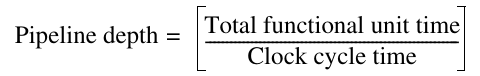

Chẳng hạn, nếu một phép toán cần 10 clock cycle, nó phải được pipeline sâu 10 stage để đạt initiation rate một kết quả mỗi clock cycle. Vì vậy, độ sâu pipeline được xác định bởi độ phức tạp của phép toán và clock cycle time của processor. Độ sâu pipeline của functional unit thay đổi nhiều—2 đến 20 stage là phổ biến—mặc dù những unit được dùng nhiều nhất có pipeline sâu 4 đến 8 clock cycle.

Với VMIPS, chúng ta sẽ dùng cùng độ sâu pipeline như Cray-1, mặc dù latency trong những processor hiện đại hơn có xu hướng tăng, đặc biệt với load. Tất cả functional unit đều được pipeline đầy đủ. Từ Chương 4, độ sâu pipeline là 6 clock cycle cho phép cộng floating-point và 7 clock cycle cho phép nhân floating-point. Trên VMIPS, giống phần lớn vector processor, các phép toán vector độc lập dùng functional unit khác nhau có thể issue trong cùng convoy.

Ngoài overhead start-up, cần tính đến overhead thực thi loop strip-mined. Overhead strip-mining này, xuất phát từ nhu cầu khởi động lại chuỗi vector và đặt Vector Length Register (VLR), thực chất cộng thêm vào thời gian start-up vector, giả sử một convoy không chồng lấp với instruction khác. Nếu overhead đó cho một convoy là 10 cycle, overhead thực tế trên mỗi 64 phần tử tăng thêm 10 cycle, hay 0.15 cycle trên mỗi phần tử.

| Phép toán | Penalty Start-up |
|---|---|
| Vector add | 6 |
| Vector multiply | 7 |
| Vector divide | 20 |
| Vector load | 12 |

**Hình G.4 Penalty Start-up trên VMIPS. Đây là các penalty start-up theo clock cycle cho các phép toán vector VMIPS.**

Hai yếu tố then chốt góp phần vào thời gian chạy của một loop strip-mined gồm một chuỗi convoy:

1. Số convoy trong loop, xác định số chime. Chúng ta dùng ký hiệu T<sub>chime</sub> cho thời gian thực thi tính theo chime.

2. Overhead cho mỗi chuỗi convoy strip-mined. Overhead này gồm chi phí thực thi scalar code để strip-mining mỗi khối, T<sub>loop</sub>, cộng chi phí start-up vector cho mỗi convoy, T<sub>start</sub>.

Cũng có thể có một overhead cố định liên quan đến việc thiết lập chuỗi vector lần đầu. Trong các vector processor gần đây, overhead này đã trở nên khá nhỏ, nên chúng ta bỏ qua.

Có thể dùng các thành phần này để phát biểu tổng thời gian chạy cho một chuỗi vector hoạt động trên một vector dài n, gọi là T<sub>n</sub>:

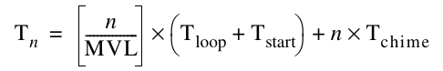

Các giá trị T<sub>start</sub>, T<sub>loop</sub> và T<sub>chime</sub> phụ thuộc compiler và processor. Register allocation và instruction scheduling ảnh hưởng đến cả những gì nằm trong một convoy lẫn overhead start-up của mỗi convoy.

Để đơn giản, chúng ta sẽ dùng một giá trị hằng số cho T<sub>loop</sub> trên VMIPS. Dựa trên nhiều phép đo thực thi vector của Cray-1, giá trị được chọn cho T<sub>loop</sub> là 15. Thoạt nhìn, bạn có thể nghĩ giá trị này quá nhỏ. Overhead trong mỗi loop cần thiết lập địa chỉ bắt đầu vector và stride, tăng counter và thực thi một loop branch. Trong thực tế, những scalar instruction này có thể được chồng lấp hoàn toàn hoặc một phần với vector instruction, giảm thiểu thời gian dành cho các chức năng overhead. Giá trị T<sub>loop</sub> tất nhiên phụ thuộc cấu trúc loop, nhưng sự phụ thuộc nhỏ so với mối liên hệ giữa vector code và các giá trị T<sub>chime</sub>, T<sub>start</sub>.

**Ví dụ** Thời gian thực thi trên VMIPS cho phép toán vector A = B × s là bao nhiêu, trong đó s là scalar và độ dài các vector A, B là 200?

**Trả lời** Giả sử địa chỉ A và B ban đầu nằm trong Ra và Rb, s nằm trong Fs, và nhớ rằng với MIPS (và VMIPS), R0 luôn giữ 0. Vì (200 mod 64) = 8, lần lặp đầu của loop strip-mined sẽ thực thi với độ dài vector 8 phần tử, còn những lần lặp sau thực thi với độ dài vector 64 phần tử. Địa chỉ byte bắt đầu của segment tiếp theo trong mỗi vector bằng tám lần độ dài vector. Vì độ dài vector là 8 hoặc 64, chúng ta tăng các address register thêm 8 × 8 = 64 sau segment đầu và 8 × 64 = 512 cho các segment sau. Tổng số byte trong vector là 8 × 200 = 1600, và chúng ta kiểm tra hoàn tất bằng cách so sánh địa chỉ của vector segment tiếp theo với địa chỉ ban đầu cộng 1600. Đây là code thực tế:

```
       DADDUI   R2,R0,#1600  ;total # bytes in vector
       DADDU    R2,R2,Ra     ;address of the end of A vector
       DADDUI   R1,R0,#8     ;loads length of 1st segment
       MTC1     VLR,R1       ;load vector length in VLR
       DADDUI   R1,R0,#64    ;length in bytes of 1st segment
       DADDUI   R3,R0,#64    ;vector length of other segments
Loop: LV        V1,Rb        ;load B
       MULVS.D  V2,V1,Fs ;vector * scalar
       SV       Ra,V2        ;store A
       DADDU    Ra,Ra,R1     ;address of next segment of A
       DADDU    Rb,Rb,R1     ;address of next segment of B
       DADDUI   R1,R0,#512   ;load byte offset next segment
       MTC1     VLR,R3       ;set length to 64 elements
       DSUBU    R4,R2,Ra     ;at the end of A?
       BNEZ     R4,Loop      ;if not, go back
```

Ba vector instruction trong loop phụ thuộc nhau và phải đi vào ba convoy, nên T<sub>chime</sub>= 3. Hãy dùng công thức cơ bản:

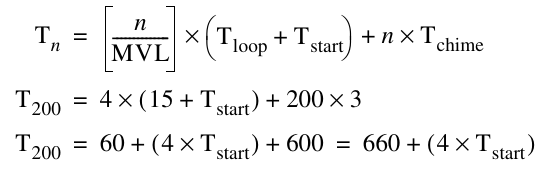

Giá trị T<sub>start</sub> là tổng của:

- Thời gian start-up của vector load là 12 clock cycle

- Thời gian start-up 7-clock-cycle cho phép nhân

- Thời gian start-up 12-clock-cycle cho store

Vì vậy, giá trị T<sub>start</sub> được cho bởi:

T<sub>start</sub> = 12 + 7 + 12 = 31

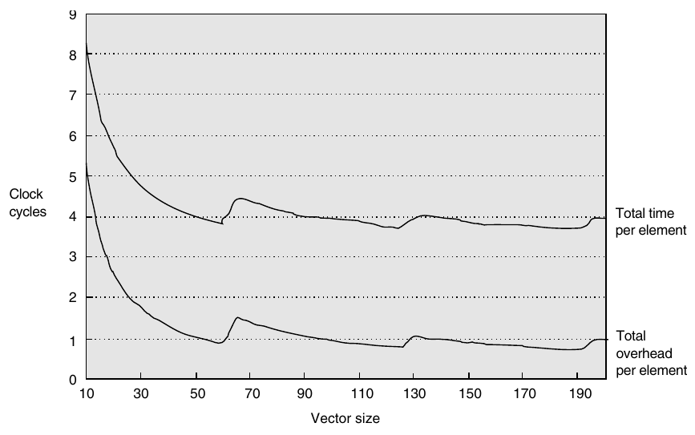

**Hình G.5 Tổng thời gian thực thi trên mỗi phần tử và tổng thời gian overhead trên mỗi phần tử theo độ dài vector cho ví dụ ở trang F-6. Với vector ngắn, tổng thời gian start-up lớn hơn one-half tổng thời gian, trong khi với vector dài nó giảm xuống khoảng one-third tổng thời gian. Các bước nhảy đột ngột xuất hiện khi độ dài vector vượt qua một bội số của 64, buộc phải có thêm một lần lặp code strip-mining và thực thi một tập vector instruction. Những phép toán này tăng T<sub>n</sub> thêm T<sub>loop</sub> + T<sub>start</sub>.**

Vì vậy, giá trị tổng thể trở thành:

T<sub>200</sub> = 660 + 4 × 31= 784

Thời gian thực thi trên mỗi phần tử với mọi chi phí start-up khi đó là 784/200 = 3.9, so với xấp xỉ chime là ba. Trong Mục G.4, chúng ta sẽ tham vọng hơn—cho phép các convoy riêng biệt chồng lấp.

Hình G.5 cho thấy overhead và tốc độ thực tế trên mỗi phần tử cho ví dụ trước (A = B × s) với nhiều độ dài vector. Một mô hình chime-counting sẽ dẫn đến 3 clock cycle trên mỗi phần tử, trong khi hai nguồn overhead cộng thêm 0.9 clock cycle trên mỗi phần tử ở giới hạn.

### Instruction Start-Up được Pipeline và nhiều Lane

Thêm nhiều lane làm tăng peak performance nhưng không thay đổi latency start-up, nên việc giảm overhead start-up bằng cách cho phép bắt đầu một vector instruction chồng lấp với việc hoàn tất các vector instruction trước đó trở nên thiết yếu. Trường hợp đơn giản nhất cần xem xét là khi hai vector instruction truy cập những tập vector register khác nhau. Chẳng hạn, trong chuỗi code

```
ADDV.D V1,V2,V3
ADDV.D V4,V5,V6
```

Một cách triển khai có thể cho phép phần tử đầu tiên của vector instruction thứ hai theo ngay phần tử cuối của vector instruction thứ nhất đi xuống FP adder pipeline. Để giảm độ phức tạp control logic, một số máy vector yêu cầu thời gian phục hồi hay dead time giữa hai vector instruction được dispatch đến cùng vector unit. Hình G.6 là một sơ đồ pipeline thể hiện cả latency start-up lẫn dead time của một vector pipeline duy nhất.

Ví dụ sau minh họa tác động của dead time này lên vector performance có thể đạt được.

**Ví dụ** Cray C90 có hai lane nhưng cần 4 clock cycle dead time giữa bất kỳ hai vector instruction nào đến cùng functional unit, ngay cả khi không có data dependence. Với độ dài vector tối đa 128 phần tử, dead time làm giảm peak performance có thể đạt được bao nhiêu? Mức giảm sẽ là bao nhiêu nếu số lane tăng lên 16?

**Trả lời** Một vector có độ dài tối đa 128 phần tử được chia trên hai lane và chiếm một vector functional unit trong 64 clock cycle. Dead time thêm 4 cycle chiếm dụng, giảm peak performance còn 64/(64 + 4) = 94.1% giá trị khi không có dead time. Nếu số lane tăng lên 16, các vector instruction có độ dài tối đa chỉ chiếm functional unit trong 128/16 = 8 cycle, và dead time sẽ giảm peak performance còn 8/(8 + 4) = 66.6% giá trị khi không có dead time. Trong trường hợp thứ hai này, các vector unit không bao giờ có thể bận hơn 2/3 thời gian! Pipelining instruction start-up trở nên phức tạp hơn khi nhiều instruction có thể đọc và ghi cùng vector register và khi một số instruction có thể stall không dự đoán được—chẳng hạn, một vector load gặp memory bank conflict. Tuy nhiên, khi cả số lane lẫn pipeline latency đều tăng, việc cho phép instruction start-up được pipeline đầy đủ ngày càng quan trọng.

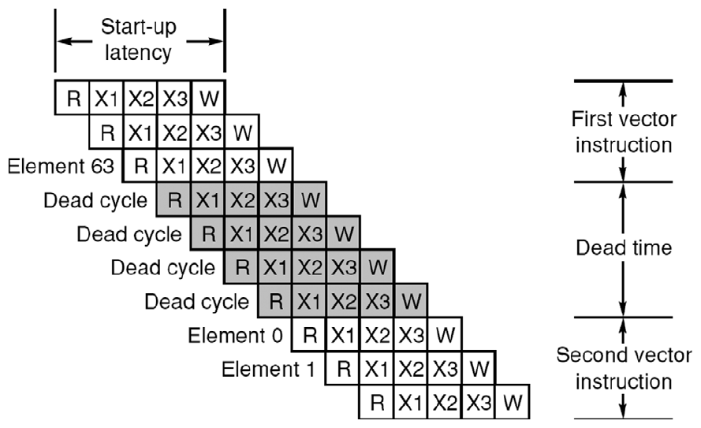

**Hình G.6 Latency Start-up và dead time cho một vector pipeline duy nhất. Mỗi phần tử có latency 5-cycle: 1 cycle để đọc vector-register file, 3 cycle thực thi, rồi 1 cycle để ghi vector-register file. Các phần tử từ cùng vector instruction có thể theo nhau đi xuống pipeline, nhưng máy này chèn 4 cycle dead time giữa hai vector instruction khác nhau. Có thể loại bỏ dead time bằng control logic phức tạp hơn. (Tái bản với sự cho phép từ Asanovic [1998].)**

## G.3 Tìm hiểu sâu hơn về Vector Memory System

Để duy trì initiation rate một word được fetch hoặc store mỗi clock, memory system phải có khả năng cung cấp hoặc tiếp nhận lượng dữ liệu này. Như đã thấy trong Chương 4, điều này thường được thực hiện bằng cách trải các truy cập trên nhiều memory bank độc lập. Có số lượng bank đáng kể hữu ích khi xử lý vector load hoặc store truy cập các hàng hoặc cột dữ liệu.

Tốc độ truy cập mong muốn và thời gian truy cập bank xác định cần bao nhiêu bank để truy cập memory không bị stall. Ví dụ này cho thấy các thời gian đó thể hiện thế nào trong một vector processor.

**Ví dụ** Giả sử muốn fetch một vector 64 phần tử bắt đầu tại địa chỉ byte 136, và một truy cập memory cần 6 clock. Cần bao nhiêu memory bank để hỗ trợ một fetch mỗi clock cycle? Các bank được truy cập bằng những địa chỉ nào? Các phần tử khác nhau sẽ đến CPU khi nào?

**Trả lời** Sáu clock mỗi truy cập cần ít nhất 6 bank, nhưng vì muốn số bank là lũy thừa của 2, chúng ta chọn 8 bank. Hình G.7 cho thấy thời gian của vài tập truy cập đầu tiên cho hệ thống 8-bank với access latency 6-clock-cycle.

Thời gian của memory bank thực tế thường được tách thành hai thành phần khác nhau, access latency và bank cycle time (hay bank busy time). Access latency là thời gian từ khi địa chỉ đến bank cho đến khi bank trả về một giá trị dữ liệu, còn busy time là thời gian bank bị chiếm bởi một yêu cầu. Access latency cộng vào chi phí start-up khi fetch một vector từ memory (tổng memory latency cũng bao gồm thời gian đi qua các interconnection network được pipeline để truyền địa chỉ và dữ liệu giữa CPU và memory bank). Bank busy time chi phối bandwidth thực tế của memory system vì processor không thể issue yêu cầu thứ hai đến cùng bank cho đến khi bank busy time đã trôi qua.

Với các SRAM bank đơn giản không được pipeline như trong những ví dụ trước, access latency và busy time xấp xỉ bằng nhau. Tuy nhiên, với SRAM bank được pipeline, access latency lớn hơn busy time vì mỗi lần truy cập phần tử chỉ chiếm một stage trong memory bank pipeline. Với DRAM bank, access latency thường ngắn hơn busy time vì DRAM cần thêm thời gian để khôi phục giá trị đã đọc sau phép đọc phá hủy. Với memory system hỗ trợ nhiều truy cập vector đồng thời hoặc cho phép truy cập không tuần tự trong vector load hoặc store, số memory bank cần lớn hơn mức tối thiểu; nếu không, sẽ có memory bank conflict.

|  | Bank |  |  |  |  |  |  |  |
|---|---|---|---|---|---|---|---|---|
| Số cycle | 0 | 1 | 2 | 3 | 4 | 5 | 6 | 7 |
| 0 |  | 136 |  |  |  |  |  |  |
| 1 |  | Busy | 144 |  |  |  |  |  |
| 2 |  | Busy | Busy | 152 |  |  |  |  |
| 3 |  | Busy | Busy | Busy | 160 |  |  |  |
| 4 |  | Busy | Busy | Busy | Busy | 168 |  |  |
| 5 |  | Busy | Busy | Busy | Busy | Busy | 176 |  |
| 6 |  |  | Busy | Busy | Busy | Busy | Busy | 184 |
| 7 | 192 |  |  | Busy | Busy | Busy | Busy | Busy |
| 8 | Busy | 200 |  |  | Busy | Busy | Busy | Busy |
| 9 | Busy | Busy | 208 |  |  | Busy | Busy | Busy |
| 10 | Busy | Busy | Busy | 216 |  |  | Busy | Busy |
| 11 | Busy | Busy | Busy | Busy | 224 |  |  | Busy |
| 12 | Busy | Busy | Busy | Busy | Busy | 232 |  |  |
| 13 |  | Busy | Busy | Busy | Busy | Busy | 240 |  |
| 14 |  |  | Busy | Busy | Busy | Busy | Busy | 248 |
| 15 | 256 |  |  | Busy | Busy | Busy | Busy | Busy |
| 16 | Busy | 264 |  |  | Busy | Busy | Busy | Busy |

**Hình G.7 Địa chỉ memory (theo byte) theo số bank và khe thời gian bắt đầu truy cập. Mỗi memory bank chốt địa chỉ phần tử ở đầu một truy cập rồi bận trong 6 clock cycle trước khi trả về một giá trị cho CPU. Lưu ý CPU không thể giữ cả 8 bank bận mọi lúc vì bị giới hạn ở việc cung cấp một địa chỉ mới và nhận một mục dữ liệu mỗi cycle.**

Memory bank conflict sẽ không xảy ra trong một vector memory instruction duy nhất nếu stride và số bank nguyên tố cùng nhau và có đủ bank để tránh conflict trong trường hợp unit stride. Khi không có bank conflict, stride multiword và unit stride chạy cùng tốc độ. Tăng số memory bank lên nhiều hơn mức tối thiểu cần để tránh stall với stride dài 1 sẽ giảm tần suất stall cho một số stride khác. Chẳng hạn, với 64 bank, stride 32 sẽ stall mỗi hai truy cập, thay vì mọi truy cập. Nếu ban đầu có stride 8 và 16 bank, cứ hai truy cập lại stall; với 64 bank, stride 8 sẽ stall mỗi tám truy cập. Nếu có nhiều memory pipeline và/hoặc nhiều processor chia sẻ cùng memory system, cũng cần nhiều bank hơn để tránh conflict. Ngay cả máy chỉ có một memory pipeline cũng có thể gặp memory bank conflict trên truy cập unit stride giữa vài phần tử cuối của một instruction và vài phần tử đầu của instruction tiếp theo, và tăng số bank sẽ giảm xác suất các conflict inter-instruction này. Năm 2011, phần lớn vector supercomputer trải các truy cập từ mỗi CPU trên hàng trăm memory bank. Vì bank conflict vẫn có thể xảy ra trong các trường hợp non-unit stride, người lập trình ưu tiên truy cập unit stride bất cứ khi nào có thể.

Một supercomputer hiện đại có thể có hàng chục CPU, mỗi CPU với nhiều memory pipeline nối đến hàng nghìn memory bank. Cung cấp một đường riêng giữa mỗi memory pipeline và mỗi memory bank sẽ không thực tế, nên thường dùng một multistage switching network để nối memory pipeline với memory bank. Congestion có thể xuất hiện trong switching network này khi các truy cập vector khác nhau tranh chấp cùng đường mạch, gây thêm stall trong memory system.

## G.4 Cải thiện Vector Performance

Trong mục này, chúng ta trình bày các kỹ thuật cải thiện performance của vector processor sâu hơn so với Chương 4.

### Tìm hiểu sâu hơn về Chaining

Những cách triển khai chaining ban đầu hoạt động như forwarding, nhưng điều này hạn chế thời điểm của source instruction và destination instruction trong chain. Các cách triển khai gần đây dùng flexible chaining, cho phép một vector instruction chain đến gần như bất kỳ vector instruction đang hoạt động nào khác, giả sử không tạo ra structural hazard. Flexible chaining cần các vector instruction khác nhau đồng thời truy cập cùng vector register, có thể được triển khai bằng cách thêm read port và write port hoặc tổ chức lưu trữ vector-register file thành các bank interleaved tương tự memory system. Chúng ta giả định loại chaining này trong toàn bộ phần còn lại của phụ lục.

Mặc dù một cặp phép toán phụ thuộc nhau, chaining cho phép các phép toán tiến hành song song trên những phần tử riêng biệt của vector. Điều này cho phép schedule các phép toán trong cùng convoy và giảm số chime cần thiết. Với chuỗi trước, có thể đạt tốc độ duy trì (bỏ qua start-up) hai phép toán floating-point mỗi clock cycle, hay một chime, dù các phép toán phụ thuộc nhau! Tổng thời gian chạy của chuỗi phía trên trở thành:

Độ dài vector + thời gian Start-up<sub>ADDV</sub> + thời gian Start-up<sub>MULV</sub>

Hình G.8 cho thấy thời gian của phiên bản chained và unchained của cặp vector instruction phía trên với độ dài vector 64. Convoy này cần một chime; tuy nhiên, vì dùng chaining, overhead start-up sẽ lộ ra trong thời gian thực tế của convoy. Trong Hình G.8, tổng thời gian cho phép toán chained là 77 clock cycle, hay 1.2 cycle trên mỗi kết quả. Với 128 phép toán floating-point được thực hiện trong thời gian đó, đạt 1.7 FLOPS mỗi clock cycle. Với phiên bản unchained, có 141 clock cycle, hay 0.9 FLOPS mỗi clock cycle.

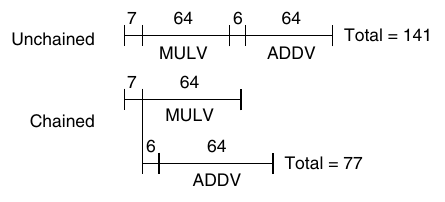

**Hình G.8 Thời gian cho một chuỗi phép toán vector phụ thuộc ADDV và MULV, cả unchained lẫn chained. Độ trễ 6- và 7-clock-cycle là latency của adder và multiplier.**

Mặc dù chaining cho phép giảm thành phần chime của thời gian thực thi bằng cách đặt hai instruction phụ thuộc trong cùng convoy, nó không loại bỏ overhead start-up. Nếu muốn ước lượng thời gian chạy chính xác, phải đếm thời gian start-up cả bên trong lẫn giữa các convoy. Với chaining, số chime của một chuỗi được xác định bởi số vector functional unit khác nhau có sẵn trong processor và số unit mà ứng dụng cần. Đặc biệt, không convoy nào có thể chứa structural hazard. Điều này có nghĩa, chẳng hạn, một chuỗi chứa hai vector memory instruction phải cần ít nhất hai convoy, và do đó hai chime, trên một processor như VMIPS chỉ có một vector load-store unit.

Chaining quan trọng đến mức mọi vector processor hiện đại đều hỗ trợ flexible chaining.

### Tìm hiểu sâu hơn về ma trận thưa

Chương 4 cho thấy các kỹ thuật cho phép chương trình với ma trận thưa thực thi trong vector mode. Hãy bắt đầu bằng một phần ôn tập nhanh. Trong một ma trận thưa, các phần tử của vector thường được lưu ở một dạng nén gọn rồi được truy cập gián tiếp. Giả sử một cấu trúc thưa được đơn giản hóa, có thể thấy code như sau:

```
            do     100 i = 1,n
100                A(K(i)) = A(K(i)) + C(M(i))
```

Code này triển khai tổng vector thưa trên các array A và C, dùng các index vector K và M để chỉ định các phần tử khác không của A và C. (A và C phải có cùng số phần tử khác không—n phần tử.) Một cách biểu diễn phổ biến khác cho ma trận thưa dùng một bit vector để cho biết phần tử nào tồn tại và một dense vector cho các phần tử khác không. Thường cả hai cách biểu diễn tồn tại trong cùng chương trình. Ma trận thưa có trong nhiều code, và có nhiều cách triển khai tùy cấu trúc dữ liệu dùng trong chương trình.

Một vectorizing compiler đơn giản không thể tự động vectorize source code phía trên vì compiler không biết các phần tử của K là những giá trị phân biệt, và do đó không có dependence. Thay vào đó, một chỉ thị của người lập trình sẽ báo cho compiler rằng nó có thể chạy loop trong vector mode.

Các vectorizing compiler tinh vi hơn có thể tự động vectorize loop mà không cần annotation của người lập trình bằng cách chèn kiểm tra data dependence tại run time. Các kiểm tra run time này được triển khai bằng phiên bản software được vectorize của advanced load address table (ALAT) hardware được mô tả trong Phụ lục H cho Itanium processor. Associative ALAT hardware được thay bằng một software hash table phát hiện liệu hai lần truy cập phần tử trong cùng lần lặp strip-mine có đến cùng địa chỉ hay không. Nếu không phát hiện dependence, lần lặp strip-mine có thể hoàn tất bằng độ dài vector tối đa. Nếu phát hiện dependence, độ dài vector được đặt lại thành giá trị nhỏ hơn để tránh mọi vi phạm dependency, để các phần tử còn lại được xử lý ở lần lặp tiếp theo của loop strip-mined. Mặc dù cơ chế này thêm software overhead đáng kể vào loop, overhead phần lớn được vectorize cho trường hợp phổ biến không có dependence; kết quả là loop vẫn chạy nhanh hơn đáng kể so với scalar code (mặc dù chậm hơn nhiều so với khi có chỉ thị của người lập trình).

Khả năng scatter-gather có trong nhiều supercomputer gần đây. Các phép toán này thường chạy chậm hơn truy cập strided vì phức tạp hơn để triển khai và dễ gặp bank conflict hơn, nhưng vẫn nhanh hơn nhiều so với phương án thay thế, có thể là một scalar loop. Nếu tính chất thưa của ma trận thay đổi, phải tính một index vector mới. Nhiều processor hỗ trợ tính index vector nhanh. Instruction CVI (create vector index) trong VMIPS tạo một index vector khi được cho một stride (m), trong đó các giá trị trong index vector là 0, m, 2 × m, . . . , 63 × m. Một số processor cung cấp instruction tạo compressed index vector có các entry tương ứng với vị trí có bit một trong mask register. Những vector architecture khác cung cấp phương pháp nén vector. Trong VMIPS, chúng ta định nghĩa CVI instruction luôn tạo một compressed index vector bằng vector mask. Khi vector mask toàn bit một, một index vector tiêu chuẩn sẽ được tạo.

Indexed loads-stores và CVI instruction cung cấp một phương pháp khác để hỗ trợ thực thi vector có điều kiện. Trước tiên hãy nhớ lại code từ Chương 4:

```
     low = 1
     VL = (n mod MVL) /*find the odd-size piece*/
     do 1 j = 0,(n/MVL) /*outer loop*/
          do 10 i = low, low + VL - 1 /*runs for length VL*/
              Y(i) = a * X(i) + Y(i) /*main operation*/
10        continue
          low = low + VL /*start of next vector*/
          VL = MVL /*reset the length to max*/
1    continue
```

Đây là một chuỗi vector triển khai loop đó bằng CVI:

```
LV           V1,Ra        ;load vector A into V1
L.D          F0,#0        ;load FP zero into F0
SNEVS.D      V1,F0        ;sets the VM to 1 if V1(i)!=F0
CVI          V2,#8        ;generates indices in V2
POP          R1,VM        ;find the number of 1’s in VM
MTC1         VLR,R1       ;load vector-length register
CVM                         ;clears the mask
LVI  V3,(Ra+V2)    ;load the nonzero A elements
LVI  V4,(Rb+V2)    ;load corresponding B elements
SUBV.D V3,V3,V4    ;do the subtract
SVI  (Ra+V2),V3    ;store A back
```

Việc cách triển khai dùng scatter-gather có tốt hơn phiên bản thực thi có điều kiện hay không phụ thuộc vào tần suất điều kiện đúng và chi phí các phép toán. Bỏ qua chaining, thời gian chạy của phiên bản gốc là 5n + c<sub>1</sub>. Thời gian chạy của phiên bản thứ hai, dùng indexed load và store với thời gian chạy một phần tử mỗi clock, là 4n + 4fn + c<sub>2</sub>, trong đó f là phần các phần tử mà điều kiện đúng (tức là A(i) ¦ 0 *(ghi chú: sách in "¦"; đúng là "≠")*). Nếu giả định các giá trị c<sub>1</sub> và c<sub>2</sub> tương đương, hoặc nhỏ hơn n nhiều, có thể tìm khi nào kỹ thuật thứ hai tốt hơn.

Time<sub>1</sub> = 5 ( n )

Time<sub>2</sub> = 4n + 4fn

Chúng ta muốn Time<sub>1</sub> > Time<sub>2</sub>, nên

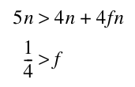

Tức là phương pháp thứ hai nhanh hơn nếu ít hơn one-quarter số phần tử khác không. Trong nhiều trường hợp, tần suất thực thi thấp hơn nhiều. Nếu có thể dùng lại index vector, hoặc số câu lệnh vector trong câu lệnh if tăng lên, ưu điểm của cách tiếp cận scatter-gather sẽ tăng mạnh.

## G.5 Hiệu quả Vectorization của Compiler

Hai yếu tố ảnh hưởng đến mức thành công khi chạy một chương trình trong vector mode. Yếu tố đầu tiên là cấu trúc chính chương trình: Các loop có true data dependence hay có thể được tái cấu trúc để không còn dependence như vậy? Yếu tố này chịu ảnh hưởng của thuật toán được chọn và phần nào bởi cách viết code. Yếu tố thứ hai là khả năng của compiler. Mặc dù không compiler nào có thể vectorize một loop không có parallelism giữa các lần lặp, khả năng của các compiler trong việc xác định loop có thể vectorize hay không khác nhau rất nhiều. Các kỹ thuật dùng để vectorize chương trình giống những kỹ thuật được thảo luận trong Chương 3 để phát hiện ILP; ở đây, chúng ta chỉ xem lại các kỹ thuật này hoạt động tốt đến đâu.

Các compiler khác nhau có khả năng vectorize chương trình rất khác nhau. Để tóm lược tình trạng vectorizing compiler, xét dữ liệu trong Hình G.9, cho thấy mức vectorization trên các processor khác nhau bằng một bộ kiểm tra gồm 100 FORTRAN kernel viết tay. Các kernel được thiết kế để kiểm tra khả năng vectorization và tất cả đều có thể được vectorize bằng tay; chúng ta sẽ thấy một số ví dụ về những loop này trong bài tập.

| Processor | Compiler | Vectorize hoàn toàn | Vectorize một phần | Không vectorize |
|---|---|---|---|---|
| CDC CYBER 205 | VAST-2 V2.21 | 62 | 5 | 33 |
| Convex C-series | FC5.0 | 69 | 5 | 26 |
| Cray X-MP | CFT77 V3.0 | 69 | 3 | 28 |
| Cray X-MP | CFT V1.15 | 50 | 1 | 49 |
| Cray-2 | CFT2 V3.1a | 27 | 1 | 72 |
| ETA-10 | FTN 77 V1.0 | 62 | 7 | 31 |
| Hitachi S810/820 | FORT77/HAP V20-2B | 67 | 4 | 29 |
| IBM 3090/VF | VS FORTRAN V2.4 | 52 | 4 | 44 |
| NEC SX/2 | FORTRAN77 / SX V.040 | 66 | 5 | 29 |

**Hình G.9 Kết quả áp dụng vectorizing compiler cho 100 FORTRAN test kernel. Với mỗi processor, chúng ta chỉ ra bao nhiêu loop được vectorize hoàn toàn, vectorize một phần và không vectorize. Những loop này được Callahan, Dongarra và Levine [1988] thu thập. Hai compiler khác nhau cho Cray X-MP cho thấy mức phụ thuộc lớn vào công nghệ compiler.**

## G.6 Kết hợp tất cả lại: Performance của Vector Processor

Trong mục này, chúng ta xem các thước đo performance cho vector processor và những gì chúng cho biết về processor. Để xác định performance của một processor trên bài toán vector, phải xem chi phí start-up và tốc độ duy trì. Cách đơn giản và tốt nhất để báo cáo performance của một vector processor trên một loop là đưa ra thời gian thực thi vector loop. Với vector loop, người ta thường đưa ra mức MFLOPS (triệu phép toán floating-point mỗi giây) thay vì thời gian thực thi. Chúng ta dùng ký hiệu R<sub>n</sub> cho mức MFLOPS trên vector dài n. Dùng phép đo T<sub>n</sub> (thời gian) hoặc R<sub>n</sub> (tốc độ) là tương đương nếu thống nhất số FLOPS. Trong mọi trường hợp, cả hai phép đo đều nên bao gồm overhead.

Trong mục này, chúng ta xem xét performance của VMIPS trên một DAXPY loop (xem Chương 4) từ các góc nhìn khác nhau. Chúng ta sẽ tiếp tục tính thời gian thực thi của một vector loop bằng phương trình được phát triển trong Mục G.2. Đồng thời, xem các cách đo performance khác nhau bằng thời gian được tính. Các giá trị hằng số T<sub>loop</sub> dùng trong mục này đưa vào một lượng sai số nhỏ, sẽ được bỏ qua.

### Các thước đo Vector Performance

Vì độ dài vector rất quan trọng trong việc xác định performance của processor, các thước đo length-related thường được áp dụng bên cạnh thời gian và MFLOPS. Những thước đo length-related này thường khác biệt mạnh giữa các processor và đáng để so sánh. (Tuy nhiên, hãy nhớ rằng thời gian luôn là thước đo cần quan tâm khi so sánh tốc độ tương đối của hai processor.) Ba thước đo length-related quan trọng nhất là

- R<sub>∞</sub>—Tốc độ MFLOPS trên vector infinite-length. Mặc dù thước đo này có thể đáng quan tâm khi ước lượng peak performance, các bài toán thực có độ dài vector hạn chế, và overhead penalty gặp trong bài toán thực sẽ lớn hơn.

- N<sub>1/2</sub>—Độ dài vector cần để đạt one-half của R<sub>∞</sub>. Đây là một thước đo tốt về tác động của overhead.

- N<sub>v</sub>—Độ dài vector cần để vector mode nhanh hơn scalar mode. Thước đo này đo cả overhead lẫn tốc độ scalar tương đối với vector.

Hãy xem các thước đo này cho bài toán DAXPY chạy trên VMIPS. Khi được chained, inner loop của code DAXPY theo convoy như Hình G.10 (giả sử Rx và Ry giữ địa chỉ bắt đầu).

Nhớ lại phương trình performance cho thời gian thực thi của vector loop có n phần tử, T<sub>n</sub>:

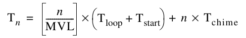

Chaining cho phép loop chạy trong ba chime (và không ít hơn, vì có một memory pipeline); do đó T<sub>chime</sub> = 3. Nếu T<sub>chime</sub> là chỉ báo đầy đủ về performance, loop sẽ chạy với tốc độ MFLOPS bằng 2/3 × clock rate (vì có 2 FLOPS mỗi lần lặp). Vì vậy, chỉ dựa trên số chime, VMIPS 500 MHz sẽ chạy loop này ở 333 MFLOPS nếu không có overhead strip-mining hoặc start-up. Có một số cách cải thiện performance: Thêm vector load-store unit, cho phép convoy chồng lấp để giảm tác động của overhead start-up, và giảm số load cần thiết bằng vector-register allocation. Chúng ta sẽ xem hai phần mở rộng đầu trong mục này. Tối ưu hóa cuối thực sự được dùng cho Cray-1, họ hàng của VMIPS, để tăng performance 50%. Giảm số load cần một interprocedural optimization; chúng ta xem phép biến đổi này trong Bài tập G.6. Trước khi xem hai phần mở rộng đầu, hãy xem performance thực, bao gồm overhead.

| LV V1,Rx | MULVS.D V2,V1,F0 | Convoy 1: load và multiply chained |
|---|---|---|
| LV V3,Ry | ADDV.D V4,V2,V3 | Convoy 2: load thứ hai và add, chained |
| SV Ry,V4 |  | Convoy 3: store kết quả |

**Hình G.10 Inner loop của code DAXPY trong các convoy chained.**

### Peak Performance của VMIPS trên DAXPY

Trước hết, cần xác định peak performance R<sub>∞</sub> thực sự là bao nhiêu, vì biết nó phải khác tốc độ lý tưởng 333 MFLOPS. Hiện tại, chúng ta tiếp tục dùng giả định đơn giản hóa rằng một convoy không thể bắt đầu cho đến khi mọi instruction trong convoy trước hoàn tất; sau đây sẽ bỏ hạn chế này. Với cách đơn giản hóa đó, overhead start-up của chuỗi vector đơn giản là tổng thời gian start-up của các instruction:

T<sub>start</sub> = 12 + 7 + 12 + 6 + 12 = 49

Dùng MVL = 64, T<sub>loop</sub> = 15, T<sub>start</sub> = 49 và T<sub>chime</sub> = 3 trong phương trình performance, và giả sử n không phải bội số chính xác của 64, thời gian cho một phép toán n-element là

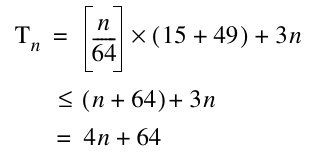

Tốc độ duy trì thực tế là hơn 4 clock cycle mỗi lần lặp, thay vì tốc độ lý thuyết 3 chime vốn bỏ qua overhead. Phần chính của khác biệt là chi phí overhead start-up cho mỗi khối 64 phần tử (49 cycle so với 15 cho loop overhead).

Bây giờ có thể tính R<sub>∞</sub> cho clock 500 MHz là:

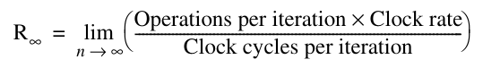

Tử số độc lập với n, do đó

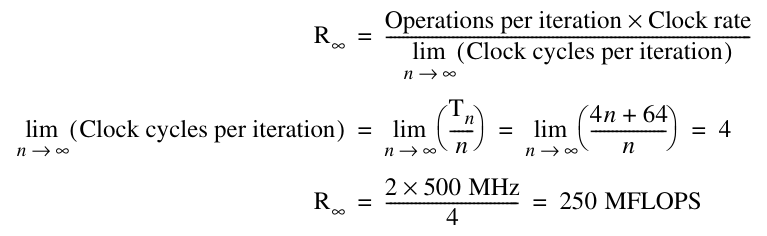

Performance không có overhead start-up, tức peak performance với cấu trúc vector functional unit đã cho, lúc này cao gấp 1.33 lần. Thực tế, khoảng cách giữa peak performance và sustained performance cho benchmark này còn lớn hơn!

### Sustained Performance của VMIPS trên Linpack Benchmark

Linpack benchmark là phép khử Gaussian trên một ma trận 100 × 100. Vì vậy, độ dài vector theo số phần tử chạy từ 99 xuống 1. Một vector dài k được dùng k lần. Do đó, độ dài vector trung bình được cho bởi:

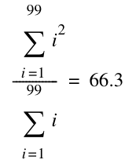

Bây giờ có thể thu được một ước lượng chính xác về performance của DAXPY bằng độ dài vector 66:

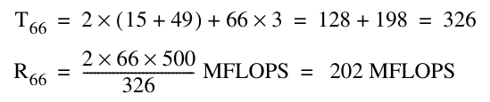

Giá trị peak, bỏ qua overhead start-up, cao gấp 1.64 lần ước lượng sustained performance trên độ dài vector thực này. Trong thực tế, Linpack benchmark chứa một phần code không nhỏ không thể vectorize. Mặc dù code này chiếm ít hơn 20% thời gian trước vectorization, nó chạy với performance ít hơn one-tenth khi tính theo FLOPS. Vì vậy, định luật Amdahl cho biết performance tổng thể sẽ thấp hơn đáng kể so với performance ước lượng từ phân tích inner loop.

Vì độ dài vector ảnh hưởng đáng kể đến performance, các thước đo N<sub>1/2</sub> và N<sub>v</sub> thường được dùng khi so sánh máy vector.

**Ví dụ** N<sub>1/2</sub> cho riêng inner loop của DAXPY trên VMIPS có clock 500 MHz là bao nhiêu?

**Trả lời** Dùng R<sub>∞</sub> làm tốc độ peak, chúng ta muốn biết độ dài vector sẽ đạt khoảng 125 MFLOPS. Bắt đầu với công thức MFLOPS, giả sử phép đo được thực hiện cho N<sub>1/2</sub> phần tử:

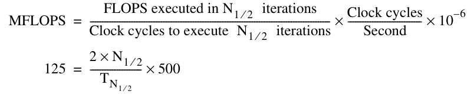

Đơn giản hóa biểu thức này rồi giả sử N<sub>1/2</sub> < 64, sao cho T<sub>N1/2< 64</sub> = 64 + 3 × n, cho:

T<sub>N1⁄2</sub> = 8 × N<sub>1⁄2</sub>

64 + 3 × N<sub>1⁄2</sub> = 8 × N<sub>1⁄2</sub>

5 × N<sub>1⁄2</sub> = 64

N<sub>1⁄2</sub> = 12.8

Vì vậy N<sub>1/2</sub>= 13; tức là một vector dài 13 cho khoảng one-half peak performance của DAXPY loop trên VMIPS.

**Ví dụ** Độ dài vector N<sub>v</sub> để phép toán vector chạy nhanh hơn scalar là bao nhiêu?

**Trả lời** Một lần nữa, chúng ta biết N<sub>v</sub> < 64. Thời gian thực hiện một lần lặp trong scalar mode có thể được ước lượng là 10 + 12 + 12 + 7 + 6 +12 = 59 clock, trong đó 10 là ước lượng loop overhead, được biết là nhỏ hơn phần nào so với overhead loop strip-mining. Trong bài toán trước, chúng ta cho thấy vector loop này chạy trong vector mode với thời gian T<sub>n≤64</sub> = 64 + 3 × n clock cycle. Vì vậy,

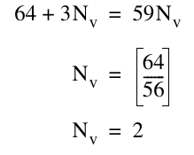

Với DAXPY loop, vector mode nhanh hơn scalar miễn là vector có ít nhất hai phần tử. Con số này nhỏ một cách đáng ngạc nhiên.

### DAXPY Performance trên VMIPS được cải tiến

DAXPY, giống nhiều bài toán vector, bị giới hạn bởi memory. Do đó, performance có thể được cải thiện bằng cách thêm memory access pipeline. Đây là khác biệt architecture chính giữa Cray X-MP (và các processor sau đó) với Cray-1. Cray X-MP có ba memory pipeline, so với memory pipeline duy nhất của Cray-1, và X-MP có chaining linh hoạt hơn. Điều này ảnh hưởng đến performance như thế nào?

**Ví dụ** Giá trị T<sub>66</sub> cho DAXPY trên VMIPS sẽ là bao nhiêu nếu thêm hai memory pipeline nữa?

**Trả lời** Với ba memory pipeline, mọi instruction nằm trong một convoy và cần một chime. Các overhead start-up giống nhau, nên

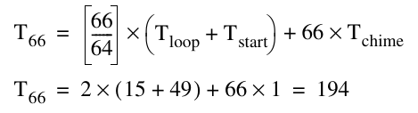

Với ba memory pipeline, chúng ta đã giảm số clock cycle cho sustained performance từ 326 xuống 194, theo hệ số 1.7. Lưu ý ảnh hưởng của định luật Amdahl: Chúng ta cải thiện tốc độ peak lý thuyết được đo bằng số chime theo hệ số 3, nhưng chỉ đạt cải thiện tổng thể theo hệ số 1.7 về sustained performance.

Một cải thiện khác có thể đến từ việc cho phép các convoy khác nhau chồng lấp và cũng cho phép scalar loop overhead chồng lấp với vector instruction. Điều này đòi hỏi cho phép một phép toán vector bắt đầu dùng functional unit trước khi phép toán khác hoàn tất, làm phức tạp instruction issue logic. Cho phép chồng lấp loại bỏ overhead start-up riêng cho mọi convoy ngoại trừ convoy đầu, đồng thời che giấu loop overhead.

Để che giấu overhead strip-mining tối đa, cần có khả năng chồng lấp các thể hiện strip-mined của loop, cho phép hai thể hiện của một convoy cũng như có thể hai thể hiện scalar code cùng thực thi đồng thời. Điều này cần cùng các kỹ thuật đã xem trong Chương 3 để tránh WAR hazard, mặc dù vì không thể đọc và ghi chồng lấp cùng một phần tử vector nên có thể tránh sao chép. Kỹ thuật này, gọi là tailgating, được dùng trong Cray-2. Một cách khác là unroll outer loop để tạo một số thể hiện của chuỗi vector dùng các tập register khác nhau (giả sử đủ register), giống như đã làm trong Chương 3. Bằng cách cho phép chồng lấp tối đa các convoy và scalar loop overhead, overhead start-up và loop chỉ lộ ra một lần cho mỗi chuỗi vector, độc lập với số convoy và instruction trong mỗi convoy. Theo cách này, một processor có vector register có thể vừa có overhead start-up thấp cho vector ngắn vừa có peak performance cao cho vector rất dài.

**Ví dụ** Các giá trị R<sub>∞</sub> và T<sub>66</sub> cho DAXPY trên VMIPS sẽ là bao nhiêu nếu thêm hai memory pipeline nữa và cho phép overhead strip-mining cùng start-up chồng lấp hoàn toàn?

**Trả lời**

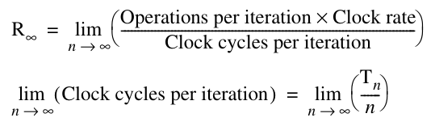

Vì overhead chỉ lộ ra một lần, T<sub>n</sub> = n + 49 + 15 = n + 64. Do đó,

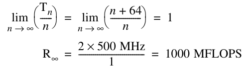

Thêm các memory pipeline và issue logic linh hoạt hơn mang lại cải thiện peak performance theo hệ số 4. Tuy nhiên, T<sub>66</sub> = 130, nên với vector ngắn hơn, cải thiện sustained performance khoảng 326/130 = 2.5 lần.

Tóm lại, chúng ta đã xem xét một số thước đo vector performance. Có thể tính peak performance lý thuyết chỉ dựa trên giá trị T<sub>chime</sub> như sau:

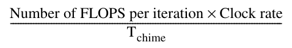

Bằng cách tính cả loop overhead, có thể tính các giá trị peak performance cho một vector infinite-length (R<sub>∞</sub>) và cả sustained performance Rn cho một vector dài n, được tính như sau:

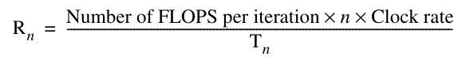

Dùng những thước đo này, cũng có thể tìm N<sub>1/2</sub> và N<sub>v</sub>, cho một cách khác để xem overhead start-up của vector và tỷ lệ tốc độ vector so với scalar. Nhiều thước đo performance khác nhau của vector processor hữu ích để hiểu phạm vi performance mà ứng dụng có thể thấy trên một vector processor.

## G.7 Một Vector Supercomputer hiện đại: Cray X1

Cray X1 được giới thiệu năm 2002, và cùng với NEC SX/8 đại diện cho trình độ tiên tiến nhất của vector supercomputer hiện đại. System architecture của X1 hỗ trợ hàng nghìn vector processor mạnh chia sẻ một global memory duy nhất.

Cray X1 có processor architecture khác thường, như Hình G.11. Một Multi-Streaming Processor (MSP) lớn được hình thành bằng cách ghép bốn Single-Streaming Processor (SSP). Mỗi SSP là một vector microprocessor single-chip hoàn chỉnh, chứa một scalar unit, scalar cache và một vector unit two-lane. Scalar unit của SSP là một superscalar processor dual-issue out-of-order với instruction cache 16 KB và scalar write-through data cache 16 KB, cả hai đều two-way set associative với cache line 32-byte. Vector unit của SSP chứa một vector register file, ba vector arithmetic unit và một vector load-store unit. Pipeline sâu một vector functional unit dễ hơn nhiều so với một superscalar issue mechanism, nên vector unit X1 chạy với clock rate gấp đôi (800 MHz) scalar unit (400 MHz). Mỗi lane có thể thực hiện một phép cộng floating-point 64-bit và một phép nhân floating-point 64-bit mỗi cycle, dẫn đến peak performance 12.8 GFLOPS mỗi MSP.

Mọi máy Cray trước đây đều có thể truy nguồn gốc instruction set architecture (ISA) đến thiết kế Cray-1 ban đầu năm 1976, với 8 primary register cho mỗi loại địa chỉ, dữ liệu scalar và dữ liệu vector. Với X1, ISA được thiết kế lại từ đầu để kết hợp những bài học trong 30 năm nghiên cứu compiler và microarchitecture vừa qua. X1 ISA bao gồm 64 scalar address register 64-bit và 64 scalar data register 64-bit, cùng 32 vector data register (64 bit mỗi phần tử) và 8 vector mask register (1 bit mỗi phần tử). Số register tăng mạnh cho phép compiler ánh xạ nhiều biến chương trình hơn vào register để giảm memory traffic, đồng thời cho phép static scheduling code tốt hơn nhằm cải thiện sự chồng lấp thực thi instruction tại run time. Các Cray trước có một instruction set variable-length gọn, nhưng X1 ISA có instruction fixed-length để đơn giản hóa superscalar fetch và decode.

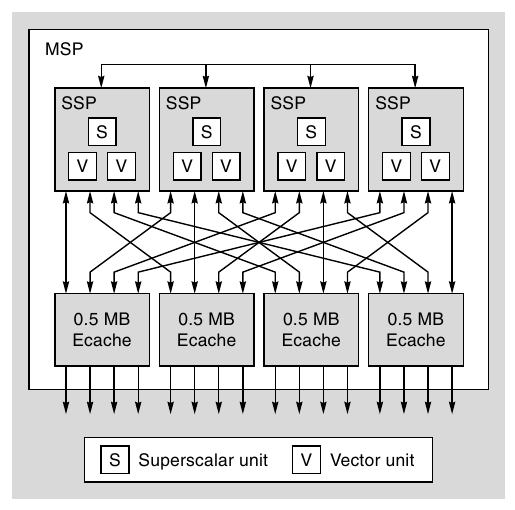

**Hình G.11 Module Cray MSP. (Từ Dunnigan và cộng sự [2005].)**

Bốn chip SSP được đóng gói trên một multichip module cùng bốn chip cache triển khai một cache ngoài 2 MB (Ecache) được mọi SSP chia sẻ. Ecache là two-way set associative với line 32-byte và chính sách write-back. Có thể dùng Ecache để cache vector, giảm memory traffic cho code có temporal locality. ISA cũng cung cấp các biến thể vector load instruction và store instruction không cấp phát trong cache để tránh làm bẩn Ecache bằng dữ liệu được biết là có locality thấp. Ecache có đủ bandwidth để cung cấp một word 64-bit mỗi lane mỗi clock cycle 800 MHz, hay hơn 50 GB/sec mỗi MSP.

Ở mức tiếp theo trong packaging hierarchy của X1, như Hình G.12, bốn MSP được đặt trên một printed circuit board duy nhất cùng 16 chip memory controller và DRAM để tạo một X1 node. Mỗi chip memory controller có tám kênh Rambus DRAM riêng, mỗi kênh cung cấp memory bandwidth 1.6 GB/sec. Trên toàn bộ 128 memory channel, node có main memory bandwidth hơn 200 GB/sec.

Một hệ thống X1 có thể chứa đến 1024 node (4096 MSP hoặc 16,384 SSP), được nối qua một global network high-bandwidth. Các kết nối network được tạo qua chip memory controller, và mọi memory trong hệ thống đều được bất kỳ processor nào truy cập trực tiếp bằng load instruction và store instruction. Điều này cung cấp giao tiếp toàn cục nhanh hơn nhiều so với các giao thức message-passing dùng trong hệ thống cluster-based. Duy trì cache coherence trên số lượng lớn node shared-memory high-bandwidth như vậy sẽ là thách thức. Cách tiếp cận trong X1 là hạn chế mỗi Ecache chỉ cache dữ liệu từ DRAM của local node. Memory controller triển khai một directory scheme để duy trì coherency giữa bốn Ecache trên một node. Truy cập từ remote node sẽ lấy phiên bản mới nhất của một vị trí, và remote store sẽ invalidate các local Ecache trước khi cập nhật memory, nhưng remote node không thể cache những vị trí local này.

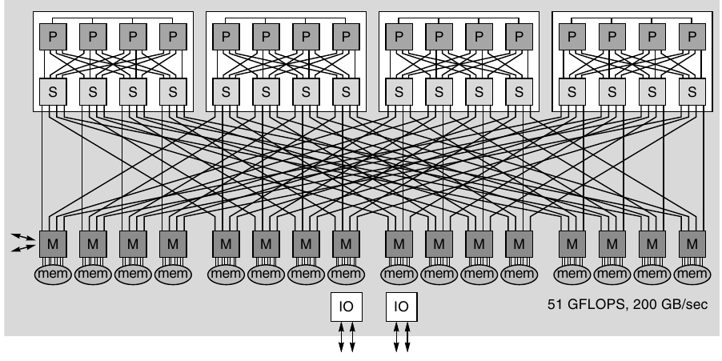

**Hình G.12 Cray X1 node. (Từ Tanqueray [2002].)**

Vector load và store đặc biệt hữu ích khi có cache miss long-latency và giao tiếp toàn cục, vì vector hardware tương đối đơn giản có thể tạo và theo dõi một lượng lớn yêu cầu memory in-flight. Các superscalar microprocessor đương thời chỉ hỗ trợ 8 đến 16 cache miss chưa hoàn tất, trong khi mỗi MSP processor có thể có đến 2048 yêu cầu memory chưa hoàn tất (512 mỗi SSP). Để bù lại, superscalar microprocessor chuyển sang kích thước cache line lớn hơn (128 byte trở lên) để mang về nhiều dữ liệu hơn với mỗi cache miss, nhưng điều này dẫn đến lãng phí bandwidth đáng kể trên truy cập non-unit stride qua dataset lớn. Thiết kế X1 dùng line 32-byte ngắn xuyên suốt để giảm lãng phí bandwidth, và thay vào đó dựa vào việc hỗ trợ nhiều cache miss độc lập để duy trì memory bandwidth. Khả năng chịu latency này cùng memory bandwidth rất lớn cho non-unit stride giải thích vì sao máy vector có thể tăng tốc rất nhiều so với superscalar microprocessor cho một số code.

### Multi-Streaming Processor

Khái niệm Multi-Streaming được Cray giới thiệu lần đầu trong SV1, nhưng đã được tăng cường đáng kể trong X1. Bốn SSP bên trong một MSP chia sẻ Ecache, và có hardware hỗ trợ barrier synchronization giữa bốn SSP trong một MSP. Mỗi X1 SSP có một vector unit two-lane với 32 vector register, mỗi register giữ 64 phần tử. Compiler có một số lựa chọn về cách dùng các SSP bên trong một MSP.

Cách dùng đơn giản nhất là ghép bốn SSP two-lane để mô phỏng một vector processor eight-lane duy nhất. X1 cung cấp các primitive barrier synchronization hiệu quả giữa SSP trên một node, và compiler chịu trách nhiệm tạo MSP code. Chẳng hạn, với một inner loop có thể vectorize trên 1000 phần tử, compiler sẽ phân các lần lặp 0–249 cho SSP0, 250–499 cho SSP1, 500–749 cho SSP2 và 750–999 cho SSP3. Mỗi SSP có thể xử lý các lần lặp loop của mình độc lập nhưng phải đồng bộ lại với các SSP khác trước khi chuyển đến loop nest tiếp theo.

Nếu inner loop không có nhiều lần lặp, MSP eight-lane sẽ có hiệu quả thấp, vì mỗi SSP chỉ có vài phần tử để xử lý và thời gian thực thi bị chi phối bởi thời gian start-up cùng synchronization overhead. Một cách khác để dùng MSP là để compiler parallelize qua một outer loop, cho mỗi SSP một inner loop khác nhau để xử lý. Chẳng hạn, các loop lồng nhau sau nhân tam giác trên của ma trận với một hằng số:

```
/* Scale upper triangle by constant K. */
for (row = 0; row < MAX_ROWS; row++)
   for (col = row; col < MAX_COLS; col++)
      A[row][col] = A[row][col] * K;
```

Xét trường hợp MAX_ROWS và MAX_COLS đều là 100 phần tử. Độ dài vector của inner loop giảm dần từ 100 xuống 1 qua các lần lặp outer loop. Ngay cả với inner loop đầu tiên, độ dài loop cũng nhỏ hơn nhiều độ dài vector tối đa (256) của một MSP eight-lane, nên code sẽ không hiệu quả. Một cách khác là compiler gán toàn bộ inner loop cho một SSP duy nhất. Chẳng hạn, SSP0 có thể xử lý các hàng 0, 4, 8, v.v., trong khi SSP1 xử lý các hàng 1, 5, 9, v.v. Mỗi SSP lúc này thấy một vector dài hơn. Về thực chất, cách này parallelize scalar overhead và tận dụng các scalar unit riêng trong mỗi SSP.

Phần lớn application code dùng MSP, nhưng cũng có thể biên dịch code để dùng mọi SSP như processor riêng khi vector parallelism hạn chế nhưng thread-level parallelism đáng kể.

### Cray X1E

Năm 2004, Cray công bố nâng cấp thiết kế Cray X1 ban đầu. X1E dùng công nghệ chế tạo mới hơn cho phép đặt hai SSP trên một chip duy nhất, khiến X1E trở thành multicore vector microprocessor đầu tiên. Mỗi physical node lúc này chứa tám MSP, nhưng được tổ chức thành hai logical node mỗi node bốn MSP để giữ cùng programming model như X1. Ngoài ra, clock rate được tăng từ 400 MHz scalar và 800 MHz vector lên 565 MHz scalar và 1130 MHz vector, cho peak performance cải thiện lên 18 GFLOPS.

## G.8 Nhận xét kết thúc

Trong những năm 1980 và 1990, performance tăng nhanh ở pipelined scalar processor dẫn đến thu hẹp mạnh khoảng cách giữa vector supercomputer truyền thống và superscalar VLSI microprocessor nhanh, được pipeline. Năm 2011, có thể mua laptop dưới $1000 có CPU clock rate cao hơn bất kỳ vector supercomputer có sẵn nào, ngay cả những máy giá hàng chục triệu đô la. Mặc dù vector supercomputer có clock rate thấp hơn, chúng hỗ trợ parallelism lớn hơn bằng nhiều lane (đến 16 trong thiết kế Nhật Bản) so với khả năng multiple issue hạn chế của superscalar microprocessor. Tuy vậy, peak floating-point performance của microprocessor low-cost chỉ chênh tối đa hệ số hai so với CPU vector supercomputer hàng đầu. Tất nhiên, clock rate cao và peak performance cao không nhất thiết chuyển thành sustained application performance. Main memory bandwidth là đặc điểm phân biệt then chốt giữa vector supercomputer và hệ thống superscalar microprocessor.

Cung cấp memory bandwidth non-unit stride lớn này là một trong những khoản chi phí chính của vector supercomputer, và theo truyền thống SRAM được dùng làm main memory để giảm số memory bank cần thiết và giảm penalty start-up vector. Mặc dù SRAM có access time thấp hơn DRAM vài lần, chi phí mỗi bit của nó cao gấp khoảng 10 lần! Để giảm chi phí main memory và cho phép dung lượng lớn hơn, mọi vector supercomputer hiện đại giờ dùng DRAM cho main memory, tận dụng các DRAM interface higher-bandwidth mới như synchronous DRAM.

Việc dùng DRAM làm main memory này (được Seymour Cray tiên phong trong Cray-2) là một ví dụ về cách vector supercomputer thích nghi công nghệ phổ thông để cải thiện price-performance. Một ví dụ khác là vector supercomputer hiện bao gồm vector data cache. Tuy nhiên, cache không hiệu quả với mọi vector code, nên các vector cache này được thiết kế để cho phép main memory bandwidth cao ngay cả khi có nhiều cache miss. Chẳng hạn, Cray X1 MSP có thể có 2048 memory load chưa hoàn tất; với microprocessor, số tối đa điển hình hơn là 8 đến 16 cache miss chưa hoàn tất mỗi CPU.

Một ví dụ khác là bipolar ECL hoặc gallium arsenide không còn là công nghệ được ưu tiên cho CPU logic của supercomputer. Nhờ khoản đầu tư rất lớn vào công nghệ CMOS mà thành công của desktop computer tạo điều kiện, CMOS hiện cung cấp transistor performance cạnh tranh với transistor density lớn hơn nhiều và power dissipation giảm nhiều so với những công nghệ đặc biệt hơn này. Vì vậy, mọi vector supercomputer hàng đầu hiện được xây dựng bằng cùng công nghệ CMOS như superscalar microprocessor. Lý do chủ yếu khiến vector supercomputer có clock rate thấp hơn commodity microprocessor là chúng được phát triển bằng kỹ thuật standard cell ASIC thay vì full custom circuit design để giảm chi phí engineering design. Trong khi một thiết kế microprocessor có thể bán hàng chục triệu bản và phân bổ chi phí thiết kế trên số unit lớn này, một vector supercomputer được xem là thành công nếu bán được hơn một trăm unit!

Ngược lại, các thiết kế superscalar microprocessor đã bắt đầu tiếp thu một số kỹ thuật được phổ biến trong các hệ thống máy tính vector trước đây, như với các phần mở rộng Multimedia SIMD. Như đã thấy trong Chương 4, đầu tư hardware cho SIMD performance tăng nhanh, có lẽ còn hơn cả cho multiprocessor. Nếu những SIMD unit còn rộng hơn của GPU được tích hợp tốt với scalar core, bao gồm hỗ trợ scatter-gather, rất có thể chúng ta sẽ kết luận vector architecture đã thắng cuộc chiến architecture!

## G.9 Góc nhìn lịch sử và tài liệu tham khảo

Góc nhìn lịch sử này bổ sung một số chi tiết và tài liệu tham khảo bị lược khỏi phiên bản trong Chương 4.

CDC STAR processor và hậu duệ CYBER 205 là các vector processor memory-memory. Để giữ hardware đơn giản và hỗ trợ yêu cầu bandwidth cao (đến ba tham chiếu memory mỗi phép toán floating-point), những processor này không xử lý hiệu quả non-unit stride. Mặc dù phần lớn loop có unit stride, một loop non-unit stride có performance thấp trên những processor này vì cần truyền dữ liệu memory-to-memory để gom lại (và scatter trở lại) các phần tử vector không liền nhau; những phép toán này dùng scatter-gather instruction đặc biệt. Ngoài ra, có hỗ trợ đặc biệt cho sparse vector dùng một bit vector để biểu diễn vị trí bằng không và khác không cùng một dense vector chứa giá trị khác không. Những phép toán vector phức tạp hơn này chậm do memory latency dài, và thường dùng scalar mode cho phép toán sparse hoặc non-unit stride nhanh hơn. Schneck [1987] mô tả một số pipelined processor ban đầu (chẳng hạn Stretch) đến những vector processor đầu tiên, bao gồm 205 và Cray-1. Dongarra [1986] thực hiện một khảo sát tốt khác, tập trung vào những processor gần đây hơn.

Những năm 1980 cũng chứng kiến sự xuất hiện của các vector processor smaller-scale, gọi là mini-supercomputers. Với giá khoảng one-tenth chi phí supercomputer ($0.5 đến $1 triệu so với $5 đến $10 triệu), các processor này nhanh chóng được đón nhận. Mặc dù nhiều công ty tham gia thị trường, hai công ty thành công nhất là Convex và Alliant. Convex bắt đầu với vector processor uniprocessor C-1 rồi cung cấp một loạt multiprocessor nhỏ, kết thúc với C-4 được công bố năm 1994. Chìa khóa thành công của Convex trong giai đoạn này là chú trọng khả năng chạy Cray software, hiệu quả compiler (xem Hình G.9) và chất lượng triển khai UNIX OS. C-4 là máy vector cuối cùng Convex bán; họ chuyển sang chế tạo multiprocessor large-scale dùng RISC microprocessor của Hewlett-Packard và được HP mua năm 1995. Alliant [1987] tập trung nhiều hơn vào khía cạnh multiprocessor; họ xây dựng máy tính eight-processor, với mỗi processor có khả năng ve c -tor. Alliant ngừng hoạt động vào đầu những năm 1990.

Đầu những năm 1980, CDC tách ra một nhóm gọi là ETA để xây dựng một supercomputer mới, ETA-10, có khả năng 10 GFLOPS. ETA processor được cung cấp vào cuối những năm 1980 (xem Fazio [1987]) và dùng CMOS low-temperature trong cấu hình đến 10 processor. Mỗi processor giữ memory-memory architecture dựa trên CYBER 205. Mặc dù ETA-10 đạt peak performance rất lớn, scalar speed của nó không tương xứng. Năm 1989, CDC, nhà cung cấp supercomputer đầu tiên, đóng ETA và rời lĩnh vực thiết kế supercomputer.

Năm 1986, IBM giới thiệu System/370 vector architecture (xem Moore và cộng sự [1987]) và cách triển khai đầu tiên trong 3090 Vector Facility. Architecture mở rộng System/370 architecture với 171 vector instruction. 3090/VF được tích hợp vào 3090 CPU. Khác phần lớn vector processor khác thời đó, 3090/VF đưa vector qua cache. Các máy IBM 370 tiếp tục phát triển theo thời gian và hiện được gọi là IBM zSeries. Các phần mở rộng vector đã được loại khỏi architecture và một phần opcode space được dùng lại để triển khai phần mở rộng địa chỉ 64-bit.

Cuối năm 1989, Cray Research tách thành hai công ty, cả hai nhắm xây dựng processor high-end có sẵn đầu những năm 1990. Seymour Cray lãnh đạo công ty spin-off Cray Computer Corporation cho đến khi nó chấm dứt năm 1995. Processor ban đầu của họ, Cray-3, dự định được triển khai bằng gallium arsenide, nhưng họ không thể phát triển công nghệ triển khai đáng tin cậy và cost-effective. Một prototype Cray-3 duy nhất được cung cấp cho National Center for Atmospheric Research (NCAR) để đánh giá năm 1993, nhưng không tìm được khách hàng trả tiền cho thiết kế. Prototype Cray-4, dự định là processor đầu tiên chạy ở 1 GHz, đã gần hoàn tất khi công ty nộp đơn phá sản. Không lâu trước khi qua đời bi thảm trong tai nạn ô tô năm 1996, Seymour Cray thành lập thêm một công ty nữa, SRC Computers, để phát triển hệ thống high-performance nhưng lần này dùng linh kiện phổ thông. Năm 2000, SRC công bố hệ thống SRC-6, kết hợp 512 Intel microprocessor, 5 tỷ gate reconfigurable logic và một memory system vector-style high-performance.

Cray Research tập trung vào C90, một processor high-end mới với đến 16 processor và clock rate 240 MHz. Processor này được cung cấp năm 1991. J90 là máy vector CMOS-based dùng DRAM memory với giá khởi điểm $250,000, nhưng cấu hình điển hình khoảng $1 triệu. Vào mid-1995, Cray Research được Silicon Graphics mua, và năm 1998 phát hành hệ thống SV1, ghép các CMOS processor nhanh hơn đáng kể vào memory system J90, đồng thời thêm data cache cho vector vào mỗi CPU để giúp đáp ứng nhu cầu memory bandwidth tăng. SV1 cũng giới thiệu khái niệm MSP, được phát triển để cung cấp single-CPU performance cạnh tranh bằng cách ghép nhiều CPU chậm hơn. Silicon Graphics bán Cray Research cho Tera Computer năm 2000, và công ty kết hợp được đổi tên Cray Inc.

Cơ sở cho công nghệ vectorizing compiler hiện đại và khái niệm data dependence được Kuck cùng các đồng nghiệp [1974] tại University of Illinois phát triển. Banerjee [1979] phát triển phép kiểm tra mang tên ông. Padua và Wolfe [1986] đưa ra một tổng quan tốt về công nghệ vectorizing compiler.

Các nghiên cứu benchmark trên nhiều supercomputer, bao gồm nỗ lực hiểu khác biệt performance, đã được Lubeck, Moore và Mendez [1985], Bucher [1983] và Jordan [1987] thực hiện. Có một số bộ benchmark nhắm đến sử dụng khoa học và thường được dùng để benchmark supercomputer, bao gồm Linpack và các FORTRAN kernel của Lawrence Livermore Laboratories. University of Illinois phối hợp thu thập một bộ benchmark cho supercomputer, gọi là Perfect Club. Năm 1993, Perfect Club được tích hợp vào SPEC, nơi phát hành bộ benchmark SPEChpc96 nhắm đến xử lý khoa học high-end năm 1996. Các NAS parallel benchmark được phát triển tại NASA Ames Research Center [Bailey và cộng sự 1991] đã trở thành một tập kernel và ứng dụng phổ biến để đánh giá supercomputer. Một bộ benchmark mới, HPC Challenge, được giới thiệu gồm vài kernel gây áp lực lên memory bandwidth và interconnect bandwidth của máy bên cạnh floating-point performance [Luszczek và cộng sự 2005]. Mặc dù các supercomputer benchmark tiêu chuẩn hữu ích như một thước đo sơ bộ về khả năng máy, việc mua supercomputer lớn thường được thực hiện sau đánh giá performance cẩn thận trên tổ hợp ứng dụng thực sự cần tại nơi khách hàng.

### Tài liệu tham khảo

Alliant Computer Systems Corp. [1987]. Alliant FX/Series: Product Summary (June), Acton, Mass.

Asanovic, K. [1998]. “Vector microprocessors,” Ph.D. thesis, Computer Science Division, University of California at Berkeley (May).

Bailey, D. H., E. Barszcz, J. T. Barton, D. S. Browning, R. L. Carter, L. Dagum, R. A. Fatoohi, P. O. Frederickson, T. A. Lasinski, R. S. Schreiber, H. D. Simon, V. Venkatakrishnan, and S. K. Weeratunga [1991]. “The NAS parallel benchmarks,” Int’l. J. Supercomputing Applications 5, 63–73.

Banerjee, U. [1979]. “Speedup of ordinary programs,” Ph.D. thesis, Department of Computer Science, University of Illinois at Urbana-Champaign (October).

Baskett, F., and T. W. Keller [1977]. “An Evaluation of the Cray-1 Processor,” in High Speed Computer and Algorithm Organization, D. J. Kuck, D. H. Lawrie, and A. H. Sameh, eds., Academic Press, San Diego, 71–84.

Brandt, M., J. Brooks, M. Cahir, T. Hewitt, E. Lopez-Pineda, and D. Sandness [2000]. The Benchmarker’s Guide for Cray SV1 Systems. Cray Inc., Seattle, Wash.

Bucher, I. Y. [1983]. “The computational speed of supercomputers,” Proc. ACM SIGMETRICS Conf. on Measurement and Modeling of Computer Systems, August 29–31, 1983, Minneapolis, Minn. 151–165.

Callahan, D., J. Dongarra, and D. Levine [1988]. “Vectorizing compilers: A test suite and results,” Supercomputing ’88: Proceedings of the 1988 ACM/IEEE Conference on Supercomputing, November 12–17, Orlando, FL, 98–105.

Chen, S. [1983]. “Large-scale and high-speed multiprocessor system for scientific applications,” Proc. NATO Advanced Research Workshop on High-Speed Computing, June 20–22, 1983, Julich, Kernforschungsanlage, Federal Republic of Germany; also in K. Hwang, ed., “Superprocessors: Design and applications,” IEEE (August), 1984.

Dongarra, J. J. [1986]. “A survey of high performance processors,” COMPCON, IEEE (March), 8–11.

Dunnigan, T. H., J. S. Vetter, J. B. White III, and P. H. Worley [2005]. “Performance evaluation of the Cray X1 distributed shared-memory architecture,” IEEE Micro 25:1 (January–February), 30–40.

Fazio, D. [1987]. “It’s really much more fun building a supercomputer than it is simply inventing one,” COMPCON, IEEE (February), 102–105.

Flynn, M. J. [1966]. “Very high-speed computing systems,” Proc. IEEE 54:12 (December), 1901–1909.

Hintz, R. G., and D. P. Tate [1972]. “Control data STAR-100 processor design,” COMPCON, IEEE (September), 1–4.

Jordan, K. E. [1987]. “Performance comparison of large-scale scientific processors: Scalar mainframes, mainframes with vector facilities, and supercomputers,” Computer 20:3 (March), 10–23.

Kitagawa, K., S. Tagaya, Y. Hagihara, and Y. Kanoh [2003]. “A hardware overview of SX-6 and SX-7 supercomputer,” NEC Research & Development J. 44:1 (January), 2–7.

Kuck, D., P. P. Budnik, S.-C. Chen, D. H. Lawrie, R. A. Towle, R. E. Strebendt, E. W. Davis, Jr., J. Han, P. W. Kraska, and Y. Muraoka [1974]. “Measurements of parallelism in ordinary FORTRAN programs,” Computer 7:1 (January), 37–46.

Lincoln, N. R. [1982]. “Technology and design trade offs in the creation of a modern supercomputer,” IEEE Trans. on Computers C-31:5 (May), 363–376.

Lubeck, O., J. Moore, and R. Mendez [1985]. “A benchmark comparison of three supercomputers: Fujitsu VP-200, Hitachi S810/20, and Cray X-MP/2,” Computer 18:1 (January), 10–29.

Luszczek, P., J. J. Dongarra, D. Koester, R. Rabenseifner, B. Lucas, J. Kepner, J. McCalpin, D. Bailey, and D. Takahashi [2005]. “Introduction to the HPC challenge benchmark suite,” Lawrence Berkeley National Laboratory, Paper LBNL-57493 (April 25), http://repositories.cdlib.org/lbnl/LBNL-57493.

Miranker, G. S., J. Rubenstein, and J. Sanguinetti [1988]. “Squeezing a Cray-class supercomputer into a single-user package,” COMPCON, IEEE (March), 452–456.

Miura, K., and K. Uchida [1983]. “FACOM vector processing system: VP100/200,” Proc. NATO Advanced Research Workshop on High-Speed Computing, June 20–22, 1983, Julich, Kernforschungsanlage, Federal Republic of Germany; also in K. Hwang, ed., “Superprocessors: Design and applications,” IEEE (August), 1984, 59–73.

Moore, B., A. Padegs, R. Smith, and W. Bucholz [1987]. “Concepts of the System/370 vector architecture,” Proc. 14th Int'l. Symposium on Computer Architecture, June 3–6, 1987, Pittsburgh, Penn., 282–292.

Padua, D., and M. Wolfe [1986]. “Advanced compiler optimizations for supercomputers,” Comm. ACM 29:12 (December), 1184–1201.

Russell, R. M. [1978]. “The Cray-1 processor system,” Comm. of the ACM 21:1 (January), 63–72.

Schneck, P. B. [1987]. Superprocessor Architecture, Kluwer Academic Publishers, Norwell, Mass.

Smith, B. J. [1981]. “Architecture and applications of the HEP multiprocessor system,” Real-Time Signal Processing IV 298 (August), 241–248.

Sporer, M., F. H. Moss, and C. J. Mathais [1988]. “An introduction to the architecture of the Stellar Graphics supercomputer,” COMPCON, IEEE (March), 464.

Tanqueray, D. [2002]. “The Cray X1 and supercomputer road map,” Proc. 13th Daresbury Machine Evaluation Workshop, December 11–12, Cheshire, England.

Vajapeyam, S. [1991]. “Instruction-level characterization of the Cray Y-MP processor,” Ph.D. thesis, Computer Sciences Department, University of Wisconsin-Madison.

Watanabe, T. [1987]. “Architecture and performance of the NEC supercomputer SX system,” Parallel Computing 5, 247–255.

Watson, W. J. [1972]. “The TI ASC—a highly modular and flexible super processor architecture,” Proc. AFIPS Fall Joint Computer Conf., 221–228.

## Bài tập

Trong các bài tập này, giả sử VMIPS có clock rate 500 MHz và T<sub>loop</sub> = 15. Dùng thời gian start-up từ Hình G.2, và giả sử store latency luôn được tính vào thời gian chạy.

**G.1** [10] <G.1, G.2> Viết một chuỗi vector VMIPS đạt peak MFLOPS performance của processor (dùng mô tả functional unit và instruction trong Mục G.2). Giả sử clock rate 500-MHz, peak MFLOPS là bao nhiêu?

**G.2** [20/15/15] <G.1–G.6> Xét vector code sau chạy trên phiên bản VMIPS 500 MHz với độ dài vector cố định 64:

```
LV       V1,Ra
MULV.D   V2,V1,V3
ADDV.D   V4,V1,V3
SV       Rb,V2
SV       Rc,V4
```

Bỏ qua mọi overhead strip-mining, nhưng giả sử phải tính store latency vào thời gian thực hiện loop. Toàn bộ chuỗi tạo ra 64 kết quả.

a. [20] <G.1–G.4> Giả sử không có chaining và chỉ một memory pipeline, cần bao nhiêu chime? Chuỗi vector này cần bao nhiêu clock cycle trên mỗi kết quả (tính cả hai store là một kết quả), bao gồm overhead start-up?

b. [15] <G.1–G.4> Nếu chuỗi vector được chained, chuỗi này cần bao nhiêu clock cycle trên mỗi kết quả, bao gồm overhead?

c. [15] <G.1–G.6> Giả sử VMIPS có ba memory pipeline và chaining. Nếu không có bank conflict trong các truy cập của loop phía trên, chuỗi này cần bao nhiêu clock cycle trên mỗi kết quả?

**G.3** [20/20/15/15/20/20/20] <G.2–G.6> Xét code FORTRAN sau:

```
        do 10 i=1,n
               A(i) = A(i) + B(i)
               B(i) = x * B(i)
10      continue
```

Dùng các kỹ thuật trong Mục G.6 để ước lượng performance xuyên suốt bài tập này, giả sử phiên bản VMIPS 500 MHz.

a. [20] <G.2–G.6> Viết vector code VMIPS tốt nhất cho phần bên trong loop. Giả sử x nằm trong F0 và địa chỉ A, B lần lượt nằm trong Ra, Rb.

b. [20] <G.2–G.6> Tìm tổng thời gian của loop này trên VMIPS (T<sub>100</sub>). Mức MFLOPS của loop (R<sub>100</sub>) là bao nhiêu?

c. [15] <G.2–G.6> Tìm R<sub>∞</sub> cho loop này.

d. [15] <G.2–G.6> Tìm N<sub>1/2</sub> cho loop này.

e. [20] <G.2–G.6> Tìm N<sub>v</sub> cho loop này. Giả sử scalar code đã được pipeline scheduled sao cho mỗi tham chiếu memory cần sáu cycle và mỗi phép toán FP cần ba cycle. Giả sử scalar overhead cũng là T<sub>loop</sub>.

f. [20] <G.2–G.6> Giả sử VMIPS có hai memory pipeline. Viết vector code tận dụng memory pipeline thứ hai. Thể hiện cách bố trí theo convoy.

g. [20] <G.2–G.6> Tính T<sub>100</sub> và R<sub>100</sub> cho VMIPS với hai memory pipeline.

**G.4** [20/10] <G.2> Giả sử có một phiên bản VMIPS với tám memory bank (mỗi bank rộng một double word) và memory access time tám cycle.

a. [20] <G.2> Nếu thực thi một load vector dài 64 với stride 20 double word, load sẽ cần bao nhiêu cycle để hoàn tất?

b. [10] <G.2> Bạn đạt bao nhiêu phần trăm memory bandwidth trên một load 64-element với stride 20 so với stride 1?

**G.5** [12/12] <G.5–G.6> Xét loop sau:

```
        C = 0.0
        do 10 i=1,64
           A(i) = A(i) + B(i)
           C = C + A(i)
10      continue
```

a. [12] <G.5–G.6> Tách loop thành hai loop: một không có dependence và một có dependence. Viết các loop này bằng FORTRAN<sub>—</sub>như một phép biến đổi source-to-source. Tối ưu hóa này được gọi là loop fission.

b. [12] <G.5–G.6> Viết vector code VMIPS cho loop không có dependence.

**G.6** [20/15/20/20] <G.5–G.6> Linpack performance sau biên dịch của Cray-1 (thiết kế năm 1976) gần như tăng gấp đôi nhờ compiler tốt hơn năm 1989. Hãy xem một ví dụ đơn giản về cách điều này có thể xảy ra. Xét loop DAXPY-like (trong đó k là tham số của procedure chứa loop):

```
        do 10 i=1,64
           do 10 j=1,64
           Y(k,j) = a*X(i,j) + Y(k,j)
10      continue
```

a. [20] <G.5–G.6> Viết chuỗi code trực tiếp cho riêng inner loop bằng vector instruction VMIPS.

b. [15] <G.5–G.6> Dùng các kỹ thuật trong Mục G.6, ước lượng performance của code này trên VMIPS bằng cách tìm T<sub>64</sub> theo clock cycle. Có thể giả sử mỗi lần lặp outer loop chịu overhead T<sub>loop</sub>. Điều gì giới hạn performance?

c. [20] <G.5–G.6> Viết lại VMIPS code để giảm hạn chế performance; thể hiện inner loop thu được bằng vector instruction VMIPS. (Gợi ý: Nghĩ về điều xác định T<sub>chime</sub>; bạn có thể tác động đến nó không?) Tìm tổng thời gian của chuỗi thu được.

d. [20] <G.5–G.6> Ước lượng performance của phiên bản mới, dùng các kỹ thuật trong Mục G.6 và tìm T<sub>64</sub>.

**G.7** [15/15/25] <G.4> Xét code sau:

```
        do 10 i=1,64
           if (B(i) .ne. 0) then
               A(i) = A(i)/B(i)
10      continue
```

Giả sử địa chỉ A và B lần lượt nằm trong Ra, Rb, và F0 chứa 0.

a. [15] <G.4> Viết VMIPS code cho loop này dùng khả năng vector-mask.

b. [15] <G.4> Viết VMIPS code cho loop này dùng scatter-gather.

c. [25] <G.4> Ước lượng performance (T<sub>100</sub> theo clock cycle) của hai vector loop này, giả sử divide latency 20 cycle. Giả sử mọi vector instruction chạy với một kết quả mỗi clock, độc lập với thiết lập của vector-mask register. Giả sử 50% entry của B bằng 0. Xét chi phí hardware, bạn sẽ xây dựng cách nào nếu loop phía trên là điển hình?

**G.8** [15/20/15/15] <G.1–G.6> Khác biệt giữa peak performance và sustained performance có thể lớn. Với một bài toán, Hitachi S810 có peak speed cao gấp đôi Cray X-MP, trong khi với một bài toán thực tế hơn khác, Cray X-MP nhanh gấp đôi Hitachi processor. Hãy xem vì sao điều này có thể xảy ra bằng hai phiên bản VMIPS và các chuỗi code sau:

```
C              Code sequence 1
        do 10 i=1,10000
               A(i) = x * A(i) + y * A(i)
10      continue
C              Code sequence 2
        do 10 i=1,100
               A(i) = x * A(i)
10      continue
```

Giả sử có một phiên bản VMIPS (gọi là VMIPS-II) có hai bản sao của mọi functional unit floating-point với chaining đầy đủ giữa chúng. Giả sử cả VMIPS lẫn VMIPS-II đều có hai load-store unit. Do các functional unit bổ sung và độ phức tạp tăng khi gán phép toán cho unit, mọi overhead (T<sub>loop</sub> và T<sub>start</sub>) đều tăng gấp đôi trên VMIPS-II.

a. [15] <G.1–G.6> Tìm số clock cycle cho chuỗi code 1 trên VMIPS.

b. [20] <G.1–G.6> Tìm số clock cycle cho chuỗi code 1 trên VMIPS-II. Kết quả này so với VMIPS như thế nào?

c. [15] <G.1–G.6> Tìm số clock cycle cho chuỗi code 2 trên VMIPS.

d. [15] <G.1–G.6> Tìm số clock cycle cho chuỗi code 2 trên VMIPS-II. Kết quả này so với VMIPS như thế nào?

**G.9** [20] <G.5> Đây là một đoạn code khó với array two-dimensional. Loop này có dependence không? Có thể viết các loop này để chúng song song không? Nếu có thì như thế nào? Viết lại source code để làm rõ loop có thể vectorize, nếu có thể.

```
       do 290 j = 2,n
          do 290 i = 2,j
             aa(i,j) = aa(i-1,j)*aa(i-1,j) + bb(i,j)
290    continue
```

**G.10** [12/15] <G.5> Xét loop sau:

```
        do 10 i = 2,n
           A(i) = B
10 C(i) = A(i - 1)
```

a. [12] <G.5> Chứng minh có một dependence loop-carried trong đoạn code này.

b. [15] <G.5> Viết lại code bằng FORTRAN để có thể vectorize thành hai chuỗi vector riêng biệt.

**G.11** [15/25/25] <G.5> Như đã thấy trong Mục G.5, một số cấu trúc loop không dễ vectorize. Một cấu trúc phổ biến là reduction—loop rút một array thành một giá trị duy nhất bằng cách áp dụng lặp lại một phép toán. Đây là trường hợp đặc biệt của recurrence. Một ví dụ phổ biến xuất hiện trong dot product:

```
        dot = 0.0
        do 10 i = 1,64
10              dot = dot + A(i) * B(i)
```

Loop này có một dependence loop-carried rõ ràng (trên dot) và không thể được vectorize theo cách trực tiếp. Việc đầu tiên một vectorizing compiler tốt sẽ làm là tách loop để tách riêng phần có thể vectorize và recurrence, và có thể viết lại loop như sau:

```
        do 10 i = 1,64
10             dot(i) = A(i) * B(i)
        do 20 i = 2,64
20             dot(1) = dot(1) + dot(i)
```

Biến dot đã được mở rộng thành một vector; phép biến đổi này được gọi là scalar expansion. Có thể cố vectorize loop thứ hai bằng cách chỉ dựa vào compiler (phần (a)) hoặc có cả hỗ trợ hardware (phần (b)). Có một lưu ý quan trọng khi dùng kỹ thuật vector cho reduction. Để reduction hoạt động, chúng ta dựa vào tính kết hợp của toán tử được dùng cho reduction. Tuy nhiên, do làm tròn và phạm vi hữu hạn, floating-point arithmetic không có tính kết hợp tuyệt đối. Vì lý do này, phần lớn compiler yêu cầu người lập trình chỉ ra liệu có thể dùng tính kết hợp để biên dịch reduction hiệu quả hơn hay không.

a. [15] <G.5> Một cơ chế đơn giản để biên dịch loop có recurrence là cộng các chuỗi vector ngày càng ngắn—hai vector 32-element, rồi hai vector 16-element, và cứ tiếp tục như vậy. Kỹ thuật này được gọi là recursive doubling. Nó nhanh hơn thực hiện mọi phép toán trong scalar mode. Trình bày code FORTRAN sẽ như thế nào để thực thi loop thứ hai trong đoạn code phía trước bằng recursive doubling.

b. [25] <G.5> Trong một số vector processor, vector register có thể được định địa chỉ, và các toán hạng của một phép toán vector có thể là hai phần khác nhau của cùng vector register. Điều này cho phép một giải pháp khác cho reduction, gọi là partial sums. Ý tưởng then chốt của partial sums là rút vector thành m tổng, trong đó m là tổng latency qua vector functional unit, bao gồm thời gian đọc và ghi toán hạng. Giả sử các vector register VMIPS có thể được định địa chỉ (chẳng hạn, có thể bắt đầu một phép toán vector với toán hạng V1(16), chỉ rằng toán hạng input bắt đầu từ phần tử 16). Đồng thời giả sử tổng latency cho add, bao gồm đọc và ghi toán hạng, là tám cycle. Viết một chuỗi VMIPS code rút nội dung V1 thành tám partial sum. Có thể làm bằng một phép toán vector.

c. [25] <G.5> Thảo luận việc thêm phần mở rộng ở phần (b) sẽ ảnh hưởng đến máy có nhiều lane như thế nào.

**G.12** [40] <G.3–G.4> Mở rộng MIPS simulator thành VMIPS simulator, bao gồm khả năng đếm clock cycle. Viết một số chương trình benchmark ngắn bằng MIPS assembly language và VMIPS assembly language. Đo mức tăng tốc trên VMIPS, tỷ lệ vectorization và mức sử dụng các functional unit.

**G.13** [50] <G.5> Sửa MIPS compiler để bao gồm một dependence checker. Chạy một số code khoa học và loop qua nó rồi đo tỷ lệ câu lệnh có thể vectorize.

**G.14** [Thảo luận] Một số người ủng hộ vector processor có thể lập luận rằng vector processor đã cung cấp con đường tốt nhất để đạt sức mạnh processor ever-increasing bằng cách tập trung vào tăng peak vector performance. Những người khác sẽ cho rằng việc nhấn mạnh peak performance là không đúng chỗ vì tỷ lệ chương trình bị nonvector performance chi phối ngày càng tăng. (Nhớ định luật Amdahl chứ?) Những người ủng hộ sẽ đáp rằng người lập trình nên làm cho chương trình có thể vectorize. Bạn nghĩ gì về lập luận này?
