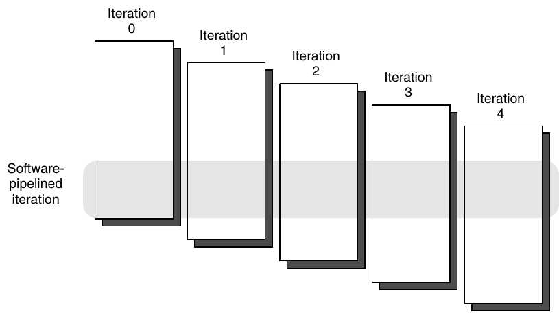
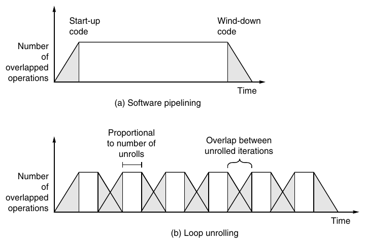
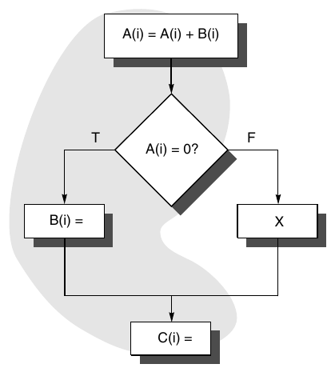
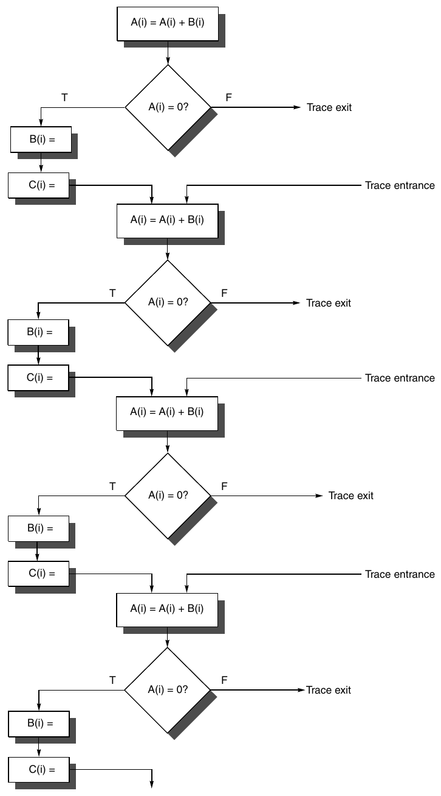
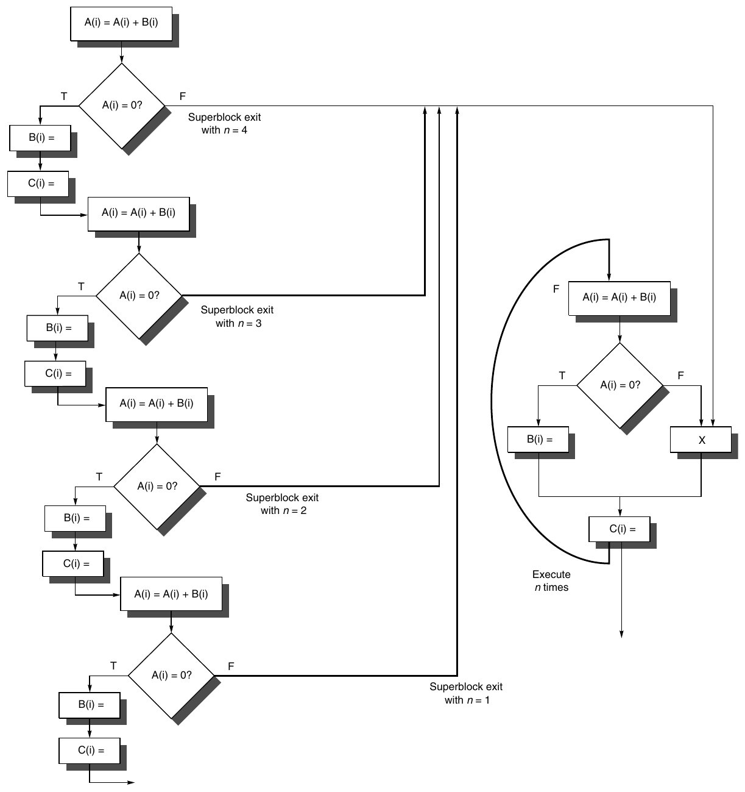
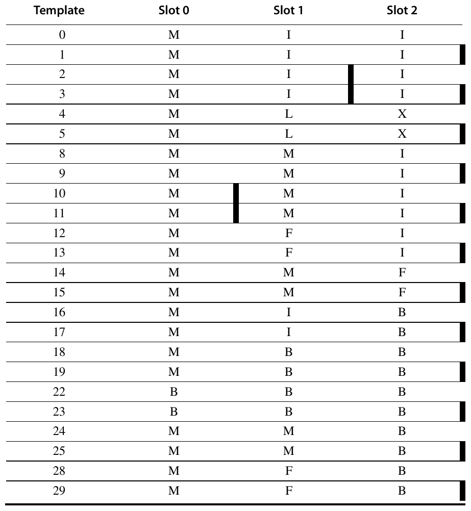
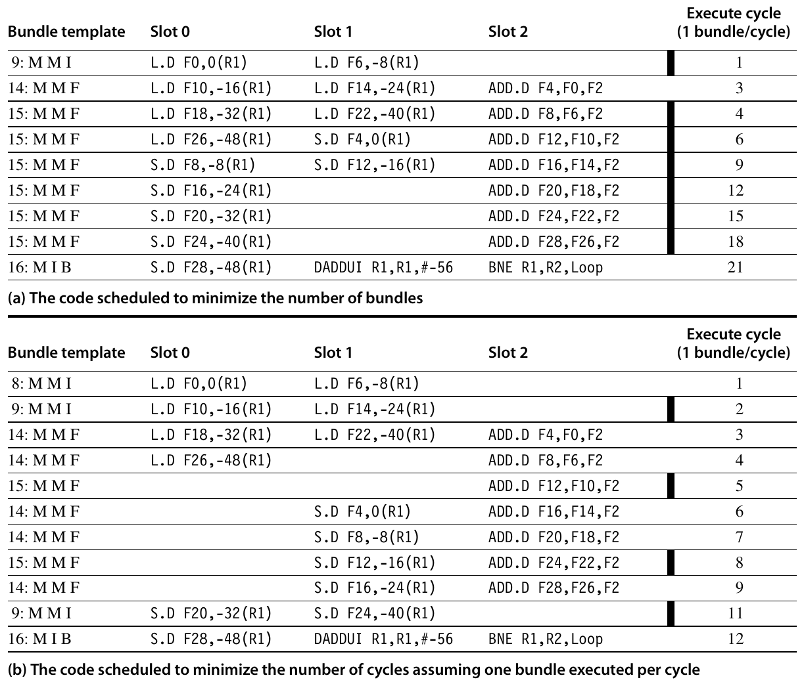
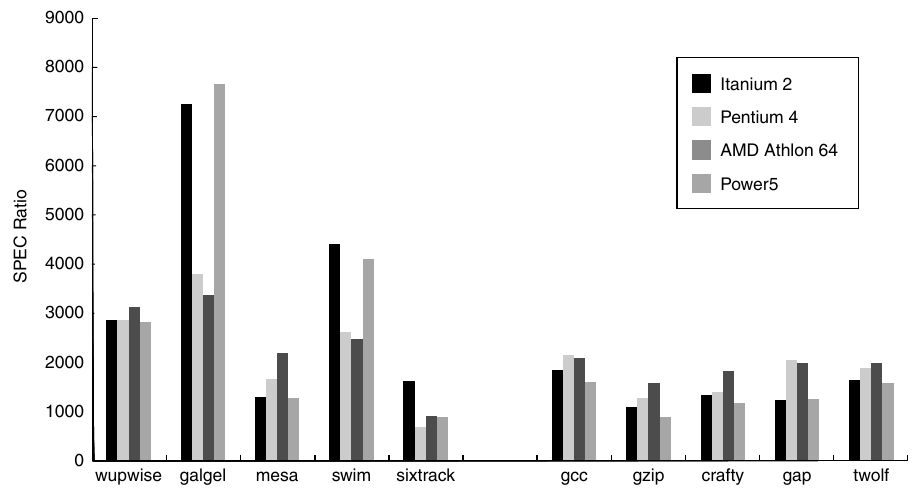

# H Hardware và Software cho VLIW và EPIC

> Cách tiếp cận EPIC dựa trên việc huy động một lượng resource khổng lồ. Những resource này bao gồm nhiều unit load-store, unit tính toán và branch unit hơn, cùng với những cache lớn hơn và lower-latency hơn so với mức cần thiết cho một superscalar processor. Vì vậy, IA-64 đặt cược rằng trong tương lai, power sẽ không phải là giới hạn then chốt, và một lượng resource khổng lồ cùng với bộ máy khai thác chúng sẽ không làm giảm performance thông qua những tác động bất lợi đến clock speed, path length hay các yếu tố CPI.

> M. Hopkins

> trong bài bình luận về cách tiếp cận EPIC và architecture IA-64 (2000)

## H.1 Giới thiệu: Khai thác Instruction-Level Parallelism theo cách tĩnh

Trong chương này, chúng ta thảo luận về công nghệ compiler nhằm tăng mức độ song song mà chúng ta có thể khai thác trong một chương trình, cũng như sự hỗ trợ của hardware cho những kỹ thuật compiler này. Mục tiếp theo xác định khi nào một loop có tính song song, cách một dependence có thể ngăn loop có tính song song, và những kỹ thuật để loại bỏ một số loại dependence. Mục sau đó thảo luận về việc scheduling code để cải thiện tính song song. Hai mục này đóng vai trò giới thiệu những kỹ thuật đó.

Chúng ta không cố gắng giải thích chi tiết các kỹ thuật compiler ILP-oriented, vì điều đó sẽ cần hàng trăm trang, thay vì 20 trang mà chúng ta đã dành cho nội dung này. Thay vào đó, chúng ta xem nội dung này là phần kiến thức nền tổng quát, giúp người đọc có được hiểu biết cơ bản về các kỹ thuật compiler dùng để khai thác ILP trong những máy tính hiện đại.

Sự hỗ trợ của hardware cho những kỹ thuật compiler này có thể làm tăng đáng kể hiệu quả của chúng; Mục H.4 và H.5 khảo sát sự hỗ trợ đó. IA-64 thể hiện sự hội tụ của những ý tưởng về compiler và hardware nhằm khai thác tính song song theo cách tĩnh, đồng thời hỗ trợ nhiều khái niệm mà các nhà nghiên cứu đã đề xuất trong hơn một thập niên nghiên cứu về instruction-level parallelism compiler-based. Mục H.6 mô tả và phân tích performance của architecture Intel IA-64 cùng với implementation second-generation của nó, Itanium 2.

Những khái niệm cốt lõi mà chúng ta khai thác trong các kỹ thuật dựa trên cách tiếp cận tĩnh — tìm kiếm tính song song, giảm control dependence và data dependence, cũng như sử dụng speculation — cũng chính là những kỹ thuật đã được khai thác bằng phương pháp động trong Chương 3. Điểm khác biệt then chốt là compiler áp dụng những kỹ thuật trong phụ lục này tại compile time, thay vì để hardware áp dụng chúng tại runtime. Các kỹ thuật compile time có hai ưu điểm chính: chúng không làm tăng gánh nặng cho việc thực thi tại runtime bằng những hoạt động kém hiệu quả, và chúng có thể xem xét phạm vi chương trình rộng hơn phạm vi mà một cách tiếp cận runtime có thể bao quát. Để minh họa ưu điểm thứ hai, mục tiếp theo cho thấy compiler có thể xác định rằng toàn bộ một loop có thể thực thi song song như thế nào; các kỹ thuật hardware có thể tìm thấy hoặc không tìm thấy tính song song đó. Nhược điểm chính của các cách tiếp cận tĩnh là chúng chỉ có thể sử dụng thông tin compile time. Khi không có thông tin runtime, các kỹ thuật compile time thường phải thận trọng và giả định trường hợp xấu nhất.

## H.2 Phát hiện và tăng cường Loop-Level Parallelism

Loop-level parallelism thường được phân tích ở source level hoặc gần mức đó, trong khi phần lớn việc phân tích ILP diễn ra sau khi compiler đã sinh các instruction. Phân tích Loop-level bao gồm việc xác định những dependence tồn tại giữa các operand của một loop qua những lần lặp của loop đó. Trước mắt, chúng ta chỉ xem xét data dependence, vốn xuất hiện khi một operand được ghi tại một thời điểm rồi được đọc tại một thời điểm sau đó. Name dependence cũng tồn tại và có thể được loại bỏ bằng các kỹ thuật renaming giống như những kỹ thuật đã khảo sát trong Chương 3.

Việc phân tích loop-level parallelism tập trung xác định xem các data access trong những lần lặp sau có phụ thuộc vào những giá trị được tạo ra trong các lần lặp trước hay không; một dependence như vậy được gọi là dependence loop-carried. Phần lớn các ví dụ mà chúng ta đã xem xét trong Mục 3.2 không có dependence loop-carried, do đó có tính song song loop-level. Để thấy một loop có tính song song, trước hết chúng ta hãy xem biểu diễn source của nó:

```
for (i=1000; i>0; i=i–1)
      x[i] = x[i] + s;
```

Trong loop này, có một dependence giữa hai lần sử dụng x[i], nhưng dependence đó nằm trong một lần lặp duy nhất và không phải là loop carried. Cũng có một dependence loop carried giữa những lần sử dụng i liên tiếp ở các lần lặp khác nhau, nhưng dependence này liên quan đến một induction variable nên có thể dễ dàng được nhận diện và loại bỏ. Chúng ta đã thấy những ví dụ loại bỏ dependence liên quan đến induction variable khi loop unrolling trong Mục 3.2, và sẽ xem xét thêm các ví dụ khác ở phần sau của mục này.

Vì tìm loop-level parallelism đòi nhận diện cấu trúc như loop, array reference và phép tính induction variable, compiler phân tích dễ hơn ở hoặc gần source level so với machine-code level. Hãy xét ví dụ phức tạp hơn.

**Ví dụ** Xét loop như sau:

```
for (i=1; i<=100; i=i+1) {
      A[i+1] = A[i] + C[i];   /* S1 */
      B[i+1] = B[i] + A[i+1]; /* S2 */
}
```

Giả sử A, B và C là các array riêng biệt, không chồng lấp. (Trên thực tế, đôi khi array trùng nhau hoặc chồng lấp. Vì array có thể được truyền như parameter tới procedure chứa loop này, xác định chúng có chồng lấp hay giống nhau thường đòi phân tích chương trình interprocedural tinh vi.) Có data dependence nào giữa câu lệnh S1 và S2 trong loop?

**Trả lời** Có hai dependence khác nhau:

1. S1 dùng giá trị do S1 tính ở lần lặp trước, vì lần lặp i tính A[i+1], được đọc ở lần i+1. Điều tương tự đúng với S2 cho B[i] và B[i+1].

2. S2 dùng giá trị A[i+1] do S1 tính trong cùng lần lặp.

Hai dependence này khác nhau và có ảnh hưởng khác nhau. Để thấy khác biệt, giả sử mỗi lúc chỉ một dependence tồn tại. Vì S1 phụ thuộc S1 ở lần lặp trước, dependence này là loop carried. Nó buộc các lần lặp liên tiếp thực thi tuần tự.

Dependence thứ hai (S2 phụ thuộc S1) nằm trong một lần lặp, không phải loop carried. Vì vậy, nếu chỉ có dependence này, nhiều lần lặp có thể thực thi song song miễn giữ thứ tự cặp câu lệnh trong mỗi lần lặp. Chúng ta đã thấy dạng này trong ví dụ Mục 3.2, nơi unrolling làm lộ tính song song.

Cũng có thể có dependence loop-carried không ngăn tính song song, như ví dụ sau.

**Ví dụ** Xét loop như sau:

```
for (i=1; i<=100; i=i+1) {
      A[i] = A[i] + B[i];   /* S1 */
      B[i+1] = C[i] + D[i]; /* S2 */
}
```

Có những dependence nào giữa S1 và S2? Loop này song song không? Nếu không, hãy chỉ cách làm nó song song.

**Trả lời** S1 dùng giá trị S2 gán ở lần lặp trước, nên có dependence loop-carried giữa S2 và S1. Dù có dependence loop-carried, vẫn có thể làm loop song song. Khác loop trước, dependence không có chu trình: không câu lệnh nào phụ thuộc chính nó; dù S1 phụ thuộc S2, S2 không phụ thuộc S1. Loop song song nếu viết được mà không có chu trình dependence, vì không có chu trình nghĩa là dependence tạo thứ tự bộ phận trên câu lệnh.

Dù loop trên không có dependence vòng, phải biến đổi để tuân theo thứ tự bộ phận và bộc lộ tính song song. Hai nhận xét then chốt cho phép biến đổi:

1. Không có dependence từ S1 tới S2. Nếu có, dependence tạo chu trình và loop không song song. Vì thiếu dependence này, đổi chỗ hai câu lệnh không ảnh hưởng execution của S2.

2. Ở lần lặp đầu, câu lệnh S1 phụ thuộc giá trị B[1] được tính trước khi bắt đầu loop.

Hai nhận xét cho phép thay loop trên bằng chuỗi code sau:

```
A[1] = A[1] + B[1];
for (i=1; i<=99; i=i+1) {
      B[i+1] = C[i] + D[i];
      A[i+1] = A[i+1] + B[i+1];
}
B[101] = C[100] + D[100];
```

Dependence giữa hai câu lệnh không còn loop carried, nên có thể chồng lấp các lần lặp miễn giữ thứ tự câu lệnh trong mỗi lần lặp.

Phân tích cần bắt đầu bằng tìm mọi dependence loop-carried. Thông tin dependence này không chính xác hoàn toàn, theo nghĩa chỉ cho biết dependence có thể tồn tại. Xét ví dụ:

```
for (i=1;i<=100;i=i+1) {
      A[i] = B[i] + C[i]
      D[i] = A[i] * E[i]
}
```

Tham chiếu thứ hai đến A trong ví dụ này không cần được chuyển thành một load instruction, vì chúng ta biết rằng giá trị đó đã được câu lệnh trước tính toán và lưu lại; do đó, tham chiếu thứ hai đến A chỉ cần tham chiếu register chứa kết quả tính toán của A. Để thực hiện việc tối ưu này, cần biết rằng hai tham chiếu luôn trỏ đến cùng một memory address và không có access nào xen giữa đến cùng vị trí đó. Thông thường, data dependence analysis chỉ cho biết một tham chiếu có thể phụ thuộc vào một tham chiếu khác; cần có một phép phân tích phức tạp hơn để xác định rằng hai tham chiếu nhất thiết trỏ đến chính xác cùng một address. Trong ví dụ trên, một phiên bản đơn giản của phép phân tích này là đủ, vì hai tham chiếu nằm trong cùng một basic block.

Dependence loop-carried thường có dạng recurrence:

```
for (i=2;i<=100;i=i+1) {
      Y[i] = Y[i-1] + Y[i];
}
```

Recurrence là khi variable được định nghĩa dựa trên giá trị chính nó ở lần lặp trước, thường ngay liền trước như đoạn code trên. Phát hiện recurrence quan trọng vì hai lý do: một số architecture (đặc biệt vector computer) hỗ trợ riêng để thực thi recurrence, và một số recurrence có thể là nguồn tính song song khá lớn. Để thấy điểm sau, xét loop:

```
for (i=6;i<=100;i=i+1) {
      Y[i] = Y[i-5] + Y[i];
}
```

Ở lần lặp i, loop tham chiếu phần tử i – 5. Người ta nói loop có dependence distance 5. Nhiều loop có carried dependence có dependence distance 1. Khoảng cách càng lớn, tính song song tiềm năng từ unrolling càng cao. Chẳng hạn unroll loop đầu có dependence distance 1, các câu lệnh liên tiếp phụ thuộc nhau; vẫn có tính song song giữa instruction riêng nhưng không nhiều. Nếu unroll loop có dependence distance 5, có chuỗi năm câu lệnh không phụ thuộc, nên nhiều ILP hơn. Dù nhiều loop có dependence loop-carried có dependence distance 1, trường hợp khoảng cách lớn hơn vẫn xuất hiện và có thể đủ tính song song để giữ processor bận.

### Tìm Dependence

Việc tìm dependence trong một chương trình là một phần quan trọng của ba công việc: (1) scheduling code hiệu quả, (2) xác định các loop có thể chứa tính song song và (3) loại bỏ name dependence. Sự phức tạp của dependence analysis xuất phát từ việc sử dụng array và pointer trong các ngôn ngữ như C, C++, hoặc cơ chế truyền parameter pass-by-reference trong FORTRAN. Vì các tham chiếu đến scalar variable chỉ rõ tên của chúng, những tham chiếu này thường dễ phân tích; aliasing do pointer và reference parameter gây ra làm tăng sự phức tạp và tính bất định.

Compiler phát hiện dependence nói chung thế nào? Gần như mọi thuật toán dependence analysis giả định array index là affine. Đơn giản nhất, index array one-dimensional là affine nếu viết được dạng a × i + b, với a, b là hằng và i là loop index variable. Index multidimensional array affine nếu index ở mỗi chiều affine. Sparse array access, thường dạng x[y[i]], là ví dụ chính của nonaffine access.

Vì vậy xác định dependence giữa hai tham chiếu cùng array trong loop tương đương xác định hai affine function có thể cùng giá trị với index khác nhau trong cận loop không. Chẳng hạn store vào phần tử index a × i + b và load cùng array ở c × i + d, với i là index for-loop từ m tới n. Dependence tồn tại nếu thỏa hai điều kiện:

1. Có hai iteration index j, k đều nằm trong giới hạn for loop: m ≤ j ≤ n, m ≤ k ≤ n.

2. Loop store vào phần tử index a × j + b rồi fetch từ cùng phần tử khi index là c × k + d. Tức a × j + b = c × k + d.

Nhìn chung, không phải lúc nào chúng ta cũng có thể xác định dependence tại compile time. Chẳng hạn, các giá trị a, b, c, d có thể chưa được biết — chúng có thể là những giá trị được lưu trong một array khác — khiến chúng ta không thể đưa ra kết luận. Trong những trường hợp khác, việc kiểm tra dependence có thể rất tốn kém nhưng vẫn quyết định được tại compile time, chẳng hạn khi access phụ thuộc vào index của nhiều nested loop. Tuy nhiên, nhiều chương trình chủ yếu chứa những index đơn giản với a, b, c, d đều là hằng số. Với những chương trình như vậy, chúng ta có thể thiết kế các phép kiểm tra dependence có chi phí hợp lý tại compile time.

Ví dụ, kiểm tra đơn giản và đủ để xác nhận không có dependence là greatest common divisor (GCD) test. Nó dựa trên nhận xét nếu có dependence loop-carried thì (d – b) phải chia hết cho GCD (c,a). (Nhớ số nguyên x là ước của số nguyên y nếu phép chia y /x cho thương nguyên, không có dư.)

**Ví dụ** Dùng GCD test để xác định dependence trong loop sau:

```
for (i=1; i<=100; i=i+1) {
      X[2*i+3] = X[2*i] * 5.0;
}
```

**Trả lời** Với a = 2, b = 3, c = 2, d = 0 thì GCD(a,c) = 2 và d – b = –3. Vì –3 không chia hết cho 2, không thể có dependence.

GCD test đủ để bảo đảm không có dependence; tuy nhiên có trường hợp GCD test thành công nhưng không có dependence. Ví dụ điều này xuất hiện vì GCD test không tính cận loop.

Nhìn chung, xác định dependence thực sự tồn tại là NP complete. Nhưng thực tế, nhiều trường hợp phổ biến được phân tích chính xác với chi phí thấp. Gần đây, cách dùng hệ phân cấp exact test tăng dần tính tổng quát và chi phí đã cho thấy vừa chính xác vừa hiệu quả. (Test là exact nếu xác định chính xác dependence có tồn tại không. Dù trường hợp tổng quát NP complete, có exact test rẻ hơn nhiều cho tình huống hạn chế.)

Ngoài phát hiện dependence tồn tại, compiler muốn phân loại nó. Phân loại cho phép nhận diện name dependence và loại bỏ tại compile time bằng renaming, copying.

**Ví dụ** Loop sau có nhiều loại dependence. Tìm mọi true dependence, output dependence và antidependence, rồi loại output dependence, antidependence bằng renaming.

```
for (i=1; i<=100; i=i+1) {
    Y[i] = X[i] / c; /* S1 */
    X[i] = X[i] + c; /* S2 */
    Z[i] = Y[i] + c; /* S3 */
    Y[i] = c - Y[i]; /* S4 */
}
```

**Trả lời** Có các dependence sau giữa bốn câu lệnh:

1. Có true dependence từ S1 tới S3 và từ S1 tới S4 do Y[i]. Chúng không loop carried nên không ngăn loop được xem là song song. Chúng buộc S3 và S4 đợi S1 hoàn tất.

2. Có antidependence từ S1 tới S2 dựa trên X[i].

3. Có antidependence từ S3 tới S4 với Y[i].

4. Có output dependence từ S1 tới S4 dựa trên Y[i].

Phiên bản loop sau loại bỏ những dependence giả (hay pseudo) này:

```
for (i=1; i<=100; i=i+1 {
    /* Y renamed to T to remove output dependence */
    T[i] = X[i] / c;
    /* X renamed to X1 to remove antidependence */
    X1[i] = X[i] + c;
    /* Y renamed to T to remove antidependence */
    Z[i] = T[i] + c;
    Y[i] = c - T[i];
}
```

Sau loop, variable X được rename thành X1. Trong code theo sau, compiler chỉ cần thay tên X bằng X1. Ở đây renaming không đòi copy operation thực sự mà thực hiện được bằng thay tên hoặc register allocation. Tuy nhiên, ở trường hợp khác, renaming đòi copying.

Dependence analysis là một công nghệ then chốt để khai thác tính song song. Ở instruction level, nó cung cấp thông tin cần thiết để đổi chỗ các memory reference trong quá trình scheduling và xác định lợi ích của loop unrolling. Đối với việc phát hiện loop-level parallelism, dependence analysis là công cụ cơ bản. Việc compile hiệu quả cho vector computer hoặc multiprocessor phụ thuộc thiết yếu vào công nghệ này. Nhược điểm chính của dependence analysis là nó chỉ áp dụng được trong những hoàn cảnh hạn chế — giữa các tham chiếu nằm trong một loop nest và sử dụng affine index function. Vì vậy, có rất nhiều tình huống mà dependence analysis array-oriented không thể cung cấp thông tin chúng ta cần, bao gồm:

- Khi object được tham chiếu qua pointer thay vì array index (nhưng xem thảo luận dưới đây).

- Khi array indexing gián tiếp qua array khác, như nhiều cách biểu diễn sparse array.

- Khi dependence có thể có với một số giá trị input nhưng thực tế không có khi code chạy, vì input không bao giờ nhận những giá trị ấy.

- Khi tối ưu đòi biết hơn khả năng dependence: cần biết một lần đọc variable phụ thuộc vào lần ghi variable nào.

Để phân tích chương trình có pointer, cần kiểu phân tích khác thường gọi là points-to analysis (xem Wilson và Lam [1995]). Câu hỏi then chốt từ dependence analysis pointer là hai pointer có thể chỉ cùng address không. Với dynamic data structure phức tạp, đây là vấn đề cực khó. Chẳng hạn muốn biết hai pointer có thể tham chiếu cùng node trong list tại một điểm chương trình không; nói chung vấn đề không quyết định được và thực tế cực khó trả lời. Tuy nhiên có thể trả lời câu đơn giản hơn: hai pointer có thể chỉ các node trong cùng list dù có thể là node riêng biệt không? Phân tích hạn chế hơn này vẫn khá hữu ích khi scheduling memory access qua pointer.

Cách cơ bản trong points-to analysis dựa trên ba nguồn thông tin chính:

1. Thông tin type, giới hạn những gì pointer có thể trỏ tới.

2. Thông tin khi object được cấp phát hoặc khi lấy address object, dùng giới hạn đích pointer. Ví dụ p luôn trỏ object được cấp ở một dòng source cụ thể, q không bao giờ trỏ object đó, thì p và q không bao giờ trỏ cùng object.

3. Thông tin từ pointer assignment. Chẳng hạn nếu p có thể nhận giá trị q, thì p có thể trỏ mọi thứ q trỏ tới.

Có một số trường hợp pointer analysis được áp dụng thành công và cực hữu ích:

- Khi pointer truyền address object như parameter, có thể dùng points-to analysis xác định tập object có thể được pointer tham chiếu. Công dụng quan trọng là xác định hai pointer parameter có thể chỉ cùng object không.

- Khi pointer có thể trỏ một trong vài type, đôi khi có thể xác định type của data object được pointer chỉ ở từng phần chương trình.

- Thường có thể tách pointer chỉ có thể trỏ local object khỏi pointer trỏ global object.

Có hai loại giới hạn ảnh hưởng khả năng dependence analysis chính xác cho chương trình lớn. Loại đầu do ràng buộc thuật toán phân tích. Thường giới hạn nằm ở khả năng áp dụng chứ không phải thiếu sót bản thân dependence analysis. Ví dụ dependence analysis pointer về cơ bản bất khả thi với chương trình dùng pointer tùy ý, như thực hiện số học trên pointer.

Giới hạn thứ hai là phải phân tích qua ranh giới procedure để có thông tin chính xác. Chẳng hạn procedure nhận hai parameter pointer, xác định giá trị có thể giống nhau đòi phân tích qua ranh giới procedure. Kiểu này, gọi interprocedural analysis, khó và phức tạp hơn nhiều so với trong một procedure. Khác phân tích array index trong loop nest, points-to analysis thường cần interprocedural analysis. Lý do đơn giản: nếu phân tích đoạn có hai pointer mà không biết gì về chúng lúc đầu, phải thận trọng giả định trường hợp xấu nhất. Trường hợp xấu nhất là hai pointer có thể chỉ cùng object nhưng không bảo đảm như vậy. Giả định này có khả năng lan qua quá trình phân tích, tạo thông tin vô ích. Thực tế, có thông tin interprocedural hoàn toàn chính xác thường quá đắt với chương trình thực. Thay vào đó, compiler thường dùng xấp xỉ; kết quả có thể quá thiếu chính xác để hữu ích.

Ngôn ngữ hiện đại strong typing như Java làm dependence analysis dễ hơn. Đồng thời, việc dùng procedure rộng rãi để cấu trúc chương trình, cùng abstract data type, làm phân tích khó hơn. Tuy vậy, kỳ vọng tiến bộ thuật toán phân tích cùng tầm quan trọng tăng của pointer dependency analysis sẽ đem lại tiến triển liên tục cho vấn đề quan trọng này.

### Loại bỏ phép tính phụ thuộc

Compiler có thể giảm tác động của các phép tính phụ thuộc để đạt được nhiều instruction-level parallelism (ILP) hơn. Kỹ thuật chính là loại bỏ hoặc giảm các phép tính phụ thuộc bằng back substitution; cách này làm tăng tính song song và đôi khi cũng làm tăng lượng tính toán cần thực hiện. Những kỹ thuật này có thể được áp dụng cả trong basic block lẫn trong loop; chúng ta sẽ mô tả riêng từng trường hợp.

Trong basic block, rút gọn đại số biểu thức và tối ưu copy propagation, loại các operation sao chép giá trị, có thể đơn giản hóa chuỗi sau:

```
DADDUI     R1,R2,#4
DADDUI     R1,R1,#4
```

thành

```
DADDUI     R1,R2,#8
```

với giả định rằng đây là lần sử dụng R1 duy nhất. Trên thực tế, các kỹ thuật giảm nhiều lần tăng array index khi unroll loop và di chuyển phép tăng qua memory address trong Mục 3.2 chính là những ví dụ của dạng tối ưu này.

Trong ví dụ trên, phép tính thực sự được loại bỏ, nhưng cũng có thể muốn tăng tính song song của code, thậm chí tăng số operation. Tối ưu đó gọi là tree height reduction vì giảm chiều cao cây biểu diễn phép tính, làm cây rộng hơn nhưng thấp hơn. Xét chuỗi code:

```
ADD        R1,R2,R3
ADD        R4,R1,R6
ADD        R8,R4,R7
```

Lưu ý chuỗi này cần ít nhất ba execution cycle vì mọi instruction phụ thuộc instruction ngay trước. Tận dụng tính kết hợp, có thể biến đổi và viết lại:

```
ADD        R1,R2,R3
ADD        R4,R6,R7
ADD        R8,R1,R4
```

Chuỗi này được tính trong hai execution cycle. Khi dùng loop unrolling, cơ hội tối ưu dạng này thường xuất hiện.

Mặc dù phép số học có phạm vi biểu diễn và độ chính xác vô hạn có tính kết hợp, phép số học trên máy tính lại không có tính chất đó: integer arithmetic bị giới hạn bởi phạm vi biểu diễn hữu hạn, còn floating-point arithmetic bị giới hạn cả về phạm vi biểu diễn lẫn độ chính xác. Vì vậy, việc sử dụng các kỹ thuật tái cấu trúc đôi khi có thể dẫn đến hành vi không đúng, dù điều này hiếm khi xảy ra. Do đó, phần lớn compiler yêu cầu người dùng bật tường minh những phép tối ưu dựa trên tính kết hợp.

Khi loop được unroll, tối ưu đại số này quan trọng để giảm dependence do recurrence. Recurrence là biểu thức có giá trị ở lần lặp được cho bởi function phụ thuộc lần trước. Unroll loop có recurrence có thể cho phép tối ưu đại số sao cho chỉ cần tính recurrence một lần mỗi lần lặp đã unroll. Loại recurrence phổ biến xuất hiện từ câu lệnh tường minh như:

```
sum = sum + x;
```

Giả sử unroll loop chứa recurrence này năm lần. Gọi giá trị x ở năm lần lặp là x1, x2, x3, x4, x5, ta viết sum cuối mỗi lần unroll là:

```
sum = sum + x1 + x2 + x3 + x4 + x5;
```

Nếu chưa tối ưu, biểu thức cần năm operation phụ thuộc, nhưng viết lại được thành:

```
sum = ((sum + x1) + (x2 + x3)) + (x4 + x5);
```

biểu thức này chỉ cần ba operation phụ thuộc.

Recurrence cũng xuất hiện từ phép tính ngầm, như array indexing. Mỗi array index chuyển thành address tính dựa trên loop index variable. Một lần nữa, unrolling và tối ưu đại số có thể giảm tối đa phép tính phụ thuộc.

## H.3 Scheduling và cấu trúc Code để có tính song song

Chúng ta đã thấy loop unrolling hữu ích để bộc lộ tính song song giữa instruction bằng cách tạo chuỗi code straight-line dài hơn. Hai kỹ thuật quan trọng khác được phát triển cho mục đích này là software pipelining và trace scheduling.

### Software Pipelining: Loop Unrolling theo ký hiệu

Software pipelining tổ chức lại một loop sao cho mỗi lần lặp trong code software-pipelined được tạo thành từ những instruction chọn ra từ các lần lặp khác nhau của loop ban đầu. Cách dễ nhất để hiểu phép biến đổi này là xem lại code đã được schedule của loop unroll trong ví dụ ở trang 78. Về cơ bản, scheduler xen kẽ các instruction thuộc những lần lặp khác nhau để tách những instruction phụ thuộc trong cùng một lần lặp. Việc chọn instruction từ các lần lặp khác nhau khiến những phép tính phụ thuộc được ngăn cách bởi toàn bộ phần thân loop, qua đó làm tăng khả năng schedule loop unroll mà không có stall.

Loop software-pipelined xen kẽ instruction từ các lần lặp khác nhau mà không unroll, như Hình H.1. Đây là phiên bản software của việc thuật toán Tomasulo làm bằng hardware. Loop software-pipelined cho ví dụ trước chứa một load, một add, một store, mỗi instruction từ lần lặp khác nhau. Cũng cần code start-up trước loop và code kết thúc sau loop. Để đơn giản, chúng ta bỏ qua chúng ở đây.



**Hình H.1 Loop software-pipelined chọn instruction từ những lần lặp khác nhau, tách instruction phụ thuộc trong một lần lặp gốc. Code start-up và finish-up tương ứng phần trên và dưới lần lặp software-pipelined.**

**Ví dụ** Trình bày phiên bản software-pipelined của loop sau, tăng mọi phần tử array có starting address trong R1 thêm nội dung F2:

```
Loop:    L.D       F0,0(R1)
         ADD.D     F4,F0,F2
         S.D       F4,0(R1)
         DADDUI    R1,R1,#-8
         BNE       R1,R2,Loop
```

Có thể bỏ code start-up và clean-up.

**Trả lời** Software pipelining unroll loop theo ký hiệu rồi chọn instruction mỗi lần lặp. Vì unrolling mang tính ký hiệu, không cần nhân bản loop overhead instruction (DADDUI và BNE). Đây là thân loop unroll không có overhead instruction, làm nổi các instruction được lấy từ mỗi lần lặp:

```
Iteration i:    L.D       F0,0(R1)
                ADD.D     F4,F0,F2
                S.D       F4,0(R1)
Iteration i+1:  L.D       F0,0(R1)
                ADD.D     F4,F0,F2
                S.D       F4,0(R1)
Iteration i+2:  L.D       F0,0(R1)
                ADD.D     F4,F0,F2
                S.D       F4,0(R1)
```

Sau đó các instruction chọn từ những lần lặp khác nhau được ghép trong loop cùng loop control instruction:

```
Loop:    S.D       F4,16(R1)     ;stores into M[i]
         ADD.D     F4,F0,F2      ;adds to M[i-1]
         L.D       F0,0(R1)      ;loads M[i-2]
         DADDUI    R1,R1,#-8
         BNE       R1,R2,Loop
```

Loop này có thể chạy 5 cycle mỗi kết quả, bỏ qua phần start-up và clean-up, giả sử DADDUI được schedule trước ADD.D và L.D với offset điều chỉnh được đặt vào branch delay slot. Vì load và store cách nhau offset 16 (hai lần lặp), loop nên chạy ít đi hai lần lặp. Lưu ý tái sử dụng register (F4, F0, R1) đòi hardware tránh write after read (WAR) hazard có thể xuất hiện. Điều này không đáng lo ở đây vì không nên có stall data-dependent.

Nhìn phiên bản unroll có thể thấy cần code start-up và finish-up nào. Với start-up, thực thi instruction tương ứng lần lặp 1 và 2 sẽ không được thực thi: L.D của lần 1, 2 và ADD.D lần 1. Với finish-up, thực thi instruction không được thực thi trong hai lần lặp cuối: ADD.D lần cuối và S.D của hai lần cuối.

Việc quản lý register trong một loop software-pipelined có thể gặp khó khăn. Ví dụ trước không quá khó, vì register được ghi trong một lần lặp sẽ được đọc trong lần lặp tiếp theo. Trong những trường hợp khác, khi thân loop có ít instruction và latency lớn, chúng ta có thể cần tăng số lần lặp nằm giữa thời điểm issue một instruction và thời điểm sử dụng kết quả của nó. Trong những trường hợp như vậy, cần kết hợp software pipelining với loop unrolling.

Có thể xem software pipelining là loop unrolling theo ký hiệu. Thực tế một số thuật toán dùng thuật toán loop-unrolling để tìm cách software-pipeline loop. Ưu điểm chính so với chỉ unrolling là tiêu thụ ít code space hơn. Ngoài tạo inner loop được schedule tốt hơn, mỗi kỹ thuật giảm loại overhead khác nhau. Loop unrolling giảm overhead branch và cập nhật counter. Software pipelining giảm thời gian loop chưa chạy tốc độ đỉnh xuống một lần ở đầu và cuối mỗi loop. Nếu unroll loop 100 lần lặp với hệ số cố định 4, overhead xuất hiện 100/4 = 25 lần, mỗi khi inner loop unroll khởi động. Hình H.2 minh họa. Vì xử lý hai loại overhead khác nhau, kết hợp cả hai có thể đạt performance tốt nhất. Thực tế compile với software pipelining khó vì nhiều loop cần biến đổi đáng kể trước, trade-offs overhead/hiệu quả của loop software-pipelined phức tạp, và quản lý register thêm khó khăn. Để hỗ trợ hai vấn đề cuối, IA-64 bổ sung hardware hỗ trợ rộng cho software pipelining. Nó giúp áp dụng hiệu quả hơn nhưng không loại nhu cầu compiler phức tạp hoặc quyết định khó về cách compile loop tốt nhất.



**Hình H.2 Mẫu execution của (a) loop software-pipelined và (b) loop unroll. Vùng tô là thời gian loop không đạt chồng lấp hay tính song song instruction tối đa: một lần đầu, một lần cuối với loop software-pipelined; m/n lần với loop có m lần lặp, unroll n lần. Mỗi block là một lần unroll n lần lặp. Tăng số unroll giảm overhead start-up và clean-up. Overhead lần lặp này chồng lấp lần sau, giảm ảnh hưởng. Tổng diện tích vùng đa giác mỗi trường hợp bằng nhau vì tổng operation bằng execution rate nhân thời gian.**

### Global Code Scheduling

Trong Mục 3.2, chúng ta khảo sát loop unrolling và code scheduling cải thiện ILP. Các kỹ thuật trong Mục 3.2 tốt khi thân loop là code straight-line, vì loop unroll trông như một basic block. Software pipelining cũng tốt khi thân loop là một basic block vì dễ tìm schedule lặp lại. Tuy nhiên, khi thân loop unroll có control flow nội bộ, scheduling phức tạp hơn nhiều. Nhìn chung phải chuyển instruction qua branch để schedule hiệu quả, tức global code scheduling. Mục này trước tiên khảo sát thách thức và giới hạn. Mục H.4 xem hardware loại control flow trong inner loop, rồi hai kỹ thuật compiler khi không thể loại control flow.

Global code scheduling nhằm nén một đoạn code có control structure bên trong thành chuỗi ngắn nhất mà vẫn giữ được data dependence và control dependence. Data dependence áp đặt một thứ tự bộ phận lên các operation; control dependence quy định những instruction mà code không dễ dàng được di chuyển qua. Chúng ta khắc phục data dependence bằng unrolling, và đối với memory operation, bằng dependence analysis để xác định xem hai tham chiếu có trỏ đến cùng một address hay không. Việc tìm chuỗi ngắn nhất có nghĩa là tìm chuỗi ngắn nhất cho critical path, tức chuỗi instruction phụ thuộc dài nhất.

Control dependence do loop branch giảm bằng unrolling. Global code scheduling giảm ảnh hưởng control dependence từ conditional nonloop branch bằng di chuyển code. Vì chuyển code qua branch thường đổi tần suất execution, cần ước tính tần suất tương đối các path để global code motion hiệu quả. Dù không bảo đảm nhanh hơn, nếu thông tin tần suất đúng, compiler xác định được việc di chuyển có khả năng tăng tốc không.

Global code motion quan trọng vì nhiều inner loop có conditional statement. Hình H.3 cho đoạn code điển hình, có thể xem là lần lặp loop unroll, làm nổi control flow phổ biến hơn.



**Hình H.3 Đoạn code với path thường gặp tô xám. Di chuyển assignment B hoặc C cần phân tích phức tạp hơn code straight-line. Mục này tập trung schedule hiệu quả không hỗ trợ hardware. Predication hoặc conditional instruction trong mục sau là cách khác để schedule code này.**

Schedule hiệu quả code này có thể đòi chuyển assignment B và C sớm hơn, trước test A. Global code motion phải thỏa ràng buộc để hợp lệ. Ngoài ra, di chuyển code B, khác code C, mang tính speculative: chỉ tăng tốc khi path chứa code đó được chọn.

Để di chuyển B, chúng ta phải bảo đảm rằng việc di chuyển không làm thay đổi data flow hay exception behavior. Compiler có thể tránh thay đổi exception behavior bằng cách không di chuyển một số loại instruction có thể gây exception, chẳng hạn memory reference. Mục H.5 cho thấy hardware có thể tạo thêm cơ hội cho speculative code motion và việc loại bỏ control dependence như thế nào. Tuy nhiên, dù hardware mở rộng những cơ hội này, việc lựa chọn cách compile tốt nhất vẫn rất phức tạp.

Compiler bảo đảm chuyển assignment B và C không ảnh hưởng data flow thế nào? Xét chuỗi sinh code điển hình cho flowchart Hình H.3. Giả sử address A, B, C lần lượt trong R1, R2, R3, chuỗi như sau:

```
            LD     R4,0(R1)      ;load A
            LD     R5,0(R2)      ;load B
            DADDU  R4,R4,R5      ;Add to A
            SD     R4,0(R1)      ;Store A
            ...
            BNEZ   R4,elsepart   ;Test A
            ...                  ;then part
            SD     ...,0(R2)     ;Stores to B
            ...
            J      join          ;jump over else
elsepart:   ...                  ;else part
            X                    ;code for X
            ...
join:       ...                  ;after if
            SD     ...,0(R3)     ;store C[i]
```

Trước tiên xét chuyển assignment B lên trước BNEZ. Gọi i là instruction cuối gán B trước if. Nếu B được tham chiếu trước khi được gán, trong code segment X hoặc sau if, gọi instruction tham chiếu là j. Nếu j tồn tại, chuyển assignment B đổi data flow. Cụ thể j sẽ phụ thuộc assignment B đã chuyển thay vì i ban đầu. Có thể nghĩ phương án khéo hơn vẫn chuyển B khi giá trị được dùng: chẳng hạn tạo shadow copy B trước if, dùng trong X. Thường tránh vì phức tạp và làm chậm nếu trace chọn không tối ưu, operation rốt cuộc cần thêm instruction.

Chuyển assignment C trước branch đầu cần hai bước. Đầu tiên chuyển qua join point của else vào phần then. Điều này khiến instruction C control dependent vào branch, không chạy nếu chọn else ít gặp. Vì thế ảnh hưởng instruction data dependent vào C thực thi sau đoạn này. Để bảo đảm giá trị đúng, sao chép instruction tính và gán C trên else path. Thứ hai chuyển C từ then qua branch condition nếu không ảnh hưởng data flow vào điều kiện. Nếu C chuyển trước if test, thường bỏ được bản sao C ở else vì dư thừa.

Ví dụ này cho thấy global code scheduling phải chịu nhiều ràng buộc. Điều đó đã thúc đẩy việc bổ sung sự hỗ trợ của hardware để di chuyển code dễ dàng hơn; Mục H.4 và H.5 khảo sát chi tiết sự hỗ trợ này.

Global code scheduling còn cần trade-offs phức tạp để quyết định. Ví dụ giả sử chuyển được assignment B trước conditional branch (có thể thêm compensation code ở branch khác), liệu chạy nhanh hơn không? Có thể! Tương tự đưa bản sao C vào if và else ban đầu làm code lớn hơn! Chỉ khi compiler chuyển phép tính qua if test thành công mới có khả năng có lợi.

Xét những yếu tố compiler phải cân nhắc khi chuyển tính toán và assignment B:

- Tần suất tương đối then và else là bao nhiêu? Nếu then thường xuyên hơn nhiều, chuyển code có thể có lợi. Nếu không, ít khả năng xem xét di chuyển hơn, dù không phải bất khả thi.

- Chi phí tính và gán B trước branch là bao nhiêu? Có thể có issue slot trống phía trên để đặt instruction B. Cơ hội này khiến tính B “miễn phí”, ít nhất ở xấp xỉ đầu tiên.

- Di chuyển B đổi execution time của then thế nào? Nếu B ở đầu critical path then, di chuyển có thể rất có ích.

- B có phải đoạn code tốt nhất để chuyển trước branch? So với chuyển C hoặc câu lệnh khác trong then thì sao?

- Compensation code có thể cần cho else tốn bao nhiêu? Schedule hiệu quả tới đâu và tác động execution time thế nào?

Danh sách chưa đầy đủ này cho thấy global code scheduling cực kỳ phức tạp. Các trade-offs phụ thuộc vào nhiều yếu tố, và những quyết định về scheduling instruction trên phạm vi toàn cục phụ thuộc chặt chẽ vào nhau. Ngay cả việc lựa chọn những instruction ứng viên để xem xét di chuyển trên phạm vi toàn cục cũng đã là một vấn đề phức tạp!

Để đơn giản hóa, nhiều phương pháp global code scheduling được phát triển. Hai phương pháp khảo sát ngắn ở đây dựa trên nguyên tắc đơn giản: compiler tập trung đoạn code straight-line biểu diễn path được ước tính chạy thường xuyên nhất. Unrolling tạo code straight-line; dĩ nhiên khó khăn nằm ở xử lý conditional branch. Cả hai về cơ bản làm thẳng chúng bằng chọn và schedule path thường nhất.

#### Trace Scheduling: Tập trung Critical Path

Trace scheduling hữu ích cho processor nhiều issue mỗi clock, nơi conditional hoặc predicated execution (Mục H.4) không thích hợp hay không được hỗ trợ, và riêng unrolling không đủ ILP giữ processor bận. Nó tổ chức global code motion để đơn giản scheduling bằng đặt chi phí di chuyển lên path ít gặp. Vì có thể gây overhead đáng kể ở path ít gặp chỉ định, tốt nhất khi profile cho thấy chênh lệch tần suất lớn và phản ánh hành vi tốt bất kể input. Dĩ nhiên điều này giới hạn hiệu quả vào một số lớp chương trình.

Trace scheduling có hai bước. Đầu tiên, trace selection tìm chuỗi basic block có khả năng xuất hiện để gộp operation thành ít instruction hơn; chuỗi này gọi là trace. Loop unrolling tạo trace dài vì loop branch thường taken. Ngoài ra static branch prediction chọn conditional branch khác taken hay không, để trace là chuỗi straight-line nối nhiều basic block. Nếu đoạn Hình H.3 là inner loop với path nổi thường xuyên hơn nhiều và unroll bốn lần, trace chính có bốn bản phần tô như Hình H.4.

Sau khi chọn trace, bước hai trace compaction cố nén thành ít wide instruction. Đây chính là code scheduling: cố chuyển operation sớm nhất trong trace, đóng gói vào ít wide instruction (hoặc issue packet) nhất.

Ưu điểm trace scheduling là đơn giản quyết định global code motion. Cụ thể, branch được xem là jump vào hoặc ra trace chọn, giả định là path có xác suất cao nhất. Chuyển code qua điểm vào, ra thường cần bookkeeping code bổ sung tại đó. Giả định then chốt là trace có xác suất cao hơn các lựa chọn rất nhiều nên chi phí bookkeeping không cần là yếu tố quyết định: nếu instruction chuyển được và làm trace chính nhanh hơn, nó được chuyển.



**Hình H.4 Trace nhận được bằng giả định đoạn Hình H.3 là inner loop, unroll bốn lần, lấy phần tô Hình H.3 làm path có khả năng. Trace exit tương ứng jump khỏi path thường xuyên, trace entrance tương ứng quay lại trace.**

Dù trace scheduling thành công với code khoa học nhiều loop và profile chính xác, chưa rõ có phù hợp chương trình khó mô tả đơn giản, ít loop hơn không. Ở đó overhead compensation code có thể khiến không hấp dẫn, hoặc tốt nhất cũng cực kỳ phức tạp để compiler dùng hiệu quả.

#### Superblock

Một nhược điểm lớn của trace scheduling là điểm vào, ra giữa trace gây phức tạp đáng kể, compiler phải sinh, theo dõi compensation code và khó đánh giá chi phí. Superblock hình thành tương tự trace nhưng là extended basic block, chỉ có một điểm vào và có thể nhiều điểm ra.

Vì chỉ có một điểm vào, việc compact một superblock dễ hơn compact một trace, do chỉ cần xem xét code motion qua các điểm ra. Trong ví dụ trước, superblock chỉ chứa một entrance, nên việc di chuyển C dễ dàng hơn. Hơn nữa, những loop có một điểm ra dựa trên count — chẳng hạn for không có điểm ra nào ngoài điều kiện kết thúc — tạo thành superblock chỉ có một exit và một entrance, vì vậy cũng dễ schedule hơn.

Tạo superblock chỉ một entrance thế nào? Dùng tail duplication để tạo block riêng tương ứng phần trace sau entry. Trong ví dụ trước, mỗi unroll tạo exit tới residual loop xử lý lần lặp còn lại. Hình H.5 cho cấu trúc khi đoạn Hình H.3 là thân inner loop unroll bốn lần. Residual loop xử lý những lần lặp khi thoát superblock, tức chọn path không dự đoán. Nếu tần suất residual loop vẫn cao, cũng có thể tạo superblock cho nó.

Superblock giảm độ phức tạp bookkeeping và scheduling so với tạo trace tổng quát, nhưng có thể tăng code size nhiều hơn cách trace-based. Như trace scheduling, superblock scheduling thích hợp nhất khi kỹ thuật khác (như if conversion) thất bại. Ngay vậy, đánh giá chi phí nhân bản code có thể hạn chế ích lợi và chắc chắn làm compile phức tạp.



**Hình H.5 Superblock này có được bằng unroll code Hình H.3 bốn lần và tạo superblock.**

Loop unrolling, software pipelining, trace scheduling và superblock scheduling đều nhằm tăng ILP mà processor issue hơn một instruction mỗi clock có thể khai thác. Hiệu quả và tính phù hợp của từng kỹ thuật với các cách architecture khác nhau là chủ đề nóng được người nghiên cứu và thiết kế processor high-speed tích cực theo đuổi.

## H.4 Hardware hỗ trợ bộc lộ tính song song: Predicated Instruction

Loop unrolling, software pipelining, trace scheduling tăng tính song song sẵn có khi hành vi branch khá dự đoán được tại compile time. Khi không biết rõ, riêng compiler có thể không tìm nhiều ILP; control dependence giới hạn mạnh. Để khắc phục, architect mở rộng instruction set có conditional hoặc predicated instruction. Chúng loại branch, đổi control dependence thành data dependence và có thể tăng performance. Chúng hữu ích cả với phương án hardware-intensive Chương 3 lẫn software-intensive trong phụ lục, vì cả hai dùng predication loại branch.

Ý tưởng conditional instruction đơn giản: instruction tham chiếu điều kiện, được đánh giá như phần execution. Nếu true, instruction chạy bình thường; nếu false, tiếp tục như instruction là no-op. Nhiều architecture mới có dạng conditional instruction. Phổ biến nhất là conditional move, chuyển giá trị giữa register nếu điều kiện true, có thể loại hoàn toàn branch trong chuỗi đơn giản.

**Ví dụ** Xét code sau:

```
if (A==0) {S=T;}
```

Giả sử các register R1, R2, R3 lần lượt chứa A, S, T; hãy trình bày code cho câu lệnh này bằng cách sử dụng branch và bằng cách sử dụng conditional move.

**Trả lời** Code trực tiếp dùng branch là (nhớ giả định branch thông thường, không delayed branch)

```
           BNEZ    R1,L
           ADDU    R2,R3,R0
L:
```

Dùng conditional move chỉ move nếu operand thứ ba bằng không, triển khai được bằng một instruction:

```
CMOVZ  R2,R3,R1
```

Conditional instruction cho phép đổi control dependence trong chuỗi code branch-based thành data dependence. (Vector computer cũng dùng phép biến đổi này, tên if conversion.) Với pipelined processor, chuyển nơi phải giải dependence từ gần đầu pipeline, nơi giải cho branch, tới cuối pipeline, nơi register write diễn ra.

Công dụng hiển nhiên là absolute value function: A = abs (B), triển khai bằng if (B<0) {A=-B;} else {A=B;}. Có thể dùng cặp conditional move, hoặc một unconditional move (A=B) và một conditional move (A=-B).

Trong ví dụ trên hoặc khi compile absolute value, conditional move đổi control dependence thành data dependence, loại branch và có thể cải thiện pipeline. Khi issue rate tăng, người thiết kế phải chọn thực thi nhiều branch mỗi clock hoặc loại branch để tránh yêu cầu. Nhiều branch mỗi clock phức tạp vì branch này control dependent branch kia. Khó dự đoán đúng hai kết quả, cập nhật bảng và thực thi đúng chuỗi khiến phần lớn người thiết kế tránh. Conditional move và predicated instruction giảm áp lực branch. Ngoài ra conditional move thường loại branch khó dự đoán, tăng lợi ích tiềm năng.

Conditional move là dạng conditional hay predicated instruction đơn giản nhất; hữu ích cho chuỗi ngắn nhưng có giới hạn. Cụ thể, dùng nó loại branch bảo vệ block code lớn có thể kém hiệu quả vì cần nhiều conditional move.

Để khắc phục, một số architecture hỗ trợ full predication, mọi instruction chịu predicate điều khiển. Predicate false thì instruction thành no-op. Nó cho phép đổi đơn giản block code lớn phụ thuộc branch. Chẳng hạn if-then-else trong loop đổi hoàn toàn thành predicated execution: then chỉ chạy nếu điều kiện true, else chỉ chạy nếu false. Predication đặc biệt giá trị với global code scheduling vì loại nonloop branch vốn làm scheduling rất phức tạp.

Predicated instruction còn dùng để di chuyển speculative instruction quan trọng về thời gian nhưng có thể gây exception nếu chuyển trước guarding branch. Conditional move cũng làm được nhưng đắt hơn.

**Ví dụ** Đây là code cho superscalar two-issue, mỗi cycle issue tổ hợp một memory reference và một ALU operation, hoặc riêng một branch:

| Instruction slot thứ nhất | Instruction slot thứ hai |
|---|---|
| LW    R1,40(R2) | ADD R3,R4,R5 |
|  | ADD R6,R3,R7 |
| BEQZ R10,L |  |
| LW    R8,0(R10) |  |
| LW    R9,0(R8) |  |

Chuỗi lãng phí memory operation slot ở cycle thứ hai, gây data dependence stall nếu branch không taken vì LW thứ hai sau branch phụ thuộc load trước. Chỉ cách cải thiện bằng LW dạng predicated.

**Trả lời** Gọi load word dạng predicated là LWC, giả sử load diễn ra trừ khi operand thứ ba là 0. LW ngay sau branch đổi thành LWC, chuyển lên issue slot thứ hai:

| Instruction slot thứ nhất | Instruction slot thứ hai |
|---|---|
| LW    R1,40(R2) | ADD R3,R4,R5 |
| LWC   R8,0(R10),R10 | ADD R6,R3,R7 |
| BEQZ R10,L |  |
| LW    R9,0(R8) |  |

Cách này làm giảm execution time vài cycle, vì nó loại bỏ một instruction issue slot và giảm pipeline stall cho instruction cuối cùng. Dĩ nhiên, nếu compiler dự đoán sai branch, predicated instruction sẽ không có tác dụng và runtime sẽ không được cải thiện. Vì thế, phép biến đổi này mang tính speculative.

Nếu chuỗi sau branch ngắn, có thể đổi toàn block sang predicated execution và loại branch.

Khi đổi cả code segment sang predicated execution hoặc di chuyển instruction speculative và biến nó thành predicted, chúng ta loại control dependence. Sinh code đúng và conditional execution của predicated instruction giữ data flow branch áp đặt. Để giữ exception behavior, predicated instruction không được sinh exception khi predicate false. Tính chất này then chốt như ví dụ trước: R10 bằng không thì LW R8,0(R10) thực thi vô điều kiện dễ gây protection exception không nên xuất hiện. Nếu điều kiện thỏa (R10 khác không), LW vẫn có thể gây exception hợp lệ và resumable (như page fault); hardware phải nhận exception khi biết điều kiện điều khiển true.

Khó khăn chính triển khai predicated instruction là chọn khi nào annul. Có thể annul lúc issue hoặc sau đó trong pipeline trước commit kết quả hay raise exception. Mỗi cách có nhược điểm. Annul sớm đòi biết điều kiện sớm để tránh data hazard stall. Vì branch condition data-dependent khó dự đoán hơn là ứng viên chuyển sang predicated execution, điều này có thể tăng stall. Do đó không thiết kế predicated execution (hoặc conditional move) nào annul sớm. Thay vào đó mọi processor annul muộn, nên instruction bị annul tiêu thụ resource functional unit và có thể giảm performance. Các kỹ thuật pipeline khác như forwarding tương tác predicated instruction, làm triển khai phức tạp thêm.

Predicated hoặc conditional instruction cực hữu ích cho control flow thay thế ngắn, loại một số branch khó đoán, giảm overhead global code scheduling. Tuy nhiên ích lợi bị giới hạn bởi:

- Predicated instruction bị annul (điều kiện false) vẫn chiếm resource processor, ít nhất fetch resource và thường cả functional unit execution time. Vì vậy chuyển instruction qua branch và làm conditional sẽ làm chậm bất cứ khi nào nó vốn không thực thi. Tương tự, predication phần code control-dependent và loại branch có thể làm chậm nếu phần đó vốn không chạy. Ngoại lệ quan trọng là cycle instruction chiếm khi không thực hiện vốn sẽ idle (như ví dụ superscalar trước). Di chuyển qua branch hay đổi đoạn code sang predicated execution về cơ bản là speculate kết quả branch. Conditional instruction làm dễ hơn nhưng không xóa thời gian của dự đoán sai. Trường hợp đơn giản đổi branch và move lấy conditional move, dùng conditional move hoặc predication gần như luôn tốt hơn. Với chuỗi dài conditional, lợi ích hạn chế hơn.

- Predicated instruction hữu ích nhất nếu đánh giá predicate sớm. Nếu không tách được đánh giá điều kiện và instruction (do data dependence xác định điều kiện), conditional instruction có thể gây data hazard stall. Branch prediction và speculation tránh được stall này, ít nhất khi dự đoán chính xác.

- Conditional instruction bị giới hạn khi control flow phức tạp hơn chuỗi thay thế đơn giản. Ví dụ chuyển instruction qua nhiều branch đòi conditional theo cả hai, cần chỉ định hai điều kiện hoặc thêm instruction tính predicate. Nếu không có khả năng ấy, overhead if conversion lớn hơn, giảm lợi thế.

- Conditional instruction có thể có speed penalty so với unconditional, thể hiện qua cycle count cao hơn hoặc clock rate tổng thể chậm hơn. Nếu đắt hơn, phải dùng thận trọng.

Vì vậy nhiều architecture có vài conditional instruction đơn giản (conditional move phổ biến nhất), nhưng ít architecture có conditional version cho phần lớn instruction. MIPS, Alpha, PowerPC, SPARC và Intel x86 (theo định nghĩa trong Pentium) đều hỗ trợ conditional move. IA-64 hỗ trợ full predication cho mọi instruction như sẽ thấy trong Mục H.6.

## H.5 Hardware hỗ trợ Compiler Speculation

Như thấy ở Chương 3, nhiều chương trình có branch dự đoán chính xác được tại compile time từ cấu trúc hoặc profile. Khi đó compiler có thể muốn speculate để cải thiện scheduling hoặc tăng issue rate. Predicated instruction là một phương pháp nhưng thực sự hữu ích hơn khi if conversion loại hoàn toàn control dependence. Trong nhiều trường hợp muốn chuyển instruction speculative không chỉ trước branch mà cả trước đánh giá điều kiện; predication không làm được.

Speculation tham vọng đòi ba khả năng:

1. Compiler tìm instruction có thể di chuyển speculative, có thể dùng register renaming, mà không ảnh hưởng program data flow.

2. Bỏ qua exception của instruction speculative cho tới khi biết nó thực sự phải xảy ra.

3. Đổi chỗ speculative load và store, hoặc store và store, có thể xung đột address.

Khả năng đầu tiên thuộc về compiler, còn hai khả năng sau cần có sự hỗ trợ của hardware; chúng ta sẽ xem xét sự hỗ trợ đó tiếp theo.

### Hardware hỗ trợ giữ Exception Behavior

Để speculation tham vọng, phải chuyển được mọi loại instruction mà vẫn giữ exception behavior. Mấu chốt là nhận xét kết quả chuỗi speculative dự đoán sai không được dùng trong tính toán cuối, và instruction như vậy không nên gây exception.

Có bốn phương pháp được nghiên cứu để hỗ trợ speculation tham vọng hơn mà không gây exception behavior sai:

1. Hardware và operating system phối hợp bỏ qua exception của speculative instruction. Như sẽ thấy, giữ exception behavior cho chương trình đúng nhưng không cho chương trình sai. Một số chương trình có thể không chấp nhận, nhưng vài processor đã dùng dưới quyền chương trình như “fast mode”.

2. Dùng speculative instruction không bao giờ raise exception và thêm kiểm tra xác định khi nào exception phải xảy ra.

3. Tập status bit gọi poison bit gắn vào result register của instruction speculative khi nó gây exception. Poison bit gây fault khi instruction bình thường cố dùng register.

4. Có cơ chế chỉ instruction speculative, hardware buffer kết quả tới khi chắc instruction không còn speculative.

Để giải thích những phương pháp này, chúng ta cần phân biệt các exception biểu thị lỗi chương trình và thường khiến chương trình kết thúc, chẳng hạn memory protection violation, với những exception có thể được xử lý rồi tiếp tục thực thi, chẳng hạn page fault. Những exception resumable có thể được ghi nhận và xử lý cho speculative instruction giống như đối với instruction thông thường. Nếu instruction đó lẽ ra không được thực thi, việc xử lý một exception không cần thiết có thể làm giảm performance nhưng không khiến chương trình thực thi sai. Tuy nhiên, chi phí này có thể cao; một số processor sử dụng hardware để tránh ghi nhận chúng, tương tự cách hardware speculation có thể ghi nhận một số exception trong speculative mode nhưng trì hoãn những exception khác cho đến khi biết instruction không còn speculative.

Exception chỉ lỗi chương trình không nên xuất hiện trong chương trình đúng; kết quả chương trình nhận exception đó không xác định rõ, có lẽ ngoại trừ debugging mode. Nếu xuất hiện trong speculative instruction, không thể nhận tới khi biết instruction không còn speculative.

Phương pháp đơn giản nhất là hardware và operating system xử lý mọi resumable exception khi xảy ra, trả undefined value cho exception lẽ ra chấm dứt. Nếu instruction gây terminating exception không speculative thì chương trình lỗi. Thay vì chấm dứt, nó được chạy tiếp dù gần chắc cho kết quả sai. Nếu instruction speculative, chương trình có thể đúng và kết quả speculative không dùng, nên trả undefined value không hại. Dù speculation nhiều tới đâu, phương án không khiến chương trình đúng thất bại. Chương trình sai lẽ ra nhận terminating exception sẽ nhận kết quả sai. Một số chương trình chấp nhận nếu compiler cũng sinh phiên bản thường không speculate, có thể nhận terminating exception.

**Ví dụ** Xét đoạn code sau từ câu lệnh if-then-else dạng

```
if (A==0) A = B; else A = A+4;
```

với A tại 0(R3), B tại 0(R2):

```
       LD       R1,0(R3)   ;load A
       BNEZ     R1,L1      ;test A
       LD       R1,0(R2)   ;then clause
       J        L2         ;skip else
L1:    DADDI    R1,R1,#4   ;else clause
L2:    SD       R1,0(R3)   ;store A
```

Giả sử then gần như luôn được thực thi. Compile bằng speculation compiler-based. Giả sử R14 chưa dùng và khả dụng.

**Trả lời** Code mới như sau:

```
       LD       R1,0(R3)    ;load A
       LD       R14,0(R2)   ;speculative load B
       BEQZ     R1,L3       ;other branch of the if
       DADDI    R14,R1,#4   ;the else clause
L3:    SD       R14,0(R3)   ;nonspeculative store
```

Then hoàn toàn được speculate. Thêm temporary register để không phá R1 khi load B; nếu load speculative, R14 sẽ vô dụng. Sau cả đoạn, A nằm trong R14. Else cũng có thể compile speculative bằng conditional move, nhưng nếu branch dễ đoán và rẻ, có thể chậm hơn vì luôn chạy thêm hai instruction thay vì một branch.

Trong phương án này, không cần biết một instruction có phải speculative hay không. Trên thực tế, thông tin này chỉ hữu ích khi một chương trình có lỗi gặp terminating exception ở một instruction thông thường; nếu instruction đó không được đánh dấu speculative, chương trình có thể được chấm dứt.

Phương pháp này và phương pháp sau thường cần renaming để instruction speculative không phá live value. Renaming thường chỉ áp dụng register value; vì thế không được phá đích store, và store không thể speculative. Ít register và chi phí spilling là một giới hạn speculation. Dĩ nhiên giới hạn chính vẫn là chi phí thực thi speculative instruction khi compiler dự đoán branch sai.

Cách thứ hai giữ exception behavior khi speculate dùng phiên bản instruction speculative không sinh terminating exception và instruction kiểm tra exception ấy. Kết hợp này giữ exception behavior chính xác hoàn toàn.

**Ví dụ** Trình bày code ví dụ trước dùng speculative load (sLD) và speculation check instruction (SPECCK) để giữ exception behavior đầy đủ. Giả sử R14 chưa dùng và khả dụng.

**Trả lời** Code thực hiện điều này:

```
        LD        R1,0(R3)   ;load A
        sLD       R14,0(R2)  ;speculative, no termination
        BNEZ      R1,L1      ;test A
        SPECCK    0(R2)      ;perform speculation check
        J         L2         ;skip else
L1:     DADDI     R14,R1,#4  ;else clause
L2:     SD        R14,0(R3)  ;store A
```

Lưu ý speculation check đòi duy trì basic block cho then. Nếu chỉ speculate một phần then, basic block then vẫn tồn tại. Quan trọng hơn, kiểm tra exception có thể xảy ra đòi thêm code.

Cách thứ ba theo dõi exception khi xảy ra nhưng hoãn terminating exception tới khi giá trị thực sự dùng, giữ việc exception xuất hiện dù không hoàn toàn precise. Phương án đơn giản: thêm poison bit mỗi register, thêm bit mỗi instruction để chỉ speculative. Poison bit destination register bật khi speculative instruction gây terminating exception; exception khác xử lý ngay. Speculative instruction dùng register có poison bit bật thì chỉ bật poison bit đích. Instruction thường dùng source register có poison bit bật sẽ gây fault. Như vậy chương trình vốn gây exception vẫn gây, nhưng ở lần đầu kết quả dùng bởi instruction không speculative. Vì poison bit chỉ ở register value, không ở memory value, store không bao giờ speculative nên trap nếu operand nào là “poison”.

**Ví dụ** Xét đoạn code trang H-29, chỉ cách compile với speculative instruction và poison bit. Chỉ nơi exception của speculative memory reference được ghi nhận. Giả sử R14 chưa dùng và khả dụng.

**Trả lời** Code như sau (s trước opcode chỉ speculative instruction):

```
       LD        R1,0(R3)    ;load A
       sLD       R14,0(R2)   ;speculative load B
       BEQZ      R1,L3       ;
       DADDI     R14,R1,#4   ;
L3:    SD        R14,0(R3)   ;exception for speculative LW
```

Nếu speculative sLD gây terminating exception, poison bit R14 bật. Khi nonspeculative SW xuất hiện, nó raise exception nếu poison bit R14 bật.

Một khó khăn cần giải quyết là OS sẽ lưu user register như thế nào trong một context switch nếu poison bit đang được bật. Cần có những instruction đặc biệt để lưu và reset state của poison bit nhằm tránh vấn đề này.

Cách thứ tư, cuối cùng, dựa trên hardware như reorder buffer. Compiler đánh instruction speculative và thêm chỉ báo nó đã chuyển qua bao nhiêu branch, compiler giả định branch action nào (taken/not taken). Thông tin cuối về cơ bản cho hardware vị trí code block ban đầu. Thực tế phần lớn lợi ích đạt khi chỉ chuyển qua một branch, nên chỉ cần 1 bit chỉ đến từ taken hay not taken path. Hoặc đánh vị trí gốc bằng sentinel cho hardware biết instruction speculative trước không còn speculative, có thể commit giá trị.

Mọi instruction vào reorder buffer khi issue và buộc commit in order như hardware speculation. (Nhưng không có speculative branch prediction hay dynamic scheduling thực sự.) Reorder buffer theo dõi sẵn sàng commit, hoãn phần “write-back” speculative instruction. Chưa được commit tới khi branch đã chuyển qua cũng sẵn sàng commit, hoặc tới sentinel tương ứng. Khi đó biết instruction có nên chạy không. Nếu nên chạy và gây terminating exception, biết phải kết thúc chương trình. Nếu không nên chạy, bỏ qua exception. Lưu ý compiler, thay vì hardware, làm register renaming để dùng kết quả speculative đúng và thực thi chương trình đúng.

### Hardware hỗ trợ Memory Reference Speculation

Việc di chuyển một load qua một store thường được thực hiện khi compiler có thể chắc chắn rằng các address không xung đột. Như ví dụ trong Mục 3.2 cho thấy, phép biến đổi này là yếu tố then chốt để giảm critical path length. Để compiler có thể thực hiện việc di chuyển ngay cả khi chưa hoàn toàn chắc chắn rằng nó đúng, architecture có thể cung cấp một instruction đặc biệt nhằm kiểm tra address conflict. Instruction này nằm ở vị trí ban đầu của load, đóng vai trò như một người canh gác, trong khi load được chuyển lên trước một hoặc nhiều store.

Khi load speculative thực thi, hardware lưu address đã truy cập. Nếu store sau đổi vị trí đó trước check instruction, speculation thất bại; không bị chạm thì thành công. Có hai cách xử lý thất bại. Nếu chỉ load speculative, đủ thực hiện lại load tại check (có thể cung cấp target register ngoài memory address). Nếu instruction phụ thuộc load cũng speculative, cần chuỗi fix-up thực thi lại mọi instruction speculative từ load. Khi đó check chỉ address code fix-up.

Mục này trình bày nhiều cơ chế hardware hỗ trợ, then chốt để hỗ trợ tốt cách compiler-intensive của Chương 3 và phụ lục này. Ngoài ra, một số tích hợp dễ vào cách hardware-intensive Chương 3, đem thêm lợi ích.

## H.6 Architecture Intel IA-64 và Processor Itanium

Mục này trình bày tổng quan về architecture Intel IA-64, processor VLIW-style tiên tiến nhất, cùng với implementation của nó trong Itanium.

### Instruction Set Architecture Intel IA-64

IA-64 là instruction set RISC-style, register-register, có nhiều tính năng mới hỗ trợ khai thác ILP compiler-based. Ở đây tập trung khía cạnh độc đáo của ISA IA-64. Phần lớn đã được thảo luận trong phụ lục, gồm predication, phát hiện tính song song compiler-based và hỗ trợ memory reference speculation.

Khi công bố IA-64, HP và Intel đưa thuật ngữ EPIC (Explicitly Parallel Instruction Computer) để phân biệt với VLIW trước đó và RISC khác. Dù chia sẻ nhiều tính năng, EPIC thêm khái niệm mở rộng VLIW sớm. Có hai lĩnh vực chính:

1. EPIC linh hoạt hơn khi chỉ tính song song và instruction format. Thay vì format cố định, mọi operation phải chạy song song và format cứng nhắc, EPIC dùng chỉ báo tường minh về dependence có thể có cùng nhiều format. Điều này biểu diễn tính song song linh hoạt hơn, giảm code size tăng do format VLIW thường thiếu linh hoạt.

2. EPIC hỗ trợ software speculation rộng hơn VLIW trước vốn chỉ hỗ trợ tối thiểu.

Ngoài ra IA-64 có nhiều tính năng cải thiện performance như register window và rotating floating-point register (FPR) stack.

#### Register Model của IA-64

Các thành phần register state IA-64 gồm

- 128 general-purpose register 64-bit, thực ra rộng 65 bit như sẽ thấy.

- 128 floating-point register 82-bit, thêm hai exponent bit so với IEEE 80-bit chuẩn.

- 64 predicate register 1-bit.

- 8 branch register 64-bit dùng cho indirect branch.

- Nhiều register dùng system control, memory mapping, performance counter và liên lạc OS.

Integer register được cấu hình tăng tốc procedure call bằng register stack giống Berkeley RISC-I và SPARC. Register 0 tới 31 luôn truy cập được, address là 0 tới 31. Register 32 tới 128 làm register stack; mỗi procedure được cấp tập register (0 tới 96). Frame register stack mới tạo cho callee bằng hardware renaming; register đặc biệt current frame pointer (CFM) trỏ tập register procedure dùng. Frame có local area lưu cục bộ và output area truyền giá trị tới callee. Instruction alloc chỉ kích thước các vùng. Chỉ integer register hỗ trợ register stack.

Khi một procedure được gọi, CFM được cập nhật để R32 của callee trỏ đến register đầu tiên trong output area của callee. Nhờ đó, các parameter từ caller được truyền vào những register mà callee có thể định địa chỉ. Callee thực thi alloc để cấp phát số local register cần thiết — bao gồm cả output register của caller — cùng với số output register dùng để truyền parameter đến những procedure mà nó gọi. Những instruction load/store đặc biệt được cung cấp để lưu và khôi phục register stack; một register stack engine bằng hardware xử lý tình trạng overflow.

Ngoài integer register còn ba tập: floating-point, predicate, branch. Register floating-point dùng data floating-point; branch register giữ destination address cho indirect branch. Predicate register giữ predicate điều khiển predicated instruction; cơ chế được mô tả sau trong mục.

Cả integer và floating-point register hỗ trợ register rotation cho register 32 tới 128, nhằm dễ cấp register trong loop software-pipelined như vấn đề Mục H.3. Kết hợp predication có thể tránh unrolling và code prologue, epilogue riêng. Điều này giảm code expansion và cho phép dùng software-pipelined với loop ít lần lặp, nơi overhead truyền thống triệt tiêu nhiều lợi ích.

#### Instruction Format và hỗ trợ tính song song tường minh

IA-64 được thiết kế để đạt được những lợi ích chính của VLIW — tính song song ngầm giữa các operation trong một instruction và format cố định của operation field — nhưng vẫn linh hoạt hơn VLIW thông thường. Nó dựa vào compiler để phát hiện ILP và schedule ILP vào các parallel instruction slot, đồng thời bổ sung sự linh hoạt về format và cho phép compiler chỉ rõ khi nào một instruction không thể thực thi song song với instruction theo sau.

IA-64 dùng hai khái niệm đạt lợi ích tính song song ngầm và dễ decode. Đưa instruction vào instruction group tạo song song ngầm; khái niệm bundle chứa ba instruction tạo format cố định. Trước tiên định nghĩa instruction group.

Instruction group là chuỗi instruction liên tiếp không có register data dependence (vài ngoại lệ nhỏ). Tất cả chạy song song được nếu đủ resource hardware và giữ dependence qua memory. Group có thể dài tùy ý nhưng compiler phải chỉ ranh giới tường minh bằng stop giữa instruction thuộc group khác nhau. Để hiểu stop, trước hết giải thích cách đặt instruction vào bundle.

| Execution unit slot | Loại instruction | Mô tả instruction | Ví dụ instruction |
|---|---|---|---|
| I-unit | A<br>I | Integer ALU<br>Non-ALU integer | Add, subtract, and, or, compare<br>Shift integer và multimedia, bit test, move |
| M-unit | A<br>M | Integer ALU<br>Memory access | Add, subtract, and, or, compare<br>Load/store cho integer/FP register |
| F-unit | F | Floating point | Instruction Floating-point |
| B-unit | B | Branch | Conditional branch, call, loop branch |
| L + X | L + X | Mở rộng | Immediate mở rộng, stop và no-ops |

**Hình H.6 Năm execution unit slot trong IA-64 và loại instruction có thể chứa. Instruction A-type tương ứng integer ALU có thể đặt ở I-unit hoặc M-unit. Slot L + X đặc biệt chiếm hai instruction slot, dùng mã hóa immediate 64-bit và vài instruction đặc biệt; được I-unit hoặc B-unit thực thi.**

Instruction IA-64 mã hóa trong bundle rộng 128 bit. Mỗi bundle có template field 5-bit và ba instruction dài 41 bit. (Thực ra đại lượng 41-bit không thật là instruction vì chỉ giải nghĩa cùng template field. Đôi khi gọi operation này là syllable. Để đơn giản vẫn dùng “instruction”.) Template field chỉ execution unit type mỗi instruction cần để đơn giản decode, issue. Hình H.6 cho năm type, mô tả instruction class chứa được và ví dụ.

Template field 5-bit mô tả những stop gắn với bundle và execution unit type mà mỗi instruction yêu cầu. Hình H.7 cho thấy format mã hóa và vị trí của các stop. Các bundle format chỉ mô tả một tập con của những tổ hợp có thể có giữa instruction type và stop. Chúng ta hãy xét một ví dụ để hiểu cách cơ chế này hoạt động.

**Ví dụ** Unroll ví dụ tăng array x[i] = x[i] + s (giới thiệu trang 305) bảy lần (code unroll trang 317), đặt instruction vào bundle, trước bỏ qua pipeline latency để giảm số bundle, rồi schedule giảm stall. Giả sử mỗi clock chạy một bundle, stall làm cả bundle stall. Dùng latency Hình 3.2 và mnemonic MIPS cho đơn giản.



**Hình H.7 24 template value có thể có (8 giá trị dành riêng), instruction slot và stop mỗi format. Đường đậm chỉ stop trong hoặc cuối bundle. Ví dụ template 9 chỉ slot M, M, I theo thứ tự, stop duy nhất giữa bundle này và tiếp theo. Template 11 cùng type nhưng có stop sau slot đầu. Format L + X dùng khi slot 1 là L, slot 2 là X.**

**Trả lời** Hai phiên bản trong Hình H.8. Dù latency khác Itanium, bundle phổ biến nhất MMF phải issue riêng trong Itanium như giả định ví dụ.



**Hình H.8 Instruction IA-64 gồm bundle bit và stop cho x[i] = x[i] + s unroll bảy lần, schedule (a) giảm số bundle và (b) giảm số cycle (giả sử hazard stall cả bundle). Ô trống là slot không dùng, mã hóa no-ops. Không stop cho biết vài bundle chạy song song được. Giảm số bundle cho 9 bundle, so với 11 để giảm cycle. Phiên bản đã schedule chạy chỉ hơn nửa số cycle; (a) lấp 85% slot, (b) 70%. Slot trống và bundle có thể làm code lớn hơn RISC khác nhiều. Branch trong bundle cuối của cả hai chuỗi phụ thuộc DADD cùng bundle. Trong IA-64, mã hóa bằng đặt predicate register và branch predicated theo register đó. Thường operation phụ thuộc không cùng bundle, nhưng đây là ngoại lệ đã nhắc.**

#### Kiến thức cơ bản về Instruction Set

Trước khi xem xét những hỗ trợ riêng cho speculation, chúng ta thảo luận ngắn về các instruction encoding chính bằng cách khảo sát instruction thuộc năm class A, I, M, F, B. Mỗi instruction IA-64 dài 41 bit. 4 bit high-order, cùng với các bundle bit chỉ định execution unit slot, đóng vai trò major opcode. (Nói cách khác, opcode field 4-bit được sử dụng lại giữa các execution field slot; có thể xem opcode là 4 bit cộng với một chỉ báo M, F, I, B, L + X.) 6 bit low-order của mọi instruction chỉ định predicate register bảo vệ instruction đó (xem tiểu mục tiếp theo).

Hình H.9 tổng hợp phần lớn instruction format chính ngoài multimedia, kèm ví dụ instruction được mã hóa theo từng format.

#### Hỗ trợ Predication và Speculation

IA-64 hỗ trợ predication toàn diện: gần như mọi instruction trong IA-64 có thể predicated bằng cách chỉ predicate register, đặt nhận diện ở 6 bit dưới của mỗi instruction field. Do đó if conversion và code motion có overhead thấp hơn chỉ hỗ trợ conditional instruction hạn chế. Hệ quả full predication: conditional branch đơn giản là branch có predicate bảo vệ!

Predicate register được đặt bằng compare hoặc test. Compare chỉ một trong mười phép so sánh và hai predicate register đích. Chúng nhận kết quả (0 hoặc 1) và bù, hoặc logical function kết hợp hai test (như and) và bù. Khả năng này cho nhiều so sánh trong một instruction.

Hỗ trợ speculation IA-64 gồm hỗ trợ riêng control speculation, hoãn exception của instruction speculative, và memory reference speculation hỗ trợ load speculation.

Xử lý exception hoãn cho instruction speculative dùng tương đương poison bit. Với general-purpose register (GPR), tên là NaT (Not a Thing); bit thêm làm GPR thực tế rộng 65 bit. FP register dùng giá trị đặc biệt NaTVal (Not a Thing Value), mã hóa significand 0 và exponent ngoài IEEE range. Chỉ speculative load sinh giá trị đó, nhưng mọi instruction không ảnh hưởng memory truyền NaT hoặc NaTVal tới result register. (Có cả speculative và nonspeculative load; loại sau chỉ raise exception ngay, không hoãn.) Floating-point exception không dùng cơ chế này mà floating-point status register ghi exception.

| Loại instruction | Số format | Instruction đại diện | Opcode bit bổ sung | GPRs/FPRs | Immediate bit | Khác/ghi chú |
|---|---|---|---|---|---|---|
| A | 8 | Add, subtract, and, or | 9 | 3 | 0 |  |
|  |  | Shift left and add | 7 | 3 | 0 | 2-bit shift count |
|  |  | ALU immediates | 9 | 2 | 8 |  |
|  |  | Add immediate | 3 | 2 | 14 |  |
|  |  | Add immediate | 0 | 2 | 22 |  |
|  |  | Compare | 4 | 2 | 0 | 2 predicate register đích |
|  |  | Compare immediate | 3 | 1 | 8 | 2 predicate register đích |
| I | 29 | Shift R/L variable | 9 | 3 | 0 | Nhiều multimedia instruction dùng format này. |
|  |  | Test bit | 6 | 3 | 6-bit field specifier | 2 predicate register đích |
|  |  | Move to BR | 6 | 1 | 9-bit branch predict | Chỉ báo branch register |
| M | 46 | Integer/FP load and store, line prefetch | 10 | 2 | 0 | Speculative/nonspeculative |
|  |  | Integer/FP load and store, and line prefetch and postincrement by immediate | 9 | 2 | 8 | Speculative/nonspeculative |
|  |  | Integer/FP load prefetch and register postincrement | 10 | 3 |  | Speculative/nonspeculative |
|  |  | Integer/FP speculation check | 3 | 1 | 21 trong hai field |  |
| B | 9 | PC-relative branch, counted branch | 7 | 0 | 21 |  |
|  |  | PC-relative call | 4 | 0 | 21 | 1 branch register |
| F | 15 | FP arithmetic | 2 | 4 |  |  |
|  |  | FP compare | 2 | 2 |  | 2 6-bit predicate regs |
| L + X | 4 | Move immediate long | 2 | 1 | 64 |  |

**Hình H.9 Tóm tắt một số instruction format IA-64 ISA. Major opcode bit và chỉ báo predicate register bảo vệ thêm 10 bit mỗi instruction. Số format cột hai (tổng 111) hiểu nghiêm ngặt: dùng field khác, dù cùng kích thước, là format khác. Số format thực sự khác field size chỉ bằng one-third tới one-half. Một số instruction có bit không dùng dành riêng, không tính trong bảng. Immediate bit gồm sign bit. Branch instruction có prediction bit dùng khi predictor không có dự đoán valid. Chỉ một trong nhiều format multimedia được thể hiện.**

Deferred exception giải quyết hai cách. Nếu instruction nonspeculative như store nhận NaT hoặc NaTVal làm source operand, sinh exception ngay không phục hồi. Hoặc chk.s phát hiện NaT/NaTVal, branch tới routine compiler thiết kế phục hồi speculative operation. Cách phục hồi hợp lý hơn cho memory reference speculation.

Nếu không thể lưu nội dung của những instruction có NaT hoặc NaTVal, OS sẽ không thể lưu processor state. Vì vậy, IA-64 cung cấp những instruction đặc biệt để lưu và khôi phục register mà không gây exception khi có NaT/NaTVal, đồng thời cũng lưu và khôi phục các NaT bit.

Hỗ trợ memory reference IA-64 dùng advanced load, load chuyển speculative trước store có khả năng phụ thuộc. Dùng ld.a để load speculative. Thực thi tạo entry trong bảng ALAT, lưu register đích load và address memory đã truy cập. Khi store chạy, associative lookup các ALAT entry active. Nếu cùng memory address với store, đánh entry invalid.

Trước khi instruction nonspeculative (store) dùng giá trị advanced load hoặc giá trị suy ra từ nó, cần kiểm tra tường minh, chỉ destination register load. Nếu ALAT của register vẫn valid, speculation hợp lệ và check chỉ xóa entry. Nếu thất bại, hành động tùy một trong hai check. ld.c đơn giản load lại data tại điểm đó, dùng khi chỉ load được advanced. Dạng kia chk.a chỉ address routine fix-up để chạy lại load và code speculative phụ thuộc giá trị load.

### Processor Itanium 2

Itanium 2 là implementation thứ hai của IA-64. Itanium 1 có năm 2001, clock 800 MHz. Itanium 2 ra năm 2003, năm 2005 đạt clock rate tối đa 1.6 GHz. Hai processor rất giống, khác đôi chút pipeline và khác memory hierarchy lớn hơn. Itanium 2 nhanh khoảng bốn lần Itanium 1 nhờ clock gấp đôi, memory hierarchy mạnh hơn, thêm functional unit tăng instruction throughput, bypassing đầy đủ hơn, pipeline ngắn giảm stall và compiler trưởng thành hơn. Trong khoảng tương tự từ Itanium 1 tới 2, Pentium cải thiện hơn ba lần chút. Cải thiện Itanium lớn hơn hợp lý xét architecture, software mới so với implementation IA-32 ổn định.

Itanium 2 fetch và issue hai bundle, tối đa sáu instruction mỗi clock. Itanium 2 dùng memory hierarchy three-level toàn on-chip. Mức một instruction/data cache riêng, mỗi cái 16 KB; không đặt data floating-point vào first-level cache. Mức hai, ba là unified cache lần lượt 256 KB và 3 MB tới 9 MB.

#### Functional Unit và Instruction Issue

Itanium 2 có 11 functional unit: hai I-units, bốn M-units (hai load, hai store), ba B-units, hai F-units. Tất cả pipelined. Hình H.10 cho pipeline latency instruction điển hình. Ngoài ra bypass kết quả giữa unit thường có ít nhất một cycle trễ bổ sung.

Itanium 2 issue tối đa sáu instruction từ hai bundle mỗi clock. Trường hợp xấu nhất, bundle bị tách lúc issue, hardware chỉ thấy bốn instruction: một từ bundle đầu, ba từ bundle hai. Phân bổ functional unit dựa bundle bit, không xét no-ops hay predicated instruction có predicate false. Khi issue bị chặn vì instruction kế cần unit đã cam kết, bundle bị tách. Bundle tách vẫn chiếm một trong hai bundle slot, ngay cả còn một instruction.

| Instruction | Latency |
|---|---|
| Integer load | 1 |
| Floating-point load | 5–9 |
| Branch taken dự đoán đúng | 0–3 |
| Branch dự đoán sai | 6 |
| Integer ALU operations | 0 |
| FP arithmetic | 4 |

**Hình H.10 Latency instruction điển hình Itanium 2, định nghĩa là số instruction xen giữa ít nhất giữa hai instruction phụ thuộc. Integer load giả định hit first-level cache. FP load luôn bypass primary cache nên latency bằng second-level cache access time. Có hạn chế nhỏ ở vài functional unit, chủ yếu instruction ít gặp.**

Itanium 2 dùng pipeline eight-stage chia bốn phần chính:

- Front-end (stage IPG và Rotate) — Prefetch tối đa 32 byte mỗi clock (hai bundle) vào prefetch buffer chứa tối đa tám bundle (24 instruction). Branch prediction dùng multilevel adaptive predictor như Chương 3.

- Instruction delivery (stage EXP và REN) — Phân phối tối đa sáu instruction tới 11 functional unit; thực hiện register renaming cho rotation và register stacking.

- Operand delivery (REG) — Truy cập register file, bypass register, truy cập và cập nhật scoreboard, kiểm tra predicate dependence. Scoreboard phát hiện instruction nào tiếp tục được để stall một instruction (như cache miss khó đoán) không nhất thiết stall cả bundle. (Như Hình H.8, stall cả bundle gây performance kém trừ khi schedule cẩn thận.)

- Execution (EXE, DET, WRB) — Thực thi qua ALU và unit load-store, phát hiện exception và đặt NaT, retire instruction, write-back.

Cả Itanium 1 và 2 đều có nhiều tính năng thường gắn với các pipeline được schedule động trong Chương 3: dynamic branch prediction, register renaming, scoreboarding, nhiều stage trước execution để xử lý alignment, renaming, v.v., cùng một số stage sau execution để phát hiện exception. Mặc dù từng cơ chế nhìn chung đơn giản hơn cơ chế tương ứng trong những superscalar processor động tiên tiến, xét tổng thể, Itanium vốn dựa nhiều hơn vào compiler dường như vẫn phức tạp ngang các processor được schedule động trong Chương 3!

Người ta có thể đặt câu hỏi vì sao một processor chủ yếu dựa vào các kỹ thuật compile time để tìm kiếm và khai thác tính song song lại có những tính năng này. Có hai động lực chính: thứ nhất, đôi khi các kỹ thuật động hoạt động tốt hơn đáng kể, nên việc bỏ chúng sẽ làm giảm performance rất nhiều; dynamic branch prediction là một ví dụ.

Thứ hai, cache tuyệt đối cần để đạt performance cao, đi kèm cache miss khó dự đoán, kéo dài tương đối lâu trong processor hiện tại. VLIW sớm đóng băng cả processor khi cache miss, giữ tính song song lockstep compiler quy định. Điều này hoàn toàn phi thực tế khi miss tốn hàng chục tới hàng trăm cycle. Cho instruction này tiếp tục khi instruction khác stall cần dynamic scheduling, ở đây scoreboarding. Nếu stall dài, antidependence dễ chặn tiến triển trong khi chờ miss; vì vậy Itanium cũng dùng register renaming.



**Hình H.11 Performance bốn processor multiple-issue cho năm SPECfp và SPECint benchmark. Clock rate: Itanium 2 1.5 GHz, Pentium 4 Extreme Edition 3.8 GHz, AMD Athlon 64 2.8 GHz, IBM Power5 1.9 GHz.**

#### Performance Itanium 2

Hình H.11 cho performance Itanium 2 1.5 GHz so với Pentium 4, AMD Athlon, IBM Power5 với năm SPECint và năm SPECfp. Tổng thể Itanium 2 chậm hơn Power5 đôi chút trên toàn SPEC floating-point và nhanh hơn AMD Athlon hay Pentium 4 khoảng 35%. SPECint, Itanium 2 nhanh hơn Power5 15%, còn AMD Athlon và Pentium 4 đều nhanh hơn Itanium 2 khoảng 15%. Itanium 2, Power5 có power cao hơn nhiều và die lớn hơn. Thực tế Power5 chứa hai processor, chỉ một active trong SPEC thông thường, mà transistor count vẫn dưới nửa Itanium. Nếu giảm die, transistor, power Power5 bằng bỏ một processor, Itanium sẽ lớn nhất và highest-power hơn hẳn.

## H.7 Kết luận

Khi bắt đầu thiết kế IA-64, đây là nỗ lực chung Hewlett-Packard và Intel; nhiều người thiết kế hưởng kinh nghiệm VLIW sớm và nhiều năm nghiên cứu dựa khái niệm đầu. Mục tiêu rõ của IA-64 là ILP bằng hoặc tốt hơn cách hardware-based, đồng thời hardware đơn giản hơn nhiều. Hardware đơn giản được kỳ vọng clock rate cao hơn nhiều. Thực tế khi công bố IA-64 và Itanium đầu, chúng được giới thiệu là hậu duệ RISC với lợi thế vượt trội rõ ràng.

Đáng tiếc, thực tế lại khác hẳn. IA-64 và Itanium dường như ít nhất cũng phức tạp ngang các speculative processor dựa trên cách tiếp cận động, trong khi hoàn toàn không có lợi thế performance đáng kể và nhất quán. Itanium cũng không hiệu quả hơn về power, khiến chỉ có một số ít khách hàng chủ yếu quan tâm đến FP performance chấp nhận sử dụng nó.

Intel cũng định IA-64 là architecture 64-bit mới. Nhưng integer performance tầm thường (đặc biệt Itanium 1), die lớn cùng AMD giới thiệu IA-32 64-bit buộc Intel mở rộng address space IA-32. Processor IA-32 address space lớn hơn, integer performance mạnh càng giảm quan tâm IA-64 và Itanium. Gần đây Intel đưa tên IPF thay IA-64, vì tên cũ kém hợp lý khi x86 cũ đã mở lên 64 bit.

### Tài liệu tham khảo

Wilson, R. P., and M. S. Lam [1995]. “Efficient context-sensitive pointer analysis for C programs,” Proc. ACM SIGPLAN’95 Conf. on Programming Language Design and Implementation, June 18–21, 1995, La Jolla, Calif., 1–12.
