# I Multiprocessor Large-Scale và các ứng dụng khoa học

> Hennessy và Patterson nên chuyển MPP sang Chương 11.

> Jim Gray, Microsoft Research

> khi được hỏi về nội dung trình bày về massively parallel processor (MPP) cho lần xuất bản thứ ba vào năm 2000

> Đáng tiếc cho các công ty hoạt động trong lĩnh vực MPP, lần xuất bản thứ ba chỉ có mười chương và thị trường MPP đã không phát triển như dự đoán khi hai lần xuất bản đầu tiên được biên soạn.

## I.1 Giới thiệu

Ứng dụng chủ yếu của multiprocessor large-scale là parallel programming thực sự, khác với multiprogramming hay tính toán transaction-oriented, trong đó các task độc lập được thực thi song song mà không tương tác nhiều với nhau. Trong parallel computing thực sự, một tập task phối hợp thực thi trên cùng một ứng dụng. Đối tượng chủ yếu của parallel computing là các ứng dụng khoa học và kỹ thuật. Ngược lại, trong những ứng dụng thương mại loosely coupled, chẳng hạn Web server và phần lớn ứng dụng transaction-processing, các task ít trao đổi với nhau. Đối với những ứng dụng như vậy, cluster loosely coupled nhìn chung đáp ứng đầy đủ yêu cầu và là giải pháp cost-effective nhất, vì việc trao đổi giữa các task hiếm khi xảy ra.

Vì parallel computing thực sự bao gồm các task phối hợp với nhau, bản chất của việc trao đổi giữa những task đó và cách hardware hỗ trợ việc trao đổi này có vai trò vô cùng quan trọng trong việc quyết định performance của ứng dụng. Mục tiếp theo của phụ lục xem xét những vấn đề này cùng đặc điểm của các communication model khác nhau.

So với chương trình tuần tự, vốn có performance chủ yếu do hành vi cache và các vấn đề liên quan đến instruction-level parallelism quyết định, chương trình song song có thêm một số đặc điểm quan trọng đối với performance: mức độ song song, kích thước của parallel task, tần suất và bản chất của việc trao đổi giữa các task, cũng như tần suất và bản chất của synchronization. Những khía cạnh này chịu ảnh hưởng của cả bản chất nền tảng của ứng dụng lẫn phong cách lập trình. Mục I.3 điểm lại các đặc điểm quan trọng của một số ứng dụng khoa học để giúp người đọc hình dung những vấn đề này.

Như đã thấy trong Chương 5, synchronization có thể rất quan trọng để đạt được performance tốt. Số lượng parallel task có thể cần synchronize lớn hơn khiến contention liên quan đến synchronization trở thành vấn đề nghiêm trọng hơn nhiều trong multiprocessor large-scale. Mục I.4 xem xét các phương pháp mở rộng quy mô những cơ chế synchronization của Chương 5.

Mục I.5 khảo sát chi tiết performance của các ứng dụng song song shared-memory khi thực thi trên một multiprocessor shared-memory moderate-scale. Như chúng ta sẽ thấy, hành vi và đặc điểm performance phức tạp hơn đáng kể so với trong các multiprocessor shared-memory small-scale. Mục I.6 thảo luận vấn đề tổng quát về cách khảo sát parallel performance cho multiprocessor có quy mô khác nhau. Mục I.7 khảo sát những thách thức khi triển khai cache coherence cho distributed shared-memory, cách tiếp cận architecture then chốt được sử dụng trong multiprocessor moderate-scale. Mục I.7 và I.8 dựa trên hiểu biết cơ bản về interconnection network; trước khi đọc những mục này, người đọc ít nhất nên xem nhanh lại Phụ lục F.

Mục I.8 khảo sát thiết kế của Blue Gene, một trong những multiprocessor large-scale mới nhất và đáng chú ý nhất trong thời gian gần đây. Blue Gene là một multiprocessor cluster-based, nhưng sử dụng node tùy chỉnh có mật độ rất cao và được thiết kế riêng cho chức năng này, khác với node của phần lớn cluster multiprocessor trước đó, vốn có architecture giống máy tính desktop hoặc node của multiprocessor smaller-scale. Nhờ thiết kế node tùy chỉnh, Blue Gene giảm đáng kể chi phí, kích thước vật lý và power consumption của một node. Blue Gene/L, phiên bản 64K-node, là máy tính nhanh nhất thế giới vào năm 2006 theo phép đo bằng Linpack, benchmark đại số tuyến tính.

## I.2 Interprocessor Communication: Vấn đề then chốt đối với Performance

Trong các multiprocessor có nhiều processor hơn, interprocessor communication trở nên tốn kém hơn vì khoảng cách giữa các processor tăng lên. Hơn nữa, trong các ứng dụng song song thực sự mà những thread của ứng dụng phải trao đổi với nhau, thường có nhiều hoạt động trao đổi hơn so với một tập loosely coupled gồm các process riêng biệt hoặc các transaction độc lập, vốn là đặc điểm của nhiều ứng dụng server thương mại. Những yếu tố này kết hợp lại khiến interprocessor communication hiệu quả trở thành một trong những yếu tố quan trọng nhất quyết định parallel performance, đặc biệt đối với thị trường khoa học.

Đáng tiếc, việc mô tả nhu cầu trao đổi của một ứng dụng và khả năng của một architecture là điều phức tạp. Mục này xem xét các đặc điểm hardware then chốt quyết định communication performance, còn mục tiếp theo xem xét hành vi của ứng dụng và nhu cầu trao đổi.

Có ba thước đo performance then chốt trong bất kỳ cơ chế communication bằng hardware nào:

1. Communication bandwidth — Trong trường hợp lý tưởng, communication bandwidth bị giới hạn bởi bandwidth của processor, memory và interconnection, thay vì bởi một khía cạnh nào đó của cơ chế communication. Interconnection network quyết định năng lực trao đổi tối đa của hệ thống. Bandwidth đi vào hoặc đi ra khỏi một node, thường cũng quan trọng như tổng bandwidth của hệ thống, chịu ảnh hưởng của cả architecture bên trong node lẫn cơ chế communication. Cơ chế communication ảnh hưởng đến communication bandwidth của node như thế nào? Khi hoạt động trao đổi diễn ra, các resource bên trong những node tham gia bị chiếm dụng, ngăn những hoạt động trao đổi đi ra hoặc đi vào khác. Khi sự chiếm dụng này phát sinh cho từng word của một message, nó đặt ra một giới hạn tuyệt đối cho communication bandwidth. Giới hạn đó thường thấp hơn khả năng mà network hoặc memory system cung cấp. Occupancy cũng có thể có một thành phần phát sinh cho mỗi communication event, chẳng hạn một request đến hoặc đi. Trong trường hợp sau, occupancy giới hạn communication rate, và ảnh hưởng của occupancy đến communication bandwidth tổng thể phụ thuộc vào kích thước message.

2. Communication latency — Trong trường hợp lý tưởng, latency phải thấp nhất có thể. Như Phụ lục F giải thích:

Communication latency = Sender overhead + Time of flight

\+ Transmission time + Receiver overhead

với giả định không có contention. Time of flight là cố định, còn transmission time do interconnection network quyết định. Overhead của software và hardware khi gửi và nhận message phần lớn do cơ chế communication và implementation của nó quyết định. Vì sao latency có vai trò then chốt? Latency ảnh hưởng đến cả performance lẫn mức độ dễ dàng khi lập trình một multiprocessor. Trừ khi được che giấu, latency trực tiếp ảnh hưởng đến performance bằng cách chiếm dụng resource của processor hoặc khiến processor phải chờ.

Overhead và occupancy có liên hệ chặt chẽ, vì nhiều dạng overhead cũng chiếm dụng một phần của node, làm phát sinh occupancy cost và từ đó giới hạn bandwidth. Những tính năng then chốt của một cơ chế communication có thể trực tiếp ảnh hưởng đến overhead và occupancy. Chẳng hạn, destination address cho một hoạt động trao đổi từ xa được đặt tên như thế nào, và protection được triển khai ra sao? Khi processor cung cấp các cơ chế naming và protection, như trong một shared address space, overhead bổ sung là nhỏ. Ngược lại, nếu operating system phải cung cấp các cơ chế này cho từng hoạt động trao đổi, overhead và occupancy cost của communication sẽ tăng, từ đó làm giảm bandwidth và tăng latency.

3. Communication latency hiding — Cơ chế communication có thể che giấu latency hiệu quả đến đâu bằng cách chồng lấp hoạt động trao đổi với tính toán hoặc với những hoạt động trao đổi khác? Mặc dù việc đo lường không đơn giản như hai thước đo đầu tiên, đây là một đặc điểm quan trọng có thể định lượng bằng cách đo running time trên những multiprocessor có cùng communication latency nhưng có mức hỗ trợ latency hiding khác nhau. Dù che giấu latency rõ ràng là một ý tưởng tốt, nó đặt thêm gánh nặng lên software system và cuối cùng là người lập trình. Hơn nữa, lượng latency có thể che giấu phụ thuộc vào ứng dụng. Vì vậy, thông thường tốt nhất là giảm latency bất cứ khi nào có thể.

Mỗi thước đo performance này chịu ảnh hưởng của đặc điểm những hoạt động trao đổi mà ứng dụng yêu cầu, như chúng ta sẽ thấy trong mục tiếp theo. Kích thước của data item được trao đổi là đặc điểm rõ ràng nhất, vì nó trực tiếp ảnh hưởng đến cả latency lẫn bandwidth, đồng thời ảnh hưởng đến hiệu quả của những cách tiếp cận latency-hiding khác nhau. Tương tự, tính đều đặn của communication pattern ảnh hưởng đến chi phí naming và protection, do đó ảnh hưởng đến communication overhead. Nhìn chung, các cơ chế hoạt động tốt với cả request trao đổi data nhỏ lẫn lớn, với cả communication pattern không đều lẫn đều đặn, sẽ linh hoạt và hiệu quả hơn cho một lớp ứng dụng rộng hơn. Dĩ nhiên, khi xem xét bất kỳ cơ chế communication nào, người thiết kế phải cân nhắc cả chi phí lẫn performance.

### Ưu điểm của các cơ chế Communication khác nhau

Hai phương thức chủ yếu để trao đổi data trong một multiprocessor large-scale là message passing và shared memory. Mỗi cơ chế communication chủ yếu này đều có những ưu điểm riêng. Đối với communication shared-memory, những ưu điểm bao gồm:

- Tương thích với những cơ chế well-understood và đang được sử dụng trong centralized multiprocessor, tất cả đều dùng communication shared-memory. OpenMP consortium (xem mô tả tại www.openmp.org) đã đề xuất một programming interface tiêu chuẩn hóa cho multiprocessor shared-memory. Mặc dù message passing cũng sử dụng một tiêu chuẩn là MPI hay Message Passing Interface, tiêu chuẩn này không được sử dụng trong multiprocessor shared-memory hoặc trong các cluster loosely coupled hoạt động ở môi trường throughput-oriented.

- Dễ lập trình khi communication pattern giữa các processor phức tạp hoặc thay đổi động trong quá trình thực thi. Những ưu điểm tương tự cũng đơn giản hóa việc thiết kế compiler.

- Khả năng phát triển ứng dụng bằng model shared-memory quen thuộc, chỉ tập trung chú ý vào những access có vai trò then chốt đối với performance.

- Overhead trao đổi thấp hơn và sử dụng bandwidth tốt hơn khi trao đổi những item nhỏ. Điều này xuất phát từ tính chất ngầm của communication và việc dùng memory mapping để triển khai protection bằng hardware, thay vì thông qua I/O system.

- Khả năng sử dụng caching hardware-controlled để giảm tần suất trao đổi từ xa bằng cách hỗ trợ caching tự động cho mọi data, cả shared lẫn private. Như chúng ta sẽ thấy, caching làm giảm cả latency lẫn contention khi truy cập shared data. Ưu điểm này cũng đi kèm một nhược điểm mà chúng ta sẽ đề cập bên dưới.

Những ưu điểm chính của communication message-passing bao gồm:

- Hardware có thể đơn giản hơn, đặc biệt so với một implementation shared-memory có khả năng mở rộng quy mô và hỗ trợ coherent caching cho remote data.

- Communication được thực hiện tường minh nên dễ hiểu hơn. Trong các model shared-memory, có thể khó biết khi nào hoạt động trao đổi diễn ra, khi nào không diễn ra, cũng như hoạt động đó tốn kém đến đâu.

- Communication tường minh hướng sự chú ý của người lập trình vào khía cạnh tốn kém này của tính toán song song, đôi khi giúp cải thiện cấu trúc của một chương trình multiprocessor.

- Synchronization gắn liền một cách tự nhiên với việc gửi message, làm giảm khả năng xuất hiện lỗi do synchronization không đúng.

- Cơ chế này giúp dễ dàng sử dụng communication sender-initiated hơn, vốn có thể mang lại một số lợi thế về performance.

- Nếu communication ít thường xuyên hơn và có cấu trúc rõ ràng hơn, việc cải thiện fault tolerance bằng một cấu trúc transaction-like sẽ dễ dàng hơn. Hơn nữa, sự kết hợp ít chặt chẽ hơn giữa các node cùng với communication tường minh cũng đơn giản hóa fault isolation.

- Những multiprocessor lớn nhất sử dụng cấu trúc cluster, vốn dựa trên message passing. Việc sử dụng hai communication model khác nhau có thể tạo thêm mức độ phức tạp không cần thiết.

Dĩ nhiên, communication model mong muốn có thể được tạo bằng software trên một hardware model hỗ trợ một trong hai cơ chế này. Việc hỗ trợ message passing trên shared memory dễ hơn đáng kể: vì message về cơ bản gửi data từ một memory sang một memory khác, việc gửi message có thể được triển khai bằng cách sao chép từ một phần address space sang phần khác. Những khó khăn chính xuất phát từ việc xử lý các message có thể không aligned và có chiều dài tùy ý trong một memory system thường được định hướng để truyền các block data aligned được tổ chức thành cache block. Có thể khắc phục những khó khăn này bằng software với mức phạt performance nhỏ, hoặc gần như không có mức phạt nào nếu sử dụng một lượng nhỏ hỗ trợ hardware.

Việc hỗ trợ shared memory hiệu quả trên hardware dành cho message passing khó hơn nhiều. Nếu không có hỗ trợ hardware tường minh cho shared memory, mọi tham chiếu shared-memory đều cần operating system tham gia để cung cấp address translation và memory protection, cũng như chuyển các memory reference thành thao tác gửi và nhận message. Load và store thường di chuyển lượng data nhỏ, nên overhead cao khi xử lý những hoạt động trao đổi này bằng software hạn chế nghiêm trọng phạm vi ứng dụng mà performance của shared memory software-based có thể chấp nhận được. Vì những lý do này, việc dùng message passing để triển khai shared memory cho một hệ thống thương mại chưa bao giờ là giải pháp thực tế.

## I.3 Đặc điểm của các ứng dụng khoa học

Ứng dụng chủ yếu của các multiprocessor shared-memory có khả năng mở rộng quy mô là parallel programming thực sự, khác với multiprogramming hay tính toán transaction-oriented. Đối tượng chủ yếu của parallel computing là các ứng dụng khoa học và kỹ thuật. Vì thế, để hiểu những vấn đề thiết kế, cần có hiểu biết nhất định về hành vi của các ứng dụng này. Mục này cung cấp phần giới thiệu đó.

### Đặc điểm của các ứng dụng khoa học

Parallel workload khoa học/kỹ thuật của chúng ta gồm hai ứng dụng và hai computational kernel. Hai kernel là fast Fourier transformation (FFT) và LU decomposition; chúng được chọn vì đại diện cho các kỹ thuật thường được dùng trong nhiều loại ứng dụng và có đặc điểm performance điển hình của nhiều ứng dụng khoa học song song. Ngoài ra, các kernel có những đoạn code nhỏ mà chúng ta có thể hiểu hành vi và trực tiếp liên hệ với các đặc điểm architecture cụ thể. Giống nhiều ứng dụng khoa học, I/O hầu như không tồn tại trong workload này.

Hai ứng dụng được sử dụng trong phụ lục này là Barnes và Ocean, đại diện cho hai dạng tính toán song song quan trọng nhưng rất khác nhau. Chúng ta mô tả ngắn gọn từng ứng dụng và kernel, đồng thời mô tả hành vi cơ bản của chúng về tính song song và communication. Chúng ta cũng mô tả cách phân rã bài toán cho một distributed shared-memory multiprocessor; một số cách phân rã data được trình bày không cần thiết trên những multiprocessor có một memory tập trung duy nhất.

#### Kernel FFT

FFT là kernel then chốt trong những ứng dụng dùng spectral method, xuất hiện ở các lĩnh vực từ xử lý tín hiệu, dòng chảy chất lưu đến mô hình khí hậu. Ứng dụng FFT được nghiên cứu ở đây là phiên bản one-dimensional của một parallel algorithm cho FFT số phức. Sequential execution time của nó cho n data point là n log n. Thuật toán sử dụng radix cao (bằng √n ) để giảm thiểu communication. Các phép đo trình bày trong phụ lục này được thu thập với một input data set million-point.

Có ba data structure chủ yếu: input array và output array của data được biến đổi, cùng roots of unity matrix được tính trước và chỉ được đọc trong quá trình thực thi. Mọi array đều được tổ chức thành square matrix. Sáu bước của thuật toán như sau:

1. Chuyển vị data matrix.

2. Thực hiện FFT 1D trên mỗi hàng của data matrix.

3. Nhân roots of unity matrix với data matrix và ghi kết quả vào data matrix.

4. Chuyển vị data matrix.

5. Thực hiện FFT 1D trên mỗi hàng của data matrix.

6. Chuyển vị data matrix.

Các data matrix và roots of unity matrix được phân chia giữa các processor thành những nhóm hàng liên tiếp, sao cho phần của mỗi processor nằm trong local memory của chính nó. Mọi processor đều truy cập rất nhiều vào hàng đầu tiên của roots of unity matrix, nên hàng này thường được sao chép trong bước đầu tiên của thuật toán vừa trình bày, như cách chúng ta thực hiện. Các phép chuyển vị data bảo đảm locality tốt trong từng bước FFT, vốn sẽ truy cập nonlocal data nếu không có các phép chuyển vị này.

Communication chỉ diễn ra trong các giai đoạn chuyển vị, vốn yêu cầu communication all-to-all với lượng data lớn. Những subcolumn liên tiếp trong các hàng được gán cho một processor được nhóm thành block; các block này được chuyển vị và đặt vào đúng vị trí trong destination matrix. Mỗi processor chuyển vị một block cục bộ và gửi một block đến từng processor khác trong hệ thống. Mặc dù từng word không được tái sử dụng trong phép chuyển vị, với cache block dài, việc chia phép chuyển vị thành block là hợp lý để tận dụng spatial locality mà những block dài trong source matrix mang lại.

#### Kernel LU

LU là phép LU factorization của một dense matrix và đại diện cho nhiều phép tính đại số tuyến tính dense, chẳng hạn QR factorization, Cholesky factorization và các phương pháp eigenvalue. Với matrix kích thước n × n, running time là n<sup>3</sup> và mức độ song song tỉ lệ với n<sup>2</sup>. Có thể thực hiện dense LU factorization hiệu quả bằng cách chia thuật toán thành block, sử dụng các kỹ thuật trong Chương 2, nhờ đó đạt được hành vi cache rất hiệu quả và communication thấp. Sau khi chia thuật toán thành block, phép tính chiếm ưu thế là dense matrix multiply diễn ra trong loop trong cùng. Block size được chọn đủ nhỏ để giữ cache miss rate thấp và đủ lớn để giảm thời gian dành cho các phần ít song song hơn của phép tính. Những block size tương đối nhỏ (8 × 8 hoặc 16 × 16) thường đáp ứng cả hai tiêu chí.

Có hai chi tiết quan trọng để giảm interprocessor communication. Thứ nhất, các block của matrix được gán cho processor bằng 2D tiling: matrix gồm $\frac{n}{B} \times \frac{n}{B}$ block (trong đó mỗi block có kích thước B × B) được phân bổ bằng cách phủ lặp lại một lưới p × p lên matrix các block theo kiểu cookie-cutter cho đến khi mọi block đều được gán cho một processor. Thứ hai, dense matrix multiplication do processor sở hữu destination block thực hiện. Với cách chia block và phân bổ này, communication trong quá trình reduction vừa đều đặn vừa có thể dự đoán. Đối với các phép đo trong phụ lục, input là một matrix 512 × 512 và block được sử dụng có kích thước 16 × 16.

Một cách tự nhiên để viết code cho blocked LU factorization của matrix 2D trong một shared address space là dùng array 2D để biểu diễn matrix. Vì các block được phân bổ theo tiled decomposition và một block không liên tiếp trong address space của array 2D, rất khó phân bổ các block vào local memory của những processor sở hữu chúng. Giải pháp là bảo đảm rằng các block được gán cho một processor được phân bổ cục bộ và liên tiếp bằng cách dùng array 4D (hai chiều đầu chỉ định block number trong lưới block 2D, còn hai chiều sau chỉ định phần tử bên trong block).

#### Ứng dụng Barnes

Barnes là một implementation của thuật toán Barnes-Hut n-body để giải một bài toán về sự tiến hóa của thiên hà. Các thuật toán N-body mô phỏng tương tác giữa một số lượng lớn vật thể chịu lực tương tác lẫn nhau. Trong trường hợp này, các vật thể biểu diễn những tập hợp ngôi sao và lực là lực hấp dẫn. Để giảm thời gian tính toán cần thiết nhằm mô hình hóa đầy đủ mọi tương tác riêng lẻ giữa các vật thể, vốn tăng theo n<sup>2</sup>, các thuật toán n-body tận dụng đặc điểm rằng lực giảm theo khoảng cách. (Chẳng hạn, lực hấp dẫn giảm theo 1/d<sup>2</sup>, trong đó d là khoảng cách giữa hai vật thể.) Thuật toán Barnes-Hut khai thác đặc điểm này bằng cách xem một tập hợp vật thể “ở xa” một vật thể khác như một điểm duy nhất tại tâm khối lượng của tập hợp và có khối lượng bằng khối lượng của tập hợp. Nếu vật thể ở đủ xa mọi vật thể trong tập hợp, sai số phát sinh sẽ không đáng kể. Các tập hợp được tổ chức theo phân cấp và có thể được biểu diễn bằng một tree. Thuật toán này cho running time n log n với mức độ song song tỉ lệ với n.

Thuật toán Barnes-Hut sử dụng octree (mỗi node có tối đa tám child) để biểu diễn tám khối lập phương trong một phần không gian. Mỗi node biểu diễn tập hợp các vật thể trong subtree có root tại node đó, được gọi là cell. Vì mật độ trong không gian thay đổi và các leaf biểu diễn từng vật thể riêng lẻ, độ sâu của tree cũng thay đổi. Tree được duyệt một lần cho mỗi vật thể để tính tổng lực tác dụng lên vật thể đó. Thuật toán tính lực cho một vật thể bắt đầu từ root của tree. Với mỗi node được truy cập, thuật toán xác định xem tâm khối lượng của cell được biểu diễn bởi subtree có root tại node đó có “đủ xa” vật thể hay không. Nếu có, toàn bộ subtree dưới node đó được xấp xỉ bằng một điểm duy nhất tại tâm khối lượng của cell, và lực mà tâm khối lượng này tác dụng lên vật thể được tính toán. Ngược lại, nếu tâm khối lượng chưa đủ xa, cell phải được “mở” và từng subtree của nó phải được truy cập. Khoảng cách giữa vật thể và cell, cùng với mức sai số cho phép, quyết định những cell cần được mở. Giai đoạn tính lực này chiếm phần lớn execution time. Phụ lục này thực hiện các phép đo với 16K vật thể; tiêu chí xác định liệu một cell có cần được mở hay không được đặt ở giữa khoảng giá trị thường dùng trong thực tế.

Việc đạt parallel performance hiệu quả trên Barnes-Hut là một thách thức vì phân bố vật thể không đồng đều và thay đổi theo thời gian, khiến việc phân chia công việc giữa các processor và duy trì locality of reference tốt trở nên khó khăn. Có hai đặc điểm hỗ trợ chúng ta: (1) hệ thống tiến hóa chậm và (2) vì lực hấp dẫn giảm nhanh, với xác suất cao, mỗi cell chỉ cần truy cập một số ít cell khác, phần lớn đã được sử dụng ở time step trước. Có thể phân chia tree bằng cách cấp phát cho mỗi processor một subtree. Nhiều access cần thiết để tính lực lên một vật thể trong subtree sẽ hướng đến những vật thể khác trong chính subtree đó. Vì lượng công việc gắn với một subtree thay đổi — các cell trong những vùng không gian có mật độ cao cần truy cập nhiều cell hơn — kích thước subtree được cấp cho một processor dựa trên một thước đo lượng công việc phải thực hiện (chẳng hạn số cell khác cần truy cập), thay vì chỉ dựa trên số node của subtree. Bằng cách phân chia biểu diễn octree, chúng ta có thể đạt load balance tốt và locality of reference tốt, đồng thời giữ chi phí phân chia thấp. Mặc dù cách phân chia này đem lại locality of reference tốt, các data reference tạo ra có xu hướng truy cập lượng data nhỏ và không có cấu trúc. Vì vậy, cách này đòi hỏi một implementation communication shared-memory hiệu quả.

#### Ứng dụng Ocean

Ocean mô phỏng ảnh hưởng của các dòng xoáy và dòng biên lên dòng chảy large-scale trong đại dương. Nó sử dụng một kỹ thuật multigrid red-black Gauss-Seidel có giới hạn để giải một hệ phương trình đạo hàm riêng elliptic. Red-black Gauss-Seidel là một kỹ thuật lặp tô màu các điểm trong lưới để cập nhật nhất quán từng điểm dựa trên các giá trị trước đó của những điểm lân cận kề bên. Các phương pháp multigrid giải phương trình sai phân hữu hạn bằng cách lặp trên những lưới phân cấp. Mỗi lưới trong hệ phân cấp có ít điểm hơn lưới bên dưới và là một phép xấp xỉ của lưới thấp hơn. Lưới mịn hơn làm tăng độ chính xác, do đó tăng tốc độ hội tụ, nhưng cần nhiều execution time hơn vì có nhiều data point hơn. Việc di chuyển lên hay xuống trong hệ phân cấp lưới cho lần lặp tiếp theo được quyết định bởi tốc độ thay đổi của các giá trị data. Ước lượng sai số tại mỗi time step được dùng để quyết định giữ nguyên lưới, chuyển sang lưới thô hơn hay chuyển sang lưới mịn hơn. Khi phép lặp hội tụ ở mức mịn nhất, chúng ta đã tìm được lời giải. Mỗi lần lặp có lượng công việc n<sup>2</sup> cho một lưới n × n và có cùng mức độ song song.

Các array biểu diễn từng lưới được cấp phát động và có kích thước phù hợp với bài toán cụ thể. Toàn bộ lưu vực đại dương được chia thành những subgrid gần vuông nhất có thể; chúng được cấp phát trong phần address space tương ứng với local memory của từng processor được giao phụ trách subgrid. Đối với các phép đo trong phụ lục này, chúng ta dùng input gồm 130 × 130 grid point. Mỗi time iteration có năm bước. Vì data được trao đổi giữa các bước, mọi processor tham gia đều synchronize ở cuối mỗi bước trước khi chuyển sang bước tiếp theo. Communication diễn ra khi những điểm biên của một subgrid được subgrid kề bên truy cập theo kiểu nearest-neighbor.

#### Computation/Communication cho các chương trình song song

Một đặc điểm then chốt để xác định performance của chương trình song song là tỉ lệ giữa computation và communication. Nếu tỉ lệ này cao, ứng dụng có nhiều phép tính cho mỗi datum được trao đổi. Như đã thấy trong Mục I.2, communication là phần tốn kém của parallel computing; vì vậy, tỉ lệ computation-to-communication cao rất có lợi. Trong một môi trường parallel processing, chúng ta quan tâm đến cách tỉ lệ computation và communication thay đổi khi tăng số processor, kích thước bài toán, hoặc cả hai. Việc biết tỉ lệ thay đổi như thế nào khi tăng processor count giúp chúng ta hiểu ứng dụng có thể được tăng tốc hiệu quả đến đâu. Vì chúng ta thường muốn chạy các bài toán lớn hơn, điều thiết yếu là hiểu việc thay đổi data set size ảnh hưởng đến tỉ lệ này như thế nào.

Để hiểu một cách định lượng điều gì xảy ra với tỉ lệ computation-to-communication khi bổ sung processor, hãy xem xét riêng điều gì xảy ra với computation và communication khi chúng ta bổ sung processor hoặc tăng problem size. Hình I.1 cho thấy rằng khi bổ sung processor cho những ứng dụng này, lượng computation trên mỗi processor giảm theo tỉ lệ tương ứng, còn lượng communication trên mỗi processor giảm chậm hơn. Khi tăng problem size, computation tăng theo độ phức tạp O( ) *(ghi chú: sách in "O( )" trống, thiếu biểu thức trong ngoặc)* của thuật toán. Quy luật thay đổi của communication phức tạp hơn và phụ thuộc vào chi tiết của thuật toán; chúng ta mô tả các hiện tượng cơ bản cho từng ứng dụng trong chú thích Hình I.1.

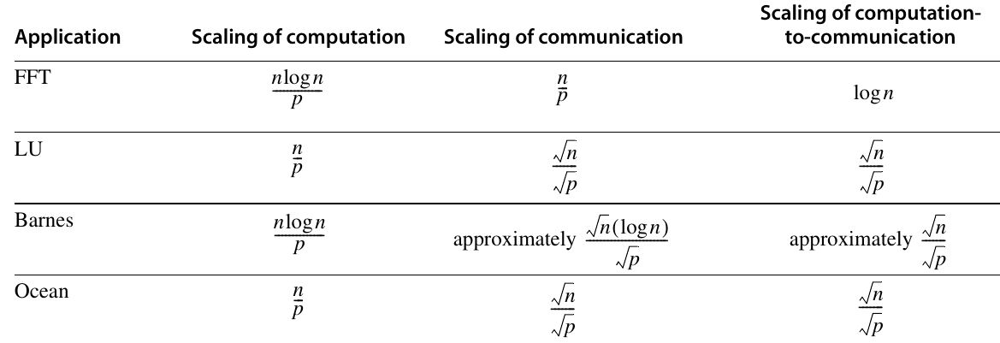

**Hình I.1 Quy luật thay đổi của computation, communication và tỉ lệ giữa chúng là những yếu tố then chốt quyết định performance trên các parallel multiprocessor. Trong bảng này, p là processor count được tăng lên và n là dataset size được tăng lên. Quy luật thay đổi được tính trên cơ sở per-processor. Computation tăng theo n với tốc độ do phân tích O( ) xác định và giảm tuyến tính khi p tăng. Quy luật thay đổi của communication phức tạp hơn. Trong FFT, mọi data point phải tương tác với nhau nên communication tăng theo n và giảm theo p. Trong LU và Ocean, communication tỉ lệ với biên của một block, nên tăng theo dataset size với tốc độ tỉ lệ với cạnh của một hình vuông gồm n điểm, tức √n ; vì cùng lý do, communication trong hai ứng dụng này giảm tỉ lệ nghịch với √p . Barnes có những đặc điểm thay đổi phức tạp nhất. Do sự fall-off của tương tác giữa các vật thể, số tương tác cơ bản giữa các vật thể đòi hỏi communication tăng theo √n . Cần thêm hệ số log n để duy trì các quan hệ giữa vật thể. Khi processor count tăng, communication giảm tỉ lệ nghịch với √p .**

Tỉ lệ computation-to-communication tổng thể được tính từ tốc độ tăng riêng của computation và communication. Nhìn chung, tỉ lệ này tăng chậm khi dataset size tăng và giảm khi bổ sung processor. Điều đó nhắc chúng ta rằng giải một bài toán fixed-size bằng nhiều processor hơn dẫn đến sự kém hiệu quả ngày càng lớn, vì lượng communication giữa các processor tăng lên. Nó cũng cho biết phải tăng dataset size nhanh đến mức nào khi bổ sung processor để giữ nguyên tỉ phần thời gian dành cho communication. Ví dụ sau minh họa những trade-offs này.

**Ví dụ** Giả sử chúng ta biết rằng trên một multiprocessor cho trước, ứng dụng Ocean dành 20% execution time để chờ communication khi chạy trên bốn processor. Giả sử chi phí của mỗi communication event không phụ thuộc processor count; điều này nhìn chung không đúng vì communication cost tăng theo processor count. Với cùng problem size, chúng ta có thể kỳ vọng Ocean chạy nhanh hơn bao nhiêu trên một máy 32-processor? Trong trường hợp này, tỉ phần execution time dành cho communication là bao nhiêu? Chúng ta cần chạy một bài toán lớn hơn bao nhiêu nếu muốn giữ nguyên tỉ phần thời gian dành cho communication?

**Trả lời** Tỉ lệ computation-to-communication của Ocean là √n ⁄<sub>√p</sub>, nên nếu problem size giữ nguyên, communication frequency tăng theo √p . Điều này có nghĩa là communication time tăng theo √8 . Chúng ta có thể dùng một biến thể của định luật Amdahl, lưu ý rằng computation giảm nhưng communication time tăng. Nếu T<sub>4</sub> là tổng execution time của bốn processor, thì execution time của 32 processor là

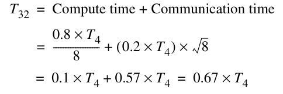

Do đó, speedup là

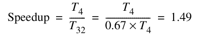

và tỉ phần thời gian dành cho communication tăng từ 20% lên 0.57/0.67 = 85%.

Để giữ nguyên tỉ phần communication time, chúng ta phải giữ nguyên tỉ lệ computation-to-communication, nên problem size phải tăng cùng tốc độ với processor count. Lưu ý rằng vì đã thay đổi problem size, chúng ta không thể so sánh một cách công bằng speedup của bài toán ban đầu với bài toán được tăng quy mô. Chúng ta sẽ quay lại vấn đề then chốt về việc tăng quy mô ứng dụng cho multiprocessor trong Mục I.6.

## I.4 Synchronization: Mở rộng quy mô

Trong mục này, trước hết chúng ta tập trung vào những vấn đề synchronization performance trong các multiprocessor lớn hơn, sau đó xem xét những giải pháp cho các vấn đề đó.

### Những thách thức về Synchronization Performance

Để hiểu vì sao cơ chế spin lock đơn giản được trình bày trong Chương 5 không mở rộng quy mô tốt, hãy hình dung một multiprocessor lớn mà mọi processor đều tranh chấp cùng một lock. Directory hoặc bus đóng vai trò điểm tuần tự hóa cho tất cả processor, dẫn đến nhiều contention cũng như traffic. Ví dụ sau cho thấy tình hình có thể tệ đến mức nào.

**Ví dụ** Giả sử có 10 processor trên một bus và mỗi processor đều cố khóa một variable cùng lúc. Giả sử mỗi bus transaction (read miss hoặc write miss) kéo dài 100 clock cycle. Có thể bỏ qua thời gian thực sự đọc hoặc ghi một lock nằm trong cache, cũng như thời gian giữ lock (chúng không ảnh hưởng nhiều!). Hãy xác định số bus transaction cần thiết để cả 10 processor đều lấy được lock, giả sử tất cả đều đang spin khi lock được giải phóng tại thời điểm 0. Việc xử lý 10 request sẽ mất khoảng bao lâu? Giả sử bus hoàn toàn công bằng, nên mỗi request đang chờ đều được phục vụ trước một request mới, và các processor có tốc độ bằng nhau.

**Trả lời** Khi i process đang tranh chấp lock, chúng thực hiện chuỗi hành động sau, mỗi hành động tạo ra một bus transaction:

i operation load linked để truy cập lock

i operation store conditional để cố lấy lock

1 store (để giải phóng lock)

Vì vậy, với i process, có tổng cộng 2i + 1 bus transaction. Lưu ý rằng điều này giả định thời gian trong critical section không đáng kể, nên lock được giải phóng trước khi bất kỳ processor nào khác có store conditional thất bại thử thực hiện một load linked khác.

Vì vậy, với n process, tổng số bus operation là

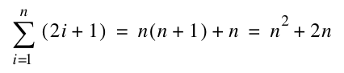

Với 10 process, có 120 bus transaction, cần 12,000 clock cycle hay 120 clock cycle cho mỗi lần lấy lock!

Khó khăn trong ví dụ này xuất phát từ contention đối với lock, việc tuần tự hóa lock access, cũng như latency của bus access. (Tính công bằng của bus thực ra làm tình hình tệ hơn vì trì hoãn processor đã lấy được lock trong việc giải phóng nó; đáng tiếc, mọi cơ chế bus arbitration đều tồn tại một tình huống worst-case nào đó.) Những ưu điểm then chốt của spin lock — overhead thấp tính theo bus cycle hoặc network cycle và performance tốt khi lock được cùng một processor tái sử dụng — đều bị mất trong ví dụ này. Chúng ta sẽ xem xét những implementation khác ở mục tiếp theo, nhưng trước đó, hãy xem việc sử dụng spin lock để triển khai một high-level synchronization primitive phổ biến khác.

#### Barrier Synchronization

Một synchronization operation phổ biến khác trong chương trình có parallel loop là barrier. Barrier buộc mọi process chờ cho đến khi tất cả process đến barrier, sau đó giải phóng tất cả. Có thể triển khai barrier theo cách điển hình bằng hai spin lock: một lock bảo vệ counter đếm các process đến barrier, còn lock kia giữ các process lại cho đến khi process cuối cùng đến barrier. Để triển khai barrier, chúng ta thường dùng khả năng spin trên một variable cho đến khi nó thỏa một phép kiểm tra; ký hiệu spin(condition) biểu thị điều này. Hình I.2 là một implementation điển hình, với giả định lock và unlock cung cấp spin lock cơ bản, còn total là số process phải đến barrier.

```
lock (counterlock);/* ensure update atomic */
if (count==0) release=0;/* first=>reset release */
count = count + 1;/* count arrivals */
unlock(counterlock);/* release lock */
if (count==total) {/* all arrived */
       count=0;/* reset counter */
       release=1;/* release processes */
}
else {/* more to come */

       spin (release==1);/* wait for arrivals */
}
```

**Hình I.2 Code cho một barrier đơn giản. Lock counterlock bảo vệ counter để có thể tăng counter một cách atomic. Variable count theo dõi số process đã đến barrier. Variable release được dùng để giữ các process lại cho đến khi process cuối cùng đến barrier. Operation spin (release==1) khiến một process chờ cho đến khi mọi process đều đến barrier.**

Trong thực tế, một yếu tố khác khiến implementation của barrier phức tạp hơn đôi chút. Barrier thường được dùng bên trong một loop, nên các process được giải phóng sẽ thực hiện một số công việc rồi lại đến barrier. Giả sử một process thực tế chưa từng rời barrier (nó vẫn ở operation spin), điều có thể xảy ra nếu OS schedule một process khác chẳng hạn. Lúc này, một process có thể chạy vượt lên và lại đến barrier trước khi process cuối cùng rời đi. Process “nhanh” khi đó giữ process “chậm” còn lại mắc kẹt trong barrier bằng cách reset flag release. Mọi process sẽ chờ vô hạn ở lần sử dụng barrier tiếp theo vì một process còn mắc kẹt ở lần trước, nên số process không bao giờ đạt giá trị total.

Điểm quan trọng trong ví dụ này là người lập trình không làm gì sai. Thay vào đó, người triển khai barrier đã đưa ra một số giả định về forward progress mà không được phép giả định. Một giải pháp rõ ràng là đếm các process khi chúng rời barrier (giống như khi đi vào) và không cho bất kỳ process nào đi vào lại cũng như khởi tạo lại barrier cho đến khi mọi process đã rời lần sử dụng barrier trước. Bước bổ sung này sẽ làm tăng đáng kể latency và contention của barrier, vốn đã lớn như chúng ta sắp thấy. Một giải pháp khác là barrier sense-reversing, sử dụng một variable private per-process là local_sense, được khởi tạo bằng 1 cho mỗi process. Hình I.3 trình bày code cho barrier sense-reversing. Phiên bản này có thể được sử dụng an toàn; tuy nhiên, như ví dụ tiếp theo cho thấy, performance của nó vẫn có thể khá kém.

```
local_sense =! local_sense; /* toggle local_sense */
lock (counterlock);/* ensure update atomic */
count=count+1;/* count arrivals */
if (count==total) {/* all arrived */
       count=0;/* reset counter */
       release=local_sense;/* release processes */
}
unlock (counterlock);/* unlock */
spin (release==local_sense);/* wait for signal */
}
```

**Hình I.3 Code cho một barrier sense-reversing. Chìa khóa để barrier có thể tái sử dụng là sử dụng các giá trị luân phiên cho flag release, vốn điều khiển việc rời barrier. Nếu một process chạy vượt lên đến lần sử dụng barrier tiếp theo trong khi một số process khác vẫn còn trong barrier, process nhanh không thể giữ những process kia mắc kẹt, vì nó không reset giá trị release như trong Hình I.2.**

**Ví dụ** Giả sử có 10 processor trên một bus và mỗi processor cố thực thi một barrier cùng lúc. Như trước, giả sử mỗi bus transaction dài 100 clock cycle. Có thể bỏ qua thời gian thực sự đọc hoặc ghi một lock nằm trong cache, cũng như thời gian thực thi những operation không thuộc synchronization khác trong implementation của barrier. Hãy xác định số bus transaction cần thiết để cả 10 processor đến barrier, được giải phóng khỏi barrier và rời barrier. Giả sử bus hoàn toàn công bằng, nên mỗi request đang chờ đều được phục vụ trước một request mới, và các processor có tốc độ bằng nhau. Không cần quan tâm đến việc đếm các processor khi rời barrier. Toàn bộ quá trình sẽ mất bao lâu?

**Trả lời** Chúng ta giả sử load linked và store conditional được dùng để triển khai lock và unlock. Hình I.4 trình bày chuỗi bus event cho một processor đi qua barrier, với giả định process đầu tiên lấy được bus chưa có lock. Có một khác biệt nhỏ đối với process cuối cùng đến barrier, như được mô tả trong chú thích.

Với process thứ i, số bus transaction là 3i + 4. Process cuối cùng đến barrier cần ít hơn một transaction. Vì vậy, với n process, số bus transaction là

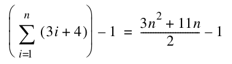

Với 10 process, con số này là 204 bus cycle hay 20,400 clock cycle! Barrier operation của chúng ta mất thời gian gần gấp đôi chuỗi lock-unlock trên 10-processor.

| Event | Số lần đối với process i | Dòng source tương ứng | Giải thích |
|---|---|---|---|
| LL counterlock | i | lock (counterlock); | Mọi process đều cố lấy lock. |
| Store conditional | i | lock (counterlock); | Mọi process đều cố lấy lock. |
| LD count | 1 | count = count + 1; | Process thành công. |
| Load linked | i – 1 | lock (counterlock); | Process không thành công; thử lại. |
| SD count | 1 | count = count + 1; | Miss để lấy exclusive access. |
| SD counterlock | 1 | unlock(counterlock); | Miss để lấy lock. |
| LD release | 2 | spin (release==local_sense);/ | Đọc release: miss ban đầu và khi cuối cùng được ghi. |

**Hình I.4 Những hành động cần một bus transaction khi process thứ i đến barrier. Process cuối cùng đến barrier cần ít hơn một bus transaction vì lần đọc release của nó cho spin sẽ hit trong cache!**

Như có thể thấy từ các ví dụ này, synchronization performance có thể trở thành bottleneck thực sự khi nhiều process tranh chấp đáng kể. Khi contention thấp và các synchronization operation không thường xuyên, chúng ta chủ yếu quan tâm đến latency của một synchronization primitive — tức thời gian để một process riêng lẻ hoàn tất một synchronization operation. Spin lock operation cơ bản có thể thực hiện điều này trong hai bus cycle: một cycle để đọc lock ban đầu và một cycle để ghi nó. Có thể cải thiện xuống một bus cycle bằng nhiều phương pháp. Chẳng hạn, chúng ta có thể đơn giản spin trên operation swap. Nếu lock gần như luôn rảnh, cách này có thể tốt hơn; nhưng nếu lock không rảnh, nó dẫn đến nhiều bus traffic vì mỗi lần cố khóa variable đều tạo ra một bus cycle. Trong thực tế, latency của spin lock không hoàn toàn tệ như ví dụ này, vì write miss cho một data item đang có trong cache được xử lý như upgrade và rẻ hơn một read miss thực sự.

Vấn đề nghiêm trọng hơn trong những ví dụ này là việc tuần tự hóa nỗ lực hoàn tất synchronization của từng process. Sự tuần tự hóa là một vấn đề khi có contention vì làm tăng mạnh thời gian hoàn tất synchronization operation. Chẳng hạn, nếu thời gian hoàn tất cả 10 operation lock và unlock chỉ phụ thuộc vào latency trong trường hợp không contention, chúng ta sẽ cần 1000 thay vì 15,000 cycle để hoàn tất các synchronization operation. Tình huống barrier cũng tệ tương tự, và ở một số khía cạnh còn tệ hơn, vì rất có khả năng phát sinh contention. Việc sử dụng bus interconnect làm trầm trọng thêm các vấn đề, nhưng sự tuần tự hóa cũng có thể nghiêm trọng tương đương trong một multiprocessor directory-based, nơi latency sẽ lớn. Tiểu mục tiếp theo trình bày một số giải pháp hữu ích khi contention cao hoặc processor count lớn.

### Các cơ chế Synchronization cho Multiprocessor Larger-Scale

Chúng ta mong muốn các cơ chế synchronization có latency thấp khi không có contention và giảm thiểu sự tuần tự hóa khi contention đáng kể. Trước hết, chúng ta trình bày cách những implementation bằng software có thể cải thiện performance của lock và barrier khi contention cao; sau đó khảo sát hai hardware primitive cơ bản giúp giảm sự tuần tự hóa trong khi vẫn giữ latency thấp.

#### Các Implementation bằng Software

Khó khăn chính của implementation spin lock là sự chậm trễ do contention khi nhiều process đang spin trên lock. Một giải pháp là chủ động trì hoãn các process khi chúng không lấy được lock. Performance tốt nhất đạt được bằng cách tăng thời gian trì hoãn theo cấp số nhân mỗi khi nỗ lực lấy lock thất bại. Hình I.5 cho thấy cách triển khai spin lock với exponential back-off. Exponential back-off là kỹ thuật phổ biến để giảm contention trong các shared resource, bao gồm access đến shared network và bus (xem Mục F.4 đến F.8). Implementation này vẫn cố giữ latency thấp khi contention nhỏ bằng cách không trì hoãn spin loop ban đầu. Vì vậy, nếu có nhiều process đang chờ, back-off không ảnh hưởng đến lần đầu chúng cố lấy lock. Chúng ta cũng có thể trì hoãn process đó, nhưng kết quả sẽ là performance kém hơn khi chỉ có hai process sử dụng lock và process đầu tiên tình cờ thấy lock đang bị giữ.

```
           DADDUI    R3,R0,#1     ;R3 = initial delay
lockit:    LL        R2,0(R1)     ;load linked
           BNEZ      R2,lockit    ;not available-spin
           DADDUI    R2,R2,#1     ;get locked value
           SC        R2,0(R1)     ;store conditional
           BNEZ      R2,gotit     ;branch if store succeeds
           DSLL      R3,R3,#1     ;increase delay by factor of 2
           PAUSE     R3           ;delays by value in R3
           J         lockit
gotit:     use data protected by lock
```

**Hình I.5 Một spin lock với exponential back-off. Khi store conditional thất bại, process tự trì hoãn một khoảng bằng giá trị trong R3. Có thể triển khai sự trì hoãn bằng cách giảm một bản sao của giá trị trong R3 cho đến khi nó đạt 0. Khoảng thời gian chính xác phụ thuộc multiprocessor, nhưng nên bắt đầu với một giá trị xấp xỉ thời gian thực hiện critical section và giải phóng lock. Câu lệnh pause R3 cần tạo một khoảng trì hoãn bằng R3 đơn vị thời gian này. Giá trị trong R3 được tăng gấp 2 mỗi khi store conditional thất bại, khiến process chờ lâu gấp đôi trước khi thử lấy lock lần nữa. Những khác biệt nhỏ trong tốc độ thực thi instruction của các processor đang tranh chấp thường đủ để bảo đảm các process không liên tục va chạm. Nếu biến thiên tự nhiên của execution time chưa đủ, có thể khởi tạo R3 bằng một giá trị ngẫu nhiên nhỏ, làm tăng độ biến thiên giữa các khoảng trì hoãn liên tiếp và giảm xác suất va chạm liên tiếp.**

Một kỹ thuật khác để triển khai lock là dùng queuing lock. Queuing lock hoạt động bằng cách xây dựng một queue chứa các processor đang chờ; mỗi khi một processor giải phóng lock, nó khiến processor tiếp theo trong queue thử truy cập. Cách này loại bỏ contention đối với lock khi lock được giải phóng. Trong mục tiếp theo, chúng ta trình bày hoạt động của queuing lock bằng một implementation hardware, nhưng implementation software sử dụng array cũng có thể đạt phần lớn những lợi ích tương tự. Trước khi xem hardware primitive, chúng ta hãy xem một cơ chế tốt hơn cho barrier.

Implementation barrier của chúng ta chịu contention cả ở gather stage, khi phải cập nhật count một cách atomic, lẫn release stage, khi mọi process phải đọc release flag. Trường hợp đầu nghiêm trọng hơn vì yêu cầu exclusive access đến synchronization variable, nên tạo ra nhiều sự tuần tự hóa hơn; ngược lại, trường hợp sau chỉ tạo read contention. Chúng ta có thể giảm contention bằng combining tree, một cấu trúc trong đó nhiều request được kết hợp cục bộ theo dạng tree. Cùng combining tree có thể được sử dụng để triển khai quá trình release, làm giảm contention ở giai đoạn đó.

Barrier combining tree của chúng ta dùng một cấu trúc n-ary tree được xác định trước. Variable k biểu thị fan-in; trong thực tế, k = 4 dường như hoạt động tốt. Khi process thứ k đến một node trong tree, chúng ta phát tín hiệu lên mức tiếp theo của tree. Khi một process đến root, chúng ta giải phóng mọi process đang chờ. Như trong ví dụ trước, chúng ta dùng kỹ thuật sense-reversing. Một barrier tree-based như Hình I.6 sử dụng tree để kết hợp các process và một tín hiệu duy nhất để giải phóng barrier. Một số MPP (chẳng hạn T3D và CM-5) cũng đã có hỗ trợ hardware cho barrier, nhưng những máy gần đây hơn dựa vào software library để cung cấp sự hỗ trợ này.

#### Hardware Primitive

Trong tiểu mục này, chúng ta xem xét hai hardware synchronization primitive. Primitive đầu tiên xử lý lock, còn primitive thứ hai hữu ích cho barrier và một số operation user-level khác đòi hỏi đếm hoặc cung cấp những index riêng biệt. Trong cả hai trường hợp, chúng ta có thể tạo một hardware primitive có latency về cơ bản giống phiên bản trước, nhưng ít tuần tự hóa hơn nhiều, nhờ đó mở rộng quy mô tốt hơn khi có contention.

Vấn đề chính của implementation lock ban đầu là nó tạo ra một lượng lớn contention không cần thiết. Chẳng hạn, khi lock được giải phóng, mọi processor đều tạo cả read miss lẫn write miss, dù nhiều nhất chỉ một processor có thể lấy thành công lock ở trạng thái unlocked. Chuỗi này xảy ra trong mỗi chuỗi của 10 lần lock/unlock, như đã thấy trong ví dụ ở trang I-12.

Chúng ta có thể cải thiện tình hình bằng cách chuyển tường minh lock từ một processor đang chờ sang processor tiếp theo. Thay vì chỉ cho phép mọi processor tranh chấp mỗi lần lock được giải phóng, chúng ta giữ một danh sách processor đang chờ và chuyển lock tường minh cho một processor khi đến lượt nó. Cơ chế này được gọi là queuing lock. Queuing lock có thể được triển khai bằng hardware như mô tả ở đây, hoặc bằng software sử dụng array để theo dõi các process đang chờ. Các khái niệm cơ bản giống nhau trong cả hai trường hợp. Implementation hardware của chúng ta giả định một multiprocessor directory-based trong đó cache của từng processor có thể được định địa chỉ. Trong một multiprocessor bus-based, implementation software thích hợp hơn; mỗi processor sẽ dùng một address khác nhau cho lock, cho phép chuyển tường minh lock từ process này sang process khác.

```
struct node{/* a node in the combining tree */
       int counterlock; /* lock for this node */
       int count; /* counter for this node */
       int parent; /* parent in the tree = 0..P-1 except for root */
};
struct node tree [0..P–1]; /* the tree of nodes */
int local_sense; /* private per processor */
int release; /* global release flag */

/* function to implement barrier */
barrier (int mynode, int local_sense) {
       lock (tree[mynode].counterlock); /* protect count */
       tree[mynode].count=tree[mynode].count+1;
              /* increment count */
       if (tree[mynode].count==k) {/* all arrived at mynode */
              if (tree[mynode].parent >=0) {
                     barrier(tree[mynode].parent);
              } else{
                     release = local_sense;
              };
              tree[mynode].count = 0; /* reset for the next time */
       unlock (tree[mynode].counterlock); /* unlock */
       spin (release==local_sense); /* wait */
};
/* code executed by a processor to join barrier */
local_sense =! local_sense;
barrier (mynode);
```

**Hình I.6 Một implementation của barrier tree-based làm giảm contention đáng kể. Tree được giả định là đã được xây dựng tĩnh trước bằng các node trong array tree. Mỗi node trong tree kết hợp k process và cung cấp counter cùng lock riêng, nên nhiều nhất k process tranh chấp tại mỗi node. Khi process thứ k đến một node trong tree, nó đi lên parent và tăng count tại parent. Khi count trong parent node đạt k, release flag được đặt. Count của mỗi node được reset bởi process đến cuối cùng. Sense-reversing được dùng để tránh race như trong barrier đơn giản. Giá trị tree[root].parent cần được đặt thành –1 khi tree được xây dựng ban đầu.**

Queuing lock hoạt động như thế nào? Ở miss đầu tiên đến lock variable, miss được gửi đến synchronization controller, có thể được tích hợp với memory controller (trong hệ thống bus-based) hoặc directory controller. Nếu lock rảnh, nó chỉ được trả về processor. Nếu lock chưa khả dụng, controller tạo một bản ghi request của node (chẳng hạn một bit trong vector) và gửi lại processor một giá trị locked cho variable, để processor spin trên giá trị đó. Khi lock được giải phóng, controller chọn một processor tiếp tục từ danh sách processor đang chờ. Sau đó, nó có thể cập nhật lock variable trong cache của processor được chọn hoặc invalidate bản sao, khiến processor miss và fetch một bản sao khả dụng của lock.

**Ví dụ** Cần bao nhiêu bus transaction và bao lâu để 10 processor lock và unlock variable bằng một queuing lock cập nhật lock khi có miss? Giữ nguyên các giả định khác về hệ thống như trong ví dụ trước ở trang I-12.

**Trả lời** Với n processor, ban đầu mỗi processor thử truy cập lock và tạo một bus transaction; một processor thành công rồi giải phóng lock, nên tổng cộng có n + 1 transaction cho processor đầu tiên. Mỗi processor tiếp theo cần hai bus transaction, một để nhận lock và một để giải phóng nó. Vì vậy, tổng số bus transaction là (n + 1) + 2(n – 1) = 3n – 1. Lưu ý rằng số bus transaction giờ là tuyến tính theo số processor tranh chấp lock, thay vì bậc hai như spin lock đã khảo sát trước đó. Với 10 processor, cần 29 bus cycle hay 2900 clock cycle.

Có một vài điểm then chốt khi triển khai khả năng queuing lock như vậy. Thứ nhất, chúng ta cần phân biệt access ban đầu đến lock để thực hiện operation đưa vào queue, đồng thời phân biệt việc giải phóng lock để cung cấp lock cho processor khác. Queue chứa các process đang chờ có thể được triển khai bằng nhiều cơ chế. Trong multiprocessor directory-based, queue này tương tự sharing set, và có thể dùng hardware tương tự để triển khai các operation của directory và queuing lock. Một điểm phức tạp là hardware phải sẵn sàng thu hồi những lock như vậy, vì process yêu cầu lock có thể đã bị context-switched và thậm chí không được schedule trở lại trên cùng processor.

Có thể dùng queuing lock để cải thiện performance của barrier operation. Một cách khác là đưa vào primitive giúp giảm thời gian cần để tăng barrier count, qua đó giảm sự tuần tự hóa tại bottleneck này và có thể mang lại performance tương đương việc dùng queuing lock. Một primitive đã được đưa ra cho mục đích này và để xây dựng các synchronization operation khác là fetch-and-increment, vốn fetch một variable và tăng giá trị của nó một cách atomic. Giá trị trả về có thể là giá trị đã tăng hoặc giá trị đã fetch. Bằng fetch-and-increment, chúng ta có thể cải thiện đáng kể implementation barrier so với barrier code-sensing đơn giản.

**Ví dụ** Hãy viết code cho barrier bằng fetch-and-increment. Với các giả định giống ví dụ trước, đồng thời giả sử một operation fetch-and-increment trả về giá trị đã tăng mất 100 clock cycle, hãy xác định thời gian để 10 processor đi qua barrier. Cần bao nhiêu bus cycle?

```
local_sense =! local_sense; /* toggle local_sense */
fetch_and_increment(count);/* atomic update */
if (count==total) {/* all arrived */
       count=0;/* reset counter */
       release=local_sense;/* release processes */
}
else {/* more to come */
       spin (release==local_sense);/* wait for signal */
}
```

**Hình I.7 Code cho một barrier sense-reversing sử dụng fetch-and-increment để đếm.**

**Trả lời** Hình I.7 trình bày code cho barrier. Với n processor, implementation này cần n operation fetch-and-increment, n cache miss để truy cập count và n cache miss cho release operation, tổng cộng 3n bus transaction. Với 10 processor, cần 30 bus transaction hay 3000 clock cycle. Giống queuing lock, thời gian tuyến tính theo số processor. Dĩ nhiên, fetch-and-increment cũng có thể được dùng để triển khai barrier combining tree, làm giảm sự tuần tự hóa tại mỗi node trong tree.

Như đã thấy, các vấn đề synchronization có thể trở nên rất nghiêm trọng trong multiprocessor larger-scale. Khi kết hợp những thách thức do synchronization với những thách thức do memory latency dài và khả năng load imbalance trong tính toán, chúng ta có thể hiểu vì sao sử dụng hiệu quả các parallel processor large-scale là điều rất khó.

## I.5 Performance của các ứng dụng khoa học trên Multiprocessor Shared-Memory

Mục này trình bày performance của các ứng dụng khoa học từ Mục I.3 trên cả symmetric shared-memory multiprocessor và distributed shared-memory multiprocessor.

### Performance của một Scientific Workload trên Symmetric Shared-Memory Multiprocessor

Chúng ta đánh giá performance của bốn ứng dụng khoa học trên một symmetric shared-memory multiprocessor bằng những problem size sau:

- Barnes-Hut — 16K vật thể chạy qua sáu time step (accuracy control được đặt thành 1.0, một giá trị điển hình và thực tế)

- FFT — 1 triệu data point số phức

- LU — Sử dụng một matrix 512 × 512 với các block 16 × 16

- Ocean — Một lưới 130 × 130 với mức sai số cho phép điển hình

Khi xem xét miss rate theo những thay đổi của processor count, cache size và block size, chúng ta phân tách tổng miss rate thành coherence miss và uniprocessor miss thông thường. Uniprocessor miss thông thường gồm capacity miss, conflict miss và compulsory miss. Chúng ta gọi những miss này là capacity miss vì đó là nguyên nhân chiếm ưu thế đối với các benchmark này. Trong các phép đo, mọi write miss cần để upgrade block từ shared sang exclusive đều được tính là coherence miss, ngay cả khi không có ai chia sẻ cache block. Cách đo này phản ánh một protocol không phân biệt cache block private với shared.

Hình I.8 cho thấy data miss rate của bốn ứng dụng khi tăng số processor từ 1 lên 16 trong khi giữ nguyên problem size. Khi tăng số processor, tổng lượng cache tăng, thường làm giảm capacity miss. Ngược lại, tăng processor count thường làm tăng lượng communication, từ đó làm tăng coherence miss. Mức độ của hai tác động này khác nhau tùy ứng dụng.

Trong FFT, capacity miss rate giảm (từ gần 7% xuống chỉ hơn 5%) nhưng coherence miss rate tăng (từ khoảng 1% lên khoảng 2.7%), nên tổng miss rate giữ nguyên. Ocean thể hiện một sự kết hợp các tác động, trong đó có những tác động liên quan đến cách phân chia lưới và cách biên lưới được ánh xạ vào cache block. Với code lưới 2D điển hình, các miss communication-generated tỉ lệ với biên của từng phần lưới, còn capacity miss tỉ lệ với diện tích lưới. Vì vậy, việc tăng tổng lượng cache trong khi giữ nguyên tổng problem size sẽ có ảnh hưởng đáng kể hơn đến capacity miss rate, ít nhất cho đến khi mỗi subgrid vừa trong cache của một processor riêng lẻ. Bước nhảy đáng kể về miss rate từ một lên hai processor xảy ra do conflict phát sinh từ cách nhiều lưới được ánh xạ vào cache. Conflict này tồn tại trong cache direct-mapped và two-way set associative, nhưng giảm dần ở associativity cao hơn. Những conflict như vậy không hiếm trong ứng dụng array-based, đặc biệt khi nhiều lưới được sử dụng cùng lúc. Trong Barnes và LU, việc tăng processor count ít ảnh hưởng đến miss rate, đôi khi làm tăng nhẹ và đôi khi làm giảm nhẹ.

Việc tăng cache size thường có lợi cho performance vì giảm tần suất cache miss tốn kém. Hình I.9 minh họa sự thay đổi của miss rate khi tăng cache size cho 16 processor, chỉ ra phần miss rate do coherence miss và do uniprocessor capacity miss. Có hai tác động khiến miss rate không giảm — ít nhất không nhanh như mong đợi — khi cache size tăng: communication vốn có và những khoảng chững của miss rate. Communication vốn có dẫn đến một tần suất coherence miss nhất định không bị ảnh hưởng đáng kể bởi việc tăng cache size. Vì vậy, nếu tăng cache size trong khi giữ nguyên problem size, cuối cùng coherence miss rate sẽ giới hạn mức giảm cache miss rate. Tác động này rõ ràng nhất ở Barnes, nơi coherence miss rate về cơ bản trở thành toàn bộ miss rate.

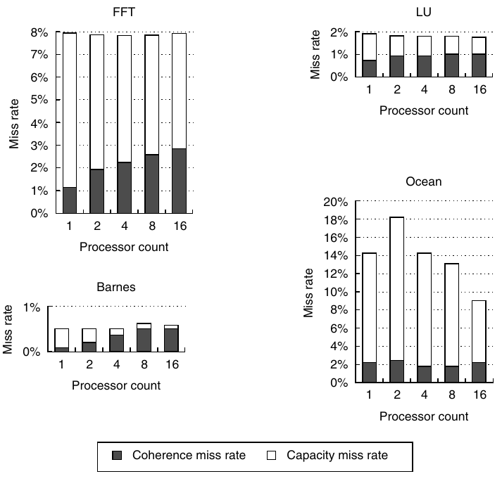

**Hình I.8 Data miss rate có thể thay đổi theo những cách không hiển nhiên khi processor count tăng từ 1 lên 16. Miss rate bao gồm cả coherence miss rate lẫn capacity miss rate. Compulsory miss trong các benchmark này đều rất nhỏ và được tính vào capacity miss. Phần lớn miss trong các ứng dụng này được tạo bởi access đến data có khả năng được chia sẻ, mặc dù trong những ứng dụng có miss rate lớn hơn (FFT và Ocean), capacity miss mới chiếm phần lớn miss rate, thay vì coherence miss. Data có khả năng được chia sẻ nếu được cấp phát trong phần address space dùng cho shared data. Trong mọi ứng dụng trừ Ocean, data có khả năng được chia sẻ được chia sẻ nhiều; còn trong Ocean, chỉ biên subgrid thực sự được chia sẻ, dù toàn bộ lưới được xem là một data object có khả năng được chia sẻ. Dĩ nhiên, vì biên thay đổi khi tăng processor count (cho bài toán fixed-size), lượng lưới được chia sẻ cũng khác nhau. Sự tăng bất thường của capacity miss rate trong Ocean khi chuyển từ 1 lên 2 processor phát sinh từ conflict miss khi truy cập subgrid. Trong mọi trường hợp trừ Ocean, tỉ phần cache miss do coherence transaction tăng khi chạy một bài toán fixed-size trên số processor ngày càng lớn. Trong Ocean, coherence miss ban đầu giảm khi bổ sung processor do có nhiều write ownership miss đến data có khả năng được chia sẻ nhưng thực tế không được chia sẻ. Khi các subgrid bắt đầu vừa trong tổng cache (khoảng 16 processor), tác động này giảm. Các con số single-processor bao gồm write upgrade miss, vốn xảy ra trong protocol này ngay cả khi data thực tế không được chia sẻ, vì chúng ở trạng thái shared. Trong mọi lần chạy này, cache size là 64 KB, two-way set associative, với block 32-byte. Lưu ý rằng thang đo trên y-axis của từng benchmark khác nhau để thấy rõ hành vi của từng benchmark.**

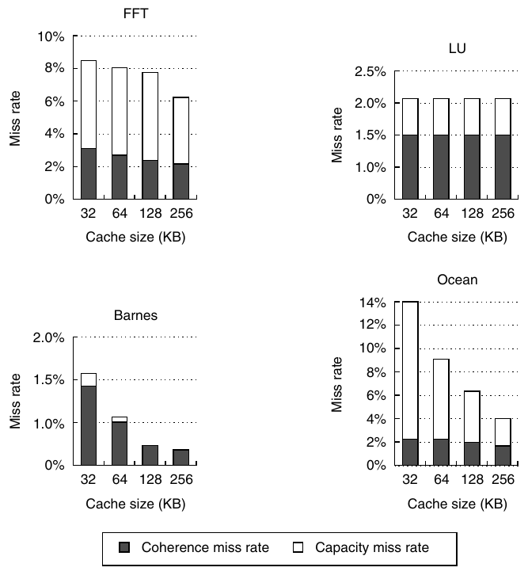

**Hình I.9 Miss rate thường giảm khi cache size tăng, mặc dù coherence miss làm giảm mức độ của tác động này. Block size là 32 byte và cache là two-way set associative. Processor count được giữ cố định ở 16 processor. Lưu ý rằng thang đo của từng đồ thị khác nhau.**

Một tác động ít quan trọng hơn là khoảng chững tạm thời của capacity miss rate, xuất hiện khi ứng dụng có một phần data trong cache nhưng một phần đáng kể của dataset không vừa trong cache hoặc trong những cache lớn hơn đôi chút. Trong LU, cache rất nhỏ (khoảng 4 KB) có thể chứa cặp block 16 × 16 được dùng trong inner loop; ngoài mức đó, sự cải thiện lớn tiếp theo về capacity miss rate xảy ra khi cả hai matrix vừa trong các cache, tức khi tổng cache size nằm giữa 4 MB và 8 MB. Tác động này, đôi khi được gọi là working set effect, cũng góp phần tạo ra hành vi giữa 32 KB và 128 KB của FFT, nơi capacity miss rate chỉ giảm 0.3%. Vượt quá cache size đó, capacity miss rate giảm nhanh hơn vì một data structure lớn bắt đầu nằm trong cache. Các khoảng chững như vậy phổ biến trong chương trình xử lý array lớn theo cách có cấu trúc.

Tăng block size là một cách khác để thay đổi miss rate trong cache. Trong uniprocessor, block size lớn hơn thường tối ưu với cache lớn hơn. Trong multiprocessor, hai tác động mới xuất hiện: spatial locality của shared data giảm và miss rate có thể tăng do false sharing. Một số nghiên cứu cho thấy shared data có spatial locality thấp hơn unshared data. Locality kém hơn có nghĩa là với shared data, việc fetch block lớn hơn kém hiệu quả hơn trong uniprocessor vì xác suất block bị thay thế trước khi toàn bộ nội dung được tham chiếu cao hơn. Tương tự, tăng basic size cũng làm tăng tần suất false sharing tiềm tàng, từ đó tăng miss rate.

Hình I.10 trình bày miss rate khi tăng cache block size cho một lần chạy 16-processor với cache 64 KB. Hành vi đáng chú ý nhất nằm ở Barnes, nơi miss rate ban đầu giảm rồi tăng do số coherence miss tăng, có lẽ bởi false sharing. Trong các benchmark còn lại, tăng block size làm giảm tổng miss rate. Trong Ocean và LU, tăng block size ảnh hưởng gần như ngang nhau đến coherence miss rate và capacity miss rate. Trong FFT, coherence miss rate thực ra giảm nhanh hơn capacity miss rate. Sự giảm này xảy ra vì communication trong FFT được tổ chức rất hiệu quả. Với những chương trình ít được tối ưu hơn, chúng ta kỳ vọng nhiều false sharing hơn và ít spatial locality hơn cho shared data, dẫn đến hành vi giống Barnes hơn.

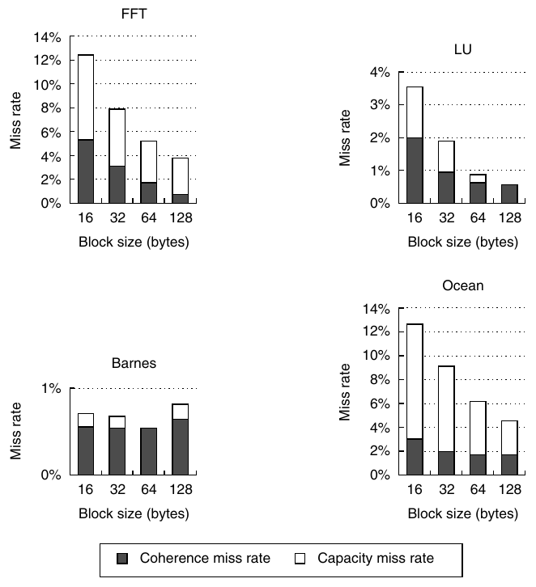

**Hình I.10 Data miss rate giảm khi cache block size tăng. Mọi kết quả này đều dành cho một lần chạy 16-processor với cache 64 KB và two-way set associativity. Một lần nữa, chúng ta dùng thang đo khác nhau cho từng benchmark.**

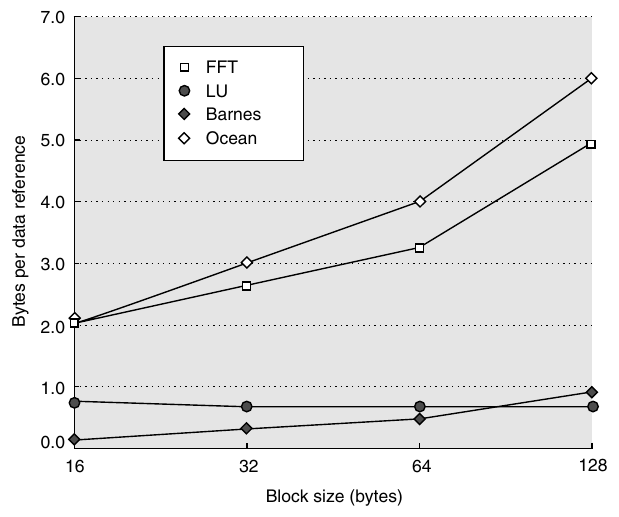

**Hình I.11 Bus traffic cho data miss tăng đều khi block size trong data cache tăng. Traffic tăng gấp 3 của Ocean là lập luận mạnh nhất chống lại block size lớn hơn. Nhớ rằng protocol của chúng ta xử lý ownership miss hay upgrade miss giống những miss khác, làm tăng nhẹ mức phạt cho cache block lớn; trong cả Ocean lẫn FFT, sự đơn giản hóa này chiếm dưới 10% traffic.**

Mặc dù miss rate giảm với block dài hơn có thể khiến bạn nghĩ chọn block size dài hơn là quyết định tốt nhất, bottleneck trong multiprocessor bus-based thường là bandwidth giới hạn của memory và bus. Block lớn hơn đồng nghĩa với nhiều byte trên bus hơn cho mỗi miss. Hình I.11 cho thấy bus traffic tăng khi block size tăng. Mức tăng này nghiêm trọng nhất trong những chương trình có miss rate cao, đặc biệt là Ocean. Traffic tăng thực ra có thể làm giảm performance do cả miss penalty dài hơn lẫn bus contention tăng.

### Performance của một Scientific Workload trên Distributed-Memory Multiprocessor

Performance của một multiprocessor directory-based phụ thuộc vào nhiều yếu tố giống những yếu tố ảnh hưởng đến multiprocessor bus-based (chẳng hạn cache size, processor count và block size), cũng như cách các miss phân bố đến các vị trí khác nhau trong memory hierarchy. Vị trí của data item được yêu cầu phụ thuộc cả allocation ban đầu lẫn sharing pattern. Chúng ta bắt đầu bằng việc xem xét cache performance cơ bản của workload khoa học/kỹ thuật, sau đó xem tác động của các loại miss khác nhau.

Vì multiprocessor lớn hơn và có latency dài hơn multiprocessor snooping-based trước đó, chúng ta bắt đầu với cache lớn hơn đôi chút (128 KB) và block size lớn hơn, bằng 64 byte.

Trong các architecture distributed-memory, sự phân bố memory request giữa local và remote là yếu tố then chốt đối với performance vì ảnh hưởng đến cả mức tiêu thụ global bandwidth lẫn latency mà request gặp phải. Vì vậy, trong các hình của mục này, chúng ta tách cache miss thành request local và remote. Khi xem các hình, cần nhớ rằng đối với những ứng dụng này, phần lớn remote miss phát sinh là coherence miss, mặc dù một số capacity miss cũng có thể là remote; trong những ứng dụng có data distribution kém, loại miss này có thể đáng kể.

Như Hình I.12 cho thấy, miss rate với những cache size này không chịu ảnh hưởng nhiều khi processor count thay đổi, ngoại trừ Ocean có miss rate tăng ở 64 processor. Sự tăng này do hai yếu tố: mapping conflict trong cache tăng khi lưới trở nên nhỏ, làm tăng local miss; và số coherence miss tăng, mà tất cả đều là remote.

Hình I.13 cho thấy miss rate thay đổi như thế nào khi tăng cache size, với giả định thực thi trên 64-processor và block 64-byte. Các miss rate này giảm ở tốc độ có thể kỳ vọng, dù tác động kìm hãm do coherence miss giảm ít hoặc không giảm khiến remote miss giảm chậm hơn local miss. Khi đạt cache size lớn nhất được trình bày là 512 KB, remote miss rate bằng hoặc lớn hơn local miss rate. Cache lớn hơn sẽ khuếch đại xu hướng này.

Chúng ta khảo sát tác động của việc thay đổi block size trong Hình I.14. Vì các ứng dụng này có spatial locality tốt, tăng block size làm giảm miss rate ngay cả với block lớn, mặc dù lợi ích performance khi chuyển sang những block lớn nhất là nhỏ. Hơn nữa, phần lớn sự cải thiện miss rate xuất phát từ việc giảm local miss.

Thay vì biểu diễn memory traffic, Hình I.15 biểu diễn số byte cần thiết cho mỗi data reference theo block size, đồng thời tách yêu cầu thành bandwidth local và global. Với bus, chúng ta chỉ cần cộng nhu cầu của từng processor để tìm tổng nhu cầu bus bandwidth và memory bandwidth. Với interconnect có khả năng mở rộng, có thể dùng data trong Hình I.15 để tính global bandwidth per-node cần thiết và ước lượng bisection bandwidth, như ví dụ tiếp theo cho thấy.

**Ví dụ** Giả sử một multiprocessor 64-processor có các processor 1 GHz duy trì một memory reference trên mỗi processor clock. Với block size 64-byte, remote miss rate là 0.7%. Hãy tìm bandwidth per-node và bisection bandwidth ước lượng cho FFT. Giả sử processor không stall vì remote memory request; điều này có thể đúng nếu chẳng hạn mọi remote data đều được prefetch. Những yêu cầu bandwidth này so với các công nghệ interconnection khác nhau như thế nào?

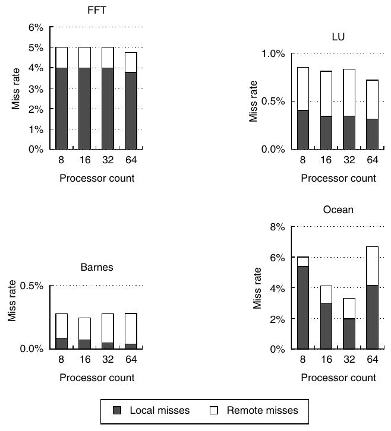

**Hình I.12 Data miss rate thường ổn định khi bổ sung processor cho những benchmark này. Do cấu trúc lưới, Ocean có miss rate ban đầu giảm rồi tăng khi có 64 processor. Với Ocean, local miss rate giảm từ 5% ở 8 processor xuống 2% ở 32, trước khi tăng lên 4% ở 64. Remote miss rate của Ocean, chủ yếu do communication quyết định, tăng đơn điệu từ 1% lên 2.5%. Lưu ý rằng để trình bày hành vi chi tiết của từng benchmark, các thang đo khác nhau được sử dụng trên y-axis. Cache cho mọi lần chạy này là 128 KB, two-way set associative, với block 64-byte. Remote miss bao gồm mọi miss đòi hỏi communication với node khác, dù để fetch data hay chuyển một invalidate. Cụ thể, trong hình này và những data khác ở mục này, phép đo remote miss bao gồm write upgrade miss khi data đã cập nhật trong local memory nhưng được cache ở nơi khác, vì vậy cần gửi invalidation. Những invalidation như vậy thực sự tạo remote traffic, nhưng có thể hoặc không trì hoãn write, tùy consistency model (xem Mục 5.6).**

FFT thực hiện communication all-to-all, nên bisection bandwidth bằng số processor nhân bandwidth per-node, tức khoảng 64 × 448 MB/sec = 28.7 GB/sec. SGI Origin 3000 với 64 processor có bisection bandwidth khoảng 50 GB/sec. Không công nghệ networking tiêu chuẩn nào đạt gần mức này.

**Trả lời** Bandwidth per-node đơn giản là số data byte trên mỗi reference nhân với reference rate: 0.7% × 1 GB/sec × 64 = 448 MB/sec. Tốc độ này cao hơn đôi chút sustainable transfer rate bằng hardware của CrayT3E (sử dụng block prefetch) và thấp hơn SGI Origin 3000 (1.6 GB/processor pair). Nhu cầu bandwidth per-node của FFT vượt quá bandwidth có thể duy trì của các network tiêu chuẩn nhanh nhất hơn 5 lần.

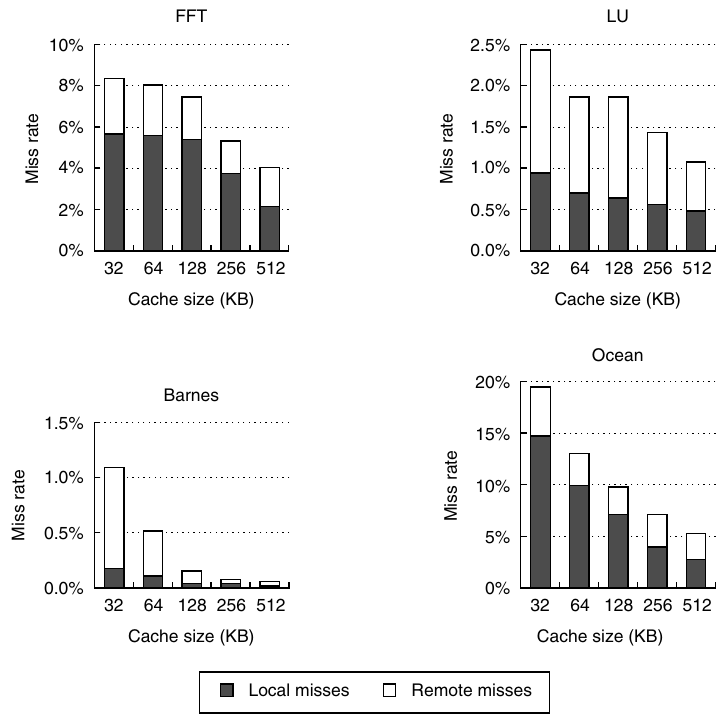

**Hình I.13 Miss rate giảm khi cache size tăng. Local miss rate giảm đều, trong khi remote miss rate giảm ở mức độ khác nhau tùy việc remote miss rate có thành phần capacity lớn hay chủ yếu do communication miss quyết định. Trong mọi trường hợp, local miss rate giảm nhiều hơn remote miss rate. Khoảng chững của miss rate trong FFT, được đề cập ở mục trước, kết thúc khi cache vượt 128 KB. Các lần chạy này sử dụng 64 processor và cache block 64-byte.**

Ví dụ trước xem xét nhu cầu bandwidth. Vấn đề then chốt còn lại cho một parallel program là remote memory access time, hay latency. Để hiểu rõ hơn, chúng ta dùng một ví dụ đơn giản về multiprocessor directory-based. Hình I.16 cho thấy các parameter được giả định cho multiprocessor model đơn giản. Model giả định thời gian đến word đầu tiên của local memory access là 85 processor cycle và path đến local memory rộng 16 byte, còn network interconnect rộng 4 byte. Model này bỏ qua tác động contention, vốn có lẽ không quá nghiêm trọng trong các parallel benchmark được khảo sát, ngoại trừ có thể là FFT sử dụng communication all-to-all. Contention có thể ảnh hưởng nghiêm trọng đến performance trong workload khác.

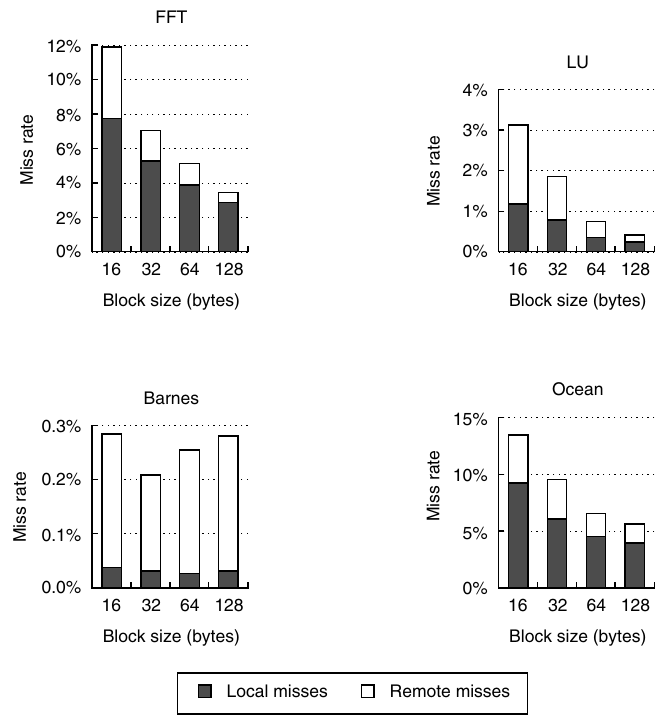

**Hình I.14 Data miss rate theo block size, với giả định cache 128 KB và tổng cộng 64 processor. Mặc dù khó thấy, coherence miss rate của Barnes thực ra tăng ở block size lớn nhất, giống mục trước.**

Hình I.17 trình bày chi phí tính bằng cycle cho memory reference trung bình, với các parameter trong Hình I.16. Chỉ latency của từng reference type được tính. Mỗi cột chỉ ra đóng góp của cache hit, local miss, remote miss và remote miss three-hop. Chi phí chịu ảnh hưởng của tổng tần suất cache miss và upgrade, cũng như sự phân bố vị trí nơi miss được đáp ứng. Chi phí cho remote memory reference khá ổn định khi processor count tăng, ngoại trừ Ocean. Miss rate tăng của Ocean ở 64 processor thể hiện rõ trong Hình I.12. Khi miss rate tăng, chúng ta cũng nên kỳ vọng thời gian dành cho memory reference tăng.

Mặc dù Hình I.17 trình bày memory access cost, vốn là multiprocessor cost chiếm ưu thế trong các benchmark này, một performance model đầy đủ còn cần xét tác động contention trong memory system cũng như những tổn thất phát sinh từ synchronization delay.

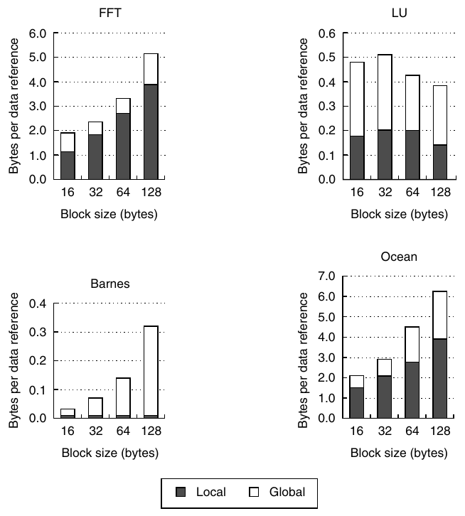

**Hình I.15 Số byte trên mỗi data reference tăng đều khi block size tăng. Có thể dùng những data này để xác định bandwidth cần thiết trên mỗi node, cả bên trong lẫn trên phạm vi global. Data giả định cache 128 KB cho mỗi processor trong tổng số 64 processor.**

| Đặc điểm | Processor clock cycle ≤16 processor | Processor clock cycle 17–64 processor |
|---|---|---|
| Cache hit | 1 | 1 |
| Cache miss đến local memory | 85 | 85 |
| Cache miss đến remote home directory | 125 | 150 |
| Cache miss đến data được cache từ xa (miss three-hop) | 140 | 170 |

**Hình I.16 Đặc điểm của multiprocessor directory-based trong ví dụ. Miss có thể được phục vụ cục bộ (bao gồm từ local directory), tại remote home node, hoặc bằng cách sử dụng cả home node và một remote node khác đang cache một exclusive copy. Trường hợp cuối được gọi là miss three-hop và có chi phí cao hơn vì cần truy vấn cả home directory lẫn remote cache. Lưu ý rằng model đơn giản này không tính invalidation time nhưng có bao gồm một hệ số cho interconnect time tăng lên. Những remote access latency này dựa trên SGI Origin 3000, hệ thống interconnect có khả năng mở rộng nhanh nhất năm 2001, và giả định processor 500 MHz.**

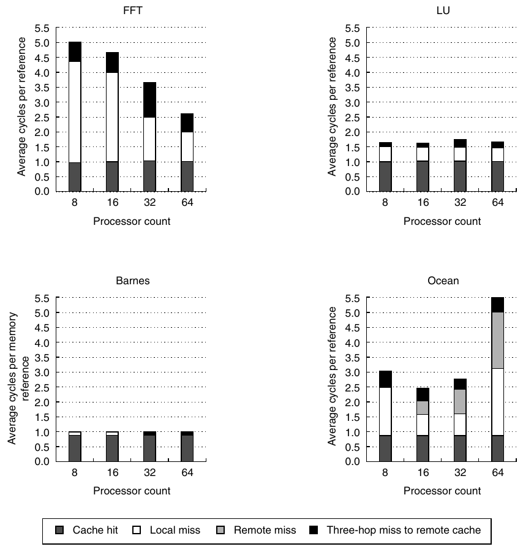

**Hình I.17 Effective latency của memory reference trong một DSM multiprocessor phụ thuộc cả tần suất tương đối của cache miss lẫn vị trí memory phục vụ access. Những đồ thị này trình bày memory access cost (thước đo được gọi là average memory access time trong Chương 2) cho từng benchmark với 8, 16, 32 và 64 processor, giả định data cache 512 KB, two-way set associative với block 64-byte. Average memory access cost được cấu thành từ bốn loại access khác nhau, với chi phí mỗi loại trong Hình I.16. Với benchmark Barnes và LU, miss rate thấp dẫn đến tổng access time thấp. Trong FFT, access cost cao hơn do local miss rate cao hơn (1–4%) và miss rate three-hop đáng kể (1%). Sự cải thiện của FFT xuất phát từ việc local miss rate giảm từ 4% xuống 1% khi tổng cache tăng. Ocean thể hiện thay đổi lớn nhất về memory access cost và có tổng chi phí cao nhất ở 64 processor. Chi phí cao chủ yếu do local miss rate cao (trung bình 1.6%). Memory access cost giảm từ 8 lên 16 processor vì các lưới dễ vừa trong từng cache hơn. Ở 64 processor, dataset size quá nhỏ để ánh xạ đúng, nên cả local miss lẫn coherence miss đều tăng, như đã thấy trong Hình I.12.**

## I.6 Đo lường Performance của Parallel Processor bằng ứng dụng khoa học

Một trong những vấn đề gây tranh luận nhiều nhất trong parallel processing là cách đo performance của parallel processor. Dĩ nhiên, câu trả lời trực tiếp là đo một benchmark đúng như được cung cấp và xem xét wall-clock time. Đo wall-clock time rõ ràng là hợp lý; trong parallel processor, đo CPU time có thể gây hiểu nhầm vì các processor có thể idle nhưng không sẵn sàng cho mục đích sử dụng khác.

Người dùng và người thiết kế thường muốn biết không chỉ multiprocessor hoạt động tốt đến đâu với một số processor cố định nhất định, mà còn performance thay đổi như thế nào khi bổ sung processor. Trong nhiều trường hợp, tăng quy mô ứng dụng hoặc benchmark là hợp lý, vì nếu benchmark không được tăng quy mô, những tác động do tính song song hạn chế và communication tăng có thể dẫn đến kết quả bi quan khi kỳ vọng rằng nhiều processor hơn sẽ được dùng để giải bài toán lớn hơn. Vì vậy, thường hữu ích khi đo speedup lúc bổ sung processor cho cả bài toán fixed-size lẫn phiên bản được tăng quy mô, cung cấp đường cong speedup không tăng quy mô và có tăng quy mô. Việc chọn cách đo uniprocessor algorithm cũng quan trọng để tránh kết quả bất thường, vì dùng phiên bản song song của benchmark có thể đánh giá thấp uniprocessor performance, từ đó đánh giá quá cao speedup.

Khi đã quyết định đo scaled speedup, câu hỏi là tăng quy mô ứng dụng như thế nào. Giả sử chúng ta đã xác định rằng chạy benchmark kích thước n trên p processor là hợp lý. Câu hỏi là làm thế nào tăng quy mô benchmark để chạy trên m × p processor. Có hai cách rõ ràng: (1) giữ nguyên lượng memory sử dụng trên mỗi processor và (2) giữ nguyên tổng execution time với giả định perfect speedup. Cách thứ nhất, gọi là memory-constrained scaling, quy định chạy bài toán kích thước m × n trên m × p processor. Cách thứ hai, gọi là time-constrained scaling, yêu cầu biết quan hệ giữa running time và problem size, vì running time được giữ nguyên. Chẳng hạn, giả sử running time của ứng dụng với data size n trên p processor tỉ lệ với n<sup>2</sup>/p. Khi đó, với time-constrained scaling, bài toán cần chạy là bài toán có ideal running time trên m × p processor vẫn bằng n<sup>2</sup>/p. Bài toán có ideal running time này có kích thước $\sqrt{m} \times n$.

**Ví dụ** Giả sử execution time của một bài toán kích thước n tỉ lệ với n<sup>3</sup>. Giả sử running time thực tế trên một multiprocessor 10-processor là 1 giờ. Với model time-constrained scaling và memory-constrained scaling, hãy tìm kích thước bài toán cần chạy và effective running time cho một multiprocessor 100-processor.

**Trả lời** Với bài toán time-constrained, ideal running time giữ nguyên ở 1 giờ, nên problem size là $\sqrt[3]{10} \times n$, tức lớn gấp 2.15 lần ban đầu. Với memory-constrained scaling, problem size là 10n và ideal execution time là 10<sup>3</sup>/10, tức 100 giờ! Vì phần lớn người dùng sẽ không muốn chạy một bài toán trên số processor nhiều hơn một bậc độ lớn trong thời gian dài gấp 100 lần, problem size này có lẽ không thực tế.

Ngoài phương pháp tăng quy mô, còn có câu hỏi về cách tăng quy mô chương trình khi việc tăng problem size ảnh hưởng đến chất lượng kết quả. Chúng ta thường phải thay đổi những parameter khác của ứng dụng để xử lý tác động này. Một ví dụ đơn giản là ảnh hưởng của thời gian đến hội tụ khi giải phương trình vi phân. Thời gian này thường tăng khi problem size tăng, vì chẳng hạn bài toán lớn hơn thường đòi hỏi nhiều lần lặp hơn. Do đó, khi tăng problem size, tổng running time có thể tăng nhanh hơn mức mà quy luật tăng quy mô cơ bản của thuật toán cho thấy.

Chẳng hạn, giả sử số lần lặp tăng theo log của problem size. Khi đó, với bài toán có algorithmic running time tuyến tính theo problem size, effective running time thực ra tăng tỉ lệ với n log n. Nếu tăng quy mô từ bài toán kích thước m trên 10 processor, cách tăng quy mô thuần túy theo thuật toán sẽ cho phép chạy bài toán kích thước 10 m trên 100 processor. Khi tính đến số lần lặp tăng, bài toán kích thước k × m, trong đó k log k = 10, sẽ có cùng running time trên 100 processor. Điều này cho problem size được tăng thành 5.72 m thay vì 10 m.

Trong thực tế, tăng quy mô để xử lý sai số đòi hỏi hiểu rõ ứng dụng và có thể liên quan đến những yếu tố khác, chẳng hạn mức sai số cho phép (ví dụ ảnh hưởng đến tiêu chí cell-opening trong Barnes-Hut). Đổi lại, các tác động như vậy thường ảnh hưởng đáng kể đến đặc điểm communication hoặc tính song song của ứng dụng, cũng như việc chọn problem size.

Scaled speedup khác với unscaled speedup (hay true speedup); nhầm lẫn hai khái niệm này đã dẫn đến những khẳng định sai (chẳng hạn xem thảo luận trong Mục I.6). Scaled speedup có vai trò quan trọng, nhưng chỉ khi phương pháp tăng quy mô hợp lý và kết quả được báo cáo rõ ràng là sử dụng phiên bản được tăng quy mô của ứng dụng. Singh, Hennessy và Gupta [1993] đã mô tả chi tiết những vấn đề này.

## I.7 Triển khai Cache Coherence

Trong mục này, chúng ta khảo sát thách thức triển khai cache coherence, bắt đầu với những thách thức trong snooping coherence protocol mà Chương 5 chỉ đề cập sơ qua. Việc triển khai directory protocol bổ sung một số điểm phức tạp so với snooping protocol, chủ yếu do không có broadcast, khiến chúng ta phải dùng cơ chế khác để giải quyết race. Hơn nữa, processor count lớn hơn của multiprocessor directory-based có nghĩa là không thể giữ giả định buffering không giới hạn mà phải tìm cách mới để tránh deadlock. Chúng ta hãy bắt đầu với snooping protocol.

Như đã đề cập trong Chương 5, thách thức khi triển khai miss trong snooping coherence protocol không có bus nằm ở việc tìm cách khiến quá trình xử lý miss nhiều bước có vẻ atomic. Upgrade miss và write miss đều đòi hỏi cùng quá trình xử lý cơ bản và tạo ra cùng những thách thức triển khai; để đơn giản, chúng ta tập trung vào upgrade miss. Các bước xử lý upgrade miss như sau:

1. Phát hiện miss và tạo invalidate message để truyền đến các cache khác.

2. Khi có thể truy cập broadcast communication link, truyền message.

3. Khi các invalidate đã được xử lý, processor cập nhật state của cache block, sau đó tiếp tục thao tác write đã gây upgrade miss.

Có thể phát sinh hai khó khăn liên quan. Thứ nhất, hai processor P1 và P2 cùng cố upgrade một cache block sẽ giải quyết race như thế nào? Thứ hai, ở bước 3, làm thế nào processor biết mọi invalidate đã được xử lý để có thể hoàn tất bước này?

Giải pháp xác định bên thắng race nằm ở thứ tự mà broadcast communication medium áp đặt. Communication medium phải broadcast mọi cache miss đến tất cả node. Nếu P1 và P2 cùng cố broadcast, chúng ta phải bảo đảm message của P1 đến P2 trước hoặc message của P2 đến P1 trước. Tính chất này đúng nếu có một channel duy nhất mà mọi request đến và đi của một node đều phải đi qua, và communication network không nhận một message trừ khi bảo đảm có thể chuyển nó đến đích (tức về thực chất là circuit switched, xem Phụ lục F). Nếu cả P1 lẫn P2 đồng thời bắt đầu broadcast một invalidate, network chỉ có thể nhận một operation và trì hoãn operation còn lại. Thứ tự này bảo đảm P1 hoặc P2 sẽ hoàn tất communication ở bước 2 trước. Network có thể phát tín hiệu tường minh khi nhận một message và bảo đảm đó là lần truyền tiếp theo; một cách khác là processor chỉ cần theo dõi network để thấy request của chính nó, biết rằng khi request đã xuất hiện, nó sẽ được truyền đầy đủ đến mọi processor trước bất kỳ message nào tiếp theo.

Bây giờ, giả sử P1 thắng race để truyền invalidate; khi biết mình thắng, nó có thể tiếp tục bước 3 và hoàn tất xử lý miss. Tuy nhiên, có một vấn đề tiềm tàng với P2. Khi P2 thực hiện bước 1, nó tin block ở trạng thái shared, nhưng để P1 tiếp tục bước 3, nó phải biết P2 đã xử lý invalidate, vốn phải chuyển state của block tại P2 thành invalid! Một giải pháp đơn giản là P2 nhận ra mình thua race bằng cách quan sát invalidate của P1 được broadcast trước invalidate của chính nó. P2 sau đó có thể invalidate block và tạo write miss để lấy data. P1 thấy invalidate của mình trước invalidate của P2, nên chuyển block thành modified và cập nhật data, bảo đảm forward progress và tránh deadlock. Khi P1 thấy invalidate tiếp theo đến block ở trạng thái Modified (khả năng không thể xuất hiện trong protocol cơ bản ở Chương 5), nó biết mình là bên thắng race. Nó có thể đơn giản bỏ qua invalidate vì biết sau đó sẽ có write miss, hoặc ghi block trở lại memory và chuyển state thành invalid.

Một giải pháp khác là ưu tiên incoming request hơn outgoing request, để trước khi P2 truyền invalidate, nó phải xử lý mọi invalidate hoặc write miss đang chờ. Nếu bất kỳ miss nào trong số đó liên quan đến block có cùng address với một outgoing message đang chờ, processor phải sẵn sàng bắt đầu lại write operation vì incoming request có thể làm state của block thay đổi. Lưu ý P1 biết các invalidate sẽ được xử lý khi nó đã hoàn tất broadcast thành công, vì invalidate message được ưu tiên hơn outgoing request. (Do không dùng broadcast, processor sử dụng directory protocol không thể biết khi nào invalidate được nhận; thay vào đó, cần acknowledgment tường minh như thảo luận ở mục tiếp theo. Thực ra, như chúng ta sẽ thấy, nó thậm chí không thể biết mình đã thắng race để trở thành owner cho đến khi request được acknowledge.)

Read cũng cần một quá trình multiple-step vì chúng ta phải lấy data trở lại từ memory hoặc remote cache (trong hệ thống cache write-back), nhưng read không tạo ra vấn đề mới về căn bản ngoài những vấn đề đã tồn tại với write.

Tuy nhiên, có thêm một vài edge case khó xử lý cần được xử lý đúng. Chẳng hạn, trong cache write-back, processor có thể tạo read miss đòi hỏi một write-back mà nó có thể trì hoãn trong khi ưu tiên read miss. Nếu xuất hiện snoop request cho cache block cần được ghi trả, processor phải phát hiện điều này và gửi data trở lại. Nếu không, có thể tạo ra deadlock. Một tình huống khó tương tự xuất hiện khi processor tạo write miss để khiến một block trở thành exclusive, nhưng trước khi processor nhận data và cập nhật block, những processor khác tạo read miss cho block đó. Không thể xử lý các read miss cho đến khi processor ghi nhận được data và cập nhật block.

Một trong những vấn đề khó hơn xảy ra trong cache write-back, nơi data cho read miss hoặc write miss có thể đến từ memory hoặc một processor cache, nhưng processor yêu cầu không biết trước data sẽ đến từ đâu. Trong phần lớn hệ thống bus-based, một global signal duy nhất cho biết có processor nào giữ exclusive copy (do đó là bản sao up-to-date nhất) hay không; nếu không, memory đáp ứng. Những cơ chế này có thể hoạt động với pipelined interconnection bằng cách yêu cầu các processor phát tín hiệu cho biết chúng có exclusive copy hay không trong một số cycle cố định sau khi miss được broadcast.

Tuy nhiên, trong một multiprocessor hiện đại, về cơ bản không thể đặt giới hạn thời gian cần để xử lý snoop request. Thay vào đó, cần một cơ chế xác định memory có up-to-date copy hay không. Một giải pháp là thêm coherence bit vào memory, chỉ ra data có ở trạng thái exclusive trong remote cache hay không. Cơ chế này bắt đầu tiến gần đến cách tiếp cận directory, mà chúng ta sẽ xem xét các thách thức triển khai tiếp theo.

### Triển khai Cache Coherence trong DSM Multiprocessor

Việc triển khai cache coherence protocol directory-based đòi hỏi khắc phục mọi vấn đề liên quan đến các hành động nonatomic của snooping protocol mà không sử dụng broadcast (xem Chương 5), vốn buộc các write cạnh tranh được tuần tự hóa và cũng bảo đảm sự tuần tự hóa mà memory consistency model yêu cầu. Tránh nhu cầu broadcast là mục tiêu trung tâm của hệ thống directory-based, nên cần phương pháp khác để bảo đảm sự tuần tự hóa.

Có thể dễ dàng thực thi việc tuần tự hóa các request exclusive access đến một memory block, vì chúng sẽ được tuần tự hóa khi đến directory duy nhất của block được chỉ định. Nếu directory controller chỉ cần bảo đảm một request được phục vụ hoàn toàn trước khi bắt đầu request tiếp theo, các write sẽ được tuần tự hóa. Vì các requester không thể biết trước ai thắng race và communication không phải broadcast, directory phải phát tín hiệu cho bên thắng khi hoàn tất xử lý request của nó. Điều này được thực hiện bằng message cung cấp data cho write miss hoặc bằng acknowledgment message tường minh cấp ownership để đáp ứng invalidation request.

Còn bên thua race thì sao? Giải pháp đơn giản nhất là hệ thống gửi negative acknowledge, hay NAK, yêu cầu requesting node tạo lại request. (Điều này tương đương một collision trong broadcast network của cơ chế snooping, khiến một transmitting node phải thử communication lại.) Trong mục tiếp theo, chúng ta sẽ thấy vì sao cách dùng NAK hấp dẫn hơn việc buffer request.

Mặc dù acknowledgment rằng requesting node đã có ownership hoàn tất khi write miss message hoặc ownership acknowledgment message được truyền đi, chúng ta vẫn chưa biết các node trong sharing set đã nhận và xử lý invalidate hay chưa. Cuối cùng, mọi memory consistency model đều yêu cầu processor biết rằng tất cả invalidate cho một write đã được xử lý (chẳng hạn trước cache miss tiếp theo hoặc tại synchronization point). Trong cơ chế snooping, bản chất của broadcast network cung cấp sự bảo đảm này.

Làm thế nào biết các invalidate đã hoàn tất trong cơ chế directory? Cách duy nhất là để destination node của các invalidate message (các thành viên sharing set) acknowledge tường minh những invalidation message được gửi từ directory. Chúng cần gửi acknowledgment cho ai? Có hai khả năng. Thứ nhất, acknowledgment có thể được gửi đến directory, để directory đếm chúng rồi xác nhận bằng một message duy nhất đến requester ban đầu khi nhận đủ acknowledgment. Cách khác, khi cấp ownership, directory có thể cho register biết cần chờ bao nhiêu acknowledgment. Destination của invalidate message sau đó có thể gửi acknowledgment trực tiếp đến requester, có danh tính được directory cung cấp. Phần lớn implementation hiện có dùng cách sau vì giảm khả năng tạo bottleneck tại directory. Mặc dù yêu cầu acknowledgment làm directory protocol phức tạp thêm, yêu cầu này xuất phát từ việc tránh một cơ chế tuần tự hóa như snooping broadcast operation, vốn tự nó là giới hạn đối với khả năng mở rộng.

### Tránh Deadlock do Buffering giới hạn

Quy mô tiềm tàng của một multiprocessor directory-based tạo thêm một điểm phức tạp trong implementation. Trong Chương 5, chúng ta giả định network luôn có thể nhận coherence message và request sẽ được xử lý vào một thời điểm nào đó. Trong multiprocessor lớn hơn nhiều, giả định buffering không giới hạn này có thể không hợp lý. Điều gì xảy ra khi network không có buffering không giới hạn? Hệ quả chính là cache controller hoặc directory controller có thể không hoàn tất việc gửi message. Điều này có thể dẫn đến deadlock.

Deadlock tiềm tàng xuất phát từ ba đặc điểm thường có trong nhiều tình huống deadlock:

1. Cần nhiều hơn một resource để hoàn tất một transaction: cần message buffer để tạo request, tạo reply và acknowledgment, cũng như nhận reply.

2. Các resource được giữ cho đến khi một transaction nonatomic hoàn tất: không thể giải phóng buffer dùng để tạo reply cho đến khi reply được nhận, vì những lý do chúng ta sẽ thấy ngay sau đây.

3. Không có thứ tự bộ phận global cho việc lấy resource: các node có thể tạo request và reply tùy ý.

Những đặc điểm này dẫn đến deadlock; để tránh deadlock, phải phá vỡ một trong các tính chất đó. Việc giải phóng resource khi chưa hoàn tất transaction rất khó, vì transaction phải được hoàn tác hoàn toàn và không thể để lại trạng thái half-finished. Vì vậy, cách tiếp cận của chúng ta là cố giải quyết nhu cầu nhiều resource. Không thể đơn giản loại bỏ nhu cầu này, nhưng có thể cố bảo đảm resource luôn khả dụng.

Một cách bảo đảm transaction luôn có thể hoàn tất là bảo đảm luôn có buffer để nhận message. Mặc dù điều này khả thi với multiprocessor nhỏ có processor block khi cache miss hoặc có ít outstanding miss, nó có thể không thực tế trong directory protocol vì một write duy nhất có thể tạo nhiều invalidate message. Ngoài ra, những tính năng như prefetch và nhiều outstanding miss làm tăng lượng buffering cần thiết. Có một chiến lược khác được phần lớn hệ thống sử dụng, bảo đảm transaction thực sự chỉ được khởi tạo khi có thể bảo đảm đủ resource để hoàn tất. Chiến lược có bốn phần:

1. Sử dụng network riêng (physical hoặc virtual) cho request và reply, trong đó reply là bất kỳ message nào mà controller chờ khi chuyển giữa các state. Điều này bảo đảm request mới không thể chặn reply vốn sẽ giải phóng buffer.

2. Mọi request cần reply đều cấp phát chỗ để nhận reply ngay khi tạo request. Nếu không còn chỗ, request phải chờ. Điều này bảo đảm node luôn có thể nhận reply message, cho phép replying node giải phóng buffer.

3. Bất kỳ controller nào cũng có thể từ chối bất kỳ request nào bằng NAK, nhưng không bao giờ được NAK một reply. Điều này ngăn transaction bắt đầu nếu controller không thể bảo đảm có buffer space cho reply.

4. Bất kỳ request nào nhận NAK làm phản hồi đều chỉ cần được thử lại.

Để thấy không có deadlock với bốn tính chất trên, chúng ta phải bảo đảm mọi reply đều có thể được nhận và mọi request cuối cùng đều được phục vụ. Vì cache controller hoặc directory controller luôn cấp phát buffer để xử lý reply trước khi issue request, nó luôn có thể nhận reply khi reply trở về. Để thấy mọi request cuối cùng được phục vụ, chỉ cần chỉ ra mọi request đều có thể hoàn tất. Vì mọi request bắt đầu bằng read miss hoặc write miss tại cache, chỉ cần cho thấy mọi read miss hoặc write miss cuối cùng được phục vụ. Vì write miss bao hàm các hành động của read miss như một tập con, chúng ta tập trung chứng minh write miss được phục vụ. Tình huống đơn giản nhất là block chưa được cache; vì trường hợp này được bao hàm bởi trường hợp block shared, chúng ta tập trung vào shared và exclusive. Hãy xét trường hợp block shared:

- CPU cố thực hiện write và tạo write miss được gửi đến directory. Để đơn giản, có thể giả định processor đang stall. Mặc dù nó có thể issue thêm request, nó không nên issue request cho cùng cache block cho đến khi request đầu tiên hoàn tất. Các request cho block độc lập có thể được xử lý riêng.

- Write miss được gửi đến directory controller cho memory block này. Lưu ý rằng mặc dù một cache controller xử lý mọi request cho một cache block nhất định bất kể nội dung memory, directory controller xử lý request cho các block khác nhau như những event độc lập (giả định đủ buffering, được cấp phát trước khi directory issue thêm bất kỳ message nào thay mặt request). Conflict duy nhất tại directory controller là khi hai request đến cùng block. Controller phải chờ operation đầu tiên hoàn tất. Nó có thể đơn giản NAK request thứ hai hoặc buffer request đó, nhưng không nên phục vụ request thứ hai cho một memory block nhất định cho đến khi request đầu tiên hoàn tất.

- Bây giờ xét điều xảy ra tại directory controller: giả sử write miss là thứ tiếp theo đến directory controller. Controller gửi các invalidate, vốn luôn có thể được cache controller nhận sau một khoảng trì hoãn hữu hạn. Lưu ý một khả năng là cache controller có một outstanding miss cho cùng block. Đây là trường hợp đối ngẫu với cơ chế snooping; một lần nữa chúng ta phải phân định bằng cách buộc cache controller nhận và xử lý directory request. Tùy thời điểm chính xác, cache controller này sẽ nhận cache line từ directory sau đó hoặc nhận NAK và phải bắt đầu lại quá trình.

Trường hợp block exclusive phức tạp hơn đôi chút. Phân tích bắt đầu khi write miss đến directory controller để xử lý. Có hai trường hợp cần xem xét:

- Directory controller gửi fetch/invalidate message đến processor; khi đến nơi, message thấy block ở trạng thái exclusive. Cache controller gửi data write-back về home directory và chuyển state thành invalid. Reply này đến home directory controller, vốn luôn có thể nhận vì đã cấp phát buffer trước. Directory controller gửi data trở lại requesting processor, vốn luôn có thể nhận reply; sau khi cache được cập nhật, requesting cache controller thông báo cho processor.

- Directory controller gửi fetch/invalidate message đến node được chỉ định là owner. Khi message đến owner node, nó thấy cache controller này đã gặp read miss hoặc write miss khiến block bị thay thế. Trong trường hợp này, cache controller đã gửi block về home directory bằng data write-back và khiến data không còn khả dụng. Vì đây chính xác là tác động của fetch/invalidate message, protocol cũng hoạt động đúng trong trường hợp này.

Chúng ta đã chỉ ra coherence mechanism hoạt động đúng khi cache controller và directory controller có thể nhận request thao tác trên những cache block không có outstanding operation đang xử lý, khi reply luôn được nhận, và khi request có thể bị NAK và buộc thử lại. Giống snooping protocol, cache controller phải có khả năng phân định race và luôn thực hiện điều đó bằng cách ưu tiên các chỉ thị từ directory. Khả năng NAK request cho phép một implementation có buffering hữu hạn tránh deadlock.

### Triển khai Directory Controller

Để triển khai cache coherence scheme, cache controller phải có những khả năng giống trường hợp snooping, tức khả năng xử lý request cho các block độc lập trong khi chờ phản hồi cho request từ local processor. Incoming request vẫn được xử lý theo thứ tự và mỗi request hoàn tất trước khi bắt đầu request tiếp theo. Nếu cache controller nhận quá nhiều request trong thời gian ngắn, nó có thể NAK chúng, biết rằng directory sẽ tạo lại request sau đó.

Directory cũng phải multithreaded và có thể xử lý request cho nhiều block một cách độc lập. Tình huống này khác đôi chút với việc cache controller xử lý incoming request cho các block độc lập, vì directory controller cần bắt đầu xử lý một request trong khi request trước vẫn đang diễn ra. Directory controller không thể chờ một request hoàn tất trước khi phục vụ request tiếp theo vì có thể dẫn đến deadlock. Thay vào đó, directory controller phải reentrant; tức có khả năng tạm ngừng thực thi trong khi chờ reply và nhận một transaction khác. Điều này chỉ cần xảy ra khi đáp ứng read miss hoặc write miss trong lúc chờ phản hồi từ owner. Từ đó có ba nhận xét quan trọng:

1. State của controller chỉ cần được lưu và khôi phục trong khi một fetch operation từ remote location hoặc một fetch/invalidate đang outstanding.

2. Implementation có thể giới hạn số outstanding transaction được xử lý trong directory bằng cách đơn giản NAK các read miss request hoặc write miss request có thể khiến số outstanding request vượt giới hạn.

3. Nếu thay vì trả data qua directory, owner node forward data trực tiếp đến requester (đồng thời trả data về directory), chúng ta có thể loại bỏ nhu cầu directory xử lý nhiều hơn một outstanding request. Động lực này, ngoài việc giảm latency, là lý do sử dụng protocol theo kiểu forwarding. Các forwarding protocol còn có những điểm phức tạp khác phát sinh khi request đến sát nhau về thời gian.

Khó khăn triển khai lớn còn lại là xử lý NAK. Một cách là mỗi processor theo dõi các outstanding transaction của nó để khi nhận NAK, nó biết transaction đã yêu cầu là gì. Cách khác là gói request ban đầu vào NAK, để controller nhận NAK có thể xác định request ban đầu. Vì mỗi request cấp phát một slot để nhận reply và NAK là một reply, NAK luôn có thể được nhận. Thực ra, buffer giữ return slot cho request cũng có thể giữ thông tin về request, cho phép processor issue lại request nếu bị NAK.

Trong thực tế, cần hết sức cẩn thận để triển khai đúng các protocol này và tránh deadlock. Những ý tưởng then chốt trong mục này — xử lý non-atomicity và buffering hữu hạn — có vai trò quyết định để bảo đảm implementation đúng. Người thiết kế nhận thấy cả kỹ thuật verification hình thức lẫn phi hình thức đều hữu ích để bảo đảm implementation đúng.

## I.8 Cách tiếp cận Custom Cluster: Blue Gene/L

Blue Gene/L (BG/L) là một supercomputer message-passing có khả năng mở rộng quy mô, với thiết kế mang lại computing density chưa từng có khi đo bằng compute power trên mỗi watt. Nhờ tập trung vào power efficiency, BG/L cũng đạt throughput trên mỗi foot khối chưa có đối thủ. Computing density cao kết hợp với node cost-effective và sự hỗ trợ rộng rãi cho RAS cho phép BG/L mở rộng hiệu quả đến processor count rất lớn.

BG/L là một máy tính distributed-memory, message-passing nhưng rất khác những máy cluster-based, thường throughput-oriented dựa vào công nghệ commodity trong processor, interconnect và đôi khi cả packaging cùng tổ chức system-level. BG/L dùng processing node tùy chỉnh đặc biệt chứa hai processor (bắt nguồn từ chip PowerPC 440 low-power, lower-clock-rate dùng trong thị trường embedded), cache và interconnect logic. Một computing node hoàn chỉnh được tạo bằng cách thêm chip SDRAM, những linh kiện semiconductor commodity duy nhất trong thiết kế BG/L.

BG/L gồm tối đa 64K node được tổ chức thành 32 rack, mỗi rack chứa 1K node trong khoảng 50 foot khối. Mỗi rack chứa hai board double-sided, mỗi board có 512 node. Do mật độ cao trong board và rack, 85% interconnect nằm trong một rack duy nhất, làm giảm đáng kể sự phức tạp và latency của kết nối giữa các rack. Hơn nữa, kích thước nhỏ gọn của rack, nhờ power thấp và mật độ cao của từng node, cải thiện đáng kể hiệu quả vì interconnection network cho các kết nối trong một rack được tích hợp vào compute chip duy nhất cấu thành từng node.

Phụ lục F thảo luận interconnect network chính của BL/G, là một torus three-dimensional. Có bốn network khác: Gigabit Ethernet, được kết nối tại những I/O node chỉ định; JTAG network dùng để kiểm thử; barrier network; và global collective network. Barrier network chứa bốn channel độc lập và có thể thực hiện global or hoặc global and trên mọi processor với latency dưới 1.5 microsecond. Global collective network kết nối mọi processor thành tree và được dùng cho global operation. Nó hỗ trợ trực tiếp nhiều integer reduction, tránh cần processor tham gia và giúp các reduction large-scale nhanh hơn từ 10 đến 100 lần so với supercomputer điển hình. Collective network cũng có thể broadcast hiệu quả một giá trị duy nhất. Hỗ trợ cho cả collective network lẫn torus được tích hợp trong chip đóng vai trò trung tâm của mỗi processing node.

### Computing Node của Blue Gene/L

Mỗi BG/L node gồm một processing chip duy nhất và một số chip SDRAM. Processing chip BG/L trong Hình I.18 chứa những thành phần sau:

1. Hai CPU PowerPC 440, mỗi CPU là superscalar two-issue với pipeline seven-stage và khả năng issue out-order speculative, có clock rate khiêm tốn (và power-saving) là 700 MHz. Mỗi CPU có I cache và D cache riêng 32 KB, nonbblocking với tối đa bốn outstanding miss. Cache coherence phải được thực thi bằng software. Mỗi CPU cũng chứa một cặp floating-point coprocessor, mỗi coprocessor có FP register set riêng và có thể issue một multiply-add mỗi clock cycle, hỗ trợ instruction set SIMD đặc biệt bao gồm complex arithmetic bằng một cặp register và operand 128-bit.

2. Các L2 cache fully associative riêng biệt, mỗi cache có 2 KB data và block size 128-byte, về cơ bản hoạt động như prefetch buffer. L2 cache controller nhận diện streamed data access và cũng xử lý prefetch từ L3 hoặc main memory. Chúng có latency thấp (11 cycle) và cung cấp bandwidth cao (5 byte mỗi clock). L2 prefetch buffer có thể cung cấp 5.5 GB/sec cho các L1 cache.

3. Một L3 cache 4 MB được triển khai bằng embedded DRAM. Mỗi L2 buffer được kết nối qua một bus cung cấp bandwidth 11 GB/sec từ L3 cache.

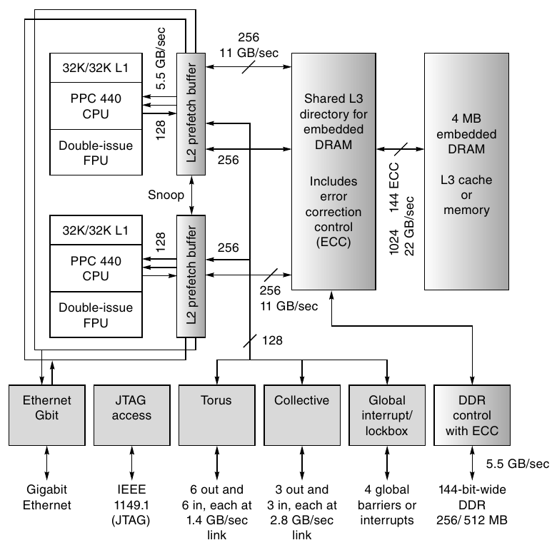

**Hình I.18 Processing node BG/L. Những ô không tô là các processor PowerPC được bổ sung floating-point unit. Những ô xám đậm là network interface, còn những ô xám nhạt là một phần memory system, được bổ sung bởi DDR RAMS.**

4. Một memory bus hỗ trợ từ 256 đến 512 MB DDR DRAMS và cung cấp memory bandwidth 5.5 GB/sec cho L3 cache. Lượng memory này có vẻ khá khiêm tốn cho mỗi node, vì node chứa hai processor, mỗi processor có hai FP unit. Thật vậy, quy tắc kinh nghiệm của Amdahl (1 MB trên mỗi 1 MIPS) cùng giả định 25% peak performance sẽ thiên về lượng memory trên mỗi node lớn hơn khoảng 2.7 lần. Với các ứng dụng floating-point-intensive mà nhu cầu tính toán thường tăng nhanh hơn tuyến tính theo memory size, giới hạn trên 512 MB/node có lẽ hợp lý.

5. Logic hỗ trợ cho năm interconnection network.

Bằng cách đặt mọi logic ngoài DRAM vào một chip duy nhất, BG/L đạt mật độ cao hơn, power thấp hơn và chi phí thấp hơn, cho phép đóng gói các processing node cực kỳ dày đặc. Mật độ này giúp interconnection network có latency thấp, bandwidth cao và chi phí khá hiệu quả. Sự kết hợp tạo ra một supercomputer mở rộng quy mô rất cost-effectively, mang lại cải thiện order-of-magnitude về GFLOPs/watt so với các cách tiếp cận khác, cũng như cải thiện đáng kể GFLOPS/$ cho multiprocessor large-scale rất lớn.

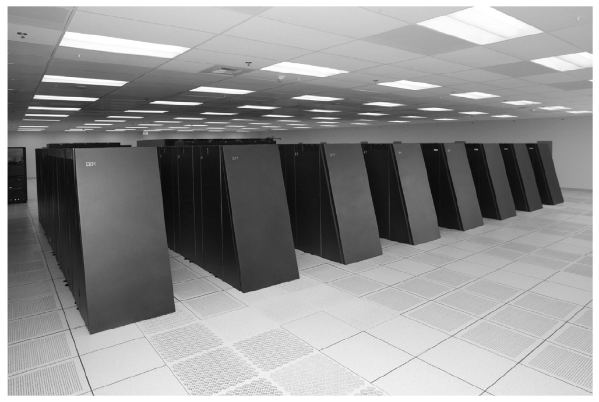

**Hình I.19 Hệ thống Blue Gene/L 64K-processor.**

Chẳng hạn, BG/L với 64K node có peak performance 360 TF và dùng khoảng 1.4 megawatt. Để đạt peak 360 TF bằng Power5+, FP processor high-end, power-efficient nhất, cần khoảng 23,500 processor (dual processor có thể thực thi tối đa 8 FLOPs/clock ở 1.9 GHz). Power cần chỉ riêng cho processor, chưa có external cache, DRAM hoặc interconnect, sẽ khoảng 2.9 megawatt, tức khoảng gấp đôi power của toàn bộ hệ thống BG/L. Tương tự, die size nhỏ hơn của BG/L node và việc chỉ cần DRAM làm external chip tạo ra khoản tiết kiệm chi phí đáng kể so với node được xây dựng bằng high-end multiprocessor. Hình I.19 là ảnh của BG/L 64K node. Tổng kích thước chiếm dụng của multiprocessor 128K-processor này tương đương các multiprocessor trước đó có 16K processor.

## I.9 Nhận xét kết luận

Bức tranh multiprocessor large-scale đã thay đổi mạnh mẽ trong năm đến mười năm qua. Dù hiện nay mọi multiprocessor largest-scale đều dùng một dạng clustering nào đó, việc gọi tất cả là “cluster” bỏ qua những khác biệt đáng kể về architecture, phong cách triển khai, chi phí và performance. Bell và Gray [2002] thảo luận xu hướng này và lập luận rằng cluster sẽ thống trị. Dù Dongarra và cộng sự [2005] đồng ý một dạng clustering nào đó gần như không thể tránh khỏi trong các multiprocessor lớn nhất, họ xây dựng một cách phân loại tinh tế hơn nhằm phân biệt nhiều cách tiếp cận khác nhau.

| Thuật ngữ | Đặc điểm | Ví dụ |
|---|---|---|
| MPP | Ban đầu chỉ một lớp architecture có nhiều processor nhỏ, thường được tùy chỉnh và thường sử dụng architecture theo kiểu SIMD. | Connection Machines CM-2 |
| SMP (symmetric multiprocessor) | Multiprocessor Shared-memory có quan hệ đối xứng với memory; còn gọi là UMA (uniform memory access). Những phiên bản có khả năng mở rộng của các architecture này sử dụng multistage interconnection network, thường được cấu hình với tối đa 64 đến 128 processor. | SUN Sunfire, NEC Earth Simulator |
| DSM (distributed shared memory) | Một lớp architecture hỗ trợ shared memory có khả năng mở rộng theo cách phân tán. Các architecture này có cả phiên bản có và không có cache coherence, thường hỗ trợ từ hàng trăm đến hàng nghìn processor. | SGI Origin and Altix, Cray T3E, Cray X1, IBM p5 590/5 |
| Cluster | Một lớp multiprocessor sử dụng message passing. Từng node có thể là commodity hoặc được tùy chỉnh, interconnect cũng tương tự. | Xem commodity cluster và custom cluster |
| Commodity cluster | Một lớp cluster có node thực sự là commodity, thường là headless workstation, motherboard hoặc blade server, được kết nối bằng SAN hoặc LAN thường truy cập qua I/O bus. | “Beowulf” và các cluster “tự làm” khác |
| Custom cluster | Một cluster architecture có node và interconnect được tùy chỉnh và tích hợp chặt chẽ hơn commodity cluster. Còn được gọi là distributed memory multiprocessor hoặc message passing multiprocessor. | IBM Blue Gene, Cray XT3 |
| Constellation | Multiprocessor Large-scale sử dụng clustering của các multiprocessor smaller-scale, thường có architecture DSM hoặc SMP và từ 32 processor trở lên. | SGI Origin/Altix lớn hơn, ASC Purple |

**Hình I.20 Một cách phân loại multiprocessor large-scale. Thuật ngữ MPP, có ý nghĩa ban đầu như mô tả ở trên, gần đây được dùng kém chính xác hơn để chỉ mọi multiprocessor large-scale. Không multiprocessor thương mại đang được cung cấp nào là MPP thực sự theo nghĩa ban đầu, nhưng cách tiếp cận như vậy có thể hợp lý trong tương lai. Cả lớp SMP lẫn DSM đều bao gồm multiprocessor có vector support. Thuật ngữ constellation đã được sử dụng theo những cách khác nhau; cách dùng ở trên có vẻ vừa trực quan vừa chính xác [Dongarra et al. 2005].**

Trong Hình I.20, chúng ta tóm tắt những thuật ngữ được dùng cho multiprocessor large-scale và tập trung định nghĩa chúng từ góc nhìn architecture và implementation. Hình I.21 cho thấy quan hệ phân cấp giữa những cách tiếp cận architecture khác nhau này. Mặc dù các cách tiếp cận architecture đã phần nào hội tụ trong 15 năm qua, danh sách TOP500 báo cáo 500 máy tính nhanh nhất thế giới theo benchmark Linpack vẫn bao gồm commodity cluster, customized cluster, Symmetric Multiprocessor (SMP), DSM và constellation, cũng như cả scalar processor lẫn vector processor.

Tuy vậy, có một số xu hướng đang xuất hiện rõ ràng mà chúng ta có thể thấy qua sự phân bố các loại multiprocessor trong danh sách TOP500:

1. Cluster chiếm đa số hệ thống. Công sức phát triển thấp hơn của cluster rõ ràng là một động lực khiến chúng phổ biến hơn. Thị trường multiprocessor high-end chưa phát triển đủ lớn để hỗ trợ những thiết kế full-scale, tùy chỉnh cao trở thành lựa chọn chiếm ưu thế.

2. Phần lớn cluster là commodity cluster, thường do người dùng lắp ghép thay vì do system vendor thiết kế thành sản phẩm tiêu chuẩn.

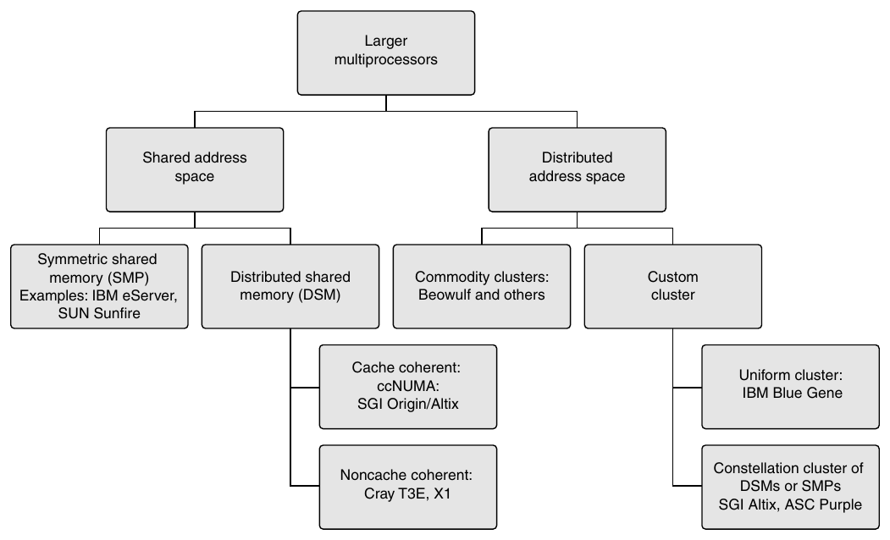

**Hình I.21 Không gian các multiprocessor large-scale và quan hệ giữa các lớp khác nhau.**

3. Mặc dù commodity cluster chiếm ưu thế về số lượng xuất hiện, 25 hệ thống đứng đầu danh sách đa dạng hơn nhiều, bao gồm 9 custom cluster (chủ yếu là các hệ thống Blue Gene hoặc Cray XT3), 2 constellation, 8 commodity cluster, 2 SMP (một trong đó là NEC Earth Simulator, có node với vector processor) và 4 DSM multiprocessor.

4. Vector processor, từng thống trị danh sách, gần như đã biến mất.

5. IBM Blue Gene thống trị 10 hệ thống đứng đầu, cho thấy lợi thế của cách tiếp cận sử dụng một số commodity processor core nhưng tùy chỉnh nhiều chức năng khác và cân bằng performance, power cùng packaging density.

6. Sự hội tụ architecture được thúc đẩy bởi tác động thị trường (thiếu tăng trưởng, số nhà cung cấp hạn chế, v.v.) nhiều hơn là bởi sự đồng thuận clear-cut về những cách tiếp cận architecture tốt nhất.

Software, bao gồm cả ứng dụng lẫn ngôn ngữ và môi trường lập trình, vẫn là thách thức lớn của parallel computing, giống như 30 năm trước khi các multiprocessor như Illiac IV đang được thiết kế. Việc kết hợp sự dễ dàng khi lập trình với parallel performance cao vẫn khó đạt được. Cho đến khi có tiến bộ tốt hơn trên phương diện này, sự hội tụ về một programming model duy nhất và cách tiếp cận architecture nền tảng duy nhất (nhớ rằng với uniprocessor, về cơ bản chúng ta có một programming model và một cách tiếp cận architecture!) sẽ chậm, hoặc sẽ được thúc đẩy bởi những yếu tố khác thay vì ưu thế architecture đã được chứng minh.
