# J Computer Arithmetic

David Goldberg<br>Xerox Palo Alto Research Center

> Cái Nhanh đẩy lùi cái Chậm ngay cả khi cái Nhanh sai.

> W. Kahan

## J.1 Giới thiệu

Mặc dù computer arithmetic đôi khi được xem là một phần chuyên biệt của thiết kế CPU, đây là một phần rất quan trọng. Intel đã thấm thía điều này vào năm 1994 khi người ta phát hiện chip Pentium của hãng có một bug trong thuật toán chia. Sai sót floating-point này khiến Intel phải hứng chịu hàng loạt tin tức bất lợi và cũng làm hãng mất rất nhiều tiền. Intel ghi nhận khoản write-off $300 triệu để trang trải chi phí thay thế các chip bị lỗi.

Trong phụ lục này, chúng ta sẽ nghiên cứu một số thuật toán floating-point cơ bản, bao gồm thuật toán chia được dùng trên Pentium. Mặc dù có rất nhiều thuật toán đã được đề xuất để dùng trong floating-point accelerator, các cách triển khai thực tế thường dựa trên những cải tiến và biến thể của một vài thuật toán cơ bản được trình bày ở đây. Ngoài việc chọn thuật toán cho phép cộng, trừ, nhân và chia, người thiết kế computer architecture còn phải đưa ra những lựa chọn khác. Cần triển khai những mức precision nào? Cần xử lý exception như thế nào? Phụ lục này sẽ cung cấp kiến thức nền tảng để bạn đưa ra những quyết định này cũng như các quyết định khác.

Phần thảo luận về floating point của chúng ta sẽ tập trung gần như hoàn toàn vào tiêu chuẩn IEEE floating-point (IEEE 754), do tiêu chuẩn này ngày càng được chấp nhận rộng rãi. Mặc dù floating-point arithmetic đòi hỏi thao tác với exponent và dịch chuyển fraction, phần lớn thời gian của các phép toán floating-point được dành cho việc xử lý fraction bằng các thuật toán integer (nhưng không nhất thiết dùng chung hardware triển khai các integer instruction). Vì vậy, sau phần thảo luận về floating point, chúng ta sẽ xem xét kỹ hơn các thuật toán integer.

Một số tài liệu tham khảo tốt về computer arithmetic, theo thứ tự từ ít chi tiết nhất đến chi tiết nhất, là Chương 3 của Patterson và Hennessy [2009]; Chương 7 của Hamacher, Vranesic và Zaky [1984]; Gosling [1980]; và Scott [1985].

## J.2 Các kỹ thuật cơ bản của Integer Arithmetic

Những độc giả đã từng học computer arithmetic sẽ thấy phần lớn nội dung của mục này là kiến thức ôn tập.

### Phép cộng Ripple-Carry

Adder thường được triển khai bằng cách kết hợp nhiều bản sao của các thành phần đơn giản. Các thành phần tự nhiên để thực hiện phép cộng là half adder và full adder. Half adder nhận hai bit a và b làm input, rồi tạo ra sum bit s và carry bit c<sub>out</sub> làm output. Về mặt toán học, s = (a + b) mod 2, và c<sub>out</sub> = ⎣(a + b)/2 ⎦, trong đó ⎣ ⎦ là hàm floor. Dưới dạng phương trình logic, s = ab̅ + a̅b và c<sub>out</sub> = ab, trong đó ab có nghĩa là a ∧ b và a + b có nghĩa là a ∨ b. Half adder còn được gọi là (2,2) adder, vì nó nhận hai input và tạo ra hai output. Full adder là một (3,2) adder và được định nghĩa bởi s = (a + b + c) mod 2, c<sub>out</sub> = ⎣ (a + b + c)/2 , hoặc⎦ các phương trình logic

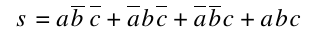 J.2.1

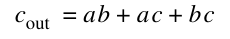 J.2.2

Vấn đề chính khi xây dựng một adder cho các số n-bit từ những phần nhỏ hơn là truyền các carry từ phần này sang phần tiếp theo. Cách giải quyết hiển nhiên nhất là dùng một ripple-carry adder, gồm n full adder, như minh họa trong Hình J.1. (Trong các hình của phụ lục này, least-significant bit luôn nằm bên phải.) Các input của adder là a<sub>n–1</sub>a<sub>n–2</sub>⋅ ⋅ ⋅ a<sub>0</sub> và b<sub>n–1</sub>b<sub>n–2</sub>⋅ ⋅ ⋅ b<sub>0</sub>, trong đó a<sup>n–1 n–2</sup>a ⋅ ⋅ ⋅ a<sup>0</sup> biểu diễn số a<sup>n–1</sup> 2<sup>n–1</sup> + a<sup>n–2</sup> 2<sup>n–2</sup> + ⋅ ⋅ ⋅ + a<sup>0</sup>. Output c<sub>i+1</sub> của adder thứ i được đưa vào input c<sub>i+1</sub> của adder tiếp theo (adder thứ (i + 1)), với lower-order carry-in c<sub>0</sub> được đặt bằng 0. Vì low-order carry-in được nối cố định với 0, low-order adder có thể là một half adder. Tuy nhiên, ở phần sau, chúng ta sẽ thấy việc đặt low-order carry-in bit bằng 1 hữu ích cho việc thực hiện phép trừ.

Nhìn chung, thời gian một mạch cần để tạo ra output tỷ lệ với số mức logic tối đa mà một tín hiệu đi qua. Tuy nhiên, việc xác định chính xác mối quan hệ giữa các mức logic và thời gian phụ thuộc rất nhiều vào công nghệ. Vì vậy, khi so sánh các adder, chúng ta sẽ chỉ so sánh số mức logic trong mỗi adder. Một ripple-carry adder có bao nhiêu mức? Cần hai mức để tính c<sub>1</sub> từ a<sub>0</sub> và b<sub>0</sub>. Sau đó cần thêm hai mức để tính c<sub>2</sub> từ c<sub>1</sub>, a<sub>1</sub>, b<sub>1</sub>, và cứ tiếp tục như vậy cho đến c<sub>n</sub>. Vì thế, tổng cộng có 2n mức. Các giá trị điển hình của n là 32 đối với integer arithmetic và 53 đối với double-precision floating point. ripple-carry adder là adder chậm nhất, nhưng cũng rẻ nhất. Có thể xây dựng nó chỉ với n cell đơn giản, được kết nối theo một cách đơn giản và đều đặn.

Vì ripple-carry adder tương đối chậm so với các thiết kế được thảo luận trong Mục J.8, bạn có thể thắc mắc tại sao người ta vẫn dùng nó. Trong các công nghệ như CMOS, mặc dù ripple adder cần thời gian O(n), hệ số hằng số lại rất nhỏ. Trong những trường hợp đó, các ripple adder ngắn thường được dùng làm thành phần xây dựng các adder lớn hơn.

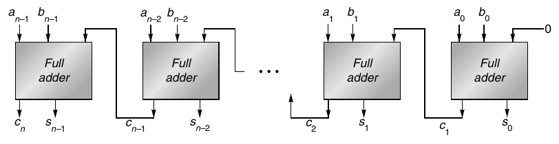

**Hình J.1 Ripple-carry adder, gồm n full adder. carry-out của một full adder được nối với carry-in của adder dành cho most-significant bit tiếp theo. Các carry truyền lần lượt từ least-significant bit (bên phải) đến most-significant bit (bên trái).**

### Phép nhân và phép chia Radix-2

Multiplier đơn giản nhất tính tích của hai số unsigned, mỗi lần một bit, như minh họa trong Hình J.2(a). Các số cần nhân là a<sub>n–1</sub>a<sub>n–2</sub> ⋅ ⋅ ⋅ a<sub>0</sub> và b<sub>n–1</sub>b<sub>n–2</sub>⋅ ⋅ ⋅ b<sub>0</sub>, và chúng lần lượt được đặt trong các register A và B. Ban đầu register P bằng 0. Mỗi bước nhân có hai phần:

**Bước nhân**

(i) Nếu least-significant bit của A bằng 1, register B, chứa b<sub>n–1</sub>b<sub>n–2</sub>⋅ ⋅ ⋅ b<sub>0</sub>, được cộng vào P; nếu không, 00 ⋅ ⋅ ⋅ 00 được cộng vào P. Tổng được đặt trở lại P.

(ii) Các register P và A được dịch sang phải, trong đó carry-out của tổng được chuyển vào high-order bit của P, low-order bit của P được chuyển vào register A, và bit ngoài cùng bên phải của A, không còn được dùng trong phần còn lại của thuật toán, bị dịch ra ngoài.

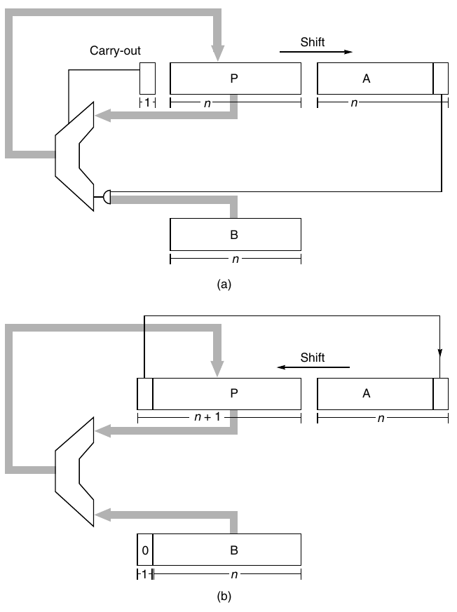

**Hình J.2 Sơ đồ khối của (a) multiplier và (b) divider dành cho các số integer unsigned n-bit. Mỗi bước nhân gồm cộng nội dung của P với B hoặc 0 (tùy theo low-order bit của A), thay P bằng tổng, rồi dịch cả P và A sang phải một bit. Mỗi bước chia trước hết dịch P và A sang trái một bit, lấy P trừ B, và nếu hiệu không âm thì đặt hiệu vào P. Nếu hiệu không âm, low-order bit của A được đặt bằng 1.**

Sau n bước, tích xuất hiện trong các register P và A, với A giữ các lower-order bit.

Divider đơn giản nhất cũng hoạt động trên các số unsigned và tạo ra từng bit của thương. Một hardware divider được minh họa trong Hình J.2(b). Để tính a/b, đặt a vào register A, b vào register B, và 0 vào register P, rồi thực hiện n bước chia. Mỗi bước chia gồm bốn phần:

**Bước chia**

(i) Dịch cặp register (P,A) sang trái một bit.

(ii) Lấy register P trừ nội dung của register B (là b<sub>n–1</sub>b<sub>n–2</sub>⋅ ⋅ ⋅ b<sub>0</sub>), rồi đặt kết quả trở lại P.

(iii) Nếu kết quả của bước 2 âm, đặt low-order bit của A bằng 0, nếu không thì bằng 1.

(iv) Nếu kết quả của bước 2 âm, khôi phục giá trị cũ của P bằng cách cộng nội dung của register B trở lại P.

Sau khi lặp lại quá trình này n lần, register A sẽ chứa thương, và register P sẽ chứa số dư. Thuật toán này là phiên bản nhị phân của phương pháp paper-and-pencil; một ví dụ số được minh họa trong Hình J.3(a).

Lưu ý rằng hai sơ đồ khối trong Hình J.2 rất giống nhau. Khác biệt chính là cặp register (P,A) dịch sang phải khi nhân và sang trái khi chia. Bằng cách cho phép các register này dịch chuyển theo cả hai chiều, có thể dùng chung hardware cho phép nhân và phép chia.

Thuật toán chia được minh họa trong Hình J.3(a) được gọi là restoring, vì nếu phép trừ b cho kết quả âm, register P được khôi phục bằng cách cộng b trở lại. Thuật toán restoring có một biến thể bỏ qua bước khôi phục và thay vào đó làm việc với các số âm thu được. Mỗi bước của thuật toán nonrestoring này có ba phần:

**Bước chia Nonrestoring**

Nếu P âm,

(i-a) Dịch cặp register (P,A) sang trái một bit.

(ii-a) Cộng nội dung của register B vào P.

Nếu không,

(i-b) Dịch cặp register (P,A) sang trái một bit.

(ii-b) Lấy P trừ nội dung của register B.

(iii) Nếu P âm, đặt low-order bit của A bằng 0, nếu không thì đặt bằng 1.

Sau khi lặp lại n lần, thương nằm trong A. Nếu P không âm, nó là số dư. Nếu không, cần khôi phục P (tức là cộng b), khi đó P sẽ là số dư. Một ví dụ số được đưa ra trong Hình J.3(b). Vì bước (i-a) và (i-b) giống nhau, bạn có thể muốn thực hiện bước chung này trước, rồi mới kiểm tra dấu của P. Cách đó không có tác dụng, vì sign bit có thể bị mất khi dịch chuyển.

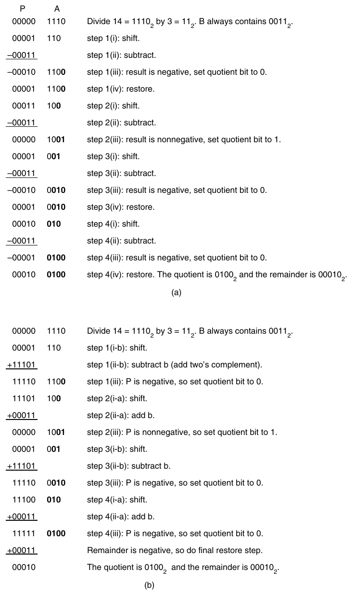

**Hình J.3 Ví dụ số về (a) restoring division và (b) nonrestoring division.**

Có thể giải thích vì sao thuật toán nonrestoring hoạt động như sau. Gọi r<sub>k</sub> là nội dung của cặp register (P,A) tại bước k, bỏ qua các bit của thương (chúng chỉ dùng chung các bit chưa được sử dụng của register A). Trong Hình J.3(a), ban đầu A chứa 14, nên r<sub>0</sub>= 14. Khi kết thúc bước đầu tiên, r<sub>1</sub> = 28, và cứ tiếp tục như vậy. Trong thuật toán restoring, phần (i) tính 2r<sub>k</sub> rồi phần (ii) tính 2r<sub>k</sub> − 2<sup>n</sup> b <sup>n</sup>(2 b vì b được trừ khỏi nửa bên trái). Nếu 2r<sub>k</sub> − 2<sup>n</sup>b ≥ 0, cả hai thuật toán kết thúc bước này với các giá trị giống hệt nhau trong (P,A). Nếu 2r<sub>k</sub> − 2<sup>n</sup>b < 0, thuật toán restoring khôi phục giá trị này thành <sub>k</sub>2r , và bước tiếp theo bắt đầu bằng cách tính r<sub>res</sub> = 2(2r<sub>k</sub>) − 2<sup>n</sup> b. Trong thuật toán nonrestoring, 2r<sub>k</sub> − 2<sup>n</sup>b được giữ lại dưới dạng một số âm, và ở bước tiếp theo r<sub>nonres</sub> = 2(2r<sub>k</sub> − 2<sup>n</sup> b) + <sup>n</sup>2 b = 4r<sub>k</sub> − 2<sup>n</sup> b = r<sub>res</sub>. Vì vậy, (P,A) có các bit giống nhau trong cả hai thuật toán.

Nếu a và b là các số unsigned n-bit, do đó nằm trong khoảng 0 ≤ a,b ≤ 2<sup>n</sup> − 1, multiplier trong Hình J.2 sẽ hoạt động nếu register P dài n bit. Tuy nhiên, đối với phép chia, P phải được mở rộng thành n + 1 bit để phát hiện dấu của P. Vì vậy, adder cũng phải có n + 1 bit.

Tại sao lại có người triển khai restoring division, vốn dùng cùng hardware với nonrestoring division (phần điều khiển hơi khác) nhưng cần thêm một phép cộng? Thực ra, cách triển khai restoring division thông thường không thực sự thực hiện một phép cộng ở bước (iv). Thay vào đó, dấu của kết quả phép trừ được kiểm tra tại output của adder, và chỉ khi tổng không âm thì nó mới được nạp trở lại register P.

Điểm cuối cùng là trước khi bắt đầu chia, hardware phải kiểm tra xem số chia có bằng 0 hay không.

### Các số Signed

Có bốn phương pháp thường được dùng để biểu diễn các số signed n-bit: sign magnitude, two’s complement, one’s complement và biased. Trong hệ sign magnitude, high-order bit là sign bit, và n − 1 low-order bit là độ lớn của số. Trong hệ two’s complement, một số cộng với số đối của nó bằng 2<sup>n</sup>. Trong one’s complement, số đối của một số được tạo ra bằng cách đảo từng bit (hoặc, nói cách khác, một số cộng với số đối của nó bằng 2<sup>n</sup> − 1). Trong cả ba hệ này, các số không âm được biểu diễn theo cách thông thường. Trong hệ biased, các số không âm không có cách biểu diễn thông thường. Thay vào đó, mọi số đều được biểu diễn bằng cách trước tiên cộng chúng với bias, rồi mã hóa tổng này như một số unsigned thông thường. Vì thế, một số âm k có thể được mã hóa miễn là k + bias ≥ 0. Giá trị điển hình của bias là 2<sup>n–1</sup>.

**Ví dụ** Với các số 4-bit (n = 4), nếu k = 3 (hay ở dạng nhị phân, k = 0011<sub>2</sub>), −k được biểu diễn như thế nào trong mỗi định dạng này?

**Trả lời** Trong signed magnitude, bit ngoài cùng bên trái của k = 0011<sub>2</sub> là sign bit, nên đảo nó thành 1: −k được biểu diễn bằng 1011<sub>2</sub>. Trong two’s complement, k + 1101<sub>2</sub> = 2<sup>n</sup> = 16. Vì vậy, −k được biểu diễn bằng 1101<sub>2</sub>. Trong one’s complement, các bit của k = 0011<sub>2</sub> được đảo, nên −k được biểu diễn bằng 1100<sub>2</sub>. Đối với hệ biased, giả sử bias bằng 2<sup>n−1</sup> = 8, k được biểu diễn bằng k + bias = 1011<sub>2</sub>, còn −k bằng −k + bias = 0101<sub>2</sub>.

Hệ được dùng rộng rãi nhất để biểu diễn các số integer, two’s complement, là hệ chúng ta sẽ dùng ở đây. Một lý do khiến two’s complement phổ biến là nó giúp phép cộng signed trở nên dễ dàng: Chỉ cần bỏ carry-out khỏi high-order bit. Chẳng hạn, để cộng 5 + −2, cộng 0101<sub>2</sub> với 1110<sub>2</sub> để thu được 0011<sub>2</sub>, cho kết quả đúng là 3. Một công thức hữu ích để tính giá trị của số two’s complement a<sub>n–1</sub>a<sub>n–2</sub>⋅ ⋅ ⋅ a<sub>1</sub> a<sub>0</sub> là

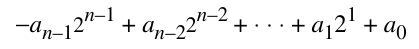 J.2.3

Để minh họa công thức này, giá trị của 1101<sub>2</sub> khi được xem là một số two’s complement 4-bit bằng −1⋅2<sup>3</sup> + 1⋅2<sup>2</sup> + 0⋅2<sup>1</sup> + 1⋅2<sup>0</sup>= −8 + 4 + 1 = −3, xác nhận kết quả của ví dụ phía trên.

Overflow xảy ra khi kết quả phép toán không nằm trong phạm vi của cách biểu diễn đang dùng. Chẳng hạn, nếu dùng 4 bit để biểu diễn các số unsigned, thì 6 = 0110<sub>2</sub> và 11 = 1011<sub>2</sub>. Tổng của chúng (17) bị overflow vì dạng nhị phân tương ứng (10001<sub>2</sub>) không vừa trong 4 bit. Với các số unsigned, việc phát hiện overflow rất dễ; nó xảy ra chính xác khi có carry-out của most-significant bit. Với two’s complement, vấn đề phức tạp hơn: Overflow xảy ra chính xác khi carry đi vào high-order bit khác với carry-out (sẽ bị bỏ đi) của high-order bit. Trong ví dụ 5 + −2 phía trên, một bit 1 được truyền cả vào lẫn ra khỏi bit ngoài cùng bên trái, nên không có overflow.

Để đổi dấu một số two’s complement, cần đảo từng bit rồi cộng 1. Chẳng hạn, để đổi dấu 0011<sub>2</sub>, đảo nó để thu được 1100<sub>2</sub> rồi cộng 1 để thu được 1101<sub>2</sub>. Vì vậy, để triển khai a − b bằng một adder, chỉ cần đưa a và b̅ (trong đó b̅ là số thu được bằng cách đảo từng bit của b) vào adder và đặt low-order, carry-in bit bằng 1. Điều này giải thích vì sao adder ngoài cùng bên phải trong Hình J.1 là một full adder.

Nhân các số two’s complement không hoàn toàn đơn giản như cộng chúng. Cách làm hiển nhiên là chuyển cả hai toán hạng thành không âm, thực hiện phép nhân unsigned, rồi (nếu các toán hạng ban đầu trái dấu) đổi dấu kết quả. Mặc dù đơn giản về mặt khái niệm, cách này cần thêm thời gian và hardware. Đây là cách tốt hơn: Giả sử chúng ta đang nhân a với b bằng hardware được minh họa trong Hình J.2(a). Register A được nạp số a; B được nạp b. Vì nội dung của register B luôn là b, chúng ta sẽ dùng B và b thay thế cho nhau. Nếu B có thể âm nhưng A không âm, thay đổi duy nhất cần có để chuyển thuật toán nhân unsigned thành thuật toán two’s complement là bảo đảm rằng khi P được dịch chuyển, nó được dịch theo kiểu arithmetic; tức là bit được dịch vào high-order bit của P phải là sign bit của P (thay vì carry-out của phép cộng). Lưu ý rằng adder n-bit-wide của chúng ta giờ sẽ cộng các số two’s complement n-bit nằm giữa −2<sup>n–1</sup> và 2<sup>n–1</sup> − 1.

Tiếp theo, giả sử a âm. Phương pháp xử lý trường hợp này được gọi là Booth recoding. Booth recoding là một kỹ thuật rất cơ bản trong computer arithmetic và sẽ giữ vai trò then chốt trong Mục J.9. Thuật toán ở trang J-4 tính a × b bằng cách xem xét các bit của a từ bit có trọng số thấp nhất đến bit có trọng số cao nhất. Chẳng hạn, nếu a = 7 = 0111<sub>2</sub>, bước (i) sẽ lần lượt cộng B, cộng B, cộng B và cộng 0. Booth recoding “mã hóa lại” số 7 thành 8 − 1 = 1000<sub>2</sub> − 0001<sub>2</sub> = 1001̅, trong đó 1̅ biểu diễn −1. Điều này cho ta một cách khác để tính a × b, cụ thể là lần lượt trừ B, cộng 0, cộng 0 và cộng B. Cách này phức tạp hơn thuật toán unsigned ở trang J-4, vì nó dùng cả phép cộng lẫn phép trừ. Ưu điểm thể hiện ở các giá trị âm của a. Với cách mã hóa lại thích hợp, chúng ta có thể xử lý a như thể nó là số unsigned. Chẳng hạn, lấy a = −4 = 1100<sub>2</sub>. Hãy xem 1100<sub>2</sub> là số unsigned 12, và mã hóa lại nó thành 12 = 16 − 4 = 10000<sub>2</sub> − 0100<sub>2</sub> = 10100. Nếu thuật toán nhân chỉ được lặp n lần (trong trường hợp này n = 4), high-order digit bị bỏ qua, và cuối cùng chúng ta trừ đi 0100<sub>2</sub> = 4 lần số nhân—đúng chính xác kết quả cần có. Điều này gợi ý rằng phép nhân dùng dạng mã hóa lại của a sẽ hoạt động tốt như nhau cho cả số dương lẫn số âm. Và quả thực, để xử lý các giá trị âm của a, tất cả những gì cần làm là đôi lúc lấy P trừ b, thay vì cộng b hoặc 0 vào P. Các quy tắc chính xác như sau: Nếu nội dung ban đầu của A là a<sub>n–1</sub>⋅ ⋅ ⋅ a<sub>0</sub>, thì tại bước nhân thứ i, low-order bit của register A là a<sub>i</sub> , và bước (i) của thuật toán nhân trở thành:

I. Nếu a<sub>i</sub> = 0 và a<sub>i–1</sub> = 0, cộng 0 vào P.

II. Nếu a<sub>i</sub> = 0 và a<sub>i–1</sub> = 1, cộng B vào P.

III. Nếu a<sub>i</sub> = 1 và a<sub>i–1</sub> = 0, lấy P trừ B.

IV. Nếu a<sub>i</sub> = 1 và a<sub>i–1</sub> = 1, cộng 0 vào P.

Với bước đầu tiên, khi i = 0, lấy a<sub>i–1</sub> bằng 0.

**Ví dụ** Khi nhân −6 với −5, dãy giá trị trong cặp register (P,A) là gì?

**Trả lời** Xem Hình J.4.

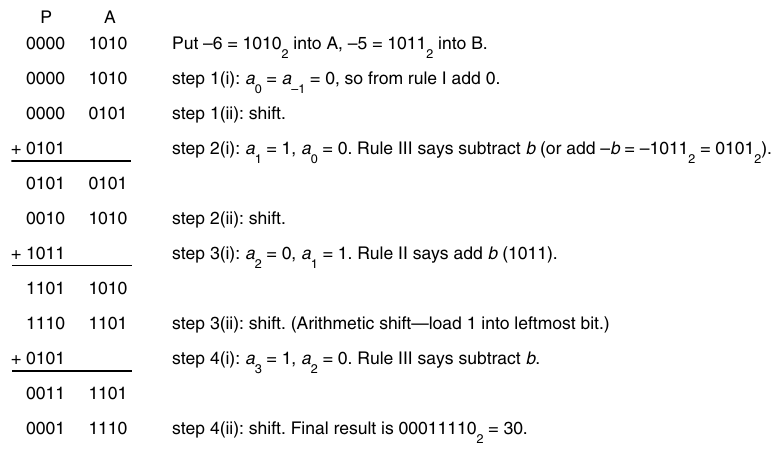

**Hình J.4 Ví dụ số về Booth recoding. Nhân a = –6 với b = –5 để thu được 30.**

Bốn trường hợp trước có thể được phát biểu lại rằng ở bước thứ i, bạn cần cộng (a<sub>i–1</sub>− a<sub>i</sub> )B vào P. Từ nhận xét này, có thể dễ dàng xác minh các quy tắc hoạt động đúng, vì kết quả của tất cả các phép cộng là

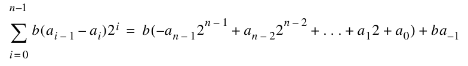

Dùng Phương trình J.2.3 (trang J-8) cùng với a<sub>−1</sub> = 0, có thể thấy right-hand side chính là giá trị b × a dưới dạng một số two’s complement.

Cách đơn giản nhất để triển khai các quy tắc của Booth recoding là mở rộng register A thêm một bit về bên phải, sao cho bit mới này chứa a<sub>i–1</sub>. Khác với phương pháp đơn giản là đảo dấu mọi toán hạng âm, kỹ thuật này không cần thêm bước hay xử lý đặc biệt nào cho các toán hạng âm. Nó chỉ cần nhiều hơn một chút control logic. Nếu multiplier được dùng chung với một divider, thì khả năng trừ b thay vì cộng b đã sẵn có. Tóm lại, một phương pháp đơn giản để xử lý phép nhân two’s complement là chú ý đến dấu của P khi dịch P sang phải, và lưu bit shifted-out gần nhất của A để dùng khi quyết định cộng b vào P hay lấy P trừ b.

Booth recoding thường là phương pháp tốt nhất để thiết kế hardware nhân hoạt động trên các số signed. Tuy nhiên, với hardware không trực tiếp triển khai phương pháp này, thực hiện Booth recoding bằng software hoặc microcode thường quá chậm do các phép kiểm tra điều kiện và branch. Nếu hardware hỗ trợ arithmetic shift (để xử lý b âm một cách chính xác), có thể dùng phương pháp sau. Xử lý số nhân a như thể nó là một số unsigned, và thực hiện n − 1 bước nhân đầu tiên bằng thuật toán ở trang J-4. Nếu a < 0 (khi đó tại thời điểm này low-order bit của register A sẽ bằng 1), lấy P trừ b; nếu không (a ≥ 0), không cộng cũng không trừ. Trong cả hai trường hợp, thực hiện một lần dịch cuối cùng (để có tổng cộng n lần dịch). Cách này hoạt động vì nó tương đương với nhân b với −a<sub>n–1</sub>2<sup>n–1</sup> + ⋅ ⋅ ⋅ + a<sub>1</sub> 2 + a<sub>0</sub>, là giá trị của a<sub>n–1</sub>⋅ ⋅ ⋅ a<sub>0</sub> dưới dạng số two’s complement theo Phương trình J.2.3. Nếu hardware không hỗ trợ arithmetic shift, chuyển các toán hạng thành không âm có lẽ là cách tốt nhất.

Hai nhận xét cuối cùng: Một cách tốt để kiểm tra một routine signed-multiply là thử −2<sup>n–1</sup>× −2<sup>n–1</sup>, vì đây là trường hợp duy nhất tạo ra kết quả 2n − 1 bit. Khác với phép nhân, phép chia thường được thực hiện trong hardware bằng cách chuyển các toán hạng thành không âm rồi thực hiện một phép chia unsigned. Vì phép chia chậm hơn đáng kể (và ít xảy ra hơn) so với phép nhân, thời gian thêm vào để xử lý dấu ít ảnh hưởng hơn so với phép nhân.

### Các vấn đề ở cấp hệ thống

Khi thiết kế một instruction set, cần giải quyết một số vấn đề liên quan đến integer arithmetic. Một vài vấn đề trong số đó được thảo luận ở đây.

Trước hết, cần làm gì với integer overflow? Tình huống này trở nên phức tạp vì cách phát hiện overflow khác nhau tùy theo các toán hạng là integer signed hay unsigned. Trước tiên hãy xét signed arithmetic. Có ba cách: Đặt một bit khi overflow, tạo trap khi overflow, hoặc không làm gì khi overflow. Trong trường hợp cuối, software phải kiểm tra xem overflow có xảy ra hay không. Giải pháp thuận tiện nhất cho người lập trình là có một enable bit. Nếu bit này được bật, overflow gây ra trap. Nếu bit này được tắt, overflow đặt một bit (hoặc thay vào đó, có hai add instruction khác nhau). Ưu điểm của cách này là cả phép toán có trap lẫn không có trap đều chỉ cần một instruction. Hơn nữa, như chúng ta sẽ thấy trong Mục J.7, cách này tương tự cách tiêu chuẩn IEEE floating-point xử lý floating-point overflow. Hình J.5 cho thấy cách một số máy phổ biến xử lý overflow.

Còn phép cộng unsigned thì sao? Lưu ý rằng không architecture nào trong Hình J.5 tạo trap khi unsigned overflow. Lý do là ứng dụng chủ yếu của unsigned arithmetic là thao tác với địa chỉ. Việc có thể trừ khỏi một địa chỉ unsigned bằng phép cộng rất thuận tiện. Chẳng hạn, khi n = 4, chúng ta có thể lấy địa chỉ unsigned 10 = 1010<sub>2</sub> trừ 2 bằng cách cộng 14 = 1110<sub>2</sub>. Điều này tạo ra overflow, nhưng chúng ta không muốn một trap được tạo ra.

Vấn đề thứ hai liên quan đến phép nhân. Kết quả nhân hai số n-bit nên là kết quả 2n-bit, hay phép nhân chỉ nên trả về n low-order bit, báo hiệu overflow nếu kết quả không vừa trong n bit? Một lập luận ủng hộ kết quả n-bit là trong hầu như mọi ngôn ngữ high-level, phép nhân là một phép toán có các đối số là biến integer và kết quả là một biến integer cùng kiểu. Do đó, compiler sẽ không tạo code tận dụng kết quả double-precision. Một lập luận ủng hộ kết quả 2n-bit là một routine assembly language có thể dùng nó để tăng đáng kể tốc độ nhân các số integer multiple-precision (nhanh hơn khoảng 3 lần).

Vấn đề thứ ba liên quan đến những máy muốn thực thi một instruction mỗi cycle. Hiếm khi thực tế cho phép thực hiện phép nhân hoặc chia trong cùng khoảng thời gian với phép cộng hoặc phép chuyển register-register. Có ba cách giải quyết vấn đề này. Cách thứ nhất là có một instruction single-cycle multiply-step. Instruction này có thể thực hiện một bước của thuật toán Booth. Cách thứ hai là thực hiện phép nhân integer trong floating-point unit và đưa nó vào floating-point instruction set. (Đây là cách DLX làm.) Cách thứ ba là có một unit độc lập trong CPU thực hiện phép nhân. Trong trường hợp này, hoặc có thể bảo đảm kết quả được đưa ra sau một số cycle cố định—và compiler chịu trách nhiệm chờ đúng khoảng thời gian—hoặc có thể dùng interlock. Các nhận xét tương tự cũng áp dụng cho phép chia. Chẳng hạn, SPARC ban đầu có multiply-step instruction nhưng không có divide-step instruction, trong khi MIPS R3000 có một unit độc lập thực hiện phép nhân và chia (các phiên bản mới hơn của SPARC architecture đã bổ sung một integer multiply instruction). Những người thiết kế HP Precision Architecture đã phân tích đặc biệt kỹ tần suất xuất hiện của các toán hạng trong phép nhân và chia, và dựa vào đó để thiết kế các bước nhân và chia. (Xem Magenheimer và cộng sự [1988] để biết chi tiết.)

| Máy | Trap khi signed overflow? | Trap khi unsigned overflow? | Đặt bit khi signed overflow? | Đặt bit khi unsigned overflow? |
|---|---|---|---|---|
| VAX | Nếu enable được bật | Không | Có. Add đặt V bit. | Có. Add đặt C bit. |
| IBM 370 | Nếu enable được bật | Không | Có. Add đặt cond code. | Có. Logical add đặt cond code. |
| Intel 8086 | Không | Không | Có. Add đặt V bit. | Có. Add đặt C bit. |
| MIPS R3000 | Hai add instruction; một luôn tạo trap, instruction còn lại không bao giờ tạo trap. | Không | Không. Software phải suy ra từ dấu của các toán hạng và kết quả. |  |
| SPARC | Không | Không | Addcc đặt V bit. Add không đặt. | Addcc đặt C bit. Add không đặt. |

**Hình J.5 Tóm lược cách các máy khác nhau xử lý integer overflow. Cả 8086 lẫn SPARC đều có một instruction tạo trap nếu V bit được đặt, nên chi phí để tạo trap khi overflow là thêm một instruction.**

Vấn đề cuối cùng liên quan đến việc tính phép chia integer và số dư đối với các số âm. Chẳng hạn, −5 DIV 3 và −5 MOD 3 bằng bao nhiêu? Khi tính x DIV y và x MOD y, các giá trị âm của x xuất hiện đủ thường xuyên để đáng được xem xét kỹ. (Ngược lại, các giá trị âm của y khá hiếm.) Nếu có các hardware instruction built-in cho các phép toán này, chúng cần tương ứng với những gì các ngôn ngữ high-level quy định. Đáng tiếc, các ngôn ngữ lập trình hiện có không thống nhất về điều này. Xem Hình J.6.

Có một định nghĩa cho những biểu thức này nổi bật hơn hẳn về tính ưu việt, cụ thể là x DIV y = ⎣ x/y ⎦ , sao cho 5 DIV 3 = 1 và −5 DIV 3 = −2. Và MOD phải thỏa mãn x = (x DIV y) × y + x MOD y, sao cho x MOD y ≥ 0. Vì vậy, 5 MOD 3 = 2, và −5 MOD 3 = 1. Một số trong nhiều ưu điểm của định nghĩa này như sau:

1. Một phép tính để xác định index trong hash table có kích thước N có thể dùng MOD N và được bảo đảm tạo ra một index hợp lệ trong khoảng từ 0 đến N − 1.

2. Trong đồ họa, khi chuyển từ hệ tọa độ này sang hệ tọa độ khác, không có sự “bất thường” gần 0. Chẳng hạn, để chuyển từ giá trị x được biểu diễn trong hệ dùng 100 chấm trên mỗi inch sang giá trị y trên màn hình bitmap có 70 chấm trên mỗi inch, công thức y = (70 × x) DIV 100 ánh xạ một hoặc hai tọa độ x vào mỗi tọa độ y. Nhưng nếu DIV được định nghĩa như trong Pascal là x/y được làm tròn về 0, thì sẽ có ba điểm khác nhau (−1, 0, 1) được ánh xạ vào 0.

3. x MOD 2<sup>k</sup> tương đương thực hiện bitwise AND với một mask gồm k bit, và x DIV 2<sup>k</sup> tương đương thực hiện arithmetic right shift k-bit.

| Ngôn ngữ | Phép chia | Số dư |
|---|---|---|
| FORTRAN | −5/3 = −1 | MOD(−5, 3) = −2 |
| Pascal | −5 DIV 3 = −1 | −5 MOD 3 = 1 |
| Ada | −5/3 = −1 | −5 MOD 3 = 1<br>−5 REM 3 = −2 |
| C | −5/3 không được định nghĩa | −5 % 3 không được định nghĩa |
| Modula-3 | −5 DIV 3 = −2 | −5 MOD 3 = 1 |

**Hình J.6 Ví dụ về phép chia integer và số dư integer trong các ngôn ngữ lập trình khác nhau.**

Cuối cùng, một cạm bẫy tiềm tàng đáng nhắc đến liên quan đến phép cộng multiple-precision. Nhiều instruction set cung cấp một biến thể của add instruction cộng ba toán hạng: hai số n-bit cùng với một số single-bit thứ ba. Số thứ ba này là carry từ phép cộng trước. Vì số multiple-precision thường được lưu trong một array, cần có khả năng tăng array pointer mà không phá hủy carry bit.

## J.3 Floating Point

Nhiều ứng dụng cần các số không phải integer. Có một số cách để biểu diễn các số không nguyên. Một cách là dùng fixed point; tức là dùng integer arithmetic và chỉ cần hình dung binary point nằm ở một vị trí khác thay vì ngay bên phải least-significant digit. Có thể cộng hai số như vậy bằng một phép cộng integer, trong khi phép nhân cần thêm một số thao tác dịch chuyển. Những cách biểu diễn khác đã được đề xuất gồm lưu logarithm của một số và thực hiện phép nhân bằng cách cộng các logarithm, hoặc dùng một cặp số integer (a,b) để biểu diễn phân số a/b. Tuy nhiên, chỉ có một cách biểu diễn số không nguyên được dùng rộng rãi, đó là floating point. Trong hệ này, một computer word được chia thành hai phần, một exponent và một significand. Chẳng hạn, exponent −3 và significand 1.5 có thể biểu diễn số 1.5 × 2<sup>–3</sup> = 0.1875. Ưu điểm của việc tiêu chuẩn hóa một cách biểu diễn cụ thể là hiển nhiên. Các chuyên gia phân tích số có thể xây dựng những thư viện software high-quality, người thiết kế máy tính có thể phát triển các kỹ thuật triển khai hardware high-performance, và nhà cung cấp hardware có thể chế tạo các accelerator tiêu chuẩn. Với ưu thế áp đảo của cách biểu diễn floating-point, có vẻ khó có khả năng một cách biểu diễn khác sẽ được dùng rộng rãi.

Ngữ nghĩa của các instruction floating-point không clear-cut như ngữ nghĩa của phần còn lại trong instruction set, và trước đây hành vi của các phép toán floating-point khác nhau đáng kể giữa các dòng máy tính. Những khác biệt liên quan đến các yếu tố như số bit được dành cho exponent và significand, phạm vi exponent, cách làm tròn, và các hành động được thực hiện khi có điều kiện ngoại lệ như underflow và overflow. Các sách về computer architecture trước đây thường đưa ra lời khuyên về cách xử lý tất cả những chi tiết này, nhưng may mắn là điều đó không còn cần thiết. Lý do là ngành công nghiệp máy tính đang nhanh chóng hội tụ về định dạng được quy định bởi tiêu chuẩn IEEE 754-1985 (cũng là tiêu chuẩn quốc tế IEC 559). Ưu điểm của việc dùng một biến thể floating point tiêu chuẩn tương tự ưu điểm của việc dùng floating point so với các cách biểu diễn số không nguyên khác.

IEEE arithmetic khác với nhiều hệ arithmetic trước đó ở những điểm chính sau:

1. Khi làm tròn một kết quả “nằm chính giữa” về số floating-point gần nhất, nó chọn số chẵn.

2. Nó bao gồm các giá trị đặc biệt NaN, ∞ và −∞.

3. Nó dùng các số denormal để biểu diễn kết quả của những phép tính có giá trị nhỏ hơn 1.0 × 2<sup>E<sub>min</sub></sup>.

4. Mặc định nó làm tròn về số gần nhất, nhưng còn có ba chế độ làm tròn khác.

5. Nó có các cơ chế tinh vi để xử lý exception.

Để giải thích kỹ hơn điểm (1), lưu ý rằng khi thực hiện phép toán trên hai số floating-point, kết quả thường là một số không thể được biểu diễn chính xác bằng một số floating-point khác. Chẳng hạn, trong hệ floating-point dùng cơ số 10 và hai chữ số có nghĩa, 6.1 × 0.5 = 3.05. Cần làm tròn kết quả này về hai chữ số. Nên làm tròn thành 3.0 hay 3.1? Trong tiêu chuẩn IEEE, những trường hợp nằm chính giữa như vậy được làm tròn về số có low-order digit chẵn. Tức là 3.05 được làm tròn thành 3.0, chứ không phải 3.1. Tiêu chuẩn thực tế có bốn chế độ làm tròn. Mặc định là làm tròn về số gần nhất, trong đó các trường hợp cách đều được làm tròn về số chẵn như vừa giải thích. Những chế độ còn lại là làm tròn về 0, làm tròn về +∞, và làm tròn về –∞.

Chúng ta sẽ giải thích kỹ hơn những khác biệt còn lại trong các mục tiếp theo. Để đọc thêm, xem IEEE [1985], Cody và cộng sự [1984], và Goldberg [1991].

### Các giá trị đặc biệt và Denormal

Có lẽ đặc điểm đáng chú ý nhất của tiêu chuẩn là theo mặc định, phép tính vẫn tiếp tục khi gặp các điều kiện ngoại lệ, như chia cho 0 hoặc lấy căn bậc hai của một số âm. Chẳng hạn, kết quả lấy căn bậc hai của một số âm là một NaN (Not a Number), một mẫu bit không biểu diễn một số thông thường. Để thấy NaN có thể hữu ích như thế nào, hãy xét code của một chương trình tìm nghiệm nhận một hàm F làm đối số và tính F tại nhiều điểm để xác định một nghiệm của hàm. Nếu chương trình tìm nghiệm vô tình thăm dò ngoài các giá trị hợp lệ của F, F rất có thể gây ra exception. Viết một chương trình tìm nghiệm xử lý trường hợp này phụ thuộc rất nhiều vào ngôn ngữ và operating-system, vì nó dựa vào cách operating system phản ứng với exception và cách phản ứng này được ánh xạ trở lại ngôn ngữ lập trình. Trong IEEE arithmetic, rất dễ viết một chương trình tìm nghiệm xử lý tình huống này và chạy trên nhiều hệ thống khác nhau. Sau mỗi lần tính F, nó chỉ cần kiểm tra xem F có trả về NaN hay không; nếu có, nó biết rằng mình đã thăm dò ngoài miền xác định của F.

Trong IEEE arithmetic, nếu input của một phép toán là NaN, output là NaN (chẳng hạn, 3 + NaN = NaN). Nhờ quy tắc này, việc viết các subroutine floating-point có thể nhận NaN làm đối số hiếm khi cần kiểm tra trường hợp đặc biệt. Chẳng hạn, giả sử arccos được tính thông qua arctan, dùng công thức arccos x = 2 arctan($\sqrt{(1 – x)/(1 + x)}$). Nếu arctan xử lý đúng đối số NaN, arccos cũng tự động làm được như vậy. Đó là vì nếu x là NaN, 1 + x, 1 − x, (1 + x)/(1 − x), và $\sqrt{(1 – x)/(1 + x)}$ cũng là NaN. Không cần kiểm tra NaN.

Trong khi kết quả của √–1 là NaN, kết quả của 1/0 không phải NaN mà là +∞, một giá trị đặc biệt khác. Tiêu chuẩn định nghĩa arithmetic trên các giá trị vô cực (có cả +∞ lẫn –∞) bằng những quy tắc như 1/∞ = 0. Công thức arccos x = 2 arctan($\sqrt{(1 – x)/(1 + x)}$) minh họa cách có thể dùng infinity arithmetic. Vì arctan x tiến tiệm cận đến π /2 khi x tiến đến ∞, việc định nghĩa arctan(∞) = π /2 là tự nhiên; khi đó arccos(−1) sẽ tự động được tính đúng là 2 arctan(∞) = π.

Loại giá trị đặc biệt cuối cùng trong tiêu chuẩn là các số denormal. Trong nhiều hệ floating-point, nếu E<sub>min</sub> là exponent nhỏ nhất, không thể biểu diễn một số nhỏ hơn 1.0 × 2<sup>E<sub>min</sub></sup>, và một phép toán floating-point cho kết quả nhỏ hơn giá trị này đơn giản bị chuyển thành 0. Ngược lại, trong tiêu chuẩn IEEE, các số nhỏ hơn 1.0 × 2<sup>E<sub>min</sub></sup> được biểu diễn bằng các significand nhỏ hơn 1. Điều này được gọi là gradual underflow. Vì thế, khi độ lớn của các số giảm xuống dưới 2<sup>E<sub>min</sub></sup>, chúng dần mất các chữ số có nghĩa và chỉ được biểu diễn bằng 0 khi mọi chữ số có nghĩa đã bị dịch ra ngoài. Chẳng hạn, trong cơ số 10 với bốn chữ số có nghĩa, cho x = 1.234 × 10<sup>E<sub>min</sub></sup>. Khi đó x/10 sẽ được làm tròn thành 0.123 × 10<sup>E<sub>min</sub></sup>, mất đi một chữ số precision. Tương tự, x/100 được làm tròn thành 0.012 × 10<sup>E<sub>min</sub></sup>, và x/1000 thành 0.001 × 10<sup>E<sub>min</sub></sup>, trong khi x/10000 cuối cùng đủ nhỏ để được làm tròn thành 0. Denormal giúp việc xử lý các số nhỏ dễ dự đoán hơn bằng cách duy trì những tính chất quen thuộc như x = y ⇔ x − y = 0. Chẳng hạn, trong hệ flush-to-zero (vẫn ở cơ số 10 với bốn chữ số có nghĩa), nếu x = 1.256 × 10<sup>E<sub>min</sub></sup> và y = 1.234 × 10<sup>E<sub>min</sub></sup>, thì x − y = 0.022 × 10<sup>E<sub>min</sub></sup>, bị chuyển về không. Vì thế, mặc dù x ≠ y, giá trị tính được của x − y = 0. Điều này không bao giờ xảy ra với gradual underflow. Trong ví dụ này, x − y = 0.022 × 10<sup>E<sub>min</sub></sup> là một số denormal, nên phép tính x − y là chính xác.

### Biểu diễn các số Floating-Point

Hãy xem xét cách biểu diễn các số single-precision trong IEEE arithmetic. Các số Single-precision được lưu trong 32 bit: 1 bit cho dấu, 8 bit cho exponent, và 23 bit cho fraction. Exponent là một số signed được biểu diễn bằng phương pháp bias (xem mục “Signed Numbers”, trang J-7) với bias bằng 127. Thuật ngữ biased exponent chỉ số unsigned nằm trong các bit 1 đến 8, còn unbiased exponent (hoặc chỉ exponent) có nghĩa là số mũ thực tế mà 2 được nâng lên. Fraction biểu diễn một số nhỏ hơn 1, nhưng significand của số floating-point là 1 cộng với phần fraction. Nói cách khác, nếu e là biased exponent (giá trị của trường exponent) và f là giá trị của trường fraction, số được biểu diễn là 1. f × 2<sup>e–127</sup>.

**Ví dụ** Computer word 32-bit sau biểu diễn số single-precision nào?

1 10000001 01000000000000000000000

**Trả lời** Khi được xem là một số unsigned, trường exponent bằng 129, khiến giá trị của exponent bằng 129 − 127 = 2. Phần fraction là .01<sub>2</sub> = .25, khiến significand bằng 1.25. Vì vậy, mẫu bit này biểu diễn số −1.25 × 2<sup>2</sup> = −5.

Không được nhầm lẫn phần fraction của một số floating-point (.25 trong ví dụ phía trên) với significand, vốn bằng 1 cộng với phần fraction. Số 1 đứng đầu trong significand 1. f không xuất hiện trong cách biểu diễn; tức là leading bit được ngầm định. Khi thực hiện arithmetic trên các số theo định dạng IEEE, phần fraction thường được unpack, nghĩa là số 1 ngầm định được đưa ra tường minh.

Hình J.7 tóm lược các tham số cho single precision (và các precision khác). Hình cho thấy exponent của single precision nằm trong khoảng từ –126 đến 127; tương ứng, biased exponent nằm trong khoảng từ 1 đến 254. Các biased exponent bằng 0 và 255 được dùng để biểu diễn các giá trị đặc biệt. Điều này được tóm lược trong Hình J.8. Khi biased exponent bằng 255, trường fraction bằng không biểu diễn vô cực, còn trường fraction khác không biểu diễn NaN. Do đó, có cả một họ NaN. Khi biased exponent và trường fraction đều bằng 0, số được biểu diễn là 0. Do số 1 đứng đầu được ngầm định, các số thông thường luôn có significand lớn hơn hoặc bằng 1. Vì thế, cần một quy ước đặc biệt như vậy để biểu diễn 0. Các số denormalized được triển khai bằng cách dùng một word có trường exponent bằng không để biểu diễn số 0. f × 2<sup>E<sub>min</sub></sup>.

Lý do chủ yếu khiến tiêu chuẩn IEEE, giống như phần lớn các định dạng floating-point khác, dùng biased exponent là điều này làm cho các số không âm được sắp thứ tự giống như các số integer. Tức là có thể so sánh độ lớn của các số floating-point bằng một integer comparator. Một ưu điểm khác (có liên quan) là 0 được biểu diễn bằng một word toàn bit 0. Nhược điểm của biased exponent là cộng chúng hơi bất tiện, vì cần trừ bias khỏi tổng của chúng.

|  | Single | Single extended | Double | Double extended |
|---|---|---|---|---|
| p (số bit precision) | 24 | ≥32 | 53 | ≥64 |
| E<sub>max</sub> | 127 | ≥1023 | 1023 | ≥16383 |
| E<sub>min</sub> | −126 | ≤−1022 | −1022 | ≤−16382 |
| Exponent bias | 127 |  | 1023 |  |

**Hình J.7 Các tham số định dạng của tiêu chuẩn IEEE 754 floating-point. Hàng đầu tiên cho biết số bit trong significand. Các ô trống là những tham số không được quy định.**

| Exponent | Fraction | Biểu diễn |
|---|---|---|
| e = E<sub>min</sub> − 1 | f = 0 | ±0 |
| e = E<sub>min</sub> − 1 | f ≠ 0 | 0.f × 2<sup>E<sub>min</sub></sup> |
| E<sub>min</sub> ≤ e ≤ E<sub>max</sub> | — | 1.f × 2<sup>e</sup> |
| e = E<sub>max</sub> + 1 | f = 0 | ±∞ |
| e = E<sub>max</sub> + 1 | f ≠ 0 | NaN |

**Hình J.8 Biểu diễn các giá trị đặc biệt. Khi exponent của một số nằm ngoài khoảng E<sub>min</sub> ≤ e ≤ E<sub>max</sub>, số đó có một cách diễn giải đặc biệt như được chỉ ra trong bảng.**

## J.4 Phép nhân Floating-Point

Phép toán floating-point đơn giản nhất là phép nhân, nên chúng ta thảo luận về nó trước. Một số floating-point nhị phân x được biểu diễn bằng một significand và một exponent, x = s × 2<sup>e</sup>. Công thức

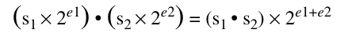

cho thấy một thuật toán nhân floating-point có nhiều phần. Phần đầu nhân các significand bằng phép nhân integer thông thường. Vì các số floating-point được lưu ở dạng sign magnitude, multiplier chỉ cần xử lý các số unsigned (mặc dù chúng ta đã thấy Booth recoding xử lý các số signed two’s complement một cách dễ dàng). Phần thứ hai làm tròn kết quả. Nếu các significand là các số unsigned p-bit (chẳng hạn, p = 24 đối với single precision), tích có thể dài đến 2p bit và phải được làm tròn về một số p-bit. Phần thứ ba tính exponent mới. Vì các exponent được lưu kèm bias, việc này đòi hỏi trừ bias khỏi tổng các biased exponent.

**Ví dụ** Phép nhân các số single-precision

1 10000010 000. . . = –1 × 2<sup>3</sup>

0 10000011 000. . . = 1 × 2<sup>4</sup>

diễn ra như thế nào trong hệ nhị phân?

**Trả lời** Khi được unpack, cả hai significand đều bằng 1.0, tích của chúng bằng 1.0, và do đó kết quả có dạng:

1 ???????? 000. . .

Để tính exponent, dùng công thức:

biased exp (e<sub>1</sub> + e<sub>2</sub>) = biased exp(e<sub>1</sub>) + biased exp(e<sub>2</sub>) − bias

Từ Hình J.7, bias bằng 127 = 01111111<sub>2</sub>, nên trong two’s complement, –127 là 10000001<sub>2</sub>. Vì vậy, biased exponent của tích là

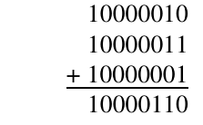

Vì đây là số thập phân 134, nó biểu diễn exponent 134 − bias = 134 − 127 = 7, đúng như dự kiến.

Phần thú vị của phép nhân floating-point là làm tròn. Một số trường hợp khác nhau có thể xảy ra được minh họa trong Hình J.9. Vì các trường hợp tương tự nhau trong mọi cơ số, hình dùng cơ số 10 human-friendly thay vì cơ số 2.

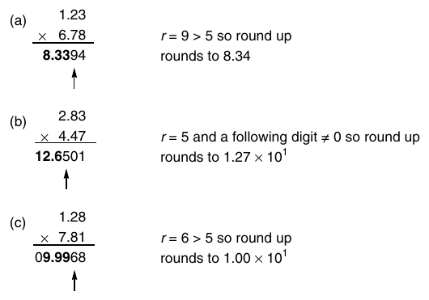

**Hình J.9 Các ví dụ làm tròn một phép nhân. Với cơ số 10 và p = 3, phần (a) và (b) minh họa rằng kết quả của một phép nhân có thể có 2p − 1 hoặc 2p chữ số; do đó, vị trí cộng thêm 1 khi làm tròn lên (ngay bên trái mũi tên) có thể thay đổi. Phần (c) cho thấy làm tròn lên có thể gây ra carry-out.**

Trong hình, p = 3, nên kết quả cuối cùng phải được làm tròn về ba chữ số có nghĩa. Ba chữ số most-significant được in đậm. Chữ số most-significant thứ tư (được đánh dấu bằng mũi tên) là round digit, ký hiệu là r.

Nếu round digit nhỏ hơn 5, các chữ số in đậm biểu diễn kết quả đã làm tròn. Nếu round digit lớn hơn 5 (như trong phần (a)), phải cộng 1 vào least-significant bold digit. Nếu round digit đúng bằng 5 (như trong phần (b)), phải xem xét các chữ số bổ sung để quyết định cắt bỏ hay tăng thêm 1. Chỉ cần biết có chữ số nào phía sau 5 khác không hay không. Trong thuật toán dưới đây, điều này sẽ được ghi nhận bằng một sticky bit. So sánh phần (a) và (b) trong hình cho thấy có hai vị trí khả dĩ cho round digit (so với least-significant digit của tích). Trường hợp (c) minh họa rằng khi cộng 1 vào least-significant bold digit, có thể xuất hiện carry-out. Khi điều này xảy ra, significand cuối cùng phải là 10.0.

Có một phương pháp đơn giản để xử lý làm tròn bằng multiplier trong Hình J.2 (trang J-4) cùng với một sticky bit bổ sung. Nếu p là số bit trong significand, các register A, B và P cần có độ rộng p bit. Nhân hai significand để thu được tích 2p-bit trong các register (P,A) (xem Hình J.10). Trong quá trình nhân, ở p − 2 lần đầu tiên một bit được dịch vào register A, thực hiện OR bit đó vào sticky bit. Bit này sẽ được dùng trong các trường hợp nằm chính giữa. Gọi s là sticky bit, g (viết tắt của guard) là most-significant bit của A, và r (viết tắt của round) là most-significant bit thứ hai của A. Có hai trường hợp:

1. high-order bit của P bằng 0. Dịch P sang trái 1 bit, dịch g bit từ A vào. Không cần dịch phần còn lại của A.

2. high-order bit của P bằng 1. Đặt s := s ∨ r và r := g, rồi cộng 1 vào exponent.

Bây giờ nếu r = 0, P là tích được làm tròn chính xác. Nếu r = 1 và s = 1, P + 1 là tích (trong đó P + 1 có nghĩa là cộng 1 vào least-significant bit của P). Nếu r = 1 và s = 0, chúng ta ở trong trường hợp nằm chính giữa và làm tròn lên tùy theo least-significant bit của P. Chẳng hạn, áp dụng phiên bản thập phân của các quy tắc này cho Hình J.9(b). Sau phép nhân, P = 126 và A = 501, với g = 5, r = 0 và s = 1. Vì high-order digit của P khác không, trường hợp (2) được áp dụng và r := g, nên r = 5, như mũi tên trong Hình J.9 chỉ ra. Vì r = 5, đây có thể là trường hợp nằm chính giữa, nhưng s = 1 cho biết kết quả thực tế hơi lớn hơn 1/2, nên cộng 1 vào P để thu được tích được làm tròn chính xác.

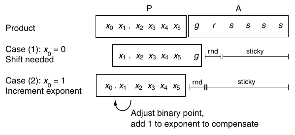

**Hình J.10 Hai trường hợp của thuật toán nhân floating-point. Dòng trên cùng cho thấy nội dung của các register P và A sau khi nhân các significand, với p = 6. Trong trường hợp (1), leading bit bằng 0, nên register P phải được dịch chuyển. Trong trường hợp (2), leading bit bằng 1, không cần dịch chuyển, nhưng cả exponent lẫn round bit và sticky bit đều phải được điều chỉnh. Sticky bit là OR logic của các bit được đánh dấu s.**

Các quy tắc chính xác để làm tròn phụ thuộc vào rounding mode và được đưa ra trong Hình J.11. Lưu ý rằng P không âm, tức là nó chứa độ lớn của kết quả. Một thảo luận tốt về các cách triển khai làm tròn hiệu quả hơn có trong Santoro, Bewick và Horowitz [1989].

**Ví dụ** Trong hệ nhị phân với p = 4, hãy trình bày cách thuật toán nhân tính tích −5 × 10 trong từng rounding mode trong số bốn rounding mode.

**Trả lời** Trong hệ nhị phân, −5 là −1.010<sub>2</sub> × 2<sup>2</sup> và 10 = 1.010<sub>2</sub> × 2<sup>3</sup>. Áp dụng thuật toán nhân integer cho các significand cho kết quả 01100100<sub>2</sub>, nên P = 0110<sub>2</sub>, A = 0100<sub>2</sub>, g = 0, r = 1, và s = 0. high-order bit của P bằng 0, nên trường hợp (1) được áp dụng. Vì vậy, P trở thành 1100<sub>2</sub>, và vì kết quả âm, Hình J.11 cho:

làm tròn về −∞ 1101<sub>2</sub> cộng 1 vì r ∨ s = 1 ⁄ 0 = TRUE

làm tròn về +∞ 1100<sub>2</sub>

làm tròn về 0 1100<sub>2</sub>

làm tròn về số gần nhất 1100<sub>2</sub> không cộng vì r ∧ p<sub>0</sub> = 1 ∧ 0 = FALSE và<br>r ∧ s = 1 ∧ 0 = FALSE

Exponent bằng 2 + 3 = 5, nên kết quả là −1.100<sub>2</sub> × 2<sup>5</sup> = −48, ngoại trừ khi làm tròn về −∞, khi đó kết quả là −1.101<sub>2</sub> × 2<sup>5</sup> = −52.

| Rounding mode | Dấu của kết quả ≥ 0 | Dấu của kết quả < 0 |
|---|---|---|
| –∞ |  | +1 nếu r ∨ s |
| +∞ | +1 nếu r ∨ s |  |
| 0 |  |  |
| Gần nhất | +1 nếu r ∧ p<sub>0</sub> hoặc r ∧ s | +1 nếu r ∧  p<sub>0</sub> hoặc r ∧ s |

**Hình J.11 Các quy tắc để triển khai IEEE rounding mode. Gọi S là độ lớn của kết quả sơ bộ. Các ô trống có nghĩa là p most-significant bit của S là các bit kết quả thực tế. Nếu điều kiện được liệt kê đúng, cộng 1 vào most-significant bit thứ p của S. Các ký hiệu r và s biểu diễn round bit và sticky bit, còn p<sub>0</sub> là most-significant bit thứ p của S.**

Overflow xảy ra khi kết quả đã làm tròn quá lớn để biểu diễn. Với single precision, điều này xảy ra khi kết quả có exponent bằng 128 hoặc lớn hơn. Nếu e<sub>1</sub> và e<sub>2</sub> là hai biased exponent, thì 1 ≤ e<sub>i</sub> ≤ 254, và phép tính exponent e<sub>1</sub> + e<sub>2</sub> − 127 cho các số nằm giữa 1 + 1 − 127 và 254 + 254 − 127, hay giữa −125 và 381. Khoảng số này có thể được biểu diễn bằng 9 bit. Vì vậy, một cách phát hiện overflow là thực hiện các phép tính exponent trong một adder 9-bit (xem Bài tập J.12). Hãy nhớ rằng bạn phải kiểm tra overflow sau khi làm tròn—ví dụ trong Hình J.9(c) cho thấy việc này có thể tạo ra khác biệt.

### Denormal

Kiểm tra underflow phức tạp hơn đôi chút do có các số denormal. Với single precision, nếu kết quả có exponent nhỏ hơn −126, điều đó không nhất thiết chỉ ra underflow, vì kết quả có thể là một số denormal. Chẳng hạn, tích của (1 × 2<sup>–64</sup>) với (1 × 2<sup>–65</sup>) là 1 × 2<sup>–129</sup>, và −129 thấp hơn giới hạn exponent hợp lệ. Nhưng kết quả này là một số denormal hợp lệ, cụ thể là 0.125 × 2<sup>–126</sup>. Nhìn chung, khi unbiased exponent của một tích giảm xuống dưới −126, tích thu được phải được dịch sang phải và exponent phải được tăng cho đến khi exponent đạt −126. Nếu quá trình này khiến toàn bộ significand bị dịch ra ngoài, underflow đã xảy ra. Định nghĩa chính xác của underflow hơi tinh tế—xem Mục J.7 để biết chi tiết.

Khi một trong các toán hạng của phép nhân là denormal, significand của nó sẽ có các bit 0 đứng đầu, nên tích của các significand cũng sẽ có các bit 0 đứng đầu. Nếu exponent của tích nhỏ hơn –126, kết quả là denormal, nên right-shift và tăng exponent như trước. Nếu exponent lớn hơn –126, kết quả có thể là một số normalized. Trong trường hợp này, left-shift tích (đồng thời giảm exponent) cho đến khi nó trở thành normalized hoặc exponent giảm xuống –126.

Các số denormal là một trở ngại lớn khi triển khai phép nhân floating-point, vì chúng đòi hỏi thực hiện một phép dịch với số vị trí thay đổi trong multiplier, trong khi bình thường không cần phép dịch này. Vì thế, các floating-point multiplier high-performance thường không xử lý số denormalized mà tạo trap, để software xử lý chúng. Một số code thực tế thường xuyên gặp underflow ngay cả khi hoạt động đúng, và những chương trình này sẽ chạy chậm hơn khá nhiều trên các hệ thống yêu cầu denormal được xử lý bởi trap handler.

Đến đây chúng ta chưa đề cập cách xử lý toán hạng bằng không. Có thể xử lý bằng cách kiểm tra cả hai toán hạng trước khi bắt đầu phép nhân hoặc kiểm tra tích sau đó. Nếu kiểm tra sau, hãy bảo đảm xử lý đúng trường hợp 0 × ∞: Kết quả là NaN, chứ không phải 0. Khi đã phát hiện kết quả bằng 0, đặt biased exponent bằng 0. Đừng quên dấu. Dấu của một tích là XOR của dấu các toán hạng, ngay cả khi kết quả bằng 0.

### Precision của phép nhân

Trong phần thảo luận về phép nhân integer, chúng ta đã đề cập rằng người thiết kế phải quyết định trả về low-order word của tích hay toàn bộ tích. Một vấn đề tương tự xuất hiện trong phép nhân floating-point, trong đó tích chính xác có thể được làm tròn về precision của các toán hạng hoặc về mức precision cao hơn kế tiếp. Trong trường hợp phép nhân integer, không ngôn ngữ high-level tiêu chuẩn nào có cấu trúc tạo ra một instruction “single nhân single cho double”. Tình hình khác với floating point. Nhiều ngôn ngữ cho phép gán tích của hai biến single-precision cho một biến double-precision, và các thuật toán số cũng có thể tận dụng cấu trúc này. Trường hợp best-known là dùng iterative refinement để giải các hệ phương trình tuyến tính.

## J.5 Phép cộng Floating-Point

Thông thường, một phép toán floating-point nhận hai input có precision p bit và trả về một kết quả p-bit. Thuật toán lý tưởng sẽ tính kết quả này bằng cách trước tiên thực hiện phép toán một cách chính xác, rồi làm tròn kết quả về p bit (dùng rounding mode hiện tại). Thuật toán nhân được trình bày trong mục trước tuân theo chiến lược này. Mặc dù hardware triển khai IEEE arithmetic phải trả về cùng kết quả với thuật toán lý tưởng, nó không cần thực sự thực hiện thuật toán lý tưởng. Trên thực tế, đối với phép cộng, có những cách tốt hơn. Để thấy điều này, hãy xét một số ví dụ.

Trước hết, xét tổng của các số nhị phân 6-bit 1.10011<sub>2</sub> và 1.10001<sub>2</sub> × 2<sup>–5</sup>: Khi các số hạng được dịch chuyển để có cùng exponent, ta có

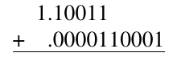

Dùng một adder 6-bit (và bỏ các low-order bit của số hạng thứ hai) cho

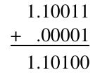

Bit đầu tiên bị bỏ đi là 1. Điều này chưa đủ để quyết định có làm tròn lên hay không. Cần xem xét các bit còn lại bị bỏ đi, 0001. Hay thực ra, chúng ta chỉ cần ghi nhận xem có bit nào trong số này khác không hay không, lưu thông tin đó trong một sticky bit giống như trong thuật toán nhân. Vì vậy, để cộng hai số p-bit, một adder p-bit là đủ, miễn là giữ lại bit đầu tiên bị bỏ đi (round) và OR của các bit còn lại (sticky). Khi đó có thể dùng Hình J.11 để xác định có cần làm tròn lên hay không, giống như với phép nhân. Trong ví dụ phía trên, sticky bằng 1, nên cần làm tròn lên. Tổng cuối cùng là 1.10101<sub>2</sub>.

Đây là một ví dụ khác:

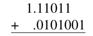

Một adder 6-bit cho:

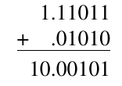

Do carry-out bên trái, round bit không phải bit đầu tiên bị bỏ đi; thay vào đó, nó là low-order bit của tổng (1). Các bit bị bỏ đi, 01, được OR với nhau để tạo sticky. Vì round và sticky đều bằng 1, high-order 6 bit của tổng, 10.0010<sub>2</sub>, phải được làm tròn lên để có kết quả cuối cùng 10.0011<sub>2</sub>.

Tiếp theo, hãy xét phép trừ và ví dụ sau:

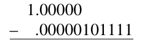

Cách đơn giản nhất để tính kết quả này là chuyển −.00000101111<sub>2</sub> sang dạng two’s complement của nó, để hiệu trở thành tổng:

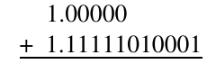

Tính tổng này trong một adder 6-bit cho:

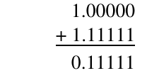

Vì các bit đứng đầu triệt tiêu nhau, bit đầu tiên bị bỏ đi (guard bit) cần được dùng để điền vào least-significant bit của tổng, trở thành 0.111110<sub>2</sub>, và bit thứ hai bị bỏ đi trở thành round bit. Điều này tương tự trường hợp (1) trong thuật toán nhân (xem trang J-19). Round bit bằng 1 chưa đủ để quyết định có làm tròn lên hay không. Thay vào đó, cần OR tất cả các bit còn lại (0001) vào một sticky bit. Trong trường hợp này, sticky bằng 1, nên kết quả cuối cùng phải được làm tròn lên thành 0.111111. Ví dụ này cho thấy nếu phép trừ khiến most-significant bit triệt tiêu, cần một guard bit. Câu hỏi tự nhiên đặt ra là có cần hai guard bit cho trường hợp hai most-significant bit triệt tiêu hay không. Câu trả lời là không, vì nếu x và y gần nhau đến mức hai bit đứng đầu của x − y triệt tiêu, x − y sẽ là kết quả chính xác, nên hoàn toàn không cần guard bit.

Tóm lại, phép cộng phức tạp hơn phép nhân vì tùy theo dấu của các toán hạng, thực tế nó có thể là phép trừ. Nếu là phép cộng, có thể có carry-out bên trái, như trong ví dụ thứ hai. Nếu là phép trừ, có thể có sự triệt tiêu, như trong ví dụ thứ ba. Trong mỗi trường hợp, vị trí của round bit khác nhau. Tuy nhiên, chúng ta không cần tính tổng chính xác rồi mới làm tròn. Có thể suy ra nó từ tổng của các high-order p bit cùng với round bit và sticky bit.

Phần còn lại của mục này dành để thảo luận chi tiết thuật toán cộng floating-point. Gọi a<sub>1</sub> và a<sub>2</sub> là hai số cần cộng. Các ký hiệu e<sub>i</sub> và s<sub>i</sub> được dùng cho exponent và significand của các số hạng a<sub>i</sub>. Điều này có nghĩa là các input floating-point đã được unpack và s<sub>i</sub> có một leading bit tường minh. Để cộng a<sub>1</sub> với a<sub>2</sub>, thực hiện tám bước sau:

1. Nếu e<sub>1</sub>< e<sub>2</sub>, hoán đổi các toán hạng. Điều này bảo đảm hiệu của các exponent thỏa mãn d = e<sub>1</sub> − e<sub>2</sub>≥ 0. Tạm đặt exponent của kết quả bằng e<sub>1</sub>.

2. Nếu dấu của a<sub>1</sub> và a<sub>2</sub> khác nhau, thay s<sub>2</sub> bằng two’s complement của nó.

3. Đặt s<sub>2</sub> trong một register p-bit và dịch sang phải d = e<sub>1</sub> − e<sub>2</sub> vị trí (dịch các bit 1 vào nếu s<sub>2</sub> đã được lấy complement trong bước trước). Từ các bit bị dịch ra ngoài, đặt g bằng most-significant bit, đặt r bằng most-significant bit kế tiếp, và đặt sticky bằng OR của các bit còn lại.

4. Tính significand sơ bộ S = s<sub>1</sub> + s<sub>2</sub> bằng cách cộng s<sub>1</sub> vào register p-bit chứa s<sub>2</sub>. Nếu dấu của a<sub>1</sub> và a<sub>2</sub> khác nhau, most-significant bit của S bằng 1, và không có carry-out, thì S âm. Thay S bằng two’s complement của nó. Điều này chỉ có thể xảy ra khi d = 0.

5. Dịch S như sau. Nếu dấu của a<sub>1</sub> và a<sub>2</sub> giống nhau và có carry-out trong bước 4, dịch S sang phải một bit, điền 1 (carry-out) vào high-order position. Nếu không, dịch sang trái cho đến khi S được normalized. Khi left-shifting, ở lần dịch đầu tiên điền g bit vào low-order position. Sau đó, dịch các bit không vào. Điều chỉnh exponent của kết quả tương ứng.

6. Điều chỉnh r và s. Nếu S được dịch sang phải trong bước 5, đặt r := low-order bit của S trước khi dịch và s := g OR r OR s. Nếu không dịch, đặt r := g, s := r OR s. Nếu có một lần dịch sang trái, không thay đổi r và s. Nếu có hai hoặc nhiều lần dịch sang trái, r := 0, s := 0. (Trong trường hợp cuối, hai hoặc nhiều lần dịch chỉ có thể xảy ra khi a<sub>1</sub> và a<sub>2</sub> trái dấu và có cùng exponent, khi đó phép tính s<sub>1</sub> + s<sub>2</sub> trong bước 4 sẽ chính xác.)

7. Làm tròn S theo Hình J.11; cụ thể, nếu một ô trong bảng không trống, cộng 1 vào low-order bit của S. Nếu làm tròn gây ra carry-out, dịch S sang phải và điều chỉnh exponent. Đây là significand của kết quả.

8. Tính dấu của kết quả. Nếu a<sub>1</sub> và a<sub>2</sub> cùng dấu, đó là dấu của kết quả. Nếu a<sub>1</sub> và a<sub>2</sub> khác dấu, dấu của kết quả phụ thuộc vào số nào trong a<sub>1</sub> hoặc a<sub>2</sub> là số âm, có hoán đổi trong bước 1 hay không, và S có được thay bằng two’s complement của nó trong bước 4 hay không. Xem Hình J.12.

| swap | compl | sign(a<sub>1</sub>) | sign(a<sub>2</sub>) | sign(result) |
|---|---|---|---|---|
| Có |  | + | – | – |
| Có |  | – | + | + |
| Không | Không | + | – | + |
| Không | Không | – | + | – |
| Không | Có | + | – | – |
| Không | Có | – | + | + |

**Hình J.12 Các quy tắc để tính dấu của một tổng khi các số hạng khác dấu. Cột swap chỉ việc hoán đổi các toán hạng trong bước 1, còn cột compl chỉ việc lấy two’s complement trong bước 4. Các ô trống là “không quan tâm”.**

**Ví dụ** Dùng thuật toán để tính tổng (−1.001<sub>2</sub> × 2<sup>–2</sup> ) + (−1.111<sub>2</sub>× 2<sup>0</sup>).

**Trả lời** s<sub>1</sub> = 1.001, e<sub>1</sub> = −2, s<sub>2</sub> = 1.111, e<sub>2</sub> = 0

1. e<sub>1</sub> < e<sub>2</sub>, nên hoán đổi. d = 2. Exponent tạm thời = 0.

2. Dấu của cả hai toán hạng đều âm, không đổi dấu s<sub>2</sub>.

3. Dịch s<sub>2</sub> (1.001 sau khi hoán đổi) sang phải 2 vị trí, cho s<sub>2</sub> = .010, g = 0, r = 1, s = 0.

4. 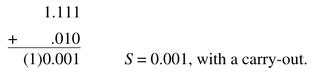

5. Có Carry-out, nên dịch S sang phải, S = 1.000, exp = exp + 1, do đó exp = 1.

6. r = low-order bit của tổng = 1, s = g ∨ r ∨ s = 0 ∨ 1 ∨ 0 = 1.

7. r AND s = TRUE, nên Hình J.11 yêu cầu làm tròn lên, S = S + 1 hay S = 1.001.

8. Cả hai dấu đều âm, nên dấu của kết quả là âm. Kết quả cuối cùng: −S × 2<sup>exp</sup> = 1.001<sub>2</sub> × 2<sup>1</sup>.

**Ví dụ** Dùng thuật toán để tính tổng (−1.010<sub>2</sub>) + 1.100<sub>2</sub>.

**Trả lời** s<sub>1</sub> = 1.010, e<sub>1</sub> = 0, s<sub>2</sub> = 1.100, e<sub>2</sub> = 0

1. Không hoán đổi, d = 0, exponent tạm thời = 0.

2. Các dấu khác nhau, thay s<sub>2</sub> bằng 0.100.

3. d = 0, nên không dịch chuyển. r = g = s = 0.

4. 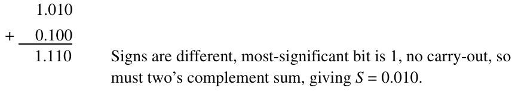

5. Dịch sang trái hai lần, nên S = 1.000, exp = exp − 2, hay exp = −2.

6. Hai lần dịch sang trái, nên r = g = s = 0.

7. Không cần cộng để làm tròn.

8. Kết quả là sign × S × 2<sup>exp</sup> hay sign × 1.000 × 2<sup>–2</sup>. Lấy dấu từ Hình J.12. Vì có complement nhưng không hoán đổi và sign(a<sub>1</sub>) là −, dấu của tổng là +. Vì vậy, kết quả = 1.000<sub>2</sub> × 2<sup>–2</sup>.

### Tăng tốc phép cộng

Hãy ước lượng thời gian cần để thực hiện thuật toán phía trên. Bước 2 có thể cần một phép cộng, bước 4 cần một hoặc hai phép cộng, và bước 7 có thể cần một phép cộng. Nếu cần T đơn vị thời gian để thực hiện một phép cộng p-bit (trong đó p = 24 với single precision, 53 với double), có vẻ thuật toán sẽ cần ít nhất 4T đơn vị thời gian. Nhưng như vậy là quá bi quan. Nếu bước 4 cần hai phép cộng, a<sub>1</sub> và a<sub>2</sub> có cùng exponent và khác dấu, nhưng trong trường hợp đó hiệu là chính xác, nên không cần làm tròn lên trong bước 7. Vì vậy, tối đa chỉ có ba phép cộng xảy ra. Tương tự, có vẻ cần phép dịch với số vị trí thay đổi ở cả bước 3 lẫn bước 5. Nhưng nếu |e<sub>1</sub> − e<sub>2</sub>| ≤ 1, bước 3 chỉ cần dịch sang phải tối đa một vị trí, nên chỉ bước 5 cần phép dịch với số vị trí thay đổi. Và nếu |e<sub>1</sub> − e<sub>2</sub>| > 1, bước 3 cần phép dịch với số vị trí thay đổi, nhưng bước 5 sẽ chỉ cần dịch sang trái tối đa một vị trí. Vì thế, chỉ có một phép dịch với số vị trí thay đổi được thực hiện. Dù vậy, thuật toán cần ba phép cộng tuần tự, vốn có thể khá tốn thời gian với một significand double-precision 53-bit.

Một số kỹ thuật có thể tăng tốc phép cộng. Một kỹ thuật là dùng pipelining. Mục “Putting It All Together” đưa ra các ví dụ về cách một số chip thương mại pipeline phép cộng. Một phương pháp khác (được dùng trên Intel 860 [Kohn và Fu 1989]) là thực hiện hai phép cộng song song. Bây giờ chúng ta giải thích cách phương pháp này giảm latency từ 3T xuống T.

Có ba trường hợp cần xem xét. Trước hết, giả sử cả hai toán hạng cùng dấu. Chúng ta muốn kết hợp các phép cộng ở bước 4 và bước 7. Vị trí của high-order bit trong tổng không được biết trước, vì phép cộng trong bước 4 có thể gây ra carry-out hoặc không. Cả hai khả năng đều được xử lý bằng cách có hai adder. Adder thứ nhất giả định phép cộng trong bước 4 sẽ không tạo ra carry-out. Vì vậy, có thể tính các giá trị r và s trước khi phép cộng thực sự được thực hiện. Nếu r và s cho biết cần làm tròn lên, adder thứ nhất sẽ tính S = s<sub>1</sub> + s<sub>2</sub> + 1, trong đó ký hiệu +1 có nghĩa là cộng 1 tại vị trí least-significant bit của s<sub>1</sub>. Có thể thực hiện điều này bằng một adder thông thường với low-order carry-in bit được đặt bằng 1. Nếu r và s cho biết không cần làm tròn lên, adder tính S = s<sub>1</sub> + s<sub>2</sub> như thông thường. Một chi tiết bổ sung: Khi r = 1, s = 0, bạn cũng cần biết low-order bit của tổng, và cũng có thể tính trước bit này rất nhanh. Adder thứ hai xử lý khả năng có carry-out. Các giá trị r và s cũng như vị trí cộng thêm 1 để làm tròn lên khác với phía trên, nhưng vẫn có thể được tính trước một cách nhanh chóng. Chỉ sau khi phép cộng thực sự hoàn tất mới biết có carry-out hay không, nhưng điều đó không quan trọng. Bằng cách thực hiện cả hai phép cộng song song, có thể bảo đảm một adder đưa ra kết quả đúng.

Trường hợp tiếp theo là khi a<sub>1</sub> và a<sub>2</sub> trái dấu nhưng có cùng exponent. Trong trường hợp này, tổng a<sub>1</sub> + a<sub>2</sub> là chính xác (không cần làm tròn lên), nhưng dấu chưa được biết cho đến khi phép cộng hoàn tất. Vì vậy, không tính two’s complement (vốn cần một phép cộng) ở bước 2, mà thay vào đó tính s̅<sub>1</sub>+ s<sub>2</sub> + 1 và s<sub>1</sub> + s̅<sub>2</sub> + 1 song song. Tổng thứ nhất đồng thời lấy complement của s<sub>1</sub> và tính tổng, cho kết quả s<sub>2</sub> − s<sub>1</sub>. Tổng thứ hai tính s<sub>1</sub>− s<sub>2</sub>. Một trong hai kết quả này sẽ không âm và do đó là kết quả cuối cùng đúng. Một lần nữa, tất cả các phép cộng được thực hiện trong một bước bằng hai adder hoạt động song song.

Trường hợp cuối, khi a<sub>1</sub> và a<sub>2</sub> trái dấu và có exponent khác nhau, phức tạp hơn. Nếu |e<sub>1</sub> − e<sub>2</sub>| > 1, leading bit của hiệu nằm ở một trong hai vị trí, nên có hai trường hợp giống như trong phép cộng. Khi |e<sub>1</sub> − e<sub>2</sub>| = 1, sự triệt tiêu có thể xảy ra và leading bit có thể nằm gần như ở bất kỳ đâu. Tuy nhiên, chỉ khi leading bit của hiệu nằm cùng vị trí với leading bit của s<sub>1</sub> thì mới có thể cần làm tròn lên. Vì vậy, một adder giả định có làm tròn lên, còn adder kia giả định không làm tròn lên. Do đó có thể kết hợp phép cộng ở bước 4 với làm tròn ở bước 7. Tuy nhiên, vẫn còn vấn đề về phép cộng ở bước 2!

Để loại bỏ phép cộng này, hãy xét sơ đồ sau của bước 4:

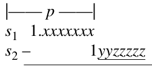

Nếu các bit được đánh dấu z đều bằng 0, có thể tính high-order p bit của S = s<sub>1</sub> − s<sub>2</sub> bằng s<sub>1</sub> +s̅<sub>2</sub> + 1. Nếu ít nhất một z bit bằng 1, dùng s<sub>1</sub> +s̅<sub>2</sub>. Vì thế có thể tính s<sub>1</sub> − s<sub>2</sub> bằng một phép cộng. Tuy nhiên, chúng ta vẫn chưa biết g và r cho two’s complement của s<sub>2</sub>, vốn cần thiết cho làm tròn ở bước 7.

Để tính s<sub>1</sub> − s<sub>2</sub> và thu được các g bit và r bit thích hợp, kết hợp bước 2 và bước 4 như sau. Không lấy complement của s<sub>2</sub> ở bước 2. Mở rộng adder dùng để tính S thêm hai bit về bên phải (gọi tổng mở rộng là S′). Nếu sticky bit sơ bộ (được tính ở bước 3) bằng 1, tính S′ = s<sub>1</sub>′ + s̅<sub>2</sub>′ , trong đó s<sub>1</sub>′ được nối thêm hai bit 0 vào bên phải, và s<sub>2</sub>′ được nối thêm g và r sơ bộ. Nếu sticky bit bằng 0, tính s<sub>1</sub>′ + s̅<sub>2</sub>′ + 1. Bây giờ hai low-order bit của S′ có các giá trị g và r chính xác (sticky bit đã được tính đúng trong bước 3). Cuối cùng, có thể kết hợp thay đổi này với thay đổi kết hợp phép cộng từ bước 4 và bước 7 để đưa ra kết quả cuối cùng trong thời gian T, tức thời gian cho một phép cộng.

Cần xem xét thêm một vài chi tiết, như được thảo luận trong Santoro, Bewick và Horowitz [1989] và Bài tập J.17. Mặc dù bài báo của Santoro nhắm đến phép nhân, phần lớn nội dung thảo luận cũng áp dụng cho phép cộng. Cũng liên quan là Bài tập J.19, trong đó có một phương pháp khác để cộng các số signed magnitude.

### Các số Denormalized

Khác với phép nhân, đối với phép cộng, mô tả phía trên hầu như không thay đổi nếu một trong các input là số denormal. Phải có một phép kiểm tra xem trường exponent có bằng 0 hay không. Nếu bằng 0, khi unpack significand sẽ không có số 1 đứng đầu. Bằng cách đặt biased exponent bằng 1 khi unpack một số denormal, thuật toán hoạt động mà không cần thay đổi.

Để xử lý các output denormalized, cần sửa bước 5 một chút. Dịch S cho đến khi nó được normalized, hoặc cho đến khi exponent trở thành E<sub>min</sub> (tức là biased exponent trở thành 1). Nếu exponent bằng E<sub>min</sub> và sau khi làm tròn, high-order bit của S bằng 1, kết quả là một số normalized và cần được pack theo cách thông thường, bằng cách bỏ số 1. Ngược lại, nếu high-order bit bằng 0, kết quả là denormal. Khi kết quả được unpack, trường exponent phải được đặt bằng 0. Mục J.7 thảo luận các quy tắc chính xác để phát hiện underflow.

Nhân đây, phát hiện overflow rất dễ. Nó chỉ có thể xảy ra nếu bước 5 có phép dịch sang phải và biased exponent tại thời điểm đó được tăng lên 255 đối với single precision (hoặc 2047 đối với double precision), hoặc nếu điều này xảy ra sau khi làm tròn.

## J.6 Phép chia và số dư

Trong mục này, chúng ta sẽ thảo luận phép chia floating-point và số dư.

### Phép chia lặp

Trước đó chúng ta đã thảo luận một thuật toán chia integer. Chuyển nó thành thuật toán chia floating-point tương tự chuyển thuật toán nhân integer sang floating point. Công thức

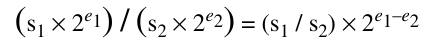

cho thấy nếu divider tính s<sub>1</sub>/s<sub>2</sub>, kết quả cuối cùng sẽ là thương này nhân với 2<sup>e<sub>1</sub>−e<sub>2</sub></sup>. Tham khảo Hình J.2(b) (trang J-4), cách căn chỉnh các toán hạng hơi khác so với phép chia integer. Nạp s<sub>2</sub> vào B và s<sub>1</sub> vào P. Không cần register A để giữ các toán hạng. Khi đó có thể dùng thuật toán chia integer (với một thay đổi nhỏ là bỏ qua lần dịch sang trái đầu tiên), và kết quả sẽ có dạng q<sub>0</sub>.q<sub>1</sub>.... Để làm tròn, chỉ cần tính thêm hai bit của thương (guard và round) và dùng số dư làm sticky bit. Guard digit là cần thiết vì bit đầu tiên của thương có thể bằng 0. Tuy nhiên, vì cả tử số lẫn mẫu số đều được normalized, không thể có hai most-significant bit của thương cùng bằng 0. Thuật toán này tạo ra một bit của thương trong mỗi bước.

Một cách tiếp cận khác đối với phép chia hội tụ đến thương với tốc độ bậc hai thay vì tuyến tính. Một máy thực tế dùng thuật toán này sẽ được thảo luận trong Mục J.10. Trước tiên, chúng ta sẽ mô tả hai thuật toán lặp chính, rồi thảo luận ưu nhược điểm của phương pháp lặp so với các thuật toán trực tiếp. Một kỹ thuật tổng quát để xây dựng các thuật toán lặp, gọi là phép lặp Newton, được minh họa trong Hình J.13. Trước hết, đưa bài toán về dạng tìm nghiệm của một hàm. Sau đó, bắt đầu từ một giá trị đoán cho nghiệm, xấp xỉ hàm bằng tiếp tuyến tại giá trị đoán đó và tạo một giá trị đoán mới dựa trên nơi tiếp tuyến có nghiệm. Nếu x<sub>i</sub> là một giá trị đoán cho một nghiệm, đường tiếp tuyến có phương trình:

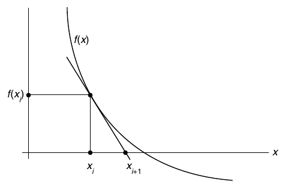

**Hình J.13 Phép lặp Newton để tìm nghiệm. Nếu x<sub>i</sub> là một ước lượng cho nghiệm của f, x<sub>i+1</sub> là một ước lượng tốt hơn. Để tính x<sub>i+1</sub>, tìm giao điểm của trục x<sub>-</sub> với đường tiếp tuyến của f tại f(x<sub>i</sub>)<sub>.</sub>**

y − f (x<sub>i</sub>) = f (x′<sub>i</sub>)(x − x<sub>i</sub>)

Phương trình này có một nghiệm tại

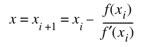 J.6.1

Để đưa phép chia về bài toán tìm nghiệm của một hàm, xét f(x) = x<sup>–1</sup> – b. Vì nghiệm của hàm này nằm tại 1/b, áp dụng phép lặp Newton cho nó sẽ cho một phương pháp lặp để tính 1/b từ b. Dùng f ′(x) = −1/x<sup>2</sup>, Phương trình J.6.1 trở thành:

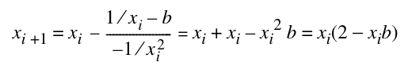 J.6.2

Vì vậy, có thể triển khai phép tính a/b bằng phương pháp sau:

1. Scale b để nằm trong khoảng 1 ≤ b < 2 và lấy một giá trị xấp xỉ của 1/b (gọi là x<sub>0</sub>) bằng table lookup.

2. Lặp x<sub>i+1</sub> = x<sub>i</sub> (2 − x<sub>i</sub> b) cho đến khi đạt một x<sub>n</sub> đủ chính xác.

3. Tính ax<sub>n</sub> và đảo ngược thao tác scale đã thực hiện trong bước 1.

Sau đây là một số chi tiết bổ sung. Cần lặp bước 2 bao nhiêu lần? Nói x<sub>i</sub> chính xác đến p bit có nghĩa là ⏐(x<sub>i</sub> − 1/b)/(1/b)⏐ = 2<sup>−p</sup>, và một phép biến đổi đại số đơn giản cho thấy khi điều này đúng thì (x<sub>i+1</sub>− 1/b)/(1/b) = 2<sup>−2p</sup>. Vì vậy, số bit đúng tăng gấp đôi ở mỗi bước. Phép lặp Newton có tính self-correcting theo nghĩa một sai số trong x<sub>i</sub> thực sự không quan trọng. Tức là nó xem x<sub>i</sub> như một giá trị đoán của 1/b và trả về x<sub>i+1</sub> là một giá trị tốt hơn (xấp xỉ gấp đôi số chữ số đúng). Một nguyên nhân khiến x<sub>i</sub> có sai số là sai số làm tròn. Tuy nhiên, quan trọng hơn, trong những lần lặp đầu, có thể tận dụng việc chúng ta không kỳ vọng nhiều bit đúng bằng cách thực hiện phép nhân với precision giảm bớt, nhờ đó tăng tốc mà không hy sinh độ chính xác. Một ứng dụng khác của phép lặp Newton được thảo luận trong Bài tập J.20.

Phương pháp chia lặp thứ hai đôi khi được gọi là thuật toán Goldschmidt. Nó dựa trên ý tưởng rằng để tính a/b, cần nhân tử số và mẫu số với một số r sao cho rb ≈ 1. Cụ thể hơn, cho x<sub>0</sub> = a và y<sub>0</sub>þ= b *(ghi chú: sách in "y0þ= b"; đúng là "y0 = b")*. Tại mỗi bước tính x<sub>i+1</sub> = r<sub>i</sub>x<sub>i</sub> và y<sub>i+1</sub> = r<sub>i</sub>y<sub>i</sub>. Khi đó thương x<sub>i+1</sub>/y<sub>i+1</sub> = x<sub>i</sub>/y<sub>i</sub> = a/b không đổi. Nếu chọn r<sub>i</sub> sao cho y<sub>i</sub> → 1, thì x<sub>i</sub> → a/b, nên các x<sub>i</sub> hội tụ đến kết quả chúng ta muốn. Cũng có thể dùng ý tưởng này để tính các hàm khác. Chẳng hạn, để tính căn bậc hai của a, cho x<sub>0</sub> = a và y<sub>0</sub> = a, và tại mỗi bước tính x<sub>i+1</sub> = r<sub>i</sub><sup>2</sup>x<sub>i</sub>, y<sub>i+1</sub> = r<sub>i</sub>y<sub>i</sub>. Khi đó x<sub>i+1</sub>/y<sub>i+1</sub><sup>2</sup> = x<sub>i</sub>/y<sub>i</sub><sup>2</sup> = 1/a, nên nếu chọn các r<sub>i</sub> để đưa x<sub>i</sub> → 1, thì y<sub>i</sub> → √a . Kỹ thuật này được dùng để tính căn bậc hai trên TI 8847.

Quay lại thuật toán chia Goldschmidt, đặt x<sub>0</sub> = a và y<sub>0</sub> = b, và viết b = 1 − δ, trong đó ⏐δ ⏐ < 1. Nếu chọn r<sub>0</sub> = 1 + δ, thì y<sub>1</sub> = r<sub>0</sub> y<sub>0</sub> = 1 − δ<sup>2</sup>. Tiếp theo chọn r<sub>1</sub> = 1 + δ<sup>2</sup>, sao cho y<sub>2</sub> = r<sub>1</sub> y<sub>1</sub> = 1 − δ<sup>4</sup>, và cứ tiếp tục như vậy. Vì ⏐δ⏐ < 1, y<sub>i</sub> → 1. Với cách chọn r<sub>i</sub> này, các x<sub>i</sub> sẽ được tính bằng x<sub>i+1</sub> = r<sub>i</sub>x<sub>i</sub> = (1 + δ<sup>2<sup>i</sup></sup>)x<sub>i</sub> = (1 + (1 − b)<sup>2<sup>i</sup></sup>)x<sub>i</sub>, hay

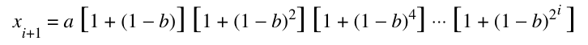 J.6.3

Có vẻ thuật toán này có hai vấn đề. Thứ nhất, hội tụ chậm khi b không gần 1 (tức là δ không gần 0), và thứ hai, công thức không self-correcting—vì thương được tính như tích của các số hạng độc lập, sai số ở một số hạng sẽ không được sửa lại. Để xử lý hội tụ chậm, nếu muốn tính a/b, hãy tra một giá trị nghịch đảo xấp xỉ của b (gọi là b′), và chạy thuật toán trên ab′/bb′. Cách này sẽ hội tụ nhanh vì bb′ ≈ 1.

Để xử lý vấn đề self-correction, cần thực hiện phép tính với thêm một vài bit precision để bù sai số làm tròn. Tuy nhiên, thuật toán Goldschmidt có một dạng self-correction yếu, theo nghĩa giá trị chính xác của các r<sub>i</sub> không quan trọng. Vì vậy, trong một vài lần lặp đầu, khi chưa cần toàn bộ precision của 1 – δ<sup>2<sup>i</sup></sup>, bạn có thể chọn r<sub>i</sub> là một phiên bản cắt bớt của 1 + δ<sup>2<sup>i</sup></sup>, điều này có thể giúp các lần lặp này chạy nhanh hơn mà không ảnh hưởng đến tốc độ hội tụ. Nếu r<sub>i</sub> bị cắt bớt, y<sub>i</sub> không còn chính xác bằng 1 – δ<sup>2<sup>i</sup></sup>. Vì vậy, không còn có thể dùng Phương trình J.6.3, nhưng có thể dễ dàng tổ chức phép tính để nó không phụ thuộc vào giá trị chính xác của r<sub>i</sub>. Với những thay đổi này, thuật toán Goldschmidt như sau (các ghi chú trong ngoặc vuông cho thấy mối liên hệ với các công thức trước đó).

1. Scale a và b sao cho 1 ≤ b < 2.

2. Tra một giá trị xấp xỉ của 1/b (gọi là b′) trong một bảng.

3. Đặt x<sub>0</sub> = ab′ và y<sub>0</sub> = bb′.

4. Lặp cho đến khi x<sub>i</sub> đủ gần a/b:

Loop

r ≈ 2 − y [if y<sub>i</sub> = 1 + δ<sub>i</sub>, then r ≈ 1 − δ<sub>i</sub>]

y = y × r [y<sub>i+1</sub> = y<sub>i</sub> × r ≈ 1 − δ<sub>i</sub><sup>2</sup>]

x<sub>i+1</sub> = x<sub>i</sub> × r [x<sub>i+1</sub> = x<sub>i</sub> × r]

End loop

Hai phương pháp lặp có liên hệ với nhau. Giả sử trong phương pháp Newton, chúng ta unroll phép lặp và tính trực tiếp mỗi số hạng x<sub>i+1</sub> theo b, thay vì tính đệ quy theo x<sub>i</sub>. Bằng cách thực hiện phép tính này (xem Bài tập J.22), chúng ta thấy rằng

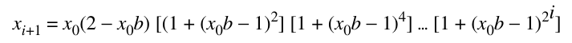

Công thức này rất giống Phương trình J.6.3. Thực ra, chúng giống hệt nhau nếu a và b trong J.6.3 được thay bằng ax<sub>0</sub>, bx<sub>0</sub>, và a = 1. Vì vậy, nếu các phép lặp được thực hiện với precision vô hạn, hai phương pháp sẽ cho chính xác cùng một dãy x<sub>i</sub>.

Ưu điểm của phương pháp lặp là nó không cần hardware chia đặc biệt. Thay vào đó, nó có thể dùng multiplier (tuy nhiên cần thêm phần điều khiển). Hơn nữa, ở mỗi bước, nó tạo ra số chữ số đúng gấp đôi bước trước—khác với phép chia thông thường, vốn tạo ra một số chữ số cố định ở mỗi bước.

Tính nghịch đảo bằng phương pháp lặp có hai nhược điểm. Thứ nhất, tiêu chuẩn IEEE yêu cầu phép chia được làm tròn chính xác, nhưng phương pháp lặp chỉ đưa ra một kết quả gần với kết quả được làm tròn chính xác. Trong trường hợp phép lặp Newton, vốn tính 1/b thay vì trực tiếp tính a/b, còn có một vấn đề nữa. Ngay cả khi 1/b được làm tròn chính xác, không có gì bảo đảm a/b cũng vậy. Một ví dụ trong hệ thập phân với p = 2 là a = 13, b = 51. Khi đó a/b = .2549. . . , được làm tròn thành .25. Nhưng 1/b = .0196. . . , được làm tròn thành .020, và sau đó a × .020 = .26, lệch 1 đơn vị ở chữ số cuối. Nhược điểm thứ hai là phương pháp lặp không cho số dư. Điều này đặc biệt phiền phức nếu hardware chia floating-point được dùng để thực hiện phép chia integer, vì phép toán số dư có trong hầu như mọi ngôn ngữ high-level.

Theo kinh nghiệm truyền thống, cách để nhận được kết quả làm tròn chính xác từ phương pháp lặp là tính 1/b đến hơi nhiều hơn 2p bit, tính a/b đến hơi nhiều hơn 2p bit, rồi làm tròn về p bit. Tuy nhiên, có một cách nhanh hơn, dường như được triển khai lần đầu trên TI 8847. Trong phương pháp này, a/b được tính với thêm khoảng 6 bit precision, cho một thương sơ bộ q. Bằng cách so sánh qb với a (vẫn chỉ với thêm 6 bit), có thể nhanh chóng quyết định q đã được làm tròn chính xác hay cần tăng hoặc giảm 1 ở least-significant place. Thuật toán này được khảo sát thêm trong Bài tập J.21.

Một yếu tố cần tính đến khi quyết định thuật toán chia là tốc độ tương đối của phép chia và phép nhân. Vì phép chia phức tạp hơn phép nhân, nó sẽ chạy chậm hơn. Một quy tắc kinh nghiệm phổ biến là các thuật toán chia nên cố gắng đạt tốc độ bằng khoảng one-third tốc độ của phép nhân. Một lập luận ủng hộ quy tắc này là có những chương trình thực tế (như một số phiên bản spice) có tỷ lệ phép chia so với phép nhân là 1:3. Một nơi khác xuất hiện hệ số 3 là phương pháp lặp tiêu chuẩn để tính căn bậc hai. Phương pháp này cần một phép chia mỗi lần lặp, nhưng có thể được thay bằng một phương pháp dùng ba phép nhân. Điều này được thảo luận trong Bài tập J.20.

### Số dư Floating-Point

Với các số integer không âm, phép chia integer và số dư thỏa mãn:

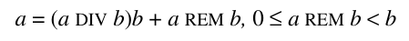

Tương tự, có thể định nghĩa số dư floating-point x REM y bằng x = INT(x/y)y + x REM y. Nên chuyển x/y thành một số integer như thế nào? Hàm số dư IEEE dùng quy tắc round-to-even. Tức là chọn n = INT (x/y) sao cho ⏐x/y − n⏐ ≤ 1/2. Nếu hai giá trị n khác nhau thỏa mãn quan hệ này, chọn số chẵn. Khi đó REM được định nghĩa là x − yn. Khác với integer, trong đó 0 ≤ a REM b < b, với các số floating-point, ⏐x REM y⏐ ≤ y/2. Mặc dù điều này định nghĩa REM một cách chính xác, đây không phải định nghĩa thực dụng để tính toán, vì n có thể rất lớn. Với single precision, n có thể lớn đến 2<sup>127</sup>/2<sup>–126</sup>= 2<sup>253</sup> ≈ 10<sup>76</sup>.

Có một cách tự nhiên để tính REM nếu dùng một thuật toán chia trực tiếp. Tiến hành như thể đang tính x/y. Nếu x = s<sub>1</sub>2<sup>e<sub>1</sub></sup> và y = s<sub>2</sub>2<sup>e<sub>2</sub></sup>, và divider như trong Hình J.2(b) (trang J-4), nạp s<sub>1</sub> vào P và s<sub>2</sub> vào B. Sau e<sub>1</sub> − e<sub>2</sub> bước chia, register P sẽ giữ một số r có dạng x − yn thỏa mãn 0 ≤ r < y. Vì số dư IEEE thỏa mãn ⏐REM⏐ ≤ y/2, REM bằng r hoặc r − y. Chỉ cần theo dõi bit cuối cùng của thương được tạo ra, vốn cần để xử lý các trường hợp nằm chính giữa. Đáng tiếc, e<sub>1</sub> − e<sub>2</sub> có thể tương ứng với rất nhiều bước, và floating-point unit thường bị giới hạn thời gian tối đa được phép dành cho một instruction. Vì vậy, thường không thể triển khai REM trực tiếp. Không chip nào được thảo luận trong Mục J.10 triển khai REM, nhưng chúng có thể làm được bằng cách cung cấp một remainder-step instruction—đây là cách dòng Intel 8087 thực hiện. Một bước số dư nhận hai số x và y làm đối số, và thực hiện các bước chia cho đến khi số dư nằm trong P hoặc đã thực hiện n bước, trong đó n là một số nhỏ, chẳng hạn số bước cần cho phép chia ở mức precision highest-supported. Khi đó có thể triển khai REM dưới dạng một software routine gọi REM step instruction ⎣ (e<sub>1</sub> − e<sub>2</sub>)/n ⎦ lần, ban đầu dùng x làm tử số nhưng sau đó thay bằng số dư từ bước REM trước.

Có thể dùng REM để tính các hàm lượng giác. Để đơn giản hóa, hãy hình dung chúng ta làm việc trong cơ số 10 với năm chữ số có nghĩa, và xét việc tính sin x. Giả sử x = 7. Khi đó có thể rút gọn theo π = 3.1416 và thay vào đó tính sin(7) = sin(7 <sup>−</sup> 2 <sup>×</sup> 3.1416) = sin(0.7168). Nhưng giả sử muốn tính sin(2.0 × 10<sup>5</sup>). Khi đó 2 × 10<sup>5</sup>/3.1416 = 63661.8, trong hệ five-place của chúng ta cho kết quả 63662. Vì nhân 3.1416 với 63662 cho 200000.5392, được làm tròn thành 2.0000 × 10<sup>5</sup>, argument reduction rút gọn 2 × 10<sup>5</sup> thành 0, một kết quả thậm chí không gần đúng. Vấn đề là hệ five-place của chúng ta không có precision đủ để thực hiện argument reduction chính xác. Giả sử có toán tử REM. Khi đó có thể tính 2 × 10<sup>5</sup> REM 3.1416 và thu được −.53920. Tuy nhiên, kết quả này vẫn chưa đúng vì chúng ta dùng 3.1416, một giá trị xấp xỉ của π. Giá trị của 2 × 10<sup>5</sup> REM π là −.071513.

Theo truyền thống, có hai cách tiếp cận để tính các hàm tuần hoàn với đối số lớn. Cách thứ nhất là trả về lỗi cho giá trị của chúng khi x lớn. Cách thứ hai là lưu π với rất nhiều chữ số và thực hiện argument reduction chính xác. Toán tử REM không giúp ích nhiều trong cả hai tình huống này. Có một cách thứ ba đã được dùng trong một số thư viện toán, như bản phát hành Berkeley UNIX 4.3bsd. Trong các thư viện này, π được tính đến số floating-point gần nhất. Hãy gọi đó là machine π, ký hiệu π ′. Khi tính sin x, rút gọn x bằng x REM π′. Như đã thấy trong ví dụ phía trên, x REM π ′ khác khá nhiều so với x REM π khi x lớn, nên tính sin x bằng sin(x REM π ′) sẽ không cho giá trị chính xác của sin x. Tuy nhiên, tính các hàm lượng giác theo cách này có tính chất là mọi đẳng thức quen thuộc (như sin<sup>2</sup>x + cos<sup>2</sup>x = 1) đều đúng trong phạm vi một vài sai số làm tròn. Vì vậy, dùng REM cùng với machine π cung cấp một phương pháp đơn giản để tính các hàm lượng giác, chính xác với đối số nhỏ và vẫn có thể hữu ích với đối số lớn.

Khi REM được dùng cho argument reduction, sẽ rất thuận tiện nếu nó cũng trả về các low-order bit của n (trong đó x REM y = x − ny). Lý do là một cách triển khai thực tế các hàm lượng giác sẽ rút gọn theo một giá trị nhỏ hơn 2π. Chẳng hạn, nó có thể dùng π/2, tận dụng các đẳng thức như sin(x − π/2) = –cos x, sin(x − π) = −sin x. Khi đó cần các low bit của n để chọn đẳng thức đúng.

## J.7 Bàn thêm về Floating-Point Arithmetic

Trước khi kết thúc chủ đề floating-point arithmetic, chúng ta trình bày thêm một vài nội dung.

### Fused Multiply-Add

Có lẽ ứng dụng phổ biến nhất của floating-point unit là thực hiện các phép toán ma trận, và phép toán ma trận thường gặp nhất là nhân ma trận với ma trận (hoặc vector), quy về việc tính một inner product, x<sub>1</sub>⋅y<sub>1</sub> + x<sub>2</sub>⋅y<sub>2</sub> + . . . + x<sub>n</sub>⋅y<sub>n</sub>. Việc tính này cần một chuỗi các tổ hợp multiply-add.

Xuất phát từ điều này, IBM RS/6000 đã giới thiệu một instruction duy nhất tính ab + c, là fused multiply-add. Mặc dù điều này đòi hỏi khả năng đọc ba toán hạng trong một instruction, nó có tiềm năng cải thiện performance khi tính inner product.

Fused multiply-add tính ab + c một cách chính xác rồi mới làm tròn. Mặc dù chỉ làm tròn một lần giúp tăng phần nào độ chính xác của inner product, đó không phải động cơ chính. Có hai ưu điểm chủ yếu của việc làm tròn một lần. Thứ nhất, như đã thấy trong các mục trước, làm tròn tốn kém để triển khai vì có thể cần một phép cộng. Bằng cách chỉ làm tròn một lần, một phép cộng đã được loại bỏ. Thứ hai, độ chính xác bổ sung của fused multiply-add có thể được dùng để tính phép chia và căn bậc hai được làm tròn chính xác khi hardware không trực tiếp hỗ trợ chúng. Fused multiply-add cũng có thể được dùng để triển khai các package floating-point multiple-precision hiệu quả.

Triển khai phép chia được làm tròn chính xác bằng fused multiply-add có nhiều chi tiết, nhưng ý tưởng chính thì đơn giản. Hãy xét lại ví dụ trong Mục J.6 (trang J-30), tính a/b với a = 13, b = 51. Khi đó 1/b được làm tròn thành b′ = .020, và ab′ được làm tròn thành q′ = .26, không phải thương được làm tròn chính xác. Áp dụng fused multiply-add hai lần sẽ điều chỉnh kết quả một cách chính xác, thông qua các công thức

r = a − bq′

q′′ = q′ + rb′

Khi tính với độ chính xác two-digit, bq′ = 51 × .26 được làm tròn thành 13, nên r = a − bq′ sẽ bằng 0, không tạo ra điều chỉnh nào. Nhưng dùng fused multiply-add cho r = a − bq′ = 13 − (51 × .26) = −.26, rồi q′′ = q′ + rb′ = .26 − .0052 = .2548, được làm tròn thành thương đúng .25. Có thể tìm thêm chi tiết trong các bài báo của Montoye, Hokenek và Runyon [1990] và Markstein [1990].

### Các mức precision

Tiêu chuẩn quy định bốn mức precision: single, single extended, double và double extended. Các tính chất của những mức precision này được tóm lược trong Hình J.7 (trang J-16). Các cách triển khai không bắt buộc phải có cả bốn mức precision, nhưng được khuyến khích hỗ trợ tổ hợp single và single extended hoặc đầy đủ single, double và double extended. Vì double precision được dùng rộng rãi trong tính toán khoa học, double precision gần như luôn được triển khai. Vì vậy, người thiết kế máy tính thường chỉ phải quyết định có hỗ trợ double extended hay không, và nếu có thì nó cần có bao nhiêu bit.

Các coprocessor Motorola 68882 và Intel 387 triển khai extended precision bằng kích thước nhỏ nhất được phép là 80 bit (64 bit significand). Tuy nhiên, nhiều chip floating-point high-performance được thiết kế gần đây hơn không triển khai extended precision 80-bit. Một lý do là độ rộng 80-bit của extended precision không thuận tiện với các bus và register 64-bit. Một số architecture mới, như SPARC V8 và PA-RISC, quy định extended (hay quad) precision 128-bit. Chúng đã thiết lập một quy ước de facto cho quad có 15 bit exponent và 113 bit significand.

Mặc dù phần lớn các ngôn ngữ high-level không cung cấp quyền truy cập extended precision, nó rất hữu ích với người viết software toán học. Chẳng hạn, hãy xét việc viết một library routine để tính độ dài của vector (x,y) trong mặt phẳng, cụ thể là √(x<sup>2</sup> + y<sup>2</sup>). Nếu x lớn hơn 2<sup>Emax/2</sup>, tính theo cách hiển nhiên sẽ bị overflow. Điều này có nghĩa là hoặc phạm vi exponent cho phép của subroutine phải giảm đi một nửa, hoặc phải dùng một thuật toán phức tạp hơn có scaling. Nhưng nếu có extended precision, thuật toán đơn giản sẽ hoạt động. Tính độ dài vector là một tác vụ đơn giản, và không khó để nghĩ ra một thuật toán không bị overflow. Tuy nhiên, có những bài toán phức tạp hơn mà extended precision tạo ra khác biệt giữa một thuật toán đơn giản, nhanh và một thuật toán phức tạp hơn nhiều. Một trong những ví dụ tốt nhất là chuyển đổi binary-to-decimal. Một thuật toán chuyển đổi binary-to-decimal hiệu quả, trong đó extended precision giữ vai trò thiết yếu, được trình bày rất dễ đọc trong Coonen [1984]. Thuật toán này cũng được phác thảo ngắn gọn trong Goldberg [1991]. Tính các giá trị chính xác cho các hàm siêu việt là một ví dụ khác về bài toán trở nên dễ hơn nhiều khi có extended precision.

Một điểm rất quan trọng về precision liên quan đến double rounding. Để minh họa trong hệ thập phân, giả sử chúng ta muốn tính 1.9 × 0.66, và single precision có hai chữ số, còn extended precision có ba chữ số. Kết quả chính xác của tích là 1.254. Làm tròn về extended precision cho kết quả 1.25. Khi tiếp tục làm tròn về single precision, chúng ta nhận 1.2. Tuy nhiên, kết quả của 1.9 × 0.66 được làm tròn chính xác về single precision là 1.3. Vì vậy, làm tròn hai lần có thể không cho cùng kết quả như làm tròn một lần. Giả sử bạn muốn xây dựng hardware chỉ thực hiện double-precision arithmetic. Có thể mô phỏng single precision bằng cách trước tiên tính ở double precision rồi làm tròn về single hay không? Ví dụ phía trên gợi ý rằng không thể. Tuy nhiên, double rounding không phải lúc nào cũng nguy hiểm. Thực tế, quy tắc sau là đúng (không dễ chứng minh điều này, nhưng xem Bài tập J.25).

Nếu x và y có significand p-bit, và x + y được tính chính xác rồi làm tròn về q vị trí, làm tròn lần thứ hai về p vị trí sẽ không thay đổi kết quả nếu q ≥ 2p + 2. Điều này không chỉ đúng với phép cộng mà còn với phép nhân, phép chia và căn bậc hai.

Trong ví dụ phía trên, q = 3 và p = 2, nên q ≥ 2p + 2 không đúng. Ngược lại, với IEEE arithmetic, double precision có q = 53 và p = 24, nên q = 53 ≥ 2p + 2 = 50. *(ghi chú: sách in "q Š 2p + 2" ở hai chỗ trong đoạn này; đúng là "≥")* Vì vậy, có thể triển khai single precision bằng cách tính ở double precision—tức là tính kết quả chính xác rồi làm tròn về double—sau đó làm tròn về single precision.

### Exception

Tiêu chuẩn IEEE định nghĩa năm exception: underflow, overflow, divide by zero, inexact và invalid. Theo mặc định, khi các exception này xảy ra, chúng chỉ đặt một flag và phép tính tiếp tục. Các flag là sticky, nghĩa là một khi được đặt, chúng giữ nguyên trạng thái đó cho đến khi được xóa tường minh. Tiêu chuẩn khuyến khích mạnh mẽ các cách triển khai cung cấp một trap-enable bit cho mỗi exception. Khi một exception có trap handler được bật xảy ra, một user trap handler được gọi, và giá trị của exception flag tương ứng không được định nghĩa. Trong Mục J.3 chúng ta đã đề cập rằng √–3 có giá trị NaN và 1/0 là ∞. Đây là các ví dụ về những phép toán phát sinh exception. Theo mặc định, tính √–3 đặt invalid flag và trả về giá trị NaN. Tương tự, 1/0 đặt divide-by-zero flag và trả về ∞.

Các exception underflow, overflow và divide-by-zero có trong phần lớn những hệ thống khác. Invalid exception dành cho kết quả của những phép toán như √–1, 0/0 hoặc ∞ − ∞, vốn không có giá trị tự nhiên nào dưới dạng một số floating-point hay ±∞. Inexact exception là đặc trưng của IEEE arithmetic và xảy ra khi kết quả của một phép toán phải được làm tròn hoặc khi nó bị overflow. Thực tế, vì cả 1/0 lẫn một phép toán bị overflow đều cho ∞, phải tham khảo các exception flag để phân biệt chúng. Inexact exception là một “exception” khác thường, vì nó không thực sự là điều kiện ngoại lệ do xảy ra rất thường xuyên. Vì vậy, bật trap handler cho inexact exception rất có thể sẽ ảnh hưởng nghiêm trọng đến performance. Bật trap handler không ảnh hưởng đến việc một phép toán có là ngoại lệ hay không, trừ trường hợp underflow. Điều này được thảo luận dưới đây.

Tiêu chuẩn IEEE giả định rằng khi một trap xảy ra, có thể xác định phép toán gây trap và các toán hạng của nó. Trên các máy có pipelining hoặc nhiều arithmetic unit, khi một exception xảy ra, chỉ để trap handler xem xét program counter có thể chưa đủ. Có thể cần hỗ trợ từ hardware để xác định chính xác phép toán nào gây trap.

Một vấn đề khác được minh họa bằng đoạn chương trình sau.

```
r1 = r2 /r3
r2 = r4 + r5
```

Hai instruction này hoàn toàn có thể được thực thi song song. Nếu phép chia gây trap, đối số r2 của nó có thể đã bị phép cộng ghi đè, đặc biệt vì phép cộng gần như luôn nhanh hơn phép chia. Các hệ thống máy tính hỗ trợ trapping theo tiêu chuẩn IEEE phải cung cấp một cách lưu giá trị của r2, bằng hardware hoặc bằng cách yêu cầu compiler ngay từ đầu tránh tình huống như vậy. Loại vấn đề này không chỉ riêng floating point mới có. Trong chuỗi

```
r1 = 0(r2)
r2 = r3
```

thực thi r2 = r3 trong khi chờ memory sẽ hiệu quả. Nhưng nếu truy cập 0(r2) gây page fault, r2 có thể không còn sẵn để khởi động lại instruction r1 = 0(r2).

Một cách giải quyết vấn đề này, được dùng trong MIPS R3010, là xác định sớm trong instruction cycle những instruction có thể gây exception. Chẳng hạn, một phép cộng chỉ có thể overflow nếu một trong các toán hạng có exponent bằng E<sub>max</sub>, và tương tự với các trường hợp khác. Phép kiểm tra sớm này mang tính thận trọng: Nó có thể đánh dấu một phép toán thực tế không gây exception. Tuy nhiên, nếu những trường hợp dương tính giả như vậy hiếm xảy ra, kỹ thuật này sẽ có performance rất tốt. Khi một instruction được đánh dấu là có khả năng gây exception, code đặc biệt trong một trap handler có thể tính nó mà không phá hủy bất kỳ trạng thái nào. Hãy nhớ rằng tất cả những vấn đề này chỉ xảy ra khi các trap handler được bật. Nếu không, việc đặt các exception flag trong quá trình xử lý thông thường khá đơn giản.

### Underflow

Chúng ta đã nhiều lần đề cập rằng phát hiện underflow phức tạp hơn phát hiện những exception khác. Tiêu chuẩn IEEE quy định rằng nếu một underflow trap handler được bật, hệ thống phải tạo trap nếu kết quả là denormal. Ngược lại, nếu các trap handler bị tắt, underflow flag chỉ được đặt nếu có mất độ chính xác—tức là nếu kết quả phải được làm tròn. Lý do là nếu không mất độ chính xác khi underflow, không có ích gì khi đặt một flag cảnh báo. Nhưng nếu một trap handler được bật, người dùng có thể đang cố mô phỏng flush-to-zero, và do đó cần được thông báo bất cứ khi nào một kết quả giảm xuống dưới 1.0 × 2<sup>E<sub>min</sub></sup>.

Vì vậy, nếu không có trap handler, underflow exception chỉ được báo hiệu khi kết quả vừa denormal vừa inexact, nhưng cả định nghĩa denormal lẫn inexact đều có thể được diễn giải theo nhiều cách. Thông thường, inexact có nghĩa là đã có một kết quả không thể biểu diễn chính xác và phải được làm tròn. Xét ví dụ (trong một hệ floating-point cơ số 2 với significand 3-bit) (1.11<sub>2</sub> × 2<sup>−2</sup>) × (1.11<sub>2</sub> × 2<sup>E<sub>min</sub></sup>) = 0.110001<sub>2</sub> × 2<sup>E<sub>min</sub></sup>, với chế độ làm tròn về số gần nhất đang có hiệu lực. Kết quả trả về là 0.11<sub>2</sub> × 2<sup>E<sub>min</sub></sup>, vốn phải được làm tròn, khiến inexact được báo hiệu. Nhưng báo hiệu cả underflow có đúng hay không? Gradual underflow làm mất các chữ số có nghĩa vì phạm vi exponent bị giới hạn. Nếu phạm vi exponent không bị giới hạn, kết quả trả về sẽ là 1.10<sub>2</sub> × 2<sup>Emin–1</sup>, chính xác là cùng kết quả thu được với gradual underflow. Vì vậy, việc các số denormalized có ít bit trong significand hơn các số normalized không tạo ra khác biệt nào trong trường hợp này. Phần bình luận về tiêu chuẩn [Cody và cộng sự 1984] khuyến khích dùng điều này làm tiêu chí đặt underflow flag. Tức là cần đặt flag bất cứ khi nào kết quả trả về khác với kết quả sẽ được trả về trong một hệ có cùng kích thước fraction nhưng có phạm vi exponent rất lớn. Tuy nhiên, do khó triển khai cơ chế này, tiêu chuẩn cho phép đặt underflow flag bất cứ khi nào kết quả là denormal và khác với kết quả có precision vô hạn.

Có hai định nghĩa khả dĩ về việc một kết quả là denormal. Xét ví dụ 1.10<sub>2</sub> × 2<sup>–1</sup> nhân với 1.01<sub>2</sub> × 2<sup>E<sub>min</sub></sup>. Tích chính xác là 0.1111 × 2<sup>E<sub>min</sub></sup>. Kết quả làm tròn là số normal 1.00<sub>2</sub> × 2<sup>E<sub>min</sub></sup>. Có nên báo hiệu underflow không? Báo hiệu underflow có nghĩa là bạn dùng quy tắc trước khi làm tròn, vì kết quả là denormal trước khi làm tròn. Không báo hiệu underflow có nghĩa là bạn dùng quy tắc sau khi làm tròn, vì kết quả được normalized sau khi làm tròn. Tiêu chuẩn IEEE cho phép chọn một trong hai quy tắc; tuy nhiên, quy tắc đã chọn phải được dùng nhất quán cho mọi phép toán.

Để minh họa các quy tắc này, xét phép cộng floating-point. Khi kết quả của phép cộng (hoặc phép trừ) là denormal, nó luôn chính xác. Vì vậy, không bao giờ cần đặt underflow flag cho phép cộng. Đó là vì nếu trap không được bật thì không có exception nào được phát sinh. Còn nếu trap được bật, giá trị của underflow flag không được định nghĩa, nên một lần nữa không cần đặt nó.

Cần đề cập một điểm tinh tế cuối cùng về underflow. Khi không có underflow trap handler, kết quả của một phép toán trên các số p-bit gây underflow là một số denormal có precision p − 1 bit hoặc ít hơn. Khi trap được bật, trap handler được cung cấp kết quả của phép toán đã làm tròn về p bit và với exponent được wrap around. Lúc này có một vấn đề doublerounding tiềm tàng. Nếu trap handler muốn trả về kết quả denormal, nó không thể chỉ làm tròn đối số của mình, vì điều đó có thể dẫn đến lỗi doublerounding. Do đó, trap handler phải được truyền ít nhất một bit thông tin bổ sung để có thể đưa ra kết quả được làm tròn chính xác.

## J.8 Tăng tốc phép cộng Integer

Mục trước cho thấy có nhiều bước để triển khai các phép toán floating-point; tuy nhiên, mỗi phép toán floating-point cuối cùng đều quy về một phép toán integer. Vì thế, tăng tốc các phép toán integer cũng sẽ dẫn đến floating point nhanh hơn.

Phép cộng integer là phép toán đơn giản nhất và quan trọng nhất. Ngay cả với các chương trình không thực hiện arithmetic tường minh, phép cộng vẫn phải được thực hiện để tăng program counter và tính địa chỉ. Mặc dù phép cộng đơn giản, không có một cách tốt nhất duy nhất để thực hiện phép cộng high-speed. Chúng ta sẽ thảo luận ba kỹ thuật hiện đang được dùng: carry-lookahead, carry-skip và carry-select.

### Carry-Lookahead

Một adder n-bit chỉ là một combinational circuit. Vì thế, nó có thể được viết bằng một công thức logic có dạng tổng của các tích và có thể được tính bằng một mạch với hai mức logic. Làm thế nào để xác định mạch này trông như thế nào? Từ Phương trình J.2.1 (trang J-3), công thức cho tổng thứ i có thể được viết là:

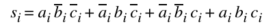 J.8.1

trong đó c<sub>i</sub> vừa là carry-in của adder thứ i vừa là carry-out từ adder thứ (i−1)-st.

Vấn đề với công thức này là mặc dù biết các giá trị a<sub>i</sub> và b<sub>i</sub> —chúng là input của mạch—chúng ta không biết c<sub>i</sub>. Vì vậy, mục tiêu là viết c<sub>i</sub> theo a<sub>i</sub> và b<sub>i</sub>. Để làm điều này, trước tiên chúng ta viết lại Phương trình J.2.2 (trang J-3) thành:

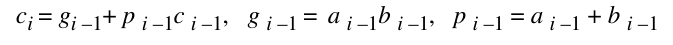 J.8.2

Đây là lý do dùng các ký hiệu p và g: Nếu g<sub>i–1</sub> đúng, c<sub>i</sub> chắc chắn đúng, nên một carry được tạo ra. Vì thế, g viết tắt của generate. Nếu p<sub>i–1</sub> đúng, thì nếu c<sub>i–1</sub> đúng, nó được truyền đến c<sub>i</sub>. Bắt đầu với Phương trình J.8.1 và dùng Phương trình J.8.2 để thay c<sub>i</sub> bằng g<sub>i–1</sub> + p<sub>i–1</sub>c<sub>i–1</sub>. Sau đó, dùng Phương trình J.8.2 với i− 1 thay cho i để thay c<sub>i–1</sub> bằng c<sub>i–2</sub>, và cứ tiếp tục như vậy. Điều này cho kết quả:

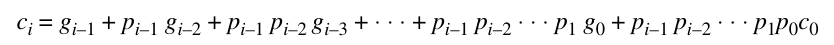 J.8.3

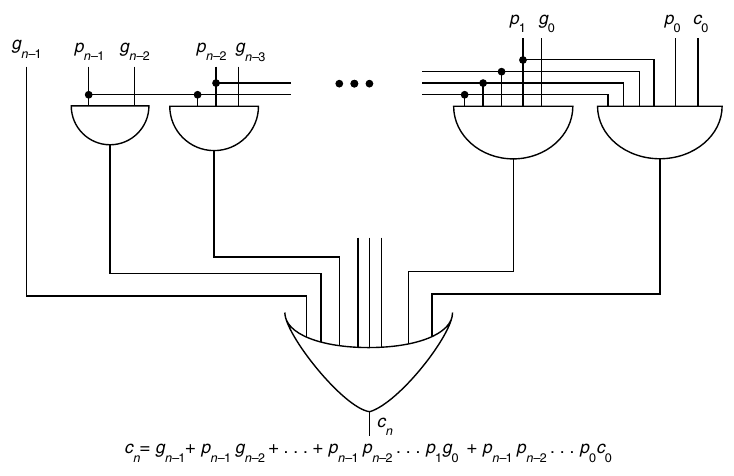

**Hình J.14 Mạch carry-lookahead thuần túy để tính carry-out c<sub>n</sub> của một adder n-bit.**

Một adder tính carry bằng Phương trình J.8.3 được gọi là carry-lookahead adder, hay CLA. CLA cần một mức logic để tạo p và g, hai mức để tạo các carry, và hai mức cho tổng, tổng cộng là năm mức logic. Đây là một cải thiện rất lớn so với 2n mức mà ripple-carry adder cần.

Đáng tiếc, như có thể thấy từ Phương trình J.8.3 hoặc Hình J.14, một carry-lookahead adder trên n bit cần fan-in bằng n + 1 ở OR gate cũng như ở AND gate ngoài cùng bên phải. Ngoài ra, tín hiệu p<sub>n–1</sub> phải điều khiển n AND gate. Hơn nữa, cấu trúc khá không đều và nhiều dây dài trong Hình J.14 khiến việc xây dựng một carry-lookahead adder đầy đủ khi n lớn trở nên không thực tế.

Tuy nhiên, có thể dùng ý tưởng carry-lookahead để xây dựng một adder có khoảng log<sub>2</sub>n mức logic (ít hơn đáng kể so với 2n mức mà ripple-carry adder cần), đồng thời vẫn có cấu trúc đơn giản, đều đặn. Ý tưởng là xây dựng các p và g theo từng bước. Chúng ta đã thấy rằng

c<sub>1</sub> = g<sub>0</sub> + c<sub>0</sub>p<sub>0</sub>

Điều này nói rằng có carry-out từ vị trí thứ 0 (c<sub>1</sub>) nếu có một carry được tạo ra ở vị trí thứ 0, hoặc nếu có một carry đi vào vị trí thứ 0 và carry đó được truyền tiếp. Tương tự,

c<sub>2</sub> = G<sub>01</sub> + P<sub>01</sub>c<sub>0</sub>

G<sub>01</sub> có nghĩa là có một carry được tạo ra từ khối gồm hai bit đầu tiên. P<sub>01</sub> có nghĩa là một carry được truyền xuyên qua khối này. P và G có các phương trình logic sau:

G<sub>01</sub> = g<sub>1</sub> + p<sub>1</sub>g<sub>0</sub>

P<sub>01</sub> = p<sub>1</sub>p<sub>0</sub>

Tổng quát hơn, với bất kỳ j nào thỏa mãn i < j, j + 1 < k, chúng ta có các quan hệ đệ quy:

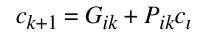 J.8.4

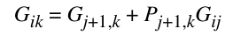 J.8.5

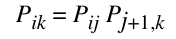 J.8.6

Phương trình J.8.5 nói rằng một carry được tạo ra từ khối gồm các bit từ i đến k, bao gồm cả hai đầu, nếu nó được tạo ra trong high-order part của khối (j + 1, k), hoặc nếu nó được tạo ra trong low-order part của khối (i,j) rồi được truyền xuyên qua phần cao. Những phương trình này cũng đúng với i ≤ j < k nếu đặt G<sub>ii</sub> = g<sub>i</sub> và P<sub>ii</sub> = p<sub>i</sub>.

**Ví dụ** Biểu diễn P<sub>03</sub> và G<sub>03</sub> theo các p và g.

**Trả lời** Dùng Phương trình J.8.6, P<sub>03</sub> = P<sub>01</sub>P<sub>23</sub> = P<sub>00</sub>P<sub>11</sub>P<sub>22</sub>P<sub>33</sub>. Vì P<sub>ii</sub> = p<sub>i</sub>, P<sub>03</sub> = p<sub>0</sub> p p p . Với G<sub>12</sub> 3<sub>03</sub>, Phương trình J.8.5 cho G<sub>03</sub> = G<sub>23</sub> + P<sub>23</sub>G<sub>01</sub> = (G<sub>33</sub> + P<sub>33</sub>G<sub>22</sub>) + (P<sub>22</sub>P<sub>33</sub>)(G<sub>11</sub> + P<sub>11</sub>G<sub>00</sub>) = g<sub>3</sub> + p<sub>3</sub> g<sub>2</sub> + p<sub>3</sub>p<sub>2</sub>g<sub>1</sub> + p<sub>3</sub>p<sub>2</sub>p<sub>1</sub> g<sub>0</sub>.

Sau các kiến thức chuẩn bị này, giờ đây có thể trình bày thiết kế một CLA thực tế. Adder gồm hai phần. Phần thứ nhất tính các giá trị P và G khác nhau từ p <sub>i</sub> và g<sub>i</sub>, dùng Phương trình J.8.5 và J.8.6; phần thứ hai dùng các giá trị P và G này để tính mọi carry thông qua Phương trình J.8.4. Phần thứ nhất của thiết kế được minh họa trong Hình J.15. Ở đầu sơ đồ, các số input a<sub>7</sub>. . . a<sub>0</sub> và b .<sub>7</sub>. . b<sub>0</sub> được chuyển thành các p và g bằng các cell loại 1. Sau đó, các P và G khác nhau được tạo ra bằng cách kết hợp các cell loại 2 trong một cấu trúc cây nhị phân. Phần thứ hai của thiết kế được minh họa trong Hình J.16. Bằng cách đưa c<sub>0</sub> vào đáy cây này, tất cả các carry bit xuất hiện ở đỉnh. Mỗi cell phải biết một cặp giá trị (P,G) để thực hiện phép chuyển đổi, và giá trị nó cần được viết bên trong các cell. Bây giờ hãy so sánh Hình J.15 và J.16. Có một tương ứng one-to-one giữa các cell, và giá trị (P,G) mà các cell tạo carry cần chính xác là giá trị được biết bởi các cell tạo (P,G) tương ứng. Cell kết hợp được minh họa trong Hình J.17. Các số cần cộng đi vào từ đỉnh rồi đi xuống qua cây, kết hợp với c<sub>0</sub> ở đáy, rồi đi ngược lên cây để tạo các carry. Lưu ý rằng còn thiếu một điều trong Hình J.17: một phần logic bổ sung nhỏ để tính c<sub>8</sub> cho carry-out của adder.

Các bit trong một CLA phải đi qua khoảng log<sub>2</sub>n mức logic, so với 2n của ripple-carry adder. Đây là một cải thiện đáng kể về tốc độ, đặc biệt khi n lớn. Tuy nhiên, trong khi ripple-carry adder có n cell, CLA có 2n cell, mặc dù trong layout của chúng ta chúng chiếm không gian n log n. Điểm chính là một khoản đầu tư nhỏ về kích thước mang lại cải thiện rất lớn về tốc độ.

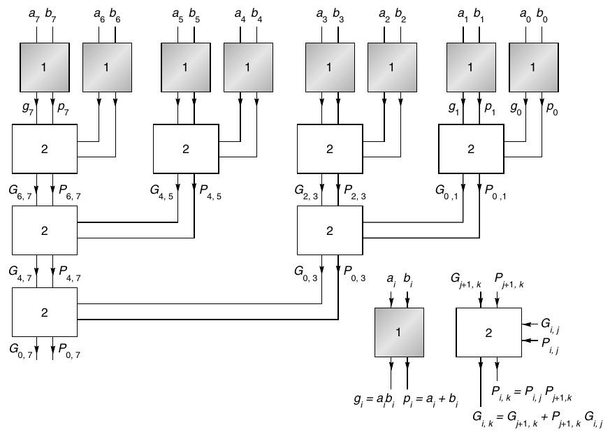

**Hình J.15 Phần thứ nhất của cây carry-lookahead. Khi các tín hiệu đi từ đỉnh xuống đáy, các giá trị P và G khác nhau được tính.**

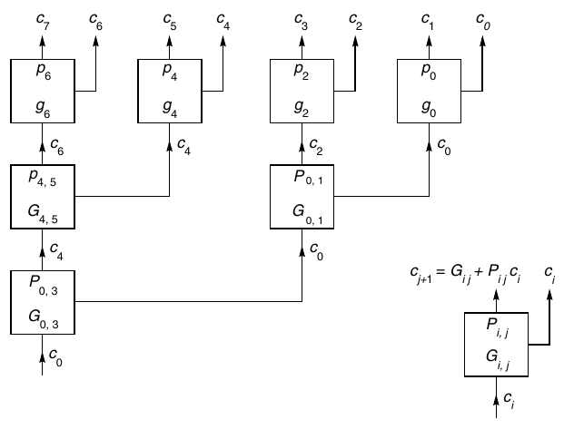

**Hình J.16 Phần thứ hai của cây carry-lookahead. Các tín hiệu đi từ đáy lên đỉnh, kết hợp với P và G để tạo các carry.**

Một số thay đổi technology-dependent có thể cải thiện CLA. Chẳng hạn, nếu mỗi node của cây có ba input thay vì hai, chiều cao của cây sẽ giảm từ log<sub>2</sub>n xuống log<sub>3</sub>n. Tất nhiên, các cell sẽ phức tạp hơn và do đó có thể hoạt động chậm hơn, làm mất ưu điểm của việc giảm chiều cao. Với các công nghệ mà rippling hoạt động tốt, một thiết kế lai có thể tốt hơn. Điều này được minh họa trong Hình J.19. Các carry truyền lần lượt giữa các adder ở mức trên cùng, trong khi các ô “B” giống với những ô trong Hình J.17. Thiết kế này sẽ nhanh hơn nếu thời gian truyền carry giữa bốn adder ngắn hơn thời gian cần để đi qua một mức các ô “B”. (Để làm rõ mô hình hơn, Hình J.19 cho thấy một adder 16-bit, nên adder 8-bit trong Hình J.17 tương ứng với nửa bên phải của Hình J.19.)

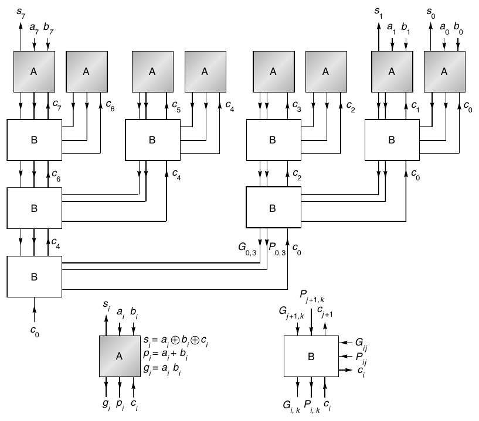

**Hình J.17 Adder dạng cây carry-lookahead hoàn chỉnh. Đây là sự kết hợp của Hình J.15 và J.16. Các số cần cộng đi vào từ đỉnh, đi xuống đáy để kết hợp với c<sub>0</sub>, rồi đi ngược lên để tính các sum bit.**

### Carry-Skip Adder

Một carry-skip adder nằm giữa ripple-carry adder và carry-lookahead adder, cả về tốc độ lẫn chi phí. (carry-skip adder không được gọi là CSA, vì tên này được dành cho carry-save adder.) Động cơ cho adder này xuất phát từ việc xem xét các phương trình của P và G. Chẳng hạn,

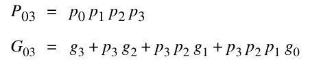

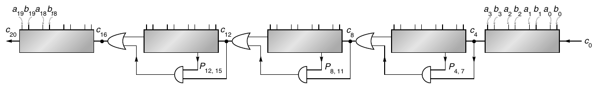

**Hình J.18 Carry-skip adder. Đây là một carry-skip adder 20-bit (n = 20), với mỗi khối rộng 4 bit (k = 4).**

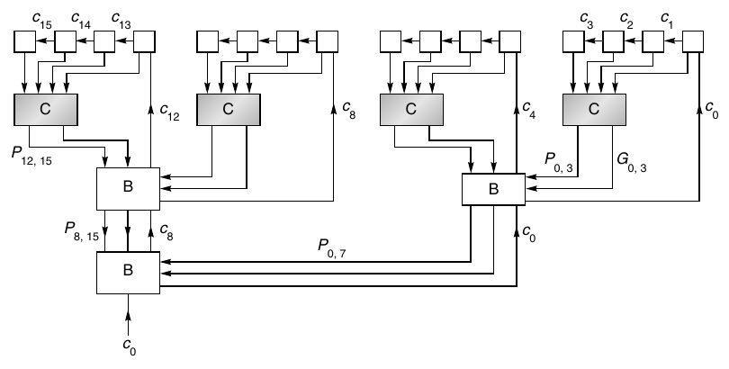

**Hình J.19 Kết hợp CLA và ripple-carry adder. Ở hàng trên cùng, các carry truyền lần lượt bên trong mỗi nhóm bốn ô.**

Tính P đơn giản hơn nhiều so với tính G, và một carry-skip adder chỉ tính các P. Một adder như vậy được minh họa trong Hình J.18. Các carry bắt đầu truyền lần lượt đồng thời qua mỗi khối. Nếu bất kỳ khối nào tạo ra một carry, carry-out của một khối sẽ đúng, mặc dù carry-in vào khối có thể chưa đúng. Nếu ở đầu mỗi phép cộng, carry-in vào mỗi khối bằng 0, sẽ không có carry-outs giả nào được tạo ra. Vì thế, có thể xem carry-out của mỗi khối như tín hiệu G. Khi carry-out từ least-significant block được tạo ra, nó không chỉ được đưa vào khối tiếp theo mà còn được đưa qua AND gate với tín hiệu P từ khối tiếp theo đó. Nếu cả carry-out lẫn P đều đúng, carry bỏ qua khối thứ hai và sẵn sàng đi vào khối thứ ba, và cứ tiếp tục như vậy. carry-skip adder chỉ thực tế nếu các carry-in signal có thể dễ dàng được xóa ở đầu mỗi phép toán—chẳng hạn, bằng precharging trong CMOS.

Để phân tích tốc độ của một carry-skip adder, giả sử một tín hiệu cần 1 đơn vị thời gian để đi qua hai mức logic. Khi đó, một carry cần k đơn vị thời gian để truyền lần lượt qua một khối kích thước k, và cần 1 đơn vị thời gian để bỏ qua một khối. Đường tín hiệu dài nhất trong carry-skip adder bắt đầu bằng một carry được tạo ra ở vị trí thứ 0. Nếu adder rộng n bit, cần k đơn vị thời gian để truyền qua khối đầu tiên, n/k − 2 đơn vị thời gian để bỏ qua các khối, và thêm k để truyền qua khối cuối cùng. Cụ thể: nếu có một adder 20-bit được chia thành các nhóm 4 bit, cần 4 + (20/4 − 2) + 4 = 11 đơn vị thời gian để thực hiện một phép cộng. Một vài thử nghiệm cho thấy có những cách hiệu quả hơn để chia 20 bit thành các khối. Chẳng hạn, xét năm khối với least-significant 2 bit nằm trong khối đầu tiên, 5 bit tiếp theo trong khối thứ hai, rồi đến các khối kích thước 6, 5 và 2. Khi đó thời gian cộng giảm xuống 9 đơn vị thời gian. Điều này minh họa một nguyên tắc tổng quát quan trọng. Với carry-skip adder, làm cho các khối bên trong lớn hơn sẽ tăng tốc adder. Thực tế, ý tưởng thay đổi kích thước khối này đôi khi cũng có thể tăng tốc những thiết kế adder khác. Do có nhiều hoạt động truyền carry lần lượt, carry-skip adder phù hợp nhất với các công nghệ mà rippling diễn ra nhanh.

### Carry-Select Adder

Một carry-select adder hoạt động theo nguyên tắc sau: Hai phép cộng được thực hiện song song, một giả định carry-in bằng 0 và phép kia giả định carry-in bằng 1. Khi cuối cùng biết carry-in, chỉ cần chọn tổng đúng (đã được tính trước). Một ví dụ về thiết kế như vậy được minh họa trong Hình J.20. Một adder 8-bit được chia thành hai nửa, và carry-out từ nửa dưới được dùng để chọn các sum bit từ nửa trên. Nếu mỗi khối tính tổng bằng rippling (một thuật toán thời gian tuyến tính), thiết kế trong Hình J.20 nhanh gấp đôi với chi phí tăng 50%. Tuy nhiên, lưu ý rằng tín hiệu c<sub>4</sub> phải điều khiển nhiều mux, điều này có thể rất chậm trong một số công nghệ. Thay vì chia adder thành hai nửa, có thể chia thành bốn phần để tăng tốc hơn nữa. Điều này được minh họa trong Hình J.21. Nếu một khối cần k đơn vị thời gian để cộng các số k-bit, và nếu cần 1 đơn vị thời gian để tính mux input từ hai carry-out signal, thì để hoạt động tối ưu mỗi khối nên rộng hơn khối tiếp theo 1 bit, như trong Hình J.21. Vì vậy, giống như carry-skip adder, thiết kế tốt nhất dùng các khối variable-size.

Để tóm lược mục này, các yêu cầu tiệm cận về thời gian và không gian của những adder khác nhau được đưa ra trong Hình J.22. (Thời gian của carry-skip và carry-select xuất phát từ việc lựa chọn kích thước khối cẩn thận. Xem Bài tập J.26 cho carry-skip adder.) Không nên xem các adder khác nhau này là những lựa chọn tách biệt, mà nên xem chúng là các thành phần dùng để xây dựng một adder. Tính hữu dụng của những thành phần này phụ thuộc rất nhiều vào công nghệ được dùng. Chẳng hạn, carry-select adder hoạt động tốt khi một tín hiệu có thể điều khiển nhiều mux, và carry-skip adder hấp dẫn trong những công nghệ cho phép xóa các tín hiệu ở đầu mỗi phép toán. Biết hành vi tiệm cận của adder giúp hiểu chúng, nhưng dựa quá nhiều vào hành vi đó là một cạm bẫy. Lý do là hành vi tiệm cận chỉ quan trọng khi n trở nên rất lớn. Nhưng n của một adder là số bit precision, và double precision ngày nay vẫn giống như 20 năm trước—khoảng 53 bit. Mặc dù đúng là khi máy tính nhanh hơn, các phép tính dài hơn—và do đó có nhiều sai số làm tròn hơn, từ đó đòi hỏi precision cao hơn—hiệu ứng này tăng rất chậm theo thời gian.

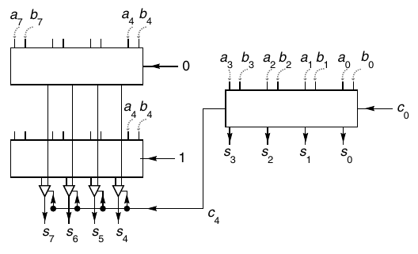

**Hình J.20 carry-select adder đơn giản. Đồng thời với việc tính tổng của low-order 4 bit, các high-order bit được tính hai lần song song: một lần giả định c<sub>4</sub>= 0 và một lần giả định c<sub>4</sub> = 1.**

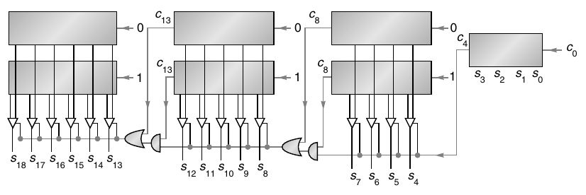

**Hình J.21 Carry-select adder. Ngay khi biết carry-out của khối ngoài cùng bên phải, nó được dùng để chọn các sum bit khác.**

| Adder | Thời gian | Không gian |
|---|---|---|
| Ripple | 0(n) | 0(n) |
| CLA | 0(log n) | 0(n log n) |
| Carry-skip | 0( √n ) | 0(n) |
| Carry-select | 0( √n ) | 0(n) |

**Hình J.22 Các yêu cầu tiệm cận về thời gian và không gian cho bốn loại adder khác nhau.**

## J.9 Tăng tốc phép nhân và phép chia Integer

Các thuật toán nhân và chia được trình bày trong Mục J.2 khá chậm, tạo ra 1 bit mỗi cycle (mặc dù cycle đó có thể là một phần của thời gian instruction cycle của CPU). Trong mục này, chúng ta thảo luận các kỹ thuật khác nhau cho phép nhân và phép chia higher-performance, bao gồm thuật toán chia được dùng trong chip Pentium.

### Dịch qua các bit không

Mặc dù kỹ thuật dịch qua các bit không hiện không được dùng nhiều, việc xem xét nó mang tính gợi mở. Đặc điểm nổi bật của nó là thời gian thực thi phụ thuộc vào toán hạng. Nó ít được dùng chủ yếu vì không mang lại đủ mức tăng tốc so với các thuật toán bit-at-a-time. Ngoài ra, pipelining, đồng bộ hóa với CPU, và tối ưu hóa tốt từ compiler đều khó thực hiện với những thuật toán chạy trong thời gian thay đổi. Trong phép nhân, ý tưởng đằng sau việc dịch qua các bit không là thêm logic phát hiện khi low-order bit của register A bằng 0 (xem Hình J.2(a) ở trang J-4), và nếu đúng thì bỏ qua bước cộng và chuyển thẳng sang bước dịch—do đó có tên dịch qua các bit không.

Còn dịch chuyển trong phép chia thì sao? Trong nonrestoring division, một phép toán ALU (cộng hoặc trừ) được thực hiện ở mỗi bước. Có vẻ không có cơ hội bỏ qua một phép toán. Nhưng hãy suy nghĩ về phép chia theo cách này: Để tính a/b, trừ các bội của b khỏi a, rồi báo cáo đã thực hiện bao nhiêu phép trừ. Ở mỗi giai đoạn của quá trình trừ, số dư phải vừa trong register P của Hình J.2(b) (trang J-4). Khi số dư là một số dương nhỏ, thông thường bạn trừ b; nhưng giả sử thay vào đó chỉ dịch số dư và trừ b ở lần tiếp theo. Miễn là số dư đủ nhỏ (high-order bit của nó bằng 0), sau khi dịch nó vẫn vừa trong register P, và không mất thông tin. Tuy nhiên, phương pháp này đòi hỏi thay đổi cách theo dõi số lần b đã được trừ khỏi a. Ý tưởng này thường mang tên SRT division, theo Sweeney, Robertson và Tocher, những người độc lập đề xuất các thuật toán thuộc loại này. Điểm phức tạp bổ sung chủ yếu của SRT division là không thể xác định ngay các bit của thương từ dấu của P ở mỗi bước, như có thể làm trong nonrestoring division thông thường.

Chính xác hơn, để chia a cho b trong đó a và b là các số n-bit, lần lượt nạp a và b vào các register A và B của Hình J.2 (trang J-4).

**Phép chia SRT**

1. Nếu B có k bit không đứng đầu khi được biểu diễn bằng n bit, dịch tất cả các register sang trái k bit.

2. Với i = 0, n − 1,

(a) Nếu ba bit đứng đầu của P bằng nhau, đặt q<sub>i</sub> = 0 và dịch (P,A) sang trái một bit.

(b) Nếu ba bit đứng đầu của P không hoàn toàn bằng nhau và P âm, đặt q<sub>i</sub> = −1 (cũng được viết là 1̅), dịch (P,A) sang trái một bit, và cộng B.

(c) Nếu không, đặt q<sub>i</sub> = 1, dịch (P,A) sang trái một bit, và trừ B.

End loop

3. Nếu số dư cuối cùng âm, hiệu chỉnh số dư bằng cách cộng B, và hiệu chỉnh thương bằng cách trừ 1 khỏi q<sub>0</sub>. Cuối cùng, số dư phải được dịch sang phải k bit, trong đó k là số bit dịch ban đầu.

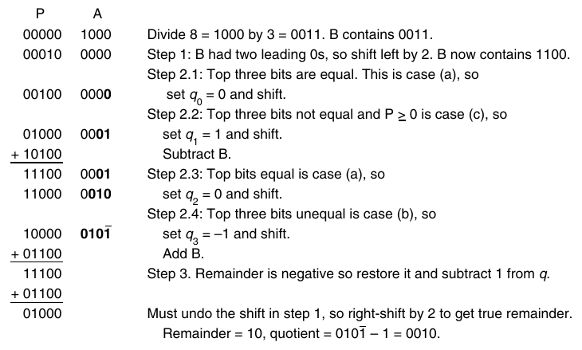

**Hình J.23 Phép chia SRT của 1000<sub>2</sub>/0011<sub>2</sub>. Các bit của thương được in đậm, dùng ký hiệu 1̅ cho −1.**

Một ví dụ số được đưa ra trong Hình J.23. Mặc dù đang thảo luận phép chia integer, để giải thích thuật toán, sẽ hữu ích nếu hình dung binary point nằm ngay bên trái most-significant bit. Điều này đổi Hình J.23 từ 01000<sub>2</sub>/0011<sub>2</sub> thành 0.1000<sub>2</sub>/.0011<sub>2</sub>. Vì binary point được thay đổi ở cả tử số lẫn mẫu số, thương không bị ảnh hưởng. Cặp register (P,A) giữ số dư và là một số two’s complement. Chẳng hạn, nếu P chứa 11110<sub>2</sub> và A = 0, số dư là 1.1110<sub>2</sub> = −1/8. Nếu r là giá trị của số dư, thì −1 ≤ r < 1.

Với những kiến thức chuẩn bị này, giờ đây có thể phân tích thuật toán SRT division. Bước đầu tiên của thuật toán dịch b sao cho b ≥ 1/2. Quy tắc chọn phép toán ALU cần thực hiện như sau: Nếu −1/4 ≤ r < 1/4 (đúng bất cứ khi nào ba bit đứng đầu của P bằng nhau), tính 2r bằng cách dịch (P,A) sang trái một bit; nếu r < 0 (và do đó r < −1/4, vì nếu không nó đã bị loại bởi điều kiện đầu tiên), tính 2r + b bằng cách dịch rồi cộng; nếu r ≥ 1/4 thì trừ b khỏi 2r. Dùng b ≥ 1/2, dễ kiểm tra rằng các quy tắc này giữ −1/2 ≤ r < 1/2. Với nonrestoring division, chúng ta chỉ có ⏐r⏐ ≤ b, và cần P rộng n + 1 bit. Nhưng với SRT division, giới hạn trên r chặt hơn, cụ thể là −1/2 ≤ r < 1/2. Vì vậy, có thể tiết kiệm một bit bằng cách bỏ high-order bit của P (và b cũng như adder). Đặc biệt, phép kiểm tra ba bit đứng đầu của P bằng nhau trở thành phép kiểm tra chỉ trên hai bit.

Thuật toán có thể thay đổi đôi chút trong một cách triển khai SRT division. Sau mỗi phép toán ALU, register P có thể được dịch bao nhiêu vị trí tùy cần thiết để làm cho r ≥ 1/4 hoặc r < −1/4. Bằng cách dịch k vị trí, k bit của thương được đặt bằng không cùng lúc. Vì lý do này, SRT division đôi khi được mô tả là phép chia giữ số dư normalized đến ⏐r⏐ ≥ 1/4.

Lưu ý rằng giá trị của bit thương được tính trong một bước nhất định dựa trên phép toán được thực hiện ở bước đó (đến lượt nó lại phụ thuộc vào kết quả phép toán ở bước trước). Điều này khác với nonrestoring division, trong đó bit thương được tính ở bước thứ i phụ thuộc vào kết quả phép toán trong cùng bước. Khác biệt này được thể hiện ở chỗ khi số dư cuối cùng âm, bit thương cuối cùng phải được điều chỉnh trong SRT division, nhưng không phải trong nonrestoring division. Tuy nhiên, điểm then chốt về các bit thương trong SRT division là chúng có thể bao gồm 1̅. Mặc dù Hình J.23 cho thấy các bit thương được lưu trong low-order bit của A, một cách triển khai thực tế không thể làm vậy vì không thể chứa ba giá trị −1, 0, 1 trong một bit. Hơn nữa, thương phải được chuyển sang two’s complement thông thường trong một full adder. Một cách phổ biến là tích lũy các bit thương dương trong một register và các bit thương âm trong một register khác, rồi lấy hiệu hai register sau khi biết tất cả các bit. Vì có nhiều cách viết một số bằng các chữ số −1, 0, 1, SRT division được nói là dùng một cách biểu diễn thương dư thừa.

Có thể tóm lược những khác biệt giữa SRT division và nonrestoring division thông thường như sau:

1. Quy tắc quyết định ALU—Trong nonrestoring division, nó được xác định bởi dấu của P; trong SRT, nó được xác định bởi hai most-significant bit của P.

2. Thương cuối cùng—Trong nonrestoring division, có thể nhận ngay từ các dấu liên tiếp của P; trong SRT, có ba chữ số thương (1, 0, 1̅), và thương cuối cùng phải được tính trong một full adder n-bit.

3. Tốc độ—SRT division sẽ nhanh hơn trên những toán hạng tạo ra các bit thương bằng không.

Phiên bản đơn giản của thuật toán SRT division phía trên không mang lại đủ mức tăng tốc để thực tế trong phần lớn trường hợp. Tuy nhiên, ở phần sau của mục này chúng ta sẽ nghiên cứu những biến thể của SRT division khá thực tế.

### Tăng tốc phép nhân bằng một Adder duy nhất

Như đã đề cập, các kỹ thuật shifting-over-zero không được dùng nhiều trong hardware hiện tại. Bây giờ chúng ta thảo luận một số phương pháp được dùng rộng rãi. Các phương pháp tăng tốc phép nhân có thể được chia thành hai loại: loại dùng một adder duy nhất và loại dùng nhiều adder. Trước tiên hãy thảo luận các kỹ thuật dùng một adder duy nhất.

Trong phần thảo luận về phép cộng, chúng ta đã lưu ý rằng do carry propagation, thực hiện phép cộng với hai mức logic là không thực tế. Dùng các cell trong Hình J.17, cộng hai số 64-bit sẽ cần đi qua bảy cell để tính các P và G, rồi thêm bảy cell để tính các carry bit, cần ít nhất 28 mức logic. Trong multiplier đơn giản của Hình J.2 ở trang J-4, mỗi bước nhân đều đi qua adder này. Lượng tính toán trong mỗi bước có thể được giảm đáng kể bằng carry-save adder (CSA). Một carry-save adder đơn giản là một tập hợp n full adder độc lập. Một multiplier dùng adder như vậy được minh họa trong Hình J.24. Mỗi vòng tròn đánh dấu “+” là một full adder single-bit, và mỗi ô biểu diễn một bit của một register. Mỗi phép cộng cho ra một cặp bit, được lưu trong phần sum và carry của P. Vì mỗi phép cộng độc lập, phép cộng chỉ liên quan đến hai mức logic—một cải thiện rất lớn so với 28.

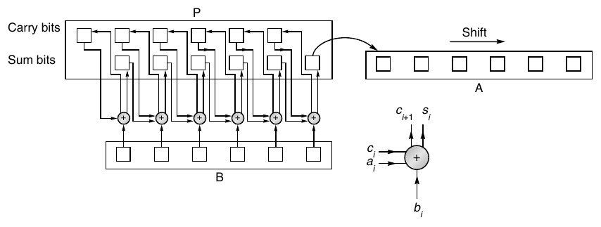

**Hình J.24 Carry-save multiplier. Mỗi vòng tròn biểu diễn một (3,2) adder hoạt động độc lập. Ở mỗi bước, bit duy nhất của P cần được dịch là low-order sum bit.**

Để vận hành multiplier trong Hình J.24, nạp không vào các sum bit và carry bit của P rồi thực hiện phép toán ALU đầu tiên. (Nếu dùng Booth recoding, đó có thể là phép trừ thay vì phép cộng.) Sau đó dịch low-order sum bit của P vào A, đồng thời dịch chính A. Các n − 1 high-order bit của P không cần được dịch vì ở cycle tiếp theo, các sum bit được đưa vào lower-order adder kế tiếp. Mỗi bước cộng được tăng tốc đáng kể, vì mỗi add cell hoạt động độc lập với các cell khác và không có carry nào được truyền.

Có hai nhược điểm của carry-save adder. Thứ nhất, chúng cần nhiều hardware hơn vì phải có một bản sao của register P để giữ các carry output của adder. Thứ hai, sau bước cuối cùng, high-order word của kết quả phải được đưa vào một adder thông thường để kết hợp phần sum và carry. Một cách làm là đưa output của P vào adder được dùng để thực hiện phép cộng. Nhân bằng một carry-save adder đôi khi được gọi là phép nhân dư thừa vì P được biểu diễn bằng hai register. Vì có nhiều cách biểu diễn P dưới dạng tổng của hai register, cách biểu diễn này là dư thừa. Thuật ngữ carry-propagate adder (CPA) được dùng để chỉ một adder không phải CSA. Một propagate adder có thể truyền carry bằng rippling, carry-lookahead hoặc một phương pháp khác.

Một cách khác để tăng tốc phép nhân mà không dùng thêm adder là xem xét k low-order bit của A ở mỗi bước, thay vì chỉ một bit. Cách này thường được gọi là higher-radix multiplication. Chẳng hạn, giả sử k = 2. Nếu cặp bit là 00, cộng 0 vào P; nếu là 01, cộng B. Nếu là 10, chỉ cần dịch b sang trái một bit trước khi cộng vào P. Đáng tiếc, nếu cặp bit là 11, có vẻ chúng ta phải tính b + 2b. Nhưng có thể tránh điều này bằng cách dùng một phiên bản higher-radix của Booth recoding. Hình dung A là một số cơ số 4: Khi chữ số 3 xuất hiện, đổi nó thành 1̅ và cộng 1 vào chữ số cao hơn kế tiếp để bù lại. Một lợi ích bổ sung của cơ chế này là giống như Booth recoding thông thường, nó hoạt động cho cả integer âm lẫn dương (Mục J.2).

Các quy tắc chính xác cho radix-4 Booth recoding được đưa ra trong Hình J.25. Tại bước nhân thứ i, hai low-order bit của register A chứa a<sub>2i</sub> và a<sub>2i+1</sub>. Hai bit này, cùng với bit vừa bị dịch ra ngoài (a<sub>2i–1</sub>), được dùng để chọn bội của b phải được cộng vào register P. Một ví dụ số được đưa ra trong Hình J.26. Tên khác của kỹ thuật nhân này là overlapping triplets, vì nó xem xét 3 bit để xác định bội của b cần dùng, trong khi Booth recoding thông thường xem xét 2 bit.

Ngoài việc có control logic phức tạp hơn, overlapping triplets còn yêu cầu register P rộng thêm 1 bit để đáp ứng khả năng 2b hoặc −2b được cộng vào nó. Có thể dùng một phiên bản radix-8 (hoặc thậm chí cao hơn) của Booth recoding. Tuy nhiên, trong trường hợp đó, cần dùng bội 3B làm một số hạng tiềm năng. Multiplier Radix-8 thường tính 3B một lần duy nhất ở đầu phép nhân.

| Low-order bit của A |  | Bit cuối cùng bị dịch ra |  |
|---|---|---|---|
| 2i + 1 | 2i | 2i − 1 | Bội |
| 0 | 0 | 0 | 0 |
| 0 | 0 | 1 | +b |
| 0 | 1 | 0 | +b |
| 0 | 1 | 1 | +2b |
| 1 | 0 | 0 | −2b |
| 1 | 0 | 1 | −b |
| 1 | 1 | 0 | −b |
| 1 | 1 | 1 | 0 |

**Hình J.25 Các bội của b dùng cho radix-4 Booth recoding. Chẳng hạn, nếu hai low-order bit của register A đều bằng 1, và bit cuối cùng bị dịch ra khỏi register A bằng 0, bội đúng là −b, lấy từ hàng second-to-last của bảng.**

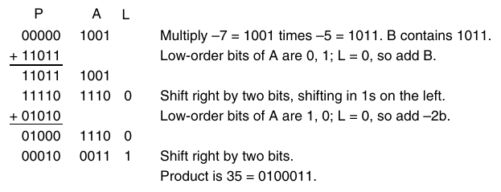

**Hình J.26 Nhân –7 với –5 bằng radix-4 Booth recoding. Cột có nhãn L chứa bit cuối cùng bị dịch ra khỏi đầu bên phải của A.**

### Phép nhân nhanh hơn bằng nhiều Adder

Nếu có không gian cho nhiều adder, có thể cải thiện tốc độ nhân. Hình J.27 cho thấy một array multiplier đơn giản để nhân hai số 5-bit, dùng ba CSA và một propagate adder. Phần (a) là một sơ đồ khối thuộc loại chúng ta sẽ dùng xuyên suốt mục này. Phần (b) và (c) cho thấy adder chi tiết hơn. Tất cả input vào adder được thể hiện trong (b); các adder thực tế cùng những kết nối giữa chúng được thể hiện trong (c). Mỗi hàng adder trong (c) tương ứng với một ô trong (a). Hình được “xoay” sao cho các bit có cùng trọng số nằm trong cùng một cột. Trong một cách triển khai thực tế, array nhiều khả năng sẽ được bố trí thành hình vuông.

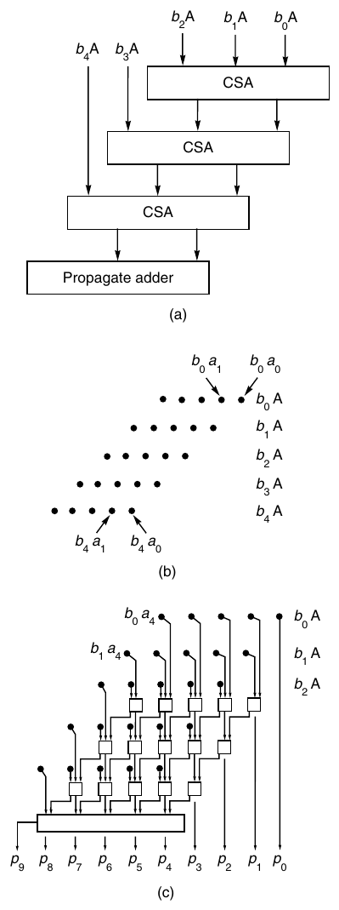

**Hình J.27 Một array multiplier. Số 5-bit trong A được nhân với b<sub>4</sub>b<sub>3</sub>b<sub>2</sub>b<sub>1</sub>b<sub>0</sub>. Phần (a) cho thấy sơ đồ khối, (b) cho thấy các input vào array, và (c) mở rộng array để cho thấy tất cả adder.**

Array multiplier trong Hình J.27 thực hiện cùng số phép cộng như thiết kế trong Hình J.24, nên latency của nó không khác biệt quá lớn so với một carry-save adder duy nhất. Tuy nhiên, với hardware trong Hình J.27, phép nhân có thể được pipeline, làm tăng tổng throughput. Ngược lại, mặc dù mức pipelining này đôi khi được dùng trong array processor, nó không được dùng trong bất kỳ floating-point accelerator single-chip nào được thảo luận ở Mục J.10. Pipelining được thảo luận tổng quát trong Phụ lục C và bởi Kogge [1981] trong bối cảnh multiplier.

Đôi khi không gian dành trên chip cho arithmetic không đủ chứa một array lớn để nhân hai số double-precision. Trong trường hợp này, một thiết kế phổ biến là dùng một bố trí two-pass như trong Hình J.28. Lượt đầu tiên qua array “hoàn tất xử lý” 5 bit của B. Sau đó kết quả của lượt đầu được đưa trở lại đỉnh để kết hợp với ba số hạng tiếp theo. Kết quả của lượt thứ hai này được đưa vào một CPA. Tuy nhiên, thiết kế này mất khả năng được pipeline.

Nếu array cần nhiều bước cộng như các bố trí rẻ hơn nhiều trong Hình J.2 và J.24, tại sao chúng lại phổ biến đến vậy? Trước hết, dùng một array có latency nhỏ hơn dùng một adder duy nhất—vì array là một combinational circuit, các tín hiệu đi trực tiếp qua nó mà không được clock. Mặc dù adder two-pass trong Hình J.28 thông thường vẫn dùng clock, cycle time để đi qua k array có thể nhỏ hơn k lần chu kỳ clock cần cho các thiết kế như trong Hình J.2 hoặc J.24. Thứ hai, array phù hợp với nhiều cơ chế tăng tốc thêm. Một cơ chế được thể hiện trong Hình J.29. Ý tưởng của thiết kế này là hai phép cộng tiến hành song song, hay nói cách khác, mỗi luồng chỉ đi qua một nửa số adder. Vì vậy, nó chạy với tốc độ gần gấp đôi multiplier trong Hình J.27. Multiplier chẵn/lẻ này phổ biến trong VLSI do cấu trúc đều đặn. Cũng có thể tăng tốc array bằng asynchronous logic. Một lý do khiến multiplier trong Hình J.2 (trang J-4) cần clock là để ngăn output của adder quay trở lại input trước khi output ổn định hoàn toàn. Vì vậy, nếu array trong Hình J.28 đủ dài để không tín hiệu nào có thể truyền từ đỉnh qua đáy trong thời gian adder đầu tiên ổn định, có thể tránh hoàn toàn clock. Williams và cộng sự [1987] đã thảo luận một thiết kế dùng ý tưởng này, mặc dù dành cho divider thay vì multiplier.

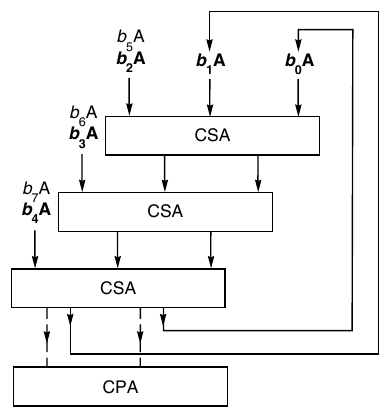

**Hình J.28 Multipass array multiplier. Nhân hai số 8-bit với khoảng một nửa hardware cần dùng trong thiết kế one-pass như Hình J.27. Ở cuối lượt thứ hai, các bit đi vào CPA. Các input dùng trong lượt đầu được in đậm.**

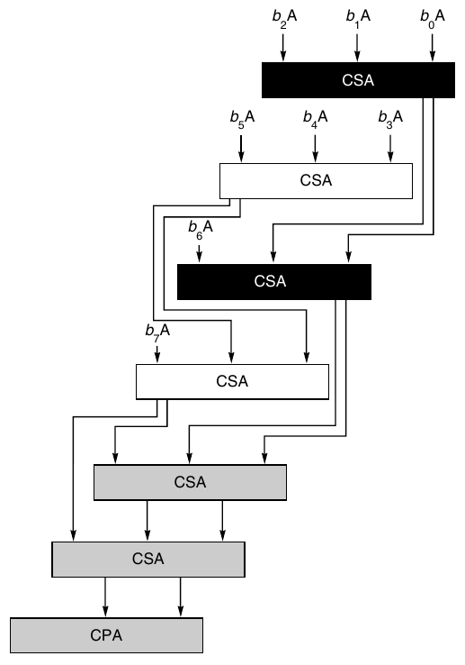

**Hình J.29 Array chẵn/lẻ. Hai adder đầu tiên làm việc song song. Kết quả của chúng được đưa vào adder thứ ba và thứ tư, cũng làm việc song song, và cứ tiếp tục như vậy.**

Các kỹ thuật trong đoạn trước vẫn có thời gian nhân 0(n), nhưng có thể giảm thời gian xuống log n bằng một cây. Cây đơn giản nhất sẽ kết hợp từng cặp số hạng b<sub>0</sub> A ⋅⋅⋅ b<sub>n–1</sub>A, giảm số lượng số hạng từ n xuống n/2. Sau đó, các n/2 số này lại được cộng theo từng cặp, giảm xuống n/4, và cứ tiếp tục, cho một tổng duy nhất sau log n bước. Tuy nhiên, ý tưởng cây nhị phân đơn giản này không ánh xạ vào các full adder (3,2), vốn giảm ba input thành hai thay vì giảm hai input thành một. Một cây thực sự dùng full adder, được gọi là Wallace tree, được minh họa trong Hình J.30. Khi các computer arithmetic unit được xây dựng từ linh kiện MSI, Wallace tree là thiết kế được lựa chọn cho multiplier high-speed. Tuy nhiên, có một vấn đề khi triển khai nó trong VLSI. Nếu thử điền tất cả adder và đường dẫn cho Wallace tree trong Hình J.30, bạn sẽ thấy nó không có cấu trúc đều đặn, thuận tiện như Hình J.27. Đó là lý do người thiết kế VLSI thường chọn những thiết kế log n khác như binary tree multiplier, được thảo luận tiếp theo.


**Hình J.30 Wallace tree multiplier. Một ví dụ về cây nhân tính tích trong 0(log n) bước.**

Vấn đề khi cộng các số hạng trong một cây nhị phân là nghĩ ra một (2,1) adder kết hợp hai chữ số và tạo ra một chữ số single-sum. Do carry, không thể làm điều này bằng ký pháp nhị phân, nhưng có thể làm bằng một cách biểu diễn khác. Chúng ta sẽ dùng cách biểu diễn signed-digit 1, 1̅ và 0, đã dùng trước đó để hiểu thuật toán Booth. Cách biểu diễn này có hai chi phí. Thứ nhất, cần 2 bit để biểu diễn mỗi chữ số signed. Thứ hai, thuật toán cộng hai số signed-digit a<sub>i</sub> và b<sub>i</sub> phức tạp và đòi hỏi xem xét a<sub>i i–1 i–2</sub>a a và b<sub>i i–1 i–2</sub>b b . Mặc dù điều này có nghĩa là phải nhìn lùi 2 bit, trong phép cộng nhị phân bạn có thể phải nhìn lùi một số bit tùy ý do carry.

Có thể mô tả thuật toán cộng hai số signed-digit như sau. Trước hết, tính các sum bit và carry bit s<sub>i</sub> và c<sub>i+1</sub> theo Hình J.31. Sau đó tính tổng cuối cùng là s<sub>i</sub>+ c<sub>i</sub>. Các bảng được thiết lập sao cho tổng cuối cùng này không tạo ra carry.

**Ví dụ** Tổng của các số signed-digit 11̅0<sub>2</sub> và 001<sub>2</sub> là gì?

**Trả lời** Hai low-order bit có tổng 0 + 1 = 11̅, cặp tiếp theo có tổng 1̅ + 0 = 01̅, và high-order pair có tổng 1 + 0 = 01, nên tổng là 11̅+ 01̅0 + 0100 = 101̅<sub>2</sub>.


**Hình J.31 Bảng cộng Signed-digit. Tổng ngoài cùng bên trái cho thấy khi tính 1 + 1, sum bit bằng 0 và carry bit bằng 1.**

Như vậy, điều này định nghĩa một (2,1) adder. Khi đã có nó, chúng ta có thể dùng một cây nhị phân đơn giản để thực hiện phép nhân. Trong bước đầu tiên, nó cộng b<sub>0</sub>A + b<sub>1</sub>A song song với b<sub>2</sub>A + b<sub>3</sub>A, . . . , b<sub>n–2</sub>A + b<sub>n–1</sub>A. Bước tiếp theo cộng các kết quả của những tổng này theo từng cặp, và cứ tiếp tục như vậy. Mặc dù tổng cuối cùng phải đi qua một carry-propagate adder để chuyển từ dạng signed-digit sang two’s complement, bước cộng cuối này là cần thiết trong mọi multiplier dùng CSA.

Tóm lại, cả Wallace tree lẫn signed-digit tree đều là multiplier log n. Wallace tree dùng ít gate hơn nhưng khó bố trí layout hơn. signed-digit tree có cấu trúc đều đặn hơn, nhưng cần 2 bit để biểu diễn mỗi chữ số và có add logic phức tạp hơn. Giống như với adder, có thể kết hợp các kỹ thuật nhân khác nhau. Chẳng hạn, có thể kết hợp Booth recoding và array. Trong Hình J.27, thay vì mỗi input là b<sub>i</sub>A, có thể cho nó là b<sub>i</sub>b<sub>i–1</sub>A. Để tránh phải tính bội 3b, có thể dùng Booth recoding.

### Phép chia nhanh hơn bằng một Adder

Hai kỹ thuật đã thảo luận để tăng tốc phép nhân bằng một adder duy nhất là carry-save adder và higher-radix multiplication. Tuy nhiên, có một khó khăn khi cố dùng các cách này để tăng tốc nonrestoring division. Nếu adder trong Hình J.2(b) ở trang J-4 được thay bằng một carry-save adder, P sẽ được thay bằng hai register, một cho sum bit và một cho carry bit (so sánh với multiplier trong Hình J.24). Ở cuối mỗi cycle, dấu của P chưa chắc chắn (vì P là tổng chưa được tính của hai register), nhưng chính dấu của P lại được dùng để tính chữ số thương và quyết định phép toán ALU tiếp theo. Khi dùng radix cao hơn, vấn đề là quyết định giá trị nào cần trừ khỏi P. Trong phương pháp paper-and-pencil, bạn phải đoán chữ số thương. Trong phép chia nhị phân, chỉ có hai khả năng. Chúng ta đã có thể khéo léo xử lý vấn đề bằng cách ban đầu đoán một giá trị rồi điều chỉnh dựa trên dấu của P. Điều này không hoạt động với radix cao hơn vì có nhiều hơn hai chữ số thương khả dĩ, khiến việc chọn thương có thể khá phức tạp: Bạn sẽ phải tính tất cả các bội của b và so sánh chúng với P.

Cả kỹ thuật carry-save lẫn higher-radix division đều có thể hoạt động nếu dùng một cách biểu diễn thương dư thừa. Hãy nhớ từ phần thảo luận về SRT division (trang J-45) rằng khi cho phép các chữ số thương là −1, 0 hoặc 1, thường có thể chọn giữa nhiều giá trị. Ý tưởng trong thuật toán trước là chọn 0 bất cứ khi nào có thể, vì khi đó có thể bỏ qua một phép toán ALU. Trong carry-save division, ý tưởng là vì số dư (giá trị của cặp register (P,A)) chưa được biết chính xác (do được lưu ở dạng carry-save), chữ số thương chính xác cũng chưa được biết. Nhưng nhờ cách biểu diễn dư thừa, không cần biết chính xác số dư để chọn một chữ số thương. Điều này được minh họa trong Hình J.32, trong đó x-axis biểu diễn r<sub>i</sub>, số dư sau i bước. Đường có nhãn q<sub>i</sub> = 1 cho thấy giá trị mà r<sub>i+1</sub> sẽ có nếu chọn q<sub>i</sub> = 1, và tương tự với các đường q<sub>i</sub> = 0 và q<sub>i</sub> = −1. Có thể chọn bất kỳ giá trị nào cho q<sub>i</sub>, miễn là r<sub>i+1</sub> = 2r<sub>i</sub> – q<sub>i</sub>b thỏa mãn ⏐r<sub>i+1</sub>⏐ ≤ b. Các khoảng cho phép được thể hiện ở nửa bên phải Hình J.32. Điều này cho thấy bạn không cần biết giá trị chính xác của r<sub>i</sub> để chọn một chữ số thương q<sub>i</sub>. Bạn chỉ cần biết r nằm trong một khoảng đủ nhỏ để vừa hoàn toàn bên trong một trong các thanh chồng lấn ở nửa bên phải Hình J.32.


**Hình J.32 Chọn thương cho phép chia radix-2. x-axis biểu diễn số dư thứ i, tức đại lượng trong cặp register (P,A). y-axis cho thấy giá trị số dư sau một bước chia bổ sung. Mỗi thanh trên đồ thị right-hand cho biết khoảng giá trị ri mà trong đó được phép chọn giá trị q<sub>i</sub> tương ứng.**

Đây là cơ sở để dùng carry-save adder. Xem xét các high-order bit của carry-save adder và tính tổng chúng trong một propagate adder. Sau đó dùng giá trị xấp xỉ này của r (cùng với số chia b) để tính q<sub>i</sub>, thường bằng lookup table. Kỹ thuật tương tự hoạt động với higher-radix division (bất kể có dùng carry-save adder hay không). Các high-order bit P có thể được dùng để đánh index vào một bảng cho biết một trong các chữ số thương được phép.

Thách thức thiết kế khi xây dựng một SRT divider high-speed là xác định cần xem xét bao nhiêu bit của P và B. Chẳng hạn, giả sử chọn radix bằng 4, dùng các chữ số thương 2, 1, 0, 1̅, 2̅, nhưng dùng một propagate adder. Cần xem xét bao nhiêu bit của P và B? Quyết định điều này gồm hai bước. Với nonrestoring division radix-2 thông thường, vì ở mỗi giai đoạn ⏐r⏐ ≤ b, buffer P sẽ không overflow. Nhưng với radix 4, r<sub>i+1</sub> = 4r<sub>i</sub> – q<sub>i</sub> b được tính ở mỗi giai đoạn, và nếu r<sub>i</sub> gần b, thì 4r<sub>i</sub> sẽ gần 4b, và ngay cả chữ số thương lớn nhất cũng không đưa r trở lại khoảng ⏐r<sub>i+1</sub>⏐ ≤ b. Nói cách khác, số dư có thể tăng không giới hạn. Tuy nhiên, hạn chế ⏐r<sub>i</sub>⏐ ≤ 2b/3 giúp dễ dàng kiểm tra rằng r<sub>i</sub> sẽ luôn bị chặn.

Sau khi xác định giới hạn mà r<sub>i</sub> phải thỏa mãn, có thể vẽ sơ đồ trong Hình J.33, tương tự Hình J.32. Chẳng hạn, sơ đồ cho thấy nếu r<sub>i</sub> nằm giữa (1/12)b và (5/12)b, có thể chọn q = 1, và tương tự với các khoảng khác. Hay nói cách khác, nếu r/b nằm giữa 1/12 và 5/12, có thể chọn q = 1. Giả sử divider xem xét 5 bit của P (bao gồm sign bit) và 4 bit của b (bỏ qua dấu, vì nó luôn không âm). Trường hợp đáng chú ý là khi các high bit của P là 00011xxx⋅⋅⋅, trong khi các high bit của b là 1001xxx⋅⋅⋅. Hình dung binary point ở đầu bên trái của mỗi register. Vì đã cắt bớt, r (giá trị của P nối với A) có thể có giá trị từ 0.0011<sub>2</sub> đến 0.0100<sub>2</sub>, và b có thể có giá trị từ .1001<sub>2</sub> đến .1010<sub>2</sub>. Vì vậy, r/b có thể nhỏ đến 0.0011<sub>2</sub>/.1010<sub>2</sub> hoặc lớn đến 0.0100<sub>2</sub>/.1001<sub>2</sub>, nhưng 0.0011<sub>2</sub>/.1010<sub>2</sub> = 3/10 < 1/3 sẽ đòi hỏi bit thương bằng 1, trong khi 0.0100<sub>2</sub>/.1001<sub>2</sub> = 4/9 > 5/12 sẽ đòi hỏi bit thương bằng 2. Nói cách khác, 5 bit của P và 4 bit của b không đủ để chọn một bit thương. Hóa ra 6 bit của P và 4 bit của b là đủ. Có thể xác minh bằng cách viết một chương trình đơn giản kiểm tra tất cả các trường hợp. Output của một chương trình như vậy được thể hiện trong Hình J.34.


**Hình J.33 Chọn thương cho phép chia radix-4 với các chữ số thương –2, –1, 0, 1, 2.**

**Ví dụ** Dùng các register 8-bit, tính 149/5 bằng SRT division radix-4.

**Trả lời** Làm theo thuật toán SRT ở trang J-45, nhưng thay quy tắc chọn thương trong bước 2 bằng một quy tắc dùng Hình J.34. Xem Hình J.35.

Pentium dùng một thuật toán SRT division radix-4 như vừa trình bày, ngoại trừ nó dùng một carry-save adder. Bài tập J.34(c) và J.35 khảo sát chi tiết điều này. Mặc dù đây là các trường hợp đơn giản, mọi phân tích SRT đều tiến hành theo cùng một cách. Trước hết tính phạm vi của r<sub>i</sub>, rồi vẽ r<sub>i</sub> theo r<sub>i+1</sub> để tìm các khoảng thương, và cuối cùng viết một chương trình để tính cần bao nhiêu bit. (Đôi khi cũng có thể tính số bit cần thiết bằng phương pháp giải tích.) Cần xem xét nhiều chi tiết khi xây dựng một SRT divider thực tế. Chẳng hạn, quotient lookup table có cấu trúc khá đều đặn, nghĩa là mã hóa nó dưới dạng PLA thường rẻ hơn trong ROM. Để biết thêm về SRT division, xem Burgess và Williams [1995].


**Hình J.34 Các chữ số thương cho SRT division radix-4 với một propagate adder. Hàng trên cùng nói rằng nếu high-order 4 bit của b là 1000<sub>2</sub>= 8, và nếu 6 bit đứng đầu của P nằm giữa 110100<sub>2</sub> = −12 và 111001<sub>2</sub> = −7, thì −2 là một chữ số thương hợp lệ.**


**Hình J.35 Ví dụ về SRT division radix-4. Chia 149 cho 5.**

## J.10 Kết hợp tất cả lại

Trong mục này, chúng ta sẽ so sánh Weitek 3364, MIPS R3010 và Texas Instruments 8847 (xem Hình J.36 và J.37). Xét trên nhiều phương diện, đây là những chip lý tưởng để so sánh. Mỗi chip triển khai tiêu chuẩn IEEE cho phép cộng, trừ, nhân và chia trên một chip duy nhất. Tất cả được giới thiệu năm 1988 và chạy với cycle time khoảng 40 nanosecond. Tuy nhiên, như sẽ thấy, chúng dùng những thuật toán khá khác nhau. Chip Weitek được mô tả rõ trong Birman và cộng sự [1990], chip MIPS được mô tả ít chi tiết hơn trong Rowen, Johnson và Ries [1988], và có thể tìm chi tiết về chip TI trong Darley và cộng sự [1989].

Ba chip này có một số điểm chung. Chúng thực hiện phép cộng và nhân song song, và không triển khai extended precision cũng như phép toán remainder step. (Nhớ lại từ Mục J.6 rằng rất dễ triển khai hàm số dư IEEE bằng software nếu có một remainder step instruction.) Những người thiết kế các chip này có lẽ quyết định không cung cấp extended precision vì những người dùng có ảnh hưởng nhất là những người chạy code portable, vốn không thể dựa vào extended precision. Tuy nhiên, như đã thấy, extended precision có thể giúp các thư viện toán nhanh hơn và đơn giản hơn.

Trong phần tóm lược ba chip ở Hình J.36, lưu ý rằng số transistor cao hơn thường dẫn đến số cycle nhỏ hơn. Cần cẩn thận khi so sánh các số cycles/op, vì các số của chip MIPS là cho một hệ thống hoàn chỉnh (cặp R3000/3010), trong khi số của Weitek và TI là cho chip stand-alone và thường lớn hơn khi dùng trong một hệ thống hoàn chỉnh.

| Đặc điểm | MIPS R3010 | Weitek 3364 | TI 8847 |
|---|---|---|---|
| Thời gian clock cycle (ns) | 40 | 50 | 30 |
| Kích thước (mil<sup>2</sup>) | 114,857 | 147,600 | 156,180 |
| Transistor | 75,000 | 165,000 | 180,000 |
| Chân | 84 | 168 | 207 |
| Công suất (watt) | 3.5 | 1.5 | 1.5 |
| Cycles/add | 2 | 2 | 2 |
| Cycles/mult | 5 | 2 | 3 |
| Cycles/divide | 19 | 17 | 11 |
| Cycles/square root | – | 30 | 14 |

**Hình J.36 Tóm lược ba chip floating-point được thảo luận trong mục này. Các cycle time dành cho linh kiện sản xuất có sẵn vào tháng 6 năm 1989. Các số cycle dành cho các phép toán double-precision.**


**Hình J.37 Layout chip của TI 8847, MIPS R3010 và Weitek 3364. Các cột left-hand là ảnh hiển vi; các cột right-hand cho thấy floor plan tương ứng.**


**Hình J.37 (Tiếp theo.)**

Chip MIPS có ít transistor nhất trong ba chip. Điều này được phản ánh ở chỗ nó là chip duy nhất trong ba chip không có pipelining hay hardware tính căn bậc hai. Hơn nữa, phép nhân và phép cộng không hoàn toàn độc lập vì chúng dùng chung carry-propagate adder thực hiện làm tròn cuối cùng (cũng như rounding logic).

Phép cộng trên R3010 dùng kết hợp ripple, CLA và carry-select. Một carry-select adder được dùng theo cách trong Hình J.20 (trang J-43). Bên trong mỗi nửa, carry được truyền bằng một cơ chế lai ripple-CLA thuộc loại trong Hình J.19 (trang J-42). Tuy nhiên, thiết kế còn được tinh chỉnh bằng cách thay đổi kích thước mỗi khối, thay vì cố định mọi khối ở 4 bit (như trong Hình J.19). Multiplier nằm giữa các thiết kế trong Hình J.2 (trang J-4) và J.27 (trang J-50). Nó có một array vừa đủ lớn để output có thể được đưa trở lại input mà không cần được clock. Ngoài ra, nó dùng radix-4 Booth recoding và kỹ thuật chẵn/lẻ trong Hình J.29 (trang J-52). R3010 có thể thực hiện phép chia và phép nhân song song (giống chip Weitek nhưng khác chip TI). Divider dùng phương pháp radix-4 SRT với các chữ số thương −2, −1, 0, 1 và 2, và tương tự phương pháp được mô tả trong Taylor [1985]. Phép chia Double-precision chậm hơn phép nhân khoảng bốn lần. R3010 cho thấy với chip dùng multiplier 0(n), một SRT divider có thể hoạt động đủ nhanh để duy trì tỷ lệ hợp lý giữa phép nhân và phép chia.

Weitek 3364 có các unit cộng, nhân và chia độc lập. Nó cũng dùng SRT division radix-4. Tuy nhiên, các phép cộng và nhân trên chip Weitek được pipeline. Ba stage của phép cộng là (1) so sánh exponent, (2) cộng rồi dịch (hoặc ngược lại), và (3) làm tròn cuối cùng. Stage (1) và (3) chỉ mất một half-cycle, cho phép toàn bộ phép toán được thực hiện trong hai cycle dù có ba pipeline stage. Multiplier dùng một array theo kiểu Hình J.28 nhưng dùng radix-8 Booth recoding, nghĩa là phải tính 3 lần số nhân. Ba pipeline stage của multiplier là (1) tính 3b, (2) đi qua array, và (3) phép cộng carry-propagation cuối cùng và làm tròn. Single precision đi qua array một lần, double precision hai lần. Giống phép cộng, latency là hai cycle.

Chip Weitek dùng một thuật toán cộng thú vị. Nó là một biến thể của carry-skip adder trong Hình J.18 (trang J-42). Tuy nhiên, P<sub>ij</sub>, là AND logic của nhiều số hạng, được tính bằng rippling, thực hiện một phép AND mỗi lần ripple. Vì vậy, trong khi carry truyền sang trái trong một khối, giá trị P<sub>ij</sub> truyền sang phải trong khối tiếp theo, và kích thước khối được chọn sao cho cả hai làn sóng hoàn tất cùng lúc. Khác với chip MIPS, 3364 có hardware tính căn bậc hai, dùng chung hardware chia. Tỷ lệ phép nhân double-precision so với phép chia là 2:17. Chênh lệch lớn giữa phép nhân và chia là do phép nhân dùng radix-8 Booth recoding, trong khi phép chia dùng phương pháp radix-4. Trong MIPS R3010, phép nhân và chia dùng cùng radix.

Đặc điểm nổi bật của TI 8847 là thực hiện phép chia bằng phương pháp lặp (dùng thuật toán Goldschmidt được thảo luận trong Mục J.6). Điều này cải thiện tốc độ chia (tỷ lệ phép nhân so với phép chia là 3:11), nhưng có nghĩa là phép nhân và chia không thể được thực hiện song song như trên hai chip còn lại. Phép cộng có một pipeline two-stage. So sánh exponent, dịch fraction và cộng fraction được thực hiện trong stage đầu, normalization và làm tròn trong stage thứ hai. Phép nhân dùng một cây nhị phân của các signed-digit adder và có một pipeline three-stage. Stage đầu đi qua array, hoàn tất xử lý một nửa số bit; stage thứ hai đi qua array lần thứ hai; và stage thứ ba chuyển từ dạng signed-digit sang two’s complement. Vì chỉ có một array, chỉ có thể bắt đầu một phép nhân mới mỗi hai cycle. Tuy nhiên, bằng cách làm chậm clock, hai lượt qua array có thể được thực hiện trong một cycle duy nhất. Trong trường hợp này, có thể bắt đầu một phép nhân mới ở mỗi cycle. Adder của 8847 dùng thuật toán carry-select thay vì carry-lookahead. Như đã đề cập trong Mục J.6, TI giữ 60 bit precision để thực hiện phép chia được làm tròn chính xác.

Ba chip này minh họa những trade-offs khác nhau mà người thiết kế đưa ra với các ràng buộc tương tự. Một trong những điểm thú vị nhất về các chip này là sự đa dạng của các thuật toán. Mỗi chip dùng một thuật toán cộng khác nhau cũng như một thuật toán nhân khác nhau. Thực tế, Booth recoding là kỹ thuật duy nhất được tất cả các chip dùng chung.

## J.11 Những ngộ nhận và cạm bẫy

**Ngộ nhận** Underflow hiếm khi xảy ra trong code ứng dụng floating-point thực tế.

Mặc dù phần lớn code hiếm khi underflow, có những code thực tế underflow thường xuyên. SDRWAVE [Kahaner 1988], giải một phương trình sóng one-dimensional, là một ví dụ như vậy. Chương trình này underflow khá thường xuyên, ngay cả khi hoạt động đúng. Các phép đo trên một máy cho thấy thêm hỗ trợ hardware cho gradual underflow sẽ giúp SDRWAVE chạy nhanh hơn khoảng 50%.

**Ngộ nhận** Chuyển đổi giữa integer và floating point hiếm xảy ra.

Thực tế, trong spice chúng xảy ra thường xuyên như phép chia. Giả định rằng các phép chuyển đổi hiếm xảy ra dẫn đến một sai lầm trong instruction set SPARC phiên bản 8, vốn không cung cấp một instruction để chuyển từ integer register sang floating-point register.

**Cạm bẫy** Đừng tăng tốc một floating-point unit mà không tăng memory bandwidth của nó.

Một ứng dụng điển hình của floating-point unit là cộng hai vector để tạo ra vector thứ ba. Nếu các vector này gồm các số double-precision, mỗi phép cộng floating-point sẽ dùng ba toán hạng, mỗi toán hạng 64 bit, hay 24 byte memory. Yêu cầu memory bandwidth còn lớn hơn nếu floating-point unit có thể thực hiện phép cộng và nhân song song (như phần lớn các unit).

**Cạm bẫy** −x không giống 0 − x.

Đây là một điểm tinh tế trong tiêu chuẩn IEEE đã khiến một số người thiết kế vấp phải. Vì các số floating-point dùng hệ sign magnitude, có hai số không, +0 và −0. Tiêu chuẩn nói rằng 0 − 0 = +0, trong khi −(0) = −0. Vì vậy, −x không giống 0 − x khi x = 0.

## J.12 Góc nhìn lịch sử và tài liệu tham khảo

Những máy tính đầu tiên dùng fixed point thay vì floating point. Trong “Preliminary Discussion of the Logical Design of an Electronic Computing Instrument”, Burks, Goldstine và von Neumann [1946] diễn đạt như sau:

Có vẻ một hệ decimal point “floating” có hai mục đích chính, cả hai đều xuất phát từ việc số chữ số trong một word là một hằng số được ấn định bởi các cân nhắc thiết kế cho từng máy cụ thể. Mục đích thứ nhất là giữ lại trong một tổng hoặc tích càng nhiều chữ số có nghĩa càng tốt, còn mục đích thứ hai là giải phóng người vận hành khỏi gánh nặng ước lượng và đưa vào bài toán các “hệ số scale”—những hằng số nhân giúp giữ các số trong giới hạn của máy.

Tất nhiên, không thể phủ nhận rằng con người phải dành thời gian sắp xếp việc đưa vào các hệ số scale thích hợp. Chúng tôi chỉ lập luận rằng thời gian như vậy chiếm một tỷ lệ rất nhỏ trong tổng thời gian chúng tôi sẽ dành để chuẩn bị một bài toán đáng quan tâm cho máy của mình. Theo chúng tôi, ưu điểm thứ nhất của floating point phần nào mang tính ảo tưởng. Để có floating point như vậy, phải lãng phí dung lượng memory vốn có thể được dùng để chứa thêm chữ số trong mỗi word. Vì thế, đối với chúng tôi, hoàn toàn chưa rõ liệu những ưu điểm khiêm tốn của một floating binary point có bù được sự mất mát dung lượng memory và mức phức tạp gia tăng của các mạch arithmetic và điều khiển hay không.

Điều này giúp chúng ta nhìn sự việc từ góc nhìn của những người thiết kế máy tính ban đầu, những người tin rằng tiết kiệm thời gian máy tính và memory quan trọng hơn tiết kiệm thời gian người lập trình.

Các bài báo gốc giới thiệu Wallace tree, Booth recoding, SRT division, overlapped triplets, v.v. được in lại trong Swartzlander [1990]. Một giải thích tốt về một máy thời kỳ đầu (IBM 360/91) dùng pipelined Wallace tree, Booth recoding và iterative division có trong Anderson và cộng sự [1967]. Một thảo luận về thời gian trung bình của single-bit SRT division có trong Freiman [1961]; đây là một trong số ít bài báo lịch sử thú vị không xuất hiện trong Swartzlander.

Cuốn sách kinh điển của Mead và Conway [1980] không khuyến khích dùng CLA vì cho rằng chúng không hiệu quả về chi phí trong VLSI. Bài báo quan trọng của Brent và Kung [1982] đã giúp phản bác quan điểm đó. Có thể tìm một ví dụ layout chi tiết cho CLA trong Ngai và Irwin [1985] hoặc Weste và Eshraghian [1993], còn một cách trình bày thiên về lý thuyết hơn có trong Leighton [1992]. Takagi, Yasuura và Yajima [1985] cung cấp mô tả chi tiết về signed-digit tree multiplier.

Trước khi IEEE arithmetic chiếm ưu thế, nhiều định dạng floating-point khác nhau được sử dụng. Ba định dạng quan trọng được dùng bởi IBM 370, DEC VAX và Cray. Sau đây là tóm lược ngắn gọn các định dạng cũ này. Định dạng VAX gần với tiêu chuẩn IEEE nhất. Định dạng single-precision của nó (định dạng F) giống IEEE single precision ở chỗ có một hidden bit, 8 bit exponent và 23 bit fraction. Tuy nhiên, nó không có sticky bit, khiến nó làm tròn các trường hợp nằm chính giữa lên trên thay vì về số chẵn. VAX có phạm vi exponent hơi khác IEEE single: E<sub>min</sub> bằng −128 thay vì −126 như IEEE, và E<sub>max</sub> bằng 126 thay vì 127. Khác biệt chính giữa VAX và IEEE là thiếu các giá trị đặc biệt và gradual underflow. VAX có một reserved operand, nhưng nó hoạt động như signaling NaN: Nó tạo trap bất cứ khi nào được tham chiếu. Ban đầu, double precision của VAX (định dạng D) cũng có 8 bit exponent. Tuy nhiên, vì mức này quá nhỏ cho nhiều ứng dụng, định dạng G được bổ sung; giống tiêu chuẩn IEEE, định dạng này có 11 bit exponent. VAX cũng có định dạng H, dài 128 bit.

Định dạng floating-point IBM 370 dùng cơ số 16 thay vì cơ số 2. Điều này có nghĩa là nó không thể dùng hidden bit. Với single precision, nó có 7 bit exponent và 24 bit (6 chữ số hex) fraction. Vì vậy, số lớn nhất có thể biểu diễn là 16<sup>27</sup> = 2<sup>4</sup> × 2<sup>7</sup> = 2<sup>29</sup>, so với 2<sup>28</sup> của IEEE. Tuy nhiên, một số được normalized theo nghĩa thập lục phân chỉ cần có chữ số đầu khác không. Khi diễn giải ở dạng nhị phân, ba most-significant bit có thể bằng không. Vì vậy, có khả năng có ít hơn 24 bit có nghĩa. Lý do dùng cơ số cao hơn là giảm thiểu lượng dịch chuyển cần thiết khi cộng các số floating-point. Tuy nhiên, điều này ít quan trọng hơn trong các máy hiện tại, nơi thời gian cộng floating-point thường cố định, không phụ thuộc vào các toán hạng. Một khác biệt khác giữa 370 arithmetic và IEEE arithmetic là 370 không có round digit cũng không có sticky digit, về thực chất nghĩa là nó cắt bỏ thay vì làm tròn. Vì vậy, trong nhiều phép tính, kết quả sẽ nhỏ hơn một cách có hệ thống. Khác với VAX và IEEE arithmetic, mọi mẫu bit đều là một số hợp lệ. Do đó, library routine phải thiết lập các quy ước về giá trị trả về khi có lỗi. Chẳng hạn, trong thư viện IBM FORTRAN, √– 4 trả về 2!

Arithmetic trên máy tính Cray thú vị vì được thúc đẩy bởi mục tiêu đạt floating-point performance cao nhất có thể. Nó có trường exponent 15-bit và trường fraction 48-bit. Phép cộng trên máy tính Cray không có guard digit, và phép nhân còn kém chính xác hơn phép cộng. Xem phép nhân như tổng của p số, mỗi số dài 2p bit, máy tính Cray bỏ các low-order bit của mỗi số hạng. Vì vậy, phân tích các đặc tính sai số chính xác của phép nhân không dễ. Các nghịch đảo được tính bằng phương pháp lặp, và phép chia a cho b được thực hiện bằng cách nhân a với 1/b. Sai số trong phép nhân và phép lấy nghịch đảo kết hợp khiến ba bit cuối của phép chia không đáng tin cậy. Ít nhất máy tính Cray cũng khiến các chuyên gia phân tích số luôn phải cảnh giác!

Quá trình tiêu chuẩn hóa IEEE bắt đầu năm 1977, chủ yếu được khởi xướng bởi W. Kahan và một phần dựa trên công việc của Kahan với IBM 7094 tại University of Toronto [Kahan 1968]. Quá trình tiêu chuẩn hóa kéo dài, với gradual underflow gây nhiều tranh cãi nhất. (Theo Cleve Moler, du khách đến Hoa Kỳ được khuyên rằng các điểm không thể bỏ qua là Las Vegas, Grand Canyon và cuộc họp ủy ban tiêu chuẩn IEEE.) Tiêu chuẩn cuối cùng được thông qua năm 1985. Intel 8087 là cách triển khai IEEE thương mại lớn đầu tiên và xuất hiện năm 1981, trước khi tiêu chuẩn được hoàn tất. Nó chứa những tính năng bị loại khỏi tiêu chuẩn cuối cùng, như projective bit. Theo Kahan, độ dài của double-extended precision dựa trên những gì có thể triển khai trong 8087. Mặc dù tiêu chuẩn IEEE không dựa trên bất kỳ hệ floating-point hiện có nào, phần lớn tính năng của nó đã có trong một hệ thống khác nào đó. Chẳng hạn, CDC 6600 dành các mẫu bit đặc biệt cho INDEFINITE và INFINITY, trong khi ý tưởng về các số denormal xuất hiện trong Goldberg [1967] cũng như Kahan [1968]. Kahan được trao giải Turing năm 1989 để ghi nhận công việc của ông về floating point.

Mặc dù floating point hiếm khi thu hút sự chú ý của báo chí đại chúng, các tờ báo tràn ngập câu chuyện về phép chia floating-point vào tháng 11 năm 1994. Một bug trong thuật toán chia dùng trên tất cả chip Pentium của Intel vừa được phát hiện. Người phát hiện là Thomas Nicely, giáo sư toán tại Lynchburg College ở Virginia. Nicely tìm thấy bug khi thực hiện các phép tính liên quan đến nghịch đảo của các số nguyên tố. Tin về phát hiện của Nicely lần đầu xuất hiện trên báo ở trang nhất số ngày 7 tháng 11 của Electronic Engineering Times. Phản ứng tức thì của Intel là né tránh, khẳng định rằng bug chỉ ảnh hưởng đến các nhà toán học lý thuyết. Intel nói với báo chí: “Điều này thậm chí không đủ để coi là một errata . . . ngay cả nếu bạn là kỹ sư, bạn cũng sẽ không gặp nó.”

Dưới sức ép gia tăng, Intel phát hành một white paper đề ngày 30 tháng 11, giải thích vì sao họ không cho rằng bug là đáng kể. Một lập luận của họ dựa trên việc nếu chọn ngẫu nhiên hai số floating-point và lấy số này chia cho số kia, xác suất thương thu được bị lỗi vào khoảng 1 trên 9 tỷ. Tuy nhiên, Intel đã không giải thích vì sao họ cho rằng khách hàng điển hình truy cập các số floating-point một cách ngẫu nhiên.

Sức ép lên Intel tiếp tục gia tăng. Một điểm gây bất bình là Intel đã biết về bug trước khi Nicely phát hiện, nhưng quyết định không công bố. Cuối cùng, vào ngày 20 tháng 12, Intel thông báo sẽ thay thế vô điều kiện bất kỳ chip Pentium nào dùng thuật toán lỗi và sẽ ghi nhận một khoản chi phí chưa xác định vào lợi nhuận, sau đó hóa ra là $300 triệu.

Pentium dùng một phiên bản đơn giản của SRT division như được thảo luận trong Mục J.9. Bug được đưa vào khi họ chuyển quotient lookup table thành PLA. Có vẻ có một vài phần tử của bảng chứa chữ số thương 2 mà Intel cho rằng sẽ không bao giờ được truy cập, và họ tối ưu thiết kế PLA theo giả định này. PLA thu được trả về 0 thay vì 2 trong những tình huống đó. Tuy nhiên, các mục này thực sự được truy cập, và điều đó gây ra bug phép chia. Mặc dù tác động của PLA lỗi là làm sai 5 trong 2048 mục của bảng, Pentium chỉ tính thương sai 1 lần trong 9 tỷ lần với input ngẫu nhiên. Điều này được khảo sát trong Bài tập J.34.

### Tài liệu tham khảo

Anderson, S. F., J. G. Earle, R. E. Goldschmidt, and D. M. Powers [1967]. “The IBM System/360 Model 91: Floating-point execution unit,” IBM J. Research and Development 11, 34–53. Reprinted in Swartzlander [1990].

Mô tả tốt về một floating-point unit high-performance thời kỳ đầu dùng pipelined Wallace tree multiplier và iterative division.

Bell, C. G., and A. Newell [1971]. Computer Structures: Readings and Examples, McGraw-Hill, New York.

Birman, M., A. Samuels, G. Chu, T. Chuk, L. Hu, J. McLeod, and J. Barnes [1990]. “Developing the WRL3170/3171 SPARC floating-point coprocessors,” IEEE Micro 10:1, 55–64.

Các chip này có cùng floating-point core với Weitek 3364, và bài báo này mô tả khá chi tiết thiết kế floating-point đó.

Brent, R. P., and H. T. Kung [1982]. “A regular layout for parallel adders,” IEEE Trans. on Computers C-31, 260–264.

Đây là bài báo đã làm cho CLA trở nên phổ biến trong VLSI.

Burgess, N., and T. Williams [1995]. “Choices of operand truncation in the SRT division algorithm,” IEEE Trans. on Computers 44:7.

Phân tích cần xem xét bao nhiêu bit của số chia và số dư trong SRT division.

Burks, A. W., H. H. Goldstine, and J. von Neumann [1946]. “Preliminary discussion of the logical design of an electronic computing instrument,” Report to the U.S. Army Ordnance Department, p. 1; also appears in Papers of John von Neumann, W. Aspray and A. Burks, eds., MIT Press, Cambridge, Mass., and Tomash Publishers, Los Angeles, 1987, 97–146.

Cody, W. J., J. T. Coonen, D. M. Gay, K. Hanson, D. Hough, W. Kahan, R. Karpinski, J. Palmer, F. N. Ris, and D. Stevenson [1984]. “A proposed radix- and word-lengthindependent standard for floating-point arithmetic,” IEEE Micro 4:4, 86–100.

Chứa một bản dự thảo của tiêu chuẩn 854, tổng quát hơn 754. Ý nghĩa của bài báo này là nó chứa phần bình luận về tiêu chuẩn, trong đó phần lớn cũng có liên quan đến 754. Tuy nhiên, lưu ý rằng có một số khác biệt giữa bản dự thảo này và tiêu chuẩn cuối cùng.

Coonen, J. [1984]. “Contributions to a proposed standard for binary floating point arithmetic,” Ph.D. thesis, University of California–Berkeley.

Thảo luận chi tiết duy nhất về cách có thể dùng rounding mode để triển khai chuyển đổi binary decimal hiệu quả.

Darley, H. M. et al. [1989]. “Floating point/integer processor with divide and square root functions,” U.S. Patent 4,878,190, October 31, 1989.

Khá dễ đọc so với các bằng sáng chế nói chung. Cung cấp một góc nhìn high-level về chip TI 8847, nhưng không có tất cả chi tiết của thuật toán chia.

Demmel, J. W., and X. Li [1994]. “Faster numerical algorithms via exception handling,” IEEE Trans. on Computers 43:8, 983–992.

Một thảo luận tốt về cách các tính năng riêng có của IEEE floating point có thể cải thiện performance của một thư viện software quan trọng.

Freiman, C. V. [1961]. “Statistical analysis of certain binary division algorithms,” Proc. IRE 49:1, 91–103.

Chứa một phân tích performance của thuật toán SRT division shifting-over-zeros.

Goldberg, D. [1991]. “What every computer scientist should know about floating-point arithmetic,” Computing Surveys 23:1, 5–48.

Chứa một hướng dẫn in-depth về tiêu chuẩn IEEE từ góc nhìn software.

Goldberg, I. B. [1967]. “27 bits are not enough for 8-digit accuracy,” Comm. ACM 10:2, 105–106.

Bài báo này đề xuất dùng hidden bit và gradual underflow.

Gosling, J. B. [1980]. Design of Arithmetic Units for Digital Computers, Springer-Verlag, New York.

Một cuốn sách súc tích, well-written, mặc dù tập trung vào các thiết kế MSI.

Hamacher, V. C., Z. G. Vranesic, and S. G. Zaky [1984]. Computer Organization, 2nd ed., McGraw-Hill, New York.

Sách nhập môn computer architecture với một chương tốt về computer arithmetic.

Hwang, K. [1979]. Computer Arithmetic: Principles, Architecture, and Design, Wiley, New York.

Cuốn sách này có phạm vi chủ đề rộng nhất trong các sách về computer arithmetic.

IEEE [1985]. “IEEE standard for binary floating-point arithmetic,” SIGPLAN Notices 22:2, 9–25.

IEEE 754 được in lại ở đây.

Kahan, W. [1968]. “7094-II system support for numerical analysis,” SHARE Secretarial Distribution SSD-159.

Hệ thống này có nhiều tính năng đã được đưa vào tiêu chuẩn IEEE floating-point.

Kahaner, D. K. [1988]. “Benchmarks for ‘real’ programs,” SIAM News (November).

Benchmark được trình bày trong bài báo này hóa ra gây ra nhiều underflow.

Knuth, D. [1981]. The Art of Computer Programming, Vol. II, 2nd ed., Addison-Wesley, Reading, Mass.

Có một mục về sự phân bố của các số floating-point.

Kogge, P. [1981]. The Architecture of Pipelined Computers, McGraw-Hill, New York.

Có một thảo luận ngắn về pipelined multiplier.

Kohn, L., and S.-W. Fu [1989]. “A 1,000,000 transistor microprocessor,” IEEE Int’l. Solid-State Circuits Conf. Digest of Technical Papers, 54–55.

Có một số bài báo về i860, nhưng bài này chứa nhiều chi tiết nhất về các thuật toán floating-point của nó.

Koren, I. [1989]. Computer Arithmetic Algorithms, Prentice Hall, Englewood Cliffs, N.J.

Leighton, F. T. [1992]. Introduction to Parallel Algorithms and Architectures: Arrays, Trees, Hypercubes, Morgan Kaufmann, San Francisco.

Đây là một cuốn sách xuất sắc, nhấn mạnh phân tích độ phức tạp của thuật toán. Mục 1.2.1 có một thảo luận hay về phép cộng carry-lookahead trên một cây.

Magenheimer, D. J., L. Peters, K. W. Pettis, and D. Zuras [1988]. “Integer multiplication and division on the HP Precision architecture,” IEEE Trans. on Computers 37:8, 980–990.

Đưa ra cơ sở cho các instruction integer- và divide-step trong Precision architecture.

Markstein, P. W. [1990]. “Computation of elementary functions on the IBM RISC System/6000 processor,” IBM J. of Research and Development 34:1, 111–119.

Giải thích cách dùng fused muliply-add *(ghi chú: sách in "muliply"; đúng là "multiply")* để tính phép chia và căn bậc hai được làm tròn chính xác.

Mead, C., and L. Conway [1980]. Introduction to VLSI Systems, Addison-Wesley, Reading, Mass.

Montoye, R. K., E. Hokenek, and S. L. Runyon [1990]. “Design of the IBM RISC System/6000 floating-point execution,” IBM J. of Research and Development 34:1, 59–70.

Mô tả một cách triển khai fused multiply-add.

Ngai, T.-F., and M. J. Irwin [1985]. “Regular, area-time efficient carry-lookahead adders,” Proc. Seventh IEEE Symposium on Computer Arithmetic, 9–15.

Mô tả một CLA như trong Hình J.17, trong đó các bit đi lên rồi quay trở xuống.

Patterson, D. A., and J. L. Hennessy [2009]. Computer Organization and Design: The Hardware/Software Interface, 4th Edition, Morgan Kaufmann, San Francisco.

Chương 3 là phần giới thiệu dễ tiếp cận hơn cho một phần ba đầu tiên của phụ lục này.

Peng, V., S. Samudrala, and M. Gavrielov [1987]. “On the implementation of shifters, multipliers, and dividers in VLSI floating point units,” Proc. Eighth IEEE Symposium on Computer Arithmetic, 95–102.

Một khảo sát rất đáng đọc về các kỹ thuật khác nhau thực sự được dùng trong thiết kế VLSI.

Rowen, C., M. Johnson, and P. Ries [1988]. “The MIPS R3010 floating-point coprocessor,” IEEE Micro, 53–62 (June).

Santoro, M. R., G. Bewick, and M. A. Horowitz [1989]. “Rounding algorithms for IEEE multipliers,” Proc. Ninth IEEE Symposium on Computer Arithmetic, 176–183.

Một thảo luận rất dễ đọc về cách triển khai làm tròn hiệu quả cho phép nhân floating-point.

Scott, N. R. [1985]. Computer Number Systems and Arithmetic, Prentice Hall, Englewood Cliffs, N.J.

Swartzlander, E., ed. [1990]. Computer Arithmetic, IEEE Computer Society Press, Los Alamitos, Calif.

Một tuyển tập các bài báo lịch sử gồm hai tập.

Takagi, N., H. Yasuura, and S. Yajima [1985].“High-speed VLSI multiplication algorithm with a redundant binary addition tree,” IEEE Trans. on Computers C-34:9, 789–796.

Một thảo luận về binary tree signed multiplier làm cơ sở cho thiết kế dùng trong TI 8847.

Taylor, G. S. [1981]. “Compatible hardware for division and square root,” Proc. Fifth IEEE Symposium on Computer Arithmetic, May 18–19, 1981, Ann Arbor, Mich., 127–134.

Thảo luận tốt về một thuật toán SRT division radix-4.

Taylor, G. S. [1985]. “Radix 16 SRT dividers with overlapped quotient selection stages,” Proc. Seventh IEEE Symposium on Computer Arithmetic, June 4–6, 1985, Urbana, Ill., 64–71.

Mô tả một thuật toán chia high-radix rất tinh vi.

Weste, N., and K. Eshraghian [1993]. Principles of CMOS VLSI Design: A Systems Perspective, 2nd ed., Addison-Wesley, Reading, Mass.

Giáo trình này có một mục về layout của các loại adder khác nhau.

Williams, T. E., M. Horowitz, R. L. Alverson, and T. S. Yang [1987]. “A self-timed chip for division,” Advanced Research in VLSI, Proc. 1987 Stanford Conf., MIT Press, Cambridge, Mass.

Mô tả một divider cố đạt tốc độ của một combinational design mà không dùng diện tích cần cho thiết kế như vậy.

## Bài tập

**J.1** [12] <J.2> Với n bit, số integer lớn nhất và nhỏ nhất có thể biểu diễn trong hệ two’s complement là bao nhiêu?

**J.2** [20/25] <J.2> Trong mục “Signed Numbers” (trang J-7), đã phát biểu rằng two’s complement bị overflow khi carry đi vào high-order bit position khác với carry-out từ vị trí đó.

a. [20] <J.2> Đưa ra các ví dụ về cặp integer cho cả bốn tổ hợp carry-in và carry-out. Xác minh quy tắc được phát biểu phía trên.

b. [25] <J.2> Giải thích vì sao quy tắc luôn đúng.

**J.3** [12] <J.2> Dùng các số nhị phân 4-bit, nhân −8 × −8 bằng Booth recoding.

**J.4** [15] <J.2> Phương trình J.2.1 và J.2.2 dành cho phép cộng hai số n-bit. Suy ra các phương trình tương tự cho phép trừ, trong đó sẽ có borrow thay vì carry.

**J.5** [25] <J.2> Trên một máy không phát hiện integer overflow bằng hardware, hãy trình bày cách bạn phát hiện overflow của một phép cộng signed bằng software.

**J.6** [15/15/20] <J.3> Biểu diễn các số sau dưới dạng số IEEE floating-point single-precision và double-precision:

a. [15] <J.3> 10.

b. [15] <J.3> 10.5.

c. [20] <J.3> 0.1.

**J.7** [12/12/12/12/12] <J.3> Dưới đây là một danh sách các số floating-point. Với single precision, viết mỗi số ở dạng nhị phân, thập phân và đưa ra cách biểu diễn của nó trong IEEE arithmetic.

a. [12] <J.3> Số lớn nhất nhỏ hơn 1.

b. [12] <J.3> Số lớn nhất.

c. [12] <J.3> Số normalized dương nhỏ nhất.

d. [12] <J.3> Số denormal lớn nhất.

e. [12] <J.3> Số dương nhỏ nhất.

**J.8** [15] <J.3> Thứ tự của các số floating-point không âm có giống integer khi xét cả các số denormalized hay không?

**J.9** [20] <J.3> Viết một chương trình in ra các mẫu bit được dùng để biểu diễn các số floating-point trên máy tính bạn yêu thích. Mẫu bit nào được dùng cho NaN?

**J.10** [15] <J.4> Với p = 4, trình bày cách thuật toán nhân floating-point nhị phân tính tích 1.875 × 1.875.

**J.11** [12/10] <J.4> Về phép cộng các exponent trong phép nhân floating-point:

a. [12] <J.4> Hardware triển khai phép cộng các exponent sẽ trông như thế nào?

b. [10] <J.4> Nếu bias trong single precision là 129 thay vì 127, phép cộng sẽ khó hay dễ triển khai hơn?

**J.12** [15/12] <J.4> Trong phần thảo luận về phát hiện overflow cho phép nhân floating-point, đã phát biểu rằng (với single precision) có thể phát hiện một exponent bị overflow bằng cách thực hiện phép cộng exponent trong một adder 9-bit.

a. [15] <J.4> Đưa ra quy tắc chính xác để phát hiện overflow.

b. [12] <J.4> Phát hiện overflow có dễ hơn nếu thay vào đó dùng một adder 10-bit hay không?

**J.13** [15/10] <J.4> Phép nhân Floating-point:

a. [15] <J.4> Xây dựng hai số floating-point single-precision có tích chỉ bị overflow ở bước làm tròn cuối cùng.

b. [10] <J.4> Có rounding mode nào mà hiện tượng này không thể xảy ra hay không?

**J.14** [15] <J.4> Đưa ra một ví dụ về tích có một toán hạng denormal nhưng output normalized. Bước dịch cuối cùng lớn bao nhiêu? Số vị trí dịch tối đa có thể xảy ra khi các input là số double-precision là bao nhiêu?

**J.15** [15] <J.5> Dùng thuật toán cộng floating-point ở trang J-23 để tính 1.010<sub>2</sub> − .1001<sub>2</sub> (với precision 4-bit).

**J.16** [10/15/20/20/20] <J.5> Trong một số tình huống, bạn có thể chắc chắn a + b được biểu diễn chính xác dưới dạng một số floating-point, tức là không cần làm tròn.

a. [10] <J.5> Nếu a, b có cùng exponent và khác dấu, giải thích vì sao a + b chính xác. Điều này đã được dùng trong mục “Speeding Up Addition” ở trang J-25.

b. [15] <J.5> Đưa ra một ví dụ trong đó các exponent chênh nhau 1, a và b khác dấu, và a + b không chính xác.

c. [20] <J.5> Nếu a ≥ b ≥ 0, và hai bit đứng đầu của a triệt tiêu khi tính a – b, giải thích vì sao kết quả chính xác (điều này được đề cập ở trang J-22).

d. [20] <J.5> Nếu a ≥ b ≥ 0, và các exponent chênh nhau 1, chứng minh a − b chính xác trừ khi high order bit của a − b nằm cùng vị trí với bit đó của a (được đề cập trong “Speeding Up Addition”, trang J-25).

e. [20] <J.5> Nếu kết quả của a − b hoặc a + b là denormal, chứng minh kết quả chính xác (được đề cập trong mục “Underflow”, ở trang J-36).

**J.17** [15/20] <J.5> Phép cộng floating-point nhanh (dùng các adder song song) với p = 5.

a. [15] <J.5> Thực hiện từng bước thuật toán cộng nhanh cho a + b, trong đó a = 1.0111<sub>2</sub> và b = .11011<sub>2</sub>.

b. [20] <J.5> Giả sử rounding mode là về +∞. Trong ví dụ phía trên, adder giả định có carry-out gặp vấn đề phức tạp nào? Đề xuất một giải pháp.

**J.18** [12] <J.4, J.5> Bạn sẽ dùng hai adder song song như thế nào để tránh phép cộng làm tròn lên cuối cùng trong phép nhân floating-point?

**J.19** [30/10] <J.5> Bài toán này trình bày một cách giảm số bước cộng trong phép cộng floating-point từ ba xuống hai mà chỉ dùng một adder duy nhất.

a. [30] <J.5> Gọi A và B là các integer trái dấu, với a và b là độ lớn của chúng. Chứng minh các quy tắc sau để thao tác với các số unsigned a và b cho kết quả A + B.

1. Lấy complement của một trong các toán hạng.

2. Dùng end-around carry để cộng toán hạng đã lấy complement và toán hạng còn lại (chưa lấy complement).

3. Nếu có carry-out, dấu của kết quả là dấu gắn với toán hạng chưa lấy complement.

4. Nếu không, tức không có carry-out, lấy complement của kết quả và gán cho nó dấu của toán hạng đã lấy complement.

b. [10] <J.5> Dùng nội dung phía trên để trình bày cách thực hiện bước 2 và bước 4 trong thuật toán cộng floating-point ở trang J-23 chỉ bằng một phép cộng duy nhất.

**J.20** [20/15/20/15/20/15] <J.6> Căn bậc hai bằng phương pháp lặp.

a. [20] <J.6> Dùng phương pháp Newton để suy ra một thuật toán lặp cho căn bậc hai. Công thức sẽ chứa một phép chia.

b. [15] <J.6> Cách nhanh nhất bạn có thể nghĩ ra để chia một số floating-point cho 2 là gì?

c. [20] <J.6> Nếu phép chia chậm, routine căn bậc hai lặp cũng sẽ chậm. Áp dụng phương pháp Newton cho f(x) = 1/x<sup>2</sup> − a để suy ra một phương pháp không dùng phép chia nào.

d. [15] <J.6> Giả sử tỷ lệ chia cho 2 : cộng floating-point : nhân floating-point là 1:2:4. Những tỷ lệ nào giữa thời gian nhân và thời gian chia khiến mỗi bước lặp trong phương pháp ở phần (c) nhanh hơn mỗi lần lặp trong phương pháp ở phần (a)?

e. [20] <J.6> Khi dùng phương pháp ở phần (a), giá trị đoán ban đầu cần có bao nhiêu bit để đạt độ chính xác double-precision sau ba lần lặp? (Bạn có thể bỏ qua sai số làm tròn.)

f. [15] <J.6> Giả sử khi spice chạy trên TI 8847, nó dành 16.7% thời gian trong routine căn bậc hai (tỷ lệ này đã được đo trên những máy khác). Dùng các giá trị trong Hình J.36 và giả sử có ba lần lặp, spice sẽ chạy chậm hơn bao nhiêu nếu căn bậc hai được triển khai bằng software theo phương pháp ở phần(a)?

**J.21** [10/20/15/15/15] <J.6> Phép chia lặp được làm tròn chính xác. Gọi a và b là các số floating-point có significand p-bit (p = 53 với double precision). Gọi q là thương chính xác q = a/b, 1 ≤ q < 2. Giả sử q̅ là kết quả của một quá trình lặp, q̅ có thêm một vài bit precision, và 0 < q − q̅ < 2<sup>–p</sup>. Với nội dung sau, điều quan trọng là q̅ < q, ngay cả khi q có thể được biểu diễn chính xác dưới dạng một số floating-point.

a. [10] <J.6> Nếu x là một số floating-point, và 1 ≤ x < 2, số có thể biểu diễn kế tiếp sau x là gì?

b. [20] <J.6> Trình bày cách tính q′ từ q, trong đó q′ có p + 1 bit precision và ⏐ q − q′ ⏐ < 2<sup>–p</sup>.

c. [15] <J.6> Giả sử làm tròn về số gần nhất, chứng minh thương được làm tròn chính xác là q′, q′ − 2<sup>–p</sup>, hoặc q′ + 2<sup>–p</sup>.

d. [15] <J.6> Đưa ra các quy tắc để tính thương được làm tròn chính xác từ q′ dựa trên low-order bit của q′ và dấu của a − bq′.

e. [15] <J.6> Giải phần (c) cho ba rounding mode còn lại.

**J.22** [15] <J.6> Xác minh công thức ở trang J-30. (Gợi ý: Nếu x<sub>n</sub> = x<sub>0</sub>(2 − x<sub>0</sub>b) × Π<sub>i=1, n</sub> [1 + (1 − x<sub>0</sub>b)<sup>2<sup>i</sup></sup>], thì 2 − x<sub>n</sub>b = 2 − x<sub>0</sub>b(2 − x<sub>0</sub>b) Π[1 + (1 − x<sub>0</sub>b)<sup>2<sup>i</sup></sup>] = 2 − [1 − (1 − x<sub>0</sub>b)<sup>2</sup>] Π[1 + (1 − x<sub>0</sub>b)<sup>2<sup>i</sup></sup>].)

**J.23** [15] <J.7> Ví dụ cho thấy double rounding có thể cho kết quả khác với làm tròn một lần của chúng ta dùng quy tắc round-to-even. Nếu các trường hợp nằm chính giữa luôn được làm tròn lên, double rounding còn nguy hiểm hay không?

**J.24** [10/10/20/20] <J.7> Một số trường hợp của phát biểu in nghiêng trong mục “Precisions” (trang J-33) không khó chứng minh.

a. [10] <J.7> Một số nhị phân phải có dạng nào nếu làm tròn về q bit rồi làm tròn về p bit cho kết quả khác với làm tròn trực tiếp về p bit?

b. [10] <J.7> Chứng minh rằng với phép nhân các số p-bit, làm tròn về q bit rồi làm tròn về p bit giống như làm tròn ngay về p bit nếu q ≥ 2p.

c. [20] <J.7> Nếu a và b là các số p-bit cùng dấu, chứng minh rằng làm tròn a + b về q bit rồi làm tròn về p bit giống như làm tròn ngay về p bit nếu q ≥ 2p + 1.

d. [20] <J.7> Làm phần (c) khi a và b trái dấu.

**J.25** [Thảo luận] <J.7> Trong cách tiếp cận của MIPS đối với exception handling, bạn cần một phép kiểm tra để xác định liệu hai toán hạng floating-point có thể gây exception hay không. Phép kiểm tra này cần nhanh và cũng không có quá nhiều trường hợp dương tính giả. Bạn có thể nghĩ ra một phép kiểm tra thực tế hay không? Chi phí performance của thiết kế sẽ phụ thuộc vào sự phân bố của các số floating-point. Điều này được thảo luận trong Knuth [1981] và bài báo của Hamming trong Swartzlander [1990].

**J.26** [12/12/10] <J.8> Carry-skip adder.

a. [12] <J.8> Giả sử thời gian tỷ lệ với số mức logic, một adder n-bit được chia thành các khối (cố định) dài k bit cần bao lâu để thực hiện một phép cộng?

b. [12] <J.8> Giá trị nào của k cho adder nhanh nhất?

c. [10] <J.8> Giải thích vì sao carry-skip adder cần thời gian 0 ( √n ) .

**J.27** [10/15/20] <J.8> Hoàn thiện chi tiết các sơ đồ khối cho các adder sau.

a. [10] <J.8> Trong Hình J.15, trình bày cách triển khai các ô “1” và “2” bằng AND gate và OR gate.

b. [15] <J.8> Trong Hình J.19, những tín hiệu nào cần đi từ các adder cell ở hàng trên cùng vào các cell “C”? Viết các phương trình logic cho ô “C”.

c. [20] <J.8> Trình bày cách mở rộng sơ đồ khối trong J.17 để nó tạo ra carry-out bit c<sub>8</sub>.

**J.28** [15] <J.9> Với Booth recoding thông thường, bội của b được dùng ở bước thứ i chỉ là a<sub>i–1</sub> − a<sub>i</sub>. Bạn có thể tìm một công thức tương tự cho radix-4 Booth recoding (overlapped triplets) hay không?

**J.29** [20] <J.9> Mở rộng Hình J.29 theo cách của J.27, thể hiện từng adder riêng lẻ.

**J.30** [25] <J.9> Viết dạng tương tự Hình J.25 cho radix-8 Booth recoding.

**J.31** [18] <J.9> Giả sử a<sub>n–1</sub>. . . a<sub>1</sub> a<sub>0</sub> và b<sub>n–1</sub>. . . b<sub>1</sub> b<sub>0</sub> đang được cộng trong một signed-digit adder như minh họa trong ví dụ ở trang J-53. Viết một công thức cho bit thứ i của tổng, s<sub>i</sub>, theo a<sub>i</sub>, a<sub>i–1</sub>, a<sub>i–2</sub>, b<sub>i</sub>, b<sub>i–1</sub>, và b<sub>i–2</sub>.

**J.32** [15] <J.9> Nội dung chính đã thảo luận SRT division radix-4 với các chữ số thương −2, −1, 0, 1, 2. Giả sử 3 và −3 cũng được phép làm chữ số thương. Quan hệ nào thay thế ⏐ r<sub>i</sub>⏐ ≤ 2b/3?

**J.33** [25/20/30] <J.9> Về bảng SRT division, Hình J.34:

a. [25] <J.9> Viết một chương trình tạo ra các kết quả trong Hình J.34.

b. [20] <J.9> Lưu ý rằng Hình J.34 có tính đối xứng nhất định đối với các giá trị dương và âm của P. Bạn có thể tìm cách tận dụng tính đối xứng và chỉ lưu các giá trị cho P dương hay không?

c. [30] <J.9> Giả sử dùng một carry-save adder thay vì propagate adder. Input vào quotient lookup table sẽ là k bit của số chia và l bit của số dư, trong đó các bit số dư được tính bằng cách cộng l bit đứng đầu của các register sum và carry. k và l bằng bao nhiêu? Viết một chương trình tạo ra dạng tương tự Hình J.34.

**J.34** [12/12/12] <J.9, J.12> Vài triệu chip Pentium đầu tiên được sản xuất có một sai sót khiến phép chia đôi khi trả về kết quả sai. Pentium dùng một thuật toán radix-4 SRT tương tự thuật toán được minh họa trong ví dụ ở trang J-56 (nhưng với số dư được lưu ở định dạng carry-save; xem Bài tập J.33(c)). Theo Intel, bug là do năm mục không đúng trong quotient lookup table.

a. [12] <J.9, J.12> Các mục lỗi lẽ ra phải có thương cộng hoặc trừ 2, nhưng thay vào đó có thương 0. Do tính dư thừa, có thể hình dung rằng thuật toán có thể “phục hồi” từ một chữ số thương sai ở các lần lặp sau. Chứng minh điều này không thể xảy ra với sai sót của Pentium.

b. [12] <J.9, J.12> Vì phép toán là phép chia floating-point thay vì phép chia integer, thuật toán SRT division ở trang J-45 phải được sửa theo hai cách. Thứ nhất, không còn cần bước 1, vì số chia đã được normalized. Thứ hai, số dư đầu tiên có thể không thỏa mãn giới hạn thích hợp ( ⏐ r ⏐≤ 2b/3 với Pentium; xem trang J-55). Chứng minh rằng bỏ qua lần dịch sang trái đầu tiên ở bước 2(a) của thuật toán SRT sẽ giải quyết vấn đề này.

c. [12] <J.9, J.12> Nếu các mục lỗi của bảng được đánh index bằng một số dư có thể xuất hiện ngay ở bước chia đầu tiên (khi số dư là số chia), kiểm tra ngẫu nhiên sẽ nhanh chóng phát hiện bug. Điều này đã không xảy ra. Điều đó cho bạn biết gì về những giá trị số dư đánh index vào các mục lỗi?

**J.35** [12] <J.6, J.9> Phần thảo luận về remainder-step instruction giả định phép chia được thực hiện bằng một thuật toán bit-at-a-time. Cần thay đổi điều gì nếu phép chia được triển khai bằng một phương pháp higher-radix?

**J.36** [25] <J.9> Trong array của Hình J.28, khả năng pipeline array không được tận dụng. Bạn có thể nghĩ ra một thiết kế đưa output của CSA dưới cùng vào các CSA dưới cùng thay vì CSA trên cùng, và chạy nhanh hơn bố trí trong Hình J.28 hay không?
