# K Khảo sát các Instruction Set Architecture

> RISC: bất kỳ máy tính nào được công bố sau năm 1985.

> Steven Przybylski

> Một người thiết kế Stanford MIPS

## K.1 Giới thiệu

Phụ lục này trình bày 13 instruction set architecture; một số vẫn là bộ phận thiết yếu của ngành IT, còn một số đã lui về nghỉ ngơi. Chúng ta giữ lại tất cả, một phần để cho thấy xu hướng thiết kế instruction set architecture thay đổi theo thời gian như thế nào.

Chúng ta bắt đầu với mười RISC architecture. Mỗi năm, những máy tính trị giá hàng tỉ đô la được xuất xưởng cho ARM (bao gồm Thumb), MIPS (bao gồm MIPS16), Power và SPARC. Thật vậy, ARM thống trị embedded computing. Tuy nhiên, cả Digital Alpha lẫn HP PA-RISC đều đã bị Itanium gạt sang một bên và giờ chủ yếu có giá trị lịch sử.

80x86 vẫn là một ISA chiếm ưu thế, thống trị desktop và phân khúc low-end của thị trường server. Nó đã được mở rộng nhiều hơn mọi ISA khác trong cuốn sách này, và không có kế hoạch sớm dừng lại. Giờ đây, khi đã chuyển sang addressing 64-bit, chúng ta kỳ vọng architecture này sẽ tồn tại lâu hơn cả những tác giả của cuốn sách.

VAX là đại diện cho một ISA nhấn mạnh code size và cung cấp machine language ở mức cao hơn, với hy vọng phù hợp hơn với programming language. Các architect rõ ràng kỳ vọng nó được triển khai bằng lượng lớn microcode, khiến implementation single chip và pipelined khó khăn hơn. Architecture kế nhiệm của nó là Alpha, vốn có vòng đời ngắn.

IBM 360/370 dễ bị tổn thương vẫn là một thiết kế kinh điển, đặt ra tiêu chuẩn cho nhiều instruction set theo sau. Trong số các quyết định mà các architect đưa ra vào đầu thập niên 1960 có:

- Byte 8-bit

- Byte addressing

- Word 32-bit

- Format floating-point single precision 32-bit + format floating-point double precision 64-bit

- Register general-purpose 32-bit, register floating-point 64-bit riêng biệt

- Binary compatibility trên một họ máy tính có cost-performance khác nhau

- Tách architecture khỏi implementation

Như đã đề cập trong Chương 2, IBM 370 được mở rộng để có thể virtualize, nên nó có overhead cho virtual machine thấp nhất trong mọi ISA. IBM 360/370 vẫn là nền tảng của hoạt động kinh doanh mainframe IBM dưới một phiên bản đã được mở rộng lên 64 bit.

## K.2 Khảo sát các RISC Architecture cho máy tính Desktop, Server và Embedded

### Giới thiệu

Trong mục này, chúng ta trình bày hai nhóm architecture Reduced Instruction Set Computer (RISC). Nhóm đầu tiên là các RISC dành cho desktop và server:

- Digital Alpha

- MIPS, Inc.

- Hewlett-Packard PA-RISC

- IBM và Motorola PowerPC

- Sun Microsystems SPARC

Nhóm thứ hai là các RISC dành cho embedded:

- Advanced RISC Machines ARM

- Advanced RISC Machines Thumb

- Hitachi SuperH

- Mitsubishi M32R

- MIPS, Inc. MIPS16

Mặc dù ba architecture trong số này đã suy giảm theo thời gian — cụ thể là Alpha, PA-RISC và M32R — chưa từng có một lớp máy tính nào khác giống nhau đến vậy.

Chưa từng có một lớp máy tính nào khác giống nhau đến vậy. Sự tương đồng này cho phép trình bày 10 architecture trong khoảng 50 trang. Đặc điểm của các RISC dành cho desktop và server nằm trong Hình K.1, còn các RISC embedded nằm trong Hình K.2.

Lưu ý rằng các RISC embedded thường có từ 8 đến 16 register general-purpose, trong khi các RISC desktop/server có 32; instruction length trong RISC embedded nằm trong khoảng 16 đến 32 bit, nhưng luôn là 32 bit trong RISC desktop/server.

Mặc dù được trình bày như các instruction set architecture embedded riêng biệt, Thumb và MIPS16 thực ra là những mode tùy chọn của ARM và MIPS, được gọi bằng call instruction. Khi ở mode này, chúng thực thi một tập con của native architecture bằng instruction 16-bit-long. Những instruction set 16-bit này không nhằm trở thành architecture đầy đủ, nhưng đủ để mã hóa phần lớn procedure. Cả hai máy đều kỳ vọng procedure đồng nhất, với mọi instruction cùng ở mode 16-bit hoặc mode 32-bit. Chương trình sẽ gồm procedure ở mode 16-bit để tăng mật độ code hoặc ở mode 32-bit để tăng performance.

Một điểm phức tạp trong mô tả này là một số RISC cũ đã được mở rộng qua nhiều năm. Chúng ta quyết định mô tả những phiên bản architecture gần đây hơn: Alpha phiên bản 3, MIPS64, PA-RISC 2.0 và SPARC phiên bản 9 cho desktop/server; ARM phiên bản 4, Thumb phiên bản 1, Hitachi SuperH SH-3, M32R phiên bản 1 và MIPS16 phiên bản 1 cho embedded.

|  | Alpha | MIPS I | PA-RISC 1.1 | PowerPC | SPARC v.8 |
|---|---|---|---|---|---|
| Năm công bố | 1992 | 1986 | 1986 | 1993 | 1987 |
| Kích thước instruction (bit) | 32 | 32 | 32 | 32 | 32 |
| Address space (kích thước, model) | 64 bits, flat | 32 bits, flat | 48 bits, segmented | 32 bits, flat | 32 bits, flat |
| Data alignment | Aligned | Aligned | Aligned | Unaligned | Aligned |
| Data addressing modes | 1 | 1 | 5 | 4 | 2 |
| Protection | Page | Page | Page | Page | Page |
| Page size tối thiểu | 8 KB | 4 KB | 4 KB | 4 KB | 8 KB |
| I/O | Memory mapped | Memory mapped | Memory mapped | Memory mapped | Memory mapped |
| Integer register (số lượng, model, kích thước) | 31 GPR × 64 bits | 31 GPR × 32 bits | 31 GPR × 32 bits | 32 GPR × 32 bits | 31 GPR × 32 bits |
| Register floating-point riêng biệt | 31 × 32 or 31 × 64 bits | 16 × 32 or 16 × 64 bits | 56 × 32 or 28 × 64 bits | 32 × 32 or 32 × 64 bits | 32 × 32 or 32 × 64 bits |
| Floating-point format | IEEE 754 single, double | IEEE 754 single, double | IEEE 754 single, double | IEEE 754 single, double | IEEE 754 single, double |

**Hình K.1 Tóm tắt phiên bản đầu tiên của năm architecture gần đây cho desktop và server. Ngoại trừ số data address mode và một số chi tiết instruction set, integer instruction set của các architecture này rất giống nhau. Hãy đối chiếu với Hình K.34. Các phiên bản sau của những architecture này đều hỗ trợ address space 64-bit dạng flat.**

|  | ARM | Thumb | SuperH | M32R | MIPS16 |
|---|---|---|---|---|---|
| Năm công bố | 1985 | 1995 | 1992 | 1997 | 1996 |
| Kích thước instruction (bit) | 32 | 16 | 16 | 16/32 | 16/32 |
| Address space (kích thước, model) | 32 bits, flat | 32 bits, flat | 32 bits, flat | 32 bits, flat | 32/64 bits, flat |
| Data alignment | Aligned | Aligned | Aligned | Aligned | Aligned |
| Data addressing modes | 6 | 6 | 4 | 3 | 2 |
| Integer register (số lượng, model, kích thước) | 15 GPR × 32 bits | 8 GPR + SP, LR × 32 bits | 16 GPR × 32 bits | 16 GPR × 32 bits | 8 GPR + SP, RA × 32/64 bits |
| I/O | Memory mapped | Memory mapped | Memory mapped | Memory mapped | Memory mapped |

**Hình K.2 Tóm tắt năm architecture gần đây cho ứng dụng embedded. Ngoại trừ số data address mode và một số chi tiết instruction set, integer instruction set của các architecture này tương tự nhau. Hãy đối chiếu với Hình K.34.**

Các mục còn lại được trình bày như sau. Sau khi thảo luận về addressing mode và instruction format của các RISC architecture, chúng ta khảo sát instruction qua năm bước:

- Các instruction có trong MIPS core, được định nghĩa ở Phụ lục A của phần nội dung chính

- Các multimedia extension của RISC desktop/server

- Các extension digital signal-processing của RISC embedded

- Các instruction không có trong MIPS core nhưng xuất hiện trong ít nhất hai architecture

- Những instruction và đặc điểm riêng của từng architecture trong số 10 architecture

Chúng ta trình bày sự phát triển của các instruction set trong mục cuối cùng và kết luận bằng một dự đoán về những hướng đi tương lai của RISC.

### Addressing Mode và Instruction Format

Hình K.3 cho thấy các data addressing mode được những architecture desktop hỗ trợ. Vì tất cả đều có một register luôn mang giá trị 0 khi được dùng trong address mode, có thể tổng hợp absolute address mode có phạm vi hạn chế bằng cách dùng zero làm base trong displacement addressing. (Register này có thể được các operation arithmetic-logical unit (ALU) thay đổi trong PowerPC; ở những máy khác, nó luôn bằng 0.) Tương tự, register indirect addressing được tổng hợp bằng displacement addressing với offset 0. Các addressing mode đơn giản hóa là một đặc điểm phân biệt của RISC architecture.

Hình K.4 cho thấy các data addressing mode được những architecture embedded hỗ trợ. Khác với RISC desktop, những máy embedded này không dành riêng một register để chứa 0. Mặc dù phần lớn có hai đến ba addressing mode đơn giản, ARM và SuperH có nhiều mode, bao gồm những phép tính khá phức tạp. ARM có một addressing mode có thể shift một register đi một lượng tùy ý, cộng nó với những register khác để tạo address, sau đó cập nhật một register bằng address mới này.

Tham chiếu đến code thường là PC-relative, mặc dù jump register indirect được hỗ trợ để trả về từ procedure, cho case statement và cho pointer function call. Một biến thể là branch address PC-relative được shift trái 2 bit trước khi cộng vào PC trong RISC desktop, nhờ đó tăng branch distance. Cách này hoạt động vì mọi instruction của RISC desktop đều dài 32 bit và phải aligned trên word 32-bit trong memory. Các architecture embedded có instruction 16-bit-long thường shift address PC-relative đi 1 vì lý do tương tự.

| Addressing mode | Alpha | MIPS64 | PA-RISC 2.0 | PowerPC | SPARC v.9 |
|---|---|---|---|---|---|
| Register + offset (displacement or based) | X | X | X | X | X |
| Register + register (indexed) | — | X (FP) | X (Loads) | X | X |
| Register + scaled register (scaled) | — | — | X | — | — |
| Register + offset và cập nhật register | — | — | X | X | — |
| Register + register và cập nhật register | — | — | X | X | — |

**Hình K.3 Tóm tắt các data addressing mode được những architecture desktop hỗ trợ. PA-RISC cũng có phiên bản address ngắn của offset addressing mode. MIPS64 có indexed addressing cho load và store floating-point. (Những addressing mode này được mô tả trong Hình A.6 ở trang A-9.)**

| Addressing mode | ARM v.4 | Thumb | SuperH | M32R | MIPS16 |
|---|---|---|---|---|---|
| Register + offset (displacement or based) | X | X | X | X | X |
| Register + register (indexed) | X | X | X | — | — |
| Register + scaled register (scaled) | X | — | — | — | — |
| Register + offset và cập nhật register | X | — | — | — | — |
| Register + register và cập nhật register | X | — | — | — | — |
| Register indirect | — | — | X | X | — |
| Autoincrement, autodecrement | X | X | X | X | — |
| PC-relative data | X | X (loads) | X | — | X (loads) |

**Hình K.4 Tóm tắt các data addressing mode được những architecture embedded hỗ trợ. SuperH và M32R có register indirect mode và register + offset mode riêng biệt, thay vì chỉ đặt 0 vào offset của mode sau. Điều này làm tăng việc sử dụng instruction 16-bit trong M32R và cung cấp tập address mode rộng hơn cho những data transfer instruction khác nhau trong SuperH. Để tăng addressing range, ARM và Thumb shift offset trái 1 hoặc 2 bit nếu data size là half word hoặc word. (Những addressing mode này được mô tả trong Hình A.6 ở trang A-9.)**

Hình K.5 cho thấy format của các RISC instruction desktop, bao gồm kích thước address trong instruction. Mỗi instruction set architecture dùng bốn instruction format chủ yếu này. Hình K.6 cho thấy sáu format cho những máy RISC embedded. Mong muốn giảm code size thông qua instruction 16-bit dẫn đến nhiều instruction format hơn.

Hình K.7 và K.8 cho thấy những khác biệt khi mở rộng constant field đến toàn bộ chiều rộng register. Ở điểm tinh tế này, các RISC tương tự nhưng không giống hệt nhau.

### Instruction: Tập con MIPS Core

Sự tương đồng giữa các architecture cho phép mô tả chúng đồng thời, bắt đầu từ những operation tương đương MIPS core.

#### MIPS Core Instruction

Gần như mọi instruction trong MIPS core đều xuất hiện ở những architecture khác, như Hình K.9 đến K.13 cho thấy. (Để tham khảo, định nghĩa của các MIPS instruction nằm trong Mục A.9.) Instruction được liệt kê theo bốn loại: data transfer (Hình K.9); arithmetic, logical (Hình K.10); control (Hình K.11); và floating point (Hình K.12). Loại thứ năm (Hình K.13) cho thấy quy ước sử dụng register và pseudoinstruction trên từng architecture. Nếu một MIPS core instruction đòi hỏi một chuỗi instruction ngắn ở architecture khác, những instruction này được ngăn bằng dấu chấm phẩy trong Hình K.9 đến K.13. (Để tránh nhầm lẫn, destination register sẽ luôn là operand ngoài cùng bên trái trong phụ lục này, bất kể ký hiệu thường dùng của từng architecture.) Hình K.14 đến K.17 trình bày danh sách tương đương cho RISC embedded. Lưu ý rằng floating point nhìn chung không được định nghĩa cho các RISC embedded.

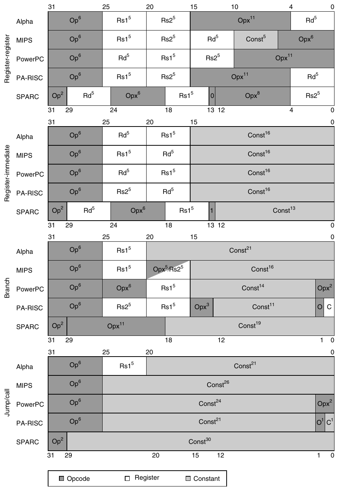

**Hình K.5 Instruction format cho các RISC architecture desktop/server. Bốn format này có trong cả năm architecture. (Ký hiệu số mũ trong hình biểu thị chiều rộng field tính bằng bit.) Mặc dù register field nằm ở những phần tương tự trong instruction, lưu ý rằng destination field và hai source field được sắp xếp khác nhau. Op = main opcode, Opx = opcode extension, Rd = destination register, Rs1 = source register 1, Rs2 = source register 2 và Const = hằng số (dùng làm immediate hoặc address). Khác các RISC còn lại, Alpha có format cho immediate trong arithmetic operation và logical operation khác với data transfer format ở đây. Nó cung cấp immediate 8-bit ở các bit 20 đến 13 của format RR, còn bit 12 đến 5 vẫn là opcode extension.**

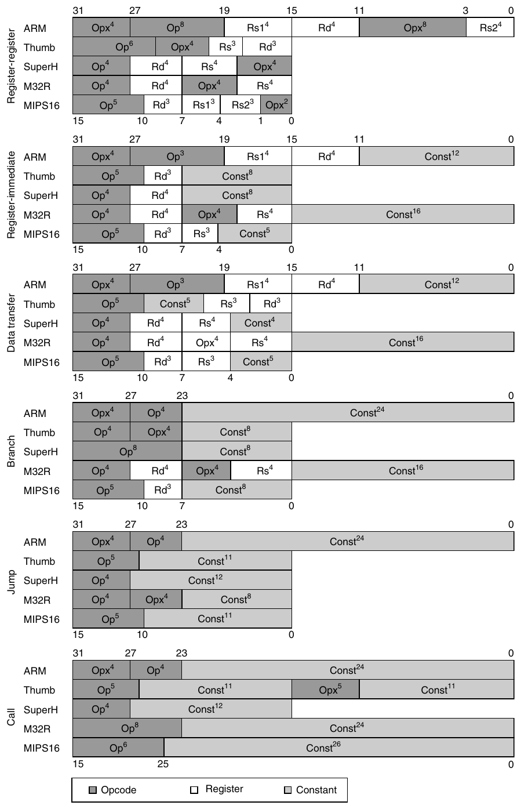

**Hình K.6 Instruction format cho các RISC architecture embedded. Sáu format này có trong cả năm architecture. Ký hiệu giống Hình K.5. Lưu ý sự tương đồng của branch format, jump format, call format và sự đa dạng của format register-register, register-immediate cùng data transfer. Những khác biệt xuất phát từ việc architecture có 8 hay 16 register, có format 2- hay 3-operand, và instruction length là 16 hay 32 bit.**

| Format: loại instruction | Alpha | MIPS64 | PA-RISC 2.0 | PowerPC | SPARC v.9 |
|---|---|---|---|---|---|
| Branch: all | Sign | Sign | Sign | Sign | Sign |
| Jump/call: all | Sign | — | Sign | Sign | Sign |
| Register-immediate: data transfer | Sign | Sign | Sign | Sign | Sign |
| Register-immediate: arithmetic | Zero | Sign | Sign | Sign | Sign |
| Register-immediate: logical | Zero | Zero | — | Zero | Sign |

**Hình K.7 Tóm tắt cách mở rộng hằng số của RISC desktop. Các hằng số trong jump instruction và call instruction của MIPS không được sign extend vì chỉ thay thế 28 bit thấp của PC, giữ nguyên 4 bit cao. PA-RISC không có logical immediate instruction.**

| Format: loại instruction | ARM v.4 | Thumb | SuperH | M32R | MIPS16 |
|---|---|---|---|---|---|
| Branch: all | Sign | Sign | Sign | Sign | Sign |
| Jump/call: all | Sign | Sign/Zero | Sign | Sign | — |
| Register-immediate: data transfer | Zero | Zero | Zero | Sign | Zero |
| Register-immediate: arithmetic | Zero | Zero | Sign | Sign | Zero/Sign |
| Register-immediate: logical | Zero | — | Zero | Zero | — |

**Hình K.8 Tóm tắt cách mở rộng hằng số của RISC embedded. Các instruction 16-bit-length có immediate ngắn hơn nhiều so với RISC desktop, thường chỉ 5 đến 8 bit. Tuy nhiên, phần lớn RISC embedded có cách lấy address dài cho procedure call từ hai half word liên tiếp. Các hằng số trong jump instruction và call instruction của MIPS không được sign extend vì chỉ thay thế 28 bit thấp của PC, giữ nguyên 4 bit cao. Immediate 8-bit trong ARM có thể được rotate phải một số bit chẵn từ 2 đến 30, tạo ra phạm vi immediate value lớn. Chẳng hạn, mọi lũy thừa của 2 đều là immediate trong ARM.**

Mọi architecture đều phải có cơ chế compare và conditional branch, nhưng bất chấp tất cả sự tương đồng, mỗi architecture này lại có cách thực hiện operation khác nhau.

#### Compare và Conditional Branch

SPARC dùng bốn condition code bit truyền thống được lưu trong program status word: negative, zero, carry và overflow. Chúng có thể được đặt bởi bất kỳ arithmetic instruction hoặc logical instruction nào; khác những architecture trước đó, việc đặt này là tùy chọn cho từng instruction. Một tùy chọn tường minh tạo ra ít vấn đề hơn trong implementation pipelined. Mặc dù condition code có thể được đặt như tác dụng phụ của operation, explicit compare được tổng hợp bằng subtract với r0 làm destination. Conditional branch của SPARC kiểm tra condition code để xác định mọi quan hệ unsigned và signed có thể có. Floating point dùng condition code riêng để mã hóa các điều kiện IEEE 754, đòi hỏi floating-point compare instruction. Phiên bản 9 mở rộng branch của SPARC theo bốn cách: một tập condition code riêng cho operation 64-bit; một branch kiểm tra nội dung register và branch nếu giá trị =, not=, <, <=, >= hoặc <= 0 (xem MIPS bên dưới); thêm ba tập condition code floating-point; và branch instruction mã hóa static branch prediction.

| Data transfer (instruction formats) | R-I | R-I | R-I, R-R | R-I, R-R | R-I, R-R |
|---|---|---|---|---|---|
| Tên instruction | Alpha | MIPS64 | PA-RISC 2.0 | PowerPC | SPARC v.9 |
| Load byte signed | LDBU; SEXTB | LB | LDB; EXTRW,S 31,8 | LBZ; EXTSB | LDSB |
| Load byte unsigned | LDBU | LBU | LDB, LDBX, LDBS | LBZ | LDUB |
| Load half word signed | LDWU; SEXTW | LH | LDH; EXTRW,S 31,16 | LHA | LDSH |
| Load half word unsigned | LDWU | LHU | LDH, LDHX, LDHS | LHZ | LDUH |
| Load word | LDLS | LW | LDW, LDWX, LDWS | LW | LD |
| Load SP float | LDS* | LWC1 | FLDWX, FLDWS | LFS | LDF |
| Load DP float | LDT | LDC1 | FLDDX, FLDDS | LFD | LDDF |
| Store byte | STB | SB | STB, STBX, STBS | STB | STB |
| Store half word | STW | SH | STH, STHX, STHS | STH | STH |
| Store word | STL | SW | STW, STWX, STWS | STW | ST |
| Store SP float | STS | SWC1 | FSTWX, FSTWS | STFS | STF |
| Store DP float | STT | SDC1 | FSTDX, FSTDS | STFD | STDF |
| Đọc, ghi special register | MF_, MT_ | MF, MT_ | MFCTL, MTCTL | MFSPR, MF_, MTSPR, MT_ | RD, WR, RDPR, WRPR, LDXFSR, STXFSR |
| Chuyển integer đến FP register | ITOFS | MFC1/DMFC1 | STW; FLDWX | STW; LDFS | ST; LDF |
| Chuyển FP đến integer register | FTTOIS | MTC1/DMTC1 | FSTWX; LDW | STFS; LW | STF; LD |

**Hình K.9 Các data transfer instruction của RISC desktop tương đương MIPS core. Chuỗi instruction tổng hợp một MIPS instruction được trình bày với dấu chấm phẩy ngăn cách. Nếu có nhiều lựa chọn instruction tương đương MIPS core, chúng được ngăn bằng dấu phẩy. Trong hình này, half word là 16 bit và word là 32 bit. Lưu ý rằng trong Alpha, LDS chuyển floating point single-precision sang double precision và load toàn bộ register 64-bit.**

PowerPC cũng dùng bốn condition code: less than, greater than, equal và summary overflow, nhưng có tám bản sao của chúng. Sự dư thừa này cho phép PowerPC instruction dùng những condition code khác nhau mà không conflict, về cơ bản cung cấp thêm tám register 4-bit cho PowerPC. Bất kỳ condition code nào trong tám nhóm đều có thể là target của compare instruction và là source của conditional branch. Integer instruction có một option bit hoạt động như thể integer op được theo sau bởi phép compare với zero để đặt condition “register” đầu tiên. PowerPC cũng cho phép floating-point instruction tùy chọn đặt “register” thứ hai. PowerPC cung cấp logical operation giữa tám condition code register 4-bit này (CRAND, CROR, CRXOR, CRNAND, CRNOR, CREQV), cho phép kiểm tra những điều kiện phức tạp hơn bằng một branch duy nhất.

| Arithmetic/ logical (instruction formats) | R-R, R-I | R-R, R-I | R-R, R-I | R-R, R-I | R-R, R-I |
|---|---|---|---|---|---|
| Tên instruction | Alpha | MIPS64 | PA-RISC 2.0 | PowerPC | SPARC v.9 |
| Add | ADDL | ADDU, ADDU | ADDL, LD0, ADDI, UADDCM | ADD, ADDI | ADD |
| Add (trap nếu overflow) | ADDLV | ADD, ADDI | ADDO, ADDIO | ADDO;<br>MCRXR; BC | ADDcc; TVS |
| Sub | SUBL | SUBU | SUB, SUBI | SUBF | SUB |
| Sub (trap nếu overflow) | SUBLV | SUB | SUBTO, SUBIO | SUBF/oe | SUBcc; TVS |
| Multiply | MULL | MULT, MULTU | SHiADD;...; (i=1,2,3) | MULLW, MULLI | MULX |
| Multiply (trap nếu overflow) | MULLV | — | SHiADDO;...; | — | — |
| Divide | — | DIV, DIVU | DS;...; DS | DIVW | DIVX |
| Divide (trap nếu overflow) | — | — | — | — | — |
| And | AND | AND, ANDI | AND | AND, ANDI | AND |
| Or | BIS | OR, ORI | OR | OR, ORI | OR |
| Xor | XOR | XOR, XORI | XOR | XOR, XORI | XOR |
| Load high part register | LDAH | LUI | LDIL | ADDIS | SETHI (B fmt.) |
| Shift left logical | SLL | SLLV, SLL | DEPW, Z 31-i,32-i | RLWINM | SLL |
| Shift right logical | SRL | SRLV, SRL | EXTRW, U 31, 32-i | RLWINM 32-i | SRL |
| Shift right arithmetic | SRA | SRAV, SRA | EXTRW, S 31, 32-i | SRAW | SRA |
| Compare | CMPEQ, CMPLT, CMPLE | SLT/U, SLTI/U | COMB | CMP(I)CLR | SUBcc r0,... |

**Hình K.10 Các arithmetic/logical instruction của RISC desktop tương đương MIPS core. Dấu gạch ngang nghĩa là operation không khả dụng trong architecture đó hoặc không được tổng hợp bằng một vài instruction. Chuỗi instruction như vậy được trình bày với dấu chấm phẩy ngăn cách. Nếu có nhiều lựa chọn instruction tương đương MIPS core, chúng được ngăn bằng dấu phẩy. Lưu ý rằng trong loại “Arithmetic/logical”, mọi máy trừ SPARC đều dùng mnemonic riêng để chỉ immediate operand; SPARC cung cấp phiên bản immediate của những instruction này nhưng dùng một mnemonic duy nhất. (Dĩ nhiên, chúng là những opcode riêng biệt!)**

MIPS dùng nội dung register để đánh giá conditional branch. Bất kỳ hai register nào cũng có thể được so sánh về equality (BEQ) hoặc inequality (BNE), sau đó branch được taken nếu điều kiện đúng. Các instruction set-on-less-than (SLT, SLTI, SLTU, SLTIU) so sánh hai operand rồi đặt destination register thành 1 nếu nhỏ hơn và thành 0 nếu không. Những instruction này đủ để tổng hợp đầy đủ các quan hệ. Vì phép so sánh với 0 phổ biến, MIPS có các instruction compare-and-branch đặc biệt cho mọi phép so sánh như vậy: lớn hơn hoặc bằng zero (BGEZ), lớn hơn zero (BGTZ), nhỏ hơn hoặc bằng zero (BLEZ) và nhỏ hơn zero (BLTZ). Dĩ nhiên, bằng và khác zero có thể được tổng hợp bằng r0 với BEQ và BNE. Giống SPARC, MIPS I dùng condition code cho floating point với floating-point compare instruction và branch instruction riêng biệt; MIPS IV mở rộng thành tám condition code floating-point, với các phép so sánh floating-point và branch instruction chỉ định condition cần đặt hoặc kiểm tra.

| Control (instruction formats) | B, J/C | B, J/C | B, J/C | B, J/C | B, J/C |
|---|---|---|---|---|---|
| Tên instruction | Alpha | MIPS64 | PA-RISC 2.0 | PowerPC | SPARC v.9 |
| Branch on integer compare | B_ (<, >, <=, >=, =, not=) | BEQ, BNE, B_Z (<, >, <=, >=) | COMB, COMIB | BC | BR_Z, BPcc (<, >, <=, >=, =, not=) |
| Branch on floating-point compare | FB_(<, >, <=, >=, =, not=) | BC1T, BC1F | FSTWX f0; LDW t; BB t | BC | FBPfcc (<, >, <=, >=, =,...) |
| Jump, jump register | BR, JMP | J, JR | BL r0, BLR r0 | B, BCLR, BCCTR | BA, JMPL r0,... |
| Call, call register | BSR | JAL, JALR | BL, BLE | BL, BLA, BCLRL, BCCTRL | CALL, JMPL |
| Trap | CALL_PAL GENTRAP | BREAK | BREAK | TW, TWI | Ticc, SIR |
| Trả về từ interrupt | CALL_PAL REI | JR; ERET | RFI, RFIR | RFI | DONE, RETRY, RETURN |

**Hình K.11 Các control instruction của RISC desktop tương đương MIPS core. Nếu có nhiều lựa chọn instruction tương đương MIPS core, chúng được ngăn bằng dấu phẩy.**

Các phép compare của Alpha (CMPEQ, CMPLT, CMPLE, CMPULT, CMPULE) kiểm tra hai register và đặt register thứ ba thành 1 nếu điều kiện true, thành 0 nếu không. Các phép compare Floating-point (CMTEQ, CMTLT, CMTLE, CMTUN) đặt kết quả thành 2.0 nếu điều kiện đúng và thành 0 nếu không. Branch instruction so sánh một register với 0 (BEQ, BGE, BGT, BLE, BLT, BNE) hoặc least-significant bit của nó với 0 (BLBC, BLBS), sau đó branch nếu điều kiện đúng.

PA-RISC có nhiều branch option, như chúng ta sẽ thấy trong mục “Instruction riêng của Alpha” ở trang K-27. Cách trực tiếp nhất là compare and branch instruction (COMB), so sánh hai register, branch theo các quan hệ tiêu chuẩn, sau đó kiểm tra least-significant bit của kết quả so sánh.

ARM tương tự SPARC ở chỗ cung cấp bốn condition code truyền thống có thể được đặt tùy chọn. CMP trừ một operand khỏi operand kia và dùng hiệu để đặt condition code. Compare negative (CMN) cộng hai operand và dùng tổng để đặt condition code. TST thực hiện logical AND trên hai operand để đặt mọi condition code trừ overflow, trong khi TEQ dùng exclusive OR để đặt ba condition code đầu. Giống SPARC, phiên bản conditional của ARM branch instruction kiểm tra condition code để xác định mọi quan hệ unsigned và signed có thể có. Như chúng ta sẽ thấy trong mục “Instruction riêng của SPARC v.9” ở trang K-29, một tính năng khác thường của ARM là mọi instruction đều có tùy chọn thực thi có điều kiện dựa trên condition code. (Điều này có nét tương đồng với annulling option của PA-RISC, được trình bày trong mục “Instruction riêng của Alpha” ở trang K-27.)

| Floating point (instruction formats) | R-R | R-R | R-R | R-R | R-R |
|---|---|---|---|---|---|
| Tên instruction | Alpha | MIPS64 | PA-RISC 2.0 | PowerPC | SPARC v.9 |
| Add single, double | ADDS, ADDT | ADD.S, ADD.D | FADD FADD/dbl | FADDS, FADD | FADDS, FADDD |
| Subtract single, double | SUBS, SUBT | SUB.S, SUB.D | FSUB FSUB/dbl | FSUBS, FSUB | FSUBS, FSUBD |
| Multiply single, double | MULS, MULT | MUL.S, MUL.D | FMPY FMPY/dbl | FMULS, FMUL | FMULS, FMULD |
| Divide single, double | DIVS, DIVT | DIV.S, DIV.D | FDIV, FDIV/dbl | FDIVS, FDIV | FDIVS, FDIVD |
| Compare | CMPT_(=, <, <=, UN) | C_.S, C_.D (<, >, <=, >=, =,...) | FCMP, FCMP/dbl (<, =, >) | FCMP | FCMPS, FCMPD |
| Move R-R | ADDT Fd, F31, Fs | MOV.S, MOV.D | FCPY | FMV | FMOVS/D/Q |
| Convert (single, double, integer) to (single, double, integer) | CVTST, CVTTS, CVTTQ, CVTQS, CVTQT | CVT.S.D, CVT.D.S, CVT.S.W, CVT.D.W, CVT.W.S, CVT.W.D | FCNVFF,s,d FCNVFF,d,s FCNVXF,s,s FCNVXF,d,d FCNVFX,s,s FCNVFX,d,s | —, FRSP, —, FCTIW, —, — | FSTOD, FDTOS, FSTOI, FDTOI, FITOS, FITOD |

**Hình K.12 Các floating-point instruction của RISC desktop tương đương MIPS core. Dấu gạch ngang nghĩa là operation không khả dụng trong architecture đó hoặc không được tổng hợp bằng một vài instruction. Nếu có nhiều lựa chọn instruction tương đương MIPS core, chúng được ngăn bằng dấu phẩy.**

| Quy ước | Alpha | MIPS64 | PA-RISC 2.0 | PowerPC | SPARC v.9 |
|---|---|---|---|---|---|
| Register có giá trị 0 | r31 (source) | r0 | r0 | r0 (addressing) | r0 |
| Return address register | (any) | r31 | r2, r31 | link (special) | r31 |
| No-op | LDQ_U r31,... | SLL r0, r0, r0 | OR r0, r0, r0 | ORI r0, r0, #0 | SETHI r0, 0 |
| Move R-R integer | BIS..., r31,... | ADD..., r0,... | OR..., r0,... | OR rx, ry, ry | OR..., r0,... |
| Thứ tự operand | OP Rs1, Rs2, Rd | OP Rd, Rs1, Rs2 | OP Rs1, Rs2, Rd | OP Rd, Rs1, Rs2 | OP Rs1, Rs2, Rd |

**Hình K.13 Các quy ước của RISC architecture desktop tương đương MIPS core.**

| Tên instruction | ARM v.4 | Thumb | SuperH | M32R | MIPS16 |
|---|---|---|---|---|---|
| Data transfer (instruction formats) | DT | DT | DT | DT | DT |
| Load byte signed | LDRSB | LDRSB | MOV.B | LDB | LB |
| Load byte unsigned | LDRB | LDRB | MOV.B; EXTU.B | LDUB | LBU |
| Load half word signed | LDRSH | LDRSH | MOV.W | LDH | LH |
| Load half word unsigned | LDRH | LDRH | MOV.W; EXTU.W | LDUH | LHU |
| Load word | LDR | LDR | MOV.L | LD | LW |
| Store byte | STRB | STRB | MOV.B | STB | SB |
| Store half word | STRH | STRH | MOV.W | STH | SH |
| Store word | STR | STR | MOV.L | ST | SW |
| Đọc, ghi special register | MRS, MSR | —<sup>1</sup> | LDC, STC | MVFC, MVTC | MOVE |

**Hình K.14 Các data transfer instruction của RISC embedded tương đương MIPS core. Chuỗi instruction tổng hợp một MIPS instruction được trình bày với dấu chấm phẩy ngăn cách. Lưu ý rằng floating point nhìn chung không được định nghĩa cho RISC embedded. Thumb và MIPS16 chỉ là tập con instruction 16-bit của ARM và MIPS, nên máy có thể chuyển mode và thực thi instruction set đầy đủ. Ký hiệu —<sup>1</sup> biểu thị những chuỗi khả dụng trong mode 32-bit nhưng không có trong mode 16-bit của Thumb hoặc MIPS16.**

Không có gì ngạc nhiên khi Thumb đi theo ARM. Điểm khác biệt là việc đặt condition code không còn tùy chọn, instruction TEQ bị loại bỏ và không có conditional execution cho instruction.

Hitachi SuperH dùng một condition T-bit duy nhất được đặt bởi compare instruction. Hai branch instruction quyết định branch nếu T bit là 1 (BT) hoặc T bit là 0 (BF). Hai dạng branch này cho phép giảm số comparison instruction.

Mitsubishi M32R cũng cung cấp một condition code bit (C) duy nhất cho các phép so sánh signed và unsigned (CMP, CMPI, CMPU, CMPUI), nhằm xác định register này có nhỏ hơn register kia hay không, tương tự instruction set-on-less-than của MIPS. Hai branch instruction kiểm tra C bit bằng 1 hay 0: BC và BNC. M32R cũng có instruction branch theo equality hoặc inequality của register (BEQ và BNE) và mọi quan hệ của register với 0 (BGEZ, BGTZ, BLEZ, BLTZ, BEQZ, BNEZ). Khác BC và BNC, những instruction cuối này đều rộng 32 bit.

MIPS16 giữ các instruction set-on-less-than (SLT, SLTI, SLTU, SLTIU), nhưng thay vì đặt kết quả vào một trong tám register, nó đặt kết quả vào register đặc biệt tên T. MIPS16 luôn được triển khai trong máy cũng có đầy đủ instruction và register MIPS 32-bit; vì vậy, register T thực ra là register 24 trong MIPS architecture đầy đủ. Các branch instruction MIPS16 kiểm tra một register bằng hay khác zero (BEQZ và BNEZ). Cũng có instruction branch nếu register T bằng hay khác zero (BTEQZ và BTNEZ). Để kiểm tra hai register có bằng nhau không, MIPS bổ sung compare instruction (CMP, CMPI), tính exclusive OR của hai register và đặt kết quả vào register T. Compare được bổ sung vì MIPS16 bỏ các instruction compare và branch nếu register bằng hoặc khác nhau (BEQ và BNE).

| Arithmetic/logical (instruction formats) | R-R, R-I | R-R, R-I | R-R, R-I | R-R, R-I | R-R, R-I |
|---|---|---|---|---|---|
| Tên instruction | ARM v.4 | Thumb | SuperH | M32R | MIPS16 |
| Add | ADD | ADD | ADD | ADD, ADDI, ADD3 | ADDU, ADDIU |
| Add (trap nếu overflow) | ADDS; SWIVS | ADD; BVC .+4; SWI | ADDV | ADDV, ADDV3 | —<sup>1</sup> |
| Subtract | SUB | SUB | SUB | SUB | SUBU |
| Subtract (trap nếu overflow) | SUBS; SWIVS | SUB; BVC .+1; SWI | SUBV | SUBV | —<sup>1</sup> |
| Multiply | MUL | MUL | MUL | MUL | MULT, MULTU |
| Multiply (trap nếu overflow) |  |  |  |  | — |
| Divide | — | — | DIV1, DIVoS, DIVoU | DIV, DIVU | DIV, DIVU |
| Divide (trap nếu overflow) | — | — |  |  | — |
| And | AND | AND | AND | AND, AND3 | AND |
| Or | ORR | ORR | OR | OR, OR3 | OR |
| Xor | EOR | EOR | XOR | XOR, XOR3 | XOR |
| Load high part register | — | — |  | SETH | —<sup>1</sup> |
| Shift left logical | LSL<sup>3</sup> | LSL<sup>2</sup> | SHLL, SHLLn | SLL, SLLI, SLL<sup>3</sup> | SLLV, SLL |
| Shift right logical | LSR<sup>3</sup> | LSR<sup>2</sup> | SHRL, SHRLn | SRL, SRLI, SRL<sup>3</sup> | SRLV, SRL |
| Shift right arithmetic | ASR<sup>3</sup> | ASR<sup>2</sup> | SHRA, SHAD | SRA, SRAI, SRA<sup>3</sup> | SRAV, SRA |
| Compare | CMP,CMN, TST,TEQ | CMP, CMN, TST | CMP/cond, TST | CMP/I, CMPU/I | CMP/I<sup>2</sup>, SLT/I, SLT/IU |

**Hình K.15 Các arithmetic/logical instruction của RISC embedded tương đương MIPS core. Dấu gạch ngang nghĩa là operation không khả dụng trong architecture đó hoặc không được tổng hợp bằng một vài instruction. Chuỗi instruction như vậy được trình bày với dấu chấm phẩy ngăn cách. Nếu có nhiều lựa chọn instruction tương đương MIPS core, chúng được ngăn bằng dấu phẩy. Thumb và MIPS16 chỉ là tập con instruction 16-bit của ARM và MIPS, nên máy có thể chuyển mode và thực thi instruction set đầy đủ. Ký hiệu —<sup>1</sup> biểu thị những chuỗi khả dụng trong mode 32-bit nhưng không có trong mode 16-bit của Thumb hoặc MIPS16. Số mũ 2 chỉ những instruction mới chỉ có trong mode 16-bit của Thumb hoặc MIPS16, chẳng hạn CMP/I<sup>2</sup>. ARM bao gồm shift trong mọi data operation instruction, nên các shift có số mũ 3 chỉ là biến thể của move instruction, chẳng hạn LSR<sup>3</sup>.**

| Control (instruction formats) | B, J, C | B, J, C | B, J, C | B, J, C | B, J, C |
|---|---|---|---|---|---|
| Tên instruction | ARM v.4 | Thumb | SuperH | M32R | MIPS16 |
| Branch on integer compare | B/cond | B/cond | BF, BT | BEQ, BNE, BC,BNC, B__Z | BEQZ<sup>2</sup>, BNEZ<sup>2</sup>, BTEQZ<sup>2</sup>, BTNEZ<sup>2</sup> |
| Jump, jump register | MOV pc,ri | MOV pc,ri | BRA, JMP | BRA, JMP | B2, JR |
| Call, call register | BL | BL | BSR, JSR | BL, JL | JAL, JALR, JALX<sup>2</sup> |
| Trap | SWI | SWI | TRAPA | TRAP | BREAK |
| Trả về từ interrupt | MOVS pc, r14 | —<sup>1</sup> | RTS | RTE | —<sup>1</sup> |

**Hình K.16 Các control instruction của RISC embedded tương đương MIPS core. Thumb và MIPS16 chỉ là tập con instruction 16-bit của ARM và MIPS, nên máy có thể chuyển mode và thực thi instruction set đầy đủ. Ký hiệu —<sup>1</sup> biểu thị những chuỗi khả dụng trong mode 32-bit nhưng không có trong mode 16-bit của Thumb hoặc MIPS16. Số mũ 2 chỉ instruction mới chỉ có trong mode 16-bit của Thumb hoặc MIPS16, chẳng hạn BTEQZ<sup>2</sup>.**

| Quy ước | ARM v.4 | Thumb | SuperH | M32R | MIPS16 |
|---|---|---|---|---|---|
| Return address reg. | R14 | R14 | PR (special) | R14 | RA (special) |
| No-op | MOV r0,r0 | MOV r0,r0 | NOP | NOP | SLL r0, r0 |
| Operand, thứ tự | OP Rd, Rs1, Rs2 | OP Rd, Rs1 | OP Rs1, Rd | OP Rd, Rs1 | OP Rd, Rs1, Rs2 |

**Hình K.17 Các quy ước của instruction RISC embedded tương đương MIPS core.**

Hình K.18 và K.19 tóm tắt các cơ chế dùng cho conditional branch.

### Instruction: Multimedia Extension của RISC Desktop/Server

Vì theo định nghĩa, mọi desktop microprocessor đều có graphical display riêng, khi transistor budget tăng, việc bổ sung hỗ trợ graphics operation là điều tất yếu. Nhiều graphics system dùng 8 bit để biểu diễn từng màu trong ba màu cơ bản, cộng thêm 8 bit cho vị trí pixel.

Việc bổ sung loa và microphone cho hội nghị từ xa và video game gợi ra nhu cầu hỗ trợ cả âm thanh. Audio sample cần độ chính xác cao hơn 8 bit, nhưng 16 bit là đủ.

Mọi microprocessor đều có hỗ trợ đặc biệt để byte và half word chiếm ít không gian hơn khi lưu trong memory, nhưng vì arithmetic operation trên những data size này hiếm khi xuất hiện trong chương trình integer điển hình, sự hỗ trợ ngoài data transfer rất ít. Các architect của Intel i860, được biện minh trong công ty là một graphical accelerator, nhận ra rằng nhiều ứng dụng graphics và audio thực hiện cùng operation trên vector của những data này. Mặc dù vector unit vượt transistor budget của i860 vào năm 1989, bằng cách phân chia carry chain bên trong ALU 64-bit (xem Mục J.8), nó có thể đồng thời thực hiện operation trên vector ngắn gồm tám operand 8-bit, bốn operand 16-bit hoặc hai operand 32-bit. Chi phí của những ALU phân chia như vậy nhỏ. Các ứng dụng phù hợp với sự hỗ trợ này gồm MPEG (video), trò chơi như DOOM (graphics 3D), Adobe Photoshop (nhiếp ảnh kỹ thuật số) và hội nghị từ xa (xử lý audio và hình ảnh).

|  | Alpha | MIPS64 | PA-RISC 2.0 | PowerPC | SPARC v.9 |
|---|---|---|---|---|---|
| Số condition code bit (integer and FP) | 0 | 8 FP | 8 FP | 8 × 4 both | 2 × 4 integer, 4 × 2 FP |
| Compare instruction cơ bản (integer and FP) | 1 integer, 1 FP | 1 integer, 1 FP | 4 integer, 2 FP | 4 integer, 2 FP | 1 FP |
| Branch instruction cơ bản (integer and FP) | 1 | 2 integer, 1 FP | 7 integer | 1 both | 3 integer, 1 FP |
| So sánh register với register/const và branch | — | =, not= | =, not=, <, <=, >, >=, even, odd | — | — |
| So sánh register với zero và branch | =, not=, <, <=, >, >=, even, odd | =, not=, <, <=, >, >= | =, not=, <, <=, >, >=, even, odd | — | =, not=, <, <=, >, >= |

**Hình K.18 Tóm tắt năm cách tiếp cận conditional branch của RISC desktop. Branch Floating-point trong PA-RISC được thực hiện bằng cách sao chép FP status register sang integer register, sau đó dùng branch on bit instruction để kiểm tra FP comparison bit. Integer compare trong SPARC được tổng hợp bằng arithmetic instruction đặt condition code với r0 làm destination.**

|  | ARM v.4 | Thumb | SuperH | M32R | MIPS16 |
|---|---|---|---|---|---|
| Số condition code bit | 4 | 4 | 1 | 1 | 1 |
| Compare instruction cơ bản | 4 | 3 | 2 | 2 | 2 |
| Branch instruction cơ bản | 1 | 1 | 2 | 3 | 2 |
| So sánh register với register/const và branch | — | — | =, >, >= | =, not= | — |
| So sánh register với zero và branch | — | — | =, >, >= | =, not=, <, <=, >, >= | =, not= |

**Hình K.19 Tóm tắt năm cách tiếp cận conditional branch của RISC embedded.**

Giống virus, theo thời gian, sự hỗ trợ multimedia như vậy đã lan đến gần như mọi desktop microprocessor. HP là RISC desktop thành công đầu tiên đưa sự hỗ trợ này vào. Như chúng ta sẽ thấy, virus này lan truyền không đồng đều. IBM chia tách sự hỗ trợ multimedia. PowerPC cung cấp các active instruction, còn phiên bản Power thì không.

Những extension này được gọi là subword parallelism, vector hoặc single-instruction, multiple data (SIMD) (xem Phụ lục A). Vì bộ phận marketing Intel dùng SIMD để mô tả MMX extension của 80x86, tên này trở nên phổ biến. Hình K.20 tóm tắt sự hỗ trợ theo architecture.

| Instruction category | Alpha MAX | MIPS MDMX | PA-RISC MAX2 | PowerPC ActiveC | SPARC VIS |
|---|---|---|---|---|---|
| Add/subtract |  | 8B, 4H | 4H | 16B, 8H, 4W | 4H, 2W |
| Saturating add/sub |  | 8B, 4H | 4H | 16B, 8H, 4W |  |
| Multiply |  | 8B, 4H |  | 16B, 8H, 4W | 4B/H |
| Compare | 8B (>=) | 8B, 4H (=,<,<=) |  | 16B, 8H, 4W | 4H, 2W (=, not=, >, <=) |
| Shift right/left |  | 8B, 4H | 4H | 16B, 8H, 4W |  |
| Shift right arithmetic |  | 4H | 4H | 16B, 8H, 4W |  |
| Multiply and add |  | 8B, 4H |  | 16B, 8H, 4W |  |
| Shift and add (saturating) |  |  | 4H |  |  |
| AND/OR/XOR | 8B, 4H, 2W | 8B, 4H, 2W | 8B, 4H, 2W | 16B, 8H, 4W | 8B, 4H, 2W |
| Absolute difference | 8B |  |  |  | 8B |
| Max/min | 8B, 4W | 8B, 4H |  | 16B, 8H, 4W |  |
| Pack (2n bits --> n bits) | 2W->2B, 4H->4B | 2\*2W->4H, 2\*4H->8B | 2\*4H->8B | 4W->4H, 8H->8B, 4W->4B | 2W->2H, 2W->2B, 4H->4B |
| Unpack/merge | 2B->2W, 4B->4H | 2\*4B->8B, 2\*2H->4H |  | 4H->4W, 8B->8H | 4B->4H, 2\*4B->8B |
| Permute/shuffle |  | 8B, 4H | 4H | 16B, 8H, 4W |  |
| Register sets | Integer | Fl. Pt. + 192b Acc. | Integer | 32 ×128b | Fl. Pt. |

**Hình K.20 Tóm tắt hỗ trợ multimedia cho RISC desktop. B là byte (8 bit), H là half word (16 bit) và W là word (32 bit). Vì vậy, 8B nghĩa là operation trên 8 byte trong một instruction. Pack và unpack dùng ký hiệu 2*2W để chỉ 2 operand, mỗi operand gồm 2 word. Lưu ý MDMX có vector/scalar operation, trong đó scalar được chỉ định là một phần tử của một vector register. Bảng này đơn giản hóa những multimedia architecture đầy đủ và bỏ qua nhiều chi tiết. Chẳng hạn, MIPS MDMX có instruction multiplex giữa hai operand, HP MAX2 có instruction tính trung bình và SPARC VIS có instruction đặt register thành hằng số. Ngoài ra, bảng không bao gồm memory alignment operation của MDMX, MAX và VIS.**

Từ Hình K.20, có thể thấy nhìn chung MIPS MDMX xử lý 8 byte hoặc 4 half word mỗi instruction, HP PA-RISC MAX2 xử lý 4 half word, SPARC VIS xử lý 4 half word hoặc 2 word, còn Alpha không làm được nhiều. Các operation Alpha MAX chỉ là phiên bản byte của compare, min, max và absolute difference, để software tự tách field và thực hiện parallel add, subtract, multiply trên byte và half word. MIPS cũng bổ sung operation xử lý hai operand floating-point 32-bit mỗi cycle, nhưng chúng được xem là một phần MIPS V thay vì chỉ là multimedia extension (xem mục “Instruction riêng của MIPS64” ở trang K-24).

Một tính năng thường không có trong microprocessor general-purpose là saturating operation. Saturation nghĩa là khi phép tính overflow, kết quả được đặt thành số dương lớn nhất hoặc số âm nhỏ nhất, thay vì phép tính modulo như trong số học bù hai. Thường xuất hiện trong digital signal processor (xem tiểu mục tiếp theo), những saturating operation này hữu ích trong các routine lọc.

Những máy này chủ yếu dùng các register set có sẵn để chứa operand: integer register cho Alpha và HP PA-RISC, floating-point register cho MIPS và Sun. Vì vậy, data transfer được thực hiện bằng load instruction và store instruction tiêu chuẩn. PowerPC ActiveC bổ sung 32 register 128-bit. MIPS cũng bổ sung một register rộng 192-bit (3*64) làm accumulator cho một số operation. Với chiều rộng gấp 3 native data width, nó có thể được phân chia để accumulate 8 byte với 24 bit mỗi field hoặc 4 half word với 48 bit mỗi field. Accumulator rộng này có thể dùng cho add instruction, subtract instruction và multiply/add instruction. MIPS tuyên bố accumulator đem lại lợi thế performance từ 2 đến 4 lần.

Có lẽ kết luận đáng ngạc nhiên của bảng này là thiếu sự nhất quán. Những operation duy nhất có trong cả bốn là logical operation (AND, OR, XOR), vốn không cần ALU phân chia. Nếu bỏ qua Alpha tiết kiệm, những operation chung duy nhất khác là parallel add và subtract trên 4 half word.

Mỗi nhà sản xuất đều nói những instruction này nhằm sử dụng trong các subroutine library hand-optimized, một ý định có lẽ sẽ được tuân theo vì xây dựng compiler hoạt động tốt với mọi RISC multimedia extension desktop sẽ là thách thức.

### Instruction: Extension Digital Signal-Processing của RISC Embedded

Một tính năng có trong mọi digital signal processor (DSP) architecture là hỗ trợ integer multiply-accumulate. Phép multiply thường thực hiện trên word ngắn hơn integer thông thường, chẳng hạn 16 bit, còn accumulator thường dùng word dài hơn, chẳng hạn 64 bit. Lý do có multiply-accumulate là triển khai hiệu quả digital filter, vốn phổ biến trong ứng dụng DSP. Vì Thumb và MIPS16 là subset architecture, chúng không cung cấp hỗ trợ này. Thay vào đó, người lập trình nên dùng DSP extension hoặc multimedia extension có trong instruction ở mode 32-bit của ARM và MIPS64.

Hình K.21 cho thấy kích thước phép multiply, kích thước accumulator, cùng các operation và instruction name cho RISC embedded. Những máy có accumulator size lớn hơn 32 và nhỏ hơn 64 bit buộc các bit cao giữ vai trò sign bit, qua đó “saturating” phép add để đặt thành giá trị fixed-point lớn nhất hoặc nhỏ nhất nếu operation overflow.

### Instruction: Những Extension chung cho MIPS Core

Hình K.22 đến K.28 liệt kê các instruction không có trong Hình K.9 đến K.17 theo cùng bốn loại. Instruction được đưa vào các danh sách này nếu xuất hiện trong nhiều hơn một architecture tiêu chuẩn. Các instruction được định nghĩa bằng hardware description language trong Hình K.29.

|  | ARM v.4 | Thumb | SuperH | M32R | MIPS16 |
|---|---|---|---|---|---|
| Kích thước multiply | 32B × 32B | — | 32B × 32B, 16B × 16B | 32B × 16B, 16B × 16B | — |
| Kích thước accumulator | 32B/64B | — | 32B/42B, 48B/64B | 56B | — |
| Tên accumulator | Bất kỳ GPR hoặc cặp GPR nào | — | MACH, MACL | ACC | — |
| Operations | 32B/64B product + 64B accumulate signed/unsigned | — | 32B product + 42B/32B accumulate (operand trong memory); 64B product + 64B/48B accumulate (operand trong memory); xóa MAC | 32B/48B product + 64B accumulate, round, move | — |
| Tên instruction tương ứng | MLA, SMLAL, UMLAL | — | MAC, MACS, MAC.L, MAC.LS, CLRMAC | MACHI/MACLO, MACWHI/MACWLO, RAC, RACH, MVFACHI/MVFACLO, MVTACHI/MVTACLO | — |

**Hình K.21 Tóm tắt năm cách tiếp cận multiply-accumulate của RISC embedded.**

Mặc dù phần lớn các loại self-explanatory, một vài loại cần được bình luận:

- Hàng “atomic swap” chỉ một primitive có thể trao đổi register với memory mà không bị gián đoạn. Nó hữu ích cho semaphore của operating system trong uniprocessor cũng như cho multiprocessor synchronization (xem Mục 5.5).

- Các hàng data transfer và operation 64-bit cho thấy MIPS, PowerPC và SPARC định nghĩa addressing và integer operation 64-bit như thế nào. SPARC đơn giản định nghĩa mọi register operation và addressing operation là 64 bit, chỉ thêm instruction đặc biệt cho shift 64-bit, data transfer và branch. MIPS có cùng extension, đồng thời bổ sung riêng signed arithmetic instruction 64-bit. PowerPC thêm right shift, load, store, divide và compare 64-bit, đồng thời có mode riêng quyết định instruction được hiểu là operation 32-or 64-bit; operation 64-bit không hoạt động trên máy chỉ hỗ trợ mode 32-bit. PA-RISC được mở rộng thành addressing và operation 64-bit trong phiên bản 2.0.

- Instruction “prefetch” cung cấp address và hint về data cho implementation. Hint bao gồm data có khả năng sắp được đọc hoặc ghi, chỉ được đọc hoặc ghi một lần, hay được đọc hoặc ghi nhiều lần. Prefetch không gây exception. MIPS có một phiên bản cộng hai register để lấy address cho chương trình floating-point, khác với chương trình MIPS non-floating-point. (Xem Chương 2 để tìm hiểu thêm về prefetching.)

- Trong hàng “Endian”, “Big/Little” nghĩa là có một bit trong program status register cho phép processor hoạt động như Big Endian hoặc Little Endian (xem Mục A.3). Có thể thực hiện điều này bằng cách đơn giản lấy bù một số least-significant bit của address trong data transfer instruction.

| Tên | Định nghĩa | Alpha | MIPS64 | PA-RISC 2.0 | PowerPC | SPARC v.9 |
|---|---|---|---|---|---|---|
| Atomic swap R/M (cho lock và semaphore) | Temp<---Rd;<br>Rd<---Mem[x];<br>Mem[x]<---Temp | LDL/Q_L;<br>STL/Q_C | LL; SC | —<br>(xem Hình K.8) | LWARX;<br>STWCX | CASA, CASX |
| Load 64-bit integer | Rd<---<sub>64</sub> Mem[x] | LDQ | LD | LDD | LD | LDX |
| Store 64-bit integer | Mem[x]<---<sub>64</sub> Rd | STQ | SD | STD | STD | STX |
| Load 32-bit integer unsigned | Rd<sub>32..63</sub><---<sub>32</sub> Mem[x]; Rd<sub>0..31</sub><---<sub>32</sub> 0 | LDL; EXTLL | LWU | LDW | LWZ | LDUW |
| Load 32-bit integer signed | Rd<sub>32..63</sub><---<sub>32</sub> Mem[x]; Rd<sub>0..31</sub><---<sub>32</sub> Mem[x]<sub>0</sub><sup>32</sup> | LDL | LW | LDW; EXTRD,S 63, 8 | LWA | LDSW |
| Prefetch | Cache[x]<---hint | FETCH, FETCH_M* | PREF, PREFX | LDD, r0<br>LDW, r0 | DCBT, DCBTST | PRE-FETCH |
| Load coprocessor | Coprocessor<--- Mem[x] | — | LWCi | CLDWX, CLDWS | — | — |
| Store coprocessor | Mem[x]<--- Coprocessor | — | SWCi | CSTWX, CSTWS | — | — |
| Endian | (Big/Little Endian?) | Either | Either | Either | Either | Either |
| Cache flush | (Flush cache block tại address này) | ECB | CP0op | FDC, FIC | DCBF | FLUSH |
| Shared-memory synchronization | (Mọi data transfer trước đó hoàn tất trước khi data transfer tiếp theo có thể bắt đầu) | WMB | SYNC | SYNC | SYNC | MEMBAR |

**Hình K.22 Các data transfer instruction không có trong MIPS core nhưng có trong ít nhất hai trong năm architecture desktop. Cặp instruction load linked/store conditional cung cấp atomic operation cho semaphore trên Alpha và MIPS, cho phép đọc data từ memory, sửa đổi rồi lưu lại mà không lo interrupt hoặc máy khác truy cập data trong multiprocessor (xem Chương 5). Prefetching trên Alpha đến external cache được thực hiện bằng FETCH và FETCH_M; prefetch đến cache on-chip dùng LD_Q A, R31 và LD_Y A. F31 được dùng trong Alpha 21164 (xem Bhandarkar [1995], trang 190).**

- “shared-memory synchronization” hỗ trợ cache-coherent multiprocessor: mọi load và store thực thi trước instruction phải hoàn tất trước khi load và store sau nó có thể bắt đầu. (Xem Chương 5.)

- Hàng “coprocessor operations” liệt kê một số loại cho phép mở rộng processor bằng hardware special-purpose.

Một khác biệt cần giải thích dài hơn là optimized branch. Hình K.30 cho thấy các tùy chọn. Alpha và PowerPC cung cấp branch có hiệu lực ngay, giống branch trong architecture trước đó. Để tăng tốc branch, những máy này dùng branch prediction (xem Mục 3.3). Tất cả RISC desktop còn lại cung cấp delayed branch (xem Phụ lục C). RISC embedded nhìn chung không hỗ trợ delayed branch, ngoại trừ SuperH cung cấp nó như một tùy chọn.

| Tên | Định nghĩa | Alpha | MIPS64 | PA-RISC 2.0 | PowerPC | SPARC v.9 |
|---|---|---|---|---|---|---|
| 64-bit integer arithmetic ops | Rd<---<sub>64</sub>Rs1 op<sub>64</sub> Rs2 | ADD, SUB, MUL | DADD, DSUB DMULT, DDIV | ADD, SUB, SHLADD, DS | ADD, SUBF, MULLD, DIVD | ADD, SUB, MULX, S/UDIVX |
| 64-bit integer logical ops | Rd<---<sub>64</sub>Rs1 op<sub>64</sub> Rs2 | AND, OR, XOR | AND, OR, XOR | AND, OR, XOR | AND, OR, XOR | AND, OR, XOR |
| 64-bit shifts | Rd<---<sub>64</sub>Rs1 op<sub>64</sub> Rs2 | SLL, SRA, SRL | DSLL/V, DSRA/V, DSRL/V | DEPD,Z EXTRD,S EXTRD,U | SLD, SRAD, SRLD | SLLX, SRAX, SRLX |
| Conditional move | if (cond) Rd<---Rs | CMOV_ | MOVN/Z | SUBc, n; ADD | — | MOVcc, MOVr |
| Hỗ trợ multiword integer add | CarryOut, Rd <--- Rs1 + Rs2 + OldCarryOut | — | ADU; SLTU;<br>ADDU, DADU;<br>SLTU; DADDU | ADDC | ADDC, ADDE | ADDcc |
| Hỗ trợ multiword integer sub | CarryOut, Rd <--- Rs1 Rs2 + OldCarryOut *(ghi chú: sách in "Rs1 Rs2"; đúng là "Rs1 – Rs2")* | — | SUBU; SLTU;<br>SUBU, DSUBU;<br>SLTU; DSUBU | SUBB | SUBFC, SUBFE | SUBcc |
| And not | Rd <--- Rs1 & ~(Rs2) | BIC | — | ANDCM | ANDC | ANDN |
| Or not | Rd <--- Rs1 \| ~(Rs2) | ORNOT | — | — | ORC | ORN |
| Add high immediate | Rd<sub>0..15</sub><---Rs1<sub>0..15</sub>  + (Const<<16); | — | — | ADDIL (R-I) | ADDIS (R-I) | — |
| Coprocessor operations | (Do coprocessor định nghĩa) | — | COPi | COPR,i | — | IMPDEPi |

**Hình K.23 Các arithmetic/logical instruction không có trong MIPS core nhưng có trong ít nhất hai trong năm architecture desktop.**

| Tên | Định nghĩa | Alpha | MIPS64 | PA-RISC 2.0 | PowerPC | SPARC v.9 |
|---|---|---|---|---|---|---|
| Optimized delayed branches | (Branch không phải lúc nào cũng delayed) | — | BEQL, BNEL, B_ZL (<, >, <=, >=) | COMBT, n, COMBF, n | — | BPcc, A, FPBcc, A |
| Conditional trap | if (COND) {R31<---PC; PC <---0..0#i} | — | T_,T_I (=, not=, <, >, <=, >=) | SUBc, n; BREAK | TW, TD, TWI, TDI | Tcc |
| No. control registers | Misc. regs (virtual memory, interrupts, . . .) | 6 | equiv. 12 | 32 | 33 | 29 |

**Hình K.24 Các control instruction không có trong MIPS core nhưng có trong ít nhất hai trong năm architecture desktop.**

Ba RISC desktop còn lại cung cấp một phiên bản delayed branch giúp dễ lấp delay slot hơn. Branch “annulling” của SPARC chỉ thực thi instruction trong delay slot nếu branch taken; nếu không, instruction bị annul. Điều này có nghĩa instruction tại target của branch có thể được sao chép an toàn vào delay slot vì chỉ được thực thi nếu branch taken. Ràng buộc là target không phải một branch khác và target được biết tại compile time. (SPARC cũng cung cấp nondelayed jump vì unconditional branch có annul bit được đặt không thực thi instruction tiếp theo.) Những phiên bản sau của MIPS architecture bổ sung branch likely instruction, cũng annul instruction tiếp theo nếu branch không taken. PA-RISC cho phép gần như mọi instruction annul instruction tiếp theo, bao gồm branch. Tùy chọn branch “nullifying” thực thi instruction tiếp theo tùy theo hướng của branch và branch có taken hay không (tức nếu forward branch không taken hoặc backward branch taken). Có lẽ lựa chọn này nhằm tối ưu loop, cho phép instruction sau exit branch và looping branch thực thi trong trường hợp phổ biến.

| Tên | Định nghĩa | Alpha | MIPS64 | PA-RISC 2.0 | PowerPC | SPARC v.9 |
|---|---|---|---|---|---|---|
| Multiply and add | Fd <--- ( Fs1 × Fs2) + Fs3 | — | MADD.S/D | FMPYFADD sgl/dbl | FMADD/S |  |
| Multiply and sub | Fd <--- ( Fs1 × Fs2) – Fs3 | — | MSUB.S/D |  | FMSUB/S |  |
| Neg mult and add | Fd <--- -(( Fs1 × Fs2) + Fs3) | — | NMADD.S/D | FMPYFNEG sgl/dbl | FNMADD/S |  |
| Neg mult and sub | Fd <--- -(( Fs1 × Fs2) – Fs3) | — | NMSUB.S/D |  | FNMSUB/S |  |
| Square root | Fd <--- SQRT(Fs) | SQRT_ | SQRT.S/D | FSQRT sgl/dbl | FSQRT/S | FSQRTS/D |
| Conditional move | if (cond) Fd<---Fs | FCMOV_ | MOVF/T, MOVF/T.S/D | FTESTFCPY | — | FMOVcc |
| Negate | Fd <--- Fs ^ x80000000 | CPYSN | NEG.S/D | FNEG sgl/dbl | FNEG | FNEGS/D/Q |
| Absolute value | Fd <--- Fs & x7FFFFFFF | — | ABS.S/D | FABS/dbl | FABS | FABSS/D/Q |

**Hình K.25 Các Floating-point instruction không có trong MIPS core nhưng có trong ít nhất hai trong năm architecture desktop.**

| Tên | Định nghĩa | ARM v.4 | Thumb | SuperH | M32R | MIPS16 |
|---|---|---|---|---|---|---|
| Atomic swap R/M (cho semaphore) | Temp<---Rd;<br>Rd<---Mem[x];<br>Mem[x]<---Temp | SWP, SWPB | —<sup>1</sup> | (see TAS) | LOCK; UNLOCK | —<sup>1</sup> |
| Memory management unit | Paged address translation | Qua coprocessor instruction | —<sup>1</sup> | LDTLB |  | —<sup>1</sup> |
| Endian | (Big/Little Endian?) | Either | Either | Either | Big | Either |

**Hình K.26 Các data transfer instruction không có trong MIPS core nhưng có trong ít nhất hai trong năm architecture embedded. Ký hiệu —<sup>1</sup> biểu thị những chuỗi khả dụng trong mode 32-bit nhưng không có trong mode 16-bit của Thumb hoặc MIPS16.**

Sau khi trình bày những điểm tương đồng, chúng ta sẽ tập trung vào tính năng riêng của từng architecture. Trước hết là RISC desktop/server, được sắp xếp theo độ dài mô tả tính năng riêng từ ngắn nhất đến dài nhất, sau đó là RISC embedded.

| Tên | Định nghĩa | ARM v.4 | Thumb | SuperH | M32R | MIPS16 |
|---|---|---|---|---|---|---|
| Load immediate | Rd<---Imm | MOV | MOV | MOV, MOVA | LDI, LD24 | LI |
| Hỗ trợ multiword integer add | CarryOut, Rd <--- Rd + Rs1 + OldCarryOut | ADCS | ADC | ADDC | ADDX | —<sup>1</sup> |
| Hỗ trợ multiword integer sub | CarryOut, Rd <--- Rd – Rs1 + OldCarryOut | SBCS | SBC | SUBC | SUBX | —<sup>1</sup> |
| Negate | Rd <--- 0 – Rs1 |  | NEG<sup>2</sup> | NEG | NEG | NEG |
| Not | Rd <--- ~(Rs1) | MVN | MVN | NOT | NOT | NOT |
| Move | Rd <--- Rs1 | MOV | MOV | MOV | MV | MOVE |
| Rotate right | Rd <--- Rs i, >> Rd<sub>0. . . i–1</sub> <--- Rs<sub>31–i. . . 31</sub> | ROR | ROR | ROTR |  |  |
| And not | Rd <--- Rs1 & ~(Rs2) | BIC | BIC |  |  |  |

**Hình K.27 Các arithmetic/logical instruction không có trong MIPS core nhưng có trong ít nhất hai trong năm architecture embedded. Ký hiệu —<sup>1</sup> biểu thị những chuỗi khả dụng trong mode 32-bit nhưng không có trong mode 16-bit của Thumb hoặc MIPS16. Số mũ 2 chỉ những instruction mới chỉ có trong mode 16-bit của Thumb hoặc MIPS16, chẳng hạn NEG<sup>2</sup>.**

| Tên | Định nghĩa | ARM v.4 | Thumb | SuperH | M32R | MIPS16 |
|---|---|---|---|---|---|---|
| No. control registers | Misc. registers | 21 | 29 | 9 | 5 | 36 |

**Hình K.28 Control information trong năm architecture embedded.**

### Instruction riêng của MIPS64

MIPS đã trải qua năm thế hệ instruction set, và quá trình này nhìn chung bổ sung các tính năng có ở architecture khác. Sau đây là những tính năng riêng nổi bật của MIPS; một số tính năng đầu tiên đã có trong instruction set ban đầu.

#### Data Transfer không aligned

MIPS có instruction đặc biệt xử lý word misaligned trong memory. Đây là sự kiện hiếm trong phần lớn chương trình, được đưa vào để hỗ trợ ứng dụng minicomputer 16-bit và thực hiện memcpy, strcpy nhanh hơn. Mặc dù phần lớn RISC trap nếu bạn cố load hoặc store word đến address misaligned, trên mọi architecture đều có thể truy cập word misaligned mà không trap bằng bốn load byte instruction, sau đó ghép kết quả bằng shift và logical or. Các instruction load và store word left và right của MIPS (LWL, LWR, SWL, SWR) cho phép thực hiện việc này chỉ bằng hai instruction: LWL load phần trái của register, còn LWR load phần phải. SWL và SWR thực hiện store tương ứng. Hình K.31 cho thấy hoạt động của chúng. Những instruction này cũng có phiên bản 64-bit.

| Ký hiệu | Ý nghĩa | Ví dụ | Ý nghĩa |
|---|---|---|---|
| <-- | Data transfer. Chiều dài transfer được xác định bởi chiều dài destination; chiều dài được chỉ rõ khi chưa rõ. | Regs[R1]<--Regs[R2]; | Chuyển nội dung R2 sang R1. Register có chiều dài cố định, nên transfer ngắn hơn register size phải chỉ rõ các bit được dùng. |
| M | Array memory được truy cập theo byte. Starting address của transfer được chỉ định bằng index của memory array. | Regs[R1]<--M[x]; | Đặt nội dung memory location x vào R1. Nếu transfer bắt đầu ở M[i] và cần 4 byte, các byte được chuyển là M[i], M[i+1], M[i+2] và M[i+3]. |
| <--n | Chuyển một field n-bit, dùng khi chiều dài transfer chưa rõ. | M[y]<--16M[x]; | Chuyển 16 bit bắt đầu tại memory location x đến memory location y. Chiều dài của hai vế phải bằng nhau. |
| X<sub>n</sub> | Chỉ số dưới chọn một bit. | Regs[R1]0<--0; | Đổi sign bit của R1 thành 0. (Các bit được đánh số từ MSB, bắt đầu ở 0.) |
| X<sub>m..n</sub> | Chỉ số dưới chọn một field. | Regs[R3]24..31<--M[x]; | Chuyển nội dung memory location x vào byte low-order của R3. |
| X<sup>n</sup> | Số mũ lặp lại một bit field. | Regs[R3]0..23<--024; | Đặt 3 byte high-order của R3 thành 0. |
| ## | Nối hai field. | Regs[R3]<--024## M[x]; F2##F3<--64M[x]; | Chuyển nội dung location x vào byte thấp của R3; xóa 3 byte cao. Chuyển 64 bit từ memory bắt đầu tại location x; 32 bit thứ 1 vào F2, 32 bit thứ 2 vào F3. |
| *, & | Dereference một pointer; lấy address của một variable. | p*<--&x; | Gán address của variable x cho object được p trỏ đến. |
| <<, >> | Logical shift của C (trái, phải). | Regs[R1] << 5 | Shift R1 trái 5 bit. |
| ==, !=, >, <, >=, <= | Relational operator của C: bằng, khác, lớn hơn, nhỏ hơn, lớn hơn hoặc bằng, nhỏ hơn hoặc bằng. | (Regs[R1]== Regs[R2]) & (Regs[R3]!=Regs[R4]) | True nếu nội dung R1 bằng nội dung R2 và nội dung R3 khác nội dung R4. |
| &, \|, ^, ! | Bitwise logical operation của C: AND, OR, XOR và complement. | (Regs[R1] & (Regs[R2]\| Regs[R3])) | Bitwise AND giữa R1 và bitwise OR của R2 với R3. |

**Hình K.29 Ký hiệu mô tả hardware (và một số operator C tiêu chuẩn).**

|  | (Plain) branch | Delayed branch | Annulling delayed branch |  |
|---|---|---|---|---|
| Có trong các architecture | Alpha, PowerPC, ARM, Thumb, SuperH, M32R, MIPS16 | MIPS64, PA-RISC, SPARC, SuperH | MIPS64, SPARC | PA-RISC |
| Thực thi instruction tiếp theo | Chỉ khi branch không taken | Luôn luôn | Chỉ khi branch taken | Nếu forward branch không taken hoặc backward branch taken |

**Hình K.30 Thời điểm instruction sau branch được thực thi đối với ba loại branch.**

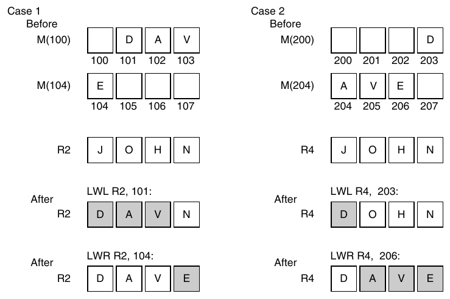

**Hình K.31 MIPS instruction để đọc word unaligned. Hình này giả định hoạt động ở mode Big Endian. Trường hợp 1 trước hết load 3 byte 101, 102 và 103 vào phần trái R2, giữ nguyên byte least-significant. LWR tiếp theo chỉ load byte 104 vào byte least-significant của R2, giữ nguyên các byte khác của register bằng LWL. Trường hợp 2 trước hết load byte 203 vào byte most-significant của R4, còn LWR tiếp theo load 3 byte còn lại của R4 từ các memory byte 204, 205 và 206. LWL đọc word chứa byte đầu tiên từ memory, shift trái để bỏ byte không cần và chỉ thay đổi những byte đó trong Rd. Các byte được chuyển đi từ byte đầu tiên đến byte lowest-order của word. LWR tiếp theo định địa chỉ byte cuối, right-shifts để bỏ byte không cần và cuối cùng chỉ thay đổi những byte đó trong Rd. Các byte được chuyển đi từ byte cuối lên đến byte highest-order của word. Store word left (SWL) chỉ là phép đảo của LWL, còn store word right (SWR) là phép đảo của LWR. Chuyển sang mode Little Endian đảo những byte được chọn và bị bỏ. (Nếu big-little, left-right và load-store có vẻ khó hiểu, đừng lo; chúng hoạt động được!)**

#### Các Instruction còn lại

Dưới đây là danh sách những chi tiết riêng còn lại của MIPS64 architecture:

- NOR — Logical instruction này tính ~(Rs1 | Rs2).

- Constant shift amount — Shift không dùng variable sử dụng constant field 5-bit trong format register-register ở Hình K.5.

- SYSCALL — Trap instruction đặc biệt này dùng để gọi operating system.

- Move to/from control register — CTCi và CFCi di chuyển giữa integer register và control register.

- Jump/call không PC-relative — Address 26-bit của jump và call không được cộng vào PC. Nó được shift trái 2 bit và thay thế 28 bit thấp của PC. Điều này chỉ tạo khác biệt nếu chương trình nằm gần biên 256 MB.

- TLB instruction — Translation lookaside buffer (TLB) miss được xử lý bằng software trong MIPS I, nên instruction set cũng có instruction thao tác các register của TLB (xem thêm về TLB trong Chương 2). Những register này được xem là một phần “system coprocessor”. Kể từ MIPS I, các instruction khác nhau giữa các phiên bản architecture; chúng thuộc implementation nhiều hơn là instruction set architecture.

- Reciprocal và reciprocal square root — Những instruction này không tuân theo hướng dẫn IEEE 754 về rounding đúng, dường như được đưa vào cho ứng dụng coi trọng tốc độ divide và square root hơn độ chính xác.

- Conditional procedure call instruction — BGEZAL lưu return address và branch nếu nội dung Rs1 lớn hơn hoặc bằng zero; BLTZAL làm tương tự khi nhỏ hơn zero. Mục đích của chúng là có được call PC-relative. (Cũng có phiên bản “likely” của những instruction này.)

- Operation floating-point single-precision song song — Ngoài mở rộng architecture bằng parallel integer operation trong MDMX, MIPS64 còn hỗ trợ hai operation floating-point 32-bit song song trên register 64-bit trong một instruction. Các operation “Paired single” gồm add (ADD.PS), subtract (SUB.PS), compare (C.__.PS), convert (CVT.PS.S, CVT.S.PL, CVT.S.PU), negate (NEG.PS), absolute value (ABS.PS), move (MOV.PS, MOVF.PS, MOVT.PS), multiply (MUL.PS), multiply-add (MADD.PS) và multiply-subtract (MSUB.PS).

MIPS architecture không có quy định riêng để floating-point execution diễn ra song song với integer execution, nhưng các implementation floating point của MIPS cho phép điều đó bằng cách kiểm tra sớm trong cycle xem arithmetic interrupt có thể xảy ra hay không (xem Phụ lục J). Thông thường, exception detection sẽ buộc integer operation và floating-point operation thực thi tuần tự.

### Instruction riêng của Alpha

Alpha được dự định là architecture giúp dễ xây dựng implementation high-performance. Hướng đến mục tiêu đó, các architect ban đầu đưa ra hai quyết định gây tranh cãi: exception floating-point không precise và không có data transfer byte hoặc half-word.

Để đơn giản hóa pipelined execution, Alpha không yêu cầu exception hoạt động như thể không instruction nào sau một điểm nhất định được thực thi và mọi instruction trước điểm đó đã thực thi. Nó cung cấp instruction TRAPB, stall cho đến khi mọi arithmetic instruction trước đó được bảo đảm hoàn tất mà không phát sinh arithmetic exception. Ở mode thận trọng nhất, đặt một TRAPB cho mỗi instruction exception-causing làm execution chậm đi khoảng năm lần nhưng cung cấp precise exception (xem Darcy và Gay [1996]).

Code không chứa TRAPB không tuân theo tiêu chuẩn floating-point IEEE 754. Lý do là một phần tiêu chuẩn (NaN, infinity và denormal) được triển khai bằng software trên Alpha, giống nhiều microprocessor khác. Tuy nhiên, để triển khai những operation này bằng software, chương trình phải tìm instruction gây lỗi và operand value, điều không thể làm với imprecise interrupt!

Khi architecture được phát triển, các architect tin rằng load và store byte sẽ làm chậm data transfer. Load byte đòi hỏi thêm shifter trên data transfer path, còn store byte đòi hỏi memory system thực hiện read-modify-write đối với hệ thống có error correction code vì phải tính lại ECC value mới. Sự thiếu vắng này có nghĩa store byte cần chuỗi load word, thay byte mong muốn rồi store word. (Một cách thiếu nhất quán, load floating-point lại phải byte swapping đáng kể để chuyển các format floating-point VAX khó hiểu sang dạng canonical.)

Để giảm số instruction cần để lấy data mong muốn, Alpha có một tập byte manipulation instruction phức tạp: extract field và đặt phần register còn lại thành zero (EXTxx), insert field (INSxx), mask phần register còn lại (MSKxx), đặt các field của register thành zero (ZAP) và compare nhiều byte (CMPGE).

Có vẻ người triển khai không bận tâm về load và store byte như các architect ban đầu. Bắt đầu từ bản thu nhỏ của phiên bản chip Alpha thứ hai (21164A), architecture có cả load và store cho byte và half word.

#### Các Instruction còn lại

Dưới đây là danh sách những instruction riêng còn lại của Alpha architecture:

- PAL code — Để cung cấp các operation mà VAX thực hiện bằng microcode, Alpha cung cấp một mode với mọi privilege được bật, interrupt bị tắt và virtual memory mapping bị tắt đối với instruction. PAL (privileged architecture library) code dùng cho TLB management, atomic memory operation và một số operating system primitive. PAL code được gọi qua instruction CALL_PAL.

- Không có divide — Integer divide không được hỗ trợ bằng hardware.

- load-store “Unaligned” — LDQ_U và STQ_U load và store data 64-bit bằng address bỏ qua ba least-significant bit. Extract instruction sau đó chọn word unaligned mong muốn bằng các address bit thấp. Những instruction này tương tự LWL/R,SWL/R trong MIPS.

- Floating-point single precision được biểu diễn thành double precision — Data Single-precision được giữ ở format 32-bit thông thường trong memory, nhưng được chuyển sang format double-precision 64-bit trong register.

- Register Floating-point F31 cố định ở zero — Để đơn giản hóa các phép so sánh với zero.

- Format floating-point VAX — Để giữ compatibility với VAX architecture, ngoài format single- và double-precision IEEE 754 tên S và T, Alpha hỗ trợ format single- và double-precision VAX tên F và G, nhưng không hỗ trợ format D của VAX. (D có exponent field quá hẹp để hữu ích cho double precision và được thay bằng G trong VAX code.)

- Bit count instruction — Phiên bản 3 của architecture bổ sung instruction đếm số leading zero (CTLZ), trailing zero (CTTZ) và số bit one trong một word (CTPOP). Ban đầu xuất hiện trên máy Cray, những instruction này hỗ trợ decryption.

### Instruction riêng của SPARC v.9

SPARC có một số tính năng riêng.

#### Register Window

Tính năng riêng chủ yếu của SPARC là register window, một phép tối ưu để giảm register traffic khi procedure call. Nhiều bank register được sử dụng và một bank mới được cấp phát cho mỗi procedure call. Mặc dù điều này có thể hạn chế độ sâu procedure call, giới hạn được tránh bằng cách vận hành các bank như circular buffer, cung cấp độ sâu không giới hạn. Điểm gấp của đường cong cost-performance dường như nằm ở sáu đến tám bank.

SPARC có thể có từ 2 đến 32 window, thường dùng 8 register cho mỗi nhóm global, local, incoming parameter và outgoing parameter. (Vì mỗi window có 16 register riêng, implementation SPARC có thể có ít nhất 40 và nhiều nhất 520 physical register, dù đến nay phần lớn có 128 đến 136.) Thay vì gắn việc đổi window với call instruction và return instruction, SPARC có instruction SAVE và RESTORE riêng. SAVE “lưu” window của caller bằng cách trỏ đến window register tiếp theo, đồng thời thực hiện add instruction. Mẹo là source register của addition operation thuộc window caller, còn destination register thuộc window callee. SPARC compiler thường dùng instruction này để thay đổi stack pointer nhằm cấp phát local variable trong stack frame mới. RESTORE là phép đảo của SAVE, khôi phục window caller đồng thời hoạt động như add instruction, với source register thuộc window callee và destination register thuộc window caller. Điều này tự động giải phóng stack frame. Compiler cũng có thể tận dụng nó để tạo final return value của callee.

Nguy cơ của register window là nhiều register hơn có thể làm chậm clock rate. Điều đó không xảy ra trong những implementation đầu tiên. SPARC architecture (có register window) và MIPS R2000 architecture (không có) đã được xây dựng bằng nhiều công nghệ từ năm 1987. Qua nhiều thế hệ, clock rate SPARC không chậm hơn MIPS với implementation dùng công nghệ tương tự, có lẽ vì cache access time chiếm ưu thế so với register access time. Các máy current-generation chọn chiến lược triển khai khác nhau — in order và out of order — nên khó có khả năng riêng số register quyết định clock rate ở một trong hai máy. Gần đây, các architecture khác cũng đưa register window vào: Tensilica và IA-64.

Một tính năng data transfer khác là tùy chọn alternate space cho load và store. Nó đơn giản cho phép memory system nhận diện memory access đến input/output device hoặc control register của thiết bị như cache và memory management unit.

#### Trap nhanh

SPARC phiên bản 9 có hỗ trợ để trap nhanh. Nó mở rộng từ một mức trap lên ít nhất bốn mức, cho phép window overflow trap handler và underflow trap handler bị interrupt. Các mức bổ sung nghĩa là handler không cần kiểm tra tường minh page fault hoặc stack pointer misaligned trong code, nhờ đó chạy nhanh hơn. Hai instruction mới được thêm để trả về từ multilevel handler này: RETRY (thử lại instruction bị interrupt) và DONE (không thử lại). Để hỗ trợ trap user-level, instruction RETURN trả về từ trap trong mode nonprivileged.

#### Hỗ trợ LISP và Smalltalk

Tính năng arithmetic chủ yếu còn lại là tagged addition và subtraction. Người thiết kế SPARC dành thời gian xem xét ngôn ngữ như LISP và Smalltalk; điều này ảnh hưởng đến một số tính năng đã thảo luận: register window, conditional trap instruction, call với instruction address 32-bit và multiword arithmetic (xem Taylor et al. [1986] và Ungar et al. [1984]). Một lượng hỗ trợ nhỏ được cung cấp cho tagged data type bằng các operation addition, subtraction và do đó comparison. Hai least-significant bit chỉ ra operand có phải integer không (mã hóa là 00), nên TADDcc và TSUBcc đặt overflow bit nếu một operand không được tag là integer hoặc kết quả quá lớn. Conditional branch hoặc trap instruction tiếp theo có thể quyết định cần làm gì. (Nếu operand không phải integer, software khôi phục operand, kiểm tra type và gọi operation đúng dựa trên các type đó.) Hóa ra misaligned memory access trap cũng có thể được dùng cho tagged data, vì load từ pointer có tag sai có thể là invalid access. Hình K.32 cho thấy cả hai dạng hỗ trợ tag.

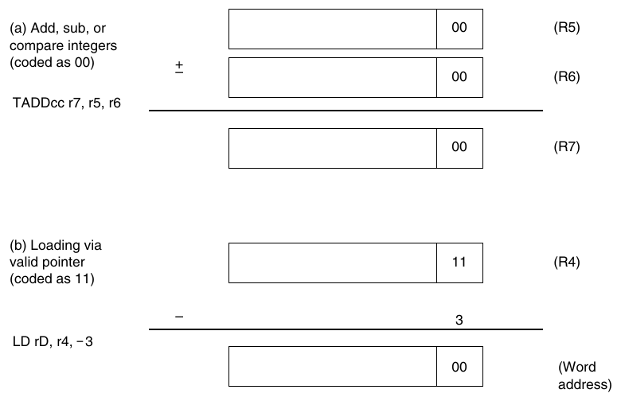

**Hình K.32 SPARC dùng hai least-significant bit để mã hóa các data type khác nhau cho tagged arithmetic instruction. (a) Integer arithmetic, cần một cycle miễn là operand và kết quả đều là integer. (b) Misaligned trap có thể được dùng để bắt invalid memory access, chẳng hạn cố dùng integer làm pointer. Với ngôn ngữ có paired data như LISP, offset –3 có thể truy cập word chẵn của một cặp (CAR), còn +1 có thể truy cập word lẻ của một cặp (CDR).**

#### Chồng lấp Integer Operation và Floating-Point Operation

SPARC cho phép floating-point instruction thực thi chồng lấp với integer instruction. Để phục hồi từ interrupt trong tình huống này, SPARC có queue chứa các floating-point instruction đang chờ và address của chúng. RDPR cho phép processor làm rỗng queue. Tính năng floating-point thứ hai là có các floating-point square root instruction FSQRTS, FSQRTD và FSQRTQ.

#### Các Instruction còn lại

Những tính năng riêng còn lại của SPARC như sau:

- JMPL dùng Rd để chỉ định return address register, nên chỉ định r31 khiến nó giống JALR của MIPS, còn chỉ định r0 khiến nó giống JR.

- LDSTUB load giá trị byte vào Rd rồi store FF16 vào byte được định địa chỉ. Instruction của phiên bản 8 này có thể dùng để triển khai semaphore (xem Chương 5).

- CASA (CASXA) so sánh atomic một giá trị trong processor register với giá trị 32-bit (64-bit) trong memory; khi và chỉ khi chúng bằng nhau, nó swap giá trị trong memory với giá trị trong processor register thứ hai. Instruction của phiên bản 9 này có thể xây dựng synchronization algorithm wait-free không cần dùng lock.

- XNOR tính exclusive OR với complement của operand thứ hai.

- BPcc, BPr và FBPcc có branch-prediction bit để compiler đưa hint cho máy về việc branch có khả năng taken hay không.

- ILLTRAP gây illegal instruction trap. Muchnick [1988] giải thích cách dùng nó để thực thi đúng các procedure trả về aggregate trong C.

- POPC đếm số bit được đặt thành one trong operand; tính năng này cũng có trong phiên bản thứ ba của Alpha architecture.

- Nonfaulting load cho phép compiler chuyển load instruction lên trước conditional control structure điều khiển việc sử dụng chúng. Vì vậy, nonfaulting load được thực thi speculative.

- Arithmetic và data transfer floating-point Quadruple-precision cho phép các floating-point register hoạt động như tám register 128-bit cho floating-point operation và data transfer.

- Kết quả floating-point Multiple-precision cho multiply nghĩa là hai operand single-precision có thể tạo product double-precision và hai operand double-precision có thể tạo product quadruple-precision. Những instruction này hữu ích trong complex arithmetic và một số model tính toán floating-point.

### Instruction riêng của PowerPC

PowerPC là kết quả của nhiều thế hệ máy RISC thương mại IBM — IBM RT/PC, IBM Power1 và IBM Power2 — cộng với Motorola 88x00.

#### Branch Register: Link và Counter

Thay vì dành một trong 32 register general-purpose để lưu return address khi procedure call, PowerPC đặt address vào register đặc biệt tên link register. Vì nhiều procedure trả về mà không gọi procedure khác, không phải lúc nào cũng cần lưu link ra nơi khác. Dùng register đặc biệt cho return address khiến return jump nhanh hơn, vì hardware không cần đi qua register read pipeline stage cho return jump.

Tương tự, PowerPC có count register cho for loop mà chương trình lặp số lần cố định. Nhờ register đặc biệt, branch hardware nhanh chóng xác định branch dựa trên count register có khả năng branch hay không, vì giá trị register được biết sớm trong execution cycle. Việc kiểm tra giá trị count register trong branch instruction tự động giảm count register.

Vì count register và link register đã nằm cùng hardware điều khiển branch, và một vấn đề của branch prediction là lấy target address sớm trong pipeline (xem Phụ lục C), các architect PowerPC quyết định sử dụng những register này vào mục đích thứ hai. Bất kỳ register nào cũng có thể giữ target address của conditional branch. Vì vậy, PowerPC bổ sung hai instruction lấy target address từ các register này (BCLR, BCCTR) bên cạnh conditional branch cơ bản.

#### Các Instruction còn lại

Khác phần lớn máy RISC khác, register 0 không được hardwire với giá trị 0. Nó không thể được dùng làm base register — tức tạo ra 0 trong trường hợp này — nhưng trong base + index addressing, nó có thể được dùng làm index. Những tính năng riêng khác của PowerPC như sau:

- Load multiple và store multiple lưu hoặc khôi phục tối đa 32 register trong một instruction.

- LSW và STSW cho phép fetch và store string fixed- và variable-length có alignment tùy ý.

- Rotate with mask instruction hỗ trợ extract và insert bit field. Một phiên bản rotate data rồi thực hiện logical AND với mask gồm các bit one, qua đó extract field. Phiên bản kia rotate data nhưng chỉ đặt bit vào destination register tại vị trí có bit 1 tương ứng trong mask, qua đó insert field.

- Algebraic right shift đặt carry bit (CA) nếu operand âm và có bit 1 bị shift ra. Vì vậy, có thể thực hiện signed divide cho mọi hằng số là lũy thừa của 2 với rounding về 0 bằng SRAWI, theo sau bởi ADDZE để cộng CA vào register.

- CBTLZ đếm leading zero.

- SUBFIC tính (immediate – RA), có thể dùng để tạo bù một hoặc bù hai.

- Logical shifted immediate instruction shift immediate 16-bit trái 16 bit trước khi thực hiện AND, OR hoặc XOR.

### Instruction riêng của PA-RISC 2.0

PA-RISC được mở rộng đôi chút năm 1990 với phiên bản 1.1 và thay đổi đáng kể trong 2.0 với extension 64-bit năm 1996. PA-RISC có lẽ có những tính năng khác thường nhất trong mọi máy RISC desktop. Chẳng hạn, nó có nhiều addressing mode và instruction format nhất, và như chúng ta sẽ thấy, có một số instruction thực ra kết hợp hai instruction đơn giản hơn.

#### Nullification

Như Hình K.30 cho thấy, một số máy RISC có thể chọn không thực thi instruction sau delayed branch để cải thiện mức sử dụng branch slot. Điều này được gọi là nullification trong PA-RISC và đã được tổng quát hóa cho mọi arithmetic/logical instruction cũng như mọi branch. Vì vậy, add instruction có thể cộng hai operand, lưu tổng và khiến instruction tiếp theo bị bỏ qua nếu tổng bằng zero. Giống conditional move instruction, nullification cho phép PA-RISC tránh branch khi phần then của if statement chỉ có một instruction.

#### Một tập hợp phong phú các Conditional Branch

Với nullification, PA-RISC không cần có conditional branch instruction riêng. Những người phát minh có thể khuyến nghị đặt nullifying instruction trước unconditional branch để đơn giản hóa instruction set. Thay vào đó, PA-RISC có số conditional branch lớn nhất trong mọi máy RISC. Hình K.33 cho thấy các conditional branch của PA-RISC. Như có thể thấy, một số thực ra là kết hợp của hai instruction.

#### Tổng hợp Multiply và Divide

PA-RISC cung cấp một số primitive để tổng hợp multiply và divide bằng software. Các instruction shift một operand 1, 2 hoặc 3 bit rồi add, có hoặc không trap khi overflow, hữu ích trong multiply. (Alpha cũng có instruction nhân operand thứ hai của add và subtract với 4 hoặc 8: S4ADD, S8ADD, S4SUB và S8SUB.) Divide step thực hiện bước then chốt của nonrestoring divide: cộng hoặc trừ tùy theo sign của kết quả trước. Magenheimer et al. [1988] đo operand size trong multiply và divide để cho thấy multiply step hoạt động tốt đến đâu. Dùng những data này cho chương trình C, Muchnick [1988] nhận thấy bằng cách xử lý các trường hợp đặc biệt, phép multiply với hằng số trung bình mất 6 clock cycle, còn multiply các variable mất 24 clock cycle. PA-RISC có 10 instruction cho các operation này.

| Tên | Instruction | Ký hiệu |  |
|---|---|---|---|
| COMB | Compare and branch | if (cond(Rs1,Rs2)) | {PC <--- PC + offset12} |
| COMIB | Compare imm. and branch | if (cond(imm5,Rs2)) | {PC <--- PC + offset12} |
| MOVB | Move and branch | Rs2 <--- Rs1, if (cond(Rs1,0)) | {PC <--- PC + offset12} |
| MOVIB | Move immediate and branch | Rs2 <--- imm5, if (cond(imm5,0)) | {PC <--- PC + offset12} |
| ADDB | Add and branch | Rs2 <--- Rs1 + Rs2, if (cond(Rs1 + Rs2,0)) | {PC <--- PC + offset12} |
| ADDIB | Add imm. and branch | Rs2 <--- imm5 + Rs2, if (cond(imm5 + Rs2,0)) | {PC <--- PC + offset12} |
| BB | Branch on bit | if (cond(Rsp,0)) | {PC <--- PC + offset12} |
| BVB | Branch on variable bit | if (cond(Rssar,0)) | {PC <--- PC + offset12} |

**Hình K.33 Các conditional branch instruction của PA-RISC. Offset 12-bit được gọi là offset12 trong bảng này, còn immediate 5-bit được gọi là imm5. 16 điều kiện là =, <, <=; odd; signed overflow; unsigned no overflow; zero or no overflow unsigned; never; và complement tương ứng của chúng. Instruction BB chọn một trong 32 bit của register và branch tùy giá trị là 0 hay 1. BVB chọn bit để branch bằng shift amount register, một register special-purpose. Ký hiệu chỉ số dưới xác định một bit field.**

SPARC architecture ban đầu dùng những phép tối ưu tương tự, nhưng khi số transistor tăng, instruction set được mở rộng để có đầy đủ multiply operation và divide operation. PA-RISC hỗ trợ phần nào theo hướng này bằng cách đặt một phép integer multiply 32-bit đầy đủ trong floating-point unit; tuy nhiên, trước hết phải chuyển integer data sang floating-point register.

#### Decimal Operation

Chương trình COBOL tính toán trên các giá trị decimal, được lưu bằng 4 bit mỗi chữ số, thay vì chuyển đổi qua lại giữa binary và decimal. PA-RISC có instruction chuyển tổng từ add 32-bit thông thường thành các chữ số decimal đúng. Nó cũng cung cấp logical operation và arithmetic operation đặt condition code để kiểm tra carry của chữ số, byte hoặc half word. Những operation này cũng kiểm tra byte hoặc half word có bằng zero hay không. Chúng hữu ích cho số học trên ký tự ASCII 8-bit. Năm instruction PA-RISC cung cấp hỗ trợ decimal.

#### Các Instruction còn lại

Sau đây là một số instruction PA-RISC còn lại:

- Branch vectored shift index register trái 3 bit, cộng vào base register rồi branch đến address tính được. Nó dùng cho case statement.

- Extract instruction và deposit instruction cho phép chọn hoặc chèn bit field tùy ý từ hoặc vào register. Các biến thể bao gồm extracted field có được sign-extended hay không, bit field được chỉ định trực tiếp trong instruction hay gián tiếp trong register khác, và phần register còn lại được đặt thành zero hay giữ nguyên. PA-RISC có 12 instruction như vậy.

- Để đơn giản hóa việc dùng address constant 32-bit, PA-RISC có ADDIL, cộng hằng số left-adjusted 21-bit vào một register và đặt kết quả trong register 1. Data transfer instruction tiếp theo dùng offset addressing để cộng 11 bit thấp của address vào register 1. Cặp instruction này cho phép PA-RISC cộng hằng số 32-bit vào base register, với cái giá là thay đổi register 1.

- PA-RISC có chín debug instruction có thể đặt breakpoint tại instruction address hoặc data address và trả về các address bị trap.

- Load and clear instruction cung cấp semaphore hoặc lock đọc một giá trị từ memory rồi ghi zero.

- Store bytes short tối ưu data move unaligned, chuyển các byte ngoài cùng trái hoặc ngoài cùng phải trong word đến effective address, tùy instruction option và condition code bit.

- Load và store hoạt động tốt với cache nhờ các tùy chọn gợi ý có nên load data vào cache khi data chưa có trong cache hay không. Chẳng hạn, load có destination là register 0 được định nghĩa là cache prefetch software-controlled.

- PA-RISC 2.0 mở rộng cache hint cho store để chỉ block copy, khuyến nghị processor không load data vào cache nếu chưa có. Nó cũng có thể gợi ý rằng load và store có spatial locality để chuẩn bị cache cho những sequential access tiếp theo.

- PA-RISC 2.0 cũng cung cấp branch-target stack tùy chọn để dự đoán indirect jump dùng khi subroutine return. Software có thể gợi ý address nào được thêm vào hoặc lấy khỏi branch-target stack, nhưng hardware điều khiển chúng có valid hay không.

- Multiply/add và multiply/subtract là các operation floating-point có thể khởi động hai operation floating-point độc lập trong một instruction, bên cạnh fused multiply/add và fused multiply/negate/add được đưa vào phiên bản 2.0 của PA-RISC.

### Instruction riêng của ARM

Khó chọn tính năng khác thường nhất của ARM, nhưng có lẽ đó là conditional execution của instruction. Mọi instruction bắt đầu bằng field 4-bit quyết định nó hoạt động như NOP hay instruction thực sự tùy condition code. Vì vậy, conditional branch nên được hiểu là thực thi unconditional branch instruction theo điều kiện. Conditional execution cho phép tránh dùng branch để nhảy qua một instruction duy nhất. Chỉ thực thi một instruction theo điều kiện sẽ tốn ít code space và thời gian hơn.

Immediate field 12-bit có cách diễn giải mới lạ. 8 least-significant bit được zero-extended thành giá trị 32-bit, sau đó rotate phải số bit được chỉ định trong 4 bit đầu của field nhân với 2. Việc cách chia này thực sự bao quát nhiều immediate hơn một field 12-bit đơn giản hay không sẽ là một nghiên cứu thú vị. Một ưu điểm là cơ chế này biểu diễn được mọi lũy thừa của 2 trong word 32-bit.

Operand shifting không bị giới hạn ở immediate. Register thứ hai của mọi arithmetic operation và logical processing operation có tùy chọn được shift trước khi thực hiện operation. Các tùy chọn gồm shift left logical, shift right logical, shift right arithmetic và rotate right. Một lần nữa, sẽ thú vị khi xem những operation như rotate-and-add, shift-right-and-test, v.v. xuất hiện thường xuyên đến đâu trong chương trình ARM.

#### Các Instruction còn lại

Dưới đây là danh sách những instruction riêng còn lại của ARM architecture:

- Block load và store — Dưới sự điều khiển của mask 16-bit trong instruction, bất kỳ register nào trong 16 register đều có thể được load hoặc store vào memory trong một instruction. Những instruction này có thể lưu và khôi phục register khi vào và trả về từ procedure. Chúng cũng dùng được cho block memory copy — cung cấp bandwidth tối đa gấp bốn lần load-store một register — và ngày nay block copy là mục đích sử dụng quan trọng nhất.

- Reverse subtract — RSB cho phép trừ register thứ nhất khỏi immediate hoặc shifted register. RSC làm tương tự nhưng có tính carry khi tính hiệu.

- Multiply dài — Tương tự MIPS, register Hi và Lo nhận signed product 64-bit (SMULL) hoặc unsigned product 64-bit (UMULL).

- Không có divide — Giống Alpha, integer divide không được hỗ trợ bằng hardware.

- Conditional trap — Một extension chung cho MIPS core trong RISC desktop (Hình K.22 đến K.25), có sẵn miễn phí nhờ conditional execution của mọi ARM instruction, bao gồm SWI.

- Coprocessor interface — Giống nhiều RISC desktop, ARM định nghĩa đầy đủ coprocessor instruction: data transfer, move giữa register general-purpose và coprocessor register, cùng coprocessor operation.

- Architecture Floating-point — Qua coprocessor interface, một architecture floating-point đã được định nghĩa cho ARM. Nó được triển khai thành coprocessor FPA10.

- Branch và exchange instruction set — Instruction BX chuyển đổi giữa ARM và Thumb, dùng 31 bit thấp của register để đặt PC và most-significant bit để quyết định mode là ARM (1) hay Thumb (0).

### Instruction riêng của Thumb

Trong model ARM phiên bản 4, procedure được thực thi thường xuyên sẽ dùng ARM instruction để đạt performance tối đa, còn procedure ít được thực thi hơn dùng Thumb để giảm tổng code size của chương trình. Vì thường chỉ một vài procedure chiếm phần lớn execution time, hy vọng là cách kết hợp này đạt ưu điểm của cả hai.

Mặc dù hardware chuyển Thumb instruction thành ARM instruction thông thường để thực thi, có một số hạn chế. Thứ nhất, conditional execution bị loại khỏi gần như mọi instruction. Thứ hai, chỉ 8 register đầu dễ sử dụng trong mọi instruction, còn stack pointer, link register và program counter được dùng ngầm trong một số instruction. Thứ ba, Thumb dùng format two-operand để tiết kiệm không gian. Thứ tư, shifted immediate và shifted second operand đặc trưng biến mất, được thay bằng shift instruction riêng. Thứ năm, các addressing mode được đơn giản hóa. Cuối cùng, việc đưa mọi instruction vào 16 bit buộc phải có nhiều instruction format hơn.

Ở nhiều phương diện, Thumb architecture đơn giản hóa mang tính thông thường hơn ARM. Sau đây là những thay đổi bổ sung khi chuyển từ ARM sang Thumb:

- Loại bỏ immediate logical instruction — Logical immediate không còn nữa.

- Condition code ngầm — Thay vì được đặt tùy chọn, condition code do opcode định nghĩa. Mọi ALU instruction đều đặt condition code, còn không data transfer nào làm vậy.

- Hi/Lo register access — 16 register ARM được chia đôi thành Lo register và Hi register, với 8 Hi register bao gồm stack pointer (SP), link register và PC. Lo register dùng được trong mọi ALU operation. Các biến thể ADD, BX, CMP và MOV cũng hoạt động với mọi tổ hợp Lo register và Hi register. SP và PC cũng dùng được trong các biến thể data transfer và add immediate. Mọi operation khác trên Hi register cần một MOV để đưa giá trị vào Lo register, thực hiện operation tại đó rồi chuyển data trở lại Hi register.

- Branch/call distance — Vì instruction rộng 16 bit, conditional branch address 8-bit được shift 1 thay vì 2. Branch with link được chỉ định bằng hai instruction, nối 11 bit của mỗi instruction và shift trái để tạo address 23-bit load vào PC.

- Khoảng cách cho data transfer offset — Offset giờ là 5 bit cho register general-purpose và 8 bit cho SP, PC.

### Instruction riêng của SuperH

Register 0 đóng vai trò đặc biệt trong address mode SuperH. Nó có thể được cộng vào register khác để tạo address trong indirect indexed addressing và PC-relative addressing. R0 được dùng để load constant nhằm có addressing range lớn hơn mức dễ dàng đưa vào instruction 16-bit của SuperH. R0 cũng là register duy nhất có thể làm operand cho phiên bản immediate của AND, CMP, OR và XOR.

Dưới đây là danh sách những chi tiết riêng còn lại của SuperH architecture:

- Decrement và test — DT giảm một register và đặt T bit thành 1 nếu kết quả là 0.

- Delayed branch tùy chọn — Mặc dù những máy RISC embedded khác nhìn chung không dùng delayed branch (xem Phụ lục C), SuperH cung cấp delayed branch execution tùy chọn cho BT và BF.

- Nhiều phép multiply — Tùy operation signed hay unsigned, operand là 16 hay 32 bit, product là 32 hay 64 bit, multiply instruction thích hợp là MULS, MULU, DMULS, DMULU hoặc MUL. Product nằm trong register MACL và MACH.

- Zero và sign extension — Byte hoặc half word được zero-extended (EXTU) hoặc sign-extended (EXTS) bên trong register 32-bit.

- Shift amount One-bit — Có lẽ để vừa trong instruction 16-bit, shift instruction mỗi lần chỉ shift một bit.

- Dynamic shift amount — Những variable shift này kiểm tra sign của amount trong register để quyết định shift trái (dương) hay shift phải (âm). Cả logical instruction (SHLD) và arithmetic instruction (SHAD) đều được hỗ trợ. Chúng giúp bù lại constant shift amount 1-bit của các shift thông thường.

- Rotate — SuperH cung cấp rotate 1 bit trái (ROTL) và phải (ROTR), đặt T bit bằng giá trị được rotate, và có các biến thể đưa T bit vào phép rotate (ROTCL và ROTCR).

- SWAP — Instruction này swap các byte cao và thấp của word 32-bit hoặc hai byte của 16 bit ngoài cùng phải.

- Extract word (XTRCT) — 32 bit giữa từ một cặp register 32-bit được đặt vào register khác.

- Negate with carry — Giống SUBC (Hình K.27), nhưng operand đầu tiên là 0.

- Cache prefetch — Giống nhiều RISC desktop (Hình K.22 đến K.25), SuperH có instruction (PREF) để prefetch data vào cache.

- Test-and-set — SuperH dùng instruction test-and-set (TAS) cũ để thực hiện atomic lock hoặc semaphore (xem Chương 5). TAS trước hết load một byte từ memory. Sau đó nó đặt T bit thành 1 nếu byte là 0 hoặc thành 0 nếu byte khác 0. Cuối cùng, nó đặt most-significant bit của byte thành 1 và ghi kết quả trở lại memory.

### Instruction riêng của M32R

Tính năng khác thường nhất của M32R là cách tiếp cận có phần giống very long instruction word (VLIW) đối với các cặp instruction 16-bit. Một bit trong instruction đầu của cặp được dành để chỉ ra instruction này có thể thực thi song song với instruction tiếp theo — tức hai instruction độc lập — hay cả hai phải thực thi tuần tự. (Một máy trước đó có tùy chọn tương tự là Intel i860.) Tính năng này được đưa vào cho implementation tương lai của architecture.

Một điều bất ngờ là mọi branch displacement được shift trái 2 bit trước khi cộng vào PC và 2 bit thấp của PC được đặt thành 0. Vì một số instruction chỉ dài 16 bit, phép shift này có nghĩa branch không thể đến bất kỳ instruction nào trong chương trình: nó chỉ branch đến instruction trên word boundary. Ràng buộc tương tự áp dụng cho return address của branch-and-link và jump-and-link instruction: chúng chỉ trả về word boundary. Vì vậy, để có branch distance lớn hơn đôi chút, software phải bảo đảm mọi branch address và return address đều aligned theo word boundary. Code space M32R có lẽ lớn hơn đôi chút và có lẽ thực thi nhiều NOP hơn so với khi branch address chỉ được shift trái 1 bit.

Tuy nhiên, tính năng VLIW trên có nghĩa NOP có thể thực thi song song với một instruction 16-bit khác, nên padding không tốn thêm clock cycle. Code size expansion phụ thuộc vào khả năng compiler schedule code và ghép những instruction 16-bit liên tiếp; Mitsubishi tuyên bố tổng code size chỉ lớn hơn 7% so với Motorola 680x0 architecture.

Tính năng mới lạ cuối cùng là kết quả divide operation là remainder thay vì quotient.

### Instruction riêng của MIPS16

MIPS16 thực ra không phải instruction set riêng mà là extension 16-bit của MIPS architecture 32-bit đầy đủ. Nó tương thích với mọi MIPS architecture có address 32-bit (MIPS I, MIPS II) hoặc architecture 64-bit (MIPS III, IV, V). ISA mode bit quyết định instruction width: 0 nghĩa là instruction 32-bit-wide và 1 nghĩa là instruction 16-bit-wide. Instruction JALX mới đảo ISA mode bit để chuyển sang ISA kia. JR và JALR được định nghĩa lại để đặt ISA mode bit từ most-significant bit của register chứa branch address, và bit này không được xem là một phần address. Mọi jump and link instruction lưu mode bit hiện tại làm most-significant bit của return address.

Vì vậy, MIPS hỗ trợ toàn bộ procedure chứa instruction 16-bit hoặc 32-bit, nhưng không hỗ trợ trộn hai chiều dài trong một procedure. Ngoại lệ duy nhất là JAL và JALX: hai instruction này cần 32 bit ngay cả trong mode 16-bit, có lẽ để có address đủ lớn nhằm branch đến procedure ở xa.

Khi chọn tập con này, MIPS quyết định đưa opcode cho một số instruction three-operand và giữ 16 opcode cho operation 64-bit. Sự kết hợp nhiều opcode và operand như vậy trong 16 bit khiến architect chỉ cung cấp 8 register easy-to-use — giống Thumb — trong khi RISC embedded khác có khoảng 16 register. Vì hardware phải có đầy đủ 32 register của ISA mode 32-bit, MIPS16 có move instruction để sao chép giá trị giữa 8 register MIPS16 và 24 register còn lại của MIPS architecture đầy đủ. Để giảm áp lực lên 8 register nhìn thấy được, stack pointer được xem là register riêng. MIPS16 có nhiều opcode riêng để data transfer dùng SP làm base register và tăng SP: LWSP, LDSP, SWSP, SDSP, ADJSP, DADJSP, ADDIUSPD và DADDIUSP.

Để vừa giới hạn 16-bit, immediate field nhìn chung được rút xuống 5 đến 8 bit. MIPS16 cung cấp cách mở rộng immediate ngắn hơn lên toàn bộ chiều rộng immediate trong mode 32-bit. Mượn mẹo từ Intel 8086, instruction EXTEND thực ra là prefix 16-bit có thể đặt trước mọi instruction MIPS16 có address field hoặc immediate field. Prefix cung cấp đủ bit để biến field 5-bit của data transfer và field 5- đến 8-bit của arithmetic immediate thành hằng số 16-bit. Đáng tiếc, có hai ngoại lệ. ADDIU và DADDIU bắt đầu với immediate field 4-bit, nhưng vì EXTEND chỉ có thể cung cấp thêm 11 bit, immediate rộng hơn bị giới hạn ở 15 bit. EXTEND cũng mở rộng shift field 3-bit thành field 5-bit cho shift. (Nếu bạn đang thắc mắc, prefix EXTEND không cần bắt đầu trên boundary 32-bit.)

Để tiếp tục giải quyết nhu cầu constant, MIPS16 bổ sung một addressing mode mới! PC-relative addressing cho load word (LWPC) và load double (LDPC) shift immediate field 8-bit lần lượt 2 hoặc 3 bit, cộng vào PC với 2 hoặc 3 bit thấp đã xóa. Constant word hoặc double word sau đó được load vào register. Vì vậy, constant 32-bit hoặc 64-bit có thể được đưa vào cùng MIPS16 code dù mất LIU để đặt các register bit cao. Với addressing mode mới, cũng có instruction (ADDIUPC) tính address PC-relative và đặt vào register.

MIPS16 khác các RISC embedded khác ở chỗ có thể tạo tập con của address architecture 64-bit. Vì vậy, nó có phiên bản instruction-length 16-bit cho data operation 64-bit: data transfer (LD, SD, LWU), arithmetic operation (DADDU/IU, DSUBU, DMULT/U, DDIV/U) và shift (DSLL/V, DSRA/V, DSRL/V).

Vì MIPS có vai trò nổi bật trong cuốn sách này, chúng ta trình bày mọi thay đổi bổ sung từ MIPS core instruction khi chuyển sang MIPS16:

- Loại bỏ signed arithmetic instruction — Những arithmetic instruction có thể trap bị loại để tiết kiệm opcode space: ADD, ADDI, SUB, DADD, DADDI, DSUB.

- Loại bỏ immediate logical instruction — Logical immediate cũng không còn: ANDI, ORI, XORI.

- Rút gọn branch instruction — So sánh hai register rồi branch không thể đưa vào, cũng như mọi phép so sánh khác giữa register và zero. Vì vậy, những instruction này cũng bị loại: BEQ, BNE, BGEZ, BGTZ, BLEZ và BLTZ. Như đã đề cập trong mục “Instruction: Tập con MIPS Core” ở trang K-6, để bù lại, MIPS16 có compare instruction kiểm tra hai register bằng nhau. Vì compare và set-on-less-than đặt register T mới, các branch được thêm để kiểm tra register T.

- Branch distance — Vì instruction rộng 16 bit, branch address được shift một thay vì hai.

- Delayed branch biến mất — Branch có hiệu lực trước instruction tiếp theo. Jump vẫn có delay one-slot.

- Mở rộng và khoảng cách cho data transfer offset — Các field 5-bit và 8-bit được zero-extended thay vì sign-extended trong mode 32-bit. Để có phạm vi lớn hơn, immediate field được shift trái 1, 2 hoặc 3 bit tùy data là half word, word hay double word. Nếu prefix EXTEND được đặt trước những instruction này, chúng dùng signed immediate 16-bit thông thường của mode 32-bit.

- Mở rộng arithmetic immediate — Các field 5-bit và 8-bit được zero-extended cho instruction set-on-less-than và compare, để tạo address PC-relative, cũng như để cộng vào SP và đặt kết quả trong register (ADDIUSP, DADDIUSP). Một lần nữa, nếu prefix EXTEND được đặt trước những instruction này, chúng dùng signed immediate 16-bit thông thường của mode 32-bit. Chúng vẫn được sign-extended cho general add và để cộng vào SP rồi đặt kết quả trở lại SP (ADJSP, DADJSP). Đáng tiếc, code density và orthogonality là một cặp khó hòa hợp trong MIPS16!

- Định nghĩa lại shift amount 0 — MIPS16 định nghĩa giá trị 0 trong shift field 3-bit nghĩa là shift 8 bit.

- Thêm instruction mới do không còn register 0 làm zero — Load immediate, negate và not được thêm vì không thể tổng hợp những operation này từ instruction khác với r0 làm source nữa.

### Nhận xét kết luận

Khảo sát này trình bày addressing mode, instruction format và mọi instruction trong 10 RISC architecture. Mặc dù các mục sau tập trung vào khác biệt, sẽ không thể trình bày 10 architecture trong số trang ít ỏi này nếu chúng không có nhiều điểm tương đồng. Thực ra, chúng ta đoán hơn 90% instruction được thực thi trên bất kỳ architecture nào trong số này đều có trong Hình K.9 đến K.17. Để đối chiếu sự đồng nhất đó, Hình K.34 tóm tắt bốn architecture từ thập niên 1970 theo format tương tự Hình K.1. (Vì không thể viết một mục duy nhất theo phong cách này cho những architecture đó, ba mục tiếp theo trình bày 80x86, VAX và IBM 360/370.) Trong lịch sử computing, chưa từng có sự đồng thuận rộng rãi như vậy về computer architecture.

|  | IBM 360/370 | Intel 8086 | Motorola 68000 | DEC VAX |
|---|---|---|---|---|
| Date announced | 1964/1970 | 1978 | 1980 | 1977 |
| Instruction size(s) (bits) | 16, 32, 48 | 8, 16, 24, 32, 40, 48 | 16, 32, 48, 64, 80 | 8, 16, 24, 32, ... , 432 |
| Addressing (size, model) | 24 bits, flat/31 bits, flat | 4 + 16 bits, segmented | 24 bits, flat | 32 bits, flat |
| Data aligned? | Yes 360/No 370 | No | 16-bit aligned | No |
| Data addressing modes | 2/3 | 5 | 9 | =14 |
| Protection | Page | None | Optional | Page |
| Page size | 2 KB & 4 KB | — | 0.25 to 32 KB | 0.5 KB |
| I/O | Opcode | Opcode | Memory mapped | Memory mapped |
| Integer registers (size, model, number) | 16 GPR × 32 bits | 8 dedicated data × 16 bits | 8 data and 8 address × 32 bits | 15 GPR × 32 bits |
| Separate floating-point registers | 4 × 64 bits | Optional: 8 × 80 bits | Optional: 8 × 80 bits | 0 |
| Floating-point format | IBM (floating hexadecimal) | IEEE 754 single, double, extended | IEEE 754 single, double, extended | DEC |

**Hình K.34 Tóm tắt bốn architecture từ thập niên 1970. Khác các architecture trong Hình K.1, những architecture này ít thống nhất với nhau trong bất kỳ loại nào. (Xem Mục K.3 để biết thêm về 80x86 và Mục K.4 để có mô tả VAX.)**

Tuy nhiên, kiểu architecture này không thể giữ nguyên. Giống con người, instruction set có xu hướng lớn hơn khi già đi. Hình K.35 cho thấy phả hệ các instruction set, còn Hình K.36 cho thấy tính năng nào được thêm hoặc bỏ khỏi các thế hệ RISC desktop theo thời gian.

Như có thể thấy, mọi máy RISC desktop đã phát triển thành address architecture 64-bit và thực hiện điều đó khá nhẹ nhàng.

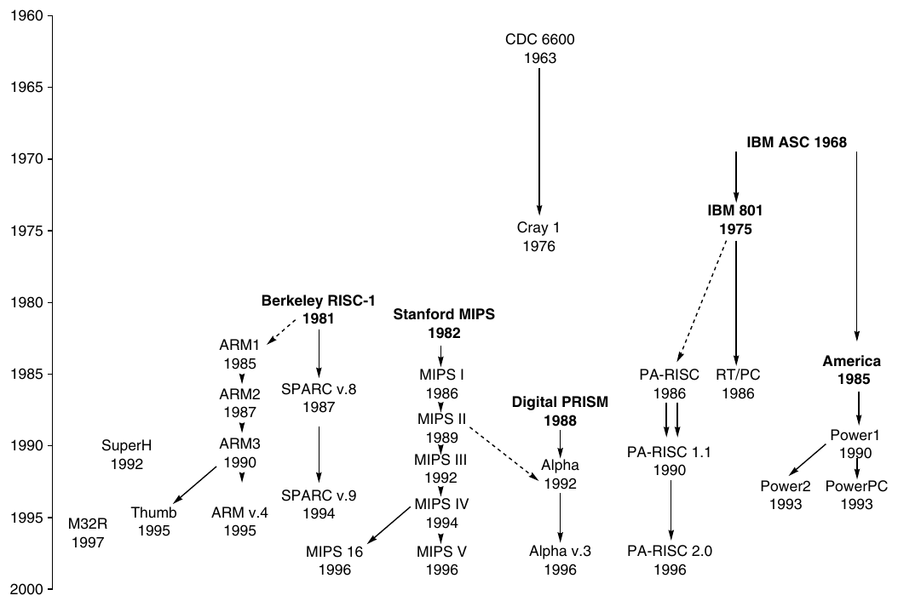

**Hình K.35 Nguồn gốc của các RISC instruction set. Máy thương mại được ghi bằng chữ thường và máy nghiên cứu bằng chữ đậm. CDC-6600 và Cray-1 là các máy load-store với register 0 cố định bằng 0, cùng integer register và floating-point register riêng biệt. Instruction không thể vượt word boundary. Một máy nghiên cứu IBM đầu tiên dẫn đến dự án nghiên cứu 801 và America; 801 dẫn đến RT/PC không thành công, còn America dẫn đến Power architecture thành công. Một số người làm việc trên 801 sau đó gia nhập Hewlett-Packard để làm PA-RISC. Hai dự án đại học là nền tảng của máy MIPS và SPARC. Theo Furber [1996], dự án Berkeley RISC là nguồn cảm hứng cho ARM architecture. Trong khi ARM1, ARM2 và ARM3 là tên của cả architecture lẫn chip, ARM phiên bản 4 là tên architecture dùng trong chip ARM7, ARM8 và StrongARM. (Không có chip ARM v.4 và ARM5, nhưng ARM6 và ARM7 đời đầu dùng ARM3 architecture.) DEC xây dựng RISC microprocessor năm 1988 nhưng không giới thiệu nó. Thay vào đó, DEC cung cấp workstation dùng MIPS microprocessor trong ba năm trước khi đưa ra RISC instruction set riêng là Alpha 21064, rất giống MIPS III và PRISM. Alpha architecture có những extension nhỏ nhưng không được chính thức hóa bằng version number; chúng ta dùng phiên bản 3 vì đó là phiên bản reference manual. Chip Alpha 21164A bổ sung load và store byte, half-word, còn Alpha 21264 có MAX multimedia instruction và bit count instruction. Trong nội bộ, Digital đặt tên chip theo fabrication technology: EV4 (21064), EV45 (21064A), EV5 (21164), EV56 (21164A) và EV6 (21264). “EV” là viết tắt của “extended VAX”.**

### Lời cảm ơn

Chúng tôi xin cảm ơn những người sau đã góp ý cho bản thảo khảo sát: Giáo sư Steven B. Furber, University of Manchester; Tiến sĩ Dileep Bhandarkar, Intel Corporation; Tiến sĩ Earl Killian, Silicon Graphics/MIPS; và Tiến sĩ Hiokazu Takata, Mitsubishi Electric Corporation.

|  | PA-RISC |  |  | SPARC |  | MIPS |  |  |  |  | Power |  |  |
|---|---|---|---|---|---|---|---|---|---|---|---|---|---|
| Tính năng | 1.0 | 1.1 | 2.0 | v. 8 | v. 9 | I | II | III | IV | V | 1 | 2 | PC |
| Interlocked loads | X | " | " | X | " |  | + | " | " |  | X | " | " |
| Load-store FP double | X | " | " | X | " |  | + | " | " |  | X | " | " |
| Semaphore | X | " | " | X | " |  | + | " | " |  | X | " | " |
| Square root | X | " | " | X | " |  | + | " | " |  |  | + | " |
| Single-precision FP ops | X | " | " | X | " | X | " | " | " |  |  |  | + |
| Memory synchronize | X | " | " | X | " |  | + | " | " |  | X | " | " |
| Coprocessor | X | " | " | X | — | X | " | " | " |  |  |  |  |
| Base + index addressing | X | " | " | X | " |  |  |  | + |  | X | " | " |
| Equiv. 32 64-bit FP registers |  | " | " |  | + |  |  | + | " |  | X | " | " |
| Annulling delayed branch | X | " | " | X | " |  | + | " | " |  |  |  |  |
| Branch register contents | X | " | " |  | + | X | " | " | " |  |  |  |  |
| Big/Little Endian |  | + | " |  | + | X | " | " | " |  |  |  | + |
| Branch-prediction bit |  |  |  |  | + |  | + | " | " |  | X | " | " |
| Conditional move |  |  |  |  | + |  |  |  | + |  | X | " | — |
| Prefetch data vào cache |  |  | + |  | + |  |  |  | + |  | X | " | " |
| 64-bit addressing/int. ops |  |  | + |  | + |  |  | + | " |  |  |  | + |
| 32-bit multiply, divide |  | + | " |  | + | X | " | " | " |  | X | " | " |
| Load-store FP quad |  |  |  |  | + |  |  |  |  |  |  | + | — |
| Fused FP mul/add |  |  | + |  |  |  |  |  | + |  | X | " | " |
| String instructions | X | " | " |  |  |  |  |  |  |  | X | " | — |
| Multimedia support |  | X | " | X |  |  |  |  |  | X |  |  |  |

**Hình K.36 Các tính năng được thêm vào máy RISC desktop. X nghĩa là có trong máy ban đầu, + nghĩa là thêm sau, " nghĩa là tiếp tục từ máy trước và — nghĩa là bị bỏ khỏi architecture. Alpha không được đưa vào, nhưng đã thêm load và store byte, word, cùng bit count extension và multimedia extension trong phiên bản 3. MIPS V bổ sung các instruction MDMX và operation floating-point paired single.**

## K.3 Intel 80x86

### Giới thiệu

MIPS là tầm nhìn của một architect duy nhất. Các thành phần của architecture này kết hợp hài hòa và có thể mô tả toàn bộ architecture một cách súc tích. 80x86 không như vậy: nó là sản phẩm của nhiều nhóm độc lập đã phát triển architecture trong 20 năm, bổ sung tính năng mới vào instruction set ban đầu như cách bạn nhét thêm quần áo vào một chiếc túi đã đầy. Sau đây là những cột mốc quan trọng của 80x86:

- 1978 — Intel 8086 architecture được công bố là extension tương thích assembly language của Intel 8080 then-successful, một microprocessor 8-bit. 8086 là architecture 16-bit với mọi internal register rộng 16 bit. Trong khi 8080 là accumulator machine đơn giản, 8086 mở rộng architecture bằng các register bổ sung. Vì gần như mọi register đều có chức năng chuyên biệt, 8086 nằm giữa accumulator machine và register machine general-purpose, có thể được gọi chính xác là extended accumulator machine.

- 1980 — Coprocessor floating-point Intel 8087 được công bố. Architecture này mở rộng 8086 với khoảng 60 floating-point instruction. Các architect của nó từ bỏ extended accumulator để chọn sự kết hợp giữa stack và register, về cơ bản là extended stack architecture: một stack instruction set đầy đủ được bổ sung bằng một tập register-memory instruction hạn chế.

- 1982 — 80286 mở rộng 8086 architecture bằng cách tăng address space lên 24 bit, tạo một memory mapping model và protection model phức tạp, cùng bổ sung một vài instruction để hoàn thiện instruction set và thao tác protection model. Vì việc chạy chương trình 8086 mà không thay đổi rất quan trọng, 80286 cung cấp real addressing mode khiến máy trông hệt 8086.

- 1985 — 80386 mở rộng 80286 architecture lên 32 bit. Ngoài architecture 32-bit với register 32-bit và address space 32-bit, 80386 bổ sung addressing mode mới và operation bổ sung. Những instruction mới khiến 80386 gần như trở thành register machine general-purpose. 80386 cũng thêm paging support bên cạnh segmented addressing (xem Chương 2). Giống 80286, 80386 có mode thực thi chương trình 8086 mà không thay đổi.

Lịch sử này minh họa tác động của “còng tay vàng” compatibility lên 80x86, vì ở mỗi bước, nền tảng software hiện có quá quan trọng để mạo hiểm bằng thay đổi architecture đáng kể. May thay, 80486 năm 1989, Pentium năm 1992 và P6 năm 1995 tiếp theo nhắm đến performance cao hơn, chỉ thêm bốn instruction vào instruction set user-visible: ba để hỗ trợ multiprocessing và một conditional move instruction.

Từ năm 1997, Intel bổ sung hàng trăm instruction để hỗ trợ multimedia bằng cách xử lý nhiều data type hẹp hơn trong một clock duy nhất (xem Phụ lục A). Các SIMD instruction hay vector instruction này chủ yếu dùng trong library hoặc driver viết tay và hiếm khi được compiler sinh ra. Extension đầu tiên tên MMX xuất hiện năm 1997. Nó gồm 57 instruction pack và unpack nhiều byte, word 16-bit hoặc double word 32-bit vào register 64-bit, đồng thời thực hiện shift, logical operation và integer arithmetic song song trên các data item hẹp. Nó hỗ trợ cả saturating arithmetic lẫn nonsaturating arithmetic. MMX dùng các register tạo thành floating-point stack, nên operating system không có state mới cần lưu.

Năm 1999, Intel thêm 70 instruction nữa, mang tên SSE, như một phần của Pentium III. Những thay đổi chính là thêm tám register riêng, tăng gấp đôi chiều rộng của chúng lên 128 bit và thêm data type floating-point single-precision. Vì vậy, có thể thực hiện song song bốn operation floating-point 32-bit. Để cải thiện memory performance, SSE có cache prefetch instruction cùng streaming store instruction bypass cache và ghi trực tiếp vào memory.

Năm 2001, Intel bổ sung thêm 144 instruction, lần này mang tên SSE2. Data type mới là double-precision arithmetic, cho phép các cặp operation floating-point 64-bit diễn ra song song. Gần như tất cả 144 instruction đều là phiên bản của những instruction MMX và SSE hiện có, xử lý song song 64 bit data. Thay đổi này không chỉ hỗ trợ multimedia operation mà còn cho compiler một target khác cho floating-point operation thay vì stack architecture đặc thù. Compiler có thể chọn dùng tám SSE register như floating-point register trong máy RISC. Thay đổi này tăng performance của Pentium 4, microprocessor đầu tiên có SSE2 instruction. Khi được công bố, Pentium 4 1.5 GHz nhanh gấp 1.24 lần Pentium III 1 GHz trên SPECint2000(base), nhưng nhanh gấp 1.88 lần trên SPECfp2000(base).

Năm 2003, lần này một công ty khác Intel cải tiến IA-32 architecture. AMD công bố một tập architectural extension để tăng address space từ 32 lên 64 bit. Tương tự chuyển đổi từ address space 16- sang 32-bit năm 1985 với 80386, AMD64 mở rộng mọi register lên 64 bit. Nó cũng tăng số register lên 16 và có 16 register 128-bit hỗ trợ XMM, câu trả lời của AMD cho SSE2. Thay vì mở rộng instruction set, thay đổi chủ yếu là thêm mode mới tên long mode, định nghĩa lại việc thực thi mọi IA-32 instruction với address 64-bit. Để định địa chỉ số register lớn hơn, nó thêm prefix mới vào instruction. AMD64 vẫn có mode 32-bit backwards compatible với Intel instruction set tiêu chuẩn, cho phép chuyển sang addressing 64-bit nhẹ nhàng hơn HP/Intel Itanium. Intel sau đó đi theo AMD với những thay đổi gần như giống hệt, để phần lớn software chạy trên bất kỳ phiên bản address 64-bit nào của 80x86 mà không thay đổi.

Dù 80x86 thất bại về mặt thẩm mỹ thiết kế ra sao, hãy nhớ rằng số lượng thành viên họ architecture này nhiều hơn mọi server processor hoặc desktop processor khác trên thế giới. Tuy vậy, nguồn gốc chắp vá tạo ra một architecture khó giải thích và không thể yêu thích.

Chúng ta bắt đầu giải thích bằng register và addressing mode, chuyển sang integer operation, sau đó trình bày floating-point operation và kết thúc bằng việc khảo sát instruction encoding.

### Register và Data Addressing Mode của 80x86

Có thể thấy sự phát triển của instruction set qua các register của 80x86 (Hình K.37). Register ban đầu được ghi bằng chữ đen, còn extension của 80386 có màu nhạt hơn; cách tô màu này được dùng trong những hình tiếp theo. 80386 về cơ bản mở rộng mọi register 16-bit (trừ segment register) lên 32 bit, thêm “E” trước tên để chỉ phiên bản 32-bit. Arithmetic instruction, logical instruction và data transfer instruction là các instruction two-operand cho phép những tổ hợp trong Hình K.38.

Để giải thích addressing mode, cần nhớ chúng ta đang nói đến mode 16-bit dùng trên cả 8086 và 80286 hay mode 32-bit có trên 80386 và các máy kế nhiệm. Bảy data memory addressing mode được hỗ trợ là

- Absolute

- Register indirect

- Based

- Indexed

- Based indexed with displacement

- Based with scaled indexed

- Based with scaled indexed and displacement

Displacement có thể dài 8 hoặc 32 bit trong mode 32-bit, và 8 hoặc 16 bit trong mode 16-bit. Nếu tính kích thước address thành một addressing mode riêng, tổng cộng có 11 addressing mode.

Mặc dù memory operand có thể dùng mọi addressing mode, có các hạn chế về register dùng trong từng mode. Mục “Instruction Encoding của 80x86” ở trang K-55 cung cấp đầy đủ những hạn chế về register, nhưng mô tả addressing mode sau cho biết các tùy chọn register cơ bản:

- Absolute — Với displacement 16-bit hoặc 32-bit, tùy mode.

- Register indirect — BX, SI, DI trong mode 16-bit và EAX, ECX, EDX, EBX, ESI, EDI trong mode 32-bit.

- Based mode với displacement 8-bit hoặc 16-bit/32-bit — BP, BX, SI, DI trong mode 16-bit và EAX, ECX, EDX, EBX, ESI, EDI trong mode 32-bit. Displacement là 8 bit hoặc bằng kích thước address mode: 16 hay 32 bit. (Intel đặt hai tên khác nhau cho addressing mode duy nhất này là based và indexed, nhưng về cơ bản chúng giống nhau nên chúng ta gộp lại. Cuốn sách dùng indexed addressing với ý nghĩa khác được giải thích tiếp theo.)

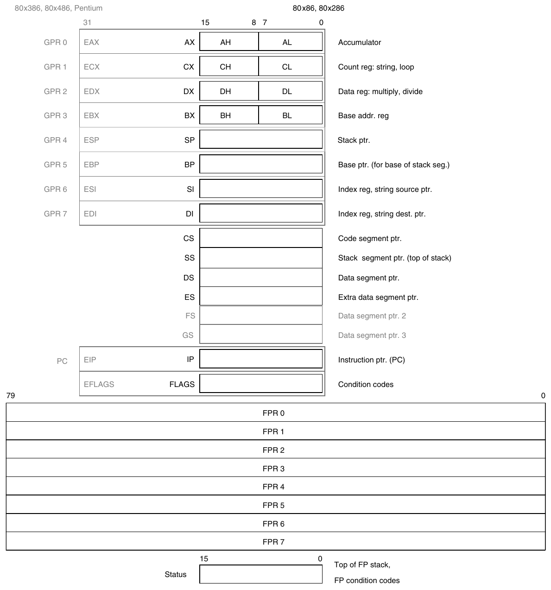

**Hình K.37 80x86 phát triển theo thời gian và register set của nó cũng vậy. Tập ban đầu có màu đen, tập mở rộng có màu xám. 8086 chia đôi bốn register đầu để dùng như một register 16-bit hoặc hai register 8-bit. Bắt đầu từ 80386, tám register trên được mở rộng lên 32 bit và cũng có thể dùng như register general-purpose. Các register floating-point ở dưới rộng 80 bit; mặc dù trông giống register thông thường, chúng không phải vậy. Chúng triển khai một stack với top of stack được status register trỏ đến. Một operand phải là top of stack, còn operand kia có thể là bất kỳ register nào trong bảy register bên dưới top of stack.**

| Loại source/destination operand | Source operand thứ hai |
|---|---|
| Register | Register |
| Register | Immediate |
| Register | Memory |
| Memory | Register |
| Memory | Immediate |

**Hình K.38 Các instruction type cho arithmetic instruction, logical instruction và data transfer instruction. 80x86 cho phép những tổ hợp được trình bày. Hạn chế duy nhất là không có mode memory-memory. Immediate có thể dài 8, 16 hoặc 32 bit; register là bất kỳ register nào trong 14 register chính ở Hình K.37 (không phải IP hay FLAGS).**

- Indexed — Address là tổng của hai register. Những tổ hợp được phép là BX+SI, BX+DI, BP+SI và BP+DI. Mode này được gọi là based indexed trên 8086. (Mode 32-bit dùng addressing mode khác để đạt cùng tác dụng.)

- Based indexed với displacement 8- hoặc 16-bit — Address là tổng của displacement và nội dung hai register. Những hạn chế register giống indexed mode.

- Base plus scaled indexed — Addressing mode này và mode tiếp theo được thêm trong 80386 và chỉ có ở mode 32-bit. Address calculation là

Base register + 2<sup>Scale</sup> × Index register

trong đó Scale có giá trị 0, 1, 2 hoặc 3; Index register có thể là bất kỳ general register 32-bit nào trong tám register trừ ESP; Base register có thể là bất kỳ general register 32-bit nào trong tám register.

- Base plus scaled index với displacement 8- hoặc 32-bit — Address là tổng của displacement và address tính theo scaled mode ngay trên. Những hạn chế register vẫn giống nhau.

80x86 dùng Little Endian addressing.

Lý tưởng nhất, chúng ta sẽ chuyển phần thảo luận logical address và physical address của 80x86 sang Chương 2, nhưng segmented address space khiến chúng ta không thể giấu thông tin đó. Hình K.39 cho thấy những tùy chọn memory mapping qua các thế hệ máy 80x86; Chương 2 mô tả segmented protection scheme chi tiết hơn.

Người lập trình assembly language rõ ràng phải chỉ định segment register cần dùng với address, bất kể address mode nào được sử dụng. Để tiết kiệm instruction space, segment register được chọn tự động tùy address register được dùng. Quy tắc rất đơn giản: tham chiếu instruction (IP) dùng code segment register (CS), tham chiếu stack (BP hoặc SP) dùng stack segment register (SS), còn segment register mặc định cho các register khác là data segment register (DS). Mục tiếp theo giải thích cách override chúng.

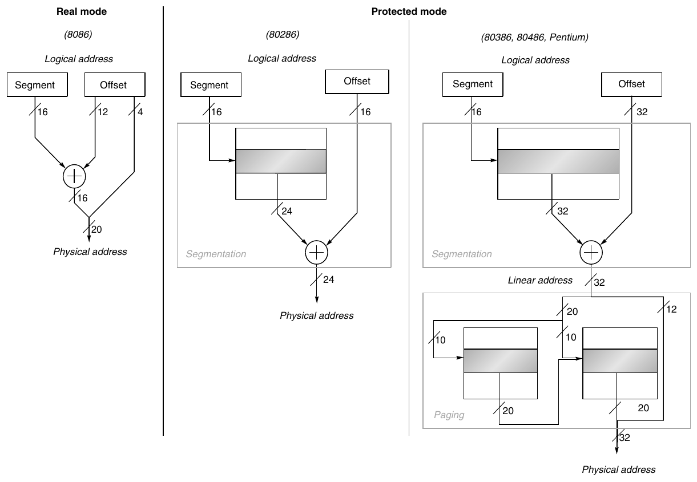

**Hình K.39 Cơ chế segmented ban đầu của 8086 nằm bên trái. Mọi processor 80x86 đều hỗ trợ kiểu addressing này, gọi là real mode. Nó chỉ lấy nội dung segment register, shift trái 4 bit rồi cộng vào offset 16-bit, tạo physical address 20-bit. 80286 (giữa) dùng nội dung segment register để chọn segment descriptor, chứa base address 24-bit cùng những mục khác. Base address được cộng với offset 16-bit để tạo physical address 24-bit. 80386 và các máy kế nhiệm (phải) mở rộng base address trong segment descriptor lên 32 bit và thêm paging layer tùy chọn bên dưới segmentation. Linear address 32-bit trước hết được tạo từ segment và offset, sau đó chia thành hai field 10-bit và page offset 12-bit. Field 10-bit đầu chọn entry trong page table first-level; entry này kết hợp với field 10-bit thứ hai để truy cập page table second-level và chọn 20 bit cao của physical address. Đặt address 20-bit này trước field 12-bit cuối tạo physical address 32-bit. Có thể tắt paging, định nghĩa lại linear address 32-bit thành physical address. Lưu ý address space 80x86 “flat” chỉ cần load cùng giá trị vào mọi segment register; tức segment register nào được chọn cũng không quan trọng.**

### Integer Operation của 80x86

8086 hỗ trợ data type 8-bit (byte) và 16-bit (gọi là word ). Sự phân biệt data type áp dụng cả register operation lẫn memory access. 80386 thêm address và data 32-bit, gọi là double word. Gần như mọi operation đều hoạt động trên data 8-bit và một data size dài hơn. Kích thước đó do mode quyết định, là 16 hoặc 32 bit.

Rõ ràng một số chương trình muốn xử lý data ở cả ba kích thước, nên các architect 80x86 cung cấp cách thuận tiện để chỉ định từng phiên bản mà không tăng code size đáng kể. Họ quyết định phần lớn chương trình sẽ chủ yếu dùng data 16- hoặc 32-bit, nên việc đặt một kích thước lớn mặc định là hợp lý. Kích thước mặc định này được đặt bởi một bit trong code segment register. Để override nó, prefix 8-bit được gắn vào instruction, yêu cầu máy dùng kích thước lớn còn lại cho instruction đó.

Giải pháp prefix được mượn từ 8086, vốn cho phép nhiều prefix sửa đổi instruction behavior. Ba prefix ban đầu override segment register mặc định, lock bus để thực hiện semaphore (xem Chương 5), hoặc lặp instruction tiếp theo cho đến khi CX đếm xuống zero. Prefix cuối nhằm ghép với byte move instruction để di chuyển số byte thay đổi. 80386 cũng thêm prefix để override address size mặc định.

Các integer operation 80x86 có thể chia thành bốn lớp chính:

1. Data movement instruction, bao gồm move, push và pop.

2. Arithmetic instruction và logic instruction, bao gồm logical operation, test, shift, cùng integer arithmetic operation và decimal arithmetic operation.

3. Control flow, bao gồm conditional branch và unconditional jump, call, return.

4. String instruction, bao gồm string move và string compare.

Hình K.40 trình bày một số instruction 80x86 điển hình cùng chức năng của chúng.

Data transfer instruction, arithmetic instruction và logic instruction không có gì đặc biệt, ngoại trừ arithmetic operation và logic operation cho phép destination là register hoặc memory location.

Control flow instruction phải định địa chỉ được destination trong segment khác. Điều này được xử lý bằng hai loại control flow instruction: “near” cho transfer intrasegment (trong cùng segment) và “far” cho transfer intersegment (giữa các segment). Với far jump, bắt buộc unconditional, hai đại lượng 16-bit theo sau opcode trong mode 16-bit. Một được dùng làm instruction pointer, còn một được load vào CS và trở thành code segment mới. Trong mode 32-bit, field đầu được mở rộng lên 32 bit để khớp program counter 32-bit (EIP).

Call và return hoạt động tương tự — far call push return instruction pointer và return segment lên stack, đồng thời load cả instruction pointer lẫn code segment. Far return pop cả instruction pointer và code segment khỏi stack. Người lập trình hoặc người viết compiler phải bảo đảm luôn dùng cùng loại call và return cho procedure — near return không hoạt động với far call và ngược lại.

String instruction là một phần nguồn gốc 8080 của 80x86 và không thường được thực thi trong phần lớn chương trình.

Hình K.41 liệt kê một số integer instruction 80x86. Nhiều instruction có cả format byte và word.

| Instruction | Function |
|---|---|
| JE name | if equal(CC) {IP←name}; IP–128 ≤ name ≤ IP+128 |
| JMP name | IP←name |
| CALLF name, seg | SP←SP–2; M[SS:SP]←IP+5; SP←SP–2;<br>M[SS:SP]←CS; IP←name; CS←seg; |
| MOVW BX,[DI+45] | BX←<sub>16</sub>M[DS:DI+45] |
| PUSH SI | SP←SP–2; M[SS:SP]←SI |
| POP DI | DI←M[SS:SP]; SP←SP+2 |
| ADD AX,#6765 | AX←AX+6765 |
| SHL BX,1 | BX←BX<sub>1..15</sub> ## 0 |
| TEST DX,#42 | Đặt CC flag bằng DX & 42 |
| MOVSB | M[ES:DI]←<sub>8</sub>M[DS:SI]; DI←DI+1; SI←SI+1 |

**Hình K.40 Một số instruction 80x86 điển hình và chức năng của chúng. Danh sách operation thường gặp nằm trong Hình K.41. Chúng ta dùng SR:X để biểu thị việc tạo address với segment register SR và offset X. Effective address tương ứng SR:X là (SR<<4)+X. CALLF lưu IP của instruction tiếp theo và CS hiện tại trên stack.**

### Floating-Point Operation của 80x86

Intel cung cấp stack architecture với floating-point instruction: load push số lên stack, operation tìm operand trong hai phần tử trên cùng của stack, còn store có thể pop phần tử khỏi stack, đúng như ví dụ stack ở Hình A.2 trang A-4 gợi ý.

Intel bổ sung instruction và addressing mode vào stack architecture này để có một số lợi ích của model register-memory. Ngoài tìm operand trong hai phần tử trên cùng của stack, một operand có thể nằm trong memory hoặc trong một trong bảy register bên dưới top of stack.

Tuy nhiên, sự kết hợp này vẫn là model register-memory hạn chế, vì load luôn chuyển data đến top of stack đồng thời tăng top of stack pointer, còn store chỉ có thể chuyển top of stack đến memory. Intel dùng ST để chỉ top of stack và ST(i) để biểu diễn register thứ i bên dưới top of stack.

Một tính năng mới lạ của architecture này là operand trong register stack rộng hơn khi lưu trong memory, và mọi operation đều được thực hiện với internal precision rộng đó. Số được tự động chuyển sang format 80-bit nội bộ khi load và chuyển trở lại kích thước thích hợp khi store. Memory data có thể là số floating-point 32-bit (single-precision) hoặc 64-bit (double-precision), được Intel gọi là real. Phiên bản register-memory của những instruction này sẽ chuyển memory operand sang format Intel 80-bit trước khi thực hiện operation. Data transfer instruction cũng tự động chuyển integer 16- và 32-bit sang real và ngược lại đối với integer load và store.

| Instruction | Meaning |
|---|---|
| Control | Conditional branch và unconditional branch |
| JNZ, JZ | Jump theo điều kiện đến IP + offset 8-bit; JNE (cho JNZ) và JE (cho JZ) là tên khác |
| JMP, JMPF | Unconditional jump — phiên bản intrasegment (near) và intersegment (far) với offset 8- hoặc 16-bit |
| CALL, CALLF | Subroutine call — offset 16-bit; push return address; có phiên bản near và far |
| RET, RETF | Pop return address từ stack và jump đến đó; có phiên bản near và far |
| LOOP | Loop branch — giảm CX; jump đến IP + displacement 8-bit nếu CX ¦ 0 *(ghi chú: sách in "¦"; đúng là "≠")* |
| Data transfer | Di chuyển data giữa register hoặc giữa register và memory |
| MOV | Di chuyển giữa hai register hoặc giữa register và memory |
| PUSH | Push source operand lên stack |
| POP | Pop operand từ stack top đến register |
| LES | Load ES và một GPR từ memory |
| Arithmetic/logical | Arithmetic operation và logical operation sử dụng data register và memory |
| ADD | Cộng source vào destination; format register-memory |
| SUB | Trừ source khỏi destination; format register-memory |
| CMP | So sánh source và destination; format register-memory |
| SHL | Shift trái |
| SHR | Logical shift phải |
| RCR | Rotate phải, dùng carry để điền |
| CBW | Chuyển byte trong AL thành word trong AX |
| TEST | Logical AND của source và destination đặt flag |
| INC | Tăng destination; format register-memory |
| DEC | Giảm destination; format register-memory |
| OR | Logical OR; format register-memory |
| XOR | Exclusive OR; format register-memory |
| String instruction | Di chuyển giữa các string operand; chiều dài do repeat prefix cung cấp |
| MOVS | Sao chép từ string source đến destination; có thể lặp lại |
| LODS | Load một byte hoặc word của string vào register A |

**Hình K.41 Một số operation điển hình trên 80x86. Nhiều operation dùng format register-memory, trong đó source hoặc destination có thể là memory, còn operand kia có thể là register hoặc immediate.**

Các operation floating-point 80x86 có thể chia thành bốn lớp chính:

1. Data movement instruction, bao gồm load, load constant và store.

2. Arithmetic instruction, bao gồm add, subtract, multiply, divide, square root và absolute value.

3. Comparison, bao gồm instruction gửi kết quả đến integer CPU để CPU có thể branch.

4. Transcendental instruction, bao gồm sine, cosine, log và exponentiation.

Hình K.42 trình bày một số trong 60 operation floating-point. Chúng ta dùng dấu ngoặc nhọn {} để chỉ biến thể tùy chọn của operation cơ bản: {I} nghĩa là có phiên bản integer của instruction, {P} nghĩa là biến thể này pop một operand khỏi stack sau operation, và {R} nghĩa là đảo vai trò các operand trong operation này.

Không phải mọi tổ hợp đều được cung cấp. Vì vậy,

```
F{I}SUB{R}{P}
```

biểu diễn những instruction sau có trong 80x86:

```
FSUB
FISUB
FSUBR
FISUBR
FSUBP
FSUBRP
```

Không có phiên bản pop hoặc reverse pop của integer subtract instruction.

| Data transfer | Arithmetic | Compare | Transcendental |
|---|---|---|---|
| F{I}LD mem/ST(i) | F{I}ADD{P} mem/ST(i) | F{I}COM{P}{P} | FPATAN |
| F{I}ST{P} mem/ST(i) | F{I}SUB{R}{P} mem/ST(i) | F{I}UCOM{P}{P} | F2XM1 |
| FLDPI | F{I}MUL{P} mem/ST(i) | FSTSW AX/mem | FCOS |
| FLD1 | F{I}DIV{R}{P} mem/ST(i) |  | FPTAN |
| FLDZ | FSQRT |  | FPREM |
|  | FABS |  | FSIN |
|  | FRNDINT |  | FYL2X |

**Hình K.42 Các instruction floating-point của 80x86. Cột đầu cho thấy data transfer instruction, di chuyển data đến memory hoặc một register bên dưới top of stack. Ba operation cuối push constant lên stack: pi, 1.0 và 0.0. Cột thứ hai chứa arithmetic operation đã mô tả ở trên. Lưu ý ba operation cuối chỉ hoạt động trên top of stack. Cột thứ ba là compare instruction. Vì không có branch instruction floating-point đặc biệt, kết quả compare phải được chuyển đến integer CPU qua FSTSW, vào register AX hoặc memory, theo sau bởi SAHF để đặt condition code. Sau đó có thể kiểm tra floating-point comparison bằng integer branch instruction. Cột cuối cung cấp các operation floating-point higher-level.**

Lưu ý chúng ta có thêm nhiều tổ hợp khi tính cả operand mode cho các operation này. Phép add floating-point có những tùy chọn sau, bỏ qua phiên bản integer và pop của instruction:

| FADD | Cả hai operand đều trong stack *(ghi chú: sách in "in the in stack"; đúng là "in the stack")*, và kết quả thay thế top of stack. |
|---|---|
| FADD ST(i) | Một source operand là register thứ i dưới top of stack, và kết quả thay thế top of stack. |
| FADD ST(i),ST | Một source operand là top of stack, và kết quả thay thế register thứ i dưới top of stack. |
| FADD mem32 | Một source operand là location 32-bit trong memory, và kết quả thay thế top of stack. |
| FADD mem64 | Một source operand là location 64-bit trong memory, và kết quả thay thế top of stack. |

Như đã đề cập, SSE2 cung cấp model register floating-point IEEE.

### Instruction Encoding của 80x86

Để phần tệ nhất đến cuối, instruction encoding trong 8086 rất phức tạp với nhiều instruction format khác nhau. Instruction có thể dài từ 1 byte khi không có operand đến 6 byte khi chứa immediate 16-bit và dùng displacement addressing 16-bit. Prefix instruction làm instruction length của 8086 vượt những kích thước hiển nhiên này.

Những bổ sung của 80386 mở rộng instruction size hơn nữa, như Hình K.43 cho thấy. Cả displacement field lẫn immediate field có thể dài 32 bit, có thêm hai prefix, opcode có thể dài 16 bit và scaled index mode specifier thêm 8 bit nữa. Instruction 80386 dài nhất có thể là 17 byte.

Hình K.44 cho thấy instruction format của một số instruction ví dụ trong Hình K.40. Opcode byte thường chứa một bit cho biết operand rộng một byte hay có kích thước lớn hơn, 16 hoặc 32 bit tùy mode. Với một số instruction, opcode có thể bao gồm addressing mode và register; điều này đúng với nhiều instruction dạng register ←register op immediate. Những instruction khác dùng “postbyte” hay opcode byte bổ sung, mang nhãn “mod, reg, r/m” trong Hình K.43, chứa thông tin addressing mode. Postbyte này dùng cho nhiều instruction định địa chỉ memory. Based with scaled index dùng postbyte thứ hai, mang nhãn “sc, index, base” trong Hình K.43.

Các instruction floating-point được mã hóa trong escape opcode của 8086 và postbyte address specifier. Memory operation dành 2 bit để quyết định operand là real 32- hay 64-bit hoặc integer 16- hay 32-bit. Cũng 2 bit đó được dùng trong phiên bản không truy cập memory để quyết định có pop stack sau operation hay không và top of stack hay register bên dưới nhận kết quả.

Đáng tiếc, không thể tách hạn chế register khỏi encoding của addressing mode trong 80x86. Vì vậy, Hình K.45 và K.46 cho thấy encoding của hai postbyte address specifier cho cả mode 16- và 32-bit.

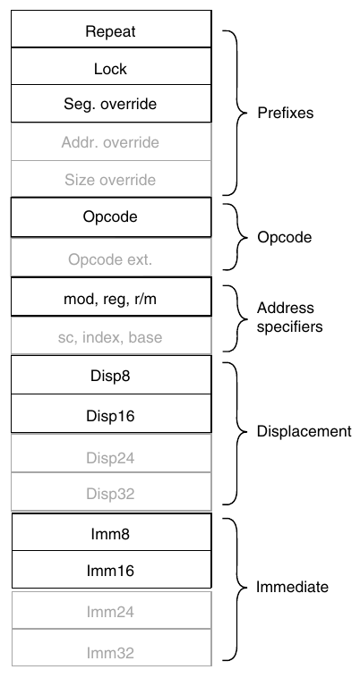

**Hình K.43 Instruction format của 8086 (chữ đen) và extension cho 80386 (chữ tô nhạt). Mọi field đều tùy chọn trừ opcode.**

### Kết hợp mọi phần: Đo lường việc sử dụng Instruction Set

Trong mục này, chúng ta trình bày các phép đo chi tiết cho 80x86, sau đó so sánh với MIPS trên cùng chương trình. Để dễ so sánh các dynamic instruction set measurement, chúng ta dùng một tập con chương trình SPEC92. Kết quả 80x86 được thu thập năm 1994 bằng compiler FORTRAN và C Sun Solaris V2.0 và thực thi trong mode 32-bit. Chất lượng các compiler này tương đương compiler dùng cho MIPS.

Nhớ rằng các phép đo phụ thuộc benchmark được chọn và compiler technology được dùng. Mặc dù chúng ta cho rằng các phép đo trong mục này phản ánh hợp lý việc sử dụng những architecture này, chương trình khác có thể hành xử khác mọi benchmark ở đây và compiler khác có thể cho kết quả khác. Trong nghiên cứu instruction set thực tế, architect sẽ muốn có tập benchmark lớn hơn nhiều, bao quát phạm vi ứng dụng rộng nhất có thể, và xem xét operating system cùng việc nó dùng instruction set. Benchmark Single-user như được đo ở đây không nhất thiết hành xử giống operating system.

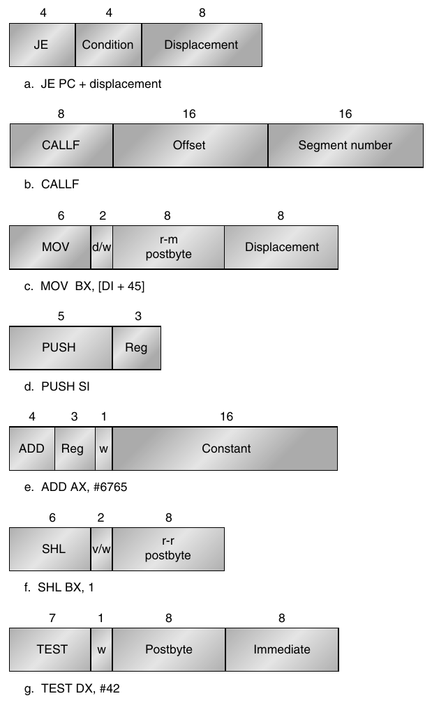

**Hình K.44 Các instruction format điển hình của 8086. Encoding của postbyte nằm trong Hình K.45. Nhiều instruction chứa field w 1-bit cho biết operation là byte hay word. Field dạng v/w hoặc d/w là d-field hoặc v-field theo sau bởi w-field. d-field trong MOV dùng trong instruction có thể move đến hoặc từ memory và cho biết hướng move. Field v trong SHL chỉ variable-length shift; variable-length shift dùng register giữ shift count. ADD cho thấy một short encoding được tối ưu điển hình, chỉ dùng khi operand đầu là AX. Toàn bộ instruction có thể dài từ 1 đến 6 byte.**

Chúng ta bắt đầu bằng đánh giá riêng những tính năng của 80x86, sau đó so sánh instruction count với DLX.

|  |  | w = 1 |  |  | mod = 0 |  | mod = 1 |  | mod = 2 |  |  |
|---|---|---|---|---|---|---|---|---|---|---|---|
| reg | w = 0 | 16b | 32b | r/m | 16b | 32b | 16b | 32b | 16b | 32b | mod = 3 |
| 0 | AL | AX | EAX | 0 | addr=BX+SI | =EAX | same | same | same | same | same |
| 1 | CL | CX | ECX | 1 | addr=BX+DI | =ECX | addr as | addr as | addr as | addr as | as |
| 2 | DL | DX | EDX | 2 | addr=BP+SI | =EDX | mod=0 | mod=0 | mod=0 | mod=0 | reg |
| 3 | BL | BX | EBX | 3 | addr=BP+SI | =EBX | + disp8 | + disp8 | + disp16 | + disp32 | field |
| 4 | AH | SP | ESP | 4 | addr=SI | =(sib) | SI+disp16 | (sib)+disp8 | SI+disp8 | (sib)+disp32 | " |
| 5 | CH | BP | EBP | 5 | addr=DI | =disp32 | DI+disp8 | EBP+disp8 | DI+disp16 | EBP+disp32 | " |
| 6 | DH | SI | ESI | 6 | addr=disp16 | =ESI | BP+disp8 | ESI+disp8 | BP+disp16 | ESI+disp32 | " |
| 7 | BH | DI | EDI | 7 | addr=BX | =EDI | BX+disp8 | EDI+disp8 | BX+disp16 | EDI+disp32 | " |

**Hình K.45 Encoding của address specifier đầu tiên trong 80x86: mod, reg, r/m. Bốn cột đầu cho encoding của reg field 3-bit, phụ thuộc w bit từ opcode và máy ở mode 16-or 32-bit. Các cột còn lại giải thích mod field và r/m field. Ý nghĩa r/m field 3-bit phụ thuộc giá trị trong mod field 2-bit và address size. Về cơ bản, các register dùng trong address calculation được liệt kê ở cột sáu và bảy, dưới mod = 0; mod = 1 thêm displacement 8-bit và mod = 2 thêm displacement 16- hoặc 32-bit tùy address mode. Ngoại lệ là r/m = 6 khi mod = 1 hoặc mod = 2 trong mode 16-bit chọn BP cộng displacement; r/m = 5 khi mod = 1 hoặc mod = 2 trong mode 32-bit chọn EBP cộng displacement; và r/m = 4 trong mode 32-bit khi mod ¦3 *(ghi chú: sách in "¦"; đúng là "≠")* (sib) nghĩa là dùng scaled index mode trong Hình K.46. Khi mod = 3, r/m field chỉ một register bằng cùng encoding như reg field kết hợp w bit.**

| Index |  | Base |
|---|---|---|
| 0 | EAX | EAX |
| 1 | ECX | ECX |
| 2 | EDX | EDX |
| 3 | EBX | EBX |
| 4 | Không có index | ESP |
| 5 | EBP | Nếu mod = 0, disp32<br>Nếu mod ¦ 0, EBP *(ghi chú: sách in "¦"; đúng là "≠")* |
| 6 | ESI | ESI |
| 7 | EDI | EDI |

**Hình K.46 Address specifier cho mode based plus scaled index có trong 80386. Mode này được chỉ bằng ký hiệu (sib) trong Hình K.45. Lưu ý nó mở rộng danh sách register dùng trong các mode khác: register indirect dùng ESP có từ Scale = 0, Index = 4 và Base = 4; base displacement với EBP có từ Scale = 0, Index = 5 và mod = 0. Scale field two-bit được dùng trong công thức effective address: Base register + 2<sup>Scale</sup> × Index register.**

#### Đo lường Operand Addressing của 80x86

Chúng ta bắt đầu với addressing mode. Hình K.47 cho thấy phân bố operand type trong 80x86. Những phép đo bao gồm operand “thứ hai” của operation; chẳng hạn,

```
mov EAX, [45]
```

được tính là một memory operand duy nhất. Nếu tính cả type của operand đầu tiên, tỉ lệ sử dụng register sẽ tăng khoảng 1.5 lần.

Các memory operand 80x86 được chia theo addressing mode tương ứng trong Hình K.48. Có lẽ điều bất ngờ nhất là mức độ phổ biến của những addressing mode được 80386 bổ sung, nằm ở bốn hàng cuối hình. Chúng chiếm khoảng một nửa mọi memory access. Một điều bất ngờ khác là direct addressing phổ biến. Trên phần lớn máy khác, dạng tương đương direct addressing mode hiếm gặp. Có lẽ segmented address space của 80x86 khiến direct addressing hữu ích hơn, vì address là tương đối so với base address từ segment register.

|  | Trung bình integer | Trung bình FP |
|---|---|---|
| Register | 45% | 22% |
| Immediate | 16% | 6% |
| Memory | 39% | 72% |

**Hình K.47 Phân bố operand type theo trung bình của năm chương trình SPECint92 (compress, eqntott, espresso, gcc, li) và trung bình của năm chương trình SPECfp92 (doduc, ear, hydro2d, mdljdp2, su2cor).**

| Addressing mode | Trung bình integer | Trung bình FP |
|---|---|---|
| Register indirect | 13% | 3% |
| Base + 8-bit disp. | 31% | 15% |
| Base + 32-bit disp. | 9% | 25% |
| Indexed | 0% | 0% |
| Based indexed + 8-bit disp. | 0% | 0% |
| Based indexed + 32-bit disp. | 0% | 1% |
| Base + scaled indexed | 22% | 7% |
| Base + scaled indexed + 8-bit disp. | 0% | 8% |
| Base + scaled indexed + 32-bit disp. | 4% | 4% |
| 32-bit direct | 20% | 37% |

**Hình K.48 Phân bố operand addressing mode theo chương trình. Biểu đồ này không bao gồm addressing mode được branch hoặc control instruction sử dụng.**

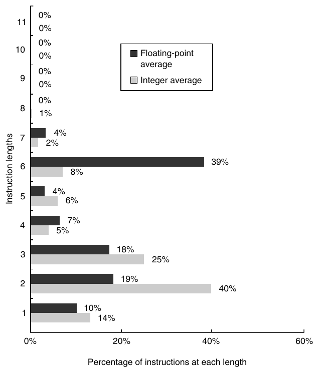

**Hình K.49 Trung bình của các histogram instruction length 80x86 cho năm chương trình SPECint92 và năm chương trình SPECfp92, tất cả chạy trong mode 32-bit.**

Những addressing mode này phần lớn quyết định kích thước Intel instruction. Hình K.49 cho thấy phân bố instruction size. Số byte trung bình mỗi instruction trong chương trình integer là 2.8, với độ lệch chuẩn 1.5; trong chương trình floating-point là 4.1 với độ lệch chuẩn 1.9. Khác biệt chiều dài một phần xuất phát từ khác biệt addressing mode: chương trình integer dựa nhiều hơn vào mode register indirect ngắn hơn và displacement addressing 8-bit, trong khi chương trình floating-point dùng thường xuyên hơn các addressing mode 80386 với displacement 32-bit dài hơn.

Vì các instruction floating-point có khía cạnh của cả stack lẫn register, chúng được dùng như thế nào? Hình K.50 cho thấy, ít nhất với các compiler dùng trong phép đo này, stack model of execution hiếm khi được tuân theo. (Xem giải thích lịch sử cho nhận xét này trong Mục L.3.)

Cuối cùng, Hình K.51 và K.52 cho thấy instruction mix của 10 chương trình SPEC92.

| Tùy chọn | doduc | ear | hydro2d | mdljdp2 | su2cor | Trung bình FP |
|---|---|---|---|---|---|---|
| Stack (operand thứ 2 ST (1)) | 1.1% | 0.0% | 0.0% | 0.2% | 0.6% | 0.4% |
| Register (operand thứ 2 ST(i), i > 1) | 17.3% | 63.4% | 14.2% | 7.1% | 30.7% | 26.5% |
| Memory | 81.6% | 36.6% | 85.8% | 92.7% | 68.7% | 73.1% |

**Hình K.50 Tỉ lệ instruction cho các operation floating-point (add, sub, mul, div) dùng từng tùy chọn trong ba cách chỉ định operand floating-point trên 80x86. Ba tùy chọn là (1) stack model nghiêm ngặt với operand ngầm trên stack, (2) phiên bản register đặt tên một operand tường minh không thuộc hai phần tử trên cùng của stack và (3) memory operand.**

| Instruction | doduc | ear | hydro2d | mdljdp2 | su2cor | Trung bình FP |
|---|---|---|---|---|---|---|
| Load | 8.9% | 6.5% | 18.0% | 27.6% | 27.6% | 20% |
| Store | 12.4% | 3.1% | 11.5% | 7.8% | 7.8% | 8% |
| Add | 5.4% | 6.6% | 14.6% | 8.8% | 8.8% | 10% |
| Sub | 1.0% | 2.4% | 3.3% | 2.4% | 2.4% | 3% |
| Mul |  |  |  |  |  | 0% |
| Div |  |  |  |  |  | 0% |
| Compare | 1.8% | 5.1% | 0.8% | 1.0% | 1.0% | 2% |
| Mov reg-reg | 3.2% | 0.1% | 1.8% | 2.3% | 2.3% | 2% |
| Load imm | 0.4% | 1.5% |  |  |  | 0% |
| Cond. branch | 5.4% | 8.2% | 5.1% | 2.7% | 2.7% | 5% |
| Uncond branch | 0.8% | 0.4% | 1.3% | 0.3% | 0.3% | 1% |
| Call | 0.5% | 1.6% |  | 0.1% | 0.1% | 0% |
| Return, jmp indirect | 0.5% | 1.6% |  | 0.1% | 0.1% | 0% |
| Shift | 1.1% |  | 4.5% | 2.5% | 2.5% | 2% |
| AND | 0.8% | 0.8% | 0.7% | 1.3% | 1.3% | 1% |
| OR | 0.1% |  |  | 0.1% | 0.1% | 0% |
| Khác (XOR, not, . . .) |  |  |  |  |  | 0% |
| Load FP | 14.1% | 22.5% | 9.1% | 12.6% | 12.6% | 14% |
| Store FP | 8.6% | 11.4% | 4.1% | 6.6% | 6.6% | 7% |
| Add FP | 5.8% | 6.1% | 1.4% | 6.6% | 6.6% | 5% |
| Sub FP | 2.2% | 2.7% | 3.1% | 2.9% | 2.9% | 3% |
| Mul FP | 8.9% | 8.0% | 4.1% | 12.0% | 12.0% | 9% |
| Div FP | 2.1% |  | 0.8% | 0.2% | 0.2% | 0% |
| Compare FP | 9.4% | 6.9% | 10.8% | 0.5% | 0.5% | 5% |
| Mov reg-reg FP | 2.5% | 0.8% | 0.3% | 0.8% | 0.8% | 1% |
| Khác (abs, sqrt, . . .) | 3.9% | 3.8% | 4.1% | 0.8% | 0.8% | 2% |

**Hình K.51 Instruction mix của 80x86 cho năm chương trình SPECfp92.**

| Instruction | compress | eqntott | espresso | gcc (cc1) | li | Trung bình integer |
|---|---|---|---|---|---|---|
| Load | 20.8% | 18.5% | 21.9% | 24.9% | 23.3% | 22% |
| Store | 13.8% | 3.2% | 8.3% | 16.6% | 18.7% | 12% |
| Add | 10.3% | 8.8% | 8.15% | 7.6% | 6.1% | 8% |
| Sub | 7.0% | 10.6% | 3.5% | 2.9% | 3.6% | 5% |
| Mul |  |  |  | 0.1% |  | 0% |
| Div |  |  |  |  |  | 0% |
| Compare | 8.2% | 27.7% | 15.3% | 13.5% | 7.7% | 16% |
| Mov reg-reg | 7.9% | 0.6% | 5.0% | 4.2% | 7.8% | 4% |
| Load imm | 0.5% | 0.2% | 0.6% | 0.4% |  | 0% |
| Cond. branch | 15.5% | 28.6% | 18.9% | 17.4% | 15.4% | 20% |
| Uncond. branch | 1.2% | 0.2% | 0.9% | 2.2% | 2.2% | 1% |
| Call | 0.5% | 0.4% | 0.7% | 1.5% | 3.2% | 1% |
| Return, jmp indirect | 0.5% | 0.4% | 0.7% | 1.5% | 3.2% | 1% |
| Shift | 3.8% |  | 2.5% | 1.7% |  | 1% |
| AND | 8.4% | 1.0% | 8.7% | 4.5% | 8.4% | 6% |
| OR | 0.6% |  | 2.7% | 0.4% | 0.4% | 1% |
| Khác (XOR, not, . . .) | 0.9% |  | 2.2% | 0.1% |  | 1% |
| Load FP |  |  |  |  |  | 0% |
| Store FP |  |  |  |  |  | 0% |
| Add FP |  |  |  |  |  | 0% |
| Sub FP |  |  |  |  |  | 0% |
| Mul FP |  |  |  |  |  | 0% |
| Div FP |  |  |  |  |  | 0% |
| Compare FP |  |  |  |  |  | 0% |
| Mov reg-reg FP |  |  |  |  |  | 0% |
| Khác (abs, sqrt, . . .) |  |  |  |  |  | 0% |

**Hình K.52 Instruction mix của 80x86 cho năm chương trình SPECint92.**

#### Đo lường so sánh Operation

Hình K.53 và K.54 cho thấy số instruction được thực thi cho từng chương trình trong 10 chương trình trên 80x86 và tỉ lệ instruction execution so với DLX: số nhỏ hơn 1.0 nghĩa là 80x86 thực thi ít instruction hơn DLX. Instruction count gần DLX đến đáng ngạc nhiên với nhiều chương trình integer, vì chúng ta sẽ kỳ vọng một instruction set architecture load-store như DLX thực thi nhiều instruction hơn architecture register-memory như 80x86. Chương trình floating-point luôn có instruction count cao hơn trên 80x86, có lẽ do thiếu register floating-point và sử dụng stack architecture.

|  | compress | eqntott | espresso | gcc (cc1) | li | Trung bình integer |
|---|---|---|---|---|---|---|
| Instruction thực thi trên 80x86 (triệu) | 2226 | 1203 | 2216 | 3770 | 5020 |  |
| Tỉ lệ instruction thực thi so với DLX | 0.61 | 1.74 | 0.85 | 0.96 | 0.98 | 1.03 |
| Data read trên 80x86 (triệu) | 589 | 229 | 622 | 1079 | 1459 |  |
| Data write trên 80x86 (triệu) | 311 | 39 | 191 | 661 | 981 |  |
| Data read-modify-writes trên 80x86 (triệu) | 26 | 1 | 129 | 48 | 48 |  |
| Tổng data read trên 80x86 (triệu) | 615 | 230 | 751 | 1127 | 1507 |  |
| Tỉ lệ data read so với DLX | 0.85 | 1.09 | 1.38 | 1.25 | 0.94 | 1.10 |
| Tổng data write trên 80x86 (triệu) | 338 | 40 | 319 | 709 | 1029 |  |
| Tỉ lệ data write so với DLX | 1.67 | 9.26 | 2.39 | 1.25 | 1.20 | 3.15 |
| Tổng data access trên 80x86 (triệu) | 953 | 269 | 1070 | 1836 | 2536 |  |
| Tỉ lệ data access so với DLX | 1.03 | 1.25 | 1.58 | 1.25 | 1.03 | 1.23 |

**Hình K.53 Instruction được thực thi và data access trên 80x86 cùng tỉ lệ so với DLX cho năm chương trình SPECint92.**

|  | doduc | ear | hydro2d | mdljdp2 | su2cor | Trung bình FP |
|---|---|---|---|---|---|---|
| Instruction thực thi trên 80x86 (triệu) | 1223 | 15,220 | 13,342 | 6197 | 6197 |  |
| Tỉ lệ instruction thực thi so với DLX | 1.19 | 1.19 | 2.53 | 2.09 | 1.62 | 1.73 |
| Data read trên 80x86 (triệu) | 515 | 6007 | 5501 | 3696 | 3643 |  |
| Data write trên 80x86 (triệu) | 260 | 2205 | 2085 | 892 | 892 |  |
| Data read-modify-writes trên 80x86 (triệu) | 1 | 0 | 189 | 124 | 124 |  |
| Tổng data read trên 80x86 (triệu) | 517 | 6007 | 5690 | 3820 | 3767 |  |
| Tỉ lệ data read so với DLX | 2.04 | 2.36 | 4.48 | 4.77 | 3.91 | 3.51 |
| Tổng data write trên 80x86 (triệu) | 261 | 2205 | 2274 | 1015 | 1015 |  |
| Tỉ lệ data write so với DLX | 3.68 | 33.25 | 38.74 | 16.74 | 9.35 | 20.35 |
| Tổng data access trên 80x86 (triệu) | 778 | 8212 | 7965 | 4835 | 4782 |  |
| Tỉ lệ data access so với DLX | 2.40 | 3.14 | 5.99 | 5.73 | 4.47 | 4.35 |

**Hình K.54 Instruction được thực thi và data access cho năm chương trình SPECfp92 trên 80x86 cùng tỉ lệ so với DLX.**

Một câu hỏi khác là tổng lượng data traffic của 80x86 so với DLX, vì 80x86 có thể chỉ định memory operand như một phần operation, trong khi DLX chỉ truy cập qua load và store. Hình K.53 và K.54 cũng cho thấy data read, data write và data read-modify-writes cho 10 chương trình này. Tỉ lệ tổng access so với DLX của từng memory access type nằm ở những hàng cuối, với read-modify-write được tính là một read và một write. 80x86 thực hiện số data access nhiều gấp khoảng hai đến bốn lần DLX cho chương trình floating-point và gấp 1.25 lần cho chương trình integer. Cuối cùng, Hình K.55 cho thấy tỉ lệ instruction trong mỗi loại cho 80x86 và DLX.

Trung bình integer Trung bình FP

|  | Trung bình integer |  | Trung bình FP |  |
|---|---|---|---|---|
| Loại | x86 | DLX | x86 | DLX |
| Tổng data transfer | 34% | 36% | 28% | 2% |
| Tổng integer arithmetic | 34% | 31% | 16% | 12% |
| Tổng control | 24% | 20% | 6% | 10% |
| Tổng logical | 8% | 13% | 3% | 2% |
| Tổng FP data transfer | 0% | 0% | 22% | 33% |
| Tổng FP arithmetic | 0% | 0% | 25% | 41% |

**Hình K.55 Tỉ lệ instruction được thực thi theo loại trên 80x86 và DLX, lấy trung bình năm chương trình SPECint92 và SPECfp92 trong Hình K.53 và K.54.**

### Nhận xét kết luận

> Vẻ đẹp nằm trong mắt người nhìn.

> Ngạn ngữ xưa

Như đã thấy, “orthogonal” không phải thuật ngữ có trong từ điển architecture Intel. Để hiểu đầy đủ register và addressing mode nào khả dụng, cần xem encoding của mọi addressing mode và đôi khi cả encoding của instruction.

Một số người cho rằng sự thiếu thanh nhã của instruction set 80x86 là điều không thể tránh, cái giá mà mọi architecture phải trả cho thành công vượt bậc. Chúng ta không đồng ý. Rõ ràng, không architecture thành công nào có thể loại bỏ tính năng đã thêm trong implementation trước, và theo thời gian, một số tính năng có thể trở nên không mong muốn. Sự vụng về của 80x86 bắt đầu từ cốt lõi là instruction set 8086 và trầm trọng hơn bởi các extension thiếu nhất quán về architecture của 8087, 80286 và 80386.

Một phản ví dụ là IBM 360/370 architecture, lâu đời hơn 80x86 nhiều. Nó thống trị thị trường mainframe giống như 80x86 thống trị PC. Chắc chắn nhờ nền tảng tốt hơn và các cải tiến tương thích hơn, instruction set này hợp lý hơn 80x86 nhiều ngay cả sau hơn 30 năm kể từ implementation đầu tiên.

Dù tốt hay xấu, Intel đã có microprocessor 16-bit trước các architecture thanh nhã hơn của đối thủ nhiều năm; lợi thế đi trước này dẫn đến việc chọn 8086 làm CPU cho IBM PC. Những gì thiếu về phong cách được bù bằng số lượng, khiến 80x86 trở nên đẹp từ góc nhìn thích hợp.

Điểm cứu vãn của 80x86 là những thành phần architecture không quá khó triển khai, như Intel đã chứng minh bằng việc nhanh chóng cải thiện performance của chương trình integer từ năm 1978. Performance floating-point cao là thách thức lớn hơn trong architecture này.

## K.4 VAX Architecture

> VAX: thiết kế minicomputer thành công nhất trong lịch sử ngành . . . VAX có lẽ là chiếc máy hacker yêu thích nhất . . . . Đặc biệt nổi tiếng với instruction set lớn, assembler-programmer-friendly — một ưu điểm trở thành gánh nặng sau cuộc cách mạng RISC.

> Eric Raymond

> The New Hacker’s Dictionary (1991)

### Giới thiệu

Để nâng cao hiểu biết về instruction set architecture, chúng ta chọn VAX làm đại diện Complex Instruction Set Computer (CISC), vì nó rất khác MIPS nhưng vẫn dễ hiểu. Khi thấy hai phong cách khác biệt như vậy, chúng tôi tin bạn sẽ có thể tự học những instruction set khác.

Khi VAX được thiết kế, triết lý phổ biến là tạo instruction set gần programming language để đơn giản hóa compiler. Chẳng hạn, vì programming language có loop, instruction set nên có loop instruction. Như VAX architect William Strecker nói (“VAX-11/780—A Virtual Address Extension to the PDP-11 Family,” AFIPS Proc., National Computer Conference, 1978):

Một mục tiêu chính của instruction set VAX-11 là cung cấp code hiệu quả do compiler sinh ra. Bốn quyết định giúp hiện thực hóa mục tiêu này: . . . 1) Xử lý operator rất đều đặn và nhất quán . . . . 2) Tránh instruction ít có khả năng được compiler sinh ra . . . . 3) Có nhiều dạng của các operator phổ biến . . . . 4) Thay các chuỗi instruction phổ biến bằng instruction duy nhất. Ví dụ bao gồm procedure calling, multiway branching, loop control và array subscript calculation.

Nhớ rằng DRAM vào mid-1970s có capacity nhỏ hơn 1/1000th DRAM ngày nay, nên code space cũng rất quan trọng. Vì vậy, một triết lý phổ biến khác là giảm thiểu code size, điều ít được chú trọng (de-emphasized) trong instruction set fixed-length như MIPS. Chẳng hạn, MIPS address field luôn dùng 16 bit ngay cả khi address rất nhỏ. Ngược lại, VAX cho phép instruction có số byte thay đổi, nên ít lãng phí không gian trong address field.

Đã có những cuốn sách viết riêng về VAX, nên phần bổ sung VAX này không thể đầy đủ mọi chi tiết. Vì vậy, các mục sau chỉ mô tả một vài addressing mode và instruction. Để cho thấy VAX instruction hoạt động, các mục sau trình bày VAX assembly code cho hai procedure C. Phong cách chung là đối chiếu những instruction này với MIPS code mà bạn đã quen thuộc.

Mục tiêu khác nhau của VAX và MIPS dẫn đến những architecture rất khác. Mục tiêu VAX là compiler đơn giản và code density, dẫn đến addressing mode mạnh, instruction mạnh và instruction encoding hiệu quả. Mục tiêu MIPS là performance cao qua pipelining, dễ triển khai hardware và tương thích với compiler tối ưu mạnh. Những mục tiêu này dẫn đến instruction đơn giản, addressing mode đơn giản, instruction format fixed-length và nhiều register.

### Operand và Addressing Mode của VAX

VAX là architecture 32-bit với address 32-bit-wide và register 32-bit-wide. Tuy nhiên, nó hỗ trợ nhiều kích thước và kiểu dữ liệu khác, như Hình K.56 cho thấy. Đáng tiếc, VAX dùng tên “word” để chỉ đại lượng 16-bit; trong cuốn sách này, word nghĩa là 32 bit. Hình K.56 cho thấy sự chuyển đổi giữa tên data type của MIPS và VAX. Cần cẩn thận khi đọc về VAX instruction vì chúng dùng tên data type của VAX.

VAX cung cấp 16 register 32-bit. VAX assembler dùng ký hiệu r0, r1, . . . , r15 để chỉ những register này và chúng ta sẽ theo ký hiệu đó. Đáng tiếc, 4 trong 16 register thực tế bị instruction set architecture dành riêng. Chẳng hạn, r14 là stack pointer (sp), r15 là program counter (pc). Vì vậy, r15 không thể dùng làm register general-purpose và rất khó dùng r14 vì xung đột với instruction thao tác stack. Hai register dành riêng khác là r12, dùng làm argument pointer (ap), và r13, dùng làm frame pointer (fp); mục đích của chúng sẽ rõ sau. (Giống MIPS, VAX assembler chấp nhận cả register number lẫn register name.)

| Bit | Data type | Tên trong MIPS | Tên trong VAX |
|---|---|---|---|
| 08 | Integer | Byte | Byte |
| 16 | Integer | Half word | Word |
| 32 | Integer | Word | Long word |
| 32 | Floating point | Single precision | F_floating |
| 64 | Integer | Double word | Quad word |
| 64 | Floating point | Double precision | D_floating or G_floating |
| 8n | Character string | Character | Character |

**Hình K.56 Data type VAX, chiều dài và tên của chúng. Chữ cái đầu của VAX type (b, w, l, f, q, d, g, c) thường được dùng để hoàn thành instruction name. Ví dụ move instruction gồm movb, movw, movl, movf, movq, movd, movg và movc3. Mỗi move instruction chuyển một operand có data type do chữ cái sau mov chỉ định.**

VAX addressing mode bao gồm những mode đã thảo luận trong Phụ lục A, nơi có mọi MIPS addressing mode: register, displacement, immediate và PC-relative. Hơn nữa, tất cả những mode này đều dùng được cho jump address hoặc data address.

Nhưng đó chưa phải mọi addressing mode. Để giảm code size, VAX có ba address length cho displacement addressing: address 8-bit, 16-bit và 32-bit, lần lượt gọi là byte displacement, word displacement và long displacement addressing. Vì vậy, address không chỉ nhỏ nhất có thể mà còn lớn theo mức cần thiết; address lớn không cần chia tách, nên không có dạng tương đương instruction lui của MIPS (xem Hình A.24 trang A-37).

Đó vẫn chưa phải mọi VAX addressing mode. Một số có tùy chọn deferred, nghĩa là object được định địa chỉ chỉ là address của object thực, đòi hỏi thêm memory access để lấy operand. Addressing mode này được gọi là indirect addressing trên máy khác. Vì vậy, register deferred, autoincrement deferred và byte/word/long displacement deferred là những addressing mode khác để lựa chọn. Chẳng hạn, theo ký hiệu VAX assembler, r1 nghĩa là operand là register 1, còn (r1) nghĩa là operand nằm tại memory location được r1 trỏ đến.

Còn một addressing mode khác. Indexed addressing tự động chuyển giá trị trong index operand thành byte address thích hợp để cộng vào phần address còn lại. Với word 32-bit, chúng ta cần nhân index của đại lượng 4-byte với 4 trước khi cộng vào base address. Indexed addressing, gọi là scaled addressing trên một số máy, tự động nhân index của đại lượng 4-byte với 4 như một phần address calculation.

Để xử lý rất nhiều addressing option như vậy, VAX architecture tách việc chỉ định addressing mode khỏi việc chỉ định operation. Vì vậy, opcode cung cấp operation và số operand, còn mỗi operand có addressing mode specifier riêng. Hình K.57 cho tên, assembler notation, ví dụ, ý nghĩa và chiều dài address specifier.

Kiểu addressing VAX có nghĩa operation không biết operand đến từ đâu; VAX add instruction có thể có ba operand trong register, ba operand trong memory hoặc mọi tổ hợp register operand và memory operand.

**Ví dụ** Instruction sau dài bao nhiêu?

```
addl3 r1,737(r2),(r3)[r4]
```

Tên addl3 nghĩa là add instruction 32-bit với ba operand. Giả sử VAX opcode dài 1 byte.

**Trả lời** Operand specifier đầu tiên — r1 — chỉ register addressing và dài 1 byte. Operand specifier thứ hai — 737(r2) — chỉ displacement addressing và có hai phần: phần đầu là một byte chỉ word displacement addressing mode và base register (r2); phần thứ hai là displacement 2-byte-long (737). Operand specifier thứ ba — (r3)[r4] — cũng có hai phần: byte đầu chỉ register deferred addressing mode ((r3)), byte thứ hai chỉ Index register và việc dùng indexed addressing ([r4]). Vì vậy, tổng instruction length là 1 + (1) + (1 + 2) + (1 + 1) = 7 byte.

| Tên addressing mode | Cú pháp | Ví dụ | Ý nghĩa | Chiều dài address specifier tính bằng byte |
|---|---|---|---|---|
| Literal | #value | #–1 | –1 | 1 (giá trị signed 6-bit) |
| Immediate | #value | #100 | 100 | 1 + chiều dài immediate |
| Register | rn | r3 | r3 | 1 |
| Register deferred | (rn) | (r3) | Memory[r3] | 1 |
| Byte/word/long displacement | Displacement (rn) | 100(r3) | Memory[r3 + 100] | 1 + chiều dài displacement |
| Byte/word/long displacement deferred | @displacement (rn) | @100(r3) | Memory[Memory [r3 + 100]] | 1 + chiều dài displacement |
| Indexed (scaled) | Base mode [rx] | (r3)[r4] | Memory[r3 + r4 × d]<br>(trong đó d là data size tính bằng byte) | 1 + chiều dài base addressing mode |
| Autoincrement | (rn)+ | (r3)+ | Memory[r3]; r3 = r3 + d | 1 |
| Autodecrement | – (rn) | –(r3) | r3 = r3 – d; Memory[r3] | 1 |
| Autoincrement deferred | @(rn)+ | @(r3)+ | Memory[Memory[r3]]; r3 = r3 + d | 1 |

**Hình K.57 Định nghĩa và chiều dài VAX operand specifier. Chiều dài mỗi addressing mode là 1 byte cộng chiều dài displacement field hoặc immediate field mà mode cần. Literal mode dùng tag 2-bit đặc biệt và 6 bit còn lại mã hóa constant value. Nếu constant quá lớn, phải dùng immediate addressing mode. Lưu ý chiều dài immediate operand do chiều dài data type trong opcode quyết định, chứ không phải giá trị immediate. Ký hiệu d trong bốn mode cuối biểu diễn chiều dài data tính bằng byte; d bằng 4 đối với phép cộng 32-bit.**

Trong instruction ví dụ này, chúng ta đặt destination operand VAX bên trái và source operand bên phải, giống MIPS code. VAX assembler thực tế yêu cầu thứ tự operand ngược lại, nhưng chúng tôi thấy giữ destination bên trái cho cả hai máy sẽ ít gây nhầm lẫn hơn. Rõ ràng, hướng trái hay phải là tùy ý; yêu cầu duy nhất là nhất quán.

**Giải thích thêm**

Vì PC là một trong 16 register có thể chọn trong VAX addressing mode, 4 trong 22 VAX addressing mode được tổng hợp từ các mode khác. Dùng PC làm register được chọn trong mỗi trường hợp, immediate addressing thực ra là autoincrement, PC-relative là displacement, absolute là autoincrement deferred và relative deferred là displacement deferred.

### Mã hóa VAX Instruction

Vì operation và addressing mode độc lập, instruction encoding rất khác MIPS.

VAX instruction bắt đầu với opcode một byte chứa operation và số operand. Các operand theo sau opcode. Mỗi operand bắt đầu bằng một byte gọi là address specifier, mô tả addressing mode cho operand đó. Với addressing mode đơn giản như register addressing, byte này chỉ định cả register number lẫn mode (xem cột ngoài cùng phải ở Hình K.57). Trong trường hợp khác, sau byte đầu này có thể có thêm nhiều byte để chỉ định phần address information còn lại.

Để có ví dụ cụ thể, hãy xem encoding của add instruction trong ví dụ ở trang K-67:

```
addl3 r1,737(r2),(r3)[r4]
```

Giả sử instruction này bắt đầu tại location 201.

Hình K.58 cho thấy encoding. Lưu ý các operand được lưu trong memory theo thứ tự ngược assembly code ở trên. VAX instruction bắt đầu thực thi bằng cách fetch source operand, nên đặt chúng trước là hợp lý. Thứ tự không quan trọng trong instruction fixed-length như MIPS vì có thể dễ dàng tìm source operand và destination operand trong word 32-bit.

Byte đầu, tại location 201, là opcode. Byte tiếp theo tại location 202 là specifier cho index mode dùng register r4. Giống nhiều specifier khác, 4 bit bên trái chỉ mode và 4 bit bên phải chỉ register dùng trong mode đó. Vì addl3 là operation 4-byte, r4 được nhân với 4 và cộng vào bất kỳ address nào được chỉ định tiếp theo. Trong trường hợp này, đó là register deferred addressing dùng register r3. Vì vậy, byte 202 và 203 kết hợp xác định operand thứ ba trong assembly code.

Byte tiếp theo tại address 204 là specifier cho word displacement addressing dùng r2 làm base register. Specifier này cho VAX biết hai byte tiếp theo, location 205 và 206, chứa address 16-bit cần cộng vào r2.

Byte cuối instruction cung cấp destination operand, và specifier này chọn register addressing dùng register r1.

Sự biến thiên addressing như vậy có nghĩa một VAX operation có thể có nhiều chiều dài khác nhau; chẳng hạn integer add dài từ 3 đến 19 byte. Implementation VAX phải decode operand đầu trước khi tìm được operand thứ hai, nên người triển khai rất dễ chọn dùng 1 clock cycle để decode mỗi operand; do đó, instruction set architecture tinh vi này có thể dẫn đến số clock cycle trên mỗi instruction cao hơn ngay cả khi dùng address đơn giản.

| Byte address | Nội dung mỗi byte | Machine code |
|---|---|---|
| 201 | Opcode chứa addl3 | c1<sub>hex</sub> |
| 202 | Index mode specifier cho [r4] | 44<sub>hex</sub> |
| 203 | Register indirect mode specifier cho (r3) | 63<sub>hex</sub> |
| 204 | Word displacement mode specifier dùng r2 làm base | c2<sub>hex</sub> |
| 205 | Hằng số 16-bit 737 | e1<sub>hex</sub> |
| 206 |  | 02<sub>hex</sub> |
| 207 | Register mode specifier cho r1 | 51<sub>hex</sub> |

**Hình K.58 Encoding của VAX instruction addl3 r1,737(r2),(r3)[r4], giả sử bắt đầu tại address 201. Để thỏa trí tò mò, cột phải cho encoding VAX thực tế theo ký hiệu hexadecimal. Lưu ý hằng số 16-bit 737<sub>ten</sub> chiếm 2 byte.**

### VAX Operation

Theo đúng triết lý, VAX có nhiều operation cũng như nhiều addressing mode. Chúng ta điểm qua một vài operation để hình dung đặc điểm của máy.

Nhờ sức mạnh addressing mode, move instruction VAX thực hiện nhiều operation có trên máy khác. Nó chuyển data giữa bất kỳ hai location có thể định địa chỉ, bao hàm load, store, move register-register và move memory-memory như những trường hợp đặc biệt. Chữ đầu của VAX data type (b, w, l, f, q, d, g, c trong Hình K.56) được thêm vào mov để xác định data size. Một move đặc biệt tên move address chuyển address 32-bit của operand thay vì data. Nó dùng tên mova.

Các arithmetic operation MIPS cũng có trong VAX, với hai khác biệt chính. Thứ nhất, data type được gắn vào tên. Vì vậy, addb, addw và addl lần lượt hoạt động trên data 8-bit, 16-bit và 32-bit trong memory hoặc register; MIPS có một add instruction chỉ hoạt động trên toàn bộ register 32-bit. Khác biệt thứ hai là để giảm code size, add instruction chỉ định số operand riêng biệt; MIPS luôn chỉ định ba ngay cả khi một operand dư thừa. Chẳng hạn, MIPS instruction

```
add        $1, $1, $2
```

chiếm 32 bit giống mọi MIPS instruction, nhưng VAX instruction

```
addl2      r1, r2
```

dùng r1 vừa làm destination vừa làm source, chỉ chiếm 24 bit: 8 bit opcode và 8 bit cho mỗi register specifier.

#### Số lượng Operation

Bây giờ có thể trình bày cách tạo tên VAX instruction:

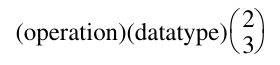

Operation add hoạt động với data type byte, word, long, float và double, đồng thời có phiên bản cho 2 hoặc 3 operand riêng biệt, nên mọi instruction sau đều có trong VAX:

```
addb2    addw2    addl2   addf2    addd2
addb3    addw3    addl3   addf3    addd3
```

Tính mọi addressing mode (nhưng bỏ qua register number và immediate value) và chỉ giới hạn ở byte, word, long, có hơn 30,000 phiên bản integer add trong VAX; MIPS chỉ có 4!

Một lý do khác khiến VAX có nhiều instruction là các instruction thay thế chuỗi instruction hoặc dùng ít byte hơn để biểu diễn một instruction duy nhất. Sau đây là bốn ví dụ như vậy (* nghĩa là data type):

| VAX operation | Example | Meaning |
|---|---|---|
| clr* | clrl r3 | r3 = 0 |
| inc* | incl r3 | r3 = r3 + 1 |
| dec* | decl r3 | r3 = r3 – 1 |
| push* | pushl r3 | sp = sp – 4; Memory[sp] = r3; |

Push instruction ở hàng cuối hoàn toàn giống dùng move instruction với autodecrement addressing trên stack pointer:

```
movl – (sp), r3
```

Sự ngắn gọn là ưu điểm của pushl: nó ngắn hơn 1 byte vì sp được ngầm hiểu.

#### Branch, Jump và Procedure Call

VAX branch instruction liên quan arithmetic instruction vì branch instruction dựa vào condition code. Condition code được đặt như tác dụng phụ của operation, cho biết kết quả dương, âm, zero hay có overflow. Phần lớn instruction đặt VAX condition code theo kết quả; instruction không có kết quả như branch thì không. VAX condition code là N (Negative), Z (Zero), V (oVerflow) và C (Carry). Cũng có compare instruction cmp* chỉ để đặt condition code cho branch tiếp theo.

VAX branch instruction bao gồm mọi điều kiện. Những instruction phổ biến là beql(=), bneq(≠), blss(<), bleq(≤), bgtr(>) và bgeq(≥), làm đúng điều bạn kỳ vọng. Cũng có unconditional branch với tên do kích thước offset PC-relative quyết định. Vì vậy, brb (branch byte) có displacement 8-bit, còn brw (branch word) có displacement 16-bit.

Loại chính cuối cùng được trình bày ở đây là procedure call instruction và return instruction. Khác MIPS architecture, những instruction phức tạp này có thể mất hàng chục clock cycle để thực thi. Hai mục tiếp theo cho thấy cách chúng hoạt động, nhưng trước hết cần giải thích mục đích các pointer gắn với stack được calls và ret thao tác. Stack pointer sp giống stack pointer MIPS, trỏ đến top of stack. Argument pointer ap trỏ đến base của danh sách argument hay parameter trong memory được truyền cho procedure. Frame pointer fp trỏ đến base của các local variable của procedure được giữ trong memory (stack frame). VAX call instruction và return instruction thao tác những pointer này để giữ stack đúng trạng thái qua các procedure call và cung cấp base register thuận tiện khi truy cập memory operand. Như sẽ thấy, call và return còn lưu, khôi phục register general-purpose cũng như program counter. Hình K.59 cung cấp thêm một số ví dụ VAX instruction set.

### Ví dụ kết hợp mọi phần: swap

Để xem lập trình bằng VAX assembly language, chúng ta chuyển hai procedure C là swap và sort. Code C của swap được trình bày lại trong Hình K.60. Mục tiếp theo trình bày sort.

Chúng ta mô tả procedure swap theo ba bước tổng quát của assembly language programming:

1. Cấp phát register cho các program variable.

2. Sinh code cho phần thân procedure.

3. Bảo toàn register qua lần gọi procedure.

VAX code cho những procedure này dựa trên code do VMS C compiler sinh ra khi bật optimization.

#### Cấp phát Register cho swap

Khác MIPS, parameter VAX thường được cấp phát trong memory, nên bước assembly language programming này gọi là “variable allocation” sẽ chính xác hơn. Quy ước tiêu chuẩn VAX về parameter passing là dùng stack. Hai parameter v[] và k có thể được truy cập qua register ap, argument pointer: address 4(ap) tương ứng v[] và 8(ap) tương ứng k. Nhớ rằng với byte addressing, address của các word 4-byte liên tiếp cách nhau 4. Variable duy nhất khác là temp, được gắn với register r3.

#### Code cho phần thân Procedure swap

Những dòng code C còn lại trong swap là

```
temp = v[k];
v[k] = v[k + 1];
v[k + 1] = temp;
```

Vì chương trình dùng v[] và k nhiều lần, để chạy nhanh hơn, VAX compiler trước hết chuyển cả hai parameter vào register:

```
movl        r2, 4(ap)            ;r2 = v[]
movl        r1, 8(ap)            ;r1 = k
```

| Instruction type | Ví dụ | Ý nghĩa instruction |
|---|---|---|
| Data transfers | Di chuyển data giữa operand byte, half-word, word hoặc double-word; * là data type | |
|  | mov* | Di chuyển giữa hai operand |
|  | movzb* | Chuyển byte sang half word hoặc word, mở rộng bằng zero |
|  | mova* | Chuyển address 32-bit của operand; data type nằm cuối |
|  | push* | Push operand lên stack |
| Arithmetic/logical | Operation trên integer byte hoặc logical byte, half word (16 bit), word (32 bit); * là data type | |
|  | add*_ | Add với 2 hoặc 3 operand |
|  | cmp* | So sánh và đặt condition code |
|  | tst* | So sánh với zero và đặt condition code |
|  | ash* | Arithmetic shift |
|  | clr* | Xóa |
|  | cvtb* | Sign-extend byte đến kích thước data type |
| Control | Conditional branch và unconditional branch | |
|  | beql, bneq | Branch khi bằng, branch khi khác |
|  | bleq, bgeq | Branch khi nhỏ hơn hoặc bằng, branch khi lớn hơn hoặc bằng |
|  | brb, brw | Unconditional branch với address 8-bit hoặc 16-bit |
|  | jmp | Jump dùng bất kỳ addressing mode nào để chỉ định target |
|  | aobleq | Cộng một vào operand; branch nếu kết quả ≤ operand thứ hai |
|  | case_ | Jump dựa trên case selector |
| Procedure | Call/return từ procedure | |
|  | calls | Gọi procedure với argument trên stack (xem “Ví dụ dài hơn: sort” ở trang K-76) |
|  | callg | Gọi procedure với parameter list FORTRAN-style |
|  | jsb | Jump đến subroutine, lưu return address (giống jal của MIPS) |
|  | ret | Trả về từ procedure call |
| Floating point | Operation Floating-point trên format D, F, G và H | |
|  | addd_ | Cộng floating number double-precision D-format |
|  | subd_ | Trừ floating number double-precision D-format |
|  | mulf_ | Nhân floating point single-precision F-format |
|  | polyf | Tính đa thức bằng bảng hệ số theo format F |
| Other | Operation đặc biệt | |
|  | crc | Tính cyclic redundancy check |
|  | insque | Chèn queue entry vào queue |

**Hình K.59 Các lớp VAX instruction cùng ví dụ. Dấu sao đại diện nhiều data type: b, w, l, d, f, g, h và q. Dấu gạch dưới như trong addd_ nghĩa là có dạng 2-operand (addd2) và 3-operand (addd3) của instruction này.**

```
swap(int v[], int k)
{
   int temp;
   temp = v[k];
   v[k] = v[k + 1];
   v[k + 1] = temp;
}
```

**Hình K.60 Một procedure C swap hai location trong memory. Procedure này sẽ được dùng trong ví dụ sắp xếp ở mục tiếp theo.**

Lưu ý chúng ta theo quy ước VAX dùng dấu chấm phẩy để bắt đầu comment; ký hiệu comment # của MIPS biểu diễn constant operand trong VAX assembly language.

VAX có indexed addressing nên có thể dùng index k mà không chuyển sang byte address. VAX code khi đó rất trực tiếp:

```
movl       r3, (r2)[r1]          ;r3 (temp) = v[k]
addl3      r0, #1,8(ap)          ;r0 = k + 1
movl       (r2)[r1],(r2)[r0]     ;v[k] = v[r0] (v[k + 1])
movl       (r2)[r0],r3           ;v[k + 1] = r3 (temp)
```

Khác MIPS code về cơ bản gồm hai load và hai store, phần code VAX then chốt là một move memory-to-register, một move memory-to-memory và một move register-to-memory. Lưu ý addl3 cho thấy sự linh hoạt của VAX addressing mode: nó cộng hằng số 1 vào memory operand và đặt kết quả trong register.

Bây giờ chúng ta đã cấp phát storage và viết code thực hiện những operation của procedure. Phần duy nhất còn thiếu là code bảo toàn register qua routine gọi swap.

#### Bảo toàn Register qua lần gọi Procedure swap

VAX có cặp instruction bảo toàn register là calls và ret. Ví dụ này cho thấy cách chúng hoạt động.

VAX C compiler dùng một dạng callee convention. Xem code trên, chúng ta thấy giá trị trong register r0, r1, r2 và r3 phải được lưu để có thể khôi phục sau. Instruction calls kỳ vọng mask 16-bit ở đầu procedure để xác định register nào cần lưu: nếu bit i được đặt trong mask, register i được calls lưu lên stack. Ngoài ra, calls lưu mask này lên stack để return instruction (ret) khôi phục đúng register. Vì vậy, calls do caller thực thi làm việc lưu, nhưng callee đặt call mask để chỉ ra cần lưu gì.

Một operand của calls cho biết số parameter được truyền, để calls điều chỉnh các pointer liên quan stack: argument pointer (ap), frame pointer (fp) và stack pointer (sp). Dĩ nhiên, calls cũng lưu program counter để procedure có thể trả về!

Vì vậy, để bảo toàn bốn register này cho swap, chúng ta chỉ thêm mask ở đầu procedure, để calls trong caller làm mọi việc:

```
.word ^m<r0,r1,r2,r3> ;set bits in mask for 0,1,2,3
```

Directive này yêu cầu assembler đặt một hằng số 16-bit có những bit thích hợp được đặt để lưu register r0 đến r3.

Return instruction đảo ngược công việc của calls. Khi hoàn tất, ret đặt stack pointer từ frame pointer hiện tại để pop mọi thứ calls đã đặt lên stack. Trong quá trình đó, nó khôi phục register value do calls lưu, bao gồm các register được mask đánh dấu và giá trị cũ của fp, ap, pc.

Để hoàn thành procedure swap, chỉ cần thêm một instruction:

```
ret        ;restore registers and return
```

#### Procedure swap đầy đủ

Bây giờ chúng ta đã sẵn sàng cho toàn bộ routine. Hình K.61 xác định mục đích của từng code block trong procedure, với MIPS code bên trái và VAX code bên phải. Ví dụ này cho thấy ưu điểm của scaled indexed addressing cùng call instruction và return instruction tinh vi của VAX trong việc giảm số dòng code. 17 dòng MIPS assembly code trở thành 8 dòng VAX assembly code. Nó cũng cho thấy truyền parameter trong memory tạo thêm memory access.

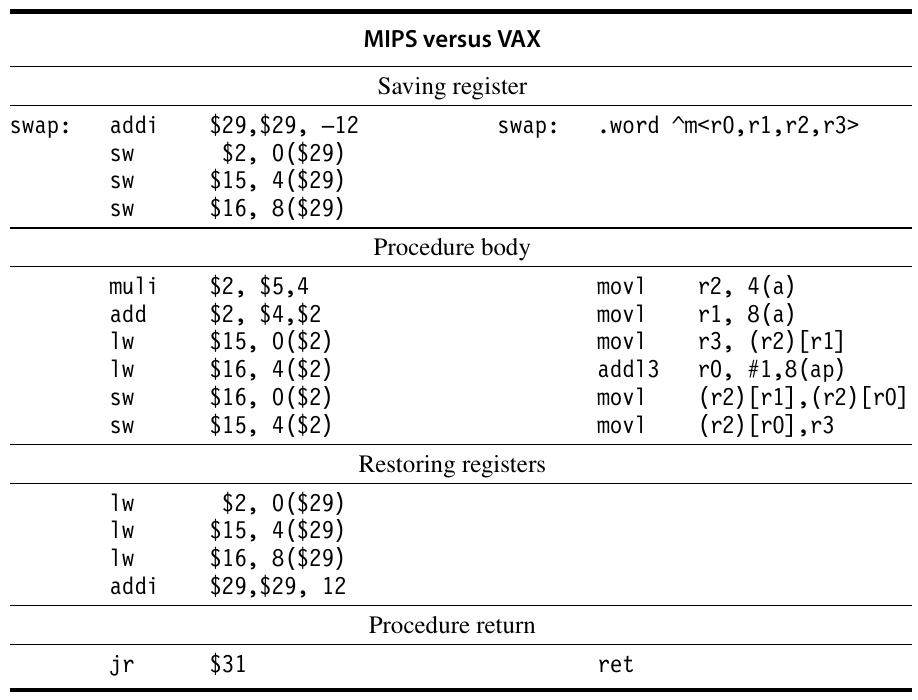

**Hình K.61 MIPS assembly code và VAX assembly code của procedure swap trong Hình K.60 ở trang K-74.**

Nhớ rằng số instruction được thực thi không đồng nghĩa performance; ngộ nhận ở trang K-81 làm rõ điểm này.

Lưu ý VAX software theo quy ước coi r0 và r1 là temporary không được lưu qua procedure call, nên VMS C compiler có đưa r0 và r1 vào register saving mask. Ngoài ra, C compiler nên dùng r1 thay vì 8(ap) trong addl3; những ví dụ như vậy thôi thúc computer architect thử viết compiler!

### Ví dụ dài hơn: sort

Chúng ta trình bày ví dụ dài hơn về procedure sort. Hình K.62 cho phiên bản C của chương trình. Một lần nữa, chúng ta trình bày procedure qua nhiều bước, kết thúc bằng so sánh side-by-side với MIPS code.

#### Cấp phát Register cho sort

Hai parameter của procedure sort là v và n lần lượt nằm trong stack tại location 4(ap) và 8(ap). Hai local variable được gán vào register: i vào r6 và j vào r4. Vì hai parameter được tham chiếu thường xuyên trong code, VMS C compiler sao chép address của chúng vào register khi vào procedure:

```
moval      r7,8(ap)       ;move address of n into r7
moval      r5,4(ap)       ;move address of v into r5
```

Có vẻ chuyển giá trị operand vào register sẽ hữu ích hơn address, nhưng một lần nữa chúng ta tuân theo quyết định của VMS C compiler. Dường như compiler không chắc v và n không chồng lấp trong memory.

```
sort (int v[], int n)
{
    int i, j;
    for (i = 0; i < n; i = i + 1) {
    for (j = i – 1; j >= 0 && v[j] > v[j + 1]; j = j – 1)
      { swap(v,j);
    }
  }
}
```

**Hình K.62 Một procedure C thực hiện bubble sort trên array v.**

#### Code cho phần thân Procedure sort

Phần thân procedure gồm hai for loop lồng nhau và một call đến swap có parameter. Chúng ta hãy mở code từ ngoài vào giữa.

##### Outer Loop

Bước chuyển đổi đầu tiên là for loop thứ nhất:

```
for (i = 0; i < n; i = i + 1) {
```

Nhớ rằng for statement của C có ba phần: initialization, loop test và iteration increment. Chỉ cần một instruction để khởi tạo i bằng 0, phần đầu của for statement:

```
clrl       r6             ;i = 0
```

Cũng chỉ cần một instruction để tăng i, phần cuối của for:

```
incl       r6             ;i = i + 1
```

Cần thoát loop nếu i < n là false, hay nói cách khác, thoát loop nếu i ≥ n. Phép kiểm tra này cần hai instruction:

```
for1tst:    cmpl   r6,(r7) ;compare r6 and memory[r7] (i:n)
            bgeq   exit1  ;go to exit1 if r6 ≥ mem[r7] (i ≥ n)
```

Lưu ý cmpl đặt condition code để conditional branch instruction bgeq sử dụng.

Phần cuối loop chỉ jump trở lại loop test:

```
            brb    for1tst       ;branch to test of outer loop
exit1:
```

Code khung của for loop đầu tiên khi đó là

```
           clrl    r6      ;i = 0
for1tst:   cmpl    r6,(r7) ;compare r6 and memory[r7] (i:n)
           bgeq exit1      ;go to exit1 if r6 ≥ mem[r7] (i ≥ n)
                   .. .
                   (body of first for loop)
                   .. .
           incl    r6      ;i = i + 1
           brb     for1tst ;branch to test of outer loop
exit1:
```

##### Inner Loop

For loop thứ hai là

```
 for (j = i – 1; j >= 0 && v[j] > v[j + 1]; j = j – 1) {
```

Phần initialization của loop này một lần nữa chỉ cần một instruction:

```
subl3      r4,r6,#1    ;j = i – 1
```

Việc giảm j cũng chỉ cần một instruction:

```
decl       r4      ;j = j – 1
```

Loop test có hai phần. Chúng ta thoát loop nếu một trong hai điều kiện không thỏa, nên phép kiểm tra đầu phải thoát loop nếu nó không thỏa (j < 0):

```
for2tst:blss   exit2      ;go to exit2 if r4 < 0 (j < 0)
```

Lưu ý không có phép so sánh tường minh. Việc không cần so sánh là ưu điểm của condition code, với điều kiện được đặt như tác dụng phụ của instruction trước. Branch này bỏ qua phép kiểm tra điều kiện thứ hai.

Phép kiểm tra thứ hai thoát nếu v[j] > v[j + 1] là false, hay nếu v[j] ≤ v[j + 1]. Trước hết, chúng ta load v và đặt j + 1 vào register:

```
movl     r3,(r5)   ;r3 = Memory[r5] (r3 = v)
addl3    r2,r4,#1 ;r2 = r4 + 1 (r2 = j + 1)
```

Register indirect addressing được dùng để lấy operand mà r5 trỏ đến.

Một lần nữa, index addressing mode có nghĩa chúng ta dùng index mà không cần chuyển sang byte address, nên hai instruction cho v[j] ≤ v[j + 1] là

```
cmpl    (r3)[r4],(r3)[r2] ;v[r4] : v[r2] (v[j]:v[j + 1])
bleq     exit2             ;go to exit2 if v[j] ≤ v[j + 1]
```

Phần cuối loop jump trở lại toàn bộ loop test:

```
brb         for2tst       # jump to test of inner loop
```

Kết hợp các phần, for loop thứ hai có dạng:

```
           subl3  r4,r6, #1      ;j = i – 1
for2tst:   blss   exit2          ;go to exit2 if r4 < 0 (j < 0)
           movl   r3,(r5)        ;r3 = Memory[r5] (r3 = v)
           addl3  r2,r4,#1       ;r2 = r4 + 1 (r2 = j + 1)
           cmpl   (r3)[r4],(r3)[r2];v[r4] : v[r2]
           bleq    exit2         ;go to exit2 if v[j] ≤ [j+1]
                  .. .
                  (body of second for loop)
                  .. .
           decl   r4             ;j = j – 1
           brb    for2tst        ;jump to test of inner loop
exit2:
```

*(ghi chú: sách in "v[j] ∂ [j+1]" trong khối trên; đúng là "v[j] ≤ v[j+1]")*

Lưu ý instruction blss (ở đầu loop) kiểm tra condition code dựa trên giá trị mới của r4 (j), được đặt bởi subl3 trước khi vào loop hoặc decl ở cuối loop.

##### Procedure Call

Bước tiếp theo là phần thân for loop thứ hai:

```
swap(v,j);
```

Gọi swap khá dễ dàng:

```
calls       #2,swap
```

Hằng số 2 chỉ số parameter được push lên stack.

##### Truyền Parameter

C compiler truyền variable trên stack, nên chúng ta truyền parameter cho swap bằng hai instruction sau:

```
pushl      (r5)    ;first swap parameter is v
pushl       r4     ;second swap parameter is j
```

Register indirect addressing được dùng để lấy operand của instruction đầu tiên.

#### Bảo toàn Register qua lần gọi Procedure sort

Code còn lại duy nhất là lưu và khôi phục register theo callee save convention. Procedure dùng register r2 đến r7, nên chúng ta thêm mask với các bit đó được đặt:

```
.word ^m<r2,r3,r4,r5,r6,r7>; set mask for registers 2-7
```

Vì ret đảo ngược mọi operation, chúng ta chỉ gắn nó vào cuối procedure.

#### Procedure sort đầy đủ

Bây giờ chúng ta ghép mọi phần trong Hình K.63. Để dễ theo dõi code, một lần nữa chúng ta xác định mục đích của mỗi code block trong procedure và đặt MIPS code với VAX code cạnh nhau. Trong ví dụ này, 11 dòng procedure sort trong C trở thành 44 dòng MIPS assembly language và 20 dòng VAX assembly language. Ưu điểm lớn nhất của VAX nằm ở lưu, khôi phục register và indexed addressing.

### Ngộ nhận và cạm bẫy

> Khả năng đơn giản hóa có nghĩa là loại bỏ điều không cần thiết để điều cần thiết được cất tiếng.

> Hans Hoffman

> Search for the Real (1967)

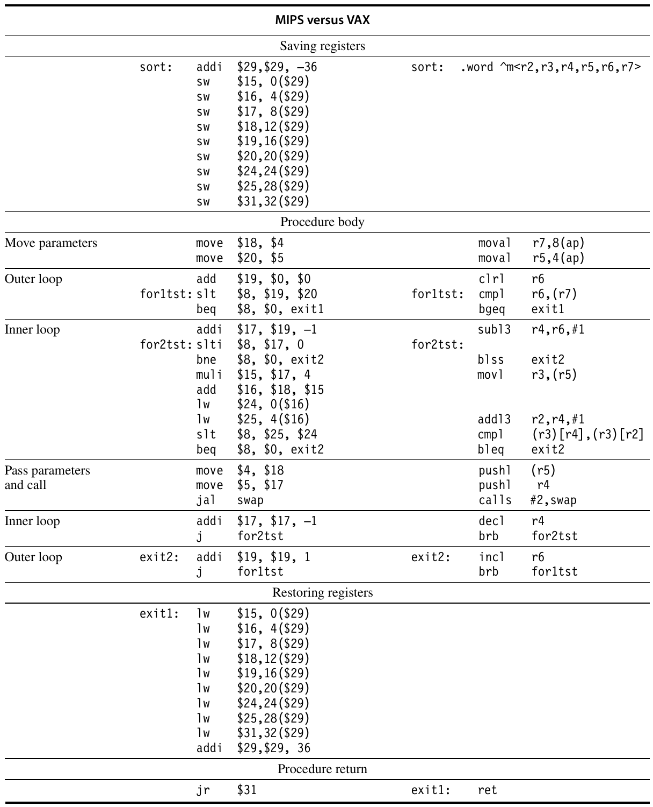

**Hình K.63 Phiên bản assembly MIPS32 và VAX của procedure sort trong Hình K.62 ở trang K-76.**

**Ngộ nhận** Có thể thiết kế một architecture hoàn hảo.

Mọi thiết kế architecture đều có trade-offs trong bối cảnh một tập công nghệ hardware và software. Theo thời gian, những công nghệ đó có thể thay đổi, và quyết định từng đúng có thể trở thành sai lầm về sau. Chẳng hạn, năm 1975, người thiết kế VAX quá nhấn mạnh hiệu quả code size và đánh giá thấp tầm quan trọng của việc dễ decode và pipelining sau đó 10 năm. Gần như mọi architecture cuối cùng cũng bị khuất phục bởi thiếu address space. Tuy nhiên, tránh những vấn đề này về dài hạn có lẽ đồng nghĩa với việc đánh đổi hiệu quả architecture trong ngắn hạn.

**Ngộ nhận** Một architecture có khuyết điểm không thể thành công.

IBM 360 thường bị phê bình trong tài liệu — branch không PC-relative và address quá nhỏ trong displacement addressing. Tuy nhiên, máy cực kỳ thành công vì xử lý đúng một số vấn đề mới. Thứ nhất, architecture có address space lớn. Thứ hai, nó được định địa chỉ theo byte và xử lý byte tốt. Thứ ba, nó là register machine general-purpose. Cuối cùng, nó đủ đơn giản để triển khai hiệu quả trên một phạm vi performance và chi phí rộng.

Intel 8086 là ví dụ còn rõ nét hơn. 8086 architecture là architecture phổ biến duy nhất hiện tồn tại không thực sự là register machine general-purpose. Hơn nữa, segmented address space của 8086 gây vấn đề lớn cho cả người lập trình lẫn người viết compiler. Tuy vậy, vì được chọn làm microprocessor trong IBM PC, 8086 architecture đã cực kỳ thành công.

**Ngộ nhận** Architecture thực thi ít instruction hơn thì nhanh hơn.

Người thiết kế máy VAX thực hiện so sánh định lượng VAX và MIPS với các implementation có tổ chức tương đương: VAX 8700 và MIPS M2000. Hình K.64 cho thấy tỉ lệ số instruction thực thi và tỉ lệ performance đo bằng clock cycle. MIPS thực thi số instruction gấp khoảng hai lần VAX, trong khi MIPS M2000 có performance gần gấp ba VAX 8700.

### Nhận xét kết luận

> Virtual Address eXtension của PDP-11 architecture . . . cung cấp virtual address khoảng 4.3 gigabyte, mà ngay cả với sự cải tiến nhanh chóng của memory technology, cũng sẽ đủ dùng rất lâu trong tương lai.

> William Strecker

> “VAX-11/780—A Virtual Address Extension to the PDP-11

> Family,” AFIPS Proc., National Computer Conference (1978)

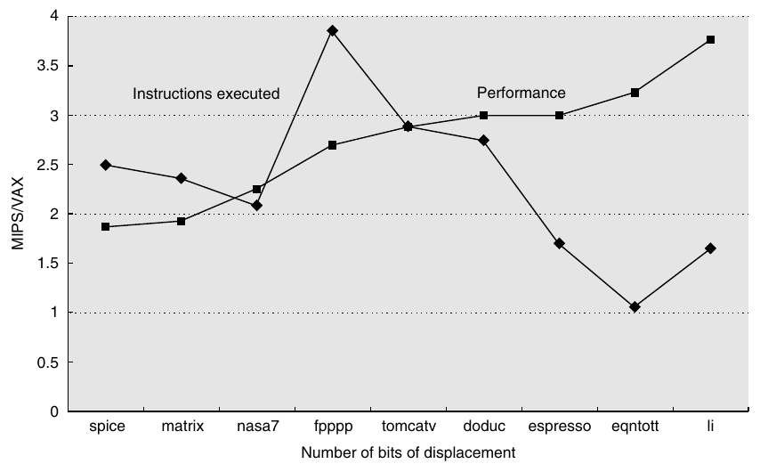

**Hình K.64 Tỉ lệ MIPS M2000 so với VAX 8700 về instruction thực thi và performance tính bằng clock cycle trên các chương trình SPEC89. Trung bình, MIPS thực thi nhiều hơn một chút so với gấp đôi instruction của VAX, nhưng CPI của VAX gần gấp sáu CPI của MIPS, tạo lợi thế performance gần gấp ba. (Dựa trên data từ “Performance from Architecture: Comparing a RISC and CISC with Similar Hardware Organization,” của D. Bhandarkar và D. Clark, trong Proc. Symp. Architectural Support for Programming Languages and Operating Systems IV, 1991.)**

| Chương trình | Máy | Branch | Arithmetic/logical | Data transfer | Floating point | Tổng |
|---|---|---|---|---|---|---|
| gcc | VAX | 30% | 40% | 19% |  | 89% |
|  | MIPS | 24% | 35% | 27% |  | 86% |
| spice | VAX | 18% | 23% | 15% | 23% | 79% |
|  | MIPS | 04% | 29% | 35% | 15% | 83% |

**Hình K.65 Tần suất phân bố instruction cho hai chương trình trên VAX và MIPS.**

Chúng ta đã thấy instruction set có thể khác nhau rất nhiều, cả về cách truy cập operand lẫn operation mà một instruction duy nhất có thể thực hiện. Hình K.65 so sánh instruction usage của cả hai architecture cho hai chương trình; ngay cả architecture rất khác nhau cũng hành xử tương tự về việc sử dụng các instruction class.

Là sản phẩm của thời đại mình, sự nhấn mạnh của VAX vào code density, operation phức tạp và addressing mode phức tạp xung đột với trọng tâm hiện nay là dễ decode, operation và addressing mode đơn giản, cùng pipelined performance.

Với hơn 600,000 máy được bán, VAX architecture đã có một chặng đường rất thành công. Năm 1991, DEC chuyển từ VAX sang Alpha.

Orthogonality là yếu tố then chốt của VAX architecture; opcode độc lập với addressing mode, còn addressing mode độc lập với data type và thậm chí cả số operand riêng biệt. Vì vậy, vài trăm operation mở rộng thành hàng trăm nghìn instruction khi tính data type, operand count và addressing mode.

### Bài tập

**K.1** [3] <K.4> VAX instruction sau giảm giá trị tại location mà register r5 trỏ đến:

```
decl (r5)
```

MIPS instruction duy nhất nào, hoặc nếu không thể biểu diễn bằng một instruction thì chuỗi MIPS instruction ngắn nhất nào, thực hiện cùng operation? Instruction trên mỗi máy dài bao nhiêu?

**K.2** [5] <K.4> Bài tập này giống Bài tập K.1, ngoại trừ VAX instruction sau xóa một location bằng autoincrement deferred addressing:

```
clrl @(r5)+
```

**K.3** [5] <K.4> Bài tập này giống Bài tập K.1, ngoại trừ VAX instruction sau cộng 1 vào register r5, đặt tổng trở lại r5, so sánh tổng với register r6 rồi branch đến L1 nếu r5 < r6:

```
aoblss r6, r5, L1 # r5 = r5 + 1; if (r5 < r6) goto L1.
```

**K.4** [5] <K.4> Hãy trình bày VAX instruction duy nhất hoặc chuỗi instruction tối thiểu cho câu lệnh C sau:

```
a = b + 100;
```

Giả sử a tương ứng register r3 và b tương ứng register r4.

**K.5** [10] <K.4> Hãy trình bày VAX instruction duy nhất hoặc chuỗi instruction tối thiểu cho câu lệnh C sau:

```
x[i + 1] = x[i] + c;
```

Giả sử c tương ứng register r3, i tương ứng register r4 và x là array các word 32-bit bắt đầu tại memory location 4,000,000<sub>ten</sub>.

## K.5 IBM 360/370 Architecture cho máy tính Mainframe

### Giới thiệu

Thuật ngữ “computer architecture” được IBM đặt ra năm 1964 để dùng với IBM 360. Amdahl, Blaauw và Brooks [1964] dùng thuật ngữ này chỉ phần programmer-visible của instruction set. Họ tin một họ máy cùng architecture phải có thể chạy cùng software. Mặc dù ý tưởng này ngày nay có vẻ hiển nhiên, khi đó nó khá mới lạ. IBM dù là công ty dẫn đầu ngành vẫn có năm architecture khác nhau trước 360. Vì vậy, ý tưởng một công ty tiêu chuẩn hóa trên một architecture duy nhất mang tính cách mạng. Người thiết kế 360 hy vọng kết hợp sáu bộ phận khác nhau của IBM bằng cách định nghĩa architecture chung. Định nghĩa architecture của họ là

. . . cấu trúc của máy tính mà người lập trình machine language phải hiểu để viết một chương trình đúng (không phụ thuộc timing) cho máy đó.

Thuật ngữ “machine language programmer” có nghĩa là tính tương thích được duy trì ngay cả trong assembly language, còn “timing independent” cho phép những implementation khác nhau.

IBM 360 được giới thiệu năm 1964 với sáu model và tỉ lệ performance 25:1. Amdahl, Blaauw và Brooks [1964] thảo luận IBM 360 architecture và khái niệm cho phép nhiều implementation object-code-compatible. Khái niệm instruction set architecture như chúng ta hiểu ngày nay là khía cạnh quan trọng nhất của 360. Architecture cũng đưa ra một số đổi mới quan trọng, hiện được dùng rộng rãi:

1. Architecture 32-bit

2. Memory Byte-addressable với byte 8-bit

3. Data size 8-, 16-, 32- và 64-bit

4. Data floating-point single-precision 32-bit và double-precision 64-bit

Năm 1971, IBM cung cấp System/370 đầu tiên (model 155 và 165), có nhiều extension đáng kể của 360, như Case và Padegs [1978] thảo luận; họ cũng trình bày lịch sử ban đầu của System/360. Bổ sung quan trọng nhất là virtual memory, dù các máy 370 có virtual memory chỉ được cung cấp năm 1972 khi virtual memory operating system đã sẵn sàng. Đến năm 1978, 370 high-end nhanh hơn hàng trăm lần các máy 360 low-end được cung cấp trước đó 10 năm. Năm 1984, addressing model 24-bit tích hợp trong IBM 360 cần được từ bỏ, và 370-XA (eXtended Architecture) được giới thiệu. Mặc dù chương trình 24-bit cũ có thể được hỗ trợ mà không thay đổi, một số instruction không thể hoạt động giống trước khi mở rộng sang addressing model 32-bit (hỗ trợ address 31-bit), vì chúng không tạo ra address 31-bit. Chuyển đổi operating system, phần lớn viết bằng assembly language, chắc chắn là công việc lớn nhất.

Đã có nhiều nghiên cứu về IBM 360 và instruction measurement. Luận án Shustek [1978] là nghiên cứu được biết đến nhiều nhất và đầy đủ nhất về 360/370 architecture. Ông đưa ra nhiều nhận xét về instruction set complexity mà phải vài năm sau mới được đánh giá đầy đủ. Một nghiên cứu quan trọng khác về 360 là nghiên cứu Toronto của Alexander và Wortman [1975], thực hiện trên IBM 360 bằng 19 chương trình XPL.

### Instruction Set của System/360

Instruction set 360 được trình bày trong các bảng sau, được tổ chức theo instruction type và format. System/370 có thêm 15 user instruction.

#### Instruction R-R Integer/Logical và Floating-Point

Dấu * chỉ instruction floating point và có thể là D (double precision) hoặc E (single precision).

| Instruction | Mô tả |
|---|---|
| ALR | Cộng logical register |
| AR | Cộng register |
| A*R | Phép cộng FP |
| CLR | So sánh logical register |
| CR | So sánh register |
| C*R | So sánh FP |
| DR | Chia register |
| D*R | Phép chia FP |
| H*R | Chia đôi FP |
| LCR | Load complement của register |
| LC*R | Load complement |
| LNR | Load giá trị âm của register |
| LN*R | Load giá trị âm |
| LPR | Load giá trị dương của register |
| LP*R | Load giá trị dương |
| LR | Load register |
| L*R | Load FP register |
| LTR | Load và kiểm tra register |
| LT*R | Load và kiểm tra FP register |
| MR | Nhân register |
| M*R | Phép nhân FP |
| NR | AND register |
| OR | OR register |
| SLR | Trừ logical register |
| SR | Trừ register |
| S*R | Phép trừ FP |
| XR | Exclusive OR register |

#### Instruction R-R Branch và đặt Status

Đây là những instruction format R-R thực hiện branch hoặc đặt một system status nào đó; một số là privileged và chỉ hợp lệ trong supervisor mode.

| Instruction | Mô tả |
|---|---|
| BALR | Branch và link |
| BCTR | Branch theo count |
| BCR | Branch/condition |
| ISK | Chèn key |
| SPM | Đặt program mask |
| SSK | Đặt storage key |
| SVC | Supervisor call |

#### Instruction Branch/Logical và Floating-Point — Format RX

Đây đều là instruction format RX. Ký hiệu “+” nghĩa là operation trên word (khi đó không đại diện ký tự nào) hoặc H (nghĩa là half word); chẳng hạn A+ đại diện hai opcode A và AH. “*” đại diện D hoặc E, chỉ floating point double- hoặc single-precision.

| Instruction | Mô tả |
|---|---|
| A+ | Cộng |
| A* | Phép cộng FP |
| AL | Cộng logical |
| C+ | So sánh |
| C* | So sánh FP |
| CL | So sánh logical |
| D | Chia |
| D* | Phép chia FP |
| L+ | Load |
| L* | Load FP register |
| M+ | Nhân |
| M* | Phép nhân FP |
| N | AND |
| O | OR |
| S+ | Trừ |
| S* | Phép trừ FP |
| SL | Trừ logical |
| ST+ | Store |
| ST* | Store FP register |
| X | Exclusive OR |

#### Branch cùng Load và Store đặc biệt — Format RX

| Instruction | Mô tả |
|---|---|
| BAL | Branch và link |
| BC | Branch theo condition |
| BCT | Branch theo count |
| CVB | Convert-binary |
| CVD | Convert-decimal |
| EX | Thực thi |
| IC | Chèn character |
| LA | Load address |
| STC | Store character |

#### Instruction format RS và SI

Đây là các instruction format RS và SI. Ký hiệu “*” có thể là A (arithmetic) hoặc L (logical).

| Instruction | Mô tả |
|---|---|
| BXH | Branch/high |
| BXLE | Branch/low-equal |
| CLI | So sánh logical immediate |
| HIO | Dừng I/O |
| LPSW | Load PSW |
| LM | Load multiple |
| MVI | Move immediate |
| NI | And immediate |
| OI | Or immediate |
| RDD | Đọc trực tiếp |
| SIO | Khởi động I/O |
| SL* | Shift trái A/L |
| SLD* | Shift trái double A/L |
| SR* | Shift phải A/L |
| SRD* | Shift phải double A/L |
| SSM | Đặt system mask |
| STM | Store multiple |
| TCH | Kiểm tra channel |
| TIO | Kiểm tra I/O |
| TM | Kiểm tra theo mask |
| TS | Test-and-set |
| WRD | Ghi trực tiếp |
| XI | Exclusive OR immediate |

#### Instruction format SS

Đây là những instruction add decimal hoặc string.

| Instruction | Mô tả |
|---|---|
| AP | Cộng packed |
| CLC | So sánh logical character |
| CP | So sánh packed |
| DP | Chia packed |
| ED | Chỉnh sửa |
| EDMK | Chỉnh sửa và đánh dấu |
| MP | Nhân packed |
| MVC | Di chuyển character |
| MVN | Di chuyển numeric |
| MVO | Move với offset |
| MVZ | Di chuyển zone |
| NC | AND character |
| OC | OR character |
| PACK | Pack (Character → decimal) |
| SP | Trừ packed |
| TR | Chuyển đổi |
| TRT | Translate và kiểm tra |
| UNPK | Unpack |
| XC | Exclusive OR character |
| ZAP | Zero và add packed |

### Các phép đo chi tiết của 360

Hình K.66 cho thấy tần suất sử dụng instruction của bốn chương trình IBM 360.

| Instruction | PLIC | FORTGO | PLIGO | COBOLGO | Trung bình |
|---|---|---|---|---|---|
| Control | 32% | 13% | 5% | 16% | 16% |
| BC, BCR | 28% | 13% | 5% | 14% | 15% |
| BAL, BALR | 3% |  |  | 2% | 1% |
| Arithmetic/logical | 29% | 35% | 29% | 9% | 26% |
| A, AR | 3% | 17% | 21% |  | 10% |
| SR | 3% | 7% |  |  | 3% |
| SLL |  | 6% | 3% |  | 2% |
| LA | 8% | 1% | 1% |  | 2% |
| CLI | 7% |  |  |  | 2% |
| NI |  |  |  | 7% | 2% |
| C | 5% | 4% | 4% | 0% | 3% |
| TM | 3% | 1% |  | 3% | 2% |
| MH |  |  | 2% |  | 1% |
| Data transfer | 17% | 40% | 56% | 20% | 33% |
| L, LR | 7% | 23% | 28% | 19% | 19% |
| MVI | 2% |  | 16% | 1% | 5% |
| ST | 3% |  | 7% |  | 3% |
| LD |  | 7% | 2% |  | 2% |
| STD |  | 7% | 2% |  | 2% |
| LPDR |  | 3% |  |  | 1% |
| LH | 3% |  |  |  | 1% |
| IC | 2% |  |  |  | 1% |
| LTR |  | 1% |  |  | 0% |
| Floating point |  | 7% |  |  | 2% |
| AD |  | 3% |  |  | 1% |
| MDR |  | 3% |  |  | 1% |
| Decimal, string | 4% |  |  | 40% | 11% |
| MVC | 4% |  |  | 7% | 3% |
| AP |  |  |  | 11% | 3% |
| ZAP |  |  |  | 9% | 2% |
| CVD |  |  |  | 5% | 1% |
| MP |  |  |  | 3% | 1% |
| CLC |  |  |  | 3% | 1% |
| CP |  |  |  | 2% | 1% |
| ED |  |  |  | 1% | 0% |
| Tổng | 82% | 95% | 90% | 85% | 88% |

**Hình K.66 Phân bố tần suất thực thi instruction của bốn chương trình 360. Mọi instruction có tần suất thực thi lớn hơn 1.5% đều được đưa vào. Immediate instruction chỉ hoạt động trên một byte duy nhất được đặt trong phần mô tả operation tương ứng, thay vì cùng phiên bản character-string dài của cùng operation. Để so sánh, tần suất trung bình của các instruction class chính trên VAX là 23% (control), 28% (arithmetic), 29% (data transfer), 7% (floating point) và 9% (decimal). Một lần nữa, mục 1% trong cột trung bình có thể xuất hiện do những giá trị trong các cột thành phần. Những chương trình này gồm compiler cho programming language PL-I và runtime system cho các ngôn ngữ lập trình FORTRAN, PL/I và Cobol.**

## K.6 Góc nhìn lịch sử và tài liệu tham khảo

Mục L.4 (có trực tuyến) thảo luận sự phát triển của instruction set và cung cấp tài liệu tham khảo để đọc thêm cũng như khám phá các chủ đề liên quan.
