# 1 Nền tảng thiết kế và phân tích định lượng

> Tôi nghĩ có thể nói một cách công bằng rằng personal computer đã trở thành công cụ mang lại nhiều khả năng nhất mà chúng ta từng tạo ra. Chúng là công cụ giao tiếp, công cụ sáng tạo, và người dùng có thể định hình chúng theo ý mình.

> Bill Gates, ngày 24 tháng Hai năm 2004

## 1.1 Giới thiệu

Công nghệ máy tính đã tiến bộ đáng kinh ngạc trong khoảng 65 năm kể từ khi máy tính điện tử general-purpose đầu tiên được tạo ra. Ngày nay, chưa đến $500 đã mua được một mobile computer có hiệu năng cao hơn, nhiều main memory hơn và nhiều disk storage hơn máy tính mua năm 1985 với giá $1 triệu. Sự cải thiện nhanh chóng này đến từ cả tiến bộ công nghệ chế tạo máy tính lẫn đổi mới thiết kế máy tính.

Mặc dù cải tiến công nghệ diễn ra khá đều đặn, tiến bộ nhờ computer architecture tốt hơn lại kém nhất quán hơn nhiều. Trong 25 năm đầu của máy tính điện tử, cả hai động lực đều đóng góp lớn, đem lại mức tăng hiệu năng khoảng 25% mỗi năm. Cuối thập niên 1970 chứng kiến sự xuất hiện của microprocessor. Khả năng tận dụng cải tiến công nghệ integrated circuit của microprocessor dẫn đến tốc độ cải thiện hiệu năng cao hơn — khoảng 35% mỗi năm.

Tốc độ tăng trưởng này, kết hợp với lợi thế chi phí của microprocessor mass-produced, khiến phần ngày càng lớn trong ngành kinh doanh máy tính dựa trên microprocessor. Ngoài ra, hai thay đổi đáng kể trên thị trường máy tính khiến việc đạt thành công thương mại với architecture mới dễ hơn bao giờ hết. Thứ nhất, việc gần như loại bỏ lập trình assembly language giảm nhu cầu tương thích object-code. Thứ hai, sự ra đời của operating system chuẩn hóa, vendor-independent như UNIX và bản sao Linux làm giảm chi phí, rủi ro khi đưa ra architecture mới.

Những thay đổi này cho phép phát triển thành công một nhóm architecture mới với instruction đơn giản hơn, gọi là RISC (Reduced Instruction Set Computer), vào đầu thập niên 1980. Máy RISC-based hướng sự chú ý của người thiết kế tới hai kỹ thuật performance then chốt: khai thác instruction-level parallelism (ban đầu qua pipelining, sau qua multiple instruction issue) và dùng cache (ban đầu ở dạng đơn giản, sau với cách tổ chức và tối ưu tinh vi hơn).

Máy tính RISC-based nâng chuẩn performance, buộc các architecture trước phải theo kịp hoặc biến mất. Vax của Digital Equipment không theo kịp nên được thay bằng RISC architecture. Intel đáp ứng thách thức, chủ yếu bằng cách dịch instruction 80x86 thành instruction RISC-like bên trong, cho phép áp dụng nhiều đổi mới đầu tiên được tiên phong trong thiết kế RISC. Khi số transistor tăng vọt cuối thập niên 1990, hardware overhead của việc dịch architecture x86 phức tạp hơn trở nên không đáng kể. Trong ứng dụng low-end như điện thoại di động, chi phí power và diện tích silicon của overhead x86-translation góp phần khiến RISC architecture ARM trở nên thống trị.

Hình 1.1 cho thấy sự kết hợp cải tiến architecture và organization dẫn tới 17 năm tăng trưởng performance liên tục với tốc độ hằng năm trên 50%—mức chưa từng có trong ngành máy tính.

Tốc độ tăng trưởng vượt bậc trong thế kỷ 20 có bốn tác động. Thứ nhất, nó nâng cao đáng kể năng lực sẵn có cho người dùng máy tính. Với nhiều ứng dụng, microprocessor highest-performance ngày nay vượt performance của supercomputer chưa đầy 10 năm trước.

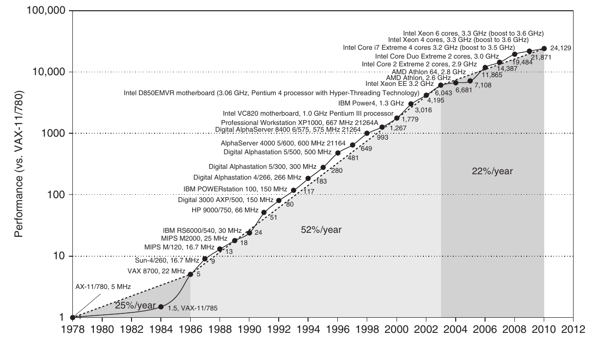

**Hình 1.1 Tăng trưởng processor performance từ cuối thập niên 1970. Biểu đồ thể hiện performance tương đối so với VAX 11/780, đo bằng SPEC benchmark (xem Mục 1.8). Trước mid-1980s, tăng trưởng processor performance chủ yếu do công nghệ, trung bình khoảng 25% mỗi năm. Tốc độ tăng lên khoảng 52% kể từ đó là nhờ ý tưởng architecture và organization tiên tiến hơn. Đến 2003, mức tăng này dẫn tới chênh lệch performance khoảng 25 lần so với nếu tiếp tục tăng ở mức 25%. Performance cho phép tính floating-point-oriented còn tăng nhanh hơn. Từ 2003, giới hạn power và instruction-level parallelism sẵn có làm chậm tăng trưởng uniprocessor performance xuống không quá 22% mỗi năm, tức chậm hơn khoảng 5 lần so với nếu tiếp tục tăng 52% mỗi năm. (Kết quả SPEC performance nhanh nhất từ 2007 đã bật automatic parallelization, với số core mỗi chip tăng hằng năm, nên khó đánh giá tốc độ uniprocessor hơn. Những kết quả này được giới hạn ở hệ thống single-socket để giảm ảnh hưởng automatic parallelization.) Hình 1.11 trang 24 cho thấy cải thiện clock rate trong cùng ba thời kỳ. Vì SPEC thay đổi qua các năm, performance máy mới được ước lượng bằng scaling factor liên hệ performance của hai phiên bản SPEC khác nhau (ví dụ SPEC89, SPEC92, SPEC95, SPEC2000 và SPEC2006).**

Thứ hai, cải thiện mạnh mẽ cost-performance dẫn tới những lớp máy tính mới. Personal computer và workstation xuất hiện trong thập niên 1980 nhờ microprocessor trở nên sẵn có. Thập kỷ vừa qua chứng kiến sự phát triển của điện thoại thông minh và tablet computer, được nhiều người dùng làm computing platform chính thay PC. Các mobile client device này ngày càng dùng Internet truy cập warehouse chứa hàng chục nghìn server, được thiết kế như thể là một máy tính khổng lồ duy nhất.

Thứ ba, cải thiện liên tục trong chế tạo semiconductor theo dự đoán của định luật Moore dẫn tới sự thống trị của máy tính microprocessor-based trên toàn bộ phạm vi thiết kế máy tính. Minicomputer, trước đây thường chế tạo từ logic off-the-shelf hoặc gate array, được thay bằng server dùng microprocessor. Ngay cả mainframe computer và supercomputer high-performance cũng đều là tập hợp microprocessor.

Những đổi mới hardware trên dẫn tới thời kỳ phục hưng thiết kế máy tính, nhấn mạnh cả đổi mới architecture lẫn sử dụng hiệu quả tiến bộ công nghệ. Tốc độ tăng trưởng này tích lũy khiến đến 2003, microprocessor high-performance nhanh gấp 7.5 lần mức có thể đạt nếu chỉ dựa vào công nghệ, gồm cải thiện thiết kế circuit; tức tăng 52% mỗi năm so với 35% mỗi năm.

Thời kỳ phục hưng hardware này dẫn tới tác động thứ tư, lên phát triển software. Mức cải thiện performance 25,000-fold từ 1978 (xem Hình 1.1) cho phép lập trình viên ngày nay đánh đổi performance lấy năng suất. Thay cho ngôn ngữ performance-oriented như C và C++, ngày nay người ta lập trình nhiều hơn bằng managed programming language như Java và C#. Hơn nữa, scripting language như Python và Ruby, còn giúp tăng năng suất hơn, ngày càng phổ biến cùng programming framework như Ruby on Rails. Để duy trì năng suất và cố thu hẹp khoảng cách performance, interpreter có compiler just-in-time và compiling trace-based đang thay thế compiler, linker truyền thống trước đây. Software deployment cũng thay đổi: Software as a Service (SaaS) sử dụng qua Internet thay cho software shrink-wrapped phải cài đặt và chạy trên máy tính cục bộ.

Bản chất ứng dụng cũng thay đổi. Giọng nói, âm thanh, hình ảnh và video ngày càng quan trọng, cùng response time dự đoán được vốn thiết yếu cho trải nghiệm người dùng. Ví dụ truyền cảm hứng là Google Goggles. Ứng dụng cho phép bạn giơ điện thoại, hướng camera vào vật thể; hình ảnh được gửi không dây qua Internet tới máy tính warehouse-scale, nơi nhận dạng vật thể và cung cấp thông tin thú vị về nó. Ứng dụng có thể dịch chữ trên vật thể sang ngôn ngữ khác; đọc mã vạch trên bìa sách để cho biết sách có bán trực tuyến không và giá bao nhiêu; hoặc nếu lia camera điện thoại, cho biết doanh nghiệp nào ở gần cùng website, số điện thoại và chỉ đường.

Đáng tiếc, Hình 1.1 cũng cho thấy thời kỳ phục hưng hardware 17-year đã kết thúc. Từ 2003, mức cải thiện performance single-processor giảm xuống dưới 22% mỗi năm vì hai rào cản: giới hạn power dissipation tối đa của chip air-cooled và thiếu thêm instruction-level parallelism có thể khai thác hiệu quả. Thực vậy, năm 2004 Intel hủy các dự án uniprocessor high-performance và cùng những hãng khác tuyên bố con đường tới performance cao hơn là nhiều processor trên mỗi chip thay vì uniprocessor nhanh hơn.

Cột mốc này đánh dấu chuyển dịch lịch sử từ chỉ dựa vào instruction-level parallelism (ILP), trọng tâm chính của ba ấn bản đầu, sang data-level parallelism (DLP) và thread-level parallelism (TLP), được trình bày nổi bật ở ấn bản thứ tư và mở rộng trong ấn bản này. Ấn bản này cũng bổ sung máy tính warehouse-scale và request-level parallelism (RLP). Trong khi compiler và hardware phối hợp khai thác ILP ngầm, không cần lập trình viên chú ý, DLP, TLP và RLP là parallelism tường minh, đòi hỏi tái cấu trúc ứng dụng để khai thác explicit parallelism. Ở một số trường hợp điều này dễ; ở nhiều trường hợp, đó là gánh nặng mới lớn đối với lập trình viên.

Cuốn sách này trình bày các ý tưởng architecture và cải tiến compiler đi kèm đã tạo tốc độ tăng trưởng đáng kinh ngạc trong thế kỷ trước, lý do của thay đổi mạnh mẽ, cùng các thách thức và phương pháp ban đầu đầy hứa hẹn đối với ý tưởng architecture, compiler và interpreter cho thế kỷ 21. Cốt lõi là phương pháp định lượng để thiết kế, phân tích máy tính, sử dụng quan sát thực nghiệm chương trình, thí nghiệm và simulation làm công cụ. Chính phong cách, phương pháp thiết kế máy tính này được thể hiện trong sách. Mục đích chương này là đặt nền tảng định lượng cho các chương và phụ lục tiếp theo.

Cuốn sách không chỉ được viết để giải thích phong cách thiết kế này mà còn khuyến khích bạn đóng góp vào sự tiến bộ đó. Chúng tôi tin phương pháp này sẽ hiệu quả với máy tính parallel tường minh trong tương lai, cũng như đã hiệu quả với máy tính parallel ngầm trong quá khứ.

## 1.2 Các lớp máy tính

Những thay đổi này tạo tiền đề cho chuyển biến mạnh mẽ trong cách nhìn computing, ứng dụng computing và thị trường máy tính trong thế kỷ mới. Kể từ khi personal computer ra đời, chưa bao giờ chúng ta thấy thay đổi lớn như vậy về hình thức máy tính và cách sử dụng. Thay đổi trong sử dụng máy tính dẫn tới năm thị trường computing khác nhau, mỗi thị trường có ứng dụng, yêu cầu và công nghệ computing riêng. Hình 1.2 tổng hợp những lớp computing environment chủ đạo này và đặc tính quan trọng của chúng.

| Đặc điểm | Personal mobile device (PMD) | Desktop | Server | Cluster/máy warehouse-scale | Embedded |
|---|---|---|---|---|---|
| Giá hệ thống | \$100–\$1000 | \$300–\$2500 | \$5000–\$10,000,000 | \$100,000–\$200,000,000 | \$10–\$100,000 |
| Giá microprocessor | \$10–\$100 | \$50–\$500 | \$200–\$2000 | \$50–\$250 | \$0.01–\$100 |
| Vấn đề thiết kế hệ thống thiết yếu | Chi phí, năng lượng, hiệu năng media, khả năng phản hồi | Price-performance, năng lượng, hiệu năng đồ họa | Throughput, availability, scalability, năng lượng | Price-performance, throughput, energy proportionality | Giá, năng lượng, hiệu năng application-specific |

**Hình 1.2 Tổng hợp năm lớp computing chủ đạo cùng đặc tính hệ thống. Doanh số năm 2010 gồm khoảng 1.8 tỷ PMD (90% là điện thoại di động), 350 triệu desktop PC và 20 triệu server. Tổng số embedded processor bán ra gần 19 tỷ. Tổng cộng, 6.1 tỷ chip dựa trên ARM-technology được xuất xưởng năm 2010. Lưu ý khoảng giá hệ thống rất rộng của server và embedded system, trải từ USB key tới network router. Với server, khoảng rộng này do nhu cầu hệ thống multiprocessor very large-scale cho transaction processing high-end.**

### Personal Mobile Device (PMD)

Personal mobile device (PMD) là thuật ngữ chúng ta dùng cho một nhóm thiết bị không dây có multimedia user interface như điện thoại di động, tablet computer, v.v. Cost là mối quan tâm hàng đầu vì giá bán lẻ toàn sản phẩm chỉ vài trăm đô la. Dù việc chú trọng energy efficiency thường do dùng pin, nhu cầu sử dụng packaging ít đắt hơn—nhựa thay gốm—và không có fan làm mát cũng giới hạn tổng power consumption. Mục 1.5 sẽ xem chi tiết hơn vấn đề energy và power. Ứng dụng PMD thường Web-based và media-oriented, như ví dụ Google Goggles ở trên. Yêu cầu energy và kích thước dẫn tới dùng Flash memory lưu trữ (Chương 2) thay magnetic disk.

Responsiveness và predictability là đặc tính then chốt của media application. Yêu cầu performance real-time nghĩa là một đoạn ứng dụng có execution time tối đa tuyệt đối. Chẳng hạn khi phát video trên PMD, thời gian xử lý mỗi video frame bị giới hạn vì processor phải sớm nhận và xử lý frame tiếp theo. Một số ứng dụng có yêu cầu tinh tế hơn: cả thời gian trung bình của task cụ thể lẫn số lần vượt thời gian tối đa nào đó đều bị ràng buộc. Những cách này—đôi khi gọi soft real-time—xuất hiện khi có thể thỉnh thoảng lỡ time constraint của một sự kiện, miễn không lỡ quá nhiều. Performance Real-time thường phụ thuộc mạnh vào ứng dụng.

Các đặc tính then chốt khác trong nhiều ứng dụng PMD là nhu cầu giảm thiểu memory và dùng energy hiệu quả. Energy efficiency được thúc đẩy bởi cả nguồn pin lẫn heat dissipation. Memory có thể chiếm phần đáng kể system cost, và trong trường hợp đó, tối ưu memory size là quan trọng. Tầm quan trọng của memory size chuyển thành chú trọng code size, vì data size do ứng dụng quyết định.

### Desktop Computing

Thị trường đầu tiên, có lẽ vẫn lớn nhất xét bằng giá trị đô la, là desktop computing. Desktop computing trải từ netbook low-end giá dưới $300 tới workstation high-end cấu hình mạnh giá có thể tới $2500. Từ 2008, hơn nửa desktop computer chế tạo hằng năm là laptop computer chạy bằng pin.

Trong toàn dải giá và năng lực này, thị trường desktop thường hướng tới tối ưu price-performance. Sự kết hợp giữa performance (chủ yếu đo bằng compute performance và graphics performance) với giá hệ thống là điều quan trọng nhất đối với khách hàng thị trường này, và do đó với người thiết kế máy tính. Kết quả là microprocessor mới nhất, highest-performance và microprocessor cost-reduced thường xuất hiện đầu tiên trong desktop system (xem Mục 1.6 về vấn đề ảnh hưởng cost máy tính).

Desktop computing cũng thường được mô tả khá rõ xét theo ứng dụng và benchmarking, dù ngày càng nhiều ứng dụng tương tác Web-centric đặt ra thách thức mới khi đánh giá performance.

### Servers

Khi chuyển dịch sang desktop computing diễn ra trong thập niên 1980, vai trò server phát triển để cung cấp file service và computing service larger-scale, đáng tin cậy hơn. Những server này trở thành xương sống của enterprise computing large-scale, thay thế mainframe truyền thống.

Với server, những đặc tính khác trở nên quan trọng. Thứ nhất, availability là thiết yếu. (Chúng ta bàn availability ở Mục 1.7.) Hãy xét server vận hành ATM ngân hàng hoặc hệ thống đặt vé máy bay. Failure của hệ thống server như vậy tai hại hơn nhiều so với failure của một desktop, vì server phải hoạt động bảy ngày một tuần, 24 giờ một ngày. Hình 1.3 ước lượng chi phí doanh thu do downtime của ứng dụng server.

Đặc tính then chốt thứ hai của server system là scalability. Server system thường lớn lên để đáp ứng nhu cầu tăng đối với service chúng hỗ trợ hoặc yêu cầu chức năng tăng. Vì vậy, khả năng mở rộng computing capacity, memory, storage và I/O bandwidth của server là thiết yếu.

Cuối cùng, server được thiết kế để đạt throughput hiệu quả. Tức performance tổng thể—số transaction mỗi phút hoặc trang Web phục vụ mỗi giây—là điều thiết yếu. Responsiveness với từng request vẫn quan trọng, nhưng hiệu quả tổng thể và cost-effectiveness, xác định bởi số request xử lý mỗi đơn vị thời gian, là metric then chốt cho phần lớn server. Chúng ta quay lại đánh giá performance cho computing environment khác nhau ở Mục 1.8.

Tổn thất hằng năm với downtime bằng

| Ứng dụng | Chi phí downtime mỗi giờ | 1% (87.6 hrs/yr) | 0.5% (43.8 hrs/yr) | 0.1% (8.8 hrs/yr) |
|---|---|---|---|---|
| Hoạt động môi giới | $6,450,000 | $565,000,000 | $283,000,000 | $56,500,000 |
| Xác thực thẻ tín dụng | $2,600,000 | $228,000,000 | $114,000,000 | $22,800,000 |
| Dịch vụ chuyển kiện hàng | $150,000 | $13,000,000 | $6,600,000 | $1,300,000 |
| Kênh mua sắm tại nhà | $113,000 | $9,900,000 | $4,900,000 | $1,000,000 |
| Trung tâm bán hàng qua catalog | $90,000 | $7,900,000 | $3,900,000 | $800,000 |
| Trung tâm đặt vé hàng không | $89,000 | $7,900,000 | $3,900,000 | $800,000 |
| Kích hoạt dịch vụ di động | $41,000 | $3,600,000 | $1,800,000 | $400,000 |
| Phí mạng trực tuyến | $25,000 | $2,200,000 | $1,100,000 | $200,000 |
| Phí dịch vụ ATM | $14,000 | $1,200,000 | $600,000 | $100,000 |

**Hình 1.3 Chi phí do hệ thống không available, làm tròn tới $100,000 gần nhất, được thể hiện qua phân tích chi phí downtime (xét doanh thu mất ngay lập tức), giả sử ba mức availability khác nhau và downtime phân bố đều. Dữ liệu từ Kembel [2000], do Contingency Planning Research thu thập và phân tích.**

### Cluster/Máy Warehouse-Scale

Sự phát triển của Software as a Service (SaaS) cho ứng dụng như tìm kiếm, social networking, chia sẻ video, trò chơi nhiều người, mua sắm trực tuyến, v.v. dẫn tới sự phát triển của lớp máy tính gọi là cluster. Cluster là tập hợp desktop computer hoặc server nối bằng local area network để hoạt động như một máy tính lớn hơn duy nhất. Mỗi node chạy operating system riêng và các node giao tiếp qua networking protocol. Cluster lớn nhất gọi là máy tính warehouse-scale (WSC), vì được thiết kế để hàng chục nghìn server hoạt động như một. Chương 6 mô tả lớp máy tính cực lớn này.

Price-performance và power là thiết yếu với WSC vì quy mô rất lớn. Như Chương 6 giải thích, 80% cost của warehouse $90M gắn với cấp điện và làm mát các máy tính bên trong. Bản thân máy tính cùng networking gear tốn thêm $70M và phải thay mỗi vài năm. Khi mua lượng computing lớn đến vậy, cần mua khôn ngoan, vì cải thiện 10% price-performance nghĩa là tiết kiệm $7M (10% của $70M).

WSC liên quan server ở chỗ availability thiết yếu. Chẳng hạn Amazon.com có doanh số $13 tỷ trong quý tư 2010. Vì một quý có khoảng 2200 giờ, doanh thu trung bình mỗi giờ gần $6M. Trong giờ cao điểm mua sắm Giáng sinh, tổn thất tiềm tàng cao hơn nhiều lần. Như Chương 6 giải thích, khác biệt với server là WSC dùng component rẻ có redundancy làm thành phần xây dựng, dựa vào software layer để phát hiện và cô lập nhiều failure sẽ xảy ra khi computing ở quy mô này. Lưu ý scalability của WSC do local area network nối các máy tính đảm nhiệm, chứ không phải integrated computer hardware như server.

Supercomputer liên quan WSC ở chỗ cũng đắt tương đương, giá hàng trăm triệu đô la, nhưng khác ở việc nhấn mạnh performance floating-point và chạy batch program lớn, communication-intensive, có thể chạy liên tục nhiều tuần. Sự liên kết chặt này dẫn tới dùng internal network nhanh hơn nhiều. Ngược lại, WSC nhấn mạnh ứng dụng tương tác, storage large-scale, dependability và Internet bandwidth cao.

### Embedded Computer

Embedded computer có trong máy móc hằng ngày; lò vi sóng, máy giặt, phần lớn máy in, phần lớn networking switch và mọi ô tô đều chứa embedded microprocessor đơn giản.

Processor trong PMD thường được xem là embedded computer, nhưng chúng ta tách thành loại riêng vì PMD là platform chạy được software phát triển bên ngoài và có nhiều đặc tính chung với desktop computer. Embedded device khác hạn chế hơn về mức tinh vi của hardware và software. Chúng ta dùng khả năng chạy software third-party làm ranh giới giữa máy tính non-embedded và embedded.

Embedded computer có khoảng processing power và cost rộng nhất. Chúng gồm processor 8-bit, 16-bit có thể giá dưới mười xu; microprocessor 32-bit thực thi 100 triệu instruction mỗi giây và giá dưới $5; processor high-end cho network switch giá $100, có thể thực thi hàng tỷ instruction mỗi giây. Dù khoảng computing power của thị trường embedded computing rất rộng, giá là yếu tố then chốt trong thiết kế máy tính cho lĩnh vực này. Tất nhiên có yêu cầu performance, nhưng mục tiêu chính thường là đáp ứng performance cần thiết với giá thấp nhất, thay vì đạt performance cao hơn với giá cao hơn.

Phần lớn sách áp dụng cho thiết kế, sử dụng và performance của embedded processor, dù là microprocessor off-the-shelf hay microprocessor core sẽ lắp cùng hardware special-purpose khác. Thực vậy, ấn bản thứ ba có ví dụ embedded computing minh họa ý tưởng trong mỗi chương.

Đáng tiếc, phần lớn người đọc thấy ví dụ đó chưa thỏa đáng, vì dữ liệu thúc đẩy thiết kế và đánh giá định lượng các lớp máy tính khác chưa được mở rộng tốt sang embedded computing (chẳng hạn xem thách thức với EEMBC ở Mục 1.8). Vì vậy hiện chỉ còn mô tả định tính, không phù hợp lắm với phần còn lại của sách. Kết quả là trong ấn bản này và trước đó, chúng tôi tập hợp nội dung embedded vào Phụ lục E. Chúng tôi tin phụ lục riêng giúp luồng ý tưởng trong sách tốt hơn, đồng thời cho người đọc thấy yêu cầu khác nhau ảnh hưởng embedded computing thế nào.

### Các loại parallelism và kiến trúc parallel

Parallelism ở nhiều cấp hiện là động lực thiết kế máy tính trên cả bốn lớp máy tính, với energy và cost là ràng buộc chính. Về cơ bản có hai loại parallelism trong ứng dụng:

1. Data-Level Parallelism (DLP) xuất hiện vì có nhiều data item có thể thao tác cùng lúc.

2. Task-Level Parallelism (TLP) xuất hiện vì tạo ra các task có thể hoạt động độc lập và phần lớn song song.

Đến lượt mình, computer hardware có thể khai thác hai loại application parallelism này theo bốn cách chính:

1. Instruction-Level Parallelism khai thác data-level parallelism ở mức vừa phải, có compiler trợ giúp, bằng ý tưởng như pipelining; ở mức trung bình bằng ý tưởng như speculative execution.

2. Vector Architectures và Graphic Processor Units (GPU) khai thác data-level parallelism bằng áp dụng một instruction duy nhất cho một tập hợp data theo cách song song.

3. Thread-Level Parallelism khai thác data-level parallelism hoặc task-level parallelism trong mô hình hardware liên kết chặt, cho phép tương tác giữa các thread song song.

4. Request-Level Parallelism khai thác parallelism giữa các task phần lớn tách biệt do lập trình viên hoặc operating system chỉ định.

Bốn cách hardware hỗ trợ data-level parallelism và task-level parallelism này có từ 50 năm trước. Khi Michael Flynn [1966] nghiên cứu các nỗ lực parallel computing trong thập niên 1960, ông tìm ra phân loại đơn giản với các chữ viết tắt vẫn dùng tới nay. Ông xem parallelism trong instruction stream và data stream do instruction yêu cầu tại component bị ràng buộc nhiều nhất của multiprocessor, rồi xếp mọi máy tính vào một trong bốn loại:

1. Single instruction stream, single data stream (SISD)—Loại này là uniprocessor. Lập trình viên xem nó như máy tính sequential tiêu chuẩn, nhưng nó có thể khai thác instruction-level parallelism. Chương 3 trình bày SISD architecture dùng kỹ thuật ILP như superscalar và speculative execution.

2. Single instruction stream, multiple data streams (SIMD)—Cùng instruction được nhiều processor thực thi bằng data stream khác nhau. Máy tính SIMD khai thác data-level parallelism bằng áp dụng cùng operation cho nhiều data item song song. Mỗi processor có data memory riêng (vì vậy có MD trong SIMD), nhưng chỉ có một instruction memory và control processor, nơi fetch rồi dispatch instruction. Chương 4 trình bày DLP cùng ba architecture khai thác nó: vector architecture, multimedia extension cho instruction set tiêu chuẩn và GPU.

3. Multiple instruction streams, single data stream (MISD)—Chưa có multiprocessor thương mại loại này được xây dựng tới nay, nhưng nó hoàn thiện phân loại đơn giản này.

4. Multiple instruction streams, multiple data streams (MIMD)—Mỗi processor fetch instruction riêng và thao tác trên data riêng, hướng tới task-level parallelism. Nói chung MIMD linh hoạt hơn SIMD, nên áp dụng rộng hơn, nhưng vốn đắt hơn SIMD. Chẳng hạn máy tính MIMD cũng khai thác được data-level parallelism, dù overhead có khả năng cao hơn máy SIMD. Overhead này nghĩa là grain size phải đủ lớn để khai thác parallelism hiệu quả. Chương 5 trình bày MIMD architecture liên kết chặt, khai thác thread-level parallelism vì nhiều thread phối hợp hoạt động song song. Chương 6 trình bày MIMD architecture liên kết lỏng—cụ thể cluster và máy tính warehouse-scale—khai thác request-level parallelism, nơi nhiều task độc lập tự nhiên tiến hành song song mà ít cần communication hoặc synchronization.

Phân loại này là mô hình thô, vì nhiều parallel processor là dạng hybrid của SISD, SIMD và MIMD. Tuy vậy, nó hữu ích để đặt khuôn khổ cho không gian thiết kế của những máy tính chúng ta gặp trong sách.

## 1.3 Định nghĩa Computer Architecture

Nhiệm vụ người thiết kế máy tính đối mặt rất phức tạp: xác định attribute nào quan trọng với máy tính mới, rồi thiết kế để tối đa performance và energy efficiency mà vẫn đáp ứng ràng buộc cost, power và availability. Nhiệm vụ có nhiều khía cạnh, gồm instruction set design, functional organization, logic design và implementation. Implementation có thể bao gồm integrated circuit design, packaging, cấp điện và làm mát. Tối ưu thiết kế đòi hỏi hiểu nhiều công nghệ, từ compiler và operating system tới logic design và packaging.

Vài năm trước, thuật ngữ computer architecture thường chỉ đề cập instruction set design. Những khía cạnh khác của thiết kế máy tính gọi là implementation, thường ngụ ý implementation không thú vị hoặc ít thách thức hơn.

Chúng tôi tin quan điểm này sai. Công việc architect hoặc người thiết kế rộng hơn instruction set design nhiều, và trở ngại kỹ thuật ở khía cạnh khác của dự án có lẽ khó hơn những trở ngại trong instruction set design. Chúng ta sẽ ôn nhanh instruction set architecture trước khi mô tả thách thức lớn hơn dành cho computer architect.

### Instruction Set Architecture: Cách nhìn thiển cận về Computer Architecture

Trong sách, chúng ta dùng thuật ngữ instruction set architecture (ISA) cho instruction set thực sự mà lập trình viên nhìn thấy, tức programmer-visible. ISA là ranh giới giữa software và hardware. Phần ôn nhanh này dùng ví dụ 80x86, ARM và MIPS minh họa bảy phương diện của ISA. Phụ lục A và K cho thêm chi tiết về ba ISA.

1. Lớp ISA—Gần như mọi ISA ngày nay thuộc loại architecture general-purpose register, trong đó operand là register hoặc memory location. 80x86 có 16 register general-purpose và 16 register có thể chứa dữ liệu floating-point, còn MIPS có 32 register general-purpose và 32 register floating-point (xem Hình 1.4). Hai phiên bản phổ biến là ISA register-memory như 80x86, truy cập memory như một phần của nhiều instruction, và ISA load-store như ARM, MIPS, chỉ truy cập memory bằng instruction load hoặc store. Mọi ISA gần đây đều load-store.

2. Memory addressing—Hầu như mọi desktop và server computer, gồm 80x86, ARM và MIPS, dùng byte addressing để truy cập memory operand. Một số architecture như ARM và MIPS yêu cầu object phải aligned. Access tới object kích thước s byte tại byte address A là aligned nếu A mod s = 0. (Xem Hình A.5 trang A-8.) 80x86 không yêu cầu alignment, nhưng access thường nhanh hơn nếu operand aligned.

3. Addressing mode—Ngoài chỉ định register và constant operand, addressing mode chỉ định address của memory object. Addressing mode MIPS là Register, Immediate (cho constant) và Displacement, trong đó constant offset cộng vào register để tạo memory address. 80x86 hỗ trợ ba mode này cùng ba biến thể displacement: không có register (absolute), hai register (based indexed with displacement), và hai register trong đó một register nhân với operand size tính bằng byte (based with scaled index and displacement). Nó còn có những mode giống ba mode cuối nhưng bỏ displacement field, cộng register indirect, indexed và based with scaled index. ARM có ba addressing mode MIPS cộng PC-relative, tổng hai register và tổng hai register trong đó một register nhân operand size tính bằng byte. Nó còn có autoincrement và autodecrement addressing, trong đó address tính được thay thế nội dung một register dùng tạo address.

| Tên | Số | Công dụng | Giữ nguyên qua lời gọi? |
|---|---|---|---|
| $zero | 0 | Hằng số 0 | N.A. |
| $at | 1 | Register tạm của assembler | Không |
| \$v0–\$v1 | 2–3 | Giá trị kết quả hàm và đánh giá biểu thức | Không |
| \$a0–\$a3 | 4–7 | Argument | Không |
| \$t0–\$t7 | 8–15 | Giá trị tạm | Không |
| \$s0–\$s7 | 16–23 | Giá trị tạm được lưu | Có |
| \$t8–\$t9 | 24–25 | Giá trị tạm | Không |
| \$k0–\$k1 | 26–27 | Dành riêng OS kernel | Không |
| $gp | 28 | Global pointer | Có |
| $sp | 29 | Stack pointer | Có |
| $fp | 30 | Frame pointer | Có |
| $ra | 31 | Return address | Có |

**Hình 1.4 Register MIPS và quy ước sử dụng. Ngoài 32 register general-purpose (R0–R31), MIPS có 32 register floating-point (F0–F31) có thể chứa một số single-precision 32-bit hoặc một số double-precision 64-bit.**

4. Kiểu và kích thước operand—Như phần lớn ISA, 80x86, ARM và MIPS hỗ trợ operand size 8-bit (ký tự ASCII), 16-bit (ký tự Unicode hoặc half word), 32-bit (integer hoặc word), 64-bit (double word hoặc long integer) và IEEE 754 floating point dạng 32-bit (single precision), 64-bit (double precision). 80x86 còn hỗ trợ floating point 80-bit (extended double precision).

5. Operation—Các nhóm operation tổng quát là data transfer, arithmetic logical, control (bàn tiếp theo) và floating point. MIPS là instruction set architecture đơn giản, easy-to-pipeline, đại diện các RISC architecture được dùng năm 2011. Hình 1.5 tổng hợp MIPS ISA. 80x86 có bộ operation lớn và phong phú hơn nhiều (xem Phụ lục K).

| Type instruction/opcode | Ý nghĩa instruction |
|---|---|
| Data transfers | Chuyển dữ liệu giữa register và memory, hoặc giữa integer register và FP hay special register; memory address mode duy nhất là displacement 16-bit + nội dung GPR |
| LB, LBU, SB | Load byte, load byte unsigned, store byte (đến/từ integer register) |
| LH, LHU, SH | Load half word, load half word unsigned, store half word (đến/từ integer register) |
| LW, LWU, SW | Load word, load word unsigned, store word (đến/từ integer register) |
| LD, SD | Load double word, store double word (đến/từ integer register) |
| L.S, L.D, S.S, S.D | Load SP float, load DP float, store SP float, store DP float |
| MFC0, MTC0 | Sao chép từ/đến GPR đến/từ special register |
| MOV.S, MOV.D | Sao chép một register SP hoặc DP FP sang FP register khác |
| MFC1, MTC1 | Sao chép 32 bit đến/từ FP register từ/đến integer register |
| Arithmetic/logical | Operation trên integer hoặc logical data trong GPR; signed arithmetic gây trap khi overflow |
| DADD, DADDI, DADDU, DADDIU | Cộng và cộng immediate (mọi immediate đều dài 16 bit); hỗ trợ signed và unsigned |
| DSUB, DSUBU | Phép trừ signed và unsigned |
| DMUL, DMULU, DDIV, DDIVU, MADD | Nhân và chia signed, unsigned; multiply-add; mọi operation nhận và tạo giá trị 64-bit |
| AND, ANDI | And, and immediate |
| OR, ORI, XOR, XORI | Or, or immediate, exclusive or, exclusive or immediate |
| LUI | Load upper immediate; load immediate vào bit 32 đến 47 của register rồi sign-extends |
| DSLL, DSRL, DSRA, DSLLV, DSRLV, DSRAV | Shift ở cả dạng immediate (DS__) và variable (DS__V); gồm shift left logical, right logical và right arithmetic |
| SLT, SLTI, SLTU, SLTIU | Set less than, set less than immediate, signed và unsigned |
| Control | Conditional branch và jump; PC-relative hoặc qua register |
| BEQZ, BNEZ | Branch khi GPR bằng/khác không; offset 16-bit từ PC + 4 |
| BEQ, BNE | Branch khi GPR bằng/khác nhau; offset 16-bit từ PC + 4 |
| BC1T, BC1F | Kiểm tra comparison bit trong FP status register rồi branch; offset 16-bit từ PC + 4 |
| MOVN, MOVZ | Sao chép GPR sang GPR khác nếu GPR thứ ba lần lượt âm hoặc bằng không |
| J, JR | Jump: offset 26-bit từ PC + 4 (J) hoặc target trong register (JR) |
| JAL, JALR | Jump and link: lưu PC + 4 vào R31, target là PC-relative (JAL) hoặc register (JALR) |
| TRAP | Chuyển vào operating system tại vectored address |
| ERET | Return về user code từ exception; khôi phục user mode |
| Floating point | Operation FP trên định dạng DP và SP |
| ADD.D, ADD.S, ADD.PS | Cộng số DP, SP và cặp số SP |
| SUB.D, SUB.S, SUB.PS | Trừ số DP, SP và cặp số SP |
| MUL.D, MUL.S, MUL.PS | Nhân floating point DP, SP và cặp số SP |
| MADD.D, MADD.S, MADD.PS | Multiply-add số DP, SP và cặp số SP |
| DIV.D, DIV.S, DIV.PS | Chia floating point DP, SP và cặp số SP |
| CVT.\_.\_ | Instruction chuyển đổi: CVT.x.y chuyển từ type x sang type y, trong đó x và y là L (integer 64-bit), W (integer 32-bit), D (DP) hoặc S (SP). Cả hai operand đều là FPR. |
| C.\_\_.D, C.\_\_.S | So sánh DP, SP: “\_\_” = LT,GT,LE,GE,EQ,NE; đặt bit trong FP status register |

**Hình 1.5 Tập con instruction MIPS64. SP = single precision; DP = double precision. Phụ lục A cho thêm nhiều chi tiết MIPS64. Với dữ liệu, số bit có trọng số cao nhất là 0; thấp nhất là 63.**

6. Control flow instruction—Hầu như mọi ISA, gồm ba ISA này, hỗ trợ conditional branch, unconditional jump, procedure call và return. Cả ba dùng PC-relative addressing, trong đó branch address được chỉ định bằng address field cộng vào PC. Có vài khác biệt nhỏ. Conditional branch MIPS (BE, BNE, v.v.) kiểm tra nội dung register, còn branch 80x86 và ARM kiểm tra condition code bit được đặt như side effect của arithmetic/logic operation. Procedure call ARM và MIPS đặt return address trong register, còn call 80x86 (CALLF) đặt return address lên stack trong memory.

7. Encoding ISA—Có hai lựa chọn encoding cơ bản: độ dài cố định và độ dài biến đổi. Mọi instruction ARM và MIPS dài 32 bit, đơn giản hóa instruction decoding. Hình 1.6 thể hiện instruction format MIPS. Encoding 80x86 có độ dài biến đổi, từ 1 đến 18 byte. Instruction Variable-length có thể chiếm ít chỗ hơn instruction fixed-length, nên chương trình compile cho 80x86 thường nhỏ hơn cùng chương trình compile cho MIPS. Lưu ý các lựa chọn trên ảnh hưởng cách encoding instruction thành biểu diễn binary. Chẳng hạn số register và số addressing mode đều ảnh hưởng đáng kể instruction size, vì register field và addressing mode field có thể xuất hiện nhiều lần trong một instruction. (Lưu ý ARM và MIPS sau đó có extension cung cấp instruction dài 16-bit để giảm program size, lần lượt gọi là Thumb hoặc Thumb-2 và MIPS16.)

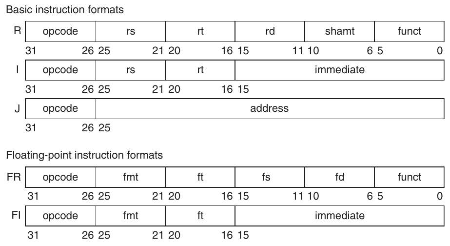

**Hình 1.6 Các format của instruction set architecture MIPS64. Mọi instruction dài 32 bit. Format R dành cho integer operation register-to-register, như DADDU, DSUBU, v.v. Format I dành cho data transfer, branch và immediate instruction, như LD, SD, BEQZ và DADDIs. Format J dành cho jump, FR dành cho operation floating-point và FI dành cho branch floating-point.**

Những thách thức khác ngoài ISA design mà computer architect đối mặt hiện đặc biệt gay gắt, khi khác biệt giữa instruction set nhỏ và có các lĩnh vực ứng dụng riêng biệt. Vì vậy từ ấn bản trước, phần lớn nội dung instruction set ngoài phần ôn nhanh này nằm trong phụ lục (xem Phụ lục A và K).

Chúng ta dùng tập con MIPS64 làm ISA ví dụ trong sách vì nó vừa là ISA thống trị networking, vừa là ví dụ thanh lịch của RISC architecture đã nói, trong đó ARM (Advanced RISC Machine) là ví dụ phổ biến nhất. Processor ARM có trong 6.1 tỷ chip xuất xưởng năm 2010, tức khoảng 20 lần số chip có processor 80x86 xuất xưởng.

### Computer Architecture thực sự: Thiết kế tổ chức và hardware đáp ứng mục tiêu và yêu cầu chức năng

Triển khai máy tính có hai thành phần: organization và hardware. Thuật ngữ organization bao gồm khía cạnh high-level của thiết kế, như memory system, memory interconnect và thiết kế processor bên trong hay CPU (central processing unit—nơi thực hiện arithmetic, logic, branching và data transfer). Thuật ngữ microarchitecture cũng được dùng thay organization. Chẳng hạn AMD Opteron và Intel Core i7 là hai processor có cùng instruction set architecture nhưng organization khác. Cả hai triển khai instruction set x86, nhưng có cách tổ chức pipeline và cache rất khác.

Chuyển sang nhiều processor trên mỗi microprocessor khiến thuật ngữ core cũng được dùng cho processor. Thay nói multiprocessor microprocessor, thuật ngữ multicore trở nên phổ biến. Vì hầu như mọi chip có nhiều processor, thuật ngữ central processing unit, hay CPU, đang giảm độ phổ biến.

Hardware chỉ những chi tiết cụ thể của máy tính, gồm logic design chi tiết và công nghệ packaging. Một dòng máy thường có máy tính với instruction set architecture giống nhau và organization gần giống, nhưng khác hardware implementation chi tiết. Chẳng hạn Intel Core i7 (xem Chương 3) và Intel Xeon 7560 (xem Chương 5) gần giống nhưng có clock rate, memory system khác, khiến Xeon 7560 hiệu quả hơn cho server computer.

Trong sách này, architecture bao quát cả ba khía cạnh thiết kế máy tính—instruction set architecture, organization hay microarchitecture, và hardware.

Computer architect phải thiết kế máy tính đáp ứng functional requirement cùng mục tiêu price, power, performance và availability. Hình 1.7 tổng hợp yêu cầu cần xét khi thiết kế máy tính mới. Thường architect còn phải xác định functional requirement là gì, vốn có thể là nhiệm vụ lớn. Yêu cầu có thể là tính năng cụ thể được thị trường gợi ra. Application software thường định hướng lựa chọn một số functional requirement bằng cách xác định máy tính sẽ được dùng thế nào. Nếu có lượng lớn software cho instruction set architecture nào đó, architect có thể quyết định máy tính mới nên triển khai instruction set hiện có. Thị trường lớn cho một lớp ứng dụng cụ thể có thể thúc đẩy người thiết kế tích hợp yêu cầu khiến máy tính cạnh tranh được trong thị trường đó. Các chương sau khảo sát sâu nhiều yêu cầu, tính năng này.

| Functional requirement | Những tính năng thường được yêu cầu hoặc hỗ trợ |
|---|---|
| Application area | Đối tượng mục tiêu của máy tính |
| Personal mobile device | Performance Real-time cho nhiều task, gồm performance tương tác cho graphics, video và audio; energy efficiency (Ch. 2, 3, 4, 5; App. A) |
| General-purpose desktop | Performance cân bằng cho nhiều task, gồm performance tương tác cho graphics, video và audio (Ch. 2, 3, 4, 5; App. A) |
| Servers | Hỗ trợ database và transaction processing; cải tiến reliability và availability; hỗ trợ scalability (Ch. 2, 5; App. A, D, F) |
| Clusters/warehouse-scale computers | Throughput performance cho nhiều task độc lập; error correction cho memory; energy proportionality (Ch 2, 6; App. F) |
| Embedded computing | Thường cần hỗ trợ đặc biệt cho graphics hoặc video (hay extension application-specific khác); có thể cần giới hạn power và power control; ràng buộc real-time (Ch. 2, 3, 5; App. A, E) |
| Mức tương thích software | Xác định lượng software hiện có cho máy tính |
| Ở cấp programming language | Linh hoạt nhất cho người thiết kế; cần compiler mới (Ch. 3, 5; App. A) |
| Tương thích object code hoặc binary | Instruction set architecture đã được định nghĩa hoàn toàn—ít linh hoạt—nhưng không cần đầu tư software hoặc port chương trình (App. A) |
| Yêu cầu operating system | Tính năng cần thiết để hỗ trợ OS đã chọn (Ch. 2; App. B) |
| Address space size | Tính năng rất quan trọng (Ch. 2); có thể giới hạn ứng dụng |
| Memory management | Cần cho OS hiện đại; có thể dùng paging hoặc segmentation (Ch. 2) |
| Protection | Nhu cầu OS và ứng dụng khác nhau: page so với segment; virtual machine (Ch. 2) |
| Standard | Thị trường có thể yêu cầu tuân thủ một số standard nhất định |
| Floating point | Format và arithmetic: chuẩn IEEE 754 (App. J), arithmetic đặc biệt cho graphics hoặc signal processing |
| I/O interface | Dành cho I/O device: Serial ATA, Serial Attached SCSI, PCI Express (App. D, F) |
| Operating systems | UNIX, Windows, Linux, CISCO IOS |
| Network | Cần hỗ trợ những network khác nhau: Ethernet, Infiniband (App. F) |
| Programming language | Ngôn ngữ (ANSI C, C++, Java, Fortran) ảnh hưởng instruction set (App. A) |

**Hình 1.7 Tổng hợp một số functional requirement quan trọng nhất mà architect đối mặt. Cột left-hand mô tả lớp yêu cầu, còn cột right-hand đưa ví dụ cụ thể. Cột right-hand cũng tham chiếu các chương và phụ lục bàn vấn đề cụ thể.**

Architect cũng phải nhận biết xu hướng quan trọng trong cả công nghệ lẫn cách dùng máy tính, vì những xu hướng đó ảnh hưởng không chỉ cost tương lai mà cả tuổi thọ architecture.

## 1.4 Xu hướng công nghệ

Để một instruction set architecture thành công, nó phải được thiết kế để tồn tại qua những thay đổi nhanh chóng của công nghệ máy tính. Rốt cuộc, một instruction set architecture mới thành công có thể tồn tại hàng thập kỷ—chẳng hạn, phần cốt lõi của IBM mainframe đã được sử dụng gần 50 năm. Kiến trúc sư phải dự liệu những thay đổi công nghệ có thể kéo dài tuổi thọ của một máy tính thành công.

Để lập kế hoạch cho quá trình phát triển của máy tính, người thiết kế phải nắm được những thay đổi nhanh chóng trong công nghệ triển khai. Năm công nghệ triển khai thay đổi với tốc độ mạnh mẽ sau đây có vai trò thiết yếu đối với các implementation hiện đại:

- Công nghệ integrated circuit logic—Mật độ transistor tăng khoảng 35% mỗi năm, tăng gấp bốn sau hơn bốn năm một chút. Mức tăng die size khó dự đoán hơn và chậm hơn, dao động từ 10% đến 20% mỗi năm. Tác động kết hợp là số transistor trên một chip tăng khoảng 40% đến 55% mỗi năm, hay gấp đôi sau mỗi 18 đến 24 tháng. Xu hướng này thường được biết đến với tên Moore’s law. Tốc độ device tăng chậm hơn, như ta bàn bên dưới.

- Semiconductor DRAM (dynamic random-access memory)—Giờ đây, phần lớn chip DRAM chủ yếu được xuất xưởng trong module DIMM, nên khó theo dõi dung lượng chip hơn, vì nhà sản xuất DRAM thường đồng thời cung cấp các sản phẩm với nhiều mức dung lượng để phù hợp dung lượng DIMM. Gần đây, dung lượng mỗi chip DRAM tăng khoảng 25% đến 40% mỗi năm, gấp đôi sau khoảng hai đến ba năm. Công nghệ này là nền tảng của main memory, và ta thảo luận trong Chương 2. Lưu ý tốc độ cải thiện đã tiếp tục chậm lại qua các ấn bản của cuốn sách, như Hình 1.8 cho thấy. Thậm chí có lo ngại rằng tốc độ tăng trưởng sẽ dừng lại vào giữa thập kỷ này, do việc sản xuất hiệu quả DRAM cell còn nhỏ hơn ngày càng khó [Kim 2005]. Chương 2 đề cập một số công nghệ khác có thể thay DRAM nếu nó chạm giới hạn dung lượng.

| Ấn bản CA:AQA | Năm | Tốc độ tăng trưởng DRAM | Mô tả tác động lên dung lượng DRAM |
|---|---|---|---|
| 1 | 1990 | 60%/năm | Gấp bốn sau mỗi 3 năm |
| 2 | 1996 | 60%/năm | Gấp bốn sau mỗi 3 năm |
| 3 | 2003 | 40%–60%/năm | Gấp bốn sau mỗi 3 đến 4 năm |
| 4 | 2007 | 40%/năm | Gấp đôi sau mỗi 2 năm |
| 5 | 2011 | 25%–40%/năm | Gấp đôi sau mỗi 2 đến 3 năm |

**Hình 1.8 Thay đổi về tốc độ cải thiện dung lượng DRAM theo thời gian. Hai ấn bản đầu thậm chí gọi tốc độ này là DRAM Growth Rule of Thumb, vì nó rất đáng tin cậy từ năm 1977 với DRAM 16-kilobit đến năm 1996 với DRAM 64-megabit. Ngày nay, một số người nghi ngờ liệu dung lượng DRAM còn có thể cải thiện chút nào trong 5 đến 7 năm nữa hay không, do khó khăn trong việc sản xuất DRAM cell ngày càng three-dimensional [Kim 2005].**

- Semiconductor Flash (electrically erasable programmable read-only memory)—Semiconductor memory nonvolatile này là storage device tiêu chuẩn trong PMD, và mức độ phổ biến tăng nhanh của nó đã thúc đẩy tốc độ tăng dung lượng nhanh chóng. Gần đây, dung lượng mỗi chip Flash tăng khoảng 50% đến 60% mỗi năm, gấp đôi sau khoảng hai năm. Năm 2011, Flash memory rẻ hơn DRAM từ 15 đến 20 lần tính trên mỗi bit. Chương 2 mô tả Flash memory.

- Công nghệ magnetic disk—Trước năm 1990, mật độ tăng khoảng 30% mỗi năm, gấp đôi trong ba năm. Sau đó, tốc độ tăng lên 60% mỗi năm, rồi đạt 100% mỗi năm vào năm 1996. Từ năm 2004, tốc độ giảm trở lại khoảng 40% mỗi năm, hay gấp đôi sau mỗi ba năm. Disk rẻ hơn Flash từ 15 đến 25 lần tính trên mỗi bit. Với tốc độ tăng trưởng DRAM chậm lại, disk giờ rẻ hơn DRAM từ 300 đến 500 lần tính trên mỗi bit. Công nghệ này giữ vai trò trung tâm đối với storage ở quy mô server và warehouse, và ta thảo luận chi tiết các xu hướng trong Phụ lục D.

- Công nghệ network—Hiệu năng network phụ thuộc cả hiệu năng switch lẫn hiệu năng hệ thống truyền dẫn. Ta thảo luận các xu hướng networking trong Phụ lục F.

Những công nghệ thay đổi nhanh chóng này định hình thiết kế của một máy tính có thể có tuổi thọ từ ba đến năm năm nhờ các cải tiến về tốc độ và công nghệ. Các công nghệ then chốt như DRAM, Flash và disk thay đổi đủ nhiều để người thiết kế phải dự liệu những thay đổi đó. Thực tế, người thiết kế thường thiết kế cho công nghệ kế tiếp, vì biết rằng khi sản phẩm bắt đầu được xuất xưởng với số lượng lớn, công nghệ kế tiếp có thể cost-effective nhất hoặc có ưu thế hiệu năng. Theo truyền thống, chi phí giảm với tốc độ xấp xỉ tốc độ mật độ tăng.

Dù công nghệ liên tục cải thiện, tác động của những cải thiện này có thể xuất hiện thành các bước nhảy rời rạc, khi đạt ngưỡng cho phép một khả năng mới. Ví dụ, đầu những năm 1980, khi công nghệ MOS đạt mức có thể đặt từ 25,000 đến 50,000 transistor trên một chip, việc xây dựng microprocessor single-chip, 32-bit trở nên khả thi. Cuối những năm 1980, cache first-level có thể được đặt trên chip. Loại bỏ việc đi qua ranh giới chip bên trong processor và giữa processor với cache cho phép cải thiện mạnh mẽ cost-performance và energy-performance. Thiết kế này đơn giản là bất khả thi trước khi công nghệ đạt một mức nhất định. Với microprocessor multicore và số core tăng qua mỗi thế hệ, ngay cả server computer cũng ngày càng hướng đến một chip duy nhất cho mọi processor. Những ngưỡng công nghệ như vậy không hiếm và tác động đáng kể tới rất nhiều quyết định thiết kế.

### Xu hướng hiệu năng: Bandwidth vượt Latency

Như ta sẽ thấy trong Mục 1.8, bandwidth hay throughput là tổng lượng công việc hoàn thành trong khoảng thời gian cho trước, chẳng hạn megabyte mỗi giây khi truyền dữ liệu từ disk. Ngược lại, latency hay response time là khoảng thời gian từ lúc bắt đầu đến khi hoàn tất một sự kiện, chẳng hạn millisecond cho một disk access. Hình 1.9 vẽ mức cải thiện tương đối về bandwidth và latency tại những cột mốc công nghệ của microprocessor, memory, network và disk. Hình 1.10 mô tả chi tiết hơn các ví dụ và cột mốc.

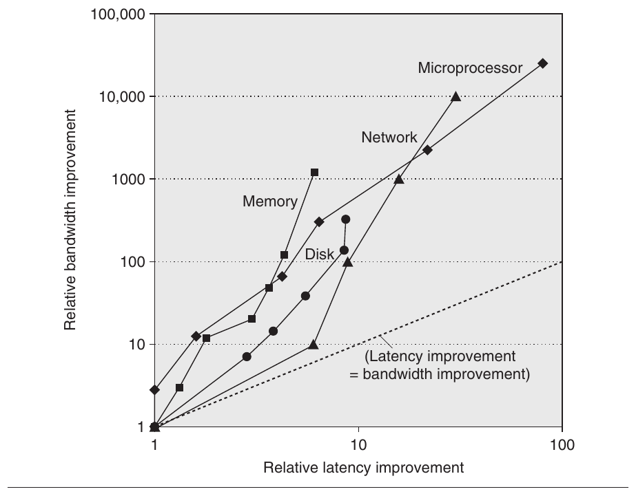

**Hình 1.9 Đồ thị log–log về các cột mốc bandwidth và latency từ Hình 1.10, tính tương đối so với cột mốc đầu tiên. Lưu ý latency cải thiện từ 6X đến 80X, trong khi bandwidth cải thiện khoảng 300X đến 25,000X. Cập nhật từ Patterson [2004].**

Hiệu năng là yếu tố tạo khác biệt chính cho microprocessor và network, nên chúng đã đạt những mức cải thiện lớn nhất: bandwidth tăng 10,000–25,000X và latency cải thiện 30–80X. Với memory và disk, dung lượng thường quan trọng hơn hiệu năng, nên dung lượng cải thiện nhiều nhất; tuy vậy, mức tăng bandwidth 300– 1200X vẫn lớn hơn rất nhiều so với cải thiện latency 6–8X.

Rõ ràng, ở các công nghệ này, bandwidth đã cải thiện nhanh hơn latency và có thể sẽ tiếp tục như vậy. Một quy tắc kinh nghiệm đơn giản là bandwidth tăng ít nhất bằng bình phương mức cải thiện latency. Người thiết kế máy tính nên lập kế hoạch phù hợp với điều đó.

### Scaling hiệu năng Transistor và Wire

Process chế tạo integrated circuit được đặc trưng bởi feature size, tức kích thước nhỏ nhất của transistor hoặc wire theo chiều x hoặc y. Feature size đã giảm từ 10 micron năm 1971 xuống 0.032 micron năm 2011; thực tế, ta đã đổi đơn vị, nên công nghệ sản xuất năm 2011 được gọi là “32 nanometer”, và chip 22 nanometer đang được phát triển. Vì số transistor trên mỗi millimeter vuông silicon được quyết định bởi diện tích bề mặt transistor, mật độ transistor tăng theo quan hệ bậc hai khi feature size giảm tuyến tính.

| Microprocessor | 16-bit address/bus, microcoded | 32-bit address/bus, microcoded | 5-stage pipeline, on-chip I & D caches, FPU | 2-way superscalar, 64-bit bus | Out-of-order 3-way superscalar | Out-of-order superpipelined, on-chip L2 cache | Multicore OOO 4-way on chip L3 cache, Turbo |
|---|---|---|---|---|---|---|---|
| Sản phẩm | Intel 80286 | Intel 80386 | Intel 80486 | Intel Pentium | Intel Pentium Pro | Intel Pentium 4 | Intel Core i7 |
| Năm | 1982 | 1985 | 1989 | 1993 | 1997 | 2001 | 2010 |
| Kích thước die (mm2) | 47 | 43 | 81 | 90 | 308 | 217 | 240 |
| Số transistor | 134,000 | 275,000 | 1,200,000 | 3,100,000 | 5,500,000 | 42,000,000 | 1,170,000,000 |
| Số processor/chip | 1 | 1 | 1 | 1 | 1 | 1 | 4 |
| Số pin | 68 | 132 | 168 | 273 | 387 | 423 | 1366 |
| Latency (clock) | 6 | 5 | 5 | 5 | 10 | 22 | 14 |
| Độ rộng bus (bit) | 16 | 32 | 32 | 64 | 64 | 64 | 196 |
| Clock rate (MHz) | 12.5 | 16 | 25 | 66 | 200 | 1500 | 3333 |
| Bandwidth (MIPS) | 2 | 6 | 25 | 132 | 600 | 4500 | 50,000 |
| Latency (ns) | 320 | 313 | 200 | 76 | 50 | 15 | 4 |
| Memory module | DRAM | Page mode DRAM | Fast page mode DRAM | Fast page mode DRAM | Synchronous DRAM | Double data rate SDRAM | DDR3 SDRAM |
| Độ rộng module (bit) | 16 | 16 | 32 | 64 | 64 | 64 | 64 |
| Năm | 1980 | 1983 | 1986 | 1993 | 1997 | 2000 | 2010 |
| Mbits/DRAM chip | 0.06 | 0.25 | 1 | 16 | 64 | 256 | 2048 |
| Kích thước die (mm2) | 35 | 45 | 70 | 130 | 170 | 204 | 50 |
| Số pin/chip DRAM | 16 | 16 | 18 | 20 | 54 | 66 | 134 |
| Bandwidth (MBytes/s) | 13 | 40 | 160 | 267 | 640 | 1600 | 16,000 |
| Latency (ns) | 225 | 170 | 125 | 75 | 62 | 52 | 37 |
| Local area network | Ethernet | Fast Ethernet | Gigabit Ethernet | 10 Gigabit Ethernet | 100 Gigabit Ethernet |  |  |
| Tiêu chuẩn IEEE | 802.3 | 803.3u | 802.3ab | 802.3ac | 802.3ba |  |  |
| Năm | 1978 | 1995 | 1999 | 2003 | 2010 |  |  |
| Bandwidth (Mbits/sec) | 10 | 100 | 1000 | 10,000 | 100,000 |  |  |
| Latency (μsec) | 3000 | 500 | 340 | 190 | 100 |  |  |
| Hard disk | 3600 RPM | 5400 RPM | 7200 RPM | 10,000 RPM | 15,000 RPM | 15,000 RPM |  |
| Sản phẩm | CDC WrenI 94145-36 | Seagate ST41600 | Seagate ST15150 | Seagate ST39102 | Seagate ST373453 | Seagate ST3600057 |  |
| Năm | 1983 | 1990 | 1994 | 1998 | 2003 | 2010 |  |
| Dung lượng (GB) | 0.03 | 1.4 | 4.3 | 9.1 | 73.4 | 600 |  |
| Disk form factor | 5.25 inch | 5.25 inch | 3.5 inch | 3.5 inch | 3.5 inch | 3.5 inch |  |
| Đường kính media | 5.25 inch | 5.25 inch | 3.5 inch | 3.0 inch | 2.5 inch | 2.5 inch |  |
| Interface | ST-412 | SCSI | SCSI | SCSI | SCSI | SAS |  |
| Bandwidth (MBytes/s) | 0.6 | 4 | 9 | 24 | 86 | 204 |  |
| Latency (ms) | 48.3 | 17.1 | 12.7 | 8.8 | 5.7 | 3.6 |  |

**Hình 1.10 Các cột mốc hiệu năng trong 25 đến 40 năm của microprocessor, memory, network và disk. Các cột mốc microprocessor là nhiều thế hệ processor IA-32, từ 80286 microcoded với bus 16-bit đến Core i7 superpipelined, thực thi out-of-order, multicore với bus 64-bit. Cột mốc memory module đi từ DRAM thông thường 16-bit-wide đến synchronous DRAM double data rate phiên bản 3 với độ rộng 64-bit-wide. Ethernet tiến từ 10 Mbits/sec lên 100 Gbits/sec. Cột mốc disk dựa trên tốc độ quay, tăng từ 3600 RPM lên 15,000 RPM. Mỗi trường hợp là bandwidth best-case, còn latency là thời gian cho một thao tác đơn giản với giả định không có contention. Cập nhật từ Patterson [2004].**

Tuy nhiên, mức tăng hiệu năng transistor phức tạp hơn. Khi feature size thu nhỏ, device thu nhỏ theo quan hệ bậc hai trong mặt phẳng ngang, đồng thời cũng thu nhỏ theo chiều dọc. Thu nhỏ theo chiều dọc đòi hỏi giảm operating voltage để duy trì hoạt động đúng và độ tin cậy transistor. Sự kết hợp các yếu tố scaling này dẫn đến quan hệ tương hỗ phức tạp giữa hiệu năng transistor và feature size của process. Theo xấp xỉ bậc nhất, hiệu năng transistor cải thiện tuyến tính khi feature size giảm.

Việc số transistor tăng theo quan hệ bậc hai trong khi hiệu năng transistor cải thiện tuyến tính vừa là thách thức vừa là cơ hội mà các kiến trúc sư máy tính sinh ra để đón nhận! Thời kỳ đầu của microprocessor, tốc độ cải thiện mật độ cao hơn được dùng để nhanh chóng chuyển từ microprocessor 4-bit sang 8-bit, 16-bit, 32-bit rồi 64-bit. Gần đây hơn, cải thiện mật độ hỗ trợ đưa nhiều processor lên mỗi chip, SIMD unit rộng hơn và nhiều đổi mới về speculative execution cùng cache trong các Chương 2, 3, 4 và 5.

Dù transistor thường cải thiện hiệu năng khi feature size giảm, wire trong integrated circuit lại không như vậy. Cụ thể, signal delay của wire tăng tỷ lệ với tích resistance và capacitance của nó. Dĩ nhiên khi feature size giảm, wire ngắn hơn, nhưng resistance và capacitance trên mỗi đơn vị chiều dài trở nên kém thuận lợi hơn. Quan hệ này phức tạp vì cả resistance lẫn capacitance phụ thuộc các chi tiết của process, hình học wire, tải trên wire, thậm chí cả vị trí sát những cấu trúc khác. Đôi khi có cải tiến process, chẳng hạn đưa copper vào sử dụng, mang lại cải thiện one-time cho wire delay.

Tuy nhiên, nói chung wire delay có scaling kém so với hiệu năng transistor, tạo thêm thách thức cho người thiết kế. Trong vài năm qua, ngoài giới hạn power dissipation, wire delay đã trở thành giới hạn thiết kế lớn cho integrated circuit lớn, thường còn quan trọng hơn transistor switching delay. Propagation delay của tín hiệu trên wire đã chiếm tỷ lệ ngày càng lớn trong clock cycle, nhưng hiện power còn đóng vai trò lớn hơn wire delay.

## 1.5 Xu hướng Power và Energy trong Integrated Circuit

Ngày nay, power là thách thức lớn nhất đối với người thiết kế máy tính ở gần như mọi loại máy tính. Thứ nhất, power phải được đưa vào và phân phối khắp chip, và microprocessor hiện đại dùng hàng trăm pin cùng nhiều lớp interconnect chỉ cho power và ground. Thứ hai, power bị tiêu tán thành nhiệt và nhiệt đó phải được loại bỏ.

### Power và Energy: Góc nhìn hệ thống

Kiến trúc sư hệ thống hoặc user nên suy nghĩ về hiệu năng, power và energy thế nào? Từ góc nhìn người thiết kế hệ thống, có ba mối quan tâm chính.

Thứ nhất, power tối đa mà một processor có thể cần là bao nhiêu? Đáp ứng nhu cầu này có thể quan trọng để bảo đảm hoạt động đúng. Chẳng hạn, nếu processor cố lấy nhiều power hơn mức hệ thống power supply cung cấp được (bằng cách lấy current lớn hơn mức hệ thống cấp được), kết quả thường là voltage drop, có thể khiến device hoạt động sai. Processor hiện đại có mức tiêu thụ power biến thiên lớn với peak current cao; vì vậy, chúng cung cấp các phương pháp voltage indexing cho phép processor giảm tốc và điều chỉnh voltage trong biên độ rộng hơn. Rõ ràng, làm vậy giảm hiệu năng.

Thứ hai, mức tiêu thụ power duy trì liên tục là bao nhiêu? Metric này thường được gọi là thermal design power (TDP), vì nó quyết định yêu cầu làm mát. TDP không phải peak power, vốn thường cao gấp 1.5 lần, cũng không phải average power thực tế tiêu thụ trong một phép tính cụ thể, vốn có thể còn thấp hơn. Power supply điển hình cho hệ thống thường được chọn đủ lớn để vượt TDP, còn cooling system thường được thiết kế đáp ứng hoặc vượt TDP. Không cung cấp đủ làm mát sẽ để junction temperature trong processor vượt giá trị tối đa, khiến device hỏng và có thể gây hư hại vĩnh viễn. Processor hiện đại cung cấp hai tính năng hỗ trợ quản lý nhiệt, vì power tối đa (và theo đó nhiệt cùng mức tăng nhiệt độ) có thể vượt mức trung bình long-term mà TDP chỉ định. Đầu tiên, khi nhiệt độ tiến gần giới hạn junction temperature, mạch giảm clock rate, qua đó giảm power. Nếu kỹ thuật này không thành công, cơ chế ngắt bảo vệ quá tải nhiệt thứ hai được kích hoạt để tắt power của chip.

Yếu tố thứ ba người thiết kế và user cần xét là energy và energy efficiency. Nhớ rằng power đơn giản là energy trên mỗi đơn vị thời gian: 1 watt = 1 joule mỗi giây. Metric nào phù hợp để so sánh processor: energy hay power? Nói chung, energy luôn là metric tốt hơn vì gắn với một nhiệm vụ cụ thể và thời gian cần cho nhiệm vụ đó. Cụ thể, energy để thực thi workload bằng average power nhân thời gian thực thi workload.

Vì vậy, nếu muốn biết processor nào trong hai processor hiệu quả hơn cho một nhiệm vụ cụ thể, ta nên so sánh energy tiêu thụ (không phải power) khi thực thi nhiệm vụ. Ví dụ, processor A có thể tiêu thụ average power cao hơn processor B 20%, nhưng nếu A thực thi nhiệm vụ chỉ trong 70% thời gian B cần, energy tiêu thụ của nó sẽ là 1.2 × 0.7 = 0.84, rõ ràng tốt hơn.

Có thể lập luận rằng trong server lớn hoặc cloud, chỉ xét average power là đủ, vì workload thường được giả định vô hạn, nhưng điều này gây hiểu lầm. Nếu cloud của ta dùng các processor B thay vì A, cloud sẽ làm ít việc hơn với cùng lượng energy tiêu thụ. Dùng energy so sánh các phương án giúp tránh bẫy này. Bất cứ khi nào có workload cố định, dù cho cloud warehouse-size hay smartphone, so sánh energy là cách đúng để so sánh các phương án processor, vì cả hóa đơn điện của cloud lẫn battery lifetime của smartphone đều do energy tiêu thụ quyết định.

Khi nào power tiêu thụ là thước đo hữu ích? Cách dùng chính đáng chủ yếu là làm ràng buộc: chẳng hạn chip có thể bị giới hạn ở 100 watt. Có thể dùng nó làm metric nếu workload cố định, nhưng khi đó nó chỉ là biến thể của metric thực sự, energy trên mỗi nhiệm vụ.

### Energy và Power bên trong Microprocessor

Với chip CMOS, phần energy tiêu thụ chủ yếu theo truyền thống nằm ở việc chuyển trạng thái transistor, còn gọi dynamic energy. Energy cần cho mỗi transistor tỷ lệ với tích capacitive load mà transistor điều khiển và bình phương voltage:

Energydynamic ∝ Capacitive load × Voltage2

Phương trình này là energy của xung chuyển trạng thái logic 0→1→0 hoặc 1→0→1. Vì vậy, energy của một lần chuyển trạng thái (0→1 hoặc 1→0) là:

Energydynamic ∝ 1 2⁄ × Capacitive load × Voltage2

Power cần cho mỗi transistor đơn giản là tích energy của một lần chuyển trạng thái với tần suất chuyển trạng thái:

Powerdynamic ∝ 1 2⁄ × Capacitive load × Voltage2 × Frequency switched

Với một nhiệm vụ cố định, giảm clock rate làm giảm power nhưng không giảm energy.

Rõ ràng, giảm voltage làm dynamic power và energy giảm mạnh, nên voltage đã giảm từ 5V xuống dưới 1V một chút trong 20 năm. Capacitive load là hàm của số transistor nối với một output và công nghệ, vốn quyết định capacitance của wire và transistor.

**Ví dụ** Một số microprocessor ngày nay được thiết kế có voltage điều chỉnh được, nên giảm voltage 15% có thể dẫn tới giảm frequency 15%. Điều này ảnh hưởng dynamic energy và dynamic power thế nào?

**Trả lời** Vì capacitance không đổi, đáp án cho energy là tỷ số voltage, do capacitance không đổi:

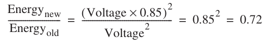

qua đó giảm energy xuống khoảng 72% mức ban đầu. Với power, ta thêm tỷ số frequency

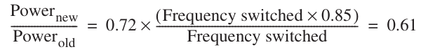

khiến power giảm xuống khoảng 61% mức ban đầu.

Khi chuyển từ process chế tạo này sang process kế tiếp, mức tăng số transistor chuyển trạng thái cùng tần suất chúng chuyển trạng thái lấn át mức giảm load capacitance và voltage, khiến tổng power tiêu thụ và energy tăng. Những microprocessor đầu tiên tiêu thụ dưới một watt, còn microprocessor 32-bit đầu tiên (như Intel 80386) dùng khoảng 2 watt, trong khi Intel Core i7 3.3 GHz tiêu thụ 130 watt. Vì lượng nhiệt này phải được tản khỏi một chip có cạnh khoảng 1.5 cm, ta đã chạm giới hạn làm mát bằng không khí.

Với phương trình trên, bạn sẽ dự đoán tăng trưởng clock frequency chậm lại nếu ta không thể giảm voltage hoặc tăng power mỗi chip. Hình 1.11 cho thấy điều này thực sự đã xảy ra từ năm 2003, ngay cả với các microprocessor trong Hình 1.1 có hiệu năng cao nhất từng năm. Lưu ý giai đoạn clock rate gần như không đổi này tương ứng giai đoạn hiệu năng cải thiện chậm trong Hình 1.1.

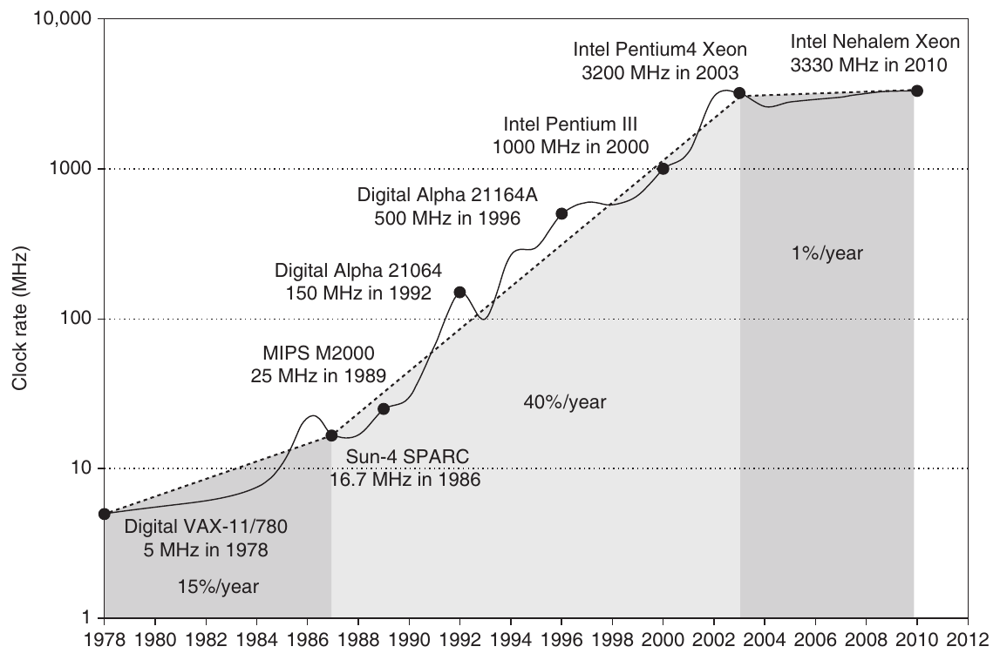

**Hình 1.11 Tăng trưởng clock rate của các microprocessor trong Hình 1.1. Từ 1978 đến 1986, clock rate cải thiện dưới 15% mỗi năm trong khi hiệu năng cải thiện 25% mỗi năm. Trong “giai đoạn phục hưng” từ 1986 đến 2003, khi hiệu năng cải thiện 52% mỗi năm, clock rate tăng vọt gần 40% mỗi năm. Từ đó, clock rate gần như không đổi, tăng dưới 1% mỗi năm, trong khi hiệu năng một processor cải thiện dưới 22% mỗi năm.**

Phân phối power, loại bỏ nhiệt và ngăn hot spot đã trở thành những thách thức ngày càng khó. Power giờ là ràng buộc chính đối với việc dùng transistor; trước đây ràng buộc ấy là diện tích silicon thuần túy. Vì vậy, microprocessor hiện đại cung cấp nhiều kỹ thuật cố cải thiện energy efficiency dù clock rate gần như không đổi và supply voltage không đổi:

1. Làm tốt việc không làm gì. Phần lớn microprocessor ngày nay tắt clock của module không hoạt động để tiết kiệm energy và dynamic power. Chẳng hạn, nếu không có instruction floating-point nào đang thực thi, clock của unit floating-point được vô hiệu hóa. Nếu một số core nhàn rỗi, clock của chúng được dừng.

2. Dynamic Voltage-Frequency Scaling (DVFS). Kỹ thuật thứ hai đến trực tiếp từ các công thức trên. Personal mobile device, laptop, thậm chí server có những giai đoạn hoạt động ít, không cần chạy với clock frequency và voltage cao nhất. Microprocessor hiện đại thường cung cấp vài mức clock frequency và voltage để vận hành với power và energy thấp hơn. Hình 1.12 vẽ khả năng tiết kiệm power qua DVFS cho server khi workload giảm, với ba clock rate khác nhau: 2.4 GHz, 1.8 GHz và 1 GHz. Mức tiết kiệm power tổng thể của server khoảng 10% đến 15% cho mỗi bước trong hai bước giảm.

3. Thiết kế cho trường hợp điển hình. Vì PMD và laptop thường nhàn rỗi, memory và storage cung cấp chế độ low power để tiết kiệm energy. Ví dụ, DRAM có một loạt chế độ với power ngày càng thấp để kéo dài battery life trong PMD và laptop, và đã có đề xuất cho disk có chế độ quay chậm hơn khi nhàn rỗi để tiết kiệm power. Đáng tiếc, bạn không thể truy cập DRAM hoặc disk trong các chế độ này, nên phải trở lại chế độ hoạt động đầy đủ để đọc hay ghi, bất kể tần suất truy cập thấp đến đâu. Như đã đề cập, thay vào đó microprocessor cho PC được thiết kế cho trường hợp điển hình hơn là sử dụng nhiều ở nhiệt độ vận hành cao, dựa vào temperature sensor on-chip để phát hiện lúc cần tự động giảm hoạt động nhằm tránh quá nhiệt. Việc “giảm tốc khẩn cấp” này cho phép nhà sản xuất thiết kế cho trường hợp điển hình hơn, rồi dựa vào mechanism an toàn này nếu ai đó thực sự chạy program tiêu thụ power nhiều hơn mức thông thường rất nhiều.

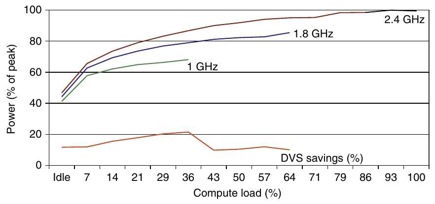

**Hình 1.12 Tiết kiệm energy cho server dùng microprocessor AMD Opteron, DRAM 8 GB và một ATA disk. Ở 1.8 GHz, server chỉ có thể xử lý tối đa two-thirds workload mà không gây vi phạm service level, còn ở 1.0 GHz, nó chỉ có thể xử lý an toàn one-third workload. (Hình 5.11 trong Barroso và Hölzle [2009].)**

4. Overclocking. Intel bắt đầu cung cấp Turbo mode vào năm 2008, trong đó chip quyết định rằng có thể an toàn chạy ở clock rate cao hơn trong thời gian ngắn, có thể chỉ trên một vài core, cho đến khi nhiệt độ bắt đầu tăng. Ví dụ, Core i7 3.3 GHz có thể chạy từng đợt ngắn ở 3.6 GHz. Thực tế, các microprocessor highest-performing từng năm từ 2008 trong Hình 1.1 đều cung cấp overclocking tạm thời khoảng 10% trên clock rate danh định. Với code single threaded, những microprocessor này có thể tắt mọi core trừ một, rồi chạy core đó ở clock rate còn cao hơn. Lưu ý operating system có thể tắt Turbo mode nhưng không có thông báo khi nó được kích hoạt, nên programmer có thể ngạc nhiên khi hiệu năng program thay đổi theo nhiệt độ phòng!

Dù dynamic power theo truyền thống được coi là nguồn power dissipation chính trong CMOS, static power đang trở thành vấn đề quan trọng vì leakage current vẫn chạy ngay cả khi transistor tắt:

Powerstatic ∝ Currentstatic × Voltage

Tức là static power tỷ lệ với số device.

Vì vậy, tăng số transistor làm power tăng ngay cả khi chúng nhàn rỗi, và leakage current tăng trong processor có kích thước transistor nhỏ hơn. Kết quả là hệ thống power rất thấp thậm chí còn tắt power supply (power gating) của module không hoạt động để kiểm soát tổn thất do leakage. Năm 2011, mục tiêu leakage là 25% tổng power tiêu thụ, nhưng leakage trong thiết kế high-performance đôi khi vượt xa mục tiêu. Leakage có thể lên đến 50% với những chip này, một phần vì SRAM cache lớn cần power để duy trì giá trị lưu trữ. (Chữ S trong SRAM là static.) Hy vọng duy nhất ngăn leakage là tắt power cho các phần của chip.

Cuối cùng, vì processor chỉ chiếm một phần tổng chi phí energy của hệ thống, dùng processor nhanh hơn nhưng ít energy-efficient hơn để phần còn lại của hệ thống có thể vào sleep mode có thể là hợp lý. Chiến lược này gọi là race-to-halt.

Tầm quan trọng của power và energy đã khiến hiệu quả của một đổi mới được xem xét kỹ hơn, nên cách đánh giá chủ yếu hiện là số nhiệm vụ mỗi joule hoặc hiệu năng mỗi watt, thay vì hiệu năng mỗi mm2 silicon. Metric mới này ảnh hưởng các cách tiếp cận parallelism, như ta sẽ thấy trong Chương 4 và 5.

## 1.6 Xu hướng chi phí

Dù chi phí có xu hướng ít quan trọng hơn trong một số thiết kế máy tính—cụ thể là supercomputer—những thiết kế cost-sensitive ngày càng có ý nghĩa lớn. Thực tế, trong 30 năm qua, dùng cải tiến công nghệ để giảm chi phí cũng như tăng hiệu năng là chủ đề lớn của ngành máy tính.

Giáo trình thường bỏ qua nửa chi phí trong cost-performance vì chi phí thay đổi khiến sách lỗi thời, và vì các vấn đề này tinh tế, khác nhau giữa các phân khúc ngành. Tuy nhiên, hiểu chi phí cùng các yếu tố của nó là thiết yếu để kiến trúc sư máy tính quyết định sáng suốt có nên đưa tính năng mới vào những thiết kế mà chi phí là vấn đề hay không. (Hãy tưởng tượng kiến trúc sư thiết kế tòa nhà chọc trời mà không biết chút gì về chi phí dầm thép và bê tông!)

Mục này thảo luận những yếu tố chính ảnh hưởng chi phí máy tính và cách những yếu tố đó thay đổi theo thời gian.

### Tác động của thời gian, sản lượng và Commoditization

Chi phí của một linh kiện máy tính được sản xuất giảm theo thời gian ngay cả khi không có cải tiến lớn trong công nghệ triển khai cơ bản. Nguyên lý nền tảng khiến chi phí giảm là learning curve—chi phí sản xuất giảm theo thời gian. Bản thân learning curve được đo tốt nhất bằng thay đổi yield—tỷ lệ phần trăm device được sản xuất vượt qua quy trình kiểm tra. Dù là chip, board hay hệ thống, thiết kế có yield gấp đôi sẽ có chi phí bằng một nửa.

Hiểu learning curve cải thiện yield thế nào là thiết yếu để dự báo chi phí suốt vòng đời sản phẩm. Một ví dụ là giá mỗi megabyte DRAM đã giảm trong dài hạn. Vì giá DRAM thường gắn chặt với chi phí—ngoại trừ lúc thiếu hụt hoặc dư cung—giá bán và chi phí DRAM biến động sát nhau.

Giá microprocessor cũng giảm theo thời gian, nhưng vì chúng ít tiêu chuẩn hóa hơn DRAM, quan hệ giữa giá bán và chi phí phức tạp hơn. Trong giai đoạn cạnh tranh đáng kể, giá bán có xu hướng biến động sát chi phí, dù nhà cung cấp microprocessor có lẽ hiếm khi bán lỗ.

Sản lượng là yếu tố then chốt thứ hai quyết định chi phí. Sản lượng tăng ảnh hưởng chi phí theo vài cách. Thứ nhất, nó giảm thời gian cần để tiến xuống learning curve, vốn phần nào tỷ lệ với số hệ thống (hoặc chip) được sản xuất. Thứ hai, sản lượng giảm chi phí vì tăng hiệu quả thu mua và sản xuất. Theo quy tắc kinh nghiệm, một số người thiết kế ước tính chi phí giảm khoảng 10% mỗi khi sản lượng gấp đôi. Hơn nữa, sản lượng giảm phần chi phí phát triển cần phân bổ cho mỗi máy tính, cho phép chi phí và giá bán gần nhau hơn.

Commodity là sản phẩm được nhiều nhà cung cấp bán với sản lượng lớn và về cơ bản giống nhau. Gần như mọi sản phẩm trên kệ cửa hàng thực phẩm đều là commodity, cũng như DRAM tiêu chuẩn, Flash memory, disk, monitor và keyboard. Trong 25 năm qua, phần lớn ngành personal computer đã trở thành ngành kinh doanh commodity tập trung xây dựng desktop và laptop chạy Microsoft Windows.

Vì nhiều nhà cung cấp xuất xưởng những sản phẩm gần như giống hệt, thị trường có tính cạnh tranh cao. Dĩ nhiên, cạnh tranh này giảm khoảng cách chi phí và giá bán, nhưng cũng giảm chính chi phí. Chi phí giảm vì thị trường commodity vừa có sản lượng vừa có định nghĩa sản phẩm rõ, cho phép nhiều nhà cung cấp cạnh tranh chế tạo linh kiện cho sản phẩm commodity. Kết quả là tổng chi phí sản phẩm thấp hơn nhờ cạnh tranh giữa nhà cung cấp linh kiện và hiệu quả sản lượng họ có thể đạt. Sự cạnh tranh này giúp phân khúc cấp thấp của ngành máy tính đạt price-performance tốt hơn phân khúc khác, tạo tăng trưởng cao hơn ở cấp thấp, dù lợi nhuận rất hạn chế (như thường thấy ở mọi ngành kinh doanh commodity).

### Chi phí Integrated Circuit

Vì sao sách computer architecture lại có mục về chi phí integrated circuit? Trong thị trường máy tính cạnh tranh ngày càng mạnh, nơi linh kiện tiêu chuẩn—disk, Flash memory, DRAM, v.v.—đang chiếm phần đáng kể chi phí mọi hệ thống, chi phí integrated circuit ngày càng chiếm phần lớn hơn trong khoản chi phí khác biệt giữa các máy tính, đặc biệt ở phân khúc high-volume, cost-sensitive. Thực tế, khi personal mobile device ngày càng dựa vào whole systems on a chip (SOC), chi phí integrated circuit chiếm phần lớn chi phí PMD. Vì vậy, người thiết kế máy tính phải hiểu chi phí chip để hiểu chi phí máy tính hiện nay.

Dù chi phí integrated circuit đã giảm theo hàm mũ, quy trình cơ bản sản xuất silicon không đổi: wafer vẫn được kiểm tra rồi cắt thành các die để đóng gói (xem Hình 1.13, 1.14 và 1.15). Vì vậy, chi phí integrated circuit đã đóng gói là

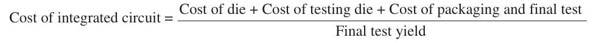

Trong mục này, ta tập trung vào chi phí die, rồi tổng kết những vấn đề then chốt về kiểm tra và đóng gói ở cuối.

Để học cách dự đoán số chip tốt trên mỗi wafer, trước hết cần biết bao nhiêu die vừa một wafer, rồi học cách dự đoán tỷ lệ phần trăm die sẽ hoạt động. Từ đó, dự đoán chi phí rất đơn giản:

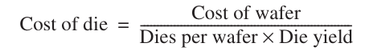

Đặc điểm thú vị nhất của số hạng đầu tiên này trong phương trình chi phí chip là độ nhạy của nó với die size, như thể hiện bên dưới.

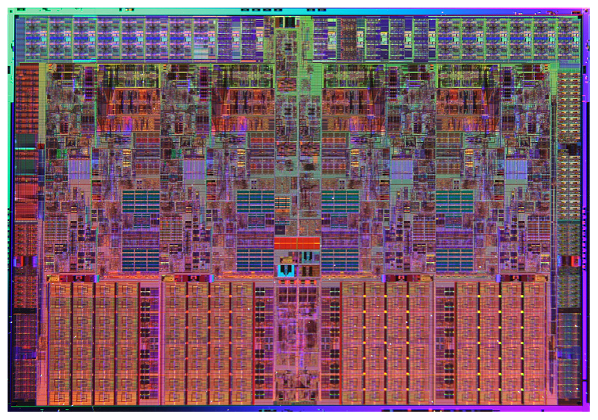

**Hình 1.13 Ảnh chụp die microprocessor Intel Core i7, được đánh giá trong Chương 2 đến 5. Kích thước là 18.9 mm nhân 13.6 mm (257 mm2) trên process 45 nm. (Ảnh do Intel cung cấp.)**

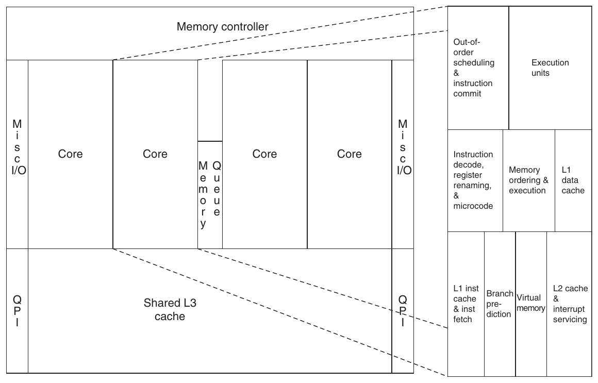

**Hình 1.14 Bên trái là floorplan die Core i7 trong Hình 1.13; bên phải là ảnh close-up floorplan core thứ hai.**

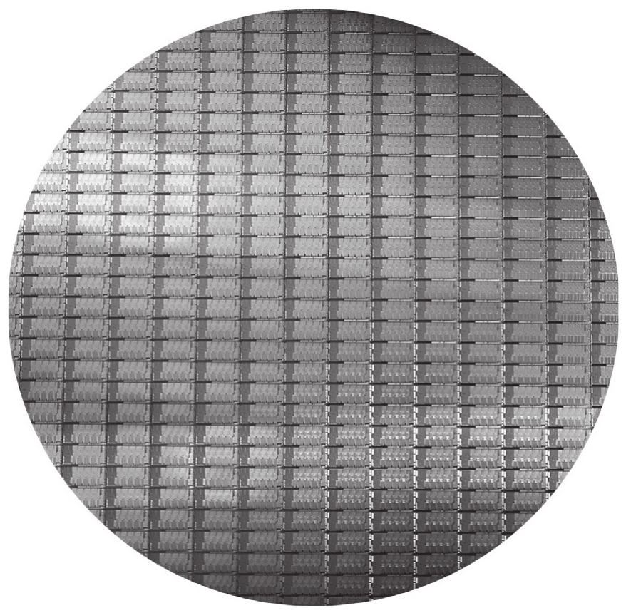

**Hình 1.15 Wafer 300 mm này chứa 280 die Sandy Bridge nguyên vẹn, mỗi die có kích thước 20.7 nhân 10.5 mm trên process 32 nm. (Sandy Bridge là thế hệ kế tiếp Nehalem của Intel, được dùng trong Core i7.) Với diện tích 216 mm2, công thức số die trên mỗi wafer ước tính 282. (Ảnh do Intel cung cấp.)**

Số die trên mỗi wafer xấp xỉ diện tích wafer chia diện tích die. Có thể ước tính chính xác hơn bằng

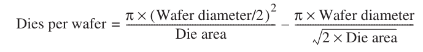

Số hạng đầu là tỷ số giữa diện tích wafer (πr2) và diện tích die. Số hạng thứ hai bù cho vấn đề “chốt vuông trong lỗ tròn”—các die hình chữ nhật nằm gần rìa wafer tròn. Lấy chu vi (πd ) chia cho đường chéo của một die vuông sẽ cho kết quả xấp xỉ số die nằm dọc mép.

**Ví dụ** Tìm số die trên mỗi wafer 300 mm (30 cm) cho die có cạnh 1.5 cm và die có cạnh 1.0 cm.

**Trả lời** Khi diện tích die là 2.25 cm2:

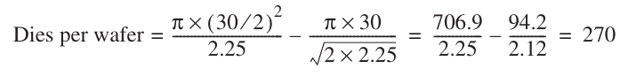

Vì diện tích die lớn gấp 2.25 lần, số die nhỏ hơn trên mỗi wafer nhiều gấp khoảng 2.25 lần:

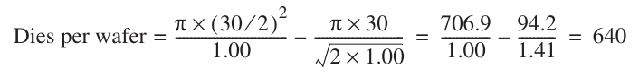

Tuy nhiên, công thức này chỉ cho số die tối đa trên mỗi wafer. Câu hỏi thiết yếu là: tỷ lệ die tốt trên wafer, hay die yield, bằng bao nhiêu? Mô hình đơn giản về yield của integrated circuit, giả sử defect phân bố ngẫu nhiên trên wafer và yield tỷ lệ nghịch với độ phức tạp của fabrication process, dẫn đến:

Die yield = Wafer yield × 1 ⁄ ( 1 + Defects per unit area × Die area )N

Công thức Bose–Einstein này là mô hình thực nghiệm được phát triển bằng cách xem xét yield của nhiều dây chuyền sản xuất [Sydow 2006]. Wafer yield tính đến những wafer hỏng hoàn toàn nên không cần kiểm tra. Để đơn giản, ta giả sử wafer yield là 100%. Defect trên mỗi đơn vị diện tích là thước đo các defect ngẫu nhiên xảy ra trong quá trình sản xuất. Năm 2010, với process 40 nm, giá trị thường từ 0.1 đến 0.3 defect trên mỗi inch vuông, hay 0.016 đến 0.057 defect trên mỗi centimeter vuông, tùy vào độ trưởng thành của process (nhớ learning curve đã đề cập trước đó). Cuối cùng, N là parameter gọi là process-complexity factor, một thước đo độ khó sản xuất. Với process 40 nm năm 2010, N dao động từ 11.5 đến 15.5.

**Ví dụ** Tìm die yield cho die có cạnh 1.5 cm và cạnh 1.0 cm, giả sử mật độ defect là 0.031 mỗi cm2 và N là 13.5.

**Trả lời** Tổng diện tích die là 2.25 cm2 và 1.00 cm2. Với die lớn hơn, yield là

Die yield = 1 ⁄ ( 1 + 0.031 × 2.25 )13.5 = 0.40

Với die nhỏ hơn, yield là

Die yield = 1 ⁄ ( 1 + 0.031 × 1.00 )13.5 = 0.66

Tức là chưa đến một nửa tổng số die lớn là tốt, nhưng two-thirds số die nhỏ là tốt.

Kết quả quan trọng là số die tốt trên mỗi wafer, tính bằng số die trên wafer nhân die yield để đưa tác động defect vào. Ví dụ trên dự đoán khoảng 109 die tốt 2.25 cm2 từ wafer 300 mm và 424 die tốt 1.00 cm2. Nhiều microprocessor nằm giữa hai kích thước này. Processor embedded 32-bit Low-end đôi khi nhỏ đến 0.10 cm2, còn processor dùng cho embedded control (trong printer, lò vi sóng, v.v.) thường dưới 0.04 cm2.

Với áp lực giá rất lớn đối với sản phẩm commodity như DRAM và SRAM, người thiết kế đã đưa redundancy vào để tăng yield. Trong nhiều năm, DRAM thường có một số memory cell dự phòng để có thể chịu được một số lỗi nhất định. Người thiết kế dùng kỹ thuật tương tự cả trong SRAM tiêu chuẩn lẫn SRAM array lớn dùng làm cache bên trong microprocessor. Rõ ràng, các entry dự phòng có thể giúp tăng yield đáng kể.

Xử lý wafer đường kính 300 mm (12-inch) bằng công nghệ leading-edge có chi phí từ $5000 đến $6000 vào năm 2010. Giả sử chi phí wafer đã xử lý là $5500, die 1.00 cm2 có chi phí khoảng $13, nhưng die 2.25 cm2 có chi phí khoảng $51 mỗi die, tức chi phí gần gấp bốn dù die chỉ lớn hơn hai lần một chút.

Người thiết kế máy tính nên nhớ gì về chi phí chip? Manufacturing process quyết định wafer cost, wafer yield và defect trên mỗi đơn vị diện tích, nên điều duy nhất người thiết kế kiểm soát là diện tích die. Thực tế, vì số defect mỗi đơn vị diện tích nhỏ, số die tốt trên mỗi wafer, và theo đó chi phí mỗi die, tăng xấp xỉ bình phương diện tích die. Người thiết kế ảnh hưởng die size, và do đó chi phí, cả qua những function được đưa vào hoặc loại khỏi die lẫn số I/O pin.

Trước khi có linh kiện sẵn sàng dùng trong máy tính, die phải được kiểm tra (tách die tốt khỏi die hỏng), đóng gói, rồi kiểm tra lại sau đóng gói. Tất cả bước này đều làm tăng chi phí đáng kể.

Phân tích trên tập trung vào variable cost để sản xuất die hoạt động được, phù hợp với integrated circuit high-volume. Tuy nhiên, có một phần fixed cost rất quan trọng có thể ảnh hưởng đáng kể chi phí integrated circuit ở sản lượng thấp (dưới 1 triệu linh kiện), đó là chi phí mask set. Mỗi bước trong process integrated circuit cần một mask riêng. Vì vậy, với fabrication process high-density hiện đại có bốn đến sáu lớp kim loại, chi phí mask vượt $1M. Rõ ràng, fixed cost lớn này ảnh hưởng chi phí các lượt chế tạo prototype và debugging, và với sản xuất small-volume, có thể chiếm phần đáng kể production cost. Vì chi phí mask có thể tiếp tục tăng, người thiết kế có thể đưa reconfigurable logic vào để tăng tính linh hoạt linh kiện, hoặc chọn gate array (có ít custom mask level hơn), qua đó giảm tác động chi phí của mask.

### Chi phí so với giá bán

Cùng với commoditization của máy tính, chênh lệch giữa chi phí sản xuất và giá bán sản phẩm đã thu hẹp. Phần chênh lệch này chi trả cho research and development (R&D), marketing, bán hàng, bảo trì thiết bị sản xuất, thuê tòa nhà, chi phí tài chính, lợi nhuận trước thuế và thuế của công ty. Nhiều kỹ sư ngạc nhiên khi biết phần lớn công ty chỉ dành 4% (trong ngành commodity PC) đến 12% (trong ngành server high-end) thu nhập cho R&D, vốn bao gồm toàn bộ hoạt động kỹ thuật.

### Chi phí sản xuất so với chi phí vận hành

Trong bốn ấn bản đầu của sách, chi phí nghĩa là chi phí xây dựng máy tính, còn giá bán là giá để mua máy tính. Khi máy tính warehouse-scale xuất hiện, chứa hàng chục nghìn server, ngoài chi phí mua, chi phí vận hành máy tính cũng đáng kể.

Như Chương 6 cho thấy, chi phí mua server và network được phân bổ chiếm nhỉnh hơn 60% chi phí vận hành hằng tháng của máy tính warehouse-scale, với giả định tuổi thọ thiết bị IT ngắn, từ 3 đến 4 năm. Khoảng 30% chi phí vận hành hằng tháng dành cho việc sử dụng power và chi phí hạ tầng được phân bổ để phân phối power, làm mát thiết bị IT, dù hạ tầng này được phân bổ trong 10 năm. Vì vậy, để giảm chi phí vận hành máy tính warehouse-scale, kiến trúc sư máy tính cần sử dụng energy hiệu quả.

## 1.7 Dependability

Trong lịch sử, integrated circuit là một trong những thành phần đáng tin cậy nhất của máy tính. Dù các pin có thể dễ bị hư hại và fault có thể xảy ra trên communication channel, error rate bên trong chip rất thấp. Quan niệm thông thường đó đang thay đổi khi chúng ta tiến tới feature size 32 nm và nhỏ hơn, vì cả transient fault lẫn permanent fault sẽ xuất hiện phổ biến hơn, nên architect phải thiết kế hệ thống đối phó những thách thức này. Mục này giới thiệu nhanh các vấn đề về dependability, còn định nghĩa chính thức của thuật ngữ và các phương pháp được trình bày ở Mục D.3 trong Phụ lục D.

Máy tính được thiết kế và xây dựng ở những lớp abstraction khác nhau. Chúng ta có thể đi xuống một cách đệ quy qua máy tính, thấy mỗi component mở rộng thành một subsystem đầy đủ, cho đến khi gặp từng transistor riêng lẻ. Dù một số fault ảnh hưởng rộng khắp, như mất điện, nhiều fault có thể chỉ giới hạn trong một component của module. Vì vậy, việc module hỏng hoàn toàn ở một cấp có thể chỉ được xem là component error trong module higher-level. Sự phân biệt này hữu ích khi tìm cách xây dựng máy tính có dependability cao.

Một câu hỏi khó là quyết định khi nào hệ thống đang hoạt động đúng. Vấn đề mang tính triết học này trở nên cụ thể khi Internet service phổ biến. Nhà cung cấp hạ tầng bắt đầu đưa ra service level agreement (SLA) hoặc service level objective (SLO) để bảo đảm networking service hoặc dịch vụ cấp điện của họ có dependability cao. Chẳng hạn, họ trả tiền phạt cho khách hàng nếu không đáp ứng thỏa thuận quá một số giờ mỗi tháng. Vì vậy, có thể dùng SLA để quyết định hệ thống đang up hay down.

Xét theo SLA, hệ thống luân phiên giữa hai state của service:

1. Service accomplishment, trong đó service được cung cấp đúng như quy định

2. Service interruption, trong đó service được cung cấp khác với SLA

Sự chuyển đổi giữa hai state này do failure (từ state 1 sang state 2) hoặc restoration (từ 2 sang 1) gây ra. Định lượng những chuyển đổi này dẫn tới hai thước đo chính của dependability:

- Module reliability đo lường việc liên tục đạt service accomplishment (hay tương đương là time to failure) tính từ một thời điểm ban đầu làm mốc. Vì vậy, mean time to failure (MTTF) là thước đo reliability. Nghịch đảo MTTF là failure rate, thường được báo cáo bằng số failure trên mỗi tỷ giờ hoạt động, hay FIT (viết tắt failures in time). Do đó, MTTF bằng 1,000,000 giờ tương đương 109/106, tức 1000 FIT. Service interruption được đo bằng mean time to repair (MTTR). Mean time between failures (MTBF) đơn giản là tổng MTTF + MTTR. Dù MTBF được dùng rộng rãi, MTTF thường là thuật ngữ phù hợp hơn. Nếu tập hợp module có lifetime phân bố theo hàm mũ—nghĩa là tuổi module không quan trọng đối với xác suất failure—failure rate tổng thể của tập hợp bằng tổng failure rate của các module.

- Module availability đo lường service accomplishment xét theo sự luân phiên giữa hai state accomplishment và interruption. Với hệ thống không có redundancy nhưng có sửa chữa, module availability là

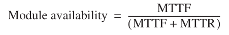

Lưu ý reliability và availability lúc này là những metric định lượng được, thay vì từ đồng nghĩa của dependability. Từ các định nghĩa này, chúng ta có thể ước lượng reliability của hệ thống theo cách định lượng nếu đưa ra một số giả định về reliability của component và giả định các failure độc lập.

**Ví dụ** Giả sử disk subsystem có các component và MTTF như sau:

- 10 disk, mỗi disk có MTTF định mức 1,000,000-hour

- 1 ATA controller, MTTF 500,000-hour

- 1 power supply, MTTF 200,000-hour

- 1 fan, MTTF 200,000-hour

- 1 ATA cable, MTTF 1,000,000-hour

Với các giả định đơn giản hóa rằng lifetime phân bố theo hàm mũ và failure độc lập, hãy tính MTTF của toàn hệ thống.

**Trả lời** Tổng các failure rate là

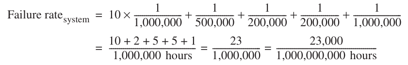

tức 23,000 FIT. MTTF của hệ thống chính là nghịch đảo failure rate:

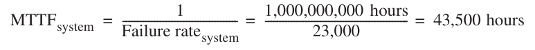

tức chỉ dưới 5 năm một chút.

Cách chính để đối phó failure là redundancy, theo thời gian (lặp lại operation để xem nó còn sai hay không) hoặc theo resource (có component khác tiếp quản từ component bị failure). Khi component đã được thay thế và hệ thống sửa chữa hoàn toàn, dependability của hệ thống được giả định tốt như mới. Hãy định lượng lợi ích của redundancy qua một ví dụ.

**Ví dụ** Disk subsystem thường có power supply dự phòng để cải thiện dependability. Dùng các component và MTTF ở trên, hãy tính reliability của power supply dự phòng. Giả sử một power supply đủ vận hành disk subsystem và chúng ta thêm một power supply dự phòng.

**Trả lời** Chúng ta cần công thức thể hiện điều có thể kỳ vọng khi chịu được một failure mà vẫn cung cấp service. Để tính toán đơn giản, giả sử lifetime của component phân bố theo hàm mũ và các component failure không phụ thuộc nhau. MTTF của các power supply dự phòng bằng thời gian trung bình tới khi một power supply hỏng chia cho xác suất power supply còn lại hỏng trước khi thay thế cái đầu. Vì vậy, nếu xác suất có failure thứ hai trước khi sửa chữa là nhỏ, MTTF của cả cặp sẽ lớn.

Vì có hai power supply và các failure độc lập, thời gian trung bình tới khi một disk hỏng là MTTFpower supply/2. Một xấp xỉ tốt cho xác suất failure thứ hai là MTTR chia cho thời gian trung bình tới khi power supply còn lại hỏng. Vì vậy, xấp xỉ hợp lý cho một cặp power supply dự phòng là

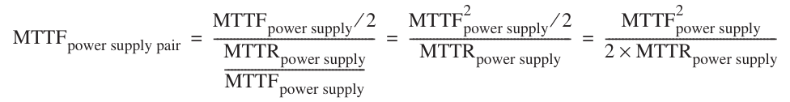

Dùng các giá trị MTTF trên, nếu giả sử trung bình cần 24 giờ để người vận hành nhận ra power supply hỏng và thay thế nó, reliability của cặp power supply fault tolerant là

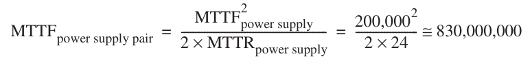

khiến cả cặp đáng tin cậy hơn khoảng 4150 lần so với một power supply. Sau khi định lượng cost, power và dependability của công nghệ máy tính, chúng ta đã sẵn sàng định lượng performance.

## 1.8 Đo lường, báo cáo và tổng hợp Performance

Khi nói máy tính này nhanh hơn máy tính khác, chúng ta muốn nói gì? Người dùng desktop có thể nói máy tính nhanh hơn khi một chương trình chạy tốn ít thời gian hơn, còn quản trị viên Amazon.com có thể nói máy tính nhanh hơn khi hoàn thành nhiều transaction mỗi giờ hơn. Người dùng máy tính quan tâm giảm response time—thời gian từ lúc bắt đầu đến khi hoàn thành một sự kiện—cũng gọi là execution time. Người vận hành máy tính warehouse-scale có thể quan tâm tăng throughput—tổng lượng công việc hoàn thành trong một khoảng thời gian cho trước.

Khi so sánh các phương án thiết kế, chúng ta thường muốn liên hệ performance của hai máy tính khác nhau, chẳng hạn X và Y. Ở đây, cụm “X nhanh hơn Y” nghĩa là response time hoặc execution time của một task cụ thể trên X thấp hơn trên Y. Cụ thể, “X nhanh gấp n lần Y” sẽ nghĩa là:

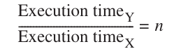

Vì execution time là nghịch đảo của performance, quan hệ sau đúng:

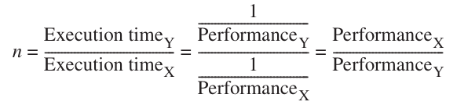

Ở đây, cụm “throughput của X cao gấp 1.3 lần Y” nghĩa là số task hoàn thành mỗi đơn vị thời gian trên máy tính X bằng 1.3 lần số task hoàn thành trên Y.

Thật không may, thời gian không phải lúc nào cũng là metric được trích dẫn khi so sánh performance máy tính. Quan điểm của chúng tôi là thước đo performance nhất quán và đáng tin cậy duy nhất chính là execution time của chương trình thực, và mọi đề xuất dùng thứ khác thay thời gian làm metric hoặc dùng thứ khác thay chương trình thực làm đối tượng đo cuối cùng đều dẫn tới tuyên bố gây hiểu lầm, thậm chí sai lầm trong thiết kế máy tính.

Ngay cả execution time cũng có thể định nghĩa khác nhau tùy những gì được tính vào. Định nghĩa trực tiếp nhất được gọi là wall-clock time, response time hoặc elapsed time: latency để hoàn tất task, gồm disk access, memory access, hoạt động input/output, operating system overhead—tất cả mọi thứ. Với multiprogramming, processor xử lý chương trình khác trong khi chờ I/O và không nhất thiết giảm thiểu elapsed time của một chương trình. Vì vậy, cần thuật ngữ xét tới hoạt động này. CPU time thể hiện sự phân biệt đó: thời gian processor tính toán, không gồm thời gian chờ I/O hoặc chạy chương trình khác. (Rõ ràng, response time người dùng thấy là elapsed time của chương trình, không phải CPU time.)

Những người dùng thường xuyên chạy cùng các program sẽ là ứng viên lý tưởng để đánh giá máy tính mới. Để đánh giá hệ thống mới, họ chỉ cần so sánh execution time của workload của mình—hỗn hợp program và operating system command mà user chạy trên máy tính. Tuy nhiên, ít người ở trong tình huống thuận lợi đó. Phần lớn phải dựa vào phương pháp khác để đánh giá máy tính, và thường cả những người đánh giá khác, với hy vọng các phương pháp ấy dự đoán được performance khi họ sử dụng máy tính mới.

### Benchmark

Lựa chọn benchmark tốt nhất để đo performance là ứng dụng thực, như Google Goggles ở Mục 1.1. Những nỗ lực chạy chương trình đơn giản hơn nhiều so với ứng dụng thực đã dẫn tới các bẫy performance. Ví dụ gồm:

- Kernel, là những đoạn nhỏ nhưng then chốt của ứng dụng thực

- Chương trình đồ chơi, là các chương trình 100-line trong bài tập lập trình nhập môn, chẳng hạn quicksort

- Synthetic benchmark, là chương trình giả được tạo ra để cố khớp profile và hành vi của ứng dụng thực, chẳng hạn Dhrystone

Ngày nay cả ba đều không được tin cậy, thường vì người viết compiler và architect có thể phối hợp khiến máy tính có vẻ nhanh hơn với những chương trình stand-in này so với ứng dụng thực. Thật đáng buồn cho các tác giả—chúng tôi đã bỏ phần ngộ nhận về dùng synthetic program mô tả performance trong ấn bản thứ tư vì tưởng các computer architect đồng ý rằng cách đó không đáng tin—synthetic program Dhrystone vẫn là benchmark được trích dẫn rộng rãi nhất cho embedded processor!

Một vấn đề khác là điều kiện chạy benchmark. Một cách cải thiện performance benchmark từng được dùng là flag benchmark-specific; những flag này thường gây biến đổi không hợp lệ với nhiều chương trình hoặc làm giảm performance chương trình khác. Để hạn chế quá trình đó và tăng ý nghĩa kết quả, người phát triển benchmark thường yêu cầu vendor dùng một compiler và một bộ flag cho mọi chương trình cùng ngôn ngữ (C++ hoặc C). Ngoài compiler flag, câu hỏi khác là có cho phép sửa source code không. Có ba cách trả lời khác nhau:

1. Không được phép sửa source code.

2. Được phép sửa source code, nhưng về cơ bản không thể thực hiện. Chẳng hạn, database benchmark dựa vào chương trình database tiêu chuẩn có hàng chục triệu dòng code. Rất khó có khả năng công ty database sửa đổi để tăng performance cho một máy tính cụ thể.

3. Được phép sửa source, miễn là phiên bản đã sửa tạo cùng output. Vấn đề then chốt mà người thiết kế benchmark đối mặt khi quyết định cho phép sửa source là liệu những thay đổi ấy có phản ánh thực tiễn và cung cấp hiểu biết hữu ích cho user hay không, hay chúng chỉ làm giảm độ chính xác của benchmark khi dự đoán performance thực.

Để tránh nguy cơ đặt quá nhiều trứng vào một giỏ, các tập hợp ứng dụng benchmark, gọi là benchmark suite, là thước đo phổ biến của processor performance với nhiều ứng dụng. Tất nhiên, suite chỉ tốt bằng những benchmark riêng cấu thành nó. Tuy vậy, ưu điểm then chốt là điểm yếu của bất kỳ benchmark nào được giảm bớt nhờ sự hiện diện của benchmark khác. Mục tiêu benchmark suite là mô tả performance tương đối của hai máy tính, đặc biệt với chương trình không có trong suite nhưng khách hàng có khả năng chạy.

Một ví dụ cảnh tỉnh là các benchmark Electronic Design News Embedded Microprocessor Benchmark Consortium (EEMBC, phát âm “embassy”). Đây là tập hợp 41 kernel dùng dự đoán performance ứng dụng embedded khác nhau: ô tô/công nghiệp, tiêu dùng, networking, tự động hóa văn phòng và viễn thông. EEMBC báo cáo performance không chỉnh sửa và performance “full fury”, trong đó gần như cách gì cũng được. Vì dùng kernel và vì các tùy chọn báo cáo đó, EEMBC không được xem là công cụ dự đoán tốt performance tương đối của máy tính embedded khác nhau ngoài thực tế. Việc thiếu thành công này là lý do Dhrystone, thứ EEMBC định thay thế, vẫn được dùng.

Một trong những nỗ lực thành công nhất tạo bộ ứng dụng benchmark chuẩn hóa là SPEC (Standard Performance Evaluation Corporation), bắt nguồn từ những cố gắng cuối thập niên 1980 nhằm cung cấp benchmark tốt hơn cho workstation. Cũng như ngành máy tính phát triển theo thời gian, nhu cầu benchmark suite khác nhau cũng phát triển, và hiện có SPEC benchmark bao phủ nhiều lớp ứng dụng. Tất cả SPEC benchmark suite cùng kết quả báo cáo có tại www.spec.org.

Dù chúng ta tập trung thảo luận SPEC benchmark trong nhiều mục tiếp theo, cũng có nhiều benchmark được phát triển cho PC chạy operating system Windows.

#### Desktop Benchmark

Desktop benchmark chia thành hai lớp lớn: benchmark processor-intensive và graphics-intensive, dù nhiều graphics benchmark có hoạt động processor cường độ cao. Ban đầu SPEC tạo bộ benchmark tập trung processor performance (tên đầu SPEC89), đã phát triển tới thế hệ thứ năm: SPEC CPU2006, sau SPEC2000, SPEC95 SPEC92 và SPEC89. SPEC CPU2006 gồm 12 integer benchmark (CINT2006) và 17 benchmark floating-point (CFP2006). Hình 1.16 mô tả các SPEC benchmark hiện tại và những thế hệ trước của chúng.

SPEC benchmark là chương trình thực được sửa để portable và giảm thiểu ảnh hưởng I/O tới performance. Integer benchmark trải từ một phần compiler C, chương trình cờ vua tới mô phỏng quantum computer. Benchmark floating-point gồm code structured grid cho finite element modeling, code particle method cho molecular dynamics và code sparse linear algebra cho fluid dynamics. SPEC CPU suite hữu ích để benchmark processor cho cả desktop lẫn server single-processor. Chúng ta sẽ thấy dữ liệu của nhiều chương trình này xuyên suốt sách. Tuy nhiên, lưu ý chúng có ít điểm chung với ngôn ngữ, môi trường lập trình và ứng dụng Google Goggles mô tả ở Mục 1.1. Bảy chương trình dùng C++, tám dùng C và chín dùng Fortran! Chúng thậm chí được statically linked, và bản thân ứng dụng cũng tẻ nhạt. Không rõ SPECINT2006 và SPECFP2006 có nắm bắt điều thú vị về computing thế kỷ 21 hay không.

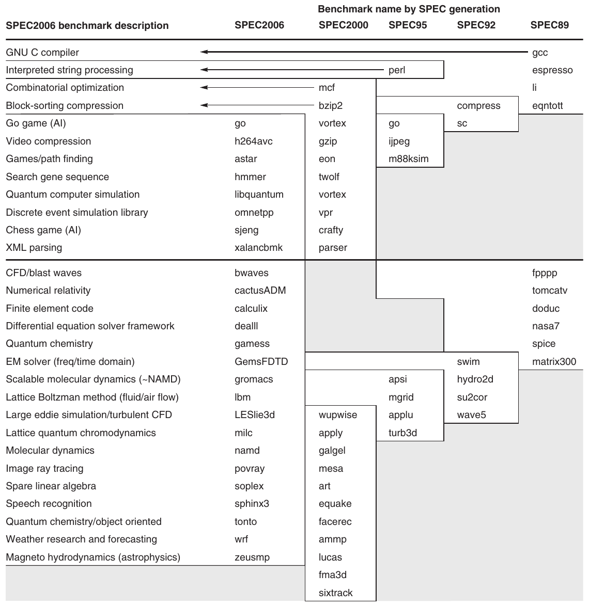

**Hình 1.16 Các chương trình SPEC2006 và sự phát triển của SPEC benchmark theo thời gian, với integer program phía trên đường kẻ và chương trình floating-point phía dưới. Trong 12 integer program SPEC2006, 9 được viết bằng C, còn lại bằng C++. Với chương trình floating-point, có 6 bằng Fortran, 4 bằng C++, 3 bằng C và 4 kết hợp C với Fortran. Hình thể hiện toàn bộ 70 chương trình trong các bản phát hành 1989, 1992, 1995, 2000 và 2006. Mô tả benchmark bên trái chỉ dành cho SPEC2006, không áp dụng phiên bản trước. Chương trình cùng hàng từ các thế hệ SPEC khác nhau thường không liên quan; chẳng hạn fpppp không phải CFD code như bwaves. Gcc là bậc cao niên của nhóm. Chỉ 3 integer program và 3 chương trình floating-point tồn tại qua ba thế hệ trở lên. Lưu ý mọi chương trình floating-point đều mới với SPEC2006. Dù vài chương trình được giữ qua các thế hệ, phiên bản chương trình thay đổi, và input hoặc benchmark size thường được đổi để tăng thời gian chạy, tránh nhiễu đo lường hoặc việc execution time bị chi phối bởi yếu tố khác ngoài CPU time.**

Ở Mục 1.11, chúng ta mô tả các bẫy từng gặp khi phát triển SPEC benchmark suite, cùng những thách thức duy trì một suite hữu ích và có khả năng dự đoán.

SPEC CPU2006 hướng tới processor performance, nhưng SPEC còn cung cấp nhiều benchmark khác.

#### Server Benchmark

Cũng như server có nhiều chức năng, benchmark cũng có nhiều loại. Đơn giản nhất có lẽ là benchmark processor throughput-oriented. SPEC CPU2000 dùng SPEC CPU benchmark xây benchmark throughput đơn giản, trong đó có thể đo processing rate của multiprocessor bằng cách chạy nhiều bản sao (thường bằng số processor) của mỗi SPEC CPU benchmark rồi đổi CPU time thành rate. Phép đo này gọi là SPECrate, đo request-level parallelism ở Mục 1.2. Để đo thread-level parallelism, SPEC cung cấp thứ họ gọi là benchmark high-performance computing xoay quanh OpenMP và MPI.

Ngoài SPECrate, phần lớn ứng dụng và benchmark server có hoạt động I/O đáng kể từ disk hoặc network traffic, gồm benchmark cho file server, Web server và hệ thống database, transaction-processing. SPEC cung cấp cả file server benchmark (SPECSFS) lẫn Web server benchmark (SPECWeb). SPECSFS đo performance NFS (Network File System) bằng script chứa file server request; nó kiểm thử performance của I/O system (cả disk và network I/O) cùng processor. SPECSFS là benchmark throughput-oriented nhưng có yêu cầu response time quan trọng. (Phụ lục D thảo luận chi tiết vài benchmark file và I/O system.) SPECWeb là Web server benchmark mô phỏng nhiều client yêu cầu cả trang static lẫn dynamic từ server, cũng như client gửi dữ liệu lên server. SPECjbb đo server performance cho ứng dụng Web viết bằng Java. SPEC benchmark mới nhất là SPECvirt_Sc2010, đánh giá performance end-to-end của datacenter server được virtualize, gồm hardware, virtual machine layer và guest operating system được virtualize. Một SPEC benchmark gần đây khác đo power, sẽ xem ở Mục 1.10.

Benchmark Transaction-processing (TP) đo khả năng hệ thống xử lý transaction gồm database access và update. Hệ thống đặt vé máy bay và ATM ngân hàng là ví dụ TP đơn giản điển hình; hệ thống TP tinh vi hơn liên quan database phức tạp và decision-making. Vào mid-1980s, nhóm kỹ sư quan tâm lập Transaction Processing Council (TPC) vendor-independent để cố tạo benchmark TP thực tế và công bằng. Các TPC benchmark được mô tả tại www.tpc.org.

TPC benchmark đầu tiên, TPC-A, công bố năm 1985, từ đó được thay thế và tăng cường bằng nhiều benchmark khác nhau. TPC-C, tạo lần đầu năm 1992, mô phỏng môi trường query phức tạp. TPC-H mô hình hóa ad hoc decision support—các query không liên quan và hiểu biết query quá khứ không thể dùng tối ưu query tương lai. TPC-E là workload On-Line Transaction Processing (OLTP) mới mô phỏng tài khoản khách hàng của công ty môi giới. Nỗ lực gần đây nhất là TPC Energy, thêm energy metric vào mọi TPC benchmark hiện có.

Mọi TPC benchmark đều đo performance bằng transaction mỗi giây. Ngoài ra, chúng có yêu cầu response time, nên chỉ đo throughput performance khi đáp ứng giới hạn response time. Để mô hình hệ thống real-world, transaction rate cao hơn cũng gắn với hệ thống lớn hơn, cả về người dùng lẫn database mà transaction tác động. Cuối cùng, phải bao gồm system cost của hệ thống benchmark để so sánh chính xác cost-performance. TPC sửa pricing policy để có một specification duy nhất cho mọi TPC benchmark và cho phép xác minh giá TPC công bố.

### Báo cáo kết quả Performance

Nguyên tắc chỉ đạo khi báo cáo phép đo performance phải là reproducibility—liệt kê mọi thứ người làm thí nghiệm khác cần để tái tạo kết quả. Báo cáo SPEC benchmark yêu cầu mô tả đầy đủ máy tính và compiler flag, cùng công bố cả baseline lẫn optimized result. Ngoài mô tả hardware, software và baseline tuning parameter, báo cáo SPEC chứa performance time thực tế, cả dạng bảng lẫn đồ thị. Báo cáo TPC benchmark còn đầy đủ hơn vì phải gồm kết quả benchmarking audit và thông tin cost. Những báo cáo này là nguồn tuyệt vời tìm cost thật của computing system, vì nhà sản xuất cạnh tranh về performance cao và cost-performance.

### Tổng hợp kết quả Performance

Trong thiết kế máy tính thực tế, bạn phải đánh giá vô số lựa chọn thiết kế về lợi ích định lượng tương đối trên một benchmark suite được cho là phù hợp. Tương tự, người tiêu dùng muốn chọn máy tính sẽ dựa vào phép đo performance từ benchmark, với hy vọng benchmark tương tự ứng dụng của mình. Trong cả hai trường hợp, có phép đo cho một benchmark suite rất hữu ích, để performance của các ứng dụng quan trọng tương tự một hoặc nhiều benchmark trong suite và để có thể hiểu được mức biến thiên performance. Trong trường hợp lý tưởng, suite giống một mẫu hợp lệ về mặt thống kê của không gian ứng dụng, nhưng mẫu như vậy cần nhiều benchmark hơn mức thường có trong phần lớn suite và đòi hỏi lấy mẫu ngẫu nhiên, điều mà về cơ bản không benchmark suite nào sử dụng.

Khi đã chọn đo performance bằng benchmark suite, chúng ta muốn tổng hợp kết quả thành một con số duy nhất. Cách trực tiếp là so sánh trung bình cộng execution time của các chương trình trong suite. Đáng tiếc, vài chương trình SPEC chạy lâu gấp bốn chương trình khác, nên chúng sẽ quan trọng hơn nhiều nếu trung bình cộng là con số tổng hợp duy nhất. Một cách khác là thêm trọng số cho mỗi benchmark và dùng trung bình cộng có trọng số làm con số tổng hợp. Khi đó vấn đề là chọn trọng số; vì SPEC là liên minh công ty cạnh tranh, mỗi công ty có thể ưa bộ trọng số riêng, khiến khó đồng thuận. Một cách là chọn trọng số để mọi chương trình có execution time bằng nhau trên máy tính tham chiếu, nhưng điều đó làm kết quả thiên về đặc tính performance của máy tham chiếu.

Thay vì chọn trọng số, ta có thể normalize execution time theo một máy tính tham chiếu bằng cách lấy thời gian trên máy tham chiếu chia thời gian trên máy được đánh giá, thu được tỷ số tỷ lệ với performance. SPEC dùng cách này, gọi tỷ số là SPECRatio. Nó có thuộc tính đặc biệt hữu ích là phù hợp cách chúng ta so sánh computer performance xuyên suốt sách—cụ thể là so sánh performance ratio. Chẳng hạn, giả sử SPECRatio của máy tính A trên một benchmark cao gấp 1.25 lần máy tính B; khi đó chúng ta biết:

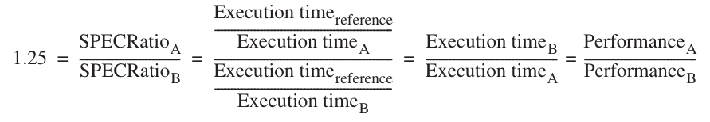

Lưu ý execution time trên máy tham chiếu bị triệt tiêu và lựa chọn máy tham chiếu không quan trọng khi so sánh dưới dạng tỷ số, cách chúng ta nhất quán sử dụng. Hình 1.17 đưa ra ví dụ.

Vì SPECRatio là tỷ số chứ không phải execution time tuyệt đối, phải tính trung bình bằng trung bình nhân. (Vì SPECRatio không có đơn vị, so sánh chúng bằng phép tính trung bình cộng là vô nghĩa.) Công thức là

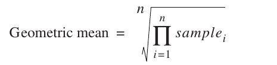

| Benchmark | Thời gian Ultra 5 (giây) | Thời gian Opteron (giây) | SPECRatio | Thời gian Itanium 2 (giây) | SPECRatio | Thời gian Opteron/Itanium (giây) | SPECRatio Itanium/Opteron |
|---|---|---|---|---|---|---|---|
| wupwise | 1600 | 51.5 | 31.06 | 56.1 | 28.53 | 0.92 | 0.92 |
| swim | 3100 | 125.0 | 24.73 | 70.7 | 43.85 | 1.77 | 1.77 |
| mgrid | 1800 | 98.0 | 18.37 | 65.8 | 27.36 | 1.49 | 1.49 |
| applu | 2100 | 94.0 | 22.34 | 50.9 | 41.25 | 1.85 | 1.85 |
| mesa | 1400 | 64.6 | 21.69 | 108.0 | 12.99 | 0.60 | 0.60 |
| galgel | 2900 | 86.4 | 33.57 | 40.0 | 72.47 | 2.16 | 2.16 |
| art | 2600 | 92.4 | 28.13 | 21.0 | 123.67 | 4.40 | 4.40 |
| equake | 1300 | 72.6 | 17.92 | 36.3 | 35.78 | 2.00 | 2.00 |
| facerec | 1900 | 73.6 | 25.80 | 86.9 | 21.86 | 0.85 | 0.85 |
| ammp | 2200 | 136.0 | 16.14 | 132.0 | 16.63 | 1.03 | 1.03 |
| lucas | 2000 | 88.8 | 22.52 | 107.0 | 18.76 | 0.83 | 0.83 |
| fma3d | 2100 | 120.0 | 17.48 | 131.0 | 16.09 | 0.92 | 0.92 |
| sixtrack | 1100 | 123.0 | 8.95 | 68.8 | 15.99 | 1.79 | 1.79 |
| apsi | 2600 | 150.0 | 17.36 | 231.0 | 11.27 | 0.65 | 0.65 |
| Trung bình nhân |  |  | 20.86 |  | 27.12 | 1.30 | 1.30 |

**Hình 1.17 Execution time SPECfp2000 (tính bằng giây) của Sun Ultra 5—máy tham chiếu SPEC2000—cùng execution time và SPECRatio của AMD Opteron và Intel Itanium 2. (SPEC2000 nhân tỷ số execution time với 100 để bỏ dấu thập phân khỏi kết quả, nên 20.86 được báo cáo thành 2086.) Hai cột cuối là tỷ số execution time và SPECRatio. Hình này chứng minh máy tham chiếu không ảnh hưởng tới performance tương đối. Tỷ số execution time đồng nhất với tỷ số SPECRatio, và tỷ số các trung bình nhân (27.12/20.86 = 1.30) đồng nhất với trung bình nhân các tỷ số (1.30).**

Trong trường hợp SPEC, samplei là SPECRatio cho chương trình i. Dùng trung bình nhân bảo đảm hai thuộc tính quan trọng:

1. Trung bình nhân của các tỷ số bằng tỷ số của các trung bình nhân.

2. Tỷ số của các trung bình nhân bằng trung bình nhân của các performance ratio, nghĩa là lựa chọn máy tính tham chiếu không quan trọng.

Vì vậy, có lý do vững chắc để dùng trung bình nhân, đặc biệt khi dùng performance ratio để so sánh.

**Ví dụ** Chứng minh tỷ số của các trung bình nhân bằng trung bình nhân của các performance ratio, và máy tính tham chiếu của SPECRatio không quan trọng.

**Trả lời** Giả sử có hai máy tính A và B, mỗi máy có một tập SPECRatio.

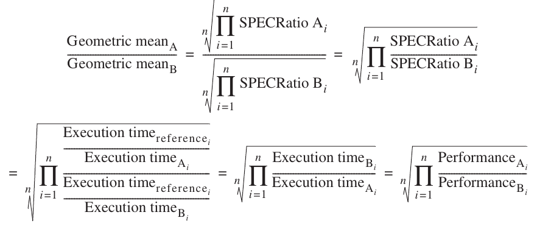

Nghĩa là, tỷ số trung bình nhân SPECRatio của A và B bằng trung bình nhân các performance ratio của A so với B trên mọi benchmark trong suite. Hình 1.17 chứng minh tính đúng đắn này bằng ví dụ từ SPEC.

## 1.9 Các nguyên tắc định lượng trong thiết kế máy tính

Sau khi tìm hiểu cách định nghĩa, đo lường và tổng hợp performance, cost, dependability, energy và power, chúng ta có thể khám phá các hướng dẫn, nguyên tắc hữu ích khi thiết kế và phân tích máy tính. Mục này giới thiệu những quan sát quan trọng về thiết kế cùng hai phương trình đánh giá các phương án.

### Tận dụng Parallelism

Tận dụng parallelism là một trong những phương pháp quan trọng nhất để cải thiện performance. Mỗi chương sách đều có ví dụ về nâng cao performance bằng khai thác parallelism. Ở đây, chúng ta đưa ra ba ví dụ ngắn, sẽ trình bày chi tiết ở các chương sau.

Ví dụ đầu tiên là dùng parallelism ở cấp hệ thống. Để cải thiện throughput performance trên server benchmark điển hình, như SPECWeb hoặc TPC-C, có thể dùng nhiều processor và nhiều disk. Khi đó, workload xử lý request được phân bố giữa các processor và disk, làm tăng throughput. Khả năng mở rộng memory cùng số processor và disk gọi là scalability, một ưu thế giá trị của server. Phân bố dữ liệu trên nhiều disk để read và write song song cho phép data-level parallelism. SPECWeb cũng dựa vào request-level parallelism để sử dụng nhiều processor, còn TPC-C dùng thread-level parallelism để xử lý database query nhanh hơn.

Ở cấp từng processor, tận dụng parallelism giữa instruction là thiết yếu để đạt performance cao. Một trong những cách đơn giản nhất là pipelining. (Phụ lục C giải thích kỹ hơn và đây là trọng tâm chính Chương 3.) Ý tưởng cơ bản của pipelining là chồng lấp instruction execution để giảm tổng thời gian hoàn tất một chuỗi instruction. Nhận định then chốt cho phép pipelining hoạt động là không phải instruction nào cũng phụ thuộc instruction liền trước, nên có thể thực thi instruction song song hoàn toàn hoặc một phần. Pipelining là ví dụ best-known của instruction-level parallelism.

Cũng có thể khai thác parallelism ở cấp thiết kế digital chi tiết. Chẳng hạn cache set-associative dùng nhiều memory bank, thường được tìm song song để lấy item mong muốn. ALU (arithmetic-logical unit) hiện đại dùng carry-lookahead, khai thác parallelism để tăng tốc quá trình tính tổng từ thời gian tuyến tính xuống logarithmic theo số bit mỗi operand. Đây là những ví dụ khác của data-level parallelism.

### Nguyên lý Locality

Những quan sát nền tảng quan trọng bắt nguồn từ thuộc tính chương trình. Thuộc tính quan trọng nhất chúng ta thường khai thác là principle of locality: chương trình có xu hướng dùng lại data và instruction mới dùng gần đây. Quy tắc kinh nghiệm phổ biến là chương trình dành 90% execution time trong chỉ 10% code. Một hệ quả của locality là có thể dự đoán với độ chính xác hợp lý instruction và data chương trình sẽ dùng trong tương lai gần dựa trên các access trong quá khứ gần. Principle of locality cũng áp dụng cho data access, dù không mạnh bằng code access.

Hai loại locality khác nhau đã được quan sát. Temporal locality nói rằng item mới truy cập gần đây có khả năng được truy cập trong tương lai gần. Spatial locality nói rằng item có address gần nhau thường được tham chiếu gần nhau về thời gian. Chúng ta sẽ thấy áp dụng các nguyên lý này ở Chương 2.

### Tập trung vào trường hợp phổ biến

Có lẽ nguyên tắc quan trọng và xuyên suốt nhất của thiết kế máy tính là tập trung trường hợp phổ biến: khi đưa ra design trade-off, ưu tiên trường hợp thường gặp hơn trường hợp ít gặp. Nguyên tắc này áp dụng khi xác định cách sử dụng resource, vì cải thiện có tác động lớn hơn nếu trường hợp xảy ra thường xuyên.

Tập trung trường hợp phổ biến có hiệu quả với power cũng như resource allocation và performance. Instruction fetch và decode unit của processor có thể được dùng thường xuyên hơn nhiều so với multiplier, nên hãy tối ưu nó trước. Nguyên tắc cũng hiệu quả với dependability. Nếu database server có 50 disk cho mỗi processor, storage dependability sẽ chi phối system dependability.

Ngoài ra, trường hợp thường gặp thường đơn giản hơn và có thể xử lý nhanh hơn trường hợp ít gặp. Chẳng hạn khi cộng hai số trong processor, có thể kỳ vọng overflow hiếm xảy ra, nên cải thiện performance bằng tối ưu trường hợp phổ biến hơn là không overflow. Sự ưu tiên này có thể làm chậm trường hợp overflow, nhưng nếu nó hiếm thì tối ưu trường hợp bình thường sẽ cải thiện performance tổng thể.

Chúng ta sẽ thấy nhiều ví dụ nguyên tắc này xuyên suốt sách. Khi áp dụng nguyên tắc đơn giản đó, phải xác định trường hợp thường gặp là gì và tăng tốc nó cải thiện performance bao nhiêu. Có thể dùng định luật nền tảng gọi là định luật Amdahl để định lượng nguyên tắc này.

### Định luật Amdahl

Mức tăng performance đạt được nhờ cải thiện một phần máy tính có thể được tính bằng định luật Amdahl. Định luật Amdahl phát biểu rằng mức cải thiện performance nhờ dùng một chế độ thực thi nhanh hơn bị giới hạn bởi tỷ lệ thời gian có thể sử dụng chế độ nhanh hơn đó.

Định luật Amdahl xác định speedup đạt được khi dùng tính năng cụ thể. Speedup là gì? Giả sử có thể cải tiến máy tính để tăng performance khi cải tiến được sử dụng. Speedup là tỷ số:

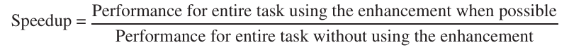

Hoặc có thể viết:

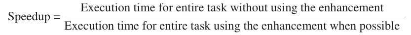

Speedup cho biết task chạy nhanh hơn bao nhiêu khi dùng máy tính có cải tiến so với máy tính ban đầu.

Định luật Amdahl cung cấp cách nhanh để tìm speedup từ một cải tiến, phụ thuộc hai yếu tố:

1. Tỷ lệ computation time trên máy tính ban đầu có thể chuyển sang tận dụng cải tiến—Chẳng hạn, nếu 20 giây trong execution time của một program mất tổng cộng 60 giây có thể dùng cải tiến, tỷ lệ này là 20/60. Giá trị này, ta gọi là Fractionenhanced, luôn nhỏ hơn hoặc bằng 1.

2. Mức cải thiện đạt được từ chế độ thực thi cải tiến, tức task sẽ chạy nhanh hơn bao nhiêu nếu toàn bộ chương trình dùng chế độ đó—Giá trị này bằng thời gian chế độ ban đầu chia thời gian chế độ cải tiến. Chẳng hạn nếu chế độ cải tiến mất 2 giây cho một phần chương trình, còn chế độ ban đầu mất 5 giây, mức cải thiện là 5/2. Giá trị này, luôn lớn hơn 1, được gọi là Speedupenhanced.

Execution time khi dùng máy tính ban đầu có chế độ cải tiến bằng thời gian sử dụng phần chưa cải tiến của máy tính cộng thời gian sử dụng cải tiến:

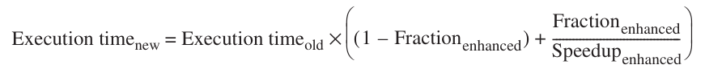

Speedup tổng thể là tỷ số các execution time:

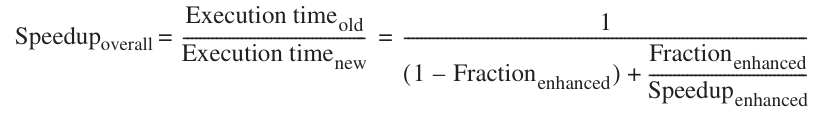

**Ví dụ** Giả sử muốn cải tiến processor dùng phục vụ Web. Processor mới tính toán trong ứng dụng phục vụ Web nhanh gấp 10 lần processor ban đầu. Giả sử processor ban đầu bận tính toán 40% thời gian và chờ I/O 60% thời gian, speedup tổng thể đạt được khi tích hợp cải tiến là bao nhiêu?

**Trả lời**

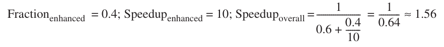

Định luật Amdahl thể hiện quy luật lợi ích giảm dần: mức speedup tăng thêm đạt được nhờ cải thiện chỉ một phần computation sẽ giảm dần khi tiếp tục bổ sung cải tiến. Một hệ quả quan trọng của định luật Amdahl là nếu một cải tiến chỉ dùng được cho một tỷ lệ của task, ta không thể tăng tốc task vượt quá nghịch đảo của 1 trừ tỷ lệ đó.

Một sai lầm thường gặp khi áp dụng định luật Amdahl là nhầm “tỷ lệ thời gian được chuyển sang dùng cải tiến” với “tỷ lệ thời gian sau khi cải tiến đã được đưa vào sử dụng”. Nếu thay vì đo thời gian computation có thể sử dụng cải tiến, ta lại đo thời gian sau khi cải tiến đã được sử dụng, kết quả sẽ không đúng!

Định luật Amdahl có thể chỉ dẫn một cải tiến sẽ tăng performance đến đâu và cách phân bổ resource để cải thiện cost-performance. Rõ ràng, mục tiêu là dành resource tỷ lệ với thời gian tiêu tốn ở từng nơi. Định luật Amdahl đặc biệt hữu ích khi so sánh performance toàn hệ thống của hai phương án, nhưng cũng có thể được áp dụng để so sánh hai phương án thiết kế processor, như ví dụ sau cho thấy.

**Ví dụ** Một phép biến đổi thường cần trong graphics processor là căn bậc hai. Các triển khai căn bậc hai floating-point (FP) khác nhau đáng kể về performance, đặc biệt giữa processor được thiết kế cho graphics. Giả sử căn bậc hai FP (FPSQR) chiếm 20% execution time của graphics benchmark then chốt. Một đề xuất là cải tiến hardware FPSQR, tăng tốc operation này lên 10 lần. Phương án kia chỉ cố làm mọi FP instruction trong graphics processor chạy nhanh hơn 1.6 lần; FP instruction chiếm một nửa execution time ứng dụng. Nhóm thiết kế tin rằng có thể làm mọi FP instruction nhanh hơn 1.6 lần với cùng công sức cần cho căn bậc hai nhanh. Hãy so sánh hai phương án thiết kế này.

**Trả lời** Chúng ta có thể so sánh hai phương án này bằng cách so sánh speedup:

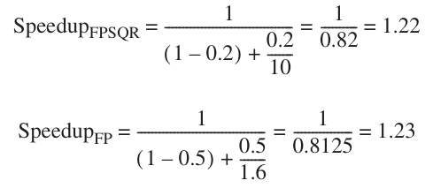

Cải thiện performance các FP operation nói chung tốt hơn một chút vì tần suất cao hơn.

Định luật Amdahl còn áp dụng ngoài performance. Hãy làm lại ví dụ reliability trang 35 sau khi cải thiện reliability của power supply bằng redundancy, từ MTTF 200,000-hour lên 830,000,000-hour, tức tốt hơn 4150X.

**Ví dụ** Phép tính failure rate của disk subsystem là

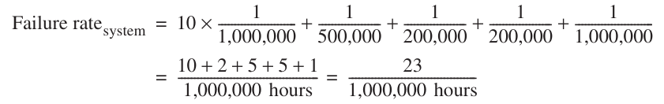

Vì vậy, phần tỷ lệ failure rate có thể cải thiện là 5 trên mỗi triệu giờ trong tổng 23 của toàn hệ thống, tức 0.22.

**Trả lời** Mức cải thiện reliability sẽ là

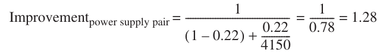

Dù reliability của một module cải thiện ấn tượng 4150X, nhìn từ toàn hệ thống, thay đổi mang lại lợi ích đo được nhưng nhỏ.

Trong các ví dụ trên, chúng ta cần biết tỷ lệ do phiên bản mới đã được cải tiến tiêu tốn; thường khó đo trực tiếp những khoảng thời gian này. Trong mục tiếp theo, chúng ta sẽ thấy cách khác để thực hiện những so sánh ấy, dựa vào một phương trình tách CPU execution time thành ba thành phần riêng biệt. Nếu biết một phương án ảnh hưởng ba thành phần này thế nào, ta có thể xác định performance tổng thể của nó. Hơn nữa, thường có thể xây simulator đo các thành phần này trước khi hardware thực sự được thiết kế.

### Phương trình Processor Performance

Về cơ bản, mọi máy tính đều được xây dựng bằng clock chạy với rate không đổi. Các sự kiện thời gian rời rạc này được gọi là tick, clock tick, clock period, clock, cycle hoặc clock cycle. Người thiết kế máy tính mô tả thời gian của clock period bằng độ dài (ví dụ 1 ns) hoặc rate (ví dụ 1 GHz). Khi đó, CPU time của chương trình có thể biểu diễn theo hai cách:

CPU time = CPU clock cycles for a program × Clock cycle time

hoặc

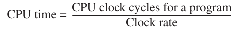

Ngoài số clock cycle cần để thực thi chương trình, cũng có thể đếm số instruction được thực thi—gọi là instruction path length hoặc instruction count (IC). Nếu biết số clock cycle và instruction count, có thể tính số clock cycle trung bình trên mỗi instruction (CPI). Vì dễ thao tác hơn và vì chương này xét processor đơn giản, chúng ta dùng CPI. Đôi khi người thiết kế cũng dùng instructions per clock (IPC), nghịch đảo CPI.

CPI được tính như sau

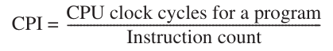

Thước đo chất lượng processor này giúp hiểu các kiểu instruction set và triển khai khác nhau, và chúng ta sẽ dùng nó rộng rãi trong bốn chương tiếp theo.

Bằng cách chuyển vế instruction count trong công thức trên, có thể định nghĩa clock cycle là IC × CPI. Điều đó cho phép dùng CPI trong công thức execution time:

CPU time = Instruction count × Cycles per instruction × Clock cycle time

Khai triển công thức đầu theo các đơn vị đo cho thấy các thành phần kết hợp với nhau thế nào:

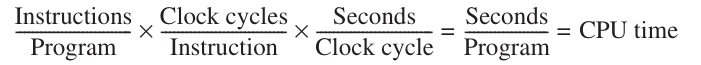

Như công thức thể hiện, processor performance phụ thuộc ba đặc tính: clock cycle (hoặc rate), clock cycle trên mỗi instruction và instruction count. Hơn nữa, CPU time phụ thuộc như nhau vào ba đặc tính; chẳng hạn cải thiện 10% ở bất kỳ đặc tính nào dẫn tới cải thiện 10% CPU time.

Đáng tiếc, khó thay đổi một parameter hoàn toàn độc lập với parameter khác vì công nghệ cơ bản liên quan tới thay đổi từng đặc tính phụ thuộc lẫn nhau:

- Clock cycle time—Công nghệ và tổ chức hardware

- CPI—Tổ chức và instruction set architecture

- Instruction count—Instruction set architecture và công nghệ compiler

May thay, nhiều kỹ thuật cải thiện performance tiềm năng chủ yếu cải thiện một thành phần processor performance, chỉ tác động nhỏ hoặc dự đoán được lên hai thành phần còn lại.

Đôi khi trong thiết kế processor, sẽ hữu ích khi tính tổng số processor clock cycle như sau

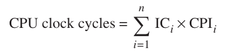

trong đó IC i biểu thị số lần instruction i được thực thi trong chương trình, còn CPI i biểu thị số clock trung bình trên mỗi instruction đối với instruction i. Có thể dùng dạng này biểu diễn CPU time như sau

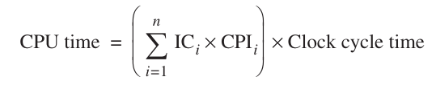

và CPI tổng thể như sau

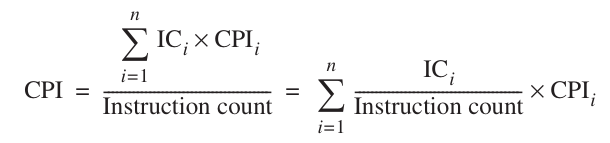

Dạng tính CPI sau dùng từng CPI i riêng cùng phần tỷ lệ xuất hiện của instruction đó trong chương trình (tức ICi ÷ Instruction count). CPI i cần được đo chứ không chỉ tính từ bảng ở cuối reference manual, vì phải bao gồm hiệu ứng pipeline, cache miss và mọi sự kém hiệu quả khác của memory system.

Hãy xét ví dụ performance ở trang 47, tại đây sửa để dùng phép đo tần suất instruction và giá trị CPI của instruction; trong thực tế, chúng thu được bằng simulation hoặc hardware instrumentation.

**Ví dụ** Giả sử đã thực hiện những phép đo sau:

Frequency of FP operations = 25%

Average CPI of FP operations = 4.0

Average CPI of other instructions = 1.33

Frequency of FPSQR = 2%

CPI of FPSQR = 20

Giả sử hai phương án thiết kế là giảm CPI của FPSQR xuống 2 hoặc giảm CPI trung bình của mọi FP operation xuống 2.5. Hãy so sánh hai phương án bằng phương trình processor performance.

**Trả lời** Trước hết, lưu ý chỉ CPI thay đổi; clock rate và instruction count vẫn như nhau. Chúng ta bắt đầu bằng tìm CPI ban đầu khi chưa có cải tiến nào:

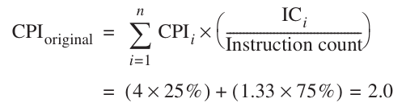

Chúng ta có thể tính CPI khi cải tiến FPSQR bằng cách lấy CPI ban đầu trừ đi số cycle tiết kiệm được:

CPI with new FPSQR = CPIoriginal – 2% × ( CPIold FPSQR – CPI of new FPSQR only )

= 2.0 – 2% × ( 20 – 2 ) = 1.64

Chúng ta có thể tính CPI khi cải tiến mọi FP instruction theo cùng cách, hoặc bằng cách cộng các CPI của FP và non-FP. Dùng cách sau cho kết quả:

CPInew FP = ( 75% × 1.33 ) + ( 25% × 2.5 ) = 1.625

Vì CPI khi cải tiến toàn bộ FP thấp hơn một chút, performance sẽ tốt hơn đôi chút. Cụ thể, speedup của cải tiến toàn bộ FP là

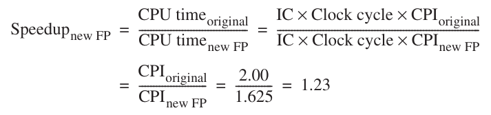

Thật tốt, chúng ta thu được cùng speedup này khi dùng định luật Amdahl ở trang 46.

Thường có thể đo các thành phần cấu thành phương trình processor performance. Đây là ưu điểm then chốt của việc dùng phương trình processor performance so với định luật Amdahl trong ví dụ trước. Cụ thể, có thể khó đo những đại lượng như tỷ lệ execution time mà một tập instruction chiếm. Trong thực tế, đại lượng này có lẽ được tính bằng cách lấy tổng các tích instruction count với CPI cho từng instruction trong tập. Vì điểm xuất phát thường là các phép đo instruction count và CPI riêng lẻ, phương trình processor performance vô cùng hữu ích.

Để dùng phương trình processor performance làm công cụ thiết kế, cần đo được các yếu tố khác nhau. Với processor hiện có, dễ lấy execution time bằng đo lường và biết default clock speed. Thách thức là tìm instruction count hoặc CPI. Phần lớn processor mới có counter cho cả instruction đã thực thi lẫn clock cycle. Theo dõi định kỳ những counter này còn cho phép gắn execution time và instruction count với các đoạn code, hữu ích cho lập trình viên muốn hiểu và tinh chỉnh performance ứng dụng. Thường người thiết kế hoặc lập trình viên muốn hiểu performance ở mức fine-grained hơn dữ liệu hardware counter cung cấp. Chẳng hạn họ có thể muốn biết tại sao CPI có giá trị như vậy. Trong trường hợp đó, kỹ thuật simulation được dùng tương tự kỹ thuật dành cho processor đang thiết kế.

Kỹ thuật giúp cải thiện energy efficiency, như dynamic voltage frequency scaling và overclocking (xem Mục 1.5), khiến phương trình khó dùng hơn vì clock speed có thể thay đổi trong khi đo chương trình. Cách đơn giản là tắt những tính năng đó để kết quả tái tạo được. May thay, vì performance và energy efficiency thường tương quan chặt chẽ—chạy chương trình tốn ít thời gian hơn thường tiết kiệm energy—có lẽ an toàn khi xem xét performance mà không lo tác động DVFS hoặc overclocking tới kết quả.

## 1.10 Kết hợp mọi thứ: Performance, giá thành và công suất

Trong các phần “Kết hợp mọi thứ” xuất hiện gần cuối mỗi chương, chúng tôi đưa ra ví dụ thực tế sử dụng những nguyên lý của chương đó. Trong phần này, chúng ta xem xét các phép đo performance và power-performance ở server nhỏ bằng benchmark SPECpower.

Hình 1.18 trình bày ba multiprocessor server mà chúng ta đánh giá cùng giá của chúng. Để so sánh giá công bằng, tất cả đều là Dell PowerEdge server. Máy đầu tiên là PowerEdge R710, dựa trên microprocessor Intel Xeon X5670 có clock rate 2.93 GHz. Khác Intel Core i7 ở Chương 2 đến 5 có 4 core và L3 cache 8 MB, chip Intel này có 6 core và L3 cache 12 MB, dù bản thân các core giống hệt nhau. Chúng tôi chọn hệ thống two-socket với 12 GB DDR3 DRAM 1333 MHz được ECC-protected. Server tiếp theo là PowerEdge R815, dựa trên microprocessor AMD Opteron 6174. Một chip có 6 core và L3 cache 6 MB, chạy ở 2.20 GHz, nhưng AMD đặt hai chip này vào một socket. Do đó, một socket có 12 core và hai L3 cache 6 MB. Server thứ hai của chúng tôi có hai socket với 24 core và 16 GB DDR3 DRAM 1333 MHz được ECC-protected; server thứ ba (cũng là PowerEdge R815) có bốn socket với 48 core và 32 GB DRAM. Tất cả đều chạy IBM J9 JVM và operating system Microsoft Windows 2008 Server Enterprise x64 Edition.

Lưu ý rằng do tác động của benchmarking (xem Mục 1.11), các server này có cấu hình khác thường. Những hệ thống trong Hình 1.18 có ít memory so với năng lực tính toán và chỉ có solid-state disk nhỏ xíu 50 GB. Thêm core không đắt nếu không cần tăng memory và storage tương ứng!

Thay vì chạy các chương trình C được liên kết tĩnh của SPEC CPU, SPECpower sử dụng software stack hiện đại hơn viết bằng Java. Nó dựa trên SPECjbb và đại diện cho phía server của ứng dụng nghiệp vụ, với performance được đo bằng số transaction mỗi giây, gọi là ssj_ops, viết tắt của server side Java operations per second. Nó không chỉ tạo tải cho processor của server như SPEC CPU, mà còn cho cache, memory system và cả multiprocessor interconnection system. Ngoài ra, nó tạo tải cho Java Virtual Machine (JVM), gồm JIT runtime compiler và garbage collector, cùng các phần của operating system bên dưới.

|  | Hệ thống 1 |  | Hệ thống 2 |  | Hệ thống 3 |  |
|---|---|---|---|---|---|---|
| Thành phần |  | Chi phí (% chi phí) |  | Chi phí (% chi phí) |  | Chi phí (% chi phí) |
| Server cơ sở | PowerEdge R710 | $653 (7%) | PowerEdge R815 | $1437 (15%) | PowerEdge R815 | $1437 (11%) |
| Nguồn điện | 570 W |  | 1100 W |  | 1100 W |  |
| Processor | Xeon X5670 | $3738 (40%) | Opteron 6174 | $2679 (29%) | Opteron 6174 | $5358 (42%) |
| Clock rate | 2.93 GHz |  | 2.20 GHz |  | 2.20 GHz |  |
| Tổng số core | 12 |  | 24 |  | 48 |  |
| Sockets | 2 |  | 2 |  | 4 |  |
| Core/socket | 6 |  | 12 |  | 12 |  |
| DRAM | 12 GB | $484 (5%) | 16 GB | $693 (7%) | 32 GB | $1386 (11%) |
| Ethernet Inter. | Dual 1-Gbit | $199 (2%) | Dual 1-Gbit | $199 (2%) | Dual 1-Gbit | $199 (2%) |
| Disk | 50 GB SSD | $1279 (14%) | 50 GB SSD | $1279 (14%) | 50 GB SSD | $1279 (10%) |
| Windows OS |  | $2999 (32%) |  | $2999 (33%) |  | $2999 (24%) |
| Tổng |  | $9352 (100%) |  | $9286 (100%) |  | $12,658 (100%) |
| ssj_ops tối đa | 910,978 |  | 926,676 |  | 1,840,450 |  |
| ssj_ops/$ tối đa | 97 |  | 100 |  | 145 |  |

**Hình 1.18 Ba Dell PowerEdge server được đo và giá của chúng tính đến tháng Tám năm 2010. Chúng tôi tính chi phí processor bằng cách trừ chi phí của processor thứ hai. Tương tự, chúng tôi tính tổng chi phí memory bằng cách xem chi phí memory bổ sung. Vì thế, chi phí server cơ sở được điều chỉnh bằng cách loại bỏ chi phí ước tính của processor và memory mặc định. Chương 5 mô tả cách những hệ thống multi-socket này kết nối với nhau.**

Như hai hàng cuối Hình 1.18 cho thấy, máy thắng về performance và price-performance là PowerEdge R815 với bốn socket và 48 core. Nó đạt 1.8M ssj_ops, và ssj_ops trên mỗi đô la cao nhất ở mức 145. Đáng kinh ngạc là máy có nhiều core nhất lại hiệu quả chi phí nhất. Đứng thứ hai là R815 two-socket với 24 core, còn R710 với 12 core đứng cuối.

Dù phần lớn benchmark (và phần lớn computer architect) chỉ quan tâm performance hệ thống ở peak load, máy tính hiếm khi chạy ở peak load. Thật vậy, Hình 6.2 trong Chương 6 cho kết quả đo utilization của hàng chục nghìn server trong 6 tháng tại Google: chưa tới 1% hoạt động với utilization trung bình 100%. Đa số có utilization trung bình từ 10% đến 50%. Do đó benchmark SPECpower ghi nhận công suất khi target workload thay đổi từ cực đại, giảm từng khoảng 10% tới 0%, mức được gọi là Active Idle.

Hình 1.19 vẽ ssj_ops (SSJ operations/second) trên mỗi watt và công suất trung bình khi target load thay đổi từ 100% đến 0%. Intel R710 luôn có công suất thấp nhất và ssj_ops trên mỗi watt tốt nhất ở từng mức target workload. Một lý do là bộ nguồn của R815 lớn hơn nhiều, ở mức 1100 watt so với 570 của R715. Như Chương 6 cho thấy, hiệu suất bộ nguồn rất quan trọng với hiệu suất công suất tổng thể của máy tính. Vì watts = joules/second, metric này tỷ lệ với SSJ operations trên mỗi joule:

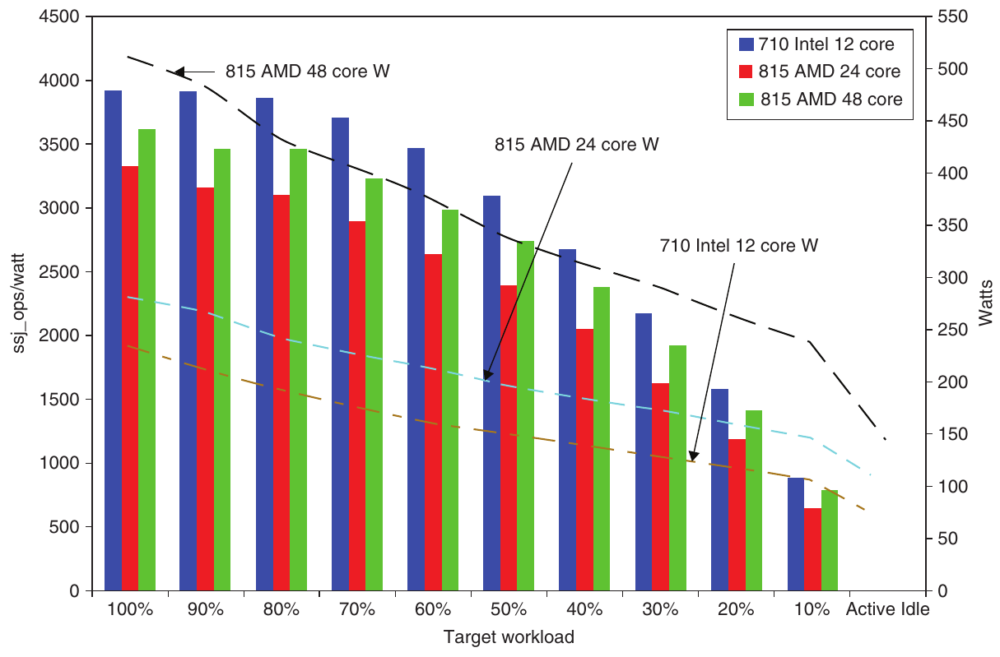

**Hình 1.19 Power-performance của ba server trong Hình 1.18. Các giá trị Ssj_ops/watt nằm trên trục bên trái, ứng với ba cột, còn watt nằm trên trục bên phải, ứng với ba đường. Trục ngang biểu thị target workload khi nó thay đổi từ 100% tới Active Idle. R715 Intel-based có ssj_ops/watt tốt nhất ở mỗi mức workload, đồng thời tiêu thụ công suất thấp nhất ở mỗi mức.**

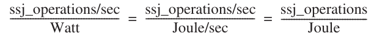

Để tính một con số duy nhất dùng so sánh hiệu suất công suất giữa các hệ thống, SPECpower sử dụng:

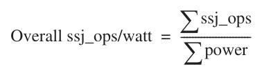

ssj_ops/watt tổng thể của ba server là 3034 với Intel R710, 2357 với AMD dual-socket R815 và 2696 với AMD quad-socket R815. Vì thế Intel R710 có power-performance tốt nhất. Chia cho giá server, ssj_ops/watt/$1000 là 324 với Intel R710, 254 với dual-socket AMD R815 và 213 với quad-socket MD R815. Như vậy, tính thêm công suất làm đảo ngược kết quả cuộc đua price-performance, và cúp price-power-performance thuộc về Intel R710; R815 48-core đứng cuối.

## 1.11 Những quan niệm sai và cạm bẫy

Mục đích phần này, xuất hiện trong mọi chương, là giải thích một số niềm tin hoặc quan niệm sai phổ biến mà bạn nên tránh. Chúng tôi gọi những niềm tin sai đó là quan niệm sai. Khi bàn một quan niệm sai, chúng tôi cố đưa ra phản ví dụ. Chúng tôi cũng bàn các cạm bẫy — những sai lầm dễ mắc phải. Cạm bẫy thường là sự khái quát hóa những nguyên lý chỉ đúng trong bối cảnh giới hạn. Mục đích các phần này là giúp bạn tránh những lỗi đó trong máy tính mình thiết kế.

**Quan niệm sai** Multiprocessor là giải pháp vạn năng.

Việc chuyển sang nhiều processor trên mỗi chip khoảng năm 2005 không bắt nguồn từ đột phá nào làm parallel programming đơn giản đi đáng kể hoặc khiến việc xây multicore computer dễ dàng. Thay đổi xảy ra vì không còn lựa chọn khác do những giới hạn ILP và công suất. Nhiều processor trên chip không bảo đảm công suất thấp hơn; hoàn toàn có thể thiết kế multicore chip dùng nhiều công suất hơn. Tiềm năng chỉ nằm ở chỗ có thể tiếp tục cải thiện performance bằng cách thay một core high-clock-rate kém hiệu quả bằng vài core lower-clock-rate hiệu quả. Khi công nghệ cải tiến để thu nhỏ transistor, cả capacitance lẫn supply voltage có thể giảm một chút, nhờ đó số core tăng vừa phải qua mỗi thế hệ. Ví dụ trong vài năm gần đây, Intel đã thêm hai core mỗi thế hệ.

Như sẽ thấy ở Chương 4 và 5, performance giờ là gánh nặng của lập trình viên. Thời đại lập trình viên La-Z-Boy dựa vào người thiết kế hardware để chương trình nhanh hơn mà không phải động ngón tay đã chính thức kết thúc. Nếu muốn chương trình nhanh hơn qua mỗi thế hệ, lập trình viên phải làm chương trình song song hơn.

Phiên bản phổ biến của định luật Moore — tăng performance qua mỗi thế hệ công nghệ — giờ phụ thuộc lập trình viên.

**Cạm bẫy** Trở thành nạn nhân của định luật Amdahl gây đau lòng.

Gần như mọi computer architect hành nghề đều biết định luật Amdahl. Dù vậy, gần như tất cả chúng ta đôi khi vẫn bỏ công sức khổng lồ tối ưu một tính năng trước khi đo mức sử dụng của nó. Chỉ khi overall speedup gây thất vọng, ta mới nhớ lẽ ra phải đo trước khi bỏ nhiều công cải thiện đến thế!

**Cạm bẫy** Một single point of failure.

Các phép tính cải thiện reliability bằng định luật Amdahl ở trang 48 cho thấy dependability không thể mạnh hơn mắt xích yếu nhất trong chuỗi. Dù làm bộ nguồn đáng tin cậy hơn bao nhiêu, như ví dụ của chúng ta, chiếc quạt duy nhất vẫn giới hạn reliability của disk subsystem. Nhận xét theo định luật Amdahl này dẫn tới quy tắc kinh nghiệm cho fault-tolerant system: bảo đảm mọi thành phần đều redundant, để không failure của một thành phần đơn lẻ nào làm sập cả hệ thống. Chương 6 cho thấy software layer tránh single point of failure bên trong warehouse-scale computer thế nào.

**Quan niệm sai** Những cải tiến hardware tăng performance cũng cải thiện energy efficiency hoặc ít nhất không làm thay đổi mức sử dụng năng lượng.

Esmaeilzadeh và cộng sự [2011] đo SPEC2006 trên chỉ một core của Intel Core i7 2.67 GHz dùng Turbo mode (Mục 1.5). Performance tăng theo hệ số 1.07 khi clock rate tăng lên 2.94 GHz (tức hệ số 1.10), nhưng i7 dùng số joule tăng theo hệ số 1.37 và số watt-hours tăng theo hệ số 1.47!

**Quan niệm sai** Benchmark giữ nguyên giá trị vô thời hạn.

Nhiều yếu tố ảnh hưởng mức hữu ích của benchmark khi dùng dự đoán performance thực, và một số thay đổi theo thời gian. Một yếu tố lớn là khả năng chống lại “benchmark engineering” hay “benchmarketing”. Khi benchmark được chuẩn hóa và phổ biến, áp lực cải thiện performance bằng tối ưu có chủ đích hoặc diễn giải táo bạo quy tắc chạy benchmark trở nên rất lớn. Kernel nhỏ hoặc chương trình dành thời gian trong lượng code nhỏ đặc biệt dễ bị ảnh hưởng.

Ví dụ, dù có ý định tốt nhất, bộ benchmark SPEC89 đầu tiên chứa kernel nhỏ matrix300, gồm tám phép nhân ma trận 300 × 300 khác nhau. Trong kernel này, 99% execution time nằm trong một dòng duy nhất (xem SPEC [1989]). Khi IBM compiler tối ưu vòng lặp trong này (dùng ý tưởng blocking, bàn ở Chương 2 và 4), performance tăng theo hệ số 9 so với phiên bản compiler trước! Benchmark này kiểm tra compiler tuning, dĩ nhiên không chỉ báo tốt overall performance, cũng không phản ánh giá trị điển hình của tối ưu cụ thể đó.

Qua thời gian dài, các thay đổi này có thể khiến cả benchmark well-chosen lỗi thời; Gcc là chương trình duy nhất còn lại từ SPEC89. Hình 1.16 trang 39 liệt kê trạng thái toàn bộ 70 benchmark từ các bản SPEC. Đáng kinh ngạc là gần 70% mọi chương trình của SPEC2000 hoặc trước đó bị loại khỏi bản tiếp theo.

**Quan niệm sai** Mean time to failure được công bố của disk là 1,200,000 giờ, gần 140 năm, nên thực tế disk chẳng bao giờ hỏng.

Cách marketing hiện nay của nhà sản xuất disk có thể khiến người dùng hiểu lầm. MTTF như vậy được tính thế nào? Ở giai đoạn đầu, nhà sản xuất đặt hàng nghìn disk trong một phòng, chạy vài tháng rồi đếm số hỏng. Họ tính MTTF bằng tổng số giờ hoạt động cộng dồn của các disk chia số disk hỏng.

Một vấn đề là số này vượt xa tuổi thọ disk, thường giả định 5 năm hay 43,800 giờ. Để MTTF lớn này có chút ý nghĩa, nhà sản xuất lập luận mô hình tương ứng người mua disk rồi liên tục thay mỗi 5 năm — tuổi thọ dự kiến của disk. Họ khẳng định nếu nhiều khách hàng (và great-grandchildren của họ) làm vậy suốt thế kỷ tới, trung bình họ sẽ thay disk 27 lần trước khi có failure, tức khoảng 140 năm.

Phép đo hữu ích hơn là phần trăm disk hỏng. Giả sử có 1000 disk với MTTF 1,000,000-hour và được dùng 24 giờ mỗi ngày. Nếu thay disk hỏng bằng disk mới có cùng đặc tính reliability, số disk hỏng trong một năm (8760 giờ) là

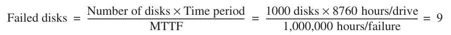

Nói cách khác, 0.9% sẽ hỏng mỗi năm, hay 4.4% trong tuổi thọ 5-year.

Hơn nữa, những con số cao đó được đưa ra với giả định nhiệt độ và rung động trong phạm vi giới hạn; nếu vượt giới hạn thì mọi bảo đảm đều không còn. Khảo sát disk drive trong môi trường thực [Gray và van Ingen 2005] thấy 3% đến 7% drive hỏng mỗi năm, tương ứng MTTF khoảng 125,000 đến 300,000 giờ. Nghiên cứu lớn hơn nữa thấy disk failure rate hằng năm 2% đến 10% [Pinheiro, Weber và Barroso 2007]. Do đó MTTF real-world kém hơn khoảng 2 đến 10 lần so với MTTF nhà sản xuất.

**Quan niệm sai** Peak performance phản ánh observed performance.

Định nghĩa duy nhất luôn đúng của peak performance là “mức performance mà máy tính được bảo đảm không vượt qua”. Hình 1.20 cho phần trăm peak performance của bốn chương trình trên bốn multiprocessor. Nó dao động từ 5% đến 58%. Vì khoảng cách lớn và có thể thay đổi đáng kể theo benchmark, nhìn chung peak performance không hữu ích để dự đoán observed performance.

**Cạm bẫy** Phát hiện fault có thể làm giảm availability.

Cạm bẫy có vẻ nghịch lý này tồn tại vì computer hardware có khá nhiều state không phải lúc nào cũng thiết yếu cho hoạt động đúng. Ví dụ lỗi trong branch predictor không gây hậu quả chí mạng, vì có thể chỉ performance bị ảnh hưởng.

Trong processor cố khai thác instruction-level parallelism mạnh mẽ, không phải mọi operation đều cần để chương trình thực thi đúng. Mukherjee và cộng sự [2003] thấy chưa tới 30% operation có khả năng nằm trên critical path của benchmark SPEC2000 chạy trên Itanium 2.

Nhận xét tương tự cũng đúng với chương trình. Nếu register “dead” — tức chương trình sẽ ghi nó trước khi đọc lại — thì lỗi không quan trọng. Nếu cho chương trình crash khi phát hiện transient fault trong dead register, bạn sẽ làm giảm availability không cần thiết.

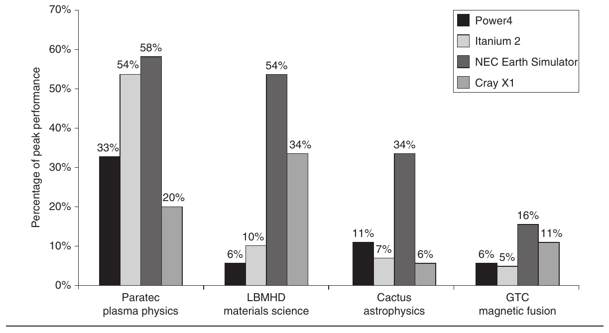

**Hình 1.20 Phần trăm peak performance của bốn chương trình trên bốn multiprocessor được mở rộng lên 64 processor. Earth Simulator và X1 là vector processor (xem Chương 4 và Phụ lục G). Không chỉ đạt tỷ lệ peak performance cao hơn, chúng còn có peak performance cao nhất và clock rate thấp nhất. Ngoài chương trình Paratec, hệ thống Power 4 và Itanium 2 đạt từ 5% đến 10% peak performance của chúng. Theo Oliker và cộng sự [2004].**

Sun Microsystems gặp cạm bẫy này năm 2000 với L2 cache có parity nhưng không có error correction trong hệ thống Sun E3000 tới Sun E10000. SRAM dùng xây cache có intermittent fault mà parity phát hiện được. Nếu dữ liệu trong cache chưa sửa, processor chỉ đọc lại dữ liệu từ cache. Vì người thiết kế không bảo vệ cache bằng ECC (error-correcting code), operating system không có lựa chọn ngoài báo lỗi với dirty data rồi làm chương trình crash. Field engineer kiểm tra mà không thấy vấn đề trong hơn 90% trường hợp.

Để giảm tần suất lỗi này, Sun sửa operating system Solaris để “scrub” cache bằng process chủ động ghi dirty data xuống memory. Vì processor chip không đủ pin để thêm ECC, lựa chọn hardware duy nhất cho dirty data là nhân đôi external cache, dùng bản sao không có parity error để sửa lỗi.

Cạm bẫy nằm ở việc phát hiện fault mà không cung cấp mechanism sửa chúng. Những kỹ sư này khó có thể lại thiết kế máy tính không có ECC trên external cache.

## 1.12 Nhận xét kết thúc

Chương này giới thiệu một số khái niệm và cung cấp quantitative framework mà chúng ta sẽ mở rộng xuyên suốt sách. Bắt đầu từ ấn bản này, energy efficiency trở thành người đồng hành mới của performance.

Trong Chương 2, chúng ta bắt đầu với lĩnh vực all-important là thiết kế memory system. Ta khảo sát nhiều kỹ thuật phối hợp khiến memory có vẻ lớn vô hạn mà vẫn nhanh nhất có thể. (Phụ lục B cung cấp tài liệu nhập môn cache cho độc giả chưa có nhiều kinh nghiệm và kiến thức nền.) Như ở các chương sau, ta sẽ thấy hợp tác hardware–software trở thành chìa khóa cho high-performance memory system, cũng như với high-performance pipeline. Chương này còn đề cập virtual machine, kỹ thuật ngày càng quan trọng cho protection.

Trong Chương 3, ta xem instruction-level parallelism (ILP), trong đó pipelining là dạng đơn giản và phổ biến nhất. Khai thác ILP là một trong những kỹ thuật quan trọng nhất để xây high-speed uniprocessor. Chương 3 bắt đầu bằng thảo luận sâu các khái niệm cơ bản, chuẩn bị cho nhiều ý tưởng được khảo sát trong cả hai chương. Chương 3 dùng ví dụ trải dài khoảng 40 năm, từ một trong những supercomputer đầu tiên (IBM 360/91) tới processor nhanh nhất thị trường năm 2011. Nó nhấn mạnh cách khai thác ILP gọi dynamic hay run time. Nó cũng bàn giới hạn của ý tưởng ILP và giới thiệu multithreading, được phát triển thêm ở cả Chương 4 và 5. Phụ lục C cung cấp tài liệu nhập môn pipelining cho độc giả chưa có nhiều kinh nghiệm và kiến thức nền. (Chúng tôi kỳ vọng đây là phần ôn tập với nhiều độc giả, gồm người đã đọc giáo trình nhập môn Computer Organization and Design: The Hardware/Software Interface của chúng tôi.)

Chương 4 mới có trong ấn bản này, giải thích ba cách khai thác data-level parallelism. Cách cổ điển và lâu đời nhất là vector architecture, và chúng ta bắt đầu từ đó để đặt nền nguyên lý SIMD design. (Phụ lục G đi sâu hơn vector architecture.) Tiếp theo giải thích SIMD instruction set extension trong đa số desktop microprocessor hiện nay. Phần thứ ba giải thích in-depth cách graphics processing unit (GPU) hiện đại hoạt động. Đa số mô tả GPU viết từ góc nhìn lập trình viên, thường che giấu máy thực sự hoạt động thế nào. Phần này giải thích GPU từ góc nhìn người bên trong, gồm mapping giữa GPU jargon và thuật ngữ architecture truyền thống hơn.

Chương 5 tập trung đạt performance cao hơn bằng nhiều processor, hay multiprocessor. Thay vì dùng parallelism chồng lấp từng instruction, multiprocessing dùng parallelism cho nhiều instruction stream thực thi đồng thời trên processor khác nhau. Trọng tâm là dạng multiprocessor chủ đạo, shared-memory multiprocessor, dù cũng giới thiệu loại khác và bàn vấn đề chung nảy sinh trong mọi multiprocessor. Một lần nữa, ta khám phá nhiều kỹ thuật, tập trung những ý tưởng quan trọng lần đầu xuất hiện trong thập niên 1980 và 1990.

Chương 6 cũng mới trong ấn bản này. Ta giới thiệu cluster rồi đi sâu warehouse-scale computer (WSC) mà computer architect góp phần thiết kế. Người thiết kế WSC là hậu duệ nghề nghiệp của những người tiên phong supercomputer như Seymour Cray, ở chỗ họ thiết kế máy tính cực hạn. Chúng chứa hàng chục nghìn server, thiết bị cùng tòa nhà chứa chúng có giá gần $200 M. Mối quan tâm price-performance và energy efficiency ở chương trước áp dụng cho WSC, cũng như cách tiếp cận định lượng khi quyết định.

Sách đi kèm lượng tài liệu online phong phú (xem Lời nói đầu để biết thêm), vừa giảm chi phí vừa giới thiệu nhiều chủ đề nâng cao. Hình 1.21 cho thấy tất cả. Phụ lục A, B, C xuất hiện trong sách sẽ là phần ôn tập với nhiều độc giả.

Trong Phụ lục D, ta rời góc nhìn processor-centric để bàn storage system. Ta dùng cách tiếp cận định lượng tương tự, nhưng dựa trên quan sát hành vi hệ thống và cách end-to-end để phân tích performance. Nó giải quyết vấn đề quan trọng: lưu và truy xuất dữ liệu hiệu quả thế nào bằng chủ yếu công nghệ magnetic storage lower-cost. Trọng tâm là khảo sát performance disk storage system cho workload I/O-intensive điển hình, như benchmark OLTP đã thấy trong chương. Ta khám phá sâu chủ đề nâng cao trong RAID-based system, dùng redundant disk đạt cả high performance lẫn high availability. Cuối cùng chương giới thiệu queuing theory, cơ sở để đánh đổi utilization với latency.

Phụ lục E áp dụng góc nhìn embedded computing cho ý tưởng của mỗi chương và các phụ lục đầu.

Phụ lục F khám phá rộng chủ đề system interconnect, gồm wide area network và system area network cho phép máy tính giao tiếp.

| Phụ lục | Tiêu đề |
|---|---|
| A | Nguyên lý Instruction Set |
| B | Ôn tập Memory Hierarchy |
| C | Pipelining: Khái niệm cơ bản và trung cấp |
| D | Storage System |
| E | Embedded System |
| F | Interconnection Network |
| G | Tìm hiểu Vector Processor sâu hơn |
| H | Hardware và Software cho VLIW và EPIC |
| I | Multiprocessor Large-Scale và ứng dụng khoa học |
| J | Số học máy tính |
| K | Khảo sát Instruction Set Architecture |
| L | Góc nhìn lịch sử và tài liệu tham khảo |

**Hình 1.21 Danh sách phụ lục.**

Phụ lục H ôn tập VLIW hardware và software, ngược lại ít phổ biến hơn thời điểm EPIC xuất hiện ngay trước ấn bản trước.

Phụ lục I mô tả multiprocessor large-scale dùng trong high-performance computing.

Phụ lục J là phụ lục duy nhất còn từ ấn bản đầu, đề cập computer arithmetic.

Phụ lục K khảo sát instruction architecture, gồm 80x86, IBM 360, VAX và nhiều RISC architecture, kể cả ARM, MIPS, Power, SPARC.

Chúng tôi mô tả Phụ lục L bên dưới.

## 1.13 Góc nhìn lịch sử và tài liệu tham khảo

Phụ lục L (có online) gồm góc nhìn lịch sử về ý tưởng then chốt trong mỗi chương sách. Những phần lịch sử cho phép theo dõi sự phát triển ý tưởng qua một loạt máy hoặc mô tả dự án quan trọng. Nếu quan tâm sự phát triển ban đầu của ý tưởng hay máy, hoặc muốn đọc thêm, tài liệu tham khảo nằm cuối mỗi phần lịch sử. Với chương này, xem Mục L.2, Sự phát triển ban đầu của máy tính, để biết về phát triển ban đầu digital computer và phương pháp đo performance.

Khi đọc tư liệu lịch sử, bạn sẽ sớm nhận ra một lợi ích quan trọng của tuổi trẻ ngành điện toán so với nhiều ngành kỹ thuật khác: nhiều người tiên phong vẫn sống — ta có thể học lịch sử chỉ bằng hỏi họ!

## Nghiên cứu trường hợp và bài tập của Diana Franklin

### Nghiên cứu trường hợp 1: Chi phí chế tạo chip

#### Khái niệm được minh họa qua nghiên cứu trường hợp này

- Chi phí chế tạo

- Fabrication Yield

- Chịu Defect nhờ Redundancy

Nhiều yếu tố tham gia giá computer chip. Công nghệ mới nhỏ hơn tăng performance và giảm chip area cần thiết. Với công nghệ nhỏ hơn, có thể giữ diện tích nhỏ hoặc đặt thêm hardware trên chip để có nhiều chức năng hơn. Trong nghiên cứu trường hợp này, ta khám phá các quyết định thiết kế khác nhau về fabrication technology, area và redundancy ảnh hưởng chip cost ra sao.

| Chip | Die size (mm2) | Defect rate ước tính (mỗi cm2) | Kích thước chế tạo (nm) | Transistor (triệu) |
|---|---|---|---|---|
| IBM Power5 | 389 | .30 | 130 | 276 |
| Sun Niagara | 380 | .75 | 90 | 279 |
| AMD Opteron | 199 | .75 | 90 | 233 |

**Hình 1.22 Các yếu tố chi phí sản xuất của một số processor hiện đại.**

**1.1** [10/10] <1.6> Hình 1.22 cho các thống kê chip liên quan ảnh hưởng chi phí của một số chip hiện nay. Trong vài bài tập tiếp theo, bạn sẽ khám phá tác động của những quyết định thiết kế khác nhau có thể áp dụng cho IBM Power5.

a. [10] <1.6> Yield của IBM Power5 là bao nhiêu?

b. [10] <1.6> Vì sao IBM Power5 có defect rate thấp hơn Niagara và Opteron?

**1.2** [20/20/20/20] <1.6> Xây một fabrication facility mới tốn $1 tỷ. Bạn sẽ bán nhiều loại chip từ nhà máy đó và cần quyết định dành bao nhiêu năng lực sản xuất cho mỗi loại. Chip Woods sẽ có diện tích 150 mm2, đem lại lợi nhuận $20 trên mỗi chip defect-free. Chip Markon sẽ có diện tích 250 mm2, đem lại lợi nhuận $25 trên mỗi chip defect-free. Fabrication facility của bạn giống hệt cơ sở dành cho Power5. Mỗi wafer có đường kính 300 mm.

a. [20] <1.6> Bạn thu được bao nhiêu lợi nhuận trên mỗi wafer chip Woods?

b. [20] <1.6> Bạn thu được bao nhiêu lợi nhuận trên mỗi wafer chip Markon?

c. [20] <1.6> Bạn nên sản xuất chip nào trong cơ sở này?

d. [20] <1.6> Lợi nhuận trên mỗi chip Power5 mới là bao nhiêu? Nếu nhu cầu là 50,000 chip Woods mỗi tháng và 25,000 chip Markon mỗi tháng, trong khi cơ sở có thể chế tạo 150 wafer mỗi tháng, bạn nên sản xuất bao nhiêu wafer cho mỗi loại chip?

**1.3** [20/20] <1.6> Đồng nghiệp của bạn tại AMD gợi ý rằng vì yield quá thấp, có thể sản xuất chip rẻ hơn nếu đặt thêm một core trên die và chỉ loại chip mà cả hai processor đều hỏng. Ta giải bài này bằng cách xem yield như xác suất không có defect trong diện tích nhất định khi biết defect rate. Hãy tính xác suất riêng cho từng Opteron core (điều này có thể không hoàn toàn chính xác, vì phương trình yield dựa trên bằng chứng thực nghiệm chứ không phải phép tính toán học liên hệ xác suất tìm lỗi trong các phần khác nhau của chip).

a. [20] <1.6> Xác suất defect xảy ra trên không quá một trong hai processor core là bao nhiêu?

b. [20] <1.6> Nếu chip cũ có giá $20 đô la mỗi chip, chi phí chip mới là bao nhiêu khi tính cả diện tích và yield mới?

### Nghiên cứu trường hợp 2: Tiêu thụ công suất trong hệ thống máy tính

#### Khái niệm được minh họa qua nghiên cứu trường hợp này

- Định luật Amdahl

- Redundancy

- MTTF

- Tiêu thụ công suất

Tiêu thụ công suất trong hệ thống hiện đại phụ thuộc nhiều yếu tố, gồm chip clock frequency, hiệu suất, tốc độ disk drive, utilization của disk drive và DRAM. Những bài tập sau khám phá tác động tới công suất của các quyết định thiết kế và tình huống sử dụng khác nhau.

**1.4** [20/10/20] <1.5> Hình 1.23 trình bày tiêu thụ công suất của một số thành phần hệ thống máy tính. Trong bài này, ta khám phá hard drive ảnh hưởng tiêu thụ công suất hệ thống thế nào.

a. [20] <1.5> Giả sử mỗi thành phần chịu tải tối đa và hiệu suất bộ nguồn là 80%, bộ nguồn server phải cung cấp bao nhiêu watt cho hệ thống có chip Intel Pentium 4, Kingston DRAM 240-pin dung lượng 2 GB và một hard drive 7200 rpm?

b. [10] <1.5> Disk drive 7200 rpm sẽ tiêu thụ công suất bao nhiêu nếu idle khoảng 60% thời gian?

c. [20] <1.5> Biết thời gian đọc dữ liệu từ disk drive 7200 rpm xấp xỉ 75% thời gian của disk 5400 rpm, disk 7200 rpm cần có thời gian idle bao nhiêu để hai disk tiêu thụ công suất trung bình bằng nhau?

**1.5** [10/10/20] <1.5> Một yếu tố then chốt khi cấp điện cho server farm là làm mát. Nếu nhiệt không được loại khỏi máy tính hiệu quả, quạt sẽ thổi lại khí nóng vào máy thay vì khí lạnh. Ta xem các quyết định thiết kế ảnh hưởng nhu cầu làm mát, từ đó giá hệ thống, thế nào. Hãy dùng Hình 1.23 để tính công suất.

| Loại thành phần | Sản phẩm | Performance | Công suất |
|---|---|---|---|
| Processor | Sun Niagara 8-core | 1.2 GHz | 72–79 W cực đại |
|  | Intel Pentium 4 | 2 GHz | 48.9–66 W |
| DRAM | Kingston X64C3AD2 1 GB | 184-pin | 3.7 W |
|  | Kingston D2N3 1 GB | 240-pin | 2.3 W |
| Hard drive | DiamondMax 16 | 5400 rpm | 7.0 W read/seek, 2.9 W idle |
|  | DiamondMax 9 | 7200 rpm | 7.9 W read/seek, 4.0 W idle |

**Hình 1.23 Tiêu thụ công suất của một số thành phần máy tính.**

a. [10] <1.5> Một cooling door cho rack giá $4000 và tản 14 KW (vào phòng; cần thêm chi phí để đưa nhiệt ra khỏi phòng). Một cooling door có thể làm mát bao nhiêu server có processor Intel Pentium 4, DRAM 240-pin dung lượng 1 GB và một hard drive 7200 rpm?

b. [10] <1.5> Bạn đang cân nhắc cung cấp fault tolerance cho hard drive. RAID 1 tăng gấp đôi số disk (xem Chương 6). Giờ có thể đặt bao nhiêu hệ thống trên một rack với một bộ làm mát duy nhất?

c. [20] <1.5> Server farm điển hình có thể tản tối đa 200 W mỗi square foot. Biết một server rack cần 11 square feet (gồm khoảng trống phía trước và sau), có thể đặt bao nhiêu server ở phần (a) trên một rack và cần bao nhiêu cooling door?

**1.6** [Thảo luận] <1.8> Hình 1.24 so sánh công suất và performance qua một số benchmark cho hai server: Sun Fire T2000 (dùng Niagara) và IBM x346 (dùng Intel Xeon processor). Thông tin này được công bố trên Web site của Sun. Có hai loại thông tin được báo cáo: công suất và tốc độ trên hai benchmark. Với kết quả được đưa ra, Sun Fire T2000 rõ ràng vượt trội. Những yếu tố khác nào có thể quan trọng, khiến người ta chọn IBM x346 nếu nó vượt trội ở những mặt đó?

**1.7** [20/20/20/20] <1.6, 1.9> Nghiên cứu nội bộ công ty cho thấy single-core system đủ đáp ứng nhu cầu năng lực xử lý của bạn; tuy nhiên, bạn đang khám phá liệu dùng hai core có tiết kiệm công suất hay không.

a. [20] <1.9> Giả sử 80% ứng dụng có thể parallelize. Bạn có thể giảm frequency bao nhiêu mà vẫn giữ cùng performance?

b. [20] <1.6> Giả sử voltage có thể giảm tuyến tính theo frequency. Dùng phương trình ở Mục 1.5, dual-core system cần dynamic power bao nhiêu so với single-core system?

c. [20] <1.6, 1.9> Giờ giả sử voltage không được giảm dưới 25% voltage ban đầu. Voltage này gọi là voltage floor, và voltage thấp hơn sẽ làm mất state. Tỷ lệ parallelization bao nhiêu sẽ cho voltage đúng tại voltage floor?

d. [20] <1.6, 1.9> Dùng phương trình Mục 1.5, dual-core system cần dynamic power bao nhiêu so với single-core system khi tính cả voltage floor?

|  | Sun Fire T2000 | IBM x346 |
|---|---|---|
| Công suất (watt) | 298 | 438 |
| SPECjbb (operations/sec) | 63,378 | 39,985 |
| Công suất (watt) | 330 | 438 |
| SPECWeb (composite) | 14,001 | 4348 |

**Hình 1.24 So sánh công suất/performance của Sun được Sun công bố có chọn lọc.**

### Bài tập

**1.8** [10/15/15/10/10] <1.4, 1.5> Một thách thức với architect là thiết kế tạo ra hôm nay cần vài năm triển khai, kiểm chứng và kiểm thử trước khi ra thị trường. Nghĩa là architect phải dự đoán trước vài năm công nghệ sẽ như thế nào. Đôi khi điều này rất khó.

a. [10] <1.4> Theo xu hướng device scaling được định luật Moore quan sát, số transistor trên chip năm 2015 phải gấp bao nhiêu lần năm 2005?

b. [15] <1.5> Clock rate từng tăng theo xu hướng này. Nếu clock rate tiếp tục tăng cùng tốc độ như thập niên 1990, tới năm 2015 nó sẽ xấp xỉ bao nhiêu?

c. [15] <1.5> Với tốc độ tăng hiện tại, clock rate được dự báo ở mức nào vào năm 2015?

d. [10] <1.4> Điều gì giới hạn tốc độ tăng clock rate, và architect hiện làm gì với transistor bổ sung để tăng performance?

e. [10] <1.4> Tốc độ tăng DRAM capacity cũng đã chậm lại. Trong 20 năm, DRAM capacity tăng 60% mỗi năm. Tỷ lệ đó giảm xuống 40% mỗi năm và nay mức tăng là 25 đến 40% mỗi năm. Nếu xu hướng tiếp tục, tốc độ tăng DRAM capacity vào năm 2020 xấp xỉ bao nhiêu?

**1.9** [10/10] <1.5> Bạn thiết kế hệ thống cho real-time application phải đáp ứng deadline cụ thể. Hoàn tất tính toán nhanh hơn không đem lại lợi ích. Bạn thấy hệ thống có thể thực thi code cần thiết, ngay cả trong trường hợp xấu nhất, nhanh gấp đôi mức cần thiết.

a. [10] <1.5> Bạn tiết kiệm bao nhiêu năng lượng nếu thực thi ở tốc độ hiện tại và tắt hệ thống khi tính toán hoàn tất?

b. [10] <1.5> Bạn tiết kiệm bao nhiêu năng lượng nếu đặt voltage và frequency bằng một nửa?

**1.10** [10/10/20/20] <1.5> Server farm như Google và Yahoo! cung cấp đủ năng lực tính toán cho request rate cao nhất trong ngày. Tưởng tượng phần lớn thời gian các server chỉ hoạt động ở 60% capacity. Giả sử thêm công suất không scale tuyến tính theo tải; tức khi server chạy ở 60% capacity, chúng tiêu thụ 90% công suất tối đa. Có thể tắt server, nhưng khi tải tăng, chúng mất quá lâu để khởi động lại đáp ứng tải đó. Một hệ thống mới được đề xuất cho phép khởi động lại nhanh nhưng cần 20% công suất tối đa trong trạng thái “thoi thóp” này.

a. [10] <1.5> Tắt 60% server sẽ tiết kiệm được bao nhiêu công suất?

b. [10] <1.5> Đặt 60% server vào trạng thái “thoi thóp” sẽ tiết kiệm được bao nhiêu công suất?

c. [20] <1.5> Giảm voltage 20% và frequency 40% sẽ tiết kiệm được bao nhiêu công suất?

d. [20] <1.5> Đặt 30% server vào trạng thái “thoi thóp” và tắt 30% server sẽ tiết kiệm được bao nhiêu công suất?

**1.11** [10/10/20] <1.7> Availability là cân nhắc quan trọng nhất khi thiết kế server, theo sát là scalability và throughput.

a. [10] <1.7> Chúng ta có một processor duy nhất với failures in time (FIT) bằng 100. Mean time to failure (MTTF) của hệ thống là bao nhiêu?

b. [10] <1.7> Nếu mất 1 ngày để hệ thống chạy lại, availability của hệ thống là bao nhiêu?

c. [20] <1.7> Tưởng tượng để giảm chi phí, chính phủ sẽ xây supercomputer từ máy tính rẻ thay vì máy đắt và đáng tin cậy. MTTF của hệ thống 1000 processor là bao nhiêu? Giả sử nếu một processor hỏng, tất cả đều hỏng.

**1.12** [20/20/20] <1.1, 1.2, 1.7> Trong server farm như Amazon hay eBay sử dụng, một failure đơn lẻ không khiến cả hệ thống crash. Thay vào đó, nó làm giảm số request có thể đáp ứng tại một thời điểm.

a. [20] <1.7> Nếu công ty có 10,000 máy tính, mỗi máy MTTF 35 ngày, và chỉ gặp catastrophic failure khi 1/3 số máy hỏng, MTTF của hệ thống là bao nhiêu?

b. [20] <1.1, 1.7> Nếu phải chi thêm $1000 mỗi máy để tăng gấp đôi MTTF, đây có phải quyết định kinh doanh tốt không? Hãy trình bày cách tính.

c. [20] <1.2> Hình 1.3 cho chi phí downtime trung bình, giả định chi phí bằng nhau ở mọi thời điểm trong năm. Nhưng với nhà bán lẻ, mùa Giáng sinh có lợi nhuận cao nhất (nên cũng tốn kém nhất nếu mất doanh số). Nếu trung tâm bán hàng qua catalog có traffic trong quý tư gấp đôi mỗi quý khác, chi phí downtime trung bình mỗi giờ trong quý tư và phần còn lại của năm là bao nhiêu?

**1.13** [10/20/20] <1.9> Công ty bạn đang cố chọn mua Opteron hay Itanium 2. Bạn đã phân tích ứng dụng công ty: 60% thời gian sẽ chạy ứng dụng tương tự wupwise, 20% thời gian tương tự ammp và 20% thời gian tương tự apsi.

a. [10] Nếu chỉ chọn dựa trên SPEC performance tổng thể, bạn chọn máy nào và vì sao?

b. [20] Trung bình có trọng số của execution time ratio cho hỗn hợp ứng dụng này trên Opteron và Itanium 2 là bao nhiêu?

c. [20] Speedup của Opteron so với Itanium 2 là bao nhiêu?

**1.14** [20/10/10/10/15] <1.9> Trong bài này, giả sử đang cân nhắc cải thiện máy bằng cách thêm vector hardware. Khi phép tính chạy ở vector mode trên vector hardware, nó nhanh gấp 10 lần normal execution mode. Ta gọi phần trăm thời gian có thể dùng vector mode là phần trăm vectorization. Vector được bàn trong Chương 4, nhưng bạn không cần biết chúng hoạt động thế nào để trả lời câu này!

a. [20] <1.9> Vẽ đồ thị speedup theo phần trăm phép tính được thực hiện ở vector mode. Ghi nhãn y-axis là “Speedup thuần” và x-axis là “Phần trăm vectorization.”

b. [10] <1.9> Cần phần trăm vectorization bao nhiêu để đạt speedup 2?

c. [10] <1.9> Bao nhiêu phần trăm computation run time nằm trong vector mode nếu đạt speedup 2?

d. [10] <1.9> Cần phần trăm vectorization bao nhiêu để đạt one-half maximum speedup có thể đạt từ vector mode?

e. [15] <1.9> Giả sử bạn đo được phần trăm vectorization của chương trình là 70%. Nhóm hardware design ước tính có thể tăng tốc vector hardware hơn nữa nếu đầu tư thêm đáng kể. Thay vào đó, bạn tự hỏi nhóm compiler có thể tăng phần trăm vectorization không. Nhóm compiler phải đạt phần trăm vectorization bao nhiêu để tương đương speedup bổ sung 2× của vector unit (ngoài mức 10× ban đầu)?

**1.15** [15/10] <1.9> Giả sử ta cải tiến máy tính để một execution mode nhanh hơn theo hệ số 10. Enhanced mode được dùng 50% thời gian, đo theo phần trăm execution time khi enhanced mode đang được sử dụng. Nhớ rằng định luật Amdahl phụ thuộc phần thời gian thực thi ban đầu, chưa cải tiến, có thể tận dụng enhanced mode. Vì thế không thể trực tiếp dùng số đo 50% này để tính speedup bằng định luật Amdahl.

a. [15] <1.9> Speedup chúng ta thu được từ fast mode là bao nhiêu?

b. [10] <1.9> Bao nhiêu phần trăm execution time ban đầu đã được chuyển thành fast mode?

**1.16** [20/20/15] <1.9> Khi thay đổi để tối ưu một phần processor, thường việc tăng tốc một loại instruction phải trả giá bằng làm chậm thứ khác. Ví dụ nếu thêm fast floating-point unit phức tạp, nó chiếm không gian, và có thể phải chuyển thứ khác xa trung tâm hơn để chứa nó, khiến việc tới unit đó thêm một cycle delay. Phương trình định luật Amdahl cơ bản không tính trade-off này.

a. [20] <1.9> Nếu fast floating-point unit mới tăng tốc floating-point operation trung bình 2×, và floating-point operation chiếm 20% execution time chương trình gốc, overall speedup là bao nhiêu (bỏ penalty với instruction khác)?

b. [20] <1.9> Giờ giả sử tăng tốc floating-point unit làm chậm data cache access, gây slowdown 1.5× (hay speedup 2/3). Data cache access chiếm 10% execution time. Overall speedup bây giờ là bao nhiêu?

c. [15] <1.9> Sau khi triển khai floating-point operation mới, bao nhiêu phần trăm execution time dành cho floating-point operation? Bao nhiêu phần trăm dành cho data cache access?

**1.17** [10/10/20/20] <1.10> Công ty vừa mua processor Intel Core i5 dual-core mới, và bạn được giao tối ưu software cho processor này. Bạn sẽ chạy hai ứng dụng trên dual core, nhưng resource requirement không bằng nhau. Ứng dụng đầu cần 80% resource, ứng dụng kia chỉ cần 20%. Giả sử khi parallelize một phần chương trình, speedup phần đó là 2.

a. [10] <1.10> Biết 40% ứng dụng đầu có thể parallelize, bạn đạt speedup bao nhiêu với ứng dụng này nếu chạy riêng biệt?

b. [10] <1.10> Biết 99% ứng dụng thứ hai có thể parallelize, ứng dụng này đạt speedup bao nhiêu nếu chạy riêng biệt?

c. [20] <1.10> Biết 40% ứng dụng đầu có thể parallelize, bạn quan sát được overall system speedup bao nhiêu nếu parallelize nó?

d. [20] <1.10> Biết 99% ứng dụng thứ hai có thể parallelize, bạn quan sát được overall system speedup bao nhiêu nếu parallelize nó?

**1.18** [10/20/20/20/25] <1.10> Khi parallelize ứng dụng, speedup lý tưởng bằng số processor. Hai điều giới hạn mức này: phần trăm ứng dụng có thể parallelize và chi phí giao tiếp. Định luật Amdahl tính điều đầu nhưng không tính điều sau.

a. [10] <1.10> Speedup với N processor là bao nhiêu nếu 80% ứng dụng có thể parallelize, bỏ qua chi phí giao tiếp?

b. [20] <1.10> Speedup với 8 processor là bao nhiêu nếu mỗi processor thêm vào gây communication overhead bằng 0.5% execution time ban đầu.

c. [20] <1.10> Speedup với 8 processor là bao nhiêu nếu mỗi lần số processor tăng gấp đôi, communication overhead tăng thêm 0.5% execution time ban đầu?

d. [20] <1.10> Speedup với N processor là bao nhiêu nếu mỗi lần số processor tăng gấp đôi, communication overhead tăng thêm 0.5% execution time ban đầu?

e. [25] <1.10> Viết phương trình tổng quát giải câu hỏi: Số processor nào cho speedup cao nhất trong ứng dụng có P% execution time ban đầu có thể parallelize, và mỗi lần số processor tăng gấp đôi, chi phí giao tiếp tăng thêm 0.5% execution time ban đầu?
