# 2 Thiết kế Memory Hierarchy

> Lý tưởng nhất, người ta mong muốn memory có dung lượng lớn vô hạn để bất kỳ … word cụ thể nào cũng sẵn có ngay lập tức. … Chúng ta … buộc phải thừa nhận khả năng xây dựng một hierarchy gồm nhiều memory, trong đó mỗi memory có dung lượng lớn hơn mức trước nhưng truy cập chậm hơn.

> A. W. Burks, H. H. Goldstine, and J. von Neumann

> Preliminary Discussion of the Logical Design of an Electronic Computing Instrument (1946)

## 2.1 Giới thiệu

Những người tiên phong máy tính đã dự đoán đúng rằng programmer sẽ muốn có lượng fast memory không giới hạn. Giải pháp kinh tế cho mong muốn đó là memory hierarchy, tận dụng locality cùng các trade-offs về cost-performance của công nghệ memory. Principle of locality, trình bày trong chương đầu, nói rằng phần lớn program không truy cập đồng đều mọi code hay data. Locality xuất hiện theo thời gian (temporal locality) và không gian (spatial locality). Nguyên lý này, cùng chỉ dẫn rằng với công nghệ triển khai và power budget cho trước, có thể làm hardware nhỏ hơn chạy nhanh hơn, đã dẫn đến hierarchy dựa trên memory có tốc độ và dung lượng khác nhau. Hình 2.1 thể hiện multilevel memory hierarchy, gồm dung lượng và tốc độ truy cập điển hình.

Vì fast memory đắt, memory hierarchy được tổ chức thành nhiều mức — mỗi mức nhỏ hơn, nhanh hơn và đắt hơn trên mỗi byte so với mức ngay dưới, vốn xa processor hơn. Mục tiêu là memory system có chi phí mỗi byte gần thấp như mức rẻ nhất và tốc độ gần nhanh như mức nhanh nhất. Trong phần lớn trường hợp (nhưng không phải tất cả), dữ liệu mức dưới là superset của mức ngay trên. Thuộc tính inclusion này luôn được yêu cầu ở mức thấp nhất của hierarchy: main memory trong trường hợp cache, disk memory trong trường hợp virtual memory.

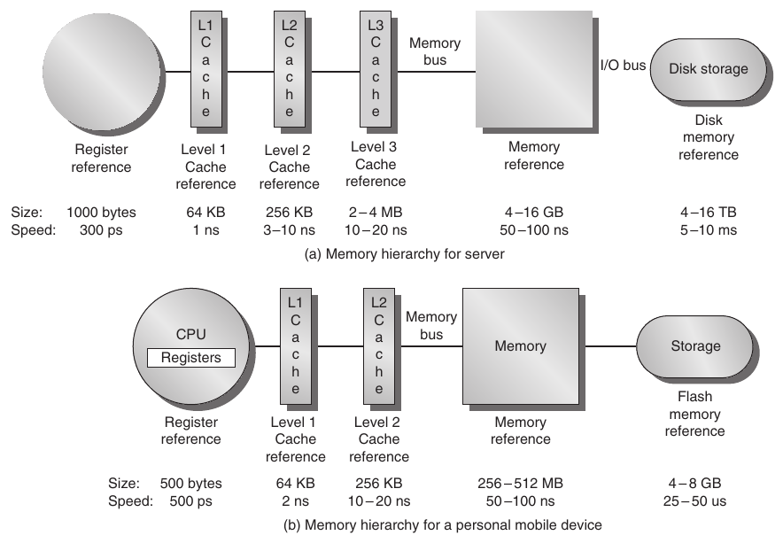

**Hình 2.1 Các mức trong memory hierarchy điển hình của server ở trên (a) và personal mobile device (PMD) ở dưới (b). Càng xa processor, memory ở mức dưới càng chậm và lớn hơn. Lưu ý đơn vị thời gian thay đổi theo hệ số 10<sup>9</sup> — từ picosecond đến millisecond — và đơn vị dung lượng theo hệ số 10<sup>12</sup> — từ byte đến terabyte. PMD có clock rate chậm hơn, cache và main memory nhỏ hơn. Khác biệt then chốt là server, desktop dùng disk storage làm mức thấp nhất, còn PMD dùng Flash xây trên công nghệ EEPROM.**

Tầm quan trọng của memory hierarchy đã tăng cùng những tiến bộ hiệu năng processor. Hình 2.2 vẽ dự báo hiệu năng một processor so với mức cải thiện lịch sử về thời gian truy cập main memory. Đường processor thể hiện mức tăng số memory request mỗi giây tính trung bình (tức nghịch đảo latency giữa các memory reference), còn đường memory thể hiện mức tăng số DRAM access mỗi giây (tức nghịch đảo DRAM access latency). Tình hình trong uniprocessor thực ra còn tệ hơn một chút, vì peak memory access rate cao hơn tốc độ trung bình được vẽ.

Gần đây hơn, processor high-end đã chuyển sang nhiều core, làm yêu cầu bandwidth tăng thêm so với một core. Thực tế, tổng peak bandwidth về cơ bản tăng theo số core. Processor high-end hiện đại như Intel Core i7 có thể tạo hai data memory reference mỗi core trong mỗi clock cycle; với bốn core và clock rate 3.2 GHz, i7 có thể tạo tối đa 25.6 tỷ data memory reference 64-bit mỗi giây, ngoài nhu cầu instruction tối đa khoảng 12.8 tỷ instruction reference 128-bit; tổng peak bandwidth là 409.6 GB/sec! Bandwidth đáng kinh ngạc này đạt được bằng multiporting và pipelining cache; bằng nhiều tầng cache, với cache first- và đôi khi second-level riêng cho mỗi core; và bằng instruction cache cùng data cache tách biệt ở tầng đầu. Ngược lại, peak bandwidth tới DRAM main memory chỉ bằng 6% mức đó (25 GB/sec).

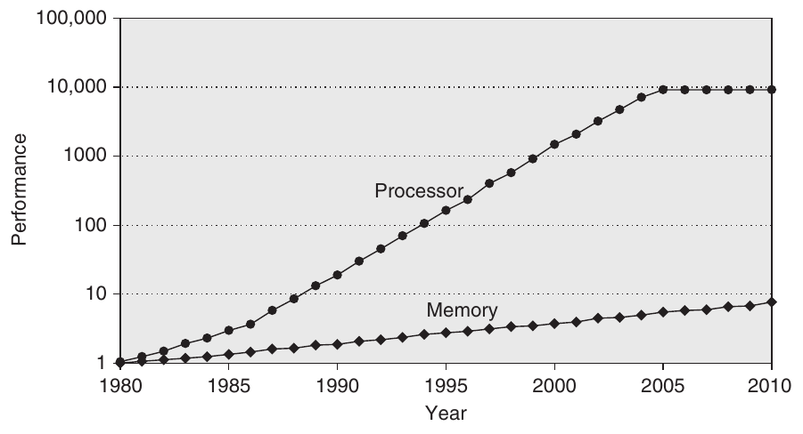

**Hình 2.2 Lấy hiệu năng năm 1980 làm mốc, hình vẽ khoảng cách hiệu năng theo thời gian, đo bằng chênh lệch giữa khoảng thời gian giữa các processor memory request (cho một processor hoặc core) và latency của DRAM access. Lưu ý trục đứng phải dùng logarithmic scale để ghi nhận quy mô khoảng cách hiệu năng processor–DRAM. Mốc memory là DRAM 64 KB năm 1980, với mức cải thiện hiệu năng về latency theo hệ số 1.07 mỗi năm (xem Hình 2.13 trang 99). Đường processor giả sử cải thiện theo hệ số 1.25 mỗi năm đến 1986, 1.52 đến 2000, 1.20 từ 2000 đến 2005, và hiệu năng processor không đổi (xét trên cơ sở per-core) từ 2005 đến 2010; xem Hình 1.1 trong Chương 1.**

Theo truyền thống, người thiết kế memory hierarchy tập trung tối ưu average memory access time, được quyết định bởi cache access time, miss rate và miss penalty. Tuy nhiên, gần đây power đã trở thành mối cân nhắc lớn. Microprocessor high-end có thể có cache on-chip 10 MB hoặc hơn, và cache second- hay third-level lớn tiêu thụ power đáng kể, cả dưới dạng leakage khi không hoạt động (gọi là static power) lẫn active power, như khi đọc hay ghi (gọi là dynamic power), như mô tả trong Mục 2.3. Vấn đề còn gay gắt hơn trong processor PMD, nơi CPU ít mạnh tay hơn và power budget có thể nhỏ hơn từ 20 đến 50 lần. Trong các trường hợp đó, cache có thể chiếm 25% đến 50% tổng power tiêu thụ. Vì vậy, ngày càng nhiều thiết kế phải xét các trade-offs cả về hiệu năng lẫn power, và chương này sẽ khảo sát cả hai.

### Kiến thức cơ bản về Memory Hierarchy: Ôn tập nhanh

Quy mô, và do đó tầm quan trọng, ngày càng tăng của khoảng cách này đã khiến kiến thức cơ bản về memory hierarchy được đưa vào học phần computer architecture đại học, thậm chí cả học phần operating system và compiler. Vì vậy, ta bắt đầu bằng ôn tập nhanh cache và hoạt động của chúng. Tuy nhiên, phần lớn chương mô tả những đổi mới nâng cao nhằm giải quyết khoảng cách hiệu năng processor–memory.

Khi không tìm thấy word trong cache, phải fetch word từ tầng thấp hơn trong hierarchy (có thể là cache khác hoặc main memory), rồi đặt vào cache trước khi tiếp tục. Nhiều word, gọi là block (hay line), được chuyển cùng lúc để đạt hiệu quả, đồng thời vì spatial locality khiến chúng có khả năng sớm được cần tới. Mỗi cache block gồm tag cho biết nó tương ứng memory address nào.

Một quyết định thiết kế then chốt là có thể đặt block (hay line) ở đâu trong cache. Phương án phổ biến nhất là set associative, trong đó set là nhóm block trong cache. Đầu tiên block được map vào một set, rồi có thể đặt bất cứ đâu trong set đó. Tìm block gồm map block address vào set trước, rồi tìm trong set—thường song song—để lấy block. Set được chọn theo address của data:

(Block address) MOD (Number of sets in cache)

Nếu có n block trong một set, cache placement được gọi là n-way set associative. Hai đầu mút của set associativity có tên riêng. Cache direct-mapped chỉ có một block mỗi set (nên block luôn được đặt tại cùng vị trí), còn fully associative cache chỉ có một set (nên block có thể được đặt bất cứ đâu).

Caching data chỉ được đọc rất dễ, vì bản copy trong cache và memory giống hệt nhau. Caching các lần ghi khó hơn; ví dụ, làm sao giữ bản copy trong cache và memory nhất quán? Có hai chiến lược chính. Cache write-through cập nhật item trong cache và ghi xuyên để cập nhật main memory. Cache write-back chỉ cập nhật bản copy trong cache. Khi block sắp bị thay thế, nó được copy trở lại memory. Cả hai chiến lược ghi đều có thể dùng write buffer để cache tiếp tục ngay khi data được đặt vào buffer, thay vì chờ toàn bộ latency ghi data vào memory.

Một thước đo lợi ích của các tổ chức cache khác nhau là miss rate. Miss rate đơn giản là tỷ lệ cache access dẫn tới miss—tức số access miss chia tổng số access.

Để hiểu rõ nguyên nhân miss rate cao, từ đó gợi mở thiết kế cache tốt hơn, mô hình ba C phân loại mọi miss thành ba nhóm đơn giản:

- Compulsory—Ngay access đầu tiên tới block, block không thể đã ở trong cache, nên phải đưa nó vào cache. Compulsory miss là miss vẫn xảy ra ngay cả nếu bạn có cache dung lượng vô hạn.

- Capacity—Nếu cache không chứa được mọi block cần trong quá trình thực thi program, capacity miss (ngoài compulsory miss) sẽ xảy ra do block bị loại bỏ rồi được lấy lại về sau.

- Conflict—Nếu chiến lược block placement không fully associative, conflict miss (ngoài compulsory miss và capacity miss) xảy ra vì block có thể bị loại bỏ rồi lấy lại khi nhiều block cùng map vào set của nó và access tới các block khác nhau xen kẽ nhau.

Hình B.8 và B.9 ở trang B-24 và B-25 cho thấy tần suất tương đối cache miss được chia theo ba C. Như ta sẽ thấy trong Chương 3 và 5, multithreading và nhiều core khiến cache phức tạp hơn, vừa tăng khả năng capacity miss vừa thêm C thứ tư: coherency miss do cache flush để giữ nhiều cache coherent trong multiprocessor; ta sẽ xem những vấn đề này ở Chương 5.

Đáng tiếc, miss rate có thể là thước đo gây hiểu lầm vì nhiều lý do. Vì vậy, một số người thiết kế thích đo số miss mỗi instruction thay vì số miss mỗi memory reference (miss rate). Hai đại lượng này liên hệ như sau:

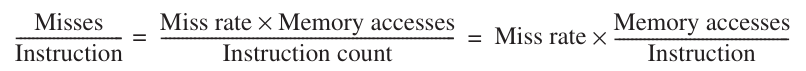

(Đại lượng này thường được báo cáo dưới dạng số miss mỗi 1000 instruction để dùng số nguyên thay vì phân số.)

Vấn đề với cả hai thước đo là chúng không tính đến chi phí miss. Thước đo tốt hơn là average memory access time:

Average memory access time = Hit time + Miss rate × Miss penalty

trong đó hit time là thời gian để hit trong cache, còn miss penalty là thời gian thay block từ memory (tức chi phí miss). Average memory access time vẫn là thước đo hiệu năng gián tiếp; dù tốt hơn miss rate, nó không thay thế execution time. Trong Chương 3, ta sẽ thấy speculative processor có thể thực thi instruction khác trong lúc miss, qua đó giảm effective miss penalty. Multithreading (giới thiệu trong Chương 3) cũng cho phép processor chịu miss mà không buộc phải nhàn rỗi. Như ta sắp khảo sát, để tận dụng các kỹ thuật chịu latency này, cần cache có thể phục vụ request trong khi đang xử lý outstanding miss.

Nếu nội dung này mới với bạn, hoặc phần ôn tập nhanh này đi quá nhanh, hãy xem Phụ lục B. Phụ lục trình bày sâu hơn cùng nội dung nhập môn, gồm ví dụ cache trong máy tính thực tế và đánh giá định lượng hiệu quả của chúng.

Mục B.3 trong Phụ lục B trình bày sáu cache optimization cơ bản mà ta ôn tập nhanh ở đây. Phụ lục cũng đưa ví dụ định lượng về lợi ích của những tối ưu này. Ta cũng bình luận ngắn về tác động của các trade-offs này lên power.

1. Block size lớn hơn để giảm miss rate—Cách đơn giản nhất giảm miss rate là tận dụng spatial locality và tăng block size. Block lớn hơn giảm compulsory miss nhưng cũng tăng miss penalty. Vì block lớn hơn giảm số tag, chúng có thể giảm nhẹ static power. Block size lớn hơn cũng có thể tăng capacity miss hoặc conflict miss, đặc biệt trong cache nhỏ. Chọn block size phù hợp là trade-off phức tạp phụ thuộc cache size và miss penalty.

2. Cache lớn hơn để giảm miss rate—Cách rõ ràng để giảm capacity miss là tăng cache capacity. Nhược điểm gồm hit time của cache memory lớn hơn có thể dài hơn, cùng chi phí và power cao hơn. Cache lớn hơn làm tăng cả static power lẫn dynamic power.

3. Associativity cao hơn để giảm miss rate—Rõ ràng, tăng associativity làm giảm conflict miss. Associativity cao hơn có thể phải trả giá bằng hit time tăng. Như ta sắp thấy, associativity còn làm tăng power tiêu thụ.

4. Multilevel cache để giảm miss penalty—Một quyết định khó là làm cache hit time nhanh để theo kịp clock rate cao của processor, hay làm cache lớn để giảm khoảng cách giữa processor access và main memory access. Thêm một tầng cache giữa cache ban đầu và memory giúp đơn giản hóa quyết định (xem Hình 2.3). Cache first-level có thể đủ nhỏ để phù hợp clock cycle time nhanh, trong khi cache second-level (hoặc third-level) có thể đủ lớn để xử lý nhiều access vốn sẽ tới main memory. Tập trung vào miss trong cache second-level dẫn tới block lớn hơn, capacity lớn hơn và associativity cao hơn. Multilevel cache có hiệu quả power cao hơn một cache gộp duy nhất. Nếu L1 và L2 lần lượt chỉ cache first- và second-level, ta có thể định nghĩa lại average memory access time:

Hit time<sub>L1</sub> + Miss rate<sub>L1</sub> × (Hit time<sub>L2</sub> + Miss rate<sub>L2</sub> × Miss penalty<sub>L2</sub>)

5. Ưu tiên read miss hơn write để giảm miss penalty—Write buffer là nơi thích hợp để triển khai tối ưu này. Write buffer tạo hazard vì giữ giá trị đã cập nhật của một vị trí cần khi read miss—tức read-after-write hazard thông qua memory. Một giải pháp là kiểm tra nội dung write buffer khi read miss. Nếu không có conflict và memory system khả dụng, gửi read trước write sẽ giảm miss penalty. Phần lớn processor ưu tiên read hơn write. Lựa chọn này ít ảnh hưởng power tiêu thụ.

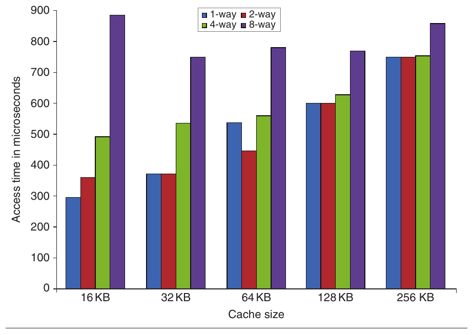

**Hình 2.3 Access time thường tăng khi cache size và associativity tăng. Dữ liệu này đến từ mô hình CACTI 6.5 của Tarjan, Thoziyoor và Jouppi [2005]. Dữ liệu giả sử feature size 40 nm (nằm giữa công nghệ dùng trong phiên bản i7 nhanh nhất và nhanh thứ hai của Intel, đồng thời giống công nghệ dùng trong ARM embedded processor nhanh nhất), một bank và block 64-byte. Các giả định về cache layout cùng trade-offs phức tạp giữa interconnect delay (phụ thuộc kích thước cache block đang truy cập) và chi phí tag check, multiplexing dẫn đến kết quả đôi khi bất ngờ, như access time của cache 64 KB có set associativity two-way thấp hơn direct mapping. Tương tự, kết quả với set associativity eight-way tạo hành vi bất thường khi cache size tăng. Vì các quan sát này phụ thuộc mạnh công nghệ cùng giả định thiết kế chi tiết, công cụ như CACTI giúp giảm không gian tìm kiếm thay vì phân tích chính xác các trade-offs.**

6. Tránh address translation khi index cache để giảm hit time—Cache phải xử lý chuyển virtual address từ processor thành physical address để truy cập memory. (Virtual memory được trình bày trong Mục 2.4 và B.4.) Một tối ưu phổ biến là dùng page offset—phần giống hệt trong cả virtual address lẫn physical address—để index cache, như mô tả trong Phụ lục B, trang B-38. Phương pháp virtual index/physical tag này tạo một số phức tạp hệ thống và/hoặc hạn chế về kích thước, cấu trúc L1 cache, nhưng ưu điểm loại bỏ translation lookaside buffer (TLB) access khỏi critical path lớn hơn nhược điểm.

Lưu ý mỗi tối ưu trong sáu loại trên đều có nhược điểm tiềm tàng có thể làm tăng thay vì giảm average memory access time.

Phần còn lại của chương giả sử bạn đã quen nội dung trên và chi tiết trong Phụ lục B. Trong phần Putting It All Together, ta khảo sát memory hierarchy của microprocessor thiết kế cho server high-end, Intel Core i7, cùng một microprocessor thiết kế cho PMD, Arm Cortex-A8, nền tảng của processor dùng trong Apple iPad và một số smartphone high-end. Trong mỗi lớp này, cách tiếp cận rất đa dạng do mục đích sử dụng máy tính. Dù processor high-end dùng trong server có nhiều core và cache lớn hơn Intel processor cho desktop, các processor có architecture tương tự. Khác biệt được quyết định bởi hiệu năng và bản chất workload; desktop chủ yếu chạy một application mỗi lúc trên operating system cho một user, còn server có thể có hàng trăm user chạy đồng thời hàng chục application. Do những khác biệt workload này, desktop thường quan tâm average latency của memory hierarchy hơn, còn server cũng quan tâm memory bandwidth. Ngay trong lớp desktop cũng rất đa dạng: từ netbook cấp thấp với processor scaled-down giống loại có trong PMD high-end, đến desktop high-end có processor nhiều core và tổ chức giống server low-end.

Ngược lại, PMD không chỉ phục vụ một user mà nhìn chung còn có operating system nhỏ hơn, thường ít multitasking hơn (chạy đồng thời nhiều application), và application đơn giản hơn. PMD cũng thường dùng Flash memory thay disk, phần lớn cân nhắc cả hiệu năng lẫn energy tiêu thụ, yếu tố quyết định battery life.

## 2.2 Mười tối ưu nâng cao hiệu năng cache

Công thức average memory access time ở trên cho ta ba metric để tối ưu cache: hit time, miss rate và miss penalty. Với xu hướng gần đây, ta thêm cache bandwidth cùng power tiêu thụ vào danh sách. Ta có thể phân mười cache optimization nâng cao sắp khảo sát thành năm nhóm dựa trên các metric này:

1. Giảm hit time—Cache first-level nhỏ và đơn giản cùng way-prediction. Cả hai kỹ thuật thường cũng giảm power tiêu thụ.

2. Tăng cache bandwidth—Pipelined cache, multibanked cache và nonblocking cache. Các kỹ thuật này có tác động khác nhau lên power tiêu thụ.

3. Giảm miss penalty—Critical word first và merging write buffer. Các tối ưu này ít tác động lên power.

4. Giảm miss rate—Compiler optimization. Rõ ràng, mọi cải thiện tại compile time đều cải thiện power tiêu thụ.

5. Giảm miss penalty hoặc miss rate qua parallelism—Hardware prefetching và compiler prefetching. Các tối ưu này thường làm tăng power tiêu thụ, chủ yếu do data được prefetch nhưng không dùng.

Nhìn chung, độ phức tạp hardware tăng khi ta lần lượt đi qua các tối ưu này. Ngoài ra, một số tối ưu đòi hỏi công nghệ compiler tinh vi. Ta sẽ kết thúc bằng tổng kết độ phức tạp implementation và lợi ích hiệu năng của mười kỹ thuật trong Hình 2.11 trang 96. Vì một số kỹ thuật khá đơn giản, ta trình bày ngắn gọn; các kỹ thuật khác cần mô tả nhiều hơn.

### Tối ưu thứ nhất: Cache First-Level nhỏ, đơn giản để giảm hit time và công suất

Áp lực từ cả clock cycle nhanh lẫn giới hạn power khuyến khích giới hạn kích thước cache first-level. Tương tự, dùng mức associativity thấp hơn có thể giảm cả hit time lẫn power, dù các trade-offs này phức tạp hơn những đánh đổi liên quan kích thước.

Critical timing path của cache hit là quy trình three-step: dùng phần index của address để truy cập tag memory, so sánh giá trị tag đã đọc với address, rồi đặt multiplexor để chọn data item đúng nếu cache là set associative. Cache Direct-mapped có thể chồng lấp tag check với truyền data, qua đó giảm hit time. Hơn nữa, mức associativity thấp hơn thường giảm power vì phải truy cập ít cache line hơn.

Dù tổng lượng cache on-chip đã tăng mạnh qua những thế hệ microprocessor mới, do L1 cache lớn hơn ảnh hưởng clock rate, kích thước L1 cache gần đây chỉ tăng nhẹ hoặc không tăng. Trong nhiều processor gần đây, người thiết kế chọn associativity cao hơn thay vì cache lớn hơn. Một cân nhắc bổ sung khi chọn associativity là khả năng loại bỏ address alias; ta sẽ thảo luận ngay sau đây.

Một cách xác định tác động lên hit time và power tiêu thụ trước khi chế tạo chip là dùng CAD tool. CACTI là program ước lượng access time và energy tiêu thụ của các cấu trúc cache khác nhau trên microprocessor CMOS, với sai lệch trong phạm vi 10% so với CAD tool chi tiết hơn. Với minimum feature size cho trước, CACTI ước lượng hit time cache khi thay đổi cache size, associativity, số read/write port và các parameter phức tạp hơn. Hình 2.3 thể hiện tác động ước lượng lên hit time khi thay đổi cache size và associativity. Tùy cache size, với các parameter này mô hình cho thấy hit time của direct mapped nhanh hơn two-way set associative một chút, two-way set associative nhanh gấp 1.2 lần four-way, còn four-way nhanh gấp 1.4 lần eight-way. Dĩ nhiên, các ước lượng này phụ thuộc công nghệ cũng như kích thước cache.

**Ví dụ** Dùng dữ liệu trong Hình B.8 ở Phụ lục B và Hình 2.3, hãy xác định liệu L1 cache set associative four-way 32 KB có memory access time nhanh hơn L1 cache set associative two-way 32 KB hay không. Giả sử miss penalty tới L2 bằng 15 lần access time của L1 cache nhanh hơn. Bỏ qua miss ngoài L2. Loại nào có average memory access time nhanh hơn?

**Trả lời** Gọi access time của cache set associative two-way là 1. Khi đó, với cache two-way:

Average memory access time<sub>2-way</sub> = Hit time + Miss rate × Miss penalty

= 1 + 0.038 × 15 = 1.38

Với cache four-way, access time dài gấp 1.4 lần. Elapsed time của miss penalty là 15/1.4 = 10.1. Để đơn giản, giả sử bằng 10:

Average memory access time<sub>4-way</sub> = Hit time<sub>2-way</sub> × 1.4 + Miss rate × Miss penalty

= 1.4 + 0.037 × 10 = 1.77

Rõ ràng, associativity cao hơn có vẻ là trade-off không tốt; tuy nhiên, vì cache access trong processor hiện đại thường được pipeline, khó đánh giá tác động chính xác lên clock cycle time.

Energy tiêu thụ cũng là yếu tố cần cân nhắc khi chọn cả cache size lẫn associativity, như Hình 2.4 cho thấy. Khi chuyển từ direct mapped sang set associative two-way, chi phí energy của associativity cao hơn dao động từ hơn hệ số 2 đến không đáng kể trong cache 128 KB hoặc 256 KB.

Trong thiết kế gần đây, có ba yếu tố khác dẫn tới dùng associativity cao hơn trong cache first-level. Thứ nhất, nhiều processor mất ít nhất hai clock cycle để truy cập cache, nên tác động của hit time dài hơn có thể không quá quan trọng. Thứ hai, để giữ TLB ngoài critical path (delay của nó lớn hơn delay do tăng associativity), gần như mọi L1 cache nên virtually indexed. Điều này giới hạn cache size bằng page size nhân associativity, vì khi đó chỉ các bit bên trong page được dùng làm index. Có những giải pháp khác cho việc index cache trước khi address translation hoàn tất, nhưng tăng associativity, vốn còn có lợi ích khác, là hấp dẫn nhất. Thứ ba, với sự ra đời của multithreading (xem Chương 3), conflict miss có thể tăng, khiến associativity cao hơn hấp dẫn hơn.

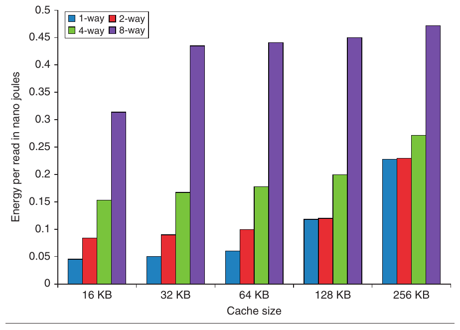

**Hình 2.4 Energy tiêu thụ mỗi lần đọc tăng khi cache size và associativity tăng. Như hình trước, CACTI được dùng để mô hình hóa với cùng parameter công nghệ. Penalty lớn của cache set associative eight-way là do chi phí đọc song song tám tag cùng data tương ứng.**

### Tối ưu thứ hai: Way Prediction để giảm hit time

Một cách khác làm giảm conflict miss mà vẫn duy trì tốc độ hit của cache direct-mapped. Trong way prediction, cache giữ thêm bit để dự đoán way, tức block trong set, của cache access tiếp theo. Dự đoán này có nghĩa multiplexor được đặt sớm để chọn block mong muốn, và chỉ một tag comparison được thực hiện trong clock cycle đó, song song với việc đọc cache data. Nếu miss, các block khác được kiểm tra xem có khớp không trong clock cycle tiếp theo.

Mỗi block của cache được thêm block predictor bit. Các bit chọn block cần thử trong cache access tiếp theo. Nếu predictor đúng, cache access latency là hit time nhanh. Nếu không, cache thử block khác, đổi way predictor, và có latency tăng thêm một clock cycle. Mô phỏng cho thấy set prediction accuracy vượt 90% với cache set associative two-way và 80% với cache set associative four-way, với độ chính xác trên I-caches tốt hơn D-caches. Way prediction tạo average memory access time thấp hơn cho cache set associative two-way nếu nó nhanh hơn ít nhất 10%, điều khá có khả năng xảy ra. Way prediction được dùng đầu tiên trong MIPS R10000 vào mid-1990s. Nó phổ biến trong processor dùng set associativity two-way và được dùng trong ARM Cortex-A8 với cache set associative four-way. Với processor rất nhanh, có thể khó triển khai stall một cycle, vốn thiết yếu để giữ way prediction penalty nhỏ.

Dạng mở rộng của way prediction cũng có thể giảm power tiêu thụ bằng cách dùng way prediction bit quyết định cache block thực sự được truy cập (các bit này về cơ bản là address bit bổ sung); cách này, có thể gọi way selection, tiết kiệm power khi way prediction đúng nhưng thêm thời gian đáng kể khi way misprediction, vì phải lặp lại cả access chứ không chỉ tag match và selection. Tối ưu như vậy có lẽ chỉ hợp lý trong processor low-power. Inoue, Ishihara và Murakami [1999] ước tính dùng way selection với cache set associative four-way làm average access time của I-cache tăng theo hệ số 1.04 và D-cache theo hệ số 1.13 trên benchmark SPEC95, nhưng tạo average cache power tiêu thụ tương đối so với cache set associative four-way bình thường là 0.28 cho I-cache và 0.35 cho D-cache. Một nhược điểm đáng kể của way selection là khiến cache access khó pipeline.

**Ví dụ** Giả sử số D-cache access bằng một nửa số I-cache access, và I-cache cùng D-cache lần lượt chiếm 25% và 15% power tiêu thụ của processor trong implementation set associative four-way bình thường. Hãy xác định way selection có cải thiện hiệu năng mỗi watt hay không dựa trên các ước lượng của nghiên cứu trên.

**Trả lời** Với I-cache, power tiết kiệm bằng 25 × 0.28 = 0.07 tổng power, còn D-cache là 15 × 0.35 = 0.05, cho tổng tiết kiệm 0.12. Phiên bản way prediction cần 0.88 power mà cache 4-way tiêu chuẩn cần. Mức tăng cache access time bằng mức tăng average access time của I-cache cộng one-half mức tăng access time của D-cache, tức dài gấp 1.04 + 0.5 × 0.13 = 1.11 lần. Kết quả này nghĩa là way selection có hiệu năng bằng 0.90 cache four-way tiêu chuẩn. Vì vậy, way selection cải thiện hiệu năng mỗi joule rất nhẹ theo tỷ số 0.90/0.88 = 1.02. Tối ưu này phù hợp nhất khi power thay vì hiệu năng là mục tiêu then chốt.

### Tối ưu thứ ba: Pipelined Cache Access để tăng Cache Bandwidth

Tối ưu này đơn giản là pipeline cache access để effective latency của cache hit first-level có thể kéo dài nhiều clock cycle, cho clock cycle time nhanh và bandwidth cao nhưng hit chậm. Chẳng hạn, pipeline cho instruction cache access của processor Intel Pentium vào mid-1990s mất 1 clock cycle; Pentium Pro đến Pentium III từ mid-1990s đến 2000 mất 2 clock; còn Pentium 4 ra mắt năm 2000 và Intel Core i7 hiện tại mất 4 clock. Thay đổi này tăng số pipeline stage, dẫn tới penalty lớn hơn với branch dự đoán sai và nhiều clock cycle hơn giữa phát load với dùng data (xem Chương 3), nhưng thực sự khiến việc đưa associativity cao vào dễ hơn.

### Tối ưu thứ tư: Nonblocking Cache để tăng Cache Bandwidth

Với máy tính pipelined cho phép execution out-of-order (thảo luận trong Chương 3), processor không cần stall khi data cache miss. Ví dụ, processor có thể tiếp tục fetch instruction từ instruction cache trong khi chờ data cache trả data bị thiếu. Cache nonblocking hay lockup-free tăng lợi ích tiềm năng của cách này bằng cách cho data cache tiếp tục cung cấp cache hit trong lúc miss. Tối ưu “hit under miss” giảm effective miss penalty nhờ hỗ trợ trong lúc miss thay vì bỏ qua request của processor. Một lựa chọn tinh vi và phức tạp là cache có thể giảm effective miss penalty hơn nữa nếu chồng lấp nhiều miss: tối ưu “hit under multiple miss” hoặc “miss under miss”. Lựa chọn thứ hai chỉ có ích nếu memory system phục vụ được nhiều miss; phần lớn processor high-performance (như Intel Core i7) thường hỗ trợ cả hai, trong khi processor cấp thấp hơn như ARM A8 chỉ hỗ trợ nonblocking hạn chế ở L2.

Để khảo sát hiệu quả của nonblocking cache trong việc giảm cache miss penalty, Farkas và Jouppi [1994] nghiên cứu với giả định cache 8 KB có miss penalty 14-cycle; họ nhận thấy effective miss penalty giảm 20% cho benchmark SPECINT92 và 30% cho benchmark SPECFP92 khi cho phép một hit under miss.

Li, Chen, Brockman và Jouppi [2011] gần đây cập nhật nghiên cứu này để dùng multilevel cache, giả định miss penalty hiện đại hơn và benchmark SPEC2006 lớn hơn, đòi hỏi cao hơn. Nghiên cứu giả định mô hình dựa trên một core Intel i7 (xem Mục 2.6) chạy benchmark SPEC2006. Hình 2.5 thể hiện mức giảm data cache access latency khi cho phép 1, 2 và 64 hit under miss; chú thích mô tả thêm memory system. Cache lớn hơn và việc bổ sung L3 cache so với nghiên cứu trước đã giảm lợi ích, với benchmark SPECINT2006 giảm cache latency trung bình khoảng 9% và benchmark SPECFP2006 khoảng 12.5%.

**Ví dụ** Điều gì quan trọng hơn với program floating-point: set associativity two-way hay hit under one miss cho primary data cache? Với integer program thì sao? Giả sử average miss rate sau cho data cache 32 KB: 5.2% với program floating-point dùng cache direct-mapped, 4.9% với các program đó dùng cache set associative two-way, 3.5% với integer program dùng cache direct-mapped và 3.2% với integer program dùng cache set associative two-way. Giả sử miss penalty tới L2 là 10 cycle, còn L2 miss và penalty giống nhau.

**Trả lời** Với chương trình floating-point, memory stall time trung bình là

Miss rate<sub>DM</sub> × Miss penalty = 5.2% × 10 = 0.52

Miss rate<sub>2-way</sub> × Miss penalty = 4.9% × 10 = 0.49

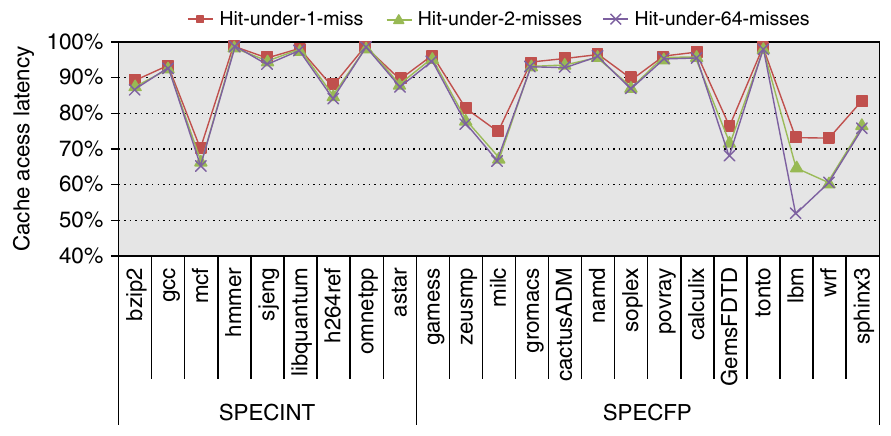

**Hình 2.5 Hiệu quả nonblocking cache được đánh giá bằng cách cho phép 1, 2 hoặc 64 hit under cache miss với 9 benchmark SPECINT (bên trái) và 9 benchmark SPECFP (bên phải). Data memory system mô phỏng theo Intel i7 gồm L1 cache 32KB có access latency bốn cycle. L2 cache (chia sẻ với instruction) có dung lượng 256 KB và access latency 10 clock cycle. L3 có dung lượng 2 MB và access latency 36-cycle. Mọi cache đều set associative eight-way với block size 64-byte. Cho phép một hit under miss giảm miss penalty 9% với integer benchmark và 12.5% với floating point. Cho phép hit thứ hai cải thiện các kết quả này thành 10% và 16%, còn cho phép 64 chỉ mang thêm ít cải thiện.**

Cache access latency (gồm stall) của associativity two-way bằng 0.49/0.52, tức 94% cache direct-mapped. Chú thích Hình 2.5 nói hit under one miss giảm average data cache access latency của program floating point xuống 87.5% blocking cache. Vì vậy, với program floating-point, data cache direct mapped hỗ trợ một hit under one miss cho hiệu năng tốt hơn cache set-associative two-way bị block khi miss.

Với chương trình integer, phép tính là

Miss rate<sub>DM</sub> × Miss penalty = 3.5% × 10 = 0.35

Miss rate<sub>2-way</sub> × Miss penalty = 3.2% × 10 = 0.32

Data cache access latency của cache set associative two-way do đó bằng 0.32/0.35, tức 91% cache direct-mapped, trong khi cho phép hit under one miss giảm access latency 9%, khiến hai lựa chọn gần như tương đương.

Khó khăn thực sự khi đánh giá hiệu năng nonblocking cache là cache miss không nhất thiết làm processor stall. Trong trường hợp này, khó đánh giá tác động của từng miss, do đó khó tính average memory access time. Effective miss penalty không phải tổng các miss mà là khoảng thời gian không chồng lấp mà processor bị stall. Lợi ích nonblocking cache phức tạp, vì phụ thuộc miss penalty khi có nhiều miss, memory reference pattern và số instruction processor có thể thực thi khi một miss còn outstanding.

Nhìn chung, processor out-of-order có thể che giấu phần lớn miss penalty của L1 data cache miss nhưng hit trong L2 cache, song không thể che giấu phần đáng kể của miss tại cache tầng thấp hơn. Quyết định số outstanding miss cần hỗ trợ phụ thuộc nhiều yếu tố:

- Temporal locality và spatial locality trong miss stream, quyết định miss có thể khởi đầu access mới tới cache tầng thấp hơn hoặc memory hay không

- Bandwidth của memory hoặc cache đáp ứng

- Cho phép nhiều outstanding miss hơn tại tầng cache thấp nhất (nơi miss time dài nhất) đòi hỏi hỗ trợ ít nhất cùng số miss đó ở tầng cao hơn, vì miss phải bắt đầu tại cache tầng cao nhất

- Latency của memory system

Ví dụ đơn giản hóa sau cho thấy ý chính.

**Ví dụ** Giả sử main memory access time là 36 ns và memory system có sustained transfer rate 16 GB/sec. Nếu block size là 64 byte, số outstanding miss tối đa cần hỗ trợ là bao nhiêu, giả sử có thể duy trì peak bandwidth với request stream đó và các access không bao giờ conflict? Nếu xác suất một reference va chạm với một trong bốn reference trước là 50%, và giả sử access phải chờ tới khi access trước hoàn tất, hãy ước tính số outstanding reference tối đa. Để đơn giản, bỏ qua thời gian giữa các miss.

**Trả lời** Trong trường hợp đầu, giả sử duy trì được peak bandwidth, memory system hỗ trợ (16 × 10)<sup>9</sup>/64 = 250 triệu reference mỗi giây. Vì mỗi reference mất 36 ns, ta hỗ trợ 250 × 10<sup>6</sup> × 36 × 10<sup>−9</sup> = 9 reference. Nếu xác suất va chạm lớn hơn 0, ta cần nhiều outstanding reference hơn, vì không thể bắt đầu xử lý các reference đó; memory system cần nhiều reference độc lập hơn, không phải ít hơn! Để xấp xỉ, ta có thể đơn giản giả sử một nửa memory reference chưa cần được phát tới memory. Nghĩa là phải hỗ trợ số outstanding reference gấp đôi, tức 18.

Trong nghiên cứu của Li, Chen, Brockman và Jouppi, họ thấy mức giảm CPI cho integer program khoảng 7% với một hit under miss và khoảng 12.7% với 64. Với program floating point, mức giảm là 12.7% với một hit under miss và 17.8% với 64. Các mức giảm này khá sát mức giảm data cache access latency thể hiện trong Hình 2.5.

### Tối ưu thứ năm: Multibanked Cache để tăng Cache Bandwidth

Thay vì xem cache như một block nguyên khối duy nhất, ta có thể chia nó thành các bank độc lập hỗ trợ access đồng thời. Bank ban đầu được dùng để cải thiện hiệu năng main memory, và hiện dùng bên trong chip DRAM hiện đại cũng như cache. Arm Cortex-A8 hỗ trợ một đến bốn bank trong L2 cache; Intel Core i7 có bốn bank trong L1 (để hỗ trợ tới 2 memory access mỗi clock), còn L2 có tám bank.

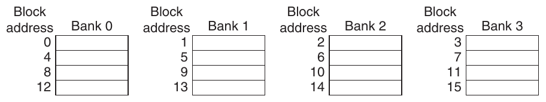

**Hình 2.6 Cache bank interleaved Four-way dùng block addressing. Giả sử mỗi block 64 byte, mỗi address này được nhân với 64 để có byte addressing.**

Rõ ràng, banking hoạt động tốt nhất khi các access tự nhiên phân bố giữa các bank, nên mapping từ address tới bank ảnh hưởng hành vi memory system. Một mapping đơn giản hiệu quả là phân bố block address tuần tự giữa các bank, gọi là sequential interleaving. Ví dụ, nếu có bốn bank, bank 0 chứa mọi block có address modulo 4 bằng 0, bank 1 chứa mọi block có address modulo 4 bằng 1, v.v. Hình 2.6 cho thấy interleaving này. Nhiều bank cũng là cách giảm power tiêu thụ trong cả cache lẫn DRAM.

### Tối ưu thứ sáu: Critical Word First và Early Restart để giảm Miss Penalty

Kỹ thuật này dựa trên quan sát rằng processor thường chỉ cần một word của block mỗi lúc. Chiến lược ở đây là thiếu kiên nhẫn: đừng đợi load toàn bộ block trước khi gửi word được yêu cầu và khởi động lại processor. Đây là hai chiến lược cụ thể:

- Critical word first—Yêu cầu word bị thiếu từ memory trước, gửi nó tới processor ngay khi đến; để processor tiếp tục execution trong khi điền những word còn lại của block.

- Early restart—Fetch word theo thứ tự bình thường, nhưng ngay khi word được yêu cầu của block đến, gửi nó tới processor và để processor tiếp tục execution.

Nhìn chung, các kỹ thuật này chỉ có lợi cho thiết kế dùng cache block lớn, vì lợi ích thấp nếu block không lớn. Lưu ý cache thường tiếp tục đáp ứng access tới block khác trong khi phần còn lại của block đang được điền.

Đáng tiếc, do spatial locality, reference tiếp theo rất có khả năng nhắm tới phần còn lại của block. Cũng như nonblocking cache, miss penalty không dễ tính. Khi có request thứ hai trong critical word first, effective miss penalty là thời gian không chồng lấp từ reference tới khi phần thứ hai đến. Lợi ích của critical word first và early restart phụ thuộc kích thước block cùng khả năng có access khác tới phần block chưa được fetch.

### Tối ưu thứ bảy: Merging Write Buffer để giảm Miss Penalty

Cache Write-through dựa vào write buffer vì mọi store phải được gửi tới tầng thấp hơn kế tiếp trong hierarchy. Ngay cả cache write-back cũng dùng buffer đơn giản khi block bị thay thế. Nếu write buffer rỗng, data cùng address đầy đủ được ghi vào buffer, và từ góc nhìn processor, write đã hoàn tất; processor tiếp tục làm việc trong khi write buffer chuẩn bị ghi word vào memory. Nếu buffer chứa block đã sửa khác, có thể kiểm tra các address để xem address data mới có khớp address của một valid write buffer entry không. Nếu có, data mới được kết hợp với entry đó. Tối ưu này được gọi là write merging. Intel Core i7, cùng nhiều processor khác, dùng write merging.

Nếu buffer đầy và không có address khớp, cache (và processor) phải đợi đến khi buffer có entry trống. Tối ưu này dùng memory hiệu quả hơn vì write nhiều word thường nhanh hơn write từng word mỗi lần. Skadron và Clark [1997] thấy ngay cả write buffer merging four-entry vẫn tạo stall dẫn tới mất 5% đến 10% hiệu năng.

Tối ưu này cũng giảm stall do write buffer đầy. Hình 2.7 cho thấy write buffer có và không có write merging. Giả sử write buffer có bốn entry, mỗi entry chứa được bốn word 64-bit. Không có tối ưu này, bốn store tới address liên tiếp sẽ lấp đầy buffer với một word mỗi entry, dù khi gộp lại, bốn word này vừa đúng trong một entry write buffer duy nhất.

Lưu ý register của input/output device thường được map vào physical address space. Những I/O address này không thể cho phép write merging vì các I/O register riêng biệt có thể không hoạt động như array word trong memory. Chẳng hạn, chúng có thể cần một address cùng data word cho mỗi I/O register, thay vì dùng write nhiều word với một address duy nhất. Các side effect này thường được triển khai bằng cách đánh dấu page là yêu cầu cache thực hiện nonmerging write through.

### Tối ưu thứ tám: Compiler Optimization để giảm Miss Rate

Đến đây, các kỹ thuật của ta đều đòi hỏi thay đổi hardware. Kỹ thuật tiếp theo giảm miss rate mà không cần thay đổi hardware nào.

Sự giảm thiểu thần kỳ này đến từ software được tối ưu—giải pháp yêu thích của người thiết kế hardware! Khoảng cách hiệu năng ngày càng lớn giữa processor và main memory đã thúc đẩy người viết compiler xem xét kỹ memory hierarchy, tìm hiểu liệu tối ưu tại compile time có thể cải thiện hiệu năng hay không. Một lần nữa, nghiên cứu được chia thành cải thiện instruction miss và cải thiện data miss. Những tối ưu trình bày bên dưới có trong nhiều compiler hiện đại.

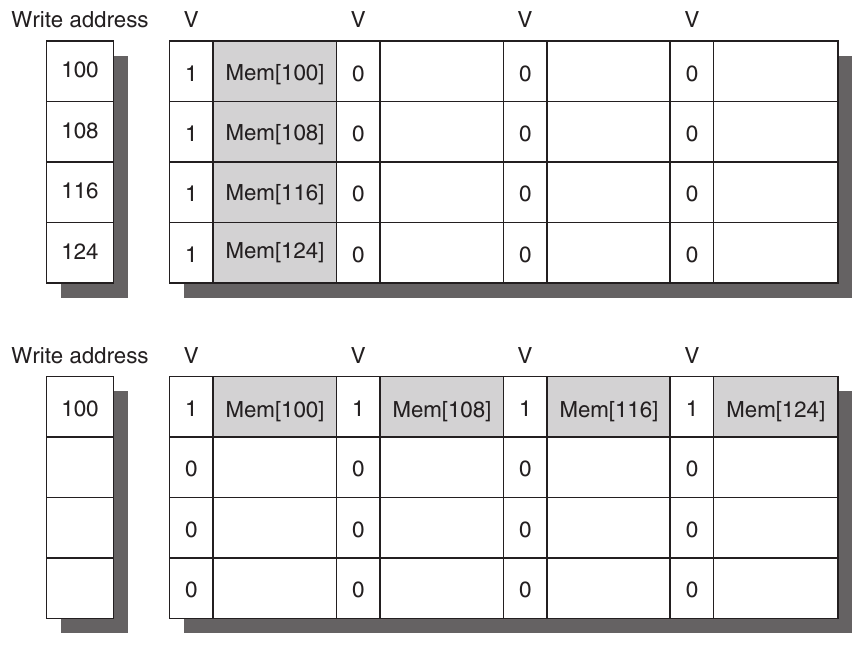

**Hình 2.7 Để minh họa write merging, write buffer phía trên không dùng kỹ thuật này, còn write buffer phía dưới có dùng. Với write merging, bốn lần ghi được gộp vào một buffer entry duy nhất; không có nó, buffer đã đầy dù three-fourths dung lượng của mỗi entry bị lãng phí. Buffer có bốn entry, mỗi entry chứa bốn word 64-bit. Address của mỗi entry ở bên trái, cùng valid bit (V) cho biết nhóm 8 byte liên tiếp tiếp theo trong entry này có được sử dụng hay không. (Không có write merging, những word bên phải ở phần trên hình chỉ được dùng cho instruction ghi nhiều word cùng lúc.)**

#### Loop Interchange

Một số program có nested loop truy cập dữ liệu trong memory theo thứ tự không liên tiếp. Chỉ cần hoán đổi thứ tự lồng loop có thể khiến code truy cập dữ liệu đúng thứ tự chúng được lưu. Giả sử array không vừa cache, kỹ thuật này giảm miss bằng cách cải thiện spatial locality; sắp xếp lại giúp tận dụng tối đa dữ liệu trong cache block trước khi chúng bị loại bỏ. Ví dụ, nếu x là array two-dimensional kích thước [5000,100], được cấp phát sao cho x[i,j] và x[i,j+1] liền nhau (thứ tự gọi là row major, vì array được bố trí theo hàng), hai đoạn code bên dưới cho thấy cách tối ưu các access:

```
/* Before */
for (j = 0; j < 100; j = j+1)
       for (i = 0; i < 5000; i = i+1)
              x[i][j] = 2 * x[i][j];
       /* After */
       for (i = 0; i < 5000; i = i+1)
             for (j = 0; j < 100; j = j+1)
                    x[i][j] = 2 * x[i][j];
```

Code ban đầu nhảy qua memory với stride 100 word, còn phiên bản đã sửa truy cập mọi word trong một cache block trước khi sang block kế tiếp. Tối ưu này cải thiện hiệu năng cache mà không ảnh hưởng số instruction được thực thi.

#### Blocking

Tối ưu này cải thiện temporal locality để giảm miss. Ta lại xét nhiều array, trong đó một số được truy cập theo hàng, một số theo cột. Lưu array lần lượt từng hàng (row major order) hay từng cột (column major order) không giải quyết được vấn đề, vì cả hàng lẫn cột đều được dùng trong mỗi vòng lặp. Những access trực giao như vậy có nghĩa các phép biến đổi như loop interchange vẫn để lại nhiều cơ hội cải thiện.

Thay vì thao tác trên toàn bộ hàng hoặc cột của array, blocked algorithm thao tác trên submatrix hoặc block. Mục tiêu là tối đa hóa số access tới dữ liệu đã load vào cache trước khi dữ liệu bị thay thế. Ví dụ code bên dưới thực hiện matrix multiplication giúp làm rõ lý do cần tối ưu này:

```
/* Before */
for (i = 0; i < N; i = i+1)
       for (j = 0; j < N; j = j+1)
              {r = 0;
               for (k = 0; k < N; k = k + 1)
                    r = r + y[i][k]*z[k][j];
               x[i][j] = r;
              };
```

Hai loop bên trong đọc mọi phần tử N-by-N của z, đọc lặp lại cùng N phần tử trong một hàng của y, và ghi một hàng gồm N phần tử của x. Hình 2.8 cho ảnh chụp tại một thời điểm về các access tới ba array. Màu đậm chỉ access gần đây, màu nhạt chỉ access cũ hơn, còn màu trắng nghĩa là chưa được truy cập.

Số capacity miss rõ ràng phụ thuộc N và kích thước cache. Nếu cache chứa được cả ba matrix N-by-N thì mọi chuyện đều ổn, miễn không có cache conflict. Nếu cache chứa được một matrix N-by-N và một hàng gồm N phần tử, ít nhất hàng thứ i của y và array z có thể ở lại cache. Nếu dung lượng cache nhỏ hơn mức đó, miss có thể xảy ra với cả x lẫn z. Trong trường hợp xấu nhất, có 2N<sup>3</sup> + N<sup>2</sup> memory word được truy cập cho N<sup>3</sup> operation.

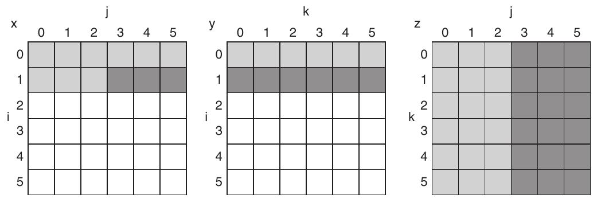

**Hình 2.8 Ảnh chụp tại một thời điểm của ba array x, y và z khi N = 6 và i = 1. Độ cũ của các access tới phần tử array được thể hiện bằng sắc độ: trắng là chưa chạm tới, nhạt là access cũ hơn, đậm là access mới hơn. So với Hình 2.9, các phần tử y và z được đọc lặp lại để tính phần tử mới của x. Các variable i, j và k được thể hiện dọc hàng hoặc cột dùng để truy cập array.**

Để bảo đảm các phần tử đang được truy cập vừa cache, code ban đầu được sửa để tính trên submatrix kích thước B nhân B. Hai loop bên trong giờ tính theo từng bước kích thước B thay vì toàn bộ chiều dài x và z. B được gọi là blocking factor. (Giả sử x được khởi tạo bằng zero.)

```
/* After */
for (jj = 0; jj < N; jj = jj+B)
for (kk = 0; kk < N; kk = kk+B)
for (i = 0; i < N; i = i+1)
       for (j = jj; j < min(jj+B,N); j = j+1)
           {r = 0;
            for (k = kk; k < min(kk+B,N); k = k + 1)
                 r = r + y[i][k]*z[k][j];
            x[i][j] = x[i][j] + r;
           };
```

Hình 2.9 minh họa access tới ba array khi dùng blocking. Chỉ xét capacity miss, tổng số memory word được truy cập là 2N<sup>3</sup>/B + N<sup>2</sup>. Tổng này cải thiện khoảng B lần. Vì vậy, blocking khai thác kết hợp spatial locality và temporal locality, vì y hưởng lợi từ spatial locality, còn z hưởng lợi từ temporal locality.

Dù ta nhắm đến giảm cache miss, blocking cũng có thể hỗ trợ register allocation. Chọn blocking size nhỏ sao cho block có thể giữ trong register giúp giảm thiểu số load và store trong program.

Như ta sẽ thấy trong Mục 4.8 của Chương 4, cache blocking hoàn toàn cần thiết để đạt hiệu năng tốt từ processor cache-based chạy application dùng matrix làm data structure chính.

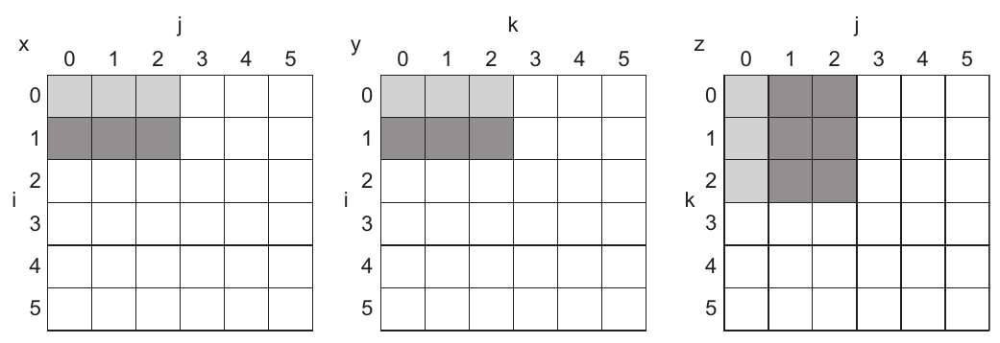

**Hình 2.9 Độ cũ của access tới các array x, y và z khi B = 3. Lưu ý, trái với Hình 2.8, số phần tử được truy cập nhỏ hơn.**

### Tối ưu thứ chín: Hardware Prefetching cho Instruction và Data để giảm Miss Penalty hoặc Miss Rate

Nonblocking cache giảm miss penalty hiệu quả bằng cách chồng lấp execution với memory access. Cách khác là prefetch các item trước khi processor yêu cầu. Cả instruction lẫn data đều có thể được prefetch, trực tiếp vào cache hoặc vào buffer bên ngoài có thể truy cập nhanh hơn main memory.

Instruction prefetch thường được thực hiện bằng hardware bên ngoài cache. Thông thường, khi miss, processor fetch hai block: block được yêu cầu và block liên tiếp tiếp theo. Block được yêu cầu được đặt vào instruction cache khi trả về, còn block được prefetch được đặt vào instruction stream buffer. Nếu block được yêu cầu có trong instruction stream buffer, yêu cầu cache ban đầu bị hủy, block được đọc từ stream buffer, rồi yêu cầu prefetch tiếp theo được phát ra.

Có thể áp dụng cách tương tự cho data access [Jouppi 1990]. Palacharla và Kessler [1994] xem xét một tập program khoa học và nghiên cứu nhiều stream buffer có thể xử lý instruction hoặc data. Họ nhận thấy tám stream buffer có thể xử lý 50% đến 70% mọi miss từ processor có hai cache set associative four-way 64 KB, một cho instruction, một cho data.

Intel Core i7 hỗ trợ hardware prefetching vào cả L1 lẫn L2, với trường hợp prefetching phổ biến nhất là truy cập line kế tiếp. Một số processor Intel trước đây dùng hardware prefetching mạnh tay hơn, nhưng điều đó làm giảm hiệu năng một số application, khiến một số user am hiểu phải tắt khả năng này.

Hình 2.10 cho thấy mức cải thiện hiệu năng tổng thể của một tập con program SPEC2000 khi bật hardware prefetching. Lưu ý hình này chỉ gồm 2 trong 12 integer program, nhưng gồm phần lớn program floating-point của SPEC.

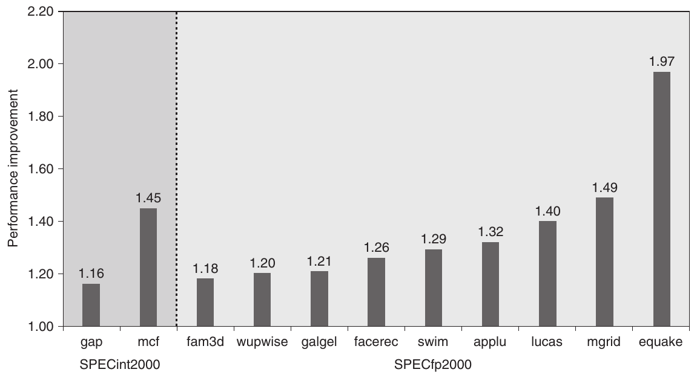

**Hình 2.10 Speedup nhờ hardware prefetching trên Intel Pentium 4 khi bật hardware prefetching cho 2 trong 12 benchmark SPECint2000 và 9 trong 14 benchmark SPECfp2000. Chỉ các program hưởng lợi nhiều nhất từ prefetching được thể hiện; prefetching tăng tốc 15 SPEC benchmark không có trong hình dưới 15% [Singhal 2004].**

Prefetching dựa vào việc tận dụng memory bandwidth vốn sẽ không được dùng, nhưng nếu cản trở demand miss, nó thực sự có thể làm giảm hiệu năng. Hỗ trợ từ compiler có thể giảm prefetching vô ích. Khi prefetching hoạt động tốt, tác động của nó lên power không đáng kể. Khi data được prefetch không được dùng hoặc data hữu ích bị đẩy ra, prefetching sẽ tác động rất tiêu cực tới power.

### Tối ưu thứ mười: Prefetching Compiler-Controlled để giảm Miss Penalty hoặc Miss Rate

Một phương án thay hardware prefetching là để compiler chèn prefetch instruction nhằm yêu cầu data trước khi processor cần. Có hai dạng prefetch:

- Register prefetch sẽ load giá trị vào register.

- Cache prefetch chỉ load data vào cache, không load vào register.

Cả hai dạng đều có thể faulting hoặc nonfaulting; tức address có hoặc không gây exception đối với virtual address fault và protection violation. Theo thuật ngữ này, load instruction bình thường có thể được coi là “faulting register prefetch instruction”. Nonfaulting prefetch chỉ biến thành no-ops nếu bình thường chúng gây exception, đúng điều ta muốn.

Prefetch hiệu quả nhất là “vô hình về semantics” với program: nó không thay đổi nội dung register và memory, cũng không thể gây virtual memory fault. Phần lớn processor ngày nay cung cấp nonfaulting cache prefetch. Mục này giả định nonfaulting cache prefetch, còn gọi là nonbinding prefetch.

Prefetching chỉ hợp lý nếu processor có thể tiếp tục trong khi prefetch data; tức cache không stall mà tiếp tục cung cấp instruction và data trong lúc chờ data được prefetch trả về. Như bạn dự đoán, data cache của máy tính như vậy thường là nonblocking.

Như prefetching hardware-controlled, mục tiêu là chồng lấp execution với prefetching data. Loop là đối tượng quan trọng vì thích hợp với prefetch optimization. Nếu miss penalty nhỏ, compiler chỉ unroll loop một hoặc hai lần rồi schedule prefetch cùng execution. Nếu miss penalty lớn, compiler dùng software pipelining (xem Phụ lục H) hoặc unroll nhiều lần để prefetch data cho một vòng lặp trong tương lai.

Tuy nhiên, phát prefetch instruction tạo instruction overhead, nên compiler phải cẩn thận bảo đảm overhead không vượt lợi ích. Tập trung vào reference có thể gây cache miss giúp program tránh prefetch không cần thiết, đồng thời cải thiện average memory access time đáng kể.

**Ví dụ** Với code bên dưới, hãy xác định access nào có thể gây data cache miss. Tiếp theo, chèn prefetch instruction để giảm miss. Cuối cùng, tính số prefetch instruction được thực thi và số miss tránh được nhờ prefetching. Giả sử ta có data cache direct-mapped 8 KB với block 16-byte, và đó là cache write-back thực hiện write allocate. Phần tử a và b dài 8 byte vì chúng là array floating-point double-precision. a có 3 hàng và 100 cột, b có 101 hàng và 3 cột. Cũng giả sử chúng không ở trong cache khi program bắt đầu.

```
for (i = 0; i < 3; i = i+1)
       for (j = 0; j < 100; j = j+1)
                a[i][j] = b[j][0] * b[j+1][0];
```

**Trả lời** Đầu tiên, compiler xác định access nào có thể gây cache miss; nếu không, ta lãng phí thời gian phát prefetch instruction cho data vốn sẽ hit. Phần tử a được ghi đúng thứ tự lưu trong memory, nên a hưởng lợi từ spatial locality: giá trị j chẵn sẽ miss, còn giá trị lẻ sẽ hit. Vì a có 3 hàng và 100 cột, access tới nó gây 3 × (100/2), tức 150 miss.

Array b không hưởng lợi từ spatial locality vì access không theo thứ tự lưu của nó. Array b hưởng lợi từ temporal locality theo hai cách: cùng những phần tử được truy cập ở mỗi vòng lặp i, và mỗi vòng lặp j dùng cùng giá trị b như vòng trước. Bỏ qua conflict miss tiềm tàng, miss do b xảy ra với access b[j+1][0] khi i = 0, và access đầu tiên tới b[j][0] khi j = 0. Vì j đi từ 0 đến 99 khi i = 0, access tới b gây 100 + 1, tức 101 miss.

Vì vậy, loop này sẽ miss data cache khoảng 150 lần cho a cộng 101 lần cho b, tức 251 miss.

Để đơn giản hóa tối ưu, ta không lo prefetch những access đầu loop. Chúng có thể đã trong cache, hoặc ta sẽ chịu miss penalty của vài phần tử đầu a hay b. Ta cũng không lo loại bỏ prefetch cuối loop cố prefetch vượt cuối a (a[i][100] . . . a[i][106]) và cuối b (b[101][0] . . . b[107][0]). Nếu đây là faulting prefetch, ta không thể thoải mái như vậy. Giả sử miss penalty lớn đến mức ta cần bắt đầu prefetch trước ít nhất, chẳng hạn, bảy vòng lặp. (Nói cách khác, ta giả sử prefetching không có lợi ích trước vòng thứ tám.) Ta gạch chân những thay đổi cần cho code trên để thêm prefetching.

```
for (j = 0; j < 100; j = j+1) {
       prefetch(b[j+7][0]);
       /* b(j,0) for 7 iterations later */
       prefetch(a[0][j+7]);
       /* a(0,j) for 7 iterations later */
       a[0][j] = b[j][0] * b[j+1][0];};
for (i = 1; i < 3; i = i+1)
       for (j = 0; j < 100; j = j+1) {
              prefetch(a[i][j+7]);
              /* a(i,j) for +7 iterations */
              a[i][j] = b[j][0] * b[j+1][0];}
```

Code đã sửa này prefetch a[i][7] đến a[i][99] và b[7][0] đến b[100][0], giảm số nonprefetched miss xuống

- 7 miss cho các phần tử b[0][0], b[1][0], . . . , b[6][0] trong loop đầu

- 4 miss ([7⁄2]) cho các phần tử a[0][0], a[0][1], . . . , a[0][6] trong loop đầu (spatial locality giảm miss còn 1 trên mỗi cache block 16-byte)

- 4 miss ([7⁄2]) cho các phần tử a[1][0], a[1][1], . . . , a[1][6] trong loop thứ hai

- 4 miss ([7⁄2]) cho các phần tử a[2][0], a[2][1], . . . , a[2][6] trong loop thứ hai

tức tổng cộng 19 nonprefetched miss. Chi phí để tránh 232 cache miss là thực thi 400 prefetch instruction, có lẽ là trade-off tốt.

**Ví dụ** Tính thời gian tiết kiệm trong ví dụ trên. Bỏ qua instruction cache miss và giả sử không có conflict miss hoặc capacity miss trong data cache. Giả sử các prefetch có thể chồng lấp nhau và chồng lấp với cache miss, qua đó truyền với memory bandwidth tối đa. Dưới đây là các thời gian thực thi quan trọng của loop khi bỏ qua cache miss: loop ban đầu mất 7 clock cycle mỗi vòng lặp, prefetch loop đầu mất 9 clock cycle mỗi vòng lặp, prefetch loop thứ hai mất 8 clock cycle mỗi vòng lặp (gồm overhead của for loop bên ngoài). Một miss mất 100 clock cycle.

**Trả lời** Loop lồng hai tầng ban đầu thực hiện phép nhân 3 × 100, tức 300 lần. Vì loop mất 7 clock cycle mỗi vòng lặp, tổng là 300 × 7, tức 2100 clock cycle cộng cache miss. Cache miss thêm 251 × 100, tức 25,100 clock cycle, cho tổng 27,200 clock cycle. Prefetch loop đầu lặp 100 lần; với 9 clock cycle mỗi vòng, tổng là 900 clock cycle cộng cache miss. Giờ thêm 11 × 100, tức 1100 clock cycle cho cache miss, được tổng 2000. Loop thứ hai thực hiện 2 × 100, tức 200 lần; với 8 clock cycle mỗi vòng, nó mất 1600 clock cycle cộng 8 × 100, tức 800 clock cycle cho cache miss. Tổng là 2400 clock cycle. Từ ví dụ trước, ta biết code này thực thi 400 prefetch instruction trong 2000 + 2400, tức 4400 clock cycle để thực thi hai loop. Nếu giả sử prefetch chồng lấp hoàn toàn với phần execution còn lại, code prefetch nhanh gấp 27,200/4400, tức 6.2 lần.

Dù tối ưu array dễ hiểu, program hiện đại có nhiều khả năng dùng pointer hơn. Luk và Mowry [1999] chứng minh rằng đôi khi có thể mở rộng prefetching compiler-based cho cả pointer. Trong 10 program có recursive data structure, prefetch mọi pointer khi ghé một node cải thiện hiệu năng từ 4% đến 31% ở một nửa số program. Ngược lại, các program còn lại vẫn có hiệu năng trong phạm vi 2% so với ban đầu. Vấn đề vừa là prefetch có nhắm vào data đã trong cache hay không, vừa là prefetch có xảy ra đủ sớm để data đến đúng lúc cần hay không.

Nhiều processor hỗ trợ instruction cho cache prefetch, và processor high-end (như Intel Core i7) thường còn thực hiện một dạng prefetch tự động bằng hardware.

### Tổng kết Cache Optimization

Các kỹ thuật cải thiện hit time, bandwidth, miss penalty và miss rate nhìn chung cũng tác động tới những thành phần khác trong phương trình average memory access, cũng như độ phức tạp của memory hierarchy. Hình 2.11 tổng kết các kỹ thuật và ước tính tác động lên độ phức tạp; + nghĩa là kỹ thuật cải thiện yếu tố đó, – nghĩa là làm yếu tố đó kém đi, còn ô trống nghĩa là không tác động. Nhìn chung, không kỹ thuật nào hỗ trợ hơn một nhóm.

| Kỹ thuật | Hit time | Band-width | Miss penalty | Miss rate | Power tiêu thụ | Chi phí/độ phức tạp hardware | Nhận xét |
|---|---|---|---|---|---|---|---|
| Cache nhỏ và đơn giản | + |  |  | – | + | 0 | Rất đơn giản; được dùng rộng rãi |
| Cache Way-predicting | + |  |  |  | + | 1 | Được dùng trong Pentium 4 |
| Cache access được pipeline | – | + |  |  |  | 1 | Được dùng rộng rãi |
| Nonblocking cache |  | + | + |  |  | 3 | Được dùng rộng rãi |
| Banked cache |  | + |  |  | + | 1 | Được dùng trong L2 của cả i7 và Cortex-A8 |
| Critical word first và early restart |  |  | + |  |  | 2 | Được dùng rộng rãi |
| Merging write buffer |  |  | + |  |  | 1 | Được dùng rộng rãi với write through |
| Kỹ thuật compiler giảm cache miss |  |  |  | + |  | 0 | Software là thách thức, nhưng nhiều compiler xử lý các phép tính linear algebra phổ biến |
| Hardware prefetching cho instruction và data |  |  | + | + | − | 2 instr., 3 data | Phần lớn cung cấp prefetch instruction; processor high-end hiện đại còn tự động prefetch bằng hardware. |
| Prefetching Compiler-controlled |  |  | + | + |  | 3 | Cần nonblocking cache; có thể có instruction overhead; có trong nhiều CPU |

**Hình 2.11 Tổng kết 10 cache optimization nâng cao, thể hiện tác động lên hiệu năng cache, power tiêu thụ và độ phức tạp. Dù thông thường một kỹ thuật chỉ hỗ trợ một yếu tố, prefetching có thể giảm miss nếu thực hiện đủ sớm; nếu không, nó có thể giảm miss penalty. + nghĩa là kỹ thuật cải thiện yếu tố đó, – nghĩa là làm yếu tố đó kém đi, ô trống nghĩa là không tác động. Thước đo độ phức tạp mang tính chủ quan, với 0 là dễ nhất và 3 là thách thức.**

## 2.3 Công nghệ Memory và các tối ưu

> … bước phát triển duy nhất thực sự giúp máy tính đứng vững là phát minh một dạng memory đáng tin cậy, cụ thể là core memory. … Chi phí của nó hợp lý, nó đáng tin cậy, và vì đáng tin cậy nên đến thời điểm thích hợp có thể được mở rộng dung lượng. [tr. 209]

> Maurice Wilkes

> Memoirs of a Computer Pioneer (1985)

Main memory là tầng kế tiếp phía dưới trong hierarchy. Main memory đáp ứng nhu cầu của cache và đóng vai trò I/O interface, vì vừa là đích của input vừa là nguồn của output. Thước đo hiệu năng main memory chú trọng cả latency lẫn bandwidth. Theo truyền thống, main memory latency (ảnh hưởng cache miss penalty) là mối quan tâm chính của cache, còn main memory bandwidth là mối quan tâm chính của multiprocessor và I/O.

Dù cache hưởng lợi từ memory low-latency, nhìn chung cải thiện memory bandwidth bằng tổ chức mới dễ hơn giảm latency. Sự phổ biến của multilevel cache cùng block size lớn hơn của chúng khiến main memory bandwidth cũng quan trọng với cache. Thực tế, người thiết kế cache tăng block size để tận dụng memory bandwidth cao.

Những mục trước mô tả các thay đổi có thể thực hiện với tổ chức cache để giảm khoảng cách hiệu năng processor–DRAM, nhưng chỉ làm cache lớn hơn hoặc thêm tầng cache không thể loại bỏ khoảng cách. Main memory cũng cần đổi mới.

Trước đây, đổi mới nằm ở cách tổ chức nhiều chip DRAM tạo thành main memory, chẳng hạn dùng nhiều memory bank. Có thể đạt bandwidth cao hơn bằng memory bank, bằng cách làm memory và bus của nó rộng hơn, hoặc cả hai. Trớ trêu là khi dung lượng mỗi memory chip tăng, số chip trong memory system same-sized giảm, làm giảm khả năng xây memory system rộng hơn với cùng dung lượng.

Để memory system đáp ứng nhu cầu bandwidth của processor hiện đại, các đổi mới memory bắt đầu xuất hiện bên trong chính chip DRAM. Mục này mô tả công nghệ bên trong memory chip và các tổ chức nội bộ mang tính đổi mới đó. Trước khi mô tả công nghệ và lựa chọn, hãy điểm qua các performance metric.

Với sự ra đời của memory burst transfer, hiện được dùng rộng rãi trong cả Flash lẫn DRAM, memory latency được công bố theo hai thước đo—access time và cycle time. Access time là thời gian từ khi yêu cầu đọc đến lúc word mong muốn đến, còn cycle time là thời gian tối thiểu giữa các yêu cầu memory không liên quan.

Gần như mọi máy tính từ năm 1975 đều dùng DRAM cho main memory và SRAM cho cache, với một đến ba tầng được tích hợp trên processor chip cùng CPU. Trong PMD, công nghệ memory thường cân bằng power và tốc độ; hệ thống cao cấp hơn dùng công nghệ memory nhanh, high-bandwidth.

### Công nghệ SRAM

Chữ đầu của SRAM là viết tắt của static. Bản chất dynamic của mạch DRAM yêu cầu data được ghi lại sau khi đọc—vì vậy access time khác cycle time, đồng thời cần refresh. SRAM không cần refresh, nên access time rất gần cycle time. SRAM thường dùng sáu transistor mỗi bit để ngăn thông tin bị xáo trộn khi đọc. SRAM chỉ cần power tối thiểu để giữ charge trong standby mode.

Trước đây, phần lớn hệ thống desktop và server dùng chip SRAM cho primary cache, secondary cache hoặc tertiary cache; ngày nay, cả ba tầng cache đều được tích hợp trên processor chip. Hiện cache third-level, on-chip lớn nhất là 12 MB, còn memory system của processor như vậy có thể có DRAM từ 4 đến 16 GB. Access time của cache lớn, third-level, on-chip thường gấp hai đến bốn lần cache second-level, vốn vẫn nhanh hơn truy cập DRAM memory từ ba đến năm lần.

### Công nghệ DRAM

Khi dung lượng DRAM thời kỳ đầu tăng, chi phí package với đầy đủ address line cần thiết trở thành vấn đề. Giải pháp là multiplex address line, qua đó giảm một nửa số address pin. Hình 2.12 cho thấy tổ chức DRAM cơ bản. One-half của address được gửi trước trong row access strobe (RAS). Nửa address còn lại, được gửi trong column access strobe (CAS), theo sau. Các tên gọi này xuất phát từ tổ chức nội bộ chip, vì memory được tổ chức như matrix hình chữ nhật với address theo hàng và cột.

Một yêu cầu bổ sung của DRAM xuất phát từ thuộc tính được chữ đầu D biểu thị, tức dynamic. Để chứa nhiều bit hơn trên chip, DRAM chỉ dùng một transistor lưu một bit. Đọc bit đó phá hủy thông tin, nên phải khôi phục nó. Đây là một lý do cycle time DRAM theo truyền thống dài hơn access time; gần đây hơn, DRAM đưa vào nhiều bank, cho phép che giấu phần ghi lại của cycle. Ngoài ra, để tránh mất thông tin khi bit không được đọc hay ghi, bit phải được “refresh” định kỳ. May mắn là có thể refresh đồng thời mọi bit trong hàng chỉ bằng cách đọc hàng đó. Vì vậy, mỗi DRAM trong memory system phải truy cập mọi hàng trong một khoảng thời gian nhất định, chẳng hạn 8 ms. Memory controller có hardware để refresh DRAM định kỳ.

Yêu cầu này có nghĩa memory system đôi khi không khả dụng vì đang gửi signal yêu cầu mọi chip refresh. Thời gian cho một lần refresh thường là một memory access đầy đủ (RAS và CAS) cho mỗi hàng DRAM. Vì về khái niệm memory matrix trong DRAM có dạng vuông, số bước refresh thường là căn bậc hai dung lượng DRAM. Người thiết kế DRAM cố giữ thời gian refresh dưới 5% tổng thời gian.

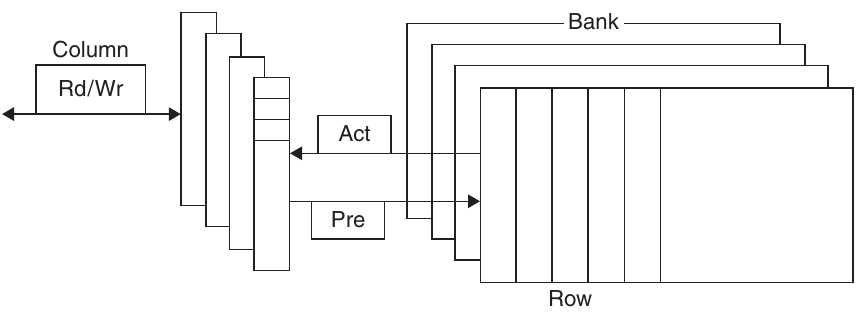

**Hình 2.12 Tổ chức nội bộ DRAM. DRAM hiện đại được tổ chức thành bank, thường là bốn bank cho DDR3. Mỗi bank gồm một loạt hàng. Gửi command PRE (precharge) mở hoặc đóng bank. Row address được gửi cùng Act (activate), khiến hàng được chuyển vào buffer. Khi hàng nằm trong buffer, có thể truyền nó qua các column address liên tiếp với bất kỳ độ rộng nào của DRAM (thường 4, 8 hoặc 16 bit trong DDR3), hoặc bằng cách chỉ định block transfer cùng starting address. Mỗi command cũng như block transfer đều được đồng bộ với clock.**

Đến đây, ta trình bày main memory như thể nó hoạt động giống tàu Thụy Sĩ, luôn giao hàng đúng lịch. Refresh cho thấy so sánh đó không đúng, vì một số access mất thời gian lâu hơn nhiều access khác. Vì vậy, refresh là lý do nữa khiến memory latency, và do đó cache miss penalty, biến thiên.

Amdahl đề xuất quy tắc kinh nghiệm rằng dung lượng memory nên tăng tuyến tính với tốc độ processor để hệ thống cân bằng, nghĩa là processor 1000 MIPS nên có memory 1000 MB. Người thiết kế processor dựa vào DRAM đáp ứng nhu cầu này. Trước đây, họ kỳ vọng dung lượng cải thiện gấp bốn mỗi ba năm, tức 55% mỗi năm. Đáng tiếc, hiệu năng DRAM tăng với tốc độ chậm hơn nhiều. Hình 2.13 cho thấy row access time, liên quan latency, cải thiện hiệu năng khoảng 5% mỗi năm. CAS hay data transfer time, liên quan bandwidth, cải thiện với tốc độ hơn gấp hai mức đó.

Dù ta đang nói về từng chip riêng, DRAM thường được bán trên board nhỏ gọi là dual inline memory module (DIMM). DIMM thường chứa 4 đến 16 DRAM, và bình thường được tổ chức với độ rộng 8 byte (+ ECC) cho hệ thống desktop và server.

Row access strobe (RAS)

| Năm sản xuất | Kích thước chip | Loại DRAM | DRAM chậm nhất (ns) | DRAM nhanh nhất (ns) | Column access strobe (CAS)/data transfer time (ns) | Cycle time (ns) |
|---|---|---|---|---|---|---|
| 1980 | 64K bit | DRAM | 180 | 150 | 75 | 250 |
| 1983 | 256K bit | DRAM | 150 | 120 | 50 | 220 |
| 1986 | 1M bit | DRAM | 120 | 100 | 25 | 190 |
| 1989 | 4M bit | DRAM | 100 | 80 | 20 | 165 |
| 1992 | 16M bit | DRAM | 80 | 60 | 15 | 120 |
| 1996 | 64M bit | SDRAM | 70 | 50 | 12 | 110 |
| 1998 | 128M bit | SDRAM | 70 | 50 | 10 | 100 |
| 2000 | 256M bit | DDR1 | 65 | 45 | 7 | 90 |
| 2002 | 512M bit | DDR1 | 60 | 40 | 5 | 80 |
| 2004 | 1G bit | DDR2 | 55 | 35 | 5 | 70 |
| 2006 | 2G bit | DDR2 | 50 | 30 | 2.5 | 60 |
| 2010 | 4G bit | DDR3 | 36 | 28 | 1 | 37 |
| 2012 | 8G bit | DDR3 | 30 | 24 | 0.5 | 31 |

**Hình 2.13 Thời gian của DRAM nhanh và chậm thay đổi qua mỗi thế hệ. (Cycle time được định nghĩa ở trang 97.) Row access time cải thiện hiệu năng khoảng 5% mỗi năm. Mức cải thiện gấp 2 ở column access năm 1986 đi cùng việc chuyển từ DRAM NMOS sang DRAM CMOS. Sự ra đời của nhiều burst transfer mode vào mid-1990s và SDRAM vào cuối những năm 1990 đã khiến tính access time cho data block phức tạp hơn đáng kể; ta thảo luận sau trong mục này khi nói về access time và power của SDRAM. Thiết kế DDR4 dự kiến được giới thiệu từ mid- đến cuối năm 2012. Ta thảo luận những dạng DRAM này trong vài trang tiếp theo.**

Ngoài đóng gói DIMM và các interface mới cải thiện data transfer time được bàn trong các tiểu mục sau, thay đổi lớn nhất của DRAM là tăng trưởng dung lượng chậm lại. DRAM tuân theo Moore’s law trong 20 năm, đưa ra chip mới có dung lượng gấp bốn mỗi ba năm. Do thách thức sản xuất DRAM single-bit, từ năm 1998 chip mới chỉ tăng gấp đôi dung lượng mỗi hai năm. Năm 2006, nhịp tăng còn chậm hơn, khi bốn năm từ 2006 đến 2010 chỉ chứng kiến dung lượng tăng gấp đôi.

### Cải thiện hiệu năng Memory bên trong Chip DRAM

Khi Moore’s law tiếp tục cung cấp nhiều transistor hơn và khoảng cách processor– memory làm gia tăng áp lực lên hiệu năng memory, các ý tưởng ở mục trước đã đi vào bên trong chip DRAM. Nhìn chung, đổi mới dẫn đến bandwidth lớn hơn, đôi khi phải trả giá bằng latency lớn hơn. Tiểu mục này trình bày kỹ thuật tận dụng bản chất DRAM.

Như đề cập trước, DRAM access chia thành row access và column access. DRAM phải buffer một hàng bit bên trong để phục vụ column access, và hàng này thường có kích thước bằng căn bậc hai dung lượng DRAM—ví dụ 2 Kb cho DRAM 4 Mb. Khi DRAM lớn lên, cấu trúc bổ sung cùng nhiều cơ hội tăng bandwidth được đưa vào.

Đầu tiên, DRAM bổ sung timing signal cho phép truy cập row buffer lặp lại mà không phải chịu thêm row access time. Buffer như vậy xuất hiện tự nhiên, vì mỗi array sẽ buffer 1024 đến 4096 bit mỗi access. Ban đầu, mỗi lần truyền phải gửi column address riêng, với delay sau mỗi tập column address mới.

Ban đầu, DRAM có asynchronous interface với memory controller, nên mỗi lần truyền có overhead đồng bộ với controller. Thay đổi lớn thứ hai là thêm clock signal vào DRAM interface để những lần truyền lặp lại không chịu overhead đó. Synchronous DRAM (SDRAM) là tên tối ưu này. SDRAM thường còn có programmable register giữ số byte yêu cầu, nhờ đó có thể gửi nhiều byte trong nhiều cycle cho mỗi request. Thông thường, có thể thực hiện 8 lần truyền 16-bit trở lên mà không gửi address mới bằng cách đặt DRAM vào burst mode; mode này hỗ trợ truyền critical word first, và là cách duy nhất đạt peak bandwidth trong Hình 2.14.

Thứ ba, để khắc phục vấn đề lấy stream bit rộng từ memory mà không phải làm memory system quá lớn khi mật độ memory system tăng, DRAM được làm rộng hơn. Ban đầu, chúng cung cấp transfer mode four-bit; năm 2010, DRAM DDR2 và DDR3 có bus tới 16-bit.

Đổi mới DRAM lớn thứ tư nhằm tăng bandwidth là truyền data trên cả rising edge lẫn falling edge của DRAM clock signal, nhờ đó tăng gấp đôi peak data rate. Tối ưu này được gọi là double data rate (DDR).

Để có một số ưu điểm của interleaving, đồng thời hỗ trợ power management, SDRAM còn đưa vào bank, chia một SDRAM thành 2 đến 8 block (trong DRAM DDR3 hiện tại) có thể hoạt động độc lập. (Ta đã thấy bank dùng trong cache nội bộ, và chúng thường được dùng trong main memory lớn.) Tạo nhiều bank bên trong DRAM thực chất thêm một segment nữa vào address, giờ gồm bank number, row address và column address. Khi gửi address chỉ định bank mới, phải mở bank đó, tạo thêm delay. Memory control interface hiện đại xử lý hoàn toàn việc quản lý bank và row buffer, nên khi access tiếp theo chỉ định cùng hàng trong bank đang mở, access có thể diễn ra nhanh, chỉ cần gửi column address.

| Tiêu chuẩn | Clock rate (MHz) | Triệu lần truyền mỗi giây | Tên DRAM | MB/sec /DIMM | Tên DIMM |
|---|---|---|---|---|---|
| DDR | 133 | 266 | DDR266 | 2128 | PC2100 |
| DDR | 150 | 300 | DDR300 | 2400 | PC2400 |
| DDR | 200 | 400 | DDR400 | 3200 | PC3200 |
| DDR2 | 266 | 533 | DDR2-533 | 4264 | PC4300 |
| DDR2 | 333 | 667 | DDR2-667 | 5336 | PC5300 |
| DDR2 | 400 | 800 | DDR2-800 | 6400 | PC6400 |
| DDR3 | 533 | 1066 | DDR3-1066 | 8528 | PC8500 |
| DDR3 | 666 | 1333 | DDR3-1333 | 10,664 | PC10700 |
| DDR3 | 800 | 1600 | DDR3-1600 | 12,800 | PC12800 |
| DDR4 | 1066–1600 | 2133–3200 | DDR4-3200 | 17,056–25,600 | PC25600 |

**Hình 2.14 Clock rate, bandwidth và tên DRAM DDR cùng DIMM năm 2010. Lưu ý quan hệ số học giữa các cột. Cột thứ ba gấp đôi cột thứ hai, còn cột thứ tư dùng số từ cột thứ ba trong tên chip DRAM. Cột thứ năm gấp tám cột thứ ba, và số này được làm tròn để dùng trong tên DIMM. Dù không thể hiện trong hình, DDR còn chỉ định latency tính bằng clock cycle dưới dạng bốn số theo tiêu chuẩn DDR. Ví dụ DDR3-2000 CL 9 có latency 9-9-9-28. Điều này nghĩa là gì? Với clock 1 ns (clock cycle bằng one-half transfer rate), các số chỉ 9 ns từ row address tới column address (RAS time), 9 ns từ column access tới data (CAS time), và minimum read time 28 ns. Đóng hàng mất 9 ns cho precharge nhưng chỉ xảy ra khi đã đọc xong hàng đó. Trong burst mode, các lần truyền diễn ra trên cả hai cạnh của mỗi clock, khi RAS time và CAS time ban đầu đã trôi qua. Hơn nữa, không cần precharge cho đến khi toàn bộ hàng được đọc. DDR4 sẽ được sản xuất năm 2012 và dự kiến đạt clock rate 1600 MHz năm 2014, khi DDR5 dự kiến tiếp quản. Các bài tập khám phá thêm những chi tiết này.**

Khi DDR SDRAM được đóng gói thành DIMM, cách đặt nhãn theo peak DIMM bandwidth gây nhầm lẫn. Vì vậy, tên DIMM PC2100 đến từ 133 MHz × 2 × 8 byte, tức 2100 MB/sec. Tiếp tục gây nhầm lẫn, bản thân chip được đặt nhãn theo số bit mỗi giây thay vì clock rate, nên chip DDR 133 MHz được gọi là DDR266. Hình 2.14 cho thấy quan hệ giữa clock rate, số lần truyền mỗi giây mỗi chip, tên chip, DIMM bandwidth và tên DIMM.

DDR giờ là một chuỗi tiêu chuẩn. DDR2 giảm power bằng cách hạ voltage từ 2.5 volt xuống 1.8 volt và cung cấp clock rate cao hơn: 266 MHz, 333 MHz và 400 MHz. DDR3 giảm voltage xuống 1.5 volt, có clock speed tối đa 800 MHz. DDR4, dự kiến sản xuất năm 2014, giảm voltage xuống 1 đến 1.2 volt, có clock rate tối đa dự kiến 1600 MHz. DDR5 sẽ theo sau khoảng năm 2014 hoặc 2015. (Như ta bàn ở mục tiếp theo, GDDR5 là graphics RAM và dựa trên DRAM DDR3.)

#### Graphics Data RAM

GDRAM hoặc GSDRAM (Graphics hoặc Graphics Synchronous DRAM) là một lớp DRAM đặc biệt dựa trên thiết kế SDRAM nhưng được điều chỉnh để xử lý nhu cầu bandwidth cao hơn của graphics processing unit. GDDR5 dựa trên DDR3, còn GDDR trước đó dựa trên DDR2. Vì Graphics Processor Unit (GPU; xem Chương 4) đòi bandwidth mỗi chip DRAM lớn hơn CPU, GDDR có một số khác biệt quan trọng:

1. GDDR có interface rộng hơn: 32-bits so với 4, 8 hoặc 16 trong thiết kế hiện tại.

2. GDDR có clock rate tối đa trên data pin cao hơn. Để cho phép transfer rate cao hơn mà không gặp vấn đề signaling, GDRAM thường nối trực tiếp GPU và được gắn bằng cách hàn vào board, khác DRAM thường được bố trí thành array DIMM có thể mở rộng.

Kết hợp lại, các đặc tính này cho phép GDDR chạy với bandwidth mỗi DRAM gấp hai đến năm lần DRAM DDR3, một lợi thế đáng kể khi hỗ trợ GPU. Do memory request trong GPU có locality thấp hơn, burst mode thường ít hữu ích hơn cho GPU, nhưng giữ mở nhiều memory bank và quản lý việc sử dụng chúng giúp cải thiện bandwidth hiệu dụng.

### Giảm Power tiêu thụ trong SDRAM

Power tiêu thụ trong dynamic memory chip gồm cả dynamic power dùng khi đọc hoặc ghi lẫn static power hay standby power; cả hai phụ thuộc operating voltage. Trong SDRAM DDR3 tiên tiến nhất, operating voltage đã giảm xuống 1.35 đến 1.5 volt, giảm power đáng kể so với SDRAM DDR2. Việc thêm bank cũng giảm power, vì chỉ hàng trong một bank duy nhất được đọc và precharge.

Ngoài những thay đổi này, mọi SDRAM gần đây hỗ trợ power down mode, được kích hoạt bằng cách yêu cầu DRAM bỏ qua clock. Power down mode vô hiệu hóa SDRAM, trừ automatic refresh nội bộ (nếu không có nó, ở power down mode lâu hơn refresh time sẽ làm mất nội dung memory). Hình 2.15 cho thấy power tiêu thụ trong ba tình huống của SDRAM DDR3 2 Gb. Delay chính xác cần để trở lại từ low power mode phụ thuộc SDRAM, nhưng thời gian điển hình từ autorefresh low power mode là 200 clock cycle; có thể cần thêm thời gian reset mode register trước command đầu tiên.

### Flash Memory

Flash memory là một loại EEPROM (Electronically Erasable Programmable Read-Only Memory), thường là read-only nhưng có thể xóa. Thuộc tính then chốt khác của Flash memory là nó giữ nội dung mà không cần power.

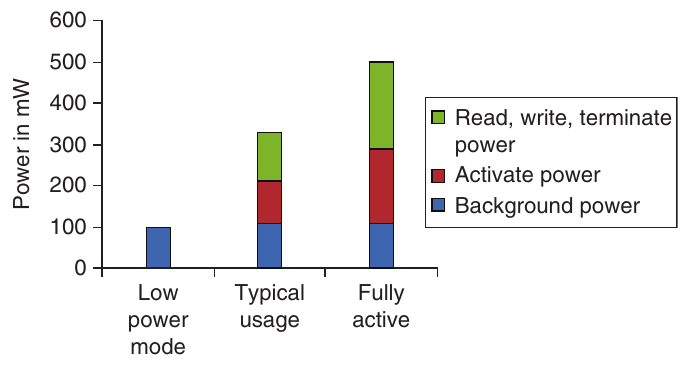

**Hình 2.15 Power tiêu thụ của SDRAM DDR3 hoạt động trong ba điều kiện: low power (shutdown) mode, typical system mode (DRAM hoạt động 30% thời gian để đọc và 15% để ghi), và fully active mode, khi DRAM liên tục đọc hoặc ghi nếu không đang precharge. Các lần đọc và ghi giả sử burst gồm 8 lần truyền. Dữ liệu này dựa trên Micron 1.5V 2Gb DDR3-1066.**

Flash được dùng làm backup storage trong PMD giống cách disk hoạt động trong laptop hoặc server. Ngoài ra, vì phần lớn PMD có lượng DRAM hạn chế, Flash còn có thể đóng vai trò một tầng memory hierarchy ở mức lớn hơn rất nhiều so với mức cần thiết trên desktop hoặc server có main memory có thể lớn hơn từ 10 đến 100 lần.

Flash dùng architecture rất khác và có thuộc tính khác DRAM tiêu chuẩn. Những khác biệt quan trọng nhất là

1. Flash memory phải được xóa (vì vậy có tên Flash cho quy trình xóa “flash”) trước khi ghi đè, và được xóa theo block (trong Flash high-density, gọi là NAND Flash, loại dùng trong phần lớn application máy tính), thay vì từng byte hoặc word. Nghĩa là khi phải ghi data vào Flash, cần tập hợp toàn bộ block, hoặc toàn data mới, hoặc bằng cách gộp data cần ghi với phần nội dung còn lại của block.

2. Flash memory là static (tức giữ nội dung ngay cả khi không cấp power) và lấy power ít hơn đáng kể khi không đọc hoặc ghi (từ dưới một nửa trong standby mode đến zero khi hoàn toàn không hoạt động).

3. Flash memory có số write cycle giới hạn cho mỗi block, thường ít nhất 100,000. Bảo đảm phân bố đồng đều các block được ghi trên toàn memory giúp hệ thống tối đa hóa tuổi thọ Flash memory system.

4. Flash High-density rẻ hơn SDRAM nhưng đắt hơn disk: khoảng $2/GB cho Flash, $20 đến $40/GB cho SDRAM và $0.09/GB cho magnetic disk.

5. Flash chậm hơn SDRAM rất nhiều nhưng nhanh hơn disk rất nhiều. Ví dụ, truyền 256 byte từ Flash memory high-density điển hình mất khoảng 6.5 μs (dùng burst mode transfer tương tự nhưng chậm hơn loại trong SDRAM). Truyền tương ứng từ DDR SDRAM mất khoảng one-quarter thời gian đó, còn disk mất lâu hơn khoảng 1000 lần. Với ghi, chênh lệch lớn hơn đáng kể: SDRAM nhanh hơn Flash ít nhất 10 và có thể tới 100 lần, tùy hoàn cảnh.

Những cải thiện nhanh chóng của Flash high-density trong thập kỷ qua đã khiến công nghệ này trở thành thành phần khả thi của memory hierarchy trong mobile device và phương án solid-state thay disk. Khi tốc độ tăng mật độ DRAM tiếp tục giảm, Flash có thể đóng vai trò lớn hơn trong memory system tương lai, vừa thay hard disk vừa làm intermediate storage giữa DRAM và disk.

### Tăng cường Dependability trong Memory System

Cache và main memory lớn làm tăng đáng kể khả năng lỗi xảy ra cả trong fabrication process lẫn khi vận hành, chủ yếu do cosmic ray đập vào memory cell. Những dynamic error này, tức thay đổi nội dung cell chứ không phải thay đổi mạch, được gọi là soft error. Mọi DRAM, Flash memory và nhiều SRAM được sản xuất với các hàng dự phòng, để có thể xử lý một số ít manufacturing defect bằng cách lập trình thay hàng lỗi bằng hàng dự phòng. Ngoài fabrication error phải được sửa khi cấu hình, hard error, tức thay đổi vĩnh viễn hoạt động của một hoặc nhiều memory cell, có thể xảy ra khi vận hành.

Dynamic error có thể được phát hiện bằng parity bit, hoặc được phát hiện và sửa bằng Error Correcting Code (ECC). Vì instruction cache là read-only, parity là đủ. Trong data cache lớn hơn và main memory, ECC được dùng để vừa phát hiện vừa sửa lỗi. Parity chỉ cần overhead một bit để phát hiện một lỗi trong chuỗi bit. Vì lỗi multibit sẽ không được parity phát hiện, số bit được một parity bit bảo vệ phải hạn chế. Một parity bit cho mỗi 8 data bit là tỷ lệ điển hình. ECC có thể phát hiện hai lỗi và sửa một lỗi với overhead 8 bit trên mỗi 64 data bit.

Trong hệ thống rất lớn, khả năng có nhiều lỗi cũng như hỏng hoàn toàn một memory chip trở nên đáng kể. IBM đưa ra Chipkill để giải quyết vấn đề này, và nhiều hệ thống rất lớn như server IBM, SUN cùng Google Clusters dùng công nghệ đó. (Intel gọi phiên bản của họ là SDDC.) Tương tự cách RAID dùng cho disk, Chipkill phân phối data và thông tin ECC, cho phép xử lý hỏng hoàn toàn một memory chip bằng cách hỗ trợ tái tạo data bị thiếu từ các memory chip còn lại. Áp dụng phân tích của IBM và giả sử một server có 10,000 processor với 4 GB cho mỗi processor, ta thu được các mức unrecoverable error sau trong ba năm hoạt động:

- Chỉ parity—khoảng 90,000, tức một failure unrecoverable (hoặc không được phát hiện) mỗi 17 phút

- Chỉ ECC—khoảng 3500, tức khoảng một failure không được phát hiện hoặc unrecoverable mỗi 7.5 giờ

- Chipkill—6, tức khoảng một failure không được phát hiện hoặc unrecoverable mỗi 2 tháng

Một cách nhìn khác là tìm số server tối đa (mỗi server 4 GB) có thể được bảo vệ mà vẫn đạt error rate như Chipkill thể hiện. Với parity, ngay cả server chỉ có một processor cũng có unrecoverable error rate cao hơn hệ thống Chipkill 10,000-server. Với ECC, hệ thống 17-server có failure rate xấp xỉ hệ thống Chipkill 10,000-server. Vì vậy, Chipkill là yêu cầu bắt buộc cho 50,000 đến 100,00 server trong máy tính warehouse-scale (xem Mục 6.8 của Chương 6).

## 2.4 Protection: Virtual Memory và Virtual Machine

> Virtual machine được xem là bản sao hiệu quả, cô lập của máy thật. Chúng tôi giải thích những khái niệm này qua ý tưởng virtual machine monitor (VMM). . . . VMM có ba đặc tính thiết yếu. Thứ nhất, VMM cung cấp môi trường cho chương trình về cơ bản giống hệt máy ban đầu; thứ hai, chương trình chạy trong môi trường này tệ nhất cũng chỉ giảm tốc độ đôi chút; cuối cùng, VMM hoàn toàn kiểm soát resource của hệ thống.

> Gerald Popek and Robert Goldberg

> “Formal requirements for virtualizable third generation architectures,”

> Communications of the ACM (tháng Bảy năm 1974)

Security và privacy là hai thách thức gây đau đầu nhất cho công nghệ thông tin năm 2011. Những vụ đột nhập điện tử, thường liên quan danh sách số thẻ tín dụng, được công bố thường xuyên, và người ta tin rằng còn nhiều vụ không được báo cáo hơn nữa. Vì vậy, cả nhà nghiên cứu lẫn người thực hành đang tìm cách mới để khiến computing system an toàn hơn. Dù bảo vệ thông tin không chỉ giới hạn trong hardware, theo quan điểm chúng tôi, security và privacy thực sự có lẽ sẽ đòi hỏi sự đổi mới cả trong computer architecture lẫn systems software.

Mục này bắt đầu bằng việc ôn lại architecture support để bảo vệ các process để chúng không ảnh hưởng lẫn nhau qua virtual memory. Sau đó mô tả sự bảo vệ bổ sung mà virtual machine cung cấp, các yêu cầu về architecture của virtual machine và performance của virtual machine. Như sẽ thấy ở Chương 6, virtual machine là công nghệ nền tảng cho cloud computing.

### Protection qua Virtual Memory

Virtual memory Page-based, gồm translation lookaside buffer cache các page table entry, là mechanism chính để bảo vệ các process để chúng không ảnh hưởng lẫn nhau. Mục B.4 và B.5 trong Phụ lục B ôn lại virtual memory, gồm mô tả chi tiết protection qua segmentation và paging trong 80x86. Tiểu mục này là phần ôn nhanh; nếu phần ôn tập này quá nhanh, hãy tham khảo những mục đó.

Multiprogramming, trong đó nhiều chương trình chạy concurrently cùng chia sẻ một máy tính, dẫn tới nhu cầu bảo vệ và chia sẻ giữa các chương trình, cùng khái niệm process. Nói hình tượng, process là không khí để chương trình thở và không gian để nó sống—tức chương trình đang chạy cộng mọi state cần để tiếp tục chạy. Tại bất kỳ thời điểm nào, phải có thể chuyển từ process này sang process khác. Sự chuyển đổi này được gọi là process switch hoặc context switch.

Operating system và architecture phối hợp để cho phép các process chia sẻ hardware mà không can thiệp vào nhau. Để làm vậy, architecture phải giới hạn những gì process truy cập khi đang chạy một user process, nhưng vẫn cho phép operating system process truy cập nhiều hơn. Tối thiểu, architecture phải thực hiện những việc sau:

1. Cung cấp ít nhất hai mode, cho biết process đang chạy là user process hay operating system process. Loại process sau đôi khi được gọi là kernel process hoặc supervisor process.

2. Cung cấp một phần processor state mà user process có thể dùng nhưng không được ghi. State này gồm user/supervisor mode bit, exception enable/disable bit và thông tin memory protection. User không được phép ghi vào phần state này vì operating system không thể kiểm soát user process nếu user có thể tự cấp cho mình supervisor privilege, disable exception hoặc thay đổi memory protection.

3. Cung cấp mechanism để processor chuyển từ user mode sang supervisor mode và ngược lại. Chiều chuyển đổi đầu tiên thường được thực hiện bằng system call, triển khai như instruction đặc biệt chuyển control tới vị trí dành riêng trong supervisor code space. Giá trị PC tại điểm thực hiện system call được lưu lại, và processor được đặt vào supervisor mode. Việc quay về user mode giống như một subroutine return khôi phục user/supervisor mode trước đó.

4. Cung cấp mechanism giới hạn memory access để bảo vệ memory state của một process mà không phải swap process xuống disk khi context switch.

Phụ lục A mô tả một số memory protection scheme, nhưng cách phổ biến hơn hẳn là bổ sung protection restriction cho từng page của virtual memory. Các page Fixed-sized, thường dài 4 KB hoặc 8 KB, được ánh xạ từ virtual address space sang physical address space qua page table. Mỗi page table entry chứa các protection restriction. Những restriction này có thể xác định liệu user process được đọc page này không, liệu user process được ghi vào page này không, và liệu code được thực thi từ page này không. Ngoài ra, một process không thể đọc hoặc ghi một page nếu page đó không nằm trong page table. Vì chỉ OS có thể cập nhật page table, paging mechanism cung cấp sự bảo vệ truy cập hoàn toàn.

Paged virtual memory nghĩa là về mặt logic, mỗi memory access tốn ít nhất gấp đôi thời gian: một access để lấy physical address, access thứ hai để lấy data. Chi phí đó quá đắt. Giải pháp là dựa vào principle of locality; nếu các access có locality, thì address translation cho những access đó cũng phải có locality. Bằng cách giữ các address translation này trong một cache đặc biệt, một memory access hiếm khi cần thêm access thứ hai để dịch address. Cache address translation đặc biệt này được gọi là translation lookaside buffer (TLB).

Một TLB entry giống như một cache entry: tag chứa một phần virtual address, data portion chứa physical page address, protection field, valid bit, thường thêm use bit và dirty bit. Operating system thay đổi những bit này bằng cách thay đổi giá trị trong page table rồi invalidate TLB entry tương ứng. Khi entry được reload từ page table, TLB nhận bản sao chính xác của các bit.

Giả sử máy tính tuân thủ đúng restriction trên page và ánh xạ virtual address sang physical address, có vẻ chúng ta đã xong. Nhưng những tiêu đề trên báo chí cho thấy điều ngược lại.

Lý do chưa xong là chúng ta phụ thuộc vào tính chính xác của operating system cũng như hardware. Operating system ngày nay gồm hàng chục triệu dòng code. Vì bug được đo bằng số lượng trên mỗi nghìn dòng code, có hàng nghìn bug trong các operating system đang được đưa vào sử dụng. Những khiếm khuyết trong OS dẫn tới các vulnerability thường xuyên bị khai thác.

Vấn đề này và khả năng cái giá của việc không thực thi protection có thể cao hơn nhiều so với trước đã khiến một số người tìm protection model có code base nhỏ hơn nhiều so với toàn bộ OS, chẳng hạn Virtual Machine.

### Protection qua Virtual Machine

Một ý tưởng liên quan đến virtual memory và gần như lâu đời tương đương là Virtual Machine (VM). Chúng được phát triển lần đầu cuối thập niên 1960 và vẫn là phần quan trọng của mainframe computing qua nhiều năm. Dù phần lớn bị bỏ qua trong lĩnh vực máy tính single-user trong thập niên 1980 và 1990, gần đây chúng phổ biến nhờ

- Tầm quan trọng ngày càng tăng của isolation và security trong hệ thống hiện đại

- Những thất bại về security và reliability của operating system tiêu chuẩn

- Việc chia sẻ một máy tính giữa nhiều người dùng không liên quan, như trong datacenter hoặc cloud

- Raw speed của processor tăng mạnh, khiến overhead của VM dễ chấp nhận hơn

Định nghĩa rộng nhất của VM về cơ bản bao gồm mọi emulation method cung cấp software interface tiêu chuẩn, chẳng hạn Java VM. Chúng ta quan tâm đến những VM cung cấp một môi trường system-level hoàn chỉnh ở cấp binary instruction set architecture (ISA). Thông thường, VM hỗ trợ cùng ISA với hardware bên dưới; tuy nhiên, cũng có thể hỗ trợ ISA khác, và những cách như vậy thường được dùng khi chuyển đổi giữa các ISA, để software của ISA cũ tiếp tục được sử dụng cho đến khi có thể port sang ISA mới. Ở đây, chúng ta tập trung vào những VM có ISA mà chúng trình bày ra khớp với ISA của hardware bên dưới. Những VM này được gọi là (Operating) System Virtual Machine. IBM VM/370, VMware ESX Server và Xen là các ví dụ. Chúng tạo ra ảo giác rằng người dùng VM có cả một máy tính dành riêng cho mình, bao gồm một bản sao operating system. Một máy tính duy nhất chạy nhiều VM và có thể hỗ trợ một số operating system (OS) khác nhau. Trên platform thông thường, một OS “sở hữu” mọi hardware resource, nhưng với VM, nhiều OS cùng chia sẻ hardware resource.

Software hỗ trợ VM được gọi là virtual machine monitor (VMM) hoặc hypervisor; VMM là trái tim công nghệ virtual machine. Hardware platform bên dưới được gọi là host, và resource của nó được chia sẻ giữa các guest VM. VMM xác định cách ánh xạ virtual resource sang physical resource: một physical resource có thể được time-shared, được partition hoặc thậm chí được emulate bằng software. VMM nhỏ hơn nhiều so với OS truyền thống; phần thực hiện isolation của VMM có lẽ chỉ có khoảng 10,000 dòng code.

Nói chung, chi phí processor virtualization phụ thuộc vào workload. Chương trình User-level processor-bound, như SPEC CPU2006, có virtualization overhead bằng không vì hiếm khi gọi OS, nên mọi thứ đều chạy với native speed. Ngược lại, workload I/O-intensive thường cũng là OS-intensive và thực thi nhiều system call (cần để làm I/O), cùng privileged instruction có thể gây virtualization overhead cao. Overhead được quyết định bởi số instruction mà VMM phải emulate và tốc độ chậm đến mức nào khi emulate chúng. Vì vậy, khi guest VM chạy cùng ISA với host, như chúng ta giả định ở đây, mục tiêu của architecture và VMM là chạy gần như mọi instruction trực tiếp trên native hardware. Mặt khác, nếu workload I/O-intensive cũng I/O-bound, chi phí processor virtualization có thể được che giấu hoàn toàn nhờ processor utilization thấp, vì processor thường đang chờ I/O.

Dù ở đây chúng ta quan tâm đến VM nhằm tăng protection, VM còn mang lại hai lợi ích có ý nghĩa quan trọng về thương mại:

1. Quản lý software—VM cung cấp một abstraction có thể chạy toàn bộ software stack, kể cả operating system cũ như DOS. Triển khai điển hình có thể gồm một số VM chạy legacy OS, nhiều VM chạy OS release ổn định hiện tại và một ít VM thử nghiệm OS release kế tiếp.

2. Quản lý hardware—Một lý do có nhiều server là để mỗi ứng dụng chạy với phiên bản operating system tương thích riêng trên máy tính riêng, vì sự tách biệt như vậy có thể cải thiện dependability. VM cho phép các software stack riêng biệt đó chạy độc lập nhưng vẫn chia sẻ hardware, nhờ vậy hợp nhất và giảm số lượng server. Ví dụ khác là một số VMM hỗ trợ migration VM đang chạy sang máy tính khác, để cân bằng load hoặc di chuyển khỏi hardware đang hỏng.

Hai lý do này giải thích vì sao server cloud-based như của Amazon dựa vào virtual machine.

### Yêu cầu của Virtual Machine Monitor

VM monitor phải làm những gì? Nó trình bày một software interface cho guest software, phải cô lập state của các guest với nhau, và phải tự bảo vệ khỏi guest software (bao gồm guest OS). Các yêu cầu định tính là

- Guest software phải hoạt động trên VM giống hệt chạy trên native hardware, ngoại trừ hành vi performance-related hoặc giới hạn fixed resource chia sẻ giữa nhiều VM.

- Guest software không được thay đổi trực tiếp allocation của real system resource.

Để “virtualize” processor, VMM phải kiểm soát gần như mọi thứ—truy cập privileged state, address translation, I/O, exception và interrupt—dù guest VM cùng OS đang chạy tạm thời sử dụng chúng.

Chẳng hạn, khi có timer interrupt, VMM sẽ đình chỉ guest VM hiện đang chạy, lưu state của nó, xử lý interrupt, xác định guest VM nào sẽ chạy tiếp theo, rồi load state của VM đó. Những guest VM dựa vào timer interrupt được VMM cung cấp một virtual timer và một timer interrupt được emulate.

Để nắm quyền, VMM phải hoạt động ở privilege level cao hơn guest VM, vốn thường chạy ở user mode; điều này cũng bảo đảm rằng việc thực thi bất kỳ privileged instruction nào đều do VMM xử lý. Các yêu cầu cơ bản của system virtual machine gần như giống hệt những yêu cầu đối với paged virtual memory đã liệt kê ở trên:

- Ít nhất hai processor mode, system và user.

- Một tập con instruction privileged chỉ có trong system mode, gây trap nếu thực thi ở user mode. Mọi system resource phải chỉ điều khiển được qua các instruction này.

### Sự hỗ trợ (hoặc thiếu hỗ trợ) của Instruction Set Architecture cho Virtual Machine

Nếu đã tính đến VM ngay trong quá trình thiết kế ISA, việc giảm cả số instruction mà VMM phải thực thi lẫn thời gian cần để emulate chúng là tương đối dễ dàng. Architecture cho phép VM thực thi trực tiếp trên hardware được gọi là virtualizable, và architecture IBM 370 tự hào mang danh hiệu đó.

Đáng tiếc, vì VM chỉ được cân nhắc cho ứng dụng desktop và server PC-based khá gần đây, phần lớn instruction set được tạo mà không nghĩ tới virtualization. Những trường hợp này gồm 80x86 và phần lớn RISC architecture.

Vì VMM phải bảo đảm guest system chỉ tương tác virtual resource, một guest OS thông thường chạy dưới dạng user mode program trên VMM. Khi guest OS thử truy cập hoặc sửa thông tin liên quan đến hardware resource qua privileged instruction—ví dụ đọc hay ghi page table pointer—nó trap tới VMM. Sau đó, VMM có thể thực hiện những thay đổi thích hợp đối với real resource tương ứng.

Vì vậy, nếu bất kỳ instruction nào thử đọc hoặc ghi thông tin nhạy cảm như vậy đều trap khi chạy user mode, VMM có thể chặn instruction đó và hỗ trợ một phiên bản virtual của thông tin nhạy cảm đúng như guest OS mong đợi.

Nếu không có hỗ trợ đó, phải sử dụng những biện pháp khác. VMM phải thực hiện những biện pháp phòng ngừa đặc biệt để xác định mọi instruction gây vấn đề và bảo đảm chúng hoạt động đúng khi guest OS thực thi, làm VMM phức tạp hơn và giảm performance khi chạy VM.

Mục 2.5 và 2.7 đưa ví dụ cụ thể về instruction gây vấn đề trong architecture 80x86.

### Tác động của Virtual Machine lên Virtual Memory và I/O

Một thách thức khác là virtualization của virtual memory, vì mỗi guest OS trong mỗi VM quản lý bộ page table riêng. Để thực hiện điều này, VMM tách hai khái niệm real memory và physical memory (thường được xem là đồng nghĩa), đồng thời biến real memory thành một cấp trung gian riêng giữa virtual memory và physical memory. (Một số người dùng các thuật ngữ virtual memory, physical memory và machine memory để gọi cùng ba cấp này.) Guest OS ánh xạ virtual memory sang real memory qua page table của mình, còn page table của VMM ánh xạ real memory của guest sang physical memory. Virtual memory architecture được chỉ định qua page table, như trong IBM VM/370 và 80x86, hoặc qua TLB structure, như trong nhiều RISC architecture.

Thay vì phải trả chi phí thêm một cấp indirection cho mỗi memory access, VMM duy trì shadow page table ánh xạ trực tiếp từ guest virtual address space sang physical address space của hardware. Bằng cách phát hiện mọi sửa đổi đối với page table của guest, VMM có thể bảo đảm shadow page table entry mà hardware sử dụng để translation tương ứng với các entry trong môi trường guest OS, ngoại trừ việc thay real page trong guest table bằng physical page đúng. Vì vậy, VMM phải trap mọi nỗ lực của guest OS nhằm đổi page table hoặc truy cập page table pointer. Cách thực hiện thông thường là write protect guest page table và trap mọi access của guest OS tới page table pointer. Như đã lưu ý ở trên, điều sau tự nhiên xảy ra nếu truy cập page table pointer là một privileged operation.

Architecture IBM 370 giải quyết vấn đề page table từ thập niên 1970 bằng một cấp indirection bổ sung do VMM quản lý. Guest OS giữ page table như trước, nên không cần shadow page. AMD đề xuất scheme tương tự cho bản sửa đổi Pacifica của 80x86.

Để virtualize TLB trong nhiều máy tính RISC, VMM quản lý real TLB và giữ một bản sao nội dung TLB của mỗi guest VM. Để làm được điều này, mọi instruction truy cập TLB phải trap. TLB có Process ID tag có thể hỗ trợ sự kết hợp các entry từ nhiều VM khác nhau và từ VMM, tránh flush TLB khi VM switch. Trong lúc đó, ở background, VMM duy trì mapping giữa virtual Process ID của VM và real Process ID.

Phần architecture cuối phải virtualize là I/O. Đây là phần khó hơn hẳn trong system virtualization vì số I/O device gắn vào máy tính tăng và loại I/O device ngày càng đa dạng. Khó khăn khác là chia sẻ real device giữa nhiều VM; khó khăn nữa là phải hỗ trợ vô số device driver cần thiết, đặc biệt nếu cùng VM system hỗ trợ guest OS khác nhau. Có thể duy trì ảo giác VM bằng cách cung cấp cho mỗi VM phiên bản generic của mỗi loại I/O device driver, rồi để VMM xử lý real I/O.

Phương pháp ánh xạ virtual I/O device sang physical I/O device phụ thuộc vào loại device. Chẳng hạn VMM thường partition physical disk thành virtual disk cho guest VM, duy trì mapping giữa virtual track, sector với physical track, sector. Network interface thường chia sẻ giữa các VM theo time slice rất ngắn, và VMM phải theo dõi message cho virtual network address để bảo đảm guest VM chỉ nhận message dành cho mình.

### Ví dụ VMM: Virtual Machine Xen

Ngay trong giai đoạn đầu phát triển VM, một số điểm kém hiệu quả đã trở nên rõ ràng. Chẳng hạn, guest OS quản lý mapping từ virtual page sang real page, nhưng VMM bỏ qua mapping này và thực hiện mapping thực sự sang physical page. Nói cách khác, một lượng công sức đáng kể bị lãng phí chỉ để guest OS hài lòng. Để giảm những điểm kém hiệu quả đó, người phát triển VMM quyết định rằng có lẽ đáng để guest OS biết nó đang chạy trên VM. Chẳng hạn, guest OS có thể giả định real memory lớn bằng virtual memory, để guest OS không cần thực hiện memory management.

Việc cho phép những sửa đổi nhỏ đối với guest OS để đơn giản hóa virtualization được gọi là paravirtualization; VMM open source Xen là ví dụ tốt. Xen VMM, được sử dụng trong data center phục vụ Web service của Amazon, cung cấp cho guest OS virtual machine abstraction tương tự physical hardware nhưng bỏ nhiều phần gây rắc rối. Chẳng hạn để tránh flush TLB, Xen ánh xạ chính mình vào 64 MB trên cùng của address space mỗi VM. Nó cho guest OS cấp phát page, chỉ kiểm tra để bảo đảm rằng không vi phạm protection restriction. Để bảo vệ guest OS khỏi user program trong VM, Xen tận dụng bốn protection level có trong 80x86. Xen VMM chạy ở privilege level cao nhất (0), guest OS chạy ở cấp tiếp theo (1), còn ứng dụng chạy ở cấp thấp nhất (3). Phần lớn OS cho 80x86 giữ mọi thứ tại privilege level 0 hoặc 3.

Để subsetting hoạt động đúng, Xen sửa guest OS để không sử dụng những phần architecture gây vấn đề. Chẳng hạn port Linux sang Xen đổi khoảng 3000 dòng, tức khoảng 1% code 80x86-specific. Tuy nhiên, thay đổi không ảnh hưởng application-binary interface của guest OS.

Để đơn giản hóa thách thức I/O của VM, Xen gán virtual machine đặc quyền cho mỗi hardware I/O device. VM đặc biệt này gọi là driver domain. (Xen gọi VM của mình là “domain”.) Các driver domain chạy physical device driver, dù interrupt vẫn do VMM xử lý trước khi gửi tới driver domain thích hợp. Các VM thông thường, được gọi là guest domain, chạy virtual device driver đơn giản, phải giao tiếp với physical device driver trong driver domain qua channel để truy cập physical I/O hardware. Data được gửi giữa guest domain và driver domain bằng page remapping.

## 2.5 Các vấn đề xuyên suốt: Thiết kế Memory Hierarchy

Mục này mô tả ba chủ đề được thảo luận ở các chương khác nhưng là nền tảng cho memory hierarchy.

### Protection và Instruction Set Architecture

Protection là nỗ lực chung của architecture và operating system, nhưng architect đã phải sửa một số chi tiết bất tiện của instruction set architecture hiện có khi virtual memory phổ biến. Chẳng hạn để hỗ trợ virtual memory trong IBM 370, architect phải đổi instruction set architecture IBM 360 vốn rất thành công, mới được công bố chỉ 6 năm trước đó. Ngày nay cũng có điều chỉnh tương tự để hỗ trợ virtual machine.

Chẳng hạn, instruction POPF của 80x86 load các flag register từ đỉnh stack trong memory. Một trong những flag đó là Interrupt Enable (IE). Trước những thay đổi gần đây nhằm hỗ trợ virtualization, chạy POPF trong user mode không làm nó trap mà chỉ đơn giản thay đổi mọi flag trừ IE. Trong system mode, nó thực sự thay đổi IE flag. Vì guest OS chạy trong user mode bên trong VM, đây là vấn đề, do guest OS mong đợi nhìn thấy IE đã thay đổi. Các extension của architecture 80x86 để hỗ trợ virtualization đã loại bỏ vấn đề này.

Trong lịch sử, hardware mainframe IBM và VMM thực hiện ba bước để cải thiện performance virtual machine:

1. Giảm chi phí processor virtualization.

2. Giảm chi phí interrupt overhead do virtualization.

3. Giảm interrupt cost bằng cách định tuyến interrupt tới VM đúng mà không gọi VMM.

IBM vẫn là chuẩn mực vàng của công nghệ virtual machine. Chẳng hạn mainframe IBM chạy hàng nghìn Linux VM năm 2000, trong khi Xen chạy 25 VM năm 2004 [Clark và cộng sự 2004]. Phiên bản chipset Intel và AMD gần đây thêm instruction đặc biệt để hỗ trợ device trong VM, mask những interrupt ở cấp thấp hơn từ mỗi VM và định tuyến interrupt tới VM thích hợp.

### Coherency của dữ liệu được Cache

Data có thể nằm trong memory và cache. Miễn processor là component duy nhất thay đổi hoặc đọc data, và cache đứng giữa processor với memory, ít có nguy cơ processor nhìn thấy một bản sao cũ hay stale. Như chúng ta sẽ thấy, nhiều processor và I/O device tạo ra khả năng các bản sao không nhất quán và dẫn đến đọc nhầm bản sao.

Tần suất xảy ra vấn đề cache coherency ở multiprocessor khác với I/O. Có nhiều bản sao data là một sự kiện hiếm với I/O—nên tránh bất cứ khi nào có thể—nhưng chương trình trên nhiều processor muốn có bản sao cùng data trong nhiều cache. Performance của multiprocessor program phụ thuộc vào performance của hệ thống khi chia sẻ data.

Câu hỏi I/O cache coherency là: I/O diễn ra ở đâu trong máy tính—giữa I/O device với cache hay giữa I/O device với main memory? Nếu input đặt data vào cache, output đọc data từ cache, cả I/O lẫn processor thấy cùng data. Khó khăn của cách này là nó can thiệp vào hoạt động của processor và có thể khiến processor stall vì I/O. Input cũng có thể ảnh hưởng cache bằng cách thay một số thông tin bằng data mới ít có khả năng được truy cập sớm.

Mục tiêu I/O system trong máy tính có cache là tránh vấn đề stale data trong khi can thiệp ít nhất có thể. Vì vậy nhiều hệ thống ưu tiên thực hiện I/O trực tiếp tới main memory, với main memory làm I/O buffer. Nếu dùng cache write-through, memory có bản sao up-to-date của thông tin, nên output không có vấn đề stale data. (Lợi ích này là một lý do processor từng dùng write through.) Đáng tiếc, ngày nay write through thường chỉ có ở data cache first-level, được hỗ trợ bởi L2 cache dùng write back.

Input đòi hỏi thêm một số công việc. Giải pháp software là bảo đảm không block nào của input buffer nằm trong cache. Có thể đánh dấu page chứa buffer là noncachable, và operating system luôn input vào page đó. Hoặc operating system có thể flush các buffer address khỏi cache trước khi input xảy ra. Một giải pháp hardware là kiểm tra I/O address khi input để xem chúng có nằm trong cache không. Nếu I/O address khớp trong cache, invalidate cache entry để tránh stale data. Cũng có thể dùng mọi cách này cho output với cache write-back.

Processor cache coherency là chủ đề thiết yếu trong thời đại processor multicore, và chúng ta sẽ xem chi tiết ở Chương 5.

## 2.6 Kết hợp tất cả: Memory Hierarchy trong ARM Cortex-A8 và Intel Core i7

Mục này trình bày memory hierarchy của ARM Cortex-A8 (sau đây gọi là Cortex-A8) và Intel Core i7 (sau đây gọi là i7), đồng thời cho thấy performance của các component trên một bộ benchmark single threaded. Chúng ta xem Cortex-A8 trước vì nó có memory system đơn giản hơn; với i7, chúng ta đi sâu hơn bằng cách lần theo chi tiết một memory reference. Mục này giả định người đọc đã quen với organization của cache hierarchy two-level sử dụng cache virtually indexed. Kiến thức cơ bản của memory system như vậy được giải thích chi tiết trong Phụ lục B, và người đọc chưa chắc về organization của hệ thống như vậy được đặc biệt khuyến nghị xem lại ví dụ Opteron trong Phụ lục B. Khi hiểu organization của Opteron, người đọc sẽ dễ dàng theo dõi phần giải thích ngắn về hệ thống Cortex-A8 có organization tương tự.

### ARM Cortex-A8

Cortex-A8 là một core có thể cấu hình, hỗ trợ instruction set architecture ARMv7. Nó được cung cấp dưới dạng IP (Intellectual Property) core. IP core là hình thức cung cấp công nghệ chiếm ưu thế trong thị trường embedded, PMD và các thị trường có liên quan; hàng tỷ processor ARM, MIPS đã được tạo từ IP core này. Lưu ý IP core khác với các core trong những multicore Intel i7 hoặc AMD Athlon. IP core (bản thân có thể là multicore) được thiết kế để tích hợp với logic khác (nên nó là core của chip), gồm processor application-specific (như encoder hoặc decoder video), I/O interface và memory interface, rồi chế tạo thành processor tối ưu cho ứng dụng cụ thể. Chẳng hạn IP core Cortex-A8 được dùng trong Apple iPad và smartphone của nhiều nhà sản xuất như Motorola, Samsung. Dù processor core gần giống hệt, những chip thu được có nhiều khác biệt.

Nói chung, IP core có hai dạng. Hard core được tối ưu cho một semiconductor vendor cụ thể và là black box có interface bên ngoài (nhưng vẫn on-chip). Hard core thường chỉ cho phép parameter hóa phần logic ngoài core, chẳng hạn L2 cache size, còn bản thân IP core không thể sửa đổi. Soft core thường được cung cấp dưới dạng sử dụng một thư viện logic element tiêu chuẩn. Soft core có thể được compile cho các semiconductor vendor khác nhau và cũng có thể sửa đổi, dù sửa đổi lớn rất khó do sự phức tạp của IP core modern-day. Nói chung, hard core cung cấp performance cao hơn và die area nhỏ hơn, còn soft core cho phép retarget sang vendor khác và có thể được sửa đổi dễ dàng hơn.

Cortex-A8 có thể issue hai instruction mỗi clock với clock rate lên tới 1GHz. Nó hỗ trợ cache hierarchy two-level, trong đó first level là một cặp cache (cho I & D), mỗi cache có dung lượng 16 KB hoặc 32 KB, tổ chức four-way set associative và sử dụng way prediction cùng random replacement. Mục tiêu là đạt access latency single-cycle cho cache, cho phép Cortex-A8 duy trì load-to-use delay một cycle, thực hiện instruction fetch đơn giản hơn và giảm penalty khi fetch instruction đúng sau khi branch miss khiến instruction sai được prefetch. Cache second-level tùy chọn, nếu có, là eight-way set associative và có thể cấu hình từ 128 KB tới 1 MB; nó được tổ chức thành một đến bốn bank để nhiều transfer từ memory có thể diễn ra đồng thời. Một external bus 64 đến 128 bit xử lý memory request. Cache first-level là virtually indexed và physically tagged, còn cache second-level là physically indexed và tagged; cả hai cấp dùng block size 64-byte. Với D-cache 32 KB và page size 4 KB, mỗi physical page có thể ánh xạ tới hai cache address khác nhau; các alias đó được tránh bằng hardware detection khi miss, như trình bày ở Mục B.3 trong Phụ lục B.

Memory management được xử lý bằng một cặp TLB (I và D), mỗi TLB đều fully associative với 32 entry và page size thay đổi được (4 KB, 16 KB, 64 KB, 1 MB và 16 MB); replacement trong TLB được thực hiện bằng thuật toán round robin. TLB miss được hardware xử lý bằng cách duyệt page table structure trong memory. Hình 2.16 cho thấy virtual address 32-bit được dùng để index TLB và cache như thế nào, giả sử primary cache 32 KB và secondary cache 512 KB, với page size 16 KB.

#### Performance của Memory Hierarchy Cortex-A8

Memory hierarchy Cortex-A8 được mô phỏng với primary cache 32 KB và L2 cache eight-way set associative 1 MB, dùng integer benchmark Minnespec (xem KleinOsowski và Lilja [2002]). Minnespec gồm các SPEC2000 benchmark nhưng với input khác để giảm thời gian chạy nhiều bậc độ lớn. Dù sử dụng input nhỏ hơn không làm thay đổi instruction mix, nó ảnh hưởng hành vi cache. Chẳng hạn trên mcf, integer benchmark SPEC2000 memory-intensive nhất, Minnespec có miss rate cho cache 32 KB chỉ bằng 65% miss rate của phiên bản SPEC đầy đủ. Với cache 1 MB, độ chênh lệch lên tới 6 lần! Trên nhiều benchmark khác, tỷ số giống mcf nhưng miss rate tuyệt đối nhỏ hơn nhiều. Vì vậy, không thể so benchmark Minniespec với benchmark SPEC2000. Thay vào đó, dữ liệu hữu ích để xem xét tác động tương đối của L1 miss và L2 miss, cùng tác động lên CPI tổng thể, như chúng ta làm ở chương sau.

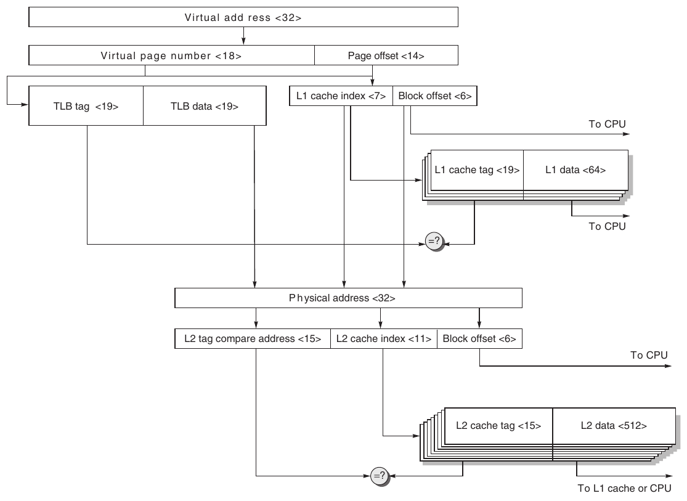

**Hình 2.16 Virtual address, physical address, index, tag và data block cho data cache và data TLB của ARM Cortex-A8. Vì instruction hierarchy và data hierarchy đối xứng, chúng ta chỉ thể hiện một phía. TLB (instruction hoặc data) fully associative với 32 entry. L1 cache four-way set associative có block 64-byte, capacity 32 KB. L2 cache eight-way set associative có block 64-byte, capacity 1 MB. Hình không thể hiện valid bit và protection bit của cache, TLB, cũng không thể hiện cách sử dụng way prediction bit để xác định bank được dự đoán của L1 cache.**

Instruction cache miss rate của các benchmark này (và cả phiên bản SPEC2000 đầy đủ làm cơ sở cho Minniespec) rất nhỏ ngay cả chỉ với L1: gần không cho phần lớn, dưới 1% cho tất cả. Mức thấp này có lẽ bắt nguồn từ bản chất tính toán chuyên sâu của chương trình SPEC và cache four-way set associative loại phần lớn conflict miss. Hình 2.17 cho kết quả data cache, với miss rate L1 và L2 đáng kể. L1 miss penalty của Cortex-A8 1 GHz là 11 clock cycle, còn L2 miss penalty là 60 clock cycle, khi dùng DDR SDRAM làm main memory. Sử dụng những miss penalty này, Hình 2.18 cho penalty trung bình mỗi data access. Chương tiếp theo sẽ xem tác động cache miss lên CPI tổng thể.

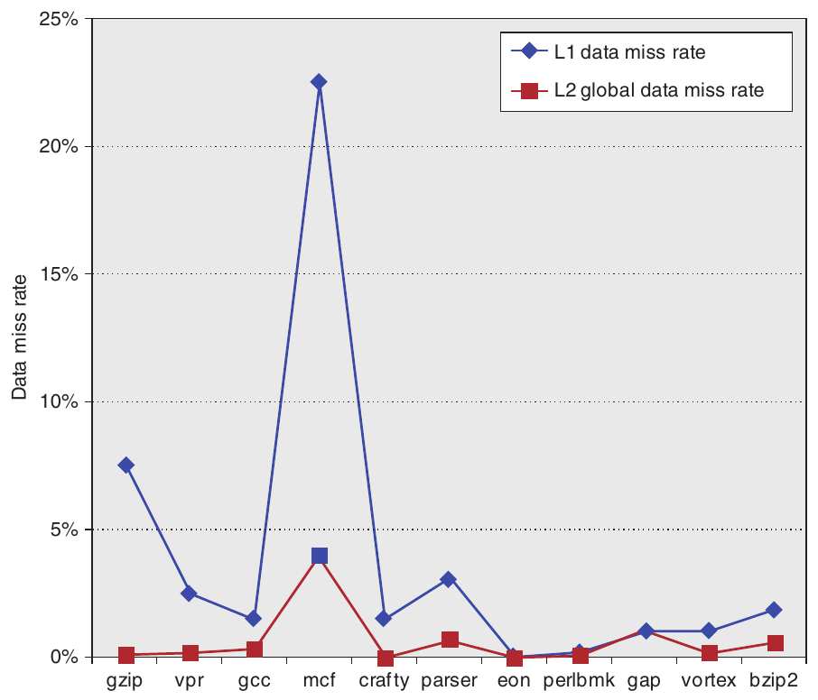

**Hình 2.17 Data miss rate cho ARM có L1 32 KB và global data miss rate cho L2 1 MB khi dùng integer benchmark Minnespec chịu ảnh hưởng đáng kể của ứng dụng. Ứng dụng có memory footprint lớn hơn thường có miss rate cao hơn ở cả L1, L2. Lưu ý L2 rate là global miss rate, tức đếm mọi reference, gồm cả reference hit L1. Mcf được biết đến là cache buster.**

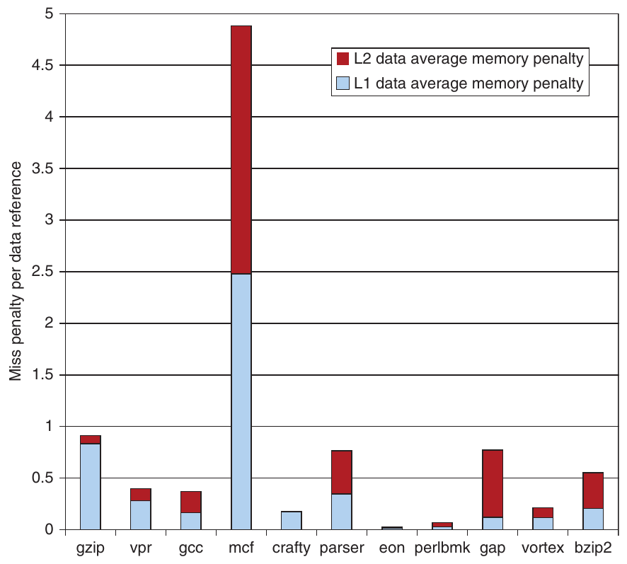

**Hình 2.18 Memory access penalty trung bình trên mỗi data memory reference do L1 và L2 gây ra được thể hiện cho processor ARM khi chạy Minniespec. Dù miss rate L1 cao hơn đáng kể, L2 miss penalty cao hơn năm lần trở lên nghĩa là L2 miss có thể đóng góp đáng kể.**

### Intel Core i7

i7 hỗ trợ instruction set architecture x86-64, extension 64-bit của architecture 80x86. i7 là processor thực thi out-of-order, gồm bốn core. Trong chương này, chúng ta tập trung vào thiết kế và performance memory system từ góc nhìn một core. Performance hệ thống của thiết kế multiprocessor, gồm multicore i7, được xem chi tiết ở Chương 5.

Mỗi core i7 thực thi tối đa bốn instruction 80x86 mỗi clock cycle, dùng pipeline multiple issue, dynamically scheduled, 16-stage, sẽ mô tả kỹ ở Chương 3. i7 còn hỗ trợ tối đa hai thread đồng thời mỗi processor bằng kỹ thuật simultaneous multithreading, mô tả ở Chương 4. Năm 2010, i7 nhanh nhất có clock rate 3.3 GHz, cho peak instruction execution rate 13.2 tỷ instruction mỗi giây, tức hơn 50 tỷ instruction mỗi giây cho thiết kế four-core.

i7 hỗ trợ tối đa ba memory channel, mỗi channel gồm bộ DIMM riêng và có thể transfer song song. Dùng DDR3-1066 (DIMM PC8500), i7 có peak memory bandwidth nhỉnh hơn 25 GB/sec.

i7 dùng virtual address 48-bit và physical address 36-bit, cho phép physical memory tối đa là 36 GB. Memory management được xử lý bằng một cấu trúc TLB two-level (xem Phụ lục B, Mục B.4), tổng hợp trong Hình 2.19.

Hình 2.20 tổng hợp cache hierarchy three-level của i7. Cache first-level virtually indexed và physically tagged (xem Phụ lục B, Mục B.3), còn cache L2, L3 physically indexed. Hình 2.21 gắn nhãn các bước access vào memory hierarchy. Đầu tiên, PC được gửi tới instruction cache. Instruction cache index là

| Đặc tính | Instruction TLB | Data DLB *(ghi chú: sách in DLB; đúng là TLB)* | Second-level TLB |
|---|---|---|---|
| Kích thước | 128 | 64 | 512 |
| Associativity | 4-way | 4-way | 4-way |
| Replacement | Pseudo-LRU | Pseudo-LRU | Pseudo-LRU |
| Access latency | 1 cycle | 1 cycle | 6 cycle |
| Miss | 7 cycle | 7 cycle | Hàng trăm cycle để truy cập page table |

**Hình 2.19 Đặc tính TLB structure của i7, có instruction TLB và data TLB first-level riêng, cả hai được hỗ trợ bởi một TLB second-level chung. TLB first-level hỗ trợ page size tiêu chuẩn 4 KB, cùng số entry giới hạn cho page lớn 2 đến 4 MB; TLB second-level chỉ hỗ trợ page 4 KB.**

| Đặc tính | L1 | L2 | L3 |
|---|---|---|---|
| Kích thước | 32 KB I/32 KB D | 256 KB | 2 MB mỗi core |
| Associativity | 4-way I/8-way D | 8-way | 16-way |
| Access latency | 4 cycle, có pipeline | 10 cycle | 35 cycle |
| Replacement scheme | Pseudo-LRU | Pseudo-LRU | Pseudo-LRU nhưng có thuật toán lựa chọn theo thứ tự *(ghi chú: sách in algorihtm; đúng là algorithm)* |

**Hình 2.20 Đặc tính cache hierarchy three-level của i7. Cả ba cache dùng write-back và block size 64 byte. Cache L1, L2 riêng cho từng core, còn L3 chia sẻ giữa core trên chip, có tổng 2 MB mỗi core. Cả ba cache đều nonblocking, cho phép nhiều write đang chờ. L1 dùng merging write buffer giữ data nếu line không có trong L1 lúc ghi. (Tức L1 write miss không khiến line được cấp phát.) L3 inclusive đối với L1 và L2; chúng ta tìm hiểu kỹ thuộc tính này khi giải thích multiprocessor cache. Replacement dùng biến thể pseudo-LRU; với L3, block bị thay luôn là way có số thấp nhất trong các way có access bit tắt. Điều này không hoàn toàn ngẫu nhiên nhưng dễ tính.**

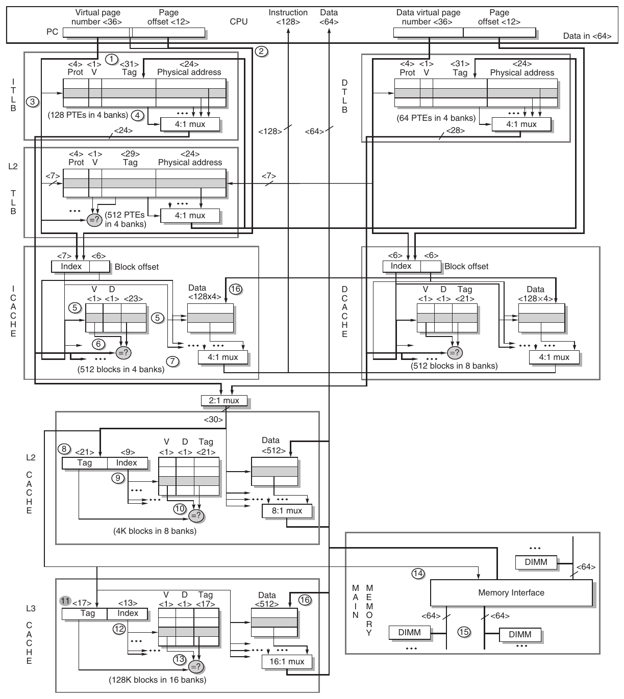

**Hình 2.21 Memory hierarchy Intel i7 và các bước của cả instruction access lẫn data access. Với data chỉ thể hiện read. Write tương tự vì bắt đầu bằng read (do cache dùng write back). Miss được xử lý đơn giản bằng đặt data vào write buffer, vì L1 cache không write allocated.**

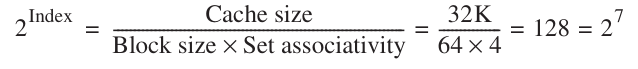

tức 7 bit. Page frame của instruction address (36 = 48 – 12 bit) được gửi tới instruction TLB (bước 1). Đồng thời, index 7-bit từ virtual address (cộng thêm 2 bit lấy từ block offset để chọn đúng 16 byte, tức lượng instruction fetch) được gửi tới instruction cache (bước 2). Lưu ý rằng instruction cache associative four-way cần 13 bit cho cache address: 7 bit để index cache cộng 6 bit block offset cho block 64-byte, nhưng page size là 4 KB = 2<sup>12</sup>, nghĩa là 1 bit của cache index phải lấy từ virtual address. Việc dùng 1 bit virtual address này nghĩa là block tương ứng thực ra có thể nằm ở hai vị trí khác nhau trong cache, vì physical address tương ứng có thể có 0 hoặc 1 ở vị trí này. Với instruction, điều đó không gây vấn đề, vì ngay cả khi instruction xuất hiện ở hai vị trí cache khác nhau, hai phiên bản cũng phải giống nhau. Nếu cho phép data trùng lặp như vậy, hay aliasing, thì phải kiểm tra cache khi page map thay đổi, vốn là sự kiện không thường xuyên. Lưu ý rằng một cách dùng page coloring rất đơn giản (xem Phụ lục B, Mục B.3) có thể loại bỏ khả năng xuất hiện những alias này. Nếu virtual page even-address được ánh xạ tới physical page even-address (và tương tự với page có address lẻ), các alias này không bao giờ xảy ra vì bit low-order trong virtual page number và physical page number sẽ giống hệt nhau.

Instruction TLB được truy cập để tìm khớp giữa address và Page Table Entry (PTE) valid (bước 3 và 4). Ngoài dịch address, TLB kiểm tra PTE có yêu cầu access này gây exception vì access violation không.

Instruction TLB miss trước tiên đi tới L2 TLB, chứa 512 PTE của page size 4 KB, tổ chức four-way set associative. Load L1 TLB từ L2 TLB mất hai clock cycle. Nếu L2 TLB miss, dùng hardware algorithm duyệt page table và cập nhật TLB entry. Trường hợp xấu nhất, page không trong memory và operating system lấy page từ disk. Vì có thể thực thi hàng triệu instruction trong một page fault, operating system swap vào process khác nếu có process đang chờ chạy. Còn nếu không có TLB exception, instruction cache access tiếp tục.

Index field của address được gửi tới cả bốn bank instruction cache (bước 5). Instruction cache tag bằng 36 – 7 bit (index) – 6 bit (block offset), tức 23 bit. Bốn tag cùng valid bit được so với physical page frame từ instruction TLB (bước 6). Vì i7 mong đợi 16 byte mỗi instruction fetch, nên dùng thêm 2 bit từ block offset 6-bit để chọn đúng 16 byte. Vì vậy, 7 + 2 hay 9 bit được dùng gửi 16 byte instruction tới processor. L1 cache có pipeline, latency của hit là 4 clock cycle (bước 7). Miss đi tới cache second-level.

Như đã đề cập trước đó, instruction cache virtually addressed và physically tagged. Vì cache second-level physically addressed, physical page address từ TLB được ghép với page offset để tạo address truy cập L2 cache. L2 index là

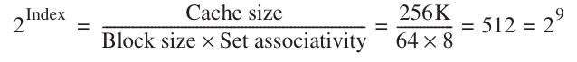

nên block address 30-bit (physical address 36-bit – block offset 6-bit) được chia thành tag 21-bit và index 9-bit (bước 8). Một lần nữa, index và tag được gửi tới cả tám bank của unified L2 cache (bước 9), so sánh song song. Nếu một bank khớp và valid (bước 10), nó trả block theo thứ tự tuần tự sau latency ban đầu 10-cycle, với rate 8 byte mỗi clock cycle.

Nếu L2 cache miss, L3 cache được truy cập. Với i7 four-core có L3 8 MB, index size là

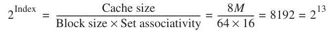

Index 13-bit (bước 11) được gửi tới cả 16 bank L3 (bước 12). L3 tag bằng 36 − (13 + 6) = 17 bit, được so với physical address từ TLB (bước 13). Nếu hit, block được trả sau một khoảng latency ban đầu, với rate 16 byte mỗi clock và đặt vào cả L1, L3. Nếu L3 miss, memory access bắt đầu.

Nếu không tìm được instruction trong L3 cache, memory controller on-chip phải lấy block từ main memory. i7 có ba memory channel 64-bit có thể hoạt động như một channel 192-bit, vì chỉ có một memory controller và cùng address được gửi trên cả hai channel (bước 14). Transfer rộng xảy ra khi hai channel có DIMM giống hệt. Mỗi channel hỗ trợ tối đa bốn DDR DIMM (bước 15). Khi data trở về, chúng được đặt vào L3 và L1 (bước 16) vì L3 inclusive.

Tổng latency của instruction miss được main memory phục vụ xấp xỉ 35 processor cycle để xác định L3 miss, cộng DRAM latency cho instruction thiết yếu. Với SDRAM DDR1600 single-bank và CPU 3.3 GHz, DRAM latency khoảng 35 ns hay 100 clock cycle tới 16 byte đầu, dẫn tới tổng miss penalty 135 clock cycle. Memory controller điền phần còn lại của cache block 64-byte với rate 16 byte mỗi memory clock cycle, mất thêm 15 ns hay 45 clock cycle.

Vì cache second-level là cache write-back, bất kỳ miss nào cũng có thể dẫn tới ghi block cũ về memory. i7 có merging write buffer 10-entry, ghi dirty cache line về khi cấp cache kế tiếp không được sử dụng cho read. Mọi miss đều snoop write buffer để xem cache line có trong buffer không; nếu có, miss được phục vụ từ buffer. Buffer tương tự được dùng giữa cache L1 và L2.

Nếu instruction ban đầu này là load, data address được gửi tới data cache và data TLB, hoạt động rất giống instruction cache access với một khác biệt then chốt. Data cache first-level eight-way set associative, nghĩa là index 6 bit (so với 7 bit đối với instruction cache), và address truy cập cache giống page offset. Vì vậy alias trong data cache không đáng lo.

Giả sử instruction là store thay load. Khi store issue, nó lookup data cache giống load. Miss khiến block được đặt vào write buffer, vì L1 cache không cấp block khi write miss. Khi hit, store không cập nhật cache L1 (hay L2) cho tới sau đó, khi đã biết là nonspeculative. Trong thời gian này, store nằm trong load-store queue, thuộc control mechanism out-of-order của processor.

I7 cũng hỗ trợ prefetching cho L1, L2 từ cấp kế tiếp trong hierarchy. Trong phần lớn trường hợp, line được prefetch đơn giản là block kế tiếp trong cache. Bằng cách chỉ prefetch cho L1 và L2, hệ thống tránh fetch high-cost không cần thiết tới memory.

#### Performance của Memory System i7

Chúng ta đánh giá performance cache structure i7 bằng 19 benchmark SPECCPU2006 (12 integer và 7 floating point), được mô tả ở Chương 1. Dữ liệu mục này do Giáo sư Lu Peng và nghiên cứu sinh Ying Zhang, đều thuộc Louisiana State University, thu thập.

Chúng ta bắt đầu với L1 cache. Instruction cache 32 KB, four-way set associative dẫn tới instruction miss rate rất thấp, đặc biệt vì instruction prefetch trong i7 khá hiệu quả. Tất nhiên, cách đánh giá miss rate có chút khó khăn, vì i7 không tạo request riêng cho từng instruction đơn lẻ mà thay vào đó prefetch 16 byte instruction data (thường tương đương từ bốn đến năm instruction). Nếu để đơn giản, chúng ta xét instruction cache miss rate như thể từng instruction reference được xử lý riêng, thì L1 instruction cache miss rate dao động từ 0.1% đến 1.8%, trung bình chỉ hơn 0.4%. Mức này phù hợp với các nghiên cứu khác về instruction cache behavior đối với benchmark SPECCPU2006, vốn cho thấy instruction cache miss rate thấp.

L1 data cache thú vị hơn và còn khó đánh giá hơn vì ba lý do:

1. Vì L1 data cache không write allocated, write có thể hit nhưng không bao giờ thực sự miss, theo nghĩa write không hit chỉ đặt data vào write buffer và không được ghi nhận là miss.

2. Vì speculation đôi khi sai (xem thảo luận kỹ ở Chương 3), có reference tới L1 data cache không tương ứng load hoặc store cuối cùng hoàn tất thực thi. Nên xử lý miss như vậy thế nào?

3. Cuối cùng, L1 data cache tự động prefetch. Có nên đếm prefetch bị miss không, và nếu có thì đếm thế nào?

Để xử lý các vấn đề này mà vẫn giữ lượng dữ liệu hợp lý, Hình 2.22 thể hiện L1 data cache miss theo hai cách: tương đối với số load thực sự hoàn tất (thường gọi graduation hoặc retirement), và tương đối với mọi L1 data cache access từ bất kỳ nguồn nào. Như có thể thấy, miss rate khi chỉ đo theo completed load cao gấp 1.6 lần (trung bình 9.5% so với 5.9%). Hình 2.23 thể hiện cùng dữ liệu dạng bảng.

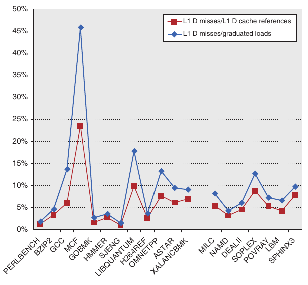

**Hình 2.22 L1 data cache miss rate cho 17 benchmark SPECCPU2006 được thể hiện theo hai cách: tương đối với actual load hoàn tất thực thi thành công, và tương đối với mọi reference tới L1, gồm prefetch, speculative load không hoàn tất và write được tính là reference nhưng không tạo miss. Dữ liệu này, như phần còn lại trong mục, do Giáo sư Lu Peng và nghiên cứu sinh Ying Zhang, đều thuộc Louisiana State University, thu thập dựa trên nghiên cứu trước về Intel Core Duo và processor khác (xem Peng và cộng sự [2008]).**

| Benchmark | L1 data miss/ load đã graduate | L1 data miss/ L1 data cache reference |
|---|---|---|
| PERLBENCH | 2% | 1% |
| BZIP2 | 5% | 3% |
| GCC | 14% | 6% |
| MCF | 46% | 24% |
| GOBMK | 3% | 2% |
| HMMER | 4% | 3% |
| SJENG | 2% | 1% |
| LIBQUANTUM | 18% | 10% |
| H264REF | 4% | 3% |
| OMNETPP | 13% | 8% |
| ASTAR | 9% | 6% |
| XALANCBMK | 9% | 7% |
| MILC | 8% | 5% |
| NAMD | 4% | 3% |
| DEALII | 6% | 5% |
| SOPLEX | 13% | 9% |
| POVRAY | 7% | 5% |
| LBM | 7% | 4% |
| SPHINX3 | 10% | 8% |

**Hình 2.23 Primary data cache miss được thể hiện so với mọi load hoàn tất và mọi reference (gồm speculative request và prefetch request).**

Với L1 data cache miss rate từ 5% đến 10%, đôi khi còn cao hơn, tầm quan trọng của cache L2 và L3 là rõ ràng. Hình 2.24 cho thấy miss rate của cache L2 và L3 so với số L1 reference (và Hình 2.25 thể hiện dữ liệu dạng bảng). Vì chi phí của một miss phải truy cập memory là hơn 100 cycle, và data miss rate trung bình trong L2 là 4%, nên L3 rõ ràng rất quan trọng. Không có L3, giả sử khoảng một nửa instruction là load hoặc store, L2 cache miss có thể thêm hai cycle mỗi instruction vào CPI! Để so sánh, L3 data miss rate trung bình 1% vẫn đáng kể nhưng thấp hơn bốn lần so với L2 miss rate và sáu lần so với L1 miss rate. Trong chương tiếp theo, chúng ta sẽ xem xét mối quan hệ giữa CPI của i7 và cache miss, cùng những hiệu ứng pipeline khác.

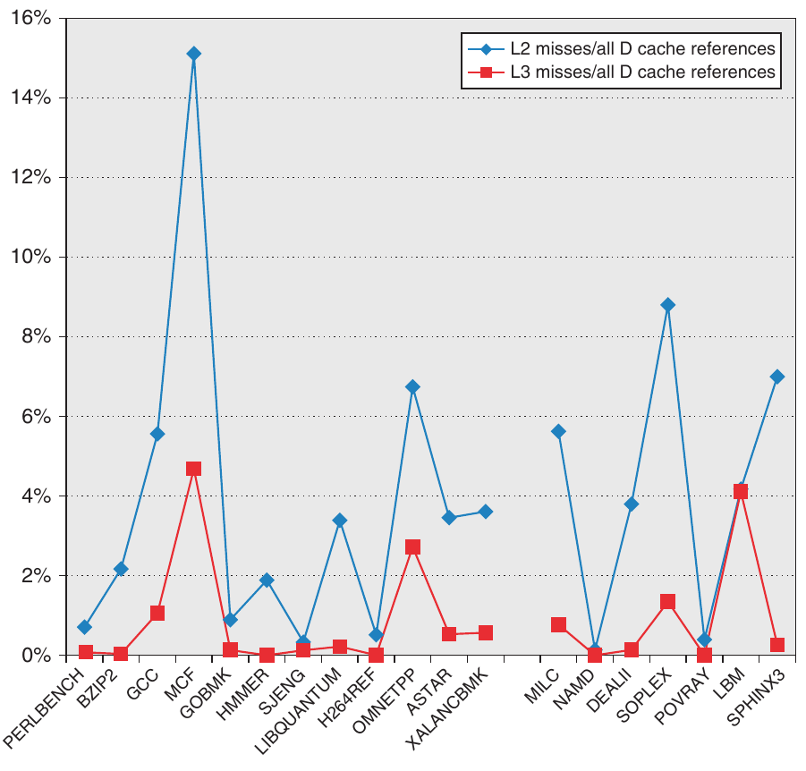

**Hình 2.24 Data cache miss rate L2 và L3 cho 17 benchmark SPECCPU2006 được thể hiện tương đối với mọi reference tới L1, gồm cả prefetch, speculative load không hoàn tất và load, store do chương trình tạo. Dữ liệu này, như phần còn lại trong mục, do Giáo sư Lu Peng và nghiên cứu sinh Ying Zhang, đều thuộc Louisiana State University, thu thập.**

|  | L2 miss/mọi data cache reference | L3 miss/mọi data cache reference |
|---|---|---|
| PERLBENCH | 1% | 0% |
| BZIP2 | 2% | 0% |
| GCC | 6% | 1% |
| MCF | 15% | 5% |
| GOBMK | 1% | 0% |
| HMMER | 2% | 0% |
| SJENG | 0% | 0% |
| LIBQUANTUM | 3% | 0% |
| H264REF | 1% | 0% |
| OMNETPP | 7% | 3% |
| ASTAR | 3% | 1% |
| XALANCBMK | 4% | 1% |
| MILC | 6% | 1% |
| NAMD | 0% | 0% |
| DEALII | 4% | 0% |
| SOPLEX | 9% | 1% |
| POVRAY | 0% | 0% |
| LBM | 4% | 4% |
| SPHINX3 | 7% | 0% |

**Hình 2.25 Miss rate L2 và L3 được thể hiện dạng bảng so với số data request.**

## 2.7 Những ngộ nhận và cạm bẫy

Là lĩnh vực mang tính định lượng tự nhiên rõ nhất của computer architecture, memory hierarchy dường như ít bị ngộ nhận và cạm bẫy hơn. Thế nhưng ở đây chúng tôi bị giới hạn không phải vì thiếu cảnh báo, mà vì thiếu chỗ!

**Ngộ nhận** Dự đoán cache performance của một chương trình từ chương trình khác.

Hình 2.26 thể hiện instruction miss rate và data miss rate của ba chương trình trong SPEC2000 benchmark suite khi cache size thay đổi. Tùy chương trình, data miss trên mỗi nghìn instruction với cache 4096 KB là 9, 2 hoặc 90, còn instruction miss trên mỗi nghìn instruction với cache 4 KB là 55, 19 hoặc 0.0004. Chương trình thương mại như database có miss rate đáng kể ngay cả trong cache second-level lớn, điều thường không đúng với chương trình SPEC. Rõ ràng, khái quát cache performance từ chương trình này sang chương trình khác là thiếu khôn ngoan. Như Hình 2.24 nhắc nhở, có sự biến thiên rất lớn; ngay cả dự đoán về miss rate tương đối của chương trình integer và floating-point-intensive cũng có thể sai, như mcf và sphnix3 cho thấy!

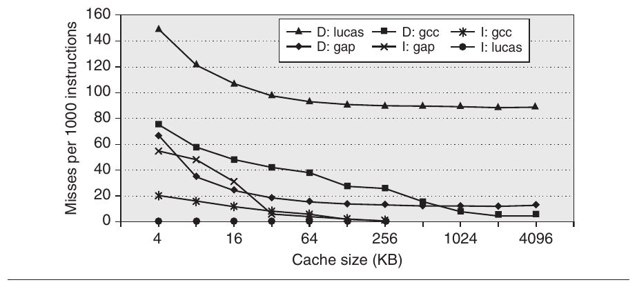

**Hình 2.26 Instruction miss và data miss mỗi 1000 instruction khi cache size thay đổi từ 4 KB đến 4096 KB. Instruction miss của gcc lớn hơn lucas từ 30,000 đến 40,000 lần; ngược lại data miss của lucas lớn hơn gcc từ 2 đến 60 lần. Chương trình gap, gcc và lucas thuộc SPEC2000 benchmark suite.**

**Cạm bẫy** Mô phỏng đủ instruction để có thước đo performance chính xác của memory hierarchy.

Thực ra ở đây có ba cạm bẫy. Một là cố dự đoán performance cache lớn bằng trace nhỏ. Hai là locality behavior của chương trình không cố định trong toàn bộ lần chạy. Ba là locality behavior có thể thay đổi theo input.

Hình 2.27 thể hiện instruction miss trung bình tích lũy mỗi nghìn instruction đối với năm input của một chương trình SPEC2000. Với những input này, memory rate trung bình trong 1.9 tỷ instruction đầu rất khác miss rate trung bình trong phần thực thi còn lại.

**Cạm bẫy** Không cung cấp memory bandwidth cao trong hệ thống cache-based.

Cache giúp giảm cache memory latency trung bình, nhưng có thể không cung cấp memory bandwidth cao cho ứng dụng phải truy cập main memory. Architect phải thiết kế memory bandwidth cao phía sau cache cho ứng dụng như vậy. Chúng ta quay lại cạm bẫy này ở Chương 4 và 5.

**Cạm bẫy** Triển khai virtual machine monitor trên instruction set architecture vốn không được thiết kế để virtualizable.

Nhiều architect trong thập niên 1970 và 1980 không cẩn thận bảo đảm mọi instruction đọc hoặc ghi thông tin liên quan đến hardware resource đều privileged. Thái độ buông lỏng này gây vấn đề VMM trên tất cả architecture đó, gồm 80x86 được dùng làm ví dụ ở đây.

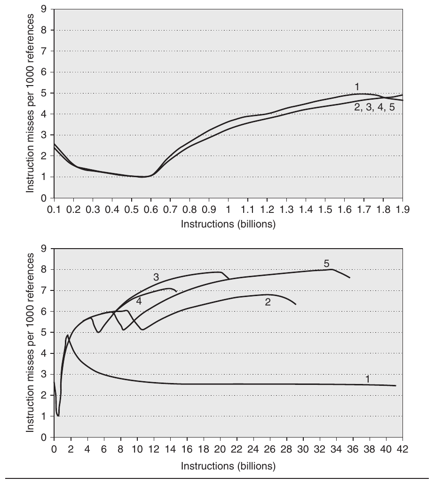

**Hình 2.27 Instruction miss mỗi 1000 reference đối với năm input cho benchmark perl từ SPEC2000. Trong 1.9 tỷ instruction đầu, miss ít biến thiên và ít khác biệt giữa năm input. Chạy tới hoàn tất cho thấy miss thay đổi thế nào suốt chương trình và phụ thuộc vào input ra sao. Đồ thị trên cho trung bình miss lũy tiến của 1.9 tỷ instruction đầu, bắt đầu khoảng 2.5, kết thúc khoảng 4.7 miss mỗi 1000 reference cho cả năm input. Đồ thị dưới cho trung bình miss lũy tiến khi chạy tới hoàn tất, tốn 16 đến 41 tỷ instruction tùy input. Sau 1.9 tỷ instruction đầu, miss mỗi 1000 reference dao động 2.4 đến 7.9 tùy input. Mô phỏng dùng processor Alpha với L1 cache riêng cho instruction và data, mỗi cache two-way 64 KB dùng LRU, cùng unified L2 cache direct-mapped 1 MB.**

Hình 2.28 mô tả 18 instruction gây vấn đề cho virtualization [Robin và Irvine 2000]. Hai nhóm lớn là instruction

- Đọc control register trong user mode, làm lộ guest operating system đang chạy trên virtual machine (như POPF đã đề cập)

- Kiểm tra protection theo yêu cầu segmented architecture nhưng giả định operating system đang chạy ở privilege level cao nhất.

Virtual memory cũng là thách thức. Vì TLB 80x86 không hỗ trợ process ID tag như phần lớn RISC architecture, VMM và guest OS chia sẻ TLB tốn kém hơn; mỗi lần address space đổi thường cần flush TLB.

| Nhóm vấn đề | Instruction 80x86 gây vấn đề |
|---|---|
| Truy cập register nhạy cảm mà không trap khi chạy user mode | Store global descriptor table register (SGDT)<br>Store local descriptor table register (SLDT)<br>Store interrupt descriptor table register (SIDT)<br>Store machine status word (SMSW)<br>Push flags (PUSHF, PUSHFD)<br>Pop flags (POPF, POPFD) |
| Khi truy cập virtual memory mechanism trong user mode, instruction không vượt qua protection check của 80x86 | Load access right từ segment descriptor (LAR)<br>Load segment limit từ segment descriptor (LSL)<br>Kiểm tra segment descriptor có thể đọc không (VERR)<br>Kiểm tra segment descriptor có thể ghi không (VERW)<br>Pop vào segment register (POP CS, POP SS, …)<br>Push segment register (PUSH CS, PUSH SS, …)<br>Far call tới privilege level khác (CALL)<br>Far return tới privilege level khác (RET)<br>Far jump tới privilege level khác (JMP)<br>Software interrupt (INT)<br>Store segment selector register (STR)<br>Move tới/từ segment register (MOVE) |

**Hình 2.28 Tổng hợp 18 instruction 80x86 gây vấn đề cho virtualization [Robin và Irvine 2000]. Năm instruction đầu nhóm trên cho phép chương trình user mode đọc control register, như descriptor table register, mà không gây trap. Instruction pop flags sửa control register chứa thông tin nhạy cảm, nhưng thất bại âm thầm ở user mode. Protection checking của segmented architecture 80x86 khiến nhóm dưới gặp vấn đề, vì mỗi instruction ngầm kiểm tra privilege level như một phần thực thi khi đọc control register. Việc kiểm tra giả định OS phải ở privilege level cao nhất, không đúng với guest VM. Chỉ MOVE tới segment register cố sửa control state, và protection checking cũng ngăn nó.**

Virtualize I/O cũng là thách thức với 80x86, một phần vì nó vừa hỗ trợ memory-mapped I/O vừa có I/O instruction riêng, nhưng quan trọng hơn vì số lượng, chủng loại device và device driver PC mà VMM phải xử lý rất lớn. Vendor Third-party cung cấp driver riêng, và chúng có thể không virtualize đúng. Một giải pháp cho VM implementation thông thường là load real device driver trực tiếp vào VMM.

Để đơn giản hóa triển khai VMM trên 80x86, cả AMD và Intel đề xuất extension architecture. VT-x của Intel cung cấp execution mode mới để chạy VM, định nghĩa VM state ở cấp architecture, instruction swap VM nhanh và tập parameter lớn để chọn hoàn cảnh phải gọi VMM. Tổng cộng VT-x thêm 11 instruction mới cho 80x86. Secure Virtual Machine (SVM) của AMD cung cấp chức năng tương tự.

Sau khi bật mode cho phép hỗ trợ VT-x (qua instruction VMXON mới), VT-x cung cấp bốn privilege level cho guest OS có độ ưu tiên thấp hơn bốn cấp ban đầu (và sửa các vấn đề như POPF đã đề cập). VT-x ghi nhận mọi state của Virtual Machine trong Virtual Machine Control State (VMCS), rồi cung cấp atomic instruction để lưu và khôi phục VMCS. Ngoài state thiết yếu, VMCS bao gồm thông tin cấu hình để quyết định khi nào gọi VMM và sau đó xác định cụ thể điều gì đã khiến VMM được gọi. Để giảm số lần phải gọi VMM, mode này bổ sung shadow version của một số register nhạy cảm và các mask kiểm tra liệu bit thiết yếu của register nhạy cảm có bị thay đổi không trước khi trap. Để giảm chi phí virtualize virtual memory, SVM của AMD bổ sung một cấp indirection, gọi là nested page table. Nhờ vậy không còn cần shadow page table.

## 2.8 Nhận xét kết thúc: Nhìn về phía trước

> Trong ba mươi năm qua, có vài dự đoán rằng tốc độ cải thiện computer performance sắp dừng lại (nguyên văn dùng eminent [sic]). Mọi dự đoán như vậy đều sai. Chúng sai vì phụ thuộc vào giả định không nêu ra, bị sự kiện sau đó bác bỏ. Chẳng hạn không dự đoán được chuyển dịch từ discrete component sang integrated circuit dẫn tới dự đoán tốc độ ánh sáng sẽ giới hạn tốc độ máy tính thấp hơn hiện nay nhiều bậc độ lớn. Dự đoán memory wall của chúng tôi có lẽ cũng sai, nhưng gợi ý phải bắt đầu suy nghĩ "ngoài khuôn khổ".

> Wm. A. Wulf and Sally A. McKee

> Hitting the Memory Wall: Implications of the Obvious

> Department of Computer Science, University of Virginia (tháng Mười Hai năm 1994)

> Bài báo này giới thiệu thuật ngữ memory wall.

Khả năng sử dụng memory hierarchy có từ những ngày đầu của máy tính số general-purpose vào cuối thập niên 1940 và đầu thập niên 1950. Virtual memory được đưa vào máy tính nghiên cứu đầu thập niên 1960, rồi vào mainframe IBM trong thập niên 1970. Cache xuất hiện khoảng cùng thời gian đó. Những khái niệm cơ bản được mở rộng và tăng cường theo thời gian để giúp thu hẹp khoảng cách access time giữa main memory và processor, nhưng những khái niệm cơ bản đó vẫn được giữ nguyên.

Một xu hướng có thể gây thay đổi đáng kể thiết kế memory hierarchy là mức cải thiện density và access time DRAM tiếp tục chậm lại. Trong thập kỷ qua, đã quan sát cả hai xu hướng. Dù DRAM bandwidth tăng phần nào, access time giảm chậm hơn nhiều, một phần vì voltage level hạ để giới hạn power consumption. Một ý tưởng được khám phá nhằm tăng bandwidth là nhiều access chồng lấp mỗi bank. Cách này là phương án thay tăng số bank mà vẫn cho bandwidth cao hơn. Thách thức chế tạo DRAM truyền thống dùng capacitor trong mỗi cell, thường đặt trong rãnh sâu, cũng làm chậm tốc độ tăng density. Khi sách sắp in, một nhà sản xuất công bố DRAM mới không cần capacitor, có lẽ tạo cơ hội tiếp tục cải thiện công nghệ DRAM.

Độc lập với cải thiện DRAM, Flash memory có khả năng đóng vai trò lớn hơn nhờ lợi thế tiềm năng về power và density. Tất nhiên trong PMD, Flash đã thay disk drive và có ưu điểm “instant on” mà nhiều desktop computer không có. Lợi thế tiềm năng của Flash so với DRAM—không cần transistor per-bit kiểm soát write—cũng là gót chân Achilles của nó. Flash phải dùng bulk cycle erase-rewrite chậm hơn đáng kể. Vì vậy một số PMD, như Apple iPad, dùng SDRAM main memory tương đối nhỏ kết hợp Flash; Flash đóng vai trò cả file system lẫn page storage system để xử lý virtual memory.

Ngoài ra, nhiều cách hoàn toàn mới về memory đang được khám phá. Gồm MRAM dùng magnetic storage để lưu data, và phase change RAM (gọi là PCRAM, PCME, PRAM), dùng vật liệu thủy tinh chuyển được giữa state vô định hình và tinh thể. Cả hai memory đều nonvolatile, có tiềm năng density cao hơn DRAM. Đây không phải ý tưởng mới; công nghệ magnetoresistive memory và phase change memory đã tồn tại nhiều thập kỷ. Một trong hai có thể thành phương án thay Flash hiện tại; thay DRAM khó hơn nhiều. Dù cải thiện DRAM chậm lại, khả năng cell capacitor-free cùng cải tiến tiềm năng khác khiến khó đặt cược chống DRAM ít nhất trong thập kỷ tới.

Vài năm qua, có nhiều dự đoán về memory wall sắp đến (xem trích dẫn, bài báo trên), sẽ dẫn tới giảm processor performance căn bản. Tuy nhiên, mở rộng cache thành nhiều cấp, refill và prefetch scheme tinh vi hơn, compiler và lập trình viên nhận thức rõ hơn tầm quan trọng locality, cùng dùng parallelism che latency còn lại đã giúp giữ memory wall ở xa. Pipeline out-of-order có nhiều miss đang chờ cho instruction-level parallelism sẵn có che memory latency còn lại trong hệ thống cache-based. Multithreading và thêm thread-level parallelism tiến thêm bước bằng cung cấp nhiều parallelism, do đó nhiều cơ hội latency-hiding. Có lẽ dùng parallelism instruction- và thread-level sẽ là công cụ chính chống bất kỳ memory delay nào gặp trong hệ thống cache multilevel hiện đại.

Một ý tưởng định kỳ xuất hiện là sử dụng scratchpad programmer-controlled hoặc các memory high-speed khác, mà chúng ta sẽ thấy được dùng trong GPU. Những ý tưởng như vậy chưa bao giờ trở thành xu hướng chủ đạo vì một số lý do. Thứ nhất, chúng phá vỡ memory model bằng cách đưa vào các address space có hành vi khác nhau. Thứ hai, khác với tối ưu cache compiler-based hoặc programmer-based (chẳng hạn prefetching), memory transformation dùng scratchpad phải xử lý hoàn toàn việc remapping từ main memory address space sang scratchpad address space. Điều đó khiến các transformation như vậy khó thực hiện hơn và bị hạn chế về phạm vi áp dụng. Trong GPU (xem Chương 4), nơi local scratchpad memory được sử dụng nhiều, gánh nặng quản lý những memory đó hiện thuộc về lập trình viên.

Dù cần thận trọng khi dự đoán tương lai công nghệ computing, lịch sử cho thấy caching là một ý tưởng mạnh mẽ, có khả năng mở rộng rất cao, nhiều khả năng cho phép chúng ta tiếp tục xây dựng máy tính nhanh hơn và bảo đảm memory hierarchy có thể cung cấp instruction cùng data cần thiết để những hệ thống đó hoạt động tốt.

## 2.9 Góc nhìn lịch sử và tài liệu tham khảo

Trong Mục L.3 (có online), chúng ta khảo sát lịch sử cache, virtual memory và virtual machine. IBM đóng vai trò nổi bật trong lịch sử của cả ba. Phần này cũng cung cấp tài liệu tham khảo để đọc thêm.

## Nghiên cứu trường hợp và bài tập của Norman P. Jouppi, Naveen Muralimanohar và Sheng Li

### Nghiên cứu trường hợp 1: Tối ưu Cache Performance bằng kỹ thuật nâng cao

#### Khái niệm được minh họa qua nghiên cứu trường hợp này

- Cache Non-blocking

- Compiler Optimization cho Cache

- Software và Hardware Prefetching

- Tính tác động của Cache Performance lên Processor phức tạp hơn

Chuyển vị ma trận hoán đổi hàng và cột của nó; điều này được minh họa dưới đây:

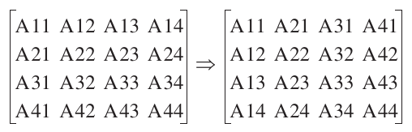

Đây là vòng lặp C đơn giản minh họa chuyển vị:

```
for (i = 0; i < 3; i++) {
 for (j = 0; j < 3; j++) {
 output[j][i] = input[i][j];
 }

}
```

Giả sử cả ma trận input và output được lưu theo row major order (row major order nghĩa là chỉ số hàng thay đổi nhanh nhất). Giả sử bạn thực hiện chuyển vị double-precision 256 × 256 trên processor có một L1 data cache 16 KB fully associative (không cần lo cache conflict), dùng replacement policy least recently used (LRU) với block 64 byte. Giả sử L1 cache miss hoặc prefetch cần 16 cycle và luôn hit trong L2 cache, còn L2 cache có thể xử lý một request sau mỗi hai processor cycle. Giả sử mỗi lần lặp của vòng lặp trong ở trên cần bốn cycle nếu dữ liệu có trong L1 cache. Giả sử cache có policy write-allocate fetch-on-write cho write miss. Hãy đưa ra giả định không thực tế rằng việc write back các dirty cache block cần 0 cycle.

**2.1** [10/15/15/12/20] <2.2> Với implementation đơn giản ở trên, thứ tự thực thi này không lý tưởng cho ma trận input; tuy nhiên, áp dụng loop interchange optimization lại tạo thứ tự không lý tưởng cho ma trận output. Vì loop interchange không đủ để cải thiện performance, thay vào đó cần áp dụng blocking.

a. [10] <2.2> Cache phải có kích thước tối thiểu bao nhiêu để tận dụng blocked execution?

b. [15] <2.2> Trong cache có kích thước tối thiểu nói trên, số miss tương đối của phiên bản blocked và unblocked so với nhau thế nào?

c. [15] <2.2> Viết code thực hiện chuyển vị với block size parameter B, sử dụng các block B × B.

d. [12] <2.2> L1 cache cần associativity tối thiểu bao nhiêu để performance ổn định, không phụ thuộc vị trí của cả hai array trong memory?

e. [20] <2.2> Thử chuyển vị ma trận 256 × 256 theo cả cách blocked và nonblocked trên máy tính. Kết quả gần với dự kiến dựa trên hiểu biết của bạn về memory system của máy tới mức nào? Hãy giải thích mọi khác biệt nếu có thể.

**2.2** [10] <2.2> Giả sử bạn đang thiết kế một hardware prefetcher cho code chuyển vị ma trận unblocked ở trên. Loại hardware prefetcher đơn giản nhất chỉ prefetch các cache block sequential sau một miss. Hardware prefetcher “non-unit stride” phức tạp hơn có thể phân tích một miss reference stream để phát hiện và prefetch các non-unit stride. Ngược lại, software prefetching có thể xác định non-unit stride dễ như xác định unit stride. Giả sử prefetch ghi trực tiếp vào cache và không có “pollution” (ghi đè dữ liệu phải được dùng trước dữ liệu được prefetch). Để đạt performance tốt nhất khi có một non-unit stride prefetcher, trong steady state của vòng lặp trong, cần có bao nhiêu prefetch outstanding tại một thời điểm?

**2.3** [15/20] <2.2> Với software prefetching, điều quan trọng là phải cẩn thận bảo đảm prefetch diễn ra kịp lúc sử dụng, đồng thời giảm thiểu số prefetch outstanding để không vượt quá khả năng của microarchitecture và giảm thiểu cache pollution. Việc này phức tạp hơn vì các processor khác nhau có khả năng và giới hạn khác nhau.

a. [15] <2.2> Tạo phiên bản blocked của chuyển vị ma trận có software prefetching.

b. [20] <2.2> Ước lượng và so sánh performance của code chuyển vị blocked và unblocked trong cả trường hợp có lẫn không có software prefetching.

### Nghiên cứu trường hợp 2: Kết hợp mọi thứ: Memory System có mức song song cao

#### Khái niệm được minh họa qua nghiên cứu trường hợp này

- Những vấn đề xuyên suốt: Thiết kế Memory Hierarchy

Chương trình trong Hình 2.29 có thể được dùng để đánh giá hành vi của memory system. Mấu chốt là phải đo thời gian chính xác, rồi cho chương trình duyệt memory theo stride để kích hoạt truy cập tới các mức khác nhau của hierarchy. Hình 2.29 trình bày code C. Phần đầu là một procedure sử dụng tiện ích chuẩn để đo chính xác user CPU time; có thể phải thay đổi procedure này để hoạt động trên một số hệ thống. Phần thứ hai là vòng lặp lồng nhau đọc và ghi memory với các stride và cache size khác nhau. Để đo thời gian cache chính xác, code này được lặp nhiều lần. Phần thứ ba chỉ đo overhead của vòng lặp lồng nhau để có thể trừ nó khỏi tổng thời gian đo được, qua đó xác định các lần truy cập mất bao lâu. Kết quả xuất dưới định dạng file .csv để tiện nhập vào spreadsheet. Bạn có thể cần thay đổi CACHE_MAX tùy câu hỏi đang trả lời và kích thước memory trên hệ thống đang đo. Chạy chương trình trong single-user mode, hoặc ít nhất không có ứng dụng khác đang hoạt động, sẽ cho kết quả ổn định hơn. Code Hình 2.29 được phát triển từ chương trình do Andrea Dusseau viết tại University of California–Berkeley, dựa trên mô tả chi tiết trong Saavedra-Barrera [1992]. Nó đã được sửa để khắc phục một số vấn đề trên máy hiện đại hơn và chạy trong Microsoft Visual C++. Bạn có thể tải chương trình từ www.hpl.hp.com/research/cacti/aca_ch2_cs2.c.

```
#include "stdafx.h"
#include <stdio.h>
#include <time.h>
#define ARRAY_MIN (1024) /* 1/4 smallest cache */
#define ARRAY_MAX (4096*4096) /* 1/4 largest cache */
int x[ARRAY_MAX]; /* array going to stride through */
double get_seconds() { /* routine to read time in seconds */
   __time64_t ltime;
   _time64( &ltime );
   return (double) ltime;
}
int label(int i) {/* generate text labels */
   if (i<1e3) printf("%1dB,",i);
   else if (i<1e6) printf("%1dK,",i/1024);
   else if (i<1e9) printf("%1dM,",i/1048576);
   else printf("%1dG,",i/1073741824);
   return 0;
}
int _tmain(int argc, _TCHAR* argv[]) {
int register nextstep, i, index, stride;
int csize;
double steps, tsteps;
double loadtime, lastsec, sec0, sec1, sec; /* timing variables */
/* Initialize output */
printf(" ,");
for (stride=1; stride <= ARRAY_MAX/2; stride=stride*2)
   label(stride*sizeof(int));
printf("\n");
/* Main loop for each configuration */
for (csize=ARRAY_MIN; csize <= ARRAY_MAX; csize=csize*2) {
   label(csize*sizeof(int)); /* print cache size this loop */
   for (stride=1; stride <= csize/2; stride=stride*2) {
       /* Lay out path of memory references in array */
       for (index=0; index < csize; index=index+stride)
          x[index] = index + stride; /* pointer to next */
       x[index-stride] = 0; /* loop back to beginning */
       /* Wait for timer to roll over */
       lastsec = get_seconds();
        sec0 = get_seconds(); while (sec0 == lastsec);
       /* Walk through path in array for twenty seconds */
       /* This gives 5% accuracy with second resolution */
       steps = 0.0; /* number of steps taken */
       nextstep = 0; /* start at beginning of path */
       sec0 = get_seconds(); /* start timer */
          { /* repeat until collect 20 seconds */
              (i=stride;i!=0;i=i-1) { /* keep samples same */
                 nextstep = 0;
                 do nextstep = x[nextstep]; /* dependency */
                 while (nextstep != 0);
          }
          steps = steps + 1.0; /* count loop iterations */
          sec1 = get_seconds(); /* end timer */
       } while ((sec1 - sec0) < 20.0); /* collect 20 seconds */
       sec = sec1 - sec0;
       /* Repeat empty loop to loop subtract overhead */
       tsteps = 0.0; /* used to match no. while iterations */
       sec0 = get_seconds(); /* start timer */
          { /* repeat until same no. iterations as above */
              (i=stride;i!=0;i=i-1) { /* keep samples same */
                 index = 0;
                 do index = index + stride;
                 while (index < csize);
          }
          tsteps = tsteps + 1.0;
          sec1 = get_seconds(); /* - overhead */
       } while (tsteps<steps); /* until = no. iterations */
       sec = sec - (sec1 - sec0);
       loadtime = (sec*1e9)/(steps*csize);
       /* write out results in .csv format for Excel */
       printf("%4.1f,", (loadtime<0.1) ? 0.1 : loadtime);
     }; /* end of inner for loop */
     printf("\n");
   }; /* end of outer for loop */
   return 0;
}
```

**Hình 2.29 Chương trình C đánh giá memory system.**

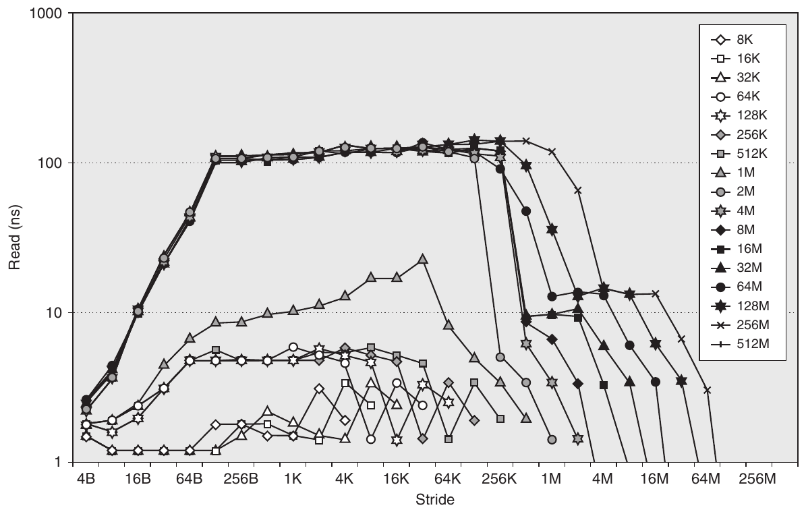

**Hình 2.30 Kết quả mẫu từ chương trình trong Hình 2.29.**

Chương trình trên giả định program address bám theo physical address; điều này đúng trên một số ít máy dùng virtually addressed cache, chẳng hạn Alpha 21264. Nhìn chung, virtual address có xu hướng bám theo physical address trong thời gian ngắn sau reboot, nên có thể bạn cần reboot máy để kết quả có những đường trơn tru. Để trả lời các câu hỏi bên dưới, hãy giả sử kích thước của mọi thành phần trong memory hierarchy đều là lũy thừa của 2. Giả sử page size lớn hơn nhiều so với block size trong second-level cache (nếu có), và second-level cache block size lớn hơn hoặc bằng block size trong first-level cache. Một ví dụ output chương trình được vẽ trong Hình 2.30; chú giải liệt kê kích thước array được truy cập.

**2.4** [12/12/12/10/12] <2.6> Sử dụng kết quả chương trình mẫu trong Hình 2.30:

a. [12] <2.6> Tổng kích thước và block size của second-level cache là bao nhiêu?

b. [12] <2.6> Miss penalty của second-level cache là bao nhiêu?

c. [12] <2.6> Associativity của second-level cache là bao nhiêu?

d. [10] <2.6> Kích thước main memory là bao nhiêu?

e. [12] <2.6> Paging time là bao nhiêu nếu page size bằng 4 KB?

**2.5** [12/15/15/20] <2.6> Nếu cần, sửa code Hình 2.29 để đo các đặc tính hệ thống sau. Vẽ kết quả thực nghiệm với elapsed time trên y-axis và memory stride trên x-axis. Hãy dùng thang logarithm cho cả hai trục và vẽ một đường cho mỗi cache size.

a. [12] <2.6> Page size của hệ thống là bao nhiêu?

b. [15] <2.6> Translation lookaside buffer (TLB) có bao nhiêu entry?

c. [15] <2.6> Miss penalty của TLB là bao nhiêu?

d. [20] <2.6> Associativity của TLB là bao nhiêu?

**2.6** [20/20] <2.6> Trong multiprocessor memory system, các mức thấp hơn trong memory hierarchy có thể không đạt trạng thái bão hòa khi chỉ có một processor, nhưng phải có thể đạt trạng thái đó khi nhiều processor phối hợp. Hãy sửa code Hình 2.29 và chạy nhiều bản đồng thời. Bạn có thể xác định:

a. [20] <2.6> Hệ thống máy tính của bạn có bao nhiêu processor thực, và bao nhiêu system processor chỉ là multithreaded context bổ sung?

b. [20] <2.6> Hệ thống của bạn có bao nhiêu memory controller?

**2.7** [20] <2.6> Bạn có nghĩ ra cách dùng chương trình để kiểm tra một số đặc tính instruction cache không? Gợi ý: Compiler có thể sinh ra rất nhiều instruction không thể thấy rõ ngay từ một đoạn code. Hãy cố dùng arithmetic instruction đơn giản, có độ dài đã biết trong instruction set architecture (ISA) của bạn.

### Bài tập

**2.8** [12/12/15] <2.2> Những câu hỏi sau khảo sát tác động của cache nhỏ và đơn giản bằng CACTI, với giả định công nghệ 65 nm (0.065 μm). (CACTI có phiên bản online tại http://quid.hpl.hp.com:9081/cacti/.)

a. [12] <2.2> So sánh access time của cache 64 KB với block 64 byte và một bank. Access time tương đối của two-way và four-way set associative cache so với tổ chức direct mapped là bao nhiêu?

b. [12] <2.2> So sánh access time của four-way set associative cache có block 64 byte và một bank. Access time tương đối của cache 32 KB và 64 KB so với cache 16 KB là bao nhiêu?

c. [15] <2.2> Với cache 64 KB, tìm cache associativity từ 1 đến 8 có average memory access time thấp nhất, biết misses per instruction cho một workload suite là 0.00664 với direct mapped, 0.00366 với two-way set associative, 0.000987 với four-way set associative và 0.000266 với eight-way set associative cache. Tổng thể có 0.3 data reference mỗi instruction. Giả sử cache miss mất 10 ns trong mọi mô hình. Để tính hit time theo cycle, hãy lấy cycle time do CACTI xuất ra, tương ứng maximum frequency mà cache có thể hoạt động không có bubble trong pipeline.

**2.9** [12/15/15/10] <2.2> Bạn đang khảo sát lợi ích tiềm năng của L1 cache way-predicting. Giả sử một L1 data cache 64 KB four-way set associative single-banked là thành phần giới hạn cycle time trong hệ thống. Để có tổ chức cache thay thế, bạn đang cân nhắc một way-predicted cache được mô hình hóa như direct-mapped cache 64 KB với prediction accuracy 80%. Trừ khi có chỉ định khác, giả sử một way access dự đoán sai nhưng hit trong cache cần thêm một cycle. Hãy dùng miss rate và miss penalty trong phần (c) câu 2.8.

a. [12] <2.2> Average memory access time của cache hiện tại (theo cycle) so với way-predicted cache là bao nhiêu?

b. [15] <2.2> Nếu mọi thành phần khác có thể hoạt động với cycle time nhanh hơn của way-predicted cache (kể cả main memory), dùng way-predicted cache sẽ tác động performance thế nào?

c. [15] <2.2> Way-predicted cache thường chỉ được dùng làm instruction cache cấp dữ liệu cho instruction queue hoặc buffer. Hãy tưởng tượng bạn muốn thử way prediction trên data cache. Giả sử prediction accuracy là 80%, các operation tiếp theo (ví dụ data cache access của instruction khác, dependent operation) được issue với giả định way prediction đúng. Vì vậy way misprediction đòi hỏi pipe flush và replay trap, cần 15 cycle. Mức thay đổi của average memory access time trên mỗi load instruction khi dùng data cache way prediction là dương hay âm, và bằng bao nhiêu?

d. [10] <2.2> Thay cho way prediction, nhiều associative L2 cache lớn thực hiện tag access và data access tuần tự, để chỉ dataset array cần thiết phải được kích hoạt. Cách này tiết kiệm power nhưng tăng access time. Dùng detailed Web interface của CACTI cho cache 1 MB four-way set associative, process 0.065 μm, block 64 byte, đọc ra 144 bit, 1 bank, chỉ 1 read/write port, tag 30 bit và công nghệ ITRS-HP với global wire. Tỷ số access time khi thực hiện tag access và data access tuần tự so với truy cập song song là bao nhiêu?

**2.10** [10/12] <2.2> Bạn được yêu cầu khảo sát performance tương đối giữa banked và pipelined L1 data cache cho microprocessor mới. Giả sử cache 64 KB two-way set associative với block 64 byte. Pipelined cache sẽ gồm ba pipestage và có dung lượng tương tự Alpha 21264 data cache. Banked implementation gồm hai bank 32 KB two-way set associative. Hãy dùng CACTI với giả định công nghệ 65 nm (0.065 μm) để trả lời các câu sau. Cycle time do phiên bản Web xuất ra cho thấy cache có thể hoạt động ở frequency nào mà không có bubble trong pipeline.

a. [10] <2.2> Cycle time của cache so với access time của nó là bao nhiêu, và cache chiếm bao nhiêu pipestage (lấy tới hai chữ số thập phân)?

b. [12] <2.2> So sánh area và tổng dynamic read energy mỗi access của pipelined design với banked design. Nêu thiết kế nào chiếm ít diện tích hơn, thiết kế nào cần nhiều power hơn, và giải thích vì sao có thể như vậy.

**2.11** [12/15] <2.2> Xét việc dùng critical word first và early restart khi L2 cache miss. Giả sử L2 cache 1 MB có block 64 byte và refill path rộng 16 byte. Giả sử có thể ghi 16 byte vào L2 mỗi 4 processor cycle, thời gian nhận block 16 byte đầu tiên từ memory controller là 120 cycle, mỗi block 16 byte bổ sung từ main memory cần 16 cycle, và dữ liệu có thể bypass trực tiếp vào read port của L2 cache. Bỏ qua mọi cycle cần để truyền miss request tới L2 cache và truyền dữ liệu được yêu cầu tới L1 cache.

a. [12] <2.2> Phục vụ L2 cache miss mất bao nhiêu cycle khi có và khi không có critical word first cùng early restart?

b. [15] <2.2> Bạn nghĩ critical word first và early restart quan trọng hơn với L1 cache hay L2 cache, và những yếu tố nào góp phần tạo nên mức độ quan trọng tương đối đó?

**2.12** [12/12] <2.2> Bạn thiết kế write buffer giữa write-through L1 cache và write-back L2 cache. L2 cache write data bus rộng 16 B và có thể thực hiện một write tới cache address độc lập mỗi 4 processor cycle.

a. [12] <2.2> Mỗi write buffer entry nên rộng bao nhiêu byte?

b. [15] <2.2> Trong steady state, có thể kỳ vọng speedup bao nhiêu khi dùng merging write buffer thay cho nonmerging buffer trong lúc ghi số không vào memory bằng cách thực thi các 64-bit store, nếu mọi instruction khác có thể issue song song với store và các block đã có trong L2 cache?

c. [15] <2.2> Những L1 miss có thể xảy ra ảnh hưởng thế nào đến số write buffer entry cần thiết cho hệ thống dùng blocking và nonblocking cache?

**2.13** [10/10/10] <2.3> Xét desktop system có một processor được kết nối với DRAM 2 GB có error-correcting code (ECC). Giả sử chỉ có một memory channel rộng 72 bit, gồm 64 bit dữ liệu và 8 bit ECC.

a. [10] <2.3> DIMM có bao nhiêu DRAM chip nếu dùng chip DRAM 1 GB, và mỗi DRAM phải có bao nhiêu data I/O nếu chỉ một DRAM nối tới mỗi DIMM data pin?

b. [10] <2.3> Cần burst length bao nhiêu để hỗ trợ L2 cache block 32 B?

c. [10] <2.3> Tính peak bandwidth của DIMM DDR2-667 và DDR2-533 khi đọc từ một active page, không tính ECC overhead.

**2.14** [10/10] <2.3> Hình 2.31 minh họa DDR2 SDRAM timing diagram mẫu. tRCD là thời gian cần để activate một row trong bank; column address strobe (CAS) latency (CL) là số cycle cần để đọc một column trong row. Giả sử RAM nằm trên DDR2 DIMM chuẩn có ECC, với 72 data line. Cũng hãy giả sử burst length bằng 8, đọc ra 8 bit, tức tổng cộng 64 B từ DIMM. Giả sử tRCD = CAS (or CL) * clock_frequency, và clock_frequency = transfers_per_second/2. on-chip latency khi cache miss đi qua level 1 và 2 rồi quay lại, không gồm DRAM access, là 20 ns.

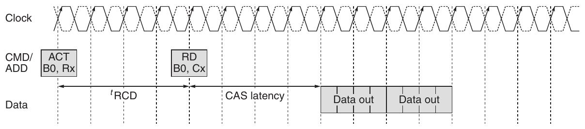

**Hình 2.31 DDR2 SDRAM timing diagram.**

a. [10] <2.3> Với DIMM DDR2-667 1 GB CL = 5, cần bao lâu từ lúc đưa activate command tới lúc bit dữ liệu được yêu cầu cuối cùng từ DRAM chuyển từ valid sang invalid? Giả sử mỗi request đều tự động prefetch thêm một cacheline liền kề trong cùng page.

b. [10] <2.3> Khi dùng DDR2-667 DIMM, relative latency của read cần bank activate so với read tới page đã mở là bao nhiêu, tính cả thời gian xử lý miss trong processor?

**2.15** [15] <2.3> Giả sử DIMM DDR2-667 2 GB có CL = 5 giá $130, và DIMM DDR2-533 2 GB có CL = 4 giá $100. Giả sử hệ thống dùng hai DIMM, phần còn lại có giá $800. Hãy xét performance của hệ thống dùng DDR2-667 và DDR2-533 DIMM trên workload có 3.33 L2 miss mỗi 1K instruction; giả sử 80% mọi DRAM read cần activate. cost-performance của toàn hệ thống khi dùng các DIMM khác nhau là bao nhiêu, giả sử mỗi lúc chỉ có một L2 miss outstanding, core in-order có CPI 1.5 chưa bao gồm memory access time do L2 cache miss?

**2.16** [12] <2.3> Bạn đang trang bị một server với CMP eight-core 3 GHz, có thể thực thi workload với overall CPI 2.0 (giả sử L2 cache miss refill không bị trì hoãn). L2 cache line size là 32 byte. Giả sử hệ thống dùng DDR2-667 DIMM, cần cung cấp bao nhiêu memory channel độc lập để hệ thống không bị giới hạn bởi memory bandwidth nếu bandwidth cần thiết đôi khi gấp đôi trung bình? Các workload này trung bình phát sinh 6.67 L2 miss mỗi 1K instruction.

**2.17** [12/12] <2.3> Một phần lớn (hơn một phần ba) DRAM power có thể do page activation (xem http://download.micron.com/pdf/technotes/ddr2/TN4704.pdf và www.micron.com/systemcalc). Giả sử bạn đang xây dựng hệ thống có memory 2 GB bằng 8-bank 2 GB x8 DDR2 DRAM hoặc 8-bank 1 GB x8 DRAM, cả hai cùng speed grade. Cả hai dùng page size 1 KB, last level cacheline size là 64 byte. Giả sử các DRAM không active đều ở trạng thái precharged standby và tiêu tán lượng power không đáng kể. Giả sử thời gian chuyển từ standby sang active là không đáng kể.

a. [12] <2.3> Loại DRAM nào được kỳ vọng đem lại system performance cao hơn? Giải thích vì sao.

b. [12] <2.3> Về power, DIMM 2 GB làm từ 1 GB x8 DDR2 DRAM so với DIMM dung lượng tương tự làm từ 1 Gb x4 DDR2 DRAM thế nào?

**2.18** [20/15/12] <2.3> Để truy cập dữ liệu từ DRAM điển hình, trước tiên chúng ta phải activate row thích hợp. Giả sử việc này đưa cả page 8 KB vào row buffer. Sau đó, chúng ta chọn một column cụ thể từ row buffer. Nếu các DRAM access tiếp theo tới cùng page, chúng ta có thể bỏ qua bước activation; nếu không, phải đóng page hiện tại và precharge các bitline cho lần activation tiếp theo. Một DRAM policy phổ biến khác là chủ động đóng page và precharge bitline ngay khi access kết thúc. Giả sử mỗi DRAM read hoặc write có kích thước 64 byte, DDR bus latency (Data out trong Hình 2.30) để gửi 512 bit là Tddr.

a. [20] <2.3> Giả sử DDR2-667 cần năm cycle precharge, năm cycle activate và bốn cycle đọc column, với giá trị row buffer hit rate (r) nào bạn sẽ chọn policy này thay vì policy kia để có access time tốt nhất? Giả sử mỗi DRAM access cách nhau đủ lâu để hoàn tất một random access mới.

b. [15] <2.3> Nếu 10% tổng DRAM access xảy ra liên tiếp hoặc liên tục không có khoảng trống thời gian, quyết định của bạn sẽ thay đổi thế nào?

c. [12] <2.3> Dùng row buffer hit rate đã tính ở trên để tính chênh lệch average DRAM energy trên mỗi access giữa hai policy. Giả sử precharging cần 2 nJ, activation cần 4 nJ, và đọc hoặc ghi từ row buffer cần 100 pJ/bit.

**2.19** [15] <2.3> Mỗi khi máy tính idle, chúng ta có thể đưa nó vào stand by (DRAM vẫn active) hoặc cho nó hibernate. Giả sử để hibernate, chúng ta chỉ phải sao chép nội dung DRAM sang một nonvolatile medium như Flash. Nếu đọc hoặc ghi cacheline 64 byte tới Flash cần 2.56 μJ và DRAM cần 0.5 nJ, còn idle power consumption của DRAM là 1.6 W (cho 8 GB), hệ thống nên idle bao lâu để có lợi từ hibernating? Giả sử main memory có kích thước 8 GB.

**2.20** [10/10/10/10/10] <2.4> Virtual Machine (VM) có tiềm năng bổ sung nhiều khả năng hữu ích cho hệ thống máy tính, như cải thiện total cost of ownership (TCO) hoặc availability. Có thể dùng VM cung cấp những khả năng sau không? Nếu có, chúng hỗ trợ việc này thế nào?

a. [10] <2.4> Kiểm thử ứng dụng trong production environment bằng development machine?

b. [10] <2.4> Triển khai lại ứng dụng nhanh khi có thảm họa hoặc failure?

c. [10] <2.4> Performance cao hơn trong ứng dụng I/O-intensive?

d. [10] <2.4> Fault isolation giữa các ứng dụng khác nhau, dẫn tới availability cao hơn cho service?

e. [10] <2.4> Bảo trì software trên hệ thống khi ứng dụng vẫn chạy mà không bị gián đoạn đáng kể?

**2.21** [10/10/12/12] <2.4> Virtual machine có thể bị giảm performance do một số event, chẳng hạn thực thi privileged instruction, TLB miss, trap và I/O. Những event này thường được xử lý trong system code. Vì vậy, một cách để ước tính slowdown khi chạy dưới VM là xem phần trăm application execution time trong system mode so với user mode. Ví dụ ứng dụng dành 10% thời gian thực thi trong system mode có thể chậm đi 60% khi chạy trên VM. Hình 2.32 liệt kê performance thời kỳ đầu của các system call trong native execution, pure virtualization và paravirtualization cho LMbench dùng Xen trên Itanium system, với thời gian đo bằng microsecond (do Matthew Chapman tại University of New South Wales cung cấp).

a. [10] <2.4> Những loại chương trình nào được kỳ vọng có slowdown nhỏ hơn khi chạy dưới VM?

b. [10] <2.4> Nếu slowdown là hàm tuyến tính theo system time, với slowdown nêu trên, chương trình dành 20% thời gian thực thi trong system time dự kiến chạy chậm hơn bao nhiêu?

c. [12] <2.4> Median slowdown của các system call trong bảng trên dưới pure virtualization và paravirtualization là bao nhiêu?

d. [12] <2.4> Function nào trong bảng trên có slowdown lớn nhất? Bạn nghĩ nguyên nhân có thể là gì?

| Benchmark | Native | Pure | Para |
|---|---|---|---|
| Null call | 0.04 | 0.96 | 0.50 |
| Null I/O | 0.27 | 6.32 | 2.91 |
| Stat | 1.10 | 10.69 | 4.14 |
| Open/close | 1.99 | 20.43 | 7.71 |
| Cài đặt sighandler | 0.33 | 7.34 | 2.89 |
| Xử lý signal | 1.69 | 19.26 | 2.36 |
| Fork | 56.00 | 513.00 | 164.00 |
| Exec | 316.00 | 2084.00 | 578.00 |
| Fork + exec sh | 1451.00 | 7790.00 | 2360.00 |

**Hình 2.32 Performance thời kỳ đầu của các system call trong native execution, pure virtualization và paravirtualization.**

**2.22** [12] <2.4> Định nghĩa virtual machine của Popek và Goldberg nói rằng không thể phân biệt nó với real machine, ngoại trừ performance. Trong câu hỏi này, chúng ta sẽ dùng định nghĩa đó để xác định liệu mình có đang thực thi native trên một processor hay đang chạy trên virtual machine. Công nghệ Intel VT-x về thực chất cung cấp tập privilege level thứ hai cho virtual machine sử dụng. Với giả định công nghệ VT-x, virtual machine chạy trên virtual machine khác sẽ phải làm gì?

**2.23** [20/25] <2.4> Khi x86 architecture có hỗ trợ virtualization, virtual machine đang phát triển tích cực và trở nên phổ biến. Hãy so sánh điểm giống và khác của công nghệ virtualization Intel VT-x và AMD-V của AMD. (Có thể tìm thông tin AMD-V tại http://sites.amd.com/us/business/it-solutions/virtualization/Pages/resources.aspx.)

a. [20] <2.4> Công nghệ nào có thể cho performance cao hơn với ứng dụng memory-intensive có memory footprint lớn?

b. [25] <2.4> Thông tin hỗ trợ IOMMU của AMD cho virtualized I/O có tại http://developer.amd.com/documentation/articles/pages/892006101.aspx. Virtualization Technology và input/output memory management unit (IOMMU) làm gì để cải thiện virtualized I/O performance?

**2.24** [30] <2.2, 2.3> Vì instruction-level parallelism cũng có thể được khai thác hiệu quả trên in-order superscalar processor và very long instruction word (VLIW) processor có speculation, một lý do quan trọng để xây out-of-order (OOO) superscalar processor là khả năng chịu memory latency khó dự đoán do cache miss. Do đó có thể xem hardware hỗ trợ OOO issue như một phần memory system! Hãy xem floorplan Alpha 21264 trong Hình 2.33 để tìm diện tích tương đối của integer và floating-point issue queue cùng mapper so với cache. Các queue schedule instruction để issue, còn mapper rename các register specifier. Vì vậy đây là những phần bổ sung cần thiết hỗ trợ OOO issue. 21264 chỉ có L1 data cache và instruction cache trên chip, cả hai đều 64 KB two-way set associative. Dùng OOO superscalar simulator như SimpleScalar (www.cs.wisc.edu/~mscalar/simplescalar.html) trên benchmark memory-intensive để tìm performance mất đi bao nhiêu nếu dùng diện tích issue queue và mapper làm L1 data cache bổ sung trong in-order superscalar processor, thay vì OOO issue trong mô hình 21264. Bảo đảm những khía cạnh còn lại của máy giống nhau nhất có thể để so sánh công bằng. Bỏ qua mọi mức tăng access time hoặc cycle time do cache lớn hơn, cũng như ảnh hưởng data cache lớn hơn lên floorplan chip. (Lưu ý so sánh này không hoàn toàn công bằng, vì code chưa được compiler schedule cho in-order processor.)

**2.25** [20/20/20] <2.6> Intel performance analyzer VTune có thể được dùng để thực hiện nhiều phép đo hành vi cache. Bạn có thể tải bản đánh giá miễn phí VTune cho cả Windows và Linux từ http://software.intel.com/en-us/articles/intel-vtune-amplifier-xe/. Chương trình (aca_ch2_cs2.c) dùng trong Nghiên cứu trường hợp 2 đã được sửa để hoạt động ngay với VTune trên Microsoft Visual C++. Bạn có thể tải chương trình từ www.hpl.hp.com/research/cacti/aca_ch2_cs2_vtune.c. Những VTune function đặc biệt được chèn để loại initialization và loop overhead khỏi quá trình performance analysis. Hướng dẫn thiết lập VTune chi tiết nằm trong phần README của chương trình. Chương trình liên tục lặp 20 giây cho mỗi cấu hình. Trong thí nghiệm sau, bạn có thể tìm hiểu tác động của data size lên cache và overall processor performance. Chạy chương trình trong VTune trên Intel processor với input dataset size 8 KB, 128 KB, 4 MB và 32 MB, giữ stride 64 byte (stride một cache line trên Intel i7 processor). Hãy thu thập thống kê về overall performance và performance của L1 data cache, L2, L3 cache.

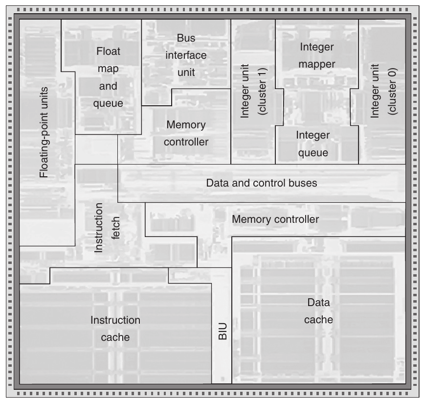

**Hình 2.33 Floorplan của Alpha 21264 [Kessler 1999].**

a. [20] <2.6> Liệt kê số miss mỗi 1K instruction của L1 data cache, L2, L3 cho từng dataset size, cùng model và tốc độ processor của bạn. Dựa trên kết quả, bạn nhận xét gì về kích thước L1 data cache, L2, L3 cache trên processor? Hãy giải thích quan sát của bạn.

b. [20] <2.6> Liệt kê instructions per clock (IPC) cho từng dataset size, cùng model và tốc độ processor của bạn. Dựa trên kết quả, bạn nhận xét gì về L1, L2, L3 miss penalty trên processor? Hãy giải thích quan sát của bạn.

c. [20] <2.6> Chạy chương trình trong VTune với input dataset size 8 KB và 128 KB trên Intel OOO processor. Liệt kê số L1 data cache miss và L2 cache miss mỗi 1K instruction, cùng CPI cho cả hai cấu hình. Bạn nhận xét gì về hiệu quả của memory latency hiding technique trong high-performance OOO processor? Gợi ý: Bạn cần tìm L1 data cache miss latency của processor mình sử dụng. Với Intel i7 processor gần đây, nó xấp xỉ 11 cycle.
