# 3 Instruction-Level Parallelism và cách khai thác

> “Ai về nhất?” “America.” “Ai về nhì?” “Thưa ngài, không có người về nhì.”

> Đối thoại giữa hai người quan sát cuộc đua thuyền buồm sau này mang tên “The America’s Cup” và được tổ chức vài năm một lần — nguồn cảm hứng để John Cocke đặt tên “America” cho processor nghiên cứu của IBM. Processor này là tiền thân của dòng RS/6000 và là superscalar microprocessor đầu tiên.

## 3.1 Instruction-Level Parallelism: Khái niệm và thách thức

Từ khoảng năm 1985, mọi processor đều sử dụng pipelining để chồng lấp việc thực thi các instruction và cải thiện performance. Khả năng chồng lấp giữa các instruction này được gọi là instruction-level parallelism (ILP), vì các instruction có thể được xử lý song song. Trong chương này và Phụ lục H, chúng ta xem xét nhiều kỹ thuật mở rộng những khái niệm pipelining cơ bản bằng cách tăng mức song song được khai thác giữa các instruction.

Chương này có mức độ nâng cao hơn đáng kể so với nội dung pipelining cơ bản trong Phụ lục C. Nếu chưa thật sự nắm vững các ý tưởng trong Phụ lục C, bạn nên xem lại phụ lục đó trước khi đi vào chương này.

Chúng ta bắt đầu chương này bằng việc xem xét giới hạn do data hazard và control hazard đặt ra, sau đó chuyển sang chủ đề nâng cao khả năng khai thác tính song song của compiler và processor. Những mục này giới thiệu nhiều khái niệm mà chúng ta sẽ tiếp tục sử dụng làm nền tảng trong suốt chương này và chương tiếp theo. Mặc dù có thể hiểu một số nội dung cơ bản hơn trong chương mà không cần toàn bộ các ý tưởng ở hai mục đầu, những nội dung nền tảng này vẫn rất quan trọng đối với các mục sau của chương.

Có hai cách tiếp cận phần lớn có thể tách biệt để khai thác ILP: (1) dựa vào hardware để hỗ trợ phát hiện và khai thác tính song song một cách động; (2) dựa vào công nghệ software để tìm tính song song một cách tĩnh tại thời điểm compile. Các processor dùng cách tiếp cận động, hardware-based, bao gồm dòng Intel Core, chiếm ưu thế trên thị trường desktop và server. Trong thị trường personal mobile device, nơi hiệu quả năng lượng thường là mục tiêu then chốt, người thiết kế khai thác instruction-level parallelism ở mức thấp hơn. Vì vậy, vào năm 2011, phần lớn processor cho thị trường PMD sử dụng cách tiếp cận tĩnh, như chúng ta sẽ thấy với ARM Cortex-A8; tuy nhiên, các processor tương lai (chẳng hạn ARM Cortex-A9 mới) đang sử dụng cách tiếp cận động. Những cách tiếp cận compiler-based quyết liệt đã được thử nhiều lần từ thập niên 1980, gần đây nhất là dòng Intel Itanium. Dù đã đầu tư công sức rất lớn, những cách tiếp cận đó chưa thành công bên ngoài phạm vi hẹp của các ứng dụng khoa học.

Trong vài năm qua, nhiều kỹ thuật được phát triển cho một cách tiếp cận đã được khai thác trong thiết kế chủ yếu dựa vào cách tiếp cận còn lại. Chương này giới thiệu những khái niệm cơ bản và cả hai cách tiếp cận. Chương cũng thảo luận các giới hạn của những cách tiếp cận ILP; chính các giới hạn đó đã trực tiếp dẫn tới việc chuyển sang multicore. Hiểu các giới hạn này vẫn rất quan trọng để cân bằng việc sử dụng ILP và thread-level parallelism.

Trong mục này, chúng ta thảo luận các đặc điểm của cả chương trình lẫn processor giới hạn mức song song có thể khai thác giữa các instruction, cùng mối ánh xạ quan trọng giữa cấu trúc chương trình và cấu trúc hardware. Mối ánh xạ này là chìa khóa để hiểu liệu một thuộc tính của chương trình có thực sự giới hạn performance hay không và trong hoàn cảnh nào.

Giá trị CPI (cycles per instruction) của một pipelined processor bằng tổng base CPI và mọi phần đóng góp từ stall:

Pipeline CPI = Ideal pipeline CPI + Structural stalls + Data hazard stalls + Control stalls

| Kỹ thuật | Thành phần được giảm | Mục |
|---|---|---|
| Forwarding và bypassing | Stall có thể xảy ra do data hazard | C.2 |
| Delayed branch và branch scheduling đơn giản | Control hazard stall | C.2 |
| Compiler pipeline scheduling cơ bản | Data hazard stall | C.2, 3.2 |
| Dynamic scheduling cơ bản (scoreboarding) | Data hazard stall do true dependence | C.7 |
| Loop unrolling | Control hazard stall | 3.2 |
| Branch prediction | Control stall | 3.3 |
| Dynamic scheduling có renaming | Stall do data hazard, output dependence và antidependence | 3.4 |
| Hardware speculation | Data hazard stall và control hazard stall | 3.6 |
| Dynamic memory disambiguation | Data hazard stall liên quan đến memory | 3.6 |
| Issue nhiều instruction trong mỗi cycle | Ideal CPI | 3.7, 3.8 |
| Compiler dependence analysis, software pipelining, trace scheduling | Ideal CPI, data hazard stall | H.2, H.3 |
| Hardware hỗ trợ compiler speculation | Ideal CPI, data hazard stall, branch hazard stall | H.4, H.5 |

**Hình 3.1 Những kỹ thuật chính được khảo sát trong Phụ lục C, Chương 3 và Phụ lục H, cùng thành phần của phương trình CPI mà mỗi kỹ thuật tác động tới.**

Ideal pipeline CPI là thước đo performance tối đa mà implementation có thể đạt được. Bằng cách giảm từng thành phần ở right-hand side, chúng ta giảm pipeline CPI tổng thể, hay nói cách khác là tăng IPC (instructions per clock). Phương trình trên cho phép phân loại các kỹ thuật theo thành phần CPI tổng thể mà chúng làm giảm. Hình 3.1 trình bày những kỹ thuật được khảo sát trong chương này và Phụ lục H, cùng các chủ đề thuộc phần nhập môn trong Phụ lục C. Trong chương này, chúng ta sẽ thấy những kỹ thuật được giới thiệu để giảm ideal pipeline CPI có thể làm tăng tầm quan trọng của việc xử lý hazard.

### Instruction-Level Parallelism là gì?

Mọi kỹ thuật trong chương này đều khai thác tính song song giữa các instruction. Mức song song sẵn có trong một basic block — một chuỗi code straight-line không có branch đi vào ngoại trừ tại điểm vào, và không có branch đi ra ngoại trừ tại điểm ra — khá nhỏ. Với chương trình MIPS điển hình, tần suất branch động trung bình thường nằm trong khoảng 15% đến 25%, nghĩa là có từ ba đến sáu instruction được thực thi giữa hai branch. Vì các instruction này có khả năng phụ thuộc lẫn nhau, mức chồng lấp có thể khai thác trong basic block có khả năng thấp hơn kích thước basic block trung bình. Để cải thiện performance đáng kể, chúng ta phải khai thác ILP qua nhiều basic block.

Cách đơn giản nhất và phổ biến nhất để tăng ILP là khai thác tính song song giữa các lần lặp của một loop. Loại song song này thường được gọi là loop-level parallelism. Sau đây là ví dụ đơn giản về một loop cộng hai array 1000-element và hoàn toàn có thể thực hiện song song:

```
for (i=0; i<=999; i=i+1)
       x[i] = x[i] + y[i];
```

Mỗi lần lặp của loop có thể chồng lấp với bất kỳ lần lặp nào khác, mặc dù trong từng lần lặp có rất ít hoặc không có cơ hội chồng lấp.

Chúng ta sẽ khảo sát một số kỹ thuật chuyển loop-level parallelism như vậy thành instruction-level parallelism. Về cơ bản, các kỹ thuật này hoạt động bằng cách unroll loop, theo cách tĩnh do compiler thực hiện (như trong mục tiếp theo), hoặc theo cách động do hardware thực hiện (như trong Mục 3.5 và 3.6).

Một phương pháp thay thế quan trọng để khai thác loop-level parallelism là sử dụng SIMD trong cả vector processor lẫn Graphics Processing Unit (GPU); cả hai được trình bày trong Chương 4. SIMD instruction khai thác data-level parallelism bằng cách thao tác song song trên một số lượng phần tử dữ liệu từ nhỏ đến vừa (thường từ hai đến tám). Vector instruction khai thác data-level parallelism bằng cách thao tác song song trên nhiều phần tử dữ liệu, sử dụng cả các execution unit song song lẫn một deep pipeline. Chẳng hạn, chuỗi code ở trên, ở dạng đơn giản cần bảy instruction cho mỗi lần lặp (hai load, một phép cộng, một store, hai lần cập nhật address và một branch), tổng cộng 7000 instruction, có thể thực hiện với số instruction bằng one-quarter trong một SIMD architecture xử lý bốn phần tử dữ liệu mỗi instruction. Trên một số vector processor, chuỗi này có thể chỉ cần bốn instruction: hai instruction load vector x và y từ memory, một instruction cộng hai vector và một instruction store vector kết quả trở lại. Dĩ nhiên, các instruction này được pipelined và có latency tương đối dài, nhưng những latency đó có thể chồng lấp.

### Data Dependence và Hazard

Xác định một instruction phụ thuộc vào instruction khác như thế nào là điều thiết yếu để xác định mức song song tồn tại trong chương trình và cách khai thác mức song song đó. Cụ thể, để khai thác instruction-level parallelism, chúng ta phải xác định những instruction nào có thể thực thi song song. Nếu hai instruction là song song, chúng có thể thực thi đồng thời trong pipeline có độ sâu bất kỳ mà không gây stall, với giả định pipeline có đủ resource (và do đó không tồn tại structural hazard). Nếu hai instruction phụ thuộc nhau, chúng không song song và phải thực thi theo thứ tự, dù thường vẫn có thể chồng lấp một phần. Mấu chốt trong cả hai trường hợp là xác định liệu một instruction có phụ thuộc vào instruction khác hay không.

#### Data Dependence

Có ba loại dependence khác nhau: data dependence (còn gọi là true data dependence), name dependence và control dependence. Instruction j có data dependence vào instruction i nếu một trong các điều kiện sau đúng:

- Instruction i tạo ra kết quả có thể được instruction j sử dụng.

- Instruction j có data dependence vào instruction k, và instruction k có data dependence vào instruction i.

Điều kiện thứ hai đơn giản nói rằng một instruction phụ thuộc vào instruction khác nếu tồn tại chuỗi dependence thuộc loại thứ nhất giữa hai instruction đó. Chuỗi dependence này có thể dài bằng toàn bộ chương trình. Lưu ý rằng dependence trong một instruction duy nhất (chẳng hạn ADDD R1,R1,R1) không được xem là một dependence.

Chẳng hạn, xét chuỗi code MIPS sau, cộng thêm một scalar trong register F2 vào mỗi phần tử của một vector giá trị trong memory (bắt đầu tại 0(R1), phần tử cuối tại 8(R2)). (Để đơn giản, trong suốt chương này, các ví dụ bỏ qua ảnh hưởng của delayed branch.)

```
Loop:      L.D     F0,0(R1)   ;F0=array element
           ADD.D F4,F0,F2     ;add scalar in F2
           S.D     F4,0(R1)   ;store result
           DADDUI R1,R1,#-8   ;decrement pointer 8 bytes
           BNE     R1,R2,LOOP ;branch R1!=R2
```

Data dependence trong chuỗi code này liên quan đến cả dữ liệu floating-point:

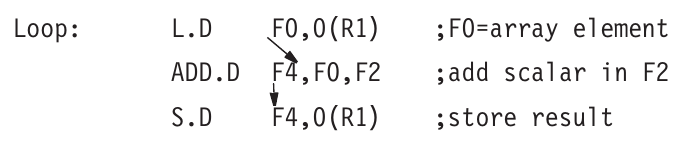

và dữ liệu integer:

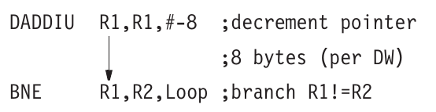

Trong cả hai chuỗi có dependence ở trên, như các mũi tên thể hiện, mỗi instruction phụ thuộc vào instruction trước đó. Các mũi tên ở đây và trong những ví dụ tiếp theo chỉ ra thứ tự phải được giữ để thực thi đúng. Mũi tên đi từ instruction phải thực hiện trước tới instruction mà đầu mũi tên trỏ vào.

Nếu hai instruction có data dependence, chúng phải thực thi theo thứ tự và không thể thực thi đồng thời hay chồng lấp hoàn toàn. Dependence hàm ý rằng sẽ có một chuỗi gồm một hoặc nhiều data hazard giữa hai instruction. (Xem Phụ lục C để có mô tả ngắn về data hazard; chúng ta sẽ định nghĩa chính xác chúng sau vài trang nữa.) Thực thi các instruction đồng thời sẽ khiến processor có pipeline interlock (và độ sâu pipeline lớn hơn khoảng cách theo cycle giữa các instruction) phát hiện hazard và stall, qua đó giảm hoặc loại bỏ sự chồng lấp. Trong processor không có interlock mà dựa vào compiler scheduling, compiler không thể schedule các instruction phụ thuộc nhau để chúng chồng lấp hoàn toàn, vì chương trình sẽ không thực thi đúng. Sự hiện diện của data dependence trong chuỗi instruction phản ánh data dependence trong source code đã sinh ra chuỗi instruction đó. Ảnh hưởng của data dependence ban đầu phải được giữ nguyên.

Dependence là thuộc tính của chương trình. Việc một dependence cụ thể có dẫn tới phát hiện hazard thực sự hay không, và hazard đó có thực sự gây stall hay không, là thuộc tính của tổ chức pipeline. Phân biệt này rất quan trọng để hiểu cách khai thác instruction-level parallelism.

Data dependence truyền tải ba điều: (1) khả năng xảy ra hazard, (2) thứ tự phải tính các kết quả và (3) giới hạn trên của mức song song có thể khai thác. Những giới hạn đó được khảo sát chi tiết hơn trong Mục 3.10 và Phụ lục H.

Vì data dependence có thể giới hạn mức instruction-level parallelism có thể khai thác, một trọng tâm lớn của chương này là vượt qua những giới hạn đó. Có thể vượt qua dependence theo hai cách khác nhau: (1) giữ dependence nhưng tránh hazard; (2) loại bỏ dependence bằng cách biến đổi code. Schedule code là phương pháp chính để tránh hazard mà không thay đổi dependence; việc schedule này có thể do cả compiler lẫn hardware thực hiện.

Giá trị dữ liệu có thể truyền giữa các instruction qua register hoặc memory location. Khi data flow diễn ra trong register, việc phát hiện dependence khá đơn giản vì tên register được cố định trong instruction, dù tình hình sẽ phức tạp hơn khi có branch xen vào và yêu cầu bảo đảm tính đúng đắn buộc compiler hoặc hardware phải hành động thận trọng.

Dependence đi qua memory location khó phát hiện hơn, vì hai address có thể trông khác nhau nhưng cùng tham chiếu một vị trí: chẳng hạn 100(R4) và 20(R6) có thể là những memory address giống nhau. Ngoài ra, effective address của load hoặc store có thể thay đổi giữa các lần thực thi instruction (nên 20(R4) và 20(R4) có thể khác nhau), làm việc phát hiện dependence càng phức tạp.

Trong chương này, chúng ta khảo sát hardware phát hiện data dependence liên quan đến memory location, nhưng sẽ thấy các kỹ thuật đó cũng có giới hạn. Những kỹ thuật compiler phát hiện dependence như vậy đóng vai trò thiết yếu trong việc tìm ra loop-level parallelism.

#### Name Dependence

Loại dependence thứ hai là name dependence. Name dependence xảy ra khi hai instruction sử dụng cùng register hoặc memory location, gọi là một name, nhưng không có data flow giữa các instruction liên quan đến name đó. Có hai loại name dependence giữa instruction i và instruction j, trong đó i đứng trước j theo program order:

1. Antidependence giữa instruction i và instruction j xảy ra khi instruction j ghi register hoặc memory location mà instruction i đọc. Phải giữ thứ tự ban đầu để bảo đảm i đọc đúng giá trị. Trong ví dụ ở trang 151, có antidependence giữa S.D và DADDIU trên register R1.

2. Output dependence xảy ra khi instruction i và instruction j ghi cùng register hoặc memory location. Phải giữ thứ tự giữa các instruction để bảo đảm giá trị được ghi cuối cùng tương ứng với instruction j.

Cả antidependence lẫn output dependence đều là name dependence, khác với true data dependence, vì không có giá trị nào được truyền giữa các instruction. Vì name dependence không phải true dependence, các instruction liên quan đến name dependence có thể thực thi đồng thời hoặc được đổi thứ tự nếu name (số hiệu register hoặc memory location) dùng trong instruction được thay đổi để các instruction không xung đột.

Việc renaming này dễ thực hiện hơn đối với register operand, và khi đó được gọi là register renaming. Register renaming có thể do compiler thực hiện tĩnh hoặc do hardware thực hiện động. Trước khi mô tả dependence phát sinh từ branch, hãy xem mối quan hệ giữa dependence và pipeline data hazard.

#### Data Hazard

Hazard tồn tại bất cứ khi nào có name dependence hoặc data dependence giữa các instruction và chúng ở đủ gần nhau để sự chồng lấp trong quá trình thực thi làm thay đổi thứ tự truy cập operand liên quan đến dependence. Do dependence, chúng ta phải giữ cái gọi là program order — tức thứ tự các instruction sẽ thực thi nếu chạy tuần tự từng instruction một theo chương trình nguồn ban đầu. Mục tiêu của cả kỹ thuật software lẫn hardware là khai thác tính song song bằng cách chỉ giữ program order ở nơi nó ảnh hưởng tới kết quả chương trình. Phát hiện và tránh hazard bảo đảm giữ được program order cần thiết.

Data hazard, được mô tả không chính thức trong Phụ lục C, có thể được phân thành một trong ba loại, tùy vào thứ tự truy cập đọc và ghi trong các instruction. Theo quy ước, hazard được đặt tên theo thứ tự trong chương trình mà pipeline phải giữ. Xét hai instruction i và j, với i đứng trước j theo program order. Các data hazard có thể xảy ra là

- RAW (read after write) — j cố đọc một nguồn trước khi i ghi vào đó, nên j lấy nhầm giá trị cũ. Đây là loại hazard phổ biến nhất và tương ứng với true data dependence. Phải giữ program order để bảo đảm j nhận giá trị từ i.

- WAW (write after write) — j cố ghi một operand trước khi i ghi operand đó. Các lần ghi rốt cuộc được thực hiện sai thứ tự, khiến đích giữ giá trị do i ghi thay vì giá trị do j ghi. Hazard này tương ứng với output dependence. WAW hazard chỉ hiện diện trong pipeline thực hiện ghi ở nhiều pipe stage hoặc cho phép một instruction tiếp tục tiến lên ngay cả khi instruction trước đó đang stall.

- WAR (write after read) — j cố ghi một đích trước khi i đọc đích đó, nên i lấy nhầm giá trị mới. Hazard này phát sinh từ antidependence (hay name dependence). WAR hazard không thể xảy ra trong phần lớn static issue pipeline — kể cả pipeline sâu hơn hoặc floating-point pipeline — vì mọi lần đọc đều diễn ra sớm (ở ID trong pipeline của Phụ lục C) và mọi lần ghi đều diễn ra muộn (ở WB trong pipeline của Phụ lục C). WAR hazard xảy ra khi có một số instruction ghi kết quả sớm trong instruction pipeline và những instruction khác đọc nguồn muộn trong pipeline, hoặc khi các instruction được đổi thứ tự, như chúng ta sẽ thấy trong chương này.

Lưu ý rằng trường hợp RAR (read after read) không phải hazard.

### Control Dependence

Loại dependence cuối cùng là control dependence. Control dependence xác định thứ tự của một instruction i so với branch instruction để instruction i thực thi đúng program order và chỉ thực thi khi cần. Mọi instruction, ngoại trừ các instruction trong basic block đầu tiên của chương trình, đều có control dependence vào một tập branch nào đó; nhìn chung phải giữ những control dependence này để giữ program order. Một ví dụ đơn giản nhất là dependence của các câu lệnh trong phần “then” của câu lệnh if vào branch. Chẳng hạn, trong đoạn code

```
if p1 {
      S1;
};
if p2 {
      S2;
}
```

S1 có control dependence vào p1, còn S2 có control dependence vào p2 nhưng không phụ thuộc vào p1.

Nhìn chung, control dependence áp đặt hai ràng buộc:

1. Không thể chuyển một instruction có control dependence vào một branch lên trước branch để việc thực thi instruction đó không còn chịu sự điều khiển của branch. Chẳng hạn, không thể lấy một instruction từ phần then của câu lệnh if và chuyển nó lên trước câu lệnh if.

2. Không thể chuyển một instruction không có control dependence vào một branch xuống sau branch để việc thực thi instruction đó chịu sự điều khiển của branch. Chẳng hạn, không thể lấy một câu lệnh trước câu lệnh if và chuyển nó vào phần then.

Khi processor giữ nghiêm ngặt program order, nó bảo đảm control dependence cũng được giữ. Tuy nhiên, chúng ta có thể sẵn sàng thực thi những instruction lẽ ra không được thực thi, qua đó vi phạm control dependence, nếu làm vậy mà không ảnh hưởng tính đúng đắn của chương trình. Vì thế, control dependence không phải thuộc tính then chốt bắt buộc phải giữ. Thay vào đó, hai thuộc tính thiết yếu đối với tính đúng đắn của chương trình — và thường được giữ bằng cách duy trì cả data dependence lẫn control dependence — là exception behavior và data flow.

Giữ exception behavior nghĩa là mọi thay đổi thứ tự thực thi instruction không được làm thay đổi cách exception phát sinh trong chương trình. Thường yêu cầu này được nới lỏng thành việc đổi thứ tự thực thi instruction không được gây ra exception mới trong chương trình. Một ví dụ đơn giản cho thấy giữ control dependence và data dependence có thể ngăn những tình huống như vậy. Xét chuỗi code sau:

```
           DADDU     R2,R3,R4
           BEQZ      R2,L1
           LW        R1,0(R2)
L1:
```

Trong trường hợp này, dễ thấy rằng nếu không giữ data dependence liên quan đến R2, chúng ta có thể thay đổi kết quả chương trình. Khó thấy hơn là nếu bỏ qua control dependence và chuyển load instruction lên trước branch, load instruction có thể gây memory protection exception. Lưu ý rằng không có data dependence nào ngăn việc đổi chỗ BEQZ và LW; chỉ có control dependence. Để có thể đổi thứ tự những instruction này (mà vẫn giữ data dependence), chúng ta muốn đơn giản bỏ qua exception khi branch được taken. Trong Mục 3.6, chúng ta sẽ xem kỹ thuật hardware mang tên speculation, cho phép vượt qua vấn đề exception này. Phụ lục H xem xét các kỹ thuật software hỗ trợ speculation.

Thuộc tính thứ hai được giữ bằng cách duy trì data dependence và control dependence là data flow. Data flow là luồng thực tế của các giá trị dữ liệu giữa instruction tạo kết quả và instruction sử dụng chúng. Branch làm data flow mang tính động, vì nó cho phép nguồn dữ liệu của một instruction cụ thể đến từ nhiều điểm. Nói cách khác, chỉ giữ data dependence là không đủ, vì một instruction có thể có data dependence vào nhiều instruction đứng trước. Program order quyết định instruction đứng trước nào thực sự cung cấp giá trị dữ liệu cho instruction đó. Program order được bảo đảm bằng cách giữ control dependence.

Chẳng hạn, xét đoạn code sau:

```
           DADDU        R1,R2,R3
           BEQZ         R4,L
           DSUBU        R1,R5,R6
L:         ...

           OR           R7,R1,R8
```

Trong ví dụ này, giá trị R1 mà OR instruction sử dụng phụ thuộc vào việc branch có được taken hay không. Chỉ riêng data dependence không đủ để giữ tính đúng đắn. OR instruction có data dependence vào cả DADDU lẫn DSUBU, nhưng chỉ giữ thứ tự đó không đủ để thực thi đúng.

Thay vào đó, khi các instruction thực thi, phải giữ data flow: nếu branch không được taken, OR phải dùng giá trị R1 do DSUBU tính; nếu branch được taken, OR phải dùng giá trị R1 do DADDU tính. Bằng cách giữ control dependence của OR vào branch, chúng ta ngăn thay đổi không hợp lệ đối với data flow. Vì lý do tương tự, không thể chuyển DSUBU instruction lên trên branch. Speculation, vốn giúp xử lý vấn đề exception, cũng cho phép giảm ảnh hưởng của control dependence trong khi vẫn giữ data flow, như chúng ta sẽ thấy trong Mục 3.6.

Đôi khi chúng ta có thể xác định rằng vi phạm control dependence không thể ảnh hưởng exception behavior hay data flow. Xét chuỗi code sau:

```
           DADDU        R1,R2,R3
           BEQZ         R12,skip
           DSUBU        R4,R5,R6
           DADDU        R5,R4,R9
skip:      OR           R7,R8,R9
```

Giả sử chúng ta biết register đích của DSUBU instruction (R4) không được dùng sau instruction có nhãn skip. (Thuộc tính cho biết một giá trị có được instruction sắp tới sử dụng hay không được gọi là liveness.) Nếu R4 không được dùng, việc thay đổi giá trị R4 ngay trước branch sẽ không ảnh hưởng data flow, vì R4 là dead (thay vì live) trong vùng code sau skip. Do đó, nếu R4 là dead và DSUBU instruction hiện có không thể sinh exception (ngoại trừ những exception mà sau đó processor tiếp tục cùng process), chúng ta có thể chuyển DSUBU instruction lên trước branch, vì thay đổi này không thể ảnh hưởng data flow.

Nếu branch được taken, DSUBU instruction sẽ thực thi và không có ích, nhưng không ảnh hưởng kết quả chương trình. Kiểu code scheduling này cũng là một dạng speculation, thường được gọi là software speculation, vì compiler đặt cược vào kết quả branch; trong trường hợp này, đặt cược rằng branch thường không được taken. Những cơ chế compiler speculation tham vọng hơn được thảo luận trong Phụ lục H. Thông thường, khi nói speculation hoặc speculative, ngữ cảnh sẽ cho biết cơ chế đó thuộc hardware hay software; khi chưa rõ, tốt nhất nên nói “hardware speculation” hoặc “software speculation”.

Control dependence được giữ bằng cách triển khai control hazard detection gây ra control stall. Có thể loại bỏ hoặc giảm control stall bằng nhiều kỹ thuật hardware và software mà chúng ta khảo sát trong Mục 3.3.

## 3.2 Các kỹ thuật compiler cơ bản để bộc lộ ILP

Mục này khảo sát việc sử dụng công nghệ compiler đơn giản để nâng cao khả năng khai thác ILP của processor. Những kỹ thuật này thiết yếu đối với processor dùng static issue hoặc static scheduling. Với nền tảng công nghệ compiler này, chúng ta sẽ sớm khảo sát thiết kế và performance của các processor dùng static issuing. Phụ lục H nghiên cứu những phương án compiler cùng hardware liên quan tinh vi hơn, được thiết kế để processor khai thác nhiều instruction-level parallelism hơn.

### Pipeline Scheduling cơ bản và Loop Unrolling

Để giữ pipeline luôn đầy, phải khai thác tính song song giữa các instruction bằng cách tìm những chuỗi instruction không liên quan có thể chồng lấp trong pipeline. Để tránh pipeline stall, việc thực thi một instruction phụ thuộc phải cách instruction nguồn một khoảng clock cycle bằng pipeline latency của instruction nguồn đó. Khả năng thực hiện scheduling này của compiler phụ thuộc cả mức ILP sẵn có trong chương trình lẫn latency của các functional unit trong pipeline. Hình 3.2 trình bày latency của FP unit được giả định trong chương này, trừ khi có nêu rõ latency khác. Chúng ta giả định integer pipeline five-stage tiêu chuẩn, nên branch có độ trễ một clock cycle. Chúng ta giả định các functional unit được fully pipelined hoặc được nhân bản (số bản bằng độ sâu pipeline), để một operation thuộc bất kỳ loại nào cũng có thể được issue ở mỗi clock cycle và không có structural hazard.

Trong tiểu mục này, chúng ta xem compiler có thể tăng mức ILP sẵn có bằng cách biến đổi loop như thế nào. Ví dụ vừa minh họa một kỹ thuật quan trọng, vừa tạo động lực cho những phép biến đổi chương trình mạnh hơn được mô tả trong Phụ lục H. Chúng ta dựa vào đoạn code sau, cộng một scalar vào một vector:

```
for (i=999; i>=0; i=i–1)
       x[i] = x[i] + s;
```

Có thể thấy loop này có tính song song vì phần thân của mỗi lần lặp độc lập với nhau. Chúng ta hình thức hóa khái niệm này trong Phụ lục H và mô tả cách kiểm tra tại thời điểm compile liệu các lần lặp có độc lập hay không. Trước hết, hãy xem performance của loop này, qua đó thấy cách dùng tính song song để cải thiện performance trên MIPS pipeline với latency được trình bày ở trên.

Bước đầu tiên là chuyển đoạn code trên sang MIPS assembly language. Trong đoạn code sau, R1 ban đầu là address của phần tử có address cao nhất trong array, và F2 chứa giá trị scalar s. Register R2 được tính trước sao cho 8(R2) là address của phần tử cuối cùng cần xử lý.

| Instruction tạo kết quả | Instruction dùng kết quả | Latency theo clock cycle |
|---|---|---|
| FP ALU op | FP ALU op khác | 3 |
| FP ALU op | Store double | 2 |
| Load double | FP ALU op | 1 |
| Load double | Store double | 0 |

**Hình 3.2 Latency của FP operation được sử dụng trong chương này. Cột cuối là số clock cycle cần xen giữa để tránh stall. Những con số này tương tự latency trung bình mà chúng ta thấy ở FP unit. Latency từ floating-point load tới store bằng 0, vì kết quả load có thể được bypass mà không làm store stall. Chúng ta tiếp tục giả định latency của integer load là 1 và latency của integer ALU operation là 0.**

Code MIPS trực tiếp, chưa được schedule cho pipeline, có dạng như sau:

```
Loop:    L.D       F0,0(R1)      ;F0=array element
         ADD.D     F4,F0,F2      ;add scalar in F2
         S.D       F4,0(R1)      ;store result
         DADDUI    R1,R1,#-8     ;decrement pointer
                                 ;8 bytes (per DW)
         BNE       R1,R2,Loop    ;branch R1!=R2
```

Trước hết, hãy xem loop này chạy ra sao khi được schedule trên một MIPS pipeline đơn giản với latency trong Hình 3.2.

**Ví dụ** Trình bày loop trên MIPS ở cả dạng đã schedule và chưa schedule, bao gồm mọi stall hoặc clock cycle nhàn rỗi. Hãy schedule để xử lý độ trễ từ floating-point operation, nhưng nhớ rằng chúng ta bỏ qua delayed branch.

**Trả lời** Khi không thực hiện scheduling, loop thực thi như sau và cần chín cycle:

Clock cycle được issue

| Loop: | L.D | F0,0(R1) | 1 |
|---|---|---|---|
|  | stall |  | 2 |
|  | ADD.D | F4,F0,F2 | 3 |
|  | stall |  | 4 |
|  | stall |  | 5 |
|  | S.D | F4,0(R1) | 6 |
|  | DADDUI | R1,R1,#-8 | 7 |
|  | stall |  | 8 |
|  | BNE | R1,R2,Loop | 9 |

Chúng ta có thể schedule loop để chỉ còn hai stall và giảm thời gian xuống bảy cycle:

```
Loop: L.D       F0,0(R1)
       DADDUI   R1,R1,#-8
       ADD.D    F4,F0,F2
       stall
       stall
       S.D      F4,8(R1)
       BNE      R1,R2,Loop
```

- Các stall sau ADD.D là để chờ S.D sử dụng kết quả.

Trong ví dụ trước, cứ mỗi bảy clock cycle chúng ta hoàn tất một lần lặp và store trở lại một phần tử array, nhưng công việc thực sự trên phần tử đó chỉ chiếm ba clock cycle (load, cộng và store) trong số bảy clock cycle. Bốn clock cycle còn lại gồm loop overhead — DADDUI và BNE — cùng hai stall. Để loại bỏ bốn clock cycle đó, chúng ta cần tăng số operation so với số instruction gây overhead.

Một phương án đơn giản để tăng số instruction so với branch và các instruction gây overhead là loop unrolling. Unrolling đơn giản là nhân bản phần thân loop nhiều lần và điều chỉnh code kết thúc loop.

Loop unrolling cũng có thể được dùng để cải thiện scheduling. Vì loại bỏ branch, nó cho phép schedule chung các instruction từ những lần lặp khác nhau. Trong trường hợp này, có thể loại bỏ stall do sử dụng dữ liệu bằng cách tạo thêm các instruction độc lập trong thân loop. Nếu chỉ nhân bản instruction khi unroll loop, việc sử dụng lại cùng register có thể ngăn chúng ta schedule loop hiệu quả. Vì thế, chúng ta muốn dùng register khác nhau cho mỗi lần lặp, qua đó làm tăng số register cần thiết.

**Ví dụ** Trình bày loop sau khi unroll để có bốn bản sao của thân loop, với giả định R1 – R2 (tức kích thước array) ban đầu là bội số của 32, nghĩa là số lần lặp là bội số của 4. Loại bỏ mọi phép tính dư thừa rõ ràng và không tái sử dụng bất kỳ register nào.

**Trả lời** Sau đây là kết quả sau khi gộp các DADDUI instruction và bỏ những BNE operation không cần thiết bị nhân bản trong quá trình unrolling. Lưu ý rằng bây giờ phải đặt R2 sao cho 32(R2) là address bắt đầu của bốn phần tử cuối.

```
Loop:   L.D        F0,0(R1)
        ADD.D      F4,F0,F2
        S.D        F4,0(R1)      ;drop DADDUI & BNE
        L.D        F6,-8(R1)
        ADD.D      F8,F6,F2
        S.D        F8,-8(R1)     ;drop DADDUI & BNE
        L.D        F10,-16(R1)
        ADD.D      F12,F10,F2
        S.D        F12,-16(R1)   ;drop DADDUI & BNE
        L.D        F14,-24(R1)
        ADD.D      F16,F14,F2
        S.D        F16,-24(R1)
        DADDUI     R1,R1,#-32
        BNE        R1,R2,Loop
```

Chúng ta đã loại bỏ ba branch và ba lần giảm R1. Address trong các load và store đã được điều chỉnh bù để cho phép gộp những DADDUI instruction trên R1. Tối ưu này có vẻ tầm thường, nhưng thực tế không phải vậy; nó đòi hỏi phép thế ký hiệu và rút gọn. Phép thế ký hiệu và rút gọn sắp xếp lại biểu thức để có thể gộp các hằng số, cho phép viết lại biểu thức như ((i + 1) + 1) thành (i + (1 + 1)), rồi rút gọn thành (i + 2). Chúng ta sẽ thấy những dạng tổng quát hơn của các tối ưu loại bỏ phép tính phụ thuộc này trong Phụ lục H.

Khi chưa scheduling, sau mỗi operation trong loop đã unroll là một operation phụ thuộc, vì thế sẽ gây stall. Loop này chạy trong 27 clock cycle — mỗi LD có 1 stall, mỗi ADDD có 2, DADDUI có 1, cộng 14 cycle issue instruction — tức 6.75 clock cycle cho mỗi phần tử trong số bốn phần tử, nhưng có thể được schedule để cải thiện performance đáng kể. Loop unrolling thường được thực hiện sớm trong quá trình compile để optimizer có thể phát hiện và loại bỏ các phép tính dư thừa.

Trong chương trình thực tế, thường chúng ta không biết cận trên của loop. Giả sử cận đó là n, và muốn unroll loop để tạo k bản sao của thân loop. Thay vì một loop đã unroll duy nhất, chúng ta sinh một cặp loop liên tiếp. Loop đầu thực thi (n mod k) lần với thân chính là loop ban đầu. Loop thứ hai có thân đã unroll, bao quanh bởi một outer loop lặp (n/k) lần. (Như sẽ thấy trong Chương 4, kỹ thuật này tương tự kỹ thuật strip mining dùng trong compiler cho vector processor.) Với n lớn, phần lớn thời gian thực thi sẽ nằm trong thân loop đã unroll.

Trong ví dụ trước, unrolling cải thiện performance của loop bằng cách loại bỏ các instruction gây overhead, dù làm code size tăng đáng kể. Loop đã unroll sẽ hoạt động ra sao khi được schedule cho pipeline đã mô tả trước đó?

**Ví dụ** Trình bày loop đã unroll trong ví dụ trước sau khi được schedule cho pipeline có latency trong Hình 3.2.

**Trả lời** Loop: L.D F0,0(R1)

```
L.D       F6,-8(R1)
L.D       F10,-16(R1)
L.D       F14,-24(R1)
ADD.D     F4,F0,F2
ADD.D     F8,F6,F2
ADD.D     F12,F10,F2
ADD.D     F16,F14,F2
S.D       F4,0(R1)
S.D       F8,-8(R1)
DADDUI    R1,R1,#-32
S.D       F12,16(R1)
S.D       F16,8(R1)
BNE       R1,R2,Loop
```

Thời gian thực thi loop đã unroll giảm xuống tổng cộng 14 clock cycle, tức 3.5 clock cycle mỗi phần tử, so với 9 cycle mỗi phần tử trước khi unroll hoặc schedule, và 7 cycle khi đã schedule nhưng chưa unroll.

Lợi ích từ scheduling trên loop đã unroll còn lớn hơn trên loop ban đầu. Mức tăng này xuất hiện vì unrolling làm bộc lộ thêm các phép tính có thể được schedule để giảm tối đa stall; code ở trên không có stall. Schedule loop theo cách này đòi hỏi phải nhận ra rằng các load và store độc lập và có thể đổi chỗ cho nhau.

### Tổng kết Loop Unrolling và Scheduling

Trong suốt chương này và Phụ lục H, chúng ta xem xét nhiều kỹ thuật hardware và software cho phép tận dụng instruction-level parallelism để khai thác đầy đủ tiềm năng của các functional unit trong processor. Chìa khóa của phần lớn những kỹ thuật này là biết khi nào và bằng cách nào có thể thay đổi thứ tự giữa các instruction. Trong ví dụ, chúng ta đã thực hiện nhiều thay đổi mà con người dễ thấy là được phép. Trên thực tế, quá trình này phải được compiler hoặc hardware thực hiện một cách có hệ thống. Để có code đã unroll cuối cùng, chúng ta phải đưa ra những quyết định và phép biến đổi sau:

- Xác định unrolling có ích bằng cách nhận ra rằng các lần lặp độc lập, ngoại trừ phần code duy trì loop.

- Dùng register khác nhau để tránh những ràng buộc không cần thiết do dùng cùng register cho các phép tính khác nhau (chẳng hạn name dependence).

- Loại bỏ những instruction kiểm tra và branch bổ sung, đồng thời điều chỉnh code kết thúc và lặp của loop.

- Xác định rằng có thể đổi chỗ các load và store trong loop đã unroll bằng cách nhận ra các load và store thuộc những lần lặp khác nhau là độc lập. Phép biến đổi này đòi hỏi phân tích memory address và xác định chúng không tham chiếu cùng address.

- Schedule code, giữ mọi dependence cần thiết để tạo kết quả giống code ban đầu.

Yêu cầu then chốt làm nền tảng cho mọi phép biến đổi này là hiểu một instruction phụ thuộc vào instruction khác như thế nào, và với các dependence đó thì có thể thay đổi hay đổi thứ tự instruction ra sao.

Ba tác động khác nhau giới hạn lợi ích từ loop unrolling: (1) lượng overhead được phân bổ giảm dần theo mỗi lần unroll, (2) giới hạn code size và (3) giới hạn compiler. Trước tiên, hãy xét loop overhead. Khi unroll loop bốn lần, chúng ta tạo đủ tính song song giữa các instruction để schedule loop mà không có stall cycle. Thực tế, trong 14 clock cycle, chỉ 2 cycle là loop overhead: DADDUI duy trì giá trị index và BNE kết thúc loop. Nếu unroll loop tám lần, overhead giảm từ 1/ 2 cycle xuống 1/ 4 cho mỗi lần lặp ban đầu.

Giới hạn thứ hai của unrolling là mức tăng code size do nó tạo ra. Với loop lớn, code size tăng có thể là vấn đề đáng lo, đặc biệt nếu nó làm tăng instruction cache miss rate.

Một yếu tố thường quan trọng hơn code size là khả năng thiếu register do unrolling và scheduling quyết liệt gây ra. Tác động thứ cấp này, phát sinh từ instruction scheduling trong những đoạn code lớn, được gọi là register pressure. Nó xuất hiện vì schedule code để tăng ILP làm số giá trị live tăng lên. Sau instruction scheduling quyết liệt, có thể không còn khả năng cấp register cho mọi giá trị live. Code đã biến đổi, dù về lý thuyết nhanh hơn, có thể mất một phần hoặc toàn bộ lợi thế vì làm thiếu register. Khi không unroll, scheduling quyết liệt bị branch giới hạn đủ nhiều để register pressure hiếm khi là vấn đề. Tuy nhiên, kết hợp unrolling với scheduling quyết liệt có thể gây ra vấn đề này. Nó đặc biệt khó xử lý trong multiple-issue processor, vốn đòi hỏi bộc lộ thêm những chuỗi instruction độc lập có thể chồng lấp khi thực thi. Nhìn chung, việc sử dụng các phép biến đổi high-level tinh vi, có lợi ích tiềm năng khó đo lường trước khi sinh code chi tiết, đã làm độ phức tạp của compiler hiện đại tăng đáng kể.

Loop unrolling là phương pháp đơn giản nhưng hữu ích để tăng kích thước những đoạn code straight-line có thể được schedule hiệu quả. Phép biến đổi này hữu ích trên nhiều loại processor, từ pipeline đơn giản đã khảo sát tới multiple-issue superscalar và VLIW được nghiên cứu ở phần sau của chương.

## 3.3 Giảm chi phí branch bằng branch prediction nâng cao

Do phải bảo đảm control dependence thông qua branch hazard và stall, branch làm giảm pipeline performance. Loop unrolling là một cách giảm số branch hazard; chúng ta cũng có thể giảm tổn thất performance do branch bằng cách dự đoán hành vi của chúng. Trong Phụ lục C, chúng ta khảo sát những branch predictor đơn giản dựa vào thông tin compile-time hoặc hành vi động quan sát được của riêng từng branch. Khi số instruction đang được xử lý tăng lên, branch prediction chính xác hơn càng trở nên quan trọng. Trong mục này, chúng ta khảo sát những kỹ thuật cải thiện độ chính xác của dự đoán động.

### Correlating Branch Predictor

Các phương án predictor 2-bit chỉ dùng hành vi gần đây của một branch để dự đoán hành vi tương lai của chính branch đó. Có thể cải thiện độ chính xác nếu xem cả hành vi gần đây của những branch khác thay vì chỉ branch đang cần dự đoán. Xét đoạn code nhỏ từ benchmark eqntott, một thành viên của các bộ benchmark SPEC thời kỳ đầu có hành vi branch prediction đặc biệt kém:

```
if (aa==2)
        aa=0;
if (bb==2)
        bb=0;
if (aa!=bb) {
```

Sau đây là code MIPS thường được sinh cho đoạn code này, với giả định aa và bb được gán vào register R1 và R2:

```
        DADDIU     R3,R1,#–2
        BNEZ       R3,L1          ;branch b1   (aa!=2)
        DADD       R1,R0,R0       ;aa=0
L1:     DADDIU     R3,R2,#–2
        BNEZ       R3,L2          ;branch b2   (bb!=2)
        DADD       R2,R0,R0       ;bb=0
L2:     DSUBU      R3,R1,R2       ;R3=aa-bb
        BEQZ       R3,L3          ;branch b3   (aa==bb)
```

Hãy đặt nhãn cho các branch này là b1, b2 và b3. Nhận xét then chốt là hành vi của branch b3 tương quan với hành vi của branch b1 và b2. Rõ ràng, nếu cả b1 lẫn b2 đều không được taken (tức cả hai điều kiện đều cho kết quả true và cả aa lẫn bb đều được gán 0), thì b3 sẽ được taken, vì aa và bb hiển nhiên bằng nhau. Predictor chỉ dùng hành vi của một branch để dự đoán kết quả của chính branch đó không bao giờ nắm bắt được hành vi này.

Branch predictor dùng hành vi của branch khác để dự đoán được gọi là correlating predictor hoặc two-level predictor. Những correlating predictor hiện có bổ sung thông tin về hành vi của các branch gần đây nhất để quyết định cách dự đoán một branch cụ thể. Chẳng hạn, predictor (1,2) dùng hành vi của branch cuối cùng để chọn một trong hai branch predictor 2-bit khi dự đoán một branch cụ thể. Tổng quát, predictor (m,n) dùng hành vi của m branch cuối để chọn trong số 2<sup>m</sup> branch predictor, mỗi predictor là predictor n-bit cho một branch. Điểm hấp dẫn của loại correlating branch predictor này là nó có thể đạt tỷ lệ dự đoán đúng cao hơn phương án 2-bit mà chỉ cần thêm một lượng hardware rất nhỏ.

Sự đơn giản của hardware bắt nguồn từ một nhận xét đơn giản: có thể ghi lại global history của m branch gần nhất trong shift register m-bit, với mỗi bit ghi nhận branch có được taken hay không. Sau đó có thể đánh index branch-prediction buffer bằng cách nối các bit low-order của branch address với global history m-bit. Chẳng hạn, trong buffer (2,2) có tổng cộng 64 entry, 4 bit address low-order của branch (word address) và 2 global bit biểu diễn hành vi của hai branch vừa thực thi gần nhất tạo thành index 6-bit, có thể dùng để đánh index 64 counter.

Correlating branch predictor hoạt động tốt hơn bao nhiêu so với phương án 2-bit tiêu chuẩn? Để so sánh công bằng, phải so sánh các predictor sử dụng cùng số state bit. Số bit trong predictor (m,n) là

2<sup>m</sup> × n × Number of prediction entries selected by the branch address

Predictor 2-bit không có global history đơn giản là predictor (0,2).

**Ví dụ** Branch predictor (0,2) có 4K entry chứa bao nhiêu bit? Predictor (2,2) có cùng số bit chứa bao nhiêu entry?

**Trả lời** Predictor có 4K entry chứa

2<sup>0</sup> × 2 × 4K = 8K bits

Predictor (2,2) có tổng cộng 8K bit trong prediction buffer chứa bao nhiêu entry branch-selected? Chúng ta biết rằng

2<sup>2</sup> × 2 × Number of prediction entries selected by the branch = 8K

Do đó, số prediction entry được branch chọn = 1K.

Hình 3.3 so sánh misprediction rate của predictor (0,2) có 4K entry đã trình bày với predictor (2,2) có 1K entry. Như có thể thấy, correlating predictor này không chỉ hoạt động tốt hơn predictor 2-bit đơn giản có cùng tổng số state bit, mà còn thường vượt cả predictor 2-bit có số entry không giới hạn.

### Tournament Predictor: Kết hợp thích nghi Local Predictor và Global Predictor

Động lực chính của correlating branch predictor đến từ nhận xét rằng predictor 2-bit tiêu chuẩn chỉ dùng thông tin local dự đoán sai một số branch quan trọng, và bổ sung thông tin global có thể cải thiện performance. Tournament predictor phát triển ý tưởng này thêm một bước bằng cách dùng nhiều predictor, thường là một predictor dựa vào thông tin global và một predictor dựa vào thông tin local, rồi kết hợp chúng bằng selector. Tournament predictor vừa có thể đạt độ chính xác tốt hơn ở kích thước vừa phải (8K–32K bit), vừa sử dụng hiệu quả số lượng prediction bit rất lớn. Các tournament predictor hiện có dùng một saturating counter 2-bit cho mỗi branch để chọn giữa hai predictor khác nhau dựa trên predictor nào (local, global, hoặc thậm chí một dạng kết hợp) hiệu quả nhất trong các lần dự đoán gần đây. Giống predictor 2-bit đơn giản, saturating counter cần hai lần dự đoán sai trước khi đổi predictor được ưu tiên.

Ưu điểm của tournament predictor là khả năng chọn đúng predictor cho một branch cụ thể, điều đặc biệt thiết yếu với integer benchmark. Tournament predictor điển hình chọn global predictor trong gần 40% trường hợp với SPEC integer benchmark và dưới 15% trường hợp với SPEC FP benchmark. Ngoài các Alpha processor tiên phong sử dụng tournament predictor, những AMD processor gần đây, gồm cả Opteron và Phenom, cũng dùng predictor tournament-style.

Hình 3.4 khảo sát performance của ba predictor khác nhau (local predictor 2-bit, correlating predictor và tournament predictor) với số bit khác nhau, dùng SPEC89 làm benchmark. Như đã thấy, khả năng dự đoán của local predictor không cải thiện khi vượt quá một kích thước nhất định. Correlating predictor cho thấy cải thiện đáng kể, còn tournament predictor đạt performance tốt hơn đôi chút. Với các phiên bản SPEC mới hơn, kết quả cũng tương tự, nhưng chỉ đạt hành vi tiệm cận khi predictor có kích thước lớn hơn một chút.

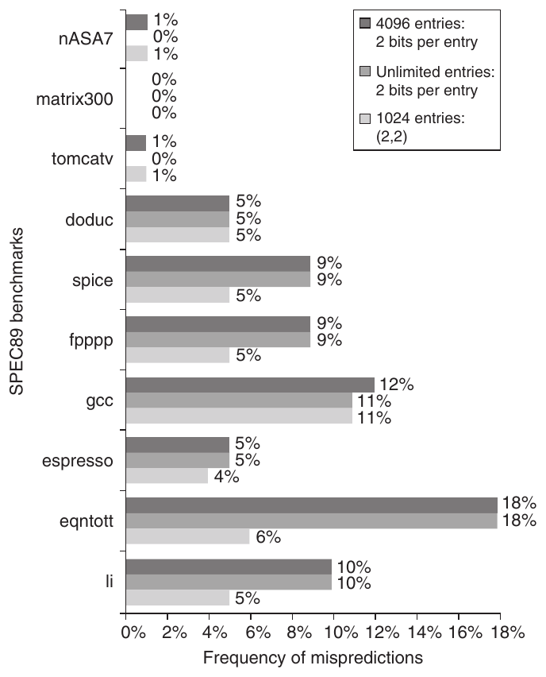

**Hình 3.3 So sánh predictor 2-bit. Đầu tiên là noncorrelating predictor cho 4096 bit, tiếp theo là noncorrelating predictor 2-bit có số entry không giới hạn và predictor 2-bit với 2 bit global history, tổng cộng 1024 entry. Mặc dù dữ liệu này thuộc phiên bản SPEC cũ hơn, dữ liệu cho SPEC benchmark mới hơn cũng cho thấy chênh lệch độ chính xác tương tự.**

Local predictor gồm một predictor two-level. Mức trên là local history table có 1024 entry 10-bit; mỗi entry 10-bit tương ứng với 10 kết quả branch gần nhất của entry đó. Nghĩa là nếu branch được taken liên tiếp từ 10 lần trở lên, entry trong local history table chứa toàn bit 1. Nếu branch luân phiên taken và không taken, history entry gồm bit 0 và 1 xen kẽ. History 10-bit này cho phép phát hiện và dự đoán mẫu gồm tối đa 10 branch. Entry được chọn từ local history table được dùng để đánh index bảng có 1K entry gồm các saturating counter 3-bit, cung cấp local prediction. Cách kết hợp này dùng tổng cộng 29K bit và đem lại độ chính xác branch prediction cao.

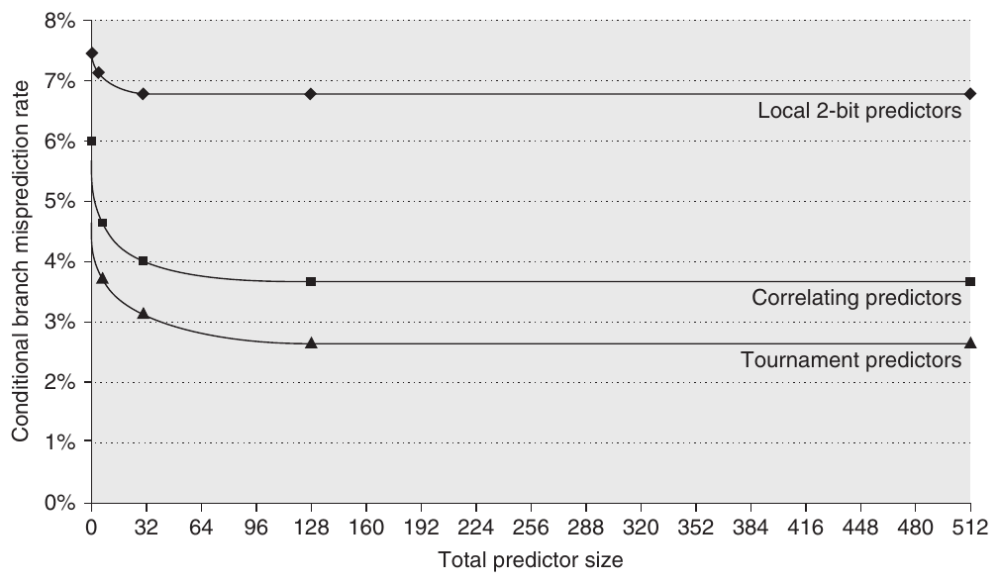

**Hình 3.4 Misprediction rate của ba predictor khác nhau trên SPEC89 khi tăng tổng số bit. Các predictor gồm local predictor 2-bit, correlating predictor được tổ chức tối ưu để sử dụng thông tin global và local tại từng điểm trên đồ thị, cùng tournament predictor. Dù dữ liệu này thuộc phiên bản SPEC cũ hơn, dữ liệu cho SPEC benchmark mới hơn cũng cho thấy hành vi tương tự, có thể hội tụ tới giới hạn tiệm cận ở kích thước predictor lớn hơn đôi chút.**

### Branch Predictor của Intel Core i7

Intel chỉ công bố lượng thông tin hạn chế về branch predictor của Core i7, vốn dựa trên các predictor trước đó trong chip Core Duo. i7 sử dụng predictor two-level có first-level predictor nhỏ hơn, được thiết kế để đáp ứng ràng buộc cycle khi dự đoán một branch mỗi clock cycle, cùng second-level predictor lớn hơn làm dự phòng. Mỗi predictor kết hợp ba predictor khác nhau: (1) predictor two-bit đơn giản được giới thiệu trong Phụ lục C (và dùng trong tournament predictor vừa thảo luận); (2) global history predictor như những predictor vừa xem; (3) loop exit predictor. Loop exit predictor dùng counter để dự đoán chính xác số branch được taken (tức số lần lặp) đối với branch được phát hiện là loop branch. Với mỗi branch, dự đoán tốt nhất được chọn từ ba predictor bằng cách theo dõi độ chính xác của từng dự đoán, giống tournament predictor. Ngoài main predictor nhiều mức này, một unit riêng dự đoán target address cho indirect branch, và một stack cũng được dùng để dự đoán return address.

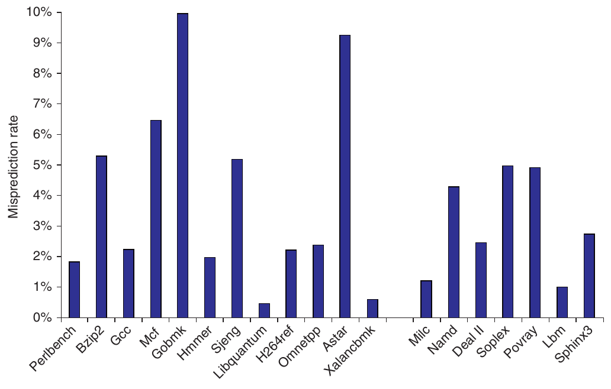

**Hình 3.5 Misprediction rate của 19 benchmark SPECCPU2006 so với số branch được retire thành công, tính trung bình, cao hơn đôi chút ở integer benchmark so với FP benchmark (4% so với 3%). Quan trọng hơn, tỷ lệ này cao hơn nhiều ở một vài benchmark.**

Giống những trường hợp khác, speculation gây một số khó khăn khi đánh giá predictor, vì một branch bị dự đoán sai dễ dẫn tới việc fetch và dự đoán sai branch khác. Để đơn giản, chúng ta xét số lần dự đoán sai dưới dạng phần trăm số branch hoàn tất thành công (những branch không phải kết quả của misspeculation). Hình 3.5 trình bày dữ liệu này cho 19 benchmark SPECCPU 2006. Những benchmark này lớn hơn đáng kể so với SPEC89 hay SPEC2000, khiến misprediction rate cao hơn đôi chút so với Hình 3.4 ngay cả khi dùng tổ hợp predictor tinh vi hơn. Vì branch misprediction dẫn tới speculation không hiệu quả, nó góp phần tạo công việc lãng phí, như chúng ta sẽ thấy ở phần sau của chương.

## 3.4 Khắc phục Data Hazard bằng Dynamic Scheduling

Một pipeline đơn giản được schedule tĩnh fetch và issue một instruction, trừ khi có data dependence giữa instruction đã ở trong pipeline và instruction vừa fetch mà bypassing hay forwarding không thể che giấu. (Forwarding logic giảm effective pipeline latency để một số dependence không dẫn tới hazard.) Nếu có data dependence không thể che giấu, hardware phát hiện hazard sẽ làm pipeline stall bắt đầu từ instruction sử dụng kết quả. Không instruction mới nào được fetch hay issue cho tới khi dependence được giải quyết.

Trong mục này, chúng ta khảo sát dynamic scheduling, trong đó hardware sắp xếp lại việc thực thi instruction để giảm stall trong khi vẫn giữ data flow và exception behavior. Dynamic scheduling có một số ưu điểm. Thứ nhất, nó cho phép code được compile hướng tới một pipeline chạy hiệu quả trên pipeline khác, loại bỏ nhu cầu duy trì nhiều binary và compile lại cho microarchitecture khác. Trong môi trường điện toán ngày nay, nơi nhiều software đến từ bên thứ ba và được phân phối ở dạng binary, ưu điểm này rất đáng kể. Thứ hai, nó cho phép xử lý một số trường hợp không biết dependence tại thời điểm compile; chẳng hạn dependence có thể liên quan đến memory reference hoặc branch data-dependent, hoặc phát sinh từ môi trường lập trình hiện đại dùng dynamic linking hay dispatching. Thứ ba, và có lẽ quan trọng nhất, nó cho phép processor chịu được những độ trễ không thể dự đoán, như cache miss, bằng cách thực thi code khác trong khi chờ xử lý miss. Trong Mục 3.6, chúng ta khảo sát hardware speculation, kỹ thuật được xây dựng trên dynamic scheduling và đem lại thêm lợi ích performance. Như sẽ thấy, những ưu điểm của dynamic scheduling đạt được với cái giá là độ phức tạp hardware tăng đáng kể.

Mặc dù processor được schedule động không thể thay đổi data flow, nó cố tránh stall khi có dependence. Ngược lại, static pipeline scheduling do compiler thực hiện (trình bày trong Mục 3.2) cố giảm tối đa stall bằng cách tách các instruction phụ thuộc để chúng không dẫn tới hazard. Dĩ nhiên, compiler pipeline scheduling cũng có thể áp dụng cho code sẽ chạy trên processor có pipeline được schedule động.

### Dynamic Scheduling: Ý tưởng

Một giới hạn lớn của những kỹ thuật pipelining đơn giản là sử dụng instruction issue và execution in-order: instruction được issue theo program order, và nếu một instruction stall trong pipeline thì không instruction nào phía sau có thể tiếp tục. Vì thế, nếu có dependence giữa hai instruction ở gần nhau trong pipeline, điều này dẫn tới hazard và gây stall. Nếu có nhiều functional unit, chúng có thể phải nhàn rỗi. Nếu instruction j phụ thuộc vào instruction i long-running hiện đang thực thi trong pipeline, mọi instruction sau j đều phải stall cho tới khi i hoàn tất và j có thể thực thi. Chẳng hạn, xét code sau:

```
DIV.D       F0,F2,F4
ADD.D       F10,F0,F8
SUB.D       F12,F8,F14
```

SUB.D instruction không thể thực thi vì dependence của ADD.D vào DIV.D làm pipeline stall; tuy nhiên, SUB.D không có data dependence vào bất cứ thứ gì trong pipeline. Hazard này tạo ra giới hạn performance có thể loại bỏ bằng cách không yêu cầu instruction thực thi theo program order.

Trong pipeline five-stage kinh điển, cả structural hazard lẫn data hazard đều có thể được kiểm tra trong instruction decode (ID): khi một instruction có thể thực thi mà không gặp hazard, nó được issue từ ID với sự bảo đảm rằng mọi data hazard đã được giải quyết.

Để có thể bắt đầu thực thi SUB.D trong ví dụ trên, chúng ta phải tách quá trình issue thành hai phần: kiểm tra mọi structural hazard và chờ tới khi không còn data hazard. Vì thế, chúng ta vẫn dùng instruction issue in-order (tức issue theo program order), nhưng muốn instruction bắt đầu thực thi ngay khi data operand sẵn sàng. Pipeline như vậy thực hiện out-of-order execution, đồng nghĩa với out-of-order completion.

Out-of-order execution làm xuất hiện khả năng xảy ra WAR và WAW hazard, vốn không tồn tại trong integer pipeline five-stage cũng như cách mở rộng hợp lý của nó thành floating-point pipeline in-order. Xét chuỗi code MIPS floating-point sau:

```
DIV.D       F0,F2,F4
ADD.D       F6,F0,F8
SUB.D       F8,F10,F14
MUL.D       F6,F10,F8
```

Có antidependence giữa ADD.D và SUB.D; nếu pipeline thực thi SUB.D trước ADD.D (đang chờ DIV.D), nó vi phạm antidependence và tạo WAR hazard. Tương tự, để tránh vi phạm output dependence, như việc MUL.D ghi F6, phải xử lý WAW hazard. Như sẽ thấy, cả hai hazard này được tránh bằng register renaming.

Out-of-order completion cũng gây những phức tạp lớn khi xử lý exception. Dynamic scheduling có out-of-order completion phải giữ exception behavior theo nghĩa chính xác những exception sẽ xuất hiện nếu chương trình thực thi nghiêm ngặt theo program order cũng phải thực sự xuất hiện. Processor được schedule động giữ exception behavior bằng cách trì hoãn thông báo exception tương ứng cho tới khi biết instruction đó phải là instruction tiếp theo hoàn tất.

Dù phải giữ exception behavior, processor được schedule động có thể sinh imprecise exception. Một exception là imprecise nếu state của processor khi exception phát sinh không giống hoàn toàn state trong trường hợp instruction thực thi tuần tự, nghiêm ngặt theo program order. Imprecise exception có thể xảy ra do hai khả năng:

1. Pipeline có thể đã hoàn tất những instruction đứng sau instruction gây exception theo program order.

2. Pipeline có thể chưa hoàn tất một số instruction đứng trước instruction gây exception theo program order.

Imprecise exception làm khó việc bắt đầu thực thi trở lại sau exception. Thay vì giải quyết các vấn đề này trong mục này, chúng ta sẽ thảo luận giải pháp cung cấp precise exception trong bối cảnh processor có speculation ở Mục 3.6. Với floating-point exception, những giải pháp khác đã được sử dụng, như thảo luận trong Phụ lục J.

Để cho phép out-of-order execution, về cơ bản chúng ta tách ID pipe stage của pipeline five-stage đơn giản thành hai stage:

1. Issue — Decode instruction, kiểm tra structural hazard.

2. Read operands — Chờ tới khi không còn data hazard, rồi đọc operand.

Instruction fetch stage đứng trước issue stage và có thể fetch vào instruction register hoặc queue chứa instruction đang chờ; sau đó instruction được issue từ register hoặc queue. Execution stage theo sau read operands stage, giống pipeline five-stage. Việc thực thi có thể cần nhiều cycle, tùy operation.

Chúng ta phân biệt thời điểm instruction bắt đầu thực thi và thời điểm hoàn tất thực thi; giữa hai thời điểm đó, instruction đang thực thi. Pipeline cho phép nhiều instruction đang thực thi cùng lúc; nếu thiếu khả năng này, một ưu điểm lớn của dynamic scheduling sẽ mất đi. Có nhiều instruction thực thi đồng thời đòi hỏi nhiều functional unit, functional unit được pipelined, hoặc cả hai. Vì hai khả năng này — functional unit được pipelined và nhiều functional unit — về cơ bản tương đương đối với mục đích pipeline control, chúng ta giả định processor có nhiều functional unit.

Trong pipeline được schedule động, mọi instruction đi qua issue stage theo thứ tự (issue in-order); tuy nhiên, chúng có thể stall hoặc vượt qua nhau trong stage thứ hai (read operands), vì thế đi vào thực thi không theo thứ tự. Scoreboarding là kỹ thuật cho phép instruction thực thi không theo thứ tự khi đủ resource và không có data dependence; tên gọi bắt nguồn từ scoreboard của CDC 6600, nơi phát triển khả năng này. Ở đây, chúng ta tập trung vào kỹ thuật tinh vi hơn, gọi là thuật toán Tomasulo. Khác biệt chính là thuật toán Tomasulo xử lý antidependence và output dependence bằng cách renaming register động một cách hiệu quả. Ngoài ra, có thể mở rộng thuật toán Tomasulo để xử lý speculation, kỹ thuật giảm ảnh hưởng của control dependence bằng cách dự đoán kết quả branch, thực thi instruction tại destination address được dự đoán và thực hiện hành động khắc phục khi dự đoán sai. Dù scoreboarding có lẽ đủ hỗ trợ superscalar two-issue đơn giản như ARM A8, processor mạnh hơn như Intel i7 four-issue hưởng lợi từ out-of-order execution.

### Dynamic Scheduling theo cách của Tomasulo

Unit floating-point của IBM 360/91 dùng cơ chế tinh vi để cho phép execution out-of-order. Cơ chế do Robert Tomasulo phát minh này theo dõi khi operand của instruction sẵn có để giảm thiểu RAW hazard, đồng thời đưa register renaming vào hardware để giảm thiểu WAW hazard và WAR hazard. Processor hiện đại có nhiều biến thể của cơ chế này, dù các khái niệm then chốt về theo dõi instruction dependence để cho phép execution ngay khi operand sẵn có và rename register để tránh WAR hazard cùng WAW hazard vẫn là đặc điểm chung.

Mục tiêu của IBM là đạt hiệu năng floating-point cao từ instruction set và compiler được thiết kế cho toàn bộ họ máy tính 360, thay vì từ compiler chuyên biệt cho processor high-end. Architecture 360 chỉ có bốn register floating-point double-precision, hạn chế hiệu quả compiler scheduling; thực tế này là động lực khác cho cách Tomasulo. Ngoài ra, IBM 360/91 có memory access dài và floating-point delay dài, những điều thuật toán Tomasulo được thiết kế để khắc phục. Cuối mục này, ta sẽ thấy thuật toán Tomasulo còn hỗ trợ execution chồng lấp của nhiều vòng lặp.

Ta giải thích thuật toán tập trung vào unit floating-point và unit load-store trong bối cảnh instruction set MIPS. Khác biệt chính giữa MIPS và 360 là architecture sau có instruction register-memory. Vì thuật toán Tomasulo dùng load functional unit, không cần thay đổi đáng kể để thêm addressing mode register-memory. IBM 360/91 cũng có functional unit được pipeline, thay vì nhiều functional unit, nhưng ta mô tả thuật toán như thể có nhiều functional unit. Về khái niệm, mở rộng để pipeline các functional unit đó cũng đơn giản.

Như ta sẽ thấy, RAW hazard được tránh bằng cách chỉ thực thi instruction khi operand sẵn có, đúng điều cách scoreboarding đơn giản hơn cung cấp. WAR hazard và WAW hazard, phát sinh từ name dependence, được loại bỏ bằng register renaming. Register renaming loại bỏ các hazard này bằng cách rename mọi destination register, gồm cả register có read hoặc write đang chờ của instruction trước, sao cho write out-of-order không ảnh hưởng instruction phụ thuộc giá trị operand trước đó.

Để hiểu rõ hơn cách register renaming loại bỏ WAR hazard và WAW hazard, hãy xét chuỗi code ví dụ sau, chứa WAR hazard và WAW hazard tiềm tàng:

```
DIV.D       F0,F2,F4
ADD.D       F6,F0,F8
S.D         F6,0(R1)
SUB.D       F8,F10,F14
MUL.D       F6,F10,F8
```

Có hai antidependence: giữa ADD.D với SUB.D, và giữa S.D với MUL.D. Cũng có output dependence giữa ADD.D với MUL.D, dẫn đến ba hazard có thể xảy ra: WAR hazard khi ADD.D dùng F8 và SUB.D dùng F6, cùng WAW hazard vì ADD.D có thể hoàn tất sau MUL.D. Cũng có ba true data dependence: giữa DIV.D với ADD.D, giữa SUB.D với MUL.D, và giữa ADD.D với S.D.

Cả ba name dependence này đều có thể được loại bỏ bằng register renaming. Để đơn giản, giả sử có hai temporary register S và T. Dùng S và T, có thể viết lại chuỗi không còn dependence nào như sau:

```
DIV.D       F0,F2,F4
ADD.D       S,F0,F8
S.D         S,0(R1)
SUB.D       T,F10,F14
MUL.D       F6,F10,T
```

Ngoài ra, mọi lần dùng F8 về sau phải được thay bằng register T. Trong đoạn code này, compiler có thể thực hiện renaming theo cách static. Tìm mọi lần dùng F8 nằm sau trong code đòi hỏi compiler analysis tinh vi hoặc hardware hỗ trợ, vì có thể có branch xen giữa đoạn code trên và một lần dùng F8 về sau. Như ta sẽ thấy, thuật toán Tomasulo xử lý được renaming qua branch.

Trong cơ chế Tomasulo, register renaming được cung cấp bởi reservation station, nơi buffer operand của instruction đang chờ issue. Ý tưởng cơ bản là reservation station fetch và buffer operand ngay khi sẵn có, loại bỏ nhu cầu lấy operand từ register. Ngoài ra, instruction đang chờ chỉ định reservation station sẽ cung cấp input của mình. Cuối cùng, khi các lần write liên tiếp vào register chồng lấp trong execution, chỉ lần cuối thực sự được dùng cập nhật register. Khi instruction được issue, register specifier của operand đang chờ được rename thành tên reservation station, qua đó cung cấp register renaming.

Vì có thể có nhiều reservation station hơn register thực, kỹ thuật này thậm chí loại bỏ hazard phát sinh từ name dependence mà compiler không thể loại bỏ. Khi khám phá các thành phần cơ chế Tomasulo, ta sẽ trở lại register renaming để xem chính xác renaming diễn ra thế nào và loại bỏ WAR hazard cùng WAW hazard ra sao.

Dùng reservation station thay centralized register file dẫn đến hai tính chất quan trọng khác. Thứ nhất, hazard detection và execution control được phân tán: thông tin giữ trong reservation station tại mỗi functional unit quyết định khi nào instruction có thể bắt đầu execution tại unit đó. Thứ hai, result được chuyển trực tiếp từ reservation station đang buffer chúng tới functional unit, thay vì qua register. Bypassing này được thực hiện bằng common result bus cho phép mọi unit đang chờ operand được load đồng thời (trên 360/91, bus này gọi common data bus, hay CDB). Trong pipeline có nhiều execution unit và issue nhiều instruction mỗi clock, sẽ cần hơn một result bus.

Hình 3.6 cho cấu trúc cơ bản của processor Tomasulo-based, gồm cả unit floating-point lẫn unit load/store; không bảng execution control nào được thể hiện. Mỗi reservation station giữ instruction đã issue và đang chờ execution tại functional unit, cùng giá trị operand của instruction nếu đã tính xong, hoặc tên reservation station sẽ cung cấp giá trị operand.

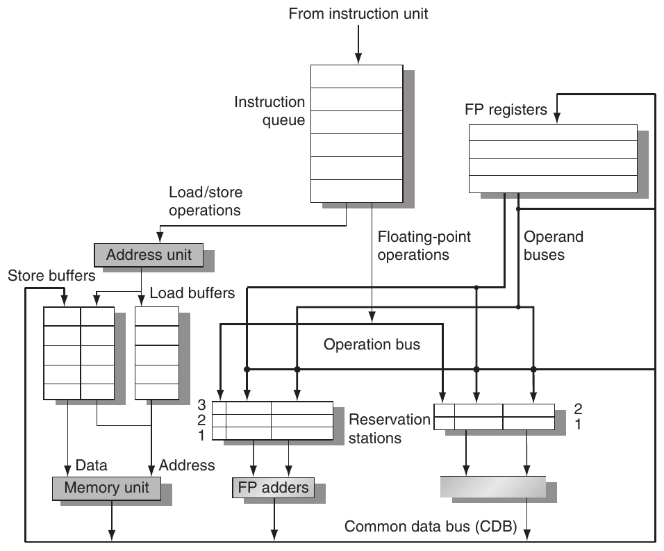

**Hình 3.6 Cấu trúc cơ bản của unit floating-point MIPS dùng thuật toán Tomasulo. Instruction được gửi từ instruction unit vào instruction queue, rồi được issue từ đó theo thứ tự first-in, first-out (FIFO). Reservation station chứa operation và operand thực, cũng như thông tin dùng phát hiện và xử lý hazard. Load buffer có ba chức năng: (1) giữ thành phần effective address cho đến khi tính xong, (2) theo dõi outstanding load đang chờ memory, và (3) giữ result của load đã hoàn tất đang chờ CDB. Tương tự, store buffer có ba chức năng: (1) giữ thành phần effective address cho đến khi tính xong, (2) giữ destination memory address của outstanding store đang chờ giá trị data cần store, và (3) giữ address cùng giá trị cần store cho đến khi memory unit khả dụng. Mọi result từ FP unit hoặc load unit đều được đặt trên CDB, đi tới FP register file cũng như reservation station và store buffer. FP adder thực hiện addition và subtraction, còn FP multiplier thực hiện multiplication và division.**

Load buffer và store buffer giữ data hoặc address đi từ memory hoặc đi tới memory, hoạt động gần như giống hệt reservation station, nên ta chỉ phân biệt khi cần. Các register floating-point nối với functional unit bằng một cặp bus và với store buffer bằng một bus. Mọi result từ functional unit và memory được gửi trên common data bus, đi tới mọi nơi trừ load buffer. Mọi reservation station có tag field được pipeline control sử dụng.

Trước khi mô tả chi tiết reservation station và thuật toán, hãy xem các bước instruction trải qua. Chỉ có ba bước, dù mỗi bước giờ có thể mất số clock cycle tùy ý:

1. Issue—Lấy instruction tiếp theo từ đầu instruction queue, được duy trì theo FIFO để bảo đảm data flow đúng. Nếu có reservation station phù hợp đang trống, issue instruction tới station cùng giá trị operand nếu chúng hiện trong register. Nếu không có reservation station trống, có structural hazard và instruction stall cho đến khi station hoặc buffer được giải phóng. Nếu operand không trong register, theo dõi functional unit sẽ tạo operand. Bước này rename register, loại bỏ WAR hazard và WAW hazard. (Stage này đôi khi gọi dispatch trong processor dùng dynamic scheduling.)

2. Execute—Nếu một hoặc nhiều operand chưa sẵn có, theo dõi common data bus trong lúc chờ chúng được tính. Khi operand sẵn có, nó được đặt vào mọi reservation station đang chờ. Khi mọi operand sẵn có, operation có thể được thực thi tại functional unit tương ứng. Trì hoãn instruction execution cho đến khi operand sẵn có giúp tránh RAW hazard. (Một số processor dùng dynamic scheduling gọi bước này là “issue”, nhưng ta dùng tên “execute”, như trong processor dùng dynamic scheduling đầu tiên CDC 6600.) Lưu ý nhiều instruction có thể cùng sẵn sàng trong một clock cycle cho cùng functional unit. Dù functional unit độc lập có thể bắt đầu execution cho instruction khác nhau trong cùng clock cycle, nếu nhiều instruction sẵn sàng cho một functional unit duy nhất, unit phải chọn giữa chúng. Với reservation station floating-point, có thể chọn tùy ý; tuy nhiên load và store thêm một vấn đề phức tạp. Load và store đòi execution two-step. Bước đầu tính effective address khi base register sẵn có, rồi đặt effective address vào load buffer hoặc store buffer. Load trong load buffer thực thi ngay khi memory unit khả dụng. Store trong store buffer đợi giá trị cần store trước khi được gửi tới memory unit. Load và store được duy trì theo program order qua quá trình tính effective address, giúp ngăn hazard qua memory như ta sắp thấy. Để giữ exception behavior, không instruction nào được bắt đầu execution cho đến khi mọi branch trước nó theo program order đã hoàn tất. Hạn chế này bảo đảm instruction gây exception trong execution thực sự đáng lẽ được thực thi. Trong processor dùng branch prediction (như mọi processor dùng dynamic scheduling), nghĩa là processor phải biết branch prediction đúng trước khi cho instruction sau branch bắt đầu execution. Nếu processor ghi nhận exception xảy ra nhưng không thực sự raise nó, instruction có thể bắt đầu execution nhưng chưa stall cho đến khi vào write result. Như ta sẽ thấy, speculation cung cấp cách linh hoạt hơn và hoàn chỉnh hơn để xử lý exception, nên ta trì hoãn cải tiến này và sẽ chỉ cách speculation xử lý vấn đề về sau.

3. Write result—Khi result sẵn có, ghi nó lên CDB, rồi từ đó vào register và mọi reservation station (gồm store buffer) đang chờ result này. Store được buffer trong store buffer cho đến khi cả giá trị cần store lẫn store address sẵn có, rồi result được ghi ngay khi memory unit rảnh.

Data structure phát hiện và loại bỏ hazard được gắn với reservation station, register file, load buffer và store buffer, với thông tin hơi khác nhau cho từng loại đối tượng. Các tag này về cơ bản là tên cho tập virtual register mở rộng dùng renaming. Trong ví dụ, tag field là đại lượng 4-bit chỉ một trong năm reservation station hoặc một trong năm load buffer. Như ta sẽ thấy, điều này tạo tương đương 10 register có thể được chỉ định làm result register (so với bốn register double-precision trong architecture 360). Trong processor có nhiều register thực hơn, ta muốn renaming cung cấp tập virtual register còn lớn hơn. Tag field mô tả reservation station nào chứa instruction sẽ tạo result cần làm source operand.

Khi instruction đã issue và đang chờ source operand, nó tham chiếu operand bằng số reservation station được gán cho instruction sẽ ghi register. Giá trị không dùng, như zero, cho biết operand đã sẵn có trong register. Vì có nhiều reservation station hơn số register thực, WAW hazard và WAR hazard được loại bỏ bằng renaming result qua số reservation station. Dù cơ chế Tomasulo dùng reservation station làm virtual register mở rộng, cách khác có thể dùng register set với register bổ sung, hoặc cấu trúc như reorder buffer, ta sẽ thấy trong Mục 3.6.

Trong cơ chế Tomasulo cũng như các phương pháp hỗ trợ speculation ta xét sau, result được broadcast trên bus (CDB) mà reservation station theo dõi. Kết hợp common result bus với việc reservation station lấy result từ bus thực hiện forwarding và bypassing mechanism dùng trong pipeline được schedule theo cách static. Tuy nhiên, khi làm vậy, cơ chế dynamic scheduling thêm latency một cycle giữa source và result, vì việc khớp result và dùng nó chỉ có thể thực hiện ở stage Write Result. Vì vậy, trong pipeline dùng dynamic scheduling, effective latency giữa instruction tạo result và instruction tiêu thụ dài hơn latency của functional unit tạo result ít nhất một cycle.

Điều quan trọng cần nhớ là tag trong cơ chế Tomasulo chỉ buffer hoặc unit sẽ tạo result; tên register bị loại bỏ khi instruction issue tới reservation station. (Đây là khác biệt then chốt giữa Tomasulo và scoreboarding: trong scoreboarding, operand ở lại register và chỉ được đọc sau khi instruction tạo chúng hoàn tất và instruction tiêu thụ sẵn sàng execute.)

Mỗi reservation station có bảy field:

- Op—Operation cần thực hiện trên source operand S1 và S2.

- Qj, Qk—Reservation station sẽ tạo source operand tương ứng; giá trị zero cho biết source operand đã sẵn có trong Vj hoặc Vk, hoặc không cần thiết.

- Vj, Vk—Giá trị source operand. Lưu ý với mỗi operand chỉ một trong các V field hoặc Q field valid. Với load, Vk field được dùng giữ offset field.

- A—Dùng giữ thông tin tính memory address cho load hoặc store. Ban đầu, immediate field của instruction được lưu tại đây; sau address calculation, effective address được lưu tại đây.

- Busy—Cho biết reservation station này cùng functional unit đi kèm đang được sử dụng.

Register file có một field, Qi:

- Qi—Số reservation station chứa operation có result cần lưu vào register này. Nếu Qi trống (hoặc 0), không instruction đang hoạt động nào tính result đích tới register này, nghĩa là giá trị đơn giản chính là nội dung register.

Load buffer và store buffer đều có field A, giữ result của effective address sau khi bước execution đầu tiên hoàn tất.

Trong mục tiếp theo, trước hết ta xét một số ví dụ cho thấy các mechanism này hoạt động thế nào, rồi khảo sát thuật toán chi tiết.

## 3.5 Dynamic Scheduling: Ví dụ và thuật toán

Trước khi khảo sát chi tiết thuật toán Tomasulo, hãy xét vài ví dụ giúp minh họa thuật toán hoạt động thế nào.

**Ví dụ** Cho biết các bảng thông tin trông thế nào với chuỗi code sau khi chỉ load đầu tiên hoàn tất và ghi result:

```
1.      L.D        F6,32(R2)
2.      L.D        F2,44(R3)
3.      MUL.D      F0,F2,F4
4.      SUB.D      F8,F2,F6
5.      DIV.D      F10,F0,F6
6.      ADD.D      F6,F8,F2
```

**Trả lời** Hình 3.7 cho result trong ba bảng. Các số thêm sau tên Add, Mult và Load biểu thị tag cho reservation station đó—Add1 là tag của result từ add unit đầu tiên. Ngoài ra, ta thêm instruction status table. Bảng này chỉ giúp bạn hiểu thuật toán; nó không thực sự thuộc hardware. Thay vào đó, reservation station giữ state của mỗi operation đã issue.

Trạng thái instruction

| Instruction | Issue | Execute | Write result |
|---|---|---|---|
| L.D F6,32(R2) | √ | √ | √ |
| L.D F2,44(R3) | √ | √ |  |
| MUL.D F0,F2,F4 | √ |  |  |
| SUB.D F8,F2,F6 | √ |  |  |
| DIV.D F10,F0,F6 | √ |  |  |
| ADD.D F6,F8,F2 | √ |  |  |

Reservation station

| Tên | Busy | Op | Vj | Vk | Qj | Qk | A |
|---|---|---|---|---|---|---|---|
| Load1 | No |  |  |  |  |  |  |
| Load2 | Yes | Load |  |  |  |  | 44 + Regs[R3] |
| Add1 | Yes | SUB |  | Mem[32 + Regs[R2]] | Load2 |  |  |
| Add2 | Yes | ADD |  |  | Add1 | Load2 |  |
| Add3 | No |  |  |  |  |  |  |
| Mult1 | Yes | MUL |  | Regs[F4] | Load2 |  |  |
| Mult2 | Yes | DIV |  | Mem[32 + Regs[R2]] | Mult1 |  |  |

Trạng thái register

| Field | F0 | F2 | F4 | F6 | F8 | F10 | F12 | . . . | F30 |
|---|---|---|---|---|---|---|---|---|---|
| Qi | Mult1 | Load2 |  | Add2 | Add1 | Mult2 |  |  |  |

**Hình 3.7 Reservation station và register tag khi mọi instruction đã issue, nhưng chỉ load instruction đầu tiên hoàn tất và ghi result lên CDB. Load thứ hai đã hoàn tất effective address calculation nhưng đang chờ memory unit. Ta dùng array Regs[ ] để tham chiếu register file và array Mem[ ] để tham chiếu memory. Nhớ rằng operand được chỉ định bằng Q field hoặc V field tại bất kỳ thời điểm nào. Lưu ý instruction ADD.D, có WAR hazard ở stage WB, đã issue và có thể hoàn tất trước khi DIV.D bắt đầu.**

Cơ chế Tomasulo có hai ưu điểm lớn so với các cơ chế đơn giản hơn trước đó: (1) phân tán hazard detection logic và (2) loại bỏ stall do WAW hazard và WAR hazard.

Ưu điểm đầu đến từ reservation station phân tán và việc dùng CDB. Nếu nhiều instruction chờ cùng result và mỗi instruction đã có operand còn lại, broadcast result trên CDB có thể giải phóng đồng thời các instruction. Nếu dùng centralized register file, các unit phải đọc result của mình từ register khi register bus khả dụng.

Ưu điểm thứ hai, loại bỏ WAW hazard và WAR hazard, đạt được bằng renaming register dùng reservation station và bằng quá trình lưu operand vào reservation station ngay khi sẵn có.

Ví dụ, chuỗi code trong Hình 3.7 issue cả DIV.D lẫn ADD.D dù có WAR hazard liên quan F6. Hazard được loại bỏ theo một trong hai cách. Thứ nhất, nếu instruction cung cấp giá trị cho DIV.D đã hoàn tất, Vk lưu result, cho phép DIV.D execute độc lập ADD.D (đây là trường hợp trong hình). Ngược lại, nếu L.D chưa hoàn tất, Qk trỏ tới reservation station Load1, và instruction DIV.D độc lập ADD.D. Vì vậy, trong cả hai trường hợp ADD.D có thể issue và bắt đầu execute. Mọi lần dùng result DIV.D sẽ trỏ tới reservation station, cho phép ADD.D hoàn tất và lưu giá trị vào register mà không ảnh hưởng DIV.D.

Ta sẽ sớm thấy ví dụ loại bỏ WAW hazard. Nhưng trước tiên hãy xem ví dụ trước tiếp tục execution thế nào. Trong ví dụ này và những ví dụ tiếp theo trong chương, giả sử latency như sau: load 1 clock cycle, add 2 clock cycle, multiply 6 clock cycle và divide 12 clock cycle.

**Ví dụ** Dùng cùng đoạn code như ví dụ trước (trang 176), cho biết status table trông thế nào khi MUL.D sẵn sàng ghi result.

**Trả lời** Result nằm trong ba bảng ở Hình 3.8. Lưu ý ADD.D đã hoàn tất vì operand của DIV.D đã được copy, nhờ đó vượt WAR hazard. Lưu ý ngay cả nếu load F6 bị trì hoãn, phép add vào F6 vẫn có thể execute mà không kích hoạt WAW hazard.

### Thuật toán Tomasulo: Chi tiết

Hình 3.9 chỉ định các kiểm tra và bước mỗi instruction phải trải qua. Như đã đề cập, load và store qua functional unit để tính effective address trước khi tới load buffer hoặc store buffer độc lập. Load thực hiện execution bước thứ hai để truy cập memory, rồi tới write result để gửi giá trị từ memory vào register file và/hoặc reservation station đang chờ. Store hoàn tất execution trong stage write result, ghi result vào memory. Lưu ý mọi write diễn ra trong write result, dù đích là register hay memory. Hạn chế này đơn giản hóa thuật toán Tomasulo và thiết yếu cho mở rộng có speculation trong Mục 3.6.

Trạng thái instruction

| Instruction |  | Issue | Execute | Write result |
|---|---|---|---|---|
| L.D | F6,32(R2) | √ | √ | √ |
| L.D | F2,44(R3) | √ | √ | √ |
| MUL.D | F0,F2,F4 | √ | √ |  |
| SUB.D | F8,F2,F6 | √ | √ | √ |
| DIV.D | F10,F0,F6 | √ |  |  |
| ADD.D | F6,F8,F2 | √ | √ | √ |

Reservation station

| Tên | Busy | Op | Vj | Vk | Qj | Qk | A |
|---|---|---|---|---|---|---|---|
| Load1 | No |  |  |  |  |  |  |
| Load2 | No |  |  |  |  |  |  |
| Add1 | No |  |  |  |  |  |  |
| Add2 | No |  |  |  |  |  |  |
| Add3 | No |  |  |  |  |  |  |
| Mult1 | Yes | MUL | Mem[44 + Regs[R3]] | Regs[F4] |  |  |  |
| Mult2 | Yes | DIV |  | Mem[32 + Regs[R2]] | Mult1 |  |  |

Trạng thái register

| Field | F0 | F2 | F4 | F6 | F8 | F10 | F12 | . . . | F30 |
|---|---|---|---|---|---|---|---|---|---|
| Qi | Mult1 |  |  |  |  | Mult2 |  |  |  |

**Hình 3.8 Multiply và divide là những instruction duy nhất chưa hoàn tất.**

### Thuật toán Tomasulo: Ví dụ Loop-Based

Để hiểu đầy đủ sức mạnh của việc loại bỏ WAW hazard và WAR hazard thông qua dynamic renaming register, ta phải xét loop. Hãy xem chuỗi đơn giản sau nhân các phần tử array với scalar trong F2:

```
Loop:    L.D         F0,0(R1)
         MUL.D       F4,F0,F2
         S.D         F4,0(R1)
         DADDIU      R1,R1,-8
         BNE         R1,R2,Loop; branches if R1¦R2
```

Nếu dự đoán branch là taken, dùng reservation station sẽ cho phép nhiều lần thực thi loop này tiến hành cùng lúc. Ưu điểm này đạt được mà không đổi code—thực chất loop được hardware unroll động, dùng các reservation station có được qua renaming để đóng vai trò register bổ sung.

| State của instruction | Đợi đến khi | Hành động hoặc ghi chép |
|---|---|---|
| Issue | Station r trống | if (RegisterStat[rs].Qi¦0) |
| FP operation |  | {RS[r].Qj ← RegisterStat[rs].Qi} else {RS[r].Vj ← Regs[rs]; RS[r].Qj ← 0}; if (RegisterStat[rt].Qi¦0) |
|  |  | {RS[r].Qk ← RegisterStat[rt].Qi |
|  |  | else {RS[r].Vk ← Regs[rt]; RS[r].Qk ← 0}; RS[r].Busy ← yes; RegisterStat[rd].Q ← r; |
| Load hoặc store | Buffer r trống | if (RegisterStat[rs].Qi¦0) |
|  |  | {RS[r].Qj ← RegisterStat[rs].Qi} else {RS[r].Vj ← Regs[rs]; RS[r].Qj ← 0}; |
|  |  | RS[r].A ← imm; RS[r].Busy ← yes; |
| Chỉ load |  | RegisterStat[rt].Qi ← r; |
| Chỉ store |  | if (RegisterStat[rt].Qi¦0) |
|  |  | {RS[r].Qk ← RegisterStat[rs].Qi} |
|  |  | else {RS[r].Vk ← Regs[rt]; RS[r].Qk ← 0}; |
| Execute | (RS[r].Qj = 0) and | Tính result: operand nằm trong Vj và Vk |
| FP operation | (RS[r].Qk = 0) |  |
| Bước 1 của load/store | RS[r].Qj = 0 & r ở đầu queue load-store | RS[r].A ← RS[r].Vj + RS[r].A; |
| Bước 2 của load | Bước 1 của load hoàn tất | Đọc từ Mem[RS[r].A] |
| Write result cho FP operation | Execution hoàn tất tại r & CDB khả dụng | ∀x(if (RegisterStat[x].Qi=r) {Regs[x] ← result; RegisterStat[x].Qi ← 0}); |
| hoặc load |  | ∀x(if (RS[x].Qj=r) {RS[x].Vj ← result;RS[x].Qj ← 0}); |
|  |  | ∀x(if (RS[x].Qk=r) {RS[x].Vk ← result;RS[x].Qk ← 0}); |
|  |  | RS[r].Busy ← no; |
| Store | Execution hoàn tất tại r & RS[r].Qk = 0 | Mem[RS[r].A] ← RS[r].Vk; RS[r].Busy ← no; |

**Hình 3.9 Các bước thuật toán và yêu cầu cho mỗi bước. Với instruction đang issue, rd là đích, rs và rt là số source register, imm là immediate field sign-extended, r là reservation station hoặc buffer được gán cho instruction. RS là data structure reservation station. Giá trị trả về bởi FP unit hoặc load unit được gọi là result. RegisterStat là data structure register status (không phải register file, vốn là Regs[]). Khi instruction issue, Qi field của destination register được đặt bằng số buffer hoặc reservation station nhận instruction đó. Nếu operand sẵn có trong register, chúng được lưu trong V field. Nếu không, Q field được đặt để chỉ reservation station sẽ tạo giá trị cần làm source operand. Instruction đợi tại reservation station cho đến khi cả hai operand sẵn có, biểu thị bằng zero trong Q field. Q field được đặt zero khi instruction này issue hoặc khi instruction mà nó phụ thuộc hoàn tất và write back. Khi instruction execution xong và CDB khả dụng, nó có thể write back. Mọi buffer, register và reservation station có giá trị Qj hoặc Qk trùng reservation station đang hoàn tất đều cập nhật giá trị từ CDB và đánh dấu Q field cho biết đã nhận giá trị. Vì vậy, CDB có thể broadcast result tới nhiều đích trong một clock cycle, và nếu instruction đang chờ có operand, tất cả có thể bắt đầu execution ở clock cycle tiếp theo. Load qua hai bước trong execute, còn store hơi khác trong write result, nơi nó có thể phải đợi giá trị cần store. Nhớ rằng để giữ exception behavior, không nên cho instruction execute nếu một branch trước nó theo program order chưa hoàn tất. Vì mọi khái niệm program order không được duy trì sau stage issue, hạn chế này thường được triển khai bằng cách ngăn mọi instruction rời bước issue nếu đã có branch đang chờ trong pipeline. Trong Mục 3.6, ta sẽ thấy hỗ trợ speculation loại bỏ hạn chế này thế nào.**

Giả sử ta đã issue mọi instruction trong hai vòng lặp liên tiếp, nhưng chưa load/store hoặc operation floating-point nào hoàn tất. Hình 3.10 cho reservation station, register status table cùng load buffer và store buffer tại thời điểm này. (Bỏ qua integer ALU operation, và giả sử branch được dự đoán taken.) Khi hệ thống đạt state này, hai bản loop có thể được duy trì với CPI gần 1.0, miễn multiply hoàn tất trong bốn clock cycle. Với latency sáu cycle, phải xử lý thêm vòng lặp trước khi đạt steady state. Điều này đòi nhiều reservation station hơn để giữ instruction đang execution. Như ta sẽ thấy về sau trong chương, khi mở rộng với multiple instruction issue, cách Tomasulo có thể duy trì hơn một instruction mỗi clock.

Trạng thái instruction

| Instruction |  | Từ vòng lặp | Issue | Execute | Write result |
|---|---|---|---|---|---|
| L.D | F0,0(R1) | 1 | √ | √ |  |
| MUL.D | F4,F0,F2 | 1 | √ |  |  |
| S.D | F4,0(R1) | 1 | √ |  |  |
| L.D | F0,0(R1) | 2 | √ | √ |  |
| MUL.D | F4,F0,F2 | 2 | √ |  |  |
| S.D | F4,0(R1) | 2 | √ |  |  |

Reservation station

| Tên | Busy | Op | Vj | Vk | Qj | Qk | A |
|---|---|---|---|---|---|---|---|
| Load1 | Yes | Load |  |  |  |  | Regs[R1] + 0 |
| Load2 | Yes | Load |  |  |  |  | Regs[R1] – 8 |
| Add1 | No |  |  |  |  |  |  |
| Add2 | No |  |  |  |  |  |  |
| Add3 | No |  |  |  |  |  |  |
| Mult1 | Yes | MUL |  | Regs[F2] | Load1 |  |  |
| Mult2 | Yes | MUL |  | Regs[F2] | Load2 |  |  |
| Store1 | Yes | Store | Regs[R1] |  |  | Mult1 |  |
| Store2 | Yes | Store | Regs[R1] – 8 |  |  | Mult2 |  |

Trạng thái register

| Field | F0 | F2 | F4 | F6 | F8 | F10 | F12 | ... | F30 |
|---|---|---|---|---|---|---|---|---|---|
| Qi | Load2 |  | Mult2 |  |  |  |  |  |  |

**Hình 3.10 Hai vòng lặp đang hoạt động, chưa instruction nào hoàn tất. Entry trong multiplier reservation station chỉ rằng các outstanding load là nguồn. Store reservation station chỉ rằng đích của multiply là nguồn giá trị cần store.**

Có thể thực hiện load và store an toàn theo thứ tự khác program order, miễn chúng truy cập address khác nhau. Nếu load và store truy cập cùng address, một trong hai trường hợp sau xảy ra:

- Load đứng trước store theo program order, và đổi thứ tự chúng tạo WAR hazard, hoặc

- Store đứng trước load theo program order, và đổi thứ tự chúng tạo RAW hazard.

Tương tự, đổi thứ tự hai store tới cùng address tạo WAW hazard.

Vì vậy, để xác định load có thể execute tại thời điểm nào đó không, processor kiểm tra xem có store chưa hoàn tất nào đứng trước load theo program order có cùng data memory address với load không. Tương tự, store phải đợi đến khi không còn load hoặc store chưa execute nào trước nó theo program order và có cùng data memory address. Ta xem phương pháp loại bỏ hạn chế này trong Mục 3.9.

Để phát hiện hazard như vậy, processor phải tính data memory address gắn với mọi memory operation trước đó. Cách đơn giản nhưng chưa chắc tối ưu để bảo đảm processor có mọi address ấy là tính effective address theo program order. (Thực ra chỉ cần giữ thứ tự tương đối giữa store và memory reference khác; tức có thể tự do đổi thứ tự load.)

Trước hết hãy xét load. Nếu tính effective address theo program order, khi load hoàn tất effective address calculation, ta kiểm tra address conflict bằng cách xem A field của mọi store buffer đang hoạt động. Nếu load address khớp address của entry đang hoạt động nào trong store buffer, load instruction chưa được gửi tới load buffer cho đến khi store conflict hoàn tất. (Một số implementation bypass trực tiếp giá trị từ store đang chờ tới load, giảm delay cho RAW hazard này.)

Store hoạt động tương tự, ngoại trừ processor phải kiểm tra conflict trong cả load buffer lẫn store buffer, vì store conflict không thể đổi thứ tự so với load hay store.

Pipeline dùng dynamic scheduling có thể đạt hiệu năng rất cao, miễn branch được dự đoán chính xác—vấn đề ta đã xử lý trong mục trước. Nhược điểm chính là độ phức tạp cơ chế Tomasulo, đòi rất nhiều hardware. Cụ thể, mỗi reservation station phải chứa associative buffer cần chạy ở tốc độ cao, cùng control logic phức tạp. Hiệu năng còn có thể bị giới hạn bởi CDB duy nhất. Dù có thể thêm CDB, mỗi CDB phải tương tác với từng reservation station, và hardware tag-matching associative phải được nhân bản tại mỗi station cho từng CDB.

Trong cơ chế Tomasulo, hai kỹ thuật khác nhau được kết hợp: renaming architectural register thành tập register lớn hơn và buffer source operand từ register file. Source operand buffering giải quyết WAR hazard khi operand đã sẵn có trong register. Như ta sẽ thấy sau, cũng có thể loại bỏ WAR hazard bằng renaming register kết hợp buffer result cho đến khi không còn outstanding reference tới phiên bản register trước. Ta sẽ dùng cách này khi thảo luận hardware speculation.

Cơ chế Tomasulo không được dùng trong nhiều năm sau 360/91, nhưng được áp dụng rộng rãi trong processor multiple-issue từ những năm 1990 vì vài lý do:

1. Dù thuật toán Tomasulo được thiết kế trước cache, sự xuất hiện của cache với delay vốn khó đoán đã trở thành một trong những động lực chính cho dynamic scheduling. Execution Out-of-order cho phép processor tiếp tục thực thi instruction trong lúc chờ cache miss hoàn tất, che giấu toàn bộ hoặc một phần cache miss penalty.

2. Khi processor mạnh tay hơn trong khả năng issue và người thiết kế quan tâm hiệu năng code difficult-to-schedule (như phần lớn code không tính toán số), các kỹ thuật register renaming, dynamic scheduling và speculation trở nên quan trọng hơn.

3. Cơ chế có thể đạt hiệu năng cao mà không đòi compiler nhắm code vào một cấu trúc pipeline cụ thể, thuộc tính có giá trị trong thời đại software thị trường đại chúng shrink-wrapped.

## 3.6 Speculation Hardware-Based

Khi cố khai thác nhiều instruction-level parallelism hơn, duy trì control dependence trở thành gánh nặng ngày càng lớn. Branch prediction giảm stall trực tiếp do branch, nhưng với processor thực thi nhiều instruction mỗi clock, chỉ dự đoán branch chính xác có thể chưa đủ tạo lượng instruction-level parallelism mong muốn. Processor có issue rộng có thể phải execute một branch mỗi clock cycle để duy trì hiệu năng tối đa. Vì vậy, khai thác thêm parallelism đòi vượt giới hạn control dependence.

Vượt control dependence được thực hiện bằng speculation về kết quả branch và thực thi program như thể phỏng đoán đúng. Mechanism này là mở rộng tinh tế nhưng quan trọng so với branch prediction kết hợp dynamic scheduling. Cụ thể, với speculation ta fetch, issue và execute instruction như thể branch prediction luôn đúng; dynamic scheduling chỉ fetch và issue các instruction ấy. Dĩ nhiên, cần mechanism xử lý tình huống speculation sai. Phụ lục H thảo luận nhiều mechanism để compiler hỗ trợ speculation. Trong mục này, ta khám phá hardware speculation, mở rộng các ý tưởng dynamic scheduling.

Speculation Hardware-based kết hợp ba ý tưởng then chốt: (1) dynamic branch prediction để chọn instruction cần execute, (2) speculation để cho phép execution trước khi control dependence được xử lý (có khả năng hoàn tác ảnh hưởng của chuỗi speculation sai), và (3) dynamic scheduling để schedule những kết hợp basic block khác nhau. (So sánh, dynamic scheduling không có speculation chỉ chồng lấp một phần basic block vì yêu cầu branch được xử lý trước khi thực sự execute bất kỳ instruction nào trong basic block kế tiếp.)

Speculation Hardware-based theo luồng data value được dự đoán để chọn khi nào execute instruction. Cách thực thi program này về cơ bản là data flow execution: operation execute ngay khi operand sẵn có.

Để mở rộng thuật toán Tomasulo hỗ trợ speculation, ta phải tách bypassing result giữa instruction, vốn cần để execute instruction theo speculation, khỏi việc instruction thực sự hoàn tất. Nhờ tách biệt này, ta có thể cho instruction execute và bypass result tới instruction khác mà không cho instruction thực hiện cập nhật không thể hoàn tác, cho đến khi biết instruction không còn speculative.

Dùng giá trị bypass giống thực hiện speculative register read, vì ta không biết instruction cung cấp source register value có cung cấp result đúng hay không cho đến khi instruction không còn speculative. Khi instruction không còn speculative, ta cho phép cập nhật register file hoặc memory; bước bổ sung này trong chuỗi instruction execution gọi là instruction commit.

Ý tưởng then chốt để triển khai speculation là cho instruction execute khác thứ tự nhưng buộc commit đúng thứ tự, đồng thời ngăn mọi hành động không thể đảo ngược (như cập nhật state hoặc nhận exception) cho đến khi instruction commit. Vì vậy, khi thêm speculation, ta cần tách quá trình hoàn tất execution khỏi instruction commit, vì instruction có thể hoàn tất execution rất lâu trước khi sẵn sàng commit. Thêm phase commit vào chuỗi instruction execution đòi tập hardware buffer bổ sung giữ result của instruction đã xong execution nhưng chưa commit. Hardware buffer này, gọi là reorder buffer, còn được dùng truyền result giữa instruction có thể speculative.

Reorder buffer (ROB) cung cấp register bổ sung theo cùng cách reservation station trong thuật toán Tomasulo mở rộng register set. ROB giữ result của instruction từ lúc operation gắn với instruction hoàn tất đến khi instruction commit. Vì vậy, ROB là nguồn operand cho instruction, như reservation station cung cấp operand trong thuật toán Tomasulo. Khác biệt then chốt là trong thuật toán Tomasulo, khi instruction ghi result, mọi instruction issue sau đó sẽ tìm result trong register file. Với speculation, register file chưa được cập nhật cho đến khi instruction commit (và ta biết chắc instruction nên execute); vì vậy ROB cung cấp operand trong khoảng giữa instruction execution hoàn tất và instruction commit. ROB giống store buffer trong thuật toán Tomasulo, và để đơn giản ta tích hợp chức năng store buffer vào ROB.

Mỗi ROB entry chứa bốn field: instruction type, destination field, value field và ready field. Instruction type field cho biết instruction là branch (không có destination result), store (có đích là memory address), hay register operation (ALU operation hoặc load, có đích là register). Destination field cung cấp register number (cho load và ALU operation) hoặc memory address (cho store) nơi instruction result cần được ghi. Value field dùng giữ giá trị instruction result cho đến khi instruction commit. Ta sẽ sớm thấy ví dụ ROB entry. Cuối cùng, ready field cho biết instruction đã hoàn tất execution và giá trị sẵn sàng.

Hình 3.11 cho cấu trúc hardware của processor có ROB. ROB bao hàm store buffer. Store vẫn execute hai bước, nhưng bước thứ hai do instruction commit thực hiện. Dù chức năng renaming của reservation station được ROB thay thế, ta vẫn cần chỗ buffer operation (và operand) từ lúc issue tới lúc bắt đầu execution. Reservation station vẫn cung cấp chức năng này. Vì mọi instruction có vị trí trong ROB đến khi commit, ta tag result bằng số ROB entry thay vì số reservation station. Cách tag này đòi reservation station theo dõi ROB được gán cho instruction. Về sau trong mục, ta sẽ khám phá implementation khác dùng register bổ sung cho renaming và queue thay ROB để quyết định khi nào instruction có thể commit.

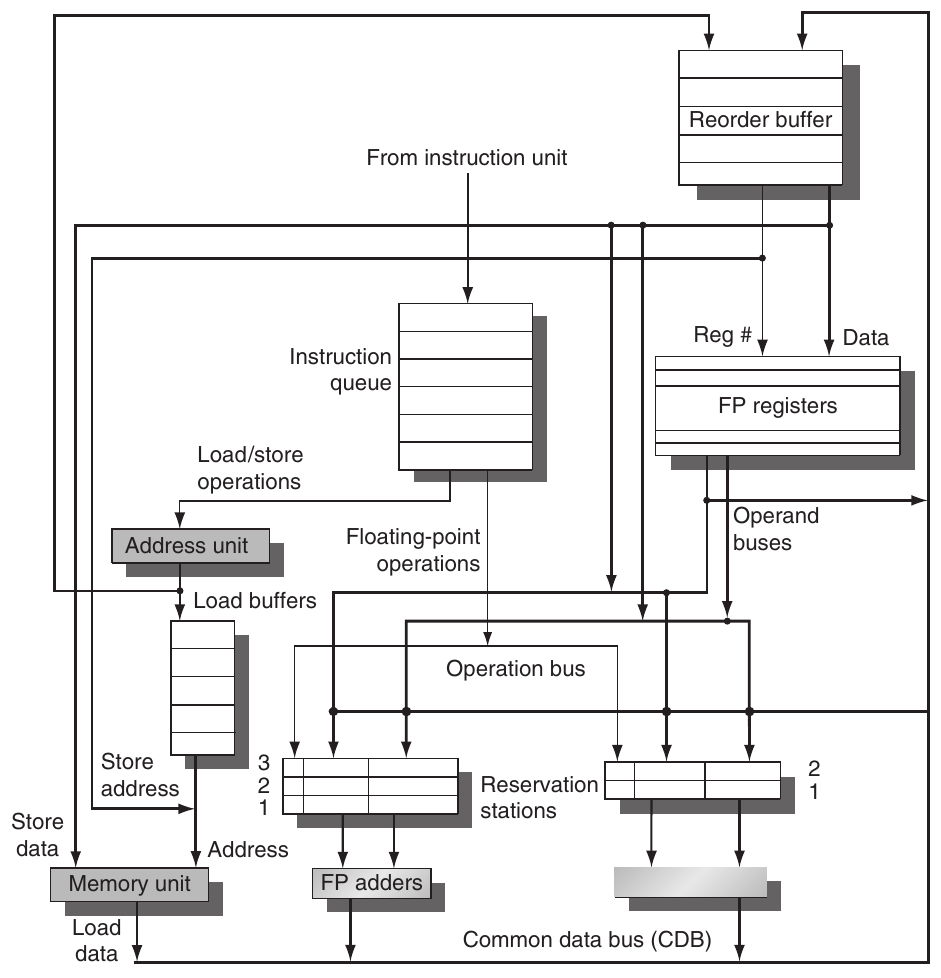

**Hình 3.11 Cấu trúc cơ bản của FP unit dùng thuật toán Tomasulo, được mở rộng để xử lý speculation. So với Hình 3.6 trang 173 triển khai thuật toán Tomasulo, thay đổi chính là thêm ROB và bỏ store buffer, chức năng của nó được tích hợp vào ROB. Có thể mở rộng mechanism này cho multiple issue bằng cách làm CDB rộng hơn để cho phép nhiều instruction hoàn tất mỗi clock.**

Đây là bốn bước liên quan instruction execution:

1. Issue—Lấy instruction từ instruction queue. Issue instruction nếu có reservation station trống và slot trống trong ROB; gửi operand tới reservation station nếu chúng sẵn có trong register hoặc ROB. Cập nhật control entry để cho biết buffer đang dùng. Số ROB entry được cấp cho result cũng được gửi tới reservation station để dùng tag result khi đặt trên CDB. Nếu mọi reservation station đầy hoặc ROB đầy, instruction issue stall cho đến khi cả hai có entry khả dụng.

2. Execute—Nếu một hoặc nhiều operand chưa sẵn có, theo dõi CDB trong khi chờ register được tính. Bước này kiểm tra RAW hazard. Khi cả hai operand sẵn có tại reservation station, execute operation. Instruction có thể mất nhiều clock cycle ở stage này, và load vẫn cần hai bước trong stage. Store chỉ cần base register sẵn có tại bước này, vì execution của store ở đây chỉ là effective address calculation.

3. Write result—Khi result sẵn có, ghi lên CDB (cùng ROB tag được gửi lúc instruction issue), rồi từ CDB vào ROB cũng như mọi reservation station đang chờ result. Đánh dấu reservation station khả dụng. Store instruction cần hành động đặc biệt. Nếu giá trị cần store sẵn có, ghi vào Value field của ROB entry dành cho store. Nếu chưa sẵn có, phải theo dõi CDB cho đến khi giá trị được broadcast, lúc đó Value field trong ROB entry của store được cập nhật. Để đơn giản, ta giả sử điều này diễn ra trong stage write results của store; ta sẽ bàn nới lỏng yêu cầu sau.

4. Commit—Đây là stage cuối để hoàn tất instruction, sau đó chỉ result của nó còn lại. (Một số processor gọi phase commit này là “completion” hoặc “graduation”.) Có ba chuỗi hành động commit khác nhau, tùy instruction đang commit là branch dự đoán sai, store hay instruction khác (normal commit). Normal commit xảy ra khi instruction tới đầu ROB và result hiện diện trong buffer; lúc này processor cập nhật register bằng result và bỏ instruction khỏi ROB. Commit store tương tự, nhưng memory được cập nhật thay vì result register. Khi branch dự đoán sai tới đầu ROB, nó cho biết speculation sai. ROB bị flush và execution bắt đầu lại tại instruction kế tiếp đúng của branch. Nếu branch được dự đoán đúng, branch hoàn tất.

Khi instruction commit, entry của nó trong ROB được thu hồi và register hoặc memory đích được cập nhật, loại bỏ nhu cầu giữ ROB entry. Nếu ROB đầy, ta chỉ dừng issue instruction đến khi một entry được giải phóng. Giờ hãy khảo sát cơ chế này với cùng ví dụ đã dùng cho thuật toán Tomasulo.

**Ví dụ** Giả sử latency của functional unit floating-point giống các ví dụ trước: add 2 clock cycle, multiply 6 clock cycle và divide 12 clock cycle. Dùng đoạn code bên dưới, cũng là đoạn ta dùng tạo Hình 3.8, cho biết status table trông thế nào khi MUL.D sẵn sàng sang commit.

```
L.D         F6,32(R2)
L.D         F2,44(R3)
MUL.D       F0,F2,F4
SUB.D       F8,F2,F6
DIV.D       F10,F0,F6
ADD.D       F6,F8,F2
```

**Trả lời** Hình 3.12 thể hiện result trong ba bảng. Lưu ý dù instruction SUB.D đã hoàn tất execution, nó chưa commit đến khi MUL.D commit. Reservation station và register status field chứa cùng thông tin cơ bản như trong thuật toán Tomasulo (xem trang 176 để biết mô tả field). Khác biệt là số reservation station được thay bằng số ROB entry trong Qj, Qk field cũng như register status field, và ta đã thêm Dest field cho reservation station. Dest field chỉ ROB entry là đích của result do reservation station entry này tạo.

Ví dụ trên minh họa khác biệt then chốt quan trọng giữa processor có speculation và processor có dynamic scheduling. So sánh nội dung Hình 3.12 với Hình 3.8 trang 179, cho cùng chuỗi code chạy trên processor dùng thuật toán Tomasulo. Khác biệt chính là trong ví dụ trên, không instruction nào sau instruction chưa hoàn tất sớm nhất (MUL.D ở trên) được phép hoàn tất. Ngược lại, trong Hình 3.8, instruction SUB.D và ADD.D cũng đã hoàn tất.

Một hệ quả của khác biệt này là processor có ROB có thể execute code động trong khi duy trì precise interrupt model. Ví dụ, nếu instruction MUL.D gây interrupt, ta chỉ cần đợi tới khi nó ở đầu ROB rồi nhận interrupt, flush mọi instruction đang chờ khác khỏi ROB. Vì instruction commit diễn ra đúng thứ tự, điều này tạo precise exception.

Ngược lại, trong ví dụ dùng thuật toán Tomasulo, instruction SUB.D và ADD.D đều có thể hoàn tất trước khi MUL.D raise exception. Kết quả là register F8 và F6 (đích của SUB.D và ADD.D) có thể bị ghi đè, và interrupt sẽ imprecise.

Reorder buffer

| Entry | Busy | Instruction |  | State | Destination | Value |
|---|---|---|---|---|---|---|
| 1 | No | L.D | F6,32(R2) | Commit | F6 | Mem[32 + Regs[R2]] |
| 2 | No | L.D | F2,44(R3) | Commit | F2 | Mem[44 + Regs[R3]] |
| 3 | Yes | MUL.D | F0,F2,F4 | Write result | F0 | #2 × Regs[F4] |
| 4 | Yes | SUB.D | F8,F2,F6 | Write result | F8 | #2 – #1 |
| 5 | Yes | DIV.D | F10,F0,F6 | Execute | F10 |  |
| 6 | Yes | ADD.D | F6,F8,F2 | Write result | F6 | #4 + #2 |

Reservation station

| Tên | Busy | Op | Vj | Vk | Qj | Qk | Dest | A |
|---|---|---|---|---|---|---|---|---|
| Load1 | No |  |  |  |  |  |  |  |
| Load2 | No |  |  |  |  |  |  |  |
| Add1 | No |  |  |  |  |  |  |  |
| Add2 | No |  |  |  |  |  |  |  |
| Add3 | No |  |  |  |  |  |  |  |
| Mult1 | No | MUL.D | Mem[44 + Regs[R3]] | Regs[F4] |  |  | #3 |  |
| Mult2 | Yes | DIV.D |  | Mem[32 + Regs[R2]] | #3 |  | #5 |  |

Trạng thái FP register

| Field | F0 | F1 | F2 | F3 | F4 | F5 | F6 | F7 | F8 | F10 |
|---|---|---|---|---|---|---|---|---|---|---|
| Reorder # | 3 |  |  |  |  |  | 6 |  | 4 | 5 |
| Busy | Yes | No | No | No | No | No | Yes | . . . | Yes | Yes |

**Hình 3.12 Khi MUL.D sẵn sàng commit, chỉ hai instruction L.D đã commit, dù một số instruction khác đã hoàn tất execution. MUL.D ở đầu ROB, và hai L.D chỉ hiện ở đó để dễ hiểu. Instruction SUB.D và ADD.D chưa commit đến khi MUL.D commit, dù result của chúng đã sẵn có và có thể làm source cho instruction khác. DIV.D đang execution, chưa hoàn tất chỉ vì latency dài hơn MUL.D. Cột Value cho biết giá trị đang giữ; định dạng #X được dùng tham chiếu value field của ROB entry X. Reorder buffer 1 và 2 thực ra đã hoàn tất nhưng được thể hiện nhằm cung cấp thông tin. Ta không thể hiện entry của load/store queue, nhưng các entry này được giữ đúng thứ tự.**

Một số user và architect quyết định rằng exception floating-point imprecise chấp nhận được trong processor high-performance, vì program có thể sẽ kết thúc; xem Phụ lục J để thảo luận thêm. Những loại exception khác như page fault khó xử lý hơn nhiều nếu imprecise, vì program phải tiếp tục execution trong suốt sau khi xử lý exception đó.

Dùng ROB với instruction commit in-order cung cấp precise exception, ngoài hỗ trợ speculative execution, như ví dụ tiếp theo thể hiện.

**Ví dụ** Xét ví dụ code đã dùng cho thuật toán Tomasulo và đang execution trong Hình 3.10:

```
Loop:   L.D        F0,0(R1)
        MUL.D      F4,F0,F2
        S.D        F4,0(R1)
        DADDIU     R1,R1,#-8
        BNE        R1,R2,Loop    ;branches if R1¦R2
```

Giả sử ta đã issue mọi instruction trong loop hai lần. Cũng giả sử L.D và MUL.D của vòng đầu đã commit, và mọi instruction khác đã hoàn tất execution. Bình thường store đợi trong ROB cả effective address operand (R1 trong ví dụ) lẫn giá trị (F4 trong ví dụ). Vì chỉ xét pipeline floating-point, giả sử effective address cho store đã được tính xong vào lúc instruction issue.

**Trả lời** Hình 3.13 thể hiện result trong hai bảng.

Reorder buffer

| Entry | Busy | Instruction | State | Destination | Value |
|---|---|---|---|---|---|
| 1 | No | L.D F0,0(R1) | Commit | F0 | Mem[0 + Regs[R1]] |
| 2 | No | MUL.D F4,F0,F2 | Commit | F4 | #1 × Regs[F2] |
| 3 | Yes | S.D F4,0(R1) | Write result | 0 + Regs[R1] | #2 |
| 4 | Yes | DADDIU R1,R1,#-8 | Write result | R1 | Regs[R1] – 8 |
| 5 | Yes | BNE R1,R2,Loop | Write result |  |  |
| 6 | Yes | L.D F0,0(R1) | Write result | F0 | Mem[#4] |
| 7 | Yes | MUL.D F4,F0,F2 | Write result | F4 | #6 × Regs[F2] |
| 8 | Yes | S.D F4,0(R1) | Write result | 0 + #4 | #7 |
| 9 | Yes | DADDIU R1,R1,#-8 | Write result | R1 | #4 – 8 |
| 10 | Yes | BNE R1,R2,Loop | Write result |  |  |

Trạng thái FP register

| Field | F0 | F1 | F2 | F3 | F4 | F5 | F6 | F7 | F8 |
|---|---|---|---|---|---|---|---|---|---|
| Reorder # | 6 |  |  |  | 7 |  |  |  |  |
| Busy | Yes | No | No | No | Yes | No | No | ... | N o |

**Hình 3.13 Chỉ instruction L.D và MUL.D đã commit, dù mọi instruction khác đã hoàn tất execution. Vì vậy, không reservation station nào bận và không station nào được thể hiện. Instruction còn lại sẽ commit nhanh nhất có thể. Hai reorder buffer đầu rỗng nhưng được thể hiện cho đầy đủ.**

Vì cả giá trị register lẫn mọi giá trị memory chưa thực sự được ghi cho đến khi instruction commit, processor dễ dàng hoàn tác speculative action khi phát hiện branch dự đoán sai. Giả sử branch BNE không taken lần đầu trong Hình 3.13. Các instruction trước branch chỉ commit khi từng instruction tới đầu ROB; khi branch tới đầu buffer đó, buffer đơn giản được xóa và processor bắt đầu fetch instruction từ đường còn lại.

Trong thực tế, processor có speculation cố khôi phục sớm nhất có thể sau khi branch bị dự đoán sai. Có thể khôi phục bằng cách xóa mọi ROB entry xuất hiện sau branch dự đoán sai, để những entry trước branch trong ROB tiếp tục, rồi bắt đầu fetch lại tại instruction kế tiếp đúng của branch. Trong speculative processor, hiệu năng nhạy hơn với branch prediction vì tác động misprediction cao hơn. Vì vậy, mọi khía cạnh xử lý branch—prediction accuracy, latency phát hiện misprediction và misprediction recovery time—đều trở nên quan trọng hơn.

Exception được xử lý bằng cách chưa ghi nhận nó cho đến khi sẵn sàng commit. Nếu instruction speculative raise exception, exception được lưu trong ROB. Nếu có branch misprediction và instruction đáng lẽ không được execute, exception bị flush cùng instruction khi ROB được xóa. Nếu instruction tới đầu ROB, ta biết nó không còn speculative và exception thực sự phải được nhận. Ta cũng có thể cố xử lý exception ngay khi phát sinh và mọi branch trước đã được xử lý, nhưng điều này khó hơn với exception so với branch mispredict, và vì ít xảy ra hơn nên không thiết yếu bằng.

Hình 3.14 cho các bước execution của instruction, cùng điều kiện phải thỏa để sang bước và hành động được thực hiện. Ta thể hiện trường hợp branch dự đoán sai chưa được xử lý cho đến commit. Dù speculation có vẻ bổ sung đơn giản cho dynamic scheduling, so sánh Hình 3.14 với hình tương ứng về thuật toán Tomasulo trong Hình 3.9 cho thấy speculation thêm phức tạp đáng kể cho control. Ngoài ra, nhớ rằng branch misprediction cũng phức tạp hơn phần nào.

Có khác biệt quan trọng trong xử lý store giữa speculative processor và thuật toán Tomasulo. Trong thuật toán Tomasulo, store có thể cập nhật memory khi tới write result (bảo đảm effective address đã tính xong) và giá trị data cần store sẵn có. Trong speculative processor, store chỉ cập nhật memory khi tới đầu ROB. Khác biệt này bảo đảm memory không được cập nhật cho đến khi instruction không còn speculative.

Hình 3.14 có một đơn giản hóa đáng kể cho store, không cần trong thực tế. Hình 3.14 yêu cầu store đợi ở stage write result để nhận register source operand có giá trị cần store; giá trị sau đó chuyển từ Vk field của reservation station store sang Value field của ROB entry store. Tuy nhiên, thực tế giá trị cần store chỉ cần đến ngay trước khi store commit, và instruction cung cấp source có thể đặt trực tiếp nó vào ROB entry của store. Điều này đạt được bằng cách cho hardware theo dõi khi source value cần store sẵn có trong ROB entry của store, đồng thời tìm trong ROB ở mỗi lần instruction hoàn tất để tìm store phụ thuộc.

| Status | Đợi đến khi | Hành động hoặc ghi chép |
|---|---|---|
| Issue |  | if (RegisterStat[rs].Busy)/\*in-flight instr. writes rs\*/ |
| mọi instruction |  | {h ← RegisterStat[rs].Reorder; if (ROB[h].Ready)/* Instr completed already */ |
| FP operation và store | Reservation station (r) và ROB (b) đều khả dụng | {RS[r].Vj ← ROB[h].Value; RS[r].Qj ← 0;} else {RS[r].Qj ← h;} /\* wait for instruction \*/} else {RS[r].Vj ← Regs[rs]; RS[r].Qj ← 0;}; RS[r].Busy ← yes; RS[r].Dest ← b; ROB[b].Instruction ← opcode; ROB[b].Dest ← rd;ROB[b].Ready ← no; if (RegisterStat[rt].Busy) /\*in-flight instr writes rt\*/{h ← RegisterStat[rt].Reorder; if (ROB[h].Ready)/\* Instr completed already \*/ |
|  |  | {RS[r].Vk ← ROB[h].Value; RS[r].Qk ← 0;} else {RS[r].Qk ← h;} /* wait for instruction */} else {RS[r].Vk ← Regs[rt]; RS[r].Qk ← 0;}; |
| FP operations |  | RegisterStat[rd].Reorder ← b; RegisterStat[rd].Busy ← yes; ROB[b].Dest ← rd; |
| Loads |  | RS[r].A ← imm; RegisterStat[rt].Reorder ← b; RegisterStat[rt].Busy ← yes; ROB[b].Dest ← rt; |
| Stores |  | RS[r].A ← imm; |
| Execute FP op | (RS[r].Qj == 0) and (RS[r].Qk == 0) | Tính result—operand nằm trong Vj và Vk |
| Bước 1 của load | (RS[r].Qj == 0) and không có store nào trước trong queue | RS[r].A ← RS[r].Vj + RS[r].A; |
| Bước 2 của load | Bước 1 của load hoàn tất và mọi store trước trong ROB có address khác | Đọc từ Mem[RS[r].A] |
| Store | (RS[r].Qj == 0) and store ở đầu queue | ROB[h].Address ← RS[r].Vj + RS[r].A; |
| Write result cho mọi instruction trừ store | Execution hoàn tất tại r và CDB khả dụng | b ← RS[r].Dest; RS[r].Busy ← no; ∀x(if (RS[x].Qj==b) {RS[x].Vj ← result; RS[x].Qj ← 0}); ∀x(if (RS[x].Qk==b) {RS[x].Vk ← result; RS[x].Qk ← 0}); ROB[b].Value ← result; ROB[b].Ready ← yes; |
| Store | Execution hoàn tất tại r và (RS[r].Qk == 0) | ROB[h].Value ← RS[r].Vk; |
| Commit | Instruction ở đầu ROB (entry h) và ROB[h].ready == yes | d ← ROB[h].Dest; /* register dest, if exists */if (ROB[h].Instruction==Branch) {if (branch is mispredicted) {clear ROB[h], RegisterStat; fetch branch dest;};} else if (ROB[h].Instruction==Store) |
|  |  | {Mem[ROB[h].Destination] ← ROB[h].Value;} else /* put the result in the register destination */ |
|  |  | {Regs[d] ← ROB[h].Value;}; ROB[h].Busy ← no; /\* free up ROB entry \*//\* free up dest register if no one else writing it \*/ |
|  |  | if (RegisterStat[d].Reorder==h) {RegisterStat[d].Busy ← no;}; |

**Hình 3.14 Các bước thuật toán và yêu cầu mỗi bước. Với instruction đang issue, rd là đích, rs và rt là source, r là reservation station được cấp, b là ROB entry được gán, h là entry đầu ROB. RS là data structure reservation station. Giá trị trả về bởi reservation station được gọi là result. RegisterStat là data structure register, Regs biểu thị register thực, còn ROB là data structure reorder buffer.**

Bổ sung này không phức tạp, nhưng thêm nó có hai tác động: ta cần thêm field vào ROB, và Hình 3.14 vốn đã có phông chữ nhỏ sẽ còn dài hơn! Dù Hình 3.14 dùng đơn giản hóa này, trong ví dụ ta cho store đi qua stage write result và chỉ đợi giá trị sẵn sàng khi commit.

Như thuật toán Tomasulo, ta phải tránh hazard qua memory. WAW hazard và WAR hazard qua memory được loại bỏ nhờ speculation vì cập nhật memory thực sự diễn ra đúng thứ tự, khi store ở đầu ROB, nên không load hoặc store trước nào còn đang chờ. RAW hazard qua memory được kiểm soát bằng hai hạn chế:

1. Không cho load bắt đầu bước execution thứ hai nếu bất kỳ ROB entry đang hoạt động nào chứa store có Destination field khớp giá trị A field của load.

2. Duy trì program order khi tính effective address của load so với mọi store trước đó.

Kết hợp lại, hai hạn chế này bảo đảm mọi load truy cập vị trí memory được store trước đó ghi không thể thực hiện memory access cho đến khi store đã ghi data. Một số speculative processor thực sự bypass trực tiếp giá trị từ store tới load khi RAW hazard như vậy xảy ra. Cách khác là dự đoán va chạm tiềm tàng bằng một dạng value prediction; ta xét trong Mục 3.9.

Dù phần giải thích speculative execution này tập trung vào floating point, các kỹ thuật dễ mở rộng tới integer register và functional unit. Thực tế, speculation có thể hữu ích hơn trong integer program, vì program loại này có xu hướng có code với branch behavior khó dự đoán hơn. Ngoài ra, có thể mở rộng các kỹ thuật này cho processor multiple-issue bằng cách cho phép nhiều instruction issue và commit mỗi clock. Thực tế, speculation có lẽ thú vị nhất trong processor như vậy, vì kỹ thuật ít tham vọng hơn có lẽ khai thác đủ ILP bên trong basic block khi compiler hỗ trợ.

## 3.7 Khai thác ILP bằng Multiple Issue và Static Scheduling

Các kỹ thuật trong những mục trước có thể loại bỏ data stall, control stall và đạt CPI lý tưởng bằng một. Để cải thiện performance thêm nữa, chúng ta muốn giảm CPI xuống dưới một, nhưng không thể làm vậy nếu mỗi clock cycle chỉ issue một instruction.

Mục tiêu của processor multiple-issue, được thảo luận trong vài mục tiếp theo, là cho phép nhiều instruction được issue trong một clock cycle. Processor Multiple-issue có ba dạng chính:

1. Processor superscalar được statically scheduled

2. Processor VLIW (very long instruction word)

3. Processor superscalar được dynamically scheduled

Hai loại processor superscalar issue số instruction thay đổi trong mỗi clock, sử dụng execution in-order nếu được statically scheduled hoặc execution out-of-order nếu được dynamically scheduled.

Ngược lại, processor VLIW issue số instruction cố định, được định dạng thành một instruction lớn hoặc một instruction packet cố định, với parallelism giữa các instruction được chỉ rõ bởi instruction. Về bản chất, processor VLIW được compiler statically schedule. Khi Intel và HP tạo architecture IA-64, mô tả trong Phụ lục H, họ cũng đưa ra tên EPIC—explicitly parallel instruction computer—cho kiểu architecture này.

Dù superscalar được statically scheduled issue số instruction thay đổi thay vì cố định mỗi clock, về khái niệm chúng thực ra gần VLIW hơn, vì cả hai cách đều dựa vào compiler để schedule code cho processor. Do lợi thế của superscalar được statically scheduled giảm dần khi issue width tăng, chúng chủ yếu được dùng với issue width hẹp, thông thường chỉ hai instruction. Vượt quá mức đó, phần lớn người thiết kế chọn triển khai VLIW hoặc superscalar được dynamically scheduled. Vì có điểm tương đồng về hardware và công nghệ compiler cần thiết, mục này tập trung vào VLIW. Có thể dễ dàng mở rộng những nhận định của mục này sang superscalar được statically scheduled.

Hình 3.15 tổng hợp các cách tiếp cận cơ bản đối với multiple issue, các đặc tính phân biệt chúng và những processor sử dụng mỗi cách.

### Cách tiếp cận VLIW cơ bản

VLIW sử dụng nhiều functional unit độc lập. Thay vì cố issue nhiều instruction độc lập tới các unit, VLIW đóng gói nhiều operation thành một instruction rất dài, hoặc yêu cầu các instruction trong issue packet đáp ứng cùng những ràng buộc đó. Vì hai cách không khác nhau về cơ bản, chúng ta chỉ giả sử nhiều operation được đặt trong một instruction, như cách VLIW ban đầu.

Vì lợi thế VLIW tăng khi maximum issue rate tăng, chúng ta tập trung vào processor có issue width rộng hơn. Thực vậy, với processor two-issue đơn giản, overhead của superscalar có lẽ rất nhỏ. Nhiều người thiết kế có lẽ cho rằng overhead của processor four-issue vẫn kiểm soát được, nhưng như sẽ thấy về sau trong chương, overhead tăng là yếu tố chính giới hạn processor có issue width rộng hơn.

| Tên thường gọi | Issue structure | Hazard detection | Scheduling | Đặc tính phân biệt | Ví dụ |
|---|---|---|---|---|---|
| Superscalar (static) | Dynamic | Hardware | Static | Execution In-order | Chủ yếu trong lĩnh vực embedded: MIPS và ARM, gồm ARM Cortex-A8 |
| Superscalar (dynamic) | Dynamic | Hardware | Dynamic | Có một phần execution out-of-order nhưng không có speculation | Hiện không có |
| Superscalar (speculative) | Dynamic | Hardware | Dynamic với speculation | Execution Out-of-order với speculation | Intel Core i3, i5, i7; AMD Phenom; IBM Power 7 |
| VLIW/LIW | Static | Chủ yếu bằng software | Static | Mọi hazard được compiler xác định và chỉ ra (thường là ngầm) | Phần lớn ví dụ thuộc signal processing, như TI C6x |
| EPIC | Chủ yếu static | Chủ yếu bằng software | Phần lớn static | Mọi hazard được compiler xác định và chỉ rõ một cách tường minh | Itanium |

**Hình 3.15 Năm cách tiếp cận chính đang được dùng cho processor multiple-issue và những đặc tính chính phân biệt chúng. Chương này tập trung vào kỹ thuật hardware-intensive, tất cả đều là một dạng superscalar. Phụ lục H tập trung vào cách tiếp cận compiler-based. Cách EPIC, thể hiện qua architecture IA-64, mở rộng nhiều khái niệm của VLIW thời đầu, kết hợp cách static và dynamic.**

Hãy xét processor VLIW có instruction chứa năm operation, gồm một integer operation (cũng có thể là branch), hai operation floating-point và hai memory reference. Instruction sẽ có một tập field cho mỗi functional unit—có lẽ 16 đến 24 bit mỗi unit, tạo instruction dài từ 80 đến 120 bit. Để so sánh, Intel Itanium 1 và 2 chứa sáu operation mỗi instruction packet (tức cho phép issue đồng thời hai bundle three-instruction, như Phụ lục H mô tả).

Để các functional unit luôn bận, phải có đủ parallelism trong chuỗi code để điền các operation slot sẵn có. Parallelism này được tìm ra bằng cách unroll loop và schedule code trong một loop body duy nhất lớn hơn. Nếu unroll tạo code straight-line, có thể dùng local scheduling, vốn hoạt động trên một basic block. Nếu tìm và khai thác parallelism đòi hỏi phải schedule code qua branch, phải dùng thuật toán global scheduling phức tạp hơn đáng kể. Global scheduling algorithm không chỉ phức tạp hơn về cấu trúc mà còn phải xử lý trade-offs tối ưu phức tạp hơn nhiều, vì di chuyển code qua branch tốn kém.

Trong Phụ lục H, chúng ta thảo luận trace scheduling, một kỹ thuật global scheduling được phát triển riêng cho VLIW; đồng thời tìm hiểu hardware support đặc biệt cho phép loại bỏ một số conditional branch, mở rộng tính hữu ích của local scheduling và nâng cao performance của global scheduling.

Hiện tại, chúng ta dựa vào loop unrolling để tạo chuỗi code straight-line dài, nhờ đó có thể dùng local scheduling xây dựng instruction VLIW và tập trung xem những processor này hoạt động tốt đến đâu.

**Ví dụ** Giả sử có VLIW issue được hai memory reference, hai FP operation và một integer operation hoặc branch mỗi clock cycle. Hãy trình bày phiên bản unroll của loop x[i] = x[i] + s (xem code MIPS trang 158) cho processor như vậy. Unroll đủ số lần cần để loại bỏ mọi stall. Bỏ qua delayed branch.

**Trả lời** Hình 3.16 trình bày code. Loop được unroll thành bảy bản sao body, loại bỏ mọi stall (tức issue cycle hoàn toàn trống), và chạy trong 9 cycle. Code cho tốc độ bảy kết quả trong 9 cycle, tức 1.29 cycle mỗi kết quả, gần nhanh gấp đôi superscalar two-issue ở Mục 3.2 dùng code đã unroll và schedule.

Với mô hình VLIW ban đầu, có cả vấn đề kỹ thuật lẫn triển khai thực tiễn khiến cách này kém hiệu quả hơn. Vấn đề kỹ thuật là code size tăng và giới hạn của hoạt động lockstep. Hai yếu tố khác nhau kết hợp làm code size VLIW tăng đáng kể. Thứ nhất, tạo đủ operation trong đoạn code straight-line đòi hỏi unroll loop mạnh (như ví dụ trước), làm tăng code size. Thứ hai, bất cứ khi nào instruction không đầy, functional unit không được dùng tương ứng với các bit lãng phí trong instruction encoding. Ở Phụ lục H, chúng ta xem software scheduling như software pipelining, có thể đạt lợi ích unroll mà không mở rộng code nhiều như vậy.

| Memory reference 1 | Memory reference 2 | FP operation 1 | FP operation 2 | Integer operation/branch |
|---|---|---|---|---|
| L.D F0,0(R1) | L.D F6,-8(R1) |  |  |  |
| L.D F10,-16(R1) | L.D F14,-24(R1) |  |  |  |
| L.D F18,-32(R1) | L.D F22,-40(R1) | ADD.D F4,F0,F2 | ADD.D F8,F6,F2 |  |
| L.D F26,-48(R1) |  | ADD.D F12,F10,F2 | ADD.D F16,F14,F2 |  |
|  |  | ADD.D F20,F18,F2 | ADD.D F24,F22,F2 |  |
| S.D F4,0(R1) | S.D F8,-8(R1) | ADD.D F28,F26,F2 |  |  |
| S.D F12,-16(R1) | S.D F16,-24(R1) |  |  | DADDUI R1,R1,#-56 |
| S.D F20,24(R1) | S.D F24,16(R1) |  |  |  |
| S.D F28,8(R1) |  |  |  | BNE R1,R2,Loop |

**Hình 3.16 Các instruction VLIW chiếm inner loop và thay cho chuỗi đã unroll. Code này mất 9 cycle nếu không có branch delay; thông thường cũng cần schedule branch delay. Issue rate là 23 operation trong 9 clock cycle, tức 2.5 operation mỗi cycle. Hiệu suất, tức tỷ lệ slot sẵn có chứa operation, khoảng 60%. Để đạt issue rate này cần số register lớn hơn MIPS thường dùng trong loop. Chuỗi code VLIW trên cần ít nhất tám FP register, trong khi cùng chuỗi code trên processor MIPS cơ sở có thể dùng ít tới hai FP register, hoặc nhiều tới năm khi unroll và schedule.**

Để hạn chế mức tăng code size, đôi khi người ta dùng encoding khéo léo. Chẳng hạn có thể chỉ có một immediate field lớn để bất kỳ functional unit nào sử dụng. Kỹ thuật khác là nén instruction trong main memory rồi giải nén khi đọc vào cache hoặc decode. Trong Phụ lục H, chúng ta trình bày kỹ thuật khác và ghi nhận code expansion đáng kể thấy trên IA-64.

VLIW thời đầu hoạt động lockstep; hoàn toàn không có hardware hazard-detection. Cấu trúc này bắt buộc stall trong bất kỳ functional unit pipeline nào cũng làm cả processor stall, vì mọi functional unit phải giữ đồng bộ. Dù compiler có thể schedule functional unit deterministic để tránh stall, dự đoán data access nào gặp cache stall rồi schedule chúng rất khó. Vì vậy cache phải blocking và khiến mọi functional unit stall. Khi issue rate và số memory reference lớn, restriction đồng bộ này không thể chấp nhận. Trong processor gần đây hơn, các functional unit hoạt động độc lập hơn; compiler tránh hazard tại issue time, còn hardware check cho phép execution không đồng bộ khi instruction đã issue.

Tương thích binary code cũng là vấn đề triển khai thực tiễn lớn của VLIW. Trong cách VLIW nghiêm ngặt, chuỗi code dùng cả định nghĩa instruction set lẫn pipeline structure chi tiết, gồm functional unit và latency của chúng. Vì vậy số functional unit và unit latency khác nhau đòi hỏi phiên bản code khác nhau. Điều đó khiến chuyển giữa các triển khai kế tiếp, hoặc giữa triển khai có issue width khác nhau, khó hơn thiết kế superscalar. Tất nhiên, muốn performance tốt hơn từ superscalar mới có thể cần recompile. Tuy vậy, khả năng chạy binary file cũ là lợi thế thực tế của superscalar.

Cách EPIC, với architecture IA-64 là ví dụ chính, đưa ra giải pháp cho nhiều vấn đề của VLIW thời đầu, gồm extension cho software speculation mạnh hơn và phương pháp vượt giới hạn hardware dependence mà vẫn giữ binary compatibility.

Thách thức chính của mọi processor multiple-issue là cố khai thác lượng ILP lớn. Khi parallelism đến từ unroll loop đơn giản trong FP program, loop ban đầu có lẽ chạy hiệu quả trên vector processor (mô tả ở chương tới). Không rõ processor multiple-issue có được ưu tiên hơn vector processor cho ứng dụng như vậy không; cost tương tự và vector processor thường có tốc độ bằng hoặc nhanh hơn. Lợi thế tiềm năng của processor multiple-issue so với vector processor là khả năng trích xuất parallelism từ code ít cấu trúc hơn và dễ cache mọi dạng data. Vì vậy, cách multiple-issue trở thành phương pháp chính tận dụng instruction-level parallelism, còn vector chủ yếu trở thành extension cho những processor này.

## 3.8 Khai thác ILP bằng Dynamic Scheduling, Multiple Issue và Speculation

Đến đây, chúng ta đã thấy từng cơ chế dynamic scheduling, multiple issue và speculation hoạt động như thế nào. Trong mục này, chúng ta kết hợp cả ba, tạo ra microarchitecture khá giống những microarchitecture trong microprocessor hiện đại. Để đơn giản, chúng ta chỉ xét issue rate hai instruction mỗi clock, nhưng các khái niệm không khác những processor hiện đại issue ba instruction trở lên mỗi clock.

Giả sử muốn mở rộng thuật toán Tomasulo hỗ trợ superscalar pipeline multiple-issue có unit integer, load/store và floating-point riêng (cả FP multiply và FP add), mỗi unit khởi động được operation mỗi clock. Chúng ta không muốn issue instruction tới reservation station trái thứ tự vì có thể vi phạm program semantics. Để tận dụng đầy đủ dynamic scheduling, cho phép pipeline issue bất kỳ tổ hợp hai instruction nào trong một clock, dùng scheduling hardware thực sự gán operation cho integer unit và unit floating-point. Vì tương tác giữa instruction integer và floating-point là thiết yếu, chúng ta cũng mở rộng scheme Tomasulo để xử lý cả functional unit và register integer, floating-point, đồng thời tích hợp speculative execution. Như Hình 3.17 cho thấy, organization cơ bản giống processor có speculation issue một instruction mỗi clock, ngoại trừ issue logic và completion logic phải được tăng cường để xử lý nhiều instruction trong mỗi clock.

Issue nhiều instruction mỗi clock trong processor được dynamically scheduled (có hoặc không speculation) rất phức tạp vì lý do đơn giản là những instruction đó có thể phụ thuộc nhau. Do đó, phải cập nhật các bảng song song cho instruction; nếu không, bảng sẽ sai hoặc dependence có thể bị mất.

Hai cách khác nhau đã được dùng để issue nhiều instruction mỗi clock trong processor được dynamically scheduled, đều dựa trên quan sát rằng then chốt là gán reservation station và cập nhật pipeline control table. Một cách là thực hiện bước này trong nửa clock cycle để xử lý hai instruction trong một clock cycle; đáng tiếc không dễ mở rộng cách này cho bốn instruction mỗi clock.

Phương án thứ hai là xây logic cần để xử lý hai instruction trở lên cùng lúc, gồm mọi dependence có thể có giữa chúng. Superscalar hiện đại issue từ bốn instruction mỗi clock có thể kết hợp cả hai cách: vừa pipeline vừa mở rộng issue logic. Quan sát then chốt là không thể đơn giản dùng pipelining để loại bỏ vấn đề. Khi làm instruction issue mất nhiều clock, vì mỗi clock cycle lại issue instruction mới, chúng ta vẫn phải gán reservation station và cập nhật pipeline table để dependent instruction issue ở clock tiếp theo dùng được thông tin đã cập nhật.

Bước issue này là một trong những bottleneck nền tảng nhất của superscalar được dynamically scheduled. Để minh họa độ phức tạp, Hình 3.18 trình bày issue logic cho một trường hợp: issue load rồi FP operation phụ thuộc. Logic dựa trên Hình 3.14 trang 191 nhưng chỉ đại diện một trường hợp. Trong superscalar hiện đại, phải xét mọi tổ hợp dependent instruction có thể có được phép issue cùng clock cycle. Vì số khả năng tăng theo bình phương số instruction issue được mỗi clock, bước issue có khả năng là bottleneck khi cố vượt bốn instruction mỗi clock.

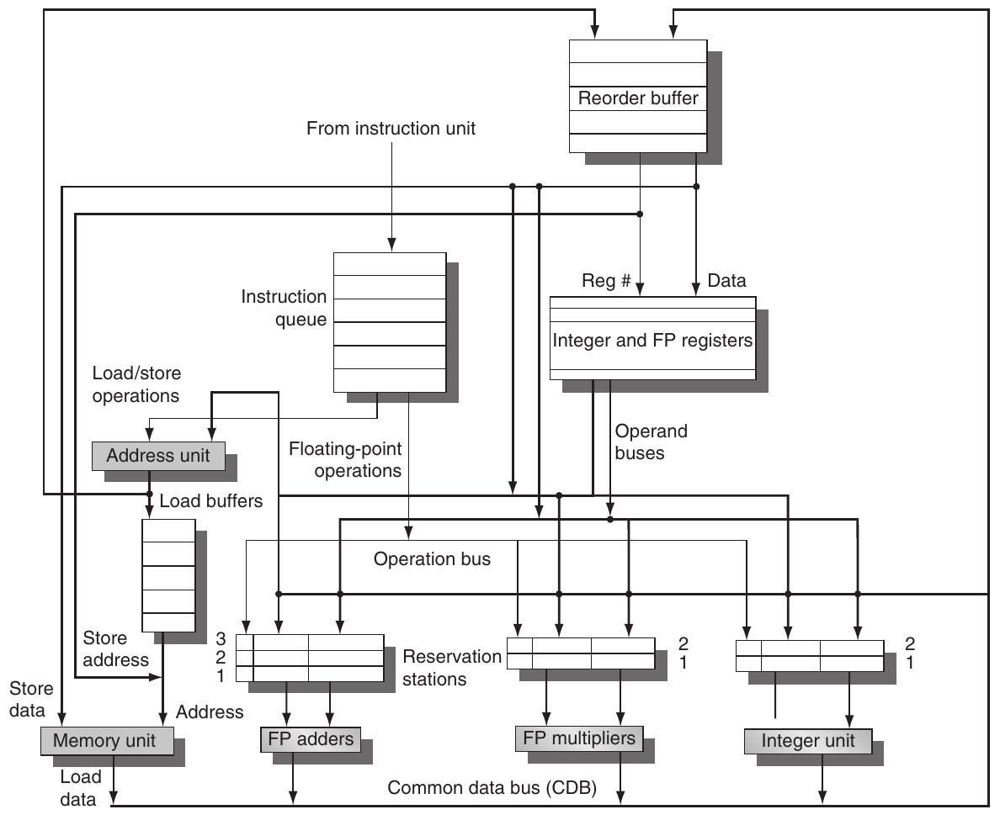

**Hình 3.17 Organization cơ bản của processor multiple issue có speculation. Ở đây organization có thể cho phép FP multiply, FP add, integer và load/store cùng issue đồng thời (giả sử một issue mỗi clock cho mỗi functional unit). Lưu ý nhiều datapath phải được mở rộng để hỗ trợ multiple issue: CDB, operand bus và quan trọng nhất là instruction issue logic, không thể hiện trong hình. Phần cuối là vấn đề khó, như thảo luận trong văn bản.**

Có thể khái quát chi tiết Hình 3.18 để mô tả chiến lược cơ bản cập nhật issue logic và reservation table trong superscalar được dynamically scheduled với tối đa n issue mỗi clock như sau:

| Hành động hoặc bookkeeping | Giải thích |
|---|---|
| if (RegisterStat[rs1].Busy)/\*in-flight instr. writes rs\*/ | Cập nhật reservation table cho load |
| {h ← RegisterStat[rs1].Reorder; if (ROB[h].Ready)/* Instr completed already */ | instruction, vốn có một source operand duy nhất. Vì đây là instruction đầu tiên trong issue |
| {RS[r1].Vj ← ROB[h].Value; RS[r1].Qj ← 0;} else {RS[r1].Qj ← h;} /* wait for instruction */} else {RS[r1].Vj ← Regs[rs]; RS[r1].Qj ← 0;}; RS[r1].Busy ← yes; RS[r1].Dest ← b1; ROB[b1].Instruction ← Load; ROB[b1].Dest ← rd1; ROB[b1].Ready ← no; RS[r].A ← imm1; RegisterStat[rt1].Reorder ← b1; RegisterStat[rt1].Busy ← yes; ROB[b1].Dest ← rt1; | bundle này, nó không khác điều thường diễn ra với load. |
| RS[r2].Qj ← b1;} /* wait for load instruction */ | Vì biết operand đầu của FP operation đến từ load, bước này chỉ cập nhật reservation station để trỏ tới load. Lưu ý dependence phải được phân tích ngay khi xử lý và ROB entry phải được cấp trong bước issue này để cập nhật reservation table đúng. |
| if (RegisterStat[rt2].Busy) /\*in-flight instr writes rt\*/ | Vì chúng ta giả sử operand thứ hai của |
| {h ← RegisterStat[rt2].Reorder; if (ROB[h].Ready)/* Instr completed already */ | FP instruction đến từ issue bundle trước, bước này giống như trong trường hợp single-issue |
| {RS[r2].Vk ← ROB[h].Value; RS[r2].Qk ← 0;} else {RS[r2].Qk ← h;} /* wait for instruction */} else {RS[r2].Vk ← Regs[rt2]; RS[r2].Qk ← 0;}; RegisterStat[rd2].Reorder ← b2; RegisterStat[rd2].Busy ← yes; ROB[b2].Dest ← rd2; | . Tất nhiên, nếu instruction này phụ thuộc thứ gì trong cùng issue bundle, phải cập nhật bảng bằng reservation buffer đã gán. |
| RS[r2].Busy ← yes; RS[r2].Dest ← b2; ROB[b2].Instruction ← FP operation; ROB[b2].Dest ← rd2; ROB[b2].Ready ← no; | Phần này chỉ cập nhật bảng cho FP operation và độc lập với load. Tất nhiên, nếu instruction sau trong issue bundle phụ thuộc FP operation (có thể xảy ra với superscalar four-issue), instruction này sẽ ảnh hưởng cập nhật reservation table cho những instruction đó. |

**Hình 3.18 Các bước issue cho cặp dependent instruction (gọi là 1 và 2), trong đó instruction 1 là FP load, instruction 2 là FP operation có operand đầu là kết quả load; r1 và r2 là reservation station được gán cho instruction; b1 và b2 là reorder buffer entry được gán. Với các instruction đang issue, rd1 và rd2 là destination; rs1, rs2 và rt2 là source (load chỉ có một source); r1, r2 là reservation station được cấp; b1, b2 là ROB entry được gán. RS là data structure của reservation station. RegisterStat là data structure của register, Regs biểu thị register thực tế, ROB là data structure của reorder buffer. Lưu ý phải gán reorder buffer entry để logic này hoạt động đúng, và nhớ rằng mọi cập nhật diễn ra song song trong một clock cycle, không phải tuần tự!**

1. Gán reservation station và reorder buffer cho mỗi instruction có thể được issue trong issue bundle tiếp theo. Có thể làm trước khi biết instruction type bằng cách preallocate reorder buffer entry tuần tự cho instruction trong packet với n reorder buffer entry sẵn có, đồng thời bảo đảm đủ reservation station để issue toàn bundle, bất kể nó chứa gì. Bằng giới hạn số instruction của mỗi lớp (ví dụ một FP, một integer, một load, một store), có thể preallocate reservation station cần thiết. Nếu không đủ reservation station (như khi vài instruction tiếp trong chương trình đều cùng type), bundle bị tách và chỉ issue một tập con theo program order ban đầu. Instruction còn lại có thể đưa vào bundle tiếp theo để có khả năng issue.

2. Phân tích mọi dependence giữa các instruction trong issue bundle.

3. Nếu instruction trong bundle phụ thuộc instruction trước đó trong cùng bundle, dùng reorder buffer number đã gán để cập nhật reservation table cho dependent instruction. Nếu không, dùng thông tin reservation table và reorder buffer hiện có để cập nhật reservation table entry cho instruction đang issue.

Tất nhiên, điều khiến các bước trên rất phức tạp là tất cả được thực hiện song song trong một clock cycle duy nhất!

Ở backend của pipeline, chúng ta phải có thể complete và commit nhiều instruction mỗi clock. Những bước này phần nào dễ hơn issue vì các instruction thực sự có thể commit cùng clock cycle đã phải xử lý và giải quyết mọi dependence. Như sẽ thấy, người thiết kế đã tìm cách xử lý sự phức tạp: Intel i7, xem ở Mục 3.13, về cơ bản dùng scheme speculative multiple issue vừa mô tả, gồm nhiều reservation station, reorder buffer và load/store buffer cũng dùng xử lý nonblocking cache miss.

Từ góc nhìn performance, có thể minh họa cách các khái niệm kết hợp qua một ví dụ.

**Ví dụ** Xét thực thi loop sau, tăng từng phần tử integer array, trên processor two-issue, một lần không speculation và một lần có speculation:

```
Loop:    LD        R2,0(R1)       ;R2=array element
         DADDIU    R2,R2,#1       ;increment R2
         SD        R2,0(R1)       ;store result
         DADDIU    R1,R1,#8       ;increment pointer
         BNE       R2,R3,LOOP     ;branch if not last element
```

Giả sử có integer functional unit riêng để tính effective address, thực hiện ALU operation và đánh giá branch condition. Hãy lập bảng cho ba iteration đầu của loop trên cả hai processor. Giả sử tối đa hai instruction thuộc bất kỳ type nào có thể commit mỗi clock.

**Trả lời** Hình 3.19 và 3.20 cho performance của processor two-issue được dynamically scheduled, không có và có speculation. Trong trường hợp branch có thể là yếu tố giới hạn performance then chốt này, speculation giúp đáng kể. Branch thứ ba trong processor speculative thực thi ở clock cycle 13, còn trong pipeline nonspeculative là clock cycle 19. Vì completion rate của pipeline nonspeculative nhanh chóng tụt sau issue rate, pipeline đó sẽ stall khi issue thêm vài iteration. Có thể cải thiện performance của processor nonspeculative bằng cho load instruction hoàn tất tính effective address trước khi quyết định branch, nhưng nếu không cho speculative memory access, cải thiện chỉ tiết kiệm 1 clock mỗi iteration.

| Số iteration | Instruction | Issue ở clock cycle số | Execute ở clock cycle số | Memory access ở clock cycle số | Write CDB ở clock cycle số | Giải thích |
|---|---|---|---|---|---|---|
| 1 | LD R2,0(R1) | 1 | 2 | 3 | 4 | Lần issue đầu |
| 1 | DADDIU R2,R2,#1 | 1 | 5 |  | 6 | Chờ LW |
| 1 | SD R2,0(R1) | 2 | 3 | 7 |  | Chờ DADDIU |
| 1 | DADDIU R1,R1,#8 | 2 | 3 |  | 4 | Execute trực tiếp |
| 1 | BNE R2,R3,LOOP | 3 | 7 |  |  | Chờ DADDIU |
| 2 | LD R2,0(R1) | 4 | 8 | 9 | 10 | Chờ BNE |
| 2 | DADDIU R2,R2,#1 | 4 | 11 |  | 12 | Chờ LW |
| 2 | SD R2,0(R1) | 5 | 9 | 13 |  | Chờ DADDIU |
| 2 | DADDIU R1,R1,#8 | 5 | 8 |  | 9 | Chờ BNE |
| 2 | BNE R2,R3,LOOP | 6 | 13 |  |  | Chờ DADDIU |
| 3 | LD R2,0(R1) | 7 | 14 | 15 | 16 | Chờ BNE |
| 3 | DADDIU R2,R2,#1 | 7 | 17 |  | 18 | Chờ LW |
| 3 | SD R2,0(R1) | 8 | 15 | 19 |  | Chờ DADDIU |
| 3 | DADDIU R1,R1,#8 | 8 | 14 |  | 15 | Chờ BNE |
| 3 | BNE R2,R3,LOOP | 9 | 19 |  |  | Chờ DADDIU |

**Hình 3.19 Thời điểm issue, execution và ghi kết quả cho phiên bản dual-issue của pipeline không speculation. Lưu ý LD sau BNE không thể bắt đầu execution sớm hơn vì phải chờ xác định branch outcome. Loại chương trình có branch data-dependent không thể giải quyết sớm này thể hiện sức mạnh của speculation. Functional unit riêng cho tính address, ALU operation và đánh giá branch-condition cho phép nhiều instruction execute cùng cycle. Hình 3.20 thể hiện ví dụ có speculation.**

Ví dụ thể hiện rõ speculation có lợi thế thế nào khi có branch data-dependent, vốn sẽ giới hạn performance nếu không có speculation. Tuy nhiên, lợi thế phụ thuộc branch prediction chính xác. Speculation sai không cải thiện performance; thực ra thường gây hại và, như sẽ thấy, làm làm giảm energy efficiency mạnh.

| Số iteration | Instruction | Issue ở clock số | Execute ở clock số | Read access ở clock số | Write CDB ở clock số | Commit ở clock số | Giải thích |
|---|---|---|---|---|---|---|---|
| 1 | LD R2,0(R1) | 1 | 2 | 3 | 4 | 5 | Lần issue đầu |
| 1 | DADDIU R2,R2,#1 | 1 | 5 |  | 6 | 7 | Chờ LW |
| 1 | SD R2,0(R1) | 2 | 3 |  |  | 7 | Chờ DADDIU |
| 1 | DADDIU R1,R1,#8 | 2 | 3 |  | 4 | 8 | Commit đúng thứ tự |
| 1 | BNE R2,R3,LOOP | 3 | 7 |  |  | 8 | Chờ DADDIU |
| 2 | LD R2,0(R1) | 4 | 5 | 6 | 7 | 9 | Không có execute delay |
| 2 | DADDIU R2,R2,#1 | 4 | 8 |  | 9 | 10 | Chờ LW |
| 2 | SD R2,0(R1) | 5 | 6 |  |  | 10 | Chờ DADDIU |
| 2 | DADDIU R1,R1,#8 | 5 | 6 |  | 7 | 11 | Commit đúng thứ tự |
| 2 | BNE R2,R3,LOOP | 6 | 10 |  |  | 11 | Chờ DADDIU |
| 3 | LD R2,0(R1) | 7 | 8 | 9 | 10 | 12 | Sớm nhất có thể |
| 3 | DADDIU R2,R2,#1 | 7 | 11 |  | 12 | 13 | Chờ LW |
| 3 | SD R2,0(R1) | 8 | 9 |  |  | 13 | Chờ DADDIU |
| 3 | DADDIU R1,R1,#8 | 8 | 9 |  | 10 | 14 | Execute sớm hơn |
| 3 | BNE R2,R3,LOOP | 9 | 13 |  |  | 14 | Chờ DADDIU |

**Hình 3.20 Thời điểm issue, execution và ghi kết quả cho phiên bản dual-issue của pipeline có speculation. Lưu ý LD sau BNE có thể bắt đầu execution sớm vì là speculative.**

## 3.9 Kỹ thuật nâng cao cho Instruction Delivery và Speculation

Trong pipeline high-performance, đặc biệt có multiple issue, branch prediction tốt chưa đủ; chúng ta thực sự phải cung cấp được instruction stream high-bandwidth. Trong processor multiple-issue gần đây, điều đó nghĩa là cung cấp 4 đến 8 instruction mỗi clock cycle. Trước tiên, chúng ta xem phương pháp tăng instruction delivery bandwidth. Sau đó chuyển sang nhóm vấn đề then chốt khi triển khai speculation nâng cao, gồm dùng register renaming so với reorder buffer, mức mạnh dạn speculation và kỹ thuật value prediction, cố dự đoán kết quả phép tính và có thể nâng ILP thêm nữa.

### Tăng Instruction Fetch Bandwidth

Processor multiple-issue đòi hỏi số instruction fetch trung bình mỗi clock cycle ít nhất lớn bằng throughput trung bình. Tất nhiên fetch các instruction này cần đường đủ rộng tới instruction cache, nhưng khía cạnh khó nhất là xử lý branch. Mục này xem hai phương pháp xử lý branch, rồi bàn cách processor hiện đại tích hợp chức năng instruction prediction và prefetch.

#### Branch-Target Buffer

Để giảm branch penalty cho pipeline five-stage đơn giản cũng như pipeline sâu hơn, phải biết instruction as-yet-undecoded có phải branch không, và nếu có, program counter (PC) tiếp theo phải là gì. Nếu instruction là branch và biết PC tiếp theo, có thể đạt branch penalty bằng không. Cache branch-prediction lưu address dự đoán của instruction tiếp theo sau branch gọi là branch-target buffer hoặc branch-target cache. Hình 3.21 thể hiện branch-target buffer.

Vì branch-target buffer dự đoán next instruction address và gửi nó trước khi decode instruction, chúng ta phải biết instruction được fetch có được dự đoán là taken branch không. Nếu PC của instruction được fetch khớp address trong prediction buffer, predicted PC tương ứng được dùng làm next PC. Hardware của branch-target buffer về cơ bản giống hệt hardware cache.

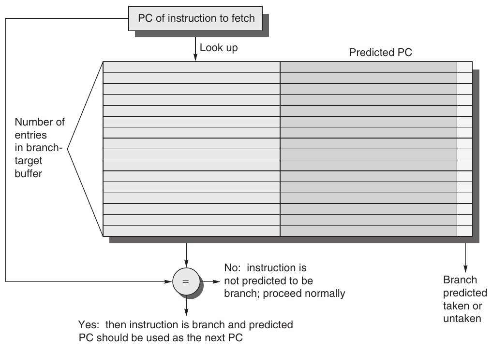

**Hình 3.21 Một branch-target buffer. PC của instruction đang fetch được đối chiếu với tập instruction address lưu trong cột đầu; chúng biểu thị address của branch đã biết. Nếu PC khớp một entry, instruction đang fetch là taken branch, và field thứ hai, predicted PC, chứa dự đoán next PC sau branch. Fetch bắt đầu ngay tại address đó. Field thứ ba, tùy chọn, có thể dùng cho prediction state bit bổ sung.**

Nếu tìm thấy entry khớp trong branch-target buffer, fetch bắt đầu ngay tại predicted PC. Lưu ý khác branch-prediction buffer, predictive entry phải khớp instruction này vì predicted PC được gửi trước khi biết instruction thậm chí có phải branch không. Nếu processor không kiểm tra entry khớp PC này không, PC sai sẽ được gửi cho instruction không phải branch, gây performance kém hơn. Chỉ cần lưu branch predicted-taken trong branch-target buffer, vì untaken branch chỉ cần fetch instruction tuần tự kế tiếp như thể không phải branch.

Hình 3.22 cho các bước dùng branch-target buffer với pipeline five-stage đơn giản. Từ hình, thấy sẽ không có branch delay nếu tìm được branch-prediction entry trong buffer và prediction đúng. Nếu không, penalty ít nhất hai clock cycle. Xử lý misprediction và miss là thách thức đáng kể, vì thường phải dừng instruction fetch khi ghi lại buffer entry. Vì vậy chúng ta muốn quá trình nhanh để giảm penalty.

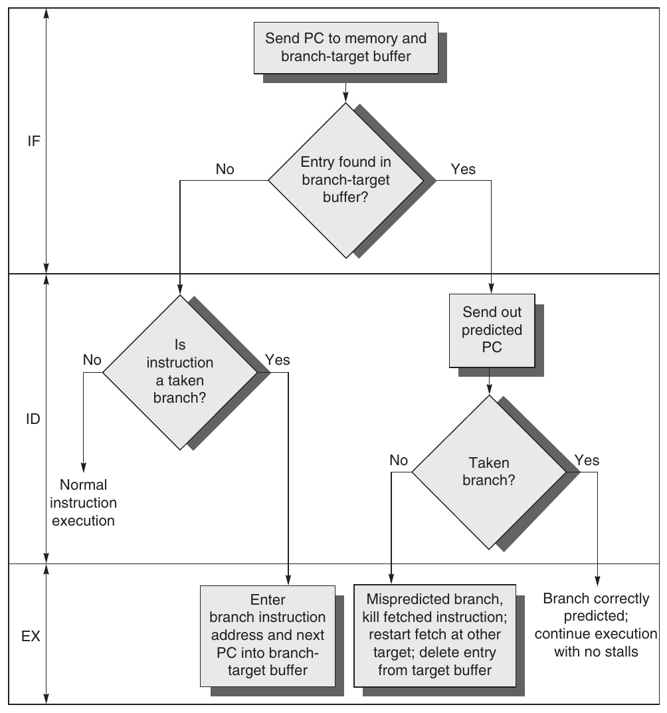

**Hình 3.22 Những bước xử lý instruction với branch-target buffer.**

| Instruction nằm trong buffer | Prediction | Branch thực tế | Số cycle penalty |
|---|---|---|---|
| Có | Taken | Taken | 0 |
| Có | Taken | Not taken | 2 |
| Không |  | Taken | 2 |
| Không |  | Not taken | 0 |

**Hình 3.23 Penalty của mọi tổ hợp có thể giữa việc branch có trong buffer không và thực tế làm gì, giả sử chỉ lưu taken branch. Không có branch penalty nếu mọi thứ được dự đoán đúng và branch được tìm thấy trong target buffer. Nếu branch không được dự đoán đúng, penalty bằng một clock cycle để cập nhật buffer bằng thông tin đúng (trong đó không fetch được instruction), và thêm một clock cycle nếu cần để khởi động lại fetch instruction đúng tiếp theo cho branch. Nếu không tìm thấy branch nhưng nó taken, có penalty two-cycle, trong thời gian đó buffer được cập nhật.**

Để đánh giá branch-target buffer hoạt động tốt thế nào, trước tiên phải xác định penalty trong mọi trường hợp. Hình 3.23 chứa thông tin này cho pipeline five-stage đơn giản.

**Ví dụ** Xác định tổng branch penalty của branch-target buffer, giả sử penalty cycle cho từng misprediction như Hình 3.23. Đưa ra các giả định sau về prediction accuracy và hit rate:

- Prediction accuracy là 90% (cho instruction trong buffer).

- Hit rate trong buffer là 90% (cho branch được dự đoán taken).

**Trả lời** Chúng ta tính penalty bằng cách xem xét xác suất hai sự kiện: branch được dự đoán taken nhưng thực tế not taken, và branch taken nhưng không tìm thấy trong buffer. Cả hai đều có penalty hai cycle.

Probability (branch in buffer, but actually not taken) = Percent buffer hit rate × Percent incorrect predictions

= 90% × 10% = 0.09 Probability (branch not in buffer, but actually taken) = 10%

Branch penalty = ( 0.09 + 0.10 ) × 2

Branch penalty = 0.38

Penalty này có thể so với branch penalty cho delayed branch, được đánh giá trong Phụ lục C, khoảng 0.5 clock cycle mỗi branch. Tuy nhiên hãy nhớ lợi ích dynamic branch prediction sẽ tăng khi pipeline dài hơn, do đó branch delay tăng; ngoài ra predictor tốt hơn cho lợi thế performance lớn hơn. Processor high-performance hiện đại có branch misprediction delay cỡ 15 clock cycle; rõ ràng prediction chính xác là thiết yếu!

Một biến thể branch-target buffer lưu một hoặc nhiều target instruction thay cho, hoặc thêm vào, target address dự đoán. Biến thể có hai lợi thế tiềm năng. Thứ nhất, nó cho phép branch-target buffer access tốn lâu hơn thời gian giữa hai instruction fetch liên tiếp, có thể cho phép branch-target buffer lớn hơn. Thứ hai, buffer chính target instruction cho phép thực hiện một tối ưu gọi là branch folding. Branch folding có thể tạo unconditional branch 0-cycle và đôi khi conditional branch 0-cycle.

Xét branch-target buffer chứa instruction từ predicted path và đang được truy cập bằng address của unconditional branch. Chức năng duy nhất của unconditional branch là đổi PC. Vì vậy khi branch-target buffer báo hit và chỉ ra rằng branch là unconditional, pipeline có thể chỉ thay instruction trả về từ cache (unconditional branch) bằng instruction trong branch-target buffer. Nếu processor issue nhiều instruction mỗi cycle, buffer cần cung cấp nhiều instruction để đạt lợi ích tối đa. Trong vài trường hợp, có thể loại bỏ cost của conditional branch.

#### Return Address Predictor

Khi cố tăng cơ hội và độ chính xác speculation, chúng ta gặp thách thức dự đoán indirect jump, tức jump có destination address thay đổi lúc runtime. Dù chương trình ngôn ngữ high-level tạo jump này cho indirect procedure call, câu lệnh select hoặc case và FORTRANcomputed goto, đại đa số indirect jump đến từ procedure return. Chẳng hạn với benchmark SPEC95, trung bình procedure return chiếm hơn 15% branch và đại đa số indirect jump. Với ngôn ngữ object-oriented như C++, Java, procedure return còn thường xuyên hơn. Vì vậy tập trung vào procedure return có vẻ thích hợp.

Dù có thể dự đoán procedure return bằng branch-target buffer, accuracy có thể thấp nếu procedure được gọi từ nhiều vị trí và call từ một vị trí không tập trung gần nhau về thời gian. Chẳng hạn trong SPEC CPU95, branch predictor mạnh đạt accuracy dưới 60% cho return branch như vậy. Để khắc phục, một số thiết kế dùng buffer return address nhỏ hoạt động như stack. Structure này cache return address gần nhất: push return address lên stack khi call, pop khi return. Nếu cache đủ lớn (tức bằng maximum call depth), nó dự đoán return hoàn hảo. Hình 3.24 thể hiện performance của return buffer từ 0 đến 16 phần tử cho một số benchmark SPEC CPU95. Chúng ta dùng return predictor tương tự khi xem nghiên cứu ILP ở Mục 3.10. Cả Intel Core lẫn AMD Phenom đều có return address predictor.

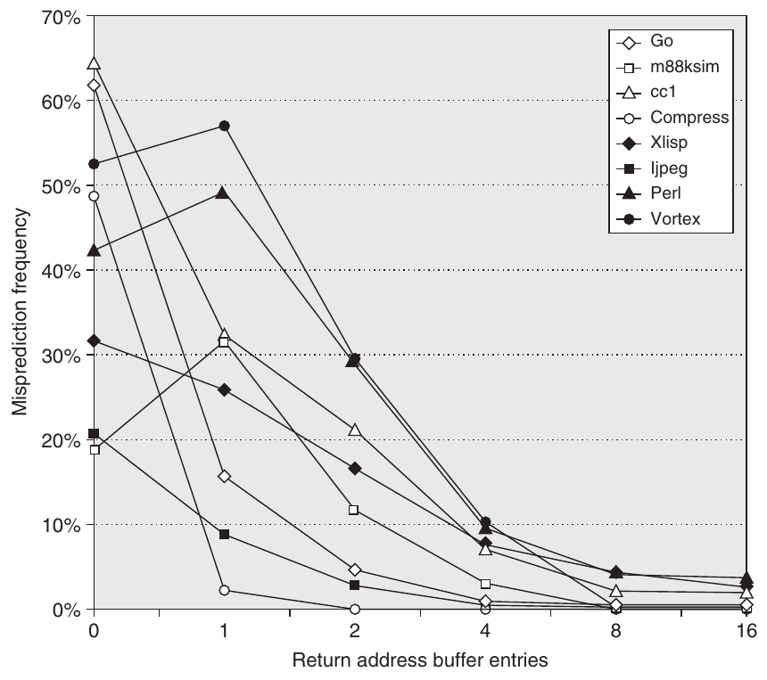

**Hình 3.24 Prediction accuracy của return address buffer hoạt động như stack trên một số benchmark SPEC CPU95. Accuracy là tỷ lệ return address được dự đoán đúng. Buffer 0 entry nghĩa là dùng branch prediction tiêu chuẩn. Vì call depth thường không lớn, trừ vài ngoại lệ, buffer vừa phải hoạt động tốt. Dữ liệu này được lấy từ Skadron và cộng sự [1999], dùng mechanism fix-up để tránh làm hỏng return address được cache.**

#### Instruction Fetch Unit tích hợp

Để đáp ứng nhu cầu processor multiple-issue, nhiều người thiết kế gần đây chọn triển khai instruction fetch unit tích hợp như một unit riêng tự chủ, cấp instruction cho phần còn lại của pipeline. Về cơ bản, điều này thừa nhận rằng trước sự phức tạp của multiple issue, mô tả instruction fetch như một pipe stage đơn giản duy nhất không còn đúng.

Thay vào đó, thiết kế gần đây dùng instruction fetch unit tích hợp một số chức năng:

1. Branch prediction tích hợp—Branch predictor trở thành một phần của instruction fetch unit và liên tục dự đoán branch để điều khiển fetch pipeline.

2. Instruction prefetch—Để cung cấp nhiều instruction mỗi clock, instruction fetch unit có lẽ cần fetch trước. Unit tự chủ quản lý prefetch instruction (xem Chương 2 về kỹ thuật thực hiện), tích hợp với branch prediction.

3. Instruction memory access và buffering—Khi fetch nhiều instruction mỗi cycle, gặp nhiều phức tạp, gồm khó khăn rằng fetch nhiều instruction có thể cần truy cập nhiều cache line. Instruction fetch unit đóng gói sự phức tạp này, dùng prefetch cố gắng che giấu cost khi vượt qua cache block. Nó cũng cung cấp buffering, về cơ bản hoạt động như unit on-demand cung cấp instruction cho issue stage khi cần và đúng số lượng cần.

Hầu như mọi processor high-end hiện dùng instruction fetch unit riêng nối với phần còn lại của pipeline qua buffer chứa instruction đang chờ.

### Speculation: Các vấn đề triển khai và mở rộng

Trong mục này, chúng ta khám phá bốn vấn đề liên quan đến design trade-offs của speculation, bắt đầu bằng register renaming, cách thường dùng thay reorder buffer. Sau đó bàn một mở rộng quan trọng có thể có cho speculation trên control flow: ý tưởng gọi là value prediction.

#### Hỗ trợ Speculation: Register Renaming so với Reorder Buffer

Một phương án thay reorder buffer (ROB) là dùng tường minh physical register set lớn hơn kết hợp register renaming. Cách này xây dựng và mở rộng khái niệm renaming trong thuật toán Tomasulo. Trong thuật toán đó, tại bất cứ điểm execution nào, giá trị register mà architecture cho thấy (R0, …, R31 và F0, …, F31) nằm trong tổ hợp register set và reservation station. Khi thêm speculation, register value còn có thể tạm ở ROB. Trong cả hai trường hợp, nếu processor ngừng issue instruction mới một thời gian, mọi instruction hiện có sẽ commit, và register value xuất hiện trong register file tương ứng trực tiếp với register mà architecture cho thấy.

Trong cách register-renaming, physical register set mở rộng giữ cả register mà architecture cho thấy lẫn temporary value. Vì vậy register mở rộng thay phần lớn chức năng ROB và reservation station; chỉ cần queue bảo đảm instruction complete đúng thứ tự. Trong instruction issue, renaming process ánh xạ tên architectural register sang physical register number trong register set mở rộng, cấp register mới chưa dùng cho destination. WAW và WAR hazard được tránh bằng renaming destination register; speculation recovery thực hiện được vì physical register giữ instruction destination chưa trở thành architectural register cho tới khi instruction commit. Renaming map là data structure đơn giản cung cấp physical register number của register hiện tương ứng với architectural register được chỉ định, chức năng mà register status table thực hiện trong thuật toán Tomasulo. Khi instruction commit, renaming table được cập nhật cố định để chỉ physical register tương ứng actual architectural register, qua đó hoàn tất cập nhật processor state. Dù register renaming không cần ROB, hardware vẫn phải theo dõi instruction trong structure queue-like và cập nhật renaming table theo thứ tự nghiêm ngặt.

Lợi thế renaming so với ROB là instruction commit được đơn giản hóa đôi chút, vì chỉ cần hai hành động đơn giản: (1) ghi nhận mapping giữa architectural register number và physical register number không còn speculative, và (2) giải phóng mọi physical register đang giữ giá trị “cũ hơn” của architectural register. Trong thiết kế có reservation station, station được giải phóng khi instruction dùng nó hoàn tất execution, còn ROB entry được giải phóng khi instruction tương ứng commit.

Với register renaming, deallocate register phức tạp hơn, vì trước khi giải phóng physical register phải biết nó không còn tương ứng architectural register và không còn lần dùng physical register nào đang chờ. Physical register tương ứng architectural register đến khi architectural register được ghi lại, khiến renaming table trỏ sang nơi khác. Tức nếu không renaming entry nào trỏ tới physical register cụ thể, nó không còn tương ứng architectural register. Tuy nhiên, vẫn có thể còn lần dùng physical register đang chờ. Processor có thể xác định bằng cách kiểm tra source register specifier của mọi instruction trong functional unit queue. Nếu physical register không xuất hiện như source và không được chỉ định như architectural register, có thể thu hồi và cấp lại.

Hoặc processor chỉ chờ đến khi instruction khác ghi cùng architectural register commit. Khi đó không thể còn lần dùng giá trị cũ hơn đang chờ. Dù cách này giữ physical register lâu hơn cần thiết đôi chút, nó dễ triển khai và được dùng trong phần lớn superscalar gần đây.

Bạn có thể hỏi làm sao biết register nào là architectural register nếu chúng liên tục thay đổi? Phần lớn thời gian chương trình thực thi, điều này không quan trọng. Tuy nhiên rõ ràng có trường hợp process khác, như operating system, phải biết chính xác nội dung architectural register cụ thể nằm ở đâu. Để hiểu khả năng này được cung cấp như thế nào, giả sử processor không issue instruction một thời gian. Cuối cùng mọi instruction trong pipeline commit, và mapping giữa register mà architecture cho thấy với physical register trở nên ổn định. Khi đó một tập con physical register chứa register mà architecture cho thấy, còn giá trị physical register không gắn architectural register là không cần thiết. Vì vậy dễ di chuyển architectural register tới tập con physical register cố định để truyền giá trị cho process khác.

Cả register renaming và reorder buffer tiếp tục được dùng trong processor high-end, hiện có khả năng giữ tới 40 hoặc 50 instruction (gồm load và store chờ cache) in flight. Dù dùng renaming hay reorder buffer, bottleneck độ phức tạp then chốt của superscalar được dynamically schedule vẫn là issue instruction bundle có dependence trong bundle. Cụ thể, dependent instruction trong issue bundle phải được issue với virtual register đã gán cho instruction mà chúng phụ thuộc. Có thể triển khai chiến lược instruction issue với register renaming tương tự multiple issue dùng reorder buffer (xem trang 198) như sau:

1. Issue logic pre-reserves đủ physical register cho toàn issue bundle (ví dụ bốn register cho bundle four-instruction, với tối đa một register result mỗi instruction).

2. Issue logic xác định dependence trong bundle. Nếu không có dependence trong bundle, register renaming structure được dùng để xác định physical register đang giữ hoặc sẽ giữ kết quả mà instruction phụ thuộc. Khi không có dependence trong bundle, kết quả đến từ issue bundle trước, và register renaming table có register number đúng.

3. Nếu instruction phụ thuộc instruction đứng trước trong bundle, physical register pre-reserved sẽ chứa kết quả được dùng để cập nhật thông tin cho instruction đang issue.

Lưu ý như trường hợp reorder buffer, issue logic phải vừa xác định dependence trong bundle vừa cập nhật renaming table trong một clock; cũng như trước, độ phức tạp khi thực hiện cho nhiều instruction mỗi clock hơn trở thành giới hạn chính của issue width.

#### Nên Speculate đến mức nào

Một lợi thế đáng kể của speculation là khả năng sớm phát hiện sự kiện vốn sẽ làm pipeline stall, như cache miss. Tuy nhiên lợi thế tiềm năng đi kèm bất lợi tiềm năng đáng kể. Speculation không miễn phí: nó tiêu tốn thời gian và năng lượng, và phục hồi speculation sai còn làm giảm performance. Ngoài ra, để hỗ trợ instruction execution rate cao hơn cần thiết để thu được lợi ích từ speculation, processor phải có resource bổ sung, tốn silicon area và power. Cuối cùng, nếu speculation gây exceptional event như cache miss hoặc translation lookaside buffer (TLB) miss, khả năng mất performance đáng kể tăng nếu sự kiện đó vốn không xảy ra khi không speculation.

Để giữ phần lớn lợi thế mà giảm thiểu bất lợi, phần lớn pipeline có speculation chỉ cho phép xử lý exceptional event low-cost (như cache miss first-level) trong speculative mode. Nếu xảy ra exceptional event đắt, như cache miss second-level hoặc TLB miss, processor chờ tới khi instruction gây sự kiện không còn speculative mới xử lý. Dù điều này có thể giảm nhẹ performance một số chương trình, nó tránh mất performance lớn ở chương trình khác, đặc biệt khi tần suất sự kiện như vậy cao cùng branch prediction less-than-excellent.

Trong thập niên 1990, mặt trái tiềm năng của speculation ít rõ ràng hơn. Khi processor phát triển, chi phí thật trở nên rõ hơn, và giới hạn của issue width rộng hơn cùng speculation cũng rõ ràng. Chúng ta sẽ sớm quay lại vấn đề này.

#### Speculate qua nhiều Branch

Trong ví dụ đã xét, có thể giải quyết một branch trước khi phải speculate trên branch khác. Ba tình huống hưởng lợi từ speculate nhiều branch đồng thời: (1) branch frequency rất cao, (2) branch tập trung đáng kể, (3) functional unit có delay dài. Trong hai trường hợp đầu, đạt performance cao có thể cần speculate nhiều branch, thậm chí xử lý hơn một branch mỗi clock. Chương trình database và phép tính integer ít cấu trúc khác thường có những thuộc tính này, khiến speculation nhiều branch quan trọng. Tương tự, delay dài trong functional unit tăng tầm quan trọng speculation nhiều branch như cách tránh stall do pipeline delay dài hơn.

Speculate nhiều branch làm quá trình speculation recovery phức tạp hơn đôi chút nhưng những phần khác vẫn đơn giản. Tính đến 2011, chưa processor nào kết hợp full speculation với giải quyết nhiều branch mỗi cycle; khó có khả năng chi phí được biện minh xét theo performance so với complexity và power.

#### Speculation và thách thức Energy Efficiency

Speculation ảnh hưởng energy efficiency thế nào? Thoạt nhìn có thể cho rằng nó luôn làm giảm energy efficiency, vì bất cứ khi nào speculation sai, nó tiêu tốn energy dư thừa theo hai cách:

1. Instruction được speculate nhưng không cần kết quả tạo thêm công việc cho processor, gây lãng phí energy.

2. Hoàn tác speculation và khôi phục processor state để tiếp tục execution tại address đúng tiêu tốn energy bổ sung vốn không cần nếu không có speculation.

Chắc chắn speculation tăng power consumption và, nếu điều khiển được speculation, có thể đo cost (hoặc ít nhất dynamic power cost). Nhưng nếu speculation giảm execution time nhiều hơn mức tăng power consumption trung bình, tổng energy tiêu thụ có thể ít hơn.

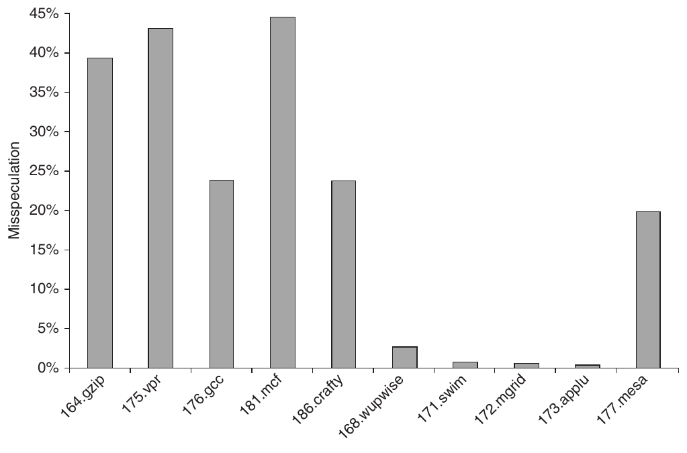

**Hình 3.25 Phần tỷ lệ instruction thực thi do misspeculation thường cao hơn nhiều ở integer program (năm chương trình đầu) so với FP program (năm chương trình cuối).**

Vì vậy để hiểu tác động speculation lên energy efficiency, cần xem nó dẫn tới công việc không cần thiết thường xuyên đến đâu. Nếu thực thi số instruction không cần lớn, khó có khả năng speculation cải thiện thời gian chạy một lượng tương đương! Hình 3.25 cho tỷ lệ instruction thực thi do misspeculation. Như thấy, tỷ lệ nhỏ trong scientific code và đáng kể (trung bình khoảng 30%) trong integer code. Vì vậy khó có khả năng speculation tiết kiệm energy cho integer application. Người thiết kế có thể tránh speculation, cố gắng giảm misspeculation hoặc nghĩ cách mới, như chỉ speculate branch đã biết có predictability cao.

#### Value Prediction

Một kỹ thuật để tăng mức ILP sẵn có trong chương trình là value prediction. Value prediction cố gắng dự đoán giá trị mà một instruction sẽ tạo ra. Hiển nhiên, vì phần lớn instruction tạo ra một giá trị khác nhau mỗi lần thực thi (hoặc ít nhất là một giá trị khác trong một tập giá trị), value prediction chỉ có thể thành công ở mức hạn chế. Tuy nhiên, có những instruction dễ dự đoán giá trị kết quả hơn — chẳng hạn load từ constant pool hoặc load một giá trị ít khi thay đổi. Ngoài ra, khi một instruction tạo ra giá trị được chọn từ một tập nhỏ các giá trị có thể có, chúng ta có thể dự đoán kết quả bằng cách xét tương quan của nó với những hành vi khác của chương trình.

Value prediction hữu ích nếu làm tăng đáng kể mức ILP sẵn có. Khả năng này lớn nhất khi một giá trị được dùng làm nguồn cho một chuỗi phép tính phụ thuộc, chẳng hạn giá trị do load tạo ra. Vì value prediction được dùng để tăng cường speculation, còn speculation sai gây tác động bất lợi tới performance, độ chính xác của dự đoán đóng vai trò thiết yếu.

Dù nhiều nhà nghiên cứu tập trung vào value prediction trong mười năm qua, kết quả chưa bao giờ đủ hấp dẫn để biện minh cho việc tích hợp nó vào processor thực tế. Thay vào đó, một ý tưởng đơn giản và lâu đời hơn, liên quan đến value prediction, đã được sử dụng: address aliasing prediction. Đây là kỹ thuật đơn giản dự đoán liệu hai store, hoặc một load và một store, có tham chiếu cùng memory address hay không. Nếu hai tham chiếu như vậy không trỏ tới cùng address, chúng có thể được đổi chỗ an toàn. Ngược lại, chúng ta phải chờ tới khi biết các memory address mà những instruction truy cập. Vì không cần thực sự dự đoán giá trị address, mà chỉ cần dự đoán liệu những giá trị đó có xung đột hay không, việc dự đoán vừa ổn định hơn vừa đơn giản hơn. Dạng address value speculation hạn chế này đã được sử dụng trong một số processor và có thể trở nên phổ biến trên mọi processor trong tương lai.

## 3.10 Nghiên cứu các giới hạn của ILP

Việc khai thác ILP để tăng performance bắt đầu từ những pipelined processor đầu tiên trong thập niên 1960. Trong thập niên 1980 và 1990, các kỹ thuật này là chìa khóa để cải thiện performance nhanh chóng. Câu hỏi có bao nhiêu ILP đóng vai trò then chốt đối với khả năng cải thiện performance long-term với tốc độ vượt mức tăng tốc của công nghệ integrated circuit nền tảng. Trong khoảng thời gian ngắn hơn, câu hỏi cần những gì để khai thác thêm ILP rất quan trọng đối với cả người thiết kế máy tính lẫn người viết compiler. Dữ liệu trong mục này cũng cung cấp cách đánh giá giá trị của các ý tưởng đã giới thiệu trong chương, gồm memory disambiguation, register renaming và speculation.

Trong mục này, chúng ta xem lại một phần của một nghiên cứu về những câu hỏi đó (dựa trên nghiên cứu năm 1993 của Wall). Mọi nghiên cứu về tính song song sẵn có này đều đưa ra một tập giả định, rồi xem có thể khai thác bao nhiêu tính song song dưới các giả định đó. Dữ liệu được khảo sát ở đây đến từ nghiên cứu đưa ra ít giả định nhất; thực tế, mô hình hardware tối hậu có lẽ không thể hiện thực hóa. Tuy nhiên, mọi nghiên cứu như vậy đều giả định một trình độ công nghệ compiler nhất định; một số giả định có thể ảnh hưởng kết quả, bất chấp việc sử dụng hardware tham vọng đến mức khó tin.

Như sẽ thấy, với mô hình hardware có chi phí hợp lý, khó có thể biện minh cho chi phí của speculation quá quyết liệt: mức kém hiệu quả trong sử dụng năng lượng và silicon đơn giản là quá cao. Dù nhiều người trong cộng đồng nghiên cứu và các nhà sản xuất processor lớn đặt cược vào việc khai thác được nhiều ILP hơn đáng kể, và ban đầu không muốn chấp nhận khả năng này, đến năm 2005 họ đã buộc phải thay đổi quan điểm.

### Mô hình Hardware

Để xem giới hạn ILP có thể nằm ở đâu, trước tiên cần định nghĩa một processor lý tưởng. Đó là processor loại bỏ mọi ràng buộc đối với ILP. Những giới hạn ILP duy nhất còn lại là các giới hạn do data flow thực tế qua register hoặc memory áp đặt.

Những giả định cho processor lý tưởng hay hoàn hảo như sau:

1. Register renaming vô hạn — Có vô hạn virtual register, nên tránh được mọi WAW và WAR hazard, và số instruction có thể bắt đầu thực thi đồng thời không bị giới hạn.

2. Branch prediction hoàn hảo — Branch prediction hoàn hảo. Mọi conditional branch đều được dự đoán chính xác.

3. Jump prediction hoàn hảo — Mọi jump (gồm jump register dùng cho return và computed jump) đều được dự đoán hoàn hảo. Kết hợp với branch prediction hoàn hảo, điều này tương đương processor có speculation hoàn hảo và buffer instruction sẵn sàng thực thi không bị giới hạn.

4. Memory address alias analysis hoàn hảo — Mọi memory address đều được biết chính xác, và có thể chuyển load lên trước store miễn là address không giống nhau. Lưu ý rằng điều này thực hiện address alias analysis hoàn hảo.

5. Cache hoàn hảo — Mọi memory access mất một clock cycle. Trên thực tế, superscalar processor thường tiêu tốn lượng ILP lớn để che giấu cache miss, khiến những kết quả này hết sức lạc quan.

Giả định 2 và 3 loại bỏ mọi control dependence. Tương tự, giả định 1 và 4 loại bỏ mọi dependence ngoại trừ true data dependence. Kết hợp lại, bốn giả định này nghĩa là bất kỳ instruction nào trong quá trình thực thi chương trình cũng có thể được schedule ở cycle ngay sau khi instruction đứng trước mà nó phụ thuộc đã thực thi. Dưới các giả định này, thậm chí instruction được thực thi động cuối cùng của chương trình có thể được schedule ngay ở cycle đầu tiên! Vì vậy, tập giả định này bao hàm cả control speculation lẫn address speculation và triển khai chúng như thể chúng hoàn hảo.

Ban đầu, chúng ta khảo sát processor có thể issue số instruction không giới hạn cùng lúc và nhìn xa tùy ý về phía trước trong quá trình tính toán. Với mọi mô hình processor được khảo sát, không có ràng buộc về loại instruction có thể thực thi trong một cycle. Với trường hợp unlimited-issue, điều này nghĩa là có thể issue số load hoặc store không giới hạn trong một clock cycle. Ngoài ra, giả định mọi functional unit latency bằng một cycle, để mọi chuỗi instruction phụ thuộc có thể issue trong các cycle liên tiếp. Latency lớn hơn một cycle sẽ giảm số instruction issue mỗi cycle, dù không giảm số instruction đang thực thi tại một thời điểm. (Instruction đang thực thi tại một thời điểm thường được gọi là in flight.)

Dĩ nhiên, processor lý tưởng này có lẽ không thể hiện thực hóa. Chẳng hạn, IBM Power7 (xem Wendell và cộng sự [2010]) là superscalar processor tiên tiến nhất được công bố tính đến thời điểm này. Power7 issue tối đa sáu instruction mỗi clock và khởi động thực thi trên tối đa 8 trong số 12 execution unit (chỉ hai trong đó là load/store unit), hỗ trợ tập renaming register lớn (cho phép hàng trăm instruction in flight), dùng branch predictor lớn và mạnh, đồng thời sử dụng dynamic memory disambiguation. Power7 tiếp tục xu hướng dùng thêm thread-level parallelism bằng cách tăng độ rộng hỗ trợ simultaneous multithreading (SMT) lên bốn thread mỗi core và số core mỗi chip lên tám. Sau khi xem tính song song sẵn có trong processor hoàn hảo, chúng ta khảo sát mức có thể đạt được trong processor có khả năng được thiết kế trong tương lai gần.

Để đo tính song song sẵn có, một tập chương trình được compile và tối ưu bằng các optimizing compiler MIPS tiêu chuẩn. Các chương trình được chèn công cụ đo và thực thi để sinh trace của instruction reference và data reference. Sau đó mỗi instruction trong trace được schedule sớm nhất có thể, chỉ bị giới hạn bởi data dependence. Vì dùng trace, việc thực hiện branch prediction và alias analysis hoàn hảo rất dễ. Với những cơ chế này, instruction có thể được schedule sớm hơn nhiều so với thông thường, vượt qua nhiều instruction mà nó không có data dependence, gồm cả branch vì branch được dự đoán hoàn hảo.

Hình 3.26 cho thấy mức song song trung bình sẵn có trong sáu benchmark SPEC92. Trong suốt mục này, tính song song được đo bằng instruction issue rate trung bình. Nhớ rằng mọi instruction đều có latency one-cycle; latency dài hơn sẽ giảm số instruction trung bình mỗi clock. Ba benchmark (fpppp, doduc và tomcatv) chủ yếu tính toán floating-point, còn ba benchmark khác là chương trình integer. Hai benchmark floating-point (fpppp và tomcatv) có nhiều tính song song có thể được khai thác bằng vector computer hoặc multiprocessor (tuy nhiên cấu trúc fpppp khá lộn xộn vì đã thực hiện một số biến đổi code thủ công). Chương trình doduc có nhiều tính song song, nhưng tính song song không nằm trong các parallel loop đơn giản như fpppp và tomcatv. Chương trình li là LISP interpreter có nhiều dependence ngắn.

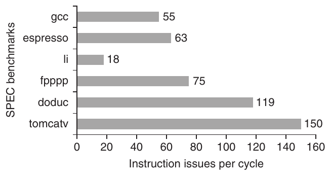

**Hình 3.26 ILP sẵn có trong processor hoàn hảo với sáu benchmark SPEC92. Ba chương trình đầu là chương trình integer, ba chương trình cuối là chương trình floating-point. Các chương trình floating-point sử dụng nhiều loop và có lượng loop-level parallelism lớn.**

### Giới hạn ILP đối với processor có thể hiện thực hóa

Trong mục này, chúng ta xem performance của processor có mức hỗ trợ hardware tham vọng, bằng hoặc tốt hơn mức sẵn có vào năm 2011 hoặc — xét các sự kiện và bài học trong thập niên qua — có khả năng xuất hiện trong tương lai gần. Cụ thể, chúng ta giả định các thuộc tính cố định sau:

1. Tối đa 64 instruction issue mỗi clock, không có ràng buộc issue, tức hơn 10 lần tổng issue width của processor rộng nhất năm 2011. Như sẽ thảo luận sau, ảnh hưởng thực tiễn của issue width rất rộng lên clock rate, độ phức tạp logic và power có thể là những giới hạn quan trọng nhất khi khai thác ILP.

2. Tournament predictor có 1K entry và return predictor 16-entry. Predictor này tương đương các predictor tốt nhất năm 2011; predictor không phải bottleneck chính.

3. Phân biệt hoàn hảo memory reference một cách động — đây là mục tiêu tham vọng nhưng có lẽ đạt được với window size nhỏ (và do đó issue rate cùng load/store buffer nhỏ) hoặc thông qua address aliasing prediction.

4. Register renaming với 64 integer register bổ sung và 64 FP register bổ sung, ít hơn đôi chút so với processor mạnh nhất năm 2011. Intel Core i7 có 128 entry trong reorder buffer, dù không chia riêng integer và FP, còn IBM Power7 có gần 200. Lưu ý chúng ta giả định pipeline latency một cycle, làm giảm đáng kể nhu cầu reorder buffer entry. Cả Power7 lẫn i7 đều có latency từ 10 cycle trở lên.

Hình 3.27 trình bày kết quả của cấu hình này khi thay đổi window size. Cấu hình này phức tạp và đắt hơn mọi implementation hiện có, đặc biệt ở số instruction issue, lớn hơn 10 lần số issue lớn nhất trên bất kỳ processor nào năm 2011. Tuy nhiên, nó cung cấp giới hạn hữu ích về điều mà implementation tương lai có thể đạt. Dữ liệu trong những hình này còn có thể quá lạc quan vì lý do khác. Không có ràng buộc issue giữa 64 instruction: tất cả có thể là memory reference. Không ai thậm chí cân nhắc khả năng này cho processor trong tương lai gần. Đáng tiếc, rất khó xác định giới hạn performance của processor có ràng buộc issue hợp lý; không chỉ không gian khả năng rất lớn, mà sự tồn tại của các ràng buộc issue còn đòi hỏi đánh giá tính song song bằng instruction scheduler chính xác, khiến nghiên cứu processor có nhiều issue trở nên rất tốn kém.

Ngoài ra, khi diễn giải những kết quả này, hãy nhớ rằng cache miss và latency non-unit chưa được tính đến; cả hai đều sẽ có ảnh hưởng đáng kể!

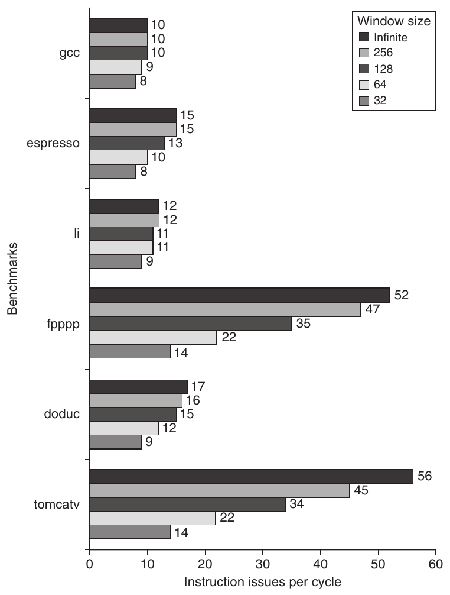

**Hình 3.27 Mức song song sẵn có theo window size cho nhiều chương trình integer và floating-point với tối đa 64 instruction bất kỳ được issue mỗi clock. Dù số renaming register ít hơn window size, việc mọi operation có latency one-cycle và số renaming register bằng issue width cho phép processor khai thác tính song song trên toàn bộ window. Trong implementation thực tế, phải cân bằng window size và số renaming register để tránh một trong hai yếu tố hạn chế issue rate quá mức.**

Nhận xét đáng ngạc nhiên nhất từ Hình 3.27 là, với các ràng buộc processor thực tế nêu trên, ảnh hưởng của window size tới chương trình integer không nghiêm trọng bằng tới chương trình FP. Kết quả này chỉ ra khác biệt then chốt giữa hai loại chương trình. Tính song song loop-level parallelism sẵn có trong hai chương trình FP nghĩa là mức ILP có thể khai thác cao hơn; nhưng với chương trình integer, những yếu tố khác — branch prediction, register renaming và mức song song vốn ít hơn — đều là giới hạn quan trọng. Nhận xét này rất quan trọng vì integer performance ngày càng được chú trọng kể từ sự bùng nổ World Wide Web và cloud computing bắt đầu mid-1990s. Thực tế, phần lớn tăng trưởng thị trường trong thập niên qua — transaction processing, Web server và những lĩnh vực tương tự — phụ thuộc vào integer performance thay vì floating point. Như sẽ thấy ở mục tiếp theo, với processor thực tế năm 2011, performance thực sự thấp hơn nhiều so với Hình 3.27.

Trước khó khăn tăng instruction rate bằng thiết kế hardware thực tế, người thiết kế đối mặt thách thức quyết định cách sử dụng tốt nhất resource hữu hạn trên integrated circuit. Một trong những trade-offs thú vị nhất là giữa processor đơn giản hơn với cache lớn hơn và clock rate cao hơn, so với tập trung hơn vào instruction-level parallelism với clock chậm hơn và cache nhỏ hơn. Ví dụ sau minh họa các thách thức; trong chương tiếp theo, chúng ta sẽ thấy cách khai thác fine-grained parallelism thay thế dưới dạng GPU.

**Ví dụ** Xét ba processor giả định nhưng không phải không điển hình sau đây, chạy benchmark SPEC gcc:

1. MIPS static pipe two-issue đơn giản chạy ở clock rate 4 GHz và đạt pipeline CPI 0.8. Processor có cache system tạo ra 0.005 miss mỗi instruction.

2. Phiên bản được pipelined sâu của MIPS processor two-issue có cache nhỏ hơn đôi chút và clock rate 5 GHz. Pipeline CPI là 1.0, và cache nhỏ hơn tạo ra trung bình 0.0055 miss mỗi instruction.

3. Speculative superscalar với window 64-entry. Nó đạt one-half ideal issue rate được đo cho window size này. (Dùng dữ liệu Hình 3.27.) Processor có cache nhỏ nhất, dẫn tới 0.01 miss mỗi instruction, nhưng che giấu được 25% miss penalty của mỗi miss bằng dynamic scheduling. Processor có clock 2.5 GHz.

Giả sử main memory time (quyết định miss penalty) là 50 ns. Hãy xác định performance tương đối của ba processor này.

**Trả lời** Trước tiên, chúng ta dùng thông tin miss penalty và miss rate để tính phần đóng góp vào CPI của cache miss cho từng cấu hình. Chúng ta dùng công thức sau:

Cache CPI = Misses per instruction × Miss penalty

Chúng ta cần tính miss penalty cho từng hệ thống:

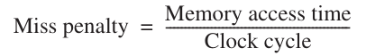

Clock cycle time của các processor lần lượt là 250 ps, 200 ps và 400 ps. Vì thế, miss penalty là

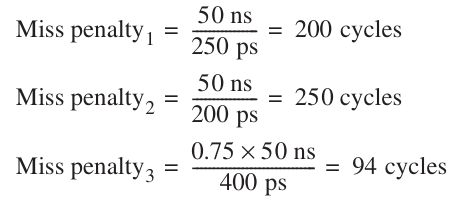

Áp dụng cho từng cache:

Cache CPI<sub>1</sub> = 0.005 × 200 = 1.0

Cache CPI<sub>2</sub> = 0.0055 × 250 = 1.4

Cache CPI<sub>3</sub> = 0.01 × 94 = 0.94

Chúng ta biết phần đóng góp pipeline CPI của mọi processor ngoại trừ processor 3; pipeline CPI của nó được cho bởi:

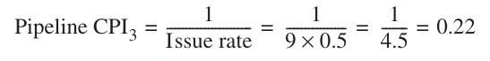

Bây giờ có thể tìm CPI cho từng processor bằng cách cộng phần đóng góp của pipeline CPI và cache CPI:

CPI<sub>1</sub> = 0.8 + 1.0 = 1.8 CPI<sub>2</sub> = 1.0 + 1.4 = 2.4

CPI<sub>3</sub> = 0.22 + 0.94 = 1.16

Vì các processor có cùng architecture, chúng ta có thể so sánh instruction execution rate theo triệu instruction mỗi giây (MIPS) để xác định performance tương đối:

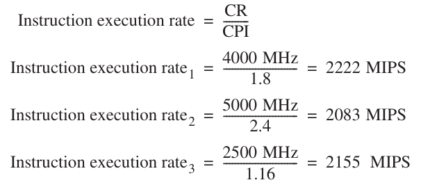

Trong ví dụ này, static superscalar two-issue đơn giản có vẻ tốt nhất. Trên thực tế, performance phụ thuộc vào cả giả định CPI lẫn clock rate.

### Vượt ra ngoài các giới hạn của nghiên cứu này

Giống mọi nghiên cứu giới hạn, nghiên cứu được xem xét trong mục này cũng có những giới hạn riêng. Chúng ta chia chúng thành hai nhóm: giới hạn xuất hiện ngay cả với speculative processor hoàn hảo và giới hạn xuất hiện với một hoặc nhiều mô hình thực tế. Dĩ nhiên, mọi giới hạn nhóm thứ nhất cũng áp dụng cho nhóm thứ hai. Những giới hạn quan trọng nhất áp dụng ngay cả với mô hình hoàn hảo là

1. WAW và WAR hazard qua memory — Nghiên cứu loại bỏ WAW và WAR hazard bằng register renaming, nhưng không loại bỏ trong sử dụng memory. Dù thoạt nhìn những tình huống đó có vẻ hiếm (đặc biệt WAW hazard), chúng phát sinh do cấp phát stack frame. Procedure được gọi tái sử dụng memory location của procedure trước trên stack, và điều này có thể tạo WAW và WAR hazard gây hạn chế không cần thiết. Austin và Sohi [1992] đã khảo sát vấn đề này.

2. Dependence không cần thiết — Với số register vô hạn, mọi register dependence ngoại trừ true register data dependence được loại bỏ. Tuy nhiên, dependence phát sinh từ quan hệ truy hồi hoặc quy ước sinh code có thể đưa vào true data dependence không cần thiết. Một ví dụ là dependence vào biến điều khiển trong for loop đơn giản. Vì biến điều khiển tăng ở mỗi lần lặp, loop chứa ít nhất một dependence. Như trình bày trong Phụ lục H, loop unrolling và tối ưu đại số quyết liệt có thể loại bỏ những phép tính phụ thuộc đó. Nghiên cứu của Wall bao gồm một lượng hạn chế các tối ưu như vậy, nhưng áp dụng mạnh hơn có thể tăng ILP. Ngoài ra, một số quy ước sinh code tạo dependence không cần thiết, đặc biệt việc dùng return address register và register cho stack pointer (được tăng và giảm trong chuỗi call/return). Wall loại bỏ ảnh hưởng của return address register, nhưng dùng stack pointer trong linkage convention có thể gây dependence “không cần thiết”. Postiff và cộng sự [1999] đã khảo sát lợi ích của việc loại bỏ ràng buộc này.

3. Vượt giới hạn data flow — Nếu value prediction hoạt động với độ chính xác cao, nó có thể vượt giới hạn data flow. Cho đến nay, chưa bài nào trong hơn 100 bài báo về chủ đề này đạt cải thiện ILP đáng kể khi dùng phương án dự đoán thực tế. Hiển nhiên, data value prediction hoàn hảo sẽ dẫn tới tính song song thực tế vô hạn, vì có thể dự đoán trước mọi giá trị của mọi instruction.

Với processor less-than-perfect, một số ý tưởng được đề xuất có thể bộc lộ thêm ILP. Một ví dụ là speculate theo nhiều đường. Lam và Wilson [1992] đã thảo luận ý tưởng này, và nghiên cứu trong mục này cũng khảo sát nó. Speculate theo nhiều đường giảm chi phí phục hồi khi dự đoán sai và có thể tìm thêm tính song song. Chỉ có ý nghĩa khi đánh giá phương án này với số branch hạn chế vì resource hardware cần thiết tăng theo hàm mũ. Wall [1993] cung cấp dữ liệu speculate cả hai hướng trên tối đa tám branch. Xét chi phí theo đuổi cả hai đường trong khi biết một đường sẽ bị bỏ (và lượng tính toán vô ích tăng lên khi tiếp tục quá trình này qua nhiều branch), mọi thiết kế thương mại thay vào đó dành hardware bổ sung cho speculation tốt hơn trên đường đúng.

Điều thiết yếu là hiểu rằng không giới hạn nào trong mục này mang tính cơ bản theo nghĩa vượt qua chúng đòi thay đổi định luật vật lý! Thay vào đó, đây là các giới hạn thực tiễn hàm ý có những rào cản rất lớn khi khai thác thêm ILP. Những giới hạn đó — dù là window size, alias detection hay branch prediction — là thách thức để người thiết kế và nhà nghiên cứu vượt qua.

Những nỗ lực phá vỡ các giới hạn này trong năm năm đầu thế kỷ đã gặp nhiều thất vọng. Một số kỹ thuật tạo cải thiện nhỏ, nhưng thường làm tăng đáng kể độ phức tạp, tăng clock cycle và tăng power không tương xứng. Tóm lại, người thiết kế nhận ra rằng cố trích xuất thêm ILP đơn giản là quá kém hiệu quả. Chúng ta sẽ trở lại thảo luận này trong phần kết luận.

## 3.11 Vấn đề Cross-Cutting: Các cách tiếp cận ILP và Memory System

### Hardware Speculation so với Software Speculation

Các cách tiếp cận speculation hardware-intensive trong chương này và cách tiếp cận software trong Phụ lục H cung cấp những phương án thay thế để khai thác ILP. Một số trade-offs và giới hạn được liệt kê dưới đây:

- Để speculate rộng rãi, phải phân biệt được memory reference. Khả năng này khó thực hiện tại thời điểm compile với chương trình integer chứa pointer. Trong phương án hardware-based, việc phân biệt memory address động tại runtime được thực hiện bằng những kỹ thuật đã thấy trong thuật toán Tomasulo. Việc phân biệt cho phép di chuyển load vượt qua store tại runtime. Hỗ trợ speculative memory reference có thể khắc phục tính thận trọng của compiler, nhưng nếu không dùng cẩn thận, overhead của cơ chế phục hồi có thể lấn át các lợi ích.

- Speculation Hardware-based hoạt động tốt hơn khi control flow khó dự đoán và branch prediction hardware-based tốt hơn branch prediction software-based thực hiện tại thời điểm compile. Các thuộc tính này đúng với nhiều chương trình integer. Chẳng hạn, static predictor tốt có misprediction rate khoảng 16% với bốn chương trình integer SPEC92 chính, còn hardware predictor có misprediction rate dưới 10%. Vì instruction được speculate có thể làm tính toán chậm đi khi dự đoán sai, khác biệt này rất đáng kể. Một hệ quả là ngay cả processor được schedule tĩnh cũng thường có dynamic branch predictor.

- Speculation Hardware-based giữ mô hình exception hoàn toàn precise ngay cả với instruction được speculate. Các cách tiếp cận software-based gần đây cũng bổ sung hỗ trợ đặc biệt để cho phép điều này.

- Speculation Hardware-based không cần compensation code hoặc bookkeeping code, vốn cần cho cơ chế software speculation tham vọng.

- Cách tiếp cận Compiler-based có thể hưởng lợi từ khả năng nhìn xa hơn trong chuỗi code, dẫn tới code scheduling tốt hơn cách tiếp cận thuần hardware-driven.

- Speculation Hardware-based kết hợp dynamic scheduling không cần chuỗi code khác nhau để đạt performance tốt trên những implementation khác nhau của một architecture. Dù khó định lượng nhất, ưu điểm này có thể quan trọng nhất về lâu dài. Điều thú vị là đây từng là một động lực của IBM 360/91. Mặt khác, các architecture song song tường minh gần đây hơn, như IA-64, đã thêm tính linh hoạt để giảm hardware dependence vốn có trong chuỗi code.

Nhược điểm chính của việc hỗ trợ speculation bằng hardware là độ phức tạp và resource hardware bổ sung cần thiết. Phải đánh giá chi phí hardware này so với cả độ phức tạp compiler của cách tiếp cận software-based lẫn mức độ và tính hữu ích của những đơn giản hóa trong processor dựa vào compiler đó.

Một số người thiết kế cố kết hợp cách tiếp cận động và compiler-based để đạt điểm tốt nhất của cả hai. Sự kết hợp có thể sinh tương tác thú vị và khó thấy. Chẳng hạn, nếu kết hợp conditional move với register renaming, một tác động phụ tinh tế xuất hiện. Conditional move bị hủy vẫn phải sao chép giá trị tới destination register, vì register đã được rename trước đó trong instruction pipeline. Những tương tác tinh tế này làm phức tạp thiết kế và kiểm chứng, đồng thời có thể giảm performance.

Intel Itanium là máy tính tham vọng nhất từng được thiết kế dựa trên hỗ trợ software cho ILP và speculation. Nó không đáp ứng kỳ vọng của người thiết kế, đặc biệt với code general-purpose không mang tính khoa học. Khi tham vọng khai thác ILP giảm trước những khó khăn đã thảo luận trong Mục 3.10, phần lớn architecture chọn cơ chế hardware-based với issue rate từ ba đến bốn instruction mỗi clock.

### Speculative Execution và Memory System

Processor hỗ trợ speculative execution hoặc conditional instruction vốn có khả năng tạo address không hợp lệ mà sẽ không xuất hiện nếu không có speculative execution. Nếu nhận protection exception, không chỉ hành vi này không đúng mà lợi ích speculative execution còn bị overhead của exception giả lấn át. Vì thế, memory system phải nhận diện instruction thực thi speculative và instruction thực thi có điều kiện, rồi chặn exception tương ứng.

Với lập luận tương tự, không thể cho phép những instruction đó làm cache stall khi miss, vì stall không cần thiết một lần nữa có thể lấn át lợi ích speculation. Vì thế, những processor này phải được ghép với nonblocking cache.

Trên thực tế, penalty của L2 miss lớn tới mức compiler thường chỉ speculate trên L1 miss. Hình 2.5 trang 84 cho thấy với một số chương trình khoa học well-behaved, compiler có thể duy trì nhiều L2 miss outstanding để giảm hiệu quả L2 miss penalty. Một lần nữa, để làm được điều này, memory system phía sau cache phải đáp ứng mục tiêu của compiler về số memory access đồng thời.

## 3.12 Multithreading: Khai thác Thread-Level Parallelism để cải thiện Uniprocessor Throughput

Chủ đề multithreading trong mục này thực sự là chủ đề cross-cutting, vì liên quan tới pipelining và superscalar, graphics processing unit (Chương 4), và multiprocessor (Chương 5). Chúng ta giới thiệu chủ đề ở đây và khảo sát dùng multithreading để tăng uniprocessor throughput bằng nhiều thread che giấu pipeline latency và memory latency. Trong chương tới, chúng ta sẽ thấy multithreading đem lại lợi ích tương tự trên GPU; cuối cùng Chương 5 khảo sát kết hợp multithreading và multiprocessing. Những chủ đề này gắn bó chặt chẽ vì multithreading là kỹ thuật chính để bộc lộ thêm tính song song cho hardware. Theo nghĩa chặt chẽ, multithreading dùng thread-level parallelism nên đúng ra thuộc Chương 5, nhưng vai trò trong cải thiện mức sử dụng pipeline và trong GPU là lý do giới thiệu khái niệm ở đây.

Dù tăng performance bằng ILP có ưu điểm lớn là khá trong suốt với lập trình viên, như đã thấy ILP có thể khá hạn chế hoặc khó khai thác trong một số ứng dụng. Cụ thể, với instruction issue rate hợp lý, khó che giấu cache miss phải truy cập memory hoặc cache off-chip bằng ILP sẵn có. Dĩ nhiên, khi processor stall chờ cache miss, mức sử dụng functional unit giảm mạnh.

Vì nỗ lực che giấu memory stall dài bằng thêm ILP có hiệu quả hạn chế, tự nhiên chúng ta đặt câu hỏi liệu có thể dùng dạng song song khác trong ứng dụng để che giấu memory delay hay không. Chẳng hạn, hệ thống transaction-processing online có tính song song tự nhiên giữa nhiều truy vấn và cập nhật do các request đưa tới. Dĩ nhiên, nhiều ứng dụng khoa học chứa tính song song tự nhiên vì thường mô hình hóa cấu trúc three-dimensional song song của tự nhiên; cấu trúc đó có thể được khai thác bằng các thread riêng. Ngay cả ứng dụng desktop dùng operating system Windows-based hiện đại cũng thường có nhiều ứng dụng hoạt động, cung cấp nguồn tính song song.

Multithreading cho phép nhiều thread chia sẻ functional unit của một processor theo cách chồng lấp. Ngược lại, phương pháp tổng quát hơn để khai thác thread-level parallelism (TLP) là multiprocessor có nhiều thread độc lập hoạt động cùng lúc và song song. Tuy nhiên, multithreading không nhân bản toàn bộ processor như multiprocessor. Thay vào đó, nó chia sẻ phần lớn processor core giữa một tập thread, chỉ nhân bản private state như register và program counter. Như sẽ thấy trong Chương 5, nhiều processor gần đây vừa tích hợp nhiều processor core trên một chip vừa cung cấp multithreading trong mỗi core.

Nhân bản per-thread state của processor core nghĩa là tạo register file riêng, PC riêng và page table riêng cho mỗi thread. Bản thân memory có thể được chia sẻ qua cơ chế virtual memory vốn đã hỗ trợ multiprogramming. Ngoài ra, hardware phải hỗ trợ chuyển sang thread khác tương đối nhanh; cụ thể, thread switch phải hiệu quả hơn nhiều so với process switch, vốn thường cần hàng trăm tới hàng nghìn processor cycle. Dĩ nhiên, để hardware multithreading cải thiện performance, chương trình phải có nhiều thread (đôi khi nói ứng dụng là multithreaded) có thể thực thi đồng thời. Những thread này được compiler nhận diện (thường từ ngôn ngữ có cấu trúc thể hiện tính song song) hoặc do lập trình viên xác định.

Có ba cách tiếp cận hardware chính cho multithreading. Multithreading Fine-grained chuyển thread ở mỗi clock, khiến instruction từ nhiều thread thực thi xen kẽ. Việc xen kẽ thường theo kiểu round-robin, bỏ qua thread đang stall. Một ưu điểm then chốt của multithreading fine-grained là che giấu tổn thất throughput do cả stall ngắn lẫn dài, vì có thể thực thi instruction từ thread khác khi một thread stall, ngay cả khi chỉ stall vài cycle. Nhược điểm chính của multithreading fine-grained là làm chậm thực thi từng thread, vì thread sẵn sàng thực thi không stall vẫn bị instruction từ thread khác trì hoãn. Nó đánh đổi performance của một thread (đo bằng latency) để tăng multithreaded throughput. Sun Niagara, được khảo sát ngay sau đây, dùng multithreading fine-grained đơn giản, cũng như Nvidia GPU sẽ được xem trong chương tới.

Multithreading Coarse-grained được phát minh như phương án thay thế multithreading fine-grained. Multithreading Coarse-grained chỉ chuyển thread khi gặp stall tốn kém, như cache miss mức hai hoặc ba. Thay đổi này giảm yêu cầu thread-switching về cơ bản phải miễn phí và ít có khả năng làm chậm thực thi một thread hơn nhiều, vì chỉ issue instruction từ thread khác khi một thread gặp stall tốn kém.

Tuy nhiên, multithreading Coarse-grained có nhược điểm lớn: khả năng khắc phục tổn thất throughput hạn chế, đặc biệt với stall ngắn. Giới hạn bắt nguồn từ chi phí start-up của pipeline trong multithreading coarse-grained. Vì CPU có multithreading coarse-grained issue instruction từ một thread, khi stall xảy ra, pipeline xuất hiện bubble trước khi thread mới bắt đầu thực thi. Do overhead start-up này, multithreading coarse-grained hữu ích hơn nhiều để giảm penalty của stall high-cost, khi thời gian nạp lại pipeline không đáng kể so với thời gian stall. Một số dự án nghiên cứu khảo sát coarse grained multithreading, nhưng không processor chủ yếu nào hiện dùng kỹ thuật này.

Implementation multithreading phổ biến nhất được gọi là Simultaneous multithreading (SMT). Simultaneous multithreading là biến thể của multithreading fine-grained xuất hiện tự nhiên khi triển khai multithreading fine-grained trên processor multiple-issue được schedule động. Giống những dạng multithreading khác, SMT dùng thread-level parallelism để che giấu sự kiện long-latency trong processor, tăng mức sử dụng functional unit. Nhận định then chốt của SMT là register renaming và dynamic scheduling cho phép nhiều instruction từ thread độc lập thực thi mà không cần xét dependence giữa chúng; khả năng dynamic scheduling có thể xử lý dependence.

Hình 3.28 minh họa về mặt khái niệm khác biệt trong khả năng khai thác resource superscalar của những cấu hình processor sau:

- Superscalar không hỗ trợ multithreading

- Superscalar có multithreading coarse-grained

- Superscalar có multithreading fine-grained

- Superscalar có simultaneous multithreading

Trong superscalar không hỗ trợ multithreading, việc sử dụng issue slot bị giới hạn do thiếu ILP, gồm cả ILP để che giấu memory latency. Vì L2 và L3 cache miss kéo dài, phần lớn processor có thể nhàn rỗi.

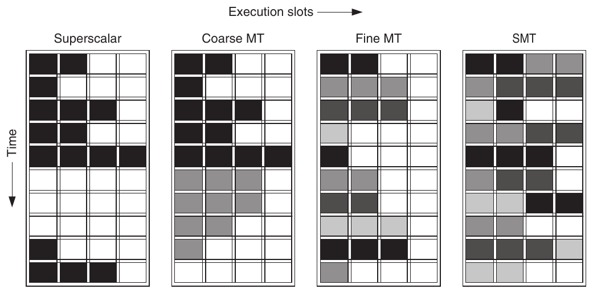

**Hình 3.28 Cách bốn phương án sử dụng functional unit execution slot của superscalar processor. Chiều ngang biểu diễn khả năng thực thi instruction trong mỗi clock cycle. Chiều dọc biểu diễn chuỗi clock cycle. Ô trống (trắng) cho biết execution slot tương ứng không được dùng trong clock cycle đó. Các sắc xám và đen tương ứng bốn thread khác nhau trong processor multithreading. Màu đen cũng chỉ issue slot có sử dụng trong superscalar không hỗ trợ multithreading. Sun T1 và T2 (còn gọi là Niagara) là processor multithreaded fine-grained, còn Intel Core i7 và IBM Power7 dùng SMT. T2 có tám thread, Power7 có bốn và Intel i7 có hai. Trong mọi SMT hiện có, instruction chỉ được issue từ một thread tại một thời điểm. Khác biệt của SMT là quyết định thực thi instruction sau đó được tách rời và có thể thực thi các operation đến từ nhiều instruction khác nhau trong cùng clock cycle.**

Trong superscalar multithreaded coarse-grained, stall dài được che giấu một phần bằng chuyển sang thread khác sử dụng resource của processor. Việc chuyển này giảm số clock cycle hoàn toàn nhàn rỗi. Tuy nhiên, trong processor multithreaded coarse-grained, chỉ chuyển thread khi có stall. Vì thread mới có thời kỳ start-up, có khả năng vẫn còn một số cycle hoàn toàn nhàn rỗi.

Trong trường hợp fine-grained, xen kẽ thread có thể loại bỏ slot hoàn toàn trống. Ngoài ra, vì đổi thread issue ở mỗi clock cycle, có thể che giấu operation có latency dài hơn. Vì instruction issue và execution gắn với nhau, thread chỉ có thể issue số instruction đã sẵn sàng. Với issue width hẹp, đây không phải vấn đề (một cycle hoặc được dùng hoặc không), nên multithreading fine-grained hoạt động hoàn hảo với single issue processor và SMT không có ý nghĩa. Thực tế, Sun T2 có hai issue mỗi clock nhưng từ các thread khác nhau. Điều này loại bỏ nhu cầu triển khai dynamic scheduling phức tạp, thay vào đó dựa vào nhiều thread hơn để che giấu latency.

Nếu triển khai threading fine-grained trên processor multiple-issue được schedule động, kết quả là SMT. Trong mọi implementation SMT hiện có, mọi issue đến từ một thread, dù instruction từ các thread khác nhau có thể bắt đầu thực thi trong cùng cycle, dùng dynamic scheduling hardware để xác định instruction sẵn sàng. Dù Hình 3.28 đơn giản hóa rất nhiều hoạt động thực tế, nó minh họa lợi thế performance tiềm năng của multithreading nói chung và SMT trong processor issue rộng hơn, được schedule động.

Simultaneous multithreading tận dụng nhận định rằng processor được schedule động đã có nhiều cơ chế hardware cần thiết để hỗ trợ nó, gồm virtual register set lớn. Có thể xây dựng multithreading trên processor out-of-order bằng cách thêm renaming table per-thread, giữ các PC riêng và cung cấp khả năng commit instruction từ nhiều thread.

### Hiệu quả của Multithreading Fine-Grained trên Sun T1

Trong phần này, chúng ta dùng processor Sun T1 để khảo sát khả năng che giấu latency của multithreading. T1 là multicore microprocessor multithreaded fine-grained được Sun giới thiệu năm 2005. Điều khiến T1 đặc biệt thú vị là nó gần như hoàn toàn tập trung vào khai thác thread-level parallelism (TLP) thay vì instruction-level parallelism (ILP). T1 từ bỏ việc tập trung cao độ vào ILP (chỉ một thời gian ngắn sau khi những ILP processor mạnh tay nhất từng có được giới thiệu), quay lại chiến lược pipeline đơn giản và tập trung vào khai thác TLP, sử dụng cả nhiều core lẫn multithreading để tạo throughput.

Mỗi processor T1 chứa tám processor core, mỗi core hỗ trợ bốn thread. Mỗi processor core gồm pipeline six-stage, single-issue đơn giản (pipeline RISC five-stage chuẩn như ở Phụ lục C, thêm một stage để chuyển thread). T1 sử dụng multithreading fine-grained (nhưng không phải SMT), chuyển sang thread mới mỗi clock cycle; khi scheduling, nó bỏ qua những thread idle vì đang chờ do pipeline delay hoặc cache miss. Processor chỉ idle khi cả bốn thread đều idle hoặc stalled. Cả load lẫn branch đều chịu three-cycle delay chỉ có thể được che giấu bằng thread khác. Một tập floating-point functional unit duy nhất được cả tám core chia sẻ, vì floating-point performance không phải trọng tâm của T1. Hình 3.29 tổng kết processor T1.

| Đặc tính | Sun T1 |
|---|---|
| Hỗ trợ multiprocessor và multithreading | Tám core mỗi chip; bốn thread mỗi core. Thread scheduling Fine-grained. Một floating-point unit dùng chung cho tám core. Chỉ hỗ trợ multiprocessing on-chip. |
| Cấu trúc pipeline | Pipeline six-deep đơn giản, in-order, có three-cycle delay cho load và branch. |
| L1 cache | Instruction 16 KB; data 8 KB. Block size 64-byte. Miss tới L2 mất 23 cycle, giả sử không có contention. |
| L2 cache | Bốn L2 cache riêng, mỗi cache 750 KB và gắn với một memory bank. Block size 64-byte. Miss tới main memory mất 110 clock cycle, giả sử không có contention. |
| Implementation ban đầu | Process 90 nm; clock rate tối đa 1.2 GHz; power 79 W; 300 M transistor; die 379 mm<sup>2</sup>. |

**Hình 3.29 Tổng kết processor T1.**

#### Unicore Performance của Multithreading trên T1

T1 lấy TLP làm trọng tâm, cả qua multithreading trên từng core lẫn sử dụng nhiều core đơn giản trên một die. Trong phần này, chúng ta xem hiệu quả của T1 khi tăng performance của một core nhờ multithreading fine-grained. Ở Chương 5, chúng ta sẽ trở lại khảo sát hiệu quả của việc kết hợp multithreading với nhiều core.

Để khảo sát performance của T1, chúng ta dùng ba benchmark server-oriented: TPC-C, SPECJBB (SPEC Java Business Benchmark) và SPECWeb99. Vì nhiều thread làm tăng nhu cầu memory từ một processor, chúng có thể làm memory system quá tải, làm giảm lợi ích tiềm năng của multithreading. Hình 3.30 cho thấy mức tăng tương đối của miss rate và miss latency quan sát được khi thực thi một thread mỗi core so với bốn thread mỗi core cho TPC-C. Cả miss rate lẫn miss latency đều tăng do contention trong memory system tăng. Miss latency tăng tương đối ít cho thấy memory system vẫn còn năng lực chưa được sử dụng.

Bằng cách xem hành vi của một thread trung bình, chúng ta có thể hiểu tương tác giữa các thread và khả năng giữ core bận của chúng. Hình 3.31 cho thấy phần trăm cycle mà thread đang thực thi, sẵn sàng nhưng không thực thi, và chưa sẵn sàng. Nhớ rằng chưa sẵn sàng không có nghĩa core chứa thread đó bị stall; chỉ khi cả bốn thread đều chưa sẵn sàng thì core mới stall.

Thread có thể chưa sẵn sàng do cache miss, pipeline delay (phát sinh từ instruction có latency dài như branch, load, floating point hoặc integer multiply/divide) và nhiều tác động nhỏ khác. Hình 3.32 trình bày tần suất tương đối của các nguyên nhân này. Tác động cache khiến thread chưa sẵn sàng trong 50% đến 75% thời gian, với L1 instruction miss, L1 data miss và L2 miss đóng góp gần bằng nhau. Delay tiềm năng từ pipeline (gọi là “pipeline delay”) nghiêm trọng nhất trong SPECJBB và có thể bắt nguồn từ branch frequency cao hơn của nó.

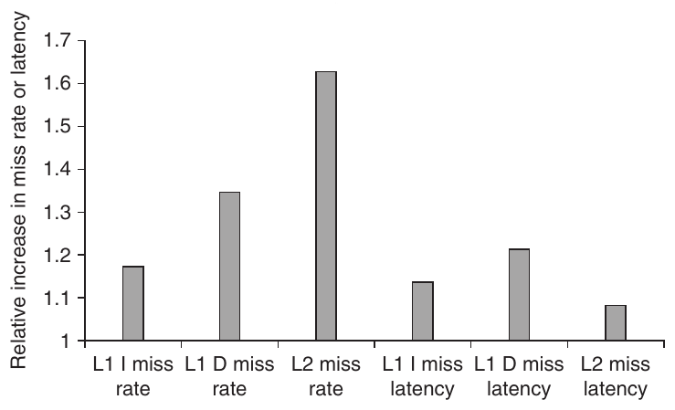

**Hình 3.30 Thay đổi tương đối của miss rate và miss latency khi thực thi một thread mỗi core so với bốn thread mỗi core trên benchmark TPC-C. Latency là thời gian thực tế để trả dữ liệu được yêu cầu sau một miss. Trong trường hợp four-thread, việc thực thi thread khác có thể che giấu phần lớn latency này.**

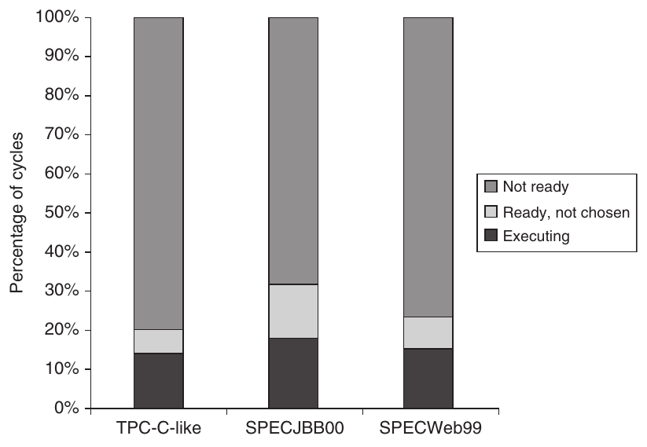

**Hình 3.31 Phân tích trạng thái của một thread trung bình. “Đang thực thi” nghĩa là thread issue một instruction trong cycle đó. “Sẵn sàng nhưng không được chọn” nghĩa là nó có thể issue nhưng thread khác đã được chọn, còn “chưa sẵn sàng” chỉ thread đang chờ một event hoàn tất (ví dụ pipeline delay hoặc cache miss).**

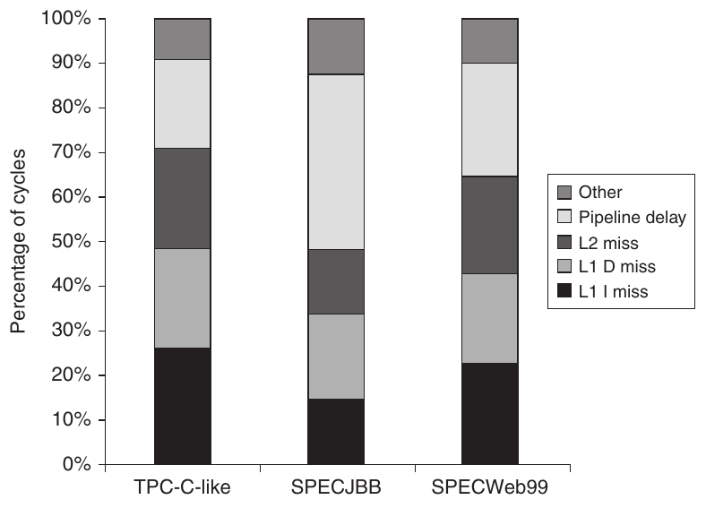

**Hình 3.32 Phân tích nguyên nhân khiến thread chưa sẵn sàng. Đóng góp vào nhóm “khác” thay đổi tùy trường hợp. Trong TPC-C, store buffer đầy đóng góp lớn nhất; trong SPEC-JBB, atomic instruction đóng góp lớn nhất; trong SPECWeb99, cả hai yếu tố đều đóng góp.**

| Benchmark | Per-thread CPI | Per-core CPI |
|---|---|---|
| TPC-C | 7.2 | 1.80 |
| SPECJBB | 5.6 | 1.40 |
| SPECWeb99 | 6.6 | 1.65 |

**Hình 3.33 CPI per-thread, CPI per-core, effective CPI eight-core và effective IPC (nghịch đảo CPI) của processor T1 eight-core.**

Hình 3.33 cho thấy CPI per-thread và per-core. Vì T1 là multithreaded processor fine-grained với bốn thread mỗi core, khi có đủ parallelism, effective CPI lý tưởng mỗi thread sẽ bằng bốn, vì điều đó nghĩa là mỗi thread dùng một trong bốn cycle. CPI lý tưởng mỗi core bằng một. Năm 2005, IPC của những benchmark này chạy trên ILP core mạnh tay sẽ tương tự IPC trên T1 core. Tuy nhiên, kích thước T1 core rất khiêm tốn so với các ILP core mạnh tay năm 2005, vì thế T1 có tám core so với hai đến bốn core của processor cùng thời khác. Do đó, khi được giới thiệu năm 2005, processor Sun T1 có performance tốt nhất trên integer application có TLP phong phú và yêu cầu memory performance cao, như SPECJBB và transaction processing workload.

### Hiệu quả của Simultaneous Multithreading trên Superscalar Processor

Một câu hỏi then chốt là: triển khai SMT có thể đem lại bao nhiêu performance? Khi câu hỏi này được nghiên cứu năm 2000–2001, các nhà nghiên cứu giả định dynamic superscalar sẽ rộng hơn nhiều trong năm năm tiếp theo, hỗ trợ sáu đến tám issue mỗi clock với speculative dynamic scheduling, nhiều load và store đồng thời, primary cache lớn và bốn đến tám context với issue và retirement đồng thời từ nhiều context. Chưa processor nào tiến gần mức đó.

Vì vậy, kết quả nghiên cứu mô phỏng cho thấy mức tăng gấp hai hoặc hơn với multiprogrammed workload là không thực tế. Trên thực tế, implementation SMT hiện có chỉ cung cấp hai đến bốn context với fetching và issue chỉ từ một context, tối đa bốn issue mỗi clock. Kết quả là lợi ích của SMT cũng khiêm tốn hơn.

Ví dụ, trong Pentium 4 Extreme được triển khai trong server HP-Compaq, sử dụng SMT đem lại performance improvement 1.01 khi chạy benchmark SPECintRate và khoảng 1.07 khi chạy SPECfpRate. Tuck và Tullsen [2003] báo cáo rằng trên benchmark song song SPLASH, họ thấy multithreaded speedup single-core từ 1.02 đến 1.67, với average speedup khoảng 1.22.

Nhờ các phép đo gần đây rất sâu rộng và giàu thông tin của Esmaeilzadeh và cộng sự [2011], chúng ta có thể xem lợi ích performance và energy của SMT trên một i7 core bằng một tập multithreaded application. Benchmark được dùng gồm tập scientific application song song và tập chương trình Java multithreaded từ bộ DaCapo và SPEC Java, tổng kết trong Hình 3.34. Intel i7 hỗ trợ SMT với hai thread. Hình 3.35 trình bày performance ratio và energy efficiency ratio của các benchmark này chạy trên một i7 core khi tắt và bật SMT. (Chúng ta vẽ energy efficiency ratio, nghịch đảo energy consumption, để giống speedup, tỷ số cao hơn là tốt hơn.)

Harmonic mean của speedup cho Java benchmark là 1.28, dù có hai benchmark đạt mức tăng nhỏ. Hai benchmark này, pjbb2005 và tradebeans, tuy multithreaded nhưng có parallelism hạn chế. Chúng được đưa vào vì điển hình cho multithreaded benchmark có thể chạy trên SMT processor với hy vọng khai thác thêm performance, mà chúng chỉ tìm được lượng hạn chế. PARSEC benchmark có speedup tốt hơn đôi chút so với toàn bộ Java benchmark (harmonic mean 1.31). Nếu bỏ tradebeans và pjbb2005, Java workload thực ra có speedup tốt hơn đáng kể (1.39) so với PARSEC benchmark. (Xem thảo luận về ý nghĩa của việc dùng harmonic mean để tổng kết kết quả trong chú thích Hình 3.36.)

Energy consumption được quyết định bởi sự kết hợp giữa speedup và mức tăng power consumption. Với Java benchmark, trung bình SMT cho energy efficiency bằng non-SMT (trung bình 1.0), nhưng hai benchmark hoạt động kém kéo mức này xuống; không có tradebeans và pjbb2005, average energy efficiency của Java benchmark là 1.06, gần như tốt bằng PARSEC benchmark. Với PARSEC benchmark, SMT giảm energy theo 1 − (1/1.08) = 7%. Rất khó tìm được những cải tiến performance energy-reducing như vậy. Dĩ nhiên, chi phí static power gắn với SMT đều phải chịu trong cả hai trường hợp, nên kết quả có lẽ phóng đại đôi chút lợi ích energy.

```
blackscholes       Prices a portfolio of options with the Black-Scholes PDE
bodytrack          Tracks a markerless human body
canneal            Minimizes routing cost of a chip with cache-aware simulated annealing
facesim            Simulates motions of a human face for visualization purposes
ferret             Search engine that finds a set of images similar to a query image
fluidanimate       Simulates physics of fluid motion for animation with SPH algorithm
raytrace           Uses physical simulation for visualization
streamcluster      Computes an approximation for the optimal clustering of data points
swaptions          Prices a portfolio of swap options with the Heath–Jarrow–Morton framework
vips               Applies a series of transformations to an image
x264               MPG-4 AVC/H.264 video encoder

eclipse Integrated development environment
lusearch           Text search tool
sunflow            Photo-realistic rendering system
tomcat Tomcat servlet container
tradebeans Tradebeans Daytrader benchmark
xalan              An XSLT processor for transforming XML documents
```

pjbb2005 Phiên bản của SPEC JBB2005 (nhưng cố định problem size thay vì thời gian)

**Hình 3.34 Những parallel benchmark dùng ở đây để khảo sát multithreading, cũng như ở Chương 5 để khảo sát multiprocessing với i7. Nửa trên biểu đồ gồm PARSEC benchmark do Biena và cộng sự [2008] thu thập. PARSEC benchmark nhằm đại diện cho các ứng dụng song song compute-intensive phù hợp multicore processor. Nửa dưới gồm multithreaded Java benchmark từ bộ DaCapo (xem Blackburn và cộng sự [2006]) và pjbb2005 từ SPEC. Tất cả benchmark này đều có một mức parallelism; Java benchmark khác trong DaCapo và SPEC Java workload dùng nhiều thread nhưng có ít hoặc không có parallelism thực, nên không được dùng ở đây. Xem Esmaeilzadeh và cộng sự [2011] để có thông tin thêm về đặc tính những benchmark này liên quan đến các phép đo ở đây và Chương 5.**

Những kết quả này cho thấy rõ SMT trong speculative processor mạnh tay có hỗ trợ SMT sâu rộng có thể cải thiện performance theo cách sử dụng energy hiệu quả, điều các cách ILP mạnh tay hơn chưa làm được. Năm 2011, sự cân bằng giữa cung cấp nhiều core đơn giản hơn và ít core tinh vi hơn đã nghiêng về nhiều core hơn, mỗi core thường là superscalar three- đến four-issue với SMT hỗ trợ hai đến bốn thread. Thật vậy, Esmaeilzadeh và cộng sự [2011] cho thấy cải thiện energy từ SMT còn lớn hơn trên Intel i5 (processor tương tự i7 nhưng cache nhỏ hơn, clock rate thấp hơn) và Intel Atom (processor 80×86 thiết kế cho thị trường netbook, mô tả trong Mục 3.14).

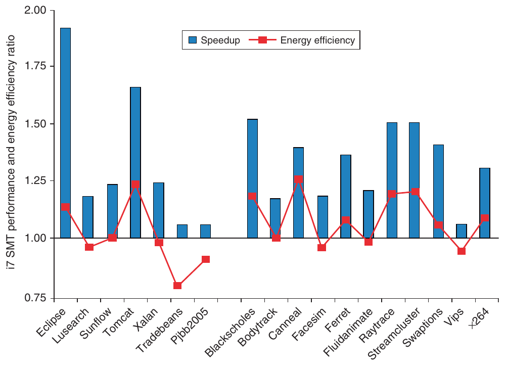

**Hình 3.35 Speedup từ multithreading trên một core của i7 trung bình là 1.28 cho Java benchmark và 1.31 cho PARSEC benchmark (dùng unweighted harmonic mean, hàm ý workload có tổng thời gian thực thi mỗi benchmark trong tập cơ sở single-threaded bằng nhau). Energy efficiency trung bình lần lượt 0.99 và 1.07 (dùng harmonic mean). Nhớ rằng energy efficiency trên 1.0 cho thấy tính năng giảm execution time nhiều hơn mức tăng average power. Hai Java benchmark có ít speedup nên energy efficiency âm đáng kể. Turbo Boost tắt trong mọi trường hợp. Dữ liệu do Esmaeilzadeh và cộng sự [2011] thu thập, phân tích bằng Java 1.6.0 Virtual Machine Oracle (Sun) HotSpot build 16.3-b01 và native compiler gcc v4.4.1.**

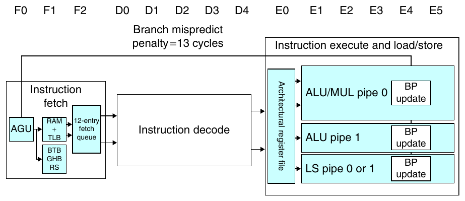

**Hình 3.36 Cấu trúc cơ bản của A8 pipeline gồm 13 stage. Ba cycle được dùng cho instruction fetch, bốn cycle cho instruction decode, ngoài five-cycle integer pipeline. Điều này tạo 13-cycle branch misprediction penalty. Instruction fetch unit cố giữ đầy instruction queue 12-entry.**

## 3.13 Kết hợp mọi thứ: Intel Core i7 và ARM Cortex-A8

Trong phần này, chúng ta khám phá thiết kế của hai multiple issue processor: ARM Cortex-A8 core, dùng làm nền tảng cho processor Apple A9 trong iPad, cũng như processor trong Motorola Droid và iPhone 3GS, 4; và Intel Core i7, một speculative processor high-end được dynamically scheduled, dành cho desktop high-end và server application. Chúng ta bắt đầu với processor đơn giản hơn.

### ARM Cortex-A8

A8 là superscalar dual-issue được statically scheduled với dynamic issue detection, cho phép processor issue một hoặc hai instruction mỗi clock. Hình 3.36 cho thấy cấu trúc cơ bản của pipeline 13-stage.

A8 dùng dynamic branch predictor có branch target buffer 512-entry two-way set associative và global history buffer 4K-entry, được đánh chỉ mục bằng branch history và PC hiện tại. Khi branch target buffer miss, dự đoán được lấy từ global history buffer, sau đó có thể được dùng để tính branch address. Ngoài ra, return stack eight-entry được giữ để theo dõi return address. Dự đoán sai gây 13-cycle penalty do pipeline bị flush.

Hình 3.37 trình bày instruction decode pipeline. Tối đa hai instruction mỗi clock có thể được issue bằng mechanism in-order issue. Một scoreboard structure đơn giản được dùng để theo dõi khi nào instruction có thể issue. Một cặp dependent instruction có thể đi qua issue logic, nhưng dĩ nhiên chúng sẽ được serialized tại scoreboard, trừ khi có thể issue sao cho forwarding path giải quyết dependence.

Hình 3.38 cho execution pipeline của processor A8. Instruction 1 hoặc instruction 2 đều có thể đi tới load/store pipeline. Full bypassing được hỗ trợ giữa các pipeline. ARM Cortex-A8 pipeline dùng superscalar two-issue statically scheduled đơn giản để có clock rate tương đối cao với power thấp hơn. Ngược lại, i7 dùng cấu trúc speculative pipeline four-issue dynamically scheduled tương đối mạnh tay.

#### Performance của A8 Pipeline

A8 có CPI lý tưởng 0.5 nhờ cấu trúc dual-issue. Pipeline stall có thể phát sinh từ ba nguồn:

1. Functional hazard, xảy ra vì hai instruction liền kề được chọn issue đồng thời dùng cùng functional pipeline. Vì A8 được statically scheduled, nhiệm vụ compiler là cố tránh conflict này. Khi không tránh được, A8 chỉ có thể issue tối đa một instruction trong cycle đó.

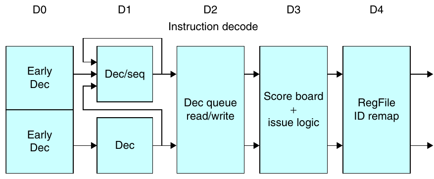

**Hình 3.37 Instruction decode five-stage của A8. Trong stage đầu, PC do fetch unit tạo (từ branch target buffer hoặc PC incrementer) được dùng để lấy block 8-byte từ cache. Tối đa hai instruction được decode và đặt vào decode queue; nếu không instruction nào là branch, PC được tăng cho lần fetch sau. Khi đã vào decode queue, scoreboard logic quyết định lúc instruction có thể issue. Trong issue, register operand được đọc; nhớ rằng trong scoreboard đơn giản, operand luôn đến từ register. Register operand và opcode được gửi tới phần instruction execution của pipeline.**

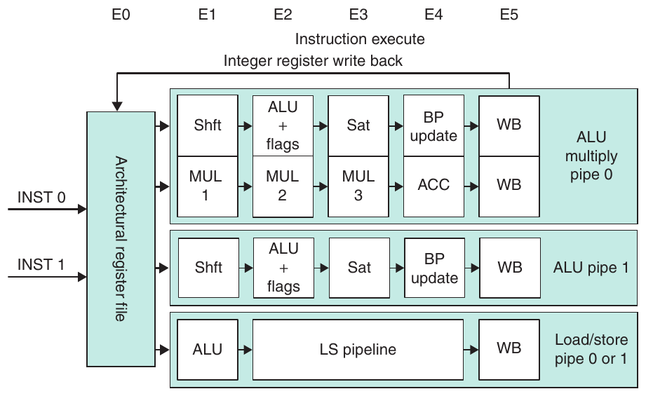

**Hình 3.38 Instruction decode five-stage của A8. Multiply operation luôn được thực hiện trong ALU pipeline 0.**

2. Data hazard, được phát hiện sớm trong pipeline và có thể stall cả hai instruction (nếu instruction đầu không thể issue, instruction thứ hai luôn bị stall) hoặc instruction thứ hai của cặp. Compiler chịu trách nhiệm ngăn những stall này khi có thể.

3. Control hazard, chỉ phát sinh khi branch bị mispredict.

Ngoài pipeline stall, cả L1 miss và L2 miss đều gây stall.

Hình 3.39 cung cấp ước tính các yếu tố đóng góp vào CPI thực của Minnespec benchmark đã gặp ở Chương 2. Như thấy được, pipeline delay chứ không phải memory stall đóng góp chính vào CPI. Một phần nguyên nhân là Minnespec có cache footprint nhỏ hơn full SPEC hoặc chương trình lớn khác.

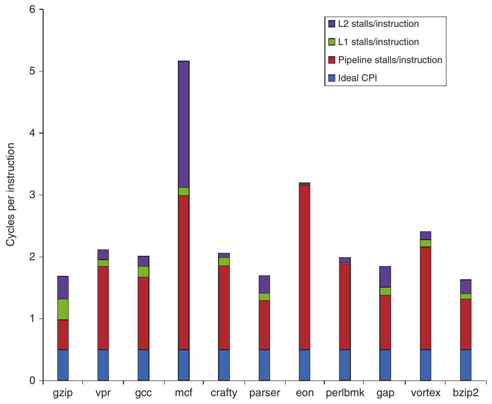

**Hình 3.39 Thành phần CPI ước tính trên ARM A8 cho thấy pipeline stall là phần bổ sung chính vào base CPI. eon đáng được nhắc riêng vì thực hiện tính toán đồ họa integer-based (ray tracing), có rất ít cache miss. Nó thiên về tính toán với nhiều phép nhân, và multiply pipeline duy nhất trở thành bottleneck lớn. Ước tính này dùng L1, L2 miss rate và penalty để tính số stall do L1, L2 mỗi instruction. Trừ chúng khỏi CPI đo bằng detailed simulator để thu được pipeline stall. Pipeline stall gồm cả ba hazard và tác động nhỏ như way misprediction.**

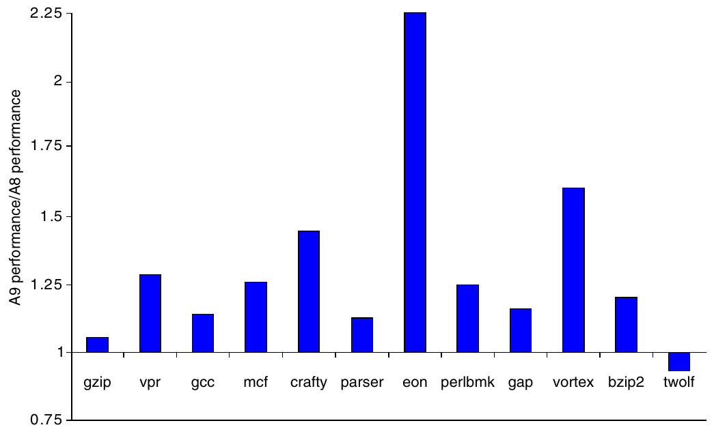

**Hình 3.40 Performance ratio của A9 so với A8, cùng dùng clock 1 GHz và cache size L1, L2 giống nhau, cho thấy A9 nhanh hơn khoảng 1.28 lần. Cả hai lần chạy dùng primary cache 32 KB và secondary cache 1 MB, là 8-way set associative cho A8 và 16-way cho A9. Cache block size bằng 64 byte với A8, 32 byte với A9. Như đã nêu trong chú thích Hình 3.39, eon dùng integer multiply nhiều; kết hợp dynamic scheduling và multiply pipeline nhanh hơn cải thiện đáng kể performance của A9. twolf chậm đi đôi chút, có lẽ vì cache behavior kém hơn với L1 block size nhỏ hơn của A9.**

Nhận thức rằng pipeline stall gây mất performance đáng kể có lẽ đóng vai trò then chốt trong quyết định biến ARM Cortex-A9 thành dynamically scheduled superscalar. A9, như A8, issue tối đa hai instruction mỗi clock, nhưng dùng dynamic scheduling và speculation. Tối đa bốn pending instruction (hai ALU, một load/store hoặc FP/multimedia và một branch) có thể bắt đầu thực thi trong một clock cycle. A9 dùng branch predictor mạnh hơn, instruction cache prefetch và nonblocking L1 data cache. Hình 3.40 cho thấy A9 vượt A8 trung bình theo hệ số 1.28, giả sử cùng clock rate và cấu hình cache gần như giống hệt.

### Intel Core i7

i7 dùng speculative microarchitecture out-of-order mạnh tay với pipeline tương đối sâu, nhằm đạt instruction throughput cao bằng cách kết hợp multiple issue và clock rate cao. Hình 3.41 trình bày cấu trúc tổng thể i7 pipeline. Chúng ta khảo sát pipeline từ instruction fetch tới instruction commit, theo các bước được ghi nhãn trong hình.

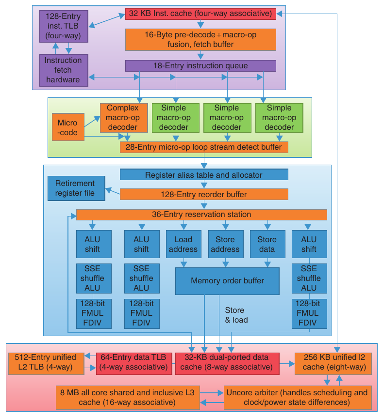

**Hình 3.41 Cấu trúc Intel Core i7 pipeline cùng các thành phần memory system. Tổng pipeline depth là 14 stage, branch misprediction mất 17 cycle. Có 48 load buffer và 32 store buffer. Sáu functional unit độc lập đều có thể bắt đầu thực thi ready micro-op trong cùng cycle.**

1. Instruction fetch—Processor dùng multilevel branch target buffer để cân bằng tốc độ và prediction accuracy. Cũng có return address stack để tăng tốc function return. Misprediction gây penalty khoảng 15 cycle. Dùng predicted address, instruction fetch unit lấy 16 byte từ instruction cache.

2. 16 byte được đặt vào predecode instruction buffer—Trong bước này, quá trình macro-op fusion được thực hiện. Macro-op fusion lấy tổ hợp instruction như compare theo sau bởi branch và gộp thành một operation. Predecode stage cũng tách 16 byte thành x86 instruction riêng. Predecode này không đơn giản vì độ dài x86 instruction có thể từ 1 đến 17 byte, predecoder phải xem qua một số byte mới biết độ dài instruction. Các x86 instruction riêng (gồm cả một số fused instruction) được đặt vào instruction queue 18-entry.

3. Micro-op decode—Từng x86 instruction được dịch thành micro-ops. Micro-ops là instruction MIPS-like đơn giản có thể được pipeline thực thi trực tiếp; cách dịch x86 instruction set thành operation đơn giản dễ pipeline hơn này được giới thiệu trong Pentium Pro năm 1997 và được dùng từ đó. Ba decoder xử lý x86 instruction dịch thẳng thành một micro-op. Với x86 instruction có semantics phức tạp hơn, microcode engine tạo chuỗi micro-op; nó tạo được tối đa bốn micro-ops mỗi cycle và tiếp tục tới khi tạo đủ chuỗi micro-op cần thiết. Các micro-ops được đặt theo thứ tự x86 instruction vào micro-op buffer 28-entry.

4. micro-op buffer thực hiện loop stream detection và microfusion—Nếu có chuỗi instruction nhỏ (ít hơn 28 instruction hoặc ngắn hơn 256 byte) tạo thành loop, loop stream detector sẽ tìm loop, issue trực tiếp micro-ops từ buffer, loại bỏ nhu cầu kích hoạt instruction fetch và instruction decode stage. Microfusion kết hợp cặp instruction như load/ALU operation và ALU operation/store, issue chúng tới một reservation station (nơi chúng vẫn có thể issue độc lập), nhờ đó tăng mức sử dụng buffer. Khi nghiên cứu Intel Core architecture, vốn cũng có microfusion và macrofusion, Bird và cộng sự [2007] thấy microfusion ít tác động tới performance, còn macrofusion dường như có tác động tích cực vừa phải lên integer performance và ít tác động tới floating-point performance.

5. Thực hiện instruction issue cơ bản—Tra vị trí register trong register table, rename register, cấp phát reorder buffer entry, fetch mọi kết quả từ register hoặc reorder buffer trước khi gửi micro-ops tới reservation station.

6. i7 dùng centralized reservation station 36-entry được sáu functional unit chia sẻ. Tối đa sáu micro-ops có thể được dispatch tới functional unit mỗi clock cycle.

7. Micro-ops được từng functional unit thực thi, rồi kết quả được gửi về mọi reservation station đang chờ và tới register retirement unit, nơi chúng cập nhật register state khi đã biết instruction không còn speculative. Entry tương ứng với instruction trong reorder buffer được đánh dấu hoàn tất.

8. Khi một hoặc nhiều instruction ở đầu reorder buffer đã được đánh dấu hoàn tất, pending write trong register retirement unit được thực hiện, và instruction được loại khỏi reorder buffer.

#### Performance của i7

Trong các phần trước, chúng ta khảo sát performance của branch predictor i7 và SMT. Phần này xem single-thread pipeline performance. Vì có speculation mạnh tay và nonblocking cache, rất khó quy chính xác khoảng cách giữa performance lý tưởng và thực tế cho từng nguyên nhân. Như sẽ thấy, tương đối ít stall xảy ra vì instruction không thể issue. Ví dụ chỉ khoảng 3% load bị trì hoãn vì không có reservation station. Phần lớn tổn thất đến từ branch mispredict hoặc cache miss. Branch mispredict mất 15 cycle, L1 miss khoảng 10 cycle; L2 miss tốn hơn ba lần L1 miss một chút, L3 miss tốn khoảng 13 lần L1 miss (130–135 cycle)! Dù processor cố tìm instruction khác để thực thi khi L3 miss và một số L2 miss, có khả năng một số buffer đầy trước khi miss hoàn tất, khiến processor ngừng issue instruction.

Để khảo sát chi phí mispredict và speculation sai, Hình 3.42 cho tỷ lệ công việc (đo bằng số micro-ops được dispatch vào pipeline) không retire (tức kết quả bị hủy) so với toàn bộ micro-op dispatch. Ví dụ với sjeng, 25% công việc bị lãng phí vì 25% micro-ops được dispatch không bao giờ retire.

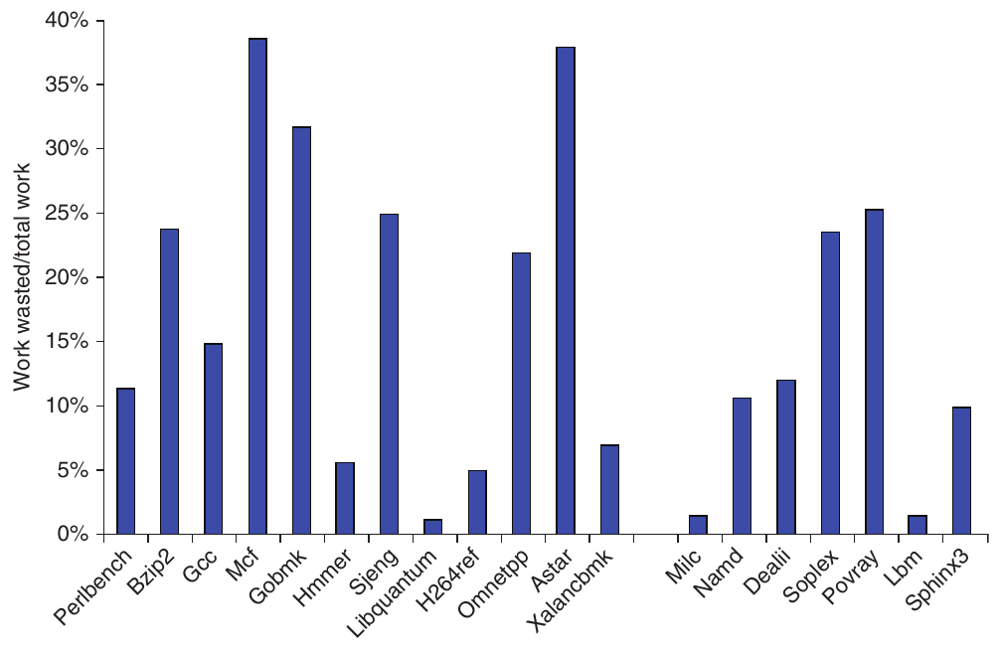

**Hình 3.42 Lượng “công việc lãng phí” được vẽ bằng tỷ số giữa micro-ops được dispatch nhưng không graduate và toàn bộ micro-ops được dispatch. Ví dụ tỷ số sjeng là 25%, nghĩa là 25% micro-ops được dispatch và thực thi bị vứt bỏ. Dữ liệu phần này do Giáo sư Lu Peng và nghiên cứu sinh Ph.D. Ying Zhang, đều tại Louisiana State University, thu thập.**

Lưu ý công việc lãng phí trong một số trường hợp gần khớp với branch misprediction rate ở Hình 3.5 trang 167, nhưng trong vài trường hợp như mcf, công việc lãng phí có vẻ lớn hơn tương đối so với misprediction rate. Khi đó, một cách giải thích có khả năng là memory behavior. Với data cache miss rate rất cao, mcf dispatch nhiều instruction trong speculation sai, miễn là còn đủ reservation station cho các memory reference bị stall. Khi phát hiện branch misprediction, micro-ops tương ứng bị flush, nhưng sẽ có congestion quanh cache vì speculated memory reference cố hoàn tất. Processor không có cách đơn giản để dừng cache request như vậy sau khi đã khởi phát.

Hình 3.43 trình bày overall CPI của 19 benchmark SPECCPU2006. Integer benchmark có CPI 1.06 với phương sai rất lớn (standard deviation 0.67). MCF và OMNETPP là các outlier chính, cả hai có CPI trên 2.0, trong khi đa số benchmark khác gần hoặc dưới 1.0 (gcc cao kế tiếp, bằng 1.23). Phương sai này bắt nguồn từ khác biệt về branch prediction accuracy và cache miss rate. Với integer benchmark, L2 miss rate là yếu tố dự đoán CPI tốt nhất, còn L3 miss rate (rất nhỏ) gần như không ảnh hưởng.

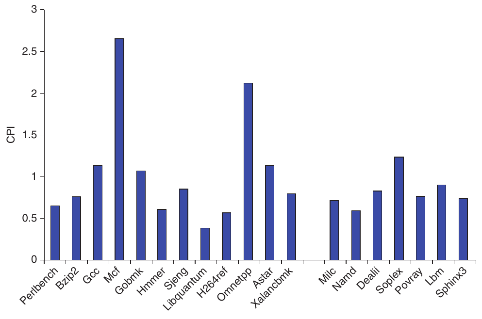

**Hình 3.43 CPI của 19 benchmark SPECCPU2006 cho average CPI 0.83 với cả FP và integer benchmark, dù hành vi rất khác. Với integer, CPI từ 0.44 đến 2.66, standard deviation 0.77; với FP, dao động từ 0.62 đến 1.38, standard deviation 0.25. Dữ liệu phần này do Giáo sư Lu Peng và nghiên cứu sinh Ph.D. Ying Zhang, đều tại Louisiana State University, thu thập.**

FP benchmark đạt performance cao hơn với average CPI thấp hơn (0.89) và standard deviation thấp hơn (0.25). Với FP benchmark, L1 và L2 quan trọng ngang nhau khi quyết định CPI, còn L3 có vai trò nhỏ hơn nhưng đáng kể. Dù dynamic scheduling và nonblocking capability của i7 có thể che giấu một phần miss latency, cache memory behavior vẫn đóng góp lớn. Điều này củng cố vai trò multithreading như một cách khác để che giấu memory latency.

## 3.14 Ngộ nhận và cạm bẫy

Một số ngộ nhận ở đây tập trung vào khó khăn dự đoán performance và hiệu quả năng lượng, cũng như ngoại suy từ một thước đo riêng lẻ như clock rate hay CPI. Chúng ta cũng cho thấy những cách tiếp cận architecture khác nhau có thể tạo hành vi khác biệt hoàn toàn trên các benchmark khác nhau.

**Ngộ nhận** Dễ dự đoán performance và hiệu quả năng lượng của hai phiên bản khác nhau cùng instruction set architecture nếu giữ công nghệ không đổi.

Intel sản xuất một processor cho thị trường Netbook low-end và PMD có microarchitecture khá giống ARM A8, gọi là Atom 230. Điều thú vị là Atom 230 và Core i7 920 đều được chế tạo bằng cùng công nghệ Intel 45 nm. Hình 3.44 tổng hợp Intel Core i7, ARM Cortex-A8 và Intel Atom 230. Những điểm tương đồng này tạo cơ hội hiếm có để so sánh trực tiếp hai microarchitecture khác biệt hoàn toàn cho cùng instruction set trong khi giữ nguyên công nghệ chế tạo nền tảng. Trước khi so sánh, cần nói thêm đôi chút về Atom 230.

Atom processor triển khai architecture x86 bằng kỹ thuật tiêu chuẩn chuyển x86 instruction thành instruction RISC-like (như mọi implementation x86 kể từ mid-1990s). Atom dùng microoperation mạnh hơn đôi chút, cho phép ghép arithmetic operation với load hoặc store. Điều này nghĩa là tính trung bình với instruction mix điển hình, chỉ 4% instruction cần nhiều hơn một microoperation. Sau đó microoperation được thực thi trong pipeline 16-deep có khả năng issue hai instruction mỗi clock theo thứ tự, như ARM A8. Có ALU dual-integer, pipeline riêng cho FP add và các FP operation khác, cùng hai memory operation pipeline, hỗ trợ dual execution tổng quát hơn ARM A8 nhưng vẫn bị giới hạn bởi khả năng issue in-order. Atom 230 có instruction cache 32 KB và data cache 24 KB, cả hai được hỗ trợ bởi L2 512 KB dùng chung trên cùng die. (Atom 230 cũng hỗ trợ multithreading với hai thread, nhưng chúng ta chỉ xét so sánh single threaded.) Hình 3.46 tổng hợp i7, A8, Atom và các đặc tính then chốt.

Có thể kỳ vọng hai processor này, được triển khai bằng cùng công nghệ và có cùng instruction set, sẽ có hành vi dự đoán được về performance và mức tiêu thụ năng lượng tương đối, nghĩa là power và performance thay đổi gần tuyến tính. Chúng ta kiểm tra giả thuyết bằng ba tập benchmark. Tập đầu là nhóm benchmark Java single-threaded từ DaCapo và SPEC JVM98 (xem Esmaeilzadeh và cộng sự [2011] để biết thảo luận về benchmark và phép đo). Tập thứ hai và thứ ba từ SPEC CPU2006, lần lượt gồm integer benchmark và FP benchmark.

Intel i7 920 ARM A8 Intel Atom 230

| Lĩnh vực | Đặc tính cụ thể | Bốn core, mỗi core có FP | Một core, không FP | Một core, có FP |
|---|---|---|---|---|
| Thuộc tính vật lý của chip | Clock rate và Thermal design power | 2.66 GHz 130 W | 1 GHz 2 W | 1.66 GHz 4 W |
|  | Package | 1366-pin BGA | 522-pin BGA | 437-pin BGA |
| Memory system | TLB | Two-level All four-way set associative 128 I/64 D 512 L2 | One-level fully associative 32 I/32 D | Two-level All four-way set associative 16 I/16 D 64 L2 |
|  | Caches | Three-level 32 KB/32 KB 256 KB 2–8 MB | Two-level 16/16 or 32/32 KB 128 KB–1MB | Two-level 32/24 KB 512 KB |
|  | Peak memory BW | 17 GB/sec | 12 GB/sec | 8 GB/sec |
| Cấu trúc pipeline | Peak issue rate | 4 ops/clock có fusion | 2 ops/clock | 2 ops/clock |
|  | Pipeline scheduling | Speculate không theo thứ tự | Dynamic issue In-order | Dynamic issue In-order |
|  | Branch prediction | Two-level | Two-level 512-entry BTB 4K global history 8-entry return stack | Two-level |

**Hình 3.44 Tổng quan Intel i7 920 four-core, một ví dụ chip Arm A8 điển hình (có L2 256 MB, L1 32K và không có floating point), cùng Intel ARM 230, thể hiện rõ khác biệt về triết lý thiết kế giữa processor dành cho PMD (ARM) hoặc netbook (Atom) và processor dùng trong server, desktop high-end. Nhớ rằng i7 có bốn core, mỗi core có performance cao hơn vài lần so với A8 hoặc Atom one-core. Mọi processor này được triển khai bằng công nghệ 45 nm tương đương.**

Như thấy trong Hình 3.45, i7 có performance cao hơn Atom đáng kể. Mọi benchmark đều nhanh hơn ít nhất bốn lần trên i7, hai benchmark SPECFP nhanh hơn trên mười lần, và một benchmark SPECINT chạy nhanh hơn trên tám lần! Vì tỷ số clock rate là 1.6, phần lớn lợi thế đến từ CPI thấp hơn nhiều của i7: hệ số 2.8 với Java benchmark, 3.1 với SPECINT benchmark và 4.3 với SPECFP benchmark.

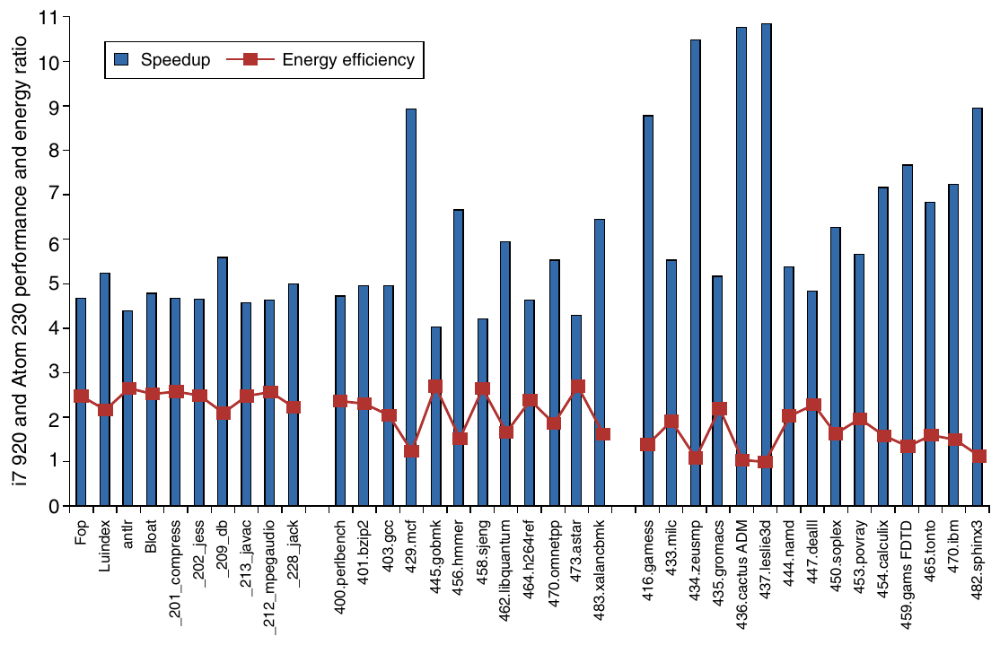

**Hình 3.45 Performance và hiệu quả năng lượng tương đối của một tập benchmark single-threaded cho thấy i7 920 nhanh hơn Atom 230 từ 4 tới trên 10 lần, nhưng trung bình kém hiệu quả sử dụng power khoảng 2 lần! Cột biểu diễn performance của i7 so với Atom, tức execution time (i7)/execution time (Atom). Đường biểu diễn Energy (Atom)/Energy (i7). i7 không bao giờ vượt Atom về hiệu quả năng lượng, dù về cơ bản tốt tương đương ở bốn benchmark, ba trong đó là floating point. Dữ liệu do Esmaeilzadeh và cộng sự [2011] thu thập. SPEC benchmark được compile có bật tối ưu bằng Intel compiler tiêu chuẩn, còn Java benchmark dùng Sun (Oracle) Hotspot Java VM. Chỉ một core i7 hoạt động, các core còn lại ở deep power saving mode. i7 dùng Turbo Boost, làm tăng lợi thế performance nhưng giảm nhẹ hiệu quả năng lượng tương đối.**

Tuy nhiên, power consumption trung bình của i7 chỉ dưới 43 W, còn Atom là 4.2 W, tức khoảng one-tenth power! Kết hợp performance và power cho thấy Atom có lợi thế hiệu quả năng lượng thường tốt hơn trên 1.5 lần, và thường đạt 2 lần! So sánh hai processor dùng cùng công nghệ nền tảng làm rõ rằng lợi thế performance của superscalar mạnh có dynamic scheduling và speculation đi kèm bất lợi đáng kể về hiệu quả năng lượng.

**Ngộ nhận** Processor có CPI thấp hơn luôn nhanh hơn.

**Ngộ nhận** Processor có clock rate cao hơn luôn nhanh hơn.

Mấu chốt là tích của CPI và clock rate quyết định performance. Clock rate cao đạt được bằng cách pipeline CPU sâu phải duy trì CPI thấp để tận dụng đầy đủ clock nhanh hơn. Tương tự, processor đơn giản có clock rate cao nhưng CPI thấp có thể chậm hơn.

Như đã thấy ở ngộ nhận trước, performance và hiệu quả năng lượng có thể khác nhau đáng kể giữa các processor thiết kế cho môi trường khác nhau, ngay cả khi có cùng ISA. Thực tế, khác biệt performance lớn có thể xuất hiện ngay trong một họ processor cùng công ty, đều thiết kế cho ứng dụng high-end. Hình 3.46 trình bày integer performance và FP performance của hai implementation architecture x86 khác nhau từ Intel, cùng một phiên bản architecture Itanium, cũng của Intel.

Pentium 4 là processor được pipelined quyết liệt nhất Intel từng xây dựng. Nó dùng pipeline trên 20 stage, có bảy functional unit và cache micro-ops thay vì x86 instruction. Performance tương đối kém xét mức triển khai quyết liệt là dấu hiệu rõ rằng nỗ lực khai thác thêm ILP (dễ dàng có 50 instruction in flight) đã thất bại. Power consumption của Pentium tương tự i7 dù transistor count thấp hơn, vì primary cache chỉ lớn bằng một nửa của i7 và chỉ có secondary cache 2 MB, không có tertiary cache.

Intel Itanium là architecture VLIW-style, dù có khả năng giảm độ phức tạp so với superscalar được schedule động, chưa bao giờ đạt clock rate cạnh tranh với các processor x86 chủ lực (dù dường như đạt CPI tổng thể tương tự i7). Khi xem kết quả, người đọc cần biết chúng dùng công nghệ triển khai khác nhau, giúp i7 có lợi thế tốc độ transistor và do đó clock rate với processor có mức pipeline tương đương. Tuy vậy, khác biệt performance rộng — trên ba lần giữa Pentium và i7 — vẫn đáng kinh ngạc. Cạm bẫy tiếp theo giải thích nguồn gốc phần đáng kể của lợi thế này.

| Processor | Clock rate | SPECCInt2006 base | SPECCFP2006 baseline |
|---|---|---|---|
| Intel Pentium 4 670 | 3.8 GHz | 11.5 | 12.2 |
| Intel Itanium -2 | 1.66 GHz | 14.5 | 17.3 |
| Intel i7 | 3.3 GHz | 35.5 | 38.4 |

**Hình 3.46 Ba Intel processor khác nhau có khác biệt lớn. Dù Itanium có hai core và i7 có bốn, benchmark chỉ sử dụng một core.**

**Cạm bẫy** Đôi khi lớn hơn và ít thông minh hơn lại tốt hơn.

Phần lớn sự chú ý đầu thập niên 2000 dành cho xây dựng processor mạnh nhằm khai thác ILP, gồm architecture Pentium 4 với pipeline sâu nhất từng thấy trong microprocessor, và Intel Itanium với peak issue rate mỗi clock cao nhất từng thấy. Điều nhanh chóng trở nên rõ ràng là giới hạn chính khi khai thác ILP thường lại nằm ở memory system. Dù pipeline out-of-order có speculation che giấu khá tốt phần đáng kể miss penalty 10- tới 15-cycle của first-level miss, chúng hầu như không che giấu được penalty của second-level miss, vốn có thể là 50 tới100 clock cycle khi phải truy cập main memory.

Kết quả là các thiết kế này chưa bao giờ tiến gần peak instruction throughput dù có nhiều transistor và kỹ thuật cực kỳ tinh vi, thông minh. Mục sau thảo luận tình thế khó khăn và việc chuyển từ phương án ILP quyết liệt hơn sang multicore, nhưng còn một thay đổi minh họa cạm bẫy này. Thay vì cố dùng ILP che giấu thêm memory latency, người thiết kế đơn giản dùng transistor xây cache lớn hơn nhiều. Cả Itanium 2 lẫn i7 dùng cache three-level so với cache two-level của Pentium 4; third-level cache lần lượt là 9 MB và 8 MB so với second-level cache 2 MB của Pentium 4. Hiển nhiên, xây cache lớn dễ hơn nhiều so với thiết kế pipeline Pentium 4 20+ -stage, và dữ liệu Hình 3.46 cho thấy có vẻ hiệu quả hơn.

## 3.15 Kết luận: Điều gì ở phía trước?

Khi năm 2000 bắt đầu, sự tập trung khai thác instruction-level parallelism đạt đỉnh. Intel sắp giới thiệu Itanium, processor được schedule tĩnh high-issue-rate dựa trên cách tiếp cận VLIW-like với hỗ trợ compiler mạnh. Các processor MIPS, Alpha và IBM có speculative execution được schedule động đang ở thế hệ thứ hai, rộng hơn và nhanh hơn. Pentium 4 dùng speculative scheduling cũng được công bố năm đó với bảy functional unit và pipeline sâu hơn 20 stage. Nhưng những đám mây giông đã xuất hiện ở chân trời.

Nghiên cứu như trong Mục 3.10 cho thấy đẩy ILP xa hơn nhiều sẽ cực kỳ khó; dù peak instruction throughput tăng so với các speculative processor đầu tiên khoảng 3 tới 5 năm trước, instruction execution rate duy trì thực tế tăng chậm hơn nhiều.

Năm năm tiếp theo đã nói lên tất cả. Itanium hóa ra là FP processor tốt nhưng chỉ là integer processor tầm thường. Intel vẫn sản xuất dòng này nhưng không có nhiều người dùng, clock rate tụt sau các Intel processor chủ lực và Microsoft không còn hỗ trợ instruction set. Intel Pentium 4 đạt performance tốt nhưng kém hiệu quả về performance/watt (tức sử dụng năng lượng), và độ phức tạp khiến khó có thể tiến xa hơn bằng tăng issue rate. Con đường 20-year đạt mức performance mới trong microprocessor bằng khai thác ILP đã tới hồi kết. Pentium 4 được thừa nhận rộng rãi là đã vượt điểm lợi ích giảm dần, và microarchitecture Netburst quyết liệt, tinh vi bị từ bỏ.

Đến năm 2005, Intel và mọi nhà sản xuất processor lớn khác đã thay đổi cách tiếp cận để tập trung multicore. Performance cao hơn sẽ đạt bằng thread-level parallelism thay vì instruction-level parallelism, và trách nhiệm sử dụng processor hiệu quả phần lớn chuyển từ hardware sang software và lập trình viên. Đây là thay đổi quan trọng nhất trong processor architecture kể từ những ngày đầu pipelining và instruction-level parallelism khoảng hơn 25 năm trước.

Cùng thời kỳ, người thiết kế bắt đầu khảo sát sử dụng thêm data-level parallelism như cách đạt performance khác. SIMD extension cho phép microprocessor desktop và server tăng performance vừa phải cho graphics và chức năng tương tự. Quan trọng hơn, graphics processing unit (GPU) theo đuổi sử dụng SIMD quyết liệt, đạt lợi thế performance đáng kể với ứng dụng có nhiều data-level parallelism. Với ứng dụng khoa học, những cách tiếp cận này là phương án thay thế khả thi cho thread-level parallelism tổng quát hơn nhưng kém hiệu quả hơn trong multicore. Chương tới khảo sát những phát triển này trong sử dụng data-level parallelism.

Nhiều nhà nghiên cứu dự đoán việc sử dụng ILP sẽ thu hẹp mạnh, cho rằng superscalar two issue và số core lớn hơn sẽ là tương lai. Tuy nhiên, lợi thế của issue rate cao hơn đôi chút và khả năng speculative dynamic scheduling xử lý sự kiện khó dự đoán, như cache miss level-one, khiến ILP vừa phải trở thành khối xây dựng chính của thiết kế multicore. Việc thêm SMT và tính hiệu quả của nó (cả performance lẫn hiệu quả năng lượng) củng cố thêm vị trí của cách tiếp cận issue vừa phải, out-of-order, có speculation. Thực tế, ngay cả thị trường embedded, processor mới nhất (như ARM Cortex-A9) cũng đã đưa vào dynamic scheduling, speculation và issue rate rộng hơn.

Rất khó có khả năng processor tương lai cố tăng issue width đáng kể. Điều này đơn giản quá kém hiệu quả cả về sử dụng silicon lẫn hiệu quả power. Xét dữ liệu Hình 3.47 về bốn processor gần đây nhất dòng IBM Power. Trong thập niên qua, hỗ trợ ILP trong Power processor có cải thiện vừa phải, nhưng phần chủ yếu của mức tăng transistor count (gần hệ số 7 từ Power 4 tới Power7) dành cho tăng cache và số core mỗi die. Ngay cả mở rộng SMT có vẻ được chú trọng hơn tăng ILP throughput: cấu trúc ILP từ Power4 tới Power7 đi từ 5 issue lên 6, từ 8 functional unit lên 12 (nhưng không tăng so với 2 load/store unit ban đầu), còn hỗ trợ SMT từ không có lên 4 thread/processor. Rõ ràng ngay với ILP processor tiên tiến nhất năm 2011 (Power7), trọng tâm đã vượt ra ngoài instruction-level parallelism. Hai chương tới tập trung các cách khai thác data-level và thread-level parallelism.

|  | Power4 | Power5 | Power6 | Power7 |
|---|---|---|---|---|
| Năm giới thiệu | 2001 | 2004 | 2007 | 2010 |
| Clock rate ban đầu (GHz) | 1.3 | 1.9 | 4.7 | 3.6 |
| Số transistor (M) | 174 | 276 | 790 | 1200 |
| Số issue mỗi clock | 5 | 5 | 7 | 6 |
| Functional units | 8 | 8 | 9 | 12 |
| Cores/chip | 2 | 2 | 2 | 8 |
| SMT threads | 0 | 2 | 2 | 4 |
| Tổng cache on-chip (MB) | 1.5 | 2 | 4.1 | 32.3 |

**Hình 3.47 Đặc tính của bốn IBM Power processor. Tất cả được schedule động ngoại trừ Power6, vốn static và in-order; mọi processor đều hỗ trợ hai load/store pipeline. Power6 có cùng functional unit như Power5 ngoại trừ decimal unit. Power7 dùng DRAM cho L3 cache.**

## 3.16 Góc nhìn lịch sử và tài liệu tham khảo

Mục L.5 (có online) thảo luận sự phát triển của pipelining và instruction-level parallelism. Chúng tôi cung cấp nhiều tài liệu tham khảo để đọc và tìm hiểu thêm các chủ đề này. Mục L.5 bao quát cả Chương 3 lẫn Phụ lục H.

## Nghiên cứu trường hợp và bài tập của Jason D. Bakos và Robert P. Colwell

### Nghiên cứu trường hợp: Khảo sát tác động của kỹ thuật Microarchitecture

#### Các khái niệm được minh họa qua nghiên cứu trường hợp này

- Instruction Scheduling cơ bản, Reordering, Dispatch

- Multiple Issue và Hazard

- Register Renaming

- Execution Out-of-Order và Speculative

- Nên phân bổ resource Out-of-Order ở đâu

Bạn được giao thiết kế microarchitecture cho processor mới và đang tìm cách phân bổ resource hardware tốt nhất. Nên áp dụng kỹ thuật hardware và software nào đã học trong Chương 3? Bạn có danh sách latency của functional unit và memory, cùng code đại diện. Sếp khá mơ hồ về yêu cầu performance của thiết kế mới, nhưng kinh nghiệm cho biết khi các yếu tố khác như nhau, nhanh hơn thường tốt hơn. Hãy bắt đầu từ cơ bản. Hình 3.48 cung cấp chuỗi instruction và danh sách latency.

**3.1** [10] <1.8, 3.1, 3.2> Baseline performance (theo cycle mỗi lần lặp) của chuỗi code Hình 3.48 là bao nhiêu nếu không thể bắt đầu thực thi instruction mới cho tới khi instruction trước hoàn tất thực thi? Bỏ qua fetch và decode ở front-end. Tạm giả sử execution không stall vì thiếu instruction tiếp theo, nhưng chỉ issue được một instruction/cycle. Giả sử branch được taken và có branch delay slot one-cycle.

**3.2** [10] <1.8, 3.1, 3.2> Hãy suy nghĩ ý nghĩa thực sự của số latency — chúng chỉ số cycle một chức năng cần để tạo output, không hơn. Nếu toàn pipeline stall trong số latency cycle của mỗi functional unit, ít nhất bạn được bảo đảm mọi cặp instruction back-to-back (một “producer” theo sau bởi “consumer”) thực thi đúng. Nhưng không phải mọi cặp instruction đều có quan hệ producer/consumer. Đôi khi hai instruction liền nhau không liên quan. Thân loop trong Hình 3.48 cần bao nhiêu cycle nếu pipeline phát hiện true data dependence và chỉ stall vì chúng, thay vì mù quáng stall mọi thứ chỉ vì một functional unit bận? Trình bày code với &lt;stall&gt; chèn nơi cần để đáp ứng latency đã nêu. (Gợi ý: instruction có latency +2 cần chèn hai cycle &lt;stall&gt;. Hãy nghĩ như sau: instruction one-cycle có latency 1 + 0, nghĩa là không thêm wait state. Vậy latency 1 + 1 hàm ý một stall cycle; latency 1 + N có N stall cycle bổ sung.

**3.3** [15] <3.6, 3.7> Xét thiết kế multiple-issue. Giả sử có hai execution pipeline, mỗi pipeline bắt đầu thực thi được một instruction mỗi cycle, và đủ fetch/decode bandwidth ở front end để không làm execution stall. Giả sử kết quả có thể được forwarding ngay từ execution unit này sang unit khác hoặc trở lại chính nó. Giả sử thêm rằng lý do duy nhất execution pipeline stall là tuân thủ true data dependency. Bây giờ loop cần bao nhiêu cycle?

|  |  |  | Latency vượt quá một cycle |  |
|---|---|---|---|---|
| Loop: | LD | F2,0(RX) | Memory LD | +4 |
| IO: | DIVD | F8,F2,F0 | Memory SD | +1 |
| I1: | MULTD | F2,F6,F2 | Integer ADD, SUB | +0 |
| I2: | LD | F4,0(Ry) | Branches | +1 |
| I3: | ADDD | F4,F0,F4 | ADDD | +1 |
| I4: | ADDD | F10,F8,F2 | MULTD | +5 |
| I5: | ADDI | Rx,Rx,#8 | DIVD | +12 |
| I6: | ADDI | Ry,Ry,#8 |  |  |
| I7: | SD | F4,0(Ry) |  |  |
| I8: | SUB | R20,R4,Rx |  |  |
| I9: | BNZ | R20,Loop |  |  |

**Hình 3.48 Code và latency cho Bài tập 3.1 tới 3.6.**

**3.4** [10] <3.6, 3.7> Trong thiết kế multiple-issue ở Bài tập 3.3, bạn có thể đã nhận ra một số vấn đề tinh tế. Dù hai pipeline có tập instruction giống hệt nhau, chúng không đồng nhất và không thể hoán đổi, vì có thứ tự ngầm giữa chúng phải phản ánh thứ tự instruction trong chương trình gốc. Nếu instruction N + 1 bắt đầu thực thi trong Execution Pipe 1 cùng lúc instruction N bắt đầu trong Pipe 0, và N + 1 có execution latency ngắn hơn N, thì N + 1 hoàn tất trước N (dù program ordering hàm ý ngược lại). Nêu ít nhất hai lý do điều này có thể gây hazard và đòi hỏi xem xét đặc biệt trong microarchitecture. Cho ví dụ hai instruction trong Hình 3.48 minh họa hazard này.

**3.5** [20] <3.7> Sắp xếp lại instruction để cải thiện performance code Hình 3.48. Giả sử máy two-pipe ở Bài tập 3.3 và các vấn đề out-of-order completion trong Bài tập 3.4 đã được giải quyết thành công. Hiện chỉ cần chú ý tuân thủ true data dependence và functional unit latency. Code được sắp xếp lại cần bao nhiêu cycle?

**3.6** [10/10/10] <3.1, 3.2> Mỗi cycle không khởi động operation mới trong một pipe là cơ hội bị mất, theo nghĩa hardware chưa phát huy hết tiềm năng.

a. [10] <3.1, 3.2> Trong code được sắp xếp lại ở Bài tập 3.5, tỷ lệ cycle bị lãng phí (không khởi động op mới), tính cả hai pipe, là bao nhiêu?

b. [10] <3.1, 3.2> Loop unrolling là kỹ thuật compiler tiêu chuẩn để tìm thêm tính song song trong code nhằm giảm tối đa cơ hội cải thiện performance bị bỏ lỡ. Hãy thực hiện Hand-unroll cho hai lần lặp của loop trong code được sắp xếp lại ở Bài tập 3.5.

c. [10] <3.1, 3.2> Bạn đạt speedup bao nhiêu? (Trong bài này, chỉ cần tô xanh instruction của lần lặp N + 1 để phân biệt với lần lặp thứ N; nếu thực sự unroll loop, phải gán lại register để tránh xung đột giữa các lần lặp.)

**3.7** [15] <2.1> Máy tính dành phần lớn thời gian trong loop, nên nhiều lần lặp là nơi lý tưởng để tìm thêm công việc theo speculation nhằm giữ resource CPU bận rộn. Nhưng không gì dễ dàng; compiler chỉ sinh một bản code loop, nên dù nhiều lần lặp xử lý dữ liệu riêng biệt, chúng dường như dùng cùng register. Để tránh xung đột sử dụng register giữa các lần lặp, chúng ta rename register. Hình 3.49 cho ví dụ code muốn hardware rename. Compiler có thể đơn giản unroll loop và dùng register khác để tránh xung đột, nhưng nếu kỳ vọng hardware unroll loop, nó cũng phải thực hiện register renaming. Bằng cách nào? Giả sử hardware có pool temporary register (gọi là T register, có 64 register từ T0 tới T63) để thay các register do compiler chỉ định. Hardware rename được đánh index bằng tên register src (source), và giá trị trong bảng là T register của destination cuối cùng nhắm tới register đó. (Hãy xem giá trị bảng là producer, còn src register là consumer; producer đặt kết quả ở đâu không quan trọng miễn consumer tìm được.) Xét chuỗi code Hình 3.49. Mỗi khi thấy destination register, thay bằng T khả dụng tiếp theo, bắt đầu từ T9. Sau đó cập nhật mọi src register tương ứng để giữ true data dependence. Trình bày code kết quả. (Gợi ý: xem Hình 3.50.)

```
Loop: LD       F4,0(Rx)
I0:   MULTD    F2,F0,F2
I1:   DIVD     F8,F4,F2
I2:   LD       F4,0(Ry)
I3:   ADDD     F6,F0,F4
I4:   SUBD     F8,F8,F6
I5:   SD       F8,0(Ry)
```

**Hình 3.49 Code mẫu để thực hành register renaming.**

```
I0:   LD       T9,0(Rx)
I1:   MULTD    T10,F0,T9
...
```

**Hình 3.50 Gợi ý: output kỳ vọng của register renaming.**

**3.8** [20] <3.4> Bài tập 3.7 khảo sát register renaming đơn giản: khi hardware register renamer thấy source register, nó thay bằng destination T register của instruction cuối cùng nhắm tới source register đó. Khi rename table thấy destination register, nó thay bằng T khả dụng tiếp theo; nhưng thiết kế superscalar phải xử lý nhiều instruction mỗi clock cycle tại mọi stage, gồm register renaming. Vì vậy, scalar processor đơn giản tra cứu cả hai mapping src register của mỗi instruction và cấp dest mapping mới mỗi clock cycle. Superscalar processor cũng phải làm được, nhưng còn phải bảo đảm quan hệ dest-to-src giữa hai instruction đồng thời được xử lý đúng. Xét code mẫu Hình 3.51. Giả sử muốn rename đồng thời hai instruction đầu. Giả sử thêm hai T register khả dụng tiếp theo đã biết ở đầu clock cycle thực hiện renaming hai instruction này. Về khái niệm, chúng ta muốn instruction đầu tra cứu rename table rồi cập nhật bảng theo T register destination của nó. Sau đó instruction thứ hai thực hiện giống hệt, và mọi interinstruction dependency được xử lý đúng. Nhưng không đủ thời gian ghi tên T register vào renaming table rồi tra cứu lại cho instruction thứ hai, tất cả trong cùng clock cycle. Thay vào đó, phải thực hiện register substitution trực tiếp (song song với cập nhật register rename table). Hình 3.52 cho sơ đồ mạch dùng multiplexer và comparator để thực hiện register renaming on-the-fly cần thiết. Nhiệm vụ của bạn là trình bày state cycle-by-cycle của rename table cho mọi instruction trong Hình 3.51. Giả sử ban đầu mọi entry bằng index của nó (T0 = 0; T1 = 1, …).

```
I0:   SUBD      F1,F2,F3
I1:   ADDD      F4,F1,F2
I2:   MULTD     F6,F4,F1
I3:   DIVD      F0,F2,F6
```

**Hình 3.51 Code mẫu cho superscalar register renaming.**

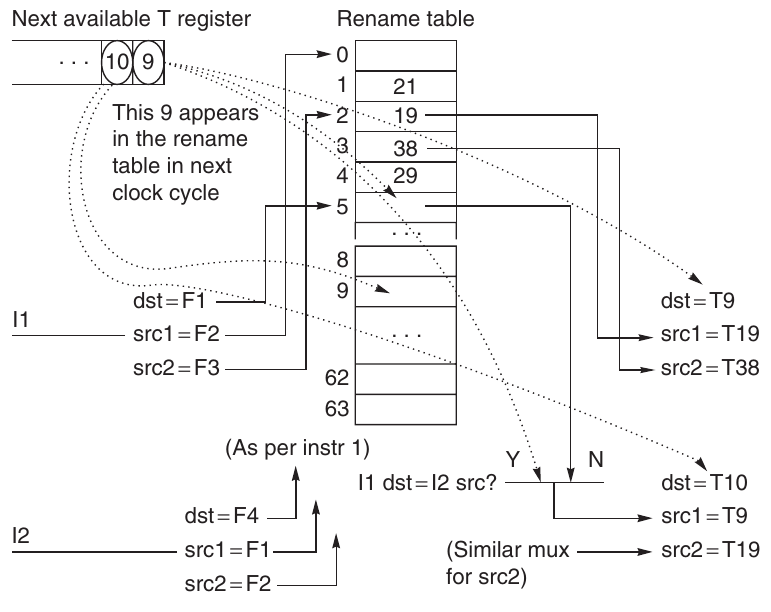

**Hình 3.52 Rename table và register substitution logic on-the-fly cho máy superscalar. (Lưu ý src là source, dest là destination.)**

**3.9** [5] <3.4> Nếu bối rối về việc register renamer phải làm gì, hãy trở lại assembly code đang thực thi và tự hỏi điều gì phải xảy ra để có kết quả đúng. Chẳng hạn, xét máy superscalar three-way rename đồng thời ba instruction sau:

```
ADDI R1, R1, R1
ADDI R1, R1, R1
ADDI R1, R1, R1
```

Nếu giá trị R1 ban đầu là 5, giá trị phải bằng bao nhiêu khi chuỗi này thực thi xong?

**3.10** [20] <3.4, 3.9> Người thiết kế very long instruction word (VLIW) phải đưa ra một số lựa chọn cơ bản về quy tắc architecture cho sử dụng register. Giả sử VLIW được thiết kế với execution pipeline self-draining: một khi operation được khởi động, kết quả xuất hiện trong destination register sau tối đa L cycle (L là latency của operation). Register không bao giờ đủ, nên có xu hướng tận dụng tối đa register hiện có. Xét Hình 3.53. Nếu load có latency 1 + 2 cycle, hãy unroll loop một lần và trình bày cách VLIW có khả năng hai load và hai add mỗi cycle dùng ít register nhất khi không có ngắt quãng pipeline hoặc stall. Cho ví dụ sự kiện mà khi có pipeline self-draining có thể phá vỡ pipelining này và tạo kết quả sai.

**3.11** [10/10/10] <3.3> Giả sử microarchitecture single-pipeline five-stage (fetch, decode, execute, memory, write-back) và code Hình 3.54. Mọi op mất một cycle ngoại trừ LW và SW mất 1 + 2 cycle, cùng branch mất 1 + 1 cycle. Không có forwarding. Trình bày phase của mỗi instruction theo từng clock cycle cho một lần lặp.

a. [10] <3.3> Bao nhiêu clock cycle mỗi lần lặp bị mất do branch overhead?

b. [10] <3.3> Giả sử static branch predictor có thể nhận ra backward branch ở Decode stage. Bây giờ bao nhiêu clock cycle bị lãng phí vì branch overhead?

c. [10] <3.3> Giả sử dynamic branch predictor. Bao nhiêu cycle bị mất khi dự đoán đúng?

```
Loop: LW       R4,0(R0) ; ADDI       R11,R3,#1
       LW      R5,8(R1) ; ADDI       R20,R0,#1
       <stall>
       ADDI    R10,R4,#1;
       SW      R7,0(R6) ; SW         R9,8(R8)
       ADDI    R2,R2,#8
       SUB     R4,R3,R2
       BNZ     R4,Loop
```

**Hình 3.53 Code VLIW mẫu với hai add, hai load và hai stall.**

```
Loop: LW        R3,0(R0)
       LW       R1,0(R3)
       ADDI     R1,R1,#1
       SUB      R4,R3,R2
       SW       R1,0(R3)
       BNZ      R4, Loop
```

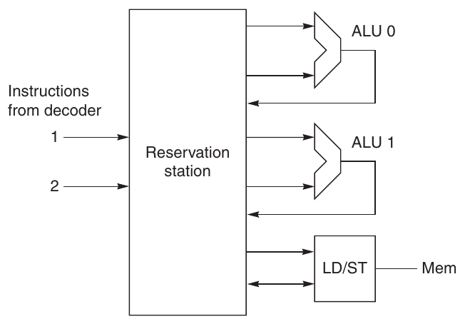

**Hình 3.54 Code loop cho Bài tập 3.11.**

**Hình 3.55 Microarchitecture out-of-order.**

**3.12** [15/20/20/10/20] <3.4, 3.7, 3.14> Hãy xem dynamic scheduling có thể đạt được gì ở đây. Giả sử microarchitecture Hình 3.55. Giả sử arithmetic-logical unit (ALU) có thể thực hiện mọi arithmetic op (MULTD, DIVD, ADDD, ADDI, SUB) và branch, còn Reservation Station (RS) có thể dispatch tối đa một operation tới mỗi functional unit mỗi cycle (một op tới mỗi ALU cộng một memory op tới LD/ST).

a. [15] <3.4> Giả sử mọi instruction của chuỗi Hình 3.48 có trong RS, chưa thực hiện renaming. Đánh dấu instruction mà register renaming sẽ cải thiện performance. (Gợi ý: tìm hazard read-after-write và write-after-write. Giả sử functional unit latency giống Hình 3.48.)

b. [20] <3.4> Giả sử phiên bản code đã register-renamed ở phần (a) nằm trong RS ở clock cycle N, với latency như Hình 3.48. Trình bày cách RS dispatch instruction out of order theo từng clock để đạt performance tối ưu. (Giả sử ràng buộc RS giống phần (a). Cũng giả sử kết quả phải ghi vào RS trước khi có thể sử dụng — không có bypassing.) Chuỗi code cần bao nhiêu clock cycle?

c. [20] <3.4> Phần (b) cho RS cố schedule tối ưu các instruction. Nhưng thực tế, toàn bộ chuỗi instruction quan tâm thường không có sẵn trong RS. Thay vào đó, các sự kiện xóa RS; khi chuỗi code mới chảy từ decoder vào, RS phải chọn dispatch những gì đang có. Giả sử RS rỗng. Ở cycle 0, hai instruction register-renamed đầu chuỗi xuất hiện trong RS. Giả sử dispatch bất kỳ op nào mất một clock cycle, và functional unit latency như Bài tập 3.2. Giả sử thêm front end (decoder/register-renamer) tiếp tục cung cấp hai instruction mới mỗi clock cycle. Trình bày thứ tự dispatch cycle-by-cycle của RS. Bây giờ chuỗi code cần bao nhiêu clock cycle?

d. [10] <3.14> Nếu muốn cải thiện kết quả phần (c), điều gì giúp nhiều nhất: (1) Thêm ALU? (2) Thêm LD/ST unit? (3) Bypassing đầy đủ kết quả ALU tới operation tiếp theo? Hay (4) Giảm một nửa latency dài nhất? Speedup là bao nhiêu?

e. [20] <3.7> Bây giờ xét speculation, tức fetch, decode và execute vượt qua một hoặc nhiều conditional branch. Động lực có hai phần: dispatch schedule ở phần (c) có nhiều nop, và chúng ta biết máy tính dành phần lớn thời gian thực thi loop (nghĩa là branch trở về đầu loop khá dễ dự đoán). Loop cho biết nơi tìm thêm công việc; dispatch schedule thưa cho thấy cơ hội thực hiện một phần công việc đó sớm hơn. Ở phần (d), bạn tìm critical path qua loop. Hãy tưởng tượng ghép bản sao thứ hai của path đó lên schedule ở phần (b). Cần thêm bao nhiêu clock cycle để thực hiện lượng công việc của hai loop (giả sử mọi instruction nằm trong RS)? (Giả sử mọi functional unit đều fully pipelined.)

### Bài tập

**3.13** [25] <3.13> Trong bài này, bạn khảo sát performance trade-offs giữa ba processor sử dụng các loại multithreading khác nhau. Mỗi processor đều là superscalar, dùng pipeline in-order, cần stall three-cycle cố định sau mọi load và branch, và có L1 cache giống hệt nhau. Instruction cùng thread được issue trong cùng cycle được đọc theo program order và không được chứa data dependence hay control dependence.

- Processor A có architecture SMT superscalar, issue được tối đa hai instruction mỗi cycle từ hai thread.

- Processor B có architecture fine MT, issue được tối đa bốn instruction mỗi cycle từ một thread và chuyển thread khi có bất kỳ pipeline stall nào.

- Processor C có architecture coarse MT, issue được tối đa tám instruction mỗi cycle từ một thread và chuyển thread khi có L1 cache miss.

Ứng dụng là trình tìm kiếm danh sách, quét vùng memory để tìm giá trị cụ thể lưu trong R9 trong khoảng address do R16 và R17 chỉ định. Nó được song song hóa bằng cách chia đều không gian tìm kiếm thành bốn block liên tiếp equal-sized và gán một search thread cho mỗi block (tạo bốn thread). Phần lớn runtime của mỗi thread nằm trong thân loop đã unroll sau:

```
loop: LD R1,0(R16)
       LD R2,8(R16)
       LD R3,16(R16)
       LD R4,24(R16)
       LD R5,32(R16)
       LD R6,40(R16)
       LD R7,48(R16)
       LD R8,56(R16)
       BEQAL R9,R1,match0
       BEQAL R9,R2,match1
       BEQAL R9,R3,match2
       BEQAL R9,R4,match3
       BEQAL R9,R5,match4
       BEQAL R9,R6,match5
       BEQAL R9,R7,match6
       BEQAL R9,R8,match7
       DADDIU R16,R16,#64
       BLT R16,R17,loop
```

Giả sử như sau:

- Dùng barrier để bảo đảm mọi thread bắt đầu đồng thời.

- L1 cache miss đầu tiên xảy ra sau hai lần lặp.

- Không branch BEQAL nào được taken.

- BLT luôn được taken.

- Cả ba processor schedule thread theo kiểu round-robin.

Xác định số cycle mỗi processor cần để hoàn tất hai lần lặp đầu tiên.

**3.14** [25/25/25] <3.2, 3.7> Trong bài này, chúng ta xem kỹ thuật software có thể trích xuất instruction-level parallelism (ILP) trong vector loop phổ biến như thế nào. Loop sau so-called DAXPY (double-precision aX cộng Y), là operation trung tâm trong phép khử Gauss. Code sau triển khai DAXPY, Y = aX + Y, cho vector dài 100. Ban đầu R1 được đặt bằng base address của array X, R2 bằng base address của Y:

```
      DADDIU    R4,R1,#800 ;  R1 = upper bound for X
foo:  L.D       F2,0(R1)    ; (F2) = X(i)
      MUL.D     F4,F2,F0    ; (F4) = a*X(i)
      L.D       F6,0(R2)    ; (F6) = Y(i)
      ADD.D     F6,F4,F6    ; (F6) = a*X(i) + Y(i)
      S.D       F6,0(R2)    ; Y(i) = a*X(i) + Y(i)
      DADDIU    R1,R1,#8    ; increment X index
      DADDIU    R2,R2,#8    ; increment Y index
      DSLTU     R3,R1,R4    ; test: continue loop?
      BNEZ      R3,foo      ; loop if needed
```

Giả sử functional unit latency như bảng dưới. Giả sử delayed branch one-cycle được giải quyết ở ID stage. Giả sử kết quả được bypass đầy đủ.

| Instruction tạo kết quả | Instruction dùng kết quả | Latency theo clock cycle |
|---|---|---|
| FP multiply | FP ALU op | 6 |
| FP add | FP ALU op | 4 |
| FP multiply | FP store | 5 |
| FP add | FP store | 4 |
| Integer operation và mọi load | Bất kỳ | 2 |

a. [25] <3.2> Giả sử pipeline single-issue. Trình bày loop cả khi compiler chưa schedule và sau khi compiler schedule để xử lý độ trễ floating-point operation lẫn branch, gồm mọi stall hoặc clock cycle nhàn rỗi. Execution time (theo cycle) mỗi phần tử vector kết quả Y khi chưa schedule và đã schedule là bao nhiêu? Clock phải nhanh hơn bao nhiêu để chỉ riêng hardware processor đạt cải thiện performance bằng scheduling compiler? (Bỏ qua mọi ảnh hưởng có thể có của tăng clock speed tới memory system performance.)

b. [25] <3.2> Giả sử pipeline single-issue. Unroll loop đủ số lần để schedule mà không có stall, gộp các loop overhead instruction. Phải unroll bao nhiêu lần? Trình bày instruction schedule. Execution time mỗi phần tử kết quả là bao nhiêu?

c. [25] <3.7> Giả sử VLIW processor có instruction chứa năm operation như Hình 3.16. Chúng ta so sánh hai mức loop unrolling. Trước tiên unroll loop 6 lần để trích xuất ILP và schedule không stall (tức issue cycle hoàn toàn trống), gộp loop overhead instruction; sau đó lặp lại nhưng unroll 10 lần. Bỏ qua branch delay slot. Trình bày hai schedule. Execution time mỗi phần tử vector kết quả của mỗi schedule là bao nhiêu? Bao nhiêu phần trăm operation slot được dùng trong mỗi schedule? Code size chênh nhau bao nhiêu giữa hai schedule? Tổng nhu cầu register của hai schedule là bao nhiêu?

**3.15** [20/20] <3.4, 3.5, 3.7, 3.8> Trong bài này, chúng ta xem các biến thể thuật toán Tomasulo hoạt động ra sao khi chạy loop của Bài tập 3.14. Functional unit (FU) được mô tả trong bảng dưới. Giả sử như sau:

| Loại FU | Số cycle trong EX | Số FU | Số reservation station |
|---|---|---|---|
| Integer | 1 | 1 | 5 |
| FP adder | 10 | 1 | 3 |
| FP multiplier | 15 | 1 | 2 |

- Functional unit không được pipelined.

- Không có forwarding giữa functional unit; kết quả được truyền qua common data bus (CDB).

- Execution stage (EX) thực hiện cả effective address calculation lẫn memory access cho load và store. Vì vậy, pipeline là IF/ID/IS/EX/WB.

- Load cần một clock cycle.

- Issue stage (IS) và write-back result stage (WB) mỗi stage cần một clock cycle.

- Có năm load buffer slot và năm store buffer slot.

- Giả sử instruction Branch on Not Equal to Zero (BNEZ) cần một clock cycle.

a. [20] <3.4–3.5> Với bài này, dùng MIPS pipeline Tomasulo single-issue trong Hình 3.6 với pipeline latency ở bảng trên. Trình bày số stall cycle cho mỗi instruction và clock cycle instruction bắt đầu thực thi (tức đi vào EX cycle đầu tiên) cho ba lần lặp. Mỗi lần lặp mất bao nhiêu cycle? Báo cáo câu trả lời dạng bảng với các tiêu đề cột sau:

- Iteration (số thứ tự lần lặp)

- Instruction

- Issues (cycle instruction được issue)

- Executes (cycle instruction thực thi)

- Memory access (cycle truy cập memory)

- Write CDB (cycle kết quả được ghi lên CDB)

- Comment (mô tả sự kiện mà instruction đang chờ)

Trình bày ba lần lặp trong bảng. Bạn có thể bỏ qua instruction đầu tiên.

b. [20] <3.7, 3.8> Lặp lại phần (a), nhưng lần này giả sử thuật toán Tomasulo two-issue và floating-point unit (FPU) fully pipelined.

**3.16** [10] <3.4> Thuật toán Tomasulo có nhược điểm: mỗi clock, mỗi CDB chỉ có thể tính một kết quả. Dùng cấu hình hardware và latency ở câu trước, tìm chuỗi code không quá 10 instruction mà thuật toán Tomasulo buộc phải stall vì tranh chấp CDB. Chỉ ra nơi điều này xảy ra trong chuỗi.

**3.17** [20] <3.3> Correlating branch predictor (m,n) dùng hành vi của m branch vừa thực thi gần nhất để chọn trong 2<sup>m</sup> predictor, mỗi predictor là n-bit. Local predictor two-level hoạt động tương tự, nhưng chỉ theo dõi hành vi trước đó của từng branch để dự đoán hành vi tương lai.

Có design trade-off với các predictor này: correlating predictor cần ít memory cho history, cho phép duy trì predictor 2-bit cho nhiều branch riêng lẻ (giảm xác suất branch instruction dùng lại cùng predictor), còn local predictor cần nhiều memory hơn đáng kể để giữ history nên chỉ theo dõi được số branch instruction tương đối nhỏ. Trong bài này, xét correlating predictor (1,2) theo dõi được bốn branch (cần 16 bit), so với local predictor (1,2) theo dõi hai branch với cùng lượng memory. Với các kết quả branch sau, cung cấp từng dự đoán, table entry dùng để dự đoán, mọi cập nhật bảng do dự đoán và misprediction rate cuối cùng của mỗi predictor. Giả sử mọi branch đến thời điểm này đều được taken. Khởi tạo mỗi predictor như sau:

Correlating predictor

| Entry | Branch | Kết quả cuối | Prediction |
|---|---|---|---|
| 0 | 0 | T | T với một lần dự đoán sai |
| 1 | 0 | NT | NT |
| 2 | 1 | T | NT |
| 3 | 1 | NT | T |
| 4 | 2 | T | T |
| 5 | 2 | NT | T |
| 6 | 3 | T | NT với một lần dự đoán sai |
| 7 | 3 | NT | NT |

Local predictor

| Entry | Branch | 2 kết quả cuối (bên phải là gần nhất) | Prediction |
|---|---|---|---|
| 0 | 0 | T,T | T với một lần dự đoán sai |
| 1 | 0 | T,NT | NT |
| 2 | 0 | NT,T | NT |
| 3 | 0 | NT | T |
| 4 | 1 | T,T | T |
| 5 | 1 | T,NT | T với một lần dự đoán sai |
| 6 | 1 | NT,T | NT |
| 7 | 1 | NT,NT | NT |

| Branch PC (word address) | Kết quả |
|---|---|
| 454 | T |
| 543 | NT |
| 777 | NT |
| 543 | NT |
| 777 | NT |
| 454 | T |
| 777 | NT |
| 454 | T |
| 543 | T |

**3.18** [10] <3.9> Giả sử có processor được pipelined sâu, triển khai branch-target buffer chỉ cho conditional branch. Giả sử misprediction penalty luôn là bốn cycle và buffer miss penalty luôn là ba cycle. Giả sử hit rate 90%, accuracy 90% và branch frequency 15%. Processor có branch-target buffer nhanh hơn bao nhiêu so với processor có branch penalty two-cycle cố định? Giả sử base clock cycle per instruction (CPI) không có branch stall bằng một.

**3.19** [10/5] <3.9> Xét branch-target buffer có penalty lần lượt là không, hai và hai clock cycle cho conditional branch prediction đúng, prediction sai và buffer miss. Xét thiết kế branch-target buffer phân biệt conditional và unconditional branch, lưu target address cho conditional branch và target instruction cho unconditional branch.

a. [10] <3.9> Penalty theo clock cycle là bao nhiêu khi tìm thấy unconditional branch trong buffer?

b. [10] <3.9> Xác định cải thiện do branch folding cho unconditional branch. Giả sử hit rate 90%, unconditional branch frequency 5% và penalty two-cycle khi buffer miss. Cải tiến này đem lại mức cải thiện bao nhiêu? Hit rate phải cao tới mức nào để cải tiến đem lại lợi ích performance?
