# 4 Parallelism Data-Level trong Architecture Vector, SIMD và GPU

> Ta gọi các thuật toán này là data parallel algorithm vì parallelism của chúng đến từ các operation đồng thời trên tập data lớn, thay vì từ nhiều thread điều khiển.

> W. Daniel Hillis and Guy L. Steele

> “Data Parallel Algorithms,” Comm. ACM (1986)

> Nếu đang cày ruộng, bạn thích dùng gì hơn: hai con bò khỏe hay 1024 con gà?

> Seymour Cray, Cha đẻ của Supercomputer

> (lập luận ủng hộ hai vector processor mạnh thay vì nhiều processor đơn giản)

## 4.1 Giới thiệu

Một câu hỏi luôn đặt ra cho architecture single instruction, multiple data (SIMD), được giới thiệu trong Chương 1, là tập application có data-level parallelism (DLP) đáng kể rộng đến đâu. Năm mươi năm sau, câu trả lời không chỉ là các phép tính matrix-oriented của scientific computing mà còn là xử lý hình ảnh và âm thanh media-oriented. Hơn nữa, vì một instruction có thể khởi động nhiều data operation, SIMD có tiềm năng hiệu quả energy hơn multiple instruction multiple data (MIMD), vốn cần fetch và execute một instruction cho mỗi data operation. Hai câu trả lời này khiến SIMD hấp dẫn với Personal Mobile Device. Cuối cùng, có lẽ ưu điểm lớn nhất của SIMD so với MIMD là programmer vẫn suy nghĩ tuần tự nhưng đạt parallel speedup nhờ các data operation song song.

Chương này trình bày ba biến thể SIMD: vector architecture, multimedia SIMD instruction set extension và graphics processing unit (GPU).[^1]

Biến thể đầu tiên, xuất hiện trước hai biến thể kia hơn 30 năm, về cơ bản là execution được pipeline của nhiều data operation. Các vector architecture này dễ hiểu và dễ compile thành code hơn các biến thể SIMD khác, nhưng đến gần đây chúng vẫn bị xem là quá đắt cho microprocessor. Một phần chi phí nằm ở transistor, một phần ở chi phí cung cấp đủ DRAM bandwidth, vì microprocessor thông thường dựa nhiều vào cache để đáp ứng nhu cầu hiệu năng memory.

Biến thể SIMD thứ hai mượn tên SIMD để chỉ về cơ bản các data operation song song đồng thời, có trong phần lớn instruction set architecture ngày nay hỗ trợ multimedia application. Với architecture x86, SIMD instruction extension bắt đầu bằng MMX (Multimedia Extensions) năm 1996, tiếp theo là nhiều phiên bản SSE (Streaming SIMD Extensions) trong thập kỷ sau, và tiếp tục đến nay với AVX (Advanced Vector Extensions). Để đạt tốc độ tính toán cao nhất từ máy tính x86, bạn thường cần dùng những SIMD instruction này, đặc biệt cho program floating-point.

Biến thể SIMD thứ ba đến từ cộng đồng GPU, cung cấp hiệu năng tiềm năng cao hơn máy tính multicore truyền thống ngày nay. Dù GPU có chung tính năng với vector architecture, chúng có đặc trưng phân biệt riêng, một phần do hệ sinh thái nơi chúng phát triển. Môi trường này có system processor và system memory bên cạnh GPU cùng graphics memory của nó. Thực tế, để ghi nhận khác biệt ấy, cộng đồng GPU gọi kiểu architecture này là heterogeneous.

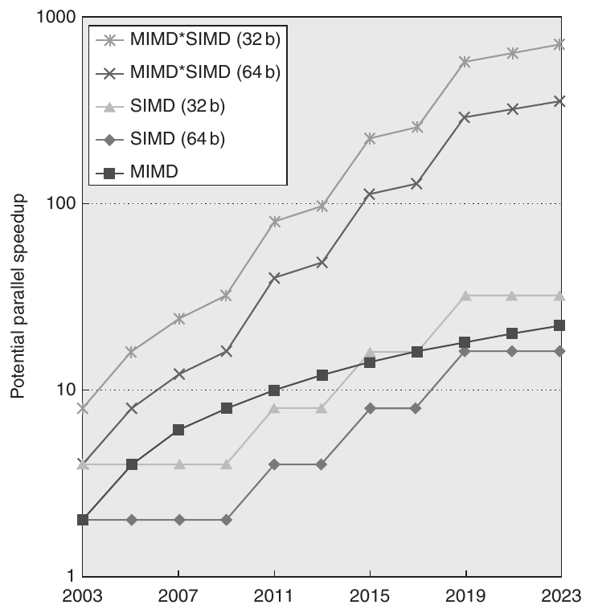

**Hình 4.1 Speedup tiềm năng nhờ parallelism từ MIMD, SIMD và cả MIMD lẫn SIMD theo thời gian cho máy tính x86. Hình giả sử MIMD được thêm hai core mỗi chip sau mỗi hai năm, còn số operation SIMD tăng gấp đôi mỗi bốn năm.**

Với bài toán có nhiều data parallelism, cả ba biến thể SIMD đều có ưu điểm dễ hơn cho programmer so với lập trình MIMD song song cổ điển. Để đặt tầm quan trọng của SIMD so với MIMD vào bối cảnh, Hình 4.1 vẽ số core MIMD so với số operation 32-bit và 64-bit mỗi clock cycle trong SIMD mode của máy tính x86 theo thời gian.

Với máy tính x86, ta kỳ vọng hai core bổ sung mỗi chip sau mỗi hai năm và SIMD width gấp đôi mỗi bốn năm. Với các giả định này, trong thập kỷ tới, speedup tiềm năng từ SIMD parallelism gấp đôi MIMD parallelism. Vì vậy, hiểu SIMD parallelism ít nhất cũng quan trọng như hiểu MIMD parallelism, dù gần đây loại sau được chú ý rầm rộ hơn nhiều. Với application có cả data-level parallelism lẫn thread-level parallelism, speedup tiềm năng năm 2020 sẽ cao hơn hiện nay một bậc độ lớn.

Mục tiêu chương này là giúp architect hiểu vì sao vector tổng quát hơn multimedia SIMD, cũng như các điểm giống và khác giữa vector architecture và GPU architecture. Vì vector architecture là superset của multimedia SIMD instruction, gồm mô hình compilation tốt hơn, và vì GPU có vài điểm tương đồng với vector architecture, ta bắt đầu bằng vector architecture để đặt nền tảng cho hai mục sau. Mục tiếp theo giới thiệu vector architecture, còn Phụ lục G đi sâu hơn nhiều.

## 4.2 Vector Architecture

> Cách hiệu quả nhất để execute application có thể vectorize là vector processor.

> Jim Smith

> International Symposium on Computer Architecture (1994)

Vector architecture lấy các tập data element phân tán trong memory, đặt chúng vào register file lớn và tuần tự, thao tác trên data trong register file đó, rồi phân tán result trở lại memory. Một instruction thao tác trên vector data, tạo ra hàng chục operation register–register trên data element độc lập.

Register file lớn này đóng vai trò một buffer compiler-controlled, vừa che memory latency vừa tận dụng memory bandwidth. Vì vector load và store được pipeline sâu, program chỉ chịu memory latency dài một lần mỗi vector load hoặc store, thay vì một lần mỗi phần tử, nhờ đó phân bổ latency trên, chẳng hạn, 64 phần tử. Thực tế, vector program cố gắng giữ memory luôn bận.

### VMIPS

Ta bắt đầu với vector processor gồm các thành phần chính trong Hình 4.2. Processor này, dựa tương đối theo Cray-1, là nền tảng cho việc thảo luận xuyên suốt mục. Ta gọi instruction set architecture này là VMIPS; phần scalar là MIPS, còn phần vector là mở rộng vector hợp lý của MIPS. Phần còn lại của tiểu mục khảo sát liên hệ giữa architecture cơ bản VMIPS với processor khác.

Các thành phần chính của instruction set architecture VMIPS gồm:

- Vector register—Mỗi vector register là bank fixed-length giữ một vector. VMIPS có tám vector register, mỗi register giữ 64 phần tử, mỗi phần tử rộng 64 bit. Vector register file cần đủ port để cấp data cho mọi vector functional unit. Những port này cho phép mức chồng lấp cao giữa các vector operation trên vector register khác nhau. Read port và write port, tổng ít nhất 16 read port và 8 write port, nối với input hoặc output của functional unit qua một cặp crossbar switch.

- Vector functional unit—Mỗi unit được pipeline đầy đủ và có thể bắt đầu operation mới trong mọi clock cycle. Cần control unit để phát hiện hazard, gồm structural hazard cho functional unit và data hazard trên register access. Hình 4.2 cho thấy VMIPS có năm functional unit. Để đơn giản, ta chỉ tập trung vào functional unit floating-point.

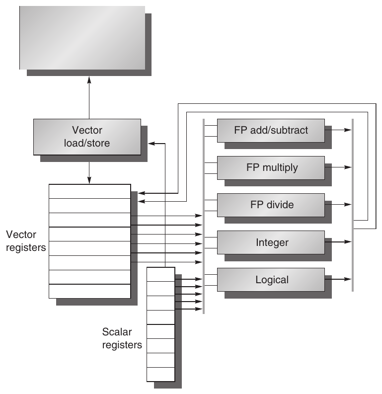

**Hình 4.2 Cấu trúc cơ bản của vector architecture VMIPS. Processor này có scalar architecture giống MIPS. Ngoài ra còn có tám vector register 64-element, và mọi functional unit đều là vector functional unit. Chương này định nghĩa vector instruction đặc biệt cho cả arithmetic lẫn memory access. Hình thể hiện vector unit cho logical operation và integer operation để VMIPS giống vector processor tiêu chuẩn, thường có các unit này; tuy nhiên, ta không thảo luận chúng. Vector register và scalar register có số read port cùng write port đáng kể để cho phép nhiều vector operation đồng thời. Tập crossbar switch (đường xám dày) nối những port này với input và output của vector functional unit.**

- Vector load/store unit—Vector memory unit load hoặc store vector từ memory hoặc tới memory. Vector load và store VMIPS được pipeline đầy đủ, nên sau latency ban đầu, word có thể di chuyển giữa vector register với memory ở bandwidth một word mỗi clock cycle. Unit này thông thường cũng xử lý scalar load và store.

- Tập scalar register—Scalar register còn có thể cung cấp data làm input cho vector functional unit, cũng như tính address chuyển tới vector load/store unit. Đây là 32 register general-purpose và 32 register floating-point thông thường của MIPS. Một input của vector functional unit chốt scalar value khi được đọc ra khỏi scalar register file.

| Instruction | Operand | Chức năng |
|---|---|---|
| ADDVV.D ADDVS.D | V1,V2,V3 V1,V2,F0 | Cộng các phần tử V2 với V3, rồi đặt mỗi result vào V1. Cộng F0 với từng phần tử V2, rồi đặt mỗi result vào V1. |
| SUBVV.D SUBVS.D SUBSV.D | V1,V2,V3 V1,V2,F0 V1,F0,V2 | Lấy các phần tử V2 trừ V3, rồi đặt mỗi result vào V1. Lấy các phần tử V2 trừ F0, rồi đặt mỗi result vào V1. Lấy F0 trừ các phần tử V2, rồi đặt mỗi result vào V1. |
| MULVV.D MULVS.D | V1,V2,V3 V1,V2,F0 | Nhân các phần tử V2 với V3, rồi đặt mỗi result vào V1. Nhân từng phần tử V2 với F0, rồi đặt mỗi result vào V1. |
| DIVVV.D DIVVS.D DIVSV.D | V1,V2,V3 V1,V2,F0 V1,F0,V2 | Chia các phần tử V2 cho V3, rồi đặt mỗi result vào V1. Chia các phần tử V2 cho F0, rồi đặt mỗi result vào V1. Chia F0 cho các phần tử V2, rồi đặt mỗi result vào V1. |
| LV | V1,R1 | Load vector register V1 từ memory bắt đầu tại address R1. |
| SV | R1,V1 | Store vector register V1 vào memory bắt đầu tại address R1. |
| LVWS | V1,(R1,R2) | Load V1 từ address tại R1 với stride trong R2 (tức R1 + i × R2). |
| SVWS | (R1,R2),V1 | Store V1 tới address tại R1 với stride trong R2 (tức R1 + i × R2). |
| LVI | V1,(R1+V2) | Load V1 bằng vector có các phần tử tại R1 + V2(i) (tức V2 là index). |
| SVI | (R1+V2),V1 | Store V1 vào vector có các phần tử tại R1 + V2(i) (tức V2 là index). |
| CVI | V1,R1 | Tạo index vector bằng cách lưu các giá trị 0, 1 × R1, 2 × R1,...,63 × R1 vào V1. |
| S--VV.D S--VS.D | V1,V2 V1,F0 | So sánh các phần tử (EQ, NE, GT, LT, GE, LE) trong V1 và V2. Nếu điều kiện đúng, đặt 1 trong bit vector tương ứng; nếu không đặt 0. Đặt bit vector kết quả vào register vector-mask (VM). Instruction S--VS.D thực hiện cùng phép so sánh nhưng dùng scalar value làm một operand. |
| POP | R1,VM | Đếm các bit 1 trong register vector-mask VM và lưu số đếm vào R1. |
| CVM |  | Đặt register vector-mask thành toàn bit 1. |
| MTC1 MFC1 | VLR,R1 R1,VLR | Chuyển nội dung R1 vào register vector-length VL. Chuyển nội dung register vector-length VL vào R1. |
| MVTM MVFM | VM,F0 F0,VM | Chuyển nội dung F0 vào register vector-mask VM. Chuyển nội dung register vector-mask VM vào F0. |

**Hình 4.3 Vector instruction VMIPS, chỉ thể hiện các operation floating-point double-precision. Ngoài vector register, có hai register đặc biệt VLR và VM được bàn bên dưới. Những register đặc biệt này được giả định nằm trong không gian coprocessor 1 của MIPS cùng FPU register. Operation có stride và việc dùng index creation cùng indexed load/store operation được giải thích về sau.**

Hình 4.3 liệt kê vector instruction VMIPS. Trong VMIPS, vector operation dùng cùng tên với scalar instruction MIPS nhưng thêm chữ “VV”. Vì vậy ADDVV.D là phép cộng hai vector double-precision. Vector instruction nhận input là cặp vector register (ADDVV.D), hoặc vector register cùng scalar register, được chỉ định bằng đuôi “VS” (ADDVS.D). Trong trường hợp sau, mọi operation dùng cùng giá trị scalar register làm một input: ADDVS.D cộng nội dung scalar register vào từng phần tử trong vector register. Vector functional unit lấy bản copy scalar value khi issue. Phần lớn vector operation có destination vector register, dù một số (như population count) tạo scalar value được lưu vào scalar register.

Tên LV và SV biểu thị vector load và vector store, load hoặc store toàn bộ vector data double-precision. Một operand là vector register cần load hoặc store; operand còn lại, một register general-purpose MIPS, là starting address của vector trong memory. Như ta sẽ thấy, ngoài vector register, cần thêm hai register special-purpose: register vector-length và vector-mask. Register đầu dùng khi vector length tự nhiên không phải 64, register sau dùng khi loop có IF statement.

Power wall khiến architect coi trọng architecture có thể cung cấp hiệu năng cao mà không chịu chi phí energy và độ phức tạp thiết kế của superscalar processor out-of-order mạnh. Vector instruction tự nhiên phù hợp xu hướng này, vì architect có thể dùng chúng tăng hiệu năng scalar processor in-order đơn giản mà không làm tăng nhiều nhu cầu energy và độ phức tạp thiết kế. Thực tế, developer có thể biểu diễn nhiều program từng chạy tốt trên thiết kế out-of-order phức tạp theo cách hiệu quả hơn bằng data-level parallelism dưới dạng vector instruction, như Kozyrakis và Patterson [2002] cho thấy.

Với vector instruction, hệ thống có thể thực hiện operation trên vector data element theo nhiều cách, gồm thao tác đồng thời trên nhiều phần tử. Tính linh hoạt này cho phép thiết kế vector sử dụng execution unit chậm nhưng rộng để đạt hiệu năng cao với power thấp. Hơn nữa, tính độc lập của phần tử trong vector instruction set cho phép scaling functional unit mà không phải thêm dependency check tốn kém như superscalar processor yêu cầu.

Vector tự nhiên hỗ trợ data size thay đổi. Vì vậy, một cách nhìn vector register size là 64 data element 64-bit, nhưng 128 phần tử 32-bit, 256 phần tử 16-bit, thậm chí 512 phần tử 8-bit cũng là cách nhìn hợp lệ. Tính đa dạng hardware này là lý do vector architecture hữu ích cho cả multimedia application lẫn scientific application.

### Vector Processor hoạt động thế nào: Ví dụ

Cách tốt nhất để hiểu vector processor là xem vector loop cho VMIPS. Hãy lấy bài toán vector điển hình, được dùng xuyên suốt mục:

```
Y = a × X + Y
```

X và Y là vector, ban đầu nằm trong memory, còn a là scalar. Bài toán này được gọi là vòng lặp so-called SAXPY hoặc DAXPY, tạo inner loop của Linpack benchmark. (SAXPY viết tắt single-precision a × X plus Y; DAXPY là double precision a × X plus Y.) Linpack là tập linear algebra routine, còn Linpack benchmark gồm các routine thực hiện Gaussian elimination.

Hiện tại, giả sử số phần tử, hay chiều dài, của vector register (64) khớp chiều dài vector operation ta quan tâm. (Hạn chế này sẽ sớm được bỏ.)

**Ví dụ** Viết code MIPS và VMIPS cho DAXPY loop. Giả sử starting address của X và Y lần lượt nằm trong Rx và Ry.

**Trả lời** Đây là code MIPS.

```
        L.D        F0,a            ;load scalar a
        DADDIU     R4,Rx,#512      ;last address to load
Loop:   L.D        F2,0(Rx)        ;load X[i]
        MUL.D      F2,F2,F0        ;a × X[i]
        L.D        F4,0(Ry)        ;load Y[i]
        ADD.D      F4,F4,F2        ;a × X[i] + Y[i]
        S.D        F4,9(Ry)        ;store into Y[i]
        DADDIU     Rx,Rx,#8        ;increment index to X
        DADDIU     Ry,Ry,#8        ;increment index to Y
        DSUBU      R20,R4,Rx       ;compute bound
        BNEZ       R20,Loop        ;check if done
```

Đây là code VMIPS cho DAXPY.

```
 L.D         F0,a           ;load scalar a
 LV          V1,Rx          ;load vector X
 MULVS.D     V2,V1,F0       ;vector-scalar multiply
 LV          V3,Ry          ;load vector Y
 ADDVV.D     V4,V2,V3       ;add
 SV          V4,Ry          ;store the result
```

Khác biệt ấn tượng nhất là vector processor giảm mạnh dynamic instruction bandwidth, chỉ thực thi 6 instruction so với gần 600 của MIPS. Mức giảm này có được vì vector operation làm việc trên 64 phần tử, và các overhead instruction chiếm gần nửa loop MIPS không xuất hiện trong code VMIPS. Khi compiler tạo vector instruction cho chuỗi như vậy và code kết quả dành phần lớn thời gian chạy vector mode, code được gọi là vectorized hoặc vectorizable. Loop có thể vectorize khi không có dependence giữa các vòng lặp, gọi là loop-carried dependence (xem Mục 4.5).

Khác biệt quan trọng khác giữa MIPS và VMIPS là tần suất pipeline interlock. Trong code MIPS trực tiếp, mọi ADD.D phải đợi MUL.D, và mọi S.D phải đợi ADD.D. Trên vector processor, mỗi vector instruction chỉ stall cho phần tử đầu mỗi vector, rồi phần tử sau đi trơn tru qua pipeline. Vì vậy, chỉ cần pipeline stall một lần mỗi vector instruction thay vì mỗi phần tử vector. Vector architect gọi forwarding các operation element-dependent là chaining, vì operation phụ thuộc được “nối chuỗi” với nhau. Trong ví dụ, tần suất pipeline stall trên MIPS cao hơn VMIPS khoảng 64×. Software pipelining hoặc loop unrolling (Phụ lục H) có thể giảm pipeline stall trên MIPS; tuy nhiên không thể giảm đáng kể khác biệt lớn về instruction bandwidth.

### Vector Execution Time

Execution time của chuỗi vector operation chủ yếu phụ thuộc ba yếu tố: (1) chiều dài operand vector, (2) structural hazard giữa các operation và (3) data dependence. Biết vector length cùng initiation rate, tức tốc độ vector unit tiêu thụ operand mới và tạo result mới, ta tính được thời gian cho một vector instruction. Mọi vector computer hiện đại đều có vector functional unit với nhiều parallel pipeline (hay lane) có thể tạo hai result trở lên mỗi clock cycle, nhưng cũng có thể có functional unit không được pipeline đầy đủ. Để đơn giản, implementation VMIPS của ta có một lane với initiation rate một phần tử mỗi clock cycle cho operation riêng. Vì vậy, execution time tính bằng clock cycle của một vector instruction xấp xỉ vector length.

Để đơn giản hóa việc thảo luận vector execution và vector performance, ta dùng khái niệm convoy, tức tập vector instruction có khả năng thực thi cùng nhau. Như sẽ sớm thấy, có thể ước tính performance của một đoạn code bằng cách đếm số convoy. Instruction trong một convoy không được có structural hazard; nếu có, chúng phải được serialized và khởi phát trong các convoy khác nhau. Để giữ phân tích đơn giản, ta giả sử một convoy instruction phải hoàn tất execution trước khi bất kỳ instruction nào khác (scalar hoặc vector) có thể bắt đầu execution.

Có vẻ ngoài chuỗi vector instruction có structural hazard, chuỗi có dependency hazard read-after-write cũng cần ở convoy riêng, nhưng chaining cho phép chúng ở cùng convoy.

Chaining cho phép vector operation bắt đầu ngay khi từng phần tử của vector source operand sẵn có: result từ functional unit đầu trong chuỗi được “forward” tới functional unit thứ hai. Thực tế, ta thường triển khai chaining bằng cách cho processor đọc và ghi cùng vector register đồng thời, dù vào phần tử khác nhau. Chaining thời kỳ đầu hoạt động giống forwarding trong scalar pipelining, nhưng hạn chế timing của source instruction và destination instruction trong chuỗi. Implementation gần đây dùng flexible chaining, cho phép vector instruction chain với về cơ bản bất kỳ vector instruction đang hoạt động nào, giả sử không tạo structural hazard. Mọi vector architecture hiện đại hỗ trợ flexible chaining, điều ta giả định trong chương.

Để đổi convoy thành execution time, cần timing metric ước tính thời gian convoy. Nó gọi là chime, đơn giản là đơn vị thời gian để execute một convoy. Vì vậy, chuỗi vector gồm m convoy execute trong m chime; với vector length n, trên VMIPS xấp xỉ m × n clock cycle. Xấp xỉ chime bỏ qua một số overhead processor-specific, nhiều overhead phụ thuộc vector length. Vì vậy, đo thời gian bằng chime xấp xỉ tốt hơn cho vector dài so với vector ngắn. Ta dùng phép đo chime thay clock cycle mỗi result để chỉ rõ đang bỏ qua một số overhead.

Nếu biết số convoy trong chuỗi vector, ta biết execution time theo chime. Một nguồn overhead bị bỏ qua khi đo chime là mọi hạn chế khởi động nhiều vector instruction trong một clock cycle. Nếu chỉ có thể khởi động một vector instruction mỗi clock cycle (thực tế của phần lớn vector processor), số chime đánh giá thấp execution time thực của convoy. Vì chiều dài vector thường lớn hơn nhiều số instruction trong convoy, ta đơn giản giả sử convoy execute trong một chime.

**Ví dụ** Cho biết chuỗi code sau được bố trí thành convoy thế nào, giả sử chỉ có một bản của mỗi vector functional unit:

```
LV            V1,Rx          ;load vector X
MULVS.D       V2,V1,F0       ;vector-scalar multiply
LV            V3,Ry          ;load vector Y
ADDVV.D       V4,V2,V3       ;add two vectors
SV            V4,Ry          ;store the sum
```

Chuỗi vector này mất bao nhiêu chime? Cần bao nhiêu cycle mỗi FLOP (operation floating-point), bỏ qua overhead issue vector instruction?

**Trả lời** Convoy đầu bắt đầu bằng instruction LV đầu tiên. MULVS.D phụ thuộc LV đầu, nhưng chaining cho phép nó ở cùng convoy.

Instruction LV thứ hai phải ở convoy riêng vì structural hazard trên load/store unit với instruction LV trước. ADDVV.D phụ thuộc LV thứ hai, nhưng lại có thể cùng convoy nhờ chaining. Cuối cùng, SV có structural hazard với LV trong convoy thứ hai nên phải sang convoy thứ ba. Phân tích này dẫn tới bố trí vector instruction thành convoy như sau:

1. LV MULVS.D

2. LV ADDVV.D

3. SV

Chuỗi cần ba convoy. Vì chuỗi mất ba chime và có hai operation floating-point mỗi result, số cycle mỗi FLOP là 1.5 (bỏ qua mọi overhead issue vector instruction). Lưu ý dù cho LV và MULVS.D cùng execute trong convoy đầu, phần lớn vector machine mất hai clock cycle để khởi động các instruction.

Ví dụ này cho thấy xấp xỉ chime khá chính xác với vector dài. Chẳng hạn, với vector 64-element, thời gian theo chime là 3, nên chuỗi mất khoảng 64 × 3, tức 192 clock cycle. Overhead issue convoy trong hai clock cycle riêng sẽ nhỏ.

Nguồn overhead khác quan trọng hơn nhiều so với giới hạn issue. Nguồn overhead quan trọng nhất mà mô hình chime bỏ qua là vector start-up time. start-up time chủ yếu do pipelining latency của vector functional unit quyết định. Với VMIPS, ta dùng cùng pipeline depth như Cray-1, dù latency của processor hiện đại hơn có xu hướng tăng, nhất là vector load. Mọi functional unit đều được pipeline đầy đủ. Pipeline depth là 6 clock cycle cho add floating-point, 7 cho multiply floating-point, 20 cho divide floating-point và 12 cho vector load.

Với những kiến thức vector cơ bản này, các tiểu mục tiếp theo đưa ra tối ưu cải thiện hiệu năng hoặc tăng loại program chạy tốt trên vector architecture. Cụ thể, chúng trả lời các câu hỏi:

- Làm sao vector processor execute một vector nhanh hơn một phần tử mỗi clock cycle? Nhiều phần tử mỗi clock cycle cải thiện hiệu năng.

- Vector processor xử lý program có vector length không bằng chiều dài vector register (64 với VMIPS) thế nào? Vì phần lớn vector application có chiều dài không khớp vector length của architecture, cần giải pháp hiệu quả cho trường hợp phổ biến này.

- Chuyện gì xảy ra khi có IF statement trong code cần vectorize? Có thể vectorize nhiều code hơn nếu xử lý conditional statement hiệu quả.

- Vector processor cần gì từ memory system? Nếu không có đủ memory bandwidth, vector execution có thể không đem lại lợi ích.

- Vector processor xử lý matrix nhiều chiều thế nào? Data structure phổ biến này phải vectorize được để vector architecture hoạt động tốt.

- Vector processor xử lý sparse matrix thế nào? Data structure phổ biến này cũng phải vectorize được.

- Bạn lập trình vector computer thế nào? Đổi mới architecture không khớp công nghệ compiler có thể không được dùng rộng rãi.

Phần còn lại của mục giới thiệu lần lượt những tối ưu vector architecture này, còn Phụ lục G đi sâu hơn.

### Nhiều Lane: Vượt một phần tử mỗi Clock Cycle

Ưu điểm thiết yếu của vector instruction set là cho phép software chuyển lượng lớn công việc song song tới hardware chỉ bằng một instruction ngắn. Một vector instruction có thể gồm hàng chục operation độc lập nhưng vẫn được mã hóa bằng cùng số bit như scalar instruction thông thường. Parallel semantics của vector instruction cho phép implementation thực thi những operation trên từng phần tử bằng functional unit được pipeline sâu như implementation VMIPS ta đã nghiên cứu; array parallel functional unit; hoặc kết hợp functional unit song song và được pipeline. Hình 4.4 minh họa cải thiện vector performance bằng parallel pipeline để execute vector add instruction.

Instruction set VMIPS có tính chất mọi vector arithmetic instruction chỉ cho phép phần tử N của vector register tham gia operation với phần tử N từ vector register khác. Điều này đơn giản hóa mạnh việc xây vector unit song song cao, có thể cấu trúc thành nhiều parallel lane. Như đường cao tốc, ta tăng peak throughput vector unit bằng cách thêm lane. Hình 4.5 cho cấu trúc vector unit four-lane. Vì vậy, từ một lane sang bốn lane giảm số clock mỗi chime từ 64 xuống 16. Để nhiều lane có lợi, cả application lẫn architecture phải hỗ trợ vector dài; nếu không, chúng execute nhanh đến mức hết instruction bandwidth, đòi kỹ thuật ILP (xem Chương 3) cung cấp đủ vector instruction.

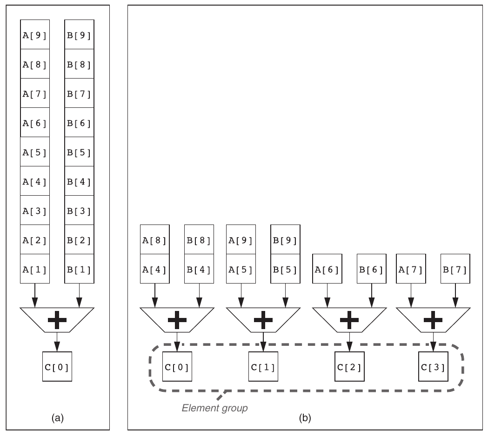

**Hình 4.4 Dùng nhiều functional unit để cải thiện hiệu năng một vector add instruction C = A + B. Vector processor (a) bên trái có một add pipeline và hoàn tất một phép cộng mỗi cycle. Vector processor (b) bên phải có bốn add pipeline và hoàn tất bốn phép cộng mỗi cycle. Phần tử trong một vector add instruction được interleave trên bốn pipeline. Tập phần tử cùng di chuyển qua pipeline gọi là element group. (Tái bản với sự cho phép của Asanovic [1998].)**

Mỗi lane chứa một phần vector register file và một execution pipeline từ mỗi vector functional unit. Mỗi vector functional unit execute vector instruction với tốc độ một element group mỗi cycle bằng nhiều pipeline, mỗi lane một pipeline. Lane đầu giữ phần tử đầu (phần tử 0) cho mọi vector register, nên phần tử đầu trong vector instruction bất kỳ có source operand và destination operand nằm trong lane đầu. Cách phân bổ này cho arithmetic pipeline cục bộ của lane hoàn tất operation mà không cần liên lạc với lane khác. Truy cập main memory cũng chỉ cần intralane wiring. Tránh interlane communication giảm chi phí wiring và số register file port cần để xây execution unit song song cao, giúp giải thích vì sao vector computer hoàn tất tới 64 operation mỗi clock cycle (2 arithmetic unit và 2 load/store unit trên 16 lane).

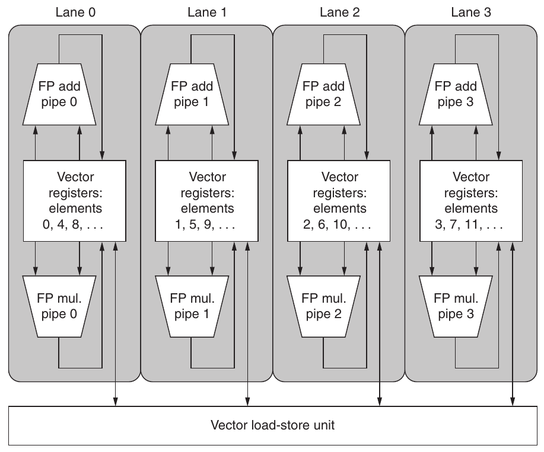

**Hình 4.5 Cấu trúc vector unit có bốn lane. Vector register storage chia giữa các lane, mỗi lane giữ các phần tử cách nhau bốn vị trí của mỗi vector register. Hình cho ba vector functional unit: FP add, FP multiply và unit load-store. Mỗi vector arithmetic unit có bốn execution pipeline, mỗi lane một pipeline, phối hợp hoàn tất một vector instruction. Lưu ý mỗi phần vector register file chỉ cần cung cấp đủ port cho pipeline cục bộ của lane. Hình không vẽ đường cung cấp scalar operand cho instruction vector-scalar, nhưng scalar processor (hay control processor) broadcast scalar value tới mọi lane.**

Thêm nhiều lane là kỹ thuật phổ biến để cải thiện vector performance vì chỉ tăng ít độ phức tạp control và không cần đổi machine code hiện có. Nó còn cho người thiết kế đánh đổi die area, clock rate, voltage và energy mà không hy sinh peak performance. Nếu clock rate vector processor giảm một nửa, gấp đôi số lane giữ nguyên hiệu năng tiềm năng.

### Register Vector-Length: Xử lý Loop không bằng 64

Vector register processor có vector length tự nhiên do số phần tử mỗi vector register quyết định. Chiều dài này, 64 với VMIPS, khó khớp vector length thực trong program. Hơn nữa, trong program thực, chiều dài của vector operation cụ thể thường chưa được biết tại compile time. Thực tế, một đoạn code có thể cần vector length khác nhau. Ví dụ, xét code sau:

```
 for (i=0; i <n;  i=i+1)
     Y[i] = a ∗ X[i] + Y[i];
```

Kích thước mọi vector operation phụ thuộc n, có thể thậm chí chưa biết đến run time! Giá trị n cũng có thể là parameter của procedure chứa loop trên, nên có thể thay đổi trong execution.

Giải pháp là tạo register vector-length (VLR). VLR điều khiển chiều dài mọi vector operation, gồm vector load hoặc store. Tuy nhiên giá trị VLR không được lớn hơn chiều dài vector register. Điều này giải quyết vấn đề miễn chiều dài thực nhỏ hơn hoặc bằng maximum vector length (MVL). MVL quyết định số data element trong vector của architecture. Parameter này cho phép vector register dài hơn ở thế hệ máy tính sau mà không đổi instruction set; như ta sẽ thấy trong mục tiếp, multimedia SIMD extension không có thứ tương đương MVL, nên đổi instruction set mỗi lần tăng vector length.

Nếu chưa biết n tại compile time và vì vậy n có thể lớn hơn MVL thì sao? Để xử lý vấn đề thứ hai khi vector dài hơn maximum length, dùng kỹ thuật strip mining. Strip mining tạo code sao cho mỗi vector operation được thực hiện với kích thước nhỏ hơn hoặc bằng MVL. Ta tạo một loop xử lý số vòng là bội MVL và loop khác xử lý vòng còn lại, số này phải nhỏ hơn MVL. Trong thực tế, compiler thường tạo một loop strip-mined được parameter hóa để xử lý cả hai phần bằng cách thay chiều dài. Đây là phiên bản strip-mined của DAXPY loop trong C:

```
low = 0;
VL = (n % MVL); /*find odd-size piece using modulo op % */
for (j = 0; j <= (n/MVL);  j=j+1) { /*outer loop*/
    for (i = low; i < (low+VL);  i=i+1) /*runs for length VL*/
        Y[i] = a * X[i] + Y[i] ; /*main operation*/
     low = low + VL; /*start of next vector*/
     VL = MVL; /*reset the length to maximum vector length*/
}
```

Biểu thức n/MVL là phép chia integer bỏ phần lẻ. Tác dụng loop là chia vector thành segment rồi xử lý bằng inner loop. Chiều dài segment đầu là (n % MVL), mọi segment sau dài MVL. Hình 4.6 cho thấy cách chia vector dài thành segment.

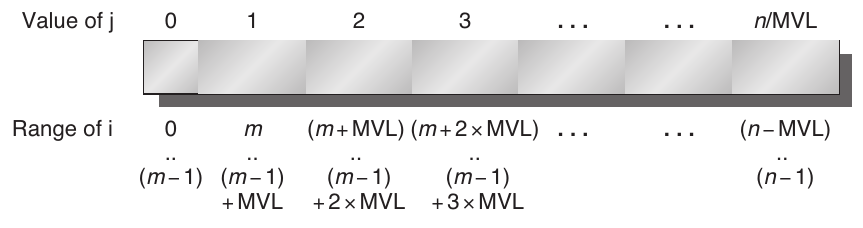

**Hình 4.6 Vector chiều dài tùy ý được xử lý bằng strip mining. Mọi block trừ block đầu dài MVL, tận dụng toàn bộ sức mạnh vector processor. Trong hình, ta dùng variable m cho biểu thức (n % MVL). (Operator C % là modulo.)**

Inner loop của code trên có thể vectorize với chiều dài VL, bằng (n % MVL) hoặc MVL. Register VLR phải được đặt hai lần trong code, một lần tại mỗi chỗ variable VL được gán.

### Vector Mask Register: Xử lý IF Statement trong Vector Loop

Từ định luật Amdahl, ta biết speedup của program có mức vectorization thấp đến vừa sẽ rất hạn chế. Conditional (IF statement) trong loop và việc sử dụng sparse matrix là hai nguyên nhân chính khiến mức vectorization thấp hơn. Program có IF statement trong loop không thể chạy ở vector mode bằng những kỹ thuật đã thảo luận, vì IF statement đưa control dependence vào loop. Tương tự, ta chưa thể triển khai sparse matrix hiệu quả bằng bất kỳ khả năng nào đã thấy. Ở đây, ta thảo luận chiến lược xử lý conditional execution, còn phần thảo luận sparse matrix sẽ được để lại sau.

Xét loop sau viết bằng C:

```
for (i = 0; i < 64;  i=i+1)
   if (X[i] != 0)
     X[i] = X[i] – Y[i];
```

Loop này thường không thể được vectorize vì body được execute có điều kiện; tuy nhiên, nếu có thể chạy inner loop ở các vòng có X[i] ≠ 0, phép trừ có thể vectorize.

Mở rộng phổ biến cho khả năng này là control vector-mask. Mask register về cơ bản cung cấp conditional execution cho mỗi element operation trong vector instruction. Control vector-mask dùng Boolean vector để điều khiển execution của vector instruction, giống instruction execute có điều kiện dùng Boolean condition quyết định có execute scalar instruction không. Khi register vector-mask được bật, vector instruction chỉ thao tác trên phần tử có entry tương ứng trong register vector-mask bằng một. Entry trong destination vector register tương ứng zero trong mask register không bị vector operation ảnh hưởng. Clear register vector-mask đặt nó thành toàn một, khiến vector instruction sau thao tác trên mọi phần tử vector. Giờ ta dùng code sau cho loop trước, giả sử starting address của X và Y lần lượt nằm trong Rx và Ry:

```
LV          V1,Rx         ;load vector X into V1
LV          V2,Ry         ;load vector Y
L.D         F0,#0         ;load FP zero into F0
SNEVS.D      V1,F0        ;sets VM(i) to 1 if V1(i)!=F0
SUBVV.D     V1,V1,V2      ;subtract under vector mask
SV          V1,Rx         ;store the result in X
```

Người viết compiler gọi phép biến đổi IF statement thành chuỗi code straight-line bằng conditional execution là if conversion.

Tuy nhiên, dùng register vector-mask có overhead. Với scalar architecture, instruction execute có điều kiện vẫn cần execution time khi điều kiện không thỏa. Tuy vậy, loại bỏ branch cùng control dependence liên quan có thể làm conditional instruction nhanh hơn dù đôi khi làm việc vô ích. Tương tự, vector instruction execute với vector mask vẫn mất cùng execution time, ngay cả phần tử có mask zero. Cũng vậy, dù mask có nhiều zero, dùng control vector-mask vẫn có thể nhanh hơn đáng kể scalar mode.

Như ta sẽ thấy trong Mục 4.4, một khác biệt giữa vector processor và GPU là cách xử lý conditional statement. Vector processor đưa mask register vào architectural state, dựa vào compiler để thao tác mask register một cách tường minh. Ngược lại, GPU đạt hiệu quả tương tự bằng hardware thao tác mask register nội bộ vô hình với GPU software. Trong cả hai, hardware mất thời gian execute phần tử vector dù mask zero hay một, nên GFLOPS rate giảm khi dùng mask.

### Memory Bank: Cung cấp Bandwidth cho Vector Load/Store Unit

Hành vi load/store vector unit phức tạp hơn nhiều arithmetic functional unit. start-up time của load là thời gian lấy word đầu từ memory vào register. Nếu phần vector còn lại được cung cấp không stall, vector initiation rate bằng tốc độ fetch hoặc store word mới. Khác functional unit đơn giản hơn, initiation rate không nhất thiết một clock cycle vì memory bank stall có thể giảm throughput hiệu dụng.

Thông thường, penalty cho start-ups trên load/store unit cao hơn arithmetic unit—hơn 100 clock cycle trên nhiều processor. Với VMIPS, ta giả sử start-up time 12 clock cycle, giống Cray-1. (Vector computer mới hơn dùng cache để giảm latency vector load và store.)

Để duy trì initiation rate một word fetch hoặc store mỗi clock, memory system phải tạo hoặc nhận được lượng data này. Phân bố access trên nhiều memory bank độc lập thường cung cấp tốc độ mong muốn. Như ta sắp thấy, số bank đáng kể hữu ích khi xử lý vector load hoặc store truy cập hàng hay cột data.

Phần lớn vector processor dùng memory bank cho phép nhiều access độc lập thay vì memory interleaving đơn giản vì ba lý do:

1. Nhiều vector computer hỗ trợ nhiều load hoặc store mỗi clock, còn memory bank cycle time thường lớn hơn processor cycle time vài lần. Để hỗ trợ access đồng thời từ nhiều load hoặc store, memory system cần nhiều bank và khả năng điều khiển address tới từng bank độc lập.

2. Phần lớn vector processor hỗ trợ load hoặc store data word không liên tiếp. Trong trường hợp này, cần bank addressing độc lập thay vì interleaving.

3. Phần lớn vector computer hỗ trợ nhiều processor dùng chung memory system, nên mỗi processor tạo address stream độc lập riêng.

Kết hợp lại, các tính năng này dẫn tới số lượng lớn memory bank độc lập, như ví dụ sau cho thấy.

**Ví dụ** Cấu hình Cray T90 lớn nhất (Cray T932) có 32 processor, mỗi processor tạo được 4 load và 2 store mỗi clock cycle. Processor clock cycle là 2.167 ns, còn cycle time của SRAM dùng trong memory system là 15 ns. Tính số memory bank tối thiểu cần để mọi processor sử dụng hết memory bandwidth.

**Trả lời** Số memory reference tối đa mỗi cycle là 192: 32 processor nhân 6 reference mỗi processor. Mỗi SRAM bank bận trong 15/2.167 = 6.92 clock cycle, ta làm tròn lên 7 processor clock cycle. Vì vậy, cần tối thiểu 192 × 7 = 1344 memory bank!

Cray T932 thực tế có 1024 memory bank, nên model đầu không duy trì được full bandwidth tới mọi processor đồng thời. Nâng cấp memory sau đó thay SRAM asynchronous 15 ns bằng SRAM synchronous được pipeline, giảm memory cycle time hơn một nửa, nhờ đó cung cấp đủ bandwidth.

Nhìn từ mức cao hơn, vector load/store unit đóng vai trò tương tự prefetch unit trong scalar processor: cả hai đều cố cung cấp data bandwidth bằng cách cấp các data stream cho processor.

### Stride: Xử lý Array nhiều chiều trong Vector Architecture

Các phần tử kề nhau về logic trong vector có thể không nằm liên tiếp trong memory. Hãy xét đoạn code matrix multiply trực tiếp bằng C sau:

```
for (i = 0; i < 100;  i=i+1)
   for (j = 0; j < 100;  j=j+1) {
      A[i][j] = 0.0;
      for (k = 0; k < 100; k=k+1)
         A[i][j] = A[i][j] + B[i][k] * D[k][j];
   }
```

Ta có thể vectorize phép nhân mỗi hàng B với mỗi cột D, và strip-mine inner loop với k làm index variable.

Để làm vậy, phải xét cách định địa chỉ các phần tử kề nhau trong B và D. Khi array được cấp memory, nó được linearize và phải bố trí theo thứ tự row-major (C) hoặc column-major (Fortran). Linearization này khiến phần tử trong hàng hoặc trong cột không liền nhau trong memory. Ví dụ, code C trên cấp theo row-major, nên phần tử D được các vòng inner loop truy cập cách nhau row size nhân 8 (số byte mỗi entry), tổng 800 byte. Trong Chương 2, ta thấy blocking cải thiện locality ở hệ thống cache-based. Với vector processor không cache, cần kỹ thuật khác để fetch phần tử vector không liền nhau trong memory.

Khoảng cách giữa các phần tử cần gom vào một register gọi là stride. Trong ví dụ, matrix D có stride 100 double word (800 byte), matrix B có stride 1 double word (8 byte). Với thứ tự column-major dùng trong Fortran, stride đảo lại. Matrix D có stride 1, tức 1 double word (8 byte) giữa phần tử liên tiếp, còn matrix B có stride 100, tức 100 double word (800 byte). Vì vậy, nếu không đổi thứ tự loop, compiler không thể che khoảng cách lớn giữa phần tử liên tiếp cho cả B và D.

Khi vector được load vào vector register, nó hoạt động như thể các phần tử nằm liền nhau về mặt logic. Vì vậy vector processor xử lý stride lớn hơn một, gọi là non-unit stride, chỉ bằng vector load và vector store có khả năng stride. Khả năng truy cập vị trí memory không liên tiếp rồi định dạng lại thành cấu trúc dense là ưu điểm lớn của vector processor. Cache vốn xử lý data unit stride; tăng block size có thể giảm miss rate với scientific dataset lớn có unit stride, nhưng có thể gây tác động xấu cho data được truy cập với non-unit stride. Dù blocking giải quyết được một số vấn đề (xem Chương 2), truy cập hiệu quả data không liên tục vẫn là ưu thế vector processor ở một số bài toán, như ta sẽ thấy trong Mục 4.7.

Trên VMIPS, đơn vị addressable là byte nên stride ví dụ là 800. Giá trị phải được tính động, vì matrix size có thể chưa biết tại compile time hoặc—như vector length—thay đổi giữa các lần execute cùng statement. Vector stride, như vector starting address, có thể đặt trong register general-purpose. Sau đó instruction VMIPS LVWS (load vector with stride) fetch vector vào vector register. Tương tự, khi store vector non-unit stride, dùng instruction SVWS (store vector with stride).

Hỗ trợ stride lớn hơn một khiến memory system phức tạp. Khi có non-unit stride, có thể thường xuyên yêu cầu access từ cùng bank. Khi nhiều access tranh chấp bank, memory bank conflict xảy ra, khiến một access stall. Bank conflict, và do đó stall, xảy ra nếu

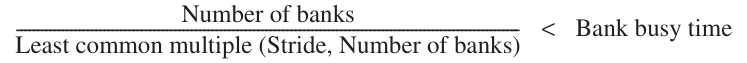

**Ví dụ** Giả sử có 8 memory bank với bank busy time 6 clock và tổng memory latency 12 cycle. Hoàn tất vector load 64-element với stride 1 mất bao lâu? Với stride 32 thì sao?

**Trả lời** Vì số bank lớn hơn bank busy time, với stride 1, load mất 12 + 64 = 76 clock cycle, tức 1.2 clock cycle mỗi phần tử. Stride xấu nhất là giá trị bội số memory bank, như trường hợp stride 32 và 8 memory bank. Mọi memory access (sau access đầu) va chạm access trước và phải chờ bank busy time 6-clock-cycle. Tổng thời gian là 12 + 1 + 6 * 63 = 391 clock cycle, tức 6.1 clock cycle mỗi phần tử.

### Gather-Scatter: Xử lý Sparse Matrix trong Vector Architecture

Như đã đề cập, sparse matrix phổ biến nên cần kỹ thuật cho phép program có sparse matrix được thực thi trong vector mode. Trong sparse matrix, phần tử vector thường được lưu dưới dạng compacted rồi truy cập gián tiếp. Giả sử sparse structure đơn giản hóa, ta có thể thấy code như sau:

```
for (i = 0; i < n;  i=i+1)
   A[K[i]] = A[K[i]] + C[M[i]];
```

Code này thực hiện sparse vector sum trên array A và C, dùng index vector K và M để chỉ định các phần tử nonzero của A và C. (A và C phải có cùng số phần tử nonzero—n phần tử—nên K và M có cùng kích thước.)

Mechanism chính hỗ trợ sparse matrix là operation gather-scatter dùng index vector. Mục tiêu là hỗ trợ chuyển giữa biểu diễn nén (không gồm zero) và biểu diễn bình thường (gồm zero) của sparse matrix. Gather operation nhận index vector rồi fetch vector có phần tử tại address bằng base address cộng offset trong index vector. Result là dense vector trong vector register. Sau khi thao tác trên các phần tử này ở dạng dense, sparse vector có thể lưu ở dạng mở rộng bằng scatter store dùng cùng index vector. Hardware hỗ trợ operation này gọi là gather-scatter, có trên gần như mọi vector processor hiện đại. Instruction VMIPS là LVI (load vector indexed hay gather) và SVI (store vector indexed hay scatter). Ví dụ, nếu Ra, Rc, Rk và Rm chứa starting address các vector trong chuỗi trước, ta viết inner loop bằng vector instruction như:

```
LV         Vk, Rk         ;load K
LVI Va, (Ra+Vk)           ;load A[K[]]
LV Vm, Rm                 ;load M
LVI Vc, (Rc+Vm)           ;load C[M[]]
ADDVV.D    Va, Va, Vc     ;add them
SVI (Ra+Vk), Va           ;store A[K[]]
```

Kỹ thuật này cho phép code có sparse matrix chạy trong vector mode. Một vectorizing compiler đơn giản không thể tự động vectorize source code trên, vì compiler không biết các phần tử K có giá trị khác nhau, và do đó không có dependence. Thay vào đó, programmer directive sẽ báo compiler rằng chạy loop trong vector mode là an toàn.

Dù indexed load và store (gather và scatter) có thể được pipeline, chúng thường chạy chậm hơn nhiều load hoặc store non-indexed, vì chưa biết memory bank nào sẽ được truy cập khi instruction bắt đầu. Mỗi phần tử có address riêng nên không xử lý theo nhóm được, và conflict có thể xảy ra ở nhiều nơi trong memory system. Vì vậy, mỗi access riêng chịu latency đáng kể. Tuy nhiên, như Mục 4.7 cho thấy, memory system có thể đạt hiệu năng tốt hơn bằng thiết kế cho trường hợp này và dùng nhiều hardware resource hơn so với khi architect có thái độ mặc kệ những access ấy.

Như ta sẽ thấy trong Mục 4.4, mọi load là gather và mọi store là scatter trong GPU. Để tránh chạy chậm trong trường hợp unit stride thường gặp, GPU programmer phải bảo đảm mọi address trong gather hoặc scatter nằm ở vị trí liền nhau. Ngoài ra, hardware GPU phải nhận ra chuỗi address trong execution để biến gather và scatter thành memory access unit stride hiệu quả hơn.

### Lập trình Vector Architecture

Một ưu điểm của vector architecture là compiler có thể cho programmer biết tại compile time liệu đoạn code có được vectorize hay không, thường kèm gợi ý về nguyên nhân code chưa được vectorize. Execution model dễ hiểu này cho phép chuyên gia trong lĩnh vực khác học cách cải thiện performance bằng cách sửa code hoặc đưa gợi ý cho compiler khi có thể giả định các operation độc lập, chẳng hạn với data transfer gather-scatter. Chính sự trao đổi giữa compiler và programmer, trong đó mỗi bên gợi ý cho bên kia cách cải thiện performance, giúp việc lập trình vector computer đơn giản hơn.

Ngày nay, yếu tố chính ảnh hưởng mức độ thành công khi program chạy trong vector mode là cấu trúc của chính program: các loop có true data dependence (xem Mục 4.5), hay có thể được cấu trúc lại để không có những dependence ấy? Yếu tố này chịu ảnh hưởng bởi thuật toán được chọn và, ở mức nào đó, cách viết code.

Để biết mức vectorization có thể đạt trong scientific program, hãy xem mức vectorization quan sát với benchmark Perfect Club. Hình 4.7 cho tỷ lệ operation execute trong vector mode ở hai phiên bản code chạy trên Cray Y-MP. Phiên bản đầu chỉ dùng compiler optimization trên code gốc, phiên bản sau dùng nhiều gợi ý từ nhóm programmer Cray Research. Nhiều nghiên cứu hiệu năng application trên vector processor cho thấy mức compiler vectorization biến thiên rộng.

| Tên benchmark | Operation execute trong vector mode, compiler-optimized | Operation execute trong vector mode, có programmer hỗ trợ | Speedup nhờ tối ưu bằng gợi ý |
|---|---|---|---|
| BDNA | 96.1% | 97.2% | 1.52 |
| MG3D | 95.1% | 94.5% | 1.00 |
| FLO52 | 91.5% | 88.7% | N/A |
| ARC3D | 91.1% | 92.0% | 1.01 |
| SPEC77 | 90.3% | 90.4% | 1.07 |
| MDG | 87.7% | 94.2% | 1.49 |
| TRFD | 69.8% | 73.7% | 1.67 |
| DYFESM | 68.8% | 65.6% | N/A |
| ADM | 42.9% | 59.6% | 3.60 |
| OCEAN | 42.8% | 91.2% | 3.92 |
| TRACK | 14.4% | 54.6% | 2.52 |
| SPICE | 11.5% | 79.9% | 4.06 |
| QCD | 4.2% | 75.1% | 2.15 |

**Hình 4.7 Mức vectorization của benchmark Perfect Club khi execute trên Cray Y-MP [Vajapeyam 1991]. Cột đầu cho mức vectorization đạt bằng compiler không có gợi ý, cột sau cho result sau khi code được cải thiện bằng gợi ý từ nhóm programmer Cray Research.**

Phiên bản hint-rich có mức tăng vectorization đáng kể với code compiler không tự vectorize tốt được, và mọi code giờ đều trên 50% vectorization. Median vectorization tăng từ khoảng 70% lên khoảng 90%.

## 4.3 SIMD Instruction Set Extension cho Multimedia

SIMD Multimedia Extension bắt đầu từ quan sát đơn giản rằng nhiều media application thao tác trên data type hẹp hơn loại mà processor 32-bit được tối ưu. Nhiều graphics system dùng 8 bit biểu diễn mỗi màu trong ba màu cơ bản, cộng 8 bit cho độ trong suốt. Tùy application, audio sample thường được biểu diễn bằng 8 hoặc 16 bit. Bằng cách chia carry chain bên trong, chẳng hạn adder 256-bit, processor có thể thực hiện operation đồng thời trên vector ngắn gồm thirty-two operand 8-bit, mười sáu operand 16-bit, tám operand 32-bit hoặc bốn operand 64-bit. Chi phí bổ sung của adder chia phần như vậy nhỏ. Hình 4.8 tổng kết multimedia SIMD instruction điển hình. Giống vector instruction, SIMD instruction chỉ định cùng operation trên vector data. Khác vector machine có register file lớn như vector register VMIPS, có thể giữ tới sixty-four phần tử 64-bit trong mỗi vector register trong số 8 register, SIMD instruction thường chỉ định ít operand hơn, nên dùng register file nhỏ hơn nhiều.

Trái với vector architecture cung cấp instruction set tinh tế nhằm làm đích cho vectorizing compiler, SIMD extension thiếu ba điểm lớn:

- Multimedia SIMD extension cố định số data operand trong opcode, dẫn đến thêm hàng trăm instruction trong các extension MMX, SSE và AVX của architecture x86. Vector architecture có vector length register chỉ định số operand của operation hiện tại. Các vector register variable-length này dễ dàng hỗ trợ program có vector tự nhiên ngắn hơn kích thước tối đa architecture hỗ trợ. Hơn nữa, vector architecture có maximum vector length ngầm định trong architecture, kết hợp vector length register để tránh dùng nhiều opcode.

| Nhóm instruction | Operand |
|---|---|
| Unsigned add/subtract | Thirty-two 8-bit, mười sáu 16-bit, tám 32-bit hoặc bốn 64-bit |
| Maximum/minimum | Thirty-two 8-bit, mười sáu 16-bit, tám 32-bit hoặc bốn 64-bit |
| Average | Thirty-two 8-bit, mười sáu 16-bit, tám 32-bit hoặc bốn 64-bit |
| Shift right/left | Thirty-two 8-bit, mười sáu 16-bit, tám 32-bit hoặc bốn 64-bit |
| Floating point | Mười sáu 16-bit, tám 32-bit, bốn 64-bit hoặc hai 128-bit |

**Hình 4.8 Tổng kết hỗ trợ SIMD multimedia điển hình cho operation 256-bit-wide. Lưu ý tiêu chuẩn floating-point IEEE 754-2008 bổ sung operation floating-point half-precision (16-bit) và quad-precision (128-bit).**

- Multimedia SIMD không cung cấp addressing mode tinh vi hơn của vector architecture, cụ thể là strided access và access gather-scatter. Các tính năng này tăng số program mà vector compiler có thể vectorize thành công (xem Mục 4.7).

- Multimedia SIMD thường không cung cấp mask register hỗ trợ conditional execution của phần tử như trong vector architecture.

Những thiếu sót này khiến compiler khó tạo SIMD code hơn và làm tăng độ khó khi lập trình bằng SIMD assembly language.

Với architecture x86, MMX instruction được thêm năm 1996 tái sử dụng register floating-point 64-bit, nên instruction cơ bản có thể thực hiện đồng thời tám operation 8-bit hoặc bốn operation 16-bit. Chúng được bổ sung operation MAX và MIN song song, nhiều masking instruction và conditional instruction, operation thường thấy trong digital signal processor, cùng instruction ad hoc được cho là hữu ích trong media library quan trọng. Lưu ý MMX tái sử dụng data transfer instruction floating-point để truy cập memory.

Phiên bản kế tiếp Streaming SIMD Extensions (SSE) năm 1999 bổ sung register riêng rộng 128 bit, nên instruction lúc này có thể đồng thời thực hiện mười sáu operation 8-bit, tám operation 16-bit hoặc bốn operation 32-bit. Nó còn thực hiện arithmetic floating-point single-precision song song. Vì SSE có register riêng, nó cần data transfer instruction riêng. Intel sớm bổ sung SIMD data type floating-point double-precision qua SSE2 năm 2001, SSE3 năm 2004 và SSE4 năm 2007. Instruction với bốn operation floating-point single-precision hoặc hai operation double-precision song song tăng peak performance floating-point của máy tính x86, miễn programmer đặt operand cạnh nhau. Qua mỗi thế hệ, họ còn thêm instruction ad hoc nhằm tăng tốc multimedia function cụ thể được coi là quan trọng.

Advanced Vector Extensions (AVX), được bổ sung năm 2010, lại tăng gấp đôi độ rộng register lên 256 bit, qua đó cung cấp instruction gấp đôi số operation trên mọi data type hẹp hơn. Hình 4.9 trình bày những AVX instruction hữu ích cho tính toán floating-point double-precision. AVX có sự chuẩn bị để mở rộng độ rộng lên 512 bit và 1024 bit trong các thế hệ architecture tương lai.

Nhìn chung, mục tiêu của các extension này là tăng tốc library được viết cẩn thận thay vì để compiler tạo chúng (xem Phụ lục H), nhưng compiler x86 gần đây đang cố tạo code như vậy, đặc biệt cho application floating-point-intensive.

Với những điểm yếu đó, vì sao Multimedia SIMD Extension phổ biến đến vậy? Thứ nhất, thêm chúng vào arithmetic unit tiêu chuẩn ít tốn kém và dễ triển khai. Thứ hai, so với vector architecture, chúng chỉ cần ít state bổ sung, vốn luôn là mối lo với context switch time. Thứ ba, cần nhiều memory bandwidth để hỗ trợ vector architecture, điều mà nhiều máy tính không có. Thứ tư, SIMD không phải xử lý vấn đề virtual memory khi một instruction có thể tạo 64 memory access gặp page fault giữa vector. SIMD extension dùng data transfer riêng cho mỗi nhóm SIMD operand được align trong memory, nên không thể vượt page boundary. Ưu điểm khác của “vector” SIMD ngắn fixed-length là dễ đưa vào những instruction hỗ trợ media standard mới, như instruction thực hiện permutation hoặc tiêu thụ ít hay nhiều operand hơn vector có thể tạo. Cuối cùng, từng có lo ngại vector architecture hoạt động tốt với cache đến đâu. Vector architecture gần đây đã xử lý mọi vấn đề này, nhưng di sản thiếu sót trước kia định hình thái độ hoài nghi về vector trong giới architect.

| AVX instruction | Mô tả |
|---|---|
| VADDPD | Cộng bốn operand double-precision được packed |
| VSUBPD | Trừ bốn operand double-precision được packed |
| VMULPD | Nhân bốn operand double-precision được packed |
| VDIVPD | Chia bốn operand double-precision được packed |
| VFMADDPD | Nhân và cộng bốn operand double-precision được packed |
| VFMSUBPD | Nhân và trừ bốn operand double-precision được packed |
| VCMPxx | So sánh bốn operand double-precision được packed theo EQ, NEQ, LT, LE, GT, GE, … |
| VMOVAPD | Chuyển bốn operand double-precision được packed và aligned |
| VBROADCASTSD | Broadcast một operand double-precision tới bốn vị trí trong register 256-bit |

**Hình 4.9 AVX instruction cho architecture x86 hữu ích trong program floating-point double-precision. Packeddouble của AVX 256-bit nghĩa là bốn operand 64-bit execute trong SIMD mode. Khi độ rộng tăng với AVX, thêm data permutation instruction ngày càng quan trọng để cho phép kết hợp operand hẹp từ phần khác nhau của register rộng. AVX gồm instruction shuffle operand 32-bit, 64-bit hoặc 128-bit bên trong register 256-bit. Ví dụ, BROADCAST sao chép operand 64-bit 4 lần trong AVX register. AVX còn gồm rất nhiều fused instruction multiply-add/subtract; ở đây ta chỉ thể hiện hai instruction.**

**Ví dụ** Để hình dung multimedia instruction trông thế nào, giả sử ta thêm SIMD multimedia instruction 256-bit vào MIPS. Trong ví dụ ta tập trung floating-point. Ta thêm hậu tố “4D” cho instruction thao tác đồng thời trên bốn operand double-precision. Như vector architecture, có thể nghĩ SIMD processor có lane, ở đây là bốn. MIPS SIMD tái sử dụng register floating-point làm operand cho 4D instruction, giống double-precision tái sử dụng register single-precision trong MIPS ban đầu. Ví dụ này cho MIPS SIMD code cho DAXPY loop. Giả sử starting address của X và Y lần lượt nằm trong Rx và Ry. Hãy gạch chân các thay đổi trong code MIPS để hỗ trợ SIMD.

**Trả lời** Đây là code MIPS:

```
       L.D      F0,a        ;load scalar a
       MOV      F1, F0      ;copy a into F1 for SIMD MUL
       MOV      F2, F0      ;copy a into F2 for SIMD MUL
       MOV      F3, F0      ;copy a into F3 for SIMD MUL
       DADDIU   R4,Rx,#512  ;last address to load
Loop: L.4D      F4,0(Rx)    ;load X[i], X[i+1], X[i+2], X[i+3]
       MUL.4D   F4,F4,F0    ;a×X[i],a×X[i+1],a×X[i+2],a×X[i+3]
       L.4D     F8,0(Ry)    ;load Y[i], Y[i+1], Y[i+2], Y[i+3]
       ADD.4D   F8,F8,F4    ;a×X[i]+Y[i], ..., a×X[i+3]+Y[i+3]
       S.4D     F8,0(Rx)    ;store into Y[i], Y[i+1], Y[i+2], Y[i+3]
       DADDIU   Rx,Rx,#32   ;increment index to X
       DADDIU   Ry,Ry,#32   ;increment index to Y
       DSUBU    R20,R4,Rx   ;compute bound
       BNEZ     R20,Loop    ;check if done
```

Các thay đổi gồm thay mọi instruction double-precision MIPS bằng instruction 4D tương đương, tăng increment từ 8 lên 32, đổi register từ F2 và F4 thành F4 và F8 để có đủ không gian register file cho bốn operand double-precision liên tiếp. Để mỗi SIMD lane có bản copy scalar a riêng, ta copy giá trị F0 vào register F1, F2 và F3. (SIMD instruction extension thực có instruction broadcast một giá trị tới mọi register khác trong nhóm.) Vì vậy, multiply thực hiện F4\*F0, F5\*F1, F6\*F2 và F7\*F3. Dù không ấn tượng như mức giảm dynamic instruction bandwidth 100× của VMIPS, SIMD MIPS vẫn giảm 4×: execute 149 instruction so với 578 của MIPS.

### Lập trình Architecture Multimedia SIMD

Với bản chất ad hoc của SIMD multimedia extension, cách dễ nhất để dùng những instruction này là thông qua library hoặc viết bằng assembly language.

Extension gần đây đều đặn hơn, tạo đích hợp lý hơn cho compiler. Mượn kỹ thuật từ vectorizing compiler, compiler đang bắt đầu tự tạo SIMD instruction. Ví dụ, compiler tiên tiến ngày nay có thể tạo SIMD instruction floating-point để cung cấp hiệu năng cao hơn nhiều cho scientific code. Tuy nhiên, programmer phải bảo đảm align mọi data trong memory theo độ rộng SIMD unit nơi code chạy, để ngăn compiler tạo ra scalar instruction cho code vốn có thể vectorize.

### Mô hình hiệu năng trực quan Roofline

Một cách trực quan, dễ hình dung để so sánh hiệu năng floating-point tiềm năng của các biến thể SIMD architecture là mô hình Roofline [Williams et al. 2009]. Nó kết nối hiệu năng floating-point, hiệu năng memory và arithmetic intensity trong đồ thị two-dimensional. Arithmetic intensity là tỷ lệ floating-point operation trên mỗi byte memory được truy cập. Có thể tính bằng tổng số floating-point operation của program chia tổng số data byte truyền tới main memory trong execution. Hình 4.10 thể hiện arithmetic intensity tương đối của một số kernel ví dụ.

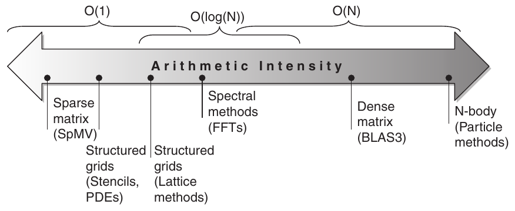

**Hình 4.10 Arithmetic intensity, được chỉ định bằng số floating-point operation để chạy program chia số byte được truy cập trong main memory [Williams et al. 2009]. Một số kernel có arithmetic intensity tăng theo problem size, như dense matrix, nhưng nhiều kernel có arithmetic intensity độc lập với problem size.**

Có thể tìm peak performance floating-point qua hardware specification. Nhiều kernel trong case study này không vừa cache on-chip, nên peak memory performance do memory system phía sau cache quyết định. Lưu ý ta cần peak memory bandwidth khả dụng cho processor, không chỉ tại DRAM pin như Hình 4.27 trang 325. Một cách tìm peak memory performance thực được cung cấp là chạy Stream benchmark.

Hình 4.11 thể hiện mô hình Roofline cho vector processor NEC SX-9 bên trái và máy tính multicore Intel Core i7 920 bên phải. Y-axis dọc là hiệu năng floating-point có thể đạt từ 2 đến 256 GFLOP/sec. X-axis ngang là arithmetic intensity, thay đổi từ 1/8 FLOP mỗi DRAM byte được truy cập đến 16 FLOP/ DRAM byte được truy cập ở cả hai đồ thị. Lưu ý đồ thị dùng thang log–log và Roofline chỉ được lập một lần cho máy tính.

Với kernel cho trước, ta có thể tìm một điểm trên X-axis dựa vào arithmetic intensity của nó. Nếu kẻ đường dọc qua điểm ấy, hiệu năng kernel trên máy tính đó phải nằm đâu đó dọc đường này. Ta có thể vẽ đường ngang thể hiện peak performance floating-point của máy tính. Rõ ràng, hiệu năng floating-point thực tế không thể cao hơn đường ngang, vì đó là giới hạn hardware.

Ta vẽ peak memory performance thế nào? Vì X-axis là FLOP/byte và Y-axis là FLOP/sec, bytes/sec chỉ là đường chéo góc 45-degree trong hình này. Vì vậy, ta vẽ được đường thứ ba cho hiệu năng floating-point tối đa memory system máy tính hỗ trợ với arithmetic intensity cho trước. Ta biểu diễn giới hạn bằng công thức để vẽ những đường này trong đồ thị Hình 4.11:

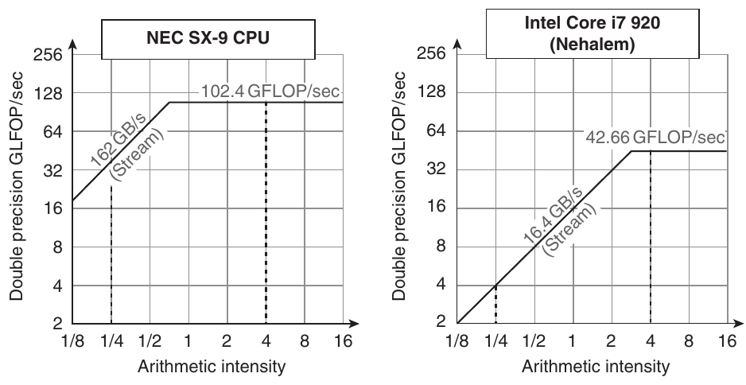

**Hình 4.11 Mô hình Roofline cho một vector processor NEC SX-9 bên trái và máy tính multicore Intel Core i7 920 với SIMD Extensions bên phải [Williams et al. 2009]. Roofline này dành cho memory access unit-stride và hiệu năng floating-point double-precision. NEC SX-9 là vector supercomputer công bố năm 2008, giá hàng triệu đô la. Nó có peak DP FP performance 102.4 GFLOP/sec và peak memory bandwidth 162 GBytes/sec theo Stream benchmark. Core i7 920 có peak DP FP performance 42.66 GFLOP/sec và peak memory bandwidth 16.4 GBytes/sec. Các đường dọc nét đứt tại arithmetic intensity 4 FLOP/byte cho thấy cả hai processor hoạt động ở peak performance. Trong trường hợp này, SX-9 ở 102.4 FLOP/sec nhanh gấp 2.4× Core i7 ở 42.66 GFLOP/sec. Tại arithmetic intensity 0.25 FLOP/byte, SX-9 nhanh gấp 10× với 40.5 GFLOP/sec so với 4.1 GFLOP/sec của Core i7.**

Attainable GFLOPs/sec = Min ( Peak Memory BW × Arithmetic Intensity , Peak Floating-Point Perf. )

Đường ngang và đường chéo đặt tên cho mô hình đơn giản này và cho thấy giá trị của nó. “Roofline” đặt upper bound cho hiệu năng kernel tùy arithmetic intensity. Nếu xem arithmetic intensity như cây cột chạm mái, nó hoặc chạm phần mái phẳng, nghĩa là hiệu năng bị giới hạn bởi tính toán, hoặc chạm mái nghiêng, nghĩa là cuối cùng hiệu năng bị giới hạn bởi memory bandwidth. Trong Hình 4.11, đường dọc nét đứt bên phải (arithmetic intensity 4) là ví dụ trường hợp đầu, đường dọc nét đứt bên trái (arithmetic intensity 1/4) là ví dụ trường hợp sau. Khi có mô hình Roofline của máy tính, bạn có thể áp dụng nó nhiều lần vì nó không thay đổi theo kernel.

Lưu ý “ridge point”, nơi mái chéo và mái ngang gặp nhau, cung cấp một góc nhìn thú vị về máy tính. Nếu điểm này nằm xa về bên phải, chỉ những kernel có arithmetic intensity rất cao mới có thể đạt hiệu năng tối đa của máy tính đó. Nếu nằm xa về bên trái, gần như kernel nào cũng có tiềm năng đạt hiệu năng tối đa. Như ta sẽ thấy, vector processor này có cả memory bandwidth cao hơn nhiều lẫn ridge point nằm xa về bên trái so với các SIMD processor khác.

Hình 4.11 cho thấy peak computational performance SX-9 nhanh gấp 2.4× Core i7, nhưng memory performance nhanh gấp 10×. Với program arithmetic intensity 0.25, SX-9 nhanh gấp 10× (40.5 so với 4.1 GFLOP/sec). Memory bandwidth cao hơn chuyển ridge point từ 2.6 trên Core i7 sang 0.6 trên SX-9, nghĩa là nhiều program hơn đạt peak computational performance trên vector processor.

## 4.4 Graphics Processing Unit

Với vài trăm đô la, bất kỳ ai cũng có thể mua GPU với hàng trăm floating-point unit song song, giúp high-performance computing dễ tiếp cận hơn. Sự quan tâm tới GPU computing nở rộ khi tiềm năng này được kết hợp với một programming language giúp GPU dễ lập trình hơn. Vì vậy, nhiều programmer viết scientific application và multimedia application ngày nay đang cân nhắc nên dùng GPU hay CPU.

GPU và CPU không có chung tổ tiên khi lần ngược gia phả computer architecture; không có Missing Link giải thích cả hai. Như Mục 4.10 mô tả, tổ tiên chính GPU là graphics accelerator, vì làm graphics tốt là lý do GPU tồn tại. Dù GPU đang tiến tới mainstream computing, chúng không thể bỏ trách nhiệm tiếp tục xuất sắc về graphics. Vì vậy, thiết kế GPU có thể hợp lý hơn khi architect hỏi: với hardware đã đầu tư để làm graphics tốt, ta bổ sung thế nào để cải thiện hiệu năng tập application rộng hơn?

Lưu ý mục này tập trung vào việc dùng GPU cho computing. Để xem GPU computing kết hợp với vai trò graphics acceleration truyền thống thế nào, hãy đọc “Graphics and Computing GPUs” của John Nickolls và David Kirk (Phụ lục A trong ấn bản 4 của Computer Organization and Design, cùng tác giả sách này).

Vì thuật ngữ cùng một số hardware feature khá khác vector architecture và SIMD architecture, ta tin rằng sẽ dễ hiểu hơn nếu bắt đầu với programming model đơn giản hóa cho GPU trước khi mô tả architecture.

### Lập trình GPU

> CUDA là giải pháp tinh tế cho vấn đề biểu diễn parallelism trong thuật toán, không phải mọi thuật toán nhưng đủ nhiều để quan trọng. Dường như nó cộng hưởng theo cách nào đó với cách ta nghĩ và viết code, cho phép biểu diễn parallelism vượt task level dễ hơn và tự nhiên hơn.

> Vincent Natol

> “Kudos for CUDA,” HPC Wire (2010)

Thách thức của GPU programmer không chỉ là đạt hiệu năng tốt trên GPU, mà còn điều phối scheduling tính toán trên system processor và GPU cùng việc truyền data giữa system memory với GPU memory. Hơn nữa, như ta sẽ thấy sau trong mục, GPU có gần như mọi loại parallelism mà programming environment khai thác được: multithreading, MIMD, SIMD, thậm chí instruction-level.

NVIDIA quyết định phát triển language C-like cùng programming environment để cải thiện năng suất GPU programmer bằng cách xử lý cả thách thức heterogeneous computing lẫn parallelism nhiều khía cạnh. Tên hệ thống là CUDA, viết tắt Compute Unified Device Architecture. CUDA tạo C/C++ cho system processor (host) và dialect của C và C++ cho GPU (device, vì vậy có chữ D trong CUDA). Programming language tương tự là OpenCL, được nhiều công ty phát triển để cung cấp language vendor-independent cho nhiều platform.

NVIDIA quyết định chủ đề thống nhất mọi dạng parallelism này là CUDA Thread. Dùng tầng parallelism thấp nhất này làm programming primitive, compiler và hardware có thể gom hàng nghìn CUDA Thread để tận dụng các kiểu parallelism trong GPU: multithreading, MIMD, SIMD và instruction-level parallelism. Vì vậy, NVIDIA phân loại CUDA programming model là Single Instruction, Multiple Thread (SIMT). Vì những lý do ta sẽ sớm thấy, các thread được gom thành block và được thực thi theo nhóm 32 thread, gọi là Thread Block. Ta gọi hardware execute cả block thread là multithreaded SIMD Processor.

Ta chỉ cần thêm vài chi tiết trước khi có thể đưa ra ví dụ về CUDA program:

- Để phân biệt function cho GPU (device) và function cho system processor (host), CUDA dùng \_\_device\_\_ hoặc \_\_global\_\_ cho loại đầu và \_\_host\_\_ cho loại sau.

- CUDA variable khai báo trong function \_\_device\_\_ hoặc \_\_global\_\_ được cấp phát vào GPU Memory (xem bên dưới), có thể được mọi multithreaded SIMD processor truy cập.

- Function call syntax mở rộng cho tên function chạy trên GPU là

```
name<<<dimGrid, dimBlock>>>(... parameter list ...)
```

trong đó dimGrid và dimBlock chỉ định kích thước code (tính bằng block) và kích thước block (tính bằng thread).

- Ngoài identifier cho block (blockIdx) và identifier cho thread trong mỗi block (threadIdx), CUDA cung cấp một keyword cho số thread mỗi block (blockDim), được lấy từ parameter dimBlock trong gạch đầu dòng ở trên.

Trước khi xem code CUDA, hãy bắt đầu bằng code C thông thường cho DAXPY loop ở Mục 4.2:

```
// Invoke DAXPY
daxpy(n, 2.0, x, y);
// DAXPY in C
void daxpy(int n, double a, double *x, double *y)
{
           for (int i = 0; i < n; ++i)
                   y[i] = a*x[i] + y[i];
}
```

Dưới đây là phiên bản CUDA. Chúng ta khởi chạy n thread, mỗi vector element một thread, với 256 CUDA Thread mỗi thread block trong một multithreaded SIMD Processor. Hàm GPU bắt đầu bằng cách tính element index i tương ứng dựa trên block ID, số thread mỗi block và thread ID. Miễn index này còn trong array (i < n), hàm thực hiện phép nhân và cộng.

```
// Invoke DAXPY with 256 threads per Thread Block
__host__
int nblocks = (n+ 255) / 256;
   daxpy<<<nblocks, 256>>>(n, 2.0, x, y);
// DAXPY in CUDA
__device__
void daxpy(int n, double a, double *x, double *y)
{
   int i = blockIdx.x*blockDim.x + threadIdx.x;
   if (i < n) y[i] = a*x[i] + y[i];
}
```

So sánh code C và CUDA, chúng ta thấy mẫu phổ biến để song song hóa code CUDA data-parallel. Phiên bản C có loop mà mỗi iteration độc lập với iteration khác, cho phép chuyển trực tiếp loop thành parallel code, trong đó mỗi loop iteration trở thành một thread độc lập. (Như đã đề cập và sẽ mô tả kỹ ở Mục 4.5, vectorizing compiler cũng dựa vào việc không có dependence giữa các iteration của loop, được gọi là loop carried dependence.) Lập trình viên xác định parallelism trong CUDA một cách tường minh bằng cách chỉ định grid dimension và số thread mỗi SIMD Processor. Gán một thread cho mỗi element khiến không cần đồng bộ giữa thread khi ghi kết quả xuống memory.

GPU hardware xử lý việc thực thi song song và quản lý thread; ứng dụng hay operating system không thực hiện những công việc này. Để đơn giản hóa scheduling của hardware, CUDA yêu cầu các thread block phải có khả năng thực thi độc lập và theo bất kỳ thứ tự nào. Những thread block khác nhau không thể giao tiếp trực tiếp, dù chúng có thể phối hợp bằng atomic memory operation trong Global Memory.

Như sẽ sớm thấy, nhiều khái niệm GPU hardware không thể hiện rõ trong CUDA. Đó là điều tốt về năng suất lập trình viên, nhưng phần lớn người dùng chọn GPU thay CPU để có performance. Lập trình viên chú trọng performance phải ghi nhớ GPU hardware khi viết CUDA. Vì những lý do sắp giải thích, họ biết cần giữ nhóm 32 thread đi cùng nhau trong control flow để đạt performance tốt nhất từ multithreaded SIMD Processor, đồng thời tạo nhiều thread hơn nữa trên mỗi multithreaded SIMD Processor để che giấu latency tới DRAM. Họ cũng cần giữ data address tập trung trong một hoặc vài memory block để đạt memory performance mong đợi.

Như nhiều parallel system, một cách dung hòa năng suất và performance là CUDA có các intrinsic cho lập trình viên điều khiển hardware tường minh. Cuộc giằng co giữa một bên là năng suất, một bên là cho phép lập trình viên biểu đạt bất cứ điều gì hardware làm được thường xuất hiện trong parallel computing. Sẽ thú vị khi xem ngôn ngữ phát triển thế nào trong cuộc đấu năng suất–performance kinh điển này, cũng như xem CUDA có phổ biến cho GPU khác hay thậm chí kiểu architecture khác không.

### Các cấu trúc tính toán của NVIDIA GPU

Nguồn gốc khác thường đã nói ở trên giúp giải thích vì sao GPU có kiểu architecture và thuật ngữ riêng độc lập với CPU. Một trở ngại khi hiểu GPU là jargon, trong đó một số tên thuật ngữ còn gây hiểu lầm. Vượt qua trở ngại này khó một cách đáng ngạc nhiên, như nhiều lần viết lại chương này chứng tỏ. Để dung hòa hai mục tiêu là làm architecture GPU dễ hiểu và học nhiều thuật ngữ GPU có định nghĩa phi truyền thống, giải pháp cuối cùng là dùng thuật ngữ CUDA cho software nhưng ban đầu sử dụng những thuật ngữ mô tả rõ ràng hơn cho hardware, đôi khi mượn thuật ngữ OpenCL. Sau khi giải thích GPU architecture bằng những thuật ngữ của mình, chúng ta ánh xạ chúng sang jargon chính thức của NVIDIA GPU.

Từ trái sang phải, Hình 4.12 liệt kê thuật ngữ mô tả rõ hơn được dùng trong mục này, thuật ngữ gần nhất trong computing truyền thống, thuật ngữ NVIDIA GPU chính thức nếu bạn quan tâm, rồi một mô tả ngắn cho thuật ngữ đó. Phần còn lại của mục giải thích các đặc tính microarchitecture của GPU bằng những thuật ngữ mô tả ở phía trái hình.

Chúng ta dùng hệ thống NVIDIA làm ví dụ vì chúng đại diện GPU architecture. Cụ thể, chúng ta theo thuật ngữ của ngôn ngữ lập trình parallel CUDA ở trên và dùng architecture Fermi làm ví dụ (xem Mục 4.7).

Giống vector architecture, GPU chỉ hoạt động tốt với các bài toán parallel data-level. Cả hai kiểu đều có data transfer gather-scatter và mask register, còn GPU processor thậm chí có nhiều register hơn vector processor. Vì không có scalar processor close-by, đôi khi GPU triển khai bằng hardware lúc runtime một tính năng mà vector computer triển khai bằng software lúc compile time. Khác phần lớn vector architecture, GPU còn dựa vào multithreading trong một multithreaded SIMD processor để che memory latency (xem Chương 2 và 3). Tuy nhiên, code hiệu quả cho cả vector architecture lẫn GPU đòi hỏi lập trình viên suy nghĩ theo từng nhóm SIMD operation.

Grid là code chạy trên GPU gồm một tập Thread Block. Hình 4.12 so sánh grid với vectorized loop, và Thread Block với body của loop đó (sau khi đã strip-mined để thành một computation loop đầy đủ). Để có ví dụ cụ thể, giả sử muốn nhân hai vector, mỗi vector dài 8192 element. Chúng ta sẽ trở lại ví dụ này xuyên suốt mục. Hình 4.13 thể hiện quan hệ giữa ví dụ với hai thuật ngữ GPU đầu tiên. Code GPU xử lý toàn bộ phép nhân 8192 element được gọi là Grid (hay vectorized loop). Để chia thành kích thước dễ quản lý hơn, Grid gồm các Thread Block (hay body của vectorized loop), mỗi block có tối đa 512 element. Lưu ý SIMD instruction thực thi 32 element mỗi lần. Với vector có 8192 element, ví dụ này có 16 Thread Block vì 16 = 8192 ÷ 512. Grid và Thread Block là programming abstraction được triển khai trong GPU hardware, giúp lập trình viên tổ chức code CUDA. (Thread Block tương tự vector loop strip-minded có vector length 32.)

| Loại | Tên mô tả rõ hơn | Thuật ngữ cũ gần nhất ngoài GPU | Thuật ngữ CUDA/ NVIDIA GPU chính thức | Định nghĩa trong sách |
|---|---|---|---|---|
| Program abstraction | Vectorizable Loop | Vectorizable Loop | Grid | Vectorizable loop, thực thi trên GPU, gồm một hoặc nhiều Thread Block (body của vectorized loop) có thể thực thi song song. |
|  | Body of Vectorized Loop | Body of a (Strip-Mined) Vectorized Loop | Thread Block | Vectorized loop thực thi trên multithreaded SIMD Processor, gồm một hoặc nhiều thread chứa SIMD instruction. Các thread này có thể giao tiếp qua Local Memory. |
|  | Sequence of SIMD Lane Operations | One iteration of a Scalar Loop | CUDA Thread | Một lát cắt dọc của thread chứa SIMD instruction, tương ứng với một element do một SIMD Lane thực thi. Kết quả được lưu tùy theo mask và predicate register. |
| Machine object | A Thread of SIMD Instructions | Thread of Vector Instructions | Warp | Thread truyền thống nhưng chỉ chứa SIMD instruction, thực thi trên multithreaded SIMD Processor. Kết quả được lưu tùy theo mask per-element. |
|  | SIMD Instruction | Vector Instruction | PTX Instruction | Một SIMD instruction duy nhất thực thi trên các SIMD Lane. |
| Processing hardware | Multithreaded SIMD Processor | (Multithreaded) Vector Processor | Streaming Multiprocessor | Multithreaded SIMD Processor thực thi các thread chứa SIMD instruction độc lập với SIMD Processor khác. |
|  | Thread Block Scheduler | Scalar Processor | Giga Thread Engine | Gán nhiều Thread Block (body của vectorized loop) cho multithreaded SIMD Processor. |
|  | SIMD Thread Scheduler | Thread scheduler in a Multithreaded CPU | Warp Scheduler | Hardware unit schedule và issue thread chứa SIMD instruction khi sẵn sàng thực thi; gồm scoreboard theo dõi execution của SIMD Thread. |
|  | SIMD Lane | Vector Lane | Thread Processor | SIMD Lane thực thi operation trong thread chứa SIMD instruction trên một element duy nhất. Kết quả được lưu tùy mask. |
| Memory hardware | GPU Memory | Main Memory | Global Memory | DRAM memory có thể được mọi multithreaded SIMD Processor trong GPU truy cập. |
|  | Private Memory | Stack or Thread Local Storage (OS) | Local Memory | Phần DRAM memory riêng tư cho mỗi SIMD Lane. |
|  | Local Memory | Local Memory | Shared Memory | Local SRAM nhanh cho một multithreaded SIMD Processor, không thể được SIMD Processor khác truy cập. |
|  | SIMD Lane Registers | Vector Lane Registers | Thread Processor Registers | Register trong một SIMD Lane được cấp phát cho toàn bộ thread block (body của vectorized loop). |

**Hình 4.12 Hướng dẫn nhanh về thuật ngữ GPU dùng trong chương. Chúng ta dùng cột đầu cho thuật ngữ hardware. Có bốn nhóm chứa 11 thuật ngữ này. Từ trên xuống: Program Abstraction, Machine Object, Processing Hardware và Memory Hardware. Hình 4.21 trang 309 liên hệ thuật ngữ vector với thuật ngữ gần nhất ở đây; Hình 4.24 trang 313 và Hình 4.25 trang 314 trình bày thuật ngữ, định nghĩa CUDA/NVIDIA và AMD chính thức cùng thuật ngữ OpenCL.**

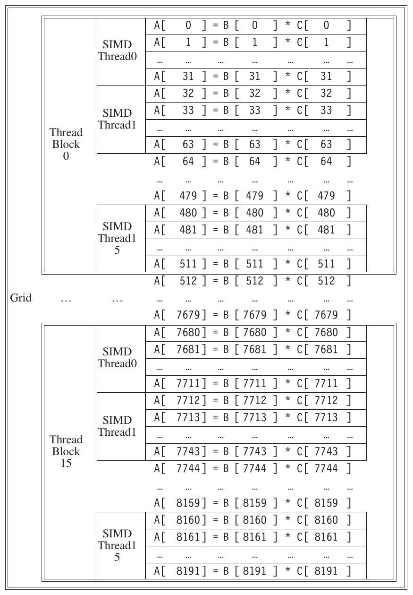

**Hình 4.13 Ánh xạ Grid (vectorizable loop), Thread Block (SIMD basic block) và thread chứa SIMD instruction vào phép nhân vector–vector, mỗi vector dài 8192 element. Mỗi thread chứa SIMD instruction tính 32 element mỗi instruction; trong ví dụ này mỗi Thread Block có 16 thread chứa SIMD instruction, Grid có 16 Thread Block. Hardware Thread Block Scheduler gán Thread Block cho multithreaded SIMD Processor, và hardware Thread Scheduler chọn thread chứa SIMD instruction chạy trong mỗi clock cycle bên trong SIMD Processor. Chỉ SIMD Thread trong cùng Thread Block mới giao tiếp được qua Local Memory. (Số SIMD Thread tối đa thực thi đồng thời mỗi Thread Block là 16 cho GPU Teslageneration và 32 cho GPU Fermi-generation sau này.)**

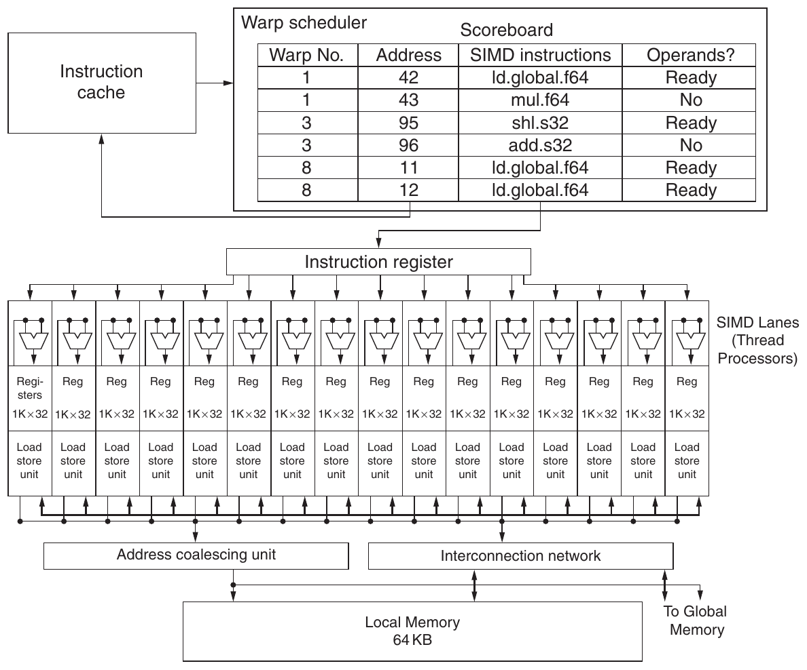

**Hình 4.14 Block diagram đơn giản hóa của Multithreaded SIMD Processor. Nó có 16 SIMD lane. SIMD Thread Scheduler có, chẳng hạn, 48 thread chứa SIMD instruction độc lập, được schedule bằng bảng có 48 PC.**

Thread Block Scheduler gán một Thread Block cho processor thực thi code đó, được gọi là multithreaded SIMD Processor. Thread Block Scheduler có một số điểm tương tự control processor trong vector architecture. Nó xác định số thread block cần cho loop và tiếp tục cấp phát chúng cho các multithreaded SIMD Processor khác nhau cho tới khi loop hoàn tất. Trong ví dụ này, nó gửi 16 Thread Block tới multithreaded SIMD Processor để tính toàn bộ 8192 element của loop.

Hình 4.14 cho block diagram đơn giản hóa của multithreaded SIMD Processor. Nó giống Vector Processor, nhưng có nhiều functional unit song song thay vì một ít unit được pipeline sâu như Vector Processor. Trong ví dụ lập trình Hình 4.13, mỗi multithreaded SIMD Processor được gán 512 element của vector để xử lý. SIMD Processor là processor đầy đủ có PC riêng và được lập trình bằng thread (xem Chương 3).

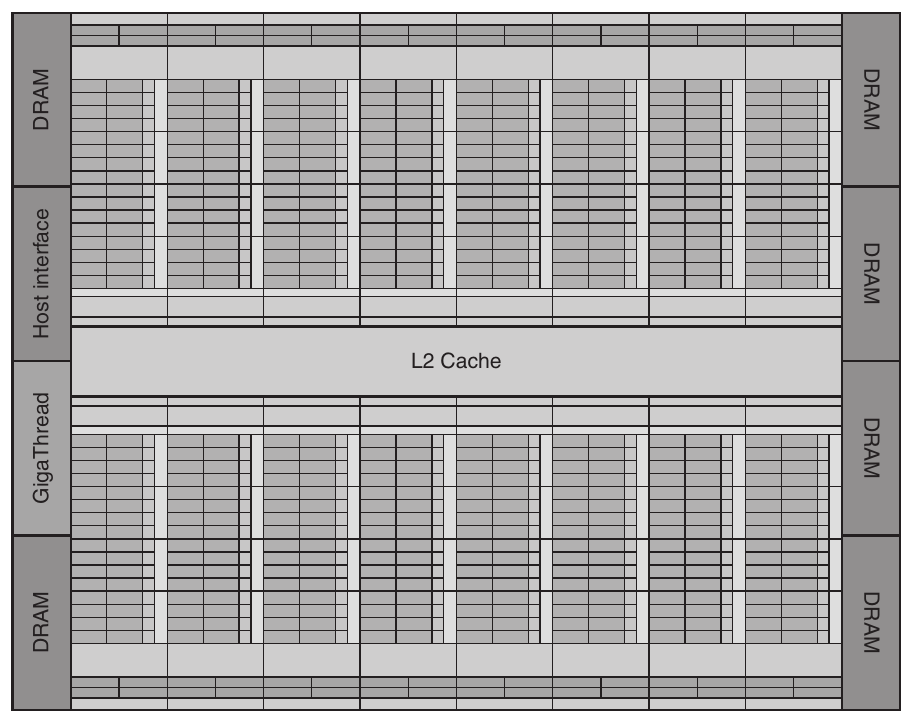

**Hình 4.15 Floor plan của GPU Fermi GTX 480. Sơ đồ thể hiện 16 multithreaded SIMD Processor. Thread Block Scheduler được tô nổi bật bên trái. GTX 480 có 6 cổng GDDR5, mỗi cổng rộng 64 bit, hỗ trợ capacity tối đa 6 GB. Host Interface là PCI Express 2.0 x 16. Giga Thread là tên scheduler phân phối thread block tới Multiprocessor, mỗi Multiprocessor có SIMD Thread Scheduler riêng.**

Vì vậy GPU hardware chứa một tập multithreaded SIMD Processor thực thi Grid gồm các Thread Block (body của vectorized loop); tức GPU là multiprocessor cấu thành từ multithreaded SIMD Processor.

Bốn triển khai đầu tiên của architecture Fermi có 7, 11, 14 hoặc 15 multithreaded SIMD Processor; phiên bản tương lai có thể chỉ có 2 hoặc 4. Để cung cấp scalability trong suốt giữa các mẫu GPU có số multithreaded SIMD Processor khác nhau, Thread Block Scheduler gán Thread Block (body của vectorized loop) cho multithreaded SIMD Processor. Hình 4.15 thể hiện floor plan của triển khai GTX 480 thuộc architecture Fermi.

Đi xuống thêm một cấp chi tiết, machine object mà hardware tạo ra, quản lý, schedule và execute là một thread chứa SIMD instruction. Đây là thread truyền thống chỉ chứa duy nhất SIMD instruction. Các thread này có PC riêng và chạy trên multithreaded SIMD Processor. SIMD Thread Scheduler gồm một scoreboard cho biết những thread chứa SIMD instruction nào đã sẵn sàng chạy, rồi gửi chúng tới dispatch unit để chạy trên multithreaded SIMD Processor. Nó giống hệt hardware thread scheduler trong multithreaded processor truyền thống (xem Chương 3), chỉ khác là đang schedule thread chứa SIMD instruction. Vì vậy, GPU hardware có hai cấp hardware scheduler: (1) Thread Block Scheduler gán Thread Block (body của vectorized loop) cho multithreaded SIMD Processor, bảo đảm thread block được gán tới processor có local memory chứa data tương ứng; và (2) SIMD Thread Scheduler bên trong SIMD Processor, schedule thời điểm các thread chứa SIMD instruction nên chạy.

SIMD instruction của những thread này có độ rộng 32, nên mỗi thread chứa SIMD instruction trong ví dụ sẽ tính 32 element của phép tính. Trong ví dụ, Thread Block chứa 512/32 = 16 SIMD thread (xem Hình 4.13).

Vì thread gồm SIMD instruction, SIMD Processor phải có functional unit song song để thực hiện operation. Chúng ta gọi chúng là SIMD Lane, khá giống Vector Lane ở Mục 4.2.

Số lane mỗi SIMD processor thay đổi theo thế hệ GPU. Với Fermi, mỗi thread chứa SIMD instruction 32-wide ánh xạ tới 16 physical SIMD Lane, nên mỗi SIMD instruction trong thread mất hai clock cycle để hoàn tất. Mỗi thread chứa SIMD instruction thực thi lock step và chỉ được schedule lúc bắt đầu. Tiếp tục so SIMD Processor với vector processor, có thể nói nó có 16 lane, vector length 32 và chime 2 clock cycle. (Bản chất rộng nhưng nông này là lý do dùng SIMD Processor thay vector processor, vì mô tả rõ hơn.)

Vì theo định nghĩa các thread chứa SIMD instruction độc lập, SIMD Thread Scheduler có thể chọn bất kỳ thread nào sẵn sàng, không cần bám instruction SIMD kế tiếp trong chuỗi của một thread. SIMD Thread Scheduler có scoreboard (xem Chương 3) theo dõi tối đa 48 thread chứa SIMD instruction để xem SIMD instruction nào sẵn sàng. Cần scoreboard vì memory access instruction có thể tốn số clock cycle không dự đoán được, chẳng hạn do memory bank conflict. Hình 4.16 thể hiện SIMD Thread Scheduler chọn thread chứa SIMD instruction theo thứ tự khác nhau qua thời gian. GPU architect giả định ứng dụng GPU có nhiều thread chứa SIMD instruction tới mức multithreading vừa che latency tới DRAM vừa tăng utilization của multithreaded SIMD Processor. Tuy nhiên, để phòng rủi ro, NVIDIA Fermi GPU gần đây có thêm L2 cache (xem Mục 4.7).

Tiếp tục ví dụ nhân vector, mỗi multithreaded SIMD Processor phải load 32 element của hai vector từ memory vào register, thực hiện phép nhân bằng cách đọc và ghi register, rồi store tích từ register trở lại memory. Để giữ những memory element này, SIMD Processor có tới 32,768 register 32-bit, một con số ấn tượng. Giống vector processor, những register này được chia về mặt logic giữa các vector lane, hay trong trường hợp này là SIMD Lane. Mỗi SIMD Thread bị giới hạn không quá 64 register, nên có thể hình dung một SIMD Thread có tối đa 64 vector register, mỗi vector register gồm 32 element và mỗi element rộng 32 bit. (Vì operand floating-point double-precision sử dụng hai register 32-bit liền nhau, một cách nhìn khác là mỗi SIMD Thread có 32 vector register gồm 32 element, mỗi element rộng 64 bit.)

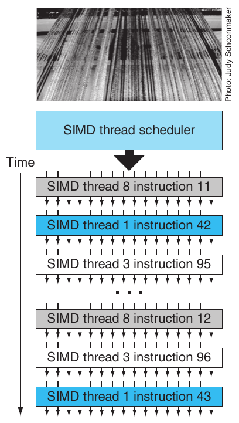

**Hình 4.16 Scheduling các thread chứa SIMD instruction. Scheduler chọn thread sẵn sàng và issue một instruction đồng bộ tới mọi SIMD Lane thực thi SIMD thread. Vì thread chứa SIMD instruction độc lập, scheduler có thể chọn SIMD thread khác mỗi lần.**

Vì Fermi có 16 physical SIMD Lane, mỗi lane chứa 2048 register. (Thay vì cố thiết kế hardware register có nhiều read port và write port trên mỗi bit, GPU dùng memory structure đơn giản hơn nhưng chia thành bank để có đủ bandwidth, giống như vector processor.) Mỗi CUDA Thread nhận một element của mỗi vector register. Để xử lý 32 element của mỗi thread chứa SIMD instruction bằng 16 SIMD Lane, các CUDA Thread của một Thread block có thể sử dụng tổng cộng tới một nửa trong 2048 register.

Để thực thi được nhiều thread chứa SIMD instruction, mỗi thread được cấp phát động một tập physical register trên mỗi SIMD Processor khi được tạo, rồi các register được giải phóng khi SIMD Thread thoát.

Lưu ý CUDA thread chỉ là một lát cắt dọc của thread chứa SIMD instruction, tương ứng với một element do một SIMD Lane thực thi. Cẩn thận vì CUDA Thread rất khác POSIX thread; bạn không thể gọi system call tùy ý từ CUDA Thread.

Giờ chúng ta đã sẵn sàng xem GPU instruction trông như thế nào.

### Instruction Set Architecture của NVIDA GPU

Khác với phần lớn system processor, instruction set đích của compiler NVIDIA là một abstraction của hardware instruction set. PTX (Parallel Thread Execution) cung cấp một instruction set ổn định cho compiler, cũng như khả năng tương thích giữa các thế hệ GPU. Hardware instruction set được ẩn khỏi lập trình viên. PTX instruction mô tả operation trên một CUDA thread và thường ánh xạ one-to-one với hardware instruction, nhưng một PTX có thể mở rộng thành nhiều machine instruction và ngược lại. PTX sử dụng virtual register, nên compiler xác định một SIMD thread cần bao nhiêu physical vector register, rồi optimizer phân chia register storage sẵn có giữa các SIMD thread. Optimizer này còn loại bỏ dead code, gộp instruction và xác định những vị trí branch có thể diverge cũng như những vị trí các path đã diverge có thể converge.

Dù có một số điểm giống giữa microarchitecture x86 và PTX, vì cả hai dịch sang dạng nội bộ (microinstruction với x86), khác biệt là x86 thực hiện dịch bằng hardware lúc runtime trong execution, còn GPU dịch bằng software tại load time.

Format của PTX instruction là

```
opcode.type d, a, b, c;
```

trong đó d là destination operand; a, b và c là source operand; operation type là một trong những loại sau: source operand là register 32-bit hoặc 64-bit, hoặc một constant value. Destination là register, ngoại trừ với store instruction.

| Loại |  |  | .type Specifier |  |
|---|---|---|---|---|
| Bit không định kiểu 8, 16, 32 và 64 bit | .b8, | .b16, | .b32, | .b64 |
| Unsigned integer 8, 16, 32 và 64 bit | .u8, | .u16, | .u32, | .u64 |
| Signed integer 8, 16, 32 và 64 bit | .s8, | .s16, | .s32, | .s64 |
| Floating Point 16, 32 và 64 bit | .f16, | .f32, | .f64 |  |

Hình 4.17 thể hiện PTX instruction set cơ bản. Mọi instruction có thể được predicated bằng predicate register 1-bit, được đặt bởi set predicate instruction (setp). Control flow instruction gồm function call và return, thread exit, branch và barrier synchronization cho thread trong cùng thread block (bar.sync). Đặt predicate trước branch instruction tạo conditional branch. Compiler hoặc lập trình viên PTX khai báo virtual register dưới dạng giá trị 32-bit hoặc 64-bit có kiểu hay không kiểu. Chẳng hạn R0, R1, ... cho giá trị 32-bit, RD0, RD1, ... cho register 64-bit. Nhớ rằng với PTX, việc gán virtual register cho physical register diễn ra lúc load time.

| Nhóm | Instruction | Ví dụ | Ý nghĩa | Giải thích |
|---|---|---|---|---|
| Arithmetic | arithmetic .type = .s32, .u32, .f32, .s64, .u64, .f64 |  |  |  |
|  | add.type | add.f32 d, a, b | d = a + b; |  |
|  | sub.type | sub.f32 d, a, b | d = a – b; |  |
|  | mul.type | mul.f32 d, a, b | d = a * b; |  |
|  | mad.type | mad.f32 d, a, b, c | d = a * b + c; | multiply-add |
|  | div.type | div.f32 d, a, b | d = a / b; | Nhiều microinstruction |
|  | rem.type | rem.u32 d, a, b | d = a % b; | Phần dư integer |
|  | abs.type | abs.f32 d, a | d = \|a\|; |  |
|  | neg.type | neg.f32 d, a | d = 0 - a; |  |
|  | min.type | min.f32 d, a, b | d = (a < b)? a:b; | Floating chọn non-NaN |
|  | max.type | max.f32 d, a, b | d = (a > b)? a:b; | Floating chọn non-NaN |
|  | setp.cmp.type | setp.lt.f32 p, a, b | p = (a < b); | So sánh và đặt predicate |
|  | numeric .cmp = eq, ne, lt, le, gt, ge; unordered cmp = equ, neu, ltu, leu, gtu, geu, num, nan |  |  |  |
|  | mov.type | mov.b32 d, a | d = a; | Di chuyển |
|  | selp.type | selp.f32 d, a, b, p | d = p? a: b; | Lựa chọn theo predicate |
|  | cvt.dtype.atype | cvt.f32.s32 d, a | d = convert(a); | Chuyển atype sang dtype |
|  | special .type = .f32 (some .f64) |  |  |  |
|  | rcp.type | rcp.f32 d, a | d = 1/a; | Nghịch đảo |
|  | sqrt.type | sqrt.f32 d, a | d = sqrt(a); | Căn bậc hai |
| Special | rsqrt.type | rsqrt.f32 d, a | d = 1/sqrt(a); | Nghịch đảo căn bậc hai |
| Function | sin.type | sin.f32 d, a | d = sin(a); | Sin |
|  | cos.type | cos.f32 d, a | d = cos(a); | Cosin |
|  | lg2.type | lg2.f32 d, a | d = log(a)/log(2) | Logarithm cơ số hai |
|  | ex2.type | ex2.f32 d, a | d = 2 ** a; | Hàm mũ cơ số hai |
| Logical | logic.type = .pred,.b32, .b64 |  |  |  |
|  | and.type | and.b32 d, a, b | d = a & b; |  |
|  | or.type | or.b32 d, a, b | d = a \| b; |  |
|  | xor.type | xor.b32 d, a, b | d = a ^ b; |  |
|  | not.type | not.b32 d, a, b | d = ~a; | Bù một |
|  | cnot.type | cnot.b32 d, a, b | d = (a==0)? 1:0; | Phép logical not của C |
|  | shl.type | shl.b32 d, a, b | d = a << b; | Shift trái |
|  | shr.type | shr.s32 d, a, b | d = a >> b; | Shift phải |
|  | memory.space = .global, .shared, .local, .const; .type = .b8, .u8, .s8, .b16, .b32, .b64 |  |  |  |
|  | ld.space.type | ld.global.b32 d, [a+off] | d = *(a+off); | Load từ memory space |
| Memory | st.space.type | st.shared.b32 [d+off], a | *(d+off) = a; | Store vào memory space |
| Access | tex.nd.dtyp.btype | tex.2d.v4.f32.f32 d, a, b | d = tex2d(a, b); | Tra cứu texture |
|  |  | atom.global.add.u32 d,[a], b | atomic { d = *a; *a = | Atomic read-modify-write |
|  | atom.spc.op.type | atom.global.cas.b32 d,[a], b, c | op(*a, b); } | operation |
|  | atom.op = and, or, xor, add, min, max, exch, cas; .spc = .global; .type = .b32 |  |  |  |
|  | branch | @p bra target | if (p) goto target; | Conditional branch |
| Control | call | call (ret), func, (params) | ret = func(params); | Gọi hàm |
| Flow | ret | ret | return; | Quay về từ lời gọi hàm |
|  | bar.sync | bar.sync d | wait for threads | Barrier synchronization |
|  | exit | exit | exit; | Kết thúc thread execution |

**Hình 4.17 Instruction cơ bản cho GPU thread trong PTX.**

Chuỗi PTX instruction sau dành cho một iteration của DAXPY loop ở trang 289:

<pre>shl.u32 R8, blockIdx, 9   ; Thread Block ID * Block size (512 or 2<sup>9</sup>)
add.u32 R8, R8, threadIdx ; R8 = i = my CUDA Thread ID
shl.u32 R8, R8, 3         ; byte offset
ld.global.f64 RD0, [X+R8] ; RD0 = X[i]
ld.global.f64 RD2, [Y+R8] ; RD2 = Y[i]
mul.f64 RD0, RD0, RD4     ; Product in RD0 = RD0 * RD4 (scalar a)
add.f64 RD0, RD0, RD2     ; Sum in RD0 = RD0 + RD2 (Y[i])
st.global.f64 [Y+R8], RD0 ; Y[i] = sum (X[i]*a + Y[i])</pre>

Như đã minh họa, CUDA programming model gán một CUDA Thread cho mỗi loop iteration, cung cấp identifier duy nhất cho mỗi thread block (blockIdx) và mỗi CUDA Thread trong block (threadIdx). Vì vậy nó tạo 8192 CUDA Thread và dùng số duy nhất để định địa chỉ mỗi element trong array, nên không có code tăng hay branch. Ba PTX instruction đầu tính byte offset duy nhất của element trong R8, được cộng vào base của array. PTX instruction sau load hai operand floating-point double-precision, nhân và cộng chúng, rồi store tổng. (Chúng ta sẽ mô tả bên dưới code PTX tương ứng code CUDA “if (i < n)”.)

Lưu ý khác vector architecture, GPU không có những instruction riêng cho sequential data transfer, strided data transfer và gather-scatter data transfer. Mọi data transfer đều gather-scatter! Để lấy lại hiệu quả sequential (unit-stride) data transfer, GPU có hardware Address Coalescing đặc biệt nhận ra khi SIMD Lane trong thread chứa SIMD instruction cùng issue các address tuần tự. Hardware runtime đó thông báo Memory Interface Unit yêu cầu block transfer 32 word tuần tự. Để đạt cải thiện performance quan trọng này, lập trình viên GPU phải bảo đảm rằng các CUDA Thread liền nhau truy cập các address gần nhau cùng lúc, có thể được coalesce thành một hoặc vài memory/cache block, như ví dụ của chúng ta thực hiện.

### Conditional Branching trong GPU

Cũng như trường hợp data transfer unit-stride, cách vector architecture và GPU xử lý câu lệnh IF có nhiều tương đồng: bên thứ nhất triển khai mechanism chủ yếu bằng software với hardware support hạn chế, còn bên thứ hai dùng nhiều hardware hơn nữa. Như chúng ta sẽ thấy, ngoài predicate register tường minh, GPU branch hardware dùng internal mask, branch synchronization stack và instruction marker để quản lý thời điểm branch diverge thành nhiều execution path và thời điểm các path converge.

Ở cấp PTX assembler, control flow của một CUDA thread được mô tả bằng PTX instruction branch, call, return và exit, cộng với predication per-thread-lane riêng cho mỗi instruction, do lập trình viên chỉ định bằng predicate register per-thread-lane 1-bit. PTX assembler phân tích PTX branch graph rồi tối ưu thành chuỗi GPU hardware instruction nhanh nhất.

Ở cấp GPU hardware instruction, control flow gồm branch, jump, jump indexed, call, call indexed, return, exit và những instruction đặc biệt quản lý branch synchronization stack. GPU hardware cung cấp cho mỗi SIMD thread một stack riêng; stack entry chứa một identifier token, một target instruction address và một target thread-active mask. GPU có special instruction để push stack entry cho SIMD thread, cùng special instruction và instruction marker để pop stack entry hoặc unwind stack tới entry được chỉ định, rồi branch tới target instruction address với target thread-active mask. GPU hardware instruction còn có predication per-lane riêng (enable/disable), được chỉ định bằng predicate register 1-bit cho mỗi lane.

PTX assembler thường tối ưu một câu lệnh IF/THEN/ELSE outer-level đơn giản được code bằng PTX branch instruction thành các predicated GPU instruction mà không cần GPU branch instruction nào. Control flow phức tạp hơn thường tạo ra hỗn hợp predication và GPU branch instruction, cùng special instruction và marker sử dụng branch synchronization stack để push stack entry khi một số lane branch tới target address, còn các lane khác fall through. NVIDIA nói rằng branch diverge khi điều này xảy ra. Hỗn hợp này còn được dùng khi SIMD Lane thực thi synchronization marker hoặc converge; thao tác đó pop stack entry rồi branch tới address stack-entry với thread-active mask stack-entry.

PTX assembler xác định loop branch và tạo GPU branch instruction quay về đầu loop, cùng special stack instruction xử lý từng lane thoát loop và làm SIMD Lane converge khi mọi lane hoàn tất loop. Instruction indexed jump và indexed call của GPU push entry lên stack để SIMD thread converge khi mọi lane hoàn tất câu lệnh switch hoặc lời gọi hàm.

GPU set predicate instruction (setp trong hình trên) đánh giá phần điều kiện của câu lệnh IF. PTX branch instruction sau đó phụ thuộc predicate này. Nếu PTX assembler tạo predicated instruction mà không có GPU branch instruction, nó dùng predicate register per-lane để enable hoặc disable từng SIMD Lane cho từng instruction. SIMD instruction trong thread thuộc phần THEN của IF broadcast operation tới mọi SIMD Lane. Lane có predicate bằng một thực hiện operation và store kết quả, còn SIMD Lane khác không thực hiện operation hay store kết quả. Với phần ELSE, instruction dùng phần bù predicate (so với THEN), nên SIMD Lane trước đó idle giờ thực hiện operation và store kết quả, trong khi những lane trước đó active lại không thực hiện công việc đó. Cuối ELSE, instruction không còn predicated để tiếp tục phép tính ban đầu. Vì vậy, với các path có độ dài bằng nhau, IF-THEN-ELSE hoạt động ở hiệu suất 50%.

IF có thể lồng nhau, vì vậy cần stack, và PTX assembler thường tạo hỗn hợp predicated instruction, GPU branch instruction và special synchronization instruction cho control flow phức tạp. Lưu ý lồng sâu có thể khiến phần lớn SIMD Lane idle khi thực thi conditional statement lồng nhau. Vì vậy IF lồng hai cấp có path equal-length chạy ở hiệu suất 25%, lồng ba cấp 12.5%, v.v. Trường hợp tương tự là vector processor hoạt động khi chỉ ít mask bit bằng một.

Đi xuống một cấp chi tiết, PTX assembler đặt marker “branch synchronization” trên những conditional branch instruction thích hợp, để push active mask hiện tại lên stack bên trong mỗi SIMD thread. Nếu conditional branch diverge (một số lane take branch, số khác fall through), nó push stack entry và đặt internal active mask hiện tại dựa trên condition. Branch synchronization marker pop entry của branch đã diverge và đảo mask bit trước phần ELSE. Ở cuối câu lệnh IF, PTX assembler thêm một branch synchronization marker khác để pop active mask trước đó khỏi stack vào current active mask.

Nếu mọi mask bit bằng một, branch instruction cuối THEN bỏ qua instruction trong phần ELSE. Có tối ưu tương tự cho THEN khi mọi mask bit bằng không, vì conditional branch nhảy qua THEN instruction. Parallel IF statement và PTX branch thường dùng branch condition đồng thuận (mọi lane cùng theo một path), nên SIMD thread không diverge thành control flow riêng của từng lane. PTX assembler tối ưu branch đó để bỏ qua các block instruction không lane nào trong SIMD thread thực thi. Chẳng hạn tối ưu hữu ích khi kiểm tra error condition, nơi cần kiểm tra nhưng branch hiếm khi taken.

Code cho conditional statement tương tự ví dụ trong Mục 4.2 là

```
if (X[i] != 0)
   X[i] = X[i] – Y[i];
else X[i] = Z[i];
```

Câu lệnh IF này có thể được compile thành những PTX instruction sau (giả sử R8 đã chứa scaled thread ID), với *Push, *Comp, *Pop chỉ branch synchronization marker do PTX assembler chèn để push mask cũ, lấy phần bù current mask và pop khôi phục mask cũ:

```
   ld.global.f64 RD0, [X+R8]       ; RD0 = X[i]
   setp.neq.s32 P1, RD0, #0        ; P1 is predicate register 1
   @!P1, bra ELSE1, *Push          ; Push old mask, set new mask bits
                                   ; if P1 false, go to ELSE1
   ld.global.f64 RD2, [Y+R8]       ; RD2 = Y[i]
   sub.f64 RD0, RD0, RD2           ; Difference in RD0
   st.global.f64 [X+R8], RD0       ; X[i] = RD0
   @P1, bra ENDIF1, *Comp          ; complement mask bits
                                   ; if P1 true, go to ENDIF1
ELSE1: ld.global.f64 RD0, [Z+R8]  ; RD0 = Z[i]
        st.global.f64 [X+R8], RD0 ; X[i] = RD0
ENDIF1: <next instruction>, *Pop   ; pop to restore old mask
```

Một lần nữa, thông thường mọi instruction trong IF-THEN-ELSE đều được SIMD Processor thực thi. Chỉ là một số SIMD Lane được enable cho THEN instruction, một số lane cho ELSE instruction. Như đã đề cập, trong trường hợp phổ biến đáng ngạc nhiên là từng lane đồng thuận về predicated branch—chẳng hạn branch theo parameter value giống nhau cho mọi lane, khiến mọi active mask bit đều không hoặc đều một—branch bỏ qua THEN instruction hoặc ELSE instruction.

Sự linh hoạt này khiến có vẻ mỗi element có program counter riêng; tuy nhiên trường hợp chậm nhất chỉ một SIMD Lane store được kết quả mỗi hai clock cycle, còn lại idle. Trường hợp chậm nhất tương tự với vector architecture là hoạt động khi chỉ một mask bit bằng một. Linh hoạt này có thể khiến lập trình viên GPU chưa có kinh nghiệm đạt performance kém, nhưng có thể hữu ích trong giai đoạn đầu phát triển chương trình. Tuy nhiên hãy nhớ lựa chọn duy nhất của SIMD Lane trong một clock cycle là thực hiện operation chỉ định trong PTX instruction hoặc idle; hai SIMD Lane không thể đồng thời thực thi instruction khác nhau.

Sự linh hoạt còn giải thích tên CUDA Thread cho mỗi element trong thread chứa SIMD instruction, vì tạo ảo giác hoạt động độc lập. Lập trình viên chưa có kinh nghiệm có thể nghĩ thread abstraction nghĩa là GPU xử lý conditional branch tinh tế hơn. Một số thread đi hướng này, còn lại hướng khác, điều có vẻ đúng miễn bạn không vội. Mỗi CUDA Thread thực thi cùng instruction với mọi thread khác trong thread block hoặc idle. Sự đồng bộ này giúp xử lý loop có conditional branch dễ hơn, vì mask có thể tắt SIMD Lane và tự động phát hiện kết thúc loop.

Performance thu được đôi khi trái với abstraction đơn giản đó. Viết chương trình cho SIMD Lane hoạt động theo mode MIMD rất độc lập như vậy giống viết chương trình dùng rất nhiều virtual address space trên máy có physical memory nhỏ hơn. Cả hai đúng nhưng có thể chạy chậm tới mức lập trình viên không hài lòng với kết quả.

Vector compiler có thể sử dụng mask register thực hiện cùng thủ thuật như GPU hardware, nhưng cần scalar instruction để lưu, lấy phần bù và khôi phục mask register. Conditional execution là trường hợp GPU làm bằng hardware runtime điều vector architecture làm lúc compile time. Một tối ưu GPU có lúc runtime nhưng vector architecture không có lúc compile time là bỏ phần THEN hoặc ELSE khi mask bit đều không hoặc đều một.

Vì vậy, hiệu quả GPU thực thi conditional statement phụ thuộc vào tần suất branch diverge. Chẳng hạn một phép tính eigenvalue có conditional nesting sâu, nhưng đo code cho thấy khoảng 82% clock cycle issue có từ 29 đến 32 trên tổng 32 mask bit bằng một, nên GPU thực thi hiệu quả hơn kỳ vọng.

Lưu ý cùng mechanism xử lý strip-mining vector loop—khi số element không hoàn toàn khớp hardware. Ví dụ đầu mục cho thấy IF kiểm tra SIMD Lane element number này (lưu trong R8 ở ví dụ trên) nhỏ hơn giới hạn không (i < n), rồi đặt mask phù hợp.

### Memory Structure của NVIDIA GPU

Hình 4.18 thể hiện các memory structure của NVIDIA GPU. Mỗi SIMD Lane trong multithreaded SIMD Processor được cấp một phần DRAM off-chip riêng, mà chúng ta gọi là Private Memory. Phần này được dùng cho stack frame, register spilling và private variable không vừa trong register. Các SIMD Lane không chia sẻ Private Memory. GPU gần đây cache Private Memory trong L1 và L2 để hỗ trợ register spilling và tăng tốc function call.

Chúng ta gọi memory on-chip cục bộ cho từng multithreaded SIMD Processor là Local Memory. Các SIMD Lane trong một multithreaded SIMD Processor chia sẻ nó, nhưng những multithreaded SIMD Processor không chia sẻ memory này với nhau. Multithreaded SIMD Processor cấp phát động một phần Local Memory cho thread block khi tạo thread block, giải phóng khi mọi thread trong block thoát. Phần Local Memory đó riêng tư với thread block ấy.

Cuối cùng, chúng ta gọi DRAM off-chip được cả GPU và mọi thread block chia sẻ là GPU Memory. Ví dụ nhân vector chỉ dùng GPU Memory.

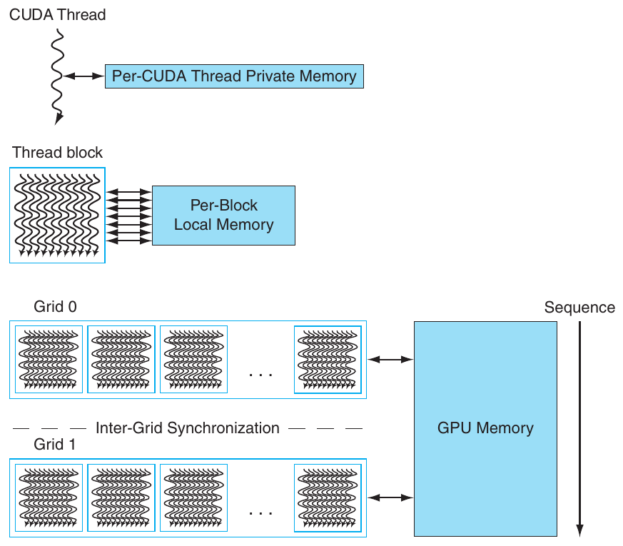

**Hình 4.18 GPU Memory structure. Mọi Grid (vectorized loop) chia sẻ GPU Memory; mọi thread chứa SIMD instruction trong một thread block (body của vectorized loop) chia sẻ Local Memory; Private Memory riêng tư cho một CUDA Thread.**

System processor, được gọi là host, đọc hoặc ghi được GPU Memory. Host không truy cập được Local Memory vì nó riêng tư cho từng multithreaded SIMD processor. Host cũng không truy cập được Private Memory.

Thay vì dựa vào cache lớn để chứa toàn bộ working set của ứng dụng, GPU truyền thống sử dụng streaming cache nhỏ hơn và dựa vào multithreading rộng với các thread chứa SIMD instruction để che latency dài tới DRAM, vì working set của chúng có thể lên tới hàng trăm megabyte. Do dùng multithreading để che DRAM latency, diện tích chip mà system processor dành cho cache được GPU dành cho computing resource và số register lớn để giữ state của nhiều thread chứa SIMD instruction. Ngược lại, như đã đề cập, vector load và store phân bổ latency trên nhiều element, vì chúng chỉ phải trả latency một lần rồi pipeline những access còn lại.

Dù che memory latency là triết lý nền tảng, hãy lưu ý rằng GPU và vector processor mới nhất đã bổ sung cache. Chẳng hạn, architecture Fermi gần đây thêm cache, nhưng chúng được xem là bandwidth filter để giảm nhu cầu đối với GPU Memory, hoặc accelerator cho một số ít variable có latency không thể được che bằng multithreading. Vì vậy, local memory dành cho stack frame, function call và register spilling rất phù hợp với cache, vì latency là điều quan trọng khi gọi hàm. Cache còn tiết kiệm energy, vì cache access on-chip tốn ít energy hơn nhiều so với access tới nhiều DRAM chip bên ngoài.

Để cải thiện memory bandwidth và giảm overhead, như đã đề cập, PTX data transfer instruction gộp những request riêng của các parallel thread thuộc cùng SIMD thread thành một memory block request nếu các address nằm trong cùng block. Những restriction này được đặt lên GPU program, phần nào tương tự hướng dẫn dành cho system processor program để kích hoạt hardware prefetching (xem Chương 2). GPU memory controller còn giữ các request rồi gửi những request tới cùng open page cùng nhau để cải thiện memory bandwidth (xem Mục 4.6). Chương 2 mô tả DRAM đủ chi tiết để hiểu lợi ích tiềm năng của việc nhóm các address liên quan.

### Những đổi mới trong GPU Architecture Fermi

Multithreaded SIMD Processor của Fermi phức tạp hơn phiên bản đơn giản hóa trong Hình 4.14. Để tăng hardware utilization, mỗi SIMD Processor có hai SIMD Thread Scheduler và hai instruction dispatch unit. Dual SIMD Thread Scheduler chọn hai thread chứa SIMD instruction và issue một instruction từ mỗi thread tới hai tập 16 SIMD Lane, 16 load/store unit hoặc 4 special function unit. Vì vậy, hai thread chứa SIMD instruction được schedule mỗi hai clock cycle tới bất kỳ tập unit nào trong số đó. Vì các thread độc lập, không cần kiểm tra data dependence trong instruction stream. Đổi mới này tương tự một multithreaded vector processor có thể issue vector instruction từ hai thread độc lập.

Hình 4.19 thể hiện Dual Scheduler issue instruction, Hình 4.20 là block diagram multithreaded SIMD Processor của Fermi GPU.

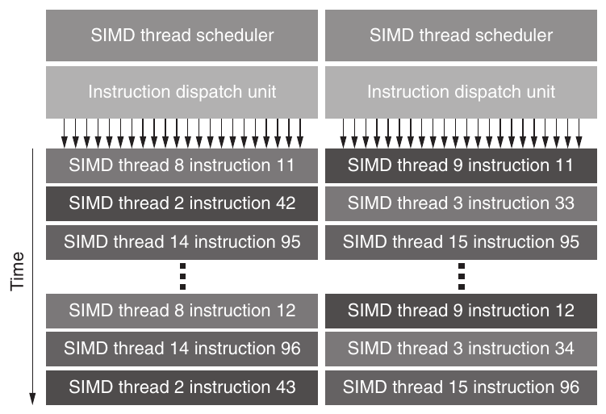

**Hình 4.19 Block Diagram của Dual SIMD Thread Scheduler Fermi. So sánh thiết kế này với thiết kế single SIMD Thread ở Hình 4.16.**

Fermi đưa ra một số đổi mới khiến GPU gần system processor truyền thống hơn nhiều so với Tesla và các thế hệ GPU architecture trước:

- Arithmetic Double-Precision Floating-Point nhanh—Fermi đạt tốc độ double-precision tương đối ngang processor thông thường, khoảng một nửa tốc độ single precision, so với một phần mười tốc độ single precision của thế hệ Tesla trước. Tức không còn sự cám dỗ chênh lệch cả một bậc độ lớn để dùng single precision khi yêu cầu về độ chính xác đòi hỏi double precision. Peak performance double-precision tăng từ 78 GFLOP/sec của GPU tiền nhiệm lên 515 GFLOP/sec khi dùng instruction multiply-add.

- Cache cho GPU Memory—Dù triết lý GPU là có đủ thread để che DRAM latency, vẫn có những variable cần được sử dụng giữa các thread, như local variable đã đề cập ở trên. Fermi có cả L1 Data Cache và L1 Instruction Cache cho mỗi multithreaded SIMD Processor, cùng một L2 cache 768 KB được mọi multithreaded SIMD Processor trong GPU chia sẻ. Như đã đề cập, ngoài việc giảm áp lực bandwidth lên GPU Memory, cache có thể tiết kiệm energy nhờ ở on-chip thay vì đi off-chip tới DRAM. L1 cache thực ra cùng nằm trong SRAM với Local Memory. Fermi có mode bit cho phép chọn dùng SRAM 64 KB như L1 cache 16 KB với Local Memory 48 KB, hoặc như L1 cache 48 KB với Local Memory 16 KB. Lưu ý GTX 480 có memory hierarchy đảo ngược: aggregate register file size là 2 MB, tổng kích thước các L1 data cache từ 0.25 đến 0.75 MB (tùy chúng là 16 KB hay 48 KB), và L2 cache size là 0.75 MB. Sẽ thú vị khi xem tỷ lệ đảo ngược này ảnh hưởng tới ứng dụng GPU như thế nào.

- Addressing 64-Bit và Unified Address Space cho mọi GPU Memory—Đổi mới này khiến cung cấp pointer cần cho C, C++ dễ hơn nhiều.

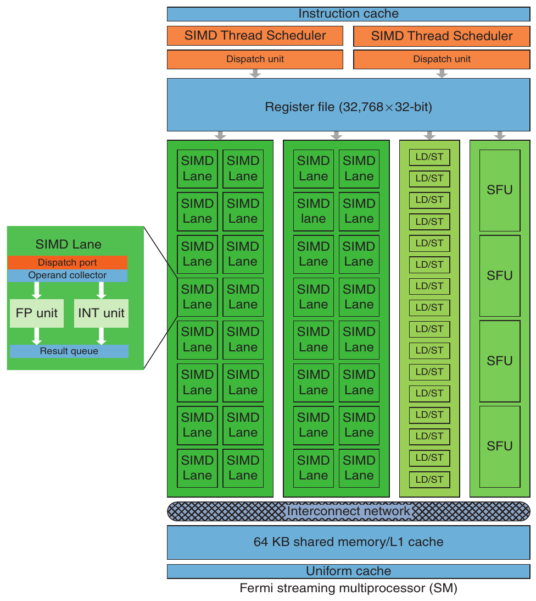

**Hình 4.20 Block diagram của multithreaded SIMD Processor Fermi GPU. Mỗi SIMD Lane có unit floating-point có pipeline, integer unit có pipeline, logic dispatch instruction và operand tới các unit, cùng queue giữ kết quả. Bốn Special Function unit (SFU) tính hàm như căn bậc hai, nghịch đảo, sin và cosin.**

- Error Correcting Code để phát hiện và sửa error trong memory, register (xem Chương 2)—Để ứng dụng long-running đáng tin cậy trên hàng nghìn server, ECC là chuẩn thông thường trong datacenter (xem Chương 6).

- Context Switching nhanh hơn—Với state lớn của multithreaded SIMD Processor, Fermi có hardware support switch context nhanh hơn nhiều. Fermi switch trong dưới 25 microsecond, nhanh hơn khoảng 10× so với tiền nhiệm.

- Atomic Instruction nhanh hơn—Atomic instruction xuất hiện lần đầu trong architecture Tesla; Fermi cải thiện performance của chúng từ 5 đến 20×, xuống còn vài microsecond. Một hardware unit đặc biệt gắn với L2 cache, không nằm bên trong multithreaded SIMD Processor, xử lý atomic instruction.

### Tương đồng và khác biệt giữa Vector Architecture và GPU

Như chúng ta đã thấy, thực sự có nhiều tương đồng giữa vector architecture và GPU. Cùng jargon kỳ lạ của GPU, những tương đồng góp phần gây nhầm lẫn trong giới architecture về GPU thực sự mới mẻ tới đâu. Giờ đã thấy bên trong vector computer và GPU, bạn có thể hiểu cả tương đồng lẫn khác biệt. Vì cả hai architecture thiết kế để thực thi parallel program data-level nhưng đi theo các hướng khác nhau, so sánh này đi sâu để hiểu tốt hơn DLP hardware cần gì. Hình 4.21 cho thuật ngữ vector trước, rồi tương đương gần nhất trong GPU.

SIMD Processor giống vector processor. Nhiều SIMD Processor trong GPU hoạt động như MIMD core độc lập, cũng như nhiều vector computer có nhiều vector processor. Cách nhìn này coi NVIDIA GTX 480 là máy 15-core có hardware support multithreading, mỗi core 16 lane. Khác biệt lớn nhất là multithreading, nền tảng của GPU nhưng thiếu ở phần lớn vector processor.

Xét register trong hai architecture, register file VMIPS giữ toàn vector—tức block liên tục gồm 64 double. Ngược lại, một vector duy nhất trong GPU được phân bố trên register của mọi SIMD Lane. VMIPS processor có 8 vector register, mỗi register 64 element, tổng 512 element. GPU thread chứa SIMD instruction có tới 64 register, mỗi register 32 element, tức 2048 element. Những GPU register bổ sung hỗ trợ multithreading.

Hình 4.22 là block diagram execution unit của vector processor bên trái, multithreaded SIMD Processor GPU bên phải. Vì mục đích giảng dạy, giả sử vector processor có bốn lane và multithreaded SIMD Processor cũng có bốn SIMD Lane. Hình cho thấy bốn SIMD Lane phối hợp giống vector unit four-lane, và SIMD Processor hoạt động rất giống vector processor.

Thực tế GPU có nhiều lane hơn, nên “chime” ngắn hơn. Trong khi vector processor có thể có 2 đến 8 lane và vector length, chẳng hạn 32—cho chime 4 đến 16 clock cycle—multithreaded SIMD Processor có thể có 8 hoặc 16 lane. SIMD thread rộng 32 element nên GPU chime chỉ 2 hoặc 4 clock cycle. Khác biệt này là lý do dùng “SIMD Processor” như thuật ngữ mô tả rõ hơn, vì gần thiết kế SIMD hơn thiết kế vector processor truyền thống.

Thuật ngữ GPU gần vectorized loop nhất là Grid, và PTX instruction gần vector instruction nhất vì SIMD Thread broadcast PTX instruction tới mọi SIMD Lane.

| Loại | Thuật ngữ vector | Thuật ngữ CUDA/NVIDIA GPU gần nhất | Giải thích |
|---|---|---|---|
| Program abstraction | Vectorized Loop | Grid | Khái niệm tương tự, GPU dùng thuật ngữ ít mô tả rõ hơn. |
|  | Chime | -- | Vì vector instruction (PTX Instruction) chỉ mất hai cycle trên Fermi và bốn cycle trên Tesla để hoàn tất, chime trong GPU ngắn. |
| Machine object | Vector Instruction | PTX Instruction | PTX instruction của SIMD thread được broadcast tới mọi SIMD Lane, nên tương tự vector instruction. |
|  | Gather/Scatter | Global load/store (ld.global/st.global) | Mọi GPU load và store đều gather và scatter, vì mỗi SIMD Lane gửi address riêng. GPU Coalescing Unit phải đạt performance unit-stride khi address từ SIMD Lane cho phép. |
|  | Mask Registers | Predicate Registers and Internal Mask Registers | Vector mask register là phần tường minh của architectural state, còn GPU mask register nội bộ trong hardware. GPU conditional hardware thêm tính năng mới ngoài predicate register để quản lý mask động. |
| Processing and memory hardware | Vector Processor | Multithreaded SIMD Processor | Chúng tương tự, nhưng SIMD Processor thường có nhiều lane, mất vài clock cycle mỗi lane để hoàn tất vector, còn vector architecture có ít lane, mất nhiều cycle để hoàn tất vector. SIMD Processor còn multithreaded, điều vector thường không có. |
|  | Control Processor | Thread Block Scheduler | Gần nhất là Thread Block Scheduler gán Thread Block cho multithreaded SIMD Processor. Nhưng GPU không có scalar-vector operation và data transfer instruction unit-stride hoặc strided, những thứ Control Processor thường cung cấp. |
|  | Scalar Processor | System Processor | Vì thiếu shared memory và latency cao khi giao tiếp qua PCI bus (1000s clock cycle), system processor trong GPU hiếm khi làm cùng nhiệm vụ như scalar processor trong vector architecture. |
|  | Vector Lane | SIMD Lane | Cả hai về cơ bản là functional unit có register. |
|  | Vector Registers | SIMD Lane Registers | Tương đương vector register là cùng register trong mọi 32 SIMD Lane của multithreaded SIMD Processor đang chạy thread chứa SIMD instruction. Số register mỗi SIMD thread linh hoạt, nhưng tối đa 64, nên số vector register tối đa là 64. |
|  | Main Memory | GPU Memory | Memory cho GPU so với system memory trong trường hợp vector. |

**Hình 4.21 Thuật ngữ GPU tương đương thuật ngữ vector.**

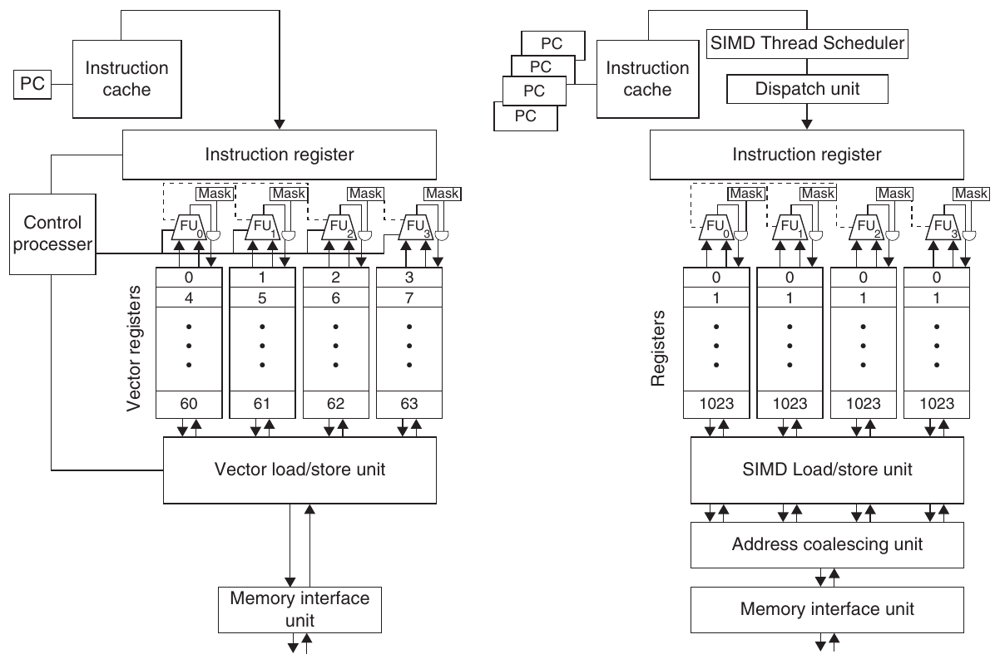

**Hình 4.22 Vector processor bốn lane bên trái và multithreaded SIMD Processor GPU có bốn SIMD Lane bên phải. (GPU thường có 8 đến 16 SIMD Lane.) Control processor cung cấp scalar operand cho scalar-vector operation, tăng address cho memory access unit và non-unit stride, thực hiện accounting-type operation khác. Peak memory performance chỉ xảy ra trong GPU khi Address Coalescing unit phát hiện address tập trung. Tương tự, peak computational performance xảy ra khi mọi internal mask bit được đặt giống nhau. Lưu ý SIMD Processor có một PC mỗi SIMD thread để hỗ trợ multithreading.**

Về memory access instruction trong hai architecture, mọi GPU load là gather instruction, mọi GPU store là scatter instruction. Nếu data address của CUDA Thread tham chiếu các address gần nhau trong cùng cache/memory block cùng lúc, Address Coalescing Unit GPU bảo đảm memory bandwidth cao. Instruction load/store unit-stride tường minh của vector architecture so với unit stride ngầm của GPU programming giải thích vì sao viết GPU code hiệu quả đòi lập trình viên suy nghĩ theo SIMD operation, dù CUDA programming model trông như MIMD. Vì CUDA Thread tự tạo address, cả strided lẫn gather-scatter, addressing vector có trong cả vector architecture và GPU.

Như đã đề cập nhiều lần, hai architecture có cách che memory latency rất khác nhau. Vector architecture phân bổ latency trên mọi element của vector bằng access được pipeline sâu, nên chỉ phải trả latency một lần cho mỗi vector load hoặc store. Vì vậy, vector load và store giống như block transfer giữa memory và vector register. Ngược lại, GPU che memory latency bằng multithreading. (Một số nhà nghiên cứu đang khảo sát việc thêm multithreading vào vector architecture để cố kết hợp ưu điểm của cả hai.)

Với conditional branch instruction, cả hai architecture triển khai bằng mask register. Cả hai path của conditional branch chiếm thời gian và/hoặc không gian ngay cả khi không store kết quả. Khác biệt là vector compiler quản lý mask register tường minh bằng software, còn GPU hardware và assembler quản lý ngầm bằng branch synchronization marker, internal stack để lưu, lấy phần bù và khôi phục mask.

Như đã đề cập, conditional branch mechanism GPU xử lý khéo bài toán strip-mining của vector architecture. Khi chưa biết vector length lúc compile time, chương trình phải tính phần dư của application vector length theo maximum vector length rồi lưu vào vector length register. Loop strip-minded sau đó đặt lại vector length register bằng maximum vector length cho phần loop còn lại. Với GPU trường hợp này đơn giản hơn vì chỉ lặp đến khi mọi SIMD Lane đạt loop bound. Trong iteration cuối cùng, một số SIMD Lane bị mask off rồi được khôi phục sau khi loop hoàn tất.

Control processor của vector computer đóng vai trò quan trọng trong việc thực thi vector instruction. Nó broadcast operation tới mọi vector lane và broadcast một scalar register value cho vector-scalar operation. Nó cũng thực hiện ngầm những phép tính mà GPU phải làm tường minh, như tự động tăng memory address cho load và store unit-stride cũng như non-unit-stride. GPU thiếu control processor này. Đối tượng gần nhất là Thread Block Scheduler, gán Thread Block (body của vector loop) cho multithreaded SIMD Processor. Những hardware mechanism lúc runtime của GPU vừa tạo address vừa phát hiện chúng có liền nhau không—điều thường thấy trong nhiều DLP application—có lẽ kém hiệu quả về power hơn việc dùng control processor.

Scalar processor trong vector computer thực thi scalar instruction của vector program; tức làm operation vốn quá chậm nếu làm trong vector unit. Dù system processor gắn với GPU là thứ gần scalar processor trong vector architecture nhất, address space riêng cộng việc transfer qua PCle bus khiến dùng chúng cùng nhau có overhead hàng nghìn clock cycle. Scalar processor có thể chậm hơn vector processor khi tính floating-point trong vector computer, nhưng không theo cùng tỷ lệ như system processor so với multithreaded SIMD Processor (xét cả overhead).

Vì vậy, mỗi “vector unit” trong GPU phải làm phép tính mà bạn kỳ vọng scalar processor thực hiện trong vector computer. Tức thay tính trên system processor rồi truyền kết quả, có thể nhanh hơn nếu dùng predicate register và mask built-in để tắt mọi SIMD Lane trừ một, rồi làm scalar work bằng một SIMD Lane. Scalar processor tương đối đơn giản trong vector computer có lẽ nhanh hơn và power efficient hơn giải pháp GPU. Nếu system processor và GPU gắn chặt hơn trong tương lai, sẽ thú vị xem system processor có thể đóng cùng vai trò scalar processor cho vector architecture và Multimedia SIMD architecture không.

### Tương đồng và khác biệt giữa máy tính Multimedia SIMD và GPU

Ở cấp cao, máy tính multicore có Multimedia SIMD instruction extension thực sự có điểm giống GPU. Hình 4.23 tổng hợp tương đồng và khác biệt.

Cả hai là multiprocessor mà processor dùng nhiều SIMD lane, dù GPU có nhiều processor và nhiều lane hơn hẳn. Cả hai dùng hardware multithreading tăng processor utilization, dù GPU có hardware support nhiều thread hơn hẳn. Đổi mới GPU gần đây nghĩa là cả hai hiện có tỷ lệ performance tương tự giữa arithmetic floating-point single-precision và double-precision. Cả hai dùng cache, dù GPU dùng streaming cache nhỏ hơn còn multicore computer dùng cache multilevel lớn cố chứa toàn bộ working set. Cả hai dùng address space 64-bit, dù physical main memory trong GPU nhỏ hơn nhiều. Dù GPU hỗ trợ memory protection ở cấp page, chúng không hỗ trợ demand paging.

Ngoài khác biệt lớn về số processor, SIMD lane, hardware thread support và cache size, còn nhiều khác biệt architecture. Scalar processor và Multimedia SIMD instruction được tích hợp chặt trong máy tính truyền thống; trong GPU chúng tách bởi I/O bus, thậm chí có main memory riêng. Nhiều SIMD processor trong GPU dùng cùng address space, nhưng cache không coherent như multicore computer truyền thống. Khác GPU, multimedia SIMD instruction không hỗ trợ memory access gather-scatter, điều Mục 4.7 cho thấy là thiếu sót đáng kể.

| Đặc tính | Multicore có SIMD | GPU |
|---|---|---|
| Số SIMD processor | 4 đến 8 | 8 đến 16 |
| Số SIMD lane/processor | 2 đến 4 | 8 đến 16 |
| Hardware multithreading hỗ trợ số SIMD thread | 2 đến 4 | 16 đến 32 |
| Tỷ lệ performance single-precision so với double-precision điển hình | 2:1 | 2:1 |
| Cache size lớn nhất | 8 MB | 0.75 MB |
| Memory address size | 64-bit | 64-bit |
| Main memory size | 8 GB đến 256 GB | 4 đến 6 GB |
| Memory protection ở cấp page | Có | Có |
| Demand paging | Có | Không |
| Scalar processor/SIMD processor tích hợp | Có | Không |
| Cache coherent | Có | Không |

**Hình 4.23 Tương đồng và khác biệt giữa multicore có Multimedia SIMD extension và GPU gần đây.**

### Tổng kết

Giờ tấm màn đã được vén, chúng ta thấy GPU thực ra chỉ là multithreaded SIMD processor, dù có nhiều processor hơn, nhiều lane mỗi processor hơn và nhiều multithreading hardware hơn multicore computer truyền thống. Chẳng hạn, Fermi GTX 480 có 15 SIMD processor với 16 lane mỗi processor, cùng hardware support cho 32 SIMD thread. Fermi thậm chí tận dụng instruction-level parallelism bằng cách issue instruction từ hai SIMD thread tới hai tập SIMD lane. Chúng cũng có ít cache memory hơn—L2 cache Fermi là 0.75 megabyte—và cache không coherent với scalar processor ở xa.

| Loại | Tên mô tả rõ hơn dùng trong sách | Thuật ngữ CUDA/ NVIDIA chính thức | Định nghĩa của sách và thuật ngữ AMD, OpenCL | Định nghĩa CUDA/NVIDIA chính thức |
|---|---|---|---|---|
| Program abstraction | Vectorizable loop | Grid | Vectorizable loop thực thi trên GPU, gồm một hoặc nhiều “Thread Block” (hay body của vectorized loop) có thể execute song song. OpenCL được gọi là “index range”. AMD gọi “NDRange”. | Grid là array thread block có thể execute concurrently, tuần tự hoặc kết hợp cả hai. |
|  | Body of Vectorized loop | Thread Block | Vectorized loop thực thi trên multithreaded SIMD Processor, gồm một hoặc nhiều thread chứa SIMD instruction. Những SIMD Thread này có thể giao tiếp qua Local Memory. AMD và OpenCL được gọi là “work group”. | Thread block là array CUDA Thread thực thi concurrently cùng nhau, có thể phối hợp và giao tiếp qua Shared Memory và barrier synchronization. Thread Block có Thread Block ID trong Grid của mình. |
|  | Sequence of SIMD Lane operations | CUDA Thread | Lát cắt dọc của thread chứa SIMD instruction, tương ứng với một element do một SIMD Lane execute. Kết quả được lưu tùy mask. AMD và OpenCL gọi CUDA Thread là “work item.” | CUDA Thread là lightweight thread execute sequential program, có thể phối hợp với CUDA Thread khác execute trong cùng Thread Block. CUDA Thread có thread ID trong Thread Block của mình. |
| Machine object | A Thread of SIMD instructions | Warp | Thread truyền thống nhưng chỉ chứa SIMD instruction execute trên multithreaded SIMD Processor. Kết quả được lưu tùy mask per-element. AMD gọi “wavefront.” | Warp là tập parallel CUDA Thread (ví dụ 32) cùng execute một instruction trong multithreaded SIMT/SIMD Processor. |
|  | SIMD instruction | PTX instruction | Một SIMD instruction execute trên các SIMD Lane. AMD được gọi là instruction “AMDIL” hoặc “FSAIL”. | PTX instruction chỉ định instruction được một CUDA Thread execute. |

**Hình 4.24 Chuyển từ thuật ngữ dùng trong chương sang jargon NVIDIA/CUDA và AMD chính thức. Tên OpenCL được nêu trong định nghĩa của sách.**

| Loại | Tên mô tả rõ hơn dùng trong sách | Thuật ngữ CUDA/ NVIDIA chính thức | Định nghĩa của sách và thuật ngữ AMD, OpenCL | Định nghĩa CUDA/NVIDIA chính thức |
|---|---|---|---|---|
| Processing hardware | Multithreaded | Streaming | Multithreaded SIMD Processor thực thi | Streaming multiprocessor |
|  | SIMD | multi- | thread chứa SIMD instruction, độc lập với | (SM) là multithreaded SIMT/ |
|  | processor | processor | SIMD Processor khác. Cả AMD và OpenCL gọi nó là “compute unit.” Tuy nhiên, lập trình viên CUDA viết chương trình cho một lane thay vì một “vector” gồm nhiều SIMD Lane. | SIMD Processor thực thi warp gồm CUDA Thread. SIMT program chỉ định execution của một CUDA Thread thay vì vector gồm nhiều SIMD Lane. |
|  | Thread | Giga | Gán nhiều body của vectorized loop | Phân phối và schedule |
|  | block scheduler | thread engine | tới multithreaded SIMD Processor. AMD được gọi là “Ultra-Threaded Dispatch Engine”. | thread block của grid tới streaming multiprocessor khi resource available. |
|  | SIMD | Warp | Hardware unit schedule và issue | Warp scheduler trong |
|  | Thread | scheduler | thread chứa SIMD instruction khi chúng | streaming multiprocessor |
|  | scheduler |  | sẵn sàng execute; gồm scoreboard theo dõi execution SIMD Thread. AMD gọi “Work Group Scheduler”. | schedule warp để execution khi instruction tiếp theo sẵn sàng execute. |
|  | SIMD | Thread | Hardware SIMD Lane thực hiện | Thread processor là |
|  | Lane | processor | operation trong thread chứa SIMD instruction trên một element duy nhất. Kết quả lưu tùy mask. OpenCL gọi “processing element.” AMD cũng gọi “SIMD Lane”. | phần datapath và register file của streaming multiprocessor, thực thi operation cho một hoặc nhiều lane của warp. |
| Memory hardware | GPU Memory | Global Memory | DRAM memory cho phép mọi multithreaded SIMD Processor trong GPU truy cập. OpenCL gọi “Global Memory.” | Global memory có thể được mọi CUDA Thread trong bất kỳ thread block nào của bất kỳ grid nào truy cập; triển khai thành một vùng DRAM và có thể được cache. |
|  | Private | Local | Phần DRAM memory riêng cho mỗi | Memory “thread-local” riêng |
|  | Memory | Memory | SIMD Lane. Cả AMD và OpenCL được gọi là “Private Memory.” | cho CUDA Thread; được triển khai thành vùng DRAM được cache. |
|  | Local | Shared | Local SRAM nhanh cho một multithreaded | SRAM memory nhanh, được chia sẻ bởi |
|  | Memory | Memory | SIMD Processor, không thể được SIMD Processor khác truy cập. OpenCL gọi “Local Memory.” AMD gọi “Group Memory”. | các CUDA Thread tạo nên thread block và riêng cho thread block đó. Dùng để giao tiếp giữa CUDA Thread trong thread block tại barrier synchronization point. |
|  | SIMD Lane | Registers | Register trong một SIMD Lane được cấp | Register riêng cho CUDA |
|  | registers |  | trên toàn body của vectorized loop. AMD cũng gọi “Registers”. | Thread; triển khai thành multithreaded register file cho một số lane của vài warp trên mỗi thread processor. |

**Hình 4.25 Chuyển từ thuật ngữ dùng trong chương sang jargon NVIDIA/CUDA và AMD chính thức. Lưu ý thuật ngữ mô tả “Local Memory”, “Private Memory” của chúng ta dùng thuật ngữ OpenCL. NVIDIA dùng SIMT, single-instruction multiple-thread, thay SIMD để mô tả streaming multiprocessor. SIMT được ưu tiên hơn SIMD vì branching và control flow per-thread không giống bất kỳ SIMD machine nào.**

CUDA programming model gói tất cả những dạng parallelism này trong một abstraction duy nhất: CUDA Thread. Vì vậy, lập trình viên CUDA có thể nghĩ rằng đang lập trình hàng nghìn thread, dù thực ra chúng đang thực thi mỗi block 32 thread trên nhiều lane của nhiều SIMD Processor. Lập trình viên CUDA muốn performance tốt phải nhớ rằng những thread này được nhóm và thực thi 32 thread mỗi lần, và các address cần liền nhau để đạt performance tốt từ memory system.

Dù mục này dùng CUDA và NVIDIA GPU, hãy yên tâm rằng cùng những ý tưởng đó có trong ngôn ngữ OpenCL và GPU của công ty khác.

Giờ bạn hiểu GPU hoạt động rõ hơn, chúng ta tiết lộ jargon thực. Hình 4.24 và 4.25 ghép thuật ngữ, định nghĩa mô tả ở mục này với thuật ngữ, định nghĩa CUDA/NVIDIA và AMD chính thức. Chúng ta còn thêm thuật ngữ OpenCL. Chúng tôi tin học GPU khó một phần vì dùng tên “Streaming Multiprocessor” cho SIMD Processor, “Thread Processor” cho SIMD Lane và “Shared Memory” cho Local Memory—đặc biệt khi Local Memory không chia sẻ giữa SIMD Processor! Hy vọng cách two-step giúp bạn vượt đường cong học tập nhanh hơn, dù hơi gián tiếp.

## 4.5 Phát hiện và tăng cường Loop-Level Parallelism

Loop trong chương trình là nguồn gốc của nhiều loại parallelism đã thảo luận ở trên và trong Chương 5. Trong mục này, chúng ta thảo luận công nghệ compiler để khám phá lượng parallelism có thể khai thác trong chương trình, cũng như hardware support cho những kỹ thuật compiler đó. Chúng ta định nghĩa chính xác khi nào loop là parallel (hay vectorizable), dependence có thể ngăn loop trở thành parallel thế nào, cùng những kỹ thuật loại bỏ một số loại dependence. Tìm và biến đổi loop-level parallelism là thiết yếu để khai thác cả DLP lẫn TLP, cũng như những cách static ILP mạnh hơn (ví dụ VLIW) mà chúng ta xem xét trong Phụ lục H.

Loop-level parallelism thường được phân tích ở cấp source hoặc gần cấp đó, trong khi phần lớn phân tích ILP được thực hiện sau khi compiler đã tạo instruction. Phân tích Loop-level bao gồm việc xác định những dependence giữa các operand trong loop qua các iteration của loop đó. Hiện tại, chúng ta chỉ xét data dependence, xuất hiện khi một operand được ghi tại một điểm và đọc tại điểm sau. Name dependence cũng tồn tại và có thể được loại bỏ bằng các kỹ thuật renaming đã thảo luận ở Chương 3.

Phân tích loop-level parallelism tập trung xác định liệu data access trong iteration sau có phụ thuộc data value được tạo trong iteration trước hay không; dependence như vậy được gọi là loop-carried dependence. Phần lớn ví dụ đã xét ở Chương 2 và 3 không có dependence loop-carried, do đó có parallelism loop-level. Để thấy một loop là parallel, trước tiên hãy xem biểu diễn source:

```
for (i=999; i>=0; i=i-1)
      x[i] = x[i] + s;
```

Trong loop này, hai lần sử dụng x[i] phụ thuộc nhau, nhưng dependence này nằm trong một iteration duy nhất và không phải loop carried. Có loop-carried dependence giữa những lần sử dụng i liên tiếp trong các iteration khác nhau, nhưng dependence này liên quan đến một induction variable có thể dễ dàng nhận biết và loại bỏ. Chúng ta đã thấy ví dụ loại bỏ dependence liên quan đến induction variable trong quá trình loop unrolling ở Mục 2.2 của Chương 2, và sẽ xem thêm ví dụ về sau trong mục này.

Vì tìm loop-level parallelism đòi nhận ra cấu trúc như loop, array reference và phép tính induction variable, compiler phân tích dễ hơn ở cấp source hoặc gần source, thay vì cấp machine-code. Hãy xem ví dụ phức tạp hơn.

**Ví dụ** Hãy xét một loop như sau:

```
for (i=0; i<100; i=i+1) {
      A[i+1] = A[i] + C[i];   /* S1 */
      B[i+1] = B[i] + A[i+1]; /* S2 */
}
```

Giả sử A, B và C là các array riêng biệt, không chồng lấp. (Trong thực tế, đôi khi các array có thể là cùng một array hoặc có thể chồng lấp. Vì array có thể được truyền làm parameter cho procedure chứa loop này, xác định các array chồng lấp hay giống hệt nhau thường đòi hỏi phân tích interprocedural tinh vi đối với chương trình.) Những data dependence nào tồn tại giữa các câu lệnh S1 và S2 trong loop?

**Trả lời** Có hai dependence khác nhau:

1. S1 dùng giá trị S1 tính trong iteration trước, vì iteration i tính A[i+1], được đọc ở iteration i+1. Điều tương tự cũng đúng với S2 cho B[i] và B[i+1].

2. S2 dùng giá trị A[i+1] do S1 tính trong cùng iteration.

Hai dependence này khác nhau và có tác động khác nhau. Để thấy chúng khác thế nào, hãy giả sử tại mỗi thời điểm chỉ tồn tại một trong hai dependence. Vì câu lệnh S1 phụ thuộc vào một iteration trước của S1, dependence này là loop carried. Dependence này buộc các iteration liên tiếp của loop thực thi tuần tự.

Dependence thứ hai (S2 phụ thuộc S1) nằm bên trong một iteration và không phải loop carried. Vì vậy, nếu đây là dependence duy nhất, nhiều iteration của loop có thể thực thi song song, miễn là từng cặp câu lệnh trong mỗi iteration được giữ đúng thứ tự. Chúng ta đã thấy kiểu dependence này trong ví dụ ở Mục 2.2, nơi unrolling có thể bộc lộ parallelism. Những dependence intra-loop này rất phổ biến; chẳng hạn một chuỗi vector instruction dùng chaining thể hiện đúng kiểu dependence đó.

Cũng có thể có loop-carried dependence không ngăn parallelism, như ví dụ tiếp theo.

**Ví dụ** Hãy xét một loop như sau:

```
for (i=0; i<100; i=i+1) {
      A[i] = A[i] + B[i];   /* S1 */
      B[i+1] = C[i] + D[i]; /* S2 */
}
```

Có dependence nào giữa S1 và S2? Loop này có parallel không? Nếu không, hãy cho thấy cách làm nó parallel.

**Trả lời** Câu lệnh S1 sử dụng giá trị mà câu lệnh S2 gán trong iteration trước, nên có loop-carried dependence giữa S2 và S1. Dù có loop-carried dependence này, vẫn có thể làm loop trở thành parallel. Khác loop trước, dependence này không có vòng; không câu lệnh nào phụ thuộc chính nó, và dù S1 phụ thuộc S2, S2 không phụ thuộc S1. Một loop là parallel nếu có thể viết nó mà không có cycle trong các dependence, vì không có cycle nghĩa là các dependence tạo partial ordering giữa các câu lệnh.

Dù loop trên không có circular dependence, phải biến đổi để tuân theo partial ordering và bộc lộ parallelism. Hai quan sát thiết yếu cho biến đổi này:

1. Không có dependence từ S1 tới S2. Nếu có thì có cycle trong dependence và loop không parallel. Vì không có dependence ngược này, đổi chỗ hai câu lệnh không ảnh hưởng execution của S2.

2. Trong iteration đầu của loop, câu lệnh S2 phụ thuộc giá trị B[0] tính trước khi khởi động loop.

Hai quan sát cho phép thay loop trên bằng chuỗi code sau:

```
A[0] = A[0] + B[0];
for (i=0; i<99; i=i+1) {
      B[i+1] = C[i] + D[i];
      A[i+1] = A[i+1] + B[i+1];
}
B[100] = C[99] + D[99];
```

Dependence giữa hai câu lệnh không còn là loop carried, nên iteration có thể được thực thi chồng lấp, miễn là giữ đúng thứ tự câu lệnh trong mỗi iteration.

Phân tích của chúng ta cần bắt đầu bằng việc tìm mọi loop-carried dependence. Thông tin dependence này không chính xác tuyệt đối, theo nghĩa chỉ cho biết dependence có thể tồn tại. Xét ví dụ sau:

```
for (i=0;i<100;i=i+1) {
      A[i] = B[i] + C[i]
      D[i] = A[i] * E[i]
}
```

Reference thứ hai tới A trong ví dụ này không cần được dịch thành load instruction, vì chúng ta biết giá trị đã được câu lệnh trước tính và store; do đó reference thứ hai tới A có thể chỉ là tham chiếu register chứa kết quả A đã tính. Thực hiện tối ưu này đòi hỏi biết rằng hai reference luôn cùng memory address và không có access xen giữa tới cùng vị trí. Thông thường, data dependence analysis chỉ cho biết một reference có thể phụ thuộc reference khác; cần phân tích phức tạp hơn để xác định hai reference chắc chắn có cùng address chính xác. Trong ví dụ trên, một phiên bản đơn giản của phân tích này là đủ, vì hai reference nằm trong cùng basic block.

Các dependence loop-carried thường có dạng recurrence. Recurrence xảy ra khi một variable được định nghĩa dựa trên giá trị của chính variable đó trong một iteration trước, thường là iteration ngay trước đó, như trong đoạn code sau:

```
for (i=1;i<100;i=i+1) {
      Y[i] = Y[i-1] + Y[i];
}
```

Phát hiện recurrence có thể quan trọng vì hai lý do: một số architecture (nhất là vector computer) có hỗ trợ đặc biệt để thực thi recurrence, và trong ngữ cảnh ILP, vẫn có thể khai thác lượng parallelism khá lớn.

### Tìm Dependence

Rõ ràng, tìm dependence trong chương trình quan trọng cả để xác định những loop có thể chứa parallelism lẫn để loại bỏ name dependence. Sự phức tạp của dependence analysis còn bắt nguồn từ sự hiện diện của array và pointer trong ngôn ngữ như C hoặc C++, hay cách truyền parameter pass-by-reference trong Fortran. Vì scalar variable reference tham chiếu tường minh tới một tên, chúng thường được phân tích khá dễ dàng; tuy nhiên aliasing do pointer và reference parameter gây ra thêm một số phức tạp và bất định trong phân tích.

Compiler phát hiện dependence trong trường hợp tổng quát như thế nào? Gần như mọi thuật toán dependence analysis giả định array index là affine. Nói đơn giản nhất, index của array one-dimensional là affine nếu có thể được viết dưới dạng a × i + b, trong đó a, b là constant, i là loop index variable. Index của array nhiều chiều là affine nếu index trong mỗi chiều affine. Sparse array access, thường dạng x[y[i]], là ví dụ chính của access non-affine.

Vì vậy, xác định có dependence giữa hai reference tới cùng array trong loop tương đương xác định liệu hai affine function có thể có cùng giá trị với các index khác nhau nằm trong loop bound hay không. Chẳng hạn, giả sử chúng ta đã store vào array element có index a × i + b, rồi load từ cùng array tại index c × i + d, trong đó i là index variable của for-loop chạy từ m tới n. Dependence tồn tại nếu hai điều kiện sau đúng:

1. Có hai iteration index j và k đều nằm trong giới hạn for loop. Tức m ≤j ≤ n , m ≤k ≤ n .

2. Loop store vào array element có index a × j + b rồi sau đó fetch từ chính element đó khi index là c × k + d. Tức a × j + b = c × k + d.

Nói chung, chúng ta không thể xác định liệu dependence có tồn tại tại compile time hay không. Chẳng hạn, các giá trị a, b, c và d có thể chưa biết (chúng có thể là giá trị trong các array khác), khiến không thể kết luận có dependence hay không. Trong trường hợp khác, dependence testing có thể rất tốn kém nhưng quyết định được tại compile time; chẳng hạn các access có thể phụ thuộc iteration index của nhiều loop lồng nhau. Tuy nhiên, nhiều chương trình chủ yếu chứa index đơn giản, trong đó a, b, c và d đều là constant. Với những trường hợp này, có thể xây dựng những phép kiểm tra dependence hợp lý tại compile time.

Chẳng hạn, một phép kiểm tra đơn giản và đủ để xác định không có dependence là greatest common divisor (GCD) test. Nó dựa trên quan sát rằng nếu có loop-carried dependence, thì (d − b) phải chia hết cho GCD (c,a). (Nhớ rằng integer x là ước của integer y nếu phép chia y /x cho thương nguyên và không có phần dư.)

**Ví dụ** Dùng GCD test xác định có dependence trong loop sau không:

```
for (i=0; i<100; i=i+1) {
      X[2*i+3] = X[2*i] * 5.0;
}
```

**Trả lời** Với các giá trị a = 2, b = 3, c = 2 và d = 0, ta có GCD(a,c) = 2 và d − b = −3. Vì −3 không chia hết cho 2, không thể có dependence.

GCD test đủ để bảo đảm không có dependence; tuy nhiên, có những trường hợp GCD test thành công mà không có dependence. Điều này có thể xảy ra, chẳng hạn, vì GCD test không xét loop bound.

Nói chung, xác định liệu dependence có thực sự tồn tại là bài toán NP-complete. Tuy nhiên, trong thực tế, nhiều trường hợp phổ biến có thể được phân tích chính xác với chi phí thấp. Gần đây, các cách dùng hierarchy gồm những exact test với mức tổng quát và chi phí tăng dần đã được chứng minh vừa chính xác vừa hiệu quả. (Test là exact nếu xác định chính xác dependence có tồn tại hay không. Dù trường hợp tổng quát là NP-complete, vẫn có exact test cho những tình huống hạn chế với chi phí thấp hơn nhiều.)

Ngoài phát hiện dependence, compiler còn muốn phân loại dependence. Phân loại này cho phép compiler nhận biết name dependence và loại bỏ chúng tại compile time bằng renaming và copying.

**Ví dụ** Vòng lặp sau có nhiều loại dependence. Hãy tìm mọi true dependence, output dependence và antidependence, rồi loại bỏ output dependence và antidependence bằng renaming.

```
for (i=0; i<100; i=i+1) {
    Y[i] = X[i] / c; /* S1 */
    X[i] = X[i] + c; /* S2 */
    Z[i] = Y[i] + c; /* S3 */
    Y[i] = c - Y[i]; /* S4 */
}
```

**Trả lời** Những dependence sau tồn tại giữa bốn statement:

1. Có true dependence từ S1 tới S3 và từ S1 tới S4 vì Y[i]. Chúng không phải loop carried, nên không ngăn việc xem vòng lặp là song song. Những dependence này buộc S3 và S4 chờ S1 hoàn tất.

2. Có antidependence từ S1 tới S2 dựa trên X[i].

3. Có antidependence từ S3 tới S4 đối với Y[i].

4. Có output dependence từ S1 tới S4 dựa trên Y[i].

Phiên bản vòng lặp sau loại bỏ những false (hay pseudo) dependence này.

```
for (i=0; i<100; i=i+1 {
    T[i] = X[i] / c; /* Y renamed to T to remove output dependence */
    X1[i] = X[i] + c;/* X renamed to X1 to remove antidependence */
    Z[i] = T[i] + c;/* Y renamed to T to remove antidependence */
    Y[i] = c - T[i];
}
```

Sau vòng lặp, variable X đã được rename thành X1. Trong code theo sau, compiler chỉ cần thay tên X bằng X1. Trong trường hợp này, renaming không cần copy operation thực, vì có thể thực hiện bằng thay tên hoặc register allocation. Tuy nhiên ở trường hợp khác, renaming sẽ đòi hỏi copying.

Dependence analysis là công nghệ then chốt để khai thác parallelism, cũng như cho transformation-like blocking được đề cập trong Chương 2. Để phát hiện loop-level parallelism, dependence analysis là công cụ cơ bản. Biên dịch hiệu quả chương trình cho vector computer, SIMD computer hoặc multiprocessor phụ thuộc thiết yếu vào phân tích này. Hạn chế chính là nó chỉ áp dụng trong tập tình huống giới hạn, cụ thể giữa các reference trong cùng một loop nest và dùng affine index function. Vì vậy nhiều tình huống array-oriented dependence analysis không cho biết điều ta cần; ví dụ phân tích access bằng pointer thay vì array index có thể khó hơn nhiều. (Đây là một lý do Fortran vẫn được ưu tiên hơn C và C++ trong nhiều scientific application thiết kế cho parallel computer.) Tương tự, phân tích reference qua procedure call cực kỳ khó. Vì vậy, dù phân tích code viết bằng ngôn ngữ sequential vẫn quan trọng, chúng ta cũng cần cách tiếp cận như OpenMP và CUDA để viết parallel loop tường minh.

### Loại bỏ tính toán phụ thuộc

Như đã đề cập, một trong những dạng tính toán phụ thuộc quan trọng nhất là recurrence. Dot product là ví dụ hoàn hảo về recurrence:

```
for (i=9999; i>=0; i=i-1)
      sum = sum + x[i] * y[i];
```

Loop này không song song vì có loop-carried dependence trên variable sum. Tuy nhiên, ta có thể biến đổi nó thành tập loop, một loop hoàn toàn song song, loop còn lại có thể song song một phần. Loop đầu thực thi phần hoàn toàn song song của loop này. Nó trông như sau:

```
for (i=9999; i>=0; i=i-1)
      sum[i] = x[i] * y[i];
```

Lưu ý sum đã được mở rộng từ đại lượng scalar thành vector (phép biến đổi gọi là scalar expansion), và phép biến đổi này khiến loop mới hoàn toàn song song. Tuy nhiên, khi xong, ta cần thực hiện reduce step để cộng các phần tử vector. Bước này trông như sau:

```
for (i=9999; i>=0; i=i-1)
      finalsum = finalsum + sum[i];
```

Dù vòng lặp này không song song, nó có cấu trúc rất cụ thể gọi reduction. Reduction phổ biến trong linear algebra và, như sẽ thấy ở Chương 6, cũng là phần then chốt của parallelism primitive chính MapReduce dùng trong warehouse-scale computer. Nói chung bất kỳ function nào cũng có thể được dùng làm reduction operator; các trường hợp phổ biến gồm max và min.

Reduction đôi khi được xử lý bằng hardware đặc biệt trong vector architecture và SIMD architecture, cho phép thực hiện reduce step nhanh hơn nhiều so với scalar mode. Hardware này triển khai kỹ thuật tương tự những gì có thể làm trong môi trường multiprocessor. Dù phép biến đổi tổng quát hoạt động với bất kỳ số processor nào, để đơn giản giả sử ta có 10 processor. Trong bước đầu giảm tổng, mỗi processor thực thi code sau (p là processor number từ 0 đến 9):

```
for (i=999; i>=0; i=i-1)
      finalsum[p] = finalsum[p] + sum[i+1000*p];
```

Loop này cộng 1000 phần tử trên mỗi processor trong số mười processor và hoàn toàn song song. Sau đó, scalar loop đơn giản có thể hoàn tất phép cộng mười tổng cuối. Vector processor và SIMD processor dùng cách tương tự.

Điều quan trọng là biến đổi trên dựa vào associativity của phép cộng. Dù số học có phạm vi và độ chính xác vô hạn có tính associative, computer arithmetic không như vậy: cả integer arithmetic do phạm vi hạn chế, lẫn floating-point arithmetic do cả phạm vi và độ chính xác. Vì thế dùng kỹ thuật tái cấu trúc này đôi khi dẫn tới hành vi sai, dù hiếm. Do đó đa số compiler yêu cầu bật tường minh các optimization dựa vào associativity.

## 4.6 Những vấn đề xuyên suốt

### Energy và DLP: Chậm và rộng so với nhanh và hẹp

Lợi thế energy cơ bản của data-level parallel architecture bắt nguồn từ phương trình energy ở Chương 1. Vì giả định data-level parallelism phong phú, performance không đổi nếu giảm nửa clock rate và tăng gấp đôi execution resource: gấp đôi lane cho vector computer, register và ALU rộng hơn cho multimedia SIMD, và nhiều SIMD lane hơn cho GPU. Nếu có thể giảm voltage khi giảm clock rate, ta thực sự giảm cả energy lẫn power cho tính toán mà vẫn giữ cùng peak performance. Vì thế DLP processor thường có clock rate thấp hơn system processor, vốn dựa vào clock rate cao để đạt performance (xem Mục 4.7).

So với processor out-of-order, DLP processor có thể có control logic đơn giản hơn để khởi động số lượng lớn operation mỗi clock cycle; ví dụ, control giống nhau cho mọi lane trong vector processor, và không có logic quyết định multiple instruction issue hay logic speculative execution. Vector architecture cũng có thể giúp dễ tắt những phần chip không dùng hơn. Khi issue, mỗi vector instruction mô tả tường minh mọi resource nó cần trong một số cycle.

### Banked Memory và Graphics Memory

Mục 4.2 lưu ý tầm quan trọng của memory bandwidth đáng kể cho vector architecture để hỗ trợ unit stride, non-unit stride và gather-scatter access.

Để đạt high performance, GPU cũng cần memory bandwidth lớn. Chip DRAM đặc biệt chỉ thiết kế cho GPU, gọi GDRAM (graphics DRAM), giúp cung cấp bandwidth này. GDRAM chip có bandwidth cao hơn, thường với capacity thấp hơn chip DRAM thông thường. Để cung cấp bandwidth đó, GDRAM thường được hàn trực tiếp lên cùng board với GPU, thay vì đặt trong DIMM module cắm vào slot trên board như system memory. DIMM module cho capacity lớn hơn nhiều và cho phép nâng cấp hệ thống, khác GDRAM. Capacity hạn chế này — khoảng 4 GB năm 2011 — mâu thuẫn mục tiêu chạy bài toán lớn hơn, cách sử dụng tự nhiên của computational power GPU ngày càng tăng.

Để cung cấp performance tốt nhất, GPU cố tính tới mọi tính năng GDRAM. Bên trong chúng thường được tổ chức thành 4 đến 8 bank, với số row là lũy thừa của 2 (thường 16,384) và số bit mỗi row cũng là lũy thừa của 2 (thường 8192). Chương 2 mô tả chi tiết hành vi DRAM mà GPU cố đáp ứng.

Với mọi nhu cầu tiềm năng đặt lên GDRAM từ cả task tính toán lẫn graphics acceleration, memory system có thể nhận rất nhiều request không tương quan. Đáng tiếc, sự đa dạng này gây hại memory performance. Để xử lý, memory controller GPU giữ queue riêng cho traffic tới các GDRAM bank khác nhau, chờ đủ traffic để việc mở row và truyền tất cả dữ liệu yêu cầu cùng lúc trở nên hợp lý. Chờ như vậy cải thiện bandwidth nhưng kéo dài latency, nên controller phải bảo đảm không processing unit nào starve khi chờ dữ liệu; nếu không processor kế bên có thể idle. Mục 4.7 cho thấy kỹ thuật gather-scatter và memory-bank-aware access đem lại mức tăng performance đáng kể so với architecture cache-based thông thường.

### Strided Access và TLB Miss

Một vấn đề của strided access là cách chúng tương tác với translation lookaside buffer (TLB) cho virtual memory trong vector architecture hoặc GPU. (GPU dùng TLB để memory mapping.) Tùy cách tổ chức TLB và kích thước array trong memory đang được truy cập, thậm chí mỗi lần truy cập phần tử array đều có thể gây một TLB miss!

## 4.7 Kết hợp mọi thứ: GPU di động so với Server GPU, Tesla so với Core i7

Vì graphics application phổ biến, GPU hiện có cả trong mobile client lẫn server truyền thống hoặc desktop heavy-duty. Hình 4.26 liệt kê đặc tính chính của NVIDIA Tegra 2 cho mobile client, dùng trong LG Optimus 2X chạy Android OS, và Fermi GPU cho server. Kỹ sư GPU server hy vọng có thể dựng animation trực tiếp trong vòng năm năm sau khi phim phát hành. Đến lượt mình, kỹ sư GPU di động muốn sau thêm năm năm nữa mobile client làm được việc server hoặc game console làm hiện nay. Cụ thể hơn, mục tiêu bao trùm là chất lượng đồ họa của phim như Avatar đạt được theo real time trên server GPU năm 2015 và mobile GPU của bạn năm 2020.

NVIDIA Tegra 2 cho mobile device cung cấp cả system processor và GPU trong một chip, dùng một physical memory. System processor là ARM Cortex-A9 dual-core, mỗi core dùng out-of-order execution và dual instruction issue. Mỗi core gồm floating-point unit tùy chọn.

GPU có hardware acceleration cho programmable pixel shading, programmable vertex và lighting, cùng 3D graphics, nhưng không gồm GPU computing feature cần để chạy chương trình CUDA hoặc OpenCL.

|  | NVIDIA Tegra 2 | NVIDIA Fermi GTX 480 |
|---|---|---|
| Thị trường | Mobile client | Desktop, server |
| System processor | ARM Cortex-A9 Dual-Core | Không áp dụng |
| System interface | Không áp dụng | PCI Express 2.0 × 16 |
| System interface bandwidth | Không áp dụng | 6 GBytes/sec (mỗi hướng), 12 GBytes/sec (tổng) |
| Clock rate | Tối đa 1 GHz | 1.4 GHz |
| SIMD multiprocessor | Chưa có thông tin | 15 |
| SIMD lane/SIMD multiprocessor | Chưa có thông tin | 32 |
| Memory interface | 32-bit LP-DDR2/DDR2 | 384-bit GDDR5 |
| Memory bandwidth | 2.7 GBytes/sec | 177 GBytes/sec |
| Memory capacity | 1 GByte | 1.5 GBytes |
| Transistors | 242 M | 3030 M |
| Process | 40 nm TSMC process G | 40 nm TSMC process G |
| Diện tích die | 57 mm<sup>2</sup> | 520 mm<sup>2</sup> |
| Power | 1.5 watts | 167 watts |

**Hình 4.26 Tính năng chính của GPU cho mobile client và server. Tegra 2 là reference platform cho Android OS, có trong điện thoại LG Optimus 2X.**

Die size là 57 mm<sup>2</sup> (7.5 × 7.5 mm) trên process TSMC 40 nm, và die chứa 242 triệu transistor. Nó tiêu thụ 1.5 watt.

NVIDIA GTX 480 trong Hình 4.26 là implementation đầu tiên của Fermi architecture. Clock rate là 1.4 GHz, gồm 15 SIMD processor. Bản thân chip có 16, nhưng để tăng yield, chỉ cần 15 trong 16 hoạt động cho sản phẩm này. Đường tới GDDR5 memory rộng 384 (6 × 64) bit, giao tiếp ở clock 1.84 GHz, cung cấp peak memory bandwidth 177 GBytes/sec bằng truyền trên cả hai cạnh clock của double data rate memory. Nó kết nối host system processor và memory qua link PCI Express 2.0 × 16, có peak bidirectional rate 12 GBytes/sec.

Mọi đặc tính vật lý của die GTX 480 đều lớn ấn tượng: nó chứa 3.0 tỷ transistor, die size là 520 mm<sup>2</sup> (22.8 × 22.8 mm) trên process TSMC 40 nm, và typical power là 167 watt. Toàn module tiêu thụ 250 watt, gồm GPU, GDRAM, quạt, power regulator, v.v.

### So sánh GPU và MIMD có Multimedia SIMD

Nhóm nghiên cứu Intel công bố bài báo [Lee và cộng sự 2010] so sánh Intel i7 quad-core (xem Chương 3) có multimedia SIMD extension với GPU thế hệ trước Tesla GTX 280. Hình 4.27 liệt kê đặc tính hai hệ thống. Cả hai sản phẩm được mua mùa Thu 2009. Core i7 dùng semiconductor technology 45-nanometer của Intel, GPU dùng công nghệ 65-nanometer của TSMC. Dù so sánh bởi bên trung lập hoặc cả hai bên liên quan có thể công bằng hơn, mục đích phần này không phải xác định sản phẩm nhanh hơn sản phẩm khác bao nhiêu, mà cố hiểu giá trị tương đối của tính năng thuộc hai phong cách architecture tương phản.

|  | Core i7-960 | GTX 280 | GTX 480 | Ratio 280/i7 | Ratio 480/i7 |
|---|---|---|---|---|---|
| Số processing element (core hoặc SM) | 4 | 30 | 15 | 7.5 | 3.8 |
| Clock frequency (GHz) | 3.2 | 1.3 | 1.4 | 0.41 | 0.44 |
| Kích thước die | 263 | 576 | 520 | 2.2 | 2.0 |
| Công nghệ | Intel 45 nm | TSMC 65 nm | TSMC 40 nm | 1.6 | 1.0 |
| Power (chip, không phải module) | 130 | 130 | 167 | 1.0 | 1.3 |
| Transistors | 700 M | 1400 M | 3030 M | 2.0 | 4.4 |
| Memory bandwidth (GBytes/sec) | 32 | 141 | 177 | 4.4 | 5.5 |
| Single-precision SIMD width | 4 | 8 | 32 | 2.0 | 8.0 |
| Double-precision SIMD width | 2 | 1 | 16 | 0.5 | 8.0 |
| Peak single-precision scalar FLOPS (GFLOP/Sec) | 26 | 117 | 63 | 4.6 | 2.5 |
| Peak single-precision SIMD FLOPS (GFLOP/Sec) | 102 | 311 đến 933 | 515 hoặc 1344 | 3.0–9.1 | 6.6–13.1 |
| (SP 1 add hoặc multiply) | N.A. | (311) | (515) | (3.0) | (6.6) |
| (SP 1 instruction fused multiply-adds) | N.A. | (622) | (1344) | (6.1) | (13.1) |
| (SP dual issue fused multiply-add và multiply hiếm gặp) | N.A. | (933) | N.A. | (9.1) | -- |
| Peak double-precision SIMD FLOPS (GFLOP/sec) | 51 | 78 | 515 | 1.5 | 10.1 |

**Hình 4.27 Thông số Intel Core i7-960, NVIDIA GTX 280 và GTX 480. Các cột ngoài cùng bên phải là tỷ số GTX 280 và GTX 480 so với Core i7. Với single-precision SIMD FLOPS trên GTX 280, tốc độ cao hơn (933) đến từ trường hợp dual issue fused multiply-add và multiply rất hiếm. Mức hợp lý hơn là 622 cho single fused multiply-adds. Dù nghiên cứu trường hợp so sánh 280 với i7, chúng tôi thêm 480 để cho thấy quan hệ với 280 vì nó được mô tả trong chương. Lưu ý memory bandwidth ở đây cao hơn Hình 4.28 vì đây là DRAM pin bandwidth, còn số trong Hình 4.28 được đo tại processor bằng benchmark program. (Theo Bảng 2 trong Lee và cộng sự [2010].)**

Roofline của Core i7 920 và GTX 280 trong Hình 4.28 minh họa khác biệt giữa các máy. 920 có clock rate thấp hơn 960 (2.66 GHz so với 3.2 GHz), còn lại hệ thống giống nhau. GTX 280 không chỉ có memory bandwidth và double-precision floating-point performance cao hơn nhiều, mà double-precision ridge point cũng nằm xa hơn đáng kể về trái. Như đã nói, ridge point của roofline càng về trái càng dễ đạt peak computational performance. double-precision ridge point bằng 0.6 cho GTX 280 so với 2.6 cho Core i7. Với single-precision performance, ridge point dịch xa sang phải, vì khó đạt trần single-precision performance hơn nhiều do trần cao hơn rất nhiều. Lưu ý arithmetic intensity kernel dựa trên byte đi tới main memory, không phải byte tới cache memory. Vì thế caching có thể thay arithmetic intensity của kernel trên máy cụ thể nếu đa số reference thực sự tới cache. Roofline giúp giải thích performance tương đối trong nghiên cứu này. Cũng lưu ý bandwidth này dành cho unit-stride access ở cả hai architecture. gather-scatter address thực không được coalesce sẽ chậm hơn trên GTX 280 và Core i7, như sẽ thấy.

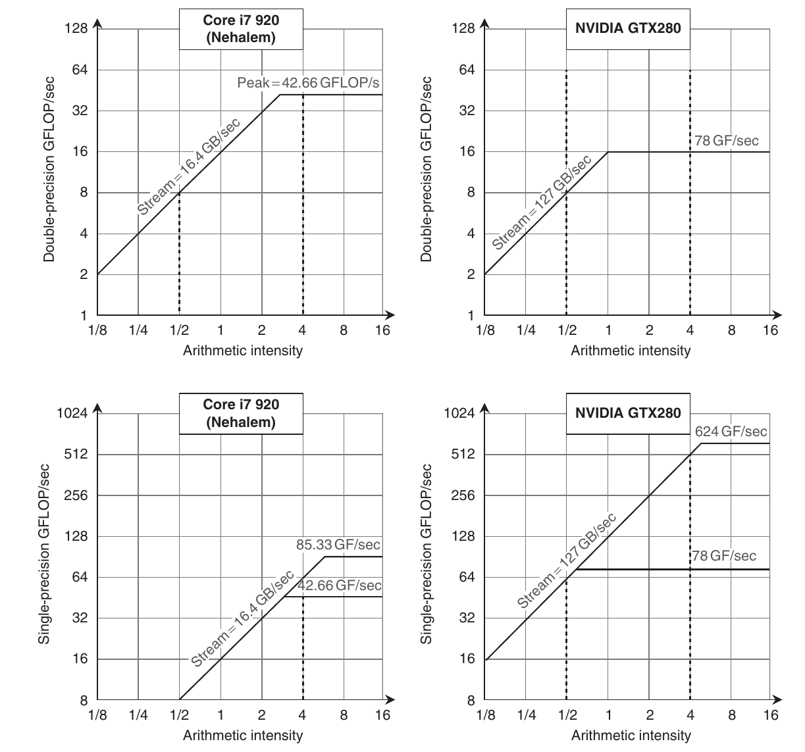

**Hình 4.28 Roofline model [Williams và cộng sự 2009]. Những roofline này cho double-precision floating-point performance ở hàng trên và single-precision performance ở hàng dưới. (Trần DP FP performance cũng có ở hàng dưới để tiện so sánh.) Core i7 920 bên trái có peak DP FP performance 42.66 GFLOP/sec, SP FP peak 85.33 GFLOP/sec và peak memory bandwidth 16.4 GBytes/sec. NVIDIA GTX 280 có DP FP peak 78 GFLOP/sec, SP FP peak 624 GFLOP/sec và memory bandwidth 127 GBytes/sec. Đường đứng nét đứt bên trái đại diện arithmetic intensity 0.5 FLOP/byte. Memory bandwidth giới hạn nó không quá 8 DP GFLOP/sec hoặc 8 SP GFLOP/sec trên Core i7. Đường đứng nét đứt bên phải có arithmetic intensity 4 FLOP/byte. Nó chỉ bị giới hạn về tính toán ở 42.66 DP GFLOP/sec và 64 SP GFLOP/sec trên Core i7, 78 DP GFLOP/sec và 512 DP GFLOP/sec trên GTX 280. Để đạt computation rate cao nhất trên Core i7, cần dùng cả 4 core và SSE instruction với số multiply và add bằng nhau. Với GTX 280, cần dùng fused multiply-add instruction trên mọi multithreaded SIMD processor. Guz và cộng sự [2009] có analytic model thú vị cho hai architecture này.**

Các nhà nghiên cứu nói rằng họ chọn benchmark program bằng cách phân tích đặc tính tính toán và memory của bốn benchmark suite được đề xuất gần đây, rồi “hình thành tập throughput computing kernel nắm bắt những đặc tính này”. Hình 4.29 mô tả 14 kernel đó, còn Hình 4.30 cho kết quả hiệu năng, với số lớn hơn nghĩa là nhanh hơn.

| Kernel | Ứng dụng | SIMD | TLP | Đặc tính |
|---|---|---|---|---|
| SGEMM (SGEMM) | Linear algebra | Đều đặn | Trên các 2D tile | Compute bound sau tiling |
| Monte Carlo (MC) | Computational finance | Đều đặn | Trên các path | Compute bound |
| Convolution (Conv) | Phân tích hình ảnh | Đều đặn | Trên các pixel | Compute bound; BW bound với filter nhỏ |
| FFT (FFT) | Xử lý tín hiệu | Đều đặn | Trên các FFT nhỏ hơn | Compute bound hoặc BW bound tùy kích thước |
| SAXPY (SAXPY) | Dot product | Đều đặn | Trên vector | BW bound với vector lớn |
| LBM (LBM) | Time migration | Đều đặn | Trên các cell | BW bound |
| Constraint solver (Solv | ) Vật lý vật rắn Gather/Scatter |  | Trên các constraint | Synchronization bound |
| SpMV (SpMV) | Sparse solver | Gather | Trên các non-zero | BW bound với ma trận lớn điển hình |
| GJK (GJK) | Phát hiện va chạm | Gather/Scatter | Trên các object | Compute bound |
| Sort (Sort) | Database | Gather/Scatter | Trên các phần tử | Compute bound |
| Ray casting (RC) | Volume rendering | Gather | Trên các ray | First level working set 4-8 MB; last level working set trên 500 MB |
| Search (Search) | Database | Gather/Scatter | Trên các query | Compute bound với tree nhỏ, BW bound tại đáy tree với tree lớn |
| Histogram (Hist) | Phân tích hình ảnh | Cần conflict detection | Trên các pixel | Reduction/synchronization bound |

**Hình 4.29 Đặc tính throughput computing kernel (theo Bảng 1 trong Lee và cộng sự [2010].) Tên trong ngoặc định danh benchmark trong phần này. Tác giả cho biết code cho hai máy được đầu tư công sức tối ưu như nhau.**

| Kernel | Đơn vị | Core i7-960 | GTX 280 | GTX 280/ i7-960 |
|---|---|---|---|---|
| SGEMM | GFLOP/sec | 94 | 364 | 3.9 |
| MC | Tỷ path/sec | 0.8 | 1.4 | 1.8 |
| Conv | Triệu pixel/sec | 1250 | 3500 | 2.8 |
| FFT | GFLOP/sec | 71.4 | 213 | 3.0 |
| SAXPY | GBytes/sec | 16.8 | 88.8 | 5.3 |
| LBM | Triệu lookup/sec | 85 | 426 | 5.0 |
| Solv | Frame/sec | 103 | 52 | 0.5 |
| SpMV | GFLOP/sec | 4.9 | 9.1 | 1.9 |
| GJK | Frame/sec | 67 | 1020 | 15.2 |
| Sort | Triệu phần tử/sec | 250 | 198 | 0.8 |
| RC | Frame/sec | 5 | 8.1 | 1.6 |
| Search | Triệu query/sec | 50 | 90 | 1.8 |
| Hist | Triệu pixel/sec | 1517 | 2583 | 1.7 |
| Bilat | Triệu pixel/sec | 83 | 475 | 5.7 |

**Hình 4.30 Raw performance và relative performance đo trên hai platform. Trong nghiên cứu này, SAXPY chỉ được dùng để đo memory bandwidth, nên đơn vị đúng là GBytes/sec, không phải GFLOP/sec. (Dựa trên Bảng 3 trong [Lee và cộng sự 2010].)**

Vì thông số raw performance GTX 280 trải từ chậm hơn 2.5× (clock rate) đến nhanh hơn 7.5× (core mỗi chip), còn performance thực từ chậm hơn 2.0× (Solv) đến nhanh hơn 15.2× (GJK), các nhà nghiên cứu Intel khảo sát lý do khác biệt:

- Memory bandwidth. GPU có memory bandwidth gấp 4.4×, giúp giải thích vì sao LBM và SAXPY chạy nhanh hơn 5.0 và 5.3×; working set của chúng có kích thước hàng trăm megabyte, nên không vừa Core i7 cache. (Để truy cập memory với cường độ cao, họ không dùng cache blocking trên SAXPY.) Vì vậy, độ dốc roofline giải thích hiệu năng của chúng. SpMV cũng có working set lớn, nhưng chỉ chạy nhanh gấp 1.9× vì double-precision floating point của GTX 280 chỉ nhanh hơn Core i7 1.5×. (Nhớ rằng double-precision của Fermi GTX 480 nhanh hơn Tesla GTX 280 4×.)

- Compute bandwidth. Năm kernel còn lại là compute bound: SGEMM, Conv, FFT, MC và Bilat. GTX nhanh hơn lần lượt 3.9, 2.8, 3.0, 1.8 và 5.7 lần. Ba kernel đầu dùng arithmetic floating-point single-precision, và single precision của GTX 280 nhanh hơn 3 đến 6×. (Mức nhanh hơn Core i7 9× trong Hình 4.27 chỉ xảy ra trong trường hợp rất đặc biệt khi GTX 280 có thể issue fused multiply-add và multiply mỗi clock cycle.) MC dùng double precision, giải thích vì sao chỉ nhanh hơn 1.8×, vì DP performance chỉ nhanh hơn 1.5×. Bilat dùng transcendental function, được GTX 280 hỗ trợ trực tiếp (xem Hình 4.17). Core i7 dành two-thirds thời gian tính transcendental function, nên GTX 280 nhanh hơn 5.7×. Quan sát này giúp chỉ ra giá trị hardware hỗ trợ operation xuất hiện trong workload: double-precision floating point và có lẽ cả transcendental.

- Lợi ích cache. Ray casting (RC) chỉ nhanh hơn 1.6× trên GTX vì cache blocking với Core i7 cache ngăn nó trở thành memory bandwidth bound như trên GPU. Cache blocking cũng giúp Search. Nếu index tree đủ nhỏ để vừa cache, Core i7 nhanh gấp đôi. Index tree lớn hơn khiến chúng trở thành memory bandwidth bound. Xét tổng thể, GTX 280 chạy Search nhanh hơn 1.8×. Cache blocking còn giúp Sort. Dù phần lớn programmer không chạy Sort trên SIMD processor, có thể viết nó bằng Sort primitive 1-bit gọi là split. Tuy nhiên, split algorithm execute nhiều instruction hơn scalar sort rất nhiều. Kết quả là GTX 280 chỉ chạy bằng 0.8× Core i7. Lưu ý cache còn giúp kernel khác trên Core i7, vì cache blocking cho phép SGEMM, FFT và SpMV trở thành compute bound. Quan sát này re-emphasizes tầm quan trọng của cache blocking optimization trong Chương 2. (Sẽ thú vị khi xem cache của Fermi GTX 480 ảnh hưởng sáu kernel được nhắc trong đoạn này thế nào.)

- Gather-Scatter. Multimedia SIMD extension ít hữu ích nếu dữ liệu rải rác khắp main memory; performance tối ưu chỉ có khi dữ liệu aligned tại ranh giới 16-byte. Vì vậy GJK ít hưởng lợi SIMD trên Core i7. Như đã nói, GPU có gather-scatter addressing trong vector architecture nhưng bị bỏ khỏi SIMD extension. Address coalescing unit cũng giúp bằng gộp access tới cùng DRAM line, giảm số gather và scatter. Memory controller còn gom access cùng DRAM page. Kết hợp này khiến GTX 280 chạy GJK nhanh hơn Core i7 tới 15.2×, lớn hơn bất kỳ physical parameter đơn lẻ nào ở Hình 4.27. Nhận xét này củng cố tầm quan trọng của gather-scatter đối với vector và GPU architecture mà SIMD extension còn thiếu.

- Synchronization. Hiệu năng synchronization bị giới hạn bởi atomic update, chiếm 28% tổng runtime trên Core i7 dù nó có hardware instruction fetch-and-increment. Vì vậy, Hist chỉ nhanh hơn 1.7× trên GTX 280. Như đã đề cập, atomic update của Fermi GTX 480 nhanh hơn Tesla GTX 280 từ 5 đến 20×, nên một lần nữa sẽ thú vị khi chạy Hist trên GPU mới hơn. Solv giải một batch constraint độc lập bằng lượng tính toán nhỏ, tiếp theo là barrier synchronization. Core i7 hưởng lợi từ atomic instruction và memory consistency model bảo đảm result đúng ngay cả khi chưa hoàn tất mọi access trước tới memory hierarchy. Không có memory consistency model, phiên bản GTX 280 khởi động một số batch từ system processor, khiến GTX 280 chỉ chạy bằng 0.5× Core i7. Quan sát này cho thấy synchronization performance có thể quan trọng đối với một số data parallel problem.

Điều nổi bật là các điểm yếu Tesla GTX 280 do kernel được nhóm Intel chọn phơi bày lại thường đã được xử lý trong architecture kế nhiệm Tesla: Fermi có double-precision floating-point performance, atomic operation và cache nhanh hơn. (Trong nghiên cứu liên quan, nhóm IBM có cùng nhận xét [Bordawekar 2010].) Cũng thú vị là hỗ trợ gather-scatter của vector architecture có trước SIMD instruction hàng thập kỷ lại rất quan trọng với hiệu quả hữu dụng của SIMD extension này, điều một số người đã dự đoán trước so sánh [Gebis và Patterson 2007]. Nhóm Intel lưu ý 6 trong 14 kernel sẽ khai thác SIMD tốt hơn nếu Core i7 hỗ trợ gather-scatter hiệu quả hơn. Nghiên cứu chắc chắn cũng xác lập tầm quan trọng cache blocking. Sẽ thú vị nếu xem thế hệ multicore và GPU hardware, compiler và library sau này đáp ứng bằng tính năng cải thiện performance kernel như vậy không.

Chúng tôi hy vọng có thêm những so sánh multicore-GPU như vậy. Lưu ý một đặc điểm quan trọng còn thiếu trong so sánh này là mô tả mức công sức để đạt result trên hai hệ thống. Lý tưởng là những so sánh tương lai công bố code dùng trên cả hai hệ thống, để người khác tái tạo cùng thí nghiệm trên hardware platform khác và có thể cải thiện result.

## 4.8 Những quan niệm sai và cạm bẫy

Dù data-level parallelism là dạng parallelism dễ nhất sau ILP theo góc nhìn lập trình viên, và có lẽ dễ nhất theo góc nhìn architect, nó vẫn có nhiều quan niệm sai và cạm bẫy.

**Quan niệm sai** GPU chịu bất lợi vì là coprocessor.

Dù tách main memory khỏi GPU memory có nhược điểm, ở cách xa CPU cũng có lợi thế.

Ví dụ, PTX tồn tại một phần do bản chất I/O device của GPU. Tầng gián tiếp này giữa compiler và hardware cho GPU architect linh hoạt hơn nhiều system processor architect. Thường khó biết trước một đổi mới architecture có được compiler, library hỗ trợ tốt và quan trọng với application hay không. Đôi khi mechanism mới chỉ hữu ích trong một hoặc hai thế hệ rồi giảm tầm quan trọng khi thế giới IT thay đổi. PTX cho phép GPU architect thử đổi mới theo cách speculative và bỏ chúng ở thế hệ sau nếu gây thất vọng hoặc không còn quan trọng, khuyến khích thử nghiệm. Với system processor, yêu cầu biện minh để đưa tính năng vào cao hơn nhiều là điều dễ hiểu — nên thử nghiệm ít hơn nhiều — vì phân phối binary machine code thường hàm ý mọi thế hệ architecture tương lai phải hỗ trợ tính năng mới.

Minh chứng cho giá trị PTX là Fermi architecture thay đổi căn bản hardware instruction set — từ memory-oriented như x86 sang register-oriented như MIPS, đồng thời tăng gấp đôi address size lên 64 bit — mà không làm gián đoạn NVIDIA software stack.

**Cạm bẫy** Tập trung vào peak performance trong vector architecture và bỏ qua start-up overhead.

Vector processor memory-memory đầu tiên như TI ASC và CDC STAR-100 có start-up time dài. Với vài bài toán vector, vector phải dài hơn 100 thì vector code mới nhanh hơn scalar code! Trên CYBER 205 — phát triển từ STAR-100 — start-up overhead cho DAXPY là 158 clock cycle, làm break-even point tăng đáng kể. Nếu clock rate Cray-1 và CYBER 205 bằng nhau, Cray-1 nhanh hơn cho tới khi vector length lớn hơn 64. Vì clock Cray-1 cũng nhanh hơn (dù 205 mới hơn), crossover point là vector length trên 100.

**Cạm bẫy** Tăng vector performance mà không tăng scalar performance tương xứng.

Mất cân bằng này là vấn đề ở nhiều vector processor đầu tiên, và là nơi Seymour Cray (architect của máy Cray) viết lại quy tắc. Nhiều vector processor đầu có scalar unit tương đối chậm (cùng start-up overhead lớn). Ngay cả hiện nay, processor vector performance thấp hơn nhưng scalar performance tốt hơn có thể vượt processor peak vector performance cao hơn. Scalar performance tốt giữ overhead thấp (ví dụ strip mining), giảm tác động định luật Amdahl.

Ví dụ hay là so sánh scalar processor nhanh với vector processor có scalar performance thấp hơn. Livermore Fortran kernel là tập 24 scientific kernel có mức vectorization khác nhau. Hình 4.31 cho performance hai processor trên benchmark này. Dù vector processor có peak performance cao hơn, scalar performance thấp khiến nó chậm hơn scalar processor nhanh khi đo bằng harmonic mean.

| Processor | Rate tối thiểu của bất kỳ loop nào (MFLOPS) | Rate tối đa của bất kỳ loop nào (MFLOPS) | Harmonic mean của cả 24 loop (MFLOPS) |
|---|---|---|---|
| MIPS M/120-5 | 0.80 | 3.89 | 1.85 |
| Stardent-1500 | 0.41 | 10.08 | 1.72 |

**Hình 4.31 Đo performance Livermore Fortran kernel trên hai processor khác nhau. Cả MIPS M/120-5 và Stardent-1500 (trước là Ardent Titan-1) đều dùng chip MIPS R2000 16.7 MHz cho CPU chính. Stardent-1500 dùng vector unit cho scalar FP, có scalar performance (đo theo minimum rate) khoảng nửa MIPS M/120-5, vốn dùng FP chip MIPS R2010. Vector processor nhanh hơn hệ số 2.5× với loop vectorizable cao (maximum rate). Tuy nhiên scalar performance thấp hơn của Stardent-1500 triệt tiêu vector performance cao hơn khi đo total performance bằng harmonic mean cả 24 loop.**

Mặt còn lại của nguy cơ này hiện nay là tăng vector performance — chẳng hạn tăng số lane — mà không tăng scalar performance. Tầm nhìn thiển cận đó là một con đường khác tới máy tính mất cân bằng.

Quan niệm sai tiếp theo có liên quan chặt chẽ tới vấn đề này.

**Quan niệm sai** Có thể đạt vector performance tốt mà không cung cấp memory bandwidth.

Như thấy qua DAXPY loop và Roofline model, memory bandwidth rất quan trọng với mọi SIMD architecture. DAXPY cần 1.5 memory reference mỗi floating-point operation, tỷ lệ điển hình cho nhiều scientific code. Dù floating-point operation không mất thời gian, Cray-1 cũng không tăng performance của vector sequence đã dùng vì bị memory limited. Performance Cray-1 trên Linpack tăng vọt khi compiler dùng blocking đổi phép tính để giữ giá trị trong vector register. Cách này giảm số memory reference mỗi FLOP và cải thiện performance gần gấp đôi! Như vậy memory bandwidth Cray-1 trở nên đủ cho loop trước đó cần bandwidth lớn hơn.

**Quan niệm sai** Trên GPU, chỉ cần thêm thread nếu không đủ memory performance.

GPU dùng nhiều CUDA thread để che latency tới main memory. Nếu memory access phân tán hoặc không tương quan giữa CUDA thread, memory system sẽ phản hồi từng request riêng lẻ ngày càng chậm. Cuối cùng, ngay cả nhiều thread cũng không che được latency. Để chiến lược “thêm CUDA thread” hiệu quả, không chỉ cần nhiều CUDA Thread, mà chính CUDA thread cũng phải có hành vi tốt về locality của memory access.

## 4.9 Nhận xét kết thúc

Data-level parallelism ngày càng quan trọng với personal mobile device, vì các application phổ biến cho thấy tầm quan trọng audio, video và game trên thiết bị này. Khi kết hợp mô hình dễ lập trình hơn task-level parallelism cùng energy efficiency có thể tốt hơn, dễ dự đoán data-level parallelism sẽ phục hưng trong thập kỷ tới. Thật vậy, đã thấy trọng tâm này trong sản phẩm: cả GPU lẫn processor truyền thống tăng SIMD lane ít nhất nhanh bằng tăng processor (xem Hình 4.1 trang 263).

Vì vậy, ta đang thấy system processor tiếp nhận thêm đặc điểm GPU và ngược lại. Một trong những khác biệt hiệu năng lớn nhất giữa processor thông thường và GPU là gather-scatter addressing. Vector architecture truyền thống cho thấy cách thêm addressing như vậy vào SIMD instruction, và chúng tôi kỳ vọng theo thời gian sẽ có thêm ý tưởng từ vector architecture well-proven được đưa vào SIMD extension.

Như đã nói ở đầu Mục 4.4, câu hỏi về GPU không chỉ là architecture nào tốt nhất, mà là với hardware đã đầu tư để làm graphics tốt, có thể cải tiến nó thế nào nhằm hỗ trợ tính toán tổng quát hơn? Dù vector architecture có nhiều ưu điểm trên giấy, vẫn cần chứng minh liệu chúng có thể làm nền tảng graphics tốt ngang GPU hay không.

GPU SIMD processor và compiler vẫn có thiết kế tương đối đơn giản. Những kỹ thuật mạnh tay hơn có thể được đưa vào theo thời gian để tăng GPU utilization, đặc biệt vì GPU computing application mới bắt đầu được phát triển. Qua nghiên cứu các program mới này, người thiết kế GPU chắc chắn sẽ phát hiện và triển khai machine optimization mới. Một câu hỏi là liệu scalar processor (hay control processor), vốn giúp tiết kiệm hardware và energy trong vector processor, có xuất hiện bên trong GPU hay không.

Fermi architecture đã có nhiều tính năng của processor thông thường để GPU phổ biến hơn, nhưng vẫn cần tính năng khác thu hẹp khoảng cách. Đây là vài điều chúng tôi dự kiến sẽ được giải quyết trong tương lai gần.

- GPU có thể virtualize. Virtualization đã chứng tỏ quan trọng với server và là nền tảng cloud computing (xem Chương 6). Để GPU được đưa vào cloud, chúng cần virtualizable như processor và memory kết nối với chúng.

- GPU memory tương đối nhỏ. Cách dùng hợp lý tính toán nhanh hơn là giải bài toán lớn hơn, và chúng thường có memory footprint lớn hơn. Bất nhất giữa tốc độ và kích thước GPU này có thể được giải quyết bằng memory capacity lớn hơn. Thách thức là giữ bandwidth cao trong khi tăng capacity.

- I/O trực tiếp tới GPU memory. Chương trình thực thực hiện I/O tới storage device lẫn frame buffer, và chương trình lớn có thể cần nhiều I/O cùng memory lớn. GPU system hiện nay phải truyền giữa I/O device và system memory, rồi giữa system memory và GPU memory. Bước nhảy thêm này giảm I/O performance đáng kể ở vài chương trình, khiến GPU kém hấp dẫn. Định luật Amdahl cảnh báo điều xảy ra nếu bỏ một phần task trong khi tăng tốc phần khác. Chúng tôi kỳ vọng GPU tương lai xem mọi I/O là first-class citizen, như với frame buffer I/O hiện nay.

- Physical memory thống nhất. Lời giải khác cho hai ý trên là có một physical memory cho system và GPU, như một số GPU rẻ làm cho PMD và laptop. AMD Fusion architecture, công bố khi ấn bản này sắp xong, là sự hợp nhất ban đầu GPU và CPU truyền thống. NVIDIA cũng công bố Project Denver kết hợp ARM scalar processor với NVIDIA GPU trong một address space. Khi hệ thống được xuất xưởng, sẽ thú vị khi biết chúng tích hợp chặt đến đâu và ảnh hưởng integration tới performance, energy của cả data parallel application và graphics application.

Sau khi đã trình bày nhiều phiên bản SIMD, chương tiếp theo sẽ đi sâu vào lĩnh vực MIMD.

## 4.10 Góc nhìn lịch sử và tài liệu tham khảo

Mục L.6 (có trực tuyến) thảo luận Illiac IV (đại diện cho SIMD architecture thời kỳ đầu) và Cray-1 (đại diện cho vector architecture). Ta còn xem xét multimedia SIMD extension cùng lịch sử GPU.

## Nghiên cứu trường hợp và bài tập của Jason D. Bakos

### Nghiên cứu trường hợp: Triển khai Vector Kernel trên Vector Processor và GPU

#### Khái niệm được minh họa qua nghiên cứu trường hợp này

- Lập trình Vector Processor

- Lập trình GPU

- Ước tính Performance

MrBayes là computational biology application phổ biến và well-known để suy luận lịch sử tiến hóa của tập loài input, dựa trên data chuỗi DNA multiply-aligned có độ dài n. MrBayes thực hiện heuristic search trên không gian mọi binary tree topology có input làm leaf. Để đánh giá một tree cụ thể, application phải tính conditional likelihood table n × 4 (tên clP) cho mỗi interior node. Bảng này là function của conditional likelihood table tại hai descendent node của node đó (clL và clR, single precision floating point) cùng transition probability table n × 4 × 4 liên quan (tiPL và tiPR, single precision floating point). Một kernel của application tính conditional likelihood table này, như thể hiện bên dưới:

```
for (k=0; k<seq_length; k++) {
   clP[h++] = (tiPL[AA]*clL[A] + tiPL[AC]*clL[C] + tiPL[AG]*clL[G] + tiPL[AT]*clL[T])
   *(tiPR[AA]*clR[A] + tiPR[AC]*clR[C] + tiPR[AG]*clR[G] + tiPR[AT]*clR[T]);
   clP[h++] = (tiPL[CA]*clL[A] + tiPL[CC]*clL[C] + tiPL[CG]*clL[G] + tiPL[CT]*clL[T])
   *(tiPR[CA]*clR[A] + tiPR[CC]*clR[C] + tiPR[CG]*clR[G] + tiPR[CT]*clR[T]);
   clP[h++] = (tiPL[GA]*clL[A] + tiPL[GC]*clL[C] + tiPL[GG]*clL[G] + tiPL[GT]*clL[T])
   *(tiPR[GA]*clR[A] + tiPR[GC]*clR[C] + tiPR[GG]*clR[G] + tiPR[GT]*clR[T]);
   clP[h++] = (tiPL[TA]*clL[A] + tiPL[TC]*clL[C] + tiPL[TG]*clL[G] + tiPL[TT]*clL[T])
   *(tiPR[TA]*clR[A] + tiPR[TC]*clR[C] + tiPR[TG]*clR[G] + tiPR[TT]*clR[T]);
   clL += 4;
   clR += 4;
   tiPL += 16;
   tiPR += 16;
}
```

| Hằng số | Giá trị |
|---|---|
| AA,AC,AG,AT | 0,1,2,3 |
| CA,CC,CG,CT | 4,5,6,7 |
| GA,GC,GG,GT | 8,9,10,11 |
| TA,TC,TG,TT | 12,13,14,15 |
| A,C,G,T | 0,1,2,3 |

**Hình 4.32 Hằng số và giá trị cho nghiên cứu trường hợp.**

**4.1** [25] <4.2, 4.3> Giả sử có các hằng số trong Hình 4.32. Hãy viết code MIPS và VMIPS. Giả sử không thể dùng scatter-gather load hoặc store. Giả sử starting address của tiPL, tiPR, clL, clR và clP lần lượt nằm trong RtiPL, RtiPR, RclL, RclR và RclP. Giả sử chiều dài VMIPS register có thể được user lập trình và gán bằng cách đặt special register VL (ví dụ li VL 4). Để hỗ trợ vector addition reduction, giả sử ta thêm instruction sau vào VMIPS:

```
SUMR.S Fd, Vs Vector Summation Reduction Single Precision:
```

Instruction này thực hiện summation reduction trên vector register Vs, ghi tổng vào scalar register Fd.

**4.2** [5] <4.2, 4.3> Giả sử seq_length == 500, dynamic instruction count của cả hai implementation là bao nhiêu?

**4.3** [25] <4.2, 4.3> Giả sử vector reduction instruction được thực thi trên vector functional unit, tương tự vector add instruction. Hãy trình bày cách code sequence được xếp vào convoy với giả định mỗi vector functional unit chỉ có một instance. Code cần bao nhiêu chime? Cần bao nhiêu cycle mỗi FLOP khi bỏ qua vector instruction issue overhead?

**4.4** [15] <4.2, 4.3> Giờ giả sử dùng được scatter-gather load và store (LVI và SVI). Giả sử tiPL, tiPR, clL, clR, clP nằm liên tiếp trong memory. Ví dụ nếu seq_length==500, array tiPR bắt đầu 500 * 4 byte sau array tiPL. Điều này ảnh hưởng tới cách viết VMIPS code cho kernel thế nào? Giả sử có thể khởi tạo vector register bằng số nguyên theo kỹ thuật sau, ví dụ khởi tạo V1 bằng (0,0,2000,2000):

```
LI R2,0
SW R2,vec
SW R2,vec+4
LI R2,2000
SW R2,vec+8
SW R2,vec+12
LV V1,vec
```

Giả sử maximum vector length bằng 64. Có cách nào cải thiện performance bằng gather-scatter load không? Nếu có, cải thiện bao nhiêu?

**4.5** [25] <4.4> Giờ giả sử chúng ta muốn triển khai MrBayes kernel trên GPU bằng một thread block. Viết lại kernel code C bằng CUDA. Giả sử các pointer tới conditional likelihood table và transition probability table là parameter của kernel. Hãy khởi phát một thread cho mỗi iteration của vòng lặp. Hãy load mọi giá trị được dùng lại vào shared memory trước khi thực hiện operation trên đó.

**4.6** [15] <4.4> Với CUDA có thể dùng parallelism coarse-grain tại block level để tính conditional likelihood của nhiều node song song. Giả sử chúng ta muốn tính conditional likelihood từ đáy tree lên. Giả sử array conditional likelihood và transition probability được tổ chức trong memory như câu 4, và nhóm bảng cho từng node trong 12 leaf node cũng lưu tại các vị trí memory liên tiếp theo thứ tự node number. Giả sử chúng ta muốn tính conditional likelihood cho node 12 đến 17 như Hình 4.33. Hãy thay đổi cách tính array index trong lời giải Bài 4.5 để bao gồm block number.

**4.7** [15] <4.4> Chuyển code từ Bài 4.6 sang PTX code. Kernel cần bao nhiêu instruction?

**4.8** [10] <4.4> Bạn dự kiến code này hoạt động tốt đến đâu trên GPU? Hãy giải thích câu trả lời của bạn.

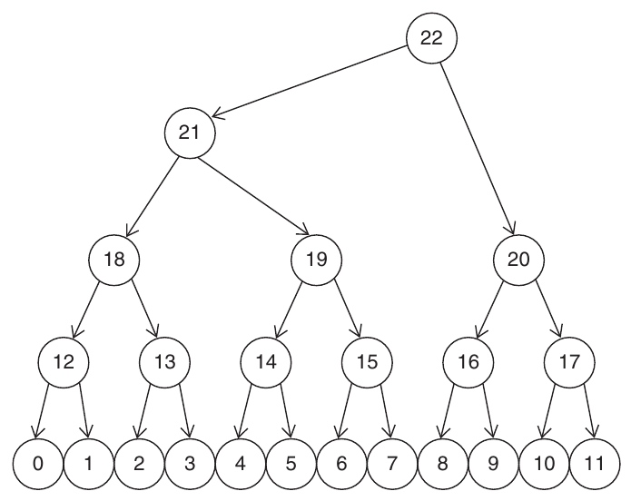

**Hình 4.33 Tree mẫu.**

### Bài tập

**4.9** [10/20/20/15/15] <4.2> Xét code sau, nhân hai vector chứa single-precision complex value:

```
for (i=0;i<300;i++) {
        c_re[i] = a_re[i] * b_re[i] – a_im[i] * b_im[i];
        c_im[i] = a_re[i] * b_im[i] + a_im[i] * b_re[i];
}
```

Giả sử processor chạy ở 700 MHz và có maximum vector length 64. Load/store unit có start-up overhead 15 cycle; multiply unit có overhead 8 cycle; add/subtract unit có overhead 5 cycle.

a. [10] <4.2> Arithmetic intensity của kernel là bao nhiêu? Hãy giải thích cơ sở câu trả lời.

b. [20] <4.2> Chuyển vòng lặp thành VMIPS assembly code dùng strip mining.

c. [20] <4.2> Giả sử có chaining và một memory pipeline, cần bao nhiêu chime? Cần bao nhiêu clock cycle mỗi complex result value, tính cả start-up overhead?

d. [15] <4.2> Nếu vector sequence được chained, cần bao nhiêu clock cycle mỗi complex result value, tính cả overhead?

e. [15] <4.2> Giờ giả sử processor có ba memory pipeline và chaining. Nếu không có bank conflict trong access của loop, cần bao nhiêu clock cycle mỗi result?

**4.10** [30] <4.4> Trong bài này, ta so sánh performance vector processor với hybrid system gồm scalar processor và GPU-based coprocessor. Trong hybrid system, host processor có scalar performance vượt GPU, nên mọi scalar code chạy trên host processor, mọi vector code chạy trên GPU. Gọi hệ thống đầu là vector computer, hệ thống sau là hybrid computer. Giả sử target application có vector kernel với arithmetic intensity 0.5 FLOP mỗi DRAM byte truy cập; tuy nhiên application cũng có scalar component phải thực hiện trước và sau kernel để lần lượt chuẩn bị input vector và output vector. Với dataset mẫu, scalar code cần execution time 400 ms trên cả vector processor và host processor trong hybrid system. Kernel đọc input vector 200 MB dữ liệu, có output data 100 MB. Vector processor có peak memory bandwidth 30 GB/sec, GPU có peak memory bandwidth 150 GB/sec. Hybrid system có thêm overhead đòi hỏi truyền mọi input vector giữa host memory và GPU local memory trước và sau khi gọi kernel. Hybrid system có direct memory access (DMA) bandwidth 10 GB/sec, average latency 10 ms. Giả sử cả vector processor và GPU đều bị giới hạn performance bởi memory bandwidth. Tính execution time hai máy cần cho ứng dụng này.

**4.11** [15/25/25] <4.4, 4.5> Mục 4.5 đã thảo luận reduction operation, biến vector thành scalar bằng cách áp dụng lặp lại một operation. Reduction là một loại loop recurrence đặc biệt. Ví dụ được thể hiện bên dưới:

```
dot=0.0;
for (i=0;i<64;i++) dot = dot + a[i] * b[i];
```

Vectorizing compiler có thể áp dụng phép biến đổi gọi là scalar expansion, mở rộng dot thành vector và tách loop sao cho multiply được thực hiện bằng vector operation, còn reduction là scalar operation riêng:

```
for (i=0;i<64;i++) dot[i] = a[i] * b[i];
for (i=1;i<64;i++) dot[0] = dot[0] + dot[i];
```

Như đề cập trong Mục 4.5, nếu cho phép phép cộng floating-point có tính associative, có một số kỹ thuật để parallelize reduction.

a. [15] <4.4, 4.5> Một kỹ thuật gọi recurrence doubling, cộng chuỗi vector ngắn dần (tức hai vector 32-element, rồi hai vector 16-element, v.v.). Hãy trình bày code C để thực thi vòng lặp thứ hai theo cách này.

b. [25] <4.4, 4.5> Trong một số vector processor, từng phần tử vector register có thể được định địa chỉ. Khi đó operand của vector operation có thể là hai phần khác nhau của cùng vector register. Điều này cho lời giải reduction khác gọi partial sums. Ý tưởng là giảm vector xuống m tổng, m là tổng latency qua vector functional unit, gồm operand read và write time. Giả sử VMIPS vector register có thể được định địa chỉ (ví dụ bắt đầu vector operation với operand V1(16), chỉ input operand bắt đầu tại phần tử 16). Cũng giả sử tổng latency cho add, gồm operand read và result write, là tám cycle. Viết VMIPS code sequence giảm nội dung V1 thành tám partial sum.

c. [25] <4.4, 4.5> Khi thực hiện reduction trên GPU, mỗi phần tử input vector gắn với một thread. Ở bước đầu tiên, mỗi thread ghi giá trị tương ứng vào shared memory. Sau đó, mỗi thread đi vào một loop cộng từng cặp input value. Số phần tử giảm một nửa sau mỗi iteration, nghĩa là số active thread cũng giảm một nửa mỗi iteration. Để tối đa hóa reduction performance, cần tối đa số warp đủ thread trong suốt loop. Nói cách khác, các active thread nên nằm liên tiếp. Ngoài ra mỗi thread nên index shared array sao cho tránh bank conflict trong shared memory. Vòng lặp sau chỉ vi phạm hướng dẫn đầu tiên, đồng thời dùng modulo operator rất đắt trên GPU:

```
unsigned int tid = threadIdx.x;
 for(unsigned int s=1; s < blockDim.x; s *= 2) {
 if ((tid % (2*s)) == 0) {
 sdata[tid] += sdata[tid + s];
 }
 __syncthreads();
 }
```

Hãy viết lại loop để đáp ứng các hướng dẫn trên và loại bỏ việc sử dụng modulo operator. Giả sử mỗi warp có 32 thread, bank conflict xảy ra khi hai hoặc nhiều thread cùng warp tham chiếu index có cùng phần dư khi modulo 32.

**4.12** [10/10/10/10] <4.3> Kernel sau thực hiện một phần phương pháp finite-difference time-domain (FDTD) để tính phương trình Maxwell trong không gian three-dimensional, thuộc một benchmark SPEC06fp:

```
for (int x=0; x<NX-1; x++) {
 for (int y=0; y<NY-1; y++) {
 for (int z=0; z<NZ-1; z++) {
 int index = x*NY*NZ + y*NZ + z;
 if (y>0 && x >0) {
 material = IDx[index];
 dH1 = (Hz[index] – Hz[index-incrementY])/dy[y];
 dH2 = (Hy[index] – Hy[index-incrementZ])/dz[z];
 Ex[index] = Ca[material]*Ex[index]+Cb[material]*(dH2-dH1);
}}}}
```

Giả sử dH1, dH2, Hy, Hz, dy, dz, Ca, Cb, Ex đều là array single-precision floating-point. Giả sử IDx là array unsigned int.

a. [10] <4.3> Arithmetic intensity của kernel là bao nhiêu?

b. [10] <4.3> Kernel này có phù hợp với vector execution hoặc SIMD execution không? Vì sao có hoặc không?

c. [10] <4.3> Giả sử kernel này sẽ execute trên processor có memory bandwidth 30 GB/sec. Kernel này sẽ bị memory bound hay compute bound?

d. [10] <4.3> Hãy xây dựng roofline model cho processor này, giả sử nó có peak computational throughput 85 GFLOP/sec.

**4.13** [10/15] <4.4> Giả sử GPU architecture có 10 SIMD processor. Mỗi SIMD instruction có độ rộng 32 và mỗi SIMD processor chứa 8 lane cho arithmetic single-precision cùng load/store instruction, nghĩa là mỗi SIMD instruction non-diverged tạo được 32 result mỗi 4 cycle. Giả sử kernel có divergent branch khiến trung bình 80% thread active. Giả sử 70% mọi SIMD instruction được execute là arithmetic single-precision và 20% là load/store. Vì không phải mọi memory latency đều được che, giả sử average SIMD instruction issue rate là 0.85. Giả sử GPU có clock speed 1.5 GHz.

a. [10] <4.4> Tính throughput theo GFLOP/sec của kernel này trên GPU này.

b. [15] <4.4> Giả sử bạn có các lựa chọn sau:

(1) Tăng số lane single-precision lên 16

(2) Tăng số SIMD processor lên 15 (giả sử thay đổi này không ảnh hưởng performance metric khác và code scale được tới các processor bổ sung)

(3) Thêm cache giúp giảm memory latency hiệu dụng 40%, làm instruction issue rate tăng lên 0.95. Speedup về throughput của mỗi cải tiến này là bao nhiêu?

**4.14** [10/15/15] <4.5> Trong bài này, chúng ta khảo sát một số loop và phân tích tiềm năng parallelization.

a. [10] <4.5> Vòng lặp sau có loop-carried dependency không?

```
for (i=0;i<100;i++) {
 A[i] = B[2*i+4];
 B[4*i+5] = A[i];
 }
```

b. [15] <4.5> Trong loop sau, hãy tìm mọi true dependence, output dependence và antidependence. Loại bỏ output dependence và antidependence bằng renaming.

```
for (i=0;i<100;i++) {
 A[i] = A[i] * B[i]; /* S1 */
 B[i] = A[i] + c; /* S2 */
 A[i] = C[i] * c; /* S3 */
 C[i] = D[i] * A[i]; /* S4 */
```

c. [15] <4.5> Xét vòng lặp sau:

```
for (i=0;i < 100;i++) {
 A[i] = A[i] + B[i]; /* S1 */
 B[i+1] = C[i] + D[i]; /* S2 */
}
```

Có dependence giữa S1 và S2 không? Loop này có song song không? Nếu không, hãy chỉ cách làm nó song song.

**4.15** [10] <4.4> Liệt kê và mô tả ít nhất bốn yếu tố ảnh hưởng hiệu năng GPU kernel. Nói cách khác, những hành vi runtime nào do kernel code gây ra làm giảm resource utilization trong kernel execution?

**4.16** [10] <4.4> Giả sử một GPU giả định có các đặc tính sau:

- Clock rate 1.5 GHz

- Chứa 16 SIMD processor, mỗi processor có 16 single-precision floating-point unit

- Có memory bandwidth off-chip 100 GB/sec

Không xét memory bandwidth, peak single-precision floating-point throughput của GPU này theo GLFOP/sec là bao nhiêu nếu mọi memory latency có thể che giấu? Có thể duy trì throughput này khi bị giới hạn bởi memory bandwidth không?

**4.17** [60] <4.4> Trong bài tập lập trình này, bạn sẽ viết và mô tả hành vi CUDA kernel có nhiều data-level parallelism nhưng cũng có conditional execution. Dùng NVIDIA CUDA Toolkit cùng GPU-SIM từ University of British Columbia (http://www.ece.ubc.ca/~aamodt/gpgpu-sim/) hoặc CUDA Profiler để viết và compile CUDA kernel thực hiện 100 vòng lặp Conway’s Game of Life cho game board 256 × 256 rồi trả final state của game board về host. Giả sử board được host khởi tạo. Gắn một thread với mỗi cell. Bảo đảm thêm barrier sau mỗi vòng lặp game. Dùng các quy tắc game sau:

- Bất kỳ cell sống có ít hơn hai hàng xóm sống đều chết.

- Bất kỳ cell sống có hai hoặc ba hàng xóm sống đều sống tiếp tới thế hệ sau.

- Bất kỳ cell sống có nhiều hơn ba hàng xóm sống đều chết.

- Bất kỳ cell chết có đúng ba hàng xóm sống đều thành cell sống.

Sau khi hoàn tất kernel, hãy trả lời các câu hỏi sau:

a. [60] <4.4> Compile code bằng option –ptx và kiểm tra PTX representation của kernel. Có bao nhiêu PTX instruction tạo thành PTX implementation của kernel? Các phần conditional của kernel có branch instruction hay chỉ có predicated instruction non-branch?

b. [60] <4.4> Sau khi execute code trong simulator, dynamic instruction count là bao nhiêu? Instructions per cycle (IPC) hoặc instruction issue rate đạt được là bao nhiêu? Dynamic instruction được phân chia theo control instruction, instruction arithmetic-logical unit (ALU) và memory instruction thế nào? Có shared memory bank conflict nào không? Effective memory bandwidth off-chip là bao nhiêu?

c. [60] <4.4> Triển khai phiên bản kernel cải tiến trong đó memory reference off-chip được coalesced, rồi quan sát những khác biệt về runtime performance.

---

[^1]: Chương này dựa trên tài liệu Phụ lục F, “Vector Processors”, của Krste Asanovic, và Phụ lục G, “Hardware and Software for VLIW and EPIC” từ ấn bản 4th của sách; tài liệu Phụ lục A, “Graphics and Com- puting GPUs”, của John Nickolls và David Kirk, từ ấn bản 4th của Computer Organization and Design; ở mức ít hơn, tài liệu “Embracing and Extending 20th-Century Instruction Set Architectures” của Joe Gebis và David Patterson, IEEE Computer, tháng Tư năm 2007.
