# 5 Thread-Level Parallelism

> Việc rời bỏ tổ chức thông thường bắt đầu vào giữa thập niên 1960, khi quy luật lợi ích giảm dần bắt đầu tác động tới nỗ lực tăng tốc độ hoạt động máy tính. . . . Tốc độ hoạt động của mạch điện tử rốt cuộc bị giới hạn bởi tốc độ ánh sáng . . . và nhiều mạch đã hoạt động trong khoảng nanosecond.

> W. Jack Bouknight et al.

> The Illiac IV System (1972)

> Chúng tôi dành toàn bộ hoạt động phát triển sản phẩm tương lai cho thiết kế multicore. Chúng tôi tin đây là bước ngoặt then chốt của ngành.

> Chủ tịch Intel Paul Otellini,

> mô tả định hướng tương lai của Intel tại Intel Developer Forum năm 2005

## 5.1 Giới thiệu

Như các lời trích dẫn mở đầu chương cho thấy, một số nhà nghiên cứu từ lâu đã cho rằng những tiến bộ trong uniprocessor architecture đang gần đến hồi kết. Rõ ràng, những quan điểm ấy xuất hiện quá sớm; trên thực tế, trong giai đoạn 1986–2003, mức tăng uniprocessor performance, được thúc đẩy bởi microprocessor, đạt tốc độ cao nhất kể từ những computer dùng transistor đầu tiên vào cuối những năm 1950s và đầu những năm 1960s.

Tuy vậy, tầm quan trọng của multiprocessor liên tục tăng trong suốt những năm 1990s, khi các nhà thiết kế tìm cách xây dựng server và supercomputer có performance cao hơn một microprocessor đơn lẻ, đồng thời tận dụng lợi thế cost-performance rất lớn của commodity microprocessor. Như đã thảo luận trong Chương 1 và 3, sự chậm lại của uniprocessor performance do lợi ích giảm dần khi khai thác instruction-level parallelism (ILP), kết hợp với mối quan tâm ngày càng lớn về power, đang dẫn đến một kỷ nguyên mới trong computer architecture—kỷ nguyên mà multiprocessor đóng vai trò chủ yếu từ phân khúc thấp đến phân khúc cao. Lời trích dẫn thứ hai nắm bắt rõ bước ngoặt này.

Tầm quan trọng ngày càng tăng của multiprocessing phản ánh một số yếu tố chính:

- Hiệu quả sử dụng silicon và năng lượng giảm mạnh trong giai đoạn 2000 đến 2005, khi các nhà thiết kế cố tìm kiếm và khai thác thêm ILP; cách làm này hóa ra không hiệu quả, bởi chi phí power và silicon tăng nhanh hơn performance. Ngoài ILP, cách general-purpose duy nhất mà chúng ta biết vừa có khả năng mở rộng vừa tăng performance nhanh hơn mức basic technology cho phép (xét từ góc độ switching) là multiprocessing.

- Sự quan tâm ngày càng lớn tới server high-end khi cloud computing và software-asa-service trở nên quan trọng hơn.

- Sự phát triển của ứng dụng data-intensive do lượng dữ liệu khổng lồ sẵn có trên Internet thúc đẩy.

- Nhận định rằng tăng performance desktop ít quan trọng hơn (ít nhất ngoài graphics), vì performance hiện tại đã chấp nhận được hoặc ứng dụng compute- và data-intensive cao đang được thực hiện trên cloud.

- Hiểu biết được cải thiện về cách sử dụng multiprocessor hiệu quả, đặc biệt trong môi trường server, nơi có natural parallelism đáng kể bắt nguồn từ dataset lớn, natural parallelism (xuất hiện trong scientific code), hoặc parallelism giữa rất nhiều request độc lập (request-level parallelism).

- Lợi thế của việc tận dụng khoản đầu tư thiết kế bằng cách nhân bản thay vì thiết kế riêng; mọi thiết kế multiprocessor đều mang lại khả năng tận dụng này.

Trong chương này, chúng ta tập trung khai thác thread-level parallelism (TLP). TLP hàm ý sự tồn tại của nhiều program counter và vì vậy chủ yếu được khai thác thông qua MIMD. Mặc dù MIMD đã tồn tại hàng chục năm, việc thread-level parallelism vươn lên vị trí hàng đầu trên toàn bộ dải ứng dụng computing, từ embedded application đến server high-end, là tương đối gần đây. Tương tự, việc sử dụng rộng rãi thread-level parallelism cho general-purpose application, thay vì scientific application, cũng tương đối mới.

Trọng tâm của chương này là multiprocessor, được chúng ta định nghĩa là computer gồm các processor liên kết chặt chẽ, thường có việc phối hợp và sử dụng do một operating system duy nhất điều khiển, và chia sẻ memory thông qua shared address space. Những system như vậy khai thác thread-level parallelism qua hai software model khác nhau. Model thứ nhất là thực thi một tập thread liên kết chặt chẽ cùng cộng tác trên một task, thường được gọi là parallel processing. Model thứ hai là thực thi nhiều process tương đối độc lập có thể bắt nguồn từ một hoặc nhiều người dùng; đây là một dạng request-level parallelism, dù ở quy mô nhỏ hơn nhiều so với những gì chúng ta tìm hiểu trong chương tiếp theo. Request-level parallelism có thể được khai thác bởi một ứng dụng duy nhất chạy trên nhiều processor, chẳng hạn database đáp ứng query, hoặc bởi nhiều ứng dụng chạy độc lập, thường được gọi là multiprogramming.

Những multiprocessor được xem xét trong chương này thường có quy mô từ hai processor đến hàng chục processor, và giao tiếp cũng như phối hợp thông qua việc chia sẻ memory. Mặc dù chia sẻ qua memory hàm ý một shared address space, điều đó không nhất thiết có nghĩa là chỉ có một physical memory. Các multiprocessor này bao gồm cả system single-chip có nhiều core, được gọi là multicore, lẫn computer gồm nhiều chip, trong đó mỗi chip có thể là một thiết kế multicore.

Ngoài multiprocessor thực sự, chúng ta sẽ quay lại chủ đề multithreading, một kỹ thuật hỗ trợ nhiều thread thực thi xen kẽ trên một multiple issue processor duy nhất. Nhiều multicore processor cũng hỗ trợ multithreading.

Trong chương tiếp theo, chúng ta xem xét các computer ultrascale được xây dựng từ số lượng processor rất lớn, kết nối bằng networking technology và thường được gọi là cluster; những system large-scale này thường được sử dụng cho cloud computing với một model giả định có số lượng request độc lập khổng lồ hoặc các compute task chuyên sâu có mức song song cao. Khi các cluster này phát triển đến hàng chục nghìn server hoặc hơn nữa, chúng ta gọi chúng là warehouse-scale computer.

Ngoài các multiprocessor được nghiên cứu ở đây và các system warehouse-scaled trong chương tiếp theo, còn có nhiều system multiprocessor large-scale đặc biệt, đôi khi được gọi là multicomputer, có mức liên kết lỏng hơn các multiprocessor trong chương này nhưng chặt hơn các system warehouse-scale của chương tiếp theo. Công dụng chủ yếu của những multicomputer như vậy là scientific computation high-end. Nhiều sách khác, chẳng hạn Culler, Singh và Gupta [1999], trình bày chi tiết các system ấy. Vì lĩnh vực multiprocessing rộng lớn và liên tục thay đổi (tài liệu Culler và cộng sự just-mentioned dài hơn 1000 trang và chỉ thảo luận multiprocessing!), chúng ta chọn tập trung vào những phần mà mình tin là quan trọng nhất và general-purpose nhất trong không gian computing. Phụ lục I thảo luận một số vấn đề phát sinh khi xây dựng những computer như vậy trong bối cảnh các ứng dụng khoa học large-scale.

Vì vậy, chúng ta tập trung vào multiprocessor có số processor từ nhỏ đến vừa (2 đến 32). Những thiết kế này chiếm ưu thế áp đảo cả về số lượng sản phẩm lẫn doanh thu. Chúng ta chỉ dành sự chú ý hạn chế cho không gian thiết kế multiprocessor larger-scale (33 processor trở lên), chủ yếu trong Phụ lục I, nơi trình bày thêm các khía cạnh thiết kế của những processor đó cũng như hành vi performance của parallel scientific workload, một nhóm ứng dụng chủ yếu cho multiprocessor large-scale. Trong multiprocessor large-scale, interconnection network là một phần then chốt của thiết kế; Phụ lục F tập trung vào chủ đề này.

### Multiprocessor Architecture: Vấn đề và cách tiếp cận

Để tận dụng một MIMD multiprocessor có n processor, thông thường chúng ta phải có ít nhất n thread hoặc process để thực thi. Các thread độc lập trong một process thường được programmer xác định hoặc được operating system tạo ra (từ nhiều request độc lập). Ở thái cực khác, một thread có thể gồm vài chục iteration của một loop, được tạo bởi parallel compiler khai thác data parallelism trong loop. Mặc dù lượng computation được gán cho một thread, được gọi là grain size, đóng vai trò quan trọng khi cân nhắc cách khai thác thread-level parallelism hiệu quả, khác biệt định tính quan trọng so với instruction-level parallelism là thread-level parallelism được software system hoặc programmer xác định ở mức cao, và các thread gồm hàng trăm đến hàng triệu instruction có thể được thực thi song song.

Thread cũng có thể được dùng để khai thác data-level parallelism, mặc dù overhead có thể cao hơn so với SIMD processor hoặc GPU (xem Chương 4). Overhead này có nghĩa là grain size phải đủ lớn để khai thác parallelism hiệu quả. Chẳng hạn, mặc dù vector processor hoặc GPU có thể song song hóa hiệu quả các operation trên vector ngắn, grain size thu được khi chia parallelism cho nhiều thread có thể nhỏ đến mức overhead khiến việc khai thác parallelism trên MIMD trở nên quá tốn kém.

Các shared-memory multiprocessor hiện có thuộc hai nhóm, phụ thuộc vào số processor tham gia; số lượng này lại quyết định cách tổ chức memory và chiến lược interconnect. Chúng ta gọi multiprocessor theo cách tổ chức memory, bởi số processor được xem là nhỏ hay lớn có thể thay đổi theo thời gian.

Nhóm thứ nhất, được chúng ta gọi là symmetric (shared-memory) multiprocessor (SMP), hay centralized shared-memory multiprocessor, có số core nhỏ, thường là tám hoặc ít hơn. Với multiprocessor có số processor nhỏ như vậy, các processor có thể dùng chung một centralized memory duy nhất mà mọi processor đều truy cập ngang nhau, do đó có thuật ngữ symmetric. Trong multicore chip, memory thực chất được chia sẻ theo cách tập trung giữa các core, và tất cả multicore hiện có đều là SMP. Khi kết nối nhiều hơn một multicore, mỗi multicore có memory riêng, vì thế memory trở thành distributed thay vì centralized.

SMP architecture đôi khi còn được gọi là uniform memory access (UMA) multiprocessor, bắt nguồn từ việc tất cả processor đều có cùng latency tới memory, ngay cả khi memory được tổ chức thành nhiều bank. Hình 5.1 cho thấy các multiprocessor này có dạng như thế nào. Architecture của SMP là chủ đề của Mục 5.2, và chúng ta giải thích cách tiếp cận này trong bối cảnh multicore.

Cách thiết kế thay thế là multiprocessor có memory phân bố vật lý, được gọi là distributed shared memory (DSM). Hình 5.2 cho thấy các multiprocessor này có dạng như thế nào. Để hỗ trợ số processor lớn hơn, memory phải được phân bố giữa các processor thay vì tập trung; nếu không, memory system sẽ không thể đáp ứng bandwidth demand của số processor lớn hơn mà không gây access latency quá dài. Với sự tăng nhanh của processor performance và mức tăng tương ứng về yêu cầu memory bandwidth của processor, quy mô multiprocessor mà tại đó distributed memory trở thành lựa chọn ưu tiên tiếp tục giảm. Sự xuất hiện của multicore processor có nghĩa là ngay cả multiprocessor two-chip cũng sử dụng distributed memory. Số processor lớn hơn còn làm tăng nhu cầu về high-bandwidth interconnect, mà chúng ta sẽ xem các ví dụ trong Phụ lục F. Cả directed network (tức switch) lẫn indirect network (thường là multidimensional mesh) đều được sử dụng.

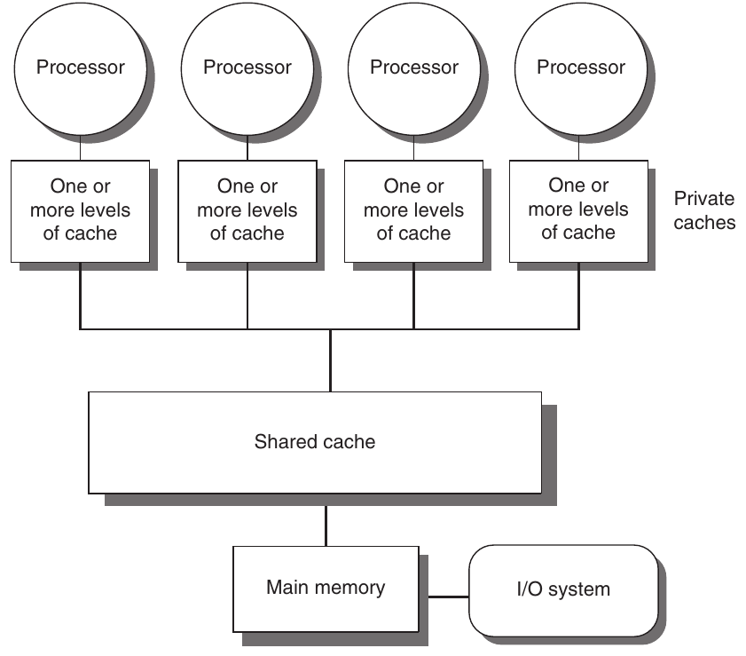

**Hình 5.1 Cấu trúc cơ bản của một centralized shared-memory multiprocessor dựa trên multicore chip. Nhiều processor–cache subsystem dùng chung physical memory, thường có một level shared cache và một hoặc nhiều level private per-core cache. Đặc tính architecture then chốt là access time tới toàn bộ memory đều đồng nhất từ mọi processor. Trong phiên bản multichip, shared cache sẽ được lược bỏ, và bus hoặc interconnection network kết nối processor với memory sẽ chạy giữa các chip thay vì bên trong một chip duy nhất.**

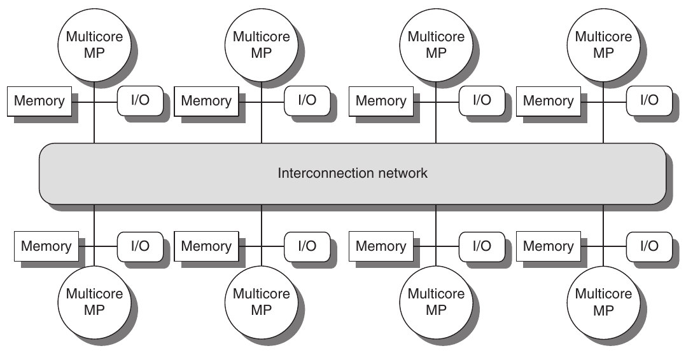

**Hình 5.2 Architecture cơ bản của một distributed-memory multiprocessor vào năm 2011 thường gồm một multicore multiprocessor chip có memory và có thể cả I/O gắn kèm, cùng một interface tới interconnection network kết nối tất cả node. Mỗi processor core chia sẻ toàn bộ memory, mặc dù access time tới lock memory gắn với chip của core sẽ nhanh hơn nhiều so với access time tới remote memory.**

Phân bố memory giữa các node vừa làm tăng bandwidth vừa giảm latency tới local memory. Một DSM multiprocessor còn được gọi là NUMA (nonuniform memory access), bởi access time phụ thuộc vào vị trí của data word trong memory. Các nhược điểm chính của DSM là việc truyền dữ liệu giữa các processor trở nên phức tạp hơn đôi chút, và DSM đòi hỏi software phải nỗ lực nhiều hơn để tận dụng memory bandwidth tăng thêm nhờ distributed memory. Vì tất cả multiprocessor multicore-based có nhiều hơn một processor chip (hoặc socket) đều sử dụng distributed memory, chúng ta sẽ giải thích hoạt động của distributed memory multiprocessor từ góc nhìn này.

Trong cả SMP lẫn DSM architecture, communication giữa các thread diễn ra qua một shared address space; điều đó có nghĩa là bất kỳ processor nào cũng có thể thực hiện memory reference tới bất kỳ memory location nào, với giả định có access right phù hợp. Thuật ngữ shared memory gắn với cả SMP và DSM nói đến việc address space được chia sẻ.

Ngược lại, các cluster và warehouse-scale computer của chương tiếp theo giống những computer riêng lẻ được kết nối bằng network, và memory của một processor không thể được processor khác truy cập nếu không có sự hỗ trợ của software protocol chạy trên cả hai processor. Trong những thiết kế như vậy, message-passing protocol được dùng để truyền dữ liệu giữa các processor.

### Thách thức của Parallel Processing

Ứng dụng của multiprocessor trải rộng từ chạy các task độc lập gần như không communication đến chạy parallel program trong đó các thread phải communication để hoàn thành task. Hai trở ngại quan trọng, đều có thể giải thích bằng Amdahl’s law, khiến parallel processing trở nên khó khăn. Mức độ khó hay dễ của các trở ngại này do cả ứng dụng lẫn architecture quyết định.

Trở ngại thứ nhất liên quan đến parallelism hạn chế có sẵn trong chương trình, còn trở ngại thứ hai xuất phát từ chi phí communication tương đối cao. Những giới hạn về parallelism có sẵn khiến việc đạt speedup tốt trên bất kỳ parallel processor nào cũng khó khăn, như ví dụ đầu tiên cho thấy.

**Ví dụ** Giả sử bạn muốn đạt speedup 80 với 100 processor. Phần nào của computation ban đầu có thể là sequential?

**Trả lời** Hãy nhớ lại từ Chương 1 rằng Amdahl’s law là:

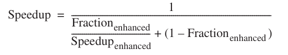

Để đơn giản hóa ví dụ này, giả sử chương trình chỉ hoạt động ở hai chế độ: song song với tất cả processor được sử dụng đầy đủ, tức enhanced mode, hoặc tuần tự với chỉ một processor được sử dụng. Với sự đơn giản hóa này, speedup trong enhanced mode chính là số processor, còn fraction của enhanced mode là thời gian dành cho parallel mode. Thay vào phương trình trước:

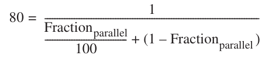

Rút gọn phương trình này, chúng ta thu được:

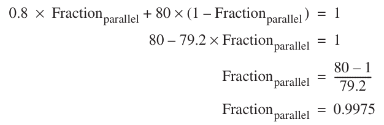

Vì vậy, để đạt speedup 80 với 100 processor, chỉ 0.25% computation ban đầu được phép là sequential. Tất nhiên, để đạt speedup tuyến tính (speedup n với n processor), toàn bộ chương trình thường phải song song và không có phần tuần tự nào. Trong thực tế, chương trình không chỉ hoạt động ở chế độ hoàn toàn song song hoặc tuần tự, mà thường sử dụng ít hơn toàn bộ số processor khi chạy ở parallel mode.

Thách thức lớn thứ hai trong parallel processing liên quan đến latency lớn của remote access trong parallel processor. Trong các shared-memory multiprocessor hiện có, communication dữ liệu giữa các core riêng biệt có thể mất 35 đến 50 clock cycle, và giữa các core trên những chip riêng biệt có thể mất từ 100 đến tận 500 clock cycle hoặc hơn (đối với multiprocessor large-scale), tùy theo communication mechanism, loại interconnection network và quy mô multiprocessor. Ảnh hưởng của communication delay dài rõ ràng rất đáng kể. Hãy xem một ví dụ đơn giản.

**Ví dụ** Giả sử một ứng dụng đang chạy trên một multiprocessor 32-processor, có thời gian xử lý một reference tới remote memory là 200 ns. Với ứng dụng này, giả sử mọi reference đều hit trong local memory hierarchy, ngoại trừ những reference liên quan đến communication; đây là một giả định hơi lạc quan. Processor bị stall khi có remote request, và processor clock rate là 3.3 GHz. Nếu base CPI (giả sử mọi reference đều hit trong cache) là 0.5, multiprocessor sẽ nhanh hơn bao nhiêu khi không có communication so với khi 0.2% instruction liên quan đến remote communication reference?

**Trả lời** Sẽ đơn giản hơn nếu trước tiên tính số clock cycle per instruction. CPI hiệu dụng của multiprocessor với 0.2% remote reference là:

CPI = Base CPI + Remote request rate × Remote request cost

= 0.5 + 0.2% × Remote request cost

Chi phí remote request là

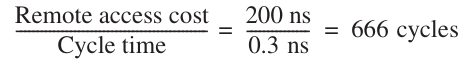

Do đó, chúng ta có thể tính CPI:

CPI = 0.5 + 1.2 = 1.7

Multiprocessor chỉ có local reference nhanh hơn 1.7/0.5 = 3.4 lần. Trong thực tế, phân tích performance phức tạp hơn nhiều, bởi một tỷ lệ nào đó của noncommunication reference sẽ miss trong local hierarchy, và remote access time không có một giá trị hằng số duy nhất. Chẳng hạn, chi phí của một remote reference có thể tệ hơn đáng kể, bởi contention do nhiều reference cùng cố sử dụng global interconnect có thể làm tăng delay.

Những vấn đề này—parallelism không đủ và remote communication long-latency—là hai thách thức performance lớn nhất khi sử dụng multiprocessor. Vấn đề application parallelism không đủ chủ yếu phải được giải quyết trong software bằng algorithm mới có parallel performance tốt hơn, cũng như bằng software system tối đa hóa thời gian thực thi với đầy đủ số processor. Giảm ảnh hưởng của remote latency dài có thể được giải quyết bởi cả architecture lẫn programmer. Chẳng hạn, chúng ta có thể giảm tần suất remote access bằng hardware mechanism như cache shared data, hoặc software mechanism như tái cấu trúc dữ liệu để nhiều access trở thành local. Chúng ta có thể cố che giấu latency bằng multithreading (được thảo luận sau trong chương này) hoặc prefetching (một chủ đề được trình bày rộng trong Chương 2).

Phần lớn chương này tập trung vào các kỹ thuật giảm ảnh hưởng của remote communication latency dài. Chẳng hạn, các Mục 5.2 đến 5.4 thảo luận cách sử dụng caching để giảm tần suất remote access trong khi vẫn duy trì một góc nhìn coherent về memory. Mục 5.5 thảo luận synchronization, vốn là một bottleneck tiềm ẩn lớn vì bản chất của nó liên quan đến interprocessor communication và cũng có thể giới hạn parallelism. Mục 5.6 trình bày các kỹ thuật latency-hiding và memory consistency model cho shared memory. Trong Phụ lục I, chúng ta chủ yếu tập trung vào multiprocessor larger-scale được sử dụng phần lớn cho công việc khoa học. Trong phụ lục đó, chúng ta xem xét bản chất của các ứng dụng này và những thách thức để đạt speedup với hàng chục đến hàng trăm processor.

## 5.2 Centralized Shared-Memory Architecture

Nhận xét rằng việc sử dụng cache lớn với nhiều level có thể giảm đáng kể memory bandwidth demand của processor là hiểu biết then chốt thúc đẩy centralized memory multiprocessor. Ban đầu, các processor này đều là single-core, thường chiếm cả một board, và memory nằm trên shared bus. Với processor higher-performance gần đây, memory demand đã vượt quá khả năng của các bus hợp lý; các microprocessor mới kết nối memory trực tiếp với một chip duy nhất, đôi khi được gọi là backside hoặc memory bus để phân biệt với bus dùng để kết nối I/O. Việc truy cập local memory của một chip, dù cho I/O operation hay access từ chip khác, đều đòi hỏi đi qua chip “sở hữu” memory đó. Vì vậy, access tới memory là asymmetric: nhanh hơn với local memory và chậm hơn với remote memory. Trong multicore, memory được chia sẻ giữa tất cả core trên một chip, nhưng access tới memory của multicore này từ memory của multicore khác vẫn là asymmetric.

Các máy symmetric shared-memory thường hỗ trợ caching cả shared data lẫn private data. Private data được một processor sử dụng, còn shared data được nhiều processor sử dụng, về cơ bản cung cấp communication giữa các processor thông qua read và write shared data. Khi một private item được cache, vị trí của nó được chuyển tới cache, làm giảm cả average access time lẫn memory bandwidth cần thiết. Vì không processor nào khác sử dụng dữ liệu này, hành vi của chương trình giống hệt trên uniprocessor. Khi shared data được cache, shared value có thể được nhân bản trong nhiều cache. Ngoài việc giảm access latency và memory bandwidth cần thiết, sự nhân bản này còn giảm contention có thể tồn tại đối với những shared data item đang được nhiều processor đọc đồng thời. Tuy nhiên, caching shared data đưa vào một vấn đề mới: cache coherence.

### Multiprocessor Cache Coherence là gì?

Đáng tiếc là caching shared data tạo ra một vấn đề mới, bởi hai processor khác nhau nhìn memory thông qua cache riêng của chúng; nếu không có biện pháp phòng ngừa bổ sung, chúng có thể nhìn thấy hai giá trị khác nhau. Hình 5.3 minh họa vấn đề này và cho thấy hai processor khác nhau có thể giữ hai giá trị khác nhau cho cùng một location. Khó khăn này thường được gọi là cache coherence problem. Lưu ý rằng coherence problem tồn tại vì chúng ta có cả global state, chủ yếu do main memory xác định, lẫn local state, do từng cache xác định; các cache này là private đối với mỗi processor core. Vì vậy, trong multicore có một số cache level được chia sẻ (chẳng hạn L3) và một số level là private (chẳng hạn L1 và L2), coherence problem vẫn tồn tại và phải được giải quyết.

Một cách không hình thức, chúng ta có thể nói memory system là coherent nếu mọi read của một data item đều trả về giá trị được ghi gần đây nhất của item đó. Mặc dù trực quan và hấp dẫn, định nghĩa này còn mơ hồ và quá đơn giản; thực tế phức tạp hơn nhiều. Định nghĩa đơn giản này chứa hai khía cạnh khác nhau của hành vi memory system, và cả hai đều then chốt để viết shared-memory program đúng. Khía cạnh thứ nhất, gọi là coherence, xác định những giá trị mà read có thể trả về. Khía cạnh thứ hai, gọi là consistency, xác định khi nào một giá trị đã ghi sẽ được read trả về. Trước tiên hãy xem coherence.

Một memory system là coherent nếu:

1. Một read của processor P tới location X, theo sau một write của P tới X và không có write nào của processor khác tới X xảy ra giữa write và read của P, luôn trả về giá trị do P ghi.

| Thời gian | Sự kiện | Cache của processor A | Cache của processor B | Memory tại vị trí X |
|---|---|---|---|---|
| 0 |  |  |  | 1 |
| 1 | Processor A đọc X | 1 |  | 1 |
| 2 | Processor B đọc X | 1 | 1 | 1 |
| 3 | Processor A lưu 0 vào X | 0 | 1 | 0 |

**Hình 5.3 Cache coherence problem đối với một memory location duy nhất (X), được hai processor (A và B) đọc và ghi. Ban đầu, giả sử không cache nào chứa variable này và X có giá trị 1. Chúng ta cũng giả sử dùng write-through cache; write-back cache bổ sung một số phức tạp nhưng tương tự. Sau khi A ghi giá trị của X, cache của A và memory đều chứa giá trị mới, nhưng cache của B thì không; nếu B đọc giá trị của X, nó sẽ nhận 1!**

2. Một read của processor tới location X, theo sau một write của processor khác tới X, trả về giá trị đã ghi nếu read và write cách nhau đủ xa về thời gian và không có write nào khác tới X xảy ra giữa hai access.

3. Các write tới cùng location được tuần tự hóa; nghĩa là hai write tới cùng location do bất kỳ hai processor nào thực hiện đều được mọi processor nhìn thấy theo cùng thứ tự. Chẳng hạn, nếu các giá trị 1 rồi 2 được ghi tới một location, processor không bao giờ có thể đọc giá trị location đó là 2 rồi sau đó đọc nó là 1.

Thuộc tính thứ nhất đơn giản bảo toàn program order—chúng ta kỳ vọng thuộc tính này đúng ngay cả trên uniprocessor. Thuộc tính thứ hai định nghĩa khái niệm có một góc nhìn coherent về memory: nếu một processor có thể liên tục đọc một data value cũ, rõ ràng chúng ta sẽ nói memory là incoherent.

Nhu cầu write serialization tinh tế hơn nhưng cũng quan trọng không kém. Giả sử chúng ta không tuần tự hóa write, và processor P1 ghi location X, sau đó P2 cũng ghi location X. Tuần tự hóa write bảo đảm mỗi processor sẽ nhìn thấy write của P2 vào một lúc nào đó. Nếu không tuần tự hóa write, có thể một số processor nhìn thấy write của P2 trước rồi mới thấy write của P1, và giữ giá trị do P1 ghi mãi mãi. Cách đơn giản nhất để tránh khó khăn này là bảo đảm tất cả write tới cùng location đều được nhìn thấy theo cùng thứ tự; thuộc tính này được gọi là write serialization.

Mặc dù ba thuộc tính vừa mô tả đủ để bảo đảm coherence, câu hỏi khi nào một giá trị đã ghi được nhìn thấy cũng quan trọng. Để hiểu tại sao, hãy lưu ý rằng chúng ta không thể yêu cầu một read của X ngay lập tức nhìn thấy giá trị do processor khác ghi vào X. Chẳng hạn, nếu write của X trên một processor xảy ra trước read của X trên processor khác một khoảng thời gian rất nhỏ, có thể không thể bảo đảm read trả về giá trị đã ghi, bởi lúc đó dữ liệu đã ghi thậm chí chưa rời khỏi processor. Vấn đề chính xác khi nào giá trị đã ghi phải được reader nhìn thấy được một memory consistency model xác định—chủ đề được thảo luận trong Mục 5.6.

Coherence và consistency bổ sung cho nhau: coherence định nghĩa hành vi read và write tới cùng memory location, còn consistency định nghĩa hành vi read và write xét trong quan hệ với access tới các memory location khác. Tạm thời, hãy đưa ra hai giả định sau. Thứ nhất, một write không hoàn tất (và cho phép write tiếp theo xảy ra) cho đến khi mọi processor đã nhìn thấy ảnh hưởng của write đó. Thứ hai, processor không thay đổi thứ tự của bất kỳ write nào so với bất kỳ memory access nào khác. Hai điều kiện này có nghĩa là nếu processor ghi location A rồi location B, bất kỳ processor nào thấy giá trị mới của B cũng phải thấy giá trị mới của A. Những hạn chế này cho phép processor sắp xếp lại read nhưng buộc nó hoàn tất write theo program order. Chúng ta sẽ dựa vào giả định này cho đến Mục 5.6, nơi xem xét chính xác các hệ quả của định nghĩa này cũng như các lựa chọn thay thế.

### Phương án cơ bản bảo đảm Coherence

Coherence problem đối với multiprocessor và I/O, dù có nguồn gốc tương tự, lại có những đặc điểm khác nhau ảnh hưởng đến giải pháp phù hợp. Khác với I/O, nơi nhiều data copy hiếm khi xuất hiện—và là điều cần tránh bất cứ khi nào có thể—một chương trình chạy trên nhiều processor thường có bản sao của cùng dữ liệu trong nhiều cache. Trong coherent multiprocessor, cache cung cấp cả migration lẫn replication của shared data item.

Coherent cache cung cấp migration, bởi một data item có thể được chuyển tới local cache và sử dụng ở đó một cách trong suốt. Migration này giảm cả latency để truy cập shared data item được cấp phát từ xa lẫn bandwidth demand trên shared memory.

Coherent cache cũng cung cấp replication cho shared data đang được đọc đồng thời, bởi cache tạo một bản sao của data item trong local cache. Replication giảm cả access latency lẫn contention đối với một read shared data item. Hỗ trợ migration và replication này đóng vai trò then chốt đối với performance khi truy cập shared data. Vì vậy, thay vì cố giải quyết vấn đề bằng cách tránh nó trong software, multiprocessor áp dụng một giải pháp hardware bằng cách đưa vào protocol duy trì coherent cache.

Các protocol duy trì coherence cho nhiều processor được gọi là cache coherence protocol. Yếu tố then chốt để triển khai cache coherence protocol là theo dõi state của mọi hoạt động chia sẻ data block. Có hai nhóm protocol đang được sử dụng, mỗi nhóm dùng kỹ thuật khác nhau để theo dõi sharing status:

- Directory based—Sharing status của một physical memory block cụ thể được giữ tại một location, gọi là directory. Có hai loại directory-based cache coherence rất khác nhau. Trong SMP, chúng ta có thể sử dụng một centralized directory gắn với memory hoặc một single serialization point khác, chẳng hạn outermost cache trong multicore. Trong DSM, một directory duy nhất không hợp lý, bởi nó tạo ra một single point of contention và gây khó khăn khi mở rộng tới nhiều multicore chip, xét đến memory demand của multicore có tám core trở lên. Distributed directory phức tạp hơn single directory, và những thiết kế đó là chủ đề của Mục 5.4.

- Snooping—Thay vì giữ sharing state trong một directory duy nhất, mọi cache có bản sao dữ liệu từ một physical memory block đều có thể theo dõi sharing status của block. Trong SMP, thông thường tất cả cache đều có thể được truy cập qua một broadcast medium nào đó (ví dụ bus kết nối per-core cache với shared cache hoặc memory), và mọi cache controller giám sát hoặc snoop medium để xác định chúng có bản sao của block được yêu cầu trong một bus hoặc switch access hay không. Snooping cũng có thể được dùng làm coherence protocol cho multichip multiprocessor, và một số thiết kế hỗ trợ snooping protocol phía trên một directory protocol bên trong mỗi multicore!

Snooping protocol trở nên phổ biến với các multiprocessor sử dụng microprocessor (single-core) và cache gắn với một shared memory duy nhất qua bus. Bus cung cấp broadcast medium thuận tiện để triển khai snooping protocol. Multicore architecture thay đổi bức tranh đáng kể, bởi mọi multicore đều chia sẻ một cache level nào đó trên chip. Vì vậy, một số thiết kế chuyển sang directory protocol vì overhead nhỏ. Để giúp người đọc làm quen với cả hai loại protocol, chúng ta tập trung vào snooping protocol ở đây và thảo luận directory protocol khi đến DSM architecture.

### Snooping Coherence Protocol

Có hai cách để duy trì yêu cầu coherence được mô tả trong tiểu mục trước. Một phương pháp là bảo đảm processor có exclusive access tới một data item trước khi ghi item đó. Kiểu protocol này được gọi là write invalidate protocol vì nó invalidate các bản sao khác khi write. Đây là protocol phổ biến nhất với khoảng cách rất lớn. Exclusive access bảo đảm không tồn tại bản sao readable hoặc writable nào khác của item khi write xảy ra: tất cả cached copy khác của item đều bị invalidate.

Hình 5.4 minh họa một invalidation protocol đang hoạt động với write-back cache. Để thấy protocol bảo đảm coherence ra sao, xét một write theo sau bởi read của processor khác: vì write đòi hỏi exclusive access, mọi bản sao do processor đọc giữ đều phải bị invalidate (do đó có tên protocol này). Vì vậy, khi read xảy ra, nó miss trong cache và buộc phải fetch một bản sao mới của dữ liệu. Với write, chúng ta yêu cầu processor ghi có exclusive access, ngăn mọi processor khác ghi đồng thời. Nếu hai processor thực sự cố ghi cùng dữ liệu đồng thời, một processor thắng cuộc đua (chúng ta sẽ sớm thấy cách quyết định bên thắng), khiến bản sao của processor còn lại bị invalidate. Để processor còn lại hoàn tất write, nó phải lấy bản sao mới của dữ liệu, và bản sao này lúc đó phải chứa giá trị đã cập nhật. Vì vậy, protocol này thực thi write serialization.

| Hoạt động processor | Hoạt động bus | Nội dung cache của processor A | Nội dung cache của processor B | Nội dung memory location X |
|---|---|---|---|---|
|  |  |  |  | 0 |
| Processor A đọc X | Cache miss với X | 0 |  | 0 |
| Processor B đọc X | Cache miss với X | 0 | 0 | 0 |
| Processor A ghi 1 vào X | Invalidation cho X | 1 |  | 0 |
| Processor B đọc X | Cache miss với X | 1 | 1 | 1 |

**Hình 5.4 Ví dụ về một invalidation protocol hoạt động trên snooping bus cho một cache block duy nhất (X) với write-back cache. Giả sử ban đầu không cache nào giữ X và giá trị X trong memory là 0. Nội dung processor và memory cho thấy giá trị sau khi cả processor activity lẫn bus activity đã hoàn tất. Ô trống biểu thị không có activity hoặc không có bản sao được cache. Khi miss thứ hai của B xảy ra, processor A phản hồi bằng giá trị và hủy phản hồi từ memory. Ngoài ra, cả nội dung cache của B lẫn nội dung memory của X đều được cập nhật. Cập nhật memory này, diễn ra khi block trở thành shared, giúp đơn giản hóa protocol; tuy nhiên, có thể theo dõi ownership và chỉ buộc write-back nếu block bị thay thế. Điều này đòi hỏi đưa vào một state bổ sung gọi là “owner”, biểu thị block có thể là shared nhưng processor sở hữu chịu trách nhiệm cập nhật mọi processor khác và memory khi nó thay đổi hoặc thay thế block. Nếu multicore sử dụng shared cache (ví dụ L3), toàn bộ memory được nhìn qua shared cache; L3 đóng vai memory trong ví dụ này, và coherency phải được xử lý cho private L1 và L2 của mỗi core. Chính nhận xét này khiến một số nhà thiết kế chọn directory protocol bên trong multicore. Để cách này hoạt động, L3 cache phải là inclusive (xem trang 397).**

Lựa chọn thay cho invalidate protocol là cập nhật tất cả cached copy của data item khi item đó được ghi. Loại protocol này được gọi là write update hoặc write broadcast protocol. Vì write update protocol phải broadcast tất cả write tới shared cache line, nó tiêu tốn bandwidth lớn hơn đáng kể. Vì lý do này, các multiprocessor gần đây chọn triển khai write invalidate protocol, và chúng ta sẽ chỉ tập trung vào invalidate protocol trong phần còn lại của chương.

### Kỹ thuật triển khai cơ bản

Yếu tố then chốt để triển khai invalidate protocol trong multicore là sử dụng bus, hoặc broadcast medium khác, để thực hiện invalidate. Trong multiprocessor multiple-chip cũ, bus dùng cho coherence là shared-memory access bus. Trong multicore, bus có thể là kết nối giữa private cache (L1 và L2 trong Intel Core i7) và shared outer cache (L3 trong i7). Để thực hiện invalidate, processor chỉ cần giành bus access và broadcast address cần invalidate lên bus. Tất cả processor liên tục snoop bus, theo dõi các address. Processor kiểm tra address trên bus có trong cache của mình hay không. Nếu có, dữ liệu tương ứng trong cache bị invalidate.

Khi xảy ra write tới một block shared, processor ghi phải giành bus access để broadcast invalidation. Nếu hai processor cố ghi shared block cùng lúc, những nỗ lực broadcast invalidate operation của chúng sẽ được tuần tự hóa khi phân xử quyền sử dụng bus. Processor đầu tiên có bus access sẽ khiến mọi bản sao khác của block nó đang ghi bị invalidate. Nếu các processor cố ghi cùng block, sự tuần tự hóa do bus thực thi cũng tuần tự hóa các write của chúng. Một hệ quả của scheme này là write tới shared data item không thể thực sự hoàn tất cho đến khi giành được bus access. Mọi coherence scheme đều đòi hỏi một phương pháp tuần tự hóa access tới cùng cache block, bằng cách tuần tự hóa access tới communication medium hoặc một shared structure khác.

Ngoài invalidate các bản sao còn tồn tại của cache block đang được ghi, chúng ta cũng cần định vị data item khi cache miss xảy ra. Trong write-through cache, dễ tìm giá trị mới nhất của data item, bởi tất cả dữ liệu được ghi luôn được gửi tới memory, nơi luôn có thể fetch giá trị mới nhất. (Write buffer có thể dẫn đến một số phức tạp bổ sung và trên thực tế phải được xem như các cache entry bổ sung.)

Với write-back cache, vấn đề tìm data value mới nhất khó hơn, bởi giá trị mới nhất của data item có thể nằm trong private cache thay vì shared cache hoặc memory. May mắn là write-back cache có thể dùng cùng snooping scheme cho cả cache miss lẫn write: mỗi processor snoop mọi address được đặt lên shared bus. Nếu processor phát hiện mình có dirty copy của cache block được yêu cầu, nó cung cấp cache block đó để đáp ứng read request và khiến memory (hoặc L3) access bị hủy. Độ phức tạp bổ sung đến từ việc phải lấy cache block từ private cache (L1 hoặc L2) của processor khác, vốn thường có thể lâu hơn lấy từ L3. Vì write-back cache tạo ra yêu cầu memory bandwidth thấp hơn, chúng có thể hỗ trợ nhiều processor nhanh hơn. Kết quả là tất cả multicore processor sử dụng write-back ở các outermost cache level, và chúng ta sẽ xem xét triển khai coherence với write-back cache.

Có thể sử dụng các cache tag thông thường để triển khai snooping, và valid bit của mỗi block khiến việc triển khai invalidation trở nên dễ dàng. Read miss, dù do invalidation hay sự kiện khác tạo ra, cũng đơn giản vì chỉ dựa vào khả năng snooping. Với write, chúng ta muốn biết có cached copy nào khác của block hay không, bởi nếu không có, write không cần được đặt lên bus trong write-back cache. Không gửi write giúp giảm cả thời gian write lẫn bandwidth cần thiết.

Để theo dõi cache block có shared hay không, chúng ta có thể thêm một state bit gắn với mỗi cache block, giống như valid bit và dirty bit hiện có. Bằng cách thêm bit cho biết block có shared hay không, chúng ta quyết định được liệu write có phải tạo invalidate hay không. Khi write tới block ở trạng thái shared xảy ra, cache tạo invalidation trên bus và đánh dấu block là exclusive. Core đó sẽ không gửi thêm invalidation nào cho block ấy. Core giữ bản sao duy nhất của cache block thường được gọi là owner của cache block.

Khi invalidation được gửi, state của cache block của owner chuyển từ shared sang unshared (hoặc exclusive). Nếu processor khác sau đó yêu cầu cache block này, state phải trở lại shared. Vì snooping cache của chúng ta cũng nhìn thấy mọi miss, nó biết khi nào exclusive cache block được processor khác yêu cầu và state cần trở thành shared.

Mỗi bus transaction phải kiểm tra cache-address tag, điều này có thể gây interference với processor cache access. Một cách giảm interference là nhân đôi tag và hướng snoop access tới bản sao tag. Cách khác là dùng directory tại shared L3 cache; directory cho biết block nhất định có shared hay không và có thể cho biết core nào giữ bản sao. Với directory information, invalidate chỉ cần hướng tới cache có bản sao của cache block. Điều này đòi hỏi L3 luôn có bản sao của mọi data item trong L1 hoặc L2, một thuộc tính gọi là inclusion, mà chúng ta sẽ quay lại trong Mục 5.7.

### Ví dụ Protocol

Snooping coherence protocol thường được triển khai bằng cách tích hợp một finite-state controller vào mỗi core. Controller này đáp ứng request từ processor trong core và từ bus (hoặc broadcast medium khác), thay đổi state của cache block được chọn, đồng thời sử dụng bus để truy cập hoặc invalidate dữ liệu. Về logic, bạn có thể hình dung mỗi block gắn với một controller riêng; tức snooping operation hoặc cache request cho các block khác nhau có thể tiến hành độc lập. Trong triển khai thực tế, một controller duy nhất cho phép nhiều operation tới các block khác nhau tiến hành xen kẽ (nghĩa là một operation có thể được khởi đầu trước khi operation khác hoàn tất, dù tại một thời điểm chỉ cho phép một cache access hoặc một bus access). Đồng thời, hãy nhớ rằng mặc dù phần mô tả sau nói tới bus, bất kỳ interconnection network nào hỗ trợ broadcast tới tất cả coherence controller và private cache tương ứng đều có thể dùng để triển khai snooping.

Protocol đơn giản mà chúng ta xem xét có ba state: invalid, shared và modified. Shared state cho biết block trong private cache có thể được chia sẻ, còn modified state cho biết block đã được cập nhật trong private cache; lưu ý rằng modified state hàm ý block là exclusive. Hình 5.5 trình bày request do core tạo ra (nửa trên của bảng) cũng như request đến từ bus (nửa dưới của bảng). Protocol này dành cho write-back cache nhưng dễ thay đổi để hoạt động với write-through cache bằng cách diễn giải modified state thành exclusive state và cập nhật cache khi write theo cách thông thường của write-through cache. Mở rộng phổ biến nhất của protocol cơ bản này là thêm exclusive state, mô tả một block chưa được sửa đổi nhưng chỉ nằm trong một private cache. Chúng ta mô tả mở rộng này và những mở rộng khác ở trang 362.

| Request | Nguồn | State của cache block tại address được chỉ định | Loại cache action | Chức năng và giải thích |
|---|---|---|---|---|
| Read hit | Processor | Shared or modified | Normal hit | Đọc dữ liệu trong local cache. |
| Read miss | Processor | Invalid | Normal miss | Đưa read miss lên bus. |
| Read miss | Processor | Shared | Replacement | Address conflict miss: đưa read miss lên bus. |
| Read miss | Processor | Modified | Replacement | Address conflict miss: write-back block rồi đưa read miss lên bus. |
| Write hit | Processor | Modified | Normal hit | Ghi dữ liệu trong local cache. |
| Write hit | Processor | Shared | Coherence | Đưa invalidate lên bus. Các operation này thường được gọi là upgrade hoặc ownership miss, bởi chúng không fetch dữ liệu mà chỉ thay đổi state. |
| Write miss | Processor | Invalid | Normal miss | Đưa write miss lên bus. |
| Write miss | Processor | Shared | Replacement | Address conflict miss: đưa write miss lên bus. |
| Write miss | Processor | Modified | Replacement | Address conflict miss: write-back block rồi đưa write miss lên bus. |
| Read miss | Bus | Shared | No action | Cho phép shared cache hoặc memory phục vụ read miss. |
| Read miss | Bus | Modified | Coherence | Cố gắng chia sẻ dữ liệu: đưa cache block lên bus và chuyển state thành shared. |
| Invalidate | Bus | Shared | Coherence | Cố ghi shared block; invalidate block. |
| Write miss | Bus | Shared | Coherence | Cố ghi shared block; invalidate cache block. |
| Write miss | Bus | Modified | Coherence | Cố ghi một block đang exclusive ở nơi khác; thực hiện write-back cache block và chuyển state của nó thành invalid trong local cache. |

**Hình 5.5 Cache coherence mechanism nhận request từ cả processor của core lẫn shared bus, và phản hồi dựa trên loại request, việc nó hit hay miss trong local cache, và state của local cache block được chỉ định trong request. Cột thứ tư mô tả loại cache action: normal hit hoặc miss (giống những gì uniprocessor cache gặp), replacement (một uniprocessor cache replacement miss), hoặc coherence (cần để duy trì cache coherence); normal hoặc replacement action có thể gây coherence action tùy state của block trong các cache khác. Đối với read miss, write miss hoặc invalidate được snoop từ bus, chỉ cần action nếu read hoặc write address khớp một block trong local cache và block đó valid.**

Khi invalidate hoặc write miss được đặt lên bus, mọi core có private cache giữ bản sao của cache block đều invalidate nó. Với write miss trong write-back cache, nếu block là exclusive trong chỉ một private cache, cache đó cũng write back block; nếu không, có thể đọc dữ liệu từ shared cache hoặc memory.

Hình 5.6 trình bày finite-state transition diagram cho một private cache block sử dụng write invalidation protocol và write-back cache. Để đơn giản, ba state của protocol được biểu diễn hai lần để thể hiện transition dựa trên processor request (bên trái, tương ứng nửa trên bảng trong Hình 5.5), đối lập với transition dựa trên bus request (bên phải, tương ứng nửa dưới bảng trong Hình 5.5). Chữ đậm được dùng để phân biệt bus action với các điều kiện mà state transition phụ thuộc vào. State trong mỗi node biểu thị state của private cache block được chọn, được chỉ định bởi processor hoặc bus request.

Tất cả state trong cache protocol này đều cần có trong uniprocessor cache, nơi chúng tương ứng các state invalid, valid (và clean), và dirty. Hầu hết state change được biểu thị bằng cung trong nửa trái Hình 5.6 đều cần trong write-back uniprocessor cache, ngoại trừ invalidate khi write hit vào shared block. Các state change được biểu thị bằng cung trong nửa phải Hình 5.6 chỉ cần cho coherence và hoàn toàn không xuất hiện trong uniprocessor cache controller.

Như đã đề cập, mỗi cache chỉ có một finite-state machine, với stimulus đến từ processor gắn với nó hoặc từ bus. Hình 5.7 cho thấy cách kết hợp state transition ở nửa phải Hình 5.6 với nửa trái của hình để tạo thành một state diagram duy nhất cho mỗi cache block.

Để hiểu vì sao protocol này hoạt động, hãy quan sát rằng mọi valid cache block hoặc ở shared state trong một hay nhiều private cache, hoặc ở exclusive state trong đúng một cache. Mọi transition sang exclusive state (cần thiết để processor ghi block) đều đòi hỏi đặt invalidate hoặc write miss lên bus, khiến tất cả local cache chuyển block thành invalid. Ngoài ra, nếu local cache nào khác giữ block ở exclusive state, local cache đó tạo write-back để cung cấp block chứa address mong muốn. Cuối cùng, nếu read miss xuất hiện trên bus đối với block ở exclusive state, local cache giữ exclusive copy chuyển state thành shared.

Các action màu xám trong Hình 5.7, xử lý read và write miss trên bus, về cơ bản là thành phần snooping của protocol. Một thuộc tính khác được bảo toàn trong protocol này, cũng như hầu hết protocol khác, là mọi memory block ở shared state luôn up to date trong outer shared cache (L2 hoặc L3, hoặc memory nếu không có shared cache), nhờ đó đơn giản hóa triển khai. Thực ra, level bên ngoài private cache là shared cache hay memory không quan trọng; điều then chốt là mọi access từ các core đều đi qua level đó.

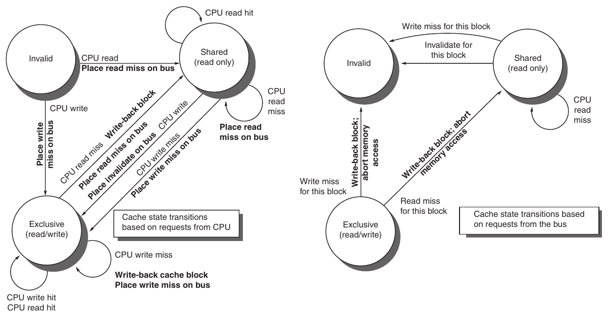

**Hình 5.6 Một write invalidate cache coherence protocol cho private write-back cache, trình bày state và state transition của mỗi block trong cache. Cache state được vẽ trong hình tròn; các access mà local processor được phép thực hiện mà không cần state transition được đặt trong ngoặc dưới tên state. Stimulus gây state change được ghi bằng chữ thường trên các transition arc, còn bus action phát sinh như một phần của state transition được ghi đậm trên arc. Các stimulus action áp dụng cho một block trong private cache, không phải một address cụ thể trong cache. Vì vậy, read miss tới block ở shared state là miss đối với cache block đó nhưng cho một address khác. Bên trái diagram trình bày state transition dựa trên action của processor gắn với cache; bên phải trình bày transition dựa trên operation trên bus. Read miss trong exclusive hoặc shared state và write miss trong exclusive state xảy ra khi address do processor yêu cầu không khớp address trong local cache block. Miss như vậy là cache replacement miss tiêu chuẩn. Nỗ lực ghi một block ở shared state tạo invalidate. Mỗi khi bus transaction xảy ra, tất cả private cache chứa cache block được chỉ định trong bus transaction thực hiện action do nửa phải diagram quy định. Protocol giả định memory (hoặc shared cache) cung cấp dữ liệu khi read miss đối với block clean trong mọi local cache. Trong triển khai thực tế, hai bộ state diagram này được kết hợp. Trên thực tế có nhiều biến thể tinh tế của invalidate protocol, bao gồm việc đưa vào exclusive unmodified state và vấn đề processor hay memory cung cấp dữ liệu khi miss. Trong multicore chip, shared cache (thường L3 nhưng đôi khi L2) đóng vai tương đương memory, và bus là bus giữa private cache của mỗi core với shared cache, rồi shared cache lại giao tiếp với memory.**

Mặc dù cache protocol đơn giản của chúng ta là đúng, nó bỏ qua một số phức tạp khiến triển khai khó hơn nhiều. Quan trọng nhất là protocol giả định operation là atomic—nghĩa là operation có thể được thực hiện sao cho không operation nào khác xen vào. Chẳng hạn, protocol được mô tả giả định có thể phát hiện write miss, giành bus và nhận phản hồi như một atomic action duy nhất. Trong thực tế điều này không đúng. Thậm chí read miss cũng có thể không atomic; sau khi phát hiện miss trong L2 của multicore, core phải phân xử quyền access bus kết nối tới shared L3. Nonatomic action đưa vào khả năng protocol bị deadlock, nghĩa là tới một state mà nó không thể tiếp tục. Chúng ta sẽ tìm hiểu các phức tạp này sau trong mục này và khi xem xét DSM design.

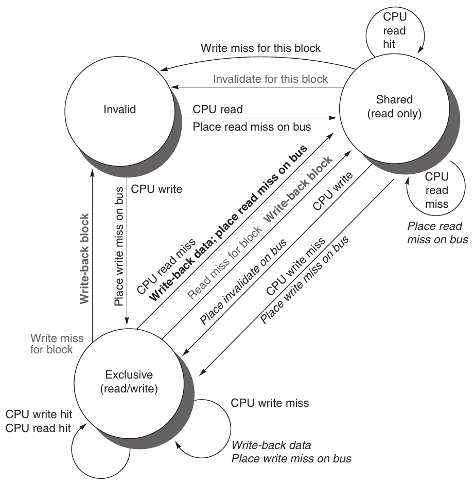

**Hình 5.7 Cache coherence state diagram với các state transition do local processor gây ra được vẽ màu đen và do bus activity gây ra được vẽ màu xám. Như trong Hình 5.6, activity trên một transition được ghi đậm.**

Với multicore processor, coherence giữa các processor core được triển khai hoàn toàn trên chip, sử dụng snooping hoặc simple central directory protocol. Nhiều chip dual-processor, bao gồm Intel Xeon và AMD Opteron, hỗ trợ multichip multiprocessor có thể được xây dựng bằng cách kết nối qua một high-speed interface (lần lượt được gọi là Quickpath hoặc Hypertransport). Các interconnect next-level này không chỉ là phần mở rộng của shared bus, mà sử dụng một cách tiếp cận khác để kết nối multicore.

Một multiprocessor xây dựng từ nhiều multicore chip sẽ có distributed memory architecture và cần một interchip coherency mechanism bổ sung ngoài mechanism bên trong chip. Trong hầu hết trường hợp, một dạng directory scheme nào đó được sử dụng.

### Mở rộng Basic Coherence Protocol

Coherence protocol vừa mô tả là một protocol three-state đơn giản, và thường được gọi theo chữ cái đầu của các state, thành MSI (Modified, Shared, Invalid) protocol. Có nhiều mở rộng của protocol cơ bản này, mà chúng ta đã đề cập trong chú thích các hình ở mục này. Những mở rộng ấy được tạo ra bằng cách thêm state và transaction để tối ưu một số hành vi, có thể dẫn đến performance được cải thiện. Hai mở rộng phổ biến nhất là:

1. MESI thêm state Exclusive vào MSI protocol cơ bản để cho biết khi nào cache block chỉ nằm trong một cache duy nhất nhưng là clean. Nếu block ở E state, nó có thể được ghi mà không tạo invalidate nào, tối ưu trường hợp block được một cache duy nhất đọc trước khi chính cache đó ghi. Tất nhiên, khi xảy ra read miss đối với block ở E state, block phải chuyển sang S state để duy trì coherence. Vì mọi access tiếp theo đều được snoop, có thể duy trì độ chính xác của state này. Cụ thể, nếu processor khác phát read miss, state chuyển từ exclusive sang shared. Lợi ích của việc thêm state này là write tiếp theo của cùng core tới block ở exclusive state không cần giành bus access hoặc tạo invalidate, bởi đã biết block chỉ có trong local cache này; processor chỉ cần chuyển state thành modified. State này dễ bổ sung bằng cách dùng bit mã hóa coherent state làm exclusive state và dùng dirty bit để cho biết block đã modified. MESI protocol phổ biến, được đặt tên theo bốn state của nó (Modified, Exclusive, Shared và Invalid), sử dụng cấu trúc này. Intel i7 dùng một biến thể MESI protocol, gọi là MESIF, thêm một state (Forward) để chỉ định sharing processor nào phải phản hồi request. Nó được thiết kế để tăng performance trong cách tổ chức distributed memory.

2. MOESI thêm state Owned vào MESI protocol để cho biết block tương ứng do cache đó sở hữu và đã out-of-date trong memory. Trong MSI và MESI protocol, khi có nỗ lực chia sẻ block ở Modified state, state chuyển thành Shared (trong cả cache ban đầu lẫn cache mới chia sẻ), và block phải được ghi trả về memory. Trong MOESI protocol, block có thể chuyển từ Modified sang Owned trong cache ban đầu mà không ghi về memory. Các cache khác mới chia sẻ block giữ block ở Shared state; O state, chỉ do cache ban đầu giữ, cho biết bản sao trong main memory đã lỗi thời và cache được chỉ định là owner. Owner của block phải cung cấp block khi miss, bởi memory chưa up to date, và phải ghi trả block về memory nếu block bị thay thế. AMD Opteron sử dụng MOESI protocol.

Mục tiếp theo xem xét performance của các protocol này đối với parallel và multiprogrammed workload; giá trị của những mở rộng so với protocol cơ bản sẽ trở nên rõ ràng khi xem xét performance. Nhưng trước khi làm điều đó, hãy nhìn sơ qua những giới hạn của việc sử dụng symmetric memory structure và snooping coherence scheme.

### Giới hạn của Symmetric Shared-Memory Multiprocessor và Snooping Protocol

Khi số processor trong multiprocessor tăng, hoặc khi memory demand của mỗi processor tăng, bất kỳ centralized resource nào trong system cũng có thể trở thành bottleneck. Bằng cách sử dụng kết nối bandwidth cao hơn có sẵn on-chip và shared L3 cache nhanh hơn memory, các nhà thiết kế đã hỗ trợ được bốn đến tám core high-performance theo cách symmetric. Cách tiếp cận như vậy khó có thể mở rộng xa hơn nhiều so với tám core, và sẽ không hoạt động khi kết hợp nhiều multicore.

Snooping bandwidth tại cache cũng có thể trở thành vấn đề, bởi mỗi cache phải kiểm tra mọi miss đặt lên bus. Như đã đề cập, nhân đôi tag là một giải pháp. Một cách khác, được một số multicore gần đây áp dụng, là đặt directory tại outermost cache level. Directory chỉ rõ cache của processor nào giữ bản sao của mỗi item trong outermost cache. Đây là cách Intel sử dụng trên i7 và Xeon 7000 series. Lưu ý rằng sử dụng directory này không loại bỏ bottleneck do shared bus và L3 giữa các processor, nhưng triển khai đơn giản hơn nhiều so với distributed directory scheme mà chúng ta xem xét trong Mục 5.4.

Nhà thiết kế có thể tăng memory bandwidth để hỗ trợ nhiều processor hơn hoặc processor nhanh hơn như thế nào? Để tăng communication bandwidth giữa processor và memory, các nhà thiết kế đã dùng nhiều bus cũng như interconnection network, chẳng hạn crossbar hoặc point-to-point network nhỏ. Trong những thiết kế này, memory system (main memory hoặc shared cache) có thể được cấu hình thành nhiều physical bank, nhằm tăng memory bandwidth hiệu dụng trong khi vẫn giữ uniform access time tới memory. Hình 5.8 cho thấy một system như vậy có thể trông ra sao nếu được triển khai bằng multicore single-chip. Mặc dù cách tiếp cận này có thể được dùng để cho phép kết nối hơn bốn core trên một chip, nó không mở rộng tốt thành multichip multiprocessor dùng multicore làm khối cấu thành, bởi memory đã gắn với từng multicore chip riêng thay vì tập trung.

AMD Opteron đại diện cho một điểm trung gian khác trong dải giữa snooping và directory protocol. Memory được kết nối trực tiếp với mỗi multicore chip, và có thể kết nối tối đa bốn multicore chip. System là NUMA, bởi local memory nhanh hơn đôi chút. Opteron triển khai coherence protocol bằng point-to-point link để broadcast tới tối đa ba chip khác. Vì interprocessor link không shared, cách duy nhất để processor biết khi nào invalid operation đã hoàn tất là thông qua acknowledgment tường minh. Vì vậy, coherence protocol dùng broadcast để tìm các bản sao có khả năng shared, giống snooping protocol, nhưng dùng acknowledgment để sắp thứ tự operation, giống directory protocol. Vì local memory chỉ nhanh hơn remote memory đôi chút trong triển khai Opteron, một số software xem Opteron multiprocessor là có uniform memory access.

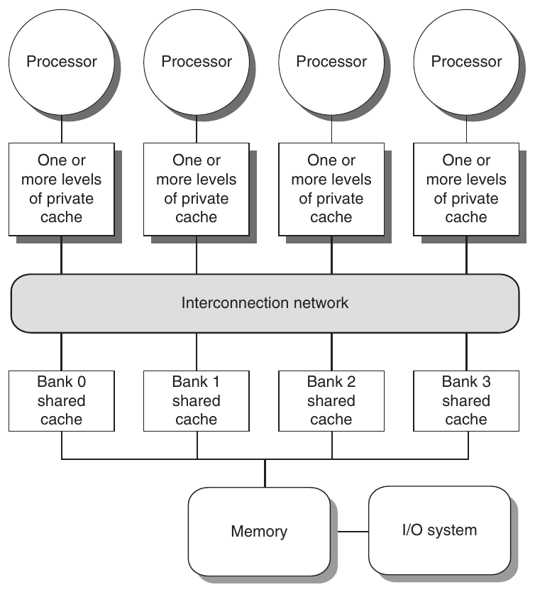

**Hình 5.8 Một multicore single-chip multiprocessor có uniform memory access thông qua banked shared cache và sử dụng interconnection network thay cho bus.**

Snooping cache coherence protocol có thể được sử dụng mà không có centralized bus, nhưng vẫn đòi hỏi thực hiện broadcast để snoop từng cache khi có bất kỳ miss nào tới một cache block có khả năng shared. Cache coherence traffic này tạo ra một giới hạn khác đối với quy mô và tốc độ processor. Vì coherence traffic không bị ảnh hưởng bởi cache lớn hơn, processor nhanh hơn tất yếu sẽ làm quá tải network và khả năng đáp ứng snoop request từ mọi cache khác của mỗi cache. Trong Mục 5.4, chúng ta xem xét directory-based protocol, loại bỏ nhu cầu broadcast tới mọi cache khi miss. Khi processor speed và số core trên mỗi processor tăng, có lẽ nhiều nhà thiết kế hơn sẽ chọn các protocol này để tránh broadcast limit của snooping protocol.

### Triển khai Snooping Cache Coherence

> Khó khăn nằm trong chi tiết.

> Tục ngữ cổ điển

Khi viết ấn bản đầu tiên của cuốn sách này năm 1990, phần “Putting It All Together” cuối cùng của chúng ta là một multiprocessor 30-processor, single-bus sử dụng coherence snoop-based; bus chỉ có capacity nhỉnh hơn 50 MB/sec, không đủ bus bandwidth để hỗ trợ ngay cả một core của Intel i7 năm 2011! Khi viết ấn bản thứ hai năm 1995, các cache coherence multiprocessor đầu tiên có nhiều hơn một bus vừa xuất hiện, và chúng ta thêm một phụ lục mô tả cách triển khai snooping trong system nhiều bus. Năm 2011, phần lớn multicore processor chỉ hỗ trợ một single-chip multiprocessor chọn shared bus structure kết nối tới shared memory hoặc shared cache. Ngược lại, mọi multicore multiprocessor system hỗ trợ 16 core trở lên đều dùng interconnect khác single bus, và nhà thiết kế phải đối mặt với thách thức triển khai snooping mà không có sự đơn giản hóa của bus để tuần tự hóa event.

Như đã nói, phức tạp chủ yếu khi thực sự triển khai snooping coherence protocol đã mô tả là write và upgrade miss không atomic trong bất kỳ multiprocessor gần đây nào. Các bước phát hiện write hoặc upgrade miss, communication với processor khác và memory, lấy giá trị mới nhất khi write miss và bảo đảm mọi invalidate được xử lý, rồi cập nhật cache không thể được thực hiện như thể chỉ mất một cycle.

Trong một multicore chip duy nhất, có thể làm những bước này về thực chất trở thành atomic bằng cách phân xử bus tới shared cache hoặc memory trước (trước khi thay đổi cache state) và không nhả bus cho đến khi mọi action hoàn tất. Làm sao processor biết khi nào mọi invalidate hoàn tất? Trong một số multicore, một line duy nhất được dùng để báo khi mọi invalidate cần thiết đã được nhận và đang được xử lý. Sau tín hiệu đó, processor tạo miss có thể nhả bus, biết rằng mọi action cần thiết sẽ hoàn tất trước bất kỳ activity nào liên quan tới miss tiếp theo. Bằng cách giữ độc quyền bus trong các bước này, processor thực chất làm các bước riêng lẻ trở thành atomic.

Trong system không có bus, chúng ta phải tìm phương pháp khác để làm các bước xử lý miss trở thành atomic. Cụ thể, phải bảo đảm hai processor cố ghi cùng block cùng lúc, tình huống gọi là race, được sắp thứ tự chặt chẽ: một write được xử lý và diễn ra trước khi write tiếp theo bắt đầu. Write nào trong hai write thắng race không quan trọng; điều quan trọng là chỉ có một bên thắng duy nhất mà coherence action được hoàn tất trước. Trong snooping system, việc bảo đảm race chỉ có một bên thắng được thực hiện bằng broadcast cho mọi miss cùng một số thuộc tính cơ bản của interconnection network. Những thuộc tính này, cùng khả năng khởi động lại miss handling của bên thua race, là chìa khóa để triển khai snooping cache coherence không có bus. Chúng ta giải thích chi tiết trong Phụ lục I.

Có thể kết hợp snooping và directory; một số thiết kế sử dụng snooping bên trong multicore và directory giữa nhiều chip, hoặc ngược lại, directory bên trong multicore và snooping giữa nhiều chip.

## 5.3 Performance của Symmetric Shared-Memory Multiprocessor

Trong multicore sử dụng snooping coherence protocol, nhiều hiện tượng khác nhau kết hợp để quyết định performance. Cụ thể, overall cache performance là sự kết hợp giữa hành vi uniprocessor cache miss traffic và traffic do communication gây ra, dẫn đến invalidation và cache miss tiếp theo. Thay đổi processor count, cache size và block size có thể ảnh hưởng hai thành phần miss rate này theo những cách khác nhau, dẫn đến overall system behavior là sự kết hợp của hai hiệu ứng.

Phụ lục B phân chia uniprocessor miss rate theo phân loại ba chữ C (capacity, compulsory và conflict), cung cấp hiểu biết về cả hành vi ứng dụng lẫn những cải thiện tiềm năng cho cache design. Tương tự, miss phát sinh từ interprocessor communication, thường được gọi là coherence miss, có thể được chia thành hai nguồn riêng biệt.

Nguồn thứ nhất là các true sharing miss so-called phát sinh từ việc truyền dữ liệu qua cache coherence mechanism. Trong invalidation-based protocol, write đầu tiên của processor tới shared cache block gây invalidation để xác lập ownership của block. Ngoài ra, khi processor khác cố đọc một modified word trong cache block đó, miss xảy ra và block kết quả được truyền đi. Cả hai miss đều được phân loại là true sharing miss vì trực tiếp phát sinh từ việc chia sẻ dữ liệu giữa các processor.

Hiệu ứng thứ hai, gọi là false sharing, phát sinh từ việc sử dụng coherence algorithm invalidation-based với một valid bit duy nhất cho mỗi cache block. False sharing xảy ra khi một block bị invalidate (và reference tiếp theo gây miss) bởi một word trong block, khác word đang được đọc, được ghi vào. Nếu word được ghi thực sự được processor nhận invalidate sử dụng, reference là true sharing reference và sẽ gây miss bất kể block size. Tuy nhiên, nếu word được ghi và word được đọc khác nhau, và invalidation không làm truyền giá trị mới mà chỉ gây thêm cache miss, đó là false sharing miss. Trong false sharing miss, block được chia sẻ nhưng thực tế không word nào trong cache được chia sẻ, và miss sẽ không xảy ra nếu block size chỉ bằng một word. Ví dụ sau làm rõ các sharing pattern.

**Ví dụ** Giả sử các word x1 và x2 nằm trong cùng cache block, ở shared state trong cache của cả P1 lẫn P2. Với chuỗi event sau, hãy xác định mỗi miss là true sharing miss, false sharing miss, hay hit. Bất kỳ miss nào vẫn xảy ra nếu block size là một word đều được chỉ định là true sharing miss.

| Thời điểm | P1 | P2 |
|---|---|---|
| 1 | Write x1 |  |
| 2 |  | Read x2 |
| 3 | Write x1 |  |
| 4 |  | Write x2 |
| 5 | Read x2 |  |

**Trả lời** Phân loại theo từng bước thời gian như sau:

1. Event này là true sharing miss, bởi x1 đã được P2 đọc và cần bị invalidate khỏi P2.

2. Đây là false sharing miss vì x2 bị invalidate do P1 ghi x1, nhưng P2 không dùng giá trị x1 đó.

3. Event này là false sharing miss, bởi block chứa x1 được đánh dấu shared do read trong P2, nhưng P2 không đọc x1. Cache block chứa x1 sẽ ở shared state sau read của P2; cần một write miss để có exclusive access tới block. Trong một số protocol, điều này được xử lý như một upgrade request, tạo ra bus invalidate nhưng không truyền cache block.

4. Event này là false sharing miss vì cùng lý do như bước 3.

5. Đây là true sharing miss vì giá trị đang đọc được P2 ghi.

Mặc dù chúng ta sẽ thấy ảnh hưởng của true và false sharing miss trong commercial workload, vai trò của coherence miss quan trọng hơn đối với các ứng dụng liên kết chặt chẽ chia sẻ lượng user data đáng kể. Chúng ta xem xét chi tiết ảnh hưởng của chúng trong Phụ lục I, khi xem performance của một parallel scientific workload.

### Commercial Workload

Trong mục này, chúng ta xem xét hành vi memory system của một shared-memory multiprocessor four-processor khi chạy một commercial workload general-purpose. Nghiên cứu được xem xét thực hiện trên system Alpha four-processor năm 1998, nhưng vẫn là nghiên cứu toàn diện và sâu sắc nhất về performance của multiprocessor đối với những workload như vậy. Kết quả được thu thập trên AlphaServer 4100 hoặc bằng một configurable simulator được mô hình hóa theo AlphaServer 4100. Mỗi processor trong AlphaServer 4100 là Alpha 21164, có thể issue tối đa bốn instruction mỗi clock và chạy ở 300 MHz. Mặc dù clock rate của Alpha processor trong system này thấp hơn đáng kể so với processor trong các system thiết kế năm 2011, cấu trúc cơ bản của system, gồm processor four-issue và cache hierarchy three-level, rất giống multicore Intel i7 và các processor khác, như Hình 5.9 cho thấy. Cụ thể, Alpha cache nhỏ hơn đôi chút, nhưng miss time cũng thấp hơn i7. Vì vậy, hành vi của system Alpha sẽ cung cấp những hiểu biết thú vị về hành vi của thiết kế multicore hiện đại.

Workload được sử dụng trong nghiên cứu này gồm ba ứng dụng:

1. Một workload online transaction-processing (OLTP) được mô hình hóa theo TPC-B (có hành vi memory tương tự họ hàng mới hơn TPC-C, được mô tả trong Chương 1), sử dụng Oracle 7.3.2 làm database nền tảng. Workload gồm một tập client process tạo request và một tập server xử lý chúng. Các server process tiêu thụ 85% user time, phần còn lại dành cho client. Mặc dù I/O latency được che giấu nhờ điều chỉnh cẩn thận và có đủ request để giữ processor bận, server process thường block vì I/O sau khoảng 25,000 instruction.

2. Một workload decision support system (DSS) dựa trên TPC-D, họ hàng cũ hơn của TPC-E được sử dụng rộng rãi, cũng dùng Oracle 7.3.2 làm database nền tảng. Workload chỉ bao gồm 6 trong 17 read query của TPC-D, mặc dù 6 query được xem xét trong benchmark bao quát phạm vi activity của toàn benchmark. Để che giấu I/O latency, parallelism được khai thác cả bên trong query, nơi parallelism được phát hiện trong quá trình xây dựng query, lẫn giữa các query. Blocking call ít thường xuyên hơn nhiều so với benchmark OLTP; trung bình 6 query thực hiện khoảng 1.5 triệu instruction trước khi block.

| Cache level | Đặc điểm | Alpha 21164 | Intel i7 |
|---|---|---|---|
| L1 | Size | 8 KB I/8 KB D | 32 KB I/32 KB D |
|  | Associativity | Direct mapped | 4-way I/8-way D |
|  | Block size | 32 B | 64 B |
|  | Miss penalty | 7 | 10 |
| L2 | Size | 96 KB | 256 KB |
|  | Associativity | 3-way | 8-way |
|  | Block size | 32 B | 64 B |
|  | Miss penalty | 21 | 35 |
| L3 | Size | 2 MB | 2 MB trên mỗi core |
|  | Associativity | Direct mapped | 16-way |
|  | Block size | 64 B | 64 B |
|  | Miss penalty | 80 | ~100 |

**Hình 5.9 Các đặc điểm cache hierarchy của Alpha 21164 dùng trong nghiên cứu này và Intel i7. Mặc dù i7 có size lớn hơn và associativity cao hơn, miss penalty cũng cao hơn, nên hành vi có thể chỉ khác nhau đôi chút. Chẳng hạn, từ Phụ lục B, chúng ta có thể ước tính miss rate là 4.9% cho Alpha L1 cache nhỏ hơn và 3% cho i7 L1 cache lớn hơn, vì vậy average L1 miss penalty trên mỗi reference là 0.34 cho Alpha và 0.30 cho i7. Cả hai system đều có penalty cao (125 cycle trở lên) khi cần transfer từ private cache. i7 còn chia sẻ L3 giữa tất cả core.**

| Benchmark | % thời gian user mode | % thời gian kernel | % thời gian processor idle |
|---|---|---|---|
| OLTP | 71 | 18 | 11 |
| DSS (trung bình mọi query) | 87 | 4 | 9 |
| AltaVista | >98 | <1 | <1 |

**Hình 5.10 Phân bố execution time trong các commercial workload. Benchmark OLTP có tỷ lệ OS time và processor idle time cao nhất (idle time ở đây là I/O wait time). Benchmark DSS có OS time thấp hơn nhiều do thực hiện ít I/O hơn, nhưng vẫn có hơn 9% idle time. Việc search engine AltaVista được điều chỉnh kỹ lưỡng thể hiện rõ trong các phép đo này. Dữ liệu của workload này do Barroso, Gharachorloo và Bugnion [1998] thu thập trên một AlphaServer 4100 four-processor.**

3. Một benchmark Web index search (AltaVista) dựa trên việc tìm kiếm phiên bản memory-mapped của database AltaVista (200 GB). Inner loop được tối ưu rất kỹ. Vì search structure là static, các thread chỉ cần ít synchronization. AltaVista từng là Web search engine phổ biến nhất trước khi Google xuất hiện.

Hình 5.10 trình bày tỷ lệ thời gian dành cho user mode, kernel và idle loop. Tần suất I/O làm tăng cả kernel time lẫn idle time (xem mục OLTP, có tỷ lệ I/O-to-computation cao nhất). AltaVista, ánh xạ toàn bộ search database vào memory và đã được điều chỉnh kỹ lưỡng, có kernel time hoặc idle time thấp nhất.

### Đo Performance của Commercial Workload

Chúng ta bắt đầu bằng việc xem xét toàn bộ processor execution của những benchmark này trên system four-processor; như đã thảo luận ở trang 367, các benchmark bao gồm I/O time đáng kể, nhưng phần này bị bỏ qua trong phép đo processor time. Chúng ta gộp sáu query DSS thành một benchmark và báo cáo hành vi trung bình. CPI hiệu dụng biến thiên lớn giữa các benchmark: từ CPI 1.3 cho Web search AltaVista, đến average CPI 1.6 cho workload DSS, rồi 7.0 cho workload OLTP. Hình 5.11 trình bày cách phân chia execution time thành instruction execution, cache và memory system access time, cùng các stall khác (chủ yếu là pipeline resource stall nhưng cũng gồm translation lookaside buffer (TLB) và branch mispredict stall). Mặc dù performance của workload DSS và AltaVista tương đối tốt, performance của workload OLTP rất kém do memory hierarchy có performance kém.

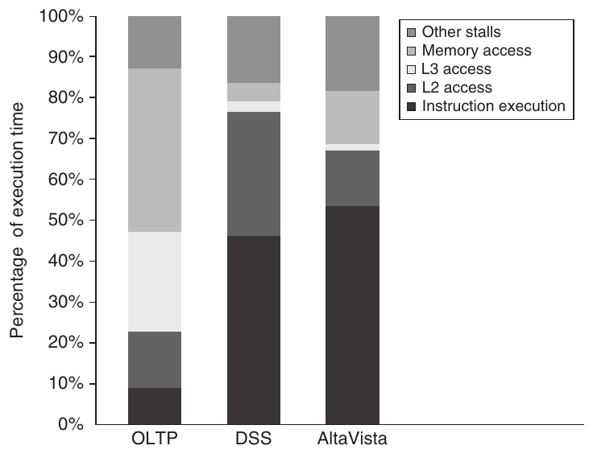

**Hình 5.11 Phân chia execution time của ba chương trình (OLTP, DSS và AltaVista) trong commercial workload. Các con số DSS là trung bình của sáu query khác nhau. CPI biến thiên lớn, từ mức thấp 1.3 của AltaVista, đến 1.61 của query DSS, rồi 7.0 của OLTP. (Xét riêng, query DSS có CPI từ 1.3 đến 1.9.) “Other stalls” bao gồm resource stall (được triển khai bằng replay trap trên 21164), branch mispredict, memory barrier và TLB miss. Với những benchmark này, resource-based pipeline stall là yếu tố chi phối. Dữ liệu này kết hợp hành vi user access và kernel access. Chỉ OLTP có tỷ lệ kernel access đáng kể, và kernel access có xu hướng hoạt động tốt hơn user access! Tất cả phép đo trong mục này do Barroso, Gharachorloo và Bugnion [1998] thu thập.**

Vì workload OLTP đòi hỏi nhiều nhất từ memory system với số lượng lớn L3 miss tốn kém, chúng ta tập trung xem xét ảnh hưởng của L3 cache size, processor count và block size lên benchmark OLTP. Hình 5.12 cho thấy ảnh hưởng của việc tăng cache size, sử dụng two-way set associative cache để giảm số lượng lớn conflict miss. Execution time được cải thiện khi L3 cache tăng do giảm L3 miss. Đáng ngạc nhiên là gần như toàn bộ lợi ích đến từ việc tăng từ 1 lên 2 MB, và tăng thêm sau đó chỉ đem lại ít lợi ích, mặc dù cache miss vẫn gây tổn thất performance đáng kể với cache 2 MB và 4 MB. Câu hỏi là tại sao?

Để hiểu rõ hơn câu trả lời, chúng ta cần xác định những yếu tố đóng góp vào L3 miss rate và cách chúng thay đổi khi L3 cache tăng. Hình 5.13 trình bày dữ liệu này, thể hiện số memory access cycle đóng góp trên mỗi instruction từ năm nguồn. Hai nguồn lớn nhất của L3 memory access cycle với L3 1 MB là instruction miss và capacity/conflict miss. Với L3 lớn hơn, hai nguồn này giảm thành những yếu tố đóng góp nhỏ. Đáng tiếc là compulsory, false sharing và true sharing miss không bị ảnh hưởng bởi L3 lớn hơn. Vì vậy, tại 4 MB và 8 MB, true sharing miss tạo ra phần chi phối của miss; việc true sharing miss không thay đổi dẫn đến mức giảm hạn chế của overall miss rate khi tăng L3 cache size quá 2 MB.

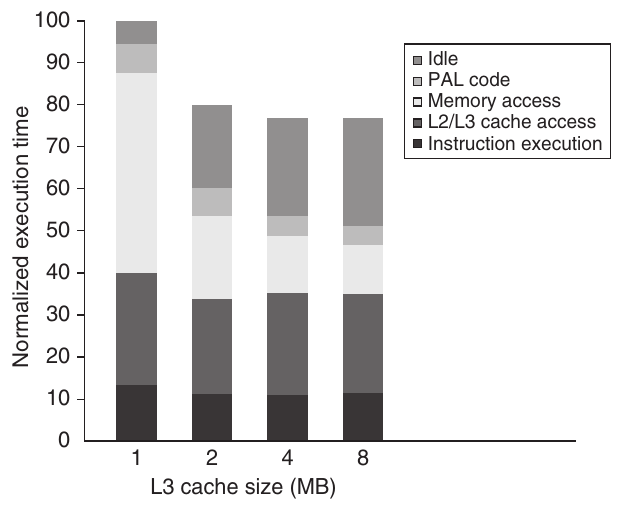

**Hình 5.12 Performance tương đối của workload OLTP khi L3 cache size, được cấu hình two-way set associative, tăng từ 1 MB lên 8 MB. Idle time cũng tăng khi cache size tăng, làm giảm bớt lợi ích performance. Sự gia tăng này xảy ra vì khi memory system stall ít hơn, cần nhiều server process hơn để che giấu I/O latency. Workload có thể được điều chỉnh lại để tăng cân bằng computation/communication, giữ idle time trong tầm kiểm soát. PAL code là một tập chuỗi OS-level instruction chuyên biệt được thực thi trong privileged mode; ví dụ là TLB miss handler.**

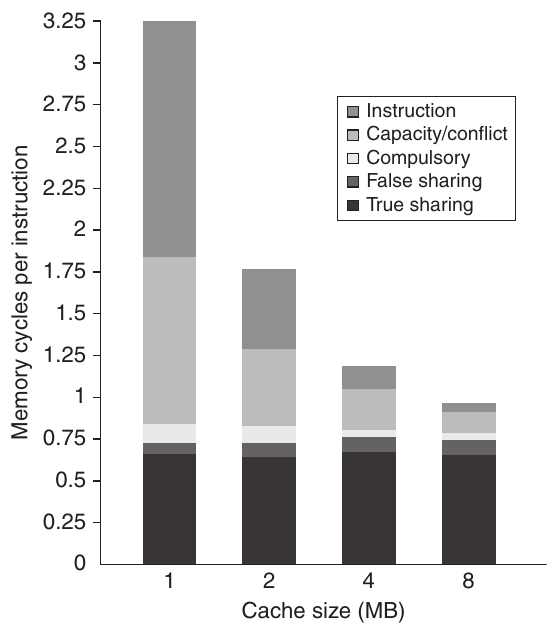

**Hình 5.13 Các nguyên nhân đóng góp vào memory access cycle thay đổi khi cache size tăng. L3 cache được mô phỏng là two-way set associative.**

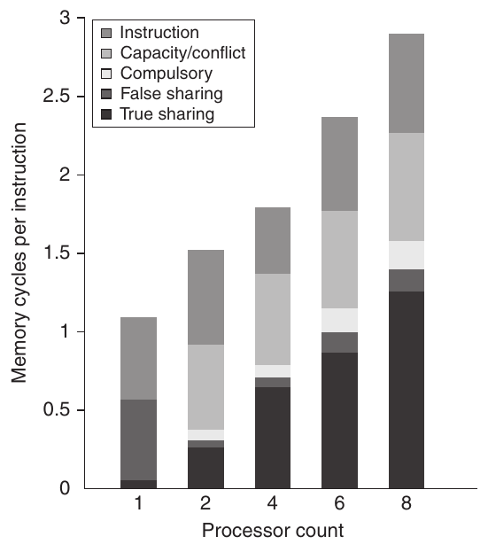

**Hình 5.14 Mức đóng góp vào memory access cycle tăng khi processor count tăng, chủ yếu do true sharing tăng. Compulsory miss tăng nhẹ vì lúc này mỗi processor phải xử lý thêm compulsory miss.**

Tăng cache size loại bỏ phần lớn uniprocessor miss nhưng không ảnh hưởng multiprocessor miss. Tăng processor count ảnh hưởng các loại miss khác nhau ra sao? Hình 5.14 trình bày dữ liệu này với giả định cấu hình cơ sở có L3 cache 2 MB, two-way set associative. Như có thể kỳ vọng, true sharing miss rate tăng mà không được bù đắp bởi bất kỳ sự giảm uniprocessor miss nào, dẫn đến overall memory access cycle trên mỗi instruction tăng.

Câu hỏi cuối cùng được xem xét là liệu tăng block size—vốn sẽ làm giảm instruction và cold miss rate, đồng thời trong giới hạn nhất định cũng giảm capacity/conflict miss rate và có thể cả true sharing miss rate—có hữu ích cho workload này không. Hình 5.15 trình bày số miss trên mỗi 1000 instruction khi block size tăng từ 32 lên 256 byte. Tăng block size từ 32 lên 256 byte ảnh hưởng bốn thành phần miss rate:

- True sharing miss rate giảm hơn 2 lần, cho thấy một mức locality nào đó trong các true sharing pattern.

- Compulsory miss rate giảm đáng kể như dự kiến.

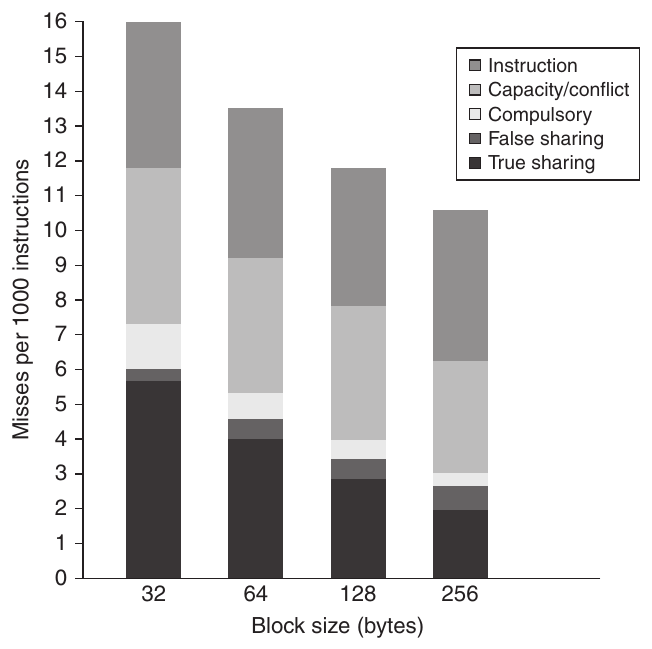

**Hình 5.15 Số miss trên mỗi 1000 instruction giảm đều khi block size của L3 cache tăng, tạo cơ sở thuyết phục để chọn L3 block size ít nhất 128 byte. L3 cache có size 2 MB và là two-way set associative.**

- Conflict/capacity miss giảm ít (giảm 1.26 lần so với block size tăng 8 lần), cho thấy spatial locality không cao trong các uniprocessor miss xảy ra với L3 cache lớn hơn 2 MB.

- False sharing miss rate gần gấp đôi dù giá trị tuyệt đối nhỏ.

Việc instruction miss rate không chịu ảnh hưởng đáng kể thật đáng ngạc nhiên. Nếu một instruction-only cache có hành vi này, chúng ta sẽ kết luận spatial locality rất kém. Trong trường hợp mixed L2 cache, các hiệu ứng khác như instruction-data conflict cũng có thể đóng góp vào instruction cache miss rate cao đối với block lớn hơn. Những nghiên cứu khác đã ghi nhận spatial locality thấp trong instruction stream của database lớn và workload OLTP, vốn có nhiều basic block ngắn và chuỗi code special-purpose. Dựa trên dữ liệu này, miss penalty để một L3 có block size lớn hơn đạt performance ngang L3 block size 32-byte có thể được biểu diễn như hệ số nhân của penalty block size 32-byte:

| Block size | Miss penalty so với miss penalty của block 32-byte |
|---|---|
| 64 byte | 1.19 |
| 128 byte | 1.36 |
| 256 byte | 1.52 |

Với DDR SDRAM hiện đại cho phép block access nhanh, các con số này có vẻ đạt được, đặc biệt ở block size 128 byte. Tất nhiên, chúng ta còn phải quan tâm ảnh hưởng của traffic tới memory tăng và contention có thể xảy ra với các core khác để sử dụng memory. Hiệu ứng sau có thể dễ dàng triệt tiêu những lợi ích thu được nhờ cải thiện performance của một processor.

### Multiprogramming và OS Workload

Nghiên cứu tiếp theo của chúng ta là một multiprogrammed workload gồm cả user activity và OS activity. Workload được sử dụng là hai bản sao độc lập của compile phase trong Andrew benchmark, một benchmark mô phỏng môi trường phát triển software. Compile phase gồm một phiên bản song song của lệnh Unix “make” được thực thi bằng tám processor. Workload chạy trong 5.24 giây trên tám processor, tạo 203 process và thực hiện 787 disk request trên ba file system khác nhau. Workload chạy với 128 MB memory và không xảy ra paging activity.

Workload có ba phase riêng biệt: compile benchmark, liên quan đến compute activity đáng kể; cài đặt object file vào library; và xóa object file. Phase cuối hoàn toàn bị I/O chi phối, và chỉ có hai process hoạt động (mỗi lần chạy một process). Trong phase giữa, I/O cũng đóng vai trò lớn và processor phần lớn nhàn rỗi. Overall workload sử dụng system và I/O chuyên sâu hơn nhiều so với commercial workload được điều chỉnh kỹ lưỡng.

Đối với các phép đo workload, chúng ta giả sử memory và I/O system như sau:

- Level 1 instruction cache—32 KB, two-way set associative với block 64-byte, hit time 1 clock cycle.

- Level 1 data cache—32 KB, two-way set associative với block 32-byte, hit time 1 clock cycle. Chúng ta thay đổi L1 data cache để xem xét ảnh hưởng của nó lên cache behavior.

- Level 2 cache—1 MB unified, two-way set associative với block 128-byte, hit time 10 clock cycle.

- Main memory—Một memory duy nhất trên bus với access time 100 clock cycle.

- Disk system—Fixed-access latency 3 ms (thấp hơn bình thường để giảm idle time).

Hình 5.16 cho thấy cách phân chia execution time cho tám processor bằng các parameter vừa liệt kê. Execution time được chia thành bốn thành phần:

1. Idle—Thực thi trong idle loop của kernel mode

2. User—Thực thi user code

3. Synchronization—Thực thi hoặc chờ synchronization variable

4. Kernel—Thực thi trong OS mà không idle và cũng không trong synchronization access

|  | User execution | Kernel execution | Chờ synchronization | Processor idle (chờ I/O) |
|---|---|---|---|---|
| Instruction đã thực thi | 27% | 3% | 1% | 69% |
| Execution time | 27% | 7% | 2% | 64% |

**Hình 5.16 Phân bố execution time trong workload parallel “make” multiprogrammed. Tỷ lệ idle time cao là do disk latency khi chỉ một trong tám processor hoạt động. Dữ liệu này và các phép đo tiếp theo cho workload này được thu thập bằng system SimOS [Rosenblum và cộng sự 1995]. Những lần chạy thực tế và việc thu thập dữ liệu do M. Rosenblum, S. Herrod và E. Bugnion thuộc Stanford University thực hiện.**

Workload multiprogramming này bị tổn thất instruction cache performance đáng kể, ít nhất đối với OS. Instruction cache miss rate trong OS với cache two-way set associative có block size 64-byte thay đổi từ 1.7% cho cache 32 KB đến 0.2% cho cache 256 KB. User-level instruction cache miss xấp xỉ one-sixth OS rate trên nhiều cache size khác nhau. Điều này giải thích một phần vì sao, mặc dù user code thực thi số instruction gấp chín lần kernel, những instruction đó chỉ mất thời gian khoảng bốn lần so với số instruction ít hơn được kernel thực thi.

### Performance của Multiprogramming và OS Workload

Trong tiểu mục này, chúng ta xem xét cache performance của multiprogrammed workload khi thay đổi cache size và block size. Do hành vi của kernel khác hành vi user process, chúng ta giữ riêng hai thành phần này. Tuy nhiên, hãy nhớ rằng user process thực thi số instruction lớn hơn tám lần, nên overall miss rate chủ yếu do miss rate của user code quyết định; như sẽ thấy, con số này thường là one-fifth kernel miss rate.

Mặc dù user code thực thi nhiều instruction hơn, hành vi operating system có thể gây nhiều cache miss hơn user process vì hai lý do ngoài code size lớn hơn và thiếu locality. Thứ nhất, kernel khởi tạo mọi page trước khi cấp phát cho user, làm tăng đáng kể thành phần compulsory trong miss rate của kernel. Thứ hai, kernel thực sự chia sẻ dữ liệu và vì vậy có coherence miss rate không nhỏ. Ngược lại, user process chỉ gây coherence miss khi process được schedule trên processor khác, và thành phần miss rate này nhỏ.

Hình 5.17 trình bày data miss rate theo data cache size và block size đối với các thành phần kernel và user. Tăng data cache size ảnh hưởng user miss rate nhiều hơn kernel miss rate. Tăng block size có tác động có lợi lên cả hai miss rate, vì tỷ lệ miss lớn hơn bắt nguồn từ compulsory và capacity; cả hai đều có thể được cải thiện với block size lớn hơn. Vì coherence miss tương đối hiếm hơn, tác động tiêu cực của tăng block size nhỏ. Để hiểu tại sao kernel và user process hành xử khác nhau, chúng ta có thể xem hành vi kernel miss.

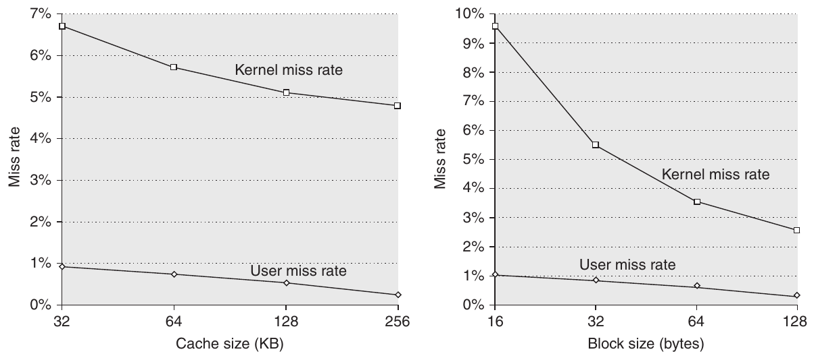

**Hình 5.17 Data miss rate của các thành phần user và kernel hành xử khác nhau khi tăng L1 data cache size (bên trái) so với tăng L1 data cache block size (bên phải). Tăng L1 data cache từ 32 KB lên 256 KB (với block 32-byte) khiến user miss rate giảm theo tỷ lệ nhiều hơn kernel miss rate: user-level miss rate giảm gần 3 lần, còn kernel-level miss rate chỉ giảm 1.3 lần. Miss rate của cả user lẫn kernel giảm đều khi L1 block size tăng (giữ L1 cache ở 32 KB). Ngược với ảnh hưởng của tăng cache size, tăng block size cải thiện kernel miss rate đáng kể hơn (giảm gần 4 lần cho kernel reference khi chuyển từ block 16-byte lên 128-byte, so với gần 3 lần cho user reference).**

Hình 5.18 trình bày sự biến thiên kernel miss khi cache size và block size tăng. Miss được chia thành ba nhóm: compulsory miss, coherence miss (do cả true và false sharing), và capacity/conflict miss (bao gồm miss do interference giữa OS với user process và giữa nhiều user process). Hình 5.18 xác nhận rằng đối với kernel reference, tăng cache size chỉ giảm uniprocessor capacity/conflict miss rate. Ngược lại, tăng block size làm giảm compulsory miss rate. Việc coherence miss rate không tăng mạnh khi block size tăng có nghĩa là ảnh hưởng false sharing có lẽ không đáng kể, mặc dù những miss như vậy có thể bù trừ một phần lợi ích từ việc giảm true sharing miss.

Nếu xem số byte cần cho mỗi data reference, như trong Hình 5.19, chúng ta thấy kernel có traffic ratio cao hơn và tỷ lệ này tăng theo block size. Dễ hiểu vì sao điều này xảy ra: khi chuyển từ block 16-byte lên block 128-byte, miss rate giảm khoảng 3.7 lần nhưng số byte truyền trên mỗi miss tăng 8 lần, nên tổng miss traffic tăng nhỉnh hơn 2 lần. User program cũng tăng hơn gấp đôi khi block size tăng từ 16 lên 128 byte, nhưng bắt đầu ở mức thấp hơn nhiều.

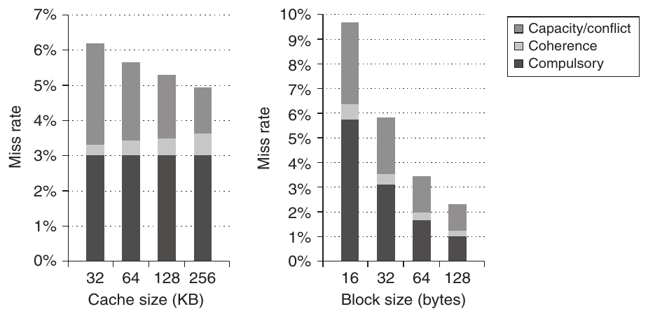

**Hình 5.18 Các thành phần kernel data miss rate thay đổi khi L1 data cache size tăng từ 32 KB lên 256 KB, trong khi multiprogramming workload chạy trên tám processor. Thành phần compulsory miss rate giữ nguyên vì không bị ảnh hưởng bởi cache size. Thành phần capacity giảm hơn 2 lần, còn thành phần coherence gần như tăng gấp đôi. Coherence miss tăng vì xác suất miss do invalidation tăng theo cache size, do ít entry bị đẩy ra vì capacity hơn. Như kỳ vọng, tăng block size của L1 data cache làm giảm đáng kể compulsory miss rate của kernel reference. Nó cũng tác động đáng kể tới capacity miss rate, giảm 2.4 lần trên dải block size. Block size tăng làm coherence traffic giảm nhẹ và dường như ổn định tại 64 byte, không thay đổi coherence miss rate khi chuyển sang line 128-byte. Vì coherence miss rate không giảm đáng kể khi block size tăng, tỷ lệ miss rate do coherence tăng từ khoảng 7% lên khoảng 15%.**

Đối với multiprogrammed workload, OS đòi hỏi nhiều hơn hẳn từ memory system. Nếu đưa thêm OS hoặc OS-like activity vào workload, với hành vi tương tự những gì đã đo ở workload này, việc xây dựng memory system đủ khả năng sẽ trở nên rất khó. Một hướng cải thiện performance có thể là làm OS nhận biết cache tốt hơn, thông qua programming environment tốt hơn hoặc hỗ trợ của programmer. Chẳng hạn, OS tái sử dụng memory cho request phát sinh từ những system call khác nhau. Dù memory tái sử dụng sẽ bị ghi đè hoàn toàn, hardware không nhận biết điều này vẫn cố bảo toàn coherency và khả năng một phần cache block có thể được đọc, ngay cả khi thực tế không đọc. Hành vi này tương tự tái sử dụng stack location khi gọi procedure. IBM Power series có hỗ trợ cho phép compiler chỉ ra kiểu hành vi này khi gọi procedure, và AMD processor mới nhất có hỗ trợ tương tự. Khó phát hiện hành vi như vậy trong OS hơn, và có thể cần programmer hỗ trợ, nhưng lợi ích tiềm năng còn lớn hơn.

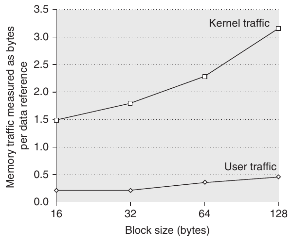

**Hình 5.19 Số byte cần cho mỗi data reference tăng khi block size tăng đối với cả thành phần kernel lẫn user. Sẽ thú vị nếu so sánh biểu đồ này với dữ liệu về scientific program trong Phụ lục I.**

OS và commercial workload đặt ra những thách thức khó cho multiprocessor memory system; khác scientific application được xem trong Phụ lục I, chúng ít phù hợp với việc tái cấu trúc algorithm hoặc compiler hơn. Khi số core tăng, dự đoán hành vi của các ứng dụng này có lẽ sẽ khó hơn. Emulation hoặc simulation methodology cho phép mô phỏng hàng trăm core với ứng dụng lớn (bao gồm operating system) sẽ đóng vai trò then chốt để duy trì cách tiếp cận thiết kế mang tính phân tích và định lượng.

## 5.4 Distributed Shared-Memory và Directory-Based Coherence

Như đã thấy trong Mục 5.2, snooping protocol đòi hỏi communication với tất cả cache trên mỗi cache miss, bao gồm write tới dữ liệu có khả năng shared. Việc không có centralized data structure theo dõi state của cache vừa là lợi thế nền tảng của scheme snooping-based vì giúp nó rẻ, vừa là gót chân Achilles khi xét khả năng mở rộng.

Chẳng hạn, xét một multiprocessor gồm bốn multicore 4-core, có khả năng duy trì một data reference trên mỗi clock và clock 4 GHz. Từ dữ liệu trong Mục I.5 của Phụ lục I, có thể thấy các ứng dụng có thể đòi hỏi bus bandwidth từ 4 GB/sec đến 170 GB/sec. Mặc dù cache trong những thí nghiệm đó nhỏ, phần lớn traffic là coherence traffic, không bị ảnh hưởng bởi cache size. Dù một bus hiện đại có thể đáp ứng 4 GB/sec, 170 GB/sec vượt xa khả năng của bất kỳ system bus-based nào. Trong vài năm qua, sự phát triển của multicore processor buộc tất cả nhà thiết kế chuyển sang một dạng distributed memory để hỗ trợ bandwidth demand của từng processor.

Chúng ta có thể tăng memory bandwidth và interconnection bandwidth bằng cách phân bố memory, như Hình 5.2 ở trang 348; điều này lập tức tách local memory traffic khỏi remote memory traffic, giảm bandwidth demand trên memory system và interconnection network. Nếu không loại bỏ nhu cầu coherence protocol broadcast trên mỗi cache miss, việc phân bố memory sẽ đem lại rất ít lợi ích.

Như đã đề cập, lựa chọn thay cho coherence protocol snooping-based là directory protocol. Directory giữ state của mọi block có thể được cache. Thông tin trong directory bao gồm cache nào (hoặc tập cache nào) có bản sao của block, block có dirty hay không, v.v. Trong một multicore có shared outermost cache (chẳng hạn L3), dễ triển khai directory scheme: chỉ cần giữ cho mỗi L3 block một bit vector có size bằng số core. Bit vector cho biết private cache nào có thể giữ bản sao của block trong L3, và invalidation chỉ được gửi tới các cache đó. Cách này hoạt động hoàn hảo cho một multicore nếu L3 inclusive, và đây là scheme được Intel i7 sử dụng.

Giải pháp một directory duy nhất dùng trong multicore không có khả năng mở rộng, mặc dù tránh được broadcast. Directory phải được phân bố, nhưng việc phân bố phải được thực hiện sao cho coherence protocol biết nơi tìm directory information của mọi cached memory block. Giải pháp hiển nhiên là phân bố directory cùng với memory, để các coherence request khác nhau có thể tới directory khác nhau, giống các memory request khác nhau tới memory khác nhau. Distributed directory giữ đặc tính rằng sharing status của block luôn nằm tại một location duy nhất đã biết. Thuộc tính này, cùng việc duy trì thông tin cho biết node nào khác có thể đang cache block, cho phép coherence protocol tránh broadcast. Hình 5.20 cho thấy distributed-memory multiprocessor của chúng ta sau khi thêm directory vào mỗi node.

Các cách triển khai directory đơn giản nhất gắn một directory entry với mỗi memory block. Trong những triển khai như vậy, lượng thông tin tỷ lệ với tích số memory block (mỗi block có cùng size với L2 hoặc L3 cache block) nhân số node, trong đó một node là một multicore processor hoặc một tập processor nhỏ triển khai coherence nội bộ. Overhead này không thành vấn đề với multiprocessor có ít hơn vài trăm processor (mỗi processor có thể là multicore), bởi directory overhead với block size hợp lý sẽ ở mức chấp nhận được. Với multiprocessor lớn hơn, cần phương pháp cho phép directory structure mở rộng hiệu quả, nhưng chỉ system supercomputer-sized mới cần lo vấn đề này.

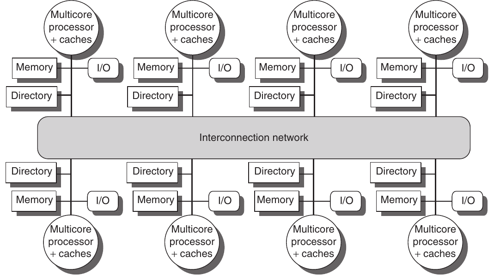

**Hình 5.20 Một directory được thêm vào mỗi node để triển khai cache coherence trong distributed-memory multiprocessor. Trong trường hợp này, node được vẽ như một multicore chip duy nhất, và directory information cho memory tương ứng có thể nằm trên hoặc ngoài multicore. Mỗi directory chịu trách nhiệm theo dõi cache nào chia sẻ các memory address của phần memory trong node. Coherence mechanism xử lý cả việc duy trì directory information lẫn mọi coherence action cần thiết trong multicore node.**

### Directory-Based Cache Coherence Protocol: Cơ bản

Cũng như snooping protocol, directory protocol phải triển khai hai operation chủ yếu: xử lý read miss và xử lý write tới một shared, clean cache block. (Xử lý write miss tới block hiện đang shared là sự kết hợp đơn giản của hai operation này.) Để triển khai các operation đó, directory phải theo dõi state của mỗi cache block. Trong protocol đơn giản, các state có thể như sau:

- Shared—Một hoặc nhiều node cache block, và giá trị trong memory được cập nhật mới nhất (cũng như trong mọi cache).

- Uncached—Không node nào có bản sao của cache block.

- Modified—Đúng một node có bản sao của cache block và đã ghi block, nên bản sao trong memory bị lỗi thời. Processor này được gọi là owner của block.

Ngoài theo dõi state của từng memory block có khả năng shared, chúng ta phải theo dõi node nào có bản sao của block, bởi các bản sao đó cần bị invalidate khi write. Cách đơn giản nhất là giữ một bit vector cho mỗi memory block. Khi block shared, mỗi bit cho biết processor chip tương ứng (có khả năng là multicore) có bản sao của block hay không. Cũng có thể dùng bit vector theo dõi owner khi block ở exclusive state. Vì lý do hiệu quả, chúng ta còn theo dõi state của từng cache block tại các cache riêng lẻ.

State và transition của state machine tại mỗi cache giống hệt những gì đã dùng cho snooping cache, mặc dù action trên transition hơi khác. Quá trình invalidation và định vị exclusive copy của data item khác nhau, bởi cả hai đều liên quan đến communication giữa requesting node và directory, rồi giữa directory và một hoặc nhiều remote node. Trong snooping protocol, hai bước này được kết hợp nhờ broadcast tới mọi node.

Trước khi xem protocol state diagram, sẽ hữu ích nếu xem danh mục các message type có thể được gửi giữa processor và directory để xử lý miss và duy trì coherence. Hình 5.21 trình bày các message type gửi giữa các node. Local node là node phát sinh request. Home node là node chứa memory location và directory entry của một address. Physical address space được phân bố tĩnh, nên node chứa memory và directory cho physical address nhất định đã được biết. Chẳng hạn, high-order bit có thể cung cấp node number, còn low-order bit cung cấp offset trong memory trên node đó. Local node cũng có thể là home node. Directory vẫn phải được truy cập khi home node chính là local node, bởi bản sao có thể tồn tại trong node thứ ba, gọi là remote node.

| Loại message | Nguồn | Đích | Nội dung message | Chức năng của message |
|---|---|---|---|---|
| Read miss | Local cache | Home directory | P, A | Node P gặp read miss tại address A; yêu cầu dữ liệu và làm cho P trở thành read sharer. |
| Write miss | Local cache | Home directory | P, A | Node P gặp write miss tại address A; yêu cầu dữ liệu và làm cho P trở thành exclusive owner. |
| Invalidate | Local cache | Home directory | A | Yêu cầu gửi invalidate tới tất cả remote cache đang cache block tại address A. |
| Invalidate | Home directory | Remote cache | A | Invalidate một shared copy của dữ liệu tại address A. |
| Fetch | Home directory | Remote cache | A | Fetch block tại address A và gửi tới home directory của nó; chuyển state của A trong remote cache thành shared. |
| Fetch/invalidate | Home directory | Remote cache | A | Fetch block tại address A và gửi tới home directory của nó; invalidate block trong cache. |
| Data value reply | Home directory | Local cache | D | Trả về một data value từ home memory. |
| Data write-back | Remote cache | Home directory | A, D | Write-back một data value cho address A. |

**Hình 5.21 Các message có thể gửi giữa node để duy trì coherence, cùng source và destination node, nội dung (trong đó P = số requesting node, A = requested address và D = data contents), và chức năng message. Ba message đầu là request từ local node tới home. Message thứ tư đến thứ sáu do home gửi tới remote node khi home cần dữ liệu để đáp ứng read hoặc write miss request. Data value reply được dùng để gửi giá trị từ home node về requesting node. Data value write-backs xảy ra vì hai lý do: khi block bị thay thế trong cache và phải ghi trả home memory, và khi đáp ứng fetch hoặc fetch/invalidate message từ home. Ghi trả data value bất cứ khi nào block trở thành shared giúp giảm số state của protocol, bởi mọi dirty block phải exclusive và mọi shared block luôn có sẵn trong home memory.**

Remote node là node có bản sao của cache block, dù exclusive (khi đó là bản sao duy nhất) hay shared. Remote node có thể trùng local node hoặc home node. Trong những trường hợp này, protocol cơ bản không đổi, nhưng interprocessor message có thể được thay bằng intraprocessor message.

Trong mục này, chúng ta giả sử một memory consistency model đơn giản. Để giảm thiểu message type và độ phức tạp protocol, chúng ta giả định message được nhận và xử lý theo cùng thứ tự gửi. Giả định này có thể không đúng trong thực tế và có thể dẫn đến phức tạp bổ sung; một số sẽ được xử lý trong Mục 5.6 khi thảo luận memory consistency model. Trong mục này, chúng ta dùng giả định để bảo đảm invalidate do một node gửi được thực hiện trước khi message mới được truyền, giống giả định trong phần triển khai snooping protocol. Như trong trường hợp snooping, chúng ta bỏ qua một số chi tiết cần thiết để triển khai coherence protocol. Cụ thể, tuần tự hóa write và biết rằng invalidate cho write đã hoàn tất không đơn giản như trong snooping mechanism broadcast-based. Thay vào đó, cần acknowledgment tường minh đáp ứng write miss và invalidate request. Chúng ta thảo luận chi tiết hơn trong Phụ lục I.

### Ví dụ Directory Protocol

Các state cơ bản của cache block trong directory-based protocol giống hệt snooping protocol, và state trong directory cũng tương tự những state đã trình bày. Vì vậy, có thể bắt đầu bằng state diagram đơn giản cho thấy state transition của một cache block riêng lẻ, rồi xem state diagram cho directory entry tương ứng mỗi block trong memory. Như trường hợp snooping, những state transition diagram này không thể hiện mọi chi tiết của coherence protocol; tuy nhiên, controller thực tế phụ thuộc nhiều vào các chi tiết của multiprocessor (thuộc tính message delivery, buffering structure, v.v.). Trong mục này, chúng ta trình bày protocol state diagram cơ bản. Các vấn đề hóc búa khi triển khai những state transition diagram này được xem trong Phụ lục I.

Hình 5.22 trình bày các protocol action mà từng cache đáp ứng. Chúng ta dùng cùng ký hiệu như mục trước, với request đến từ bên ngoài node màu xám và action ghi đậm. State transition của từng cache do read miss, write miss, invalidate và data fetch request gây ra; Hình 5.22 trình bày những operation này. Mỗi cache còn tạo read miss, write miss và invalidate message gửi tới home directory. Read và write miss đòi hỏi data value reply, và các event này chờ reply trước khi đổi state. Biết khi nào invalidate hoàn tất là vấn đề riêng và được xử lý riêng.

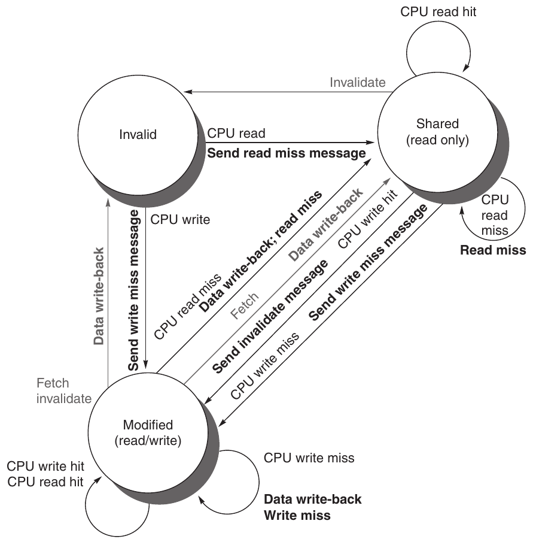

**Hình 5.22 State transition diagram cho một cache block riêng lẻ trong directory-based system. Request của local processor được vẽ màu đen, và request từ home directory màu xám. Các state giống trường hợp snooping, và transaction rất tương tự, với invalidate và write-back request tường minh thay thế write miss trước đây được broadcast trên bus. Như đã làm với snooping controller, chúng ta giả định nỗ lực ghi shared cache block được xem như miss; trong thực tế, transaction này có thể được xem là ownership request hoặc upgrade request và có thể cấp ownership mà không cần fetch cache block.**

Hoạt động của state transition diagram cho cache block trong Hình 5.22 về cơ bản giống trường hợp snooping: state giống hệt và stimulus gần như giống hệt. Write miss operation, vốn được broadcast trên bus (hoặc network khác) trong snooping scheme, được thay bằng data fetch và invalidate operation do directory controller gửi chọn lọc. Như snooping protocol, bất kỳ cache block nào cũng phải ở exclusive state khi được ghi, và mọi shared block phải up to date trong memory. Trong nhiều multicore processor, outermost level của processor cache được chia sẻ giữa core (như L3 trong Intel i7, AMD Opteron và IBM Power7), và hardware ở level đó duy trì coherence giữa private cache của từng core trên cùng chip, bằng internal directory hoặc snooping. Vì vậy, on-chip multicore coherence mechanism có thể được dùng để mở rộng coherence giữa tập processor lớn hơn chỉ bằng cách giao tiếp với outermost shared cache. Vì interface này ở L3, contention giữa processor và coherence request ít đáng ngại hơn, và có thể tránh nhân đôi tag.

Trong directory-based protocol, directory triển khai nửa còn lại của coherence protocol. Message gửi tới directory gây hai loại action khác nhau: cập nhật directory state và gửi thêm message để đáp ứng request. State trong directory biểu thị ba state tiêu chuẩn của block; tuy nhiên, khác snooping scheme, directory state cho biết state của tất cả cached copy của memory block, thay vì một cache block riêng lẻ.

Memory block có thể không được node nào cache, được cache ở nhiều node và readable (shared), hoặc được cache độc quyền và writable trong đúng một node. Ngoài state của mỗi block, directory phải theo dõi tập node có bản sao của block; chúng ta dùng tập gọi là Sharers cho chức năng này. Trong multiprocessor có ít hơn 64 node (mỗi node có thể đại diện số processor gấp bốn đến tám lần), tập này thường được giữ dưới dạng bit vector. Directory request cần cập nhật tập Sharers và đọc tập để thực hiện invalidation.

Hình 5.23 trình bày action tại directory để đáp ứng message nhận được. Directory nhận ba request khác nhau: read miss, write miss và data write-back. Message được directory gửi phản hồi được ghi đậm, còn cập nhật tập Sharers được ghi đậm nghiêng. Vì mọi stimulus message đều từ bên ngoài, tất cả action được vẽ màu xám. Protocol đơn giản hóa của chúng ta giả định một số action là atomic, như yêu cầu một giá trị rồi gửi nó tới node khác; triển khai thực tế không thể dùng giả định này.

Để hiểu directory operation, hãy xem request nhận được và action thực hiện theo từng state. Khi block ở uncached state, bản sao trong memory là giá trị hiện tại, nên request duy nhất có thể có cho block là:

- Read miss—Requested data được gửi từ memory tới requesting node, và requestor trở thành sharing node duy nhất. State của block được chuyển thành shared.

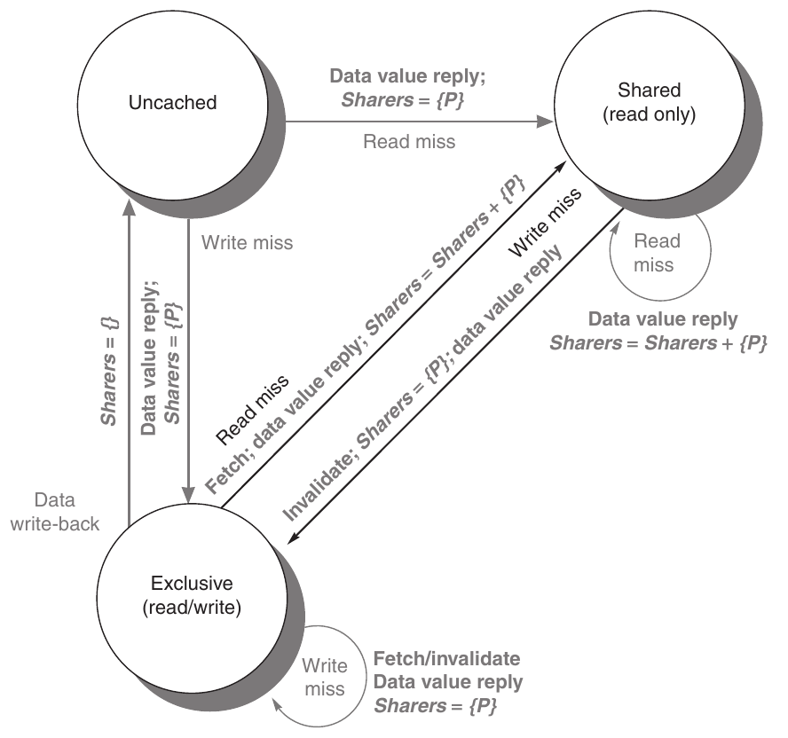

**Hình 5.23 State transition diagram của directory có cùng state và cấu trúc như transition diagram cho từng cache riêng lẻ. Mọi action đều màu xám vì tất cả đều do bên ngoài gây ra. Chữ đậm chỉ action directory thực hiện để đáp ứng request.**

- Write miss—Giá trị được gửi tới requesting node và node này trở thành sharing node. Block được chuyển thành exclusive để cho biết bản sao valid duy nhất đang được cache. Sharers cho biết danh tính owner.

Khi block ở shared state, memory value là mới nhất, nên vẫn có thể xảy ra hai request tương tự:

- Read miss—Requested data được gửi từ memory tới requesting node, và requesting node được thêm vào sharing set.

- Write miss—Giá trị được gửi tới requesting node. Invalidate message được gửi tới mọi node trong tập Sharers, và tập Sharers được đặt để chứa danh tính requesting node. State của block được chuyển thành exclusive.

Khi block ở exclusive state, giá trị hiện tại được giữ trong cache trên node do tập Sharers xác định (owner), nên có ba directory request khả dĩ:

- Read miss—Owner nhận data fetch message, khiến state của block trong cache của owner chuyển thành shared và khiến owner gửi dữ liệu tới directory; tại đó dữ liệu được ghi vào memory rồi gửi về requesting processor. Danh tính requesting node được thêm vào tập Sharers, vốn vẫn chứa danh tính processor từng là owner (vì nó vẫn có readable copy).

- Data write-back—Owner đang thay thế block và vì vậy phải ghi trả nó. Thao tác write-back này cập nhật bản sao trong memory (home directory thực chất trở thành owner), block lúc này uncached, và tập Sharers rỗng.

- Write miss—Block có owner mới. Message được gửi tới owner cũ, khiến cache invalidate block và gửi giá trị tới directory; từ đó giá trị được gửi tới requesting node, node trở thành owner mới. Sharers được đặt thành danh tính owner mới, và state của block vẫn exclusive.

State transition diagram trong Hình 5.23 là một sự đơn giản hóa, như trong trường hợp snooping cache. Với directory, cũng như snooping scheme triển khai bằng network khác bus, protocol cần xử lý nonatomic memory transaction. Phụ lục I tìm hiểu sâu các vấn đề này.

Directory protocol dùng trong multiprocessor thực tế có thêm tối ưu hóa. Cụ thể, trong protocol này, khi read hoặc write miss xảy ra cho block exclusive, block trước tiên được gửi tới directory tại home node. Từ đó nó được lưu vào home memory và gửi tới requesting node ban đầu. Nhiều protocol dùng trong commercial multiprocessor chuyển dữ liệu trực tiếp từ owner node tới requesting node (đồng thời thực hiện write-back về home). Những tối ưu hóa này thường tăng độ phức tạp bằng cách tăng khả năng deadlock và tăng message type phải xử lý.

Triển khai directory scheme đòi hỏi giải quyết phần lớn cùng thách thức đã thảo luận cho snooping protocol từ trang 365. Tuy nhiên, còn có các vấn đề mới và bổ sung được mô tả trong Phụ lục I. Trong Mục 5.8, chúng ta mô tả ngắn cách multicore hiện đại mở rộng coherence ra ngoài một chip. Các kết hợp multichip coherence và multicore coherence bao gồm cả bốn khả năng snooping/snooping (AMD Opteron), snooping/directory, directory/snooping và directory/directory!

## 5.5 Synchronization: Cơ bản

Synchronization mechanism thường được xây dựng bằng user-level software routine dựa vào synchronization instruction hardware-supplied. Với multiprocessor nhỏ hơn hoặc tình huống low-contention, năng lực hardware then chốt là một uninterruptible instruction hoặc instruction sequence có thể atomic retrieve và change giá trị. Software synchronization mechanism sau đó được xây dựng trên năng lực này. Trong mục này, chúng ta tập trung triển khai lock và unlock synchronization operation. Lock và unlock có thể được dùng trực tiếp để tạo mutual exclusion, cũng như triển khai synchronization mechanism phức tạp hơn.

Trong tình huống high-contention, synchronization có thể trở thành performance bottleneck vì contention tạo thêm delay và vì latency có thể lớn hơn trong multiprocessor như vậy. Chúng ta thảo luận cách mở rộng synchronization mechanism cơ bản của mục này cho processor count lớn trong Phụ lục I.

### Hardware Primitive cơ bản

Khả năng then chốt cần để triển khai synchronization trong multiprocessor là một tập hardware primitive có thể atomic read và modify một memory location. Không có năng lực ấy, chi phí xây dựng synchronization primitive cơ bản sẽ quá cao và tăng theo processor count. Có nhiều cách biểu đạt khác nhau cho hardware primitive cơ bản, tất cả đều cung cấp khả năng atomic read và modify một location cùng cách xác định read và write có được thực hiện atomic hay không. Những hardware primitive này là các khối cơ bản dùng để xây dựng nhiều loại user-level synchronization operation, bao gồm lock và barrier. Nhìn chung, architect không kỳ vọng user sử dụng hardware primitive cơ bản, mà kỳ vọng system programmer dùng chúng để xây synchronization library, một quá trình thường phức tạp và tinh tế. Hãy bắt đầu với một hardware primitive như vậy và chỉ ra cách dùng nó để xây dựng một số synchronization operation cơ bản.

Một operation điển hình để xây dựng synchronization operation là atomic exchange, hoán đổi một giá trị trong register với một giá trị trong memory. Để thấy cách dùng nó xây synchronization operation cơ bản, giả sử cần một lock đơn giản dùng giá trị 0 biểu thị lock free và 1 biểu thị lock không khả dụng. Processor cố đặt lock bằng cách exchange giá trị 1 trong register với memory address tương ứng lock. Giá trị exchange instruction trả về là 1 nếu processor khác đã giành quyền access, và 0 nếu chưa. Trong trường hợp sau, giá trị đồng thời được đổi thành 1, ngăn exchange cạnh tranh khác cũng nhận được 0.

Chẳng hạn, xét hai processor cùng cố exchange đồng thời: race này được giải quyết vì đúng một processor thực hiện exchange trước và trả về 0, còn processor thứ hai trả về 1 khi exchange. Chìa khóa dùng exchange (hoặc swap) primitive để triển khai synchronization là operation atomic: exchange không thể chia nhỏ, và hai exchange đồng thời sẽ được write serialization mechanism sắp thứ tự. Hai processor cố đặt synchronization variable theo cách này không thể cùng nghĩ rằng mình đã đặt variable đồng thời.

Có nhiều atomic primitive khác có thể dùng để triển khai synchronization. Tất cả đều có thuộc tính then chốt là đọc và cập nhật memory value theo cách cho phép xác định hai operation có thực thi atomic hay không. Một operation có trong nhiều multiprocessor cũ là test-and-set, kiểm tra một giá trị và đặt nó nếu giá trị vượt qua phép kiểm tra. Chẳng hạn, có thể định nghĩa operation kiểm tra 0 rồi đặt giá trị thành 1, và dùng tương tự atomic exchange. Một atomic synchronization primitive khác là fetch-and-increment: nó trả về giá trị memory location và atomic increment giá trị ấy. Dùng 0 để biểu thị synchronization variable chưa được giành, chúng ta có thể dùng fetch-and-increment như exchange. Những operation như fetch-and-increment còn có các công dụng khác, sẽ được xem ngay sau đây.

Triển khai một atomic memory operation duy nhất đặt ra một số thách thức, bởi nó đòi hỏi cả memory read lẫn write trong một uninterruptible instruction. Yêu cầu này làm phức tạp coherence implementation, vì hardware không thể cho phép operation khác xen giữa read và write, đồng thời không được deadlock.

Một lựa chọn thay thế là dùng một cặp instruction, trong đó instruction thứ hai trả về giá trị cho phép suy ra liệu cặp instruction có được thực thi như thể atomic hay không. Cặp instruction thực chất atomic nếu có vẻ như mọi operation khác do bất kỳ processor nào thực thi đều xảy ra trước hoặc sau cặp ấy. Vì vậy, khi instruction pair thực chất atomic, không processor khác nào có thể thay đổi giá trị giữa hai instruction.

Cặp instruction gồm một load đặc biệt gọi là load linked hoặc load locked và một store đặc biệt gọi là store conditional. Chúng được dùng liên tiếp: nếu nội dung memory location do load linked chỉ định bị thay đổi trước khi store conditional tới cùng address xảy ra, store conditional thất bại. Nếu processor context switch giữa hai instruction, store conditional cũng thất bại. Store conditional được định nghĩa trả về 1 khi thành công và 0 nếu không. Vì load linked trả về giá trị ban đầu và store conditional chỉ trả về 1 khi thành công, chuỗi sau triển khai atomic exchange trên memory location do nội dung R1 chỉ định:

```
try:   MOV R3,R4  ;mov exchange value
       LL  R2,0(R1);load linked
       SC  R3,0(R1);store conditional
       BEQZ R3,try  ;branch store fails
       MOV R4,R2  ;put load value in R4
```

Ở cuối chuỗi này, nội dung R4 và memory location do R1 chỉ định đã được atomic exchange (bỏ qua mọi ảnh hưởng của delayed branch). Bất cứ khi nào một processor xen vào và sửa giá trị trong memory giữa LL và SC instruction, SC trả về 0 trong R3, khiến chuỗi code thử lại.

Một lợi thế của load linked/store conditional mechanism là có thể dùng nó để xây dựng synchronization primitive khác. Chẳng hạn, đây là một atomic fetch-and-increment:

```
try:   LL  R2,0(R1) ;load linked
       DADDUIR3,R2,#1 ;increment
       SC  R3,0(R1) ;store conditional
       BEQZ R3,try  ;branch store fails
```

Các instruction này thường được triển khai bằng cách theo dõi address do LL instruction chỉ định trong một register, thường gọi là link register. Nếu interrupt xảy ra, hoặc nếu cache block khớp address trong link register bị invalidate (chẳng hạn bởi một SC khác), link register bị xóa. SC instruction đơn giản kiểm tra address của nó có khớp address trong link register không. Nếu khớp, SC thành công; nếu không, thất bại. Vì store conditional thất bại sau một nỗ lực store khác tới load linked address hoặc sau bất kỳ exception nào, phải thận trọng khi chọn instruction chèn giữa hai instruction. Cụ thể, chỉ register-register instruction mới có thể được cho phép một cách an toàn; nếu không, có thể tạo tình huống deadlock khiến processor không bao giờ hoàn tất SC. Ngoài ra, số instruction giữa load linked và store conditional nên nhỏ để giảm thiểu xác suất một unrelated event hoặc competing processor khiến store conditional thất bại thường xuyên.

### Triển khai Lock bằng Coherence

Khi đã có atomic operation, chúng ta có thể dùng coherence mechanism của multiprocessor để triển khai spin lock—lock mà processor liên tục cố lấy, quay quanh một loop đến khi thành công. Spin lock được dùng khi programmer kỳ vọng lock chỉ được giữ trong thời gian rất ngắn và muốn quá trình locking có latency thấp khi lock khả dụng. Vì spin lock chiếm giữ processor để chờ trong loop tới khi lock free, chúng không phù hợp trong một số hoàn cảnh.

Cách triển khai đơn giản nhất, sẽ dùng nếu không có cache coherence, là giữ lock variable trong memory. Processor có thể liên tục cố lấy lock bằng atomic operation, chẳng hạn atomic exchange ở trang 387, rồi kiểm tra exchange có trả về lock free hay không. Để release lock, processor chỉ cần store giá trị 0 vào lock. Đây là chuỗi code khóa một spin lock có address trong R1 bằng atomic exchange:

```
          DADDUIR2,R0,#1
lockit:   EXCHR2,0(R1)    ;atomic exchange
          BNEZR2,lockit   ;already locked?
```

Nếu multiprocessor hỗ trợ cache coherence, chúng ta có thể cache lock và dùng coherence mechanism duy trì lock value coherent. Caching lock có hai lợi thế. Thứ nhất, nó cho phép triển khai quá trình “spinning” (cố kiểm tra và lấy lock trong tight loop) trên local cached copy thay vì đòi hỏi global memory access trong mỗi lần cố lấy lock. Lợi thế thứ hai đến từ nhận xét thường có locality trong lock access; tức processor vừa sử dụng lock gần nhất sẽ sớm sử dụng lại. Trong trường hợp đó, lock value có thể nằm trong cache của processor ấy, giảm đáng kể thời gian lấy lock.

Để đạt lợi thế thứ nhất—spin trên local cached copy thay vì tạo memory request cho mỗi lần cố lấy lock—cần thay đổi spin procedure đơn giản. Mỗi nỗ lực exchange trong loop ngay phía trên đòi hỏi write operation. Nếu nhiều processor đang cố lấy lock, mỗi processor sẽ tạo write. Hầu hết write này dẫn đến write miss, bởi mỗi processor đang cố lấy lock variable ở exclusive state.

Vì vậy, cần sửa spin lock procedure để spin bằng cách read local copy của lock tới khi thấy lock khả dụng. Sau đó nó cố lấy lock bằng swap operation. Processor trước tiên đọc lock variable để kiểm tra state. Processor tiếp tục đọc và kiểm tra tới khi read value cho biết lock unlocked. Sau đó processor đua với tất cả process khác cũng đang “spin waiting” để xem bên nào khóa variable trước. Mọi process dùng swap instruction đọc giá trị cũ và store 1 vào lock variable. Bên thắng duy nhất nhìn thấy 0, còn bên thua thấy 1 do bên thắng đặt vào. (Bên thua tiếp tục đặt variable thành locked value, nhưng điều đó không quan trọng.) Processor thắng thực thi code sau lock và, khi xong, store 0 vào lock variable để release lock, bắt đầu lại cuộc đua. Đây là code thực hiện spin lock ấy (nhớ rằng 0 là unlocked và 1 là locked):

```
lockit:   LDR2,0(R1)      ;load of lock
          BNEZR2,lockit   ;not available-spin
          DADDUIR2,R0,#1  ;load locked value
          EXCHR2,0(R1)    ;swap
          BNEZR2,lockit   ;branch if lock wasn’t 0
```

Hãy xem scheme “spin lock” này sử dụng cache coherence mechanism như thế nào. Hình 5.24 trình bày processor operation và bus hoặc directory operation của nhiều process cố khóa variable bằng atomic swap. Khi processor giữ lock store 0 vào lock, mọi cache khác bị invalidate và phải fetch giá trị mới để cập nhật bản sao lock của mình. Một cache nhận bản sao unlocked value (0) trước và thực hiện swap. Khi cache miss của các processor khác được đáp ứng, chúng thấy variable đã locked, nên phải quay lại kiểm tra và spin.

| Bước | P0 | P1 | P2 | Coherence state của lock ở cuối bước | Hoạt động bus/directory |
|---|---|---|---|---|---|
| 1 | Đang giữ lock | Bắt đầu spin, kiểm tra lock = 0 hay không | Bắt đầu spin, kiểm tra lock = 0 hay không | Shared | Cache miss của P1 và P2 được đáp ứng theo bất kỳ thứ tự nào. Lock state trở thành shared. |
| 2 | Đặt lock thành 0 | (Nhận invalidate) | (Nhận invalidate) | Exclusive (P0) | Write invalidate đối với lock variable từ P0. |
| 3 |  | Cache miss | Cache miss | Shared | Bus/directory phục vụ cache miss của P2; write-back từ P0; state là shared. |
| 4 |  | (Chờ trong khi bus/directory đang bận) | Kiểm tra lock = 0 thành công | Shared | Cache miss của P2 được đáp ứng |
| 5 |  | Lock = 0 | Thực hiện swap và gặp cache miss | Shared | Cache miss của P1 được đáp ứng |
| 6 |  | Thực hiện swap và gặp cache miss | Hoàn tất swap: trả về 0 và đặt lock = 1 | Exclusive (P2) | Bus/directory phục vụ cache miss của P2; tạo invalidate; lock là exclusive. |
| 7 |  | Swap hoàn tất, trả về 1 và đặt lock = 1 | Vào critical section | Exclusive (P1) | Bus/directory phục vụ cache miss của P1; gửi invalidate và tạo write-back từ P2. |
| 8 |  | Spin, kiểm tra lock = 0 hay không |  |  | Không có |

**Hình 5.24 Các bước cache coherence và bus traffic cho ba processor P0, P1 và P2. Hình giả định write invalidate coherence. P0 bắt đầu với lock (bước 1), và lock value là 1 (tức locked); ban đầu lock exclusive và thuộc P0 trước khi bước 1 bắt đầu. P0 thoát và unlock lock (bước 2). P1 và P2 đua xem bên nào đọc unlocked value trong swap (bước 3 đến 5). P2 thắng và vào critical section (bước 6 và 7), còn P1 thất bại nên bắt đầu spin waiting (bước 7 và 8). Trong system thực tế, những event này mất nhiều hơn 8 clock tick rất nhiều, bởi giành bus và đáp ứng miss lâu hơn nhiều. Khi tới bước 8, quá trình có thể lặp lại với P2 cuối cùng lấy exclusive access và đặt lock thành 0.**

Ví dụ này cho thấy một lợi thế khác của load linked/store conditional primitive: read và write operation được tách riêng tường minh. Load linked không cần tạo bus traffic. Điều này cho phép chuỗi code đơn giản sau có cùng đặc điểm với phiên bản tối ưu dùng exchange (R1 chứa address của lock, LL thay LD và SC thay EXCH):

```
lockit:   LLR2,0(R1) ;load linked
          BNEZR2,lockit   ;not available-spin
          DADDUIR2,R0,#1  ;locked value
          SCR2,0(R1)      ;store
          BEQZR2,lockit   ;branch if store fails
```

Branch đầu tạo spinning loop; branch thứ hai giải quyết race khi hai processor đồng thời thấy lock khả dụng.

## 5.6 Memory Consistency Model: Giới thiệu

Cache coherence bảo đảm nhiều processor có góc nhìn nhất quán về memory. Nó không trả lời câu hỏi góc nhìn memory phải nhất quán đến mức nào. Khi nói “nhất quán đến mức nào”, thực chất chúng ta hỏi khi nào processor phải thấy giá trị đã được processor khác cập nhật? Vì processor giao tiếp qua shared variable (dùng cho cả data value lẫn synchronization), câu hỏi rút lại là: processor phải quan sát data write của processor khác theo thứ tự nào? Vì cách duy nhất để “quan sát write của processor khác” là qua read, câu hỏi trở thành những thuộc tính nào phải được thực thi giữa read và write tới location khác nhau bởi processor khác nhau?

Mặc dù câu hỏi memory phải nhất quán đến mức nào có vẻ đơn giản, nó phức tạp một cách đáng ngạc nhiên, như ví dụ đơn giản cho thấy. Đây là hai đoạn code từ process P1 và P2, được trình bày cạnh nhau:

```
P1:      A = 0;           P2:    B = 0;
          .....                   .....
         A = 1;                  B = 1;
L1:      if (B == 0)...   L2:    if (A == 0)...
```

Giả sử các process chạy trên processor khác nhau, và location A cùng B ban đầu được cả hai processor cache với giá trị khởi đầu 0. Nếu write luôn có hiệu lực ngay và được processor khác nhìn thấy ngay, cả hai câu lệnh if (gắn nhãn L1 và L2) không thể cùng đánh giá điều kiện là true, bởi tới câu lệnh if có nghĩa là A hoặc B phải được gán giá trị 1. Nhưng giả sử write invalidate bị trì hoãn và processor được phép tiếp tục trong thời gian ấy. Khi đó, có thể cả P1 lẫn P2 chưa thấy invalidation tương ứng cho B và A trước khi cố đọc giá trị. Câu hỏi lúc này là có nên cho phép hành vi này không, và nếu có, trong điều kiện nào?

Model memory consistency trực tiếp nhất được gọi là sequential consistency. Sequential consistency đòi hỏi kết quả của bất kỳ lần thực thi nào phải giống như memory access của mỗi processor được giữ đúng thứ tự và access giữa các processor được xen kẽ tùy ý. Sequential consistency loại bỏ khả năng thực thi không hiển nhiên trong ví dụ trước, bởi các phép gán phải hoàn tất trước khi các câu lệnh if được khởi đầu.

Cách đơn giản nhất để triển khai sequential consistency là yêu cầu processor trì hoãn hoàn tất bất kỳ memory access nào cho đến khi mọi invalidation do access đó gây ra hoàn tất. Tất nhiên, trì hoãn memory access tiếp theo tới khi access trước hoàn tất cũng hiệu quả tương đương. Hãy nhớ rằng memory consistency liên quan đến operation giữa variable khác nhau: hai access phải được sắp thứ tự thực sự là tới memory location khác nhau. Trong ví dụ, phải trì hoãn read A hoặc B (A == 0 hoặc B == 0) tới khi write trước hoàn tất (B = 1 hoặc A = 1). Với sequential consistency, chẳng hạn, không thể chỉ đặt write vào write buffer rồi tiếp tục read.

Mặc dù sequential consistency đưa ra programming paradigm đơn giản, nó làm giảm performance tiềm năng, đặc biệt trong multiprocessor có nhiều processor hoặc interconnect delay dài, như ví dụ sau cho thấy.

**Ví dụ** Giả sử một processor có write miss mất 50 cycle để thiết lập ownership, 10 cycle để phát mỗi invalidate sau khi ownership được thiết lập, và 80 cycle để invalidate hoàn tất và được acknowledge sau khi phát. Giả sử bốn processor khác chia sẻ cache block, write miss stall processor ghi bao lâu nếu processor sequentially consistent? Giả sử invalidate phải được acknowledge tường minh trước khi coherence controller biết đã hoàn tất. Giả sử có thể tiếp tục thực thi sau khi lấy ownership cho write miss mà không chờ invalidate; write sẽ mất bao lâu?

**Trả lời** Khi chờ invalidate, mỗi write mất tổng ownership time và thời gian hoàn tất invalidate. Vì invalidate có thể chồng lấp, chỉ cần quan tâm invalidate cuối, bắt đầu 10 + 10 + 10 + 10 = 40 cycle sau khi ownership được thiết lập. Vì vậy tổng thời gian write là 50 + 40 + 80 = 170 cycle. Trong khi đó, ownership time chỉ là 50 cycle. Với write buffer implementation phù hợp, thậm chí có thể tiếp tục trước khi ownership được thiết lập.

Để cung cấp performance tốt hơn, nhà nghiên cứu và architect đã tìm hiểu hai hướng khác nhau. Thứ nhất, họ phát triển các cách triển khai tham vọng, bảo toàn sequential consistency nhưng dùng latency-hiding technique giảm penalty; chúng ta thảo luận trong Mục 5.7. Thứ hai, họ phát triển memory consistency model ít hạn chế hơn cho phép hardware nhanh hơn. Những model này có thể ảnh hưởng cách programmer nhìn multiprocessor, vì vậy trước khi thảo luận chúng, hãy xem programmer kỳ vọng điều gì.

### Góc nhìn của Programmer

Mặc dù sequential consistency model có bất lợi về performance, từ góc nhìn programmer nó có lợi thế đơn giản. Thách thức là phát triển programming model vừa dễ giải thích vừa cho phép triển khai high-performance.

Một programming model cho phép triển khai hiệu quả hơn là giả sử chương trình được synchronized. Chương trình synchronized nếu mọi access tới shared data được synchronization operation sắp thứ tự. Một data reference được synchronization operation sắp thứ tự nếu trong mọi lần thực thi có thể có, write của một processor tới variable và access (read hoặc write) của processor khác tới variable đó được ngăn cách bởi một cặp synchronization operation: một operation do processor ghi thực thi sau write, và một operation do processor thứ hai thực thi trước access. Trường hợp variable có thể được cập nhật mà không được synchronization sắp thứ tự được gọi là data race, bởi kết quả thực thi phụ thuộc tốc độ tương đối của processor; giống race trong hardware design, kết quả không thể dự đoán, dẫn đến tên khác cho synchronized program: data-race-free.

Ví dụ đơn giản, xét một variable được hai processor khác nhau đọc và cập nhật. Mỗi processor bao quanh read và update bằng lock và unlock, vừa bảo đảm mutual exclusion cho update vừa bảo đảm read nhất quán. Rõ ràng, lúc này mỗi write được ngăn cách với read của processor kia bằng một cặp synchronization operation: một unlock (sau write) và một lock (trước read). Tất nhiên, nếu hai processor ghi variable mà không có read xen giữa, các write cũng phải được synchronization operation ngăn cách.

Nhận xét rằng phần lớn chương trình đều synchronized được chấp nhận rộng rãi. Điều này chủ yếu đúng vì nếu access không synchronized, hành vi chương trình có lẽ không thể dự đoán: execution speed quyết định processor nào thắng data race, từ đó ảnh hưởng kết quả chương trình. Ngay cả với sequential consistency, suy luận về các chương trình như vậy rất khó.

Programmer có thể cố bảo đảm ordering bằng cách tự xây synchronization mechanism, nhưng việc này cực kỳ tinh tế, có thể dẫn đến chương trình có lỗi và có thể không được architecture hỗ trợ, nghĩa là có thể không hoạt động trong các thế hệ multiprocessor tương lai. Thay vào đó, hầu hết programmer sẽ chọn synchronization library đúng và được tối ưu cho multiprocessor cũng như loại synchronization.

Cuối cùng, sử dụng standard synchronization primitive bảo đảm rằng ngay cả khi architecture triển khai consistency model relaxed hơn sequential consistency, synchronized program vẫn hành xử như thể hardware triển khai sequential consistency.

### Relaxed Consistency Model: Cơ bản

Ý tưởng then chốt của relaxed consistency model là cho phép read và write hoàn tất out of order, nhưng dùng synchronization operation để thực thi ordering, sao cho synchronized program hành xử như thể processor sequentially consistent. Có nhiều relaxed model được phân loại theo read và write ordering mà chúng nới lỏng. Chúng ta chỉ định ordering bằng một tập quy tắc dạng X→Y, nghĩa là operation X phải hoàn tất trước khi operation Y được thực hiện. Sequential consistency đòi hỏi giữ cả bốn ordering khả dĩ: R→W, R→R, W→R và W→W. Relaxed model được định nghĩa theo những tập ordering nào trong bốn tập này được nới lỏng:

1. Nới lỏng W→R ordering tạo ra model gọi là total store ordering hoặc processor consistency. Vì ordering này giữ thứ tự giữa các write, nhiều chương trình hoạt động dưới sequential consistency cũng hoạt động dưới model này mà không cần synchronization bổ sung.

2. Nới lỏng W→W ordering tạo ra model gọi là partial store order.

3. Nới lỏng R→W và R→R ordering tạo ra nhiều model gồm weak ordering, PowerPC consistency model và release consistency, tùy chi tiết của ordering restriction và cách synchronization operation thực thi ordering.

Bằng cách nới lỏng các ordering này, processor có thể đạt lợi thế performance đáng kể. Tuy nhiên, có nhiều phức tạp khi mô tả relaxed consistency model, gồm lợi ích và sự phức tạp của việc nới lỏng các thứ tự khác nhau, định nghĩa chính xác ý nghĩa write hoàn tất, và quyết định khi nào processor có thể nhìn thấy giá trị do chính nó ghi. Để tìm hiểu thêm sự phức tạp, vấn đề triển khai và performance tiềm năng của relaxed model, chúng tôi rất khuyến nghị tài liệu hướng dẫn xuất sắc của Adve và Gharachorloo [1996].

### Nhận xét cuối về Consistency Model

Hiện nay, nhiều multiprocessor đang được xây dựng hỗ trợ một dạng relaxed consistency model nào đó, từ processor consistency đến release consistency. Vì synchronization phụ thuộc nhiều vào multiprocessor và dễ gây lỗi, kỳ vọng là phần lớn programmer sẽ dùng standard synchronization library và viết synchronized program, khiến lựa chọn weak consistency model trở nên vô hình với programmer và đem lại performance cao hơn.

Một quan điểm khác, được thảo luận rộng hơn trong mục tiếp theo, cho rằng bằng speculation có thể thu được phần lớn lợi thế performance của relaxed consistency model với sequential hoặc processor consistency.

Một phần then chốt trong lập luận ủng hộ relaxed consistency xoay quanh vai trò compiler và khả năng tối ưu memory access tới variable có khả năng shared; chủ đề này cũng được thảo luận trong Mục 5.7.

## 5.7 Vấn đề Crosscutting

Vì multiprocessor định nghĩa lại nhiều đặc điểm system (ví dụ performance assessment, memory latency và tầm quan trọng của scalability), chúng đưa vào những vấn đề thiết kế thú vị xuyên suốt nhiều lĩnh vực, ảnh hưởng cả hardware lẫn software. Trong mục này, chúng ta đưa ra một số ví dụ liên quan memory consistency. Sau đó xem performance thu được khi thêm multithreading vào multiprocessing.

### Compiler Optimization và Consistency Model

Một lý do khác để định nghĩa memory consistency model là chỉ định phạm vi compiler optimization hợp lệ có thể thực hiện trên shared data. Trong chương trình song song tường minh, trừ khi synchronization point được xác định rõ và chương trình synchronized, compiler không thể hoán đổi read và write của hai shared data item khác nhau, bởi biến đổi này có thể ảnh hưởng semantics của chương trình. Điều đó ngăn ngay cả tối ưu tương đối đơn giản như register allocation cho shared data, bởi quá trình ấy thường hoán đổi read và write. Trong chương trình được song song hóa ngầm—ví dụ viết bằng High Performance FORTRAN (HPF)—chương trình phải synchronized và synchronization point đã biết, nên vấn đề này không phát sinh. Compiler có thể thu lợi ích đáng kể từ consistency model relaxed hơn hay không vẫn là câu hỏi mở, cả từ góc nhìn nghiên cứu lẫn thực tiễn, nơi thiếu model thống nhất có lẽ sẽ làm chậm tiến độ triển khai compiler.

### Sử dụng Speculation để che giấu Latency trong Strict Consistency Model

Như đã thấy trong Chương 3, speculation có thể dùng để che giấu memory latency. Nó cũng có thể che latency phát sinh từ strict consistency model, đem lại phần lớn lợi ích của relaxed memory model. Ý tưởng then chốt là để processor dùng dynamic scheduling sắp xếp lại memory reference, cho phép chúng có thể thực thi out of order. Thực thi memory reference out of order có thể vi phạm sequential consistency và ảnh hưởng việc thực thi chương trình. Khả năng này được tránh bằng delayed commit feature của speculative processor. Giả sử coherency protocol dựa trên invalidation. Nếu processor nhận invalidation cho memory reference trước khi reference được commit, processor dùng speculation recovery để quay lui computation và khởi động lại từ memory reference có address bị invalidate.

Nếu việc processor sắp xếp lại memory request tạo execution order có thể dẫn đến kết quả khác điều quan sát dưới sequential consistency, processor sẽ thực thi lại. Chìa khóa của cách tiếp cận này là processor chỉ cần bảo đảm kết quả giống như mọi access hoàn tất đúng thứ tự, và có thể đạt điều đó bằng cách phát hiện khi nào kết quả có thể khác. Cách này hấp dẫn bởi speculative restart hiếm khi được kích hoạt. Nó chỉ kích hoạt khi unsynchronized access thực sự gây race [Gharachorloo, Gupta và Hennessy 1992].

Hill [1998] ủng hộ kết hợp sequential hoặc processor consistency với speculative execution làm consistency model được chọn. Lập luận có ba phần. Thứ nhất, một cách triển khai mạnh của sequential consistency hoặc processor consistency thu được phần lớn lợi ích của model relaxed hơn. Thứ hai, triển khai như vậy chỉ bổ sung rất ít implementation cost của speculative processor. Thứ ba, cách này cho phép programmer suy luận bằng programming model đơn giản hơn của sequential hoặc processor consistency. Nhóm thiết kế MIPS R10000 có hiểu biết này vào mid-1990s và dùng khả năng out-of-order của R10000 để hỗ trợ kiểu triển khai sequential consistency mạnh này.

Một câu hỏi mở là compiler technology sẽ thành công đến đâu khi tối ưu memory reference tới shared variable. Trạng thái optimization technology và việc shared data thường được truy cập qua pointer hoặc array indexing đã hạn chế sử dụng các tối ưu như vậy. Nếu công nghệ này có sẵn và đem lại lợi thế performance đáng kể, compiler writer sẽ muốn tận dụng programming model relaxed hơn.

### Inclusion và cách triển khai

Tất cả multiprocessor dùng multilevel cache hierarchy để giảm cả demand trên global interconnect lẫn cache miss latency. Nếu cache còn cung cấp multilevel inclusion—mỗi cache hierarchy level là subset của level xa processor hơn—thì có thể dùng multilevel structure giảm contention giữa coherence traffic và processor traffic khi snoop và processor cache access phải tranh cache. Nhiều multiprocessor có multilevel cache thực thi inclusion property, mặc dù multiprocessor gần đây có L1 cache nhỏ hơn và block size khác nhau đôi khi chọn không thực thi inclusion. Hạn chế này cũng gọi là subset property vì mỗi cache là subset của cache bên dưới trong hierarchy.

Thoạt nhìn, bảo toàn multilevel inclusion property có vẻ đơn giản. Xét ví dụ two-level: mọi miss trong L1 hoặc hit trong L2 hoặc tạo miss trong L2, khiến dữ liệu được đưa vào cả L1 lẫn L2. Tương tự, mọi invalidate hit trong L2 phải gửi tới L1, nơi nó khiến block bị invalidate nếu tồn tại.

Điểm vướng là điều xảy ra khi L1 và L2 có block size khác nhau. Chọn block size khác nhau hoàn toàn hợp lý, vì L2 lớn hơn nhiều và có thành phần latency trong miss penalty dài hơn nhiều, nên muốn dùng block size lớn hơn. Điều gì xảy ra với việc thực thi inclusion “tự động” khi block size khác nhau? Một L2 block đại diện nhiều L1 block, và L2 miss gây replacement dữ liệu tương đương nhiều L1 block. Chẳng hạn, nếu L2 block size gấp bốn L1, L2 miss thay thế tương đương bốn L1 block. Hãy xem ví dụ chi tiết.

**Ví dụ** Giả sử L2 có block size gấp bốn L1. Hãy chỉ ra miss cho address gây replacement trong L1 và L2 có thể dẫn tới vi phạm inclusion property như thế nào.

**Trả lời** Giả sử L1 và L2 direct mapped, L1 block size là b byte và L2 block size là 4b byte. Giả sử L1 chứa hai block có starting address x và x + b, với x mod 4b = 0, nghĩa là x cũng là starting address của một L2 block; khi đó một L2 block này chứa các L1 block x, x + b, x + 2b và x + 3b. Giả sử processor tạo reference tới block y map tới block chứa x trong cả hai cache, nên miss. Vì L2 miss, nó fetch 4b byte và thay block chứa x, x + b, x + 2b và x + 3b, còn L1 nhận b byte và thay block chứa x. Vì L1 vẫn chứa x + b nhưng L2 không chứa, inclusion property không còn được giữ.

Để duy trì inclusion với nhiều block size, phải probe các level cao hơn của hierarchy khi replacement được thực hiện ở level thấp hơn, bảo đảm mọi word bị thay ở level thấp hơn được invalidate trong higher-level cache; mức associativity khác nhau cũng tạo loại vấn đề tương tự. Năm 2011, các nhà thiết kế dường như vẫn chia rẽ về thực thi inclusion. Baer và Wang [1988] mô tả chi tiết lợi thế và thách thức của inclusion. Intel i7 dùng inclusion cho L3, nghĩa là L3 luôn bao gồm toàn bộ nội dung của L2 và L1. Điều này cho phép triển khai directory scheme trực tiếp tại L3 và giảm interference do snooping L1 và L2 chỉ còn những trường hợp directory cho biết L1 hoặc L2 có cached copy. Ngược lại, AMD Opteron làm L2 inclusive đối với L1 nhưng không có hạn chế ấy cho L3. Nó dùng snooping protocol, nhưng chỉ cần snoop L2 trừ khi hit; khi đó snoop được gửi tới L1.

### Lợi ích Performance từ Multiprocessing và Multithreading

Trong mục này, chúng ta xem hai nghiên cứu khác nhau về hiệu quả sử dụng multithreading trên multicore processor; chúng ta sẽ quay lại chủ đề này trong mục tiếp theo khi xem performance Intel i7. Hai nghiên cứu dựa trên Sun T1, được giới thiệu trong Chương 3, và IBM Power5 processor.

Chúng ta xem performance của multicore T1 bằng cùng ba benchmark server-oriented—TPC-C, SPECJBB (SPEC Java Business Benchmark) và SPECWeb99—đã xem trong Chương 3. Benchmark SPECWeb99 chỉ chạy trên phiên bản four-core của T1 vì không thể mở rộng để dùng đủ 32 thread của processor eight-core; hai benchmark còn lại chạy với tám core và bốn thread mỗi core, tổng cộng 32 thread. Hình 5.25 trình bày CPI per-thread và per-core, cùng CPI hiệu dụng và instruction per clock (IPC) cho T1 eight-core.

IBM Power 5 là một dual-core hỗ trợ simultaneous multithreading (SMT). Để xem performance multithreading trong multiprocessor, các phép đo được thực hiện trên một system IBM có tám Power 5 processor, chỉ dùng một core trên mỗi processor. Hình 5.26 trình bày speedup cho một Power5 multiprocessor eight-processor, có và không có SMT, đối với benchmark SPECRate2000 như mô tả trong chú thích. Trung bình, SPECintRate nhanh hơn 1.23 lần, còn SPECfpRate nhanh hơn 1.16 lần. Lưu ý vài floating-point benchmark giảm nhẹ performance trong SMT mode, với mức giảm speedup tối đa là 0.93. Mặc dù có thể kỳ vọng SMT che giấu miss rate cao hơn của benchmark SPECFP tốt hơn, dường như gặp giới hạn memory system khi chạy SMT mode trên những benchmark đó.

| Benchmark | CPI Per-thread | CPI Per-core | CPI hiệu dụng cho tám core | IPC hiệu dụng cho tám core |
|---|---|---|---|---|
| TPC-C | 7.2 | 1.8 | 0.225 | 4.4 |
| SPECJBB | 5.6 | 1.40 | 0.175 | 5.7 |
| SPECWeb99 | 6.6 | 1.65 | 0.206 | 4.8 |

**Hình 5.25 CPI per-thread, CPI per-core, CPI hiệu dụng của eight-core và IPC hiệu dụng (nghịch đảo của CPI) đối với processor Sun T1 eight-core.**

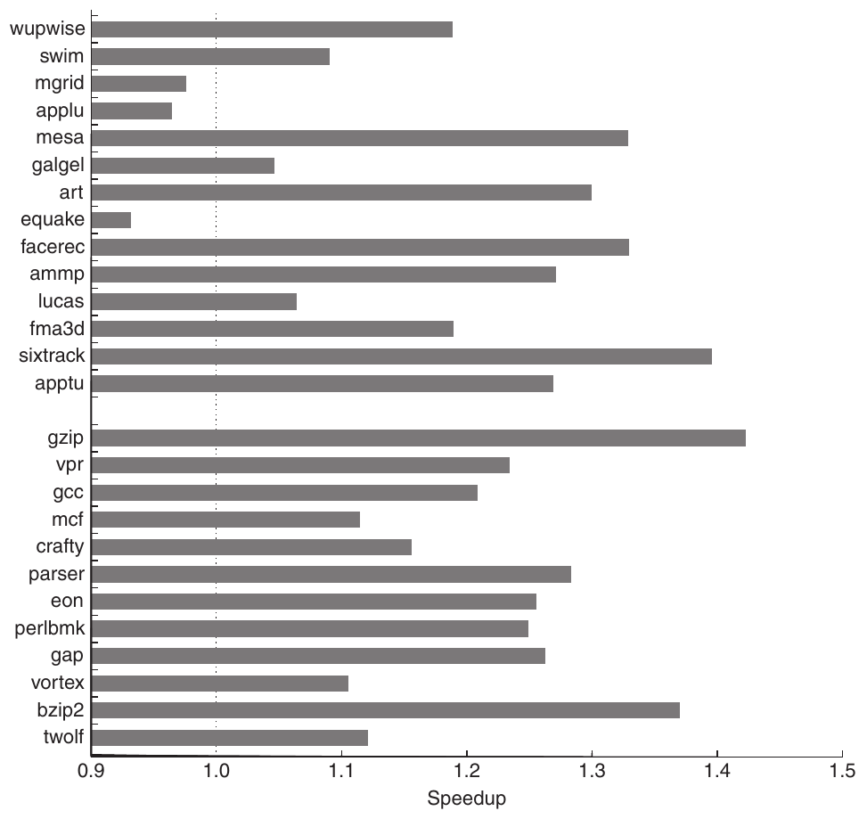

**Hình 5.26 So sánh performance của SMT và single-thread (ST) trên IBM eServer p5 575 có eight-processor. Lưu ý rằng y-axis bắt đầu tại speedup 0.9, tức là performance bị giảm. Chỉ một processor trong mỗi core Power5 hoạt động; điều này hẳn sẽ cải thiện đôi chút kết quả của SMT nhờ giảm destructive interference trong memory system. Các kết quả SMT thu được bằng cách tạo 16 user thread, trong khi các kết quả ST chỉ sử dụng tám thread; khi mỗi processor chỉ có một thread, OS chuyển Power5 sang chế độ single-threaded. Những kết quả này do John McCalpin của IBM thu thập. Như có thể thấy từ dữ liệu, standard deviation của các kết quả SPECfpRate cao hơn SPECintRate (0.13 so với 0.07), cho thấy mức cải thiện của SMT đối với các chương trình FP có thể biến thiên rất lớn.**

## 5.8 Kết hợp tất cả lại: Multicore Processor và Performance của chúng

Vào năm 2011, multicore là chủ đề chung của tất cả các processor mới. Các cách triển khai rất đa dạng, cũng như khả năng hỗ trợ những multichip multiprocessor lớn hơn của chúng. Trong mục này, chúng ta xem xét thiết kế của bốn multicore processor khác nhau cùng một số đặc điểm về performance.

Hình 5.27 trình bày các đặc điểm chính của bốn multicore processor được thiết kế cho các ứng dụng server. Intel Xeon dựa trên cùng thiết kế với i7, nhưng có nhiều core hơn, clock rate thấp hơn đôi chút (do giới hạn về power), và L3 cache lớn hơn. AMD Opteron và Phenom dành cho desktop dùng chung core cơ bản, còn SUN T2 có quan hệ với SUN T1 mà chúng ta đã gặp trong Chương 3. Power7 là phiên bản mở rộng của Power5 với nhiều core hơn và cache lớn hơn.

Trước hết, chúng ta so sánh performance và khả năng mở rộng performance của ba trong số các multicore processor này (bỏ qua AMD Opteron vì không có đủ dữ liệu) khi chúng được cấu hình thành các multichip multiprocessor.

Ngoài sự khác nhau về mức độ chú trọng ILP so với TLP, ba microprocessor này còn có những khác biệt đáng kể về thị trường mục tiêu. Vì vậy, chúng ta sẽ ít tập trung vào việc so sánh performance tuyệt đối, mà chú trọng hơn đến khả năng mở rộng performance khi bổ sung processor. Sau khi xem xét dữ liệu này, chúng ta sẽ tìm hiểu chi tiết hơn về multicore performance của Intel Core i7.

Chúng ta trình bày performance đối với ba bộ benchmark: SPECintRate, SPECfpRate và SPECjbb2005. Các benchmark SPECRate, được chúng ta gộp thành một nhóm, minh họa performance của các multiprocessor này đối với request-level parallelism, bởi dạng parallelism này có đặc điểm là các chương trình độc lập được thực thi song song và chồng lấp. Cụ thể, ngoài các dịch vụ của system, chúng không chia sẻ bất cứ thứ gì khác. SPECjbb2005 là một benchmark kinh doanh Java có khả năng mở rộng, mô hình hóa một hệ thống client/server three-tier với trọng tâm là server; nó tương tự benchmark được sử dụng trong SPECPower mà chúng ta đã xem xét trong Chương 1. Benchmark này kiểm nghiệm các cách triển khai Java Virtual Machine, just in time compiler, garbage collection, thread và một số khía cạnh của operating system; nó cũng kiểm nghiệm khả năng mở rộng của các multiprocessor system.

Hình 5.28 trình bày performance của các benchmark CPU SPECRate khi số lượng core tăng lên. Speedup gần như tuyến tính đạt được khi số processor chip, và do đó số lượng core, tăng lên.

Hình 5.29 trình bày dữ liệu tương tự đối với benchmark SPECjbb2005. Những trade-offs giữa việc khai thác thêm ILP và việc chỉ tập trung vào TLP rất phức tạp, đồng thời phụ thuộc rất nhiều vào workload. SPECjbb2005 là một workload mở rộng theo số processor được bổ sung bằng cách giữ thời gian cố định, thay vì giữ kích thước bài toán cố định. Trong trường hợp này, dường như có đủ parallelism để đạt speedup tuyến tính cho tới 64 core. Chúng ta sẽ quay lại chủ đề này trong phần nhận xét kết luận, nhưng trước tiên hãy xem xét chi tiết hơn performance của Intel Core i7 trong chế độ single-chip, four-core.

| Đặc điểm | AMD Opteron 8439 | IBM Power 7 | Intel Xenon 7560 *(ghi chú: sách in Xenon; đúng là Xeon)* | Sun T2 |
|---|---|---|---|---|
| Transistor | 904 M | 1200 M | 2300 M | 500 M |
| Power (danh định) | 137 W | 140 W | 130 W | 95 W |
| Số core/chip tối đa | 6 | 8 | 8 | 8 |
| Multithreading | Không | SMT | SMT | Fine-grained |
| Threads/core | 1 | 4 | 2 | 8 |
| Instruction issue/clock | 3 từ một thread | 6 từ một thread | 4 từ một thread | 2 từ 2 thread |
| Clock rate | 2.8 GHz | 4.1 GHz | 2.7 GHz | 1.6 GHz |
| Cache ngoài cùng | L3; 6 MB; dùng chung | L3; 32 MB (sử dụng embedded DRAM); dùng chung hoặc riêng cho mỗi core | L3; 24 MB; dùng chung | L2; 4 MB; dùng chung |
| Inclusion | Không, mặc dù L2 là superset của L1 | Có, L3 là superset | Có, L3 là superset | Có |
| Multicore coherence protocol | MOESI | MESI mở rộng với các gợi ý về hành vi và locality (protocol 13-state) | MESIF | MOESI |
| Cách triển khai multicore coherence | Snooping | Directory tại L3 | Directory tại L3 | Directory tại L2 |
| Khả năng hỗ trợ coherence mở rộng | Có thể kết nối tối đa 8 processor chip bằng HyperTransport theo dạng ring, sử dụng directory hoặc snooping. System là NUMA. | Có thể kết nối tối đa 32 processor chip bằng các SMP link. Cấu trúc distributed directory động. Memory access là symmetric bên ngoài một chip 8-core. | Có thể triển khai tối đa 8 processor core thông qua Quickpath Interconnect. Hỗ trợ directory bằng logic bên ngoài. | Được triển khai thông qua bốn coherence link trên mỗi processor, có thể dùng để snoop. Tối đa hai chip kết nối trực tiếp với nhau, và tối đa bốn chip kết nối bằng ASIC bên ngoài. |

**Hình 5.27 Tóm tắt các đặc điểm của bốn multicore processor high-end gần đây (phát hành năm 2010), được thiết kế cho server. Bảng bao gồm các phiên bản có số lượng core cao nhất của những processor này; một số processor có các phiên bản ít core hơn và clock rate cao hơn. L3 trong IBM Power7 có thể được dùng chung hoàn toàn hoặc được phân chia thành các vùng riêng nhanh hơn, dành cho từng core. Chúng ta chỉ đưa vào các cách triển khai multicore single-chip.**

### Performance và hiệu quả sử dụng năng lượng của Multicore Intel Core i7

Trong mục này, chúng ta xem xét performance của i7 trên cùng hai nhóm benchmark đã xét trong Chương 3: các benchmark Java song song và các benchmark PARSEC song song (được mô tả chi tiết trong Hình 3.34 ở trang 231). Trước hết, chúng ta xem xét multicore performance và khả năng mở rộng so với single-core khi không sử dụng SMT. Sau đó, chúng ta kết hợp cả khả năng multicore lẫn SMT. Tất cả dữ liệu trong mục này, giống như dữ liệu trong lần đánh giá SMT của i7 trước đó (Chương 3, Mục 3.13), đều lấy từ Esmaeilzadeh và cộng sự [2011]. Dataset giống với dataset đã sử dụng trước đó (xem Hình 3.34 ở trang 231), ngoại trừ việc loại bỏ hai benchmark Java tradebeans và pjbb2005 (chỉ còn lại năm benchmark Java có khả năng mở rộng); tradebeans và pjbb2005 không bao giờ đạt speedup cao hơn 1.55 ngay cả khi có bốn core và tổng cộng tám thread, nên chúng không thích hợp để đánh giá số lượng core lớn hơn.

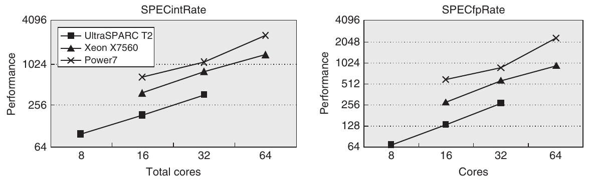

**Hình 5.28 Performance trên các benchmark SPECRate của ba multicore processor khi số processor chip tăng lên. Lưu ý rằng với benchmark có mức parallelism rất cao này, speedup gần như tuyến tính đạt được. Cả hai đồ thị đều sử dụng thang log-log, vì vậy speedup tuyến tính được biểu diễn bằng một đường thẳng.**

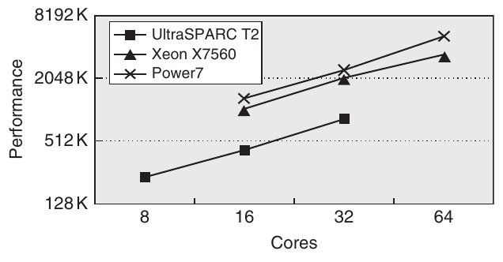

**Hình 5.29 Performance trên benchmark SPECjbb2005 của ba multicore processor khi số processor chip tăng lên. Lưu ý rằng với benchmark song song này, speedup gần như tuyến tính đạt được.**

Hình 5.30 biểu diễn cả speedup lẫn hiệu quả sử dụng năng lượng của các benchmark Java và PARSEC khi không sử dụng SMT. Việc thể hiện hiệu quả sử dụng năng lượng có nghĩa là chúng ta biểu diễn tỷ số giữa năng lượng tiêu thụ trong lần chạy two- hoặc four-core với năng lượng tiêu thụ trong lần chạy single-core; vì vậy, hiệu quả sử dụng năng lượng càng cao càng tốt, và giá trị 1.0 là điểm break-even. Trong mọi trường hợp, các core không được sử dụng đều ở deep sleep mode; chế độ này giảm thiểu power consumption của chúng bằng cách về cơ bản tắt chúng đi. Khi so sánh dữ liệu của các benchmark single-core và multicore, cần nhớ rằng trường hợp single-core cũng phải chịu toàn bộ chi phí năng lượng của L3 cache và memory interface, giống như trường hợp multicore. Điều này làm tăng khả năng cải thiện mức tiêu thụ năng lượng đối với những ứng dụng có khả năng mở rộng tương đối tốt. Harmonic mean được dùng để tổng hợp kết quả, với ý nghĩa được mô tả trong chú thích hình.

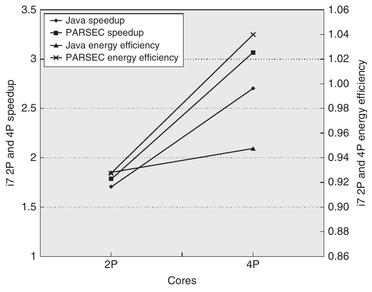

**Hình 5.30 Biểu đồ này trình bày speedup của các lần thực thi two- và four-core đối với workload Java và PARSEC song song, không sử dụng SMT. Dữ liệu này do Esmaeilzadeh và cộng sự [2011] thu thập bằng cùng cấu hình đã mô tả trong Chương 3. Turbo Boost được tắt. Speedup và hiệu quả sử dụng năng lượng được tổng hợp bằng harmonic mean, hàm ý một workload trong đó tổng thời gian chạy từng benchmark 2p là tương đương nhau.**

Như hình cho thấy, các benchmark PARSEC đạt speedup tốt hơn các benchmark Java: chúng đạt hiệu suất speedup 76% (tức là speedup thực tế chia cho số processor) trên bốn core, trong khi các benchmark Java đạt hiệu suất speedup 67% trên bốn core. Mặc dù nhận xét này thể hiện rõ trong dữ liệu, việc phân tích nguyên nhân của khác biệt này lại khó khăn. Chẳng hạn, rất có thể các hiệu ứng của Amdahl’s law đã làm giảm speedup của workload Java. Ngoài ra, sự tương tác giữa processor architecture và ứng dụng, vốn ảnh hưởng đến những vấn đề như chi phí synchronization hay communication, cũng có thể đóng một vai trò. Cụ thể, các ứng dụng well-parallelized, chẳng hạn những ứng dụng trong PARSEC, đôi khi hưởng lợi từ một tỷ lệ thuận lợi giữa computation và communication, nhờ đó giảm sự phụ thuộc vào communications cost. (Xem Phụ lục I.)

Những khác biệt về speedup này dẫn đến khác biệt về hiệu quả sử dụng năng lượng. Chẳng hạn, các benchmark PARSEC thực sự cải thiện nhẹ hiệu quả sử dụng năng lượng so với phiên bản single-core; kết quả này có thể chịu ảnh hưởng đáng kể từ việc L3 cache được sử dụng hiệu quả hơn trong các lần chạy multicore so với single-core, trong khi chi phí năng lượng của nó giống nhau ở cả hai trường hợp. Vì vậy, với các benchmark PARSEC, cách tiếp cận multicore đạt được điều mà các nhà thiết kế kỳ vọng khi chuyển từ thiết kế ILP-focused sang thiết kế multicore: performance tăng nhanh bằng hoặc nhanh hơn power, nhờ đó hiệu quả sử dụng năng lượng giữ nguyên hoặc thậm chí được cải thiện. Trong trường hợp Java, chúng ta thấy cả lần chạy two- lẫn four-core đều không đạt điểm hòa vốn về hiệu quả sử dụng năng lượng do mức speedup của workload Java thấp hơn (mặc dù hiệu quả sử dụng năng lượng của Java trong lần chạy 2p lại bằng PARSEC!). Hiệu quả sử dụng năng lượng của Java trên four-core vẫn tương đối cao (0.94). Có khả năng một processor ILP-centric sẽ cần nhiều power hơn nữa để đạt speedup tương đương trên workload PARSEC hoặc Java. Vì thế, cách tiếp cận TLP-centric cũng chắc chắn tốt hơn cách tiếp cận ILP-centric khi cải thiện performance của những ứng dụng này.

#### Kết hợp Multicore và SMT

Cuối cùng, chúng ta xem xét sự kết hợp giữa multicore và multithreading bằng cách đo hai bộ benchmark với hai đến bốn processor và một đến hai thread (tổng cộng bốn điểm dữ liệu và tối đa tám thread). Hình 5.31 trình bày speedup và hiệu quả sử dụng năng lượng thu được trên Intel i7 khi số processor là hai hoặc bốn và khi có hoặc không sử dụng SMT; harmonic mean được dùng để tổng hợp hai bộ benchmark. Rõ ràng, SMT có thể tăng thêm performance khi có đủ thread-level parallelism, ngay cả trong trường hợp multicore. Chẳng hạn, trong trường hợp four-core, no-SMT, hiệu suất speedup lần lượt là 67% và 76% đối với Java và PARSEC. Khi sử dụng SMT trên bốn core, các tỷ lệ này đạt mức đáng kinh ngạc là 83% và 97%!

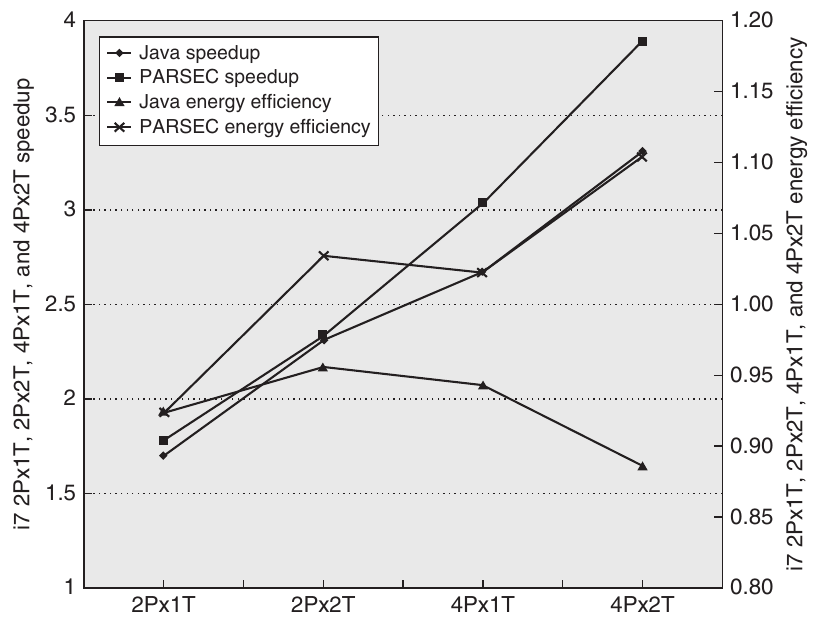

**Hình 5.31 Biểu đồ này trình bày speedup của các lần thực thi two- và four-core đối với workload Java và PARSEC song song, cả khi có lẫn không có SMT. Hãy nhớ rằng các kết quả trên có số thread thay đổi từ hai đến tám và phản ánh cả những hiệu ứng của architecture lẫn đặc điểm của ứng dụng. Harmonic mean được dùng để tổng hợp kết quả, như đã thảo luận trong chú thích Hình 5.30.**

Hiệu quả sử dụng năng lượng cho thấy một bức tranh hơi khác. Đối với PARSEC, speedup về cơ bản là tuyến tính trong trường hợp four-core SMT (tám thread), trong khi power tăng chậm hơn, dẫn đến hiệu quả sử dụng năng lượng đạt 1.1 trong trường hợp đó. Tình huống của Java phức tạp hơn: hiệu quả sử dụng năng lượng đạt đỉnh 0.97 trong lần chạy two-core SMT (four-thread), rồi giảm xuống 0.89 trong lần chạy four-core SMT (8-thread). Rất có thể các benchmark Java gặp phải các hiệu ứng của Amdahl’s law khi triển khai nhiều hơn bốn thread. Như một số architect đã nhận xét, multicore chuyển thêm trách nhiệm về performance (và do đó về hiệu quả sử dụng năng lượng) sang programmer, và các kết quả của workload Java rõ ràng xác nhận điều này.

## 5.9 Những ngộ nhận và cạm bẫy

Do hiểu biết của chúng ta về parallel computing còn chưa trưởng thành, vẫn còn nhiều cạm bẫy tiềm ẩn sẽ được phát hiện bởi những nhà thiết kế cẩn thận hoặc những người không may mắc phải chúng. Vì multiprocessor đã được quảng bá quá mức trong nhiều năm, các ngộ nhận phổ biến cũng xuất hiện rất nhiều. Chúng ta đưa vào đây một số trường hợp được chọn lọc.

**Cạm bẫy** Đo performance của multiprocessor bằng speedup tuyến tính thay vì execution time.

Các đồ thị “Mortar shot”—biểu diễn performance theo số processor, cho thấy speedup tuyến tính, một đoạn nằm ngang, rồi sự suy giảm—từ lâu đã được dùng để đánh giá thành công của parallel processor. Mặc dù speedup là một khía cạnh của parallel program, nó không phải thước đo trực tiếp của performance. Câu hỏi đầu tiên là năng lực của những processor đang được tăng số lượng: một chương trình có performance tăng tuyến tính đến mức tương đương 100 processor Intel Atom (processor low-end dùng cho netbook) vẫn có thể chậm hơn phiên bản chạy trên một Xeon eight-core. Hãy đặc biệt cẩn thận với các chương trình floating-point-intensive; những processing element không có hardware hỗ trợ có thể mở rộng rất tốt nhưng vẫn có performance tổng thể kém.

So sánh execution time chỉ công bằng khi bạn so sánh các algorithm tốt nhất trên từng computer. So sánh cùng một code trên hai computer có vẻ công bằng, nhưng thực ra không phải vậy; parallel program có thể chạy chậm hơn phiên bản sequential trên một uniprocessor. Việc phát triển parallel program đôi khi dẫn đến những cải tiến về algorithm, vì thế so sánh sequential program best-known trước đó với parallel code—dù có vẻ công bằng—sẽ không phải là so sánh các algorithm tương đương. Để phản ánh vấn đề này, đôi khi người ta dùng các thuật ngữ relative speedup (cùng một program) và true speedup (program tốt nhất).

Những kết quả cho thấy performance siêu tuyến tính, khi một chương trình chạy trên n processor nhanh hơn n lần so với uniprocessor tương đương, có thể chỉ ra rằng phép so sánh không công bằng, mặc dù cũng có những trường hợp đạt speedup siêu tuyến tính “thực sự”. Chẳng hạn, một số ứng dụng khoa học thường xuyên đạt speedup siêu tuyến tính khi số processor tăng ở mức nhỏ (từ 2 hoặc 4 lên 8 hoặc 16). Những kết quả này thường xuất hiện vì các data structure quan trọng không vừa tổng dung lượng cache của multiprocessor có 2 hoặc 4 processor, nhưng lại vừa tổng dung lượng cache của multiprocessor có 8 hoặc 16 processor.

Tóm lại, so sánh performance bằng cách so sánh speedup, trong trường hợp tốt nhất, là việc khó thực hiện chính xác; trong trường hợp xấu nhất, nó còn gây hiểu lầm. So sánh speedup của hai multiprocessor khác nhau không nhất thiết cho chúng ta biết điều gì về performance tương đối của chúng. Ngay cả so sánh hai algorithm khác nhau trên cùng một multiprocessor cũng khó, bởi chúng ta phải dùng true speedup thay cho relative speedup để có phép so sánh hợp lệ.

**Ngộ nhận** Amdahl’s law không áp dụng cho parallel computer.

Năm 1987, người đứng đầu một tổ chức nghiên cứu tuyên bố rằng Amdahl’s law (xem Mục 1.9) đã bị một MIMD multiprocessor phá vỡ. Tuy nhiên, phát biểu này hoàn toàn không có nghĩa là định luật đó đã bị bác bỏ đối với parallel computer; phần chương trình bị bỏ qua vẫn sẽ giới hạn performance. Để hiểu cơ sở của các bản tin truyền thông này, hãy xem Amdahl [1967] ban đầu đã nói gì:

Một kết luận khá rõ ràng có thể rút ra lúc này là nỗ lực nhằm đạt tốc độ parallel processing cao sẽ bị lãng phí nếu nó không đi kèm những thành tựu về tốc độ sequential processing có độ lớn gần như tương đương. [tr. 483]

Một cách diễn giải định luật này là vì mọi chương trình đều có những phần phải thực hiện sequential, số processor có thể sử dụng một cách có lợi về kinh tế sẽ có giới hạn—chẳng hạn 100. Bằng việc chứng minh speedup tuyến tính với 1000 processor, người ta đã bác bỏ cách diễn giải này của Amdahl’s law.

Cơ sở cho phát biểu rằng Amdahl’s law đã bị “vượt qua” là việc sử dụng scaled speedup, còn được gọi là weak scaling. Các nhà nghiên cứu mở rộng benchmark để kích thước dataset lớn hơn 1000 lần, rồi so sánh execution time trên uniprocessor và khi thực thi song song của benchmark đã mở rộng. Đối với algorithm cụ thể này, phần sequential của chương trình không đổi, độc lập với kích thước input, và toàn bộ phần còn lại đều song song—do đó đạt speedup tuyến tính với 1000 processor. Vì running time tăng nhanh hơn tuyến tính, chương trình thực tế chạy lâu hơn sau khi mở rộng, ngay cả khi sử dụng 1000 processor.

Speedup giả định mở rộng input không giống true speedup, và báo cáo nó như thể đó là true speedup sẽ gây hiểu lầm. Vì parallel benchmark thường được chạy trên các multiprocessor different-sized, cần nêu rõ kiểu mở rộng ứng dụng nào được phép và phải thực hiện việc mở rộng đó ra sao. Mặc dù việc đơn giản tăng kích thước dữ liệu theo số processor hiếm khi phù hợp, giả định kích thước bài toán cố định khi số processor lớn hơn rất nhiều (gọi là strong scaling) cũng thường không phù hợp, bởi người dùng có một multiprocessor lớn hơn nhiều rất có thể sẽ chọn chạy phiên bản lớn hơn hoặc chi tiết hơn của ứng dụng. Xem Phụ lục I để thảo luận thêm về chủ đề quan trọng này.

**Ngộ nhận** Cần speedup tuyến tính thì multiprocessor mới có hiệu quả về chi phí.

Mọi người đều thừa nhận rộng rãi rằng một trong những lợi ích chính của parallel computing là cung cấp “thời gian đi đến lời giải ngắn hơn” so với uniprocessor nhanh nhất. Tuy nhiên, nhiều người cũng cho rằng parallel processor không thể có hiệu quả về chi phí ngang với uniprocessor trừ khi đạt speedup tuyến tính hoàn hảo. Lập luận này cho rằng vì chi phí của multiprocessor là hàm tuyến tính của số processor, bất kỳ speedup nào thấp hơn tuyến tính đều có nghĩa là tỷ lệ performance/chi phí giảm, khiến parallel processor kém hiệu quả về chi phí hơn việc sử dụng uniprocessor.

Vấn đề của lập luận này là chi phí không chỉ là hàm của số processor mà còn phụ thuộc vào memory, I/O và overhead của system (vỏ máy, bộ nguồn, interconnect, v.v.). Lập luận này còn kém hợp lý hơn trong thời đại multicore, khi mỗi chip có nhiều processor.

Ảnh hưởng của việc tính cả memory vào chi phí system đã được Wood và Hill [1995] chỉ ra. Chúng ta sử dụng một ví dụ dựa trên dữ liệu mới hơn với các benchmark TPC-C và SPECRate, nhưng cũng có thể đưa ra lập luận này bằng một workload ứng dụng khoa học song song; trường hợp đó có thể còn làm lập luận mạnh hơn.

Hình 5.32 trình bày speedup của TPC-C, SPECintRate và SPECfpRate trên một multiprocessor IBM eServer p5 được cấu hình với 4 đến 64 processor. Hình cho thấy chỉ TPC-C đạt speedup tốt hơn tuyến tính. Với SPECintRate và SPECfpRate, speedup thấp hơn tuyến tính, nhưng chi phí cũng vậy, bởi khác với TPC-C, lượng main memory và dung lượng disk cần thiết đều tăng chậm hơn tuyến tính.

Như Hình 5.33 cho thấy, số processor lớn hơn thực tế có thể đem lại hiệu quả về chi phí tốt hơn cấu hình four-processor. Khi so sánh cost-performance của hai computer, chúng ta phải bảo đảm đưa vào những đánh giá chính xác về cả tổng chi phí system lẫn performance có thể đạt được. Đối với nhiều ứng dụng có nhu cầu memory lớn hơn, phép so sánh như vậy có thể làm tăng đáng kể sức hấp dẫn của việc sử dụng multiprocessor.

**Cạm bẫy** Không phát triển software để tận dụng hoặc tối ưu cho một multiprocessor architecture.

Tình trạng software chậm theo kịp multiprocessor đã kéo dài từ lâu, có lẽ vì các vấn đề của software khó hơn nhiều. Chúng ta đưa ra một ví dụ để cho thấy tính tinh tế của những vấn đề này, nhưng còn rất nhiều ví dụ khác có thể lựa chọn!

Một vấn đề thường gặp xảy ra khi software được thiết kế cho uniprocessor được điều chỉnh để dùng trong môi trường multiprocessor. Chẳng hạn, operating system của SGI vào năm 2000 ban đầu bảo vệ page table data structure bằng một lock duy nhất, với giả định rằng page allocation hiếm khi xảy ra. Trên uniprocessor, điều này không gây ra vấn đề về performance. Trên multiprocessor, nó có thể trở thành một performance bottleneck nghiêm trọng đối với một số chương trình. Xét một chương trình sử dụng rất nhiều page được khởi tạo vào lúc start-up, giống như cách UNIX xử lý các page được cấp phát tĩnh. Giả sử chương trình được song song hóa để nhiều process cùng cấp phát các page. Vì page allocation đòi hỏi phải sử dụng page table data structure, vốn bị lock mỗi khi đang được sử dụng, ngay cả một OS kernel cho phép nhiều thread trong OS cũng sẽ bị thực thi tuần tự nếu tất cả process đều cố cấp phát page cùng một lúc (và đó chính xác là điều chúng ta có thể kỳ vọng vào thời điểm khởi tạo!).

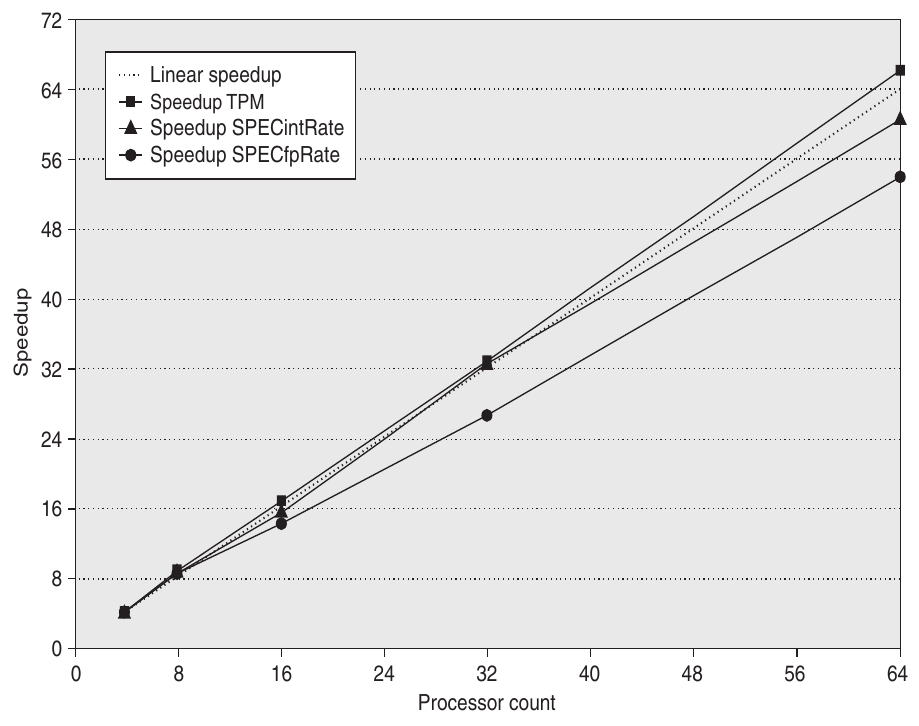

**Hình 5.32 Speedup của ba benchmark trên một multiprocessor IBM eServer p5 khi được cấu hình với 4, 8, 16, 32 và 64 processor. Đường nét đứt biểu diễn speedup tuyến tính.**

Việc tuần tự hóa page table này loại bỏ parallelism trong quá trình khởi tạo và ảnh hưởng đáng kể đến parallel performance tổng thể. Performance bottleneck này vẫn tồn tại ngay cả khi multiprogramming. Chẳng hạn, giả sử chúng ta tách parallel program thành các process riêng biệt rồi chạy chúng, mỗi processor chạy một process, sao cho các process không chia sẻ gì với nhau. (Đây chính xác là điều một người dùng đã làm, bởi anh ấy tin một cách hợp lý rằng vấn đề performance bắt nguồn từ việc chia sẻ ngoài ý muốn hoặc interference trong ứng dụng.) Đáng tiếc là lock vẫn tuần tự hóa tất cả process, vì vậy ngay cả multiprogramming performance cũng kém. Cạm bẫy này cho thấy loại lỗi performance tinh tế nhưng đáng kể có thể phát sinh khi software chạy trên multiprocessor. Giống nhiều thành phần software quan trọng khác, các algorithm và data structure của OS phải được cân nhắc lại trong bối cảnh multiprocessor. Đặt lock trên những phần nhỏ hơn của page table loại bỏ vấn đề này một cách hiệu quả. Các vấn đề tương tự cũng tồn tại trong memory structure, làm tăng coherence traffic ngay cả trong những trường hợp thực tế không xảy ra việc chia sẻ.

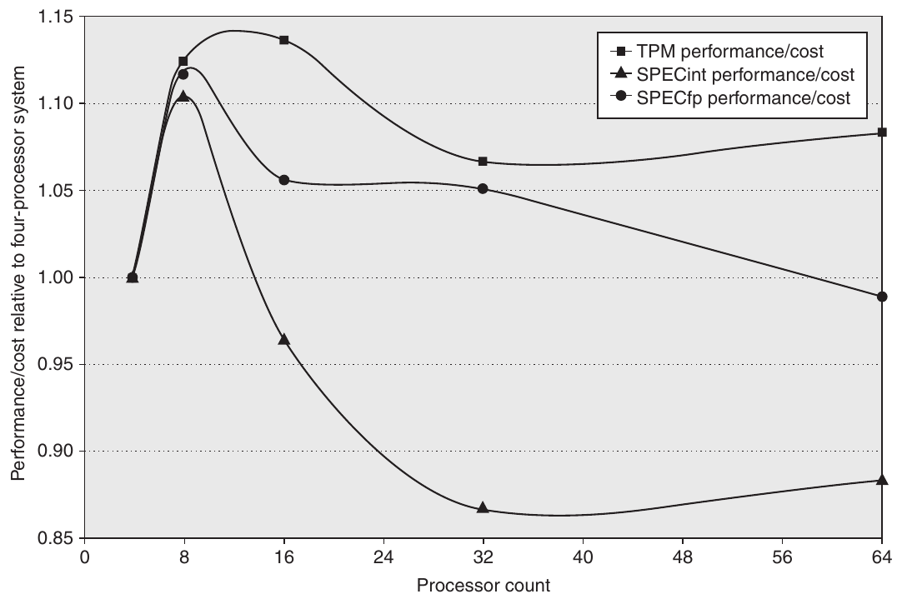

**Hình 5.33 Performance/chi phí so với một system 4-processor của ba benchmark chạy trên một multiprocessor IBM eServer p5 có từ 4 đến 64 processor cho thấy số processor lớn hơn có thể đem lại hiệu quả về chi phí ngang với cấu hình 4-processor. Với TPC-C, các cấu hình là những cấu hình được sử dụng trong các lần chạy chính thức, có nghĩa là disk và memory tăng gần như tuyến tính theo số processor, và một máy 64-processor đắt xấp xỉ gấp đôi phiên bản 32-processor. Ngược lại, disk và memory được mở rộng chậm hơn (mặc dù vẫn nhanh hơn mức cần thiết để đạt SPECRate tốt nhất tại 64 processor). Cụ thể, cấu hình disk tăng từ một drive cho phiên bản 4-processor lên bốn drive (140 GB) cho phiên bản 64-processor. Memory tăng từ 8 GB cho system 4-processor lên 20 GB cho system 64-processor.**

Khi multicore trở thành chủ đề chủ đạo trong mọi thứ từ desktop đến server, tình trạng thiếu đầu tư thỏa đáng vào parallel software trở nên rõ ràng. Vì thiếu sự chú trọng này, có lẽ phải mất nhiều năm nữa các software system mà chúng ta sử dụng mới khai thác thích đáng số lượng core ngày càng tăng này.

## 5.10 Nhận xét kết luận

Trong hơn 30 năm, các nhà nghiên cứu và nhà thiết kế đã dự đoán sự kết thúc của uniprocessor và sự thống trị của multiprocessor thay thế chúng. Cho đến những năm đầu của thế kỷ này, dự đoán ấy liên tục bị chứng minh là sai. Như chúng ta đã thấy trong Chương 3, chi phí của việc cố tìm kiếm và khai thác thêm ILP là quá cao xét về hiệu quả (cả silicon area lẫn power). Tất nhiên, multicore không giải quyết được vấn đề power, bởi rõ ràng nó làm tăng cả số transistor lẫn số transistor đang hoạt động và chuyển trạng thái; đó là hai yếu tố đóng góp chủ yếu vào power.

Tuy nhiên, multicore thực sự thay đổi cuộc chơi. Bằng cách cho phép đưa các core nhàn rỗi vào chế độ power-saving, có thể đạt một mức cải thiện về power efficiency, như các kết quả trong chương này đã cho thấy. Quan trọng hơn, multicore chuyển gánh nặng giữ cho processor luôn bận sang việc dựa nhiều hơn vào TLP, vốn do ứng dụng và programmer chịu trách nhiệm xác định, thay vì ILP, vốn thuộc trách nhiệm của hardware. Như chúng ta đã thấy, những khác biệt này thể hiện rõ trong multicore performance và hiệu quả sử dụng năng lượng của các benchmark Java so với PARSEC.

Mặc dù multicore trực tiếp hỗ trợ phần nào cho thách thức về hiệu quả sử dụng năng lượng và chuyển phần lớn gánh nặng sang software system, vẫn còn những thách thức khó khăn và các câu hỏi chưa được giải đáp. Chẳng hạn, những nỗ lực khai thác các phiên bản thread-level của aggressive speculation cho đến nay đã gặp cùng số phận với các phiên bản ILP tương ứng. Nghĩa là mức tăng performance còn khiêm tốn và có lẽ thấp hơn mức tăng năng lượng tiêu thụ, nên những ý tưởng như speculative thread hoặc hardware run-ahead vẫn chưa được tích hợp thành công vào processor. Giống như speculation cho ILP, trừ khi speculation gần như luôn đúng, chi phí sẽ vượt quá lợi ích.

Ngoài các vấn đề trọng tâm về programming language và compiler technology, multicore còn mở lại một câu hỏi long-standing khác trong computer architecture: Có đáng cân nhắc heterogeneous processor không? Mặc dù chưa có multicore như vậy nào được cung cấp và heterogeneous multiprocessor mới chỉ thành công ở mức hạn chế trong special-purpose computer hoặc embedded system, các khả năng trong môi trường multicore rộng hơn nhiều. Cũng như nhiều vấn đề trong multiprocessing, câu trả lời có lẽ sẽ phụ thuộc vào software model và programming system. Nếu compiler và operating system có thể sử dụng heterogeneous processor một cách hiệu quả, chúng sẽ trở nên phổ biến hơn. Hiện nay, với nhiều ứng dụng, việc xử lý hiệu quả ngay cả một số lượng vừa phải homogeneous core cũng vượt quá khả năng của compiler hiện có; tuy nhiên, các multiprocessor có heterogeneous core với khác biệt rõ ràng về năng lực chức năng và những cách hiển nhiên để phân rã ứng dụng đang ngày càng phổ biến, bao gồm các processing unit chuyên biệt như GPU và media processor. Việc chú trọng hiệu quả sử dụng năng lượng cũng có thể dẫn đến việc đưa vào những core có tỷ lệ performance/power khác nhau.

Trong ấn bản năm 1995 của cuốn sách này, chúng ta kết thúc chương bằng phần thảo luận về hai vấn đề gây tranh cãi then-current:

1. Các multiprocessor very large-scale, microprocessor-based sẽ sử dụng architecture nào?

2. Multiprocessing có vai trò gì trong tương lai của microprocessor architecture?

Những năm sau đó phần lớn đã giải đáp hai câu hỏi này.

Vì multiprocessor very large-scale không trở thành một thị trường lớn và tiếp tục tăng trưởng, cách duy nhất có hiệu quả về chi phí để xây dựng những multiprocessor large-scale như vậy là sử dụng cluster, trong đó từng node là một multicore microprocessor đơn lẻ hoặc một shared-memory multiprocessor small-scale (thường có hai đến bốn multicore), và interconnect technology là network technology tiêu chuẩn. Những cluster này đã được mở rộng tới hàng chục nghìn processor và được lắp đặt trong các “nhà kho” được thiết kế đặc biệt; chúng là chủ đề của chương tiếp theo.

Câu trả lời cho câu hỏi thứ hai đã trở nên hết sức rõ ràng trong sáu hoặc bảy năm gần đây: mức tăng performance của microprocessor trong tương lai sẽ đến từ việc khai thác thread-level parallelism thông qua multicore processor, thay vì khai thác thêm ILP.

Hệ quả là core đã trở thành những khối cấu thành mới của chip, và các nhà cung cấp đưa ra nhiều loại chip dựa trên một core design với số core và L3 cache khác nhau. Chẳng hạn, Hình 5.34 trình bày họ processor Intel được xây dựng chỉ từ core Nehalem (được sử dụng trong Xeon 7560 và i7)!

Trong những năm 1980s và 1990s, cùng với sự ra đời và phát triển của ILP, software dưới dạng optimizing compiler có khả năng khai thác ILP là yếu tố then chốt cho thành công của nó. Tương tự, việc khai thác thành công thread-level parallelism sẽ phụ thuộc vào sự phát triển của các software system phù hợp cũng nhiều như phụ thuộc vào đóng góp của các computer architect. Với tiến độ chậm chạp của parallel software trong 30-plus năm qua, có lẽ việc khai thác thread-level parallelism rộng rãi sẽ còn là thách thức trong nhiều năm tới. Hơn nữa, các tác giả tin rằng vẫn có cơ hội đáng kể để xây dựng multicore architecture tốt hơn. Việc thiết kế các architecture ấy sẽ đòi hỏi một phương pháp thiết kế định lượng chặt chẽ và khả năng mô hình hóa chính xác hàng chục đến hàng trăm core chạy hàng nghìn tỷ instruction, bao gồm các ứng dụng large-scale và operating system. Nếu không có phương pháp và năng lực như vậy, các architect sẽ giống như bắn trong bóng tối. Đôi khi bạn may mắn, nhưng thường thì bạn bắn trượt.

| Processor | Series | Core | L3 cache | Power (điển hình) | Clock rate (GHz) | Giá |
|---|---|---|---|---|---|---|
| Xeon | 7500 | 8 | 18–24 MB | 130 W | 2–2.3 | $2837–3692 |
| Xeon | 5600 | 4–6 w/wo SMT | 12 MB | 40–130 W | 1.86–3.33 | $440–1663 |
| Xeon | 3400–3500 | 4 w/wo SMT | 8 MB | 45–130 W | 1.86–3.3 | $189–999 |
| Xeon | 5500 | 2–4 | 4–8 MB | 80–130 W | 1.86–3.3 | $80–1600 |
| i7 | 860–975 | 4 | 8 MB | 82 W–130 W | 2.53–3.33 | $284–999 |
| i7 mobile | 720–970 | 4 | 6–8 MB | 45–55 W | 1.6–2.1 | $364–378 |
| i5 | 750–760 | 4 wo SMT | 8 MB | 80 W | 2.4–2.8 | $196–209 |
| i3 | 330–350 | 2 w/wo SMT | 3 MB | 35 W | 2.1–2.3 |  |

**Hình 5.34 Các đặc điểm của một loạt sản phẩm Intel dựa trên microarchitecture Nehalem. Biểu đồ này vẫn gộp nhiều sản phẩm vào mỗi hàng (từ 2 đến 8!). Giá áp dụng cho đơn hàng 1000 sản phẩm.**

## 5.11 Góc nhìn lịch sử và tài liệu tham khảo

Mục L.7 (có trực tuyến) xem xét lịch sử của multiprocessor và parallel processing. Được phân chia theo cả giai đoạn lịch sử lẫn architecture, mục này có những thảo luận về các multiprocessor thử nghiệm thời kỳ đầu và một số cuộc tranh luận lớn trong parallel processing. Những tiến bộ gần đây cũng được đề cập. Tài liệu tham khảo để đọc thêm được liệt kê trong mục này.

## Nghiên cứu tình huống và bài tập của Amr Zaky và David A. Wood

### Nghiên cứu tình huống 1: Single-Chip Multicore Multiprocessor

#### Các khái niệm được minh họa trong nghiên cứu tình huống này

- Các chuyển trạng thái của Snooping Coherence Protocol

- Performance của Coherence Protocol

- Các tối ưu hóa Coherence Protocol

- Synchronization

- Performance của Memory Consistency Model

Multicore multiprocessor đơn giản được minh họa trong Hình 5.35 đại diện cho một symmetric shared-memory architecture thường được triển khai. Mỗi processor có một private cache duy nhất, và coherence được duy trì bằng snooping coherence protocol trong Hình 5.7. Mỗi cache là direct-mapped, có bốn block, mỗi block chứa hai word. Để đơn giản hóa hình minh họa, cache-address tag chứa toàn bộ address, và mỗi word chỉ hiển thị hai ký tự hex, với word có trọng số thấp nhất nằm bên phải. Các coherence state được ký hiệu là M, S và I (Modified, Shared và Invalid).

**5.1** [10/10/10/10/10/10/10] <5.2> Với mỗi phần của bài tập này, giả sử cache và memory có trạng thái ban đầu như minh họa trong Hình 5.35. Mỗi phần quy định một chuỗi gồm một hoặc nhiều CPU operation có dạng:

```
P#: <op> <address> [<value>]
```

trong đó P# chỉ CPU (ví dụ P0), &lt;op&gt; là CPU operation (ví dụ read hoặc write), &lt;address&gt; biểu thị memory address, và &lt;value&gt; cho biết word mới sẽ được gán khi thực hiện write operation. Xem mỗi thao tác dưới đây là một thao tác độc lập áp dụng lên trạng thái ban đầu trong Hình 5.35. Trạng thái kết quả của cache và memory (tức coherence state, tag và data) sau thao tác đã cho là gì? Chỉ trình bày các block thay đổi; chẳng hạn, P0.B0: (I, 120, 00 01) cho biết block B0 của CPU P0 có trạng thái cuối là I, tag là 120, và các data word là 00 và 01. Ngoài ra, mỗi read operation trả về giá trị nào?

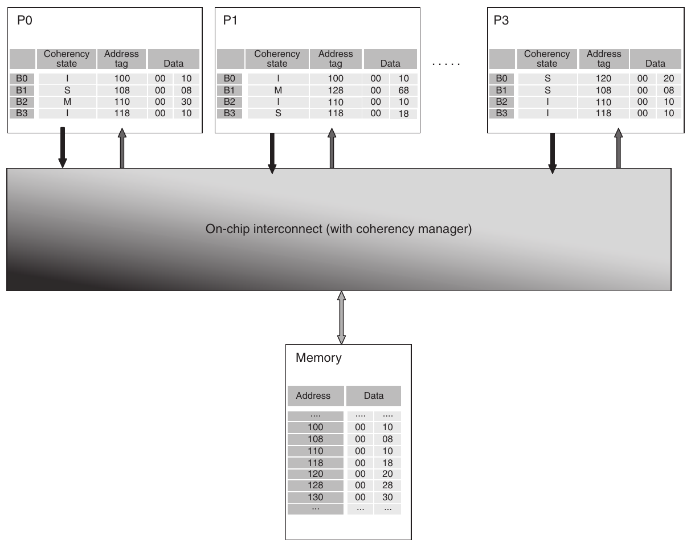

**Hình 5.35 Multicore multiprocessor (point-to-point).**

a. [10] <5.2> P0: read 120

b. [10] <5.2> P0: write 120 <-- 80

c. [10] <5.2> P3: write 120 <-- 80

d. [10] <5.2> P1: read 110

e. [10] <5.2> P0: write 108 <-- 48

f. [10] <5.2> P0: write 130 <-- 78

g. [10] <5.2> P3: write 130 <-- 78

**5.2** [20/20/20/20] <5.3> Performance của một snooping cache-coherent multiprocessor phụ thuộc vào nhiều chi tiết triển khai, vốn quyết định cache có thể phản hồi nhanh đến đâu bằng dữ liệu trong một block ở trạng thái exclusive hoặc M. Trong một số cách triển khai, CPU read miss đối với một cache block đang ở trạng thái exclusive trong cache của processor khác được xử lý nhanh hơn miss đối với một block trong memory. Đó là vì cache nhỏ hơn, và do vậy nhanh hơn main memory. Ngược lại, trong một số cách triển khai, miss được memory đáp ứng lại nhanh hơn miss được cache đáp ứng. Đó là vì cache thường được tối ưu cho các reference ở “front side”, tức từ CPU, thay vì các access ở “back side”, tức snooping. Đối với multiprocessor được minh họa trong Hình 5.35, xét việc thực thi một chuỗi operation trên một CPU duy nhất, trong đó:

- CPU read hit và write hit không tạo ra stall cycle nào.

- CPU read miss và write miss tạo ra lần lượt N<sub>memory</sub> và N<sub>cache</sub> stall cycle nếu được memory và cache đáp ứng.

- CPU write hit tạo ra invalidate sẽ phải chịu N<sub>invalidate</sub> stall cycle.

- Một write-back của block, do conflict hoặc do processor khác yêu cầu một exclusive block, phải chịu thêm N<sub>writeback</sub> stall cycle.

Xét hai cách triển khai với các đặc điểm performance khác nhau được tóm tắt trong Hình 5.36. Xét chuỗi operation sau, với giả định cache có trạng thái ban đầu như trong Hình 5.35. Để đơn giản, giả sử operation thứ hai bắt đầu sau khi operation thứ nhất hoàn tất (mặc dù chúng ở trên các processor khác nhau):

```
P1: read 110
P3: read 110
```

Với cách triển khai 1, read đầu tiên tạo ra 50 stall cycle vì read được cache của P0 đáp ứng. P1 stall trong 40 cycle khi chờ block, còn P0 stall trong 10 cycle khi ghi trả block về memory để đáp ứng yêu cầu của P1. Vì thế, read thứ hai của P3 tạo ra 100 stall cycle vì miss của nó được memory đáp ứng, và chuỗi này tạo ra tổng cộng 150 stall cycle. Với các chuỗi operation dưới đây, mỗi cách triển khai tạo ra bao nhiêu stall cycle?

| Tham số | Cách triển khai 1 | Cách triển khai 2 |
|---|---|---|
| N<sub>memory</sub> | 100 | 100 |
| N<sub>cache</sub> | 40 | 130 |
| N<sub>invalidate</sub> | 15 | 15 |
| N<sub>writeback</sub> | 10 | 10 |

**Hình 5.36 Latency của snooping coherence.**

a. [20] <5.3> P0: read 120

```
P0: read 128
P0: read 130
```

b. [20] <5.3> P0: read 100

```
P0: write 108 <-- 48
P0: write 130 <-- 78
```

c. [20] <5.3> P1: read 120

```
P1: read 128
P1: read 130
```

d. [20] <5.3> P1: read 100

```
P1: write 108 <-- 48
P1: write 130 <-- 78
```

**5.3** [20] <5.2> Nhiều snooping coherence protocol có thêm các state, state transition hoặc bus transaction để giảm overhead của việc duy trì cache coherency. Trong cách triển khai 1 của Bài tập 5.2, các miss chịu ít stall cycle hơn khi được cache cung cấp dữ liệu so với khi được memory cung cấp. Một số coherence protocol cố cải thiện performance bằng cách tăng tần suất xảy ra trường hợp này. Một tối ưu hóa protocol phổ biến là đưa vào trạng thái Owned (thường được ký hiệu là O). Trạng thái Owned hoạt động giống Shared ở chỗ node chỉ có thể đọc các Owned block, nhưng giống Modified ở chỗ node phải cung cấp dữ liệu khi các node khác gặp read miss hoặc write miss đối với Owned block. Read miss đối với một block ở trạng thái Modified hoặc Owned sẽ cung cấp dữ liệu cho node yêu cầu và chuyển sang trạng thái Owned. Write miss đối với một block ở trạng thái Modified hoặc Owned sẽ cung cấp dữ liệu cho node yêu cầu và chuyển sang trạng thái Invalid. MOSI protocol được tối ưu này chỉ cập nhật memory khi một node thay thế một block ở trạng thái Modified hoặc Owned. Hãy vẽ các protocol diagram mới với state và các transition được bổ sung.

**5.4** [20/20/20/20] <5.2> Với các chuỗi code sau và các timing parameter cho hai cách triển khai trong Hình 5.36, hãy tính tổng số stall cycle đối với MSI protocol cơ bản và MOSI protocol được tối ưu trong Bài tập 5.3. Giả sử những state transition không đòi hỏi bus transaction không gây thêm stall cycle nào.

a. [20] <5.2> P0: read 110

```
P3: read 110
P0: read 110
```

b. [20] <5.2> P1: read 120

```
P3: read 120
P0: read 120
```

c. [20] <5.2> P0: write 120 <-- 80

```
P3: read 120
P0: read 120
```

d. [20] <5.2> P0: write 108 <-- 88

```
P3: read 108
P0: write 108 <-- 98
```

**5.5** [20] <5.2> Một số ứng dụng đọc một dataset lớn trước, rồi sửa đổi phần lớn hoặc toàn bộ dataset đó. MSI coherence protocol cơ bản trước tiên sẽ fetch tất cả cache block vào trạng thái Shared, sau đó buộc phải thực hiện invalidate operation để nâng chúng lên trạng thái Modified. Độ trễ bổ sung này ảnh hưởng đáng kể đến một số workload. Một tối ưu hóa protocol bổ sung loại bỏ nhu cầu nâng trạng thái của các block được cùng một processor đọc rồi ghi. Tối ưu hóa này bổ sung trạng thái Exclusive (E) vào protocol, cho biết không có node nào khác giữ bản sao của block, nhưng block vẫn chưa được sửa đổi. Một cache block đi vào trạng thái Exclusive khi read miss được memory đáp ứng và không có node nào khác giữ bản sao hợp lệ. CPU read và write đối với block đó được thực hiện mà không phát sinh thêm bus traffic, nhưng CPU write làm coherence state chuyển sang Modified. Exclusive khác Modified ở chỗ node có thể âm thầm thay thế Exclusive block (trong khi Modified block phải được ghi trả về memory). Ngoài ra, read miss đối với một Exclusive block dẫn đến transition sang Shared nhưng không đòi hỏi node phản hồi bằng dữ liệu (vì memory có một bản sao up-to-date). Hãy vẽ các protocol diagram mới cho MESI protocol, bổ sung trạng thái Exclusive cùng các transition vào các trạng thái Modified, Shared và Invalid của MSI protocol cơ bản.

**5.6** [20/20/20/20/20] <5.2> Giả sử nội dung cache như trong Hình 5.35 và timing như cách triển khai 1 trong Hình 5.36. Tổng số stall cycle của các chuỗi code sau là bao nhiêu đối với cả protocol cơ bản lẫn MESI protocol mới trong Bài tập 5.5? Giả sử những state transition không đòi hỏi interconnect transaction không gây thêm stall cycle nào.

a. [20] <5.2> P0: read 100

```
P0: write 100 <-- 40
```

b. [20] <5.2> P0: read 120

```
P0: write 120 <-- 60
```

c. [20] <5.2> P0: read 100

```
P0: read 120
```

d. [20] <5.2> P0: read 100

```
P1: write 100 <-- 60
```

e. [20] <5.2> P0: read 100

```
P0: write 100 <-- 60
P1: write 100 <-- 40
```

**5.7** [20/20/20/20] <5.5> Spin lock là synchronization mechanism đơn giản nhất có thể sử dụng trên phần lớn các máy shared-memory thương mại. Spin lock này dựa vào exchange primitive để thực hiện atomic load giá trị cũ và store giá trị mới. Lock routine lặp lại exchange operation cho đến khi phát hiện lock đã được mở (tức giá trị trả về là 0):

```
DADDUI R2,R0,#1
lockit:     EXCH R2,0(R1)
            BNEZ R2, lockit
```

Việc mở một spin lock chỉ đòi hỏi store giá trị 0:

```
unlock: SW R0,0(R1)
```

Như đã thảo luận trong Mục 5.5, spin lock được tối ưu hơn tận dụng cache coherence và dùng một load để kiểm tra lock, cho phép nó spin với một shared variable trong cache:

```
lockit:    LD R2, 0(R1)
           BNEZ    R2, lockit
           DADDUI R2,R0,#1
           EXCH    R2,0(R1)
           BNEZ    R2, lockit
```

Giả sử các processor P0, P1 và P3 đều đang cố lấy một lock tại address 0x100 (tức register R1 giữ giá trị 0x100). Giả sử nội dung cache như trong Hình 5.35 và các timing parameter như cách triển khai 1 trong Hình 5.36. Để đơn giản, giả sử các critical section dài 1000 cycle.

a. [20] <5.5> Khi sử dụng spin lock đơn giản, hãy xác định xấp xỉ số memory stall cycle mà mỗi processor phải chịu trước khi lấy được lock.

b. [20] <5.5> Khi sử dụng spin lock được tối ưu, hãy xác định xấp xỉ số memory stall cycle mà mỗi processor phải chịu trước khi lấy được lock.

c. [20] <5.5> Khi sử dụng spin lock đơn giản, xấp xỉ có bao nhiêu interconnect transaction xảy ra?

d. [20] <5.5> Khi sử dụng spin lock test-and-test-and-set, xấp xỉ có bao nhiêu interconnect transaction xảy ra?

**5.8** [20/20/20/20] <5.6> Sequential consistency (SC) đòi hỏi tất cả read và write phải có vẻ như được thực thi theo một total order nào đó. Điều này có thể đòi hỏi processor phải stall trong một số trường hợp trước khi commit một read hoặc write instruction. Xét chuỗi code sau:

```
write A
read B
```

trong đó write A gây cache miss và read B gây cache hit. Với SC, processor phải stall read B cho đến sau khi có thể đặt write A vào thứ tự (và do đó thực hiện nó). Những cách triển khai SC đơn giản sẽ stall processor cho đến khi cache nhận được dữ liệu và có thể thực hiện write. Các consistency model yếu hơn nới lỏng những ràng buộc về thứ tự của read và write, nhờ đó giảm số trường hợp processor phải stall. Consistency model Total Store Order (TSO) đòi hỏi tất cả write phải có vẻ như xảy ra theo một total order, nhưng cho phép read của một processor vượt qua write của chính nó. Điều này cho phép processor triển khai write buffer chứa những write đã commit nhưng chưa được đặt vào thứ tự so với write của các processor khác. Trong TSO, read được phép vượt qua (và có thể bypass) write buffer (điều chúng không thể làm với SC). Giả sử mỗi cycle có thể thực hiện một memory operation và các operation hit trong cache hoặc được write buffer đáp ứng không gây stall cycle nào. Các operation miss phải chịu latency được liệt kê trong Hình 5.36. Giả sử nội dung cache như trong Hình 5.35. Có bao nhiêu stall cycle xảy ra trước mỗi operation đối với cả consistency model SC và TSO?

a. [20] <5.6> P0: write 110 <-- 80

```
P0: read 108
```

b. [20] <5.6> P0: write 100 <-- 80

```
P0: read 108
```

c. [20] <5.6> P0: write 110 <-- 80

```
P0: write 100 <-- 90
```

d. [20] <5.6> P0: write 100 <-- 80

```
P0: write 110 <-- 90
```

### Nghiên cứu tình huống 2: Directory-Based Coherence đơn giản

#### Các khái niệm được minh họa trong nghiên cứu tình huống này

- Các chuyển trạng thái của Directory Coherence Protocol

- Performance của Coherence Protocol

- Các tối ưu hóa Coherence Protocol

Xét distributed shared-memory system được minh họa trong Hình 5.37. Nó gồm hai chip four-core. Các processor trong mỗi chip dùng chung một L2 cache (L2$), và hai chip được kết nối qua một point-to-point interconnect. System memory được phân bố trên hai chip. Hình 5.38 phóng to một phần của system này. Pi,j biểu thị processor i trong chip j. Mỗi processor có một L1 cache direct-mapped duy nhất chứa hai block, mỗi block chứa hai word. Mỗi chip có một L2 cache direct-mapped duy nhất chứa hai block, mỗi block chứa hai word. Để đơn giản hóa hình minh họa, các cache address tag chứa toàn bộ address và mỗi word chỉ hiển thị hai ký tự hex, với word có trọng số thấp nhất nằm bên phải. Các L1 cache state được ký hiệu M, S và I cho Modified, Shared và Invalid. Cả L2 cache lẫn memory đều có directory. Các directory state được ký hiệu DM, DS và DI cho Directory Modified, Directory Shared và Directory Invalid. Directory protocol đơn giản được mô tả trong Hình 5.22 và 5.23. L2 directory liệt kê các local sharer/owner và ghi nhận thêm liệu một line có được chia sẻ bên ngoài, trong một chip khác hay không; chẳng hạn, P1,0;E biểu thị một line được local processor P1,0 chia sẻ và cũng được chia sẻ bên ngoài trong một chip khác nào đó. Memory directory có một danh sách các chip sharer/owner của một line; chẳng hạn, C0,C1 biểu thị một line được chia sẻ trong chip 0 và 1.

**5.9** [10/10/10/10/15/15/15/15] <5.4> Với mỗi phần của bài tập này, giả sử cache và memory có trạng thái ban đầu như trong Hình 5.38. Mỗi phần quy định một chuỗi gồm một hoặc nhiều CPU operation có dạng:

```
P#: <op> <address> [ <-- <value> ]
```

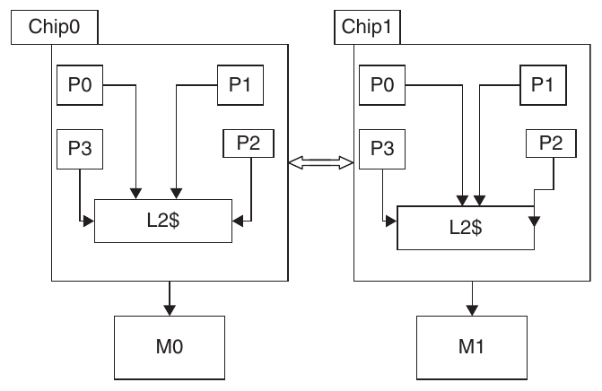

**Hình 5.37 Multichip, multicore multiprocessor với DSM.**

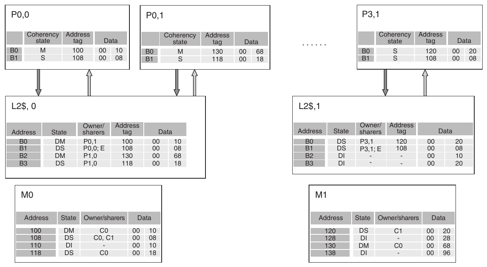

**Hình 5.38 Các trạng thái cache và memory trong multichip, multicore multiprocessor.**

trong đó P# chỉ CPU (ví dụ P0,0), &lt;op&gt; là CPU operation (ví dụ read hoặc write), &lt;address&gt; biểu thị memory address, và &lt;value&gt; cho biết word mới sẽ được gán trong một write operation. Trạng thái cuối của cache và memory (tức coherence state, sharer/owner, tag và data) sau khi chuỗi CPU operation đã cho hoàn tất là gì? Ngoài ra, mỗi read operation trả về giá trị nào?

a. [10] <5.4> P0,0: read 100

b. [10] <5.4> P0,0: read 128

c. [10] <5.4> P0,0: write 128 <-- 78

d. [10] <5.4> P0,0: read 120

e. [15] <5.4> P0,0: read 120

```
P1,0: read 120
```

f. [15] <5.4> P0,0: read 120

```
P1,0: write 120 <-- 80
```

g. [15] <5.4> P0,0: write 120 <-- 80

```
P1,0: read 120
```

h. [15] <5.4> P0,0: write 120 <-- 80

```
P1,0: write 120 <-- 90
```

**5.10** [10/10/10/10] <5.4> Directory protocol có khả năng mở rộng tốt hơn snooping protocol vì chúng gửi các request message và invalidate message tường minh đến những node có bản sao của một block, trong khi snooping protocol broadcast mọi request và invalidate đến tất cả node. Xét system eight-processor được minh họa trong Hình 5.37 và giả sử tất cả cache không được hiển thị đều chứa các block invalid. Với mỗi chuỗi dưới đây, hãy xác định những node (chip/processor) nào nhận từng request và invalidate.

a. [10] <5.4> P0,0: write 100 <-- 80

b. [10] <5.4> P0,0: write 108 <-- 88

c. [10] <5.4> P0,0: write 118 <-- 90

d. [10] <5.4> P1,0: write 128 <-- 98

**5.11** [25] <5.4> Bài tập 5.3 yêu cầu bạn bổ sung trạng thái Owned vào MSI snooping protocol đơn giản. Hãy thực hiện lại yêu cầu đó, nhưng với directory protocol đơn giản ở trên.

**5.12** [25] <5.4> Hãy thảo luận vì sao việc bổ sung trạng thái Exclusive vào directory protocol đơn giản lại khó hơn nhiều so với snooping protocol. Đưa ra một ví dụ về những loại vấn đề phát sinh.

### Nghiên cứu tình huống 3: Directory Protocol nâng cao

#### Các khái niệm được minh họa trong nghiên cứu tình huống này

- Cách triển khai Directory Coherence Protocol

- Performance của Coherence Protocol

- Các tối ưu hóa Coherence Protocol

Directory coherence protocol trong Nghiên cứu tình huống 2 mô tả directory coherence ở mức trừu tượng, nhưng giả định các transition là atomic, giống system snooping đơn giản. Các directory system High-performance sử dụng switched interconnect có pipeline, giúp cải thiện đáng kể bandwidth nhưng cũng đưa vào các transient state và nonatomic transaction. Directory cache coherence protocol có khả năng mở rộng tốt hơn snooping cache coherence protocol vì hai lý do. Thứ nhất, snooping cache coherence protocol broadcast request đến mọi node, làm hạn chế khả năng mở rộng. Directory protocol sử dụng một mức gián tiếp—một message gửi tới directory—để bảo đảm request chỉ được gửi tới những node có bản sao của block. Thứ hai, address network của một snooping system phải phân phối request theo một total order, trong khi directory protocol có thể nới lỏng ràng buộc này. Một số directory protocol không giả định bất kỳ network ordering nào; điều này có lợi vì cho phép các kỹ thuật adaptive routing cải thiện network bandwidth. Những protocol khác dựa vào thứ tự point-to-point (tức message từ node P0 đến node P1 sẽ đến đúng thứ tự). Ngay cả với ràng buộc thứ tự này, directory protocol thường vẫn có nhiều transient state hơn snooping protocol. Hình 5.39 trình bày các state transition của cache controller đối với một directory protocol được đơn giản hóa, dựa trên network ordering point-to-point. Hình 5.40 trình bày các state transition của directory controller.

| Trạng thái | Read | Write | Thay thế | Inv | Forwarded_GetS | Forwarded_GetM | PutM_Ack | Data | Last Ack |
|---|---|---|---|---|---|---|---|---|---|
| I | Gửi GetS/IS<sup>D</sup> | Gửi GetM/IM<sup>AD</sup> | lỗi | Gửi Ack/I | lỗi | lỗi | lỗi | lỗi | lỗi |
| S | Thực hiện read | Gửi GetM/IM<sup>AD</sup> | I | Gửi Ack/I | lỗi | lỗi | lỗi | lỗi | lỗi |
| M | Thực hiện read | Thực hiện write | Gửi PutM/MI<sup>A</sup> | lỗi | Gửi Data, gửi PutMS/MS<sup>A</sup> | Gửi Data/I | lỗi | lỗi | lỗi |
| IS<sup>D</sup> | z | z | z | Gửi Ack/ISI<sup>D</sup> | lỗi | lỗi | lỗi | Lưu Data, do Read/S | lỗi |
| ISI<sup>D</sup> | z | z | z | Gửi Ack | lỗi | lỗi | lỗi | Lưu Data, do Read/I | lỗi |
| IM<sup>AD</sup> | z | z | z | Gửi Ack | lỗi | lỗi | lỗi | Lưu Data/IM<sup>A</sup> | lỗi |
| IM<sup>A</sup> | z | z | z | lỗi | IMS<sup>A</sup> | IMI<sup>A</sup> | lỗi | lỗi | Thực hiện Write/M |
| IMI<sup>A</sup> | z | z | z | lỗi | lỗi | lỗi | lỗi | lỗi | Thực hiện Write, gửi Data/I |
| IMS<sup>A</sup> | z | z | z | Gửi Ack/IMI<sup>A</sup> | z | z | lỗi | lỗi | Thực hiện write, gửi Data/S |
| MS<sup>A</sup> | Thực hiện read | z | z | lỗi | Gửi Data | Gửi Data MI<sup>A</sup> | /S | lỗi | lỗi |
| MI<sup>A</sup> | z | z | z | lỗi | Gửi Data | Gửi Data/I | /I | lỗi | lỗi |

**Hình 5.39 Các transition của broadcast snooping cache controller.**

| Trạng thái | GetS | GetM | PutM (owner) | PutMS (nonowner) | PutM (owner) | PutMS (nonowner) |
|---|---|---|---|---|---|---|
| DI | Gửi Data, thêm vào sharer/DS | Gửi Data, xóa sharer, đặt owner/DM | lỗi | Gửi PutM_Ack | lỗi | Gửi PutM_Ack |
| DS | Gửi Data, thêm vào sharer/DS | Gửi INVs to sharers, đặt owner, gửi Data/DM | lỗi | Gửi PutM_Ack | lỗi | Gửi PutM_Ack |
| DM | Chuyển tiếp GetS, thêm vào sharer/DMS<sup>D</sup> | Chuyển tiếp GetM, gửi INVs to sharers, xóa sharer, đặt owner | Lưu Data, gửi PutM_Ack/DI | Gửi PutM_Ack | Lưu Data, thêm vào sharer, gửi PutM_Ack/DS | Gửi PutM_Ack |
| DMS<sup>D</sup> | Chuyển tiếp GetS, thêm vào sharer | Chuyển tiếp GetM, gửi INVs to sharers, xóa sharer, đặt owner/DM | Lưu Data, gửi PutM_Ack/DS | Gửi PutM_Ack | Lưu Data, thêm vào sharer, gửi PutM_Ack/DS | Gửi PutM_Ack |

**Hình 5.40 Các transition của directory controller.**

Với mỗi block, directory duy trì một state và một trường current owner hoặc một danh sách current sharer (nếu có). Để phục vụ phần thảo luận sau và bài toán tiếp theo, giả sử L2 cache bị vô hiệu hóa. Giả sử memory directory liệt kê sharer/owner ở granularity của processor. Chẳng hạn, trong Hình 5.38, memory directory của line 108 sẽ là “P0, 0; P3, 0” thay vì “C0, C1”. Đồng thời, giả sử message đi qua ranh giới giữa các chip—nếu cần—một cách trong suốt.

Hàng được đánh chỉ mục theo state hiện tại, còn cột được đánh chỉ mục theo event, và chúng xác định tuple <action/nextstate>. Nếu chỉ liệt kê next state thì không cần action nào. Những trường hợp không thể xảy ra được đánh dấu “error” và biểu thị điều kiện lỗi; “z” có nghĩa là hiện tại chưa thể xử lý event được yêu cầu.

Ví dụ sau minh họa hoạt động cơ bản của protocol này. Giả sử một processor cố write vào một block ở trạng thái I (Invalid). Tuple tương ứng là “send GetM/IM<sup>AD</sup>”, cho biết cache controller phải gửi một request GetM (GetModified) tới directory và chuyển sang trạng thái IM<sup>AD</sup>. Trong trường hợp đơn giản nhất, request message gặp directory ở trạng thái DI (Directory Invalid), cho biết không có cache nào khác giữ bản sao. Directory phản hồi bằng một Data message, trong đó cũng chứa số Ack cần chờ (trong trường hợp này là không). Trong protocol được đơn giản hóa này, cache controller xem message duy nhất đó như hai message: một Data message theo sau bởi một Last Ack event. Data message được xử lý trước, lưu dữ liệu và chuyển sang IM<sup>A</sup>. Sau đó Last Ack event được xử lý, chuyển sang trạng thái M. Cuối cùng, write có thể được thực hiện ở trạng thái M.

Nếu GetM gặp directory ở trạng thái DS (Directory Shared), directory sẽ gửi Invalidate (INV) message đến tất cả node trong danh sách sharer, gửi Data cùng số sharer đến requester, và chuyển sang trạng thái M. Khi INV message đến các sharer, chúng sẽ gặp block ở trạng thái S hoặc I (nếu sharer đã âm thầm invalidate block). Trong cả hai trường hợp, sharer sẽ gửi một Ack trực tiếp tới node yêu cầu. Requester đếm số Ack đã nhận và so sánh với con số được gửi trả cùng Data message. Khi tất cả Ack đã đến, Last Ack event xảy ra, kích hoạt cache chuyển sang trạng thái M và cho phép write tiếp tục. Lưu ý rằng tất cả Ack có thể đến trước Data message, nhưng Last Ack event không thể xảy ra trước. Đó là vì Data message chứa số lượng Ack. Vì thế, protocol giả định Data message được xử lý trước Last Ack event.

**5.13** [10/10/10/10/10/10] <5.4> Xét directory protocol nâng cao được mô tả ở trên và nội dung cache trong Hình 5.38. Các cache block bị ảnh hưởng đi qua chuỗi transient state nào trong mỗi trường hợp sau?

a. [10] <5.4> P0,0: read 100

b. [10] <5.4> P0,0: read 120

c. [10] <5.4> P0,0: write 120 <-- 80

d. [10] <5.4> P3,1: write 120 <-- 80

e. [10] <5.4> P1,0: read 110

f. [10] <5.4> P0,0: write 108 <-- 48

**5.14** [15/15/15/15/15/15/15] <5.4> Xét directory protocol nâng cao được mô tả ở trên và nội dung cache trong Hình 5.38. Các cache block bị ảnh hưởng đi qua chuỗi transient state nào trong mỗi trường hợp sau? Trong mọi trường hợp, giả sử các processor phát request trong cùng một cycle, nhưng directory sắp thứ tự request theo thứ tự top-down. Giả sử các action của controller có vẻ atomic (chẳng hạn, directory controller sẽ thực hiện tất cả action cần thiết cho transition DS --> DM trước khi xử lý request khác đối với cùng block).

a. [15] <5.4> P0,0: read 120

```
P1,0: read 120
```

b. [15] <5.4> P0,0: read 120

```
P1,0: write 120 <-- 80
```

c. [15] <5.4> P0,0: write 120

```
P1,0: read 120
```

d. [15] <5.4> P0,0: write 120 <-- 80

```
P1,0: write 120 <-- 90
```

e. [15] <5.4> P0,0: replace 110

```
P1,0: read 110
```

f. [15] <5.4> P1,0: write 110 <-- 80

```
P0,0: replace 110
```

g. [15] <5.4> P1,0: read 110

```
P0,0: replace 110
```

**5.15** [20/20/20/20/20] <5.4> Với multiprocessor được minh họa trong Hình 5.37 (vô hiệu hóa L2 cache), triển khai protocol được mô tả trong Hình 5.39 và Hình 5.40, hãy giả sử các latency sau:

- CPU read hit và write hit không tạo ra stall cycle nào.

- Việc hoàn tất một miss (ví dụ do Read và do Write) chỉ mất L<sub>ack</sub> cycle nếu được thực hiện để đáp ứng Last Ack event (nếu không, nó hoàn tất trong khi dữ liệu được sao chép vào cache).

- Một CPU read hoặc write tạo ra replacement event sẽ phát GetShared hoặc GetModified message tương ứng trước PutModified message (chẳng hạn bằng cách sử dụng write-back buffer).

- Một cache controller event gửi request hoặc acknowledgment message (ví dụ GetShared) có latency là L<sub>send_msg</sub> cycle.

- Một cache controller event đọc cache và gửi data message có latency là L<sub>send_data</sub> cycle.

- Một cache controller event nhận data message và cập nhật cache có latency là L<sub>rcv_data</sub>.

- Một memory controller chịu latency L<sub>send_msg</sub> khi chuyển tiếp request message.

- Một memory controller chịu thêm L<sub>inv</sub> cycle cho mỗi invalidate mà nó phải gửi.

- Một cache controller chịu latency L<sub>send_msg</sub> cho mỗi invalidate mà nó nhận (latency được tính đến khi nó gửi Ack message).

- Một memory controller có latency L<sub>read_memory</sub> cycle để đọc memory và gửi data message.

- Một memory controller có latency L<sub>write_memory</sub> để ghi data message vào memory (latency được tính đến khi nó gửi Ack message).

- Một non-data message (ví dụ request, invalidate, Ack) có network latency L<sub>req_msg</sub> cycle.

- Một data message có network latency L<sub>data_msg</sub> cycle.

- Cộng thêm latency 20 cycle cho bất kỳ message nào đi từ chip 0 sang chip 1 và ngược lại.

Xét một cách triển khai có các đặc điểm performance được tóm tắt trong Hình 5.41.

Với các chuỗi operation dưới đây, nội dung cache trong Hình 5.38 và directory protocol ở trên, latency mà mỗi processor node quan sát được là bao nhiêu?

a. [20] <5.4> P0,0: read 100

b. [20] <5.4> P0,0: read 128

c. [20] <5.4> P0,0: write 128 <-- 68

d. [20] <5.4> P0,0: write 120 <-- 50

e. [20] <5.4> P0,0: write 108 <-- 80

| Action | Latency |
|---|---|
| Send_msg | 6 |
| Send_data | 20 |
| Rcv_data | 15 |
| Read-memory | 100 |
| Write-memory | 20 |
| inv | 1 |
| ack | 4 |
| Req-msg | 15 |
| Data-msg | 30 |

**Hình 5.41 Latency của directory coherence.**

**5.16** [20] <5.4> Trong trường hợp cache miss, cả switched snooping protocol được mô tả trước đó lẫn directory protocol trong nghiên cứu tình huống này đều thực hiện read hoặc write operation sớm nhất có thể. Cụ thể, chúng thực hiện operation như một phần của transition sang stable state, thay vì chuyển sang stable state rồi chỉ đơn giản thử lại operation. Đây không phải một tối ưu hóa. Để bảo đảm forward progress, các cách triển khai protocol phải bảo đảm thực hiện ít nhất một CPU operation trước khi nhường block. Giả sử cách triển khai coherence protocol không làm điều này. Hãy giải thích việc đó có thể dẫn đến livelock như thế nào. Đưa ra một ví dụ code đơn giản có thể kích thích hành vi này.

**5.17** [20/30] <5.4> Một số directory protocol bổ sung trạng thái Owned (O) vào protocol, tương tự tối ưu hóa đã thảo luận cho snooping protocol. Trạng thái Owned hoạt động giống Shared ở chỗ node chỉ có thể đọc Owned block, nhưng giống Modified ở chỗ node phải cung cấp dữ liệu khi node khác gửi Get request đến Owned block. Trạng thái Owned loại bỏ trường hợp GetShared request đến một block ở trạng thái Modified đòi hỏi node gửi dữ liệu cho cả processor yêu cầu lẫn memory. Trong một MOSI directory protocol, GetShared request đến block ở trạng thái Modified hoặc Owned sẽ cung cấp dữ liệu cho node yêu cầu và chuyển sang trạng thái Owned. GetModified request ở trạng thái Owned được xử lý giống request ở trạng thái Modified. MOSI protocol được tối ưu này chỉ cập nhật memory khi một node thay thế block ở trạng thái Modified hoặc Owned.

a. [20] <5.4> Giải thích vì sao trạng thái MSA trong protocol về cơ bản là một trạng thái Owned “transient”.

b. [30] <5.4> Sửa đổi các bảng cache protocol và directory protocol để hỗ trợ một trạng thái Owned ổn định.

**5.18** [25/25] <5.4> Directory protocol nâng cao được mô tả ở trên dựa vào một interconnect có thứ tự point-to-point để bảo đảm hoạt động chính xác. Với giả định nội dung cache ban đầu như trong Hình 5.38 và các chuỗi operation dưới đây, hãy giải thích vấn đề nào có thể phát sinh nếu interconnect không duy trì thứ tự point-to-point. Giả sử các processor thực hiện request cùng lúc, nhưng directory xử lý chúng theo thứ tự được trình bày.

a. [25] <5.4> P1,0: read 110

```
P3,1: write 110 <-- 90
```

b. [25] <5.4> P1,0: read 110

```
P0,0: replace 110
```

### Bài tập

**5.19** [15] <5.1> Giả sử chúng ta có một hàm cho ứng dụng ở dạng F(i, p), biểu thị tỷ lệ thời gian mà có thể sử dụng đúng i processor, với tổng cộng p processor có sẵn. Điều đó có nghĩa là:

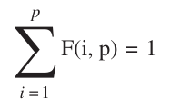

Giả sử khi i processor được sử dụng, ứng dụng chạy nhanh hơn i lần. Hãy viết lại Amdahl’s law sao cho nó biểu thị speedup theo hàm của p đối với một ứng dụng nào đó.

**5.20** [15/20/10] <5.1> Trong bài tập này, chúng ta xem xét ảnh hưởng của topology của interconnection network lên clock cycle per instruction (CPI) của những chương trình chạy trên một distributed-memory multiprocessor 64-processor. Processor clock rate là 3.3 GHz, và base CPI của một ứng dụng có mọi reference đều hit trong cache là 0.5. Giả sử 0.2% instruction liên quan đến một remote communication reference. Chi phí của một remote communication reference là (100 + 10h) ns, trong đó h là số communication network hop mà một remote reference phải đi qua để đến memory của remote processor rồi quay lại. Giả sử tất cả communication link đều hai chiều.

a. [15] <5.1> Tính chi phí remote communication worst-case khi 64 processor được bố trí thành ring, thành lưới processor 8×8, hoặc thành hypercube. (Gợi ý: Communication path dài nhất trên một hypercube 2<sup>n</sup> có n link.)

b. [20] <5.1> So sánh base CPI của ứng dụng khi không có remote communication với CPI đạt được ở mỗi topology trong ba topology của phần (a).

c. [10] <5.1> Ứng dụng khi không có remote communication nhanh hơn bao nhiêu so với performance của nó khi có remote communication trên mỗi topology trong ba topology của phần (a)?

**5.21** [15] <5.2> Hãy chỉ ra cách thay đổi snooping protocol cơ bản trong Hình 5.7 cho một write-through cache. Chức năng hardware chủ yếu nào không cần thiết đối với write-through cache so với write-back cache?

**5.22** [20] <5.2> Bổ sung một trạng thái clean exclusive vào snooping cache coherence protocol cơ bản (Hình 5.7). Trình bày protocol theo định dạng của Hình 5.7.

**5.23** [15] <5.2> Một giải pháp được đề xuất cho vấn đề false sharing là bổ sung một valid bit cho mỗi word. Điều này cho phép protocol invalidate một word mà không loại bỏ toàn bộ block, để một processor giữ một phần của block trong cache trong khi processor khác ghi vào phần khác của block. Nếu bổ sung khả năng này, snooping cache coherence protocol cơ bản (Hình 5.7) sẽ phức tạp thêm ở những điểm nào? Nhớ xem xét tất cả protocol action có thể xảy ra.

**5.24** [15/20] <5.3> Bài tập này nghiên cứu ảnh hưởng của các kỹ thuật mạnh nhằm khai thác instruction-level parallelism trong processor khi được sử dụng để thiết kế shared-memory multiprocessor system. Xét hai system giống hệt nhau ngoại trừ processor. System A sử dụng processor với pipeline single-issue in-order đơn giản, còn system B sử dụng processor có four-way issue, out-of-order execution và reorder buffer có 64 entry.

a. [15] <5.3> Theo quy ước trong Hình 5.11, hãy chia execution time thành instruction execution, cache access, memory access và các stall khác. Bạn kỳ vọng mỗi thành phần này khác nhau ra sao giữa system A và system B?

b. [10] <5.3> Dựa trên phần thảo luận về hành vi của workload On-Line Transaction Processing (OLTP) trong Mục 5.3, khác biệt quan trọng nào giữa workload OLTP và các benchmark khác làm hạn chế lợi ích của một processor design mạnh hơn?

**5.25** [15] <5.3> Bạn sẽ thay đổi code của ứng dụng như thế nào để tránh false sharing? Compiler có thể làm những gì, và những gì có thể đòi hỏi programmer directive?

**5.26** [15] <5.4> Giả sử sử dụng một directory-based cache coherence protocol. Directory hiện có thông tin cho biết processor P1 giữ dữ liệu ở chế độ “exclusive”. Nếu lúc này directory nhận một request cho cùng cache block từ processor P1, điều đó có thể có nghĩa gì? Directory controller phải làm gì? (Những trường hợp như vậy được gọi là race condition và là lý do khiến coherence protocol rất khó thiết kế và xác minh.)

**5.27** [20] <5.4> Một directory controller có thể gửi invalidate cho những line đã bị local cache controller thay thế. Để tránh các message như vậy và giữ directory nhất quán, người ta sử dụng replacement hint. Những message này cho controller biết một block đã được thay thế. Hãy sửa đổi directory coherence protocol trong Mục 5.4 để sử dụng các replacement hint như vậy.

**5.28** [20/30] <5.4> Một nhược điểm của cách triển khai directory trực tiếp bằng các bit vector đầy đủ là tổng kích thước thông tin directory tăng theo tích (tức số processor × số memory block). Nếu memory tăng tuyến tính theo số processor, tổng kích thước directory sẽ tăng theo bình phương số processor. Trong thực tế, vì directory chỉ cần 1 bit cho mỗi memory block (thường có kích thước 32 đến 128 byte), vấn đề này không nghiêm trọng với số processor từ nhỏ đến vừa. Chẳng hạn, với giả định block 128-byte, lượng directory storage so với main memory bằng số processor/1024, tức khoảng 10% storage bổ sung với 100 processor. Có thể tránh vấn đề này bằng nhận xét rằng chúng ta chỉ cần giữ một lượng thông tin tỷ lệ với cache size của mỗi processor. Chúng ta sẽ tìm hiểu một số giải pháp trong các bài tập sau.

a. [20] <5.4> Một phương pháp để đạt được directory protocol có khả năng mở rộng là tổ chức multiprocessor thành một logical hierarchy, trong đó processor là các leaf của hierarchy và directory được đặt ở root của mỗi subtree. Directory của mỗi subtree ghi nhận descendant nào cache những memory block nào, cũng như những memory block có home trong subtree đó nhưng được cache bên ngoài subtree. Tính lượng storage cần thiết để ghi nhận processor information cho các directory, với giả định mỗi directory là fully associative. Câu trả lời cũng phải tính đến cả số node ở mỗi level của hierarchy lẫn tổng số node.

b. [30] <5.4> Một cách tiếp cận khác để triển khai directory scheme là triển khai các bit vector không dense. Có hai chiến lược: một chiến lược giảm số bit vector cần thiết, còn chiến lược kia giảm số bit trên mỗi vector. Bạn có thể sử dụng trace để so sánh những scheme này. Trước hết, triển khai directory thành một cache four-way set associative lưu các bit vector đầy đủ, nhưng chỉ dành cho các block được cache bên ngoài home node. Nếu directory cache miss xảy ra, hãy chọn một directory entry và invalidate entry đó. Thứ hai, triển khai directory sao cho mỗi entry có 8 bit. Nếu một block chỉ được cache trong một node bên ngoài home của nó, trường này chứa node number. Nếu block được cache trong nhiều node bên ngoài home, trường này là một bit vector, với mỗi bit biểu thị một nhóm tám processor mà ít nhất một processor trong nhóm cache block đó. Sử dụng trace của lần thực thi 64-processor để mô phỏng hành vi của những scheme này. Giả sử một cache hoàn hảo cho các nonshared reference để tập trung vào coherency behavior. Xác định số extraneous invalidation khi directory cache size tăng lên.

**5.29** [10] <5.5> Triển khai instruction test-and-set cổ điển bằng cặp instruction load-linked/store-conditional.

**5.30** [15] <5.5> Một tối ưu hóa performance thường được sử dụng là pad các synchronization variable sao cho không có dữ liệu hữu ích nào khác nằm trên cùng cache line với synchronization variable. Xây dựng một ví dụ cực đoan trong đó việc không làm như vậy có thể làm giảm performance. Giả sử sử dụng một snooping write invalidate protocol.

**5.31** [30] <5.5> Một cách triển khai khả dĩ của cặp load-linked/store-conditional cho multicore processor là ràng buộc các instruction này phải sử dụng uncached memory operation. Một monitor unit chặn tất cả read và write từ bất kỳ core nào tới memory. Nó theo dõi nguồn của các load-linked instruction và liệu có store xen vào giữa load-linked với store-conditional instruction tương ứng hay không. Monitor có thể ngăn bất kỳ store conditional thất bại nào ghi dữ liệu, đồng thời sử dụng các interconnect signal để thông báo cho processor rằng store này đã thất bại. Thiết kế một monitor như vậy cho memory system hỗ trợ một symmetric multiprocessor (SMP) four-core. Cần tính đến việc, thông thường, read và write request có thể có các data size khác nhau (4, 8, 16, 32 byte). Bất kỳ memory location nào cũng có thể là đích của một cặp load-linked/store-conditional, và memory monitor phải giả định rằng các reference load-linked/store-conditional tới bất kỳ location nào cũng có thể được xen kẽ với các access thông thường tới cùng location đó. Độ phức tạp của monitor phải độc lập với memory size.

**5.32** [10/12/10/12] <5.6> Như đã thảo luận trong Mục 5.6, memory consistency model đưa ra một đặc tả về cách memory system thể hiện trước programmer. Xét đoạn code sau, trong đó các giá trị ban đầu là:

```
A=flag=C=0.
P1                        P2
A= 2000                   while (flag ==1){;}
flag=1                    C=A
```

a. [10] <5.6> Khi kết thúc đoạn code, giá trị C mà bạn kỳ vọng là bao nhiêu?

b. [12] <5.6> Một system có general-purpose interconnection network, directory-based cache coherence protocol và hỗ trợ nonblocking load tạo ra kết quả trong đó C bằng 0. Hãy mô tả một kịch bản mà kết quả này có thể xảy ra.

c. [10] <5.6> Nếu muốn làm cho system sequentially consistent, những ràng buộc then chốt nào cần được áp đặt?

Giả sử một processor hỗ trợ relaxed memory consistency model. Relaxed consistency model đòi hỏi phải xác định tường minh synchronization. Giả sử processor hỗ trợ một instruction “barrier”, bảo đảm rằng tất cả memory operation đứng trước barrier instruction phải hoàn tất trước khi bất kỳ memory operation nào đứng sau barrier được phép bắt đầu. Bạn sẽ chèn barrier instruction vào những vị trí nào trong đoạn code trên để bảo đảm thu được các “kết quả trực quan” của sequential consistency?

**5.33** [25] <5.7> Chứng minh rằng trong một cache hierarchy two-level, nơi L1 gần processor hơn, inclusion được duy trì mà không cần action bổ sung nếu L2 có associativity ít nhất bằng L1, cả hai cache đều dùng line replaceable unit (LRU) replacement, và cả hai cache có cùng block size.

**5.34** [Thảo luận] <5.7> Khi cố thực hiện đánh giá performance chi tiết cho một multiprocessor system, các system designer sử dụng một trong ba công cụ: analytical model, trace-driven simulation và execution-driven simulation. Analytical model sử dụng các biểu thức toán học để mô hình hóa hành vi của chương trình. Trace-driven simulation chạy ứng dụng trên máy thực và tạo ra trace, thường là trace của memory operation. Những trace này có thể được phát lại qua một cache simulator hoặc một simulator có processor model đơn giản để dự đoán performance của system khi các parameter khác nhau thay đổi. Execution-driven simulator mô phỏng toàn bộ quá trình thực thi, duy trì một cấu trúc tương đương cho processor state, v.v. Những trade-offs về độ chính xác và tốc độ giữa các cách tiếp cận này là gì?

**5.35** [40] <5.7, 5.9> Multiprocessor và cluster thường có performance tăng khi bạn tăng số processor, với trường hợp lý tưởng là speedup n× cho n processor. Mục tiêu của benchmark thiên lệch này là tạo ra một chương trình có performance kém đi khi bạn bổ sung processor. Chẳng hạn, điều đó có nghĩa là một processor trên multiprocessor hoặc cluster chạy chương trình nhanh nhất, hai processor chậm hơn, bốn processor chậm hơn hai, v.v. Những đặc điểm performance then chốt nào của mỗi cách tổ chức dẫn đến speedup tuyến tính nghịch?
