# 6 Warehouse-Scale Computer để khai thác Request-Level và Data-Level Parallelism

> Datacenter chính là máy tính.

> Luiz André Barroso,

> Google (2007)

> Một trăm năm trước, các công ty ngừng tự phát điện bằng máy hơi nước và dynamo, chuyển sang kết nối với lưới điện mới được xây dựng. Điện rẻ từ công ty điện lực không chỉ thay đổi cách doanh nghiệp hoạt động. Nó khơi mào phản ứng dây chuyền các biến đổi eco- nomic và xã hội, đưa thế giới hiện đại vào tồn tại. Ngày nay, cuộc cách mạng tương tự đang diễn ra. Kết nối với lưới điện toán toàn cầu Internet, những nhà máy information-processing khổng lồ bắt đầu bơm data và software code vào nhà ở và busi- nesses. Lần này, điện toán đang trở thành một dịch vụ tiện ích.

> Nicholas Carr

> The Big Switch: Rewiring the World, from Edison to Google (2008)

## 6.1 Giới thiệu

> Ai cũng có thể xây CPU nhanh. Cái khó là xây cả hệ thống nhanh.

> Seymour Cray

> Được xem là cha đẻ supercomputer

warehouse-scale computer (WSC)[^1] là nền tảng của các dịch vụ Internet mà nhiều người sử dụng mỗi ngày: tìm kiếm, mạng xã hội, bản đồ trực tuyến, chia sẻ video, mua sắm trực tuyến, email, v.v. Mức độ phổ biến rất lớn của những dịch vụ này đòi hỏi phải xây dựng WSC để theo kịp nhu cầu đang tăng nhanh của công chúng. Mặc dù trông giống những datacenter lớn, architecture và cách vận hành của WSC rất khác biệt, như chúng ta sẽ thấy. WSC hiện nay hoạt động như một máy tính khổng lồ, với chi phí khoảng $150M cho tòa nhà, hạ tầng điện và làm mát, các server cùng thiết bị mạng kết nối chúng, và chứa từ 50,000 đến 100,000 server. Hơn nữa, sự phát triển nhanh của cloud computing (xem Mục 6.5) giúp bất kỳ ai có thẻ tín dụng cũng có thể tiếp cận WSC.

Computer architecture có thể mở rộng một cách tự nhiên sang thiết kế WSC. Chẳng hạn, Luiz Barroso của Google (đã được trích dẫn ở trên) thực hiện luận án về computer architecture. Ông cho rằng kỹ năng thiết kế theo quy mô, thiết kế bảo đảm dependability và khả năng debugging hardware của architect rất hữu ích khi xây dựng và vận hành WSC.

Ở quy mô cực lớn này, với yêu cầu đổi mới trong phân phối điện, làm mát, giám sát và vận hành, WSC là hậu duệ hiện đại của supercomputer—khiến Seymour Cray trở thành người đỡ đầu cho WSC architect ngày nay. Những máy tính cực mạnh của ông thực hiện các phép tính mà không nơi nào khác có thể thực hiện, nhưng chúng đắt đến mức chỉ một số ít công ty có khả năng mua. Lần này, mục tiêu là cung cấp công nghệ thông tin cho thế giới, thay vì cung cấp high-performance computing (HPC) cho các nhà khoa học và kỹ sư; vì thế, có thể lập luận rằng WSC đóng vai trò quan trọng hơn trong xã hội ngày nay so với supercomputer của Cray trước kia.

Không nghi ngờ gì, WSC có số người dùng lớn hơn high-performance computing nhiều bậc độ lớn và chiếm phần thị trường IT lớn hơn nhiều. Dù đo bằng người dùng hay doanh thu, Google lớn hơn ít nhất 250 lần so với Cray Research từng đạt.

WSC architect chia sẻ nhiều mục tiêu và yêu cầu với server architect:

- Cost-performance — Công việc hoàn thành trên mỗi dollar rất quan trọng, một phần vì quy mô. Giảm capital cost của WSC 10% có thể tiết kiệm $15M.

- Hiệu quả năng lượng — Chi phí phân phối điện phụ thuộc vào power consumption; phải có đủ năng lực phân phối trước khi có thể tiêu thụ điện. Chi phí của hệ thống cơ khí cũng phụ thuộc vào power: phải loại bỏ lượng nhiệt tương ứng với năng lượng đã đưa vào. Vì thế, peak power và power tiêu thụ chi phối cả chi phí phân phối điện lẫn cooling system. Hơn nữa, hiệu quả năng lượng là một phần quan trọng của trách nhiệm đối với môi trường. Do chi phí xây dựng hạ tầng điện và cơ khí cho cả nhà kho máy tính rất cao, cùng với hóa đơn điện hằng tháng của server, lượng công việc hoàn thành trên mỗi joule rất quan trọng đối với cả WSC lẫn server.

- Dependability nhờ redundancy — Tính chất long-running của dịch vụ Internet có nghĩa là hardware và software của WSC phải phối hợp để cung cấp availability ít nhất 99.99%; tức là downtime dưới 1 giờ mỗi năm. Redundancy là chìa khóa để đạt dependability cho cả WSC lẫn server. Server architect thường sử dụng hardware bổ sung đắt tiền hơn để đạt availability cao, trong khi WSC architect dựa vào nhiều server cost-effective được kết nối qua network low-cost và redundancy do software quản lý. Hơn nữa, nếu muốn vượt xa availability “four nines”, cần có nhiều WSC để che giấu những sự kiện có thể khiến cả WSC ngừng hoạt động. Việc sử dụng nhiều WSC cũng giảm latency cho các dịch vụ được triển khai rộng rãi.

- Network I/O — Server architect phải cung cấp network interface tốt với bên ngoài, WSC architect cũng vậy. Networking cần để giữ data nhất quán giữa nhiều WSC cũng như giao tiếp với công chúng.

- Cả workload tương tác lẫn batch processing — Mặc dù chúng ta kỳ vọng có nhiều workload tương tác trong những dịch vụ như tìm kiếm và mạng xã hội với hàng triệu người dùng, WSC cũng như server còn chạy các batch program song song trên quy mô lớn để tính toán metadata hữu ích. Chẳng hạn, các job MapReduce chuyển những trang thu thập được khi crawl Web thành search index (xem Mục 6.2).

Không ngạc nhiên, cũng có những đặc điểm không chia sẻ với server architecture:

- Tính song song dồi dào — Server architect lo ứng dụng ở thị trường mục tiêu có đủ tính song song để biện minh lượng parallel hardware hay không, và chi phí communication hardware có quá cao để khai thác hay không. WSC architect không lo điều ấy. Thứ nhất, batch application hưởng lợi từ lượng lớn dataset độc lập cần xử lý riêng, như hàng tỷ trang Web sau một lần crawl. Đây là data-level parallelism áp dụng vào data trong storage thay vì memory như Chương 4. Thứ hai, ứng dụng dịch vụ Internet tương tác, còn gọi software as a service (SaaS), hưởng lợi từ hàng triệu người dùng độc lập. Đọc và ghi hiếm khi phụ thuộc nhau trong SaaS nên ít cần đồng bộ. Chẳng hạn, tìm kiếm dùng index read-only, email thường xử lý thông tin reading- và writing-independent. Chúng ta gọi tính song song dễ khai thác này là request-level parallelism: nhiều công việc độc lập tự nhiên tiến hành song song, ít cần communication hay synchronization; chẳng hạn cập nhật journal-based có thể giảm nhu cầu throughput. Trước thành công SaaS và WSC, ứng dụng truyền thống hơn như relational database đã được nới lỏng để dựa vào request-level parallelism. Ngay cả tính năng read-/write-dependent đôi khi cũng bị bỏ để storage mở rộng tới quy mô WSC hiện đại.

- Operational cost cũng quan trọng — Server architect thường thiết kế để đạt peak performance trong phạm vi ngân sách, và chỉ quan tâm đến power để không vượt cooling capacity của enclosure. Họ thường bỏ qua operational cost vì giả định rằng chi phí này nhỏ so với chi phí mua thiết bị. WSC có thời gian tồn tại lâu hơn—tòa nhà cùng hạ tầng điện và làm mát thường được khấu hao trong 10 năm trở lên—nên operational cost tích lũy theo thời gian: năng lượng, phân phối điện và làm mát chiếm hơn 30% chi phí của WSC trong 10 năm.

- Quy mô và cơ hội/vấn đề đi kèm — Máy tính cực mạnh thường cực đắt vì cần custom hardware, nhưng không thể khấu hao chi phí tùy biến hiệu quả do chỉ chế tạo ít máy. Tuy nhiên khi mua 50,000 server và hạ tầng cho một WSC, bạn nhận chiết khấu số lượng. Bản thân WSC lớn đến mức có economy of scale dù không có nhiều WSC. Như Mục 6.5 và 6.10 sẽ cho thấy, lợi thế đó dẫn tới cloud computing: chi phí per-unit thấp cho phép cho thuê có lãi ở mức thấp hơn chi phí người ngoài tự làm. Mặt trái của 50,000 server là failure. Hình 6.1 cho outage và anomaly của 2400 server. Dù một server có mean time to failure (MTTF) đáng kinh ngạc 25 năm (200,000 giờ), WSC architect vẫn phải thiết kế cho 5 server failure mỗi ngày. Hình 6.1 liệt kê annualized disk failure rate từ 2% tới 10%. Nếu mỗi server có 4 disk với annual failure rate 4%, thì 50,000 server sẽ có một disk hỏng mỗi giờ.

**Ví dụ** Tính availability của dịch vụ chạy trên 2400 server Hình 6.1. Khác dịch vụ WSC thực, ví dụ này không chịu được hardware hoặc software failure. Giả sử reboot software mất 5 phút và sửa hardware mất 1 giờ.

**Trả lời** Chúng ta có thể ước tính service availability bằng cách tính thời gian outage do failure của từng thành phần. Để thận trọng, chúng ta lấy số thấp nhất trong mỗi nhóm ở Hình 6.1, rồi chia đều 1000 outage cho bốn thành phần. Chúng ta bỏ qua các disk chậm—thành phần thứ năm trong nhóm 1000 outage—vì chúng làm giảm performance nhưng không làm giảm availability; đồng thời bỏ qua power utility failure vì uninterruptible power supply (UPS) che giấu 99% những sự cố này.

| Số sự kiện xấp xỉ trong năm 1st | Nguyên nhân | Hậu quả |
|---|---|---|
| 1 hoặc 2 | Power utility failure | Mất điện toàn WSC; không đánh sập WSC nếu UPS và generator hoạt động (generator hoạt động khoảng 99% thời gian). |
| 4 | Nâng cấp cluster | Planned outage để nâng cấp hạ tầng, nhiều lần do nhu cầu networking thay đổi như đi lại cable, nâng cấp switch firmware, v.v. Có khoảng 9 planned cluster outage cho mỗi unplanned outage. |
| 1000s | Failure Hard-drive | Annual disk failure rate 2% tới 10% [Pinheiro 2007] |
|  | Disk chậm | Vẫn hoạt động nhưng chậm hơn 10x tới 20x |
|  | Memory lỗi | Một uncorrectable DRAM error mỗi năm [Schroeder và cộng sự 2009] |
|  | Máy cấu hình sai | Cấu hình dẫn tới ~30% gián đoạn dịch vụ [Barroso và Hölzle 2009] |
|  | Máy hoạt động thất thường | 1% server reboot hơn một lần mỗi tuần [Barroso và Hölzle 2009] |
| 5000 | Crash từng server | Reboot máy, thường khoảng 5 phút |

**Hình 6.1 Danh sách outage và anomaly cùng tần suất gần đúng trong năm đầu cluster 2400 server mới. Chúng ta gọi thứ Google gọi là cluster là array; xem Hình 6.5. (Dựa trên Barroso [2010].)**

Hours Outage<sub>service</sub> = ( 4 + 250 + 250 + 250 ) × 1 hour + ( 250 + 5000 ) × 5 minutes

= 754 + 438 = 1192 hours

Vì một năm có 365 × 24 hay 8760 giờ, availability là:

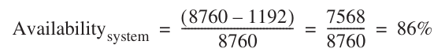

Nghĩa là nếu không có software redundancy che giấu nhiều outage, dịch vụ trên 2400 server ấy trung bình ngừng một ngày mỗi tuần, tức availability không có chữ số chín nào!

Như Mục 6.10 giải thích, tiền thân của WSC là computer cluster. Cluster là một tập hợp các máy tính độc lập được kết nối bằng local area network (LAN) tiêu chuẩn và switch off-the-shelf. Đối với những workload không cần communication cường độ cao, cluster cung cấp khả năng tính toán cost-effective hơn nhiều so với shared memory multiprocessor. (Shared memory multiprocessor là tiền thân của multicore computer trong Chương 5.) Cluster trở nên phổ biến vào cuối thập niên 1990 trong scientific computing, rồi sau đó trong các dịch vụ Internet. Có thể xem WSC là sự phát triển tự nhiên từ cluster hàng trăm server thành các hệ thống hàng chục nghìn server ngày nay.

Câu hỏi tự nhiên là WSC có giống cluster high-performance computing hiện đại không. Dù một số có quy mô và chi phí tương tự — có HPC design một triệu processor tốn hàng trăm triệu dollar — chúng thường có processor và network giữa node nhanh hơn nhiều WSC, vì ứng dụng HPC phụ thuộc lẫn nhau và communication thường xuyên hơn (xem Mục 6.3). HPC design cũng thường dùng custom hardware, nhất là network, nên ít hưởng lợi chi phí commodity chip. Chẳng hạn riêng microprocessor IBM Power 7 có thể đắt và dùng nhiều power hơn toàn bộ server node trong Google WSC. Môi trường lập trình nhấn mạnh thread-level parallelism hoặc data-level parallelism (Chương 4 và 5), thường chú trọng latency hoàn tất một task thay vì bandwidth hoàn tất nhiều task độc lập qua request-level parallelism. HPC cluster còn thường có job long-running giữ server fully utilized, thậm chí nhiều tuần, trong khi mức sử dụng server WSC từ 10% tới 50% (xem Hình 6.3 trang 440), thay đổi mỗi ngày.

WSC so với datacenter thông thường thế nào? Người vận hành datacenter thường gom máy và software third-party từ nhiều bộ phận tổ chức rồi chạy tập trung cho người khác. Họ chủ yếu hợp nhất nhiều dịch vụ lên ít máy hơn, cách ly nhau để bảo vệ thông tin nhạy cảm. Vì thế virtual machine ngày càng quan trọng. Khác WSC, datacenter thường có hardware và software rất không đồng nhất để phục vụ khách hàng đa dạng trong tổ chức. Lập trình viên WSC tùy biến software third-party hoặc tự xây, và WSC có hardware đồng nhất hơn nhiều; mục tiêu là khiến hardware/software trong warehouse hoạt động như một máy thường chạy nhiều ứng dụng. Chi phí lớn nhất datacenter thường là nhân lực bảo trì, trong khi như sẽ thấy ở Mục 6.4, server hardware là chi phí lớn nhất trong WSC well-designed, còn nhân lực từ đứng đầu xuống gần như không đáng kể. Datacenter thường cũng không có quy mô WSC nên không hưởng lợi kinh tế quy mô trên. Vì vậy có thể xem WSC là datacenter cực lớn, vì máy đặt riêng trong không gian có hạ tầng điện, làm mát đặc biệt, nhưng datacenter điển hình ít chia sẻ thách thức và cơ hội WSC, cả về architecture lẫn vận hành.

Vì ít architect hiểu software chạy trong WSC, chúng ta bắt đầu với workload và programming model.

## 6.2 Programming Model và Workload cho Warehouse-Scale Computer

> Nếu một vấn đề không có lời giải, có thể nó không phải vấn đề mà là sự thật — không phải để giải quyết mà để thích ứng theo thời gian.

> Shimon Peres

Ngoài dịch vụ Internet public-facing như tìm kiếm, chia sẻ video và mạng xã hội làm nên tên tuổi, WSC còn chạy batch application như chuyển video sang format mới hoặc tạo search index từ Web crawl.

Hiện nay, framework batch processing phổ biến nhất trong WSC là MapReduce [Dean và Ghemawat 2008] cùng người anh em open-source Hadoop. Hình 6.2 cho thấy MapReduce ngày càng phổ biến tại Google. (Facebook chạy Hadoop trên 2000 server batch-processing trong tổng số khoảng 60,000 server mà công ty được ước tính sở hữu vào năm 2011.) Lấy cảm hứng từ các function cùng tên trong Lisp, trước tiên Map áp dụng một function programmer-supplied cho từng logical input record. Map chạy trên hàng nghìn máy để tạo ra intermediate result gồm các cặp key-value. Reduce thu thập output của những task phân tán và rút gọn chúng bằng một function programmer-defined khác. Với software support phù hợp, cả hai bước đều có mức parallelism cao nhưng vẫn dễ hiểu và dễ sử dụng. Trong vòng 30 phút, một lập trình viên mới có thể chạy một task MapReduce trên hàng nghìn máy.

Chẳng hạn, một MapReduce program tính số lần xuất hiện mỗi từ tiếng Anh trong tập tài liệu lớn. Dưới đây là phiên bản đơn giản hóa, chỉ gồm inner loop và giả định mọi từ tiếng Anh tìm trong tài liệu xuất hiện một lần [Dean và Ghemawat 2008]: function EmitIntermediate trong Map phát mỗi từ và giá trị một. Reduce cộng các giá trị cho từng từ trong từng tài liệu, dùng ParseInt() để nhận số lần xuất hiện mỗi từ trong mọi tài liệu. MapReduce runtime environment schedule map task và reduce task tới node WSC. (Phiên bản đầy đủ trong Dean và Ghemawat [2004].)

```
map(String key, String value):
        // key: document name
        // value: document contents
        for each word w in value:
        EmitIntermediate(w, “1”); // Produce list of all words
reduce(String key, Iterator values):
        // key: a word
        // values: a list of counts
        int result = 0;
        for each v in values:
        result += ParseInt(v); // get integer from key-value pair
        Emit(AsString(result));
```

|  | Aug-04 | Mar-06 | Sep-07 | Sep-09 |
|---|---|---|---|---|
| Số MapReduce job | 29,000 | 171,000 | 2,217,000 | 3,467,000 |
| Completion time trung bình (giây) | 634 | 874 | 395 | 475 |
| Số server năm sử dụng | 217 | 2002 | 11,081 | 25,562 |
| Input data đã đọc (terabyte) | 3288 | 52,254 | 403,152 | 544,130 |
| Intermediate data (terabyte) | 758 | 6743 | 34,774 | 90,120 |
| Output data đã ghi (terabyte) | 193 | 2970 | 14,018 | 57,520 |
| Số server trung bình mỗi job | 157 | 268 | 394 | 488 |

**Hình 6.2 Sử dụng MapReduce hằng năm tại Google theo thời gian. Trong năm năm, số MapReduce job tăng hệ số 100 và số server trung bình mỗi job tăng hệ số 3. Hai năm cuối tăng lần lượt 1.6 và 1.2 [Dean 2009]. Hình 6.16 trang 459 ước tính chạy workload năm 2009 trên Amazon EC2 cloud computing tốn $133M.**

Có thể xem MapReduce là tổng quát hóa operation single-instruction, multiple-data (SIMD) (Chương 4) — ngoại trừ bạn truyền function áp dụng lên data — theo sau bởi function reduction output của Map task. Vì reduction phổ biến ngay cả trong SIMD program, SIMD hardware thường có operation đặc biệt cho chúng. Chẳng hạn AVX SIMD instruction mới của Intel gồm instruction “horizontal” cộng các cặp operand liền kề trong register.

Để thích ứng với sự biến thiên performance giữa hàng nghìn máy, MapReduce scheduler giao task mới theo tốc độ mà các node hoàn thành task trước đó. Hiển nhiên, một task chậm có thể trì hoãn toàn bộ một job MapReduce lớn. Trong WSC, giải pháp là sử dụng những cơ chế software để đối phó với sự biến thiên vốn có ở quy mô này. Cách tiếp cận đó đối lập rõ rệt với server trong datacenter thông thường, nơi một task chậm thường có nghĩa là hardware bị hỏng cần được thay thế, hoặc server software cần được tuning hay viết lại. Sự không đồng nhất về performance là điều bình thường với 50,000 server của WSC. Chẳng hạn, gần cuối một chương trình MapReduce, hệ thống chạy dự phòng những task chưa hoàn thành trên các node khác và lấy kết quả của bên hoàn thành trước. Đổi lại việc tăng resource thêm vài phần trăm, Dean và Ghemawat [2008] nhận thấy một số task lớn hoàn thành nhanh hơn 30%.

Ví dụ khác về khác biệt WSC là data replication để khắc phục failure. Với lượng thiết bị WSC, không ngạc nhiên failure phổ biến như ví dụ trước. Để đạt availability 99.99%, systems software phải đối mặt thực tế này. Để giảm operational cost, mọi WSC dùng monitoring software tự động, giúp một operator phụ trách hơn 1000 server.

Programming framework như MapReduce cho batch processing và SaaS đối ngoại như tìm kiếm dựa vào internal software service để thành công. Chẳng hạn MapReduce dựa Google File System (GFS) (Ghemawat, Gobioff và Leung [2003]) cung cấp file tới bất kỳ máy nào, để task được schedule bất cứ đâu.

Ngoài GFS, scalable storage system còn có Amazon key value storage Dynamo [DeCandia và cộng sự 2007] và Google record storage Bigtable [Chang 2006]. Chúng thường xây trên nhau. Chẳng hạn Bigtable lưu log, data trên GFS, như relational database có thể dùng file system do kernel operating system cung cấp.

Các internal service thường đưa ra những quyết định khác với software tương tự trên một server đơn lẻ. Chẳng hạn, thay vì giả định storage đáng tin cậy bằng cách sử dụng RAID storage server, hệ thống thường tạo các replica đầy đủ của dữ liệu. Replica hỗ trợ cả read performance lẫn availability; nếu được bố trí phù hợp, chúng còn có thể chịu được nhiều system failure như trong Hình 6.1. Một số hệ thống sử dụng erasure encoding thay cho replica đầy đủ, nhưng điểm chung là redundancy cross-server, thay vì redundancy within-a-server hay within-a-storage array. Vì thế, failure của toàn bộ một server hoặc storage device không ảnh hưởng xấu đến data availability.

Ví dụ khác là storage software WSC thường dùng relaxed consistency thay vì mọi yêu cầu ACID (atomicity, consistency, isolation, durability) của database thông thường. Điều quan trọng là nhiều replica cuối cùng đồng thuận, nhưng phần lớn ứng dụng không cần nhất quán mọi thời điểm. Eventual consistency chẳng hạn phù hợp chia sẻ video, giúp storage system scale dễ hơn nhiều — yêu cầu tuyệt đối của WSC.

Nhu cầu workload dịch vụ tương tác công cộng biến thiên đáng kể; ngay Google search toàn cầu phổ biến cũng thay đổi hệ số hai theo giờ trong ngày. Tính thêm cuối tuần, ngày lễ và mùa cao điểm — chia sẻ ảnh sau Halloween hay mua sắm trước Giáng sinh — biến thiên server utilization còn lớn hơn nhiều. Hình 6.3 trình bày average utilization 5000 Google server trong 6-month. Dưới 0.5% server đạt trung bình 100% utilization, phần lớn hoạt động 10% tới 50%. Nói khác đi, chỉ 10% server được sử dụng trên 50%. Vì thế server WSC hoạt động tốt khi làm ít quan trọng hơn nhiều chỉ hiệu quả ở đỉnh, vì hiếm khi chạy đỉnh.

Tóm lại, WSC hardware và software phải đối phó load biến thiên theo nhu cầu người dùng, cùng performance, dependability thay đổi vì đặc tính thất thường hardware ở quy mô này.

**Ví dụ** Do phép đo như Hình 6.3, SPECPower benchmark đo power và performance từ load 0% tới 100% theo bước 10% (xem Chương 1). Metric tổng hợp duy nhất là tổng performance (server-side Java operation mỗi giây) chia tổng power đo bằng watt. Vậy mỗi mức có xác suất bằng nhau. Metric tổng hợp sẽ đổi thế nào nếu các mức được gán trọng số theo utilization frequency Hình 6.3?

**Trả lời** Hình 6.4 cho trọng số cũ và trọng số mới khớp Hình 6.3. Chúng làm performance tổng hợp giảm 30%, từ 3210 ssj_ops/watt xuống 2454.

Ở quy mô này, software phải xử lý failure, nên ít lý do mua hardware “gold-plated” giảm failure frequency. Tác động chủ yếu là tăng chi phí. Barroso và Hölzle [2009] thấy price-performance chênh hệ số 20 giữa HP shared-memory multiprocessor high-end và HP commodity server khi chạy TPC-C database benchmark. Không ngạc nhiên Google mua commodity server low-end.

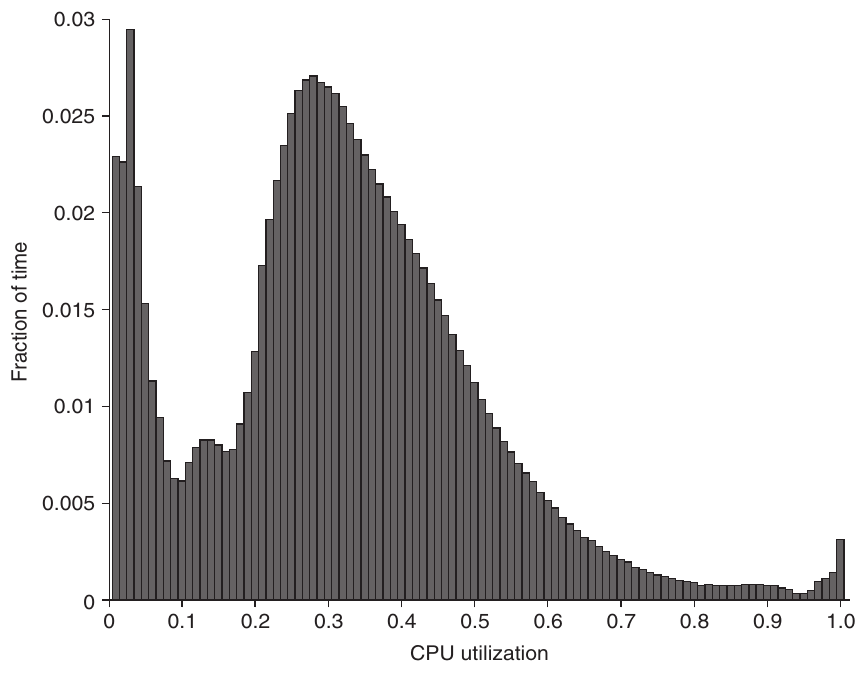

**Hình 6.3 CPU utilization trung bình của hơn 5000 server trong 6-month tại Google. Server hiếm khi hoàn toàn idle hoặc fully utilized; phần lớn ở 10% tới 50% mức tối đa. (Từ Hình 1 trong Barroso và Hölzle [2007].) Cột thứ ba từ phải Hình 6.4 tính phần trăm cộng trừ 5% để có trọng số; 1.2% ở hàng 90% nghĩa là 1.2% server có utilization 85% tới 95%.**

| Load | Performance | Watt | Trọng số SPEC | Performance có trọng số | Watt có trọng số | Trọng số Hình 6.3 | Performance có trọng số | Watt có trọng số |
|---|---|---|---|---|---|---|---|---|
| 100% | 2,889,020 | 662 | 9.09% | 262,638 | 60 | 0.80% | 22,206 | 5 |
| 90% | 2,611,130 | 617 | 9.09% | 237,375 | 56 | 1.20% | 31,756 | 8 |
| 80% | 2,319,900 | 576 | 9.09% | 210,900 | 52 | 1.50% | 35,889 | 9 |
| 70% | 2,031,260 | 533 | 9.09% | 184,660 | 48 | 2.10% | 42,491 | 11 |
| 60% | 1,740,980 | 490 | 9.09% | 158,271 | 45 | 5.10% | 88,082 | 25 |
| 50% | 1,448,810 | 451 | 9.09% | 131,710 | 41 | 11.50% | 166,335 | 52 |
| 40% | 1,159,760 | 416 | 9.09% | 105,433 | 38 | 19.10% | 221,165 | 79 |
| 30% | 869,077 | 382 | 9.09% | 79,007 | 35 | 24.60% | 213,929 | 94 |
| 20% | 581,126 | 351 | 9.09% | 52,830 | 32 | 15.30% | 88,769 | 54 |
| 10% | 290,762 | 308 | 9.09% | 26,433 | 28 | 8.00% | 23,198 | 25 |
| 0% | 0 | 181 | 9.09% | 0 | 16 | 10.90% | 0 | 20 |
| Tổng | 15,941,825 | 4967 |  | 1,449,257 | 452 |  | 933,820 | 380 |
|  |  |  |  | ssj_ops/Watt | 3210 |  | ssj_ops/Watt | 2454 |

**Hình 6.4 Kết quả SPECPower từ Hình 6.17 dùng trọng số Hình 6.3 thay vì trọng số đều.**

Dịch vụ WSC thường tự phát triển software thay vì mua third-party commercial software, một phần để đáp ứng quy mô lớn, một phần tiết kiệm. Chẳng hạn ngay platform price-performance tốt nhất cho TPC-C năm 2011, thêm giá Oracle database và Windows operating system làm chi phí Dell Poweredge 710 server gấp đôi. Ngược lại Google chạy Bigtable, Linux operating system không mất licensing fee.

Sau khi xem application và systems software WSC, chúng ta sẵn sàng khảo sát computer architecture.

## 6.3 Computer Architecture của Warehouse-Scale Computer

Network là mô liên kết gắn kết 50,000 server. Giống như memory hierarchy trong Chương 2, WSC sử dụng network hierarchy. Hình 6.5 trình bày một ví dụ. Lý tưởng là network kết hợp đạt performance gần bằng một custom switch high-end cho 50,000 server, với giá trên mỗi port gần bằng commodity switch cho 50 server. Như chúng ta sẽ thấy trong Mục 6.6, những giải pháp hiện tại còn xa lý tưởng đó; network của WSC đang là một chủ đề được nghiên cứu tích cực.

Rack 19-inch (48.26-cm) vẫn là khung tiêu chuẩn chứa server, dù có từ hardware đường sắt thập niên 1930. Server được đo bằng số rack unit (U) chiếm dụng. Một U cao 1.75 inch (4.45 cm), là không gian tối thiểu server chiếm.

Một rack 7-foot (213.36-cm) có 48 U, vì thế không phải ngẫu nhiên mà loại switch phổ biến nhất là Ethernet switch 48-port. Chúng đã trở thành sản phẩm commodity với giá chỉ $30 trên mỗi port cho Ethernet link 1 Gbit/sec vào năm 2011 [Barroso và Hölzle 2009]. Bandwidth trong rack giống nhau đối với mỗi server, nên việc software đặt sender và receiver ở đâu không quan trọng, miễn là chúng nằm trong cùng rack. Sự linh hoạt này là điều lý tưởng xét từ góc độ software.

Switch thường có hai tới tám uplink ra rack, lên switch cấp cao kế tiếp. Bandwidth ra rack do đó nhỏ hơn 6 tới 24 lần — 48/8 tới 48/2 — so với trong rack. Tỷ lệ này gọi oversubscription. Tiếc rằng oversubscription lớn buộc lập trình viên biết hệ quả performance khi đặt sender, receiver khác rack. Gánh nặng software-scheduling tăng là lý do nữa cho network switch chuyên datacenter.

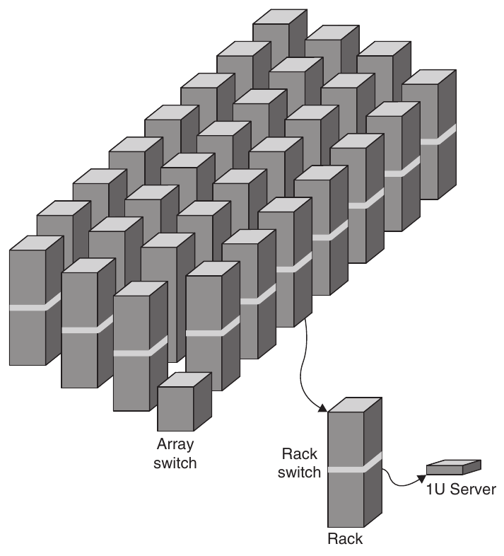

**Hình 6.5 Switch hierarchy trong WSC. (Dựa trên Hình 1.2 của Barroso và Hölzle [2009].)**

### Storage

Thiết kế tự nhiên là lấp rack bằng server, trừ chỗ cho commodity Ethernet rack switch. Nhưng storage đặt ở đâu vẫn bỏ ngỏ. Xét xây hardware, đơn giản nhất là disk trong server, dựa Ethernet để truy cập thông tin trên disk server xa. Thay thế là network attached storage (NAS), có thể qua storage network như Infiniband. NAS thường đắt hơn mỗi terabyte nhưng có nhiều tính năng, gồm RAID cải thiện storage dependability.

Theo triết lý mục trước, WSC thường dựa local disk và cung cấp storage software xử lý connectivity, dependability. Chẳng hạn GFS dùng local disk, giữ ít nhất ba replica để vượt vấn đề dependability. Redundancy không chỉ bao phủ local disk failure mà cả mất điện rack, cluster. Eventual consistency linh hoạt GFS giảm chi phí giữ replica nhất quán, cũng giảm network bandwidth storage system cần. Local access pattern còn đem bandwidth cao tới local storage, như sắp thấy.

Lưu ý thuật ngữ cluster dễ gây nhầm khi nói WSC architecture. Theo Mục 6.1, WSC chỉ là cluster cực lớn. Ngược lại, Barroso và Hölzle [2009] dùng cluster chỉ nhóm máy next-sized, ở đây khoảng 30 rack. Để tránh nhầm, chương này dùng array chỉ tập rack, giữ nghĩa cluster từ nhóm máy kết nối trong rack tới cả warehouse đầy máy nối mạng.

### Array Switch

Switch nối array rack đắt hơn đáng kể commodity Ethernet switch 48-port. Một phần vì connectivity cao hơn, phần vì bandwidth phải cao hơn nhiều để giảm oversubscription. Barroso và Hölzle [2009] báo switch có bisection bandwidth gấp 10 — về cơ bản worst-case internal bandwidth — của rack switch có giá gấp khoảng 100. Một lý do là chi phí switch bandwidth n port có thể tăng theo n<sup>2</sup>.

Một lý do khác khiến giá cao là những sản phẩm này mang lại profit margin cao cho nhà sản xuất. Họ phần nào biện minh cho mức giá đó bằng các tính năng như packet inspection, vốn tốn kém vì phải chạy ở tốc độ rất cao. Chẳng hạn, network switch sử dụng nhiều chip content-addressable memory và field-programmable gate array (FPGA) để hỗ trợ những tính năng đó, nhưng các chip này rất đắt. Những tính năng có giá trị trong môi trường Internet thường không được sử dụng trong datacenter.

### WSC Memory Hierarchy

Hình 6.6 cho latency, bandwidth, capacity của memory hierarchy trong WSC; Hình 6.7 trực quan hóa cùng data. Hai hình dựa các giả định sau [Barroso và Hölzle 2009]:

|  | Local | Rack | Array |
|---|---|---|---|
| DRAM latency (microsecond) | 0.1 | 100 | 300 |
| Disk latency (microsecond) | 10,000 | 11,000 | 12,000 |
| DRAM bandwidth (MB/sec) | 20,000 | 100 | 10 |
| Disk bandwidth (MB/sec) | 200 | 100 | 10 |
| DRAM capacity (GB) | 16 | 1040 | 31,200 |
| Disk capacity (GB) | 2000 | 160,000 | 4,800,000 |

**Hình 6.6 Latency, bandwidth, capacity của WSC memory hierarchy [Barroso và Hölzle 2009]. Hình 6.7 vẽ cùng thông tin.**

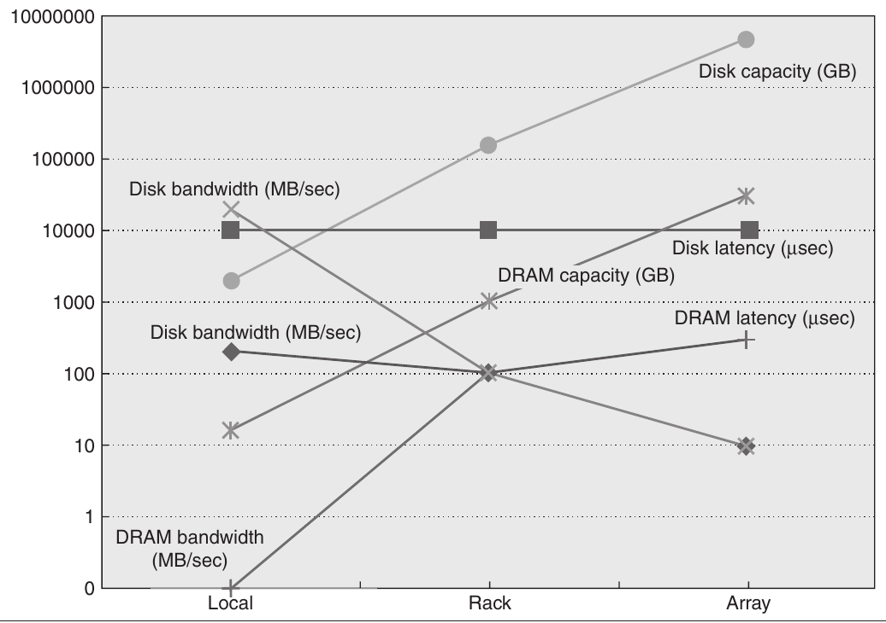

**Hình 6.7 Đồ thị latency, bandwidth, capacity của WSC memory hierarchy theo data Hình 6.6 [Barroso và Hölzle 2009].**

- Mỗi server có memory 16 GByte với access time 100-nanosecond, transfer 20 GBytes/sec, disk 2 terabyte với access time 10-millisecond, transfer 200 MBytes/sec. Mỗi board có hai socket, dùng chung Ethernet port 1 Gbit/sec.

- Mỗi cặp rack có một rack switch, chứa 80 server 2U (xem Mục 6.7). Networking software cùng switch overhead tăng DRAM latency lên 100 microsecond, disk access latency 11 millisecond. Tổng capacity rack khoảng DRAM 1 terabyte, disk storage 160 terabyte. Ethernet 1 Gbit/sec giới hạn remote bandwidth tới DRAM hay disk trong rack ở 100 MBytes/sec.

- Array switch xử lý 30 rack, nên capacity array tăng hệ số 30: DRAM 30 terabyte, disk 4.8 petabyte. Hardware và software array switch tăng DRAM latency trong array lên 500 microsecond, disk latency 12 millisecond. Bandwidth array switch giới hạn remote bandwidth tới array DRAM hay disk ở 10 MBytes/sec.

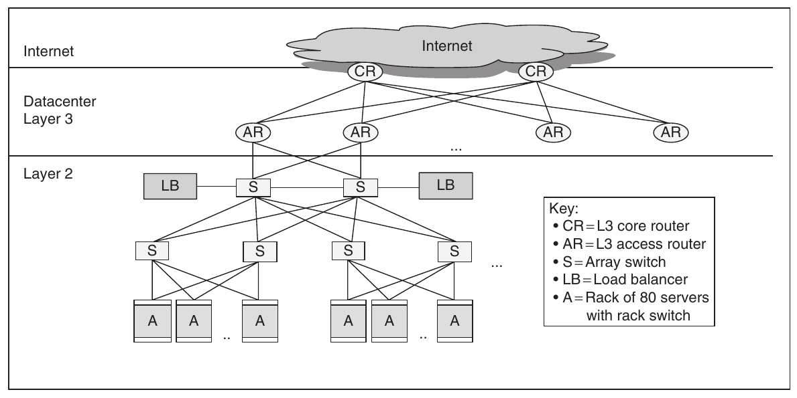

**Hình 6.8 Network Layer 3 dùng nối array với nhau và Internet [Greenberg và cộng sự 2009]. Một số WSC dùng border router riêng nối Internet tới datacenter Layer 3 switch.**

Hình 6.6 và 6.7 cho thấy network overhead tăng mạnh latency từ local DRAM tới rack DRAM, array DRAM; nhưng cả hai vẫn có latency tốt hơn local disk trên 10 lần. Network thu hẹp chênh bandwidth giữa rack DRAM và rack disk, giữa array DRAM và array disk.

WSC cần 20 array để đạt 50,000 server, nên còn một cấp network hierarchy. Hình 6.8 cho Layer 3 router thông thường nối array với nhau và Internet.

Phần lớn ứng dụng vừa trong một array WSC. Ứng dụng cần nhiều array dùng sharding hay partitioning: chia dataset thành phần độc lập, phân phối tới array khác nhau. Operation trên toàn dataset được gửi tới server giữ từng phần, kết quả được client computer hợp lại.

**Ví dụ** Average memory latency là bao nhiêu nếu 90% access local trong server, 9% ngoài server nhưng trong rack, 1% ngoài rack nhưng trong array?

**Trả lời** Average memory access time là

( 90% × 0.1 ) + ( 9% × 100 ) + ( 1% × 300 ) = 0.09 + 9 + 3 = 12.09 microseconds

hay chậm hơn trên 120 lần so với 100% local access. Rõ ràng locality của access trong server thiết yếu cho WSC performance.

**Ví dụ** Chuyển 1000 MB giữa disk trong server, giữa server trong rack, giữa server khác rack trong array mất bao lâu? Chuyển 1000 MB giữa DRAM trong ba trường hợp nhanh hơn bao nhiêu?

**Trả lời** Chuyển 1000 MB giữa disk mất:

Within server = 1000/200 = 5 seconds

Within rack = 1000/100 = 10 seconds

Within array = 1000/10 = 100 seconds

Một block transfer memory-to-memory mất

Within server = 1000/20000 = 0.05 seconds

Within rack = 1000/100 = 10 seconds

Within array = 1000/10 = 100 seconds

Vì vậy với block transfer ra ngoài một server, data nằm trong memory hay disk thậm chí không quan trọng, vì rack switch và array switch là bottleneck. Giới hạn performance ảnh hưởng thiết kế WSC software, thúc đẩy nhu cầu switch performance cao hơn (xem Mục 6.6).

Sau architecture của thiết bị IT, chúng ta sẵn sàng xem cách bố trí, cấp điện, làm mát và chi phí xây dựng, vận hành toàn WSC, thay vì chỉ thiết bị IT bên trong.

## 6.4 Hạ tầng vật lý và chi phí Warehouse-Scale Computer

Để xây dựng một WSC, trước tiên phải xây dựng warehouse. Câu hỏi đầu tiên là xây ở đâu? Trong bất động sản, người ta nhấn mạnh vị trí, nhưng đối với WSC, vị trí có nghĩa là gần các tuyến cáp quang Internet backbone, có điện rẻ và có rủi ro thấp về động đất, lũ lụt và bão. Các công ty có nhiều WSC còn cần ở gần những khu vực có người dùng Internet hiện tại hoặc trong tương lai để giảm Internet latency. Ngoài ra còn có nhiều mối quan tâm thông thường hơn, chẳng hạn như thuế bất động sản.

Chi phí hạ tầng phân phối điện, làm mát lớn hơn nhiều chi phí xây dựng WSC, nên chúng ta tập trung phần đầu. Hình 6.9, 6.10 cho hạ tầng ấy trong WSC.

Dù triển khai nhiều biến thể, ở Bắc Mỹ điện thường qua khoảng năm bước, bốn lần đổi điện áp tới server, bắt đầu đường high-voltage 115,000 volt tại cột điện công ty:

1. Substation chuyển từ 115,000 volt sang đường medium-voltage 13,200 volt, hiệu suất 99.7%.

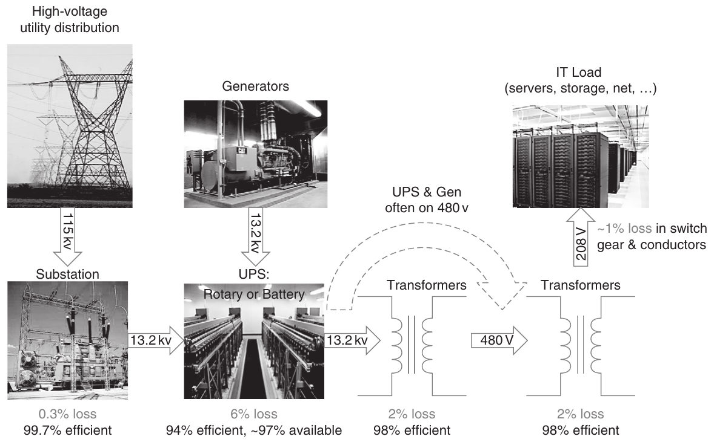

**Hình 6.9 Phân phối điện và nơi tổn thất. Lưu ý cải thiện tốt nhất là 11%. (Từ Hamilton [2010].)**

2. Để tránh cả WSC bị offline khi mất điện, WSC có uninterruptible power supply (UPS), giống như một số server. Trong trường hợp này, hệ thống gồm các động cơ diesel lớn thay thế nguồn điện từ công ty điện lực khi khẩn cấp, cùng battery hoặc flywheel duy trì điện từ lúc mất điện đến khi động cơ diesel sẵn sàng. Generator và battery chiếm nhiều không gian nên thường được đặt trong phòng riêng, tách khỏi IT equipment. UPS có ba vai trò: power conditioning (giữ điện áp và các đặc tính điện phù hợp), duy trì electrical load trong khi generator khởi động và được kết nối, và duy trì load khi chuyển từ generator trở lại điện lưới. UPS rất lớn này có hiệu suất 94%, nghĩa là cơ sở mất 6% power do sử dụng UPS. UPS của WSC có thể chiếm từ 7% đến 12% chi phí của toàn bộ IT equipment.

3. Tiếp theo là power distribution unit (PDU), chuyển thành điện low-voltage, three-phase nội bộ 480 volt. Hiệu suất 98%. PDU điển hình xử lý load 75 tới 225 kilowatt, khoảng 10 rack.

4. Còn một bước hạ xuống điện two-phase 208 volt server dùng được, lại hiệu suất 98%. (Trong server còn các bước hạ xuống mức chip dùng được; xem Mục 6.7.)

5. Connector, breaker và dây điện tới server có hiệu suất tổng cộng 99%.

WSC ngoài Bắc Mỹ dùng giá trị chuyển đổi khác, nhưng thiết kế chung tương tự.

Kết hợp lại, hiệu suất đổi điện 115,000-volt từ công ty thành 208-volt server dùng được là 89%:

99.7% × 94% × 98% × 98% × 99% = 89%

Hiệu suất tổng này chỉ còn hơn 10% để cải thiện, nhưng như sẽ thấy kỹ sư vẫn cố làm tốt hơn.

Cơ hội cải thiện hạ tầng làm mát lớn hơn nhiều. Computer room air-conditioning (CRAC) sử dụng nước lạnh để làm mát không khí trong phòng server, tương tự như cách tủ lạnh thải nhiệt ra bên ngoài. Khi chất lỏng hấp thụ nhiệt, nó bay hơi; ngược lại, khi nhả nhiệt, nó ngưng tụ. Máy điều hòa bơm chất lỏng vào coil ở áp suất thấp để chất lỏng bay hơi và hấp thụ nhiệt, rồi đưa nó đến condenser bên ngoài để nhả nhiệt. Vì thế, fan của CRAC đẩy khí ấm qua coil nước lạnh, còn pump chuyển nước nóng đến chiller bên ngoài để làm lạnh. Không khí mát cấp cho server thường ở mức 64°F đến 71°F (18°C và 22°C). Hình 6.10 cho thấy tập hợp nhiều fan và water pump vận chuyển không khí và nước khắp hệ thống.

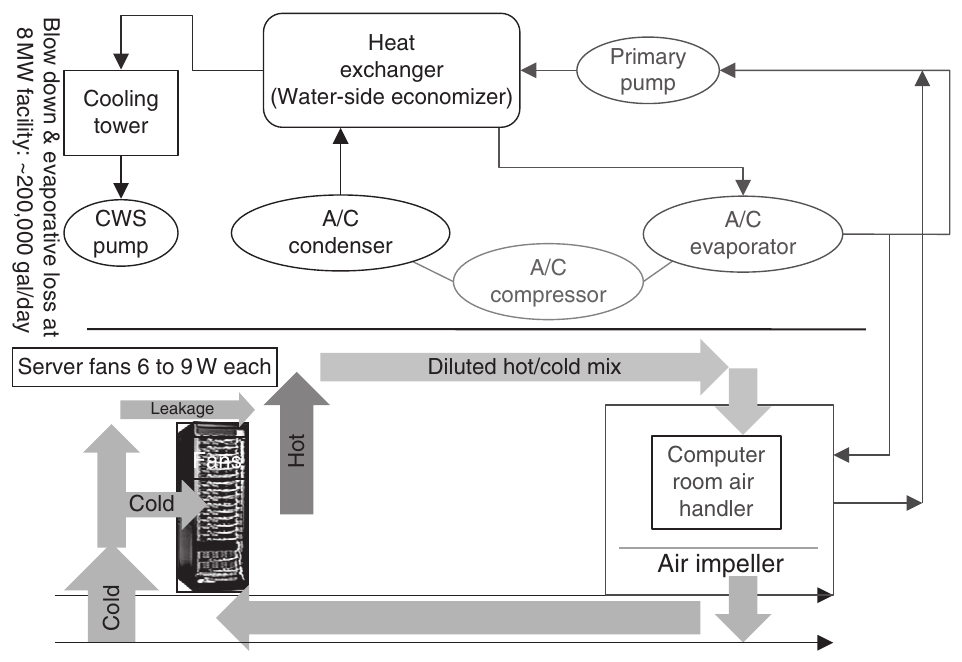

**Hình 6.10 Thiết kế cơ khí cooling system. CWS viết tắt circulating water system. (Từ Hamilton [2010].)**

Rõ ràng cách đơn giản nhất tăng hiệu quả năng lượng là chạy IT equipment ở nhiệt độ cao hơn, ít phải làm lạnh không khí. Một số WSC chạy cao hơn đáng kể 71°F (22°C).

Ngoài chiller, một số datacenter sử dụng cooling tower để tận dụng không khí lạnh hơn ở bên ngoài nhằm làm mát nước trước khi đưa nước đến chiller. Nhiệt độ có ý nghĩa ở đây được gọi là wet-bulb temperature. wet-bulb temperature được đo bằng cách thổi không khí lên đầu bầu của một nhiệt kế có nước trên đó. Đây là nhiệt độ thấp nhất có thể đạt được bằng cách làm nước bay hơi với không khí.

Nước ấm chảy trên bề mặt lớn trong tower, truyền nhiệt ra khí ngoài qua bay hơi để làm mát. Kỹ thuật gọi airside economization. Thay thế là nước lạnh thay khí lạnh. WSC Google ở Bỉ dùng water-to-water intercooler lấy nước lạnh kênh công nghiệp để làm lạnh nước ấm bên trong.

Airflow cho IT equipment được lên kế hoạch kỹ, có thiết kế dùng cả airflow simulator. Thiết kế hiệu quả giữ nhiệt độ khí mát bằng giảm trộn với khí nóng. Chẳng hạn WSC có thể xen lối khí nóng, lạnh bằng quay server ngược hướng ở hàng rack xen kẽ để khí xả nóng thổi xen hướng.

Ngoài tổn thất năng lượng, cooling system dùng nhiều nước do bay hơi hoặc đổ xuống cống. Cơ sở 8 MW có thể dùng 70,000 tới 200,000 gallon nước mỗi ngày.

Chi phí power của cooling equipment tương đối so IT equipment trong datacenter điển hình [Barroso và Hölzle 2009] như sau:

- Chiller chiếm 30% tới 50% power IT equipment.

- CRAC chiếm 10% tới 20% power IT equipment, chủ yếu do quạt.

Điều đáng ngạc nhiên là không dễ xác định một WSC có thể hỗ trợ bao nhiêu server sau khi trừ overhead của phân phối điện và làm mát. Nameplate power rating so-called do nhà sản xuất cung cấp luôn được ước tính thận trọng: đó là mức power tối đa mà server có thể lấy. Bước đầu tiên là đo một server với nhiều workload sẽ được triển khai. (Networking thường chiếm khoảng 5% power consumption, vì thế ban đầu chúng ta bỏ qua phần này.)

Để xác định số server, chúng ta có thể lấy power dành cho IT chia cho server power đã đo; tuy nhiên, Fan, Weber và Barroso [2007] cho rằng cách đó vẫn quá thận trọng. Họ nhận thấy có khoảng cách đáng kể giữa điều mà hàng nghìn server có thể làm trong worst case về mặt lý thuyết và điều chúng thực sự làm, vì không workload thực tế nào giữ hàng nghìn server đồng thời ở mức đỉnh. Có thể oversubscribe số server một cách an toàn lên đến 40% dựa trên power của một server. Họ khuyến nghị WSC architect làm như vậy để tăng average utilization của power, nhưng đồng thời sử dụng monitoring software rộng khắp cùng safety mechanism để deschedule các task có độ ưu tiên thấp khi workload thay đổi.

Phân tích power usage trong IT equipment, Barroso và Hölzle [2009] báo WSC Google triển khai năm 2007:

- 33% power cho processor

- 30% cho DRAM

- 10% cho disk

- 5% cho networking

- 22% cho lý do khác (trong server)

### Đo hiệu quả WSC

Metric đơn giản dùng rộng để đánh giá hiệu quả datacenter hoặc WSC gọi power utilization effectiveness (PUE):

PUE = (Total facility power)/(IT equipment power)

Vì vậy PUE phải lớn hơn hoặc bằng 1, PUE càng lớn WSC càng kém hiệu quả.

Greenberg và cộng sự [2006] báo PUE 19 datacenter và phần overhead làm mát. Hình 6.11 cho kết quả xếp từ hiệu quả nhất tới thấp nhất. Median PUE 1.69, cooling infrastructure dùng hơn nửa power server — trung bình 0.55 trong 1.69 dành làm mát. Đây là average PUE, thay đổi hằng ngày theo workload và nhiệt độ khí ngoài, như sẽ thấy.

Vì performance mỗi dollar là metric tối hậu, vẫn cần đo performance. Hình 6.7 cho bandwidth giảm, latency tăng tùy khoảng cách data. DRAM bandwidth trong server WSC gấp 200 lần trong rack, rack lại gấp 10 lần array. Vì vậy có dạng locality khác cần xét khi đặt data, program trong WSC.

WSC designer thường tập trung vào bandwidth, nhưng lập trình viên ứng dụng còn quan tâm đến latency vì người dùng có thể nhận thấy nó. Sự hài lòng và năng suất gắn liền với response time. Các nghiên cứu từ thời timesharing cho thấy năng suất tỷ lệ nghịch với thời gian tương tác, vốn thường được chia thành human entry time, system response time và thời gian suy nghĩ trước lần nhập tiếp theo. Các thử nghiệm cho thấy việc giảm system response time 30% làm giảm thời gian tương tác 70%. Kết quả khó tin này được giải thích bằng bản tính con người: response nhanh khiến người dùng cần ít thời gian suy nghĩ hơn, ít bị xao nhãng hơn và giữ được đà làm việc.

Hình 6.12 trình bày thử nghiệm với Bing search engine, trong đó người ta chèn delay từ 50 ms đến 2000 ms ở server. Tương tự những nghiên cứu trước, thời gian đến lần click tiếp theo tăng khoảng gấp đôi delay; delay 200 ms làm thời gian đến lần click tăng 500 ms. Revenue và user satisfaction giảm tuyến tính theo delay. Một nghiên cứu khác của Google nhận thấy hiệu ứng vẫn tiếp diễn sau thử nghiệm 4-week. Năm tuần sau đó, số lượt tìm kiếm mỗi ngày giảm 0.1% đối với những người từng gặp delay 200 ms và giảm 0.2% đối với những người từng gặp delay 400 ms. Với doanh thu thu được từ tìm kiếm, ngay cả thay đổi nhỏ cũng đáng lo ngại. Kết quả tệ đến mức họ kết thúc thử nghiệm sớm [Schurman và Brutlag 2009].

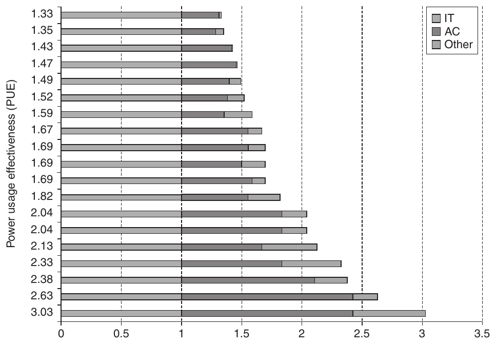

**Hình 6.11 Power utilization efficiency của 19 datacenter năm 2006 [Greenberg và cộng sự 2006]. Power air conditioning (AC) và mục đích khác (như phân phối điện) được chuẩn hóa theo IT equipment power để tính PUE. Vì thế IT equipment phải 1.0, AC khoảng 0.30 tới 1.40 lần IT power. “Other” khoảng 0.05 tới 0.60.**

| Server delay (ms) | Thời gian tăng tới click tiếp (ms) | Query/user | Click bất kỳ/user | Hài lòng người dùng | Revenue/user |
|---|---|---|---|---|---|
| 50 | -- | -- | -- | -- | -- |
| 200 | 500 | -- | −0.3% | −0.4% | -- |
| 500 | 1200 | -- | −1.0% | −0.9% | −1.2% |
| 1000 | 1900 | −0.7% | −1.9% | −1.6% | −2.8% |
| 2000 | 3100 | −1.8% | −4.4% | −3.8% | −4.3% |

**Hình 6.12 Ảnh hưởng xấu của delay Bing search server tới hành vi người dùng, Schurman và Brutlag [2009].**

Do quan tâm đến tất cả người dùng dịch vụ Internet, các mục tiêu performance thường yêu cầu một tỷ lệ request cao có latency dưới một ngưỡng nhất định, thay vì chỉ yêu cầu average latency. Mục tiêu đó được gọi là service level objective (SLO) hoặc service level agreement (SLA). Chẳng hạn, SLO có thể yêu cầu 99% request hoàn thành trong dưới 100 millisecond. Vì vậy, những người thiết kế Amazon Dynamo key-value storage quyết định rằng, để các dịch vụ xây dựng trên Dynamo có latency tốt, storage phải đạt mục tiêu trong 99.9% thời gian [DeCandia và cộng sự 2007]. Chẳng hạn, một cải tiến có lợi cho percentile 99.9th nhiều hơn cho average case phản ánh chính sự ưu tiên đó.

### Chi phí WSC

Như phần giới thiệu, khác phần lớn architect, WSC designer lo operational cost và chi phí xây. Kế toán gọi trước là operational expenditure (OPEX), sau là capital expenditure (CAPEX).

Để đặt chi phí năng lượng trong bối cảnh, Hamilton [2010] nghiên cứu trường hợp ước tính WSC. CAPEX cơ sở 8 MW là $88M, khoảng 46,000 server và networking equipment thêm $79M. Hình 6.13 cho các giả định khác.

Bây giờ chúng ta có thể tính tổng chi phí năng lượng, vì các quy tắc kế toán của Mỹ cho phép chuyển CAPEX thành OPEX. Chúng ta chỉ cần khấu hao CAPEX theo một khoản cố định hằng tháng trong suốt vòng đời hữu dụng. Hình 6.14 phân tích monthly OPEX. Thời gian khấu hao khác nhau rõ rệt: 10 năm cho cơ sở, 4 năm cho networking equipment và 3 năm cho server. Cơ sở tồn tại nhiều thập niên, nhưng server phải được thay mới mỗi 3 năm và network mỗi 4 năm. Hamilton tính monthly OPEX bao gồm cả chi phí vay (5% mỗi năm). Với $3.8M, monthly OPEX bằng khoảng 2% CAPEX.

Con số cho quy tắc hữu ích khi chọn thành phần xét năng lượng. Chi phí đầy đủ mỗi watt mỗi năm trong WSC, gồm khấu hao hạ tầng điện, làm mát, là

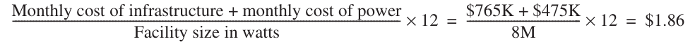

Chi phí khoảng $2 mỗi watt-year. Vì vậy để tiết kiệm năng lượng giảm chi phí, không nên chi hơn $2 mỗi watt-year (xem Mục 6.8).

Lưu ý rằng hơn một phần ba OPEX liên quan đến power, và phần chi phí này đang tăng trong khi server cost giảm theo thời gian. Network equipment cũng đáng kể: chiếm 8% tổng OPEX và 19% server CAPEX, nhưng không giảm nhanh như server. Đặc biệt, các switch phía trên rack trong network hierarchy chiếm phần lớn networking cost (xem Mục 6.6). Chi phí <sub>People</sub> dành cho bảo vệ và quản lý cơ sở chỉ chiếm 2% OPEX. Lấy OPEX trong Hình 6.14 chia cho số server và số giờ mỗi tháng, chúng ta được khoảng $0.11 trên mỗi server mỗi giờ.

| Quy mô cơ sở (critical load watt) | 8,000,000 |
|---|---|
| Power usage trung bình (%) | 80% |
| Power usage effectiveness | 1.45 |
| Chi phí power ($/kwh) | $0.07 |
| % Hạ tầng điện, làm mát (% tổng chi phí cơ sở) | 82% |
| CAPEX cơ sở (không gồm IT equipment) | $88,000,000 |
| Số server | 45,978 |
| Chi phí/server | $1450 |
| CAPEX server | $66,700,000 |
| Số rack switch | 1150 |
| Chi phí/rack switch | $4800 |
| Số array switch | 22 |
| Chi phí/array switch | $300,000 |
| Số layer 3 switch | 2 |
| Chi phí/layer 3 switch | $500,000 |
| Số border router | 2 |
| Chi phí/border router | $144,800 |
| CAPEX networking gear | $12,810,000 |
| Tổng CAPEX WSC | $167,510,000 |
| Thời gian khấu hao server | 3 years |
| Thời gian khấu hao networking | 4 years |
| Thời gian khấu hao cơ sở | 10 years |
| Chi phí vốn hằng năm | 5% |

**Hình 6.13 Nghiên cứu WSC dựa Hamilton [2010], làm tròn $5000 gần nhất. Chi phí Internet bandwidth đổi theo ứng dụng nên không tính. 18% CAPEX cơ sở còn lại gồm mua đất và xây tòa nhà. Chúng ta thêm nhân lực bảo vệ, quản lý vào Hình 6.14, vốn không thuộc nghiên cứu. Hamilton ước tính trước khi vào Amazon, không dựa WSC công ty cụ thể.**

| Chi phí (% tổng) | Nhóm | Chi phí tháng | Phần trăm chi phí tháng |
|---|---|---|---|
| CAPEX khấu hao (85%) | Server | $2,000,000 | 53% |
|  | Networking equipment | $290,000 | 8% |
|  | Hạ tầng điện, làm mát | $765,000 | 20% |
|  | Hạ tầng khác | $170,000 | 4% |
| OPEX (15%) | Power use hằng tháng | $475,000 | 13% |
|  | Lương và phúc lợi nhân viên tháng | $85,000 | 2% |
|  | Tổng OPEX | $3,800,000 | 100% |

**Hình 6.14 Monthly OPEX của Hình 6.13 làm tròn $5000 gần nhất. Khấu hao server 3-year nghĩa là mua server mới mỗi 3 năm, cơ sở khấu hao 10 năm. Vì thế amortized capital cost server khoảng gấp 3 cơ sở. People cost gồm 3 vị trí bảo vệ liên tục 24 giờ/ngày, 365 ngày/năm, $20 mỗi giờ mỗi người, và 1 nhân viên cơ sở 24 giờ/ngày, 365 ngày/năm, $30 mỗi giờ. Phúc lợi bằng 30% lương. Không tính bandwidth Internet vì đổi theo ứng dụng, hay phí bảo trì vendor vì đổi theo thiết bị và thương lượng.**

**Ví dụ** Giá điện ở Mỹ thay đổi theo vùng từ $0.03 tới $0.15 mỗi kilowatt-hour. Hai mức cực đoan này ảnh hưởng hourly server cost thế nào?

**Trả lời** Nhân critical load 8 MW với PUE và average power usage Hình 6.13 để tính average power usage:

8 × 1.45 × 80% = 9.28 Megawatts

Monthly power cost từ $475,000 Hình 6.14 thành $205,000 ở $0.03 mỗi kilowatt-hour và $1,015,000 ở $0.15 mỗi kilowatt-hour. Chúng đổi hourly server cost từ $0.11 thành lần lượt $0.10, $0.13.

**Ví dụ** Monthly cost sẽ ra sao nếu mọi thời gian khấu hao bằng nhau, chẳng hạn 5 năm? Hourly cost mỗi server đổi thế nào?

**Trả lời** Spreadsheet có tại http://mvdirona.com/jrh/TalksAndPapers/PerspectivesDataCenterCostAndPower.xls. Việc thay đổi thời gian khấu hao thành 5 năm làm thay đổi bốn hàng đầu tiên của Hình 6.14 như sau, đưa tổng monthly OPEX thành $3,422,000. Nếu thay mọi thứ sau mỗi 5 năm, chi phí là $0.103 trên mỗi server hour, trong đó phần khấu hao cơ sở lớn hơn thay vì phần khấu hao server như trong Hình 6.14.

| Servers | $1,260,000 | 37% |
|---|---|---|
| Networking equipment | $242,000 | 7% |
| Hạ tầng điện và làm mát | $1,115,000 | 33% |
| Hạ tầng khác | $245,000 | 7% |

Mức $0.11 trên mỗi server mỗi giờ có thể thấp hơn nhiều so với chi phí của một công ty tự sở hữu và vận hành datacenter nhỏ thông thường. Lợi thế về chi phí này khuyến khích các công ty Internet lớn cung cấp computing như một dịch vụ tiện ích: giống như điện, bạn chỉ trả cho phần đã sử dụng. Ngày nay, utility computing thường được gọi là cloud computing.

## 6.5 Cloud Computing: Sự trở lại của Utility Computing

> Nếu loại máy tôi đề xuất trở thành máy tương lai, một ngày điện toán có thể tổ chức thành tiện ích công cộng như điện thoại. . . . Computer utility có thể làm nền tảng ngành mới quan trọng.

> John McCarthy

> Lễ kỷ niệm một trăm năm MIT (1961)

Do nhu cầu của người dùng tăng lên, Amazon, Google và Microsoft xây dựng những warehouse-scale computer ngày càng lớn từ các commodity component. Nhu cầu này dẫn đến những đổi mới trong systems software để hỗ trợ quy mô đó, chẳng hạn như Bigtable, Dynamo, GFS và MapReduce. Nó cũng đòi hỏi cải thiện cách vận hành để dịch vụ đạt availability ít nhất 99.99%, bất chấp component failure và security attack. Ví dụ bao gồm failover, firewall, virtual machine và cơ chế bảo vệ trước distributed denial-of-service attack. Với software và chuyên môn giúp hệ thống có khả năng scale, cùng nhu cầu tăng trưởng đủ để biện minh cho khoản đầu tư, những WSC có 50,000 đến 100,000 server trở nên phổ biến vào năm 2011.

Quy mô tăng kéo economy of scale tăng. Dựa nghiên cứu năm 2006 so WSC với datacenter chỉ 1000 server, Hamilton [2010] báo lợi thế:

- Giảm storage cost 5.7 lần — WSC tốn $4.6 mỗi GByte mỗi năm disk storage, datacenter tốn $26 mỗi GByte.

- Giảm administrative cost 7.1 lần — Hơn 1000 server mỗi administrator trong WSC so với chỉ 140 trong datacenter.

- Giảm networking cost 7.3 lần — Internet bandwidth WSC $13 mỗi Mbit/sec/month so với $95 datacenter. Không ngạc nhiên đặt 1000 Mbit/sec thương lượng giá mỗi Mbit/sec tốt hơn nhiều đặt 10 Mbit/sec.

Một lợi thế khác của quy mô xuất hiện khi mua sắm. Mua số lượng lớn mang lại volume discount cho server và thiết bị mạng; đồng thời còn giúp tối ưu hóa supply chain. Dell, IBM và SGI giao các đơn hàng mới cho WSC trong vòng một tuần, thay vì 4 đến 6 tháng. Việc giao hàng nhanh giúp mở rộng dịch vụ tiện ích theo nhu cầu dễ dàng hơn.

Economy of scale còn áp operational cost. Mục trước thấy nhiều datacenter PUE 2.0. Công ty lớn biện minh được việc thuê mechanical, power engineer phát triển WSC PUE thấp cỡ 1.2 (xem Mục 6.7).

Dịch vụ Internet cần phân tán nhiều WSC cho dependability và giảm latency, nhất là quốc tế. Mọi hãng lớn đều làm vậy. Với công ty riêng lẻ, tạo nhiều datacenter nhỏ toàn cầu đắt hơn nhiều một datacenter trụ sở.

Cuối cùng, vì lý do Mục 6.1, server datacenter thường chỉ utilized 10% tới 20% thời gian. Mở WSC cho công chúng, peak không tương quan giữa khách hàng có thể nâng average utilization trên 50%.

Vì thế economy of scale WSC cho hệ số 5 tới 7 ở một số thành phần, cộng vài hệ số 1.5 tới 2 cho toàn WSC.

Mặc dù có nhiều nhà cung cấp cloud, chúng ta chọn Amazon Web Services (AWS), một phần vì nó phổ biến và một phần vì abstraction ở mức thấp nên linh hoạt hơn. Google App Engine và Microsoft Azure nâng abstraction lên managed runtime với automatic scaling, phù hợp hơn với một số khách hàng nhưng không khớp với nội dung cuốn sách bằng AWS.

### Amazon Web Services

Utility computing có từ commercial timesharing, cả batch processing thập niên 1960, 1970, nơi công ty chỉ trả terminal, phone line rồi tính phí theo computing sử dụng. Nhiều nỗ lực sau thời timesharing cung cấp pay as you go như vậy, nhưng thường thất bại.

Khi Amazon cung cấp utility computing qua Amazon Simple Storage Service (Amazon S3), rồi Amazon Elastic Computer Cloud (Amazon EC2) năm 2006, họ quyết định mới về kỹ thuật, kinh doanh:

- Virtual Machine. Xây dựng WSC từ các máy x86-commodity chạy Linux và Xen virtual machine giải quyết nhiều vấn đề. Thứ nhất, nó bảo vệ người dùng khỏi nhau. Thứ hai, nó đơn giản hóa việc phân phối software: khách hàng chỉ cần cài đặt image, rồi AWS tự động phân phối image đến các instance. Thứ ba, khả năng kill virtual machine một cách đáng tin cậy giúp kiểm soát resource usage. Thứ tư, Virtual Machine giới hạn tốc độ sử dụng physical processor, disk, network và lượng main memory, vì vậy AWS có thể cung cấp nhiều mức giá: ở mức thấp nhất, nhiều virtual core được đặt vào cùng một server; ở mức cao nhất, khách hàng được độc quyền tất cả machine resource; và còn có những mức ở giữa. Thứ năm, Virtual Machine che giấu danh tính của hardware cũ, cho phép bán thời gian sử dụng những máy cũ vốn có thể kém hấp dẫn nếu khách hàng biết tuổi của chúng. Cuối cùng, Virtual Machine cho phép bổ sung hardware mới nhanh hơn bằng cách đưa thêm virtual core vào hoặc cung cấp instance có performance cao hơn trên mỗi virtual core; virtualization có nghĩa là performance được chào bán không cần phải là bội số nguyên của hardware performance.

- Giá rất thấp. AWS công bố $0.10 mỗi giờ mỗi instance năm 2006 thấp đến kinh ngạc. Instance là một Virtual Machine, với $0.10/giờ AWS cấp hai instance mỗi core trên multicore server. Vậy một EC2 computer unit tương đương AMD Opteron hoặc Intel Xeon 1.0 tới 1.2 GHz thời đó.

- (Ban đầu) dựa trên open source software. Software good-quality không vướng các hạn chế license hoặc chi phí chạy trên hàng trăm, hàng nghìn server giúp utility computing có tính kinh tế hơn cho cả Amazon lẫn khách hàng. Gần đây, AWS cung cấp những instance bao gồm third-party commercial software với mức giá cao hơn.

- (Ban đầu) không bảo đảm dịch vụ. Amazon chỉ hứa best effort. Giá thấp hấp dẫn nên nhiều người chấp nhận không guarantee. Hiện AWS có availability SLA tới 99.95% cho EC2, S3. S3 còn thiết kế durability 99.999999999% bằng nhiều replica mỗi object qua nhiều location, tức nguy cơ mất vĩnh viễn một object là một trên 100 tỷ. AWS có Service Health Dashboard hiện operational status thời gian thực từng dịch vụ, làm uptime và performance hoàn toàn minh bạch.

- Không cần hợp đồng. Một phần vì chi phí thấp, chỉ cần credit card để bắt đầu EC2.

Hình 6.15 cho hourly price nhiều loại EC2 instance năm 2011. Ngoài tính toán, EC2 thu long-term storage và Internet traffic. (Không thu traffic trong AWS region.) Elastic Block Storage giá $0.10 mỗi GByte tháng, $0.10 mỗi triệu I/O request. Traffic Internet $0.10 mỗi GByte vào EC2, $0.08 tới $0.15 mỗi GByte ra tùy lượng. Trong bối cảnh lịch sử, $100 mỗi tháng mua capacity tương đương tổng capacity mọi magnetic disk sản xuất năm 1960!

| Instance | Mỗi giờ | Tỷ số so small | Compute unit | Virtual core | Compute unit/core | Memory (GB) | Disk (GB) | Address size |
|---|---|---|---|---|---|---|---|---|
| Micro | $0.020 | 0.5–2.0 | 0.5–2.0 | 1 | 0.5–2.0 | 0.6 | EBS | 32/64 bit |
| Standard Small | $0.085 | 1.0 | 1.0 | 1 | 1.00 | 1.7 | 160 | 32 bit |
| Standard Large | $0.340 | 4.0 | 4.0 | 2 | 2.00 | 7.5 | 850 | 64 bit |
| Standard Extra Large | $0.680 | 8.0 | 8.0 | 4 | 2.00 | 15.0 | 1690 | 64 bit |
| High-Memory Extra Large | $0.500 | 5.9 | 6.5 | 2 | 3.25 | 17.1 | 420 | 64 bit |
| High-Memory Double Extra Large | $1.000 | 11.8 | 13.0 | 4 | 3.25 | 34.2 | 850 | 64 bit |
| High-Memory Quadruple Extra Large | $2.000 | 23.5 | 26.0 | 8 | 3.25 | 68.4 | 1690 | 64 bit |
| High-CPU Medium | $0.170 | 2.0 | 5.0 | 2 | 2.50 | 1.7 | 350 | 32 bit |
| High-CPU Extra Large | $0.680 | 8.0 | 20.0 | 8 | 2.50 | 7.0 | 1690 | 64 bit |
| Cluster Quadruple Extra Large | $1.600 | 18.8 | 33.5 | 8 | 4.20 | 23.0 | 1690 | 64 bit |

**Hình 6.15 Giá và đặc tính của các EC2 instance on-demand ở Virginia, Mỹ, vào tháng Một 2011. Micro Instance là loại mới nhất và rẻ nhất, cho phép những đợt burst ngắn lên đến 2.0 compute unit với giá chỉ $0.02/giờ. Khách hàng cho biết mức trung bình khoảng 0.5 compute unit. Cluster-Compute Instance ở hàng cuối cùng được AWS xác định là một server Intel Xeon X5570 dual-socket chuyên dụng, với bốn core trên mỗi socket chạy ở 2.93 GHz, có network 10 Gigabit/sec dành cho HPC. AWS còn cung cấp Spot Instance rẻ hơn: bạn đặt mức giá chấp nhận được và số instance; AWS chạy chúng khi spot price thấp hơn mức đó và tiếp tục cho đến khi bạn dừng hoặc giá vượt giới hạn. Một mẫu lấy vào ban ngày trong tháng Một 2011 cho thấy giá thấp hơn theo hệ số từ 2.3 đến 3.1 tùy loại. Reserved Instance dành cho những khách hàng biết rằng họ sẽ sử dụng instance trong phần lớn thời gian của năm: họ trả phí hằng năm, rồi trả hourly rate bằng khoảng 30% cột 1. Nếu sử dụng 100% trong cả năm, average cost/giờ, bao gồm phần khấu hao phí hằng năm, bằng khoảng 65% cột đầu tiên. Server tương đương với Hình 6.13 và 6.14 là Standard Extra Large hoặc High-CPU Extra Large Instance, mà chúng ta đã tính có chi phí $0.11/giờ.**

**Ví dụ** Tính chi phí chạy MapReduce job trung bình Hình 6.2 trang 437 trên EC2. Giả sử đủ nhiều job nên làm tròn giờ nguyên không thêm chi phí đáng kể. Bỏ monthly storage cost, nhưng gồm disk I/O cost của AWS Elastic Block Storage (EBS). Sau đó tính chi phí năm chạy mọi MapReduce job.

**Trả lời** Câu hỏi đầu tiên là instance có kích thước nào phù hợp với server điển hình của Google? Hình 6.21 ở trang 467 trong Mục 6.7 cho thấy năm 2007, một server Google điển hình có bốn core chạy ở 2.2 GHz với 8 GB memory. Vì một instance đơn lẻ là một virtual core tương đương với AMD Opteron 1 đến 1.2 GHz, lựa chọn gần nhất trong Hình 6.15 là High-CPU Extra Large với tám virtual core và 7.0 GB memory. Để đơn giản, chúng ta giả sử mỗi EBS storage access trung bình là 64 KB nhằm tính số I/O. Hình 6.16 tính chi phí trung bình và tổng chi phí hằng năm để chạy workload Google MapReduce trên EC2. Một job MapReduce trung bình của năm 2009 sẽ tốn chưa đến $40 trên EC2, và toàn bộ workload năm 2009 sẽ tốn $133M trên AWS. Lưu ý rằng EBS access chiếm khoảng 1% tổng chi phí của những job này.

|  | Aug-04 | Mar-06 | Sep-07 | Sep-09 |
|---|---|---|---|---|
| Completion time trung bình (giờ) | 0.15 | 0.21 | 0.10 | 0.11 |
| Số server trung bình mỗi job | 157 | 268 | 394 | 488 |
| Chi phí giờ EC2 High-CPU XL instance | $0.68 | $0.68 | $0.68 | $0.68 |
| EC2 cost trung bình mỗi MapReduce job | $16.35 | $38.47 | $25.56 | $38.07 |
| Số EBS I/O request trung bình (triệu) | 2.34 | 5.80 | 3.26 | 3.19 |
| EBS cost mỗi triệu I/O request | $0.10 | $0.10 | $0.10 | $0.10 |
| EBS I/O cost trung bình mỗi MapReduce job | $0.23 | $0.58 | $0.33 | $0.32 |
| Tổng cost trung bình mỗi MapReduce job | $16.58 | $39.05 | $25.89 | $38.39 |
| Số MapReduce job năm | 29,000 | 171,000 | 2,217,000 | 3,467,000 |
| Tổng chi phí MapReduce job trên EC2/EBS | $480,910 | $6,678,011 | $57,394,985 | $133,107,414 |

**Hình 6.16 Chi phí ước tính chạy Google MapReduce workload (Hình 6.2) với giá AWS ECS, EBS năm 2011 (Hình 6.15). Vì dùng giá 2011, ước tính năm cũ kém chính xác hơn năm gần đây.**

**Ví dụ** Chi phí MapReduce tăng, đã trên $100M/năm; giả sử sếp yêu cầu tìm cách giảm. Hai lựa chọn là AWS Reserved Instance hoặc Spot Instance. Bạn khuyên gì?

**Trả lời** AWS Reserved Instance thu một khoản annual rate cố định cộng với hourly rate per-use. Năm 2011, High-CPU Extra Large có giá hằng năm là $1820 và giá theo giờ là $0.24. Vì phải trả khoản hằng năm bất kể có sử dụng hay không, chúng ta giả sử average utilization là 80%. Average hourly price là:

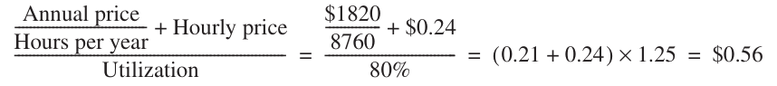

Vậy Reserved Instance tiết kiệm khoảng 17% hay $23M cho workload MapReduce 2009.

Khi lấy mẫu trong vài ngày của tháng Một 2011, hourly cost trung bình của High-CPU Extra Large Spot Instance là $0.235. Đây là mức giá bid tối thiểu để có được một server, không thể coi là chi phí trung bình vì thông thường bạn muốn task chạy xong mà không bị đẩy ra. Giả sử cần trả gấp đôi giá tối thiểu để một job lớn hoàn thành. Spot Instance tiết kiệm khoảng 31%, tức $41M, cho workload năm 2009. Bạn tạm thời khuyến nghị Spot Instance vì yêu cầu cam kết up-front thấp hơn và có thể tiết kiệm nhiều hơn. Tuy nhiên, cần chạy thử để biết mức giá thực sự bảo đảm job hoàn thành và liệu thực sự có hàng trăm High-CPU Extra Large Instance sẵn có mỗi ngày hay không.

Ngoài giá thấp và mô hình pay-for-use, một sức hấp dẫn khác của cloud là nhà cung cấp nhận về rủi ro over-provisioning hoặc under-provisioning. Việc tránh những rủi ro này rất có giá trị đối với startup, vì sai lầm nào cũng có thể gây hậu quả chí mạng. Nếu chi quá nhiều nguồn vốn quý giá vào server trước khi sản phẩm sẵn sàng được sử dụng rộng rãi, công ty có thể hết tiền. Nếu dịch vụ đột nhiên trở nên phổ biến nhưng server không đủ, công ty sẽ tạo ấn tượng rất xấu với những khách hàng tiềm năng mà họ cần để phát triển.

Ví dụ điển hình là FarmVille của Zynga, game mạng xã hội Facebook. Trước đó game lớn nhất khoảng 5 triệu người chơi/ngày. FarmVille có 1 triệu sau 4 ngày, 10 triệu sau 60 ngày. Sau 270 ngày, 28 triệu mỗi ngày, 75 triệu mỗi tháng. Trên AWS, họ tăng trưởng liền mạch theo người dùng, đồng thời giảm load theo nhu cầu.

Những công ty đã hoạt động lâu năm cũng tận dụng cloud scalability. Năm 2011, Netflix chuyển website và streaming video từ datacenter thông thường sang AWS. Mục tiêu là cho phép người dùng xem trên điện thoại trong lúc về nhà, rồi chuyển liền mạch sang TV và tiếp tục từ đúng chỗ đã dừng. Việc này đòi hỏi batch processing để chuyển những phim mới sang vô số format cho điện thoại, tablet, laptop, game console và digital video recorder. Các batch job trên AWS sử dụng hàng nghìn máy trong nhiều tuần. Transactional backend cho streaming chạy trên AWS, còn encoded file được phân phối qua Content Delivery Network như Akamai và Level 3. Phát trực tuyến rẻ hơn gửi DVD nên ngày càng phổ biến. Một nghiên cứu cho thấy Netflix chiếm 30% download traffic của Internet Mỹ trong những giờ cao điểm buổi tối. (YouTube chỉ chiếm 10% trong cùng khoảng từ 8 p.m. đến 10 p.m.) Mức trung bình tổng thể là 22%, khiến riêng Netflix chiếm phần lớn nhất ở Bắc Mỹ. Mặc dù số subscriber tăng nhanh, datacenter của Netflix ngừng mở rộng, và mọi capacity expansion sau đó đều thông qua AWS.

Cloud computing mang lợi ích của WSC đến với mọi người. Nó cung cấp cost associativity cùng ảo giác về scalability vô hạn mà không tính thêm phí: sử dụng 1000 server trong 1 giờ không đắt hơn sử dụng 1 server trong 1000 giờ. Nhà cung cấp phải bảo đảm có đủ server, storage và Internet bandwidth để đáp ứng nhu cầu. Supply chain được tối ưu hóa như đã nói ở trên hạ time-to-delivery của máy mới xuống một tuần, giúp duy trì ảo giác đó mà không phá sản. Việc chuyển giao rủi ro, cost associativity và pay-as-you-go pricing là những lý do thuyết phục để các công ty thuộc mọi quy mô sử dụng cloud.

Hai vấn đề crosscutting chi phối cost-performance WSC và cloud là network WSC cùng hiệu quả server hardware, software.

## 6.6 Vấn đề Crosscutting

> Thiết bị network là chiếc SUV của datacenter.

> James Hamilton (2009)

### WSC Network là Bottleneck

Mục 6.4 cho thấy thiết bị mạng ở phía trên rack switch chiếm một phần đáng kể trong chi phí của WSC. Khi được cấu hình đầy đủ, datacenter switch Juniper EX8216 128-port 1 Gbit có giá niêm yết $716,000 nếu không có optical interface và $908,000 nếu có. (Những mức giá niêm yết này được chiết khấu mạnh, nhưng vẫn cao hơn 50 lần giá của một rack switch.) Các switch này cũng có xu hướng tiêu thụ nhiều power. Ví dụ, EX8216 tiêu thụ khoảng 19,200 watt, gấp 500 đến 1000 lần một server trong WSC. Hơn nữa, những switch lớn này được cấu hình thủ công và dễ gặp trục trặc khi triển khai ở quy mô lớn. Do giá cao, khó có khả năng chi trả cho mức dự phòng cao hơn dual redundancy trong WSC sử dụng những switch lớn này, làm hạn chế các lựa chọn fault tolerance [Hamilton 2009].

Tuy nhiên, tác động thực sự của switch nằm ở cách oversubscription ảnh hưởng đến thiết kế software và việc bố trí service cùng dữ liệu trong WSC. Network WSC lý tưởng sẽ là một black box có topology và bandwidth không cần được quan tâm vì không có ràng buộc: bạn có thể chạy bất kỳ workload nào ở bất kỳ đâu và tối ưu hóa server utilization thay vì network traffic locality. Những bottleneck của network WSC hiện nay ràng buộc việc bố trí dữ liệu, từ đó làm software WSC phức tạp hơn. Vì software này là một trong những tài sản giá trị nhất của công ty WSC, chi phí của phần phức tạp bổ sung có thể rất đáng kể.

Bạn đọc muốn biết switch design có thể xem Phụ lục F về interconnection network. Thacker [2007] còn đề xuất mượn networking technology supercomputing khắc phục giá, performance. Vahdat và cộng sự [2010] cũng vậy, đề xuất infrastructure scale tới 100,000 port, bisection bandwidth 1 petabit/sec. Lợi ích lớn của datacenter switch mới là giảm thách thức software do oversubscription.

### Sử dụng năng lượng hiệu quả bên trong Server

PUE đo hiệu quả của WSC nhưng không cho biết những gì diễn ra bên trong IT equipment. Một nguồn tổn hao chưa được thể hiện trong Hình 6.9 là power supply của server, chuyển input 208 hoặc 110 volt thành những mức mà chip và disk sử dụng, thường là 3.3, 5 và 12 volt. Mức 12 volt còn được hạ xuống 1.2 đến 1.8 trên board, tùy microprocessor và memory. Năm 2007, nhiều power supply chỉ có hiệu suất 60% đến 80%, khiến tổn thất bên trong server lớn hơn mọi bước chuyển đổi từ high-voltage của công ty điện lực đến low-voltage của server. Một lý do là chúng phải cấp nhiều mức điện áp cho chip và disk mà không biết trên motherboard có những gì. Lý do thứ hai là power supply thường có công suất watt dư thừa. Chúng hoạt động kém hiệu quả nhất ở load 25% trở xuống, mặc dù nhiều server WSC hoạt động ở mức đó (Hình 6.3 trang 440). Motherboard còn có voltage regulator module (VRM), cũng có thể hoạt động kém hiệu quả.

Để cải thiện trình độ hiện tại, Hình 6.17 cho chuẩn Climate Savers Computing Initiative [2007] xếp power supply, mục tiêu theo thời gian. Chuẩn quy định cả load 20%, 50% ngoài 100%.

Ngoài power supply, Barroso và Hölzle [2007] cho rằng mục tiêu cho toàn bộ server là energy proportionality: năng lượng tiêu thụ tỷ lệ với công việc hoàn thành. Hình 6.18 cho thấy khoảng cách so với lý tưởng qua SPECpower, vốn đo năng lượng ở những mức performance khác nhau (Chương 1). Đường energy proportional được bổ sung để so sánh với actual usage của server hiệu quả nhất vào tháng Bảy 2010. Phần lớn server có hiệu quả thấp hơn; server này tốt hơn đến 2.5 lần so với những hệ thống khác được benchmark trong năm đó. Hơn nữa, ở cuối cuộc đua, benchmark thường được cấu hình để chiến thắng thay vì giống với thực tế. Chẳng hạn, server best-rated trong SPECpower sử dụng disk solid-state nhỏ hơn main memory! Mặc dù vậy, nó vẫn tiêu thụ gần 30% full power khi idle và gần 50% ở load 10%. Energy proportionality vẫn là một mục tiêu còn xa, thay vì một thành tích đáng tự hào.

| Điều kiện load | Base | Bronze (tháng Sáu 2008) | Silver (tháng Sáu 2009) | Gold (tháng Sáu 2010) |
|---|---|---|---|---|
| 20% | 80% | 82% | 85% | 87% |
| 50% | 80% | 85% | 88% | 90% |
| 100% | 80% | 82% | 85% | 87% |

**Hình 6.17 Xếp hạng, mục tiêu hiệu suất power supply theo thời gian của Climate Savers Computing Initiative. Dành cho Multi-Output Power Supply Unit của desktop, server nonredundant. Chuẩn single-output PSU hơi cao hơn, thường trong cấu hình redundant (1U/2U single-, dual-, four-socket và blade server).**

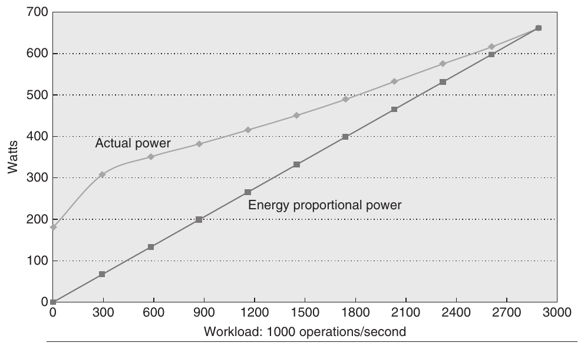

**Hình 6.18 SPECpower tốt nhất tháng Bảy 2010 so lý tưởng energy proportional. HP ProLiant SL2x170z G6 dùng cluster bốn Intel Xeon L5640 dual-socket, mỗi socket sáu core 2.27 GHz. DRAM 64 GB, SSD 60 GB nhỏ cho secondary storage. (Main memory lớn hơn disk cho thấy được tùy biến benchmark.) Software IBM Java Virtual Machine version 9, Windows Server 2008 Enterprise Edition.**

Systems software được thiết kế để sử dụng hết resource nếu điều đó có thể tăng performance, mà không xét đến năng lượng. Chẳng hạn, operating system sử dụng hết memory cho program data và file cache, mặc dù phần lớn có lẽ không bao giờ được dùng đến. Software architect trong tương lai cần xem xét cả năng lượng lẫn performance [Carter và Rajamani 2010].

**Ví dụ** Với data như Hình 6.18, tiết kiệm power bao nhiêu khi từ năm server utilization 10% sang một server 50%?

**Trả lời** Một server load 10% là 308 watt, load 50% 451 watt. Tiết kiệm là

5 × 308 ⁄ 451 = ( 1540 ⁄ 451 ) ≈ 3.4

hay một hệ số khoảng 3.4. Để có trách nhiệm với môi trường, chúng ta phải hợp nhất server khi utilization giảm, mua những server có tính energy proportional cao hơn, hoặc tìm công việc hữu ích để chạy trong những khoảng hoạt động ở mức thấp.

Với nền tảng sáu mục, giờ sẵn sàng đánh giá công việc Google WSC architect.

## 6.7 Kết hợp mọi thứ: Google Warehouse-Scale Computer

Vì nhiều công ty WSC cạnh tranh mạnh mẽ, cho đến gần đây họ vẫn ngần ngại chia sẻ những đổi mới với công chúng và với nhau. Năm 2009, Google mô tả một WSC state-of-the-art của năm 2005, rồi hào phóng cung cấp bản cập nhật cho năm 2007, khiến mục này trở thành mô tả up-to-date nhất [Clidaras, Johnson và Felderman 2010]. Gần đây hơn nữa, Facebook mô tả datacenter của mình tại http://opencompute.org.

### Container

Google và Microsoft xây dựng WSC bằng shipping container để có thiết kế modular. Mỗi container hoạt động độc lập, với các kết nối ra ngoài chỉ gồm network, power và water. Container cung cấp network, power và cooling cho những server bên trong; WSC cung cấp network, power và cold water cho container, đồng thời bơm warm water đến cooling tower và chiller bên ngoài.

Google WSC đang được xem xét có 45 container 40-foot-long trong một không gian 300-foot × 250-foot, tức 75,000 square feet (khoảng 7000 square meter). Để vừa với warehouse, 30 container được xếp chồng thành hai tầng, tạo thành 15 cặp. Địa điểm không được công bố, nhưng hệ thống được xây cùng thời điểm Google phát triển WSC tại The Dalles, Oregon, nơi có khí hậu ôn hòa, gần nguồn thủy điện rẻ và các tuyến cáp quang Internet backbone. WSC có công suất 10 megawatt, với PUE là 1.23 trong 12 tháng trước đó. Trong overhead 0.230, 85% là cooling loss (0.195 PUE) và 15% (0.035) là power loss. Hệ thống bắt đầu hoạt động vào tháng Mười Một 2005; phần này mô tả hệ thống vào năm 2007.

Google container chịu tới 250 kilowatt, tức 780 watt mỗi square foot (0.09 square meter), hoặc 133 watt mỗi square foot toàn không gian 75,000-square-foot với 40 container. Nhưng container WSC này trung bình chỉ 222 kilowatt

Hình 6.19 là cutaway Google container. Chứa tới 1160 server, 45 container đủ 52,200 server. (WSC này khoảng 40,000.) Server xếp 20 tầng trong hai hàng dài, mỗi hàng 29 rack (bay), một hàng mỗi bên container. Rack switch Ethernet 48-port 1 Gbit/sec đặt cách một rack.

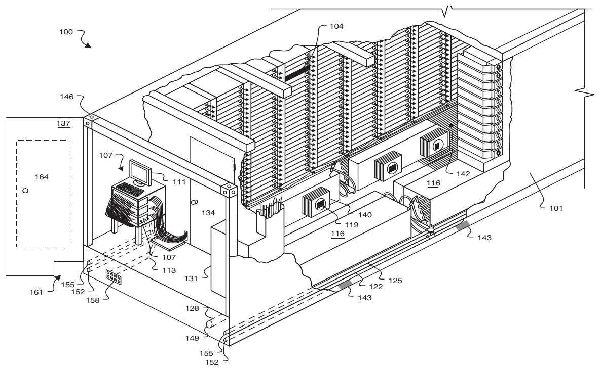

**Hình 6.19 Google tùy biến container 1AAA tiêu chuẩn: 40 x 8 x 9.5 feet (12.2 x 2.4 x 2.9 meter). Server được xếp cao đến 20 tầng thành hai hàng, mỗi hàng có 29 rack, với một hàng ở mỗi bên. Cold aisle nằm ở giữa, còn hot return nằm bên ngoài. Các rack được treo để có thể sửa hệ thống làm mát mà không cần tháo server. Container có fire detection, mist-based suppression, emergency egress, lighting và power shut-off cho những người sửa chữa bên trong. Các sensor bao gồm nhiệt độ, airflow pressure, air leak và motion-sensing lighting. Video có tại http://www.google.com/corporate/green/datacenters/summit.html. Microsoft, Yahoo! và nhiều hãng khác xây dựng modular datacenter theo ý tưởng này, nhưng đã ngừng sử dụng container ISO vì kích thước bất tiện của chúng.**

### Làm mát và điện trong Google WSC

Hình 6.20 là sơ đồ cross-section của container, thể hiện airflow. Các rack được gắn vào trần. Hệ thống làm mát bên dưới raised floor thổi không khí vào lối đi giữa các rack. Khí nóng quay về phía sau rack. Không gian hạn chế ngăn không khí nóng và lạnh trộn lẫn, giúp tăng hiệu quả. Các fan Variable-speed chạy ở tốc độ thấp nhất đủ để làm mát, thay vì chạy ở một tốc độ cố định.

Không khí “lạnh” được giữ ở 81°F (27°C), vốn là mức ấm so với datacenter thông thường. Việc vận hành ở nhiệt độ lạnh thường không phải vì IT equipment cần như vậy mà là để tránh các hot spot gây vấn đề tại những vị trí riêng lẻ. Kiểm soát airflow cẩn thận để tránh hot spot cho phép container chạy ở nhiệt độ cao hơn nhiều.

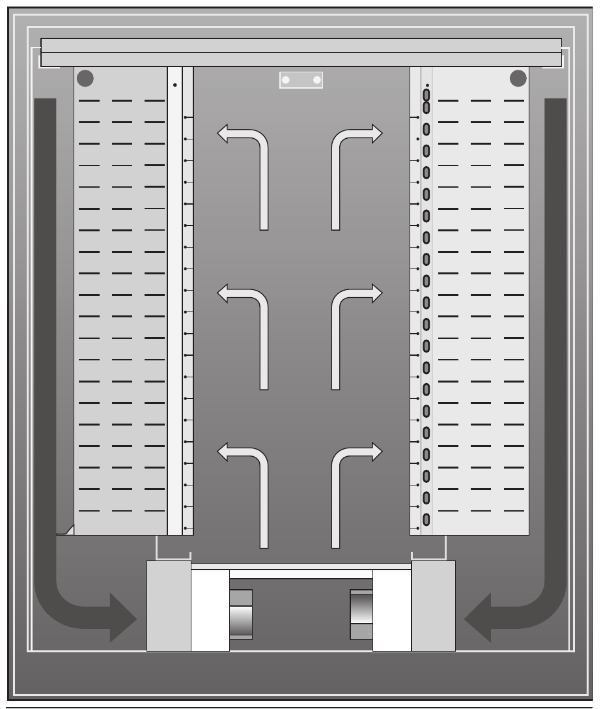

**Hình 6.20 Airflow trong container Hình 6.19. Sơ đồ cross-section cho hai rack mỗi bên. Khí lạnh thổi lối giữa rồi hút vào server, khí ấm về cạnh container. Thiết kế cách ly hai airflow.**

Chiller ngoài có cutout để chỉ cooling tower ngoài làm lạnh nước khi thời tiết phù hợp. Bỏ chiller nếu nước ra tower 70°F (21°C) trở xuống.

Nếu ngoài quá lạnh, cooling tower cần heater chống băng. The Dalles có wet-bulb temperature năm 15°F tới 66°F (−9°C tới 19°C), trung bình 41°F (5°C), nên thường tắt chiller. Ngược lại Las Vegas, Nevada –42°F tới 62°F (–41°C tới 17°C), trung bình 29°F (–2°C). Chỉ cần lạnh tới 81°F (27°C) bên trong còn giúp thiên nhiên làm lạnh nước nhiều hơn.

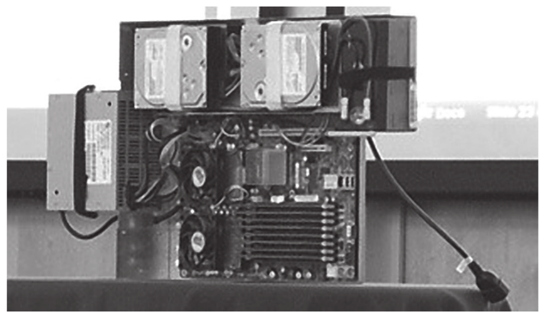

**Hình 6.21 Server Google WSC. Power supply bên trái, hai disk trên. Hai quạt dưới disk trái che hai socket AMD Barcelona, mỗi socket hai core 2.2 GHz. Tám DIMM dưới phải mỗi cái 1 GB, tổng 8 GB. Không sheet metal thừa vì server cắm battery; mỗi server có plenum riêng trong rack điều khiển airflow. Một phần do chiều cao battery, mỗi rack chứa 20 server.**

Hình 6.21 cho thấy một server do Google thiết kế. Google tăng power supply efficiency bằng cách chỉ cấp 12 volt cho motherboard, còn board chỉ cấp điện cho đúng số disk hiện có. (Laptop hoạt động tương tự.) Server thông thường cấp trực tiếp nhiều mức điện áp mà chip và disk cần. Sự đơn giản hóa này giúp power supply năm 2007 đạt hiệu suất 92%, vượt Gold rating năm 2010 (Hình 6.17).

Các kỹ sư Google nhận thấy mức 12 volt cho phép cung cấp UPS chỉ bằng một battery tiêu chuẩn trên mỗi kệ. Thay cho phòng battery riêng có hiệu suất 94% trong Hình 6.9, mỗi server có một lead acid battery với hiệu suất 99.99%. “Distributed UPS” có thể được triển khai tăng dần theo từng máy, không phải bỏ tiền hoặc tiêu thụ power cho overcapacity. UPS off-the-shelf được sử dụng để bảo vệ network switch.

Còn dynamic voltage-frequency scaling (DVFS) trong Chương 1 thì sao? Cơ chế này không được triển khai, vì ảnh hưởng đến latency khiến nó chỉ khả thi khi activity rất thấp đối với online workload, và ngay cả khi đó mức tiết kiệm trên toàn hệ thống cũng rất nhỏ. Mức tiết kiệm đó không đủ để biện minh cho management control loop phức tạp.

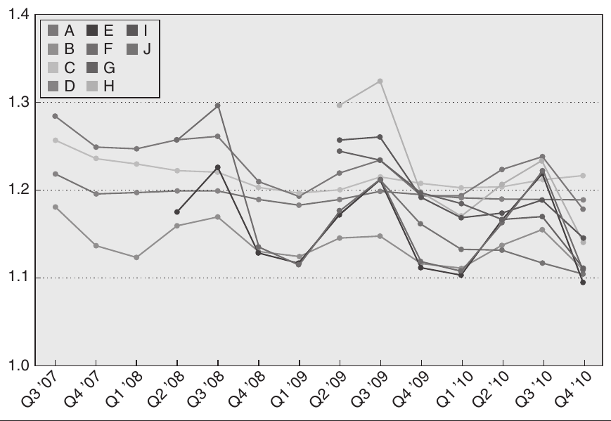

**Hình 6.22 PUE của 10 Google WSC theo thời gian. Google A là WSC mục này, đường cao nhất Q3 ’07 và Q2 ’10. (Từ www.google.com/corporate/green/datacenters/measuring.htm.) Facebook mới công bố datacenter PUE 1.07 ấn tượng (http://opencompute.org/). Prineville Oregon không air conditioning hay chilled water, chỉ khí ngoài đưa một bên, lọc, mist làm mát, bơm qua IT equipment, quạt hút ra. Server dùng custom supply cho bỏ một voltage conversion Hình 6.9.**

Một chìa khóa PUE 1.23 là thiết bị đo (current transformer) trong mọi circuit container và WSC để đo power usage thật, cho Google tune design dần.

Google công bố PUE mỗi quý. Hình 6.22 vẽ 10 WSC từ quý ba 2007 tới quý hai 2010; mục này là Google A. Google E PUE 1.16, cooling chỉ 0.105 nhờ nhiệt cao hơn, chiller cutout. Phân phối điện 0.039 nhờ distributed UPS, single voltage supply. Tốt nhất 1.12, Google A 1.23. Tháng Tư 2009, trailing 12-month average có trọng số usage toàn datacenter 1.19.

### Server trong Google WSC

Server trong Hình 6.21 có hai socket, mỗi socket chứa một AMD Opteron dual-core 2.2 GHz. Ảnh cho thấy tám DIMM, thường được triển khai với 8 GB DDR2 DRAM. Một tính năng mới là memory bus được downclock từ mức tiêu chuẩn 666 MHz xuống 533 MHz; điều này ít ảnh hưởng đến performance nhưng giảm power đáng kể.

Cấu hình baseline có một network interface card (NIC) cho Ethernet link 1 Gbit/sec. Mặc dù ảnh trong Hình 6.21 có hai SATA disk, cấu hình baseline chỉ có một. Peak power vào khoảng 160 watt, còn idle power là 85 watt.

Baseline node được bổ sung để trở thành storage node (“diskfull”). Người ta thêm một tray thứ hai chứa 10 SATA disk kết nối với server. Một disk thứ hai được đặt vào vị trí trống trên motherboard, đưa tổng số disk của storage node lên 12 SATA disk. Vì những disk này có thể làm bão hòa một Ethernet link 1 Gbit/sec, người ta bổ sung NIC thứ hai. Peak power vào khoảng 300 watt, còn idle power là 198 watt.

Storage node chiếm hai slot rack, một lý do Google triển khai 40,000 thay vì 52,200 server trong 45 container. Tỷ lệ khoảng hai compute node mỗi storage node, nhưng thay đổi nhiều giữa WSC. Google A có khoảng 190,000 disk năm 2007, trung bình gần 5 disk mỗi server.

### Networking trong Google WSC

40,000 server chia ba array, mỗi array hơn 10,000. (Google gọi array là cluster.) Rack switch 48-port dùng 40 port nối server, 8 uplink tới array switch.

Array switch được cấu hình để hỗ trợ tối đa 480 Ethernet link 1 Gbit/sec và một số port 10 Gbit/sec. Các port 1 Gigabit kết nối với rack switch, mỗi rack switch có một link đến từng array switch. Các port 10 Gbit/sec kết nối với mỗi một trong hai datacenter router, vốn tập hợp tất cả array router và kết nối ra bên ngoài. Hai router bảo đảm dependability: failure của một router không khiến WSC ngừng hoạt động.

Mỗi rack switch có từ tối thiểu 2 đến tối đa 8 uplink. Trong trường hợp dual-port, oversubscription là 20:1, nghĩa là bandwidth trong switch gấp 20 lần bandwidth đi ra ngoài. Những ứng dụng cần nhiều traffic bên ngoài rack sẽ có performance kém. Vì thế, thiết kế uplink 8-port, với oversubscription thấp hơn là 5:1, được sử dụng cho những array có yêu cầu traffic cao.

### Giám sát và sửa chữa trong Google WSC

Để một operator phụ trách hơn 1000 server, cần monitoring infrastructure rộng và tự động hóa xử lý sự kiện thường lệ.

Google sử dụng monitoring software để theo dõi tất cả server và thiết bị mạng; các diagnostic chạy liên tục. Khi một hệ thống hỏng, nhiều vấn đề có thể được giải quyết tự động bằng những giải pháp đơn giản. Bước tiếp theo là reboot, rồi thử reinstall các software component. Quy trình này xử lý được phần lớn failure.

Máy không qua bước đầu được đưa repair queue, cùng chẩn đoán và ID máy hỏng.

Để phân bổ repair cost, kỹ thuật viên thực hiện sửa chữa theo batch. Khi diagnostic software có độ tin cậy cao về chẩn đoán, kỹ thuật viên thay linh kiện ngay mà không cần chẩn đoán thủ công. Ví dụ, nếu disk 3 của một storage node được báo là hỏng thì disk đó được thay ngay. Những máy không có diagnostic hoặc có diagnostic low-confidence được kiểm tra thủ công.

Mục tiêu là có dưới 1% node nằm trong manual repair queue tại bất kỳ thời điểm nào. Thời gian trung bình trong queue là một tuần, mặc dù việc sửa chữa diễn ra nhanh hơn nhiều. Latency dài cho thấy repair throughput mới là điều quan trọng và ảnh hưởng đến operation cost. Quá trình sửa chữa tự động ban đầu kéo dài từ vài phút để reboot/reinstall đến hàng giờ thực hiện directed stress test nhằm bảo đảm máy hoạt động.

Latency này chưa gồm thời gian đưa server hỏng về idle. Biến số lớn là lượng state trong node. Stateless node mất ít thời gian hơn storage node có data cần di tản trước khi thay.

### Tổng kết

Tới năm 2007, Google đã thể hiện nhiều đổi mới tăng hiệu quả năng lượng WSC, đạt PUE 1.23 Google A:

- Ngoài việc cung cấp vỏ chứa server với chi phí thấp, các shipping container được sửa đổi còn tách riêng hot/cold air plenum, giảm sự biến thiên intake temperature. Khi hot spot trong worst-case nhẹ hơn, nhiệt độ không khí lạnh được phép cao hơn.

- Container rút ngắn air circulation loop, giảm năng lượng di chuyển khí.

- Server chạy ở nhiệt độ cao hơn có nghĩa là chỉ cần làm lạnh không khí xuống 81°F (27°C), thay vì mức truyền thống 64°F đến 71°F (18°C đến 22°C).

- Mục tiêu nhiệt độ không khí lạnh cao hơn giúp cơ sở thường hoạt động trong phạm vi có thể sử dụng evaporative cooling (cooling tower), vốn hiệu quả hơn chiller truyền thống.

- Đặt WSC nơi ôn hòa để chỉ dùng evaporative cooling một phần năm.

- Monitoring hardware và software rộng khắp đo actual PUE so với designed PUE, giúp bảo đảm hiệu quả vận hành.

- Cho chạy nhiều server hơn mức mà worst-case scenario của phân phối điện cho phép, vì về mặt thống kê, khó có khả năng hàng nghìn server đồng thời hoạt động ở mức cao nhất; khi trường hợp hiếm gặp đó xảy ra, hệ thống dựa vào monitoring để off-load công việc [Fan, Weber và Barroso 2007] [Ranganathan và cộng sự 2006]. PUE được cải thiện vì cơ sở hoạt động gần mức đầy tải theo thiết kế, vốn là mức hiệu quả nhất do server và hệ thống làm mát không energy proportional. Utilization tăng giúp giảm nhu cầu xây dựng thêm server và WSC mới.

- Motherboard chỉ cần power supply 12-volt cho phép cung cấp UPS bằng battery trên mỗi server thay cho cả phòng battery, giúp giảm chi phí và loại bỏ một nguồn tổn hao trong phân phối điện.

- Thiết kế server board cẩn thận giúp tăng hiệu quả. Việc underclock front-side bus của microprocessor giảm năng lượng tiêu thụ mà ít ảnh hưởng đến performance. (Điều này không làm thay đổi PUE nhưng giảm tổng năng lượng của WSC.)

Thiết kế WSC hẳn đã được cải thiện trong những năm tiếp theo, vì PUE tốt nhất của Google giảm từ 1.23 của Google A xuống 1.12. Năm 2011, Facebook công bố PUE là 1.07 (http://opencompute.org/). Sẽ rất thú vị khi xem những đổi mới còn lại giúp bảo vệ môi trường tốt hơn; trong tương lai, người ta có thể tính cả năng lượng cần để sản xuất thiết bị WSC [Chang và cộng sự 2010].

## 6.8 Ngộ nhận và cạm bẫy

Dù WSC chưa đầy thập niên, architect như Google đã tìm nhiều cạm bẫy, ngộ nhận, thường bằng trải nghiệm khó khăn. Như phần đầu, họ là Seymour Cray ngày nay.

**Ngộ nhận** Cloud computing provider đang lỗ.

Câu hỏi phổ biến là cloud có lãi với giá thấp không.

Theo giá Hình 6.15, có thể thu \$0.68 mỗi server giờ tính toán. (\$0.085 là Virtual Machine một EC2 compute unit, không cả server.) Bán 50% server hour thu \$0.34 mỗi server giờ. (Khách trả dù dùng ít nên bán 50% giờ không nghĩa average utilization 50%.)

Cách khác dùng AWS Reserved Instance: phí năm giữ instance, hourly rate thấp để dùng. Kết hợp AWS thu $0.45 mỗi server giờ cả năm.

Bán storage 750 GB mỗi server theo AWS, ngoài compute income thêm $75/tháng/server, hay $0.10/giờ.

Những con số này gợi ý mức thu nhập trung bình từ $0.44 trên mỗi server mỗi giờ (thông qua On-Demand Instance) đến $0.55 mỗi giờ (thông qua Reserved Instance). Từ Hình 6.13, chúng ta đã tính chi phí trên mỗi server là $0.11 mỗi giờ cho WSC trong Mục 6.4. Mặc dù các chi phí trong Hình 6.13 là những ước tính không dựa trên chi phí thực tế của AWS, và mức bán 50% năng lực xử lý server cùng utilization 750 GB storage trên mỗi server chỉ là ví dụ, những giả định này gợi ý gross margin từ 75% đến 80%. Nếu những phép tính này hợp lý, chúng cho thấy cloud computing có lợi nhuận cao, đặc biệt đối với một doanh nghiệp dịch vụ.

**Ngộ nhận** Capital cost cơ sở WSC cao hơn server bên trong.

Thoạt nhìn Hình 6.13 ở trang 453, bạn có thể nghĩ như vậy, nhưng điều đó bỏ qua việc khấu hao. Cơ sở có vòng đời 10 đến 15 năm, còn server phải được mua lại mỗi 3 hoặc 4 năm. Nếu sử dụng các thời gian 10 và 3 năm trong Hình 6.13, capital expenditure trong một thập niên là $72M cho cơ sở và 3.3 × $67M, tức $221M, cho server. Chi phí server cao hơn khoảng ba lần.

**Cạm bẫy** Tiết kiệm power bằng inactive low power mode thay active low power mode.

Hình 6.3 trang 440 cho average utilization 10% tới 50%. Với operational cost Mục 6.4, có thể nghĩ low power mode giúp nhiều.

Như Chương 1 đã đề cập, bạn không thể truy cập DRAM hoặc disk trong các inactive low power mode này, vì thế phải quay lại fully active mode để đọc hoặc ghi, bất kể tốc độ thấp đến đâu. Cạm bẫy là thời gian và năng lượng cần thiết để quay lại fully active mode khiến các inactive low power mode trở nên kém hấp dẫn hơn. Hình 6.3 cho thấy gần như tất cả server đều có utilization trung bình ít nhất 10%, vì thế bạn có thể kỳ vọng những khoảng thời gian dài hoạt động ở mức thấp, nhưng không phải những khoảng thời gian dài hoàn toàn không hoạt động.

Ngược lại, processor vẫn có thể hoạt động trong lower power mode ở một phần nhỏ tốc độ thông thường, nên active mode dễ sử dụng hơn. Việc chuyển sang fully active chỉ mất microsecond cũng đáp ứng những quan tâm về latency.

**Cạm bẫy** Processor quá yếu khi cải thiện WSC cost-performance.

Định luật Amdahl vẫn đúng: mỗi request có phần công việc tuần tự, khiến latency tăng nếu server chậm [Hölzle 2010] [Lim và cộng sự 2008]. Nếu latency tăng, phải tính đến software development cost để tối ưu hóa lại. Việc lập lịch và cân bằng load cho nhiều thread trên server chậm cũng khó hơn, trong khi sự biến thiên performance có thể gây latency dài. Xác suất lập lịch không tốt là 1 trong 1000 không đáng lo với 10 task, nhưng lại đáng lo với 1000 task khi phải chờ task lâu nhất. Nhiều server nhỏ có thể có utilization thấp hơn, vì lập lịch cho ít đối tượng hơn thì dễ hơn. Thuật toán song song cũng kém hiệu quả nếu bài toán bị chia quá nhỏ. Quy tắc của Google là sử dụng loại server low-end [Barroso và Hölzle 2009].

Reddi và cộng sự [2010] so sánh processor Atom embedded với server Nehalem Xeon khi chạy Bing. Query latency của Atom dài hơn khoảng ba lần. Xeon hoạt động vững vàng hơn: khi load tăng, quality of service giảm từ từ ở mức vừa phải; còn Atom nhanh chóng vi phạm quality-of-service target khi có thêm load.

Hành vi này ảnh hưởng đến chất lượng tìm kiếm. Do latency quan trọng (Hình 6.12), Bing sử dụng nhiều chiến lược để tinh chỉnh kết quả nếu chưa vượt cut-off latency. Xeon lớn hơn có latency thấp hơn nên có thêm thời gian để tinh chỉnh. Ngay cả khi Atom gần như không có load, nó vẫn trả về kết quả kém hơn cho 1% query; ở mức load thông thường, tỷ lệ đó là 2%.

**Ngộ nhận** DRAM dependability tốt và systems software fault tolerance khiến không cần trả thêm ECC memory.

ECC thêm 8 bit mỗi 64 bit DRAM nên bỏ error-correcting code (ECC) có thể tiết kiệm một phần chín, nhất là phép đo từng nói 1000 tới 5000 FIT (failure mỗi tỷ giờ) mỗi megabit [Tezzaron Semiconductor 2004].

Schroeder, Pinheiro và Weber [2009] đo DRAM có ECC trong phần lớn WSC của Google, có lẽ gồm hàng trăm nghìn server, trong một khoảng thời gian 2.5-year. FIT cao hơn những số liệu đã công bố từ 15 đến 25 lần, ở mức 25,000 đến 70,000 failure trên mỗi megabit. Hơn 8% DIMM bị ảnh hưởng; DIMM trung bình có 4000 correctable error và 0.2 uncorrectable error mỗi năm. Khoảng một phần ba server gặp DRAM error mỗi năm, trung bình có 22,000 correctable error và 1 uncorrectable error. Đối với one-third số server này, cứ mỗi 2.5 giờ lại có một lỗi được sửa. Họ sử dụng chipkill mạnh thay cho SECDED; nếu sử dụng cơ chế đơn giản hơn thì uncorrectable rate sẽ cao hơn từ 4 đến 10 lần.

Một WSC chỉ có parity protection phải reboot mỗi khi xảy ra memory parity error. Nếu mỗi lần reboot mất 5 phút, one-third số máy sẽ dành 20% thời gian để reboot! Performance của một cơ sở trị giá $150M sẽ giảm khoảng 6%. Ngoài ra, nhiều uncorrectable error còn không được thông báo cho người vận hành.

Ban đầu, Google sử dụng DRAM không có parity. Năm 2000, trong một thử nghiệm trước khi phát hành search index mới, hệ thống đề xuất những tài liệu ngẫu nhiên [Barroso và Hölzle 2009]. Một stuck-at-zero fault trong DRAM đã làm hỏng index. Google bổ sung consistency check. Khi WSC lớn hơn và ECC DIMM rẻ hơn, ECC trở thành tiêu chuẩn; nó còn giúp xác định DIMM bị hỏng dễ hơn khi sửa chữa.

Data này giải thích Fermi GPU (Chương 4) thêm ECC trong khi trước không parity. FIT cũng khiến nghi ngờ dùng Intel Atom vì hiệu quả power: chipset 2011 không ECC DRAM.

**Ngộ nhận** Tắt hardware lúc ít hoạt động cải thiện cost-performance WSC.

Hình 6.14 ở trang 454 cho thấy khoản khấu hao hạ tầng điện và làm mát cao hơn 50% so với toàn bộ hóa đơn điện hằng tháng. Mặc dù việc gom workload và tắt các máy idle giúp tiết kiệm, ngay cả khi giảm power một nửa thì monthly operational bill cũng chỉ giảm 7%. Ngoài ra còn có vấn đề monitoring cần truy vấn thiết bị và nhận được phản hồi. Energy proportionality và active low power mode tương thích với monitoring, giúp một người vận hành phụ trách hơn 1000 server.

Kinh nghiệm của WSC là chạy những công việc hữu ích khác trong thời gian nhàn rỗi để thu hồi khoản đầu tư vào điện và làm mát. Một ví dụ là các batch MapReduce tạo search index. Spot pricing của AWS (chú thích Hình 6.15 ở trang 458) cũng thực hiện điều đó. Những khách hàng linh hoạt về thời gian có thể tiết kiệm chi phí compute theo hệ số 2.7 đến 3, cho phép AWS lập lịch các Spot Instance trong những khoảng utilization thấp.

**Ngộ nhận** Thay mọi disk bằng Flash cải thiện WSC cost-performance.

Flash nhanh hơn disk nhiều đối với những workload có nhiều random read/write. Facebook triển khai Flash dưới dạng solid-state disk (SSD) làm write-back cache mang tên Flashcache trong file system, giữ các hot file trên Flash và các cold file trên disk. Tuy nhiên, phải xem xét cost-performance, nên vấn đề là số I/O mỗi giây trên mỗi dollar và storage capacity trên mỗi dollar. Chương 2 cho thấy Flash đắt hơn ít nhất 20 lần trên mỗi GByte: $2.00/GByte so với $0.09/Gbyte.

Narayanan và cộng sự [2009] mô phỏng trace datacenter nhỏ lớn chuyển disk sang SSD. SSD không cost effective cho workload nào vì capacity/dollar thấp. Để break-even, Flash cần cải thiện capacity/dollar hệ số 3 tới 3000 tùy workload.

Ngay cả khi tính đến power, việc thay Flash cho những dữ liệu ít được truy cập cũng khó được biện minh. Một disk one-terabyte tiêu thụ khoảng 10 watt; theo mức $2 trên mỗi watt-year trong Mục 6.4, số tiền tiết kiệm tối đa là $20 mỗi năm trên mỗi disk. Tuy nhiên, CAPEX cho một terabyte vào năm 2011 là $2000 với Flash và $90 với disk.

## 6.9 Kết luận

Kế thừa danh hiệu những người xây dựng các máy tính lớn nhất, WSC architect đang thiết kế phần lớn hạ tầng IT của tương lai để bổ sung cho mobile client. Nhiều người trong chúng ta sử dụng WSC nhiều lần mỗi ngày; số lần sử dụng và số người sử dụng chắc chắn sẽ tăng trong thập niên tới. Hơn một nửa trong gần bảy tỷ người trên thế giới đã có điện thoại. Khi những điện thoại này sẵn sàng kết nối Internet, thêm nhiều người trên toàn cầu sẽ được hưởng lợi.

Lợi thế về quy mô của WSC đã hiện thực hóa giấc mơ computing utility. Bất kỳ ai ở bất kỳ đâu có ý tưởng và business model tốt đều có thể sử dụng hàng nghìn server để thực hiện ý tưởng gần như ngay lập tức. Dĩ nhiên, vẫn có những trở ngại về tiêu chuẩn, privacy và tốc độ tăng Internet bandwidth; chúng ta kỳ vọng những vấn đề đó sẽ được giải quyết để cloud tiếp tục phát triển.

Số core trên mỗi chip tăng lên (Chương 5) khiến các cluster có hàng nghìn core. Công nghệ WSC sẽ hữu ích và lan xuống các cluster để chúng chạy cùng virtual machine và systems software. Một lợi thế là hybrid datacenter: workload có thể dễ dàng chuyển sang cloud khi tài nguyên căng thẳng, rồi được đưa trở lại hệ thống local sau đó.

Một điểm hấp dẫn của cloud là động lực kinh tế thúc đẩy tiết kiệm. Khó thuyết phục nhà cung cấp tắt thiết bị idle vì vốn đã đầu tư vào hạ tầng, nhưng dễ thuyết phục người dùng ngừng trả tiền cho instance idle vì họ vẫn phải chịu chi phí. Việc tính phí theo usage khuyến khích viết code sử dụng compute, communication và storage hiệu quả, điều khó thực hiện nếu không có pricing dễ hiểu. Giá rõ ràng còn giúp nghiên cứu cost-performance thay vì chỉ nghiên cứu performance, vì chi phí có thể được đo dễ dàng và đáng tin cậy. Cuối cùng, các nhà nghiên cứu có thể đánh giá ý tưởng ở quy mô hàng nghìn máy, điều trước kia chỉ những công ty lớn mới đủ tiền thực hiện.

Chúng ta tin rằng WSC đang thay đổi những mục tiêu và nguyên tắc của server design, tương tự như cách mobile client đang thay đổi microprocessor design. Cả hai đều đang thay đổi ngành công nghiệp software. Performance/dollar và performance/joule dẫn dắt cả mobile hardware lẫn WSC, và parallelism là chìa khóa.

Architect giữ vai trò thiết yếu cả hai nửa tương lai thú vị. Chúng ta mong thấy — và sử dụng — điều sắp tới.

## 6.10 Góc nhìn lịch sử và tài liệu tham khảo

Mục L.8 (trực tuyến) trình bày sự phát triển của cluster, nền tảng của WSC, và utility computing. (Những người muốn tìm hiểu thêm nên bắt đầu với Barroso và Hölzle [2009], cùng blog và các bài nói chuyện của James Hamilton tại http://perspectives.mvdirona.com.)

## Nghiên cứu trường hợp và bài tập của Parthasarathy Ranganathan

### Nghiên cứu trường hợp 1: Total Cost of Ownership ảnh hưởng quyết định thiết kế Warehouse-Scale Computer

#### Khái niệm minh họa qua nghiên cứu trường hợp này

- Total Cost of Ownership (TCO)

- Ảnh hưởng Server Cost và Power tới toàn WSC

- Lợi ích, nhược điểm của Server Low-Power

Total cost of ownership là một metric quan trọng để đánh giá warehouse-scale computer (WSC). TCO bao gồm CAPEX và OPEX đã thảo luận trong Mục 6.4, phản ánh ownership cost của toàn bộ datacenter để đạt một mức performance nhất định. Khi so sánh các server, network và storage architecture, chủ datacenter thường sử dụng TCO để chọn lựa chọn tốt nhất; tuy nhiên, đây là một phép tính nhiều chiều cần xét đến nhiều yếu tố. Nghiên cứu tình huống này xem xét kỹ hơn WSC, cách architecture ảnh hưởng đến TCO và cách TCO chi phối quyết định của người vận hành. Chúng ta sử dụng các số liệu trong Hình 6.13, Mục 6.4, và giả định WSC đạt performance mục tiêu. TCO thường được sử dụng để so sánh những lựa chọn server theo nhiều chiều. Những bài tập này tìm hiểu cách thực hiện sự so sánh đó trong WSC và mức độ phức tạp của các quyết định.

**6.1** [5/5/10] <6.2, 6.4> Trong chương này, data-level parallelism đã được thảo luận như một cách để WSC đạt hiệu năng cao khi giải quyết những bài toán lớn. Có thể đạt được hiệu năng thậm chí còn cao hơn bằng cách sử dụng high-end server; tuy nhiên, giá của những server có hiệu năng cao hơn thường tăng theo quan hệ phi tuyến.

a. [5] <6.4> Giả sử các server nhanh hơn 10% ở cùng mức utilization, nhưng đắt hơn 20%, CAPEX của WSC sẽ là bao nhiêu?

b. [5] <6.4> Nếu những server đó cũng tiêu thụ nhiều power hơn 15%, OPEX sẽ là bao nhiêu?

c. [10] <6.2, 6.4> Với mức cải thiện tốc độ và mức tăng power như trên, chi phí của những server mới phải là bao nhiêu để tương đương với cluster ban đầu? (Gợi ý: Dựa trên mô hình TCO này, bạn có thể phải thay đổi critical load của cơ sở.)

**6.2** [5/10] <6.4, 6.8> Để đạt được OPEX thấp hơn, một lựa chọn hấp dẫn là sử dụng các phiên bản low-power của server nhằm giảm tổng lượng điện cần thiết để vận hành server; tuy nhiên, tương tự như high-end server, các phiên bản low-power của những thành phần high-end cũng có những trade-offs phi tuyến.

a. [5] <6.4, 6.8> Nếu các lựa chọn server low-power tiêu thụ power thấp hơn 15% ở cùng mức hiệu năng nhưng đắt hơn 20%, liệu đó có phải là một trade-off hợp lý không?

b. [10] <6.4, 6.8> Ở mức chi phí nào thì những server này trở nên tương đương với cluster ban đầu? Điều gì xảy ra nếu giá điện tăng gấp đôi?

**6.3** [5/10/15] <6.4, 6.6> Những server có các chế độ hoạt động khác nhau tạo cơ hội vận hành linh hoạt nhiều cấu hình trong cluster để phù hợp với mức sử dụng của workload. Hãy sử dụng dữ liệu trong Hình 6.23 về các chế độ power/hiệu năng của một server low-power cho trước.

a. [5] <6.4, 6.6> Nếu người vận hành server quyết định tiết kiệm chi phí power bằng cách cho tất cả server chạy ở mức hiệu năng trung bình, cần bao nhiêu server để đạt được cùng mức hiệu năng?

| Chế độ | Hiệu năng | Power |
|---|---|---|
| Cao | 100% | 100% |
| Trung bình | 75% | 60% |
| Thấp | 59% | 38% |

**Hình 6.23 Các chế độ power–hiệu năng cho server low-power.**

b. [10] <6.4, 6.6> CAPEX và OPEX của một cấu hình như vậy là bao nhiêu?

c. [15] <6.4, 6.6> Nếu có một lựa chọn khác là mua server rẻ hơn 20% nhưng chậm hơn và tiêu thụ ít power hơn, hãy tìm đường cong hiệu năng–power mang lại TCO tương đương với server cơ sở.

**6.4** [Thảo luận] <6.4> Hãy thảo luận những trade-offs và lợi ích của hai lựa chọn trong Bài tập 6.3, với giả định các server chạy một workload không đổi.

**6.5** [Thảo luận] <6.2, 6.4> Khác với các cluster high-performance computing (HPC), WSC thường có workload biến động đáng kể trong suốt cả ngày. Hãy thảo luận những trade-offs và lợi ích của hai lựa chọn trong Bài tập 6.3, lần này với giả định workload có thay đổi.

**6.6** [Thảo luận] <6.4, 6.7> Mô hình TCO đã trình bày cho đến đây lược bỏ rất nhiều chi tiết ở các mức thấp hơn thông qua sự trừu tượng hóa. Hãy thảo luận ảnh hưởng của những sự trừu tượng hóa này đến độ chính xác tổng thể của mô hình TCO. Khi nào có thể thực hiện những sự trừu tượng hóa này một cách an toàn? Trong những trường hợp nào, việc bổ sung chi tiết sẽ mang lại các câu trả lời khác biệt đáng kể?

### Nghiên cứu tình huống 2: Phân bổ tài nguyên trong WSC và TCO

#### Khái niệm minh họa qua nghiên cứu trường hợp này

- Cung cấp server và power trong một WSC

- Time-Variance của workload

- Ảnh hưởng của sự biến động đến TCO

Một số thách thức chính khi triển khai WSC hiệu quả là cung cấp tài nguyên hợp lý và tận dụng tài nguyên ở mức tối đa. Bài toán này phức tạp do quy mô của WSC cũng như những biến động có thể xảy ra trong các workload đang chạy. Những bài tập trong nghiên cứu tình huống này cho thấy các cách sử dụng tài nguyên khác nhau có thể ảnh hưởng đến TCO như thế nào.

**6.7** [5/5/10] <6.4> Một trong những thách thức khi cung cấp tài nguyên cho WSC là xác định power load phù hợp với quy mô của cơ sở. Như đã mô tả trong chương, nameplate power thường là một giá trị đỉnh hiếm khi gặp trong thực tế.

a. [5] <6.4> Hãy ước tính TCO per-server thay đổi như thế nào nếu nameplate power của server là 200 watts và chi phí là $3000.

b. [5] <6.4> Đồng thời, hãy xem xét một lựa chọn tiêu thụ power cao hơn nhưng rẻ hơn, với power là 300 watts và chi phí là $2000.

c. [10] <6.4> TCO per-server thay đổi như thế nào nếu mức sử dụng power trung bình thực tế của các server chỉ bằng 70% nameplate power?

**6.8** [15/10] <6.2, 6.4> Một giả định trong mô hình TCO là critical load của cơ sở được cố định và số lượng server vừa đủ với critical load đó. Trong thực tế, do power của server thay đổi theo load, critical power mà cơ sở sử dụng có thể thay đổi tại bất kỳ thời điểm nào. Ban đầu, người vận hành phải hoạch định datacenter dựa trên tài nguyên critical power của cơ sở và ước tính lượng power mà các thành phần của datacenter sử dụng.

a. [15] <6.2, 6.4> Hãy mở rộng mô hình TCO để cung cấp tài nguyên ban đầu cho WSC dựa trên một server có nameplate power là 300 watts, đồng thời tính critical power thực tế được sử dụng mỗi tháng và TCO với giả định server có utilization trung bình 40% và tiêu thụ 225 watts. Còn bao nhiêu dung lượng chưa được sử dụng?

b. [10] <6.2, 6.4> Hãy lặp lại bài tập này với một server 500-watt có utilization trung bình 20% và tiêu thụ 300 watts.

**6.9** [10] <6.4, 6.5> WSC thường được sử dụng để tương tác với người dùng cuối, như đã đề cập trong Mục 6.5. Cách sử dụng mang tính tương tác này thường dẫn đến các biến động time-of-day, với những đỉnh tải tương ứng với các khoảng thời gian cụ thể. Ví dụ, đối với dịch vụ cho thuê của Netflix, có một đỉnh tải trong khoảng buổi tối từ 8 đến 10 p.m.; xét tổng thể, những hiệu ứng time-of-day này rất đáng kể. Hãy so sánh TCO per-server của một datacenter có dung lượng đáp ứng utilization lúc 4 a.m. với datacenter có dung lượng đáp ứng utilization lúc 9 p.m.

**6.10** [Thảo luận/15] <6.4, 6.5> Hãy thảo luận một số lựa chọn để tận dụng tốt hơn các server dư thừa trong những giờ off-peak hoặc những lựa chọn giúp tiết kiệm chi phí. Với tính chất tương tác của WSC, việc giảm mạnh mức sử dụng power đặt ra những thách thức nào?

**6.11** [Thảo luận/25] <6.4, 6.6> Hãy đề xuất một cách có thể cải thiện TCO bằng cách tập trung giảm power của server. Việc đánh giá đề xuất của bạn đặt ra những thách thức nào? Hãy ước tính mức cải thiện TCO dựa trên đề xuất của bạn. Cách đó có những ưu điểm và nhược điểm nào?

### Bài tập

**6.12** [10/10/10] <6.1> Một trong những yếu tố quan trọng giúp WSC trở nên khả thi là mức request-level parallelism dồi dào, khác với instruction parallelism hoặc thread-level parallelism. Câu hỏi này tìm hiểu tác động của các kiểu parallelism khác nhau đến computer architecture và thiết kế hệ thống.

a. [10] <6.1> Hãy thảo luận những tình huống trong đó việc cải thiện instruction- hoặc thread-level parallelism mang lại lợi ích lớn hơn những gì có thể đạt được thông qua request-level parallelism.

b. [10] <6.1> Việc tăng request-level parallelism có những tác động nào đến thiết kế software?

c. [10] <6.1> Việc tăng request-level parallelism có thể gây ra những bất lợi nào?

**6.13** [Thảo luận/15/15] <6.2> Khi một nhà cung cấp dịch vụ cloud computing nhận được các job gồm nhiều Virtual Machines (VMs) (ví dụ: một job MapReduce), họ có nhiều lựa chọn scheduling. Các VM có thể được lập lịch theo cách round-robin để phân tán trên tất cả processor và server hiện có, hoặc được tập trung lại để sử dụng ít processor nhất có thể. Với những lựa chọn scheduling này, nếu một job có 24 VM được gửi đến và cloud có sẵn 30 processor (mỗi processor có thể chạy tối đa 3 VM), round-robin sẽ sử dụng 24 processor, còn scheduling tập trung sẽ sử dụng 8 processor. Scheduler cũng có thể tìm các processor core còn trống ở nhiều phạm vi khác nhau: socket, server, rack và một array gồm các rack.

a. [Thảo luận] <6.2> Giả sử tất cả job được gửi đến đều là workload compute-heavy, có thể có các yêu cầu memory bandwidth khác nhau. So với scheduling tập trung, round-robin có những ưu điểm và nhược điểm gì về chi phí power và làm mát, hiệu năng và độ tin cậy?

b. [15] <6.2> Giả sử tất cả job được gửi đến đều là workload I/O-heavy. Ở các phạm vi khác nhau, round-robin có những ưu điểm và nhược điểm gì so với scheduling tập trung?

c. [15] <6.2> Giả sử các job được gửi đến là workload network-heavy. Ở các phạm vi khác nhau, round-robin có những ưu điểm và nhược điểm gì so với scheduling tập trung?

**6.14** [15/15/10/10] <6.2, 6.3> MapReduce tạo ra mức parallelism lớn bằng cách chạy các task data-independent trên nhiều node, thường sử dụng commodity hardware; tuy nhiên, mức parallelism vẫn có giới hạn. Ví dụ, để tạo dự phòng, MapReduce ghi các data block lên nhiều node, tiêu tốn disk bandwidth và có thể cả network bandwidth. Giả sử tổng kích thước dataset là 300 GB, network bandwidth là 1 Gb/sec, tốc độ map là 10 sec/GB và tốc độ reduce là 20 sec/GB. Đồng thời, giả sử 30% dữ liệu phải được đọc từ các remote node và mỗi output file được ghi lên hai node khác để dự phòng. Hãy sử dụng Hình 6.6 cho tất cả tham số còn lại.

a. [15] <6.2, 6.3> Giả sử tất cả node nằm trong cùng một rack. Runtime dự kiến là bao nhiêu với 5 node? 10 node? 100 node? 1000 node? Hãy thảo luận các bottleneck ứng với từng số lượng node.

b. [15] <6.2, 6.3> Giả sử mỗi rack có 40 node và mỗi thao tác read/write từ xa có xác suất như nhau đi đến bất kỳ node nào. Runtime dự kiến là bao nhiêu với 100 node? 1000 node?

c. [10] <6.2, 6.3> Một yếu tố quan trọng là giảm tối đa việc di chuyển dữ liệu. Do tốc độ giảm đáng kể khi chuyển từ truy cập local sang rack rồi sang array, software phải được tối ưu hóa mạnh để tối đa hóa locality. Giả sử mỗi rack có 40 node và job MapReduce sử dụng 1000 node. Runtime là bao nhiêu nếu các truy cập từ xa nằm trong cùng rack trong 20% số lần? 50% số lần? 80% số lần?

d. [10] <6.2, 6.3> Với chương trình MapReduce đơn giản trong Mục 6.2, hãy thảo luận một số cách tối ưu hóa có thể áp dụng để tối đa hóa locality của workload.

**6.15** [20/20/10/20/20/20] <6.2> Các lập trình viên WSC thường sử dụng data replication để khắc phục các failure trong software. Chẳng hạn, Hadoop HDFS sử dụng three-way replication (một bản sao local, một bản sao từ xa trong rack và một bản sao từ xa trong một rack riêng), nhưng cần xem xét khi nào kiểu replication như vậy là cần thiết.

a. [20] <6.2> Một cuộc khảo sát những người tham dự Hadoop World 2010 cho thấy hơn một nửa số cluster Hadoop có 10 node trở xuống, với kích thước dataset từ 10 TB trở xuống.

Sử dụng dữ liệu về tần suất failure trong Hình 6.1, một cluster Hadoop 10-node có mức availability như thế nào với one-, two- và three-way replication?

b. [20] <6.2> Với giả định dữ liệu failure như trong Hình 6.1 và một cluster Hadoop 1000-node, cluster đó có mức availability như thế nào với one-, two- và three-way replication?

c. [10] <6.2> Overhead tương đối của replication thay đổi theo lượng dữ liệu được ghi trên mỗi giờ tính toán local. Hãy tính lượng I/O traffic và network traffic bổ sung (trong rack và giữa các rack) cho một job Hadoop 1000-node sắp xếp 1 PB dữ liệu, trong đó những kết quả trung gian phục vụ data shuffling được ghi vào HDFS.

d. [20] <6.2> Sử dụng Hình 6.6, hãy tính time overhead cho two- và three-way replication. Sử dụng các failure rate trong Hình 6.1, hãy so sánh thời gian thực thi dự kiến khi không replication với khi sử dụng two- và three-way replication.

e. [20] <6.2> Bây giờ, hãy xem xét một database system áp dụng replication cho log, với giả định trung bình mỗi transaction truy cập hard disk một lần và tạo ra 1 KB dữ liệu log. Hãy tính time overhead cho two- và three-way replication. Điều gì xảy ra nếu transaction được thực thi in-memory và mất 10 μs?

f. [20] <6.2> Bây giờ, hãy xem xét một database system có ACID consistency cần hai network round-trips cho two-phase commitment. Time overhead để duy trì consistency cũng như replication là bao nhiêu?

**6.16** [15/15/20/15/] <6.1, 6.2, 6.8> Mặc dù request-level parallelism cho phép nhiều máy cùng giải quyết song song một bài toán, nhờ đó đạt hiệu năng tổng thể cao hơn, một trong những thách thức là tránh chia bài toán quá nhỏ. Nếu xem xét vấn đề này trong bối cảnh service level agreement (SLA), việc tạo ra các bài toán nhỏ hơn bằng cách phân chia nhiều hơn có thể khiến chúng ta phải nỗ lực nhiều hơn để đạt SLA mục tiêu. Giả sử SLA yêu cầu 95% query được phản hồi trong 0.5 sec hoặc nhanh hơn và có một parallel architecture tương tự MapReduce có thể khởi chạy nhiều job dự phòng để đạt cùng kết quả. Đối với những câu hỏi sau, hãy giả sử đường cong thời gian query–response như trong Hình 6.24. Đường cong thể hiện response latency theo số query mỗi giây, cho cả một server cơ sở và một server “nhỏ” sử dụng một mẫu processor chậm hơn.

a. [15] <6.1, 6.2, 6.8> Cần bao nhiêu server để đạt SLA đó, giả sử WSC nhận 30,000 query mỗi giây và có đường cong thời gian query–response như trong Hình 6.24? Cần bao nhiêu server “nhỏ” để đạt SLA đó với đường cong xác suất response-time này? Nếu chỉ xét chi phí server, các server “wimpy” phải rẻ hơn bao nhiêu so với server thông thường để tạo ra lợi thế chi phí cho SLA mục tiêu?

b. [15] <6.1, 6.2, 6.8> Các server “nhỏ” thường cũng kém tin cậy hơn do sử dụng những thành phần rẻ hơn. Sử dụng các số liệu trong Hình 6.1, giả sử số sự kiện do máy hoạt động không ổn định và memory bị lỗi tăng 30%. Lúc này cần bao nhiêu server “nhỏ”? Những server đó phải rẻ hơn bao nhiêu so với server tiêu chuẩn?

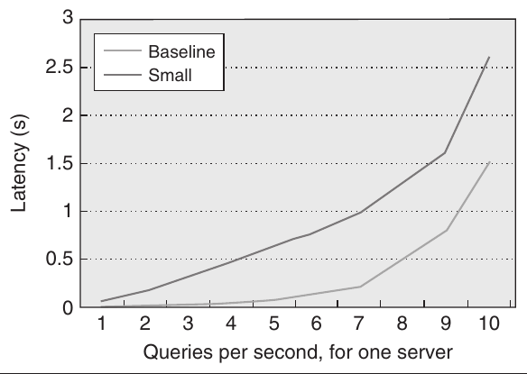

**Hình 6.24 Đường cong thời gian query–response.**

c. [20] <6.1, 6.2, 6.8> Bây giờ, hãy giả sử một môi trường batch processing. Các server “nhỏ” cung cấp 30% hiệu năng tổng thể của server thông thường. Vẫn giả sử những số liệu về độ tin cậy từ phần (b) của Bài tập 6.15, cần bao nhiêu node “wimpy” để cung cấp cùng expected throughput với một array 2400-node gồm các server tiêu chuẩn, với giả định hiệu năng tăng hoàn toàn tuyến tính theo số node và thời lượng trung bình của task là 10 phút trên mỗi node? Điều gì xảy ra nếu mức scaling là 85%? 60%?

d. [15] <6.1, 6.2, 6.8> Scaling thường không phải là một hàm tuyến tính mà là một hàm logarithm. Một phản ứng tự nhiên có thể là chuyển sang mua những node lớn hơn, có năng lực tính toán cao hơn trên mỗi node, nhằm giảm tối đa kích thước array. Hãy thảo luận một số trade-offs của architecture này.

**6.17** [10/10/15] <6.3, 6.8> Một xu hướng trong các server high-end là đưa nonvolatile Flash memory vào memory hierarchy, thông qua solid-state disk (SSD) hoặc card PCI Express-attached. Các SSD thông thường có bandwidth 250 MB/sec và latency 75 μs, trong khi card PCIe có bandwidth 600 MB/sec và latency 35 μs.

a. [10] Hãy lấy Hình 6.7 và bổ sung những điểm này vào hierarchy của server local. Giả sử các hệ số scaling về hiệu năng giống với DRAM khi được truy cập ở các mức hierarchy khác nhau, những thiết bị Flash memory này so sánh với nhau như thế nào khi được truy cập qua rack? Qua array?

b. [10] Hãy thảo luận một số cách tối ưu hóa software-based có thể tận dụng mức mới này của memory hierarchy.

c. [25] Hãy lặp lại phần (a), nhưng giả sử mỗi node có một card PCIe 32 GB có khả năng cache 50% tổng số disk access.

d. [15] Như đã thảo luận trong “Những quan niệm sai lầm và cạm bẫy” (Mục 6.8), thay thế tất cả disk bằng SSD không nhất thiết là một chiến lược cost-effective. Hãy xem xét một người vận hành WSC sử dụng WSC đó để cung cấp cloud service. Hãy thảo luận những tình huống trong đó việc sử dụng SSD hoặc Flash memory khác là hợp lý.

**6.18** [20/20/Thảo luận] <6.3> Memory Hierarchy: Caching được sử dụng rộng rãi trong một số thiết kế WSC để giảm latency và có nhiều lựa chọn caching nhằm đáp ứng các access pattern và yêu cầu khác nhau.

a. [20] Hãy xem xét các lựa chọn thiết kế để streaming nội dung đa phương tiện phong phú từ Web (ví dụ: Netflix). Trước tiên, chúng ta cần ước tính số lượng phim, số định dạng encode cho mỗi phim và số người dùng xem đồng thời. Năm 2010, Netflix có 12,000 phim để streaming trực tuyến, mỗi phim có ít nhất bốn định dạng encode (ở 500, 1000, 1600 và 2200 kbps). Giả sử toàn bộ website có 100,000 người xem đồng thời và một phim trung bình dài một giờ. Hãy ước tính tổng storage capacity, I/O bandwidth và network bandwidth, cùng các yêu cầu tính toán video-streaming-related.

b. [20] Access pattern và các đặc điểm reference locality trên mỗi người dùng, trên mỗi phim và trên toàn bộ các phim là gì? (Gợi ý: Random so với sequential, temporal locality và spatial locality tốt so với kém, kích thước working set tương đối nhỏ so với lớn.)

c. [Thảo luận] Có những lựa chọn lưu trữ phim nào khi sử dụng DRAM, SSD và hard drive? Hãy so sánh chúng về hiệu năng và TCO.

**6.19** [10/20/20/Thảo luận/Thảo luận] <6.3> Hãy xem xét một website mạng xã hội có 100 triệu người dùng hoạt động, đăng các cập nhật về bản thân (bằng văn bản và hình ảnh), đồng thời duyệt và tương tác với các cập nhật trong mạng xã hội của họ. Để cung cấp latency thấp, Facebook và nhiều website khác sử dụng memcached làm một caching layer phía trước các tier storage/database ở backend.

a. [10] Hãy ước tính tốc độ tạo dữ liệu và request rate trên mỗi người dùng và trên toàn bộ website.

b. [20] Đối với website mạng xã hội đang được thảo luận ở đây, cần bao nhiêu DRAM để chứa working set của website? Nếu sử dụng các server mà mỗi server có 96 GB DRAM, hãy ước tính cần bao nhiêu memory access local và từ xa để tạo trang chủ của một người dùng?

c. [20] Bây giờ, hãy xem xét hai thiết kế server memcached ứng viên, một thiết kế sử dụng processor Xeon thông thường và thiết kế kia sử dụng các core nhỏ hơn, chẳng hạn như processor Atom. Với đặc điểm memcached cần physical memory lớn nhưng có CPU utilization thấp, hai thiết kế này có những ưu điểm và nhược điểm gì?

d. [Thảo luận] Sự gắn kết chặt chẽ giữa memory module và processor hiện nay thường đòi hỏi phải tăng số CPU socket để hỗ trợ memory lớn. Hãy liệt kê các thiết kế khác có thể cung cấp physical memory lớn mà không tăng tương ứng số socket trong một server. Hãy so sánh chúng dựa trên hiệu năng, power, chi phí và độ tin cậy.

e. [Thảo luận] Thông tin của cùng một người dùng có thể được lưu trong cả server memcached và storage server, và những server này có thể được bố trí vật lý theo các cách khác nhau. Hãy thảo luận ưu điểm và nhược điểm của những cách bố trí server sau trong WSC: (1) memcached nằm trên cùng storage server, (2) memcached và storage server nằm trên các node riêng trong cùng rack, hoặc (3) các server memcached nằm trên cùng các rack và các storage server được bố trí cùng nhau trên những rack riêng.

**6.20** [5/5/10/10/Thảo luận/Thảo luận] <6.3, 6.6> Datacenter Networking: MapReduce và WSC là một sự kết hợp mạnh mẽ để giải quyết việc xử lý dữ liệu large-scale; ví dụ, năm 2008, Google đã sắp xếp một petabyte (1 PB) bản ghi trong hơn 6 giờ một chút, sử dụng 4000 server và 48,000 hard drive.

a. [5] Hãy suy ra disk bandwidth từ Hình 6.1 và phần văn bản liên quan. Cần bao nhiêu giây để đọc dữ liệu vào main memory và ghi các kết quả đã sắp xếp trở lại?

b. [5] Giả sử mỗi server có hai Ethernet network interface card (NIC) 1 Gb/sec và hạ tầng switch của WSC có oversubscription với hệ số 4. Cần bao nhiêu giây để shuffle toàn bộ dataset trên 4000 server?

c. [10] Giả sử network transfer là bottleneck về hiệu năng của phép sắp xếp petabyte, bạn có thể ước tính oversubscription ratio trong datacenter của Google là bao nhiêu không?

d. [10] Bây giờ, hãy xem xét lợi ích của Ethernet 10 Gb/sec không có oversubscription—ví dụ, sử dụng một Ethernet 10 Gb/sec 48-port (như được sử dụng bởi TritonSort, hệ thống chiến thắng sort benchmark Indy năm 2010). Cần bao lâu để shuffle 1 PB dữ liệu?

e. [Thảo luận] Hãy so sánh hai cách tiếp cận ở đây: (1) cách tiếp cận scale-out trên quy mô rất lớn với network oversubscription ratio cao, và (2) một hệ thống tương đối small-scale với network high-bandwidth. Những bottleneck tiềm ẩn của chúng là gì? Chúng có những ưu điểm và nhược điểm gì về scalability và TCO?

f. [Thảo luận] Sort và nhiều workload tính toán khoa học quan trọng cần trao đổi dữ liệu nhiều, trong khi nhiều workload khác thì không. Hãy liệt kê ba workload ví dụ không hưởng lợi từ network high-speed. Bạn đề xuất sử dụng những EC2 instance nào cho hai nhóm workload này?

**6.21** [10/25/Thảo luận] <6.4, 6.6> Do quy mô rất lớn của WSC, việc phân bổ network resource hợp lý dựa trên các workload dự kiến sẽ chạy là rất quan trọng. Những cách phân bổ khác nhau có thể ảnh hưởng đáng kể đến cả hiệu năng lẫn total cost of ownership.

a. [10] Sử dụng các số liệu trong spreadsheet được trình bày chi tiết ở Hình 6.13, oversubscription ratio tại mỗi switch access-layer là bao nhiêu? Nếu oversubscription ratio giảm một nửa thì TCO bị ảnh hưởng như thế nào? Điều gì xảy ra nếu tỷ lệ đó tăng gấp đôi?

b. [25] Giảm oversubscription ratio có khả năng cải thiện hiệu năng nếu một workload bị network-limited. Giả sử một job MapReduce sử dụng 120 server và đọc 5 TB dữ liệu. Giả sử tỷ lệ dữ liệu read/intermediate/output giống với Hình 6.2, Sep-09, và sử dụng Hình 6.6 để xác định bandwidth của memory hierarchy. Đối với việc đọc dữ liệu, giả sử 50% dữ liệu được đọc từ các remote disk; trong số đó, 80% được đọc trong rack và 20% được đọc trong array. Đối với intermediate data và output data, giả sử 30% dữ liệu sử dụng remote disk; trong số đó, 90% nằm trong rack và 10% nằm trong array. Hiệu năng tổng thể cải thiện bao nhiêu khi giảm oversubscription ratio một nửa? Hiệu năng là bao nhiêu nếu tỷ lệ đó tăng gấp đôi? Hãy tính TCO trong mỗi trường hợp.

c. [Thảo luận] Chúng ta đang chứng kiến xu hướng tăng số core trên mỗi hệ thống. Chúng ta cũng đang thấy optical communication ngày càng được áp dụng nhiều hơn (với tiềm năng bandwidth cao hơn và energy efficiency được cải thiện). Theo bạn, những xu hướng này cùng các xu hướng công nghệ mới nổi khác sẽ ảnh hưởng như thế nào đến thiết kế của WSC trong tương lai?

**6.22** [5/15/15/20/25] <6.5> Hiện thực hóa khả năng của Amazon Web Services: Hãy tưởng tượng bạn là người quản lý vận hành website và hạ tầng của một website hàng đầu trên Alexa.com và đang cân nhắc sử dụng Amazon Web Services (AWS). Bạn cần xem xét những yếu tố nào để quyết định có chuyển sang AWS hay không, sử dụng những service và instance type nào, và có thể tiết kiệm bao nhiêu chi phí? Bạn có thể sử dụng Alexa và thông tin về website traffic (ví dụ, Wikipedia cung cấp số liệu page view) để ước tính lượng traffic mà một website hàng đầu nhận được, hoặc lấy những ví dụ cụ thể từ Web, chẳng hạn ví dụ sau tại DrupalCon San Francisco 2010: http://2bits.com/sites/2bits.com/files/drupal-single-server-2.8-million-page-views-a-day.pdf. Những slide này mô tả một website xếp hạng #3400 trên Alexa, nhận được 2.8 triệu page view mỗi ngày và sử dụng một server duy nhất. Server có hai processor Xeon quad-core 2.5 GHz với 8 GB DRAM và ba hard drive SAS 15 K RPM trong cấu hình RAID1, với chi phí khoảng $400 mỗi tháng. Website sử dụng caching rất nhiều và CPU utilization dao động từ 50% đến 250% (tương đương khoảng 0.5 đến 2.5 core bận).

a. [5] Khi xem các EC2 instance hiện có (http://aws.amazon.com/ec2/instance-types/ ) , những instance type nào đáp ứng hoặc vượt cấu hình server hiện tại?

b. [15] Khi xem thông tin giá EC2 (http://aws.amazon.com/ec2/pricing/) , hãy chọn những EC2 instance cost-efficient nhất (được phép kết hợp) để đặt website trên AWS. Chi phí EC2 mỗi tháng là bao nhiêu?

c. [15] Bây giờ, hãy bổ sung chi phí IP address và network traffic vào phép tính, đồng thời giả sử website truyền 100 GB/day vào và ra trên Internet. Lúc này, chi phí mỗi tháng cho website là bao nhiêu?

d. [20] AWS cũng cung cấp Micro Instance miễn phí trong 1 năm cho khách hàng mới và 15 GB bandwidth cho mỗi chiều traffic vào và ra qua AWS. Dựa trên ước tính của bạn về peak traffic và average traffic từ Web server của khoa mình, bạn có thể đặt Web server đó trên AWS miễn phí hay không?

e. [25] Một website lớn hơn nhiều, Netflix.com, cũng đã chuyển hạ tầng streaming và encoding sang AWS. Dựa trên các đặc điểm dịch vụ của họ, Netflix có thể sử dụng những AWS service nào và cho những mục đích gì?

**6.23** [Thảo luận/Thảo luận/20/20/Thảo luận] <6.4> Hình 6.12 cho thấy ảnh hưởng của response time mà người dùng cảm nhận được đến doanh thu, và qua đó nhấn mạnh nhu cầu đạt high-throughput trong khi vẫn duy trì latency thấp.

a. [Thảo luận] Lấy tìm kiếm Web làm ví dụ, có những cách nào để giảm query latency?

b. [Thảo luận] Bạn có thể thu thập những số liệu monitoring nào để hiểu thời gian được tiêu tốn ở đâu? Bạn dự định triển khai một công cụ monitoring như vậy như thế nào?

c. [20] Giả sử số disk access trên mỗi query tuân theo phân phối chuẩn, với trung bình là 2 và độ lệch chuẩn là 3. Cần disk access latency như thế nào để đáp ứng latency SLA là 0.1 sec cho 95% query?

d. [20] Caching In-memory có thể giảm tần suất các sự kiện long-latency (ví dụ: truy cập hard drive). Giả sử steady-state hit rate là 40%, hit latency là 0.05 sec và miss latency là 0.2 sec, liệu caching có giúp đáp ứng latency SLA là 0.1 sec cho 95% query hay không?

e. [Thảo luận] Khi nào nội dung được cache có thể trở nên cũ, hoặc thậm chí không nhất quán? Điều này có thể xảy ra thường xuyên đến mức nào? Bạn có thể phát hiện và invalidate nội dung như vậy bằng cách nào?

**6.24** [15/15/20] <6.4> Hiệu suất của các power supply unit (PSU) thông thường thay đổi theo load; ví dụ, hiệu suất PSU có thể khoảng 80% ở mức load 40% (chẳng hạn, output 40 watts từ một PSU 100-watt), 75% khi load nằm trong khoảng 20% đến 40%, và 65% khi load dưới 20%.

a. [15] Giả sử một server power-proportional có power thực tế tỷ lệ với CPU utilization, với đường cong utilization như trong Hình 6.3. Hiệu suất PSU trung bình là bao nhiêu?

b. [15] Giả sử server sử dụng dự phòng 2N cho PSU (tức là tăng gấp đôi số PSU) để bảo đảm power ổn định khi một PSU bị hỏng. Hiệu suất PSU trung bình là bao nhiêu?

c. [20] Các nhà cung cấp blade server sử dụng một pool PSU chung không chỉ để cung cấp dự phòng mà còn để điều chỉnh linh hoạt số PSU theo mức tiêu thụ power thực tế của server. Enclosure HP c7000 sử dụng tối đa sáu PSU cho tổng cộng 16 server. Trong trường hợp này, hiệu suất PSU trung bình của enclosure chứa các server có cùng đường cong utilization là bao nhiêu?

**6.25** [5/Thảo luận/10/15/Thảo luận/Thảo luận/Thảo luận] <6.4> Power stranding là thuật ngữ chỉ power capacity đã được cung cấp nhưng chưa được sử dụng trong một datacenter. Hãy xem xét dữ liệu trong Hình 6.25 [Fan, Weber và Barroso 2007] cho những nhóm máy khác nhau. (Lưu ý rằng thứ được bài báo này gọi là “cluster” chính là thứ mà chúng ta gọi là “array” trong chương này.)

a. [5] Stranded power ở (1) mức rack, (2) mức power distribution unit và (3) mức array (cluster) là bao nhiêu? Có những xu hướng nào khi oversubscription power capacity ở những nhóm máy lớn hơn?

b. [Thảo luận] Theo bạn, điều gì gây ra sự khác biệt về power stranding giữa những nhóm máy khác nhau?

c. [10] Hãy xem xét một tập hợp máy array-level mà toàn bộ các máy không bao giờ sử dụng quá 72% aggregate power (đôi khi điều này còn được gọi là tỷ lệ giữa mức sử dụng peak-of-sum và sum-of-peaks). Sử dụng mô hình chi phí trong nghiên cứu tình huống, hãy tính chi phí tiết kiệm được khi so sánh một datacenter được cung cấp tài nguyên theo peak capacity với một datacenter được cung cấp tài nguyên theo mức sử dụng thực tế.

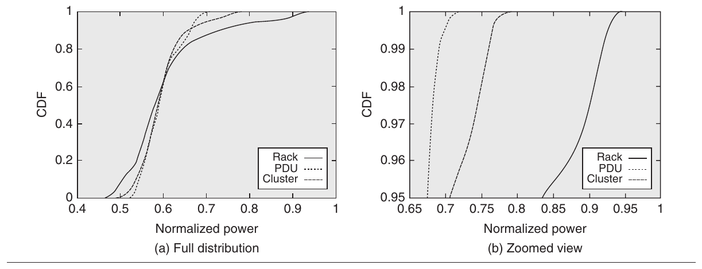

**Hình 6.25 Hàm phân phối tích lũy (CDF) của một datacenter thực tế.**

d. [15] Giả sử người thiết kế datacenter chọn bổ sung server ở mức array để tận dụng stranded power. Sử dụng cấu hình ví dụ và các giả định trong phần (a), hãy tính có thể bổ sung thêm bao nhiêu server vào warehouse-scale computer mà vẫn giữ nguyên tổng power provisioning.

e. [Thảo luận] Cần những gì để cách tối ưu hóa trong phần (d) hoạt động khi triển khai real-world? (Gợi ý: Hãy nghĩ xem cần làm gì để giới hạn power trong trường hợp hiếm gặp khi tất cả server trong array đều được sử dụng ở peak power.)

f. [Thảo luận] Có thể hình dung hai loại policy để quản lý power cap [Ranganathan và cộng sự 2006]: (1) preemptive policy, trong đó power budget được xác định trước (“đừng cho rằng bạn có thể sử dụng thêm power; hãy hỏi trước khi sử dụng!”), hoặc (2) reactive policy, trong đó power budget bị giới hạn khi xảy ra vi phạm power budget (“cứ sử dụng lượng power cần thiết cho đến khi được thông báo là không thể!”). Hãy thảo luận những trade-offs giữa hai cách tiếp cận này và khi nào bạn sẽ sử dụng từng loại.

g. [Thảo luận] Điều gì xảy ra với tổng stranded power nếu các hệ thống trở nên energy proportional hơn (giả sử workload tương tự như trong Hình 6.4)?

**6.26** [5/20/Thảo luận] <6.4, 6.7> Mục 6.7 đã thảo luận việc sử dụng nguồn pin per-server trong thiết kế của Google. Hãy xem xét những hệ quả của thiết kế này.

a. [5] Giả sử việc sử dụng pin làm UPS mini-server-level có hiệu suất 99.99% và loại bỏ nhu cầu sử dụng UPS facility-wide có hiệu suất chỉ 92%. Giả sử substation switching có hiệu suất 99.7% và hiệu suất của PDU, các stage step-down cùng các electrical breaker khác lần lượt là 98%, 98% và 99%. Hãy tính mức cải thiện hiệu suất tổng thể của power infrastructure nhờ sử dụng battery backup per-server.

b. [20] Giả sử UPS chiếm 10% chi phí IT equipment. Sử dụng các giả định còn lại từ mô hình chi phí trong nghiên cứu tình huống, điểm break-even của chi phí pin (tính theo tỷ lệ chi phí của một server) là bao nhiêu để total cost of ownership của giải pháp battery-based tốt hơn giải pháp UPS facility-wide?

c. [Thảo luận] Hai cách tiếp cận này còn có những trade-offs nào khác? Cụ thể, theo bạn, manageability và failure model sẽ thay đổi như thế nào giữa hai thiết kế khác nhau này?

**6.27** [5/5/Thảo luận] <6.4> Trong bài tập này, hãy xem xét phương trình đơn giản hóa sau cho tổng operational power của một WSC: Total operational power = (1 + Cooling inefficiency multiplier) * IT equipment power.

a. [5] Giả sử một datacenter 8 MW sử dụng power ở mức 80%, chi phí điện là $0.10 trên mỗi kilowatt-hour và cooling-inefficiency multiplier là 0.8. Hãy so sánh chi phí tiết kiệm được từ (1) một cách tối ưu hóa cải thiện hiệu suất làm mát 20%, và (2) một cách tối ưu hóa cải thiện energy efficiency của IT equipment 20%.

b. [5] Cần cải thiện energy efficiency của IT equipment bao nhiêu phần trăm để đạt mức tiết kiệm chi phí tương đương với việc cải thiện hiệu suất làm mát 20%?

c. [Thảo luận/10] Bạn có thể rút ra những kết luận nào về tầm quan trọng tương đối của các cách tối ưu hóa tập trung vào energy efficiency của server và energy efficiency của hệ thống làm mát?

**6.28** [5/5/Thảo luận] <6.4> Như đã thảo luận trong chương này, bản thân thiết bị làm mát trong WSC cũng có thể tiêu thụ rất nhiều năng lượng. Chi phí làm mát có thể được giảm bằng cách chủ động quản lý nhiệt độ. Việc bố trí workload Temperature-aware là một cách tối ưu hóa đã được đề xuất để quản lý nhiệt độ nhằm giảm chi phí làm mát. Ý tưởng là xác định cooling profile của một căn phòng cho trước và bố trí những hệ thống nóng hơn ở những vị trí mát hơn, nhờ đó giảm yêu cầu làm mát tổng thể ở mức WSC.

a. [5] Coefficient of performance (COP) của một CRAC unit được định nghĩa là tỷ số giữa lượng nhiệt được loại bỏ (Q) và lượng công cần thiết (W) để loại bỏ lượng nhiệt đó. COP của CRAC unit tăng theo nhiệt độ của không khí mà CRAC unit đẩy vào plenum. Nếu không khí quay trở lại CRAC unit ở 20 độ Celsius và chúng ta loại bỏ 10KW nhiệt với COP là 1.9, chúng ta tiêu tốn bao nhiêu năng lượng trong CRAC unit? Nếu làm mát cùng thể tích không khí, nhưng lần này không khí quay trở lại ở 25 độ Celsius, có COP là 3.1, thì lúc này chúng ta tiêu tốn bao nhiêu năng lượng trong CRAC unit?

b. [5] Giả sử một thuật toán phân phối workload có khả năng ghép các workload nóng với các vị trí mát một cách phù hợp, cho phép computer room air-conditioning (CRAC) unit hoạt động ở nhiệt độ cao hơn để cải thiện hiệu suất làm mát như trong bài tập trên. Power tiết kiệm được giữa hai trường hợp mô tả ở trên là bao nhiêu?

c. [Thảo luận] Với quy mô của các hệ thống WSC, power management có thể là một bài toán phức tạp, có nhiều khía cạnh. Những cách tối ưu hóa nhằm cải thiện energy efficiency có thể được triển khai trong hardware và software, ở mức hệ thống và mức cluster, cho IT equipment hoặc thiết bị làm mát, v.v. Cần xem xét những tương tác này khi thiết kế một giải pháp energy-efficiency tổng thể cho WSC. Hãy xem xét một thuật toán consolidation theo dõi server utilization và tập trung các nhóm workload khác nhau lên cùng một server để tăng server utilization (điều này có thể giúp server hoạt động với energy efficiency cao hơn nếu hệ thống không energy proportional). Cách tối ưu hóa này sẽ tương tác như thế nào với một thuật toán chạy đồng thời tìm cách sử dụng các power state khác nhau (xem ACPI, Advanced Configuration Power Interface, để biết một số ví dụ)? Bạn có thể nghĩ ra những ví dụ nào khác trong đó nhiều cách tối ưu hóa có thể xung đột với nhau trong một WSC? Bạn sẽ giải quyết vấn đề này như thế nào?

**6.29** [5/10/15/20] <6.2> Energy proportionality (đôi khi còn được gọi là energy scale-down) là đặc tính của hệ thống không tiêu thụ power khi idle, nhưng quan trọng hơn là mức tiêu thụ power tăng dần theo tỷ lệ với mức hoạt động và lượng công việc hoàn thành. Trong bài tập này, chúng ta sẽ xem xét độ nhạy của mức tiêu thụ năng lượng đối với các mô hình energy proportionality khác nhau. Trong các bài tập dưới đây, trừ khi có chỉ dẫn khác, hãy sử dụng dữ liệu trong Hình 6.4 làm mặc định.

a. [5] Một cách đơn giản để suy luận về energy proportionality là giả sử có quan hệ tuyến tính giữa mức hoạt động và mức sử dụng power. Chỉ sử dụng dữ liệu peak power và idle power từ Hình 6.4 cùng phép nội suy tuyến tính, hãy vẽ các xu hướng energy-efficiency theo các mức hoạt động khác nhau. (Energy efficiency được biểu diễn bằng hiệu năng trên mỗi watt.) Điều gì xảy ra nếu idle power (ở mức hoạt động 0%) bằng một nửa giá trị được giả định trong Hình 6.4? Điều gì xảy ra nếu idle power bằng không?

b. [10] Hãy vẽ các xu hướng energy-efficiency theo những mức hoạt động khác nhau, nhưng sử dụng dữ liệu từ cột 3 của Hình 6.4 cho sự thay đổi power. Hãy vẽ energy efficiency với giả định chỉ riêng idle power bằng một nửa giá trị được giả định trong Hình 6.4. Hãy so sánh những đồ thị này với mô hình tuyến tính trong bài tập trước. Bạn có thể rút ra những kết luận nào về hệ quả của việc chỉ tập trung vào riêng idle power?

c. [15] Giả sử cơ cấu system utilization như trong cột 7 của Hình 6.4. Để đơn giản, giả sử một phân phối rời rạc trên 1000 server, trong đó 109 server có utilization 0%, 80 server có utilization 10%, v.v. Hãy tính tổng hiệu năng và tổng năng lượng cho cơ cấu workload này bằng các giả định trong phần (a) và phần (b).

d. [20] Có thể thiết kế một hệ thống có quan hệ dưới tuyến tính giữa power và load trong vùng load từ 0% đến 50%. Hệ thống này sẽ có đường cong energy-efficiency đạt đỉnh ở những mức utilization thấp hơn (đổi lại, hiệu quả ở những mức utilization cao hơn sẽ giảm). Hãy tạo một phiên bản mới của cột 3 trong Hình 6.4 thể hiện một đường cong energy-efficiency như vậy. Giả sử cơ cấu system utilization như trong cột 7 của Hình 6.4. Để đơn giản, giả sử một phân phối rời rạc trên 1000 server, trong đó 109 server có utilization 0%, 80 server có utilization 10%, v.v. Hãy tính tổng hiệu năng và tổng năng lượng cho cơ cấu workload này.

| Mức hoạt động (%) | 0 | 10 | 20 | 30 | 40 | 50 | 60 | 70 | 80 | 90 | 100 |
|---|---|---|---|---|---|---|---|---|---|---|---|
| Power, trường hợp A (W) | 181 | 308 | 351 | 382 | 416 | 451 | 490 | 533 | 576 | 617 | 662 |
| Power, trường hợp B (W) | 250 | 275 | 325 | 340 | 395 | 405 | 415 | 425 | 440 | 445 | 450 |

**Hình 6.26 Phân phối power cho hai server.**

| Mức hoạt động (%) | 0 | 10 | 20 | 30 | 40 | 50 | 60 | 70 | 80 | 90 | 100 |
|---|---|---|---|---|---|---|---|---|---|---|---|
| Số server, trường hợp A và B | 109 | 80 | 153 | 246 | 191 | 115 | 51 | 21 | 15 | 12 | 8 |
| Số server, trường hợp C | 504 | 6 | 8 | 11 | 26 | 57 | 95 | 123 | 76 | 40 | 54 |

**Hình 6.27 Các phân phối utilization trên cluster khi chưa consolidation và khi đã consolidation.**

**6.30** [15/20/20] <6.2, 6.6> Bài tập này minh họa sự tương tác của các mô hình energy proportionality với những cách tối ưu hóa như server consolidation và thiết kế server energy-efficient. Hãy xem xét các tình huống trong Hình 6.26 và Hình 6.27.

a. [15] Hãy xem xét hai server có phân phối power như trong Hình 6.26: trường hợp A (server được xem xét trong Hình 6.4) và trường hợp B (một server ít energy-proportional hơn nhưng energy-efficient hơn trường hợp A). Giả sử cơ cấu system utilization như trong cột 7 của Hình 6.4. Để đơn giản, giả sử một phân phối rời rạc trên 1000 server, trong đó 109 server có utilization 0%, 80 server có utilization 10%, v.v., như trong hàng 1 của Hình 6.27. Giả sử hiệu năng thay đổi dựa trên cột 2 của Hình 6.4. Hãy so sánh tổng hiệu năng và tổng năng lượng cho cơ cấu workload này giữa hai loại server.

b. [20] Hãy xem xét một cluster 1000 server có dữ liệu tương tự như dữ liệu trong Hình 6.4 (và được tóm tắt trong các hàng đầu tiên của Hình 6.26 và 6.27). Với những giả định này, tổng hiệu năng và tổng năng lượng cho cơ cấu workload là bao nhiêu? Bây giờ, giả sử chúng ta có thể consolidation các workload để có phân phối như trong trường hợp C (hàng thứ hai của Hình 6.27). Lúc này, tổng hiệu năng và tổng năng lượng là bao nhiêu? Tổng năng lượng so với một hệ thống có mô hình energy-proportional tuyến tính, idle power là zero watts và peak power là 662 watts thì như thế nào?

c. [20] Hãy lặp lại phần (b), nhưng với power model của server B, và so sánh với các kết quả của phần (a).

**6.31** [10/Thảo luận] <6.2, 6.4, 6.6> Xu hướng Energy Proportionality ở mức System-Level: Hãy xem xét các cơ cấu tiêu thụ power sau của một server:

CPU, 50%; memory, 23%; disks, 11%; networking/other, 16%

CPU, 33%; memory, 30%; disks, 10%; networking/other, 27%

a. [10] Giả sử dynamic power range của CPU là 3.0× (tức là mức tiêu thụ power của CPU khi idle bằng one-third mức tiêu thụ power ở đỉnh). Giả sử dynamic range của memory system, disk và nhóm networking/other ở trên lần lượt là 2.0×, 1.3× và 1.2×. Dynamic range tổng thể của toàn bộ hệ thống trong hai trường hợp là bao nhiêu?

| Tier 1 | Một đường phân phối power và làm mát duy nhất, không có thành phần dự phòng | 99.0% |
|---|---|---|
| Tier 2 | Dự phòng (N + 1) = hai đường phân phối power và làm mát | 99.7% |
| Tier 3 | Dự phòng (N + 2) = ba đường phân phối power và làm mát để duy trì uptime ngay cả khi bảo trì | 99.98% |
| Tier 4 | Hai đường phân phối power và làm mát hoạt động, mỗi đường đều có các thành phần dự phòng, để chịu được failure của bất kỳ một thiết bị nào mà không ảnh hưởng đến load | 99.995% |

**Hình 6.28 Tổng quan về các phân loại tier của data center. (Phỏng theo Pitt Turner IV và cộng sự [2008].)**

b. [Thảo luận/10] Bạn có thể học được gì từ kết quả của phần (a)? Chúng ta sẽ đạt energy proportionality tốt hơn ở mức hệ thống bằng cách nào? (Gợi ý: Không thể đạt energy proportionality ở mức hệ thống chỉ thông qua tối ưu hóa CPU mà cần cải thiện trên tất cả thành phần.)

**6.32** [30] <6.4> Pitt Turner IV và cộng sự [2008] đã trình bày một tổng quan tốt về phân loại tier của datacenter. Các phân loại tier xác định hiệu năng của hạ tầng cơ sở. Để đơn giản, hãy xem xét những khác biệt chính như trong Hình 6.25 (phỏng theo Pitt Turner IV và cộng sự [2008]). Sử dụng mô hình TCO trong nghiên cứu tình huống, hãy so sánh ảnh hưởng về chi phí của những tier được trình bày.

**6.33** [Thảo luận] <6.4> Dựa trên các quan sát trong Hình 6.13, bạn có thể đưa ra nhận xét định tính nào về những trade-offs giữa doanh thu bị mất do downtime và chi phí phải bỏ ra để duy trì uptime?

**6.34** [15/Thảo luận] <6.4> Một số nghiên cứu gần đây đã định nghĩa một metric có tên TPUE, viết tắt của “true PUE” hoặc “total PUE.” TPUE được định nghĩa là PUE * SPUE. PUE, tức power utilization effectiveness, được định nghĩa trong Mục 6.4 là tỷ số giữa tổng power của cơ sở và tổng power của IT equipment. SPUE, hay server PUE, là một metric mới tương tự PUE nhưng được áp dụng cho computing equipment, và được định nghĩa là tỷ số giữa tổng input power của server và useful power của server. Trong đó, useful power được định nghĩa là power mà các electronic component trực tiếp tham gia tính toán tiêu thụ: motherboard, disk, CPU, DRAM, I/O card, v.v. Nói cách khác, metric SPUE phản ánh những tổn hao liên quan đến power supply, voltage regulator và fan nằm trong server.

a. [15] <6.4> Hãy xem xét một thiết kế sử dụng nhiệt độ khí cấp cao hơn cho các CRAC unit. Hiệu suất của CRAC unit gần đúng là một hàm bậc hai của nhiệt độ, vì vậy thiết kế này cải thiện PUE tổng thể, giả sử là 7%. (Giả sử PUE cơ sở là 1.7.) Tuy nhiên, nhiệt độ cao hơn ở mức server khiến fan controller on-board vận hành fan ở tốc độ cao hơn nhiều. Fan power là một hàm bậc ba của tốc độ và tốc độ fan tăng dẫn đến SPUE kém đi. Giả sử fan power model như sau:

Fan power = 284 * ns * ns * ns – 75 * ns * ns,

trong đó ns là tốc độ fan được chuẩn hóa = tốc độ fan theo rpm/18,000

và power cơ sở của server là 350 W. Hãy tính SPUE nếu tốc độ fan tăng từ (1) 10,000 rpm lên 12,500 rpm và (2) 10,000 rpm lên 18,000 rpm. Hãy so sánh PUE và TPUE trong cả hai trường hợp này. (Để đơn giản, bỏ qua các tổn hao trong power delivery ở mô hình SPUE.)

b. [Thảo luận] Phần (a) minh họa rằng, mặc dù PUE là một metric rất tốt để phản ánh overhead của cơ sở, nó không phản ánh những tổn hao bên trong chính IT equipment. Bạn có thể xác định một thiết kế khác mà trong đó TPUE có khả năng thấp hơn PUE không? (Gợi ý: Xem Bài tập 6.26.)

**6.35** [Thảo luận/30/Thảo luận] <6.2> Hai benchmark mới được công bố gần đây cung cấp một điểm khởi đầu tốt cho việc đánh giá energy-efficiency trong server—benchmark SPECpower_ssj2008 (có tại http://www.spec.org/power_ssj2008/ ) và metric JouleSort (có tại http://sortbenchmark.org/) .

a. [Thảo luận] <6.2> Hãy tra cứu mô tả của hai benchmark. Chúng giống nhau như thế nào? Chúng khác nhau như thế nào? Bạn sẽ làm gì để cải thiện những benchmark này nhằm đáp ứng tốt hơn mục tiêu cải thiện energy efficiency của WSC?

b. [30] <6.2> JouleSort đo tổng năng lượng của hệ thống để thực hiện một phép sắp xếp out-of-core và cố gắng đưa ra một metric cho phép so sánh những hệ thống từ thiết bị embedded đến supercomputer. Hãy tra cứu mô tả của metric JouleSort tại http://sortbenchmark.org. Hãy tải một phiên bản được cung cấp công khai của thuật toán sort và chạy nó trên những nhóm máy khác nhau—laptop, PC, điện thoại di động, v.v.—hoặc với những cấu hình khác nhau. Bạn có thể học được gì từ các mức đánh giá JouleSort cho những thiết lập khác nhau?

c. [Thảo luận] <6.2> Hãy xem xét hệ thống có mức đánh giá JouleSort tốt nhất trong những thử nghiệm ở trên của bạn. Bạn sẽ cải thiện energy efficiency như thế nào? Ví dụ, hãy thử viết lại sort code để cải thiện mức đánh giá JouleSort.

**6.36** [10/10/15] <6.1, 6.2> Hình 6.1 liệt kê những outage trong một array gồm các server. Khi làm việc với quy mô lớn của WSC, cần cân bằng thiết kế cluster và software architecture để đạt uptime yêu cầu mà không phát sinh chi phí đáng kể. Câu hỏi này tìm hiểu những tác động của việc đạt availability chỉ thông qua hardware.

a. [10] <6.1, 6.2> Giả sử một người vận hành muốn đạt availability 95% chỉ thông qua cải thiện server hardware, cần giảm bao nhiêu sự kiện thuộc mỗi loại? Trước mắt, giả sử các sự cố crash của từng server đã được xử lý hoàn toàn bằng các máy dự phòng.

b. [10] <6.1, 6.2> Câu trả lời cho phần (a) thay đổi như thế nào nếu các sự cố crash của từng server được xử lý bằng dự phòng trong 50% số lần? 20% số lần? Không lần nào?

c. [15] <6.1, 6.2> Hãy thảo luận tầm quan trọng của software redundancy đối với việc đạt mức availability cao. Nếu người vận hành WSC cân nhắc mua những máy rẻ hơn nhưng kém tin cậy hơn 10%, điều đó sẽ có tác động gì đến software architecture? Những thách thức liên quan đến software redundancy là gì?

**6.37** [15] <6.1, 6.8> Hãy tra cứu giá hiện tại của DDR3 DRAM tiêu chuẩn và DDR3 DRAM có error-correcting code (ECC). Giá trên mỗi bit tăng bao nhiêu để đạt độ tin cậy cao hơn mà ECC cung cấp? Chỉ sử dụng giá DRAM và dữ liệu được cung cấp trong Mục 6.8, uptime trên mỗi dollar của WSC sử dụng DRAM non-ECC so với ECC là bao nhiêu?

**6.38** [5/Thảo luận] <6.1> Các vấn đề về Reliability và Manageability của WSC:

a. [5] Hãy xem xét một cluster gồm các server có chi phí $2000 mỗi server. Giả sử annual failure rate là 5%, thời gian dịch vụ trung bình cho mỗi lần sửa chữa là một giờ và chi phí linh kiện thay thế cho mỗi failure bằng 10% chi phí hệ thống, chi phí bảo trì hằng năm trên mỗi server là bao nhiêu? Giả sử tiền công của kỹ thuật viên dịch vụ là $100 mỗi giờ.

b. [Thảo luận] Hãy nhận xét những khác biệt giữa manageability model này và mô hình trong một enterprise datacenter truyền thống, nơi có rất nhiều ứng dụng nhỏ hoặc medium-sized, mỗi ứng dụng chạy trên hạ tầng hardware chuyên dụng riêng.

---

[^1]: Chương này dựa trên tài liệu từ cuốn The Datacenter as a Computer: An Introduction to the Design of Warehouse-Scale Machines, của Luiz André Barroso và Urs Hölzle thuộc Google [2009]; blog Perspectives tại mvdirona.com và những bài nói chuyện “Cloud-Computing Economies of Scale” và “Data Center Networks Are in My Way,” của James Hamilton thuộc Amazon Web Services [2009, 2010]; cùng technical report Above the Clouds: A Berkeley View of Cloud Computing, của Michael Armbrust và cộng sự [2009].
