### PHỤ LỤC A

# Cơ sở thiết kế logic

Tôi luôn thích từ đó, Boolean.

Claude Shannon, IEEE Spectrum, tháng 4 năm 1992 (Luận văn thạc sĩ của Shannon cho thấy đại số do George Boole phát minh trong những năm 1800 có thể biểu diễn hoạt động của công tắc điện.)

A.1 Giới thiệu A-3 A.2 Gate, truth table và phương trình logic A-4 A.3 Combinational logic A-9 A.4 Sử dụng hardware description language A-20 A.5 Xây dựng arithmetic logic unit cơ bản A-26 A.6 Phép cộng nhanh hơn: Carry Lookahead A-37 A.7 Clock A-47 A.8 Phần tử memory: Flip-Flops, latch và register A-49 A.9 Phần tử memory: SRAM và DRAM A-57 A.10 Finite-State Machine A-66 A.11 Phương pháp timing A-71 A.12 Thiết bị lập trình tại hiện trường A-77 A.13 Nhận xét kết thúc A-78 A.14 Bài tập A-79

## A.1 Giới thiệu

Phụ lục này thảo luận ngắn gọn các cơ sở thiết kế logic. Nó không thay thế một khóa học thiết kế logic, cũng không giúp bạn thiết kế các hệ thống logic hoạt động đáng kể. Tuy nhiên, nếu ít hoặc chưa tiếp xúc với thiết kế logic, phụ lục cung cấp đủ nền tảng để hiểu mọi nội dung trong sách. Ngoài ra, nếu muốn hiểu một phần lý do đằng sau cách triển khai máy tính, nội dung này là phần giới thiệu hữu ích. Nếu phụ lục khơi gợi nhưng chưa thỏa mãn trí tò mò, tài liệu tham khảo cuối phần cung cấp thêm một số nguồn thông tin.

Mục A.2 giới thiệu các khối xây dựng logic cơ bản, cụ thể là gate. Mục A.3 dùng chúng để xây dựng hệ thống combinational logic đơn giản, không chứa memory. Nếu đã tiếp xúc với logic hoặc hệ thống số, bạn có lẽ quen nội dung hai mục đầu. Mục A.5 chỉ ra cách dùng khái niệm ở Mục A.2 và A.3 để thiết kế ALU cho processor RISC-V. Mục A.6 trình bày cách làm adder nhanh, có thể bỏ qua nếu không quan tâm chủ đề. Mục A.7 giới thiệu ngắn về clocking, cần thiết để thảo luận hoạt động phần tử memory. Mục A.8 giới thiệu phần tử memory, còn Mục A.9 mở rộng tập trung vào random access memory; nó mô tả cả những đặc điểm quan trọng để hiểu cách dùng chúng, như Chương 4 thảo luận, và nền tảng lý giải nhiều khía cạnh thiết kế memory hierarchy trong Chương 5. Mục A.10 mô tả thiết kế và sử dụng finite-state machine, là các khối sequential logic. Nếu định đọc  Phụ lục C, bạn cần hiểu kỹ Mục A.2 đến A.10. Nếu chỉ định đọc nội dung control trong Chương 4, có thể đọc lướt các phụ lục; tuy nhiên, cần quen thuộc phần nào với mọi nội dung trừ Mục A.11. Mục A.11 dành cho người muốn hiểu sâu hơn các phương pháp clocking và timing. Nó giải thích cơ sở hoạt động clocking edge-triggered, giới thiệu một cơ chế clocking khác và mô tả ngắn vấn đề đồng bộ input bất đồng bộ.

Xuyên suốt phụ lục, khi phù hợp, chúng tôi cũng đưa các đoạn minh họa cách biểu diễn logic bằng Verilog, được giới thiệu trong Mục A.4. Hướng dẫn Verilog sâu và đầy đủ hơn có trên Companion Web site của sách.

## A.2 Gate, truth table và phương trình logic

Mạch điện tử bên trong máy tính hiện đại là mạch số. Điện tử số chỉ làm việc với hai mức điện áp đáng quan tâm: điện áp cao và điện áp thấp. Mọi giá trị điện áp khác đều tạm thời và xảy ra khi chuyển giữa các giá trị. (Như thảo luận sau trong mục này, một cạm bẫy có thể gặp trong thiết kế số là lấy mẫu tín hiệu khi nó chưa rõ là cao hay thấp.) Máy tính là hệ thống số cũng là lý do chính khiến chúng dùng số nhị phân, vì hệ nhị phân phù hợp với abstraction nền tảng vốn có của mạch điện tử. Trong các họ logic khác nhau, giá trị và quan hệ giữa hai mức điện áp khác nhau. Vì vậy, thay vì nói mức điện áp, chúng ta nói tín hiệu đúng (về logic), hay 1, hay được assert; hoặc tín hiệu sai (về logic), hay 0, hay được deassert. Các giá trị 0 và 1 gọi là phần bù hoặc giá trị đảo của nhau.

### asserted signal

Tín hiệu đúng (về logic), hay 1.

#### deasserted signal

Tín hiệu sai (về logic), hay 0.

Các khối logic được chia thành hai loại tùy có chứa memory hay không. Khối không có memory gọi là combinational; output của khối combinational chỉ phụ thuộc input hiện tại. Với khối có memory, output có thể phụ thuộc cả input và giá trị lưu trong memory, được gọi là state của khối logic. Trong mục này và mục tiếp theo, chúng ta chỉ tập trung vào combinational logic. Sau khi giới thiệu các phần tử memory trong Mục A.8, chúng ta mô tả cách thiết kế sequential logic, là logic bao gồm state.

#### combinational logic

Hệ thống logic có các khối không chứa memory, do đó tính cùng output khi có cùng input.

#### sequential logic

Nhóm phần tử logic chứa memory, nên giá trị phụ thuộc input cũng như nội dung hiện tại của memory.

### Truth table

Vì khối combinational logic không chứa memory, nó có thể được chỉ định đầy đủ bằng cách xác định giá trị output cho mỗi tập giá trị input có thể. Mô tả như vậy thường được đưa dưới dạng truth table. Với khối logic có n input, truth table có 2<sup>n</sup> entry, vì có chừng ấy tổ hợp giá trị input. Mỗi entry chỉ định giá trị mọi output cho tổ hợp input cụ thể đó.

#### Truth table

**Ví dụ**

Xét hàm logic có ba input A, B và C, cùng ba output D, E và F. Hàm được định nghĩa như sau: D đúng nếu ít nhất một input đúng, E đúng nếu đúng hai input đúng, và F chỉ đúng nếu cả ba input đều đúng. Hãy trình bày truth table của hàm này.

**Trả lời**

Truth table chứa 2<sup>3</sup> = 8 entry. Bảng như sau:


Truth table có thể mô tả đầy đủ mọi hàm combinational logic; tuy nhiên chúng tăng kích thước nhanh và có thể khó hiểu. Đôi khi muốn xây dựng hàm logic bằng 0 với nhiều tổ hợp input, chúng ta dùng cách viết tắt chỉ chỉ định những entry truth table cho output khác 0. Cách này được dùng trong Chương 4 và  Phụ lục C.

### Đại số Boolean

Cách khác là biểu diễn hàm logic bằng phương trình logic. Điều này thực hiện bằng đại số Boolean (đặt theo tên Boole, nhà toán học 19th-century). Trong đại số Boolean, mọi biến có giá trị 0 hoặc 1 và trong cách xây dựng điển hình có ba toán tử:

- Toán tử OR viết là +, như A+B. Kết quả OR bằng 1 nếu một trong hai biến bằng 1. Phép OR cũng gọi là tổng logic, vì kết quả bằng 1 nếu một trong hai operand bằng 1.

- Toán tử AND viết là · , như A · B. Kết quả AND chỉ bằng 1 nếu cả hai input bằng 1. AND cũng gọi là tích logic, vì kết quả chỉ bằng 1 nếu cả hai operand bằng 1.

- Toán tử một ngôi NOT viết là 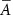 . Kết quả NOT chỉ bằng 1 nếu input bằng 0. Áp dụng NOT cho một giá trị logic tạo giá trị đảo hoặc phủ định của nó (tức input 0 thì output 1 và ngược lại). Có một số định luật đại số Boolean hữu ích để biến đổi phương trình logic.

- Luật đồng nhất: A+0=A và A·1=A

- Luật Zero và One: A+1=1 và A·0=0

- Luật phần bù: 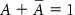 và 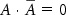

- Luật giao hoán: A+B=B+A và A·B=B·A

- Luật kết hợp: A+(B+C)=(A+B)+C và A·(B·C)=(A·B)·C

- Luật phân phối: A·(B+C)=(A·B)+(A·C) và A+(B·C)=(A+B)·(A+C) Ngoài ra, có hai định lý hữu ích khác gọi là luật DeMorgan, được thảo luận sâu hơn trong bài tập. Mọi tập hàm logic có thể viết thành chuỗi phương trình với output ở left-hand side của mỗi phương trình và một công thức gồm các biến cùng ba toán tử trên ở right-hand side.

#### Phương trình logic

**Ví dụ**

Viết phương trình logic cho các hàm logic D, E và F được mô tả trong ví dụ trước.

**Trả lời**

Đây là phương trình cho D:

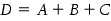

F cũng đơn giản như vậy:

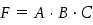

E hơi khó hơn. Hãy nghĩ theo hai phần: điều gì phải đúng để E đúng (hai trong ba input phải đúng), và điều gì không được đúng (không được cả ba cùng đúng). Vì vậy có thể viết E là


Cũng có thể suy ra E khi nhận ra E chỉ đúng nếu đúng hai input đúng. Khi đó có thể viết E là OR của ba hạng có thể có với hai input đúng và một input sai:

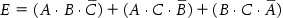

Bài tập khảo sát việc chứng minh hai biểu thức này tương đương.

Trong Verilog, chúng ta mô tả combinational logic bằng câu lệnh assign bất cứ khi nào có thể, được giới thiệu từ trang A-23. Có thể viết định nghĩa E bằng toán tử exclusive-OR Verilog là assign E = (A & (B ^ C)) | (B & C & ~A), thêm một cách mô tả hàm này. D và F có biểu diễn còn đơn giản hơn, giống code C tương ứng: assign D = A | B | C và assign F = A & B & C.

### Gate

Khối logic được xây từ gate triển khai các hàm logic cơ bản. Ví dụ, gate AND triển khai hàm AND, gate OR triển khai hàm OR. Vì cả AND và OR đều giao hoán, kết hợp, gate AND hoặc OR có thể có nhiều input, với output bằng AND hoặc OR của mọi input. Hàm logic NOT được triển khai bằng inverter luôn chỉ có một input. Biểu diễn chuẩn của ba khối xây dựng logic này được trình bày trong Hình A.2.1.

#### gate

Thiết bị triển khai hàm logic cơ bản, như AND hoặc OR.

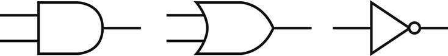

**HÌNH A.2.1 Cách vẽ chuẩn của gate AND, gate OR và inverter, từ trái sang phải. Tín hiệu bên trái mỗi ký hiệu là input, output nằm bên phải. Gate AND và OR đều có hai input. Inverter có một input.**

Thay vì vẽ inverter tường minh, thông lệ là thêm “vòng tròn” vào input hoặc output của gate để đảo giá trị logic trên đường input hoặc output đó. Ví dụ, Hình A.2.2 trình bày sơ đồ logic cho hàm 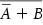, dùng inverter tường minh bên trái và input, output có vòng tròn bên phải.

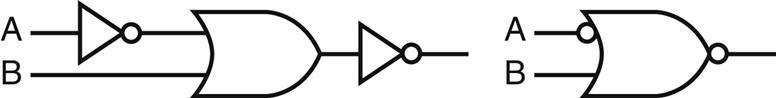

**HÌNH A.2.2 Triển khai bằng logic gate của 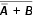 dùng inverter tường minh bên trái và input, output có vòng tròn bên phải. Hàm logic này có thể đơn giản hóa thành**

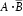

Hoặc trong Verilog, A & ~ B.

Mọi hàm logic đều có thể xây dựng bằng gate AND, gate OR và phép đảo; một số bài tập cho bạn cơ hội thử triển khai các hàm logic thông dụng bằng gate. Mục tiếp theo chỉ ra cách xây dựng cách triển khai mọi hàm logic bằng kiến thức này.

Thực tế, mọi hàm logic đều có thể xây dựng chỉ bằng một loại gate nếu gate đó đảo. Hai gate đảo phổ biến gọi là NOR và NAND, lần lượt tương ứng với gate OR và AND đảo. Gate NOR và NAND gọi là universal vì mọi hàm logic đều có thể xây bằng một loại gate này. Bài tập khảo sát thêm khái niệm đó.

#### NOR gate

Gate OR đảo.

#### NAND gate

Gate AND đảo.

#### Tự kiểm tra

Hai biểu thức logic sau có tương đương không? Nếu không, hãy tìm giá trị các biến cho thấy chúng không tương đương:


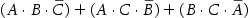


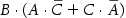

## A.3 Combinational logic

Trong mục này, chúng ta xem vài khối xây dựng logic lớn hơn được dùng nhiều, và thảo luận thiết kế logic có cấu trúc có thể tự động triển khai từ phương trình logic hoặc truth table bằng chương trình chuyển đổi. Cuối cùng, chúng ta thảo luận khái niệm mảng khối logic.

### Decoder

Một khối logic dùng để xây thành phần lớn hơn là decoder. Loại decoder phổ biến nhất có input n-bit và 2<sup>n</sup> output, trong đó chỉ một output được assert cho mỗi tổ hợp input. Decoder này chuyển input n-bit thành tín hiệu tương ứng với giá trị nhị phân của input n-bit. Vì vậy các output thường được đánh số, chẳng hạn Out0, Out1, …, Out2<sup>n</sup> −1. Nếu input có giá trị i thì Outi đúng và mọi output khác sai. Hình A.3.1 trình bày decoder 3-bit và truth table. Decoder này gọi là decoder 3-to-8 vì có ba input và tám (2<sup>3</sup>) output. Cũng có phần tử logic gọi là encoder thực hiện hàm ngược decoder, nhận 2<sup>n</sup> input và tạo output n-bit.

#### decoder

Khối logic có input n-bit và 2n output, trong đó chỉ một output được assert cho mỗi tổ hợp input.

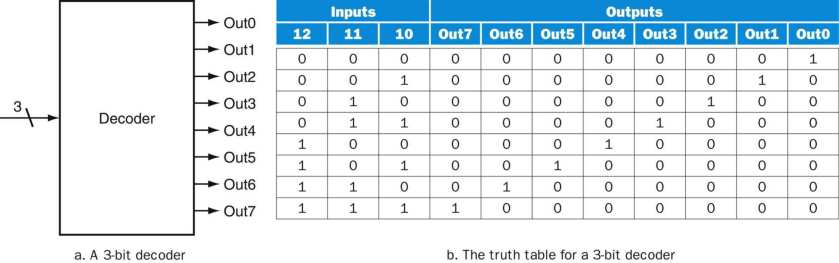

**HÌNH A.3.1 Decoder 3-bit có ba input gọi là 12, 11 và 10, và 2<sup>3</sup> = 8 output gọi từ Out0 tới Out7. Chỉ output tương ứng giá trị nhị phân của input là đúng, như trong truth table. Nhãn 3 trên input decoder cho biết tín hiệu input rộng 3 bit.**

### Multiplexor

Một hàm logic cơ bản dùng khá thường xuyên trong Chương 4 là multiplexor. Tên phù hợp hơn có lẽ là selector, vì output của nó là một input được control chọn. Xét multiplexor two-input. Bên trái Hình A.3.2 cho thấy multiplexor này có ba input: hai giá trị dữ liệu và một giá trị selector (hay control). Giá trị selector quyết định input nào trở thành output. Có thể biểu diễn hàm logic do multiplexor two-input tính, được vẽ ở dạng gate bên phải Hình A.3.2, là 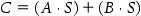.

#### selector value

Cũng gọi là control value. Tín hiệu control dùng để chọn một giá trị input của multiplexor làm output của multiplexor.

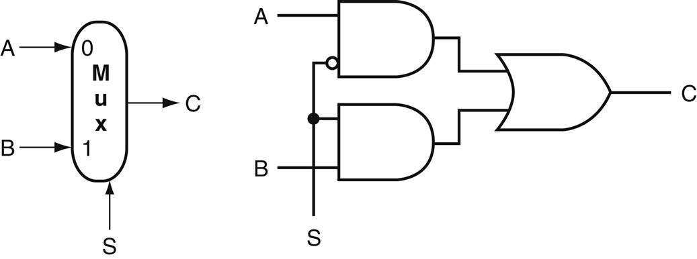

**HÌNH A.3.2 Multiplexor two-input bên trái và cách triển khai bằng gate bên phải. Multiplexor có hai input dữ liệu (A và B), mang nhãn 0 và 1, một input selector (S), cùng output C. Triển khai multiplexor bằng Verilog cần thêm chút công sức, đặc biệt khi có nhiều hơn hai input. Chúng tôi trình bày cách làm từ trang A-23.**

Multiplexor có thể được tạo với số input dữ liệu bất kỳ. Khi chỉ có hai input, selector là một tín hiệu chọn một input nếu đúng (1), input kia nếu sai (0). Nếu có n input dữ liệu, cần 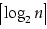 input selector. Trong trường hợp này, multiplexor về cơ bản gồm ba phần:

1. Decoder tạo n tín hiệu, mỗi tín hiệu chỉ một giá trị input khác nhau

2. Mảng n gate AND, mỗi gate kết hợp một input với tín hiệu từ decoder

3. Một gate OR lớn gộp các output của gate AND

Để liên hệ input với giá trị selector, chúng ta thường đánh nhãn input dữ liệu bằng số (tức 0, 1, 2, 3, …, n −1) và diễn giải các input data selector như số nhị phân. Đôi khi dùng multiplexor với tín hiệu selector chưa decode.

Multiplexor dễ được biểu diễn theo dạng combinational trong Verilog bằng biểu thức if. Với multiplexor lớn hơn, câu lệnh case tiện hơn, nhưng phải cẩn thận để tổng hợp combinational logic.

### Logic Two-Level và PLA

Như đã nêu ở mục trước, mọi hàm logic đều triển khai được chỉ bằng các hàm AND, OR và NOT. Thực tế, một kết quả mạnh hơn nhiều cũng đúng. Mọi hàm logic có thể viết ở dạng chuẩn, trong đó mỗi input là biến đúng hoặc phần bù và chỉ có hai cấp gate—một AND, một OR—với phép đảo có thể có ở output cuối. Biểu diễn như vậy gọi là two-level, có hai dạng là sum of products và product of sums. Biểu diễn sum-of-products là tổng logic (OR) của các tích (hạng dùng toán tử AND); product of sums là ngược lại. Trong ví dụ trước, chúng ta có hai phương trình cho output E:

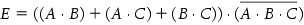

và

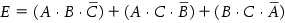

Phương trình thứ hai ở dạng sum-of-products: có hai cấp logic và các phép đảo chỉ tác động lên biến riêng lẻ. Phương trình đầu có ba cấp logic.

#### sum of products

Dạng biểu diễn logic dùng tổng logic (OR) của các tích (các hạng nối bằng toán tử AND).

#### Giải thích thêm

Cũng có thể viết E thành product of sums:

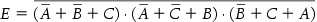

Để suy ra dạng này cần dùng các định lý DeMorgan, được thảo luận trong bài tập.

Trong sách này, chúng ta dùng dạng sum-of-products. Dễ thấy mọi hàm logic đều có thể biểu diễn thành sum of products bằng cách xây biểu diễn đó từ truth table của hàm. Mỗi entry truth table tại đó hàm đúng tương ứng với một product term. Product term gồm tích logic của mọi input hoặc phần bù input, tùy entry truth table có 0 hay 1 tương ứng với biến đó. Hàm logic là tổng logic các product term tại đó hàm đúng. Ví dụ sẽ giúp thấy rõ hơn.

#### Sum of Products

**Ví dụ**

Trình bày biểu diễn sum-of-products cho truth table sau của D.

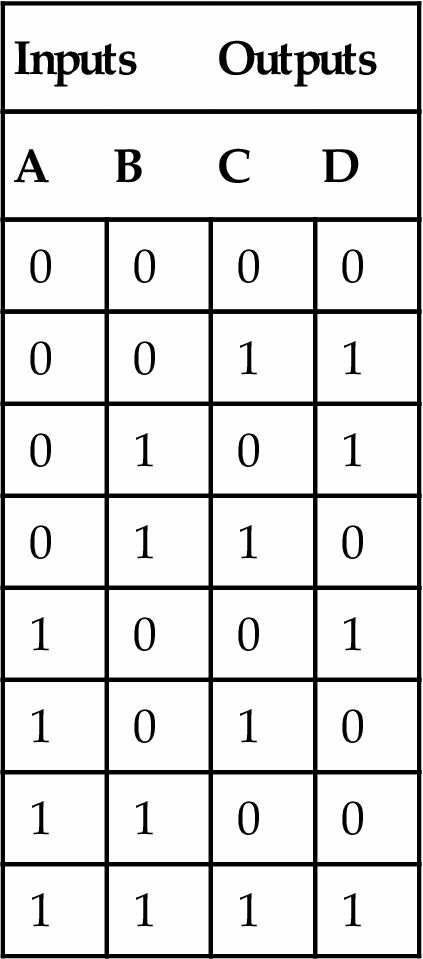

**Trả lời**

Có bốn product term vì hàm đúng (1) cho bốn tổ hợp input khác nhau. Chúng là:

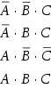

Vì vậy có thể viết hàm D là tổng các hạng này:

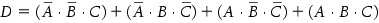

Lưu ý chỉ các entry truth table tại đó hàm đúng mới tạo các hạng trong phương trình.

Có thể dùng quan hệ giữa truth table và biểu diễn two-level để tạo cách triển khai gate-level của mọi tập hàm logic. Một tập hàm logic tương ứng với truth table có nhiều cột output, như ví dụ ở trang A-5. Mỗi cột output biểu diễn hàm logic khác, có thể xây trực tiếp từ truth table.

Biểu diễn sum-of-products tương ứng với cách triển khai structured-logic phổ biến gọi là programmable logic array (PLA). PLA có tập input và các phần bù input tương ứng (có thể triển khai bằng tập inverter), cùng hai stage logic. Stage đầu là mảng gate AND tạo tập product term (đôi khi gọi là minterm); mỗi product term có thể gồm bất kỳ input hoặc phần bù nào. Stage thứ hai là mảng gate OR, mỗi gate tạo tổng logic của số product term bất kỳ. Hình A.3.3 trình bày dạng cơ bản của PLA.

#### programmable logic array (PLA)

Phần tử structured-logic gồm tập input và phần bù input tương ứng, cùng hai stage logic: stage đầu tạo product term của input và phần bù input, stage sau tạo sum term của các product term. Vì vậy PLA triển khai hàm logic dưới dạng sum of products.

#### minterms

Cũng gọi là product term. Tập input logic nối bằng phép hội (các phép AND); các product term tạo stage logic đầu của programmable logic array (PLA).

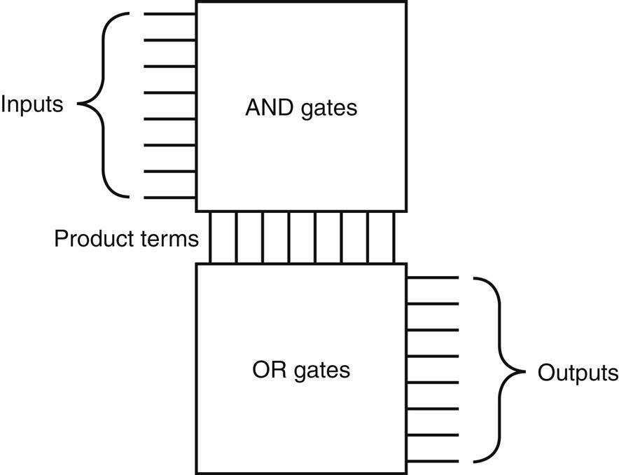

**HÌNH A.3.3 Dạng cơ bản của PLA gồm mảng gate AND theo sau bởi mảng gate OR. Mỗi entry trong mảng gate AND là product term gồm số input hoặc input đảo bất kỳ. Mỗi entry trong mảng gate OR là sum term gồm số product term bất kỳ.**

PLA có thể trực tiếp triển khai truth table của tập hàm logic nhiều input và output. Vì mỗi entry có output đúng cần một product term, sẽ có hàng tương ứng trong PLA. Mỗi output tương ứng với một hàng gate OR tiềm năng trong stage thứ hai. Số gate OR tương ứng số entry truth table có output đúng. Tổng kích thước PLA như Hình A.3.3 bằng tổng kích thước mảng gate AND (gọi là AND plane) và mảng gate OR (gọi là OR plane). Nhìn Hình A.3.3, kích thước mảng gate AND bằng số input nhân số product term khác nhau, còn kích thước mảng gate OR bằng số output nhân số product term.

PLA có hai đặc điểm giúp nó triển khai hiệu quả tập hàm logic. Thứ nhất, chỉ các entry truth table tạo giá trị đúng cho ít nhất một output mới có logic gate gắn với chúng. Thứ hai, mỗi product term khác nhau chỉ có một entry trong PLA, ngay cả khi dùng trong nhiều output. Hãy xem ví dụ.

#### PLAs

**Ví dụ**

Xét tập hàm logic được định nghĩa trong ví dụ ở trang A-5. Trình bày cách triển khai PLA của ví dụ này cho D, E và F.

**Trả lời**

Đây là truth table đã xây dựng trước đó:

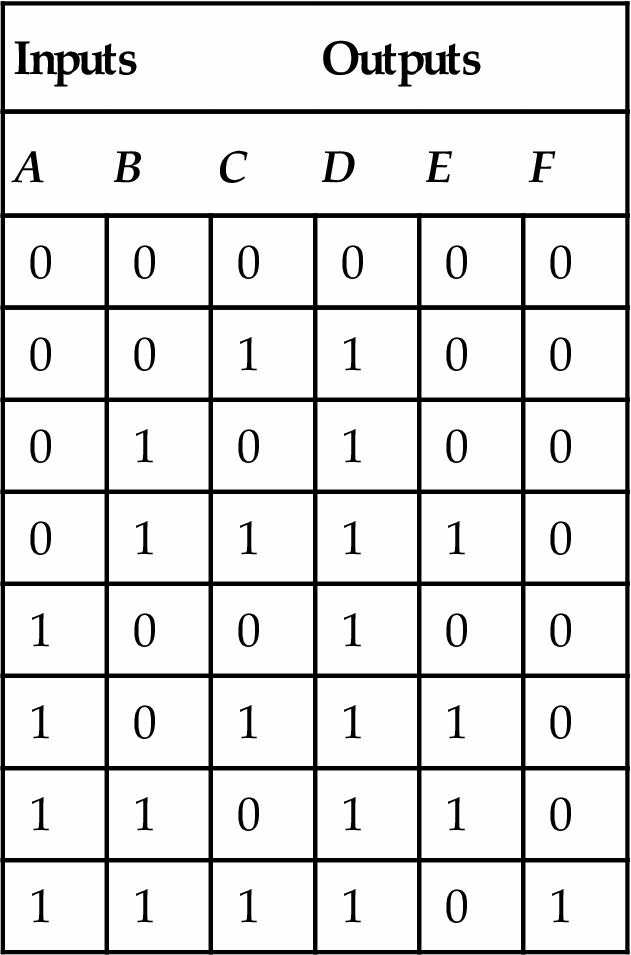

Vì có bảy product term riêng biệt với ít nhất một giá trị đúng trong phần output, AND plane có bảy cột. Số hàng AND plane là ba (vì có ba input), OR plane cũng có ba hàng (vì có ba output). Hình A.3.4 cho PLA thu được, với product term tương ứng các entry truth table từ trên xuống dưới.

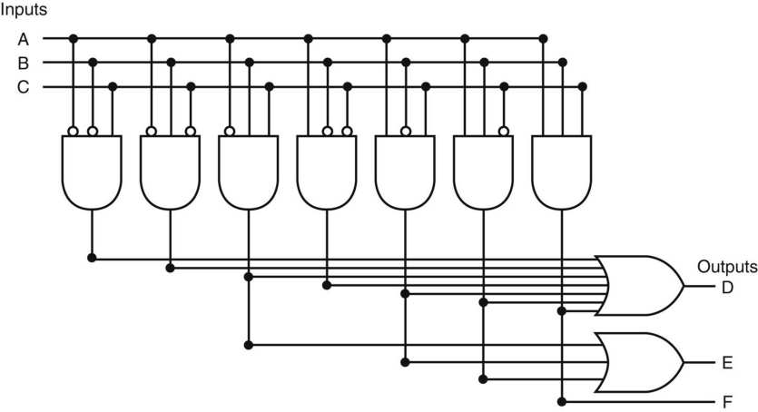

**HÌNH A.3.4 PLA triển khai hàm logic mô tả trong ví dụ.**

Thay vì vẽ mọi gate như Hình A.3.4, người thiết kế thường chỉ trình bày vị trí gate AND và OR. Dấu chấm được đặt ở giao điểm đường tín hiệu product term với đường input hoặc output khi cần gate AND hoặc OR tương ứng. Hình A.3.5 cho thấy PLA của Hình A.3.4 khi vẽ như vậy. Nội dung PLA được cố định khi tạo PLA, dù cũng có các cấu trúc dạng PLA-like, gọi là PLA, có thể lập trình bằng điện khi người thiết kế sẵn sàng dùng.

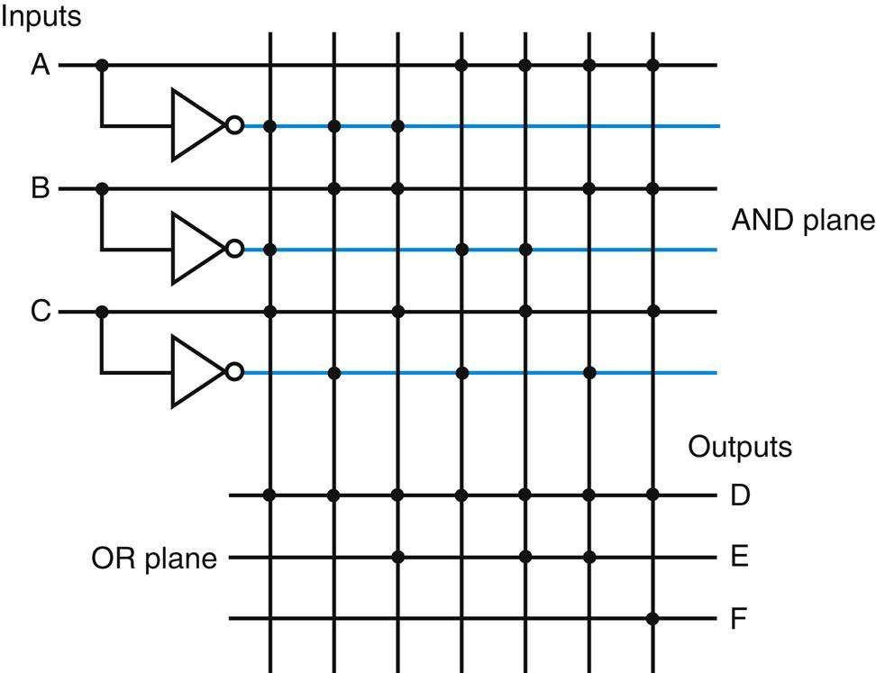

**HÌNH A.3.5 PLA được vẽ bằng dấu chấm chỉ thành phần product term và sum term trong mảng. Thay vì dùng inverter trên gate, thường mọi input chạy hết chiều rộng AND plane dưới cả dạng đúng và phần bù. Dấu chấm trong AND plane cho biết input hoặc giá trị đảo của nó xuất hiện trong product term. Dấu chấm trong OR plane cho biết product term tương ứng xuất hiện trong output tương ứng.**

### ROM

Một dạng logic có cấu trúc khác dùng triển khai tập hàm logic là read-only memory (ROM). ROM gọi là memory vì có tập vị trí đọc được; tuy nhiên nội dung các vị trí được cố định, thường lúc sản xuất ROM. Cũng có programmable ROM (PROM) lập trình được bằng điện khi người thiết kế biết nội dung. Còn có PROM xóa được; chúng cần quá trình xóa chậm bằng tia cực tím, nên được dùng như memory read-only, ngoại trừ trong quá trình thiết kế và debug.

#### read-only memory (ROM)

Memory có nội dung được chỉ định lúc tạo, sau đó chỉ đọc được. ROM được dùng như logic có cấu trúc để triển khai tập hàm logic bằng cách dùng các hạng trong hàm làm input address, các output làm bit trong mỗi word memory.

#### programmable ROM (PROM)

Dạng read-only memory có thể được lập trình khi người thiết kế biết nội dung.

ROM có tập đường input address và tập output. Số entry có thể address trong ROM quyết định số đường address: nếu ROM chứa 2<sup>m</sup> entry có thể address, gọi là chiều cao, thì có m đường input. Số bit trong mỗi entry có thể address bằng số bit output, đôi khi gọi là chiều rộng ROM. Tổng số bit ROM bằng chiều cao nhân chiều rộng. Chiều cao và chiều rộng đôi khi gọi chung là hình dạng ROM.

ROM có thể encode tập hàm logic trực tiếp từ truth table. Ví dụ, nếu có n hàm với m input, cần ROM có m đường address (và 2<sup>m</sup> entry), mỗi entry rộng n bit. Các entry trong phần input truth table biểu diễn address của entry ROM, còn nội dung phần output truth table tạo nội dung ROM. Nếu truth table được tổ chức sao cho chuỗi entry phần input tạo chuỗi số nhị phân (như mọi truth table đã trình bày), phần output cũng cho nội dung ROM theo thứ tự. Ví dụ bắt đầu ở trang A-13 có ba input và ba output. Điều này dẫn tới ROM có 2<sup>3</sup> = 8 entry, mỗi entry rộng 3 bit. Nội dung các entry theo thứ tự address tăng được cho trực tiếp bởi phần output truth table ở trang A-14.

ROM và PLA liên hệ chặt chẽ. ROM được decode đầy đủ: chứa output word đầy đủ cho mọi tổ hợp input có thể. PLA chỉ được decode một phần. Điều này nghĩa là ROM luôn chứa nhiều entry hơn. Với truth table trước ở trang A-14, ROM chứa entry cho cả tám input có thể, còn PLA chỉ chứa bảy product term hoạt động. Khi số input tăng, số entry ROM tăng theo hàm mũ. Ngược lại, với phần lớn hàm logic thực tế, số product term tăng chậm hơn nhiều (xem ví dụ trong  Phụ lục C). Khác biệt này khiến PLA nói chung hiệu quả hơn để triển khai hàm combinational logic. ROM có ưu điểm triển khai được mọi hàm logic có số input và output phù hợp. Ưu điểm này giúp dễ thay nội dung ROM khi hàm logic thay đổi, vì kích thước ROM không cần đổi.

Ngoài ROM và PLA, hệ thống logic synthesis hiện đại cũng chuyển khối combinational logic nhỏ thành tập gate có thể đặt và đi dây tự động. Mặc dù một số tập gate nhỏ thường không area-efficient, với hàm logic nhỏ chúng có ít overhead hơn cấu trúc cứng của ROM và PLA nên được ưa dùng.

Để thiết kế logic ngoài integrated circuit tùy biến hoặc bán tùy biến, lựa chọn phổ biến là field programming device; Mục A.12 mô tả các thiết bị này.

### Don’t care

Khi triển khai combinational logic, thường có tình huống không quan tâm giá trị một output, hoặc vì output khác đúng, hoặc vì tập con tổ hợp input quyết định giá trị output. Những tình huống này gọi là don’t care. Don’t care quan trọng vì giúp tối ưu cách triển khai hàm logic dễ hơn.

Có hai loại don’t care: output don’t care và input don’t care, cả hai biểu diễn được trong truth table. Output don’t care xuất hiện khi không quan tâm giá trị output với một tổ hợp input. Chúng hiện dưới dạng X trong phần output truth table. Khi output là don’t care cho một tổ hợp input, người thiết kế hoặc chương trình tối ưu logic được tự do đặt output đúng hay sai với tổ hợp đó. Input don’t care xuất hiện khi output chỉ phụ thuộc một số input, cũng được biểu diễn bằng X nhưng trong phần input truth table.

#### Don’t care

**Ví dụ**

Xét hàm logic với các input A, B, C được định nghĩa như sau:

- Nếu A hoặc C đúng, output D đúng bất kể giá trị B.

- Nếu A hoặc B đúng, output E đúng bất kể giá trị C.

- Output F đúng nếu đúng một input đúng, dù không quan tâm giá trị F mỗi khi D và E đều đúng. Trình bày truth table đầy đủ của hàm và truth table dùng don’t care. Mỗi cách cần bao nhiêu product term trong PLA?

**Trả lời**

Đây là truth table đầy đủ, không có don’t care:


Cách này cần bảy product term nếu không tối ưu. Truth table viết với output don’t care như sau:

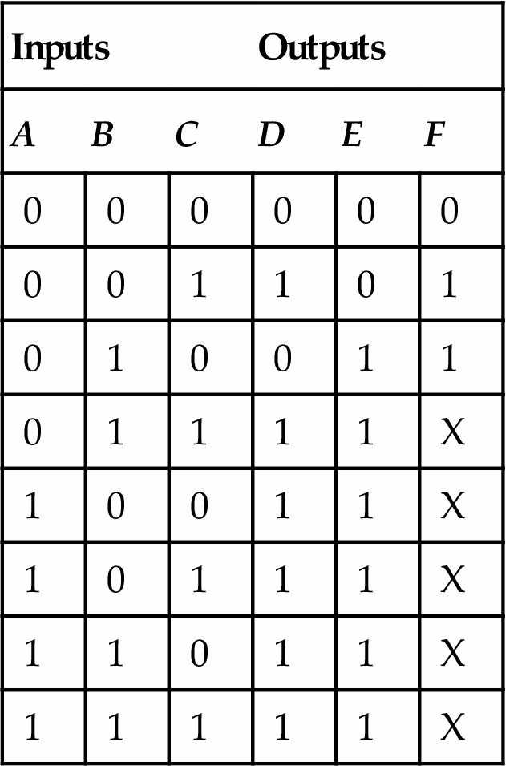

Nếu dùng thêm input don’t care, truth table này có thể đơn giản hóa tiếp thành:

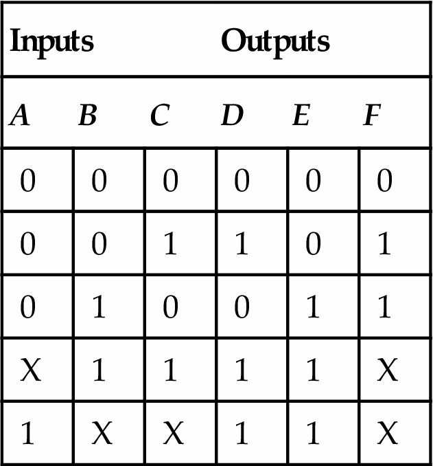

Truth table đã đơn giản hóa cần PLA có bốn minterm, hoặc có thể triển khai bằng gate rời với một gate AND two-input và ba gate OR (hai gate ba input, một gate hai input). So với truth table ban đầu có bảy minterm và cần bốn gate AND.

Tối thiểu hóa logic rất quan trọng để triển khai hiệu quả. Một công cụ hữu ích để tối thiểu hóa thủ công random logic là Karnaugh map. Karnaugh map biểu diễn truth table bằng đồ họa, giúp dễ thấy các product term kết hợp được. Tuy nhiên, tối ưu thủ công hàm logic đáng kể bằng Karnaugh map là không thực tế do kích thước và độ phức tạp map. May mắn là quá trình tối thiểu hóa logic có tính máy móc cao và công cụ thiết kế làm được. Trong quá trình tối thiểu hóa, công cụ tận dụng don’t care nên chỉ định chúng rất quan trọng. Các sách tham khảo cuối phụ lục thảo luận thêm về tối thiểu hóa logic, Karnaugh map và lý thuyết đằng sau các thuật toán này.

### Mảng phần tử logic

Nhiều phép combinational trên dữ liệu phải được thực hiện với toàn bộ word (64 bit). Vì vậy thường muốn xây mảng phần tử logic, có thể biểu diễn đơn giản bằng cách chỉ ra phép toán nhất định áp dụng cho toàn bộ tập input. Bên trong máy, thường cần chọn giữa một cặp bus. Bus là tập đường dữ liệu được xử lý chung như một tín hiệu logic duy nhất. (Từ bus cũng dùng để chỉ tập đường dùng chung có nhiều nguồn và mục đích.)

#### bus

Trong thiết kế logic, tập đường dữ liệu được xử lý chung như một tín hiệu logic duy nhất; cũng là tập đường dùng chung có nhiều nguồn và mục đích.

Ví dụ, trong instruction set RISC-V, kết quả instruction ghi vào register có thể đến từ một trong hai nguồn. Multiplexor chọn bus nào trong hai bus (mỗi bus rộng 64 bit) được ghi vào Result register. Multiplexor 1-bit đã trình bày cần được nhân bản 64 lần.

Chúng ta chỉ tín hiệu là bus thay vì đường 1-bit bằng nét đậm hơn trong hình. Phần lớn bus rộng 64 bit; bus khác được ghi rõ độ rộng. Khi vẽ logic unit có input và output là bus, nghĩa là unit phải được nhân bản đủ lần để đáp ứng độ rộng input. Hình A.3.6 cho cách vẽ multiplexor chọn giữa cặp bus 64-bit và cách nó mở rộng thành các multiplexor 1-bit-wide. Đôi khi cần xây mảng phần tử logic mà input của một số phần tử là output phần tử trước. Ví dụ, đó là cách xây ALU multibit-wide. Trong trường hợp này phải chỉ rõ cách tạo mảng rộng hơn vì phần tử riêng không còn độc lập như multiplexor 64-bit-wide.

#### Tự kiểm tra

Parity là hàm có output phụ thuộc số bit 1 trong input. Với hàm even parity, output bằng 1 nếu input có số bit một chẵn. Giả sử dùng ROM triển khai even parity với input 4-bit. A, B, C hay D biểu diễn nội dung ROM?

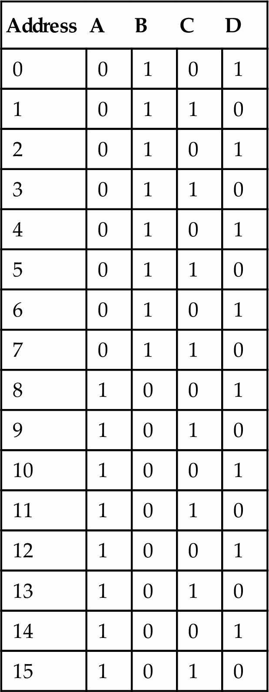

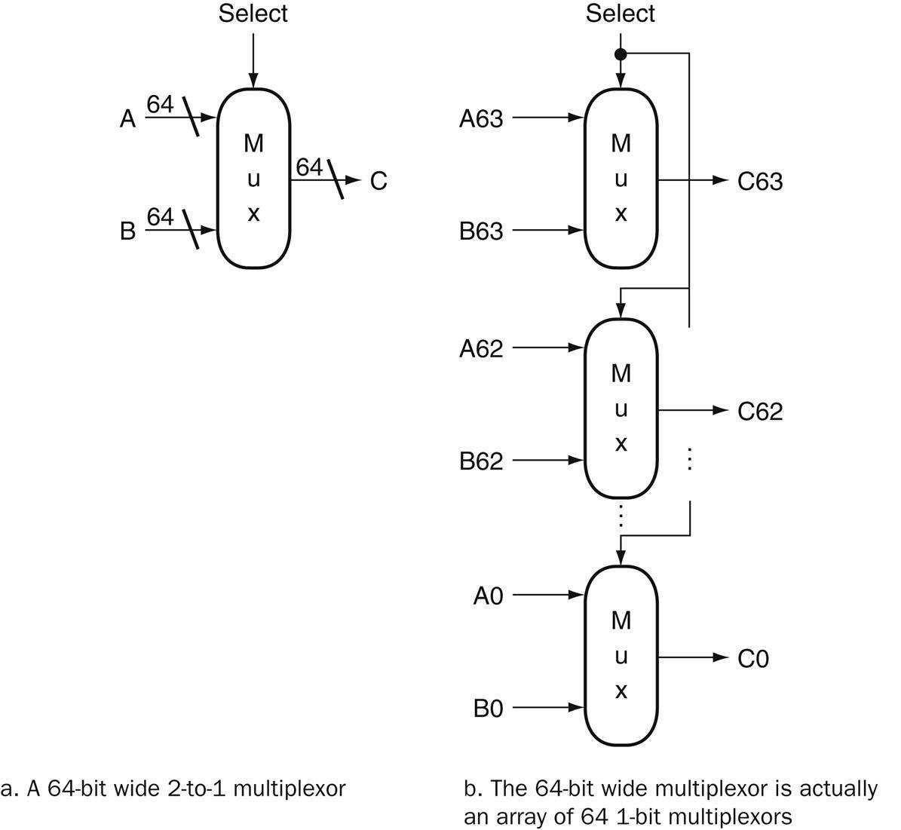

**HÌNH A.3.6 Multiplexor được bố trí thành mảng 64 lần để chọn giữa hai input 64-bit. Lưu ý vẫn chỉ có một tín hiệu chọn dữ liệu dùng cho mọi multiplexor 1-bit trong số 64 multiplexor.**

## A.4 Sử dụng hardware description language

Ngày nay phần lớn thiết kế số của processor và hệ thống phần cứng liên quan được thực hiện bằng hardware description language. Ngôn ngữ này phục vụ hai mục đích. Thứ nhất, cung cấp mô tả trừu tượng về phần cứng để mô phỏng và debug thiết kế. Thứ hai, nhờ công cụ logic synthesis và hardware compilation, mô tả có thể được biên dịch thành cách triển khai phần cứng.

### hardware description language

Ngôn ngữ lập trình mô tả phần cứng, dùng tạo mô phỏng thiết kế phần cứng và làm input cho công cụ synthesis có thể tạo phần cứng thực.

Trong mục này, chúng ta giới thiệu hardware description language Verilog và chỉ cách dùng cho thiết kế combinational. Trong phần còn lại phụ lục, chúng ta mở rộng Verilog sang thiết kế sequential logic. Trong các mục tùy chọn Chương 4 xuất hiện online, Verilog được dùng mô tả cách triển khai processor. Trong mục tùy chọn Chương 5 online, system Verilog được dùng mô tả cách triển khai cache controller. System Verilog thêm structure và một số đặc điểm hữu ích khác vào Verilog.

Verilog là một trong hai hardware description language chính; ngôn ngữ kia là VHDL. Verilog được dùng nhiều hơn đôi chút trong công nghiệp và dựa trên C, khác VHDL dựa trên Ada. Người đọc quen C nói chung sẽ thấy cơ sở Verilog dùng trong phụ lục dễ theo dõi. Người đã quen VHDL sẽ thấy khái niệm đơn giản, miễn đã tiếp xúc cú pháp C.

#### Verilog

Một trong hai hardware description language phổ biến nhất.

#### VHDL

Một trong hai hardware description language phổ biến nhất.

Verilog có thể chỉ định định nghĩa behavioral lẫn structural của hệ thống số. Behavioral specification mô tả hệ thống số hoạt động về chức năng như thế nào. Structural specification mô tả tổ chức chi tiết, thường bằng mô tả phân cấp. Structural specification có thể mô tả hệ thống phần cứng theo phân cấp phần tử cơ bản như gate và switch. Vì vậy có thể dùng Verilog mô tả nội dung chính xác các truth table và datapath của mục trước.

#### behavioral specification

Mô tả cách hệ thống số hoạt động về chức năng.

#### structural specification

Mô tả cách hệ thống số được tổ chức qua kết nối phân cấp các phần tử.

Với sự xuất hiện công cụ hardware synthesis, phần lớn người thiết kế nay dùng Verilog hoặc VHDL để chỉ mô tả structural datapath, dựa vào logic synthesis tạo control từ mô tả behavioral. Ngoài ra, phần lớn hệ thống CAD cung cấp thư viện phong phú các thành phần chuẩn hóa như ALU, multiplexor, register file, memory, khối logic lập trình được, cùng gate cơ bản.

#### hardware synthesis tools

Phần mềm Computer-aided design có thể tạo thiết kế gate-level dựa trên mô tả behavioral của hệ thống số.

Để đạt kết quả chấp nhận được bằng thư viện và logic synthesis, đặc tả phải được viết có tính đến synthesis sau cùng và kết quả mong muốn. Với thiết kế đơn giản của chúng ta, điều này chủ yếu là nêu rõ phần nào muốn triển khai bằng combinational logic và phần nào cần sequential logic. Trong phần lớn ví dụ của mục này và phần còn lại phụ lục, Verilog được viết có cân nhắc synthesis sau cùng.

### Datatype và toán tử trong Verilog

Verilog có hai datatype chính:

1. Wire chỉ định tín hiệu combinational.

2. Reg (register) giữ giá trị có thể thay đổi theo thời gian. Reg không nhất thiết tương ứng register thực trong triển khai, dù thường là vậy.

#### wire

Trong Verilog, chỉ định tín hiệu combinational.

#### reg

Trong Verilog, một register.

Register hoặc wire tên X, rộng 64 bit, được khai báo thành mảng: reg [63:0] X hoặc wire [63:0] X, cũng đặt index 0 để chỉ least significant bit của register. Vì thường muốn truy cập subfield của register hoặc wire, có thể tham chiếu tập bit liên tiếp bằng ký pháp [starting bit: ending bit], trong đó cả hai index phải là hằng.

Mảng register được dùng cho cấu trúc như register file hoặc memory. Vì vậy khai báo

```
reg [63:0] registerfile[0:31]
```

chỉ định biến registerfile tương đương registerfile RISC-V, trong đó register 0 là đầu tiên. Khi truy cập mảng, có thể tham chiếu một phần tử như trong C bằng ký pháp

```
registerfile[regnum].
```

Các giá trị có thể của register hoặc wire trong Verilog là

- 0 hoặc 1, biểu diễn sai hoặc đúng về logic

- X, biểu diễn chưa biết, là giá trị ban đầu cho mọi register và wire không được nối với gì

- Z, biểu diễn state high-impedance cho tristate gate, không được thảo luận trong phụ lục này

Giá trị hằng có thể chỉ định dưới dạng số decimal cũng như binary, octal hoặc hexadecimal. Chúng ta thường muốn chỉ rõ trường hằng lớn bao nhiêu bit. Việc này thực hiện bằng cách thêm trước giá trị một số decimal chỉ kích thước tính bằng bit. Ví dụ:

- 4’b0100 chỉ định hằng binary 4-bit có giá trị 4, tương tự

```
4’d4.
```

- −8’h4 chỉ định hằng 8-bit có giá trị −4 (biểu diễn bù hai)

Các giá trị cũng có thể nối bằng cách đặt trong { }, ngăn bằng dấu phẩy. Ký pháp {x{bitfield}} nhân bản bitfield x lần. Ví dụ:

- {32{2’b01}} tạo giá trị 64-bit với mẫu 0101 … 01.

- {A[31:16],B[15:0]} tạo giá trị có 16 bit phía trên lấy từ A và 16 bit phía dưới lấy từ B.

Verilog cung cấp đầy đủ toán tử một ngôi và hai ngôi của C, gồm toán tử số học (+, −, *. /), toán tử logic (&, |, ~), toán tử so sánh (==, !=, >, <, <=, >=), toán tử shift (<<, >>), và toán tử điều kiện C (?, dùng dưới dạng condition ? expr1 :expr2, trả expr1 nếu điều kiện đúng và expr2 nếu sai). Verilog thêm tập toán tử logic reduction một ngôi (&, |, <sup>^</sup>) tạo một bit bằng cách áp dụng toán tử logic cho mọi bit operand. Ví dụ, &A trả giá trị AND mọi bit A với nhau, còn <sup>^</sup>A trả kết quả reduction dùng exclusive OR trên mọi bit A.

#### Tự kiểm tra

Những biểu thức nào sau đây định nghĩa chính xác cùng giá trị?

1. 8’bimoooo *(ghi chú: sách in 8’bimoooo; đúng là 8’b11110000)*

2. 8’hF0

3. 8’d240

4. {{4{1’b1}},{4{1’b0}}}

5. {4’b1,4’b0)

### Cấu trúc chương trình Verilog

Chương trình Verilog được tổ chức thành tập module, có thể biểu diễn từ tập logic gate đến hệ thống hoàn chỉnh. Module tương tự class C++, dù không mạnh bằng. Module chỉ định các port input và output, mô tả kết nối vào và ra. Module cũng có thể khai báo biến bổ sung. Phần thân module gồm:

- Cấu trúc initial có thể khởi tạo biến reg

- Continuous assignment chỉ định nghĩa combinational logic

- Cấu trúc always có thể định nghĩa sequential hoặc combinational logic

- Instance của module khác dùng để triển khai module đang định nghĩa

### Biểu diễn combinational logic phức tạp bằng Verilog

Continuous assignment, được chỉ bởi keyword assign, hoạt động như hàm combinational logic: output liên tục được gán giá trị và thay đổi input được phản ánh ngay ở output. Wire chỉ có thể được gán giá trị bằng continuous assignment. Dùng continuous assignment, có thể định nghĩa module triển khai half-adder như Hình A.4.1.

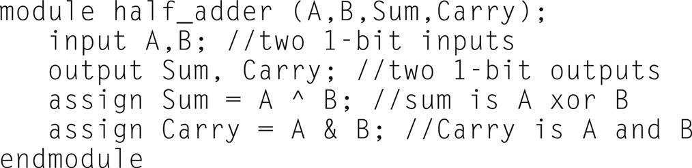

**HÌNH A.4.1 Module Verilog định nghĩa half-adder bằng continuous assignment.**

Câu lệnh assign là cách chắc chắn để viết Verilog tạo combinational logic. Tuy nhiên, với cấu trúc phức tạp hơn, assign có thể bất tiện hoặc dài dòng. Cũng có thể dùng khối always của module mô tả phần tử combinational logic, dù phải cẩn thận. Dùng khối always cho phép đưa các cấu trúc control Verilog như if-then-else, câu lệnh case, for và repeat vào. Các câu lệnh này giống C với thay đổi nhỏ.

Khối always chỉ định danh sách tín hiệu nhạy tùy chọn (trong danh sách bắt đầu bằng @). Khối always được re-evaluated nếu tín hiệu nào trong danh sách đổi giá trị; nếu bỏ danh sách, khối always liên tục được re-evaluated. Khi khối always chỉ định combinational logic, sensitivity list phải chứa mọi tín hiệu input. Nếu có nhiều câu lệnh Verilog cần thực thi trong khối always, chúng được bao bằng keyword begin và end, thay vị trí { và } trong C. Vì vậy khối always như sau:

```
always @(list of signals that cause reevaluation) begin
  Verilog statements including assignments and other
control statements end
```

#### sensitivity list

Danh sách tín hiệu chỉ định khi nào khối always phải được re-evaluated.

Biến reg chỉ được gán trong khối always bằng procedural assignment statement (khác continuous assignment đã thấy). Tuy nhiên có hai loại procedural assignment. Toán tử gán =thực thi như C; right-hand side được đánh giá và left-hand side được gán giá trị. Hơn nữa, nó thực thi như câu lệnh gán C thông thường: hoàn tất trước câu lệnh tiếp theo. Vì vậy toán tử gán =có tên blocking assignment. Blocking này có thể hữu ích khi tạo sequential logic và chúng ta sẽ trở lại ngay sau. Dạng gán kia (nonblocking) được chỉ bởi <=. Trong nonblocking assignment, mọi right-hand side của phép gán trong nhóm always được đánh giá, và các phép gán được thực hiện đồng thời. Là ví dụ đầu về combinational logic triển khai bằng khối always, Hình A.4.2 trình bày multiplexor 4-to-1 dùng cấu trúc case để dễ viết. Cấu trúc case giống switch trong C. Hình A.4.3 trình bày định nghĩa ALU RISC-V cũng dùng case.

#### blocking assignment

Trong Verilog, phép gán hoàn tất trước khi thực thi câu lệnh tiếp theo.

#### nonblocking assignment

Phép gán tiếp tục sau khi đánh giá right-hand side, chỉ gán giá trị cho left-hand side sau khi mọi right-hand side được đánh giá.

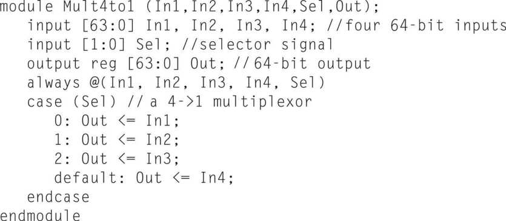

**HÌNH A.4.2 Định nghĩa Verilog của multiplexor 4-to-1 với input 64-bit dùng câu lệnh case. Case hoạt động như switch C, ngoại trừ Verilog chỉ thực thi code của case được chọn (như thể mỗi case có break cuối) và không fall-through sang câu lệnh kế tiếp.**

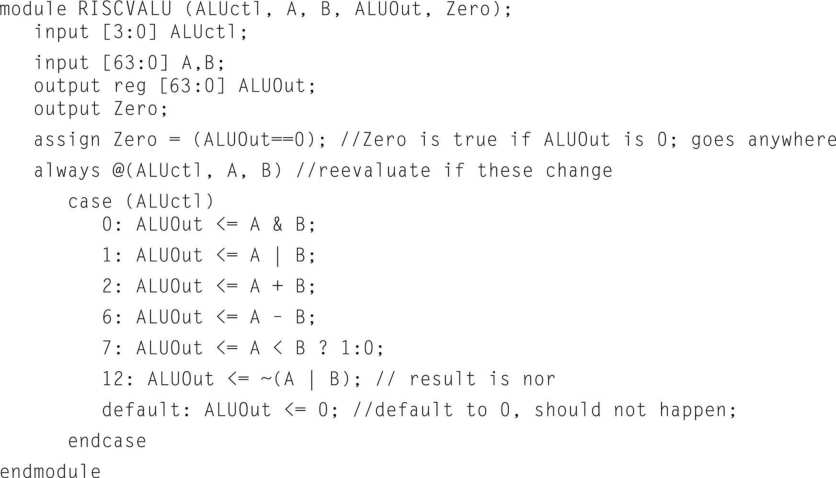

**HÌNH A.4.3 Định nghĩa behavioral Verilog của ALU RISC-V. Có thể synthesis bằng thư viện module chứa các phép số học và logic cơ bản.**

Vì chỉ biến reg được gán trong khối always, khi muốn mô tả combinational logic bằng always phải cẩn thận để bảo đảm reg không được synthesis thành register. Nhiều cạm bẫy được mô tả trong phần giải thích thêm bên dưới.

#### Giải thích thêm

Continuous assignment luôn tạo combinational logic, nhưng các cấu trúc Verilog khác, ngay cả trong khối always, có thể tạo kết quả bất ngờ khi logic synthesis. Vấn đề phổ biến nhất là tạo sequential logic bằng cách ngầm chỉ sự tồn tại latch hoặc register, dẫn tới cách triển khai chậm hơn và tốn kém hơn dự kiến. Để bảo đảm logic dự định là combinational được synthesis đúng như vậy, hãy bảo đảm:

1. Đặt mọi combinational logic trong continuous assignment hoặc khối always.

2. Bảo đảm mọi tín hiệu dùng làm input xuất hiện trong sensitivity list của khối always.

3. Bảo đảm mỗi đường đi qua khối always gán giá trị cho chính xác cùng tập bit.

Điều cuối dễ bị bỏ sót nhất; hãy đọc ví dụ ở Hình A.5.15 để tự xác nhận tính chất được tuân thủ.

#### Tự kiểm tra

Giả sử mọi giá trị ban đầu bằng zero, A và B có giá trị gì sau khi thực thi code Verilog này trong khối always?

```
C = 1;
A <= C;
B = C;
```

## A.5 Xây dựng arithmetic logic unit cơ bản

ALU d. [Arthritic Logic Unit hoặc (hiếm) Arithmetic Logic Unit] Bộ tạo random-number được cung cấp tiêu chuẩn trong mọi hệ thống máy tính.

Stan Kelly-Bootle, The Devil’s DP Dictionary, 1981

Arithmetic logic unit (ALU) là sức mạnh cơ bắp của máy tính, thiết bị per-forms các phép số học như cộng, trừ hoặc phép logic như AND, OR. Mục này xây dựng ALU từ bốn khối phần cứng (gate AND và OR, inverter, multiplexor), minh họa cách combinational logic hoạt động. Mục tiếp theo cho thấy cách tăng tốc phép cộng bằng thiết kế khéo léo hơn.

Vì register RISC-V rộng 64 bit, cần ALU 64-bit-wide. Giả sử nối 64 ALU 1-bit để tạo ALU mong muốn. Vì vậy bắt đầu bằng xây dựng ALU 1-bit.

### ALU 1-Bit

Các phép logic dễ nhất vì ánh xạ trực tiếp tới thành phần phần cứng trong Hình A.2.1.

Logic unit 1-bit cho AND và OR như Hình A.5.1. Multiplexor bên phải chọn a AND b hoặc a OR b, tùy Operation bằng 0 hay 1. Đường điều khiển multiplexor được tô màu để phân biệt với đường chứa dữ liệu. Lưu ý đã đổi tên các đường control và output multiplexor thành tên phản ánh chức năng ALU.

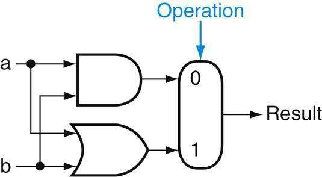

**HÌNH A.5.1 Logic unit 1-bit cho AND và OR.**

Chức năng tiếp theo cần thêm là cộng. Adder phải có hai input cho operand và output single-bit cho tổng. Phải có output thứ hai truyền carry, gọi là CarryOut. Vì CarryOut từ adder lân cận phải được đưa vào input, cần input thứ ba gọi là CarryIn. Hình A.5.2 cho input và output của adder 1-bit. Vì biết phép cộng cần làm gì, có thể chỉ định output “hộp đen” này theo input như Hình A.5.3 minh họa.

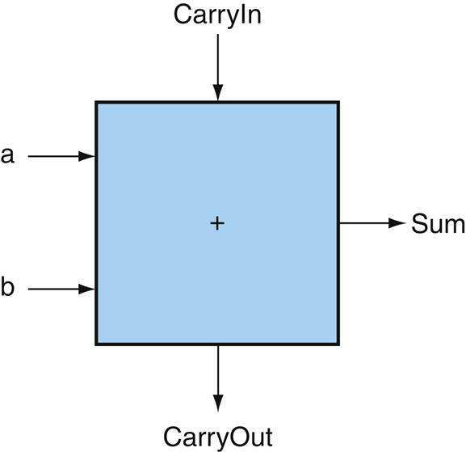

**HÌNH A.5.2 Adder 1-bit. Adder này gọi là full adder; cũng gọi adder (3,2) vì có ba input và hai output. Adder chỉ có input a và b gọi là adder (2,2) hoặc half-adder.**

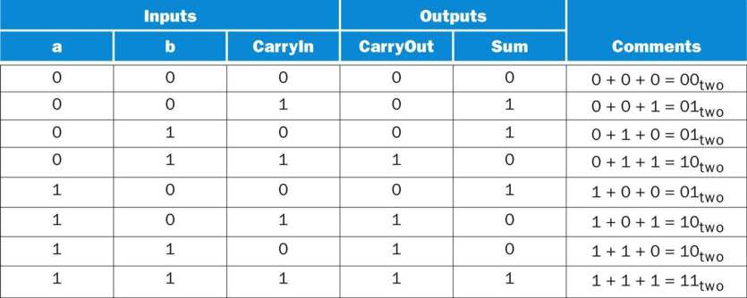

**HÌNH A.5.3 Đặc tả input và output cho adder 1-bit.**

Có thể biểu diễn các hàm output CarryOut và Sum bằng phương trình logic, rồi triển khai bằng logic gate. Hãy làm CarryOut. Hình A.5.4 cho giá trị input khi CarryOut bằng 1.

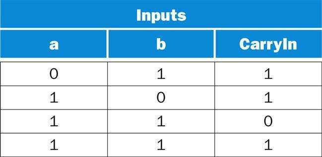

**HÌNH A.5.4 Giá trị input khi CarryOut bằng 1.**

Có thể chuyển truth table này thành phương trình logic:

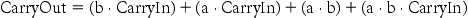

Nếu a · b · CarryIn đúng thì cả ba hạng khác cũng phải đúng, nên có thể bỏ hạng cuối tương ứng dòng thứ tư của bảng. Vì vậy đơn giản hóa phương trình thành

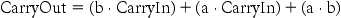

Hình A.5.5 cho thấy phần cứng bên trong hộp đen adder cho CarryOut gồm ba gate AND và một gate OR. Ba gate AND tương ứng chính xác ba hạng trong ngoặc của công thức CarryOut ở trên, gate OR lấy tổng ba hạng.

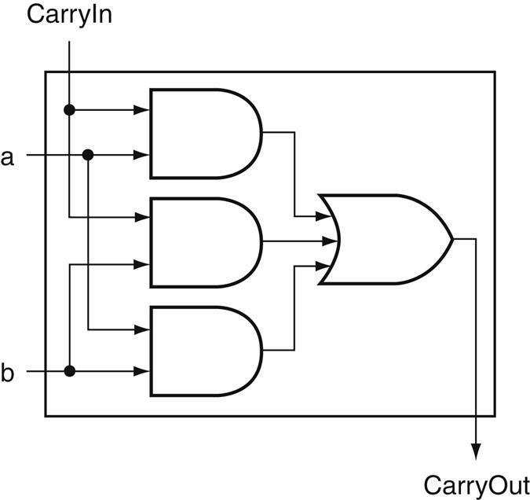

**HÌNH A.5.5 Phần cứng adder cho tín hiệu CarryOut. Phần còn lại adder là logic cho output Sum trong phương trình trên trang này.**

Bit Sum được thiết lập khi đúng một input bằng 1 hoặc cả ba input bằng 1. Sum tạo phương trình Boolean phức tạp (nhớ rằng 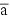 nghĩa là NOT a):

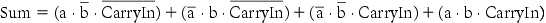

Việc vẽ logic bit Sum trong hộp đen adder dành làm bài tập cho người đọc.

Hình A.5.6 trình bày ALU 1-bit có được bằng cách kết hợp adder với thành phần trước đó. Đôi khi người thiết kế cũng muốn ALU thực hiện thêm vài phép đơn giản như tạo 0. Cách dễ nhất để thêm phép toán là mở rộng multiplexor do đường Operation điều khiển, và trong ví dụ này nối 0 trực tiếp vào input mới của multiplexor được mở rộng.

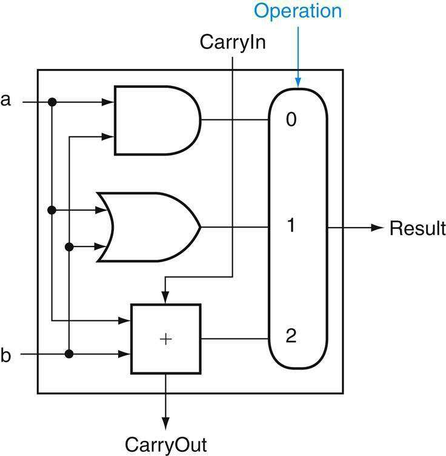

**HÌNH A.5.6 ALU 1-bit thực hiện AND, OR và cộng (xem Hình A.5.5).**

### ALU 64-Bit

Sau khi hoàn thành ALU 1-bit, ALU 64-bit đầy đủ được tạo bằng cách nối các “hộp đen” liền kề. Dùng xi chỉ bit thứ i của x, Hình A.5.7 trình bày ALU 64-bit. Giống một viên đá tạo gợn sóng lan tới bờ hồ yên tĩnh, carry out từ least significant bit (Result0) có thể lan qua toàn adder, tạo carry out từ most significant bit (Result63). Vì vậy adder tạo bằng cách nối trực tiếp carry của các adder 1-bit gọi là ripple carry adder. Từ trang A-38 sẽ thấy cách nối adder 1-bit nhanh hơn.

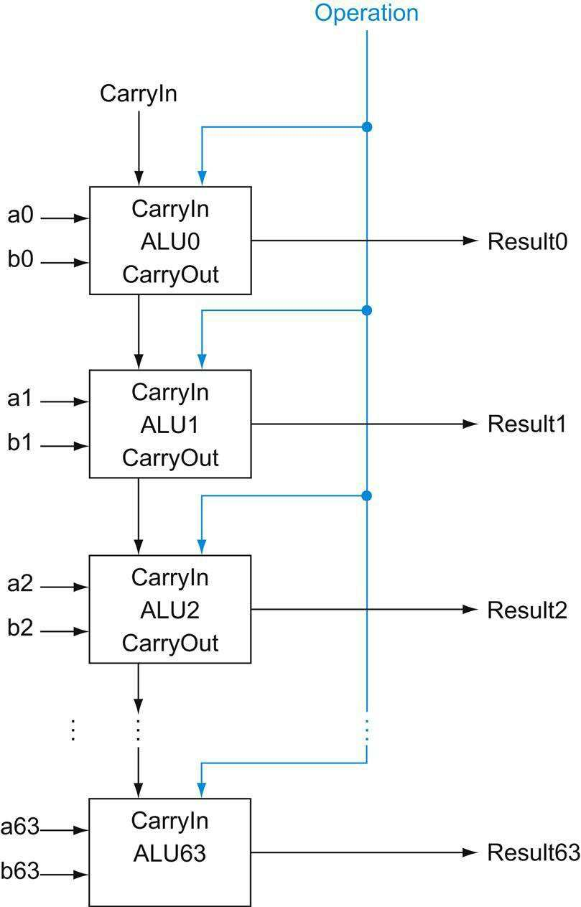

**HÌNH A.5.7 ALU 64-bit xây từ 64 ALU 1-bit. CarryOut của bit ít quan trọng hơn được nối CarryIn của bit quan trọng hơn. Tổ chức này gọi là ripple carry.**

Phép trừ giống cộng phiên bản âm của operand, và đó là cách adder thực hiện phép trừ. Nhớ rằng mẹo đổi dấu số bù hai là đảo từng bit (đôi khi gọi bù một) rồi cộng 1. Để đảo từng bit, chỉ cần thêm multiplexor 2:1 chọn giữa b và 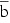 , như Hình A.5.8.

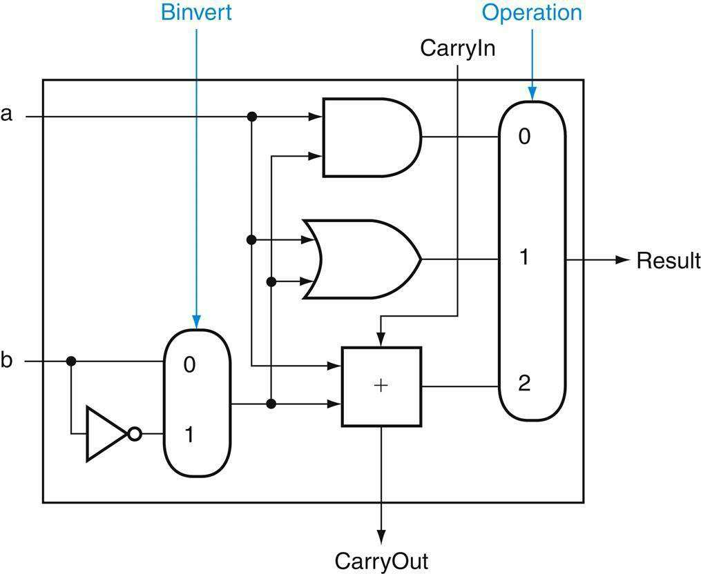

**HÌNH A.5.8 ALU 1-bit thực hiện AND, OR và cộng trên a và b hoặc a và  . Bằng cách chọn  (Binvert=1) và đặt CarryIn bằng 1 ở least significant bit ALU, ta có phép trừ b khỏi a theo bù hai (comple-ment), thay vì cộng b vào a.**

Giả sử nối 64 ALU 1-bit như Hình A.5.7. Multiplexor bổ sung cho phép chọn b hoặc giá trị đảo tùy Binvert, nhưng đây mới là một bước đổi dấu số bù hai. Lưu ý least significant bit vẫn có tín hiệu CarryIn dù không cần cho cộng. Điều gì xảy ra nếu đặt CarryIn này bằng 1 thay vì 0? Adder sẽ tính a+b+1. Chọn phiên bản đảo của b cho đúng điều mong muốn:

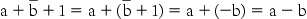

Sự đơn giản của thiết kế phần cứng adder bù hai giúp giải thích vì sao biểu diễn bù hai trở thành chuẩn chung cho số học integer máy tính.

Cũng muốn thêm hàm NOR. Thay vì thêm gate riêng cho NOR, có thể tái sử dụng phần lớn phần cứng đã có trong ALU như đã làm với trừ. Ý tưởng đến từ đẳng thức sau về NOR:

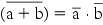

Tức NOT (a OR b) tương đương NOT a AND NOT b. Điều này gọi là định lý DeMorgan, được khảo sát sâu hơn trong bài tập.

Vì đã có AND và NOT b, chỉ cần thêm NOT a vào ALU. Hình A.5.9 cho thay đổi đó.

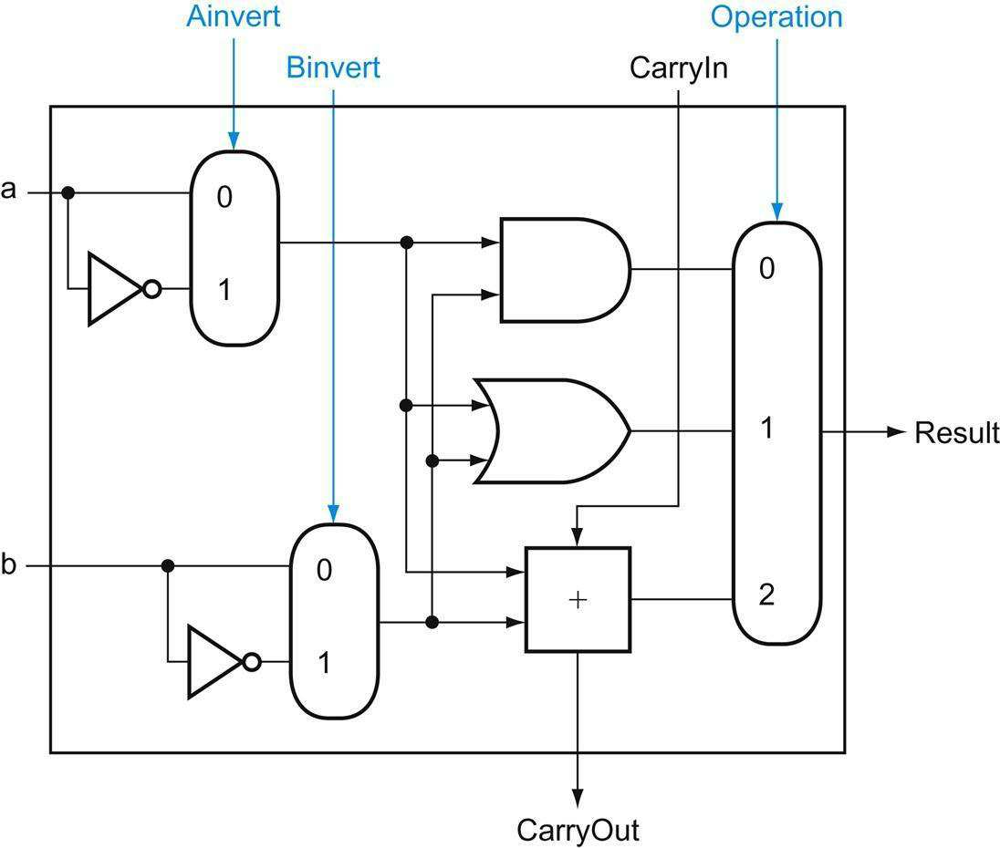

**HÌNH A.5.9 ALU 1-bit thực hiện AND, OR và cộng trên a và b hoặc  và  . Chọn  (Ainvert=1) và  cho a NOR b thay vì a AND b.**

### Điều chỉnh ALU 64-Bit cho RISC-V

Bốn phép add, subtract, AND, OR có trong ALU gần như mọi máy tính, và ALU này thực hiện được các phép của phần lớn instruction RISC-V. Nhưng thiết kế ALU chưa hoàn chỉnh.

Một instruction vẫn cần hỗ trợ là set less than (slt). Nhớ rằng phép này tạo 1 nếu rs1 < rs2 và 0 nếu không. Vì vậy slt đặt mọi bit trừ least significant bit bằng 0, còn least significant bit được đặt theo kết quả compare. Để ALU thực hiện slt, trước hết mở rộng multiplexor three-input trong Hình A.5.9 để thêm input kết quả slt. Gọi input mới là Less và chỉ dùng cho slt.

Hình trên trong Hình A.5.10 cho ALU 1-bit mới với multiplexor mở rộng. Theo mô tả slt ở trên, phải nối 0 vào input Less của 63 bit phía trên ALU, vì những bit đó luôn đặt bằng 0. Còn lại cần xét cách compare và đặt least significant bit cho instruction set less than.


**HÌNH A.5.10 (Trên) ALU 1-bit thực hiện AND, OR và cộng trên a và b hoặc  , và (dưới) ALU 1-bit cho most significant bit. Hình trên có input trực tiếp được nối để thực hiện set on less than (xem Hình A.5.11); hình dưới có output trực tiếp từ adder cho compare less than, gọi là Set. (Xem Bài tập A.24 cuối phụ lục để biết cách tính overflow với ít input hơn.)**

Điều gì xảy ra nếu trừ b khỏi a? Nếu hiệu âm, a < b vì


Muốn least significant bit của phép set less than bằng 1 nếu a < b; tức 1 nếu a − b âm và 0 nếu dương. Kết quả mong muốn khớp chính xác giá trị sign bit: 1 là âm, 0 là dương. Theo lập luận này, chỉ cần nối sign bit từ output adder tới least significant bit để có set less than. (Tiếc là lập luận chỉ đúng nếu trừ không overflow; bài tập sẽ khảo sát triển khai đầy đủ.)

Không may, output Result từ bit ALU quan trọng nhất ở phần trên Hình A.5.10 cho phép slt không phải output adder; output ALU cho slt rõ ràng là giá trị input Less.

Vì vậy cần ALU 1-bit mới cho most significant bit có thêm một bit output: output adder. Hình dưới trong Hình A.5.10 trình bày thiết kế với đường output adder mới gọi là Set. Vì đã cần ALU đặc biệt cho most significant bit, ta thêm logic phát hiện overflow vì nó cũng gắn với bit đó. Hình A.5.11 trình bày ALU 64-bit.


**HÌNH A.5.11 ALU 64-bit xây từ 63 bản ALU 1-bit ở phần trên Hình A.5.10 và một ALU 1-bit ở phần dưới hình đó. Các input Less nối 0 trừ least significant bit, được nối output Set của most significant bit. Nếu ALU thực hiện a−b và chọn input 3 trong multiplexor Hình A.5.10 thì Result=0 … 001 nếu a<b, còn lại Result=0 … 000.**

Lưu ý mỗi khi muốn ALU trừ, đặt cả CarryIn và Binvert bằng 1. Với cộng hoặc phép logic, muốn cả hai đường control bằng 0. Vì vậy đơn giản hóa control ALU bằng cách kết hợp CarryIn và Binvert thành một đường control tên Bnegate.

Để điều chỉnh thêm ALU cho instruction set RISC-V, phải hỗ trợ conditional branch instruction như Branch if Equal (beq), branch nếu hai register bằng nhau. Cách dễ nhất kiểm tra bằng nhau bằng ALU là trừ b khỏi a rồi kiểm tra kết quả bằng 0, vì


Vì vậy nếu thêm phần cứng kiểm tra kết quả bằng 0, có thể kiểm tra bằng nhau. Cách đơn giản nhất là OR mọi output rồi đưa tín hiệu qua inverter:


Hình A.5.12 trình bày ALU 64-bit đã sửa. Có thể xem tổ hợp đường Ainvert 1-bit, đường Bnegate 1-bit và các đường Operation 2-bit là các đường control 4-bit cho ALU, yêu cầu add, subtract, AND, OR, NOR hoặc set less than. Hình A.5.13 cho các đường ALU control và phép ALU tương ứng.


**HÌNH A.5.12 ALU 64-bit cuối cùng. Nó thêm bộ phát hiện Zero vào Hình A.5.11.**


**HÌNH A.5.13 Giá trị ba đường ALU control Ainvert, Bnegate và Operation, cùng các phép ALU tương ứng.**

Cuối cùng, sau khi thấy bên trong ALU 64-bit, chúng ta dùng ký hiệu phổ quát cho ALU hoàn chỉnh, như Hình A.5.14.


**HÌNH A.5.14 Ký hiệu thường dùng biểu diễn ALU, như Hình A.5.12. Ký hiệu cũng dùng biểu diễn adder nên thường được ghi ALU hoặc Adder.**

### Định nghĩa ALU RISC-V bằng Verilog

Hình A.5.15 cho cách chỉ định ALU combinational RISC-V bằng Verilog; đặc tả như vậy có lẽ được biên dịch dùng thư viện thành phần chuẩn cung cấp adder có thể instantiate. Để đầy đủ, Hình A.5.16 cho ALU control RISC-V, được dùng trong Chương 4 nơi xây phiên bản Verilog của datapath RISC-V.


**HÌNH A.5.15 Định nghĩa behavioral Verilog của ALU RISC-V.**


**HÌNH A.5.16 ALU control RISC-V: phần combinational control logic đơn giản.**

Câu hỏi tiếp theo là “ALU này cộng hai operand 64-bit nhanh đến đâu?” Có thể xác định input a và b, nhưng input CarryIn phụ thuộc phép trong adder 1-bit liền kề. Nếu lần theo toàn chuỗi phụ thuộc, nối most significant bit tới least significant bit, nên most significant bit của tổng phải đợi đánh giá tuần tự cả 64 adder 1-bit. Phản ứng dây chuyền tuần tự quá chậm cho phần cứng time-critical. Mục tiếp khảo sát cách speed-up phép cộng. Chủ đề không thiết yếu để hiểu phần còn lại phụ lục nên có thể bỏ qua.

#### Tự kiểm tra

Giả sử muốn thêm phép NOT (a AND b), gọi là NAND. ALU cần thay đổi thế nào để hỗ trợ?

1. Không đổi. Có thể tính NAND nhanh bằng ALU hiện tại vì  và đã có NOT a, NOT b, OR.

2. Phải mở rộng multiplexor lớn để thêm input, rồi thêm logic mới tính NAND.

## A.6 Phép cộng nhanh hơn: Carry Lookahead

Chìa khóa tăng tốc cộng là xác định carry in tới các bit high-order sớm hơn. Có nhiều cơ chế dự đoán carry để trường hợp worst-case là hàm log<sub>2</sub> của số bit adder. Các tín hiệu dự đoán nhanh hơn vì đi qua ít gate liên tiếp hơn, nhưng cần nhiều gate hơn để dự đoán carry đúng.

Điều quan trọng để hiểu cơ chế fast-carry là nhớ rằng khác phần mềm, phần cứng thực thi song song mỗi khi input thay đổi.

### Fast carry dùng phần cứng “vô hạn”

Như đã nói, mọi phương trình biểu diễn được bằng hai cấp logic. Vì input ngoài duy nhất là hai operand và CarryIn tới least significant bit adder, về lý thuyết có thể tính CarryIn của mọi bit còn lại chỉ bằng hai cấp logic.

Ví dụ, CarryIn cho bit 2 của adder chính là CarryOut bit 1, nên công thức là


Tương tự, CarryIn1 được định nghĩa là


Dùng viết tắt ngắn và truyền thống hơn ci cho CarryIni, có thể viết lại các công thức thành


Thay định nghĩa c1 vào phương trình đầu cho công thức:


Có thể hình dung phương trình mở rộng khi tới bit cao hơn của adder; nó tăng nhanh theo số bit. Độ phức tạp phản ánh ở chi phí phần cứng fast carry, khiến cơ chế đơn giản này quá đắt với adder rộng.

### Fast carry dùng cấp abstraction đầu tiên: Propagate và Generate

Phần lớn cơ chế fast-carry giới hạn độ phức tạp phương trình để đơn giản hóa phần cứng, vẫn cải thiện tốc độ đáng kể so với ripple carry. Một cơ chế là carry-lookahead adder. Chương 1 đã nói hệ thống máy tính đối phó độ phức tạp bằng các cấp abstraction. carry-lookahead adder dựa vào các cấp abstraction trong triển khai.

Bước đầu, hãy phân tích phương trình gốc thành nhân tử:


Nếu viết lại phương trình c2 bằng công thức này, sẽ thấy các mẫu lặp:


Lưu ý (ai · bi) và (ai + bi) lặp trong công thức trên. Hai thừa số quan trọng theo truyền thống gọi là generate (gi) và propagate (pi):


Dùng chúng định nghĩa c<sub>i</sub><sub>+1</sub>, có


Để hiểu nguồn gốc tên tín hiệu, giả sử gi bằng 1. Khi đó


Tức adder tạo CarryOut (c<sub>i</sub><sub>+1</sub>) độc lập giá trị CarryIn (ci). Giờ giả sử gi bằng 0 và pi bằng 1. Khi đó


Tức adder truyền CarryIn thành CarryOut. Gộp hai điều, CarryIn<sub>i</sub><sub>+1</sub> bằng 1 nếu gi bằng 1 hoặc cả pi bằng 1 và CarryIni bằng 1.

Ví dụ tương tự là dãy domino dựng đứng. Quân cuối có thể đổ khi đẩy quân ở xa, miễn giữa chúng không có khoảng trống. Tương tự, carry out có thể đúng nhờ generate ở xa, miễn mọi propagate ở giữa đều đúng.

Dựa vào định nghĩa propagate và generate làm cấp abstraction đầu tiên, có thể biểu diễn các tín hiệu CarryIn gọn hơn. Hãy làm cho 4 bit:


Những phương trình này chỉ biểu diễn điều dễ hiểu: CarryIni bằng 1 nếu adder trước đó tạo carry và mọi adder ở giữa truyền carry. Hình A.6.1 dùng hệ thống ống nước để thử giải thích carry lookahead.


**HÌNH A.6.1 Ví dụ ống nước cho carry lookahead của 1 bit, 2 bit và 4 bit, dùng ống nước và van. Cờ lê được xoay để mở, đóng van. Nước được tô màu. Output ống (c<sub>i</sub><sub>+1</sub>) đầy nếu giá trị generate gần nhất (gi) bật hoặc giá trị propagate thứ i (pi) bật và có nước phía thượng nguồn, từ generate trước hoặc propagate có nước phía sau. CarryIn (c0) có thể tạo carry out không cần generate, nhưng cần mọi propagate hỗ trợ.**

Ngay cả dạng đơn giản hóa này vẫn tạo phương trình lớn, do đó lượng logic đáng kể dù chỉ adder 16-bit. Hãy thử chuyển sang hai cấp abstraction.

### Fast carry dùng cấp abstraction thứ hai

Trước hết xem adder 4-bit cùng logic carry-lookahead như một khối xây dựng duy nhất. Nếu nối chúng theo ripple carry thành adder 16-bit, phép cộng nhanh hơn bản gốc với thêm chút phần cứng.

Để nhanh hơn nữa, cần carry lookahead ở cấp cao hơn. Muốn carry lookahead cho adder 4-bit, cần tín hiệu propagate và generate ở cấp cao hơn. Đây là chúng cho bốn khối adder 4-bit:


Tức tín hiệu “super” propagate cho abstraction 4-bit (Pi) chỉ đúng nếu từng bit trong nhóm đều truyền carry.

Với tín hiệu “super” generate (Gi), chỉ quan tâm có carry out từ most significant bit nhóm 4-bit không. Điều này rõ ràng xảy ra nếu generate đúng ở most significant bit; cũng xảy ra nếu generate trước đúng và mọi propagate trung gian, kể cả của most significant bit, đều đúng:


Hình A.6.2 cập nhật ví dụ ống nước để trình bày P0 và G0.


**HÌNH A.6.2 Ví dụ ống nước cho tín hiệu carry-lookahead next-level P0 và G0. P0 chỉ mở nếu cả bốn propagate (pi) mở, còn nước chảy trong G0 chỉ khi ít nhất một generate (gi) mở và mọi propagate phía hạ lưu generate đó đều mở.**

Khi đó phương trình ở cấp abstraction cao hơn cho carry in của từng nhóm 4-bit trong adder 16-bit (C1, C2, C3, C4 ở Hình A.6.3) rất giống phương trình carry out cho từng bit adder 4-bit (c1, c2, c3, c4) ở trang A-40:


**HÌNH A.6.3 Bốn ALU 4-bit dùng carry lookahead tạo adder 16-bit. Lưu ý carry đến từ carry-lookahead unit, không phải các ALU 4-bit.**

Hình A.6.3 cho các adder 4-bit nối với carry-lookahead unit như vậy. Bài tập khảo sát khác biệt tốc độ giữa các cơ chế carry, ký pháp khác cho tín hiệu propagate và generate nhiều bit, và thiết kế adder 64-bit.

#### Cả hai cấp propagate và generate

**Ví dụ**

Xác định giá trị gi, pi, Pi và Gi của hai số 16-bit này:

```
a:    0001 1010 0011 0011<sub>two</sub>
b:    1110 0101 1110 1011two
```

Ngoài ra, CarryOut15 (C4) bằng bao nhiêu?

**Trả lời**

Align các bit giúp dễ thấy giá trị generate gi (ai·bi) và propagate pi (ai + bi):

```
a:   0001 1010 0011 0011
b:   1110 0101 1110 1011
gi:   0000 0000 0010 0011
pi:   1111 1111 1111 1011
```

trong đó các bit được đánh số 15 đến 0 từ trái sang phải. Tiếp theo, các “super” propagate (P3, P2, P1, P0) chỉ là AND của các propagate lower-level:


Các “super” generate phức tạp hơn, nên dùng phương trình sau:


Cuối cùng, CarryOut15 là


Vì vậy có carry out khi cộng hai số 16-bit này.

Lý do carry lookahead tạo carry nhanh hơn là mọi logic bắt đầu đánh giá ngay khi clock cycle bắt đầu, và kết quả không đổi nữa khi output mỗi gate ngừng đổi. Đi đường tắt qua ít gate hơn để gửi tín hiệu carry in khiến output gate ngừng đổi sớm hơn, do đó thời gian adder ngắn hơn.

Để thấy tầm quan trọng carry lookahead, cần tính hiệu năng tương đối giữa nó và ripple carry adder.

#### Tốc độ ripple carry so với carry lookahead

**Ví dụ**

Một cách đơn giản mô hình thời gian logic là giả sử mỗi gate AND hoặc OR cần cùng thời gian cho tín hiệu đi qua. Ước lượng thời gian bằng cách đếm gate dọc đường qua phần logic. So sánh số gate delay trên đường của hai adder 16-bit, một dùng ripple carry và một dùng carry lookahead two-level.

**Trả lời**

Hình A.5.5 trang A-28 cho thấy tín hiệu carry out mất hai gate delay mỗi bit. Khi đó số gate delay từ carry in ở least significant bit tới carry out của most significant bit là 32×2=64.

Với carry lookahead, carry out của most significant bit chính là C4 đã định nghĩa trong ví dụ. Cần hai cấp logic để chỉ định C4 theo Pi và Gi (OR của nhiều hạng AND). Pi được chỉ định trong một cấp logic (AND) dùng pi, còn Gi trong hai cấp dùng pi và gi, nên worst case ở cấp abstraction tiếp theo này là hai cấp logic. pi và gi mỗi tín hiệu là một cấp logic, định nghĩa theo ai và bi. Nếu giả sử mỗi cấp logic trong phương trình tốn một gate delay, worst case là 2+2+1=5 gate delay.

Vì vậy trên đường từ carry in tới carry out, phép cộng 16-bit bằng carry-lookahead adder nhanh hơn sáu lần theo ước lượng tốc độ phần cứng rất đơn giản này.

### Tóm tắt

Carry lookahead cung cấp đường nhanh hơn so với đợi carry lan qua cả 32 adder 1-bit. Đường nhanh này dựa vào hai tín hiệu generate và propagate. Tín hiệu đầu tạo carry bất kể input carry, tín hiệu sau truyền carry. Carry lookahead cũng là ví dụ khác cho tầm quan trọng abstraction trong thiết kế máy tính để xử lý độ phức tạp.

#### Tự kiểm tra

Dùng ước lượng tốc độ phần cứng đơn giản bằng gate delay ở trên, hiệu năng tương đối của phép cộng ripple carry 8-bit so với cộng 64-bit dùng logic carry-lookahead là bao nhiêu?

1. carry-lookahead adder 64-bit nhanh hơn ba lần: cộng 8-bit mất 16 gate delay và cộng 64-bit mất bảy gate delay.

2. Chúng nhanh xấp xỉ nhau vì cộng 64-bit cần nhiều cấp logic hơn trong adder 16-bit.

3. Cộng Eight-bit nhanh hơn 64 bit ngay cả với carry lookahead.

#### Giải thích thêm

Đến đây đã xét mọi phép số học và logic của instruction set core RISC-V trừ một: ALU trong Hình A.5.14 không hỗ trợ instruction shift. Có thể mở rộng multiplexor ALU để thêm shift trái 1 bit hoặc phải 1 bit. Nhưng người thiết kế phần cứng đã tạo mạch gọi là barrel shifter, shift được từ 1 đến 63 bit trong thời gian không lớn hơn cộng hai số 64-bit, nên shift thường thực hiện ngoài ALU.

#### Giải thích thêm

Phương trình logic cho output Sum của full adder ở trang A-28 có thể biểu diễn đơn giản hơn bằng gate mạnh hơn AND và OR. Gate exclusive OR đúng nếu hai operand khác nhau; tức


Trong một số công nghệ, exclusive OR hiệu quả hơn hai cấp gate AND và OR. Dùng ký hiệu  biểu diễn exclusive OR, phương trình mới là:


Ngoài ra, đã vẽ ALU theo cách truyền thống bằng gate. Máy tính ngày nay được thiết kế bằng transistor CMOS, về cơ bản là switch. ALU và barrel shifter CMOS tận dụng switch này và có ít multiplexor hơn nhiều so với thiết kế đã vẽ, nhưng nguyên lý thiết kế tương tự.

#### Giải thích thêm

Dùng chữ thường, hoa để phân biệt phân cấp ký hiệu generate và propagate không còn phù hợp khi có hơn hai cấp. Ký pháp khác có thể mở rộng là g<sub>i..j</sub> và p<sub>i..j</sub> cho tín hiệu generate và propagate của bit i đến j. Vì vậy g<sub>1..1</sub> được tạo cho bit 1, g<sub>4..1</sub> cho bit 4 đến 1, g<sub>16..1</sub> cho bit 16 đến 1.

## A.7 Clock

Trước khi thảo luận phần tử memory và sequential logic, nên nói ngắn về clock. Mục ngắn này giới thiệu chủ đề, tương tự nội dung Mục 4.2. Chi tiết thêm về clocking và phương pháp timing được trình bày trong Mục A.11.

Clock cần trong sequential logic để quyết định khi nào cập nhật phần tử chứa state. Clock đơn giản là tín hiệu free-running có cycle time cố định; clock frequency là nghịch đảo cycle time. Như Hình A.7.1, clock cycle time hay clock period chia thành hai phần: lúc clock cao và lúc clock thấp. Trong sách chỉ dùng clocking edge-triggered, nghĩa là mọi thay đổi state xảy ra trên clock edge. Dùng phương pháp edge-triggered vì dễ giải thích hơn. Tùy công nghệ, nó có thể là lựa chọn tốt nhất hoặc không.

### edge-triggered clocking

Cơ chế clocking trong đó mọi thay đổi state xảy ra trên clock edge.

#### clocking methodology

Phương pháp xác định khi nào dữ liệu hợp lệ và ổn định so với clock.


**HÌNH A.7.1 Tín hiệu clock dao động giữa giá trị cao và thấp. Clock period là thời gian một cycle đầy đủ. Trong thiết kế edge-triggered, cạnh lên hoặc cạnh xuống của clock là active và gây thay đổi state.**

Trong phương pháp edge-triggered, cạnh lên hoặc cạnh xuống clock là active và gây thay đổi state. Như sẽ thấy ở mục tiếp, các state element trong thiết kế edge-triggered được triển khai để nội dung chỉ đổi trên active clock edge. Chọn cạnh nào active phụ thuộc công nghệ triển khai và không ảnh hưởng các khái niệm thiết kế logic.

#### state element

Phần tử memory.

Clock edge hoạt động như tín hiệu lấy mẫu, khiến giá trị input dữ liệu của state element được lấy mẫu và lưu trong phần tử đó. Dùng edge trigger nghĩa là quá trình lấy mẫu về bản chất tức thời, loại bỏ vấn đề có thể xảy ra nếu tín hiệu lấy mẫu ở thời điểm hơi khác nhau.

Ràng buộc chính trong hệ có clock, cũng gọi synchronous system, là tín hiệu ghi vào state element phải hợp lệ khi active clock edge xảy ra. Tín hiệu hợp lệ nếu ổn định (không đổi) và giá trị không đổi nữa cho tới khi input đổi. Vì mạch combinational không được có feedback, nếu input combinational logic unit không đổi, output cuối cùng sẽ hợp lệ.

#### synchronous system

Memory system dùng clock, trong đó tín hiệu dữ liệu chỉ được đọc khi clock cho biết giá trị tín hiệu ổn định.

Hình A.7.2 cho quan hệ giữa state element và các khối combinational logic trong thiết kế sequential logic đồng bộ. State element có output chỉ đổi sau clock edge cung cấp input hợp lệ cho khối combinational logic. Để bảo đảm giá trị ghi vào state element trên active clock edge hợp lệ, clock phải có period đủ dài để mọi tín hiệu trong khối combinational logic ổn định, rồi clock edge lấy mẫu các giá trị để lưu vào state element. Ràng buộc này đặt cận dưới cho clock period, phải đủ dài để mọi input state element hợp lệ.


**HÌNH A.7.2 Input khối combinational logic đến từ state element, output được ghi vào state element. Clock edge quyết định khi nào cập nhật nội dung state element.**

Trong phần còn lại phụ lục và Chương 4, thường bỏ tín hiệu clock vì giả sử mọi state element cập nhật trên cùng clock edge. Một số state element được ghi ở mọi clock edge, số khác chỉ ghi trong điều kiện nhất định (như register được cập nhật). Khi đó có tín hiệu write tường minh cho state element. Tín hiệu write vẫn phải được gate với clock để cập nhật chỉ xảy ra trên clock edge nếu write active. Mục tiếp chỉ ra cách làm và sử dụng.

Ưu điểm khác của phương pháp edge-triggered là có thể dùng state element làm cả input lẫn output cho cùng khối combinational logic, như Hình A.7.3. Trong thực tế phải cẩn thận tránh race và bảo đảm clock period đủ dài; Mục A.11 thảo luận thêm.


**HÌNH A.7.3 Phương pháp edge-triggered cho phép đọc, ghi state element trong cùng clock cycle mà không tạo race có thể dẫn tới dữ liệu không xác định. Tất nhiên clock cycle vẫn phải đủ dài để giá trị input ổn định khi active clock edge xảy ra.**

Sau khi thảo luận cách clocking cập nhật state element, có thể nói cách xây state element.

#### Giải thích thêm

Đôi khi người thiết kế thấy hữu ích nếu một số ít state element đổi trên clock edge đối diện phần lớn phần tử khác. Điều này đòi hỏi cực kỳ cẩn thận vì ảnh hưởng cả input và output state element. Vì sao vẫn làm? Xét trường hợp lượng combinational logic trước và sau state element đủ nhỏ để mỗi phần hoạt động trong one-half clock cycle thay vì một cycle đầy đủ thông thường. Khi đó có thể ghi state element trên clock edge ứng với nửa cycle, vì cả input và output dùng được sau one-half clock cycle. Nơi thường dùng là register file, việc đọc hoặc ghi đơn thuần thường thực hiện trong nửa clock cycle thông thường. Chương 4 dùng ý tưởng này để giảm overhead pipeline.

#### register file

State element gồm tập register có thể đọc, ghi bằng cách cung cấp số register cần truy cập.

## A.8 Phần tử memory: Flip-Flops, latch và register

Trong mục này và mục tiếp, thảo luận nguyên lý cơ bản của phần tử memory, bắt đầu flip-flops và latch, tiếp tới register file và kết thúc bằng memory. Mọi phần tử memory lưu state: output phụ thuộc cả input lẫn giá trị được lưu bên trong. Vì vậy mọi khối logic chứa phần tử memory đều chứa state và là sequential.

Loại phần tử memory đơn giản nhất không có clock; tức không có input clock. Mặc dù sách chỉ dùng phần tử memory có clock, latch không clock là phần tử đơn giản nhất nên hãy xem mạch này trước. Hình A.8.1 cho latch S-R (set-reset latch), xây từ cặp gate NOR (gate OR có output đảo). Các output Q và  biểu diễn giá trị state được lưu và phần bù. Khi cả S lẫn R không được assert, các gate NOR cross-coupled hoạt động như inverter, lưu giá trị Q và  trước đó.


**HÌNH A.8.1 Cặp gate NOR cross-coupled có thể lưu giá trị nội bộ. Giá trị lưu ở output Q được hồi tiếp bằng cách đảo để được , rồi đảo  để được Q. Nếu R hoặc  được assert, Q bị deassert và ngược lại.**

Ví dụ, nếu output Q đúng, inverter dưới tạo output sai (là  ), trở thành input inverter trên tạo output đúng là Q, cứ thế tiếp tục. Nếu S được assert, output Q được assert và  bị deassert, còn nếu R được assert, output  được assert và Q bị deassert. Khi S và R đều deassert, giá trị cuối Q và  tiếp tục được lưu trong cấu trúc cross-coupled. Assert đồng thời S, R có thể dẫn tới hoạt động sai: tùy cách deassert, latch có thể dao động hoặc metastable (Mục A.11 mô tả chi tiết).

Cấu trúc cross-coupled này là cơ sở cho phần tử memory phức tạp hơn cho phép lưu tín hiệu dữ liệu. Chúng chứa gate bổ sung để lưu giá trị tín hiệu và khiến state chỉ cập nhật kết hợp với clock. Mục tiếp chỉ cách xây chúng.

### Flip-Flops và latch

Flip-flops và latch là phần tử memory đơn giản nhất. Trong cả flip-flops lẫn latch, output bằng giá trị state lưu bên trong. Hơn nữa, khác latch S-R trên, mọi latch và flip-flops từ đây đều có clock, nghĩa là có input clock và thay đổi state được clock kích hoạt. Khác biệt giữa flip-flop và latch là thời điểm clock thực sự gây thay đổi state. Trong latch có clock, state đổi mỗi khi input thích hợp đổi và clock được assert, còn flip-flop chỉ đổi state trên clock edge. Vì toàn sách dùng timing edge-triggered chỉ cập nhật state trên clock edge, chỉ cần flip-flops. Flip-flops thường được xây từ latch, nên bắt đầu bằng hoạt động latch có clock đơn giản rồi thảo luận flip-flop xây từ latch đó.

#### flip-flop

Phần tử memory có output bằng giá trị state lưu bên trong và state nội bộ chỉ đổi trên clock edge.

#### latch

Phần tử memory có output bằng giá trị state lưu bên trong và state đổi mỗi khi input thích hợp đổi, clock được assert.

#### D flip-flop

flip-flop có một input dữ liệu, lưu giá trị tín hiệu input đó trong memory nội bộ khi clock edge xảy ra.

Trong ứng dụng máy tính, cả flip-flops và latch có chức năng lưu tín hiệu. D latch hoặc D flip-flop lưu giá trị tín hiệu input dữ liệu trong memory nội bộ. Dù có nhiều loại latch và flip-flop khác, loại D là khối cơ bản duy nhất cần dùng. D latch có hai input và hai output. Input là giá trị dữ liệu cần lưu (D), và tín hiệu clock (C) chỉ khi nào latch phải đọc giá trị input D rồi lưu. Output đơn giản là giá trị state nội bộ (Q) và phần bù (  ). Khi input clock C được assert, latch được gọi là mở, giá trị output Q trở thành giá trị input D. Khi input clock C deassert, latch được gọi là đóng, output Q là giá trị đã lưu lần cuối latch mở.

Hình A.8.2 cho cách triển khai D latch bằng hai gate bổ sung vào gate NOR cross-coupled. Vì khi latch mở, Q đổi theo D, cấu trúc này đôi khi gọi transparent latch. Hình A.8.3 cho hoạt động D latch, giả sử output Q ban đầu sai và D đổi trước.


**HÌNH A.8.2 D latch triển khai bằng gate NOR. Gate NOR hoạt động như inverter nếu input còn lại bằng 0. Vì vậy cặp gate NOR cross-coupled lưu state trừ khi input clock C được assert, khi đó giá trị input D thay giá trị Q và được lưu. Giá trị input D phải ổn định khi clock C đổi từ assert sang deassert.**


**HÌNH A.8.3 Hoạt động D latch, giả sử output ban đầu deassert. Khi clock C assert, latch mở và output Q lập tức nhận giá trị input D.**

Như đã nói, dùng flip-flops làm khối cơ bản thay vì latch. Flip-flops không transparent: output chỉ đổi trên clock edge. Có thể xây flip-flop trigger trên clock edge lên (dương) hoặc xuống (âm); thiết kế ở đây dùng loại nào cũng được. Hình A.8.4 cho cách xây D flip-flop falling-edge từ cặp D latch. Trong D flip-flop, output được lưu khi clock edge xảy ra. Hình A.8.5 cho hoạt động flip-flop này.


**HÌNH A.8.4 D flip-flop có trigger falling-edge. Latch đầu, gọi master, mở và theo input D khi input clock C được assert. Khi input clock C giảm, latch đầu đóng nhưng latch thứ hai, gọi slave, mở và lấy input từ output master latch.**


**HÌNH A.8.5 Hoạt động D flip-flop có trigger falling-edge, giả sử output ban đầu deassert. Khi input clock C đổi từ assert sang deassert, output Q lưu giá trị input D. So sánh với clocked D latch ở Hình A.8.3. Trong latch có clock, giá trị lưu và output Q đều đổi mỗi khi C cao, thay vì chỉ khi C chuyển trạng thái.**

Đây là mô tả Verilog module D flip-flop rising-edge, giả sử C là input clock và D là input dữ liệu:

```
module DFF(clock,D,Q,Qbar);
  input clock, D;
  output reg Q;
  output Qbar;
  assign Qbar= ~ Q;
  always @(posedge clock)
    Q=D;
endmodule
```

Vì input D được lấy mẫu trên clock edge, nó phải hợp lệ một khoảng thời gian ngay trước và sau clock edge. Thời gian tối thiểu input phải hợp lệ trước clock edge gọi là setup time; thời gian tối thiểu hợp lệ sau clock edge gọi là hold time. Vì vậy input mọi flip-flop (hoặc thứ xây bằng flip-flops) phải hợp lệ trong cửa sổ bắt đầu tại t<sub>setup</sub> trước clock edge và kết thúc tại t<sub>hold</sub> sau clock edge như Hình A.8.6. Mục A.11 nói chi tiết hơn về clocking và ràng buộc timing, bao gồm propagation delay qua flip-flop.

#### setup time

Thời gian tối thiểu input thiết bị memory phải hợp lệ trước clock edge.

#### hold time

Thời gian tối thiểu input phải hợp lệ sau clock edge.


**HÌNH A.8.6 Yêu cầu setup và hold time cho D flip-flop trigger falling-edge. Input phải ổn định trong khoảng thời gian trước cũng như sau clock edge. Thời gian tối thiểu tín hiệu ổn định trước clock edge gọi setup time, còn sau clock edge gọi hold time. Không đáp ứng yêu cầu tối thiểu có thể khiến output flip-flop không thể dự đoán, như Mục A.11 mô tả. Hold time thường bằng 0 hoặc rất nhỏ nên không đáng lo.**

Có thể dùng mảng D flip-flops xây register giữ dữ liệu nhiều bit như byte hoặc word. Register được dùng xuyên suốt datapath trong Chương 4.

### Register file

Cấu trúc trung tâm của datapath là register file. Register file gồm tập register đọc, ghi được bằng cách cung cấp số register cần truy cập. Có thể triển khai register file bằng decoder cho mỗi read hoặc write port và mảng register xây từ D flip-flops. Vì đọc register không thay state, chỉ cần cung cấp số register làm input, output duy nhất là dữ liệu chứa trong register. Để ghi cần ba input: số register, dữ liệu cần ghi và clock điều khiển ghi. Trong Chương 4 dùng register file có hai read port, một write port, được vẽ như Hình A.8.7. Read port có thể triển khai bằng cặp multiplexor, mỗi multiplexor rộng bằng số bit mỗi register. Hình A.8.8 cho cách triển khai hai register read port của register file 64-bit-wide.


**HÌNH A.8.7 Register file hai read port, một write port có năm input, hai output. Input control Write được tô màu.**


**HÌNH A.8.8 Hai read port của register file n register có thể triển khai bằng cặp multiplexor n-to-1, mỗi multiplexor rộng 64 bit. Tín hiệu số register cần đọc dùng làm selector multiplexor. Hình A.8.9 chỉ cách triển khai write port.**

Triển khai write port hơi phức tạp hơn vì chỉ được đổi nội dung register chỉ định. Có thể dùng decoder tạo tín hiệu xác định register cần ghi. Hình A.8.9 trình bày write port register file. Cần nhớ flip-flop chỉ đổi state trên clock edge. Trong Chương 4, nối tín hiệu write tường minh và giả sử clock Hình A.8.9 được nối ngầm.


**HÌNH A.8.9 Write port register file triển khai bằng decoder kết hợp tín hiệu write tạo input C cho register. Cả ba input (số register, dữ liệu, write) có ràng buộc setup và hold-time bảo đảm dữ liệu đúng được ghi vào register file.**

Điều gì xảy ra nếu cùng register được đọc, ghi trong một clock cycle? Vì register file ghi trên clock edge, register hợp lệ trong thời gian đọc như Hình A.7.2. Giá trị trả về là giá trị ghi ở clock cycle trước. Nếu muốn đọc trả về giá trị đang được ghi, cần logic bổ sung trong hoặc ngoài register file. Chương 4 dùng nhiều logic như vậy.

### Chỉ định sequential logic bằng Verilog

Để chỉ định sequential logic trong Verilog, cần hiểu cách tạo clock, mô tả khi nào ghi giá trị vào register và chỉ định sequential control. Bắt đầu bằng clock. Clock không phải đối tượng định sẵn trong Verilog; thay vào đó tạo clock bằng ký pháp #n trước câu lệnh, gây trễ n bước thời gian mô phỏng trước execu-tion câu lệnh. Phần lớn simulator Verilog cũng cho tạo clock như input ngoài, cho phép người dùng chỉ định lúc mô phỏng số clock cycle chạy mô phỏng.

Code Hình A.8.10 triển khai clock đơn giản, cao hoặc thấp trong một đơn vị mô phỏng rồi đổi state. Dùng khả năng delay và blocking assignment để triển khai clock.


**HÌNH A.8.10 Đặc tả clock.**

Tiếp theo cần chỉ định hoạt động register edge-triggered. Trong Verilog làm bằng sensitivity list trên khối always, chỉ trigger là cạnh dương hoặc âm của biến binary với ký pháp lần lượt posedge hoặc negedge. Vì vậy code Verilog sau khiến register A được ghi giá trị b tại clock cạnh dương:

Xuyên suốt chương này và các mục Verilog Chương 4, giả sử thiết kế edge-triggered cạnh dương. Hình A.8.11 cho đặc tả Verilog register file RISC-V hai lần đọc, một lần ghi, chỉ thao tác ghi có clock.

#### Tự kiểm tra

Trong Verilog register file Hình A.8.11, output port của register được đọc được gán bằng continuous assignment, còn register được ghi được gán trong khối always. Lý do là gì?

a. Không có lý do đặc biệt. Chỉ vì tiện.

b. Vì Data1 và Data2 là output port còn WriteData là input port.

c. Vì đọc là sự kiện combinational, ghi là sự kiện sequential.


**HÌNH A.8.11 Register file RISC-V viết bằng behavioral Verilog. Register file này ghi trên rising clock edge.**

## A.9 Phần tử memory: SRAM và DRAM

Register và register file cung cấp khối cơ bản cho memory nhỏ, nhưng dung lượng lớn được xây bằng SRAM (static random access memory) hoặc DRAM (dynamic random access memory). Trước hết thảo luận SRAM đơn giản hơn rồi chuyển DRAM.

### static random access memory (SRAM)

Memory lưu dữ liệu tĩnh (như flip-flops) thay vì động (như DRAM). SRAM nhanh hơn DRAM nhưng kém đặc và đắt hơn mỗi bit.

### SRAM

SRAM đơn giản là integrated circuit gồm mảng memory, thường một access port cung cấp đọc hoặc ghi. SRAM có access time cố định cho mọi dữ liệu, dù đặc tính đọc và ghi thường khác nhau. Chip SRAM có cấu hình cụ thể về số vị trí address được và độ rộng mỗi vị trí. Ví dụ SRAM 4M×8 cung cấp 4M entry, mỗi entry rộng 8 bit. Vì vậy có 22 đường address (4M=2<sup>22</sup>), đường data output 8-bit và đường data input đơn 8-bit. Như ROM, số vị trí address được thường gọi chiều cao, số bit mỗi đơn vị gọi chiều rộng. Vì nhiều lý do kỹ thuật, SRAM mới nhất, nhanh nhất thường có cấu hình hẹp ×1 và ×4. Hình A.9.1 cho tín hiệu input/output của SRAM 2M×16.


**HÌNH A.9.1 SRAM 32K ×8 cho thấy 21 đường address (32K =2<sup>15</sup>), 16 input dữ liệu, ba đường control và 16 output dữ liệu.**

Để bắt đầu đọc hoặc ghi, phải kích hoạt Chip select. Với đọc, cũng phải kích hoạt Output enable điều khiển dữ liệu được address chọn có thực sự được đưa ra pin hay không. Output enable hữu ích khi nối nhiều memory tới bus single-output và dùng nó xác định memory nào drive bus. Read access time SRAM thường là độ trễ từ khi Output enable đúng, đường address hợp lệ cho tới khi dữ liệu xuất hiện trên output. Read access time SRAM điển hình năm 2004 từ khoảng 2–4 ns cho thành phần CMOS nhanh nhất, thường nhỏ và hẹp hơn, tới 8–20 ns cho thành phần lớn nhất điển hình, năm 2004 có hơn 32 triệu bit. Nhu cầu SRAM low-power cho sản phẩm tiêu dùng và thiết bị số tăng mạnh trong 5 năm qua; chúng có công suất stand-by và truy cập thấp hơn nhiều nhưng thường chậm hơn 5–10 lần. Gần đây synchronous SRAM, giống synchronous DRAM sẽ nói mục tiếp, cũng được phát triển.

Với ghi, phải cung cấp dữ liệu, address cùng tín hiệu gây ghi. Khi Write enable và Chip select đều đúng, dữ liệu trên đường input được ghi vào cell do address chỉ định. Có yêu cầu setup-time và hold-time cho đường address, dữ liệu, giống D flip-flops và latch. Ngoài ra, Write enable không phải clock edge mà là pulse có yêu cầu độ rộng tối thiểu. Thời gian hoàn tất ghi được chỉ định bằng kết hợp setup time, hold time và độ rộng pulse Write enable.

Không thể xây SRAM lớn giống register file vì multiplexor 32-to-1 có thể thực tế cho register file, nhưng multiplexor 64K-to-1 cần cho SRAM 64K×1 hoàn toàn không thực tế. Thay multiplexor khổng lồ, memory lớn dùng đường output chung gọi bit line, được nhiều cell trong mảng memory assert. Để nhiều nguồn drive một đường, dùng three-state buffer (hay tristate buffer). three-state buffer có hai input—tín hiệu dữ liệu và Output enable—cùng một output ở một trong ba state: assert, deassert hoặc high impedance. Output tristate buffer bằng input dữ liệu, assert hay deassert, nếu Output enable assert; nếu không ở state high-impedance cho phép three-state buffer khác có Output enable assert quyết định output chung.

Hình A.9.2 cho tập three-state buffer nối thành multiplexor với input được decode. Điều thiết yếu là Output enable của nhiều nhất một three-state buffer được assert; nếu không các three-state buffer có thể cố đặt đường output khác nhau. Dùng three-state buffer trong từng cell SRAM cho phép các cell tương ứng một output dùng chung đường output. Tập three-state buffer phân tán hiệu quả hơn multiplexor tập trung lớn. three-state buffer được tích hợp vào flip-flops tạo cell SRAM cơ bản. Hình A.9.3 cho cách xây SRAM nhỏ 4×2 bằng D latch với input Enable điều khiển output three-state.


**HÌNH A.9.2 Bốn three-state buffer tạo multiplexor. Chỉ một trong bốn input Select được assert. three-state buffer có Output enable deassert có output high-impedance cho phép three-state buffer có Output enable assert drive đường output chung.**


**HÌNH A.9.3 Cấu trúc SRAM 4×2 gồm decoder chọn cặp cell kích hoạt. Cell được kích hoạt dùng output three-state nối bit line dọc cung cấp dữ liệu yêu cầu. Address chọn cell được gửi trên một trong các đường address ngang gọi word line. Để đơn giản bỏ tín hiệu Output enable và Chip select, nhưng dễ thêm bằng vài gate AND.**

Thiết kế Hình A.9.3 bỏ nhu cầu multiplexor khổng lồ; tuy nhiên vẫn cần decoder rất lớn và số word line tương ứng. Ví dụ SRAM 4M×8 cần decoder 22-to-4M và 4M word line (đường enable từng flip-flops)! Để tránh vấn đề, memory lớn được tổ chức thành mảng chữ nhật, dùng decode two-step. Hình A.9.4 cho cách tổ chức SRAM 4M×8 bên trong bằng decode two-step. Như sẽ thấy, decode two-level rất quan trọng để hiểu DRAM.


**HÌNH A.9.4 Tổ chức điển hình SRAM 4M×8 thành mảng các mảng 4K×1024. Decoder đầu tạo address cho tám mảng 4K×1024; rồi tập multiplexor chọn 1 bit từ mỗi mảng 1024-bit-wide. Thiết kế dễ hơn nhiều decode single-level cần decoder hoặc multiplexor khổng lồ. Thực tế SRAM hiện đại kích thước này có lẽ dùng nhiều block hơn nữa, mỗi block nhỏ hơn đôi chút.**

Gần đây đã có synchronous SRAM (SSRAM) và synchronous DRAM (SDRAM). Khả năng chính của synchronous RAM là truyền burst dữ liệu từ chuỗi address liên tiếp trong mảng hoặc row. Burst được định nghĩa bằng address đầu, cung cấp theo cách thường, và độ dài burst. Lợi thế tốc độ đến từ khả năng truyền các bit burst không cần chỉ định thêm bit address. Thay vào đó clock truyền các bit liên tiếp. Bỏ yêu cầu chỉ định address cho truyền trong burst cải thiện đáng kể tốc độ truyền block. Nhờ đó synchronous SRAM và DRAM nhanh chóng thành lựa chọn RAM để xây memory system máy tính. Thảo luận chi tiết hơn synchronous DRAM ở mục tiếp và Chương 5.

### DRAM

Trong static RAM (SRAM), giá trị cell giữ trên cặp gate đảo và có thể giữ vô hạn miễn còn nguồn. Trong dynamic RAM (DRAM), giá trị cell lưu dưới dạng điện tích trong capacitor. Một transistor dùng truy cập điện tích để đọc hoặc ghi đè. Vì DRAM chỉ dùng một transistor mỗi bit lưu trữ, nó đặc hơn và rẻ hơn mỗi bit nhiều. Để so sánh, SRAM cần bốn đến sáu transistor mỗi bit. Vì lưu điện tích trên capacitor, DRAM không giữ vô hạn và phải refresh định kỳ. Đó là lý do cấu trúc gọi dynamic thay vì static như cell SRAM.

Để refresh cell, chỉ cần đọc nội dung rồi ghi lại. Điện tích giữ được vài mili giây, tương ứng gần một triệu clock cycle. Ngày nay memory controller single-chip thường xử lý refresh độc lập processor. Nếu mỗi bit phải đọc từ DRAM rồi ghi lại riêng, với DRAM lớn nhiều megabyte sẽ liên tục refresh, không còn thời gian truy cập. May là DRAM cũng dùng decode two-level, cho phép refresh cả row (cùng word line) bằng read cycle ngay sau bởi write cycle. Thông thường refresh chiếm 1% đến 2% active cycle DRAM, để 98% đến 99% còn lại cho đọc ghi.

#### Giải thích thêm

DRAM đọc, ghi tín hiệu trong cell thế nào? Transistor trong cell là switch gọi pass transistor, cho phép truy cập giá trị trên capacitor để đọc hoặc ghi. Hình A.9.5 cho cell single-transistor. Pass transistor hoạt động như switch: khi tín hiệu word line assert, switch đóng nối capacitor với bit line. Nếu ghi, giá trị cần ghi được đặt trên bit line. Nếu 1, capacitor được tích điện. Nếu 0, capacitor được xả. Đọc phức tạp hơn vì phải phát hiện điện tích rất nhỏ. Trước khi kích hoạt word line để đọc, bit line được nạp tới điện áp giữa mức thấp và cao. Sau đó kích hoạt word line để đọc điện tích capacitor ra bit line. Điều này làm bit line dịch nhẹ lên cao hoặc thấp, thay đổi được sense amplifier phát hiện, vốn nhận biết được biến đổi điện áp nhỏ.


**HÌNH A.9.5 Cell DRAM single-transistor chứa capacitor lưu nội dung và transistor truy cập cell.**

DRAM dùng decoder two-level gồm row access rồi column access như Hình A.9.6. Row access chọn một row và kích hoạt word line tương ứng. Nội dung mọi column trong row active được lưu vào tập latch. Column access chọn dữ liệu từ column latch. Để tiết kiệm pin, giảm chi phí package, cùng đường address dùng cho row và column; cặp tín hiệu RAS (Row Access Strobe), CAS (Column Access Strobe) báo DRAM đang được cung cấp address row hay column. Refresh chỉ đọc column vào column latch rồi ghi lại cùng giá trị. Vì vậy cả row được refresh trong một cycle. Addressing two-level cùng mạch nội bộ khiến access time DRAM dài hơn SRAM nhiều (5–10 lần). Năm 2004, access time DRAM điển hình 45 đến 65 ns; DRAM 256 Mbit đang sản xuất đại trà, mẫu khách hàng đầu tiên DRAM 1 GB có trong quý đầu 2004. Chi phí mỗi bit thấp hơn nhiều khiến DRAM được chọn làm main memory, access time nhanh hơn khiến SRAM được chọn cho cache.


**HÌNH A.9.6 DRAM 4M×1 xây bằng mảng 2048×2048. Row access dùng 11 bit chọn row, rồi latch trong 2048 latch 1-bit. Multiplexor chọn bit output từ 2048 latch. RAS và CAS điều khiển đường address đi tới row decoder hay column multiplexor.**

Có thể thấy DRAM 64M×4 thực sự truy cập 8K bit mỗi row access rồi bỏ mọi bit trừ bốn khi column access. Người thiết kế dùng cấu trúc nội bộ để tăng băng thông từ DRAM. Điều này thực hiện bằng cách cho column address đổi không đổi row address, dẫn tới truy cập bit khác trong column latch. Để nhanh và chính xác hơn, input address được clock, dẫn tới dạng DRAM thống trị ngày nay: synchronous DRAM hay SDRAM.

Từ khoảng 1999, SDRAM là chip memory được chọn cho phần lớn main memory cache-based. SDRAM truy cập nhanh chuỗi bit trong row bằng cách truyền tuần tự mọi bit burst dưới control clock. Năm 2004, DDRRAM (Double Data Rate RAM), gọi double data rate vì truyền dữ liệu trên cả cạnh lên và xuống clock cung cấp ngoài, là SDRAM được dùng nhiều nhất. Như Chương 5 thảo luận, truyền high-speed này tăng băng thông từ main memory đáp ứng processor và cache.

### Sửa lỗi

Vì có nguy cơ hỏng dữ liệu trong memory lớn, phần lớn hệ thống dùng error-checking code phát hiện hỏng dữ liệu. Code đơn giản được dùng nhiều là parity code. Parity code đếm số bit 1 trong word; word có odd parity nếu số bit 1 lẻ, ngược lại even. Khi ghi word vào memory cũng ghi parity bit (1 cho lẻ, 0 cho chẵn). Khi đọc word, parity bit được đọc và kiểm tra. Nếu parity word memory không khớp parity bit lưu, đã có lỗi.

Cơ chế parity 1-bit phát hiện tối đa lỗi 1 bit trong dữ liệu; nếu lỗi 2 bit, parity 1-bit không phát hiện được vì parity vẫn khớp dữ liệu hai lỗi. (Thực ra parity 1-bit phát hiện được mọi số lỗi lẻ; nhưng xác suất ba lỗi thấp hơn nhiều hai lỗi nên thực tế parity code 1-bit giới hạn ở phát hiện lỗi một bit.) Tất nhiên parity code không chỉ được bit nào lỗi.

Parity 1-bit là error detection code; cũng có error correction code (ECC) phát hiện và cho phép sửa lỗi. Với main memory lớn, nhiều hệ thống dùng code phát hiện tối đa lỗi 2 bit, sửa lỗi một bit. Chúng dùng thêm bit encode dữ liệu; ví dụ code điển hình main memory cần 7 hoặc 8 bit cho mỗi 128 bit dữ liệu.

#### error detection code

Code cho phép phát hiện lỗi dữ liệu nhưng không xác định vị trí chính xác, do đó không sửa được lỗi.

#### Giải thích thêm

Parity code 1-bit là code distance-2, nghĩa là nhìn dữ liệu cộng parity bit, không thay đổi 1-bit nào đủ tạo tổ hợp dữ liệu cộng parity hợp lệ khác. Ví dụ đổi một bit dữ liệu thì parity sai và ngược lại. Nếu đổi 2 bit (bất kỳ 2 bit dữ liệu hoặc 1 bit dữ liệu và parity bit), parity khớp và không phát hiện lỗi. Vì vậy có khoảng cách hai giữa các tổ hợp parity và dữ liệu hợp lệ.

Để phát hiện nhiều hơn một lỗi hoặc sửa lỗi, cần code distance-3, có tính chất mọi tổ hợp hợp lệ các bit ECC và dữ liệu khác ít nhất 3 bit so với tổ hợp khác. Giả sử có code này, dữ liệu có một lỗi. Khi đó code cộng dữ liệu cách tổ hợp hợp lệ một bit và có thể sửa về tổ hợp đó. Nếu hai lỗi, nhận ra có lỗi nhưng không sửa được. Hãy xem ví dụ. Đây là data word và ECC distance-3 cho dữ liệu 4-bit.


Để xem hoạt động, chọn data word 0110 có ECC 011. Bốn khả năng lỗi 1-bit là 1110, 0010, 0100 và 0111. Giờ xem dữ liệu cùng code 011, là entry giá trị 0001. Nếu decoder ECC nhận một trong bốn word lỗi, phải chọn sửa về 0110 hay 0001. Dù bốn word chỉ khác mẫu đúng 0110 một bit, mỗi word khác phương án 0001 hai bit. Vì vậy cơ chế ECC dễ chọn sửa về 0110, vì một lỗi có xác suất cao hơn nhiều. Để thấy phát hiện được hai lỗi, lưu ý mọi tổ hợp đổi 2 bit có code khác. Lần dùng lại duy nhất của cùng code là khi khác 3 bit, nhưng nếu sửa lỗi 2-bit sẽ sửa về sai vì decoder giả sử chỉ một lỗi xảy ra. Nếu muốn sửa lỗi 1-bit và phát hiện nhưng không sửa nhầm lỗi 2-bit, cần code distance-4.

Mặc dù chúng ta phân biệt code và data trong phần giải thích, thực tế một error correction code xem tổ hợp code và data là một word duy nhất trong một code lớn hơn, gồm 7 bit trong ví dụ này. Vì vậy, nó xử lý lỗi trong các code bit theo cùng cách như lỗi trong các data bit.

Dù ví dụ trên cần n −1 bit cho n bit dữ liệu, số bit cần tăng chậm, nên với code distance-3, word 64-bit cần 7 bit và word 128-bit cần 8. Loại này gọi Hamming code, theo R. Hamming, người mô tả phương pháp tạo chúng.

## A.10 Finite-State Machine

Như đã thấy, hệ thống logic số chia thành combinational và sequential. Hệ sequential chứa state lưu trong phần tử memory nội bộ. Hành vi phụ thuộc cả tập input lẫn nội dung memory nội bộ, tức state hệ thống. Vì vậy không thể mô tả hệ sequential bằng truth table. Thay vào đó mô tả bằng finite-state machine (hay state machine). finite-state machine có tập state và hai hàm, next-state và output. Tập state tương ứng mọi giá trị lưu trữ nội bộ. Nếu có n bit lưu trữ, có 2n state. next-state là hàm combinational xác định next state từ input và current state. Hàm output tạo tập output từ current state và input. Hình A.10.1 minh họa bằng sơ đồ.

### finite-state machine

Hàm sequential logic gồm tập input, output, hàm next-state ánh xạ current state và input tới state mới, và hàm output ánh xạ current state cùng có thể input tới tập output được assert.

#### next-state function

Hàm combinational xác định next state của finite-state machine từ input và current state.


**HÌNH A.10.1 State machine gồm lưu trữ nội bộ chứa state và hai hàm combinational: next-state và output. Thường hàm output bị giới hạn chỉ nhận current state làm input; điều này không thay khả năng máy sequential nhưng ảnh hưởng nội bộ.**

State machine ở đây và Chương 4 là đồng bộ. Nghĩa là state đổi theo clock cycle và mỗi clock tính một state mới. Vì vậy state element chỉ cập nhật trên clock edge. Dùng phương pháp này trong mục và xuyên suốt Chương 4, thường không vẽ clock tường minh. State machine dùng suốt Chương 4 để điều khiển thực thi processor và hoạt động datapath.

Để minh họa hoạt động, thiết kế finite-state machine, xem ví dụ đơn giản cổ điển: điều khiển đèn giao thông. (Chương 4, 5 có ví dụ chi tiết hơn dùng finite-state machine điều khiển thực thi processor.) Khi dùng finite-state machine làm controller, hàm output thường chỉ phụ thuộc current state. finite-state machine như vậy gọi Moore machine, là loại finite-state machine dùng suốt sách. Nếu output phụ thuộc cả current state và current input, gọi Mealy machine. Hai loại tương đương khả năng, có thể chuyển qua lại máy móc. Ưu điểm cơ bản Moore là có thể nhanh hơn, còn Mealy có thể nhỏ hơn vì cần ít state hơn Moore. Chương 5 thảo luận chi tiết, trình bày phiên bản Verilog finite-state control dùng Mealy machine.

Ví dụ điều khiển đèn tại giao lộ tuyến north-south và east-west. Để đơn giản chỉ xét đèn xanh, đỏ; thêm vàng dành làm bài tập. Muốn đèn đổi không nhanh hơn 30 giây mỗi hướng, dùng clock 0.033- Hz để máy chuyển state không nhanh hơn mỗi 30 giây. Có hai tín hiệu output:

- NSlite: Khi assert, đèn đường north-south xanh; khi deassert, đèn đường north-south đỏ.

- EWlite: Khi assert, đèn đường east-west xanh; khi deassert, đèn đường east-west đỏ.

Ngoài ra có hai input:

- NScar: Cho biết xe nằm trên cảm biến đặt trong mặt đường trước đèn tuyến north-south (đi bắc hoặc nam).

- EWcar: Cho biết xe nằm trên cảm biến đặt trong mặt đường trước đèn tuyến east-west (đi đông hoặc tây).

Đèn giao thông chỉ nên chuyển từ hướng này sang hướng kia nếu có xe đang chờ đi ở hướng kia; nếu không, đèn nên tiếp tục hiển thị màu xanh cho cùng hướng với chiếc xe cuối cùng đã đi qua giao lộ.

Để triển khai đèn đơn giản này cần hai state:

- NSgreen: Đèn xanh theo hướng north-south.

- EWgreen: Đèn xanh theo hướng east-west. Cũng cần tạo hàm next-state có thể chỉ định bằng bảng:


Lưu ý rằng trong thuật toán, chúng ta chưa chỉ định điều gì xảy ra khi có xe đến từ cả hai hướng. Trong trường hợp này, hàm next-state ở trên thay đổi state để bảo đảm một dòng xe liên tục từ một hướng không thể chặn xe ở hướng còn lại.

finite-state machine được hoàn tất bằng chỉ định hàm output.

Trước khi xem triển khai finite-state machine, hãy xem biểu diễn đồ họa thường dùng cho finite-state machine. Node chỉ state. Bên trong node liệt kê output active với state đó. Cung có hướng cho hàm next-state, nhãn trên cung chỉ điều kiện input bằng hàm logic. Hình A.10.2 cho biểu diễn đồ họa finite-state machine này.


**HÌNH A.10.2 Biểu diễn đồ họa controller đèn giao thông two-state. Đã đơn giản hóa hàm logic trên chuyển state. Ví dụ chuyển NSgreen sang EWgreen trong bảng next-state là , tương đương EWcar.**

finite-state machine có thể triển khai bằng register giữ current state và khối combinational logic tính next-state, output. Hình A.10.3 cho ví dụ finite-state machine 4 bit state, tối đa 16 state. Để triển khai finite-state machine cách này, trước hết gán số cho state, gọi state assignment. Ví dụ gán NSgreen là state 0, EWgreen là state 1. State register chứa một bit. Hàm next-state là


trong đó CurrentState là nội dung state register (0 hoặc 1), NextState là output hàm next-state sẽ ghi vào state register cuối clock cycle. Hàm output cũng đơn giản:


**HÌNH A.10.3 finite-state machine triển khai bằng state register giữ current state và khối combinational logic tính hàm next state, output. Hai hàm sau thường tách thành hai khối logic riêng có thể cần ít gate hơn.**

Khối combinational logic thường dùng logic có cấu trúc như PLA. PLA có thể xây tự động từ bảng hàm next-state và output. Thực tế có chương trình computer-aided design (CAD) nhận biểu diễn đồ họa hoặc văn bản finite-state machine và tự tạo triển khai tối ưu. Trong Chương 4, 5, finite-state machine điều khiển processor.  Phụ lục C thảo luận triển khai chi tiết các controller bằng PLA và ROM.

Để cho thấy cách viết control bằng Verilog, Hình A.10.4 cho phiên bản dành synthesis. Với hàm control đơn giản này, Mealy machine không hữu ích, nhưng kiểu đặc tả này được dùng Chương 5 triển khai hàm control là Mealy machine ít state hơn Moore controller.

#### Tự kiểm tra

Số state nhỏ nhất của Moore machine để Mealy machine có thể ít state hơn là bao nhiêu?

a. Hai, vì có thể có Mealy machine one-state làm cùng việc.

b. Ba, vì có thể có Moore machine đơn giản đi tới một trong hai state khác rồi luôn trở lại state gốc. Với máy đơn giản vậy, Mealy machine two-state có thể thực hiện.

c. Cần ít nhất bốn state để tận dụng ưu điểm Mealy so với Moore.


**HÌNH A.10.4 Phiên bản Verilog của controller đèn giao thông.**

## A.11 Phương pháp timing

Xuyên suốt phụ lục và phần còn lại sách, dùng timing edge-triggered. Phương pháp có ưu điểm đơn giản hơn để giải thích, hiểu so với level-triggered. Mục này giải thích chi tiết hơn và giới thiệu clocking level-sensitive. Kết thúc bằng thảo luận ngắn về tín hiệu bất đồng bộ và synchronizer, vấn đề quan trọng với người thiết kế số.

Mục này nhằm giới thiệu khái niệm chính về phương pháp clocking. Có một số giả định đơn giản hóa quan trọng; nếu muốn hiểu chi tiết hơn, tham khảo tài liệu cuối phụ lục.

Dùng timing edge-triggered vì dễ giải thích, cần ít quy tắc hơn để đúng. Cụ thể, nếu giả sử mọi clock tới cùng lúc, hệ có register edge-triggered giữa khối combinational logic bảo đảm hoạt động đúng, không race nếu clock đủ dài. Race xảy ra khi nội dung state element phụ thuộc tốc độ tương đối các phần tử logic khác nhau. Trong thiết kế edge-triggered, clock cycle phải đủ dài cho đường từ flip-flop qua combinational logic tới flip-flop khác, tại đó phải thỏa setup-time. Hình A.11.1 trình bày yêu cầu cho hệ dùng flip-flops edge-triggered cạnh lên. Clock period (hay cycle time) ít nhất phải bằng


với giá trị worst-case của ba delay định nghĩa như sau:

- t<sub>prop</sub> là thời gian tín hiệu truyền qua flip-flop, đôi khi gọi clock-to-Q.

- t<sub>combinational</sub> là delay dài nhất của mọi combinational logic (theo định nghĩa được bao bởi hai flip-flops).

- t<sub>setup</sub> là thời gian trước rising clock edge mà input flip-flop phải hợp lệ.


**HÌNH A.11.1 Trong thiết kế edge-triggered, clock phải đủ dài để tín hiệu hợp lệ trong setup time yêu cầu trước clock edge tiếp theo. Thời gian input flip-flop truyền tới output flip-flip *(ghi chú: sách in flip-flip; đúng là flip-flop)* là t<sub>prop</sub>; tín hiệu mất t<sub>combinational</sub> đi qua combinational logic và phải hợp lệ t<sub>setup</sub> trước clock edge tiếp theo.**

Giả định đơn giản hóa là yêu cầu hold-time được đáp ứng, điều gần như không thành vấn đề với logic hiện đại.

Một phức tạp khác cần xét trong thiết kế edge-triggered là clock skew. Đó là chênh lệch thời gian tuyệt đối giữa lúc hai state element thấy clock edge. Clock skew xuất hiện vì clock thường dùng hai đường khác nhau, delay hơi khác, tới hai state element. Nếu đủ lớn, state element có thể đổi và khiến input flip-flop khác đổi trước khi flip-flop thứ hai thấy clock edge.

### clock skew

Chênh lệch thời gian tuyệt đối giữa lúc hai state element thấy clock edge.

Hình A.11.2 minh họa vấn đề, bỏ qua setup time và propagation delay flip-flop. Để tránh hoạt động sai, tăng clock period để tính clock skew tối đa. Vì vậy clock period phải dài hơn


**HÌNH A.11.2 Minh họa clock skew gây race, dẫn tới hoạt động sai. Do hai flip-flops thấy clock khác lúc, tín hiệu lưu vào flip-flop đầu có thể chạy trước, đổi input flip-flop thứ hai trước khi clock tới flip-flop thứ hai.**

Với ràng buộc clock period này, hai clock cũng có thể tới theo thứ tự ngược, clock thứ hai sớm hơn t<sub>skew</sub>, mạch vẫn đúng. Người thiết kế giảm vấn đề clock-skew bằng routing clock cẩn thận để tối thiểu chênh lệch arrival time. Người thiết kế khéo cũng tạo margin bằng clock dài hơn tối thiểu đôi chút, cho phép biến thiên linh kiện và nguồn. Vì clock skew cũng ảnh hưởng hold-time, giảm nó rất quan trọng.

Các thiết kế Edge-triggered có hai nhược điểm: chúng cần thêm logic và đôi khi có thể chậm hơn. Chỉ cần so sánh D flip-flop với latch level-sensitive được sử dụng để xây dựng flip-flop cũng thấy thiết kế edge-triggered cần nhiều logic hơn. Một lựa chọn khác là sử dụng clocking level-sensitive. Vì thay đổi state trong phương pháp level-sensitive không diễn ra tức thời, cơ chế level-sensitive hơi phức tạp hơn và cần chú ý thêm để hoạt động chính xác.

#### level-sensitive clocking

Phương pháp timing trong đó state đổi ở mức clock cao hoặc thấp, nhưng không tức thời như thiết kế edge-triggered.

### Timing Level-Sensitive

Trong timing level-sensitive, state đổi ở mức cao hoặc thấp nhưng không tức thời như edge-triggered. Vì vậy race dễ xảy ra. Để bảo đảm thiết kế level-sensitive cũng đúng khi clock đủ chậm, dùng clocking two-phase. Two-phase clocking dùng hai clock không chồng lấp. Vì hai clock, thường gọi ϕ<sub>1</sub> và ϕ<sub>2</sub>, không chồng lấp, nhiều nhất một clock cao tại bất kỳ thời điểm nào như Hình A.11.3. Có thể dùng hai clock xây hệ chứa latch level-sensitive mà không race, giống thiết kế edge-triggered.


**HÌNH A.11.3 Cơ chế clocking two-phase cho cycle mỗi clock và khoảng không chồng lấp.**

Cách đơn giản thiết kế hệ như vậy là xen kẽ latch mở trên ϕ<sub>1</sub> với latch mở trên ϕ<sub>2</sub>. Vì hai clock không assert cùng lúc, race không thể xảy ra. Nếu input khối combinational là clock ϕ<sub>1</sub>, output được latch bằng clock ϕ<sub>2</sub>, chỉ mở trong ϕ<sub>2</sub> khi input latch đóng, do đó có output hợp lệ. Hình A.11.4 cho hoạt động hệ timing two-phase với latch xen kẽ. Như edge-triggered, phải chú ý clock skew, đặc biệt giữa hai phase. Tăng khoảng không chồng lấp giảm biên sai số tiềm năng. Vì vậy bảo đảm hệ đúng nếu mỗi phase đủ dài và khoảng không chồng lấp đủ lớn.


**HÌNH A.11.4 Cơ chế timing two-phase với latch xen kẽ cho hoạt động trên cả hai phase. Output latch ổn định ở phase đối diện input C. Vì vậy khối input combinational đầu có input ổn định trong ϕ<sub>2</sub>, output được latch bởi ϕ<sub>2</sub>. Khối combinational thứ hai ngoài cùng phải hoạt động ngược lại, input ổn định trong ϕ<sub>1</sub>. Do đó delay qua khối combinational quyết định thời gian tối thiểu clock tương ứng phải assert. Khoảng không chồng lấp được xác định bởi clock skew tối đa và delay tối thiểu mọi khối logic.**

### Input bất đồng bộ và synchronizer

Dùng một clock hoặc clock two-phase có thể loại race nếu tránh vấn đề clock-skew. Không may, để toàn hệ dùng một clock mà giữ skew nhỏ là không thực tế. CPU có thể một clock, thiết bị I/O có lẽ có clock riêng. Thiết bị bất đồng bộ giao tiếp CPU qua chuỗi handshake. Để chuyển input bất đồng bộ thành tín hiệu đồng bộ thay đổi state hệ thống, cần synchronizer, nhận tín hiệu bất đồng bộ và clock, tạo output đồng bộ input clock.

Thử nghiệm đầu xây synchronizer dùng D flip-flop edge-triggered, input D là tín hiệu bất đồng bộ như Hình A.11.5. Vì giao tiếp bằng handshake, phát hiện state assert của tín hiệu ở clock này hay tiếp theo không quan trọng, vì tín hiệu được giữ assert tới khi acknowledge. Có thể nghĩ cấu trúc đơn giản đủ lấy mẫu chính xác, và đúng nếu không có một vấn đề nhỏ.

#### metastability

Tình huống khi tín hiệu được lấy mẫu mà không ổn định đủ setup, hold time, có thể khiến giá trị lấy mẫu rơi vào vùng không xác định giữa cao và thấp.


**HÌNH A.11.5 Synchronizer xây từ D flip-flop lấy mẫu tín hiệu bất đồng bộ để tạo output đồng bộ clock. “Synchronizer” này không hoạt động đúng! Vấn đề gọi metastability. Giả sử tín hiệu bất đồng bộ chuyển giữa cao, thấp khi clock edge tới. Rõ ràng không biết nó được latch cao hay thấp. Có thể chấp nhận vấn đề đó. Nhưng tệ hơn: khi tín hiệu không ổn định đủ setup và hold time, flip-flop có thể vào state metastable. Output lúc đó không cao hay thấp hợp lệ mà trong vùng không xác định giữa chúng. Hơn nữa không bảo đảm flip-flop thoát state này trong thời gian giới hạn. Một số khối logic có thể thấy output flip-flop là 0, số khác thấy 1. Tình huống gọi synchronizer failure.**

#### synchronizer failure

Tình huống flip-flop vào state metastable, một số khối logic đọc output flip-flop thấy 0, số khác thấy 1.

Trong hệ thuần đồng bộ, có thể tránh synchronizer failure bằng luôn đáp ứng setup, hold time của flip-flop hoặc latch, nhưng không thể nếu input bất đồng bộ. Thay vào đó chỉ có thể đợi đủ lâu trước khi xem output flip-flop để bảo đảm ổn định và đã thoát metastable nếu flip-flop từng vào. Bao lâu là đủ? Xác suất flip-flop còn metastable giảm theo hàm mũ nên sau thời gian rất ngắn xác suất rất thấp; nhưng không bao giờ bằng 0! Vì vậy đợi đủ lâu để xác suất synchronizer failure rất thấp, thời gian giữa các failure là nhiều năm hoặc hàng nghìn năm.

Với phần lớn thiết kế flip-flop, đợi thời gian dài gấp vài lần setup time làm xác suất failure đồng bộ rất thấp. Nếu clock rate dài hơn khoảng metastability tiềm năng (có khả năng), synchronizer an toàn xây được bằng hai D flip-flops như Hình A.11.6. Muốn đọc thêm vấn đề, xem tài liệu tham khảo.

#### Tự kiểm tra

Giả sử thiết kế có clock skew rất lớn, dài hơn propagation time register. Luôn có thể giảm clock đủ chậm để bảo đảm logic đúng không?

a. Có, clock đủ chậm thì tín hiệu luôn truyền được và thiết kế đúng dù skew rất lớn.

b. Không, vì hai register có thể thấy cùng clock edge cách đủ xa để register được trigger, output truyền và được register thứ hai thấy trên cùng clock edge.

#### propagation time

Thời gian cần cho input flip-flop truyền tới các output của flip-flop.


**HÌNH A.11.6 Synchronizer này đúng nếu khoảng metastability cần đề phòng nhỏ hơn clock period. Dù output flip-flop đầu có thể metastable, phần tử logic khác không thấy tới clock thứ hai, khi D flip-flop thứ hai lấy mẫu tín hiệu, lúc đó không nên còn metastable nữa.**

## A.12 Thiết bị lập trình tại hiện trường

Trong chip tùy biến hoặc bán tùy biến, người thiết kế tận dụng tính linh hoạt cấu trúc nền để dễ triển khai combinational hoặc sequential logic. Người không muốn dùng IC tùy biến làm thế nào triển khai logic phức tạp tận dụng tích hợp rất cao? Thành phần phổ biến nhất cho thiết kế sequential, combinational ngoài IC tùy biến là field programmable device (FPD). FPD là integrated circuit chứa combinational logic và có thể thiết bị memory, được người dùng cuối cấu hình.

### field programmable devices (FPD)

Integrated circuit chứa combinational logic và có thể thiết bị memory, được người dùng cuối cấu hình.

FPD thường chia hai nhóm: programmable logic device (PLD) thuần combinational, và field programmable gate array (FPGA) cung cấp cả combinational logic lẫn flip-flops. PLD có hai dạng: simple PLD (SPLD), thường là PLA hoặc programmable array logic (PAL), và complex PLD cho nhiều khối logic cùng kết nối cấu hình giữa khối. PLA trong PLD nghĩa là PLA có and-plane, or-plane lập trình được. PAL giống PLA nhưng or-plane cố định.

#### programmable logic device (PLD)

Integrated circuit chứa combinational logic có chức năng được người dùng cuối cấu hình.

#### field programmable gate array (FPGA)

Integrated circuit cấu hình được, chứa cả khối combinational logic và flip-flops.

#### simple programmable logic device (SPLD)

Programmable logic device thường chứa một PAL hoặc PLA.

#### programmable array logic (PAL)

Chứa and-plane lập trình được theo sau bởi or-plane cố định.

Trước FPGA nên nói cách cấu hình FPD. Cấu hình về bản chất là chọn nơi tạo hoặc ngắt kết nối. Cấu trúc gate, register tĩnh nhưng kết nối cấu hình được. Bằng cấu hình kết nối, người dùng quyết định hàm logic triển khai. Với PLA cấu hình được, chọn kết nối and-plane, or-plane quyết định hàm logic. Kết nối FPD vĩnh viễn hoặc cấu hình lại được. Kết nối vĩnh viễn tạo hoặc phá kết nối hai wire. FPLD hiện tại đều dùng công nghệ antifuse, cho tạo kết nối lúc lập trình rồi giữ vĩnh viễn. Cách khác cấu hình CMOS FPLD là SRAM. SRAM được nạp khi power-on, nội dung điều khiển switch rồi quyết định đường kim loại nào nối. Ưu điểm SRAM control là cấu hình lại FPD bằng đổi nội dung SRAM. Nhược điểm SRAM-based có two-fold: cấu hình volatile, phải nạp lại khi power-on, và dùng transistor active làm switch tăng nhẹ điện trở kết nối.

#### antifuse

Cấu trúc integrated circuit khi lập trình tạo kết nối vĩnh viễn giữa hai wire.

FPGA gồm logic và thiết bị memory, thường cấu trúc mảng two-dimensional với hành lang chia row, column dùng global interconnect giữa cell. Mỗi cell kết hợp gate và flip-flops, lập trình được cho chức năng cụ thể. Vì về cơ bản là RAM nhỏ lập trình được, chúng cũng gọi lookup table (LUT). FPGA mới chứa khối phức tạp hơn như phần adder, block RAM xây register file. Một số FPGA thậm chí chứa core RISC-V 64-bit!

#### lookup tables (LUTs)

Trong field programmable device, tên cell vì chúng gồm ít logic và RAM.

Ngoài lập trình từng cell, interconnect giữa cell cũng lập trình được, cho phép FPGA hiện đại hàng trăm block và hàng trăm nghìn gate dùng cho hàm logic phức tạp. Interconnect là thách thức lớn trong chip tùy biến, càng đúng với FPGA vì cell không là đơn vị phân rã tự nhiên cho thiết kế có cấu trúc. Nhiều FPGA dành 90% diện tích cho interconnect, chỉ 10% cho logic, memory block.

Giống không thể thiết kế chip tùy biến thiếu CAD, FPD cũng cần chúng. Công cụ logic synthesis nhắm FPGA đã được phát triển, cho phép tạo hệ FPGA từ structural và behavioral Verilog.

## A.13 Nhận xét kết thúc

Phụ lục giới thiệu cơ sở thiết kế logic. Nếu đã nắm nội dung, bạn sẵn sàng xử lý Chương 4 và 5, cả hai dùng nhiều khái niệm phụ lục.

### Đọc thêm

Có nhiều sách thiết kế logic hay. Đây là một số cuốn có thể muốn xem.

Ciletti, M. D. [2002]. Advanced Digital Design with the Verilog HDL, Englewood Cliffs, NJ: Prentice Hall.

Sách kỹ lưỡng về thiết kế logic bằng Verilog.

Katz, R. H. [2004]. Modern Logic Design, 2nd ed., Reading, MA: Addison-Wesley.

Sách tổng quát về thiết kế logic.

Wakerly, J. F. [2000]. Digital Design: Principles and Practices, 3rd ed., Englewood Cliffs, NJ: Prentice Hall.

Sách tổng quát về thiết kế logic.

## A.14 Bài tập

A.1 [10] <§A.2>Ngoài các định luật cơ bản đã thảo luận, có hai định lý quan trọng gọi DeMorgan:


Chứng minh DeMorgan bằng truth table dạng


A.2 [15] <§A.2>Chứng minh hai phương trình E trong ví dụ từ trang A-7 tương đương bằng định lý DeMorgan và tiên đề trang A-7.

A.3 [10] <§A.2>Chứng minh truth table hàm n input có 2n entry.

A.4 [10] <§A.2>Hàm logic dùng nhiều mục đích (trong adder và tính parity) là exclusive OR. Output hàm exclusive OR two-input chỉ đúng nếu đúng một input đúng. Trình bày truth table exclusive OR two-input và triển khai bằng gate AND, OR, inverter.

A.5 [15] <§A.2>Chứng minh gate NOR universal bằng cách xây AND, OR, NOT bằng gate NOR two-input.

A.6 [15] <§A.2>Chứng minh gate NAND universal bằng cách xây AND, OR, NOT bằng gate NAND two-input.

A.7 [10] <§§A.2, A.3>Xây truth table hàm odd-parity four-input (mô tả parity trang A-65).

A.8 [10] <§§A.2, A.3>Triển khai hàm odd-parity four-input bằng gate AND, OR có vòng tròn input, output.

A.9 [10] <§§A.2, A.3>Triển khai hàm odd-parity four-input bằng PLA.

A.10 [15] <§§A.2, A.3>Chứng minh multiplexor two-input cũng universal bằng cách xây gate NAND (hoặc NOR) bằng multiplexor.

A.11 [5] <§§4.2, A.2, A.3>Giả sử X gồm 3 bit x2 x1 x0. Viết bốn hàm logic đúng khi và chỉ khi

- X chỉ chứa một bit 0

- X chứa số bit 0 chẵn

- X khi diễn giải thành số binary unsigned nhỏ hơn 4

- X khi diễn giải thành số signed (bù hai) âm

A.12 [5] <§§4.2, A.2, A.3>Triển khai bốn hàm ở Bài tập A.11 bằng PLA.

A.13 [5] <§§4.2, A.2, A.3>Giả sử X gồm 3 bit x2 x1 x0, Y gồm 3 bit y2 y1 y0. Viết hàm logic đúng khi và chỉ khi

- X <Y, với X và Y là số binary unsigned

- X <Y, với X và Y là số signed (bù hai)

- X =Y

Dùng cách phân cấp mở rộng được tới nhiều bit hơn. Chỉ cách mở rộng thành compare 6-bit.

A.14 [5] <§§A.2, A.3>Triển khai switching network hai input dữ liệu A, B, hai output C, D và input control S. Nếu S bằng 1, network ở mode pass-through, C bằng A và D bằng B. Nếu S bằng 0, network ở crossing mode, C bằng B và D bằng A.

A.15 [15] <§§A.2, A.3>Suy ra biểu diễn product-of-sums của E trang A-11 từ sum-of-products. Cần dùng định lý DeMorgan.

A.16 [30] <§§A.2, A.3>Cho thuật toán xây biểu diễn sum-of-products cho phương trình logic bất kỳ gồm AND, OR, NOT. Thuật toán phải đệ quy và không xây truth table trong quá trình.

A.17 [5] <§§A.2, A.3>Trình bày truth table multiplexor (input A, B, S; output C ), dùng don’t care để đơn giản khi có thể.

A.18 [5] <§A.3>Các module Verilog sau triển khai hàm gì:

```
module FUNC1 (I0, I1, S, out);
  input I0, I1;
  input S;
  output out;
  out = S? I1: I0;
endmodule
module FUNC2 (out,ctl,clk,reset);
  output [7:0] out;
  input ctl, clk, reset;
  reg [7:0] out;
  always @(posedge clk)
  if (reset) begin
    out <= 8’b0 ;
  end
  else if (ctl) begin
    out <= out + 1;
  end
  else begin
    out <= out - 1;
  end
endmodule
```

A.19 [5] <§A.4>Code Verilog trang A-53 dành cho D flip-flop. Viết code cho D latch.

A.20 [10] <§§A.3, A.4>Viết module Verilog triển khai decoder 2-to-4 (và/hoặc encoder).

A.21 [10] <§§A.3, A.4>Với sơ đồ logic accumulator sau, viết module Verilog triển khai. Giả sử register edge-triggered cạnh dương và Rst bất đồng bộ.


A.22 [20] <§§B3, A.4, A.5>Mục 3.3 trình bày hoạt động và triển khai multiplier. Unit cơ bản là shift-and-add. Trình bày triển khai Verilog unit này, chỉ cách dùng xây multiplier 32-bit.

A.23 [20] <§§B3, A.4, A.5>Lặp Bài tập A.22 nhưng cho unsigned divider thay vì multiplier.

A.24 [15] <§A.5>ALU hỗ trợ set on less than (slt) chỉ bằng sign bit adder. Thử với −7<sub>ten</sub> và 6<sub>ten</sub>. Để dễ theo ví dụ, giới hạn binary 4 bit: 1001<sub>two</sub> và 0110<sub>two</sub>.

```
1001<sub>two</sub> − 0110<sub>two</sub> = 1001<sub>two</sub> + 1010<sub>two</sub> = 0011<sub>two</sub>
```

Kết quả này gợi ý −7>6, rõ ràng sai. Vì vậy phải xét overflow khi quyết định. Sửa ALU 1-bit Hình A.5.10 trang A-33 để xử lý slt đúng. Đổi trên bản photocopy để tiết kiệm thời gian.

A.25 [20] <§A.6>Cách đơn giản kiểm tra overflow khi cộng là CarryIn most significant bit khác CarryOut most significant bit. Chứng minh giống phép kiểm tra Hình 3.2.

A.26 [5] <§A.6>Viết lại phương trình trang A-44 cho logic carry-lookahead của adder 16-bit bằng ký pháp mới. Trước hết dùng tên tín hiệu CarryIn từng bit, tức c4, c8, c12, … thay C1, C2, C3, …. Ngoài ra Pi,j; là propagate bit i tới j, Gi,j; là generate bit i tới j. Ví dụ phương trình


có thể viết lại thành


Ký pháp tổng quát hơn hữu ích khi tạo adder rộng hơn.

A.27 [15] <§A.6>Viết phương trình logic carry-lookahead adder 64-bit bằng ký pháp mới Bài tập A.26 và dùng adder 16-bit làm khối xây dựng. Kèm hình tương tự Hình A.6.3 trong lời giải.

A.28 [10] <§A.6>Giờ tính hiệu năng tương đối adder. Giả sử phần cứng của phương trình chỉ có hạng OR hoặc AND, như pi và gi trang A-40, tốn một đơn vị thời gian T. Phương trình OR của nhiều AND, như c1, c2, c3, c4 trang A-40, tốn hai đơn vị 2T: T tạo hạng AND rồi T tạo kết quả OR. Tính số liệu và tỷ lệ hiệu năng adder 4-bit cho ripple carry và carry lookahead. Nếu hạng phương trình được định nghĩa tiếp bởi phương trình khác, thêm delay tương ứng và tiếp tục đệ quy tới khi phương trình dùng input bit thực của adder. Kèm hình mỗi adder ghi delay đã tính, tô rõ đường delay worst-case.

A.29 [15] <§A.6>Tương tự Bài tập A.28 nhưng tính tốc độ tương đối adder 16-bit chỉ dùng ripple carry, ripple carry nhóm 4-bit dùng carry lookahead, và carry-lookahead trang A-39.

A.30 [15] <§A.6>Tương tự Bài tập A.28, A.29 nhưng tính tốc độ tương đối adder 64-bit chỉ ripple carry, ripple carry nhóm 4-bit dùng carry lookahead, ripple carry nhóm 16-bit dùng carry lookahead, và carry-lookahead từ Bài tập A.27.

A.31 [10] <§A.6>Thay vì xem adder là thiết bị cộng hai số rồi nối carry, có thể xem là phần cứng cộng ba input (ai, bi, ci) tạo hai output (s, c<sub>i</sub><sub>+1</sub>). Khi cộng hai số, quan sát này ít giúp ích. Khi hơn hai operand, có thể giảm chi phí carry. Ý tưởng tạo hai tổng độc lập S′ (sum bit), C′ (carry bit). Cuối cùng cộng C′ và S′ bằng adder thường. Kỹ thuật hoãn truyền carry tới cuối tổng nhiều số gọi carry save addition. Sơ đồ block dưới phải Hình A.14.1 (bên dưới) cho tổ chức với hai cấp carry save adder nối bằng một adder thường.

Tính delay cộng bốn số 16-bit bằng carry-lookahead adder đầy đủ so với carry save có carry-lookahead adder tạo tổng cuối. (Đơn vị T giống Bài tập A.28.)

A.32 [20] <§A.6>Trường hợp dễ xảy ra nhất của cộng nhiều số cùng lúc trong máy tính là nhân nhanh bằng nhiều adder cộng nhiều số trong một clock cycle. So với thuật toán nhân Chương 3, carry save nhiều adder có thể nhanh hơn 10 lần. Bài tập ước lượng chi phí, tốc độ combinational multiplier nhân hai số dương 16-bit. Giả sử có 16 hạng trung gian M15, M14, …, M0, gọi partial product, chứa multiplicand AND với các bit multiplier m15, m14, …, m0. Ý tưởng dùng carry save adder giảm n operand thành 2n/3 theo nhóm ba song song, lặp tới khi còn hai số lớn cộng bằng adder truyền thống.

Trước hết trình bày tổ chức block carry save adder 16-bit cộng 16 hạng, như bên phải Hình A.14.1. Sau đó tính delay cộng 16 số. So với nhân lặp Chương 3 nhưng chỉ giả sử 16 lần lặp dùng adder 16-bit carry lookahead đầy đủ có tốc độ tính trong Bài tập A.29.

A.33 [10] <§A.6>Đôi khi muốn cộng tập số. Giả sử cộng bốn số 4-bit (A, B, E, F) bằng full adder 1-bit. Tạm bỏ carry lookahead. Có lẽ nối adder 1-bit như phần trên Hình A.14.1. Bên dưới tổ chức truyền thống là tổ chức full adder mới. Thử cộng bốn số bằng cả hai để xác nhận cùng kết quả.

A.34 [5] <§A.6>Trước hết trình bày tổ chức block carry save adder 16-bit cộng 16 hạng như Hình A.14.1. Giả sử delay mỗi adder 1-bit là 2T. Tính thời gian cộng bốn số 4-bit với tổ chức trên so với dưới Hình A.14.1.

A.35 [5] <§A.8>Thông thường với timing diagram mô tả thay đổi input D, clock C (như Hình A.8.3, A.8.6 lần lượt trang A-52, A-54), dạng sóng output Q của D latch và D flip-flop khác nhau. Trong một hoặc hai câu, mô tả hoàn cảnh (như bản chất input) mà hai dạng sóng không khác.

A.36 [5] <§A.8>Hình A.8.8 trang A-55 minh họa register file datapath RISC-V. Giả sử xây register file mới chỉ hai register, một read port, mỗi register 2 bit dữ liệu. Vẽ lại để mỗi wire chỉ tương ứng 1 bit (khác hình gốc có wire 5 bit, wire 32 bit). Vẽ lại register bằng D flip-flops. Không cần chỉ triển khai D flip-flop hay multiplexor.

A.37 [10] <§A.10>Người bạn muốn xây “mắt điện tử” làm thiết bị an ninh giả. Thiết bị gồm ba đèn một hàng, control bằng output Left, Middle, Right; assert là bật đèn. Chỉ một đèn sáng mỗi lúc, ánh sáng “di chuyển” trái sang phải rồi ngược lại, dọa trộm tin thiết bị theo dõi hoạt động. Vẽ biểu diễn đồ họa finite-state machine chỉ định mắt điện tử. Lưu ý tốc độ chuyển động do clock speed điều khiển (không nên quá cao), về cơ bản không có input.

A.38 [10] <§A.10>Gán số state cho finite-state machine Bài tập A.37, viết tập phương trình logic cho mỗi output, gồm bit next-state.

A.39 [15] <§§A.2, A.8, A.10>Xây dựng một counter 3-bit bằng ba D flip-flops và các gate thích hợp. Các input cần gồm một signal đặt counter về 0, gọi là reset, và một signal tăng counter, gọi là inc. Các output cần biểu diễn giá trị của counter. Khi counter có giá trị 7 và được tăng, nó phải quay vòng về 0.

A.40 [20] <§A.10>Gray code là chuỗi số binary có tính chất không quá 1 bit đổi khi chuyển phần tử này sang phần tử khác. Ví dụ Gray code binary 3-bit: 000, 001, 011, 010, 110, 111, 101, 100. Dùng ba D flip-flops và PLA xây counter Gray code 3-bit có input reset đặt về 000 và inc chuyển tới giá trị tiếp theo. Code tuần hoàn nên giá trị sau 100 là 000.

A.41 [25] <§A.10>Muốn thêm đèn vàng vào ví dụ trang A-68. Đổi clock thành 0.25 Hz (clock cycle time 4-second), bằng thời gian đèn vàng. Để xanh, đỏ không đổi quá nhanh, thêm timer 30-second. Timer có input TimerReset khởi động lại, output TimerSignal báo hết khoảng 30-second. Cũng phải định nghĩa lại tín hiệu gồm vàng. Định nghĩa hai output mỗi đèn: green và yellow. NSgreen assert thì xanh bật; NSyellow assert thì vàng bật. Cả hai tắt thì đỏ bật. Không assert xanh và vàng đồng thời vì tài xế Mỹ chắc chắn bối rối, dù tài xế châu Âu hiểu nghĩa! Vẽ biểu diễn đồ họa finite-state machine của controller cải tiến. Chọn tên state khác tên output.

A.42 [15] <§A.10>Viết bảng next-state và output-function cho controller đèn Bài tập A.41.

A.43 [15] <§§A.2, A.10>Gán số state cho ví dụ Bài tập A.41, dùng bảng Bài tập A.42 viết tập phương trình logic mỗi output, gồm output next-state.

A.44 [15] <§§A.3, A.10>Triển khai phương trình logic Bài tập A.43 thành PLA.


**HÌNH A.14.1 Phép cộng ripple carry truyền thống và carry save của bốn số 4-bit. Chi tiết bên trái với tín hiệu riêng viết thường, block higher-level tương ứng bên phải với tín hiệu tập hợp viết hoa. Lưu ý tổng bốn số n-bit có thể cần n + 2 bit.**

### Đáp án Tự kiểm tra

§A.2, trang A-8: Không. Nếu A = 1, C = 1, B = 0, biểu thức đầu đúng, thứ hai sai.

§A.3, trang A-20: C.

§A.4, trang A-22: Tất cả chính xác bằng nhau.

§A.4, trang A-26: A = 0, B = 1.

§A.5, trang A-37: 2.

§A.6, trang A-46: 1.

§A.8, trang A-57: c.

§A.10, trang A-71: b.

§A.11, trang A-76: b.
