### PHỤ LỤC B

# GPU cho đồ họa và tính toán

John Nickolls, <sub>Giám đốc kiến trúc NVIDIA</sub>

David Kirk, <sub>Nhà khoa học trưởng NVIDIA</sub>

B.1 Giới thiệu B-3 B.2 Kiến trúc hệ thống GPU B-7 B.3 Lập trình GPU B-12 B.4 Kiến trúc multiprocessor multithreaded B-25 B.5 Hệ thống memory song song B-36 B.6 Số học Floating-point B-41 B.7 Thực tế: NVIDIA GeForce 8800 B-46 B.8 Thực tế: Ánh xạ ứng dụng lên GPU B-55 B.9 Ngộ nhận và cạm bẫy B-72 B.10 Nhận xét kết thúc B-76 B.11 Góc nhìn lịch sử và đọc thêm B-77

Trí tưởng tượng quan trọng hơn kiến thức.

Albert Einstein, On Science, những năm 1930

## B.1 Giới thiệu

Phụ lục tập trung GPU—graphics processing unit phổ biến trong mọi PC, laptop, desktop và workstation. Ở dạng cơ bản nhất, GPU tạo đồ họa 2D, 3D, hình ảnh, video cho operating system Window-based, graphical user interface, trò chơi điện tử, ứng dụng hình ảnh trực quan và video. GPU hiện đại mô tả ở đây là multiprocessor song song cao, multithreaded cao, tối ưu visual computing. Để cung cấp tương tác trực quan real-time với đối tượng tính toán qua đồ họa, hình ảnh, video, GPU có kiến trúc đồ họa và tính toán thống nhất, vừa là graphics processor lập trình được vừa là nền tảng parallel computing có thể mở rộng. PC và game console kết hợp GPU với CPU tạo heterogeneous system.

### graphics processing unit (GPU)

Processor tối ưu cho đồ họa 2D, 3D, video, visual computing và hiển thị.

#### visual computing

Sự kết hợp xử lý đồ họa và tính toán cho phép tương tác trực quan với đối tượng tính toán qua đồ họa, hình ảnh, video.

#### heterogeneous system

Hệ kết hợp các loại processor khác nhau. PC là hệ CPU–GPU heterogeneous.

### Lược sử phát triển GPU

Mười lăm năm trước chưa có GPU. Đồ họa PC được thực hiện bằng controller video graphics array (VGA), chỉ là memory controller và bộ tạo hiển thị nối DRAM. Những năm 1990, công nghệ bán dẫn tiến đủ xa để thêm chức năng vào VGA controller. Tới 1997, VGA controller bắt đầu có tăng tốc three-dimensional (3D), gồm phần cứng triangle setup và rasterization (chia tam giác thành pixel), texture mapping và shading (áp “decal” hoặc mẫu lên pixel và pha màu).

Năm 2000, graphics processor một chip tích hợp gần như mọi chi tiết graphics pipeline workstation high-end truyền thống, xứng đáng tên mới ngoài VGA controller. GPU được đặt để chỉ thiết bị đồ họa đã thành processor.

Qua thời gian, GPU lập trình được hơn khi processor lập trình được thay logic chuyên dụng fixed-function, vẫn giữ tổ chức graphics pipeline 3D cơ bản. Tính toán cũng chính xác hơn, từ indexed arithmetic tới integer, fixed point, single-precision floating-point và gần đây double-precision floating-point. GPU thành processor lập trình được song song đồ sộ, hàng trăm core và hàng nghìn thread.

Gần đây thêm instruction processor và phần cứng memory hỗ trợ ngôn ngữ general purpose, tạo môi trường cho lập trình GPU bằng ngôn ngữ quen như C, C++. Đổi mới này làm GPU thành processor manycore general-purpose lập trình được hoàn toàn, dù vẫn có lợi ích và hạn chế riêng.

### Xu hướng đồ họa GPU

GPU và driver liên quan triển khai mô hình xử lý đồ họa OpenGL, DirectX. OpenGL là chuẩn mở lập trình 3D cho phần lớn máy tính. DirectX là loạt giao diện lập trình multimedia Microsoft, gồm Direct3D cho 3D. Vì các application programming interface (API) có hành vi well-defined, có thể xây phần cứng tăng tốc hiệu quả chức năng API định nghĩa. Đây là lý do (ngoài tăng mật độ thiết bị) GPU mới phát triển mỗi 12 đến 18 tháng có hiệu năng gấp đôi thế hệ trước trên ứng dụng hiện có.

#### application programming interface (API)

Tập định nghĩa function và data structure cung cấp giao diện tới thư viện function.

Hiệu năng GPU thường xuyên gấp đôi cho phép ứng dụng trước đây không thể. Giao điểm xử lý đồ họa và parallel computing mời gọi mô hình đồ họa mới, visual computing. Nó thay phần lớn mô hình pipeline phần cứng tuần tự truyền thống bằng phần tử lập trình được cho chương trình geometry, vertex, pixel. Visual computing GPU hiện đại kết hợp đồ họa và parallel computing theo cách mới, cho triển khai thuật toán đồ họa mới, mở ra ứng dụng parallel processing hoàn toàn mới trên GPU high-performance phổ biến.

### Hệ heterogeneous

Dù GPU có lẽ là processor song song nhất, mạnh nhất trong PC điển hình, chắc chắn không duy nhất. CPU, nay multicore và sắp manycore, là processor bổ sung chủ yếu tuần tự bên cạnh GPU manycore song song đồ sộ. Hai loại tạo hệ multiprocessor heterogeneous.

Hiệu năng tốt nhất nhiều ứng dụng đến từ dùng cả CPU lẫn GPU. Phụ lục giúp hiểu cách và khi nào chia việc tốt nhất giữa hai processor ngày càng song song.

### GPU phát triển thành parallel processor có thể mở rộng

GPU phát triển từ VGA controller nối cứng, hạn chế thành parallel processor lập trình được. Quá trình thay graphics pipeline logic (API-based) để thêm phần tử lập trình, đồng thời làm các stage phần cứng ít chuyên biệt và lập trình được hơn. Cuối cùng hợp lý khi gộp phần tử pipeline lập trình khác nhau vào một mảng thống nhất nhiều processor lập trình được.

Ở thế hệ GPU GeForce 8-series, geometry, vertex, pixel đều chạy cùng loại processor. Thống nhất cho khả năng mở rộng mạnh. Thêm core lập trình tăng throughput hệ. Thống nhất cũng cân bằng tải hiệu quả vì mọi chức năng dùng toàn mảng. Ở đầu kia phổ, mảng có thể chỉ rất ít processor vì mọi chức năng chạy cùng processor.

### Vì sao CUDA và GPU computing?

Mảng processor đồng nhất, có thể mở rộng này gợi mô hình lập trình GPU mới. Sức mạnh xử lý floating-point lớn rất hấp dẫn để giải bài toán không đồ họa. Với mức song song lớn và phạm vi mở rộng mảng cho ứng dụng đồ họa, mô hình tính toán tổng quát hơn phải trực tiếp biểu đạt song song đồ sộ nhưng cho thực thi mở rộng.

GPU computing là thuật ngữ dùng GPU tính toán qua ngôn ngữ và API lập trình song song, không dùng graphics API, mô hình pipeline truyền thống. Khác cách General Purpose computation on GPU (GPGPU) trước đó lập trình qua graphics API và pipeline cho tác vụ không đồ họa.

#### GPU computing

Dùng GPU tính toán qua ngôn ngữ và API lập trình song song.

#### GPGPU

Dùng GPU tính toán general-purpose qua graphics API và graphics pipeline truyền thống.

Compute Unifed Device Architecture (CUDA) là mô hình lập trình song song có thể mở rộng và nền tảng phần mềm cho GPU, processor song song khác, cho bỏ qua graphics API, giao diện đồ họa GPU để đơn giản lập trình C hoặc C++. CUDA có kiểu phần mềm SPMD (single-program multiple data), người lập trình viết chương trình một thread được instantiate, thực thi nhiều thread song song trên nhiều processor GPU. CUDA cũng cung cấp khả năng lập trình nhiều core CPU nên là môi trường viết chương trình song song cho toàn hệ heterogeneous.

#### CUDA

Mô hình và ngôn ngữ lập trình song song có thể mở rộng dựa C/C++. Nền tảng lập trình song song cho GPU và multicore CPU.

### GPU thống nhất đồ họa và tính toán

Thêm CUDA và GPU computing cho phép dùng GPU vừa graphics processor vừa computing processor đồng thời, kết hợp trong visual computing. Kiến trúc processor nền được phơi bày hai cách: triển khai graphics API lập trình được, và mảng processor song song đồ sộ lập trình C/C++ với CUDA.

Dù processor nền thống nhất, không cần mọi chương trình SPMD thread giống nhau. GPU chạy graphics shader cho đồ họa, xử lý geometry, vertex, pixel, đồng thời chạy chương trình thread CUDA.

GPU thực sự là kiến trúc multiprocessor đa năng, hỗ trợ nhiều tác vụ. GPU xuất sắc đồ họa, visual computing vì thiết kế riêng cho chúng. Cũng xuất sắc nhiều ứng dụng throughput general-purpose “họ hàng gần” đồ họa, thực hiện nhiều việc song song và có cấu trúc bài toán đều đặn. Nói chung phù hợp bài toán data-parallel (Chương 6), đặc biệt lớn, ít phù hợp bài toán nhỏ, kém đều đặn.

### Ứng dụng visual computing GPU

Visual computing gồm đồ họa truyền thống và nhiều ứng dụng mới. Phạm vi GPU gốc là “mọi thứ có pixel”, nay gồm bài toán không pixel nhưng tính toán và/hoặc cấu trúc dữ liệu đều đặn. GPU hiệu quả 2D, 3D vì được thiết kế cho mục đích đó; thất bại hiệu năng này sẽ chí mạng. Đồ họa 2D, 3D dùng GPU ở “graphics mode”, truy cập sức mạnh qua OpenGL™, DirectX™. Trò chơi xây trên khả năng xử lý 3D.

Ngoài 2D, 3D, xử lý ảnh và video quan trọng với GPU. Có thể triển khai bằng graphics API hoặc chương trình tính toán, dùng CUDA lập trình computing mode. Với CUDA, xử lý ảnh chỉ là chương trình mảng data-parallel khác. Nếu truy cập dữ liệu đều và locality tốt, chương trình hiệu quả. Thực tế xử lý ảnh rất phù hợp GPU. Video, đặc biệt encode/decode (nén/giải nén theo thuật toán chuẩn), khá hiệu quả.

Cơ hội lớn nhất cho visual computing GPU là “phá graphics pipeline”. GPU đầu chỉ triển khai graphics API cụ thể dù hiệu năng rất cao. Tuyệt nếu API hỗ trợ phép mong muốn; nếu không GPU không tăng tốc vì chức năng bất biến. Nay GPU computing, CUDA cho lập trình pipeline ảo khác bằng chương trình CUDA mô tả tính toán, data flow mong muốn. Vì vậy mọi ứng dụng nay có thể, kích thích cách visual computing mới.

## B.2 Kiến trúc hệ thống GPU

Mục này khảo sát kiến trúc hệ thống GPU phổ biến hiện nay: cấu hình, chức năng, dịch vụ GPU, giao diện lập trình chuẩn và kiến trúc nội bộ cơ bản.

### Kiến trúc hệ heterogeneous CPU–GPU

Ở cấp cao, kiến trúc dùng GPU, CPU mô tả bằng hai đặc tính: số subsystem chức năng và/hoặc chip cùng công nghệ, topology interconnect; và các subsystem memory sẵn có cho chúng. Xem Chương 6 về hệ I/O và chipset PC.

#### PC lịch sử (khoảng 1990)

Hình B.2.1 cho block diagram high-level PC cũ khoảng 1990. North bridge (Chương 6) có giao diện high-bandwidth nối CPU, memory, PCI bus. South bridge có giao diện, thiết bị cũ: ISA bus (audio, LAN), interrupt controller, DMA controller, time/counter. Hiển thị được drive bởi framebuffer đơn giản VGA (video graphics array) gắn PCI bus. Subsystem đồ họa có phần tử xử lý built-in (GPU) chưa tồn tại trong PC năm 1990.

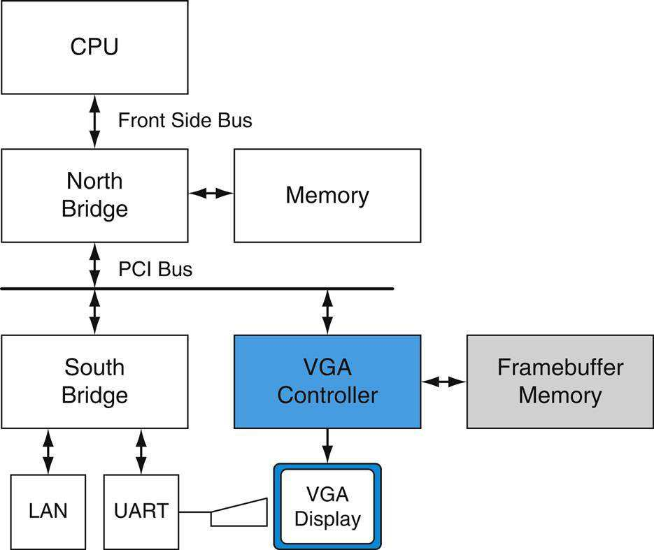

**HÌNH B.2.1 PC lịch sử. VGA controller drive màn hình từ framebuffer memory.**

Hình B.2.2 minh họa hai cấu hình phổ biến nay, có GPU rời và CPU với subsystem memory riêng. Hình B.2.2a CPU Intel, GPU gắn bằng link PCI-Express 2.0 16-lane, truyền đỉnh 16 GB/s (8 GB/s mỗi hướng). Tương tự Hình B.2.2b CPU AMD, GPU gắn chipset bằng PCI-Express cùng băng thông. Cả hai GPU, CPU truy cập memory nhau được nhưng băng thông thấp hơn memory gắn trực tiếp. Hệ AMD tích hợp north bridge hay memory controller cùng die CPU.

#### PCI-Express (PCIe)

Interconnect I/O hệ thống chuẩn dùng link point-to-point. Link có số lane, băng thông cấu hình được.

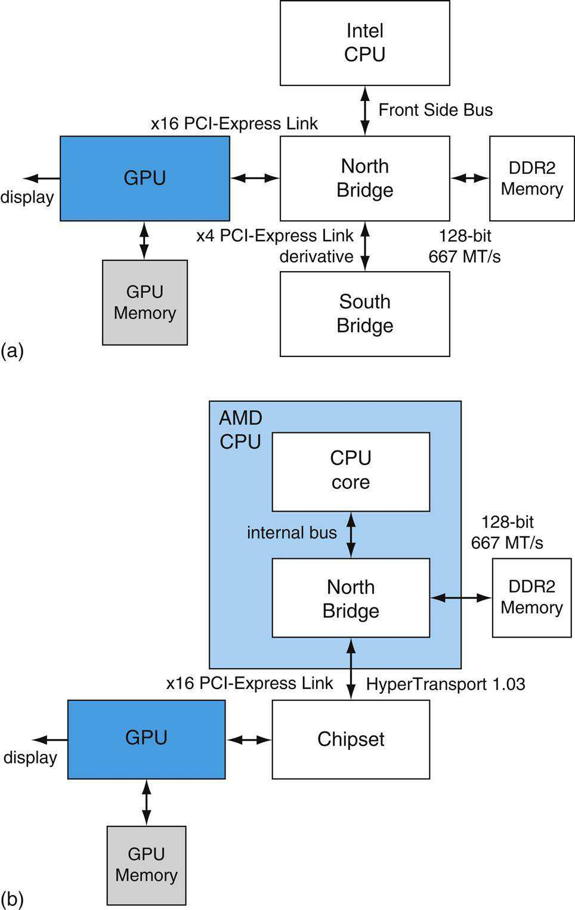

**HÌNH B.2.2 PC hiện đại dùng CPU Intel, AMD. Chương 6 giải thích thành phần, interconnect. Biến thể low-cost là unified memory architecture (UMA), chỉ dùng memory CPU, bỏ memory GPU. Chúng có GPU low-performance vì bị giới hạn băng thông hệ memory và latency tăng, trong khi memory GPU chuyên dụng có băng thông cao, latency thấp.**

#### unified memory architecture (UMA)

Kiến trúc CPU và GPU dùng chung system memory.

Biến thể high-performance dùng nhiều GPU gắn vào, thường hai đến bốn song song, màn hình daisy-chained. Ví dụ NVIDIA SLI (scalable link interconnect) multi-GPU, dành gaming high-performance và workstation.

Nhóm tiếp tích hợp GPU với north bridge (Intel) hoặc chipset (AMD), có hoặc không memory đồ họa riêng.

Chương 5 giải thích cache giữ coherence trong shared address space. CPU, GPU có nhiều address space. GPU truy cập physical local memory riêng và physical memory CPU bằng virtual address được MMU GPU dịch. Kernel operating system quản lý page table GPU. Physical page hệ thống truy cập bằng transaction PCI-Express coherent hoặc noncoherent theo attribute page table GPU. CPU truy cập local memory GPU qua dải address (aperture) trong address space PCI-Express.

#### Game console

Console như Sony PlayStation 3, Microsoft Xbox 360 giống kiến trúc PC trên. Console được thiết kế xuất xưởng với hiệu năng, chức năng giống nhau suốt vòng đời năm năm hoặc hơn. Trong đó có thể triển khai lại nhiều lần để tận dụng công nghệ sản xuất silicon tiên tiến, giữ khả năng với giá ngày càng thấp. Console không cần mở rộng, nâng cấp subsystem như PC nên bus nội bộ chính thường tùy biến thay vì chuẩn hóa.

### Giao diện và driver GPU

PC ngày nay gắn GPU với CPU qua PCI-Express. Thế hệ trước dùng AGP. Ứng dụng gọi function API OpenGL [Segal và Akeley, 2006] hoặc Direct3D [Microsoft DirectX Specifcation], dùng GPU như coprocessor. API gửi command, chương trình, dữ liệu qua graphics device driver tối ưu cho GPU cụ thể.

#### AGP

Phiên bản mở rộng PCI I/O bus gốc, cung cấp tối đa tám lần băng thông PCI gốc cho một card slot. Mục đích chính nối subsystem đồ họa vào PC.

### Graphics logical pipeline

Graphics logical pipeline mô tả Mục B.3. Hình B.2.3 minh họa stage xử lý chính, nhấn stage lập trình quan trọng (vertex, geometry, pixel shader).

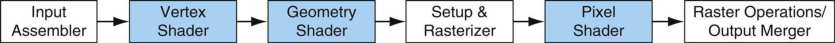

**HÌNH B.2.3 Graphics logical pipeline. Stage shader lập trình màu xanh, block fixed-function màu trắng.**

### Ánh xạ graphics pipeline tới processor GPU thống nhất

Hình B.2.4 cho cách pipeline logic gồm stage lập trình riêng độc lập ánh xạ lên mảng processor vật lý phân tán.

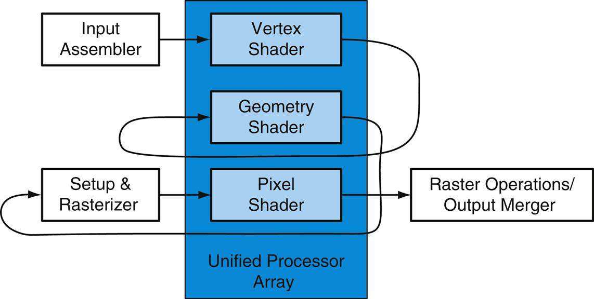

**HÌNH B.2.4 Pipeline logic ánh xạ processor vật lý. Stage shader lập trình thực thi trên mảng processor thống nhất, dataflow pipeline logic tuần hoàn qua processor.**

### Kiến trúc GPU thống nhất cơ bản

Kiến trúc GPU thống nhất dựa mảng song song nhiều processor lập trình được. Chúng hợp nhất vertex, geometry, pixel shader và parallel computing trên cùng processor, khác GPU trước có processor riêng cho mỗi loại. Mảng được tích hợp chặt với processor fixed function cho texture filtering, rasterization, raster operation, anti-aliasing, nén, giải nén, hiển thị, video decode và xử lý video high-definition. Dù processor fixed-function vượt xa processor tổng quát về hiệu năng tuyệt đối trong ngân sách diện tích, chi phí hoặc công suất, ở đây tập trung processor lập trình.

So với multicore CPU, manycore GPU có điểm thiết kế khác, tập trung thực thi nhiều thread song song hiệu quả trên nhiều core. Dùng nhiều core đơn giản và tối ưu hành vi data-parallel giữa nhóm thread, nhiều ngân sách transistor per-chip dành tính toán, ít hơn cho cache on-chip và overhead.

### Mảng processor

Mảng processor GPU thống nhất chứa nhiều core, thường tổ chức thành multiprocessor multithreaded. Hình B.2.5 có 112 core streaming processor (SP), tổ chức 14 streaming multiprocessor (SM) multithreaded. Mỗi core SP multithreaded cao, quản lý 96 thread đồng thời cùng state bằng phần cứng. Processor nối bốn partition DRAM 64-bit-wide qua interconnection network. Mỗi SM có tám core SP, hai special function unit (SFU), instruction/constant cache, instruction unit multithreaded và shared memory. Đây là Tesla cơ bản trong NVIDIA GeForce 8800. Kiến trúc thống nhất cho chương trình vertex, geometry, pixel shading truyền thống chạy SM, core SP thống nhất, chương trình tính toán cùng processor.

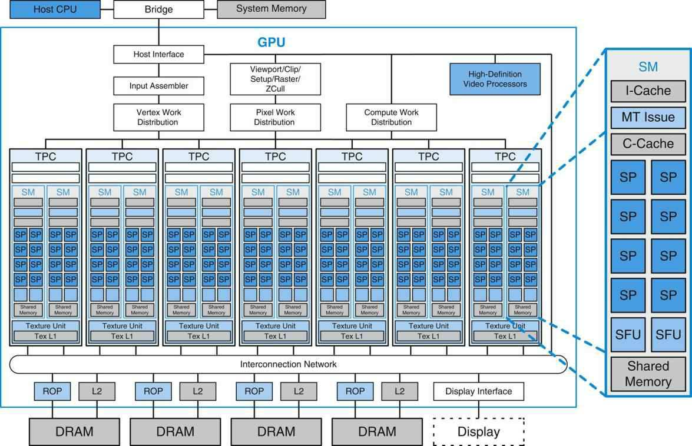

**HÌNH B.2.5 Kiến trúc GPU thống nhất cơ bản. GPU ví dụ 112 core streaming processor (SP) trong 14 streaming multiprocessor (SM); core multithreaded cao. Có Tesla cơ bản của NVIDIA GeForce 8800. Processor nối bốn partition DRAM 64-bit-wide qua interconnection network. Mỗi SM có tám core SP, hai special function unit (SFU), instruction/constant cache, instruction unit multithreaded và shared memory.**

Kiến trúc mảng có thể mở rộng tới GPU nhỏ, lớn hơn bằng đổi số multiprocessor, partition memory. Hình B.2.5 có bảy cluster hai SM chia texture unit và texture L1 cache. Texture unit trả kết quả lọc cho SM theo tập tọa độ texture map. Vì vùng hỗ trợ filter thường chồng lấp giữa request texture liên tiếp, streaming L1 texture cache nhỏ giảm request memory hiệu quả. Mảng nối raster operation processor (ROP), L2 texture cache, DRAM ngoài, system memory qua interconnection network GPU-wide. Số processor, memory mở rộng để thiết kế hệ cân bằng cho phân khúc hiệu năng, thị trường khác nhau.

## B.3 Lập trình GPU

Lập trình multiprocessor GPU khác định tính với multiprocessor khác như multicore CPU. GPU có song song thread và dữ liệu hơn CPU hai đến ba bậc độ lớn, tới hàng trăm core, hàng chục nghìn thread đồng thời. GPU tiếp tục tăng song song, gấp đôi mỗi 12 đến 18 tháng nhờ định luật Moore [1965] tăng mật độ IC và hiệu quả kiến trúc. Để phủ phạm vi giá, hiệu năng rộng, sản phẩm khác nhau có số processor, thread rất khác. Nhưng người dùng mong trò chơi, đồ họa, imaging, tính toán chạy mọi GPU bất kể số thread, core song song, và GPU đắt hơn chạy nhanh hơn. Vì vậy mô hình lập trình, ứng dụng GPU được thiết kế mở rộng trong suốt theo phạm vi song song rộng.

Động lực số thread, core lớn là đồ họa real-time—render cảnh 3D phức tạp, độ phân giải cao, frame rate tương tác ít nhất 60 frame/giây. Tương ứng, mô hình mở rộng của shading language như Cg (C for graphics), HLSL (high-level shading language) thiết kế tận dụng mức song song lớn bằng thread độc lập, mở rộng tới mọi số core. CUDA tương tự cho ứng dụng parallel computing tổng quát tận dụng nhiều thread, mở rộng mọi số core trong suốt với ứng dụng.

Trong các mô hình này, lập trình viên viết code một thread, GPU chạy vô số instance song song. Chương trình mở rộng trong suốt qua phạm vi song song phần cứng rộng. Mô hình đơn giản bắt nguồn graphics API, shading language mô tả shade một vertex/pixel, vẫn hiệu quả khi GPU tăng song song, hiệu năng nhanh từ cuối 1990.

Mục mô tả ngắn lập trình ứng dụng đồ họa real-time bằng graphics API, ngôn ngữ. Sau đó lập trình visual computing, parallel computing tổng quát bằng C và CUDA.

### Lập trình đồ họa Real-Time

API đóng vai trò quan trọng trong phát triển nhanh, thành công GPU, processor. Hai graphics API chuẩn chính là OpenGL, Direct3D (một trong giao diện multimedia DirectX Microsoft). OpenGL là chuẩn mở, ban đầu Silicon Graphics Incorporated đề xuất, định nghĩa. Phát triển, mở rộng liên tục [Segal và Akeley, 2006; Kessenich, 2006] do consortium Khronos quản lý. Direct3D [Blythe, 2006], chuẩn de facto, do Microsoft và đối tác định nghĩa, phát triển. Cả hai cấu trúc tương tự, tiếp tục phát triển nhanh theo phần cứng GPU. Chúng định nghĩa pipeline logic ánh xạ phần cứng, processor GPU cùng mô hình, ngôn ngữ cho stage lập trình.

#### OpenGL

Graphics API open-standard.

#### Direct3D

Graphics API do Microsoft và đối tác định nghĩa.

### Graphics pipeline logic

Hình B.3.1 minh họa pipeline Direct3D 10. OpenGL cấu trúc tương tự. API và pipeline cung cấp hạ tầng streaming dataflow cho stage shader lập trình màu xanh. Ứng dụng 3D gửi chuỗi vertex nhóm thành primitive hình học—điểm, đường, tam giác, đa giác. Input assembler gom vertex, primitive. Vertex shader xử lý per-vertex, gồm đổi vị trí 3D thành vị trí màn hình, chiếu sáng xác định màu. Geometry shader xử lý per-primitive, thêm hoặc bỏ primitive. Setup và rasterizer tạo pixel fragment (đóng góp tiềm năng vào pixel) được primitive bao phủ. Pixel shader xử lý per-fragment, gồm nội suy tham số per-fragment, texturing, tô màu. Pixel shader dùng nhiều lookup lấy mẫu, lọc trong mảng lớn 1D/2D/3D gọi texture, với tọa độ floating-point nội suy. Shader truy cập texture cho map, function, decal, ảnh, dữ liệu. Stage raster operations processing (hay output merger) kiểm tra độ sâu Z-buffer, stencil, có thể bỏ fragment bị che hoặc thay độ sâu pixel bằng fragment, pha màu fragment với pixel, ghi pixel màu đã pha.

#### texture

Mảng 1D, 2D hoặc 3D hỗ trợ lookup lấy mẫu, lọc với tọa độ nội suy.

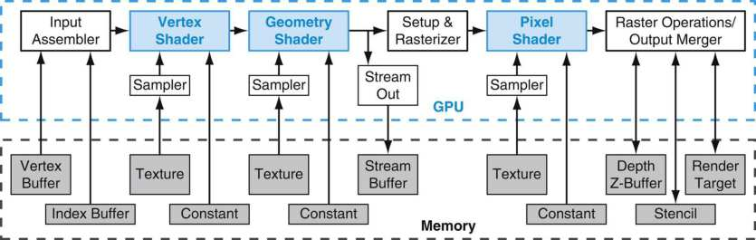

**HÌNH B.3.1 Graphics pipeline Direct3D 10. Mỗi stage logic ánh xạ phần cứng hoặc processor GPU. Stage shader lập trình xanh, block fixed-function trắng, đối tượng memory xám. Mỗi stage xử lý vertex, primitive hoặc pixel theo streaming dataflow.**

Graphics API và pipeline cung cấp input, output, đối tượng memory, hạ tầng cho shader xử lý từng vertex, primitive, pixel fragment.

### Chương trình graphics shader

Ứng dụng đồ họa Real-time dùng nhiều shader mô hình tương tác ánh sáng với vật liệu, render chiếu sáng, bóng phức tạp. Shading language dựa mô hình dataflow/streaming tương ứng pipeline logic. Vertex shader ánh xạ vertex tam giác lên màn hình, đổi vị trí, màu, hướng. Thường thread nhận vị trí vertex floating-point (x, y, z, w), tính vị trí màn hình floating-point (x, y, z). Geometry shader thao tác primitive (đường, tam giác) định bởi nhiều vertex, đổi hoặc tạo primitive thêm. Mỗi pixel fragment shader “shade” một pixel, tính đóng góp màu floating-point red, green, blue, alpha (RGBA) tại vị trí lấy mẫu ảnh (x, y). Shader và GPU dùng số học floating-point cho mọi tính màu để tránh artifact thấy được khi tính phạm vi giá trị đóng góp cực lớn của cảnh ánh sáng, bóng phức tạp, high dynamic range. Cả ba loại chạy nhiều instance song song như thread độc lập vì dữ liệu, kết quả độc lập, không side effect. Vertex, primitive, pixel độc lập cũng cho cùng chương trình chạy GPU kích thước khác xử lý số lượng song song khác. Vì vậy chương trình mở rộng trong suốt theo GPU có song song, hiệu năng khác nhau.

#### shader

Chương trình thao tác dữ liệu đồ họa như vertex hoặc pixel fragment.

#### shading language

Ngôn ngữ render đồ họa, thường mô hình lập trình dataflow hoặc streaming.

Người dùng lập trình ba loại thread logic bằng ngôn ngữ high-level chung. HLSL (high-level shading language), Cg (C for graphics) phổ biến, có cú pháp C-like, thư viện phong phú cho matrix, lượng giác, nội suy, texture access/filtering, nhưng xa ngôn ngữ tính toán tổng quát: hiện thiếu memory access tổng quát, pointer, file I/O, recursion. Chúng giả sử chương trình trong pipeline logic nên I/O ngầm. Ví dụ pixel fragment shader có thể mong geometric normal, nhiều texture coordinate đã được nội suy từ vertex bởi stage fixed-function upstream, và chỉ gán COLOR output để truyền downstream pha với pixel ở vị trí ngầm (x, y).

Phần cứng GPU tạo thread độc lập mới thực thi vertex, geometry hoặc pixel shader cho mỗi vertex, primitive, pixel fragment. Trong game phần lớn thread chạy pixel shader, vì thường pixel fragment gấp 10 đến 20 lần vertex; ánh sáng, bóng phức tạp cần tỷ lệ pixel/vertex shader thread cao hơn. Mô hình shader thúc kiến trúc GPU thực thi hiệu quả hàng nghìn thread fine-grained độc lập trên nhiều core song song.

### Ví dụ pixel shader

Xét pixel shader Cg sau triển khai render “environment mapping”. Mỗi pixel thread nhận năm tham số gồm tọa độ ảnh texture floating-point 2D lấy mẫu màu bề mặt và vector floating-point 3D cho phản xạ hướng nhìn khỏi bề mặt. Ba tham số “uniform” khác không đổi giữa instance pixel (thread). Shader lookup màu hai ảnh texture: truy cập 2D cho màu bề mặt, truy cập 3D cube map (sáu ảnh tương ứng mặt lập phương) cho màu thế giới ngoài theo hướng phản xạ. Cuối cùng màu floating-point four-component (đỏ, xanh lá, xanh dương, alpha) tính bằng trung bình có trọng số gọi “lerp” hay linear interpolation.

```
void refection(
 float2  texCoord  : TEXCOORD0,
 float3  refection_dir  : TEXCOORD1,
 out float4  color  : COLOR,
 uniform float  shiny,
 uniform sampler2D  surfaceMap,
 uniform samplerCUBE  envMap)
{
// Fetch the surface color from a texture
 float4 surfaceColor = tex2D(surfaceMap, texCoord);
// Fetch reflected color by sampling a cube map
 float4 reflectedColor = texCUBE(environmentMap,
refection_dir);
// Output is weighted average of the two colors
 color = lerp(surfaceColor, refectedColor, shiny);
}
```

Dù shader chỉ ba dòng, nó kích hoạt nhiều phần cứng GPU. Mỗi texture fetch, subsystem texture truy cập memory nhiều lần lấy mẫu màu quanh tọa độ rồi nội suy kết quả bằng số học lọc floating-point. GPU multithreaded thực thi hàng nghìn pixel shader Cg nhẹ song song, xen kẽ sâu để che latency texture fetch, memory.

Cg tập trung góc nhìn lập trình viên vào một vertex, primitive hay pixel, GPU triển khai như một thread; shader mở rộng trong suốt để khai thác song song thread trên processor sẵn có. Vì application-specific, Cg cung cấp nhiều datatype, function thư viện, cấu trúc ngôn ngữ hữu ích biểu đạt kỹ thuật render đa dạng.

Hình B.3.2 cho da render bằng fragment pixel shader. Da thật khác sơn flesh-color vì ánh sáng phản xạ nhiều trước khi thoát. Shader phức tạp mô hình ba lớp da riêng, mỗi lớp có subsurface scattering riêng, tạo độ sâu, trong mờ. Scattering có thể mô hình bằng convolution làm mờ trong không gian “texture” làm phẳng, đỏ mờ hơn xanh lá, xanh dương mờ ít hơn. Shader Cg biên dịch thực thi 1400 instruction tính màu một pixel da.


**HÌNH B.3.2 Ảnh GPU-rendered. Để tạo độ sâu, trong mờ da, pixel shader mô hình ba lớp riêng với subsurface scattering riêng. Thực thi 1400 instruction render thành phần đỏ, xanh lá, xanh dương, alpha mỗi pixel fragment da.**

GPU có hiệu năng floating-point vượt trội, băng thông streaming memory rất cao cho đồ họa real-time, thu hút ứng dụng song song cao ngoài đồ họa truyền thống. Ban đầu chỉ truy cập sức mạnh bằng diễn đạt ứng dụng thành thuật toán graphics-rendering, nhưng GPGPU thường bất tiện, hạn chế. Gần đây CUDA cung cấp cách dễ hơn nhiều khai thác floating-point high-performance mở rộng và băng thông GPU bằng C.

### Lập trình ứng dụng parallel computing

CUDA, Brook, CAL là giao diện GPU tập trung data parallel computation thay đồ họa. CAL (Compute Abstraction Layer) là giao diện assembler low-level AMD GPU. Brook là streaming language Buck và cộng sự [2004] thích ứng GPU. CUDA do NVIDIA [2007] phát triển, mở rộng C, C+ + cho lập trình song song mở rộng manycore GPU, multicore CPU. Mô hình CUDA dưới đây điều chỉnh từ Nickolls và cộng sự [2008].

Với mô hình mới GPU xuất sắc data parallel, throughput computing, thực thi ứng dụng high-performance computing lẫn đồ họa.

#### Phân rã bài toán data parallel

Để ánh xạ hiệu quả bài toán lớn tới kiến trúc song song cao, lập trình viên/compiler phân rã thành nhiều bài toán nhỏ giải song song. Ví dụ chia mảng kết quả lớn thành block rồi phần tử, để block tính độc lập song song, phần tử mỗi block tính song song. Hình B.3.3 chia mảng thành grid 3×2 block, mỗi block thành mảng 5×3 phần tử. Phân rã two-level ánh xạ tự nhiên lên GPU: multiprocessor song song tính block, thread song song tính phần tử.

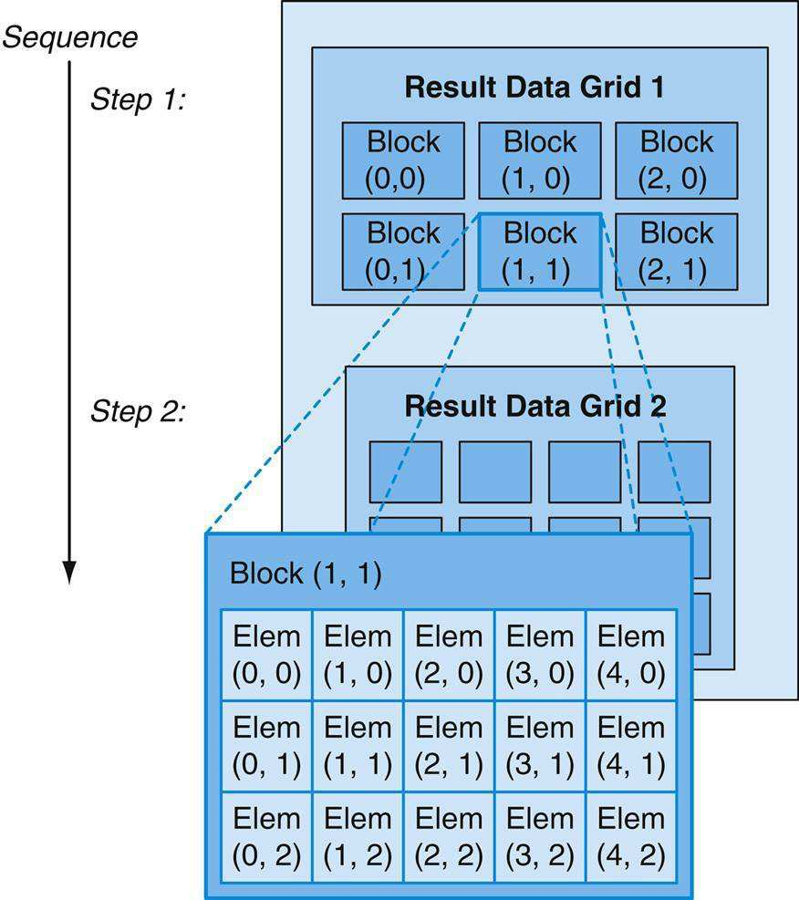

**HÌNH B.3.3 Phân rã dữ liệu kết quả thành grid các block phần tử tính song song.**

Lập trình viên viết chương trình tính chuỗi grid kết quả, chia mỗi grid thành block coarse-grained tính độc lập song song. Chương trình tính mỗi block bằng mảng thread fine-grained, chia việc để mỗi thread tính một hoặc nhiều phần tử.

### Lập trình song song có thể mở rộng bằng CUDA

CUDA mở rộng C, C++ để khai thác mức song song lớn cho ứng dụng tổng quát trên multiprocessor song song cao, đặc biệt GPU. Kinh nghiệm đầu cho nhiều chương trình tinh vi dễ diễn đạt bằng vài abstraction dễ hiểu. Từ NVIDIA phát hành 2007, nhà phát triển nhanh tạo chương trình song song mở rộng cho xử lý dữ liệu địa chấn, hóa tính toán, đại số tuyến tính, giải ma trận thưa, sắp xếp, tìm kiếm, mô hình vật lý, visual computing. Chúng mở rộng trong suốt tới hàng trăm core, hàng nghìn thread. GPU NVIDIA kiến trúc Tesla đồ họa/tính toán thống nhất (Mục B.4, B.7) chạy CUDA C, phổ biến laptop, PC, workstation, server. CUDA cũng áp dụng kiến trúc parallel processing shared memory khác gồm multicore CPU.

CUDA có ba abstraction chính—phân cấp nhóm thread, shared memory, barrier synchronization—cung cấp cấu trúc song song rõ cho code C thông thường một thread. Nhiều cấp thread, memory, đồng bộ cung cấp song song dữ liệu/thread fine-grained lồng trong song song dữ liệu/task coarse-grained. Abstraction hướng chia bài toán thành phần thô độc lập rồi phần tinh hơn giải song song. Mô hình mở rộng trong suốt tới nhiều core: chương trình CUDA biên dịch thực thi mọi số processor, chỉ runtime cần biết số processor vật lý.

#### Mô hình CUDA

CUDA mở rộng tối thiểu C, C++. Lập trình viên viết chương trình tuần tự gọi kernel song song, có thể function đơn giản hoặc chương trình đầy đủ. Kernel thực thi trên tập thread song song, tổ chức thành phân cấp thread block, grid các thread block. Thread block là tập thread đồng thời hợp tác qua barrier synchronization và truy cập chung memory riêng block. Grid là tập thread block có thể thực thi độc lập, do đó song song.

#### kernel

Chương trình hoặc function một thread, thiết kế thực thi bởi nhiều thread.

#### thread block

Tập thread đồng thời chạy cùng chương trình, có thể hợp tác tính kết quả.

#### grid

Tập thread block chạy cùng kernel.

Khi gọi kernel, chỉ định số thread mỗi block, số block grid. Mỗi thread có ID threadIdx duy nhất trong block, đánh 0, 1, 2, …, blockDim-1, mỗi block có ID blockIdx duy nhất trong grid. CUDA hỗ trợ tối đa 512 thread mỗi block. Tiện lợi, block, grid có một, hai, ba chiều truy cập qua trường .x, .y, .z.

Để minh họa một ví dụ rất đơn giản về lập trình song song, giả sử chúng ta có hai vector x và y, mỗi vector chứa n số floating-point, và muốn tính y=ax+y với một giá trị scalar a nào đó. Đây là kernel được gọi là SAXPY (so-called SAXPY kernel), được định nghĩa bởi thư viện đại số tuyến tính BLAS. Hình B.3.4 minh họa code C thực hiện phép tính này trên cả processor tuần tự lẫn thực thi song song bằng CUDA.

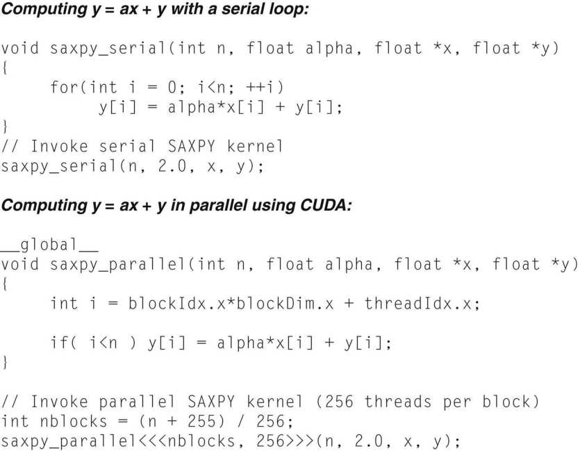

**HÌNH B.3.4 Code tuần tự C (trên) so với song song CUDA (dưới) cho SAXPY (Chương 6). Thread CUDA thay loop C tuần tự—mỗi thread tính như một iteration. Code song song tính n kết quả với n thread theo block 256 thread.**

Declaration specifier __global__ chỉ procedure là kernel entry point. Chương trình CUDA launch kernel bằng cú pháp gọi function mở rộng:

```
kernel<<<dimGrid, dimBlock>>>(… parameter list …);
```

trong đó dimGrid, dimBlock là vector three-element kiểu dim3, chỉ kích thước grid theo block và block theo thread. Chiều không chỉ định mặc định một.

Hình B.3.4 launch grid n thread, một thread mỗi phần tử vector, 256 thread mỗi block. Thread tính index từ ID thread, block rồi tính trên phần tử tương ứng. Code tuần tự, song song rất giống nhau, thể hiện mẫu phổ biến: loop có iteration độc lập. Loop như vậy chuyển máy móc thành kernel song song, mỗi iteration thành thread độc lập. Gán một thread mỗi phần tử output tránh cần đồng bộ khi ghi kết quả memory.

Nội dung kernel CUDA chỉ là function C cho một thread tuần tự, thường dễ viết và đơn giản hơn code song song vector. Song song được xác định rõ, tường minh bằng kích thước grid, block khi launch.

Thực thi song song, quản lý thread tự động. Hệ nền xử lý tạo, lập lịch, kết thúc thread. GPU Tesla làm hoàn toàn bằng phần cứng. Thread block thực thi đồng thời, đồng bộ tại barrier bằng intrinsic __syncthreads(). Không thread nào tiếp tục trước khi tất cả tới barrier. Sau barrier, mọi thread bảo đảm thấy mọi write memory do thread block thực hiện trước barrier. Vì vậy chúng giao tiếp bằng đọc ghi shared memory per-block tại barrier.

#### synchronization barrier

Thread đợi ở barrier tới khi mọi thread block tới.

Vì thread trong block dùng chung memory, đồng bộ barrier, chúng cùng trên physical processor/multiprocessor. Nhưng số block có thể vượt xa processor. CUDA ảo hóa processor, cho linh hoạt song song mức thuận tiện. Ảo hóa thread/block cho phân rã trực quan, số block theo kích thước dữ liệu thay số processor. Cùng chương trình mở rộng tới số core rất khác.

Để quản lý ảo hóa, mở rộng, CUDA yêu cầu block thực thi độc lập. Phải thực thi được mọi thứ tự, song song hoặc tuần tự. Block không giao tiếp trực tiếp, dù điều phối được bằng atomic memory operation trên global memory—ví dụ tăng queue pointer atomic. Độc lập cho lập lịch bất kỳ thứ tự trên mọi số core, làm CUDA mở rộng mọi số core, nhiều kiến trúc, tránh deadlock. Ứng dụng chạy nhiều grid độc lập hoặc phụ thuộc. Grid độc lập chạy đồng thời nếu đủ tài nguyên. Grid phụ thuộc tuần tự, có interkernel barrier ngầm, bảo đảm toàn block grid đầu hoàn tất trước block grid phụ thuộc sau.

#### atomic memory operation

Chuỗi memory read, modify, write hoàn tất không có truy cập xen vào.

Thread truy cập nhiều memory space khi chạy. Mỗi thread có local memory riêng; CUDA dùng cho biến thread-private không vừa register, stack frame, register spilling. Mỗi block có shared memory mọi thread block thấy, cùng lifetime block. Cuối cùng mọi thread truy cập cùng global memory. Biến shared/global khai báo bằng qualifier __shared__, __device__. GPU Tesla ánh xạ chúng tới memory vật lý riêng: shared memory per-block là RAM low-latency on-chip, global memory nằm DRAM nhanh trên card.

#### local memory

Local memory Per-thread riêng thread.

#### shared memory

Memory Per-block chung mọi thread block.

#### global memory

Memory Per-application chung mọi thread.

Shared memory dự kiến low-latency gần processor như L1 cache, giao tiếp, chia dữ liệu high-performance giữa thread block. Vì cùng lifetime block, kernel thường khởi tạo biến shared, tính trên chúng, copy kết quả ra global. Block của grid phụ thuộc tuần tự giao tiếp global memory, đọc input, ghi kết quả.

Hình B.3.5 vẽ cấp lồng thread, block, grid, cùng cấp chia memory local/shared/global cho dữ liệu per-thread, per-thread-block, per-application.

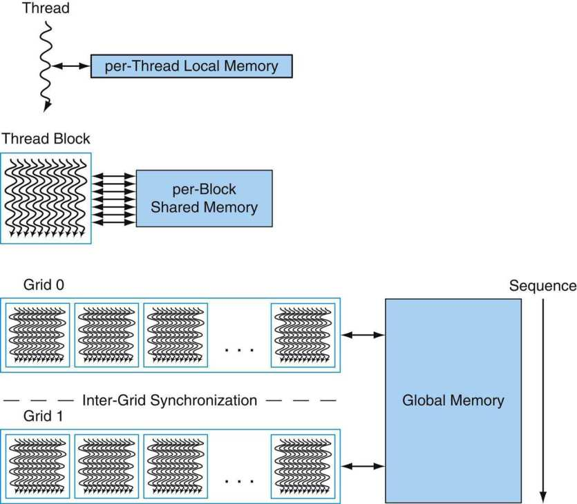

**HÌNH B.3.5 Cấp granularity lồng—thread, block, grid—có cấp memory tương ứng local, shared, global. Local memory Per-thread riêng thread. Shared memory Per-block chung block. Global memory Per-application chung mọi thread.**

Chương trình quản lý global memory kernel thấy bằng CUDA runtime như cudaMalloc(), cudaFree(). Kernel có thể chạy thiết bị vật lý riêng như GPU. Vì vậy phải dùng cudaMemcpy() copy giữa vùng cấp phát và host system memory.

CUDA giống single- program multiple data (SPMD) quen thuộc—biểu đạt song song tường minh, mỗi kernel chạy số thread cố định. Nhưng linh hoạt hơn vì mỗi call tạo grid mới đủ block/thread cho bước đó. Mỗi kernel có mức song song thuận tiện thay mọi phase phải cùng số thread. Hình B.3.6 cho chuỗi CUDA SPMD-like: kernelF trên grid 2D 3×2 block, mỗi block 2D 5×3 thread; rồi kernelG trên grid 1D bốn block 1D, mỗi block sáu thread. Vì kernelG phụ thuộc kernelF, có interkernel barrier giữa chúng.

#### single-program multiple data (SPMD)

Kiểu mô hình song song mọi thread chạy cùng chương trình, thường phối hợp bằng barrier synchronization.

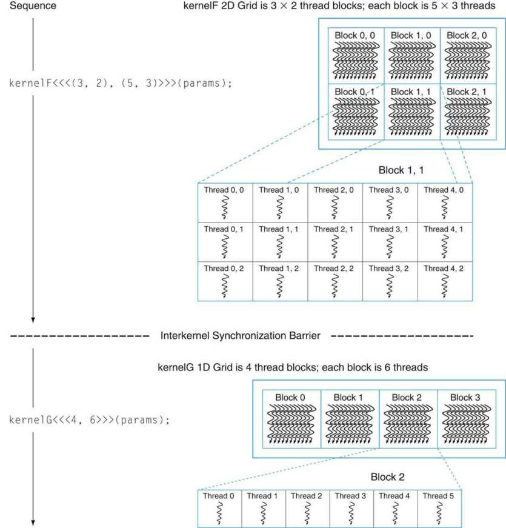

**HÌNH B.3.6 Kernel F instantiate trên grid 2D các block 2D, interkernel barrier, rồi kernel G trên grid 1D các block 1D.**

Thread đồng thời trong block biểu đạt song song dữ liệu, thread fine-grained. Block độc lập trong grid biểu đạt song song dữ liệu coarse-grained. Grid độc lập biểu đạt song song task coarse-grained. Kernel chỉ là code C một thread trong phân cấp.

### Hạn chế

Để hiệu quả, đơn giản triển khai, CUDA có hạn chế. Chỉ tạo thread/block bằng gọi kernel, không từ trong kernel. Cùng độc lập block, điều này cho chạy bằng scheduler đơn giản overhead runtime tối thiểu. Tesla GPU thực tế quản lý, lập lịch thread/block bằng phần cứng.

Task parallelism có thể được biểu đạt ở cấp thread block nhưng khó biểu đạt bên trong một thread block vì các synchronization barrier tác động lên mọi thread của block. Để chương trình CUDA có thể chạy trên bất kỳ số lượng processor nào, không cho phép dependency giữa các thread block trong cùng kernel grid; các block phải thực thi độc lập. Vì CUDA yêu cầu thread block độc lập và cho phép thực thi chúng theo bất kỳ thứ tự nào, nhìn chung việc kết hợp kết quả từ nhiều block phải được thực hiện bằng cách launch kernel thứ hai trên một grid thread block mới. Tuy nhiên, các thread block có thể phối hợp bằng atomic memory operation trên global memory hiển thị với mọi thread, chẳng hạn bằng cách tăng queue pointer một cách atomic.

Recursive call hiện không được cho trong kernel. Recursion không hấp dẫn vì cấp stack hàng chục nghìn thread active cần memory đáng kể. Thuật toán tuần tự thường đệ quy như quicksort thường triển khai tốt nhất bằng nested data parallelism thay recursion tường minh.

Để hỗ trợ hệ CPU, GPU mỗi loại memory riêng, CUDA phải copy dữ liệu, kết quả giữa host/device. Overhead tương tác, truyền giảm bằng DMA block transfer engine, interconnect nhanh. Bài toán Compute-intensive đủ lớn cần GPU bù overhead tốt hơn nhỏ.

### Hệ quả với kiến trúc

Mô hình song song đồ họa, tính toán khiến GPU khác CPU. Những khía cạnh chương trình chi phối kiến trúc:

- Dùng nhiều song song dữ liệu fine-grained: shader mô tả xử lý một pixel/vertex, CUDA tính một kết quả.

- Mô hình nhiều thread: shader thread xử lý một pixel/vertex, CUDA thread có thể tạo một kết quả. GPU phải tạo, thực thi hàng triệu thread mỗi frame ở 60 frame/giây.

- Mở rộng: chương trình tự tăng hiệu năng khi thêm processor, không biên dịch lại.

- Tính toán floating-point (hoặc integer) cường độ cao.

- Hỗ trợ tính toán high-throughput.

## B.4 Kiến trúc multiprocessor multithreaded

Để phục vụ phân khúc, GPU có số multi-processors mở rộng—thực chất multiprocessor gồm multiprocessor. Mỗi multiprocessor multithreaded cao để chạy shader vertex/pixel fine-grained hiệu quả. GPU cơ bản tốt có hai đến bốn multiprocessor, GPU gaming cao cấp hay tính toán có hàng chục. Mục xem kiến trúc một multiprocessor như vậy, bản đơn giản của NVIDIA Tesla streaming multiprocessor (SM) Mục B.7.

Vì sao dùng multiprocessor thay nhiều processor độc lập? Song song trong mỗi multiprocessor cho hiệu năng cao cục bộ, hỗ trợ nhiều thread cho mô hình fine-grained Mục B.3. Thread block chạy chung trong multiprocessor để chia dữ liệu. Thiết kế này tám scalar core ghép chặt, tối đa 512 thread (SM Mục B.7 tối đa 768). Để hiệu quả diện tích, công suất, chia unit lớn phức tạp giữa tám core: instruction cache, instruction unit multithreaded, shared memory RAM.

### Multithreading đồ sộ

GPU processor multithreaded cao để:

- Che latency load memory, texture fetch từ DRAM

- Hỗ trợ mô hình shader đồ họa song song fine-grained

- Hỗ trợ mô hình parallel computing fine-grained

- Ảo hóa physical processor thành thread/block cho mở rộng trong suốt

- Đơn giản mô hình song song thành viết chương trình tuần tự một thread

Latency fetch memory, texture có thể hàng trăm clock, vì GPU thường cache streaming nhỏ thay working-set cache lớn như CPU. Fetch thường cần đầy đủ latency DRAM cộng interconnect, buffer. Multithreading che latency bằng tính toán hữu ích—một thread chờ load/fetch thì processor chạy thread khác. Mô hình fine-grained cho hàng nghìn thread độc lập giữ nhiều processor bận dù memory latency từng thread dài.

Shader vertex/pixel là chương trình một thread xử lý vertex/pixel. CUDA tương tự chương trình C một thread tính kết quả. Chương trình instantiate nhiều thread song song render ảnh phức tạp, tính mảng lớn. Để cân tải động giữa vertex/pixel, mỗi multiprocessor đồng thời chạy nhiều chương trình thread, loại shader. Để hỗ trợ mô hình vertex/primitive/pixel độc lập và single-thread CUDA C/C+ +, mỗi thread có register riêng, memory per-thread riêng, program counter, execution state riêng, chạy đường code độc lập. Để hiệu quả hàng trăm thread nhẹ, multiprocessor hardware multithreaded quản lý, thực thi không overhead lập lịch. Thread block đồng bộ barrier bằng một instruction. Tạo thread nhẹ, lập lịch zero-overhead, đồng bộ nhanh hỗ trợ song song rất fine-grained.

### Kiến trúc multiprocessor

Multiprocessor thống nhất chạy vertex, geometry, pixel fragment shader và chương trình parallel computing. Như Hình B.4.1, ví dụ gồm tám scalar processor (SP) core, mỗi core register file (RF) multithreaded lớn, hai special function unit (SFU), instruction unit multithreaded, instruction cache, constant cache read-only, shared memory.

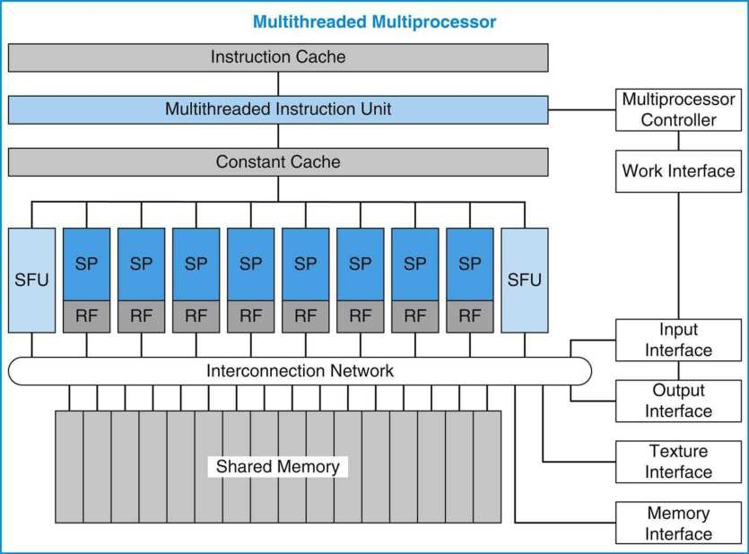

**HÌNH B.4.1 Multiprocessor multithreaded tám scalar processor (SP) core. Mỗi SP có RF multithreaded lớn, chia instruction cache, instruction issue unit multithreaded, constant cache, hai SFU, interconnection network, shared memory nhiều bank.**

Shared memory 16 KB giữ buffer đồ họa, dữ liệu tính toán chung. Biến CUDA __shared__ nằm đó. Để ánh xạ workload pipeline qua multiprocessor nhiều lần như Mục B.2, thread vertex/geometry/pixel có buffer input/output riêng, workload tới, đi độc lập thực thi thread.

Mỗi SP có unit số học integer, floating-point scalar chạy phần lớn instruction. SP hardware multithreaded tối đa 64 thread. Mỗi SP pipeline thực thi một scalar instruction mỗi thread mỗi clock, từ 1.2 đến 1.6 GHz theo sản phẩm. RF mỗi SP có 1024 register general-purpose 32-bit, chia cho thread. Chương trình khai nhu cầu thường 16 đến 64 register scalar 32-bit/thread. SP chạy đồng thời nhiều thread ít register hoặc ít thread nhiều register. Compiler cân chi phí spilling và ít thread. Pixel shader thường ≤16 register, cho tối đa 64 thread che texture fetch long-latency. CUDA biên dịch thường cần 32 register/thread, giới hạn SP 32 thread, kernel tối đa 256 thread/block ở multiprocessor ví dụ thay tối đa 512.

SFU pipeline chạy instruction tính special function, nội suy thuộc tính pixel từ vertex primitive. Chúng chạy đồng thời instruction SP. SFU mô tả sau.

Multiprocessor thực thi texture fetch trên texture unit qua texture interface; memory interface cho load/store/atomic ngoài. Chúng chạy đồng thời instruction SP. Shared memory dùng interconnection network low-latency giữa SP và bank.

### Single-Instruction Multiple-Thread (SIMT)

Để quản lý hiệu quả hàng trăm thread nhiều chương trình, multiprocessor dùng single-instruction multiple-thread (SIMT). Nó tạo, quản lý, lập lịch, thực thi thread theo nhóm song song gọi warp. Từ warp bắt nguồn dệt, công nghệ thread song song đầu. Ảnh Hình B.4.2 cho warp sợi song song từ khung dệt. Multiprocessor ví dụ dùng warp 32 thread, chạy bốn thread mỗi tám SP qua bốn clock. Tesla SM Mục B.7 cũng warp 32, bốn thread/SP để hiệu quả nhiều pixel/computing thread. Thread block gồm một hoặc nhiều warp.

#### single-instruction multiple-thread (SIMT)

Kiến trúc áp một instruction cho nhiều thread độc lập song song.

#### warp

Tập thread song song cùng thực thi một instruction trong SIMT.

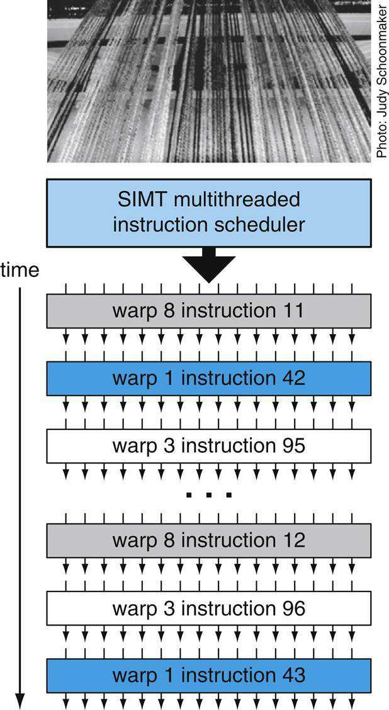

**HÌNH B.4.2 Lập lịch warp SIMT multithreaded. Scheduler chọn warp sẵn sàng, issue instruction đồng bộ tới thread warp. Vì warp độc lập, có thể chọn warp khác mỗi lần.**

SIMT multiprocessor ví dụ quản lý 16 warp, 512 thread. Thread mỗi warp cùng loại, bắt đầu cùng address chương trình nhưng tự do branch, thực thi độc lập. Mỗi lần issue, instruction unit chọn warp sẵn sàng instruction kế rồi issue tới thread active. Instruction SIMT broadcast đồng bộ tới thread song song active; thread có thể inactive do branch/predication riêng. Mỗi SP chạy instruction cho bốn thread riêng của warp trong bốn clock, phản ánh tỷ lệ thread/core 4:1.

SIMT gần single-instruction multiple data (SIMD), áp instruction nhiều data lane, nhưng SIMT áp cho thread độc lập song song, không chỉ data lane. Instruction SIMD điều khiển vector data lane cùng nhau; SIMT điều khiển thread riêng, instruction unit issue cho warp thread độc lập để hiệu quả. SIMT tìm data-level parallelism runtime giữa thread, tương tự superscalar tìm instruction-level parallelism giữa instruction runtime.

SIMT đạt hiệu quả, hiệu năng đầy đủ khi thread warp cùng đường. Nếu diverge bởi branch data-dependent, mỗi đường thực thi tuần tự, sau cùng converge. Đường dài bằng nhau, block if-else phân kỳ hiệu quả 50%. Multiprocessor dùng branch synchronization stack quản lý diverge/converge. Warp khác chạy độc lập toàn tốc bất kể đường code chung hay riêng. Vì vậy SIMT GPU hiệu quả, linh hoạt branch hơn GPU trước, warp hẹp hơn nhiều SIMD width cũ.

Khác với SIMD vector architecture, SIMT cho phép lập trình viên viết code song song thread-level cho từng thread độc lập cũng như code data-parallel cho nhiều thread phối hợp. Để bảo đảm chương trình đúng, lập trình viên về cơ bản có thể bỏ qua các thuộc tính thực thi SIMT của warp; tuy nhiên, có thể đạt cải thiện hiệu năng đáng kể nếu chú ý để code hiếm khi yêu cầu các thread trong warp diverge. Trong thực tế, điều này tương tự vai trò của cache line trong code truyền thống: có thể bỏ qua cache line size một cách an toàn khi thiết kế cho tính đúng đắn, nhưng phải xem xét nó trong cấu trúc code khi thiết kế để đạt hiệu năng tối đa.

### Thực thi warp SIMT và divergence

Lập lịch warp độc lập SIMT linh hoạt hơn kiến trúc GPU trước. Warp gồm thread cùng loại vertex, geometry, pixel, compute. Đơn vị pixel fragment cơ bản là quad 2-by-2, bốn thread pixel shader. Controller đóng gói quad thành warp, tương tự vertex, primitive, computing thread. Block gồm một hoặc nhiều warp. SIMT chia hiệu quả fetch, issue unit giữa thread nhưng cần warp đầy active để hiệu năng đủ.

Multiprocessor thống nhất lập lịch, thực thi nhiều loại warp đồng thời, cho vertex/pixel đồng thời. Scheduler chậm hơn clock processor vì bốn thread lane mỗi core. Mỗi scheduling cycle chọn warp chạy instruction SIMT như Hình B.4.2. warp-instruction issue chạy bốn tập tám thread qua bốn processor cycle throughput. Pipeline mất vài clock latency hoàn tất instruction. Nếu số warp active nhân clock/warp vượt latency pipeline, có thể bỏ qua latency. Ở đây round-robin tám warp có chu kỳ 32 cycle giữa instruction liên tiếp cùng warp. Nếu giữ 256 thread active, che latency tới 32 cycle khỏi thread tuần tự. Ít warp active làm lộ độ sâu pipeline, có thể stall.

Thách thức là lập lịch warp zero-overhead cho hỗn hợp động chương trình, loại warp. Scheduler chọn warp mỗi bốn clock để issue một instruction/clock/thread, IPC 1.0 mỗi core. Vì warp độc lập, chỉ có phụ thuộc instruction tuần tự cùng warp. Dùng register dependency scoreboard xác nhận warp có thread active sẵn sàng. Ưu tiên mọi warp sẵn sàng, chọn cao nhất issue. Ưu tiên xét loại warp, instruction, công bằng cho mọi warp active.

### Quản lý thread và thread block

Controller, instruction unit quản lý thread/block. Controller nhận request việc, input, phân xử tài nguyên chung gồm texture unit, memory path, I/O. Với đồ họa, tạo/quản lý đồng thời vertex, geometry, pixel, mỗi loại có đường input/output riêng. Gom, đóng gói từng loại thành warp SIMT chạy cùng chương trình. Cấp warp trống, register, bắt đầu thực thi. Mọi chương trình khai register per-thread; chỉ bắt đầu khi cấp đủ. Khi toàn thread warp thoát, tháo gói kết quả, giải phóng register/tài nguyên warp.

Controller tạo cooperative thread array (CTA) triển khai block CUDA bằng một hoặc nhiều warp. Chỉ tạo khi đủ mọi warp, tài nguyên. Ngoài thread, register cần shared memory, barrier. Chương trình khai dung lượng, controller đợi cấp đủ trước launch. Rồi tạo warp CTA theo tốc độ lập lịch để chương trình bắt đầu ngay toàn hiệu năng. Theo dõi khi mọi thread CTA thoát, giải phóng tài nguyên shared, warp.

#### cooperative thread array (CTA)

Tập thread đồng thời chạy cùng chương trình, hợp tác tính kết quả. GPU CTA triển khai CUDA thread block.

### Thread instruction

SP chạy scalar instruction cho từng thread, khác vector instruction GPU cũ chạy four-component mỗi vertex/pixel shader. Vertex thường tính vector vị trí (x, y, z, w), pixel vector màu (đỏ, xanh lá, xanh dương, alpha). Nhưng shader dài hơn, scalar hơn, ngày càng khó dùng đủ cả hai thành phần của vector four-component cũ. SIMT song song hóa 32 pixel thread độc lập thay bốn thành phần trong một pixel. CUDA C/C++ chủ yếu scalar mỗi thread. GPU cũ dùng vector packing (gộp subvector công việc) nhưng phức tạp phần cứng lập lịch, compiler. Scalar instruction đơn giản, compiler-friendly. Texture vẫn vector-based, nhận coordinate vector trả color vector lọc.

Để hỗ trợ nhiều GPU định dạng microinstruction binary khác nhau, compiler high-level tạo instruction assembler-level trung gian (vector Direct3D hoặc scalar PTX), rồi tối ưu, dịch binary GPU. NVIDIA PTX (parallel thread execution) [2007] cho target ISA ổn định, tương thích nhiều thế hệ với microinstruction-set binary phát triển. Optimizer dễ mở vector Direct3D thành nhiều scalar microinstruction. PTX scalar gần một-một binary scalar, dù một số mở nhiều binary, nhiều PTX gộp một binary. Vì assembler-level trung gian dùng virtual register, optimizer phân tích phụ thuộc, cấp real register. Loại dead code, gộp instruction khi có thể, tối ưu điểm diverge/converge branch SIMT.

### Instruction Set Architecture (ISA)

Thread ISA ở đây là bản đơn giản Tesla PTX ISA, instruction set scalar register-based gồm floating-point, integer, logic, chuyển đổi, special function, flow control, memory access, texture. Hình B.4.3 liệt kê instruction cơ bản; xem đặc tả NVIDIA PTX [2007] chi tiết. Định dạng là:

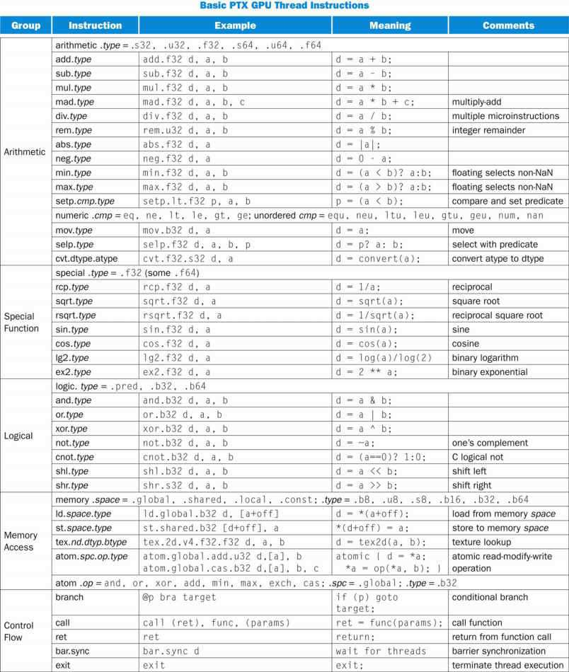

**HÌNH B.4.3 Instruction thread GPU PTX cơ bản.**

```
opcode.type d, a, b, c;
```

trong đó d là operand đích, a, b, c là nguồn, .type là một trong:

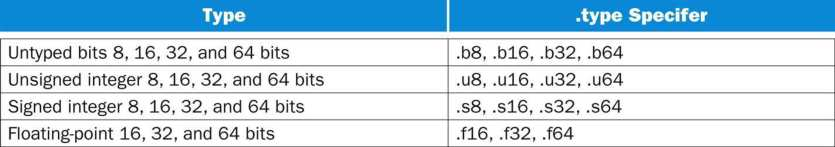

Operand nguồn là scalar 32-bit hoặc 64-bit trong register, immediate hoặc hằng; predicate operand là Boolean 1-bit. Đích là register trừ store memory. Instruction được predicated bằng prefix @p hoặc @!p, p là predicate register. Instruction memory, texture truyền scalar hoặc vector hai đến bốn thành phần, tổng tối đa 128 bit. Instruction PTX chỉ hành vi một thread.

Số học PTX thao tác floating-point, integer signed/unsigned 32-bit và 64-bit. GPU gần đây hỗ trợ double-precision floating-point 64-bit (B.6). GPU hiện tại dịch integer/logic PTX 64-bit thành từ hai microinstruction binary 32-bit. Special function chỉ floating-point 32-bit. Flow control gồm conditional branch, function call/return, thread exit, bar.sync. Branch @p bra target dùng predicate p (hoặc !p) được compare/setp thiết lập trước để quyết định branch. Instruction khác cũng được predicated theo register đúng/sai.

#### Instruction memory access

Instruction tex fetch, lọc mẫu từ texture 1D/2D/3D trong memory qua subsystem texture. Thường dùng tọa độ floating-point nội suy. Sau khi pixel shader tính màu fragment, raster operations processor pha với màu pixel tại vị trí (x, y) được gán, ghi màu cuối vào memory.

Để hỗ trợ tính toán, C/C++, Tesla PTX ISA có load/store. Nó dùng integer byte addressing, số học address register cộng offset thuận tiện compiler tối ưu thông thường. Load/store phổ biến processor nhưng là khả năng mới đáng kể ở Tesla vì GPU trước chỉ có truy cập texture/pixel graphics API cần.

Cho tính toán, load/store truy cập ba memory space đọc/ghi triển khai CUDA Mục B.3:

- Local memory cho dữ liệu tạm address được riêng per-thread (DRAM ngoài)

- Shared memory low-latency cho thread hợp tác cùng CTA/block (SRAM on-chip)

- Global memory cho tập dữ liệu lớn chung mọi thread ứng dụng (DRAM ngoài). Instruction ld.global, st.global, ld.shared, st.shared, ld.local, st.local truy cập global/shared/local. Chương trình dùng bar.sync nhanh đồng bộ thread CTA/block giao tiếp qua shared/global memory.

Để cải thiện memory bandwidth và giảm overhead, các instruction load/store của local và global memory gộp các request riêng lẻ từ những thread song song trong cùng một SIMT warp thành một request memory block duy nhất khi các địa chỉ nằm trong cùng block và đáp ứng tiêu chí alignment. Việc coalesce các memory request mang lại mức tăng hiệu năng đáng kể so với các request riêng lẻ từ từng thread. Số lượng thread lớn của multiprocessor, cùng khả năng hỗ trợ nhiều load request chưa hoàn tất, giúp che giấu load-to-use latency của local và global memory được triển khai trong DRAM bên ngoài.

Tesla mới nhất còn atomic memory hiệu quả bằng atom.op.u32, gồm integer add, min, max, and, or, xor, exchange, cas (compare-and-swap), thuận parallel reduction, quản lý cấu trúc dữ liệu song song.

#### Barrier synchronization cho giao tiếp thread

Barrier nhanh cho CUDA giao tiếp thường xuyên shared/global bằng __syncthreads(); mỗi bước liên thread. Intrinsic tạo một bar.sync. Nhưng triển khai barrier nhanh tối đa 512 thread/block là thách thức.

Nhóm warp SIMT 32 thread giảm khó đồng bộ 32 lần. Thread đợi barrier trong scheduler, không tốn processor cycle. Khi chạy bar.sync, tăng thread arrival counter, scheduler đánh dấu đợi. Khi mọi thread CTA tới, counter khớp terminal count dự kiến, scheduler giải phóng mọi thread đợi và tiếp tục.

### Streaming Processor (SP)

Core streaming processor (SP) multithreaded là processor instruction chính. RF có 1024 register scalar 32-bit cho tối đa 64 thread. Chạy floating-point cơ bản add.f32, mul.f32, mad.f32 (floating multiply-add), min.f32, max.f32, setp.f32. Cộng/nhân floating-point tương thích IEEE 754 single-precision FP, gồm not-a-number (NaN), infinity. SP còn triển khai mọi instruction integer, compare, convert, logic PTX 32-bit, 64-bit Hình B.4.3.

Cộng, mul floating-point mặc định IEEE round-to-nearest-even. Mad.f32 floating-point multiply-add nhân có truncation rồi cộng round-to-nearest-even. SP flush operand denormal thành sign-preserved-zero. Kết quả underflow exponent đích flush sign-preserved-zero sau rounding.

### Special Function Unit (SFU)

Một số instruction chạy SFU đồng thời SP. SFU triển khai special function Hình B.4.3, xấp xỉ floating-point 32-bit nghịch đảo, nghịch đảo căn bậc hai, hàm siêu việt chính. Cũng nội suy thuộc tính phẳng floating-point 32-bit cho pixel shader, chính xác màu, độ sâu, texture coordinate.

Mỗi SFU pipeline tạo một kết quả floating-point 32-bit/cycle; hai SFU/multiprocessor chạy special function bằng một phần tư tốc độ instruction đơn giản tám SP. SFU cũng chạy mul.f32 đồng thời tám SP, tăng tốc độ đỉnh tới 50% nếu hỗn hợp instruction phù hợp.

Tesla SFU dùng nội suy bậc hai dựa enhanced minimax để xấp xỉ nghịch đảo, reciprocal square-root, log<sub>2</sub>x, 2x, sin/cos. Độ chính xác 22 tới 24 mantissa bit. Xem B.6 chi tiết.

### So với multiprocessor khác

So với vector SIMD như x86 SSE, SIMT chạy từng thread độc lập thay luôn nhóm đồng bộ. Phần cứng SIMT tìm song song dữ liệu giữa thread, SIMD đòi hỏi phần mềm biểu đạt trong mỗi vector instruction. SIMT chạy warp 32 thread đồng bộ cùng đường nhưng độc lập khi diverge. Lợi thế đáng kể vì chương trình/instruction chỉ tả một thread thay vector SIMD bốn hay nhiều lane. Nhưng hiệu quả SIMD-like, chia diện tích, chi phí instruction unit cho 32 thread và tám core. SIMT có hiệu năng SIMD cùng năng suất multithreading, tránh code vector tường minh cho edge condition, partial divergence.

SIMT ít overhead nhờ hardware multithreaded, hardware barrier. Shader, CUDA biểu đạt song song rất fine-grained. Chương trình dùng thread để biểu đạt song song dữ liệu fine-grained trong chương trình per-thread thay ép dùng vector SIMD. Code scalar single-thread đơn giản, năng suất hơn vector, thực thi với hiệu quả SIMD-like.

Ghép chặt tám SP thành multiprocessor rồi mở rộng số multiprocessor tạo hệ two-level. CUDA tận dụng phân cấp two-level: thread riêng cho tính toán fine-grained, grid/block cho phép coarse-grained. Cùng chương trình thread cung cấp cả fine-grained lẫn coarse-grained. CPU SIMD trái lại cần hai mô hình cho fine-grained và coarse-grained: thread coarse-grained trên core khác và vector SIMD cho dữ liệu fine-grained.

### Kết luận multiprocessor multithreaded

Multiprocessor ví dụ Tesla multithreaded cao, tối đa 512 thread nhẹ đồng thời cho pixel shader, CUDA fine-grained. Dùng biến thể SIMD, multithreading SIMT (single-instruction multiple-thread) broadcast hiệu quả instruction cho warp 32 thread, cho từng thread branch, thực thi độc lập. Mỗi thread chạy stream instruction trên một trong tám SP, mỗi SP tối đa 64 thread.

PTX ISA scalar load/store register-based mô tả một thread. Vì PTX tối ưu, dịch binary cho GPU cụ thể, instruction phần cứng phát triển nhanh không phá compiler, công cụ tạo PTX.

## B.5 Hệ thống memory song song

Ngoài GPU, subsystem memory quyết định hiệu năng đồ họa quan trọng nhất. Workload cần tốc độ truyền vào/ra rất cao. Pixel write/blend (read-modify-write), đọc ghi depth buffer, đọc texture map, command, object vertex, attribute chiếm phần lớn traffic.

GPU hiện đại song song cao như Hình B.2.5. GeForce 8800 xử lý 32 pixel/clock ở 600 MHz. Mỗi pixel thường đọc/ghi màu, depth của pixel 4-byte. Thường đọc hai hoặc ba texel bốn byte tạo màu. Trường hợp điển hình cần 28 byte ×32 pixel =896 byte/clock. Nhu cầu băng thông rất lớn.

Để đáp ứng, memory GPU có:

- Chúng có độ rộng lớn, nghĩa là có nhiều pin để truyền data giữa GPU và các thiết bị memory của nó, và bản thân memory array gồm nhiều chip DRAM để cung cấp đầy đủ tổng độ rộng data bus.

- Nhanh: kỹ thuật signaling mạnh tối đa tốc độ bit/giây mỗi pin.

- GPU cố gắng sử dụng mọi cycle có thể để truyền data đến hoặc từ memory array. Để đạt mục tiêu này, GPU chủ động không hướng đến việc giảm thiểu latency của memory system. Throughput cao, tức hiệu suất sử dụng cao, và latency ngắn vốn mâu thuẫn với nhau.

- Nén lossy cần lập trình viên biết và lossless trong suốt, tùy cơ hội.

- Cache, cấu trúc coalescing giảm traffic off-chip, bảo đảm cycle chuyển dữ liệu được dùng tối đa.

### Cân nhắc DRAM

GPU phải xét đặc tính DRAM. Chip có nhiều bank (thường bốn đến tám), mỗi bank số row power-of-2 (thường 16,384), mỗi row số bit power-of-2 (thường 8192). DRAM có nhiều yêu cầu timing. Ví dụ hàng chục cycle activate row, sau đó bit truy cập ngẫu nhiên với column address mới mỗi bốn clock. DRAM synchronous Double-data rate (DDR) truyền cả cạnh lên, xuống (Chương 5). Vì vậy DDR 1 GHz truyền 2 gigabit/giây/pin. Graphics DDR thường 32 pin hai chiều, đọc/ghi tám byte/clock.

Bên trong GPU có nhiều nguồn tạo lưu lượng memory. Mỗi stage khác nhau của logical graphics pipeline có các request stream riêng: fetch command và vertex attribute, fetch texture cùng load/store của shader, và read-write độ sâu cùng màu của pixel. Tại mỗi logical stage, thường có nhiều unit độc lập để cung cấp throughput song song. Mỗi unit là một bên yêu cầu memory độc lập. Nhìn từ memory system, có vô số request không tương quan đang được xử lý. Điều này tự nhiên không phù hợp với mẫu reference mà DRAM ưa dùng. Một giải pháp là memory controller của GPU duy trì những tập lưu lượng riêng cho từng DRAM bank, đợi cho đến khi có đủ lưu lượng đang chờ cho một DRAM row cụ thể rồi mới activate row đó và truyền toàn bộ lưu lượng cùng lúc. Lưu ý rằng việc tích lũy request đang chờ, dù tốt cho DRAM row locality và nhờ đó sử dụng data bus hiệu quả, lại dẫn đến average latency dài hơn đối với các bên yêu cầu vì request phải chờ những request khác. Thiết kế phải bảo đảm không request nào phải chờ quá lâu; nếu không, một số processing unit có thể bị thiếu data, cuối cùng khiến các processor lân cận không hoạt động.

Subsystem chia nhiều partition, mỗi partition controller độc lập và một hoặc hai DRAM sở hữu riêng. Để cân tải, gần hiệu năng lý thuyết n partition, address finely interleave đều trên toàn partition. Stride thường block vài trăm byte. Số partition cân bằng số processor, requester khác.

### Cache

GPU workload thường có working set rất lớn, ở mức hàng trăm megabyte để tạo một frame đồ họa. Khác với CPU, việc xây dựng cache on-chip đủ lớn để giữ gần toàn bộ working set của một ứng dụng đồ họa là không thực tế. Trong khi CPU có thể giả định cache hit rate rất cao, từ 99.9% trở lên, GPU có hit rate gần 90% nên phải xử lý nhiều miss đang diễn ra. CPU có thể được thiết kế hợp lý để dừng chờ một cache miss hiếm gặp, nhưng GPU cần tiếp tục hoạt động khi miss và hit xen kẽ nhau. Chúng ta gọi đây là streaming cache architecture.

Cache GPU phải băng thông high-bandwidth. Texture unit điển hình tính hai bilinear interpolation mỗi bốn pixel/clock, nhiều unit độc lập. Mỗi nội suy cần bốn texel, mỗi texel có thể 64-bit, thường bốn thành phần 16-bit. Tổng 2×4×4×64=2048 bit/clock. Mỗi texel 64-bit address riêng, cache xử lý 32 address/clock. Tự nhiên hợp mảng SRAM nhiều bank và/hoặc port.

### MMU

GPU hiện đại dịch virtual thành physical address. GeForce 8800 mọi unit tạo address virtual 40-bit. Tính toán load/store thread dùng byte address 32-bit, mở thành virtual 40-bit bằng cộng offset 40-bit. MMU dịch; phần cứng đọc page table local memory để xử lý miss thay phân cấp TLB phân tán processor/render engine. Ngoài physical page bit, entry chỉ thuật toán nén mỗi page. Page 4 đến 128 KB.

### Memory space

Như B.3, CUDA cho memory space khác để lưu giá trị theo cách performance-optimal. Thảo luận giả sử GPU Tesla NVIDIA.

### Global memory

Global memory được lưu trong DRAM bên ngoài; nó không phải local memory của bất kỳ streaming multiprocessor (SM) vật lý riêng lẻ nào vì được dùng để giao tiếp giữa các CTA, hay thread block, khác nhau trong các grid khác nhau. Thực tế, nhiều CTA tham chiếu cùng một vị trí global memory có thể không thực thi trên GPU cùng lúc; theo thiết kế của CUDA, lập trình viên không biết thứ tự tương đối mà các CTA được thực thi. Vì address space được phân bố đều trên mọi memory partition, phải có đường đọc/ghi từ bất kỳ streaming multiprocessor nào đến bất kỳ DRAM partition nào.

Truy cập global bởi thread/processor khác không bảo đảm sequential consistency. Thread thấy mô hình relaxed ordering. Trong thread, giữ thứ tự read/write cùng address nhưng khác address có thể không giữ. Read/write thread khác không thứ tự. Trong CTA, bar.sync tạo strict ordering giữa thread. Instruction membar cung cấp memory barrier/fence commit truy cập trước, làm chúng visible với thread khác trước khi tiếp. Cũng dùng atomic B.4 điều phối memory chung.

### Shared memory

Shared memory Per-CTA chỉ hiển thị với những thread thuộc CTA đó, và shared memory chỉ chiếm không gian lưu trữ từ lúc CTA được tạo đến lúc kết thúc. Vì vậy, shared memory có thể nằm on-chip. Cách tiếp cận này có nhiều lợi ích. Thứ nhất, lưu lượng shared memory không phải cạnh tranh với off-chip bandwidth hạn chế dành cho các global memory reference. Thứ hai, có thể xây dựng những cấu trúc memory high-bandwidth on-chip để đáp ứng nhu cầu đọc/ghi của từng streaming multiprocessor. Thực tế, shared memory được ghép chặt với streaming multiprocessor.

Mỗi SM tám processor thread vật lý. Mỗi clock shared memory, processor xử lý instruction hai thread nên phải xử lý request 16 thread/clock. Vì mỗi thread tự tạo address, thường riêng, shared memory dùng 16 bank SRAM address độc lập. Mẫu thường 16 bank đủ throughput nhưng trường hợp xấu có thể cả 16 truy cập address khác cùng bank. Phải route request mọi lane tới mọi bank, cần interconnect 16-by-16.

### Local memory

Local memory Per-thread chỉ thread đó thấy, về kiến trúc lớn hơn register file, chương trình tính address vào được. Để hỗ trợ cấp phát lớn (tổng bằng cấp phát per-thread nhân thread active), cấp local trong DRAM ngoài.

Dù global, local per-thread nằm off-chip, chúng well-suited cho cache on-chip.

### Constant memory

Constant memory read-only với chương trình SM (ghi qua command GPU), nằm DRAM ngoài, cache trong SM. Vì thường hầu hết thread warp cùng đọc address, một lookup/clock đủ. Constant cache broadcast scalar tới thread warp.

### Texture memory

Texture memory giữ mảng read-only lớn. Texture tính toán có cùng thuộc tính, khả năng với 3D. Dù thường ảnh two-dimensional (mảng pixel 2D), cũng có texture 1D (linear), 3D (volume).

Chương trình tính toán tham chiếu texture bằng tex. Operand gồm ID texture, một/hai/ba tọa độ theo số chiều. Tọa độ floating-point có phần lẻ chỉ vị trí mẫu, thường in-between texel. Tọa độ không integer gọi nội suy bilinear có trọng số bốn giá trị gần nhất (2D) trước trả kết quả.

Texture fetch cache trong phân cấp streaming tối ưu throughput từ hàng nghìn thread đồng thời. Một số chương trình dùng fetch để cache global memory.

### Surface

Surface là từ chung cho mảng pixel one-dimensional, two-dimensional hoặc three-dimensional với format. Có nhiều format, ví dụ bốn thành phần RGBA integer 8-bit hoặc floating-point 16-bit. Kernel không cần biết loại surface. Tex recast kết quả thành floating-point theo format.

### Truy cập load/store

Load/store integer byte addressing cho viết, biên dịch ngôn ngữ thường C, C++. CUDA dùng để truy cập memory.

Để cải thiện memory bandwidth và giảm overhead, các instruction load/store của local và global memory gộp các request riêng lẻ từ những thread song song trong cùng một warp thành một request memory block duy nhất khi các địa chỉ nằm trong cùng block và đáp ứng tiêu chí alignment. Gộp các memory request nhỏ riêng lẻ thành request block lớn cải thiện hiệu năng đáng kể so với các request tách biệt. Số thread lớn, cùng khả năng hỗ trợ nhiều load request chưa hoàn tất, giúp che giấu load-to-use latency của local và global memory được triển khai trong DRAM bên ngoài.

### ROP

Như Hình B.2.5, Tesla có streaming processor array (SPA) mở rộng thực hiện mọi tính toán lập trình, và memory system mở rộng gồm DRAM control ngoài, Raster Operation Processor (ROP) fixed function làm color/depth framebuffer trực tiếp memory. Mỗi ROP ghép partition riêng, nhận từ SM qua interconnect. ROP phụ trách depth/stencil test, update, color blending. ROP và controller hợp tác nén lossless màu/depth (tối đa 8:1) giảm băng thông ngoài. ROP còn làm atomic memory.

## B.6 Số học Floating-point

GPU nay thực hiện phần lớn số học core lập trình bằng floating-point single precision 32-bit 754-compatible IEEE (Chương 3). fixed-point GPU đầu kế tiếp bởi floating-point 16-bit, 24-bit, 32-bit rồi floating-point 32-bit 754-compatible IEEE. Một số logic fixed-function như texture-filtering vẫn format riêng. GPU gần đây còn instruction floating-point double-precision 64-bit IEEE 754- compatible.

### Format hỗ trợ

IEEE 754 chỉ format cơ bản, lưu trữ. GPU dùng binary floating-point 32-bit, 64-bit cho tính toán, gọi single/double precision. Chuẩn còn format lưu binary floating-point 16-bit half precision. GPU, Cg dùng half 16-bit hẹp lưu, chuyển hiệu quả vẫn high dynamic range. GPU tính nhiều texture filtering, pixel blending half precision trong texture unit, raster unit. Format ảnh high dynamic-range OpenEXR Industrial Light and Magic [2003] dùng half giống hệt cho màu floating-point trong imaging, điện ảnh.

#### half precision

Format binary floating-point 16-bit, 1 sign bit, exponent 5-bit, fraction 10-bit, integer bit ngầm.

### Số học cơ bản

Phép single-precision floating-point phổ biến gồm cộng, nhân, multiply-add, min, max, compare, set predicate, đổi integer/floating-point. Instruction Floating-point thường có modifier operand nguồn cho âm, tuyệt đối.

#### multiply-add (MAD)

Một instruction floating-point thực hiện phép kết hợp: nhân rồi cộng.

Cộng/nhân floating-point GPU thường tương thích IEEE 754 single precision, gồm not-a-number (NaN), infinity. Dùng round-to-nearest-even mặc định. Để tăng throughput floating-point, thường dùng instruction multiply-add (mad). Multiply-add nhân FP có truncation rồi cộng FP round-to-nearest-even, hai phép floating-point mỗi issue cycle, không cần scheduler dispatch hai instruction, nhưng phép multiply-add không fused, truncate tích trước cộng. Khác fused multiply-add Chương 3, sau đây. GPU thường flush denormal source thành sign-preserved zero, flush kết quả underflow exponent đích thành sign-preserved zero sau rounding.

### Số học chuyên biệt

GPU có phần cứng tăng tốc special function, attribute interpolation, texture filtering. Special function gồm cos, sin, binary exponential/logarithm, nghịch đảo, nghịch đảo căn bậc hai. Nội suy tạo thuộc tính pixel hiệu quả từ phương trình mặt phẳng. SFU B.4 tính special function, nội suy thuộc tính phẳng [Oberman và Siu, 2005].

#### special function unit (SFU)

Unit phần cứng tính special function, nội suy thuộc tính phẳng.

Có nhiều cách tính special function phần cứng. Nội suy bậc hai dựa Enhanced Minimax Approximations rất hiệu quả xấp xỉ nghịch đảo, reciprocal square-root, log<sub>2</sub>x, 2<sup>x</sup>, sin, cos.

Tóm tắt nội suy bậc hai SFU: operand binary X có significand n-bit chia X<sub>u</sub> phía trên m bit, X<sub>l</sub> phía dưới n-m bit. m bit X<sub>u</sub> lookup ba bảng trả hệ số finite-word C<sub>0</sub>, C<sub>1</sub>, C<sub>2</sub>. Mỗi hàm cần tập bảng riêng. Hệ số xấp xỉ f(X) trong X<sub>u</sub>≤X<X<sub>u</sub>+2<sup>−m</sup> bằng tính:

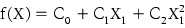

Độ chính xác ước lượng hàm 22 đến 24 significand bit. Ví dụ thống kê Hình B.6.1.

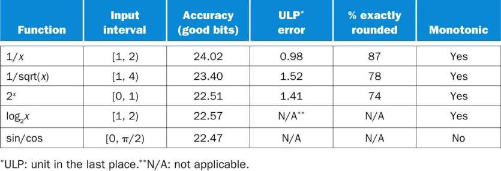

**HÌNH B.6.1 Thống kê xấp xỉ special function cho SFU NVIDIA GeForce 8800.**

Tiêu chuẩn IEEE 754 quy định các yêu cầu exact-rounding cho phép chia và căn bậc hai; tuy nhiên, nhiều ứng dụng GPU không cần tuân theo chính xác những yêu cầu đó. Đối với những ứng dụng này, computational throughput cao quan trọng hơn độ chính xác last-bit. Đối với các special function của SFU, thư viện toán CUDA cung cấp cả function có độ chính xác đầy đủ và function nhanh có độ chính xác của instruction SFU.

Phép chuyên biệt khác là nội suy attribute. Thuộc tính chính thường chỉ định cho vertex primitive cảnh, như màu, depth, texture coordinate. Phải nội suy trong screen space (x,y) để xác định mỗi pixel. Giá trị attribute U trong mặt phẳng (x, y) viết bằng phương trình:

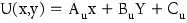

trong đó A, B và C là các tham số nội suy gắn với từng thuộc tính U. Các tham số nội suy A, B và C đều được biểu diễn dưới dạng số floating-point single-precision.

Vì pixel shader cần đánh giá function, nội suy attribute, có thể thiết kế một SFU làm cả hai hiệu quả. Cả hai dùng sum of products nội suy, số hạng cần cộng rất tương tự.

#### Phép texture

Texture mapping/filtering là tập phép floating-point chuyên biệt quan trọng khác. Các phép gồm:

1. Nhận texture address (s, t) cho pixel màn hình (x, y), s, t là single-precision floating-point.

2. Tính level of detail để chọn đúng level MIP-map.

3. Tính fraction trilinear interpolation.

4. Scale address (s, t) theo level MIP-map chọn.

5. Truy cập memory lấy texel (texture element) cần.

6. Lọc texel.

#### MIP-map

Cụm Latin multum in parvo, nhiều trong không gian nhỏ. MIP-map chứa ảnh tính sẵn độ phân giải khác, tăng render speed, giảm artifact.

Texture mapping cần floating-point đáng kể cho full-speed, nhiều phép half precision 16-bit. Ví dụ GeForce 8800 Ultra cung cấp khoảng 500 GFLOPS floating-point format riêng cho mapping, ngoài instruction single-precision floating-point IEEE thường. Xem Foley và van Dam [1995] chi tiết.

### Hiệu năng

Phần cứng cộng/nhân floating-point pipeline đầy đủ, latency cân bằng delay/diện tích. Dù pipeline, throughput special function thấp hơn cộng/nhân floating-point. Throughput Quarter-speed điển hình, một SFU chung bốn SP. CPU thường thấp hơn đáng kể cho hàm tương tự chia/căn, dù chính xác hơn. Phần cứng attribute interpolation thường pipeline đủ cho shader full-speed.

### Double precision

GPU mới như Tesla T10P hỗ trợ double-precision IEEE 754 64-bit phần cứng. Phép floating-point chuẩn gồm cộng, nhân, đổi format floating-point/integer. IEEE 754 năm 2008 có fused-multiply-add (FMA) như Chương 3: nhân floating-point rồi cộng với một rounding. Fused giữ chính xác floating-point đầy đủ trung gian, cho tính floating-point tích lũy tích chính xác hơn, gồm dot product, nhân ma trận, đa thức. FMA cũng cho phần mềm chia/căn rounding đúng hiệu quả, bỏ nhu cầu unit chia/căn phần cứng.

Unit FMA double-precision triển khai cộng, nhân, chuyển đổi 64-bit và FMA. Kiến trúc unit FMA double-precision cho hỗ trợ denormalized full-speed cả input/output. Hình B.6.2 là block diagram.

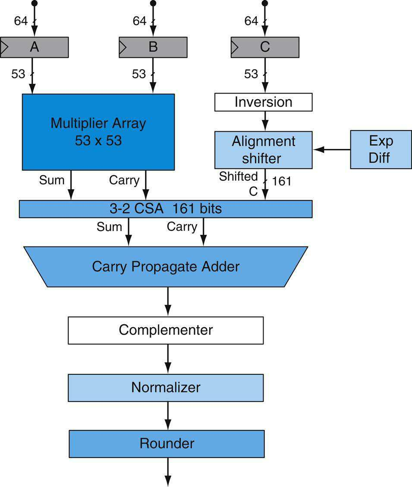

**HÌNH B.6.2 Unit Double-precision fused-multiply-add (FMA). Phần cứng tính floating-point A×B+C double precision.**

Hình B.6.2, significand A, B nhân thành tích 106-bit giữ dạng carry-save. Song song, addend C 53-bit đảo có điều kiện, align tích 106-bit. Sum/carry tích 106-bit cộng addend qua carry-save adder (CSA) 161-bit-wide. Output carry-save cộng trong carry-propagate adder cho kết quả chưa rounding bù hai không dư thừa. Kết quả recomplement có điều kiện để trả sign-magnitude. Kết quả phần bù normalize rồi round vừa format đích.

## B.7 Thực tế: NVIDIA GeForce 8800

NVIDIA GeForce 8800 giới thiệu tháng 11/2006, thống nhất vertex/pixel, hỗ trợ tính toán song song C CUDA. Là triển khai đầu Tesla đồ họa/tính toán thống nhất Mục B.4 và Lindholm và cộng sự [2008]. Họ Tesla đáp ứng nhu cầu laptop, desktop, workstation, server.

### Streaming Processor Array (SPA)

GeForce 8800 Hình B.7.1 có 128 SP trong 16 SM. Hai SM chia texture unit mỗi texture/processor cluster (TPC). Mảng tám TPC tạo SPA, chạy mọi shader và chương trình tính toán.

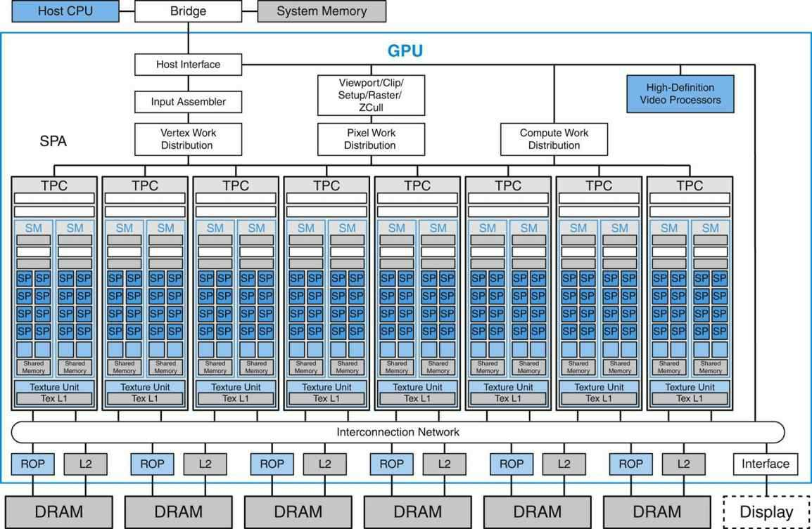

**HÌNH B.7.1 Kiến trúc GPU Tesla thống nhất NVIDIA. GeForce 8800 này 128 SP trong 16 SM, tám TPC. Processor nối sáu partition DRAM 64-bit-wide qua interconnect. GPU Tesla khác thay số SP, SM, DRAM partition, unit khác.**

Host interface unit giao tiếp với host CPU qua bus PCI-Express, kiểm tra tính nhất quán của command và thực hiện context switching. Input assembler tập hợp các geometric primitive (điểm, đường, tam giác). Các khối work distribution phân phối vertex, pixel và compute thread array đến các TPC trong SPA. Các TPC thực thi chương trình vertex shader, geometry shader và chương trình tính toán. Data hình học đầu ra được gửi đến khối viewport/clip/setup/raster/zcull để rasterize thành pixel fragment, sau đó được phân phối trở lại SPA để thực thi các chương trình pixel shader. Các pixel đã được shade được gửi qua interconnection network để các ROP unit xử lý. Network cũng định tuyến texture memory read request từ SPA đến DRAM và đọc data từ DRAM qua cache level-2 trở về SPA.

### Texture/Processor Cluster (TPC)

Mỗi TPC có geometry controller, SMC, hai SM và texture unit như Hình B.7.2.

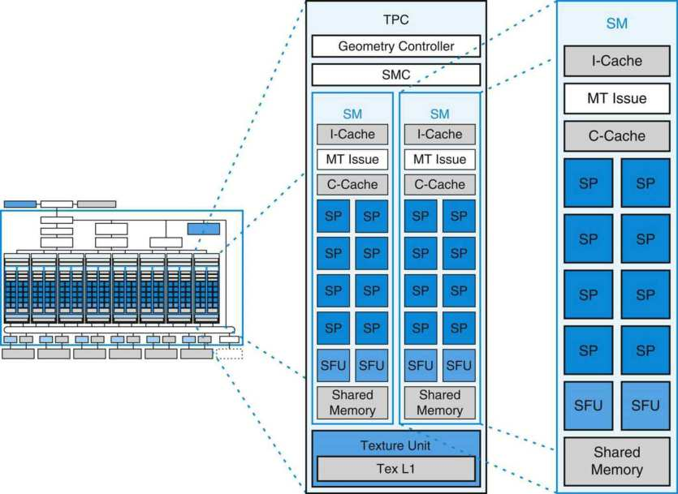

**HÌNH B.7.2 TPC và SM. Mỗi SM tám SP, hai SFU, shared memory.**

Geometry controller ánh xạ vertex pipeline logic thành recir-culation trên SM vật lý bằng điều hướng mọi primitive, vertex attribute, topology flow TPC.

SMC control nhiều SM, phân xử texture unit, load/store path, I/O chung. Phục vụ đồng thời vertex, geometry, pixel.

Texture unit xử lý instruction texture một vertex/geometry/pixel quad hoặc bốn compute thread/cycle. Nguồn là texture coordinate, output mẫu có trọng số, thường màu floating-point four-component RGBA. Pipeline sâu, dù có streaming cache giữ filtering locality, hit xen miss không stall.

### Streaming Multiprocessor (SM)

SM là multiprocessor đồ họa/tính toán thống nhất chạy shader vertex, geometry, pixel-fragment và chương trình tính toán. Gồm tám SP, hai SFU, instruction fetch/issue multithreaded (MT issue), instruction cache, constant cache read-only, shared memory đọc/ghi 16 KB. Chạy scalar instruction cho từng thread.

GeForce 8800 Ultra clock SP, SFU 1.5 GHz, đỉnh 36 GFLOPS/SM. Để tối ưu công suất, diện tích, một số unit không datapath SM chạy nửa clock SP.

Để hiệu quả hàng trăm thread nhiều chương trình, SM hardware multithreaded, quản lý/thực thi tối đa 768 thread đồng thời zero overhead lập lịch. Mỗi thread state riêng, đường code độc lập.

Warp tối đa 32 thread cùng loại vertex/geometry/pixel/compute. SIMT B.4 chia fetch/issue SM hiệu quả 32 thread nhưng cần warp đầy active cho hiệu quả đầy đủ.

SM lập lịch, chạy nhiều loại warp đồng thời. Mỗi issue cycle chọn một trong 24 warp chạy instruction SIMT. Warp instruction thực thi bốn tập tám thread qua bốn processor cycle. SP, SFU chạy độc lập; issue luân phiên giúp cả hai đầy. Scoreboard xác nhận warp mỗi cycle, scheduler ưu tiên, chọn cao nhất. Ưu tiên xét loại warp, instruction, công bằng mọi warp SM.

SM chạy CTA như nhiều warp đồng thời truy cập vùng shared memory cấp động cho CTA.

### Instruction set

Thread chạy scalar instruction khác vector GPU trước. Scalar đơn giản, compiler-friendly. Texture vẫn vector-based, nhận vector coordinate, trả vector màu lọc.

ISA register-based gồm mọi floating-point, integer arithmetic, siêu việt, logic, flow control, load/store, texture trong bảng PTX Hình B.4.3. Load/store dùng integer byte addressing với register-plus-offset. Cho tính toán truy cập ba space read-write: local per-thread riêng tạm, shared low-latency per-CTA chung thread CTA, global chung mọi thread. Bar.sync nhanh đồng bộ thread CTA giao tiếp shared/global. Tesla mới nhất có PTX atomic memory, thuận reduction, quản lý data structure song song.

### Streaming Processor (SP)

SP multithreaded là thread processor chính B.4. RF có 1024 register scalar 32-bit cho tối đa 96 thread (hơn SP ví dụ B.4). Cộng/nhân floating-point tương thích IEEE 754 single-precision, gồm not-a-number (NaN), infinity. Mặc định round-to-nearest-even. SP triển khai mọi integer arithmetic, compare, convert, logic PTX 32-bit, 64-bit Hình B.4.3. Pipeline đầy đủ, latency cân delay/diện tích.

### Special Function Unit (SFU)

SFU tính hàm siêu việt và nội suy thuộc tính phẳng. Như B.6 dùng nội suy bậc hai enhanced minimax xấp xỉ nghịch đảo, căn nghịch đảo, log<sub>2</sub>x, 2<sup>x</sup>, sin/cos một kết quả/cycle. Cũng nội suy màu, depth, texture coordinate bốn mẫu/cycle.

### Rasterization

Primitive geometry từ SM đi theo thứ tự input round-robin gốc tới block viewport/clip/setup/raster/zcull. Viewport, clip cắt primitive theo view frustum, user clip plane được enable, đổi vertex sang không gian pixel.

Primitive còn lại tới setup tạo phương trình cạnh cho rasterizer. Stage coarse-rasterization tạo mọi pixel tile ít nhất một phần trong primitive. Zcull giữ z surface phân cấp, loại tile nếu biết chắc bị pixel vẽ trước che. Tốc độ loại tối đa 256 pixel/clock. Pixel còn lại tới fine-rasterization tạo coverage chi tiết, depth.

Depth test/update có thể trước hoặc sau fragment shader tùy state. SMC gom pixel còn lại thành warp để SM chạy pixel shader hiện tại, rồi gửi pixel và dữ liệu tới ROP.

### Raster Operations Processor (ROP) và memory system

Mỗi ROP ghép partition riêng. Với fragment từ shader, ROP depth/stencil test/update và song song color blend/update. Nén lossless màu, depth mỗi loại tới 8:1 giảm DRAM bandwidth. Mỗi ROP đỉnh bốn pixel/clock, hỗ trợ HDR floating-point 16-bit, floating-point 32-bit. Có double-rate-depth khi tắt color write.

Antialiasing tối đa 16×multisampling, supersampling. coverage-sampling antialiasing (CSAA) tính, lưu Boolean coverage tới 16 mẫu, nén thông tin color/depth/stencil dư vào footprint, băng thông bốn hoặc tám mẫu để tăng hiệu năng.

Bus DRAM 384 pin, sáu partition độc lập mỗi 64 pin. Mỗi partition hỗ trợ double-data-rate DDR2 và graphics-oriented GDDR3 tới 1.0 GHz, khoảng 16 GB/s/partition, tổng 96 GB/s.

Controller hỗ trợ nhiều clock rate, protocol, density, bus width DRAM. Request texture/load/store giữa mọi TPC và partition, network route request/response.

### Khả năng mở rộng

Tesla thống nhất thiết kế để mở rộng. Thay số SM, TPC, ROP, cache, partition cho cân bằng hiệu năng/chi phí từng phân khúc. SLI nối nhiều GPU, mở rộng thêm.

### Hiệu năng

GeForce 8800 Ultra đặt clock cho các SP thread processor core và SFU ở 1.5 GHz, đạt đỉnh lý thuyết 576 GFLOPS. GeForce 8800 GTX có processor clock 1.35 GHz và đỉnh tương ứng là 518 GFLOPS.

Ba mục tiếp theo so sánh hiệu năng của GPU GeForce 8800 với multicore CPU trên ba ứng dụng khác nhau: đại số tuyến tính đặc, fast Fourier transform và sắp xếp. Các chương trình và thư viện GPU là code CUDA C đã được biên dịch. Code CPU sử dụng thư viện Intel MKL 10.0 single-precision multithreaded để tận dụng các instruction SSE và nhiều core.

### Hiệu năng đại số tuyến tính đặc

Các phép tính đại số tuyến tính đặc là nền tảng của nhiều ứng dụng. Volkov và Demmel [2008] trình bày kết quả hiệu năng GPU và CPU cho phép nhân ma trận đặc matrix-matrix single-precision (routine SGEMM) và các phép phân tích ma trận LU, QR và Cholesky. Hình B.7.3 so sánh tốc độ GFLOPS của phép nhân ma trận đặc matrix-matrix SGEMM giữa GPU GeForce 8800 GTX và CPU quad-core. Hình B.7.4 so sánh tốc độ GFLOPS của các phép phân tích ma trận giữa GPU và CPU quad-core.

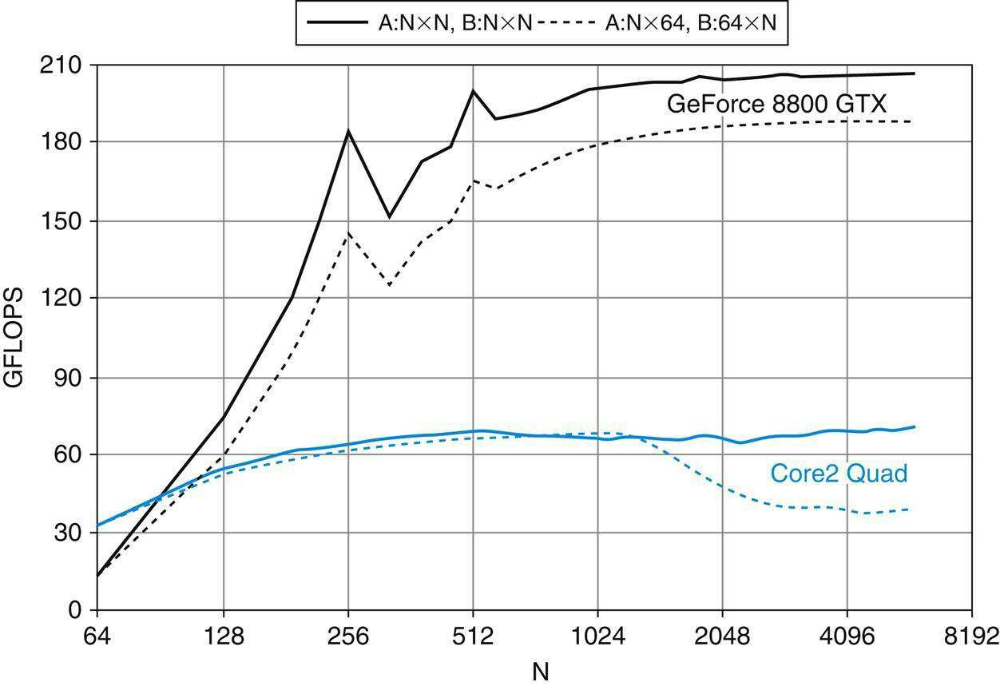

**HÌNH B.7.3 Hiệu năng nhân matrix-matrix đặc SGEMM. Đồ thị GFLOPS single-precision cho ma trận vuông N×N (nét liền), mỏng N ×64, 64×N (nét đứt). Điều chỉnh Hình 6 Volkov và Demmel [2008]. Đen: GeForce 8800 GTX 1.35 GHz dùng SGEMM Volkov (nay NVIDIA CUBLAS 2.0), ma trận GPU memory. Xanh: Intel Core2 Quad Q6600 quad-core 2.4 GHz, Linux 64-bit, MKL 10.0, ma trận CPU memory.**

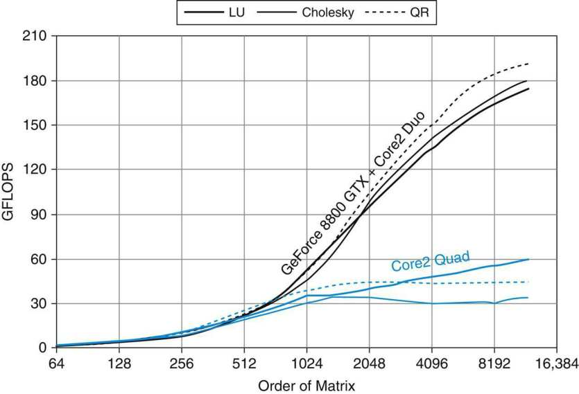

**HÌNH B.7.4 Hiệu năng phân tích ma trận đặc. Đồ thị GFLOPS dùng GPU và CPU riêng. Điều chỉnh Hình 7 Volkov và Demmel [2008]. Đen: NVIDIA GeForce 8800 GTX 1.35 GHz, CUDA 1.1, Windows XP gắn Intel Core2 Duo E6700 2.67 GHz Windows XP, tính mọi thời gian truyền CPU–GPU. Xanh: Core2 Quad Q6600 quad-core 2.4 GHz, Linux 64-bit, MKL 10.0.**

Vì SGEMM matrix-matrix và BLAS3 tương tự chiếm phần lớn phân tích ma trận, hiệu năng đặt cận trên tốc độ phân tích. Bậc ma trận vượt 200 tới 400 đủ lớn để SGEMM tận dụng song song GPU, vượt overhead hệ/copy. SGEMM matrix-matrix Volkov đạt 206 GFLOPS, khoảng 60% đỉnh multiply-add GeForce 8800 GTX, QR đạt 192 GFLOPS, khoảng 4.3 lần CPU quad-core.

### Hiệu năng FFT

FFT dùng nhiều ứng dụng. Biến đổi lớn, nhiều chiều chia thành batch biến đổi 1D nhỏ.

Hình B.7.5 so sánh hiệu năng FFT phức single-precision 1D in-place của GeForce 8800 GTX 1.35 GHz (xuất hiện cuối năm 2006) với Intel Xeon E5462 quad-Core 2.8 GHz (tên mã “Harpertown”, xuất hiện cuối năm 2007). Hiệu năng CPU được đo bằng FFT trong Intel Math Kernel Library (MKL) 10.0 với bốn thread. Hiệu năng GPU được đo bằng thư viện NVIDIA CUFFT 2.1 và các FFT 1D radix-16 decimation-in-frequency thực hiện theo batch. Throughput của cả CPU và GPU được đo bằng các FFT theo batch; batch size là 2<sup>24</sup>/n, trong đó n là kích thước phép biến đổi. Vì vậy, workload cho mỗi kích thước phép biến đổi là 128 MB. Để xác định tốc độ GFLOPS, số phép toán trên mỗi phép biến đổi được lấy bằng 5n log<sub>2</sub> n.

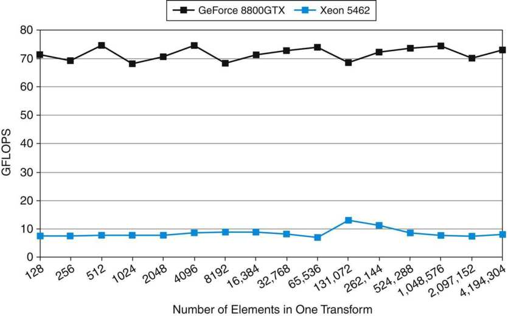

**HÌNH B.7.5 Throughput của fast Fourier transform. Đồ thị so sánh hiệu năng của các FFT phức one-dimensional in-place theo batch trên GeForce 8800 GTX 1.35 GHz với Intel Xeon E5462 quad-core 2.8 GHz (tên mã “Harpertown”), cache L2 6MB, memory 4GB, FSB 1600, Red Hat Linux và Intel MKL 10.0.**

### Hiệu năng sắp xếp

Khác ứng dụng trên, sort cần phối hợp thread nhiều hơn nên mở rộng khó hơn. Dù vậy nhiều thuật toán well-known song song hóa hiệu quả trên GPU. Satish và cộng sự [2008] chi tiết thiết kế CUDA, kết quả radix sort tóm tắt dưới.

Hình B.7.6 so sánh hiệu năng sắp xếp song song của GeForce 8800 Ultra với hệ thống Intel Clovertown 8-core, cả hai đều xuất hiện vào đầu năm 2007. Các CPU core được phân bố trên hai socket vật lý. Mỗi socket chứa một multichip module với hai chip Core2, và mỗi chip có cache L2 4MB. Tất cả các routine sắp xếp đều được thiết kế để sắp xếp các cặp key-value, trong đó cả key lẫn value đều là số nguyên 32-bit. Thuật toán chính được nghiên cứu là radix sort, nhưng thủ tục parallel_sort() quicksort-based do Intel Threading Building Blocks cung cấp cũng được đưa vào để so sánh. Trong hai bản code radix sort CPU-based, một bản được triển khai chỉ bằng scalar instruction set, còn bản kia sử dụng các routine assembly language được tinh chỉnh thủ công (hand-tuned) để tận dụng các vector instruction SSE2 SIMD.

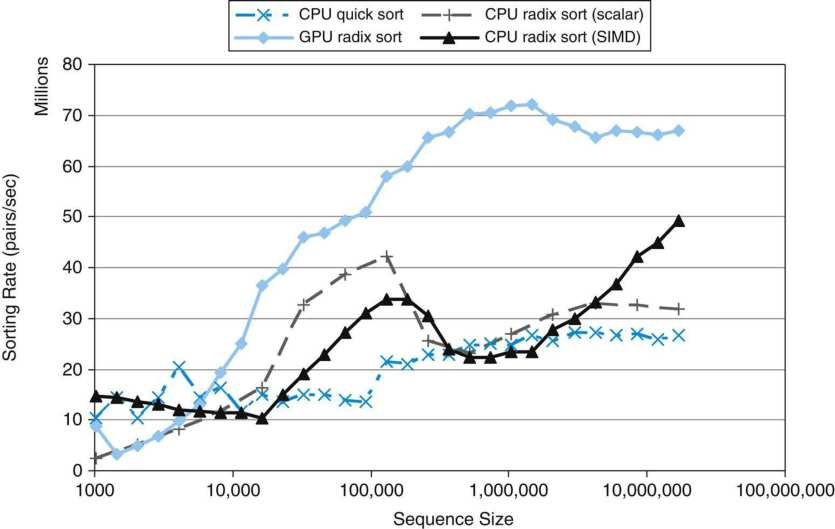

**HÌNH B.7.6 Hiệu năng sắp xếp song song. Đồ thị này so sánh tốc độ sắp xếp của các cách triển khai parallel radix sort trên GeForce 8800 Ultra 1.5 GHz và hệ thống Intel Core2 Xeon E5345 8-core 2.33 GHz.**

Đồ thị tốc độ là số phần tử chia thời gian với nhiều sequence size. GPU radix sort cao nhất mọi chuỗi 8K-elements trở lên. Trung bình nhanh hơn 2.6 lần routine quicksort-based và khoảng hai lần radix CPU, đều dùng tám core. Radix CPU biến thiên rộng, có lẽ cache locality kém của global permutation.

## B.8 Thực tế: Ánh xạ ứng dụng lên GPU

Multicore CPU, manycore GPU nghĩa chip phổ thông nay là hệ song song, tiếp tục mở rộng theo Moore. Thách thức là ứng dụng visual/high-performance computing phổ thông mở rộng trong suốt để tận dụng core tăng, giống 3D mở rộng tới GPU số core rất khác.

Mục cho ví dụ ánh xạ ứng dụng song song mở rộng lên GPU bằng CUDA.

### Ma trận thưa

Nhiều thuật toán song song viết CUDA khá trực tiếp dù data structure không grid đều. Sparse matrix-vector multiplication (SpMV) là block số quan trọng có thể song song hóa trực tiếp bằng abstraction CUDA. Kernel dưới kết hợp vector routine CUBLAS giúp viết solver lặp như conjugate gradient dễ dàng.

Ma trận thưa n×n là ma trận có số phần tử nonzero m chỉ chiếm một phần nhỏ tổng số phần tử. Các cách biểu diễn ma trận thưa hướng đến việc chỉ lưu những phần tử nonzero của ma trận. Vì một ma trận thưa n×n thường chỉ chứa m=O(n) phần tử nonzero, cách này tiết kiệm đáng kể không gian lưu trữ và thời gian xử lý.

Một trong những cách biểu diễn phổ biến nhất cho ma trận thưa tổng quát, không có cấu trúc là compressed sparse row (CSR). m phần tử nonzero của ma trận A được lưu theo thứ tự row-major trong array Av. Array thứ hai, Aj, ghi nhận column index tương ứng với mỗi entry của Av. Cuối cùng, array Ap gồm n+1 phần tử ghi lại phạm vi của từng hàng trong các array trước đó; các entry của hàng i trong Aj và Av kéo dài từ index Ap[i] đến trước index Ap[i + 1]. Điều này có nghĩa Ap[0] luôn bằng 0 và Ap[n] luôn bằng số phần tử nonzero trong ma trận. Hình B.8.1 minh họa một ví dụ về cách biểu diễn CSR của một ma trận đơn giản.

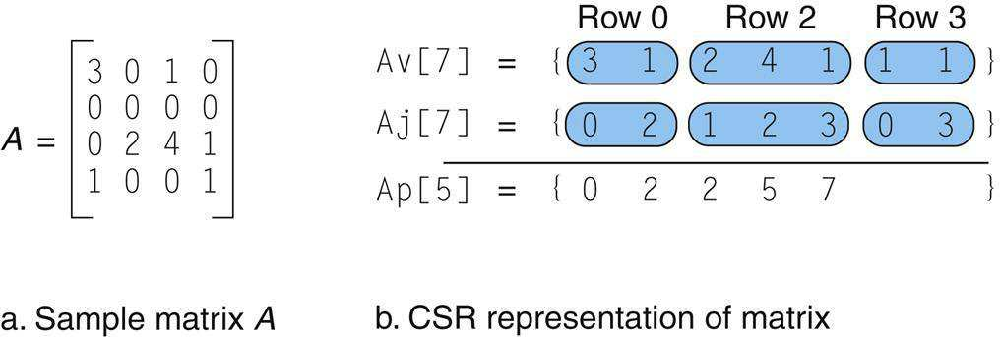

**HÌNH B.8.1 Ma trận compressed sparse row (CSR).**

Với ma trận A ở dạng CSR và vector x, chúng ta có thể tính một hàng của tích y=Ax bằng procedure multiply_row() trong Hình B.8.2. Khi đó, tính toàn bộ tích chỉ là lặp qua mọi hàng và tính kết quả cho từng hàng bằng multiply_row(), như trong code C tuần tự ở Hình B.8.3.

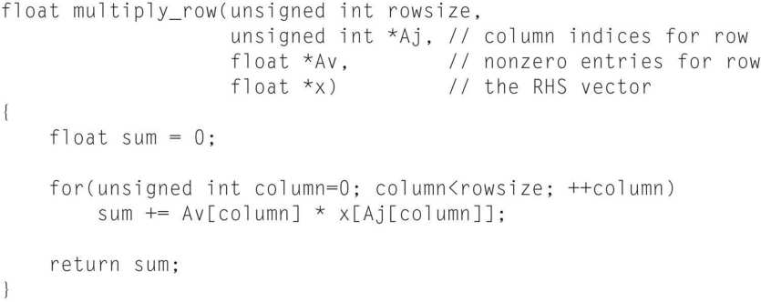

**HÌNH B.8.2 Code C tuần tự một row phép nhân sparse matrix-vector.**

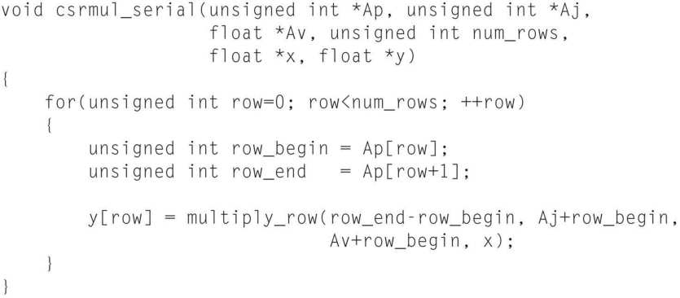

**HÌNH B.8.3 Code tuần tự nhân sparse matrix-vector.**

Thuật toán này có thể được chuyển thành một CUDA kernel song song khá dễ dàng. Chúng ta chỉ cần phân bố vòng lặp trong csrmul_serial() lên nhiều thread song song. Mỗi thread tính đúng một hàng của vector output y. Code cho kernel này được trình bày trong Hình B.8.4. Lưu ý rằng nó rất giống vòng lặp tuần tự trong procedure csrmul_serial(). Thực sự chỉ có hai điểm khác biệt. Thứ nhất, row index của mỗi thread được tính từ block index và thread index được gán cho nó, loại bỏ for-loop. Thứ hai, có một điều kiện chỉ tính tích của hàng nếu row index nằm trong giới hạn ma trận (điều này cần thiết vì số hàng n không nhất thiết là bội của block size được sử dụng khi launch kernel).

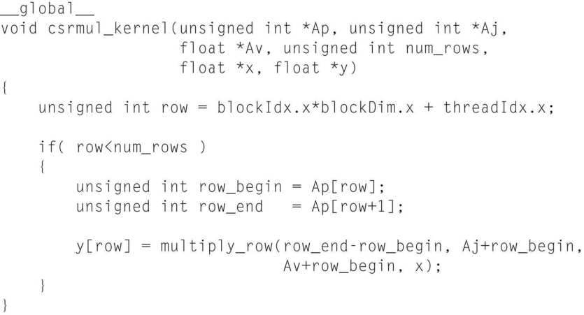

**HÌNH B.8.4 Phiên bản CUDA nhân sparse matrix-vector.**

Giả sử data structure đã copy GPU device memory, launch kernel như:

```
unsigned int blocksize = 128; // or any size up to 512
unsigned int nblocks = (num_rows + blocksize - 1) /
blocksize;
csrmul_kernel<<<nblocks,blocksize>>>(Ap, Aj, Av, num_rows,
x, y);
```

Mẫu mà chúng ta thấy ở đây rất phổ biến. Thuật toán tuần tự ban đầu là một vòng lặp có các lượt lặp độc lập với nhau. Những vòng lặp như vậy có thể được song song hóa khá dễ dàng bằng cách gán một hoặc nhiều lượt lặp cho mỗi thread song song. Programming model của CUDA giúp biểu đạt kiểu song song này đặc biệt đơn giản.

Chiến lược chia tính toán thành block độc lập, đặc biệt tách iteration độc lập, không riêng CUDA. Nhiều hệ như OpenMP, Intel Threading Building Blocks dùng dưới nhiều dạng.

### Cache trong shared memory

SpMV trên khá đơn giản. Nhiều tối ưu CPU/GPU tăng hiệu năng: unroll loop, reorder ma trận, register blocking. Kernel cũng có thể triển khai bằng data parallel scan của Sengupta và cộng sự [2007].

Đặc điểm quan trọng CUDA phơi bày là shared memory per-block, nhỏ on-chip latency rất thấp. Tận dụng có thể tăng đáng kể. Cách thường là software-managed cache giữ dữ liệu tái dùng thường xuyên. Hình B.8.5 cho sửa đổi shared memory.

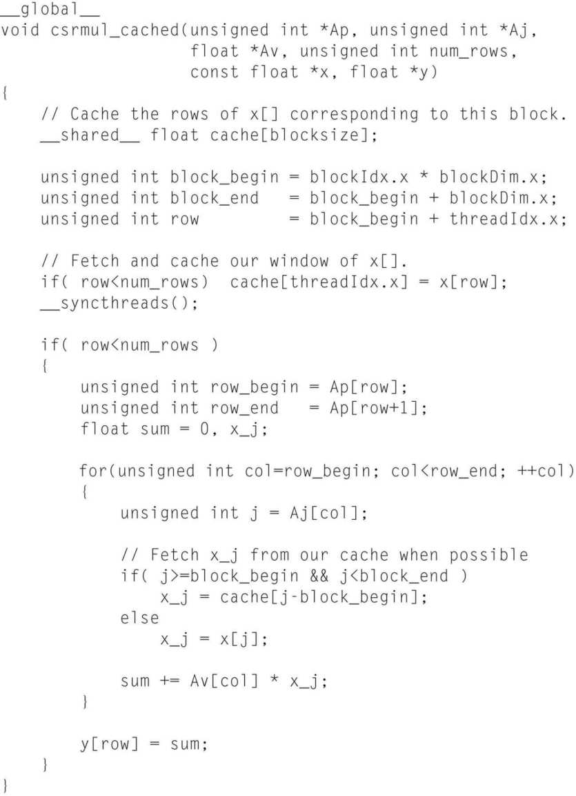

**HÌNH B.8.5 Phiên bản shared memory nhân sparse matrix-vector.**

Trong ngữ cảnh nhân ma trận thưa, chúng ta nhận thấy nhiều hàng của A có thể sử dụng một phần tử array cụ thể x[i]. Trong nhiều trường hợp phổ biến, đặc biệt khi ma trận đã được sắp xếp lại, những hàng sử dụng x[i] sẽ nằm gần hàng i. Vì vậy, chúng ta có thể triển khai một cơ chế caching đơn giản và kỳ vọng đạt lợi ích hiệu năng. Block thread xử lý các hàng i đến j sẽ load x[i] đến x[j] vào shared memory của nó. Chúng ta sẽ unroll vòng lặp multiply_row() và fetch các phần tử x từ cache bất cứ khi nào có thể. Code thu được được minh họa trong Hình B.8.5. Shared memory cũng có thể phục vụ các tối ưu khác, chẳng hạn fetch Ap[row+1] từ một thread liền kề thay vì fetch lại từ memory.

Vì Tesla architecture cung cấp shared memory on-chip được quản lý tường minh thay vì hardware cache hoạt động ngầm, việc thêm kiểu tối ưu hóa này khá phổ biến. Mặc dù có thể tạo thêm một chút gánh nặng phát triển cho lập trình viên, mức bổ sung tương đối nhỏ và lợi ích hiệu năng tiềm năng có thể đáng kể. Trong ví dụ trên, ngay cả cách sử dụng shared memory khá đơn giản này cũng cải thiện hiệu năng khoảng 20% trên các ma trận đại diện được tạo từ lưới bề mặt 3D. Việc có memory được quản lý tường minh thay cho cache ngầm cũng có ưu điểm là các policy caching và prefetching có thể được điều chỉnh riêng theo nhu cầu ứng dụng.

Đây là những kernel khá đơn giản, có mục đích minh họa các kỹ thuật cơ bản khi viết chương trình CUDA thay vì cách đạt hiệu năng tối đa. Có nhiều hướng tối ưu hóa khả thi; Williams và cộng sự [2007] đã khảo sát một số hướng trên một vài multicore architecture khác nhau. Tuy vậy, việc xem xét và so sánh hiệu năng của ngay cả những kernel đơn giản này vẫn có giá trị học tập. Trên processor Intel Core2 Xeon E5335 2 GHz, kernel csrmul_serial() xử lý khoảng 202 triệu phần tử nonzero mỗi giây đối với một tập các ma trận Laplacian được tạo từ những lưới bề mặt tam giác hóa 3D. Song song hóa kernel này bằng cấu trúc parallel_for do Intel Threading Building Blocks cung cấp đạt các parallel speed-ups lần lượt là 2.0, 2.1 và 2.3 khi chạy trên hai, bốn và tám core của máy. Trên GeForce 8800 Ultra, các kernel csrmul_kernel() và csrmul_cached() đạt tốc độ xử lý khoảng 772 và 920 triệu phần tử nonzero mỗi giây, tương ứng với parallel speed-ups gấp 3.8 và 4.6 lần hiệu năng thực thi tuần tự trên một CPU core.

### Scan và reduction

Parallel scan hay parallel prefix sum là block quan trọng nhất cho thuật toán data-parallel [Blelloch, 1990]. Cho chuỗi a gồm n phần tử:

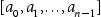

và toán tử binary kết hợp <sub>⊕</sub>, scan tính chuỗi:

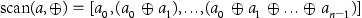

Ví dụ lấy <sub>⊕</sub> là cộng thường, scan mảng input

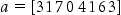

tạo chuỗi tổng từng phần:

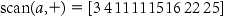

Đây là inclusive scan: phần tử i output bao gồm a<sub>i</sub> input. Chỉ gộp phần tử trước sẽ thành exclusive scan, cũng gọi prefix-sum.

Triển khai tuần tự rất đơn giản: loop đi toàn chuỗi một lần như Hình B.8.6.

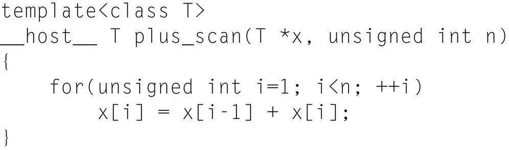

**HÌNH B.8.6 Template plus-scan tuần tự.**

Thoạt nhìn, phép toán này có vẻ vốn dĩ phải thực hiện tuần tự. Tuy nhiên, trên thực tế có thể triển khai nó song song một cách hiệu quả. Nhận xét then chốt là vì phép cộng có tính kết hợp, chúng ta có thể tự do thay đổi thứ tự cộng các phần tử. Chẳng hạn, có thể hình dung việc cộng song song các cặp phần tử liên tiếp, sau đó cộng các tổng từng phần này, rồi tiếp tục như vậy.

Một cơ chế đơn giản để thực hiện điều này do Hillis và Steele [1989] đề xuất. Cách triển khai thuật toán của họ bằng CUDA được minh họa trong Hình B.8.7. Nó giả định array input x[ ] chứa đúng một phần tử cho mỗi thread trong thread block. Nó thực hiện log<sub>2</sub> n lượt của một vòng lặp để kết hợp các tổng từng phần.

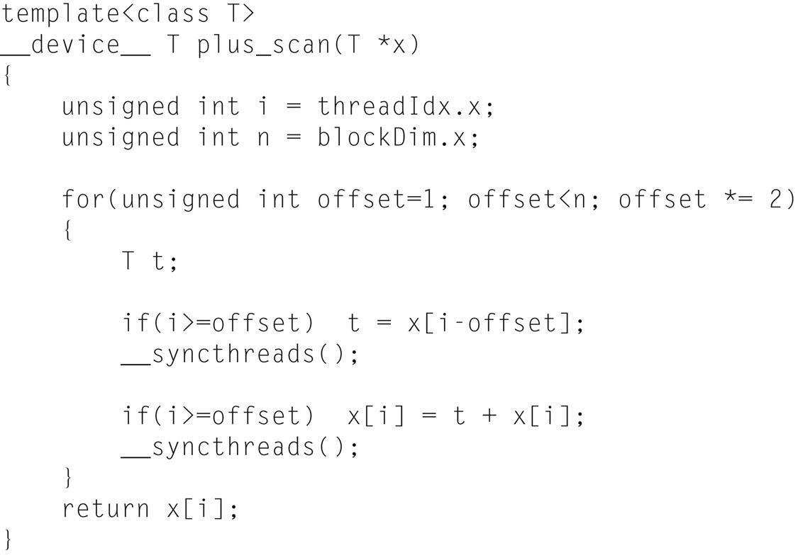

**HÌNH B.8.7 Template CUDA plus-scan song song.**

Để hiểu hoạt động của vòng lặp này, hãy xem Hình B.8.8, minh họa trường hợp đơn giản với n=8 thread và phần tử. Mỗi tầng trong sơ đồ biểu diễn một bước của vòng lặp. Các đường chỉ ra vị trí mà data đang được fetch. Đối với mỗi phần tử output (tức hàng cuối cùng của sơ đồ), chúng ta đang xây dựng một cây tính tổng trên các phần tử input. Các cạnh tô xanh thể hiện hình dạng của cây tính tổng này đối với phần tử cuối cùng. Các lá của cây là toàn bộ các phần tử ban đầu. Lần ngược từ bất kỳ phần tử output nào cho thấy nó bao gồm mọi giá trị input từ đầu đến chính phần tử đó.

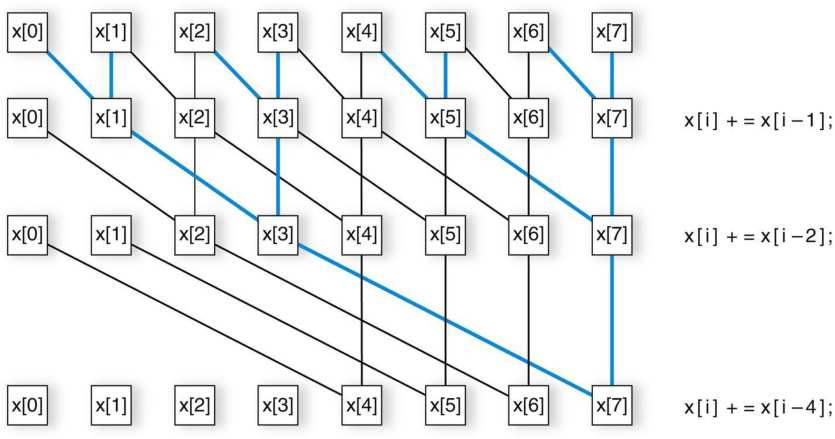

**HÌNH B.8.8 Tham chiếu dữ liệu parallel scan Tree-based.**

Mặc dù đơn giản, thuật toán này không hiệu quả như chúng ta mong muốn. Xem xét cách triển khai tuần tự, ta thấy nó thực hiện O(n) phép cộng. Ngược lại, cách triển khai song song thực hiện O(n log n) phép cộng. Vì vậy, nó không hiệu quả về lượng công việc, vì thực hiện nhiều công việc hơn cách triển khai tuần tự để tính cùng một kết quả. May mắn là có những kỹ thuật triển khai scan khác có tính work-efficient. Chi tiết về các kỹ thuật triển khai hiệu quả hơn và việc mở rộng procedure per-block này cho các array gồm nhiều block được trình bày bởi Sengupta và cộng sự [2007].

Trong một số trường hợp, chúng ta chỉ quan tâm đến việc tính tổng tất cả các phần tử trong một array thay vì chuỗi tất cả các prefix sum do scan trả về. Đây là bài toán parallel reduction. Chúng ta có thể sử dụng thuật toán scan để thực hiện phép tính này, nhưng nhìn chung reduction có thể được triển khai hiệu quả hơn scan.

Hình B.8.9 trình bày code tính reduction bằng phép cộng. Trong ví dụ này, mỗi thread chỉ load một phần tử của chuỗi input, tức ban đầu tính tổng của một chuỗi con có độ dài 1. Khi reduction kết thúc, chúng ta muốn thread 0 giữ tổng của mọi phần tử ban đầu được các thread trong block của nó load. Vòng lặp trong kernel này ngầm xây dựng một cây tính tổng trên các phần tử input, tương tự thuật toán scan ở trên.

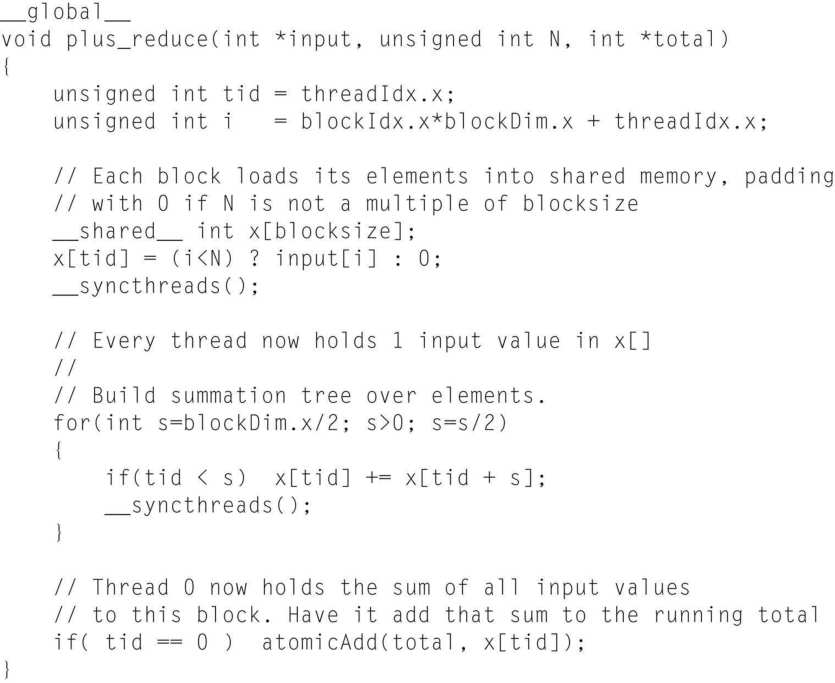

**HÌNH B.8.9 Triển khai CUDA plus-reduction.**

Khi vòng lặp kết thúc, thread 0 giữ tổng của mọi giá trị mà block này đã load. Nếu muốn giá trị cuối cùng tại vị trí do total trỏ đến chứa tổng mọi phần tử trong array, chúng ta phải kết hợp các tổng từng phần của mọi block trong grid. Một cách là để mỗi block ghi tổng từng phần của nó vào một array thứ hai, rồi launch reduction kernel lần nữa, lặp lại cho đến khi chuỗi được rút gọn thành một giá trị duy nhất. Một lựa chọn hấp dẫn hơn được Tesla GPU architecture hỗ trợ là sử dụng primitive atomicAdd(), một primitive atomic read-modify-write hiệu quả do memory subsystem hỗ trợ. Cách này loại bỏ nhu cầu về các array tạm bổ sung và việc launch kernel nhiều lần.

Parallel reduction là primitive thiết yếu, nêu tầm quan trọng shared memory per-block, barrier low-cost để hợp tác hiệu quả. Đảo dữ liệu giữa thread như vậy quá tốn nếu global off-chip.

### Radix sort

Một ứng dụng quan trọng của các primitive scan là triển khai routine sắp xếp. Code trong Hình B.8.10 triển khai radix sort cho số nguyên trong một thread block duy nhất. Nó nhận input là array values chứa một số nguyên 32-bit cho mỗi thread của block. Để đạt hiệu suất cao, array này nên được lưu trong shared memory per-block, nhưng đó không phải yêu cầu bắt buộc để phép sắp xếp hoạt động đúng.

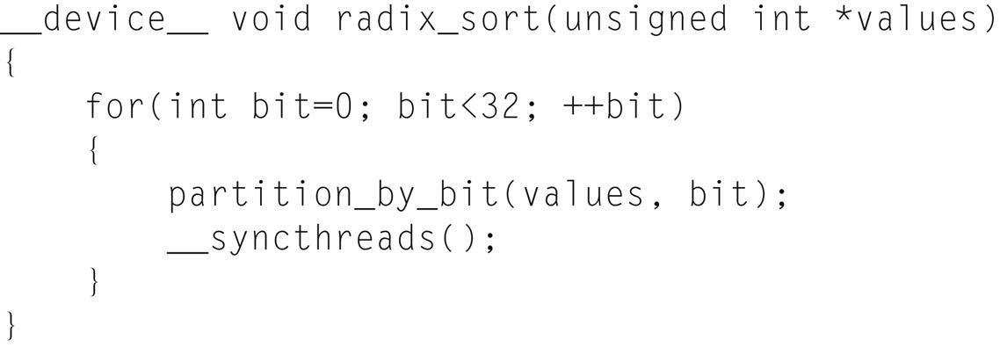

**HÌNH B.8.10 Code CUDA radix sort.**

Đây là một cách triển khai radix sort khá đơn giản. Nó giả định có sẵn procedure partition_by_bit(), phân chia array đã cho sao cho mọi giá trị có bit được chỉ định bằng 0 đứng trước mọi giá trị có bit đó bằng 1. Để tạo ra output chính xác, phép phân chia này phải ổn định.

Triển khai procedure phân chia là một ứng dụng đơn giản của scan. Thread i giữ giá trị x<sub>i</sub> và phải tính output index chính xác để ghi giá trị đó. Để làm vậy, nó cần tính (1) số thread j <i có bit được chỉ định bằng 1 và (2) tổng số bit có bit được chỉ định bằng 0. Code CUDA cho partition_by_bit() được minh họa trong Hình B.8.11.

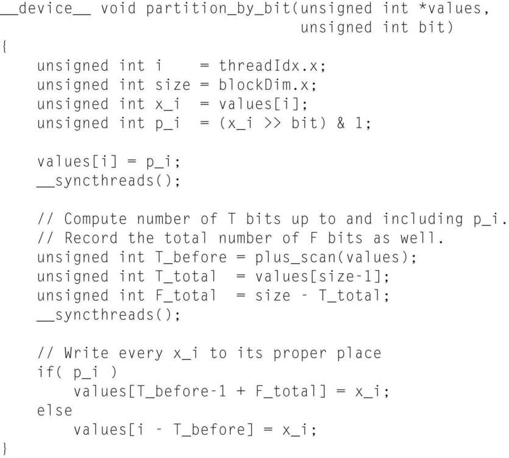

**HÌNH B.8.11 Code CUDA phân chia bit-by-bit trong radix sort.**

Có thể áp dụng chiến lược tương tự để triển khai radix sort kernel sắp xếp một array có độ dài lớn thay vì chỉ array one-block. Bước cơ bản vẫn là procedure scan, mặc dù khi phép tính được chia trên nhiều kernel, chúng ta phải double-buffer array giá trị thay vì phân chia ngay tại chỗ. Satish và cộng sự [2008] cung cấp chi tiết về cách thực hiện radix sort hiệu quả trên array lớn.

### Ứng dụng N-Body trên GPU<sup>1</sup>

Nyland và cộng sự [2007] mô tả kernel đơn giản hữu ích, hiệu năng GPU xuất sắc—all-pairs N-body, thành phần time-consuming nhiều ứng dụng khoa học. Mô phỏng N-body tính tiến triển hệ vật thể, mỗi vật tương tác liên tục mọi vật khác. Ví dụ thiên văn mỗi vật là sao, hút hấp dẫn nhau. Ví dụ khác gấp protein, N-body tính lực tĩnh điện, van der Waals; mô phỏng dòng rối; global illumination đồ họa.

All-pairs N-body tính tổng lực mỗi vật bằng mọi lực pair-wise rồi cộng. Nhiều nhà khoa học coi chính xác nhất, chỉ mất chính xác do phần cứng floating-point. Nhược O(n<sup>2</sup>) quá lớn với hơn 10 vật. Giảm chi phí có xấp xỉ O(n log n), O(n): Barnes-Hut, Fast Multipole Method, Particle-Mesh-Ewald summation. Phương pháp nhanh dùng all-pairs vẫn dùng all-pairs làm kernel tính chính xác lực short-range nên tiếp tục quan trọng.

#### Toán học N-Body

Mô phỏng hấp dẫn tính lực body-body bằng vật lý cơ bản. Hai vật index i, j có vector lực 3D:

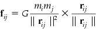

Độ lớn tính hạng trái, hướng tính hạng phải (unit vector từ vật này tới vật kia).

Với một danh sách các vật tương tác, gồm toàn hệ thống hoặc một tập con, phép tính khá đơn giản: tính lực cho mọi cặp tương tác và cộng tổng cho từng vật. Sau khi tính tổng lực, chúng được sử dụng để cập nhật vị trí và vận tốc của mỗi vật dựa trên vị trí và vận tốc trước đó. Phép tính lực có độ phức tạp O(n<sup>2</sup>), còn việc cập nhật có độ phức tạp O(n).

Code force-calculation tuần tự hai for-loops lồng qua cặp vật. Loop ngoài chọn vật tính tổng, trong qua mọi vật. Loop trong gọi function tính pair-wise rồi cộng vào tổng.

Để tính các lực song song, chúng ta gán một thread cho mỗi vật, vì việc tính lực tác dụng lên mỗi vật độc lập với việc tính lực trên mọi vật khác. Sau khi tính xong tất cả các lực, có thể cập nhật vị trí và vận tốc của các vật.

Code tuần tự, song song Hình B.8.12, B.8.13. Bản tuần tự hai for-loops. Đổi CUDA chuyển loop ngoài thành kernel per-thread, mỗi thread tổng lực một vật. Kernel tính global ID thay iterator ngoài. Cả hai cuối lưu tổng gia tốc vào mảng global dùng tính vị trí, vận tốc ở bước sau. Loop ngoài thay bằng grid CUDA launch N thread, mỗi vật một thread.

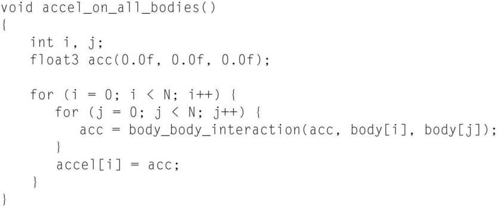

**HÌNH B.8.12 Code tuần tự tính mọi lực pair-wise trên N vật.**

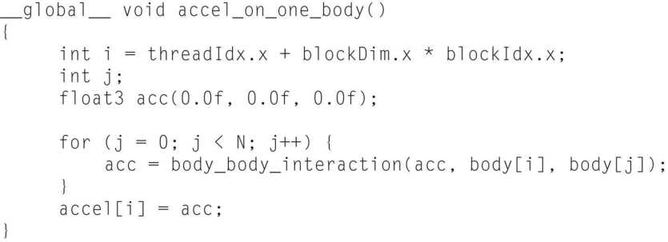

**HÌNH B.8.13 Code thread CUDA tính tổng lực một vật.**

#### Tối ưu thực thi GPU

Code CUDA đúng chức năng nhưng không hiệu quả vì bỏ đặc tính kiến trúc. Ba tối ưu: shared memory tránh read trùng giữa thread; nhiều thread mỗi vật tăng hiệu năng N nhỏ; unroll loop giảm overhead.

#### Dùng shared memory

Shared memory có thể giữ một tập con các vị trí vật, giống cache, loại bỏ những global memory request trùng lặp giữa các thread. Chúng ta tối ưu code ở trên để mỗi thread trong p thread của một thread-block load một vị trí vào shared memory, tổng cộng p vị trí. Sau khi mọi thread đã load một giá trị vào shared memory, được bảo đảm bằng __syncthreads(), mỗi thread có thể thực hiện p tương tác bằng data trong shared memory. Việc này được lặp N/p lần để hoàn tất phép tính lực cho mỗi vật, giảm số request đến memory một hệ số p, thường trong khoảng 32–128.

Function accel_on_one_body() cần vài thay đổi hỗ trợ. Code mới Hình B.8.14.

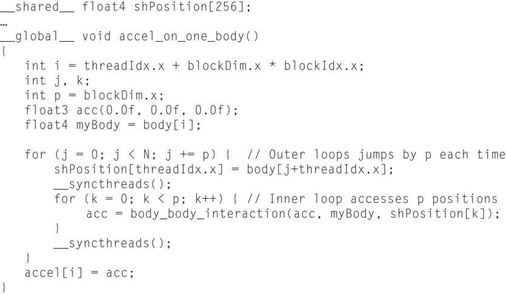

**HÌNH B.8.14 Code CUDA tổng lực mỗi vật, dùng shared memory tăng hiệu năng.**

Loop trước đi mọi vật nay nhảy theo block dimension p. Mỗi iteration ngoài load p vị trí liên tiếp vào shared, mỗi thread một. Thread đồng bộ rồi mỗi thread tính p lực. Cần đồng bộ lần hai bảo đảm không load giá trị mới trước khi mọi thread hoàn thành lực dữ liệu hiện tại.

Sử dụng shared memory làm giảm memory bandwidth cần thiết xuống dưới 10% tổng bandwidth mà GPU có thể duy trì, sử dụng dưới 5 GB/s. Tối ưu hóa này giữ cho ứng dụng liên tục thực hiện phép tính thay vì chờ truy cập memory như khi không sử dụng shared memory. Hiệu năng với các giá trị N khác nhau được minh họa trong Hình B.8.15.

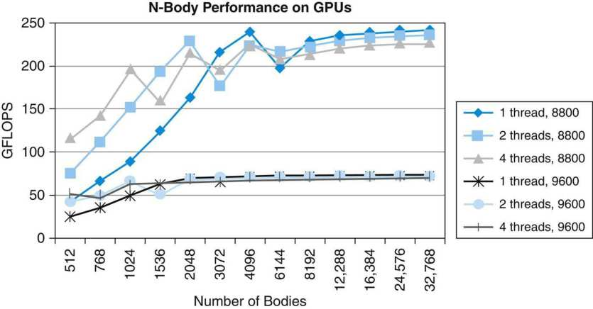

**HÌNH B.8.15 Hiệu năng N-body trên GeForce 8800 GTX, GeForce 9600. 8800 có 128 stream processor 1.35 GHz; 9600 có 64 ở 0.80 GHz (khoảng 30% 8800). Đỉnh 242 GFLOPS. GPU nhiều processor cần bài toán lớn hơn để đầy hiệu năng (9600 đỉnh khoảng 2048 vật, 8800 tới 16,384). N nhỏ, nhiều thread mỗi vật tăng đáng kể, nhưng N lớn cuối cùng bị phạt hiệu năng.**

### Dùng nhiều thread mỗi vật

Hình B.8.15 cho thấy hiệu năng giảm đối với các bài toán có N nhỏ, N<4096, trên GeForce 8800 GTX. Nhiều nghiên cứu dựa trên phép tính N-body tập trung vào N nhỏ để đạt thời gian mô phỏng dài, khiến trường hợp này trở thành mục tiêu tối ưu hóa. Giả thuyết giải thích hiệu năng thấp hơn của chúng ta là đơn giản không có đủ công việc để giữ GPU bận khi N nhỏ. Giải pháp là cấp phát nhiều thread hơn cho mỗi vật. Chúng ta thay kích thước thread-block từ (p, 1, 1) thành (p, q, 1), trong đó q thread chia công việc của một vật thành các phần bằng nhau. Bằng cách cấp phát các thread bổ sung trong cùng thread block, các kết quả từng phần có thể được lưu trong shared memory. Khi mọi phép tính lực hoàn tất, q kết quả từng phần có thể được tập hợp và cộng để tính kết quả cuối cùng. Sử dụng hai hoặc bốn thread trên mỗi vật mang lại cải thiện lớn với N nhỏ.

Ví dụ 8800 GTX tăng 110% khi N=1024 (một thread 90 GFLOPS, bốn 190). Giảm nhẹ N lớn nên chỉ dùng dưới 4096. Hình B.8.15 cho tăng trên GPU 128 processor và GPU nhỏ 64 processor clock two-thirds tốc độ.

#### So sánh hiệu năng

Hiệu năng của code N-body được minh họa trong Hình B.8.15 và Hình B.8.16. Hình B.8.15 biểu diễn hiệu năng của các GPU high- và medium-performance, cùng mức cải thiện đạt được bằng cách sử dụng nhiều thread trên mỗi vật. Hiệu năng trên GPU nhanh hơn nằm trong khoảng từ 90 đến gần 250 GFLOPS.

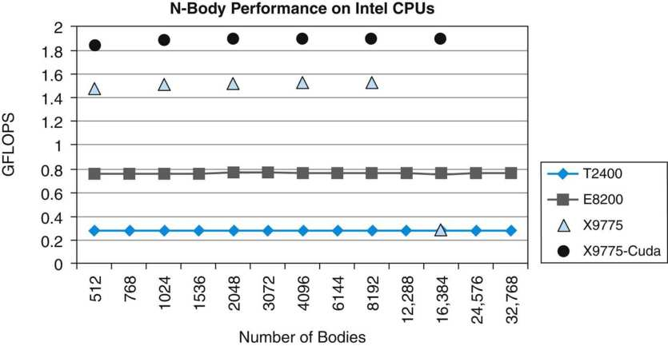

**HÌNH B.8.16 Các phép đo hiệu năng code N-body trên CPU. Đồ thị biểu diễn hiệu năng N-body single precision trên các CPU Intel Core2, được ghi bằng số model CPU. Lưu ý hiệu năng GFLOPS giảm mạnh, biểu diễn theo GFLOPS trên y-axis, cho thấy GPU nhanh hơn CPU đến mức nào. Hiệu năng CPU nhìn chung độc lập với kích thước bài toán, ngoại trừ hiệu năng thấp bất thường khi N=16,384 trên CPU X9775. Đồ thị cũng cho thấy kết quả chạy phiên bản CUDA của code bằng compiler CUDA-for-CPU trên một CPU core, nhanh hơn code C++ 24%. Với tư cách ngôn ngữ lập trình, CUDA bộc lộ tính song song và locality mà compiler có thể khai thác. Các CPU Intel là Extreme X9775 3.2 GHz (tên mã “Penryn”), E8200 2.66 GHz (tên mã “Wolfdale”), một CPU desktop pre-Penryn, và T2400 1.83 GHz (tên mã “Yonah”), một CPU laptop năm 2007. Phiên bản Penryn của Core 2 architecture đặc biệt đáng chú ý cho phép tính N-body nhờ divider 4-bit, cho phép các phép chia và căn bậc hai thực thi nhanh gấp bốn lần các CPU Intel trước đó.**

Hình B.8.16 code gần giống (C++/CUDA) trên Core2. CPU khoảng 1% GPU, 0.2 tới 2 GFLOPS, gần hằng theo phạm vi size rộng.

Đồ thị cũng cho thấy kết quả biên dịch phiên bản CUDA của code cho CPU, với hiệu năng cải thiện 24%. Với tư cách ngôn ngữ lập trình, CUDA bộc lộ tính song song, cho phép compiler tận dụng tốt hơn vector unit SSE trên một core. Phiên bản CUDA của code N-body cũng ánh xạ tự nhiên lên multicore CPU bằng các grid block, đạt khả năng mở rộng gần như hoàn hảo trên hệ thống eight-core với N=4096, với các tỷ số lần lượt là 2.0, 3.97 và 7.94 trên hai, bốn và tám core.

#### Kết quả

Với nỗ lực vừa phải, kernel GPU nhanh hơn multicore CPU tới 157 lần. Code N-body trên Intel gần đây Penryn X9775 3.2 GHz một core mất hơn 3 giây/frame, cùng code chạy 44 Hz trên GeForce 8800. pre-Penryn cần 6–16 giây, Core2 cũ, Pentium IV khoảng 25 giây. Phải chia đôi mức tăng biểu kiến vì CPU chỉ cần nửa phép tính cho cùng kết quả (lực hai vật bằng độ lớn, ngược hướng).

Vì sao GPU có thể tăng tốc code nhiều đến vậy? Câu trả lời đòi hỏi xem xét các chi tiết architecture. Phép tính lực pair-wise cần 20 phép toán floating-point, chủ yếu gồm các instruction cộng và nhân (một số có thể được kết hợp bằng instruction multiply-add), nhưng cũng có các instruction chia và căn bậc hai để chuẩn hóa vector. CPU Intel cần nhiều cycle cho các instruction chia và căn bậc hai single-precision,<sup>2</sup> mặc dù điều này đã được cải thiện trong dòng CPU Penryn mới nhất nhờ divider 4-bit nhanh hơn.<sup>3</sup> Ngoài ra, dung lượng register hạn chế dẫn đến nhiều instruction MOV trong code x86 (có lẽ chuyển đến hoặc từ cache L1). Ngược lại, GeForce 8800 thực thi một thread instruction reciprocal square-root trong bốn clock; xem Mục B.6 về độ chính xác của special function. Nó có register file lớn hơn cho mỗi thread (per-thread) và shared memory có thể được truy cập như một toán hạng instruction. Cuối cùng, compiler CUDA tạo 15 instruction cho một lượt lặp, so với hơn 40 instruction từ nhiều compiler CPU x86 khác nhau. Mức độ song song cao hơn, việc thực thi nhanh hơn các instruction phức tạp, nhiều không gian register hơn và compiler hiệu quả cùng giải thích mức cải thiện hiệu năng lớn của code N-body giữa CPU và GPU.

Trên GeForce 8800, thuật toán all-pairs N-body đạt hiệu năng hơn 240 GFLOPS, so với dưới 2 GFLOPS trên các processor tuần tự gần đây. Việc biên dịch và thực thi phiên bản CUDA của code trên CPU cho thấy bài toán mở rộng tốt trên multicore CPU, nhưng vẫn chậm hơn đáng kể so với một GPU duy nhất.

Ghép mô phỏng N-body GPU với hiển thị chuyển động, tương tác 16K vật ở 44 frame/giây. Cho hiển thị, điều hướng sự kiện thiên văn/sinh lý ở tốc độ tương tác. Còn tham số hóa giảm nhiễu, damping, kỹ thuật tích phân, hiển thị ngay tác động động lực. Hình ảnh ấn tượng tăng hiểu biết hệ vô hình (quá lớn/nhỏ, nhanh/chậm), tạo mô hình vật lý tốt hơn.

Hình B.8.17 hiển thị time-series mô phỏng thiên văn 16K vật, mỗi vật là thiên hà. Ban đầu vỏ cầu xoay quanh z-axis. Quan tâm sự tụ nhóm và hợp nhất thiên hà theo thời gian. Code CUDA ứng dụng trong SDK tại www.nvidia.com/CUDA.

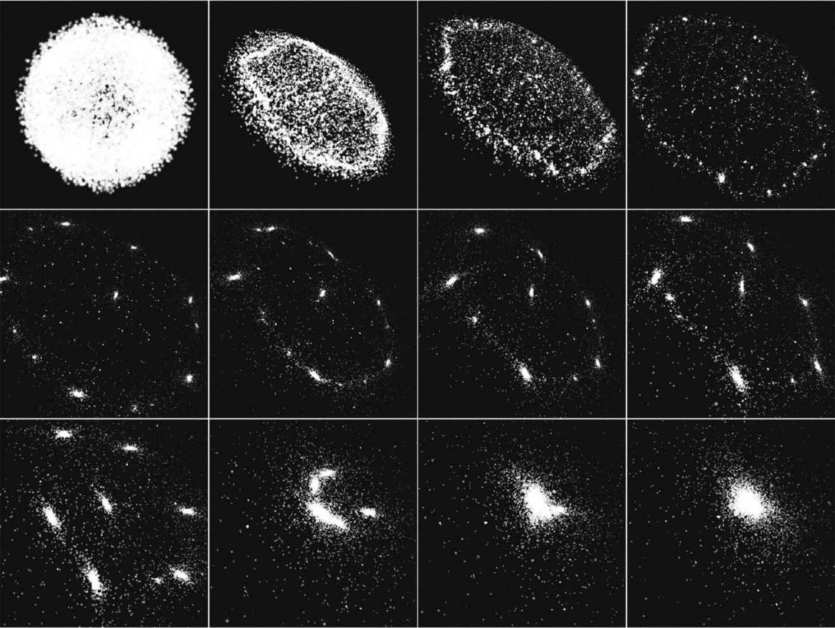

**HÌNH B.8.17 Mười hai ảnh trong tiến triển hệ N-body 16,384 vật.**

## B.9 Ngộ nhận và cạm bẫy

GPU thay đổi quá nhanh nên xuất hiện nhiều ngộ nhận, cạm bẫy. Đây là vài ví dụ.

Ngộ nhận GPU chỉ là multiprocessor vector SIMD.

Dễ kết luận sai GPU chỉ multiprocessor vector SIMD. GPU có mô hình SPMD-style: viết một chương trình chạy nhiều instance thread trên nhiều dữ liệu. Nhưng thực thi không thuần SIMD/vector, là single-instruction multiple-thread (SIMT) B.4. Thread có scalar register, memory riêng, execution state, ID, đường thực thi/branch độc lập, program counter hiệu dụng, address memory độc lập. Nhóm (warp 32) hiệu quả hơn khi PC giống nhưng không bắt buộc. Multiprocessor không thuần SIMD; mô hình thực thi MIMD với barrier, tối ưu SIMT. Load/store coalesce block cũng hiệu quả hơn nhưng không bắt buộc. SIMD thuần đòi hỏi memory/register access align theo vector đều; GPU không hạn chế như vậy, dù warp truy cập block local hiệu quả hơn.

Khác nữa với SIMD thuần, SIMT GPU chạy nhiều hơn một warp đồng thời. Đồ họa có nhiều nhóm vertex/pixel/geometry đồng thời trong mảng. Tính toán cũng chạy chương trình khác đồng thời ở warp khác.

Ngộ nhận Hiệu năng GPU không tăng nhanh hơn định luật Moore.

Moore’s law chỉ đơn giản là một tốc độ. Nó không phải giới hạn “tốc độ ánh sáng” cho bất kỳ tốc độ nào khác. Moore’s law mô tả kỳ vọng rằng theo thời gian, khi công nghệ bán dẫn tiến bộ và transistor nhỏ hơn, chi phí sản xuất trên mỗi transistor sẽ giảm theo hàm mũ. Nói cách khác, với chi phí sản xuất không đổi, số lượng transistor sẽ tăng theo hàm mũ. Gordon Moore [1965] dự đoán tiến trình này sẽ cho số transistor xấp xỉ gấp đôi với cùng chi phí sản xuất mỗi năm, sau đó sửa thành tăng gấp đôi mỗi 2 năm. Mặc dù Moore đưa ra dự đoán ban đầu năm 1965 khi mỗi integrated circuit chỉ có 50 thành phần, dự đoán đã tỏ ra nhất quán một cách đáng kinh ngạc. Việc giảm kích thước transistor trước đây còn mang lại những lợi ích khác, như công suất trên mỗi transistor thấp hơn và clock speed nhanh hơn với công suất không đổi.

Kiến trúc sư dùng transistor tăng để xây processor, memory, thành phần khác. Một thời CPU dùng chúng tăng hiệu năng tương tự Moore, khiến nhiều người tưởng gấp đôi hiệu năng mỗi 18–24 tháng là Moore. Thực ra không phải.

Người thiết kế microprocessor dành một phần các transistor mới cho processor core, cải thiện architecture và thiết kế, đồng thời tăng pipelining để đạt clock speed cao hơn. Phần transistor mới còn lại được sử dụng để cung cấp thêm cache, giúp truy cập memory nhanh hơn. Ngược lại, người thiết kế GPU gần như không dùng transistor mới để cung cấp thêm cache; phần lớn transistor được sử dụng để cải thiện processor core và bổ sung thêm processor core.

GPU tăng tốc nhờ bốn cơ chế. Thứ nhất, người thiết kế GPU trực tiếp tận dụng lợi ích của Moore’s law bằng cách sử dụng số transistor tăng theo hàm mũ để xây dựng processor song song hơn và do đó nhanh hơn. Thứ hai, người thiết kế GPU có thể cải tiến architecture theo thời gian để tăng hiệu suất xử lý. Thứ ba, Moore’s law giả định chi phí không đổi, nên rõ ràng có thể vượt tốc độ của Moore’s law bằng cách chi thêm tiền cho chip lớn hơn với nhiều transistor hơn. Thứ tư, GPU memory system đã tăng bandwidth hiệu dụng với tốc độ gần tương đương tốc độ xử lý, nhờ sử dụng memory nhanh hơn, rộng hơn, nén data và cache tốt hơn. Kết hợp bốn cách tiếp cận này trước đây đã giúp hiệu năng GPU đều đặn tăng gấp đôi khoảng mỗi 12 đến 18 tháng. Tốc độ này, vượt Moore’s law, đã được thể hiện trên các ứng dụng đồ họa trong khoảng 10 năm và chưa có dấu hiệu chậm lại đáng kể. Yếu tố giới hạn tốc độ khó khăn nhất dường như là memory system, nhưng đổi mới trong cạnh tranh cũng đang nhanh chóng cải thiện phần này.

Ngộ nhận GPU chỉ render 3D, không tính toán tổng quát.

GPU xây render 3D, 2D, video. Đáp ứng yêu cầu giao diện/hiệu năng/tính năng API của nhà phát triển, GPU thành processor floating-point lập trình song song đồ sộ. Đồ họa lập trình qua API, ngôn ngữ khó hiểu GLSL, Cg, HLSL trong OpenGL/Direct3D. Nhưng không gì ngăn phơi core song song trực tiếp, không API/ngôn ngữ đó.

Thực tế, GPU thuộc Tesla architecture family cung cấp khả năng truy cập các processor thông qua môi trường software có tên CUDA, cho phép lập trình viên phát triển chương trình ứng dụng tổng quát bằng C và sắp tới là C++. GPU là các processor Turing-complete, nên có thể chạy bất kỳ chương trình nào mà CPU chạy được, mặc dù có thể kém hiệu quả hơn. Và cũng có thể nhanh hơn.

Ngộ nhận GPU không chạy nhanh chương trình double-precision floating-point.

Trước đây GPU không chạy double-precision floating-point trừ giả lập phần mềm, rất chậm. GPU từ indexed arithmetic (bảng màu) tới integer 8-bit/màu, fixed-point, single-precision floating-point, gần đây double precision. GPU hiện đại gần mọi tính toán single-precision floating-point IEEE, đang thêm double.

Chi phí thêm nhỏ có thể hỗ trợ double-precision floating-point và single-precision floating-point. Nay double-precision chậm hơn single-precision khoảng năm đến mười lần. Chi phí tăng dần có thể tăng hiệu năng double-precision theo nhu cầu ứng dụng.

Ngộ nhận GPU làm floating-point không đúng.

GPU, ít nhất Tesla, xử lý single-precision floating-point ở mức IEEE 754 floating-point quy định. Về chính xác, ngang processor IEEE 754-compliant khác.

Nay GPU thiếu một số tính năng chuẩn như denormalized, precise floating-point exception. Nhưng Tesla T10P mới có IEEE rounding đầy đủ, fused-multiply-add, denormalized double precision.

Cạm bẫy Chỉ cần thêm thread che memory latency dài hơn.

CPU core thường được thiết kế để chạy một thread ở tốc độ tối đa. Để đạt tốc độ tối đa, mọi instruction và data của nó phải sẵn sàng vào thời điểm instruction đó cần chạy. Nếu instruction tiếp theo chưa sẵn sàng hoặc data mà nó cần chưa có, instruction không thể chạy và processor bị stall. Memory bên ngoài nằm xa processor, nên việc fetch data từ memory làm lãng phí nhiều cycle thực thi. Vì vậy, CPU cần các local cache lớn để tiếp tục chạy mà không bị stall. Memory latency dài, nên CPU tránh nó bằng cách cố gắng hoạt động trong cache. Tuy nhiên, đến một mức nào đó, yêu cầu working set của chương trình có thể lớn hơn bất kỳ cache nào. Một số CPU đã sử dụng multithreading để chịu được latency, nhưng số thread trên mỗi core thường bị giới hạn ở một con số nhỏ.

GPU khác, core chạy nhiều thread đồng thời nhưng mỗi lần chỉ một instruction từ thread nào đó. Nói cách khác chạy mỗi thread chậm nhưng tổng thể hiệu quả. Mỗi thread chịu chút memory latency vì thread khác chạy.

Mặt trái là cần nhiều thread, thực sự rất nhiều thread, để che giấu memory latency. Ngoài ra, nếu các truy cập memory phân tán hoặc không có tương quan giữa các thread, memory system sẽ phản hồi từng request riêng lẻ ngày càng chậm. Cuối cùng, ngay cả nhiều thread cũng không thể che giấu latency. Vì vậy, điểm dễ mắc sai lầm là để chiến lược “chỉ cần thêm thread” có thể che giấu latency, bạn phải có đủ thread, và các thread phải có cách truy cập memory với locality tốt (well-behaved).

Ngộ nhận Thuật toán O(n) khó tăng tốc.

Dù GPU xử lý data nhanh đến đâu, các bước truyền data đến và từ thiết bị có thể giới hạn hiệu năng của những thuật toán có độ phức tạp O(n), với lượng công việc nhỏ trên mỗi phần tử data. Tốc độ truyền cao nhất qua bus PCIe xấp xỉ 48 GB/giây khi sử dụng DMA và thấp hơn một chút đối với truyền nonDMA. Ngược lại, CPU có tốc độ truy cập system memory điển hình là 8–12 GB/giây. Những bài toán như cộng vector sẽ bị giới hạn bởi việc truyền input đến GPU và trả lại output của phép tính.

Có ba cách khắc phục chi phí truyền data. Thứ nhất, cố gắng giữ data trên GPU lâu nhất có thể, thay vì chuyển data qua lại cho các bước khác nhau của một thuật toán phức tạp. CUDA chủ động giữ nguyên data trong GPU giữa các lần launch để hỗ trợ cách này.

Thứ hai, GPU hỗ trợ đồng thời các thao tác copy-in, copy-out và tính toán, nên data có thể được truyền liên tục vào và ra khỏi thiết bị trong khi nó đang tính toán. Mô hình này hữu ích cho mọi data stream có thể được xử lý ngay khi đến. Ví dụ gồm xử lý video, network routing, nén và giải nén data, thậm chí các phép tính đơn giản hơn như phép toán trên vector lớn.

Ba, dùng CPU, GPU chung, chia tập việc cho mỗi loại, xem hệ như nền tảng heterogeneous. CUDA hỗ trợ phân việc một/nhiều GPU cùng dùng CPU không cần thread qua function GPU bất đồng bộ, nên khá dễ giữ CPU, mọi GPU chạy đồng thời giải nhanh hơn.

## B.10 Nhận xét kết thúc

GPU là processor song song đồ sộ, dùng rộng không chỉ 3D mà nhiều ứng dụng nhờ thiết bị đồ họa tiến thành processor lập trình. Mô hình đồ họa thường API DirectX™/OpenGL™. Tính toán general-purpose CUDA dùng SPMD (single-program multiple data), chương trình nhiều thread song song.

Song song GPU tiếp mở rộng Moore chủ yếu thêm processor. Chỉ mô hình dễ mở tới hàng trăm core, hàng nghìn thread mới hỗ trợ thành công manycore GPU/CPU. Chỉ ứng dụng nhiều task song song tương đối độc lập được tăng tốc.

Mô hình lập trình GPU linh hoạt hơn cả đồ họa, tính toán. CUDA tiến nhanh tới C/C++ đầy đủ. Graphics API, mô hình có lẽ tiếp nhận khả năng/mô hình CUDA. Thread SPMD-style mở rộng, tiện, gọn, dễ học để biểu đạt song song lớn.

Theo thay đổi mô hình, kiến trúc GPU linh hoạt, lập trình được hơn. Unit fixed-function dần truy cập từ chương trình tổng quát, như CUDA đã dùng texture intrinsic lookup bằng instruction/unit texture.

GPU architecture sẽ tiếp tục thích ứng với các kiểu sử dụng của cả lập trình viên đồ họa lẫn lập trình viên ứng dụng khác. GPU sẽ tiếp tục mở rộng để có thêm năng lực xử lý thông qua các processor core bổ sung, đồng thời tăng thread bandwidth và memory bandwidth dành cho chương trình. Ngoài ra, các programming model phải phát triển để hỗ trợ lập trình các heterogeneous manycore system bao gồm cả GPU lẫn CPU.

### Lời cảm ơn

Phụ lục là công việc nhiều tác giả NVIDIA. Trân trọng đóng góp đáng kể của Michael Garland, John Montrym, Doug Voorhies, Lars Nyland, Erik Lindholm, Paulius Micikevicius, Massimiliano Fatica, Stuart Oberman, Vasily Volkov.

## B.11 Góc nhìn lịch sử và đọc thêm

### Phát triển graphics pipeline

Phần cứng pipeline 3D từ hệ lớn đắt đầu 1980 tới workstation nhỏ rồi PC accelerator giữa tới late-1990s. Trong thời gian này có ba chuyển đổi:

- Subsystem Performance-leading giảm giá từ $50,000 xuống $200.

- Hiệu năng từ 50 triệu lên 1 tỷ pixel/giây, từ 100,000 lên 10 triệu vertex/giây.

- Phần cứng từ wireframe (viền polygon) tới polygon tô phẳng màu hằng, polygon tô mượt màu nội suy, full-scene anti-aliasing với texture mapping, multitexturing sơ khai.

### Graphics pipeline Fixed-Function

Trong thời gian này phần cứng cấu hình nhưng không lập trình bởi nhà phát triển. Mỗi thế hệ cải tiến tăng dần nhưng nhà phát triển tinh vi hơn, đòi hỏi nhiều tính năng hơn built-in cố định có thể cung cấp. GeForce 3 [Lindholm và cộng sự, 2001] bước đầu lập trình shader tổng quát thực, phơi ISA nội bộ floating-point vertex engine. Trùng DirectX 8, OpenGL vertex shader extension. GPU sau thời DirectX 9 mở lập trình tổng quát, floating point tới fragment stage, texture tới vertex. ATI Radeon 9700 năm 2002 có pixel fragment processor floating-point 24-bit lập trình DirectX 9/OpenGL. GeForce FX thêm pixel processor floating-point 32-bit. Xu hướng thống nhất chức năng stage ít nhất với lập trình viên. GeForce 6800, 7800 vẫn processor/phần cứng riêng vertex và fragment. XBox 360 năm 2005 đưa GPU processor thống nhất sớm, vertex/pixel shader cùng processor.

### Phát triển đồ họa Real-Time lập trình được

Trong 30 năm, kiến trúc từ pipeline đơn giản vẽ wireframe tới thiết kế song song cao nhiều pipeline sâu render ảnh tương tác phức tạp three-dimensional. Đồng thời tính toán tinh vi, user-programmable hơn.

Một số stage làm nhiều floating-point trên dữ liệu hoàn toàn độc lập như đổi vị trí vertex, tạo màu pixel. Độc lập là khác biệt chính GPU/CPU. Một frame 1/60 giây có thể triệu tam giác, 6 triệu pixel. Cơ hội khai thác song song cực lớn.

Các chức năng cụ thể được thực thi ở một số graphics pipeline stage thay đổi theo thuật toán rendering và đã phát triển để có thể lập trình được. Vertex program ánh xạ vị trí các đỉnh tam giác lên màn hình, thay đổi vị trí, màu hoặc hướng của chúng. Thông thường, một vertex shader thread nhận input là vị trí vertex floating-point (x, y, z, w) và tính vị trí màn hình floating-point (x, y, z). Geometry program thao tác trên các primitive được xác định bởi nhiều vertex, thay đổi chúng hoặc tạo thêm primitive. Mỗi pixel fragment shader “shade” một pixel, tính phần đóng góp màu floating-point red, green, blue, alpha (RGBA) vào hình ảnh được render tại vị trí pixel sample (x, y). Với cả ba loại graphics shader, các instance của chương trình có thể chạy song song vì mỗi instance làm việc trên data độc lập, tạo kết quả độc lập và không có side effect.

Giữa stage lập trình có hàng chục stage fixed-function làm tác vụ well-defined hiệu quả hơn nhiều processor lập trình, ít lợi từ lập trình. Ví dụ giữa geometry, pixel là rasterizer—state machine phức tạp xác định pixel/phần pixel trong primitive. Kết hợp stage lập trình, fixed-function cân hiệu năng cực cao với control thuật toán của người dùng.

Thuật toán thường một pass primitive, truy cập memory coherent cao, dùng băng thông tốt, ít nhạy latency. Cùng shader thường compute-limited, định hướng GPU khác CPU. CPU die chủ yếu cache, GPU chủ yếu datapath floating-point, logic fixed-function. Giao diện memory ưu tiên băng thông hơn latency vì nhiều thread che được, thường cao nhiều lần CPU, đôi khi hơn 100 GB/giây. Số thread nhẹ fine-grained far-higher tận dụng song song phong phú.

Từ GeForce 8800 năm 2006, ba stage lập trình ánh xạ mảng thống nhất; pipeline logic vật lý là đường tuần hoàn thăm processor ba lần, nhiều logic fixed-function ở giữa. Tải ba stage khác mạnh theo thuật toán, thống nhất cân tải.

### Processor đồ họa và tính toán thống nhất

Đến thế hệ DirectX 10, chức năng của vertex shader và pixel fragment shader được định hướng trở nên giống nhau đối với lập trình viên. Thực tế, một logical stage mới, geometry shader, được giới thiệu để xử lý toàn bộ các vertex của một primitive thay vì từng vertex riêng lẻ. GeForce 8800 được thiết kế với DirectX 10 làm mục tiêu. Các nhà phát triển đưa ra những thuật toán shading tinh vi hơn, thúc đẩy tốc độ phép toán shader tăng mạnh, đặc biệt là các phép toán floating-point. NVIDIA chọn hướng thiết kế processor có tần số hoạt động cao hơn mức mà phương pháp standard-cell cho phép, nhằm cung cấp throughput mong muốn với hiệu quả diện tích cao nhất có thể (area-efficiently). Thiết kế High-clock-speed cần nhiều công sức kỹ thuật hơn đáng kể, nên có lợi khi chỉ thiết kế một processor thay vì hai, hoặc ba nếu tính geometry stage mới. Việc giải quyết các thách thức kỹ thuật của một processor thống nhất, gồm cân bằng tải và tuần hoàn logical pipeline lên các thread của processor array, trở nên đáng giá để nhận được lợi ích từ một thiết kế processor duy nhất.

### GPGPU: Bước trung gian

Khi các GPU DirectX 9-capable xuất hiện, một số nhà nghiên cứu chú ý đến xu hướng tăng hiệu năng thô của GPU và bắt đầu khảo sát việc dùng GPU để giải các bài toán song song phức tạp. GPU DirectX 9 chỉ được thiết kế để đáp ứng các tính năng mà graphics API yêu cầu. Để truy cập tài nguyên tính toán, lập trình viên phải biểu diễn bài toán dưới dạng các phép toán đồ họa gốc. Ví dụ, để chạy nhiều instance pixel shader đồng thời, phải gửi một tam giác đến GPU, với clipping thành hình chữ nhật nếu đó là hình dạng mong muốn. Shader không có cách thực hiện scatter tùy ý đến memory. Cách duy nhất để ghi kết quả vào memory là xuất nó dưới dạng giá trị màu pixel và cấu hình framebuffer operation stage để ghi, hoặc blend nếu muốn, kết quả vào framebuffer two-dimensional. Hơn nữa, cách duy nhất để chuyển kết quả từ một lượt tính toán sang lượt kế tiếp là ghi mọi kết quả song song vào pixel framebuffer, rồi dùng framebuffer đó làm texture map input cho pixel fragment shader của stage tính toán tiếp theo. Việc ánh xạ các phép tính tổng quát lên GPU trong thời kỳ này khá bất tiện. Tuy vậy, những nhà nghiên cứu kiên trì đã trình diễn một số ứng dụng hữu ích bằng nhiều công sức. Lĩnh vực này được gọi là “GPGPU”, viết tắt của general purpose computing on GPUs.

### GPU computing

Khi phát triển Tesla architecture cho GeForce 8800, NVIDIA nhận ra tiềm năng hữu ích của nó sẽ lớn hơn nhiều nếu lập trình viên có thể xem GPU là một processor. NVIDIA chọn cách lập trình trong đó lập trình viên khai báo tường minh các khía cạnh data-parallel của workload.

DirectX 10, NVIDIA đã làm processor floating-point/integer high-efficiency chạy nhiều workload đồng thời cho pipeline logic, tận dụng nhóm thread cùng đường. Thêm load/store integer byte addressing đáp ứng C biên dịch, thread block (CTA), grid, barrier để dispatch/quản lý tính toán song song cao, atomic memory. Phát triển compiler C/C++, thư viện, runtime CUDA cho dễ truy cập mô hình data-parallel, phát triển ứng dụng.

### GPU có thể mở rộng

Khả năng mở rộng là một đặc tính hấp dẫn của hệ thống đồ họa ngay từ đầu. Hệ thống đồ họa workstation cho khách hàng lựa chọn năng lực xử lý pixel bằng cách thay đổi số circuit board xử lý pixel được lắp đặt. Trước mid-1990s, khả năng mở rộng đồ họa PC gần như không tồn tại; chỉ có một lựa chọn là VGA controller. Khi các accelerator 3D-capable xuất hiện, thị trường có chỗ cho nhiều sản phẩm. 3dfx giới thiệu khả năng mở rộng multiboard bằng SLI (Scan Line Interleave) ban đầu trên Voodoo2, giữ vị trí dẫn đầu hiệu năng ở thời điểm đó, năm 1998. Cũng trong năm 1998, NVIDIA giới thiệu các sản phẩm riêng là biến thể của một architecture duy nhất: Riva TNT Ultra (high-performance) và Vanta (low-cost), đầu tiên bằng speed binning và packaging, sau đó bằng các thiết kế chip riêng như GeForce 2 GTS và GeForce 2 MX. Hiện tại, với một thế hệ architecture nhất định, cần bốn hoặc năm thiết kế chip GPU riêng để bao phủ các mức hiệu năng và giá của desktop PC. Ngoài ra còn có các phân khúc notebook và workstation riêng. Sau khi mua lại 3dfx, NVIDIA tiếp tục khái niệm multi-GPU SLI vào năm 2004, bắt đầu với GeForce 6800, cung cấp khả năng mở rộng multi-GPU trong suốt với lập trình viên và người dùng. Hành vi chức năng giống nhau trên toàn dải mở rộng; một ứng dụng có thể chạy không thay đổi trên mọi cách triển khai của một architecture family.

CPU mở rộng theo số lượng transistor cao hơn bằng cách tăng số core constant-performance trên một die thay vì tăng hiệu năng của một core riêng lẻ. Vào thời điểm viết, ngành công nghiệp đang chuyển từ dual-core sang quad-core, và eight-core cũng không còn xa. Lập trình viên buộc phải tìm task parallelism gấp bốn đến tám lần để tận dụng đầy đủ các processor này, và ứng dụng sử dụng task parallelism phải được viết lại thường xuyên để nhắm đến mỗi lần số core tăng gấp đôi. Ngược lại, GPU có mức multithreading cao khuyến khích data parallelism và thread parallelism ở mức many-fold, dễ mở rộng đến hàng nghìn thread song song trên nhiều processor. Scalable parallel programming model của GPU cho đồ họa và tính toán song song được thiết kế để mở rộng trong suốt và có tính khả chuyển. Chương trình đồ họa hoặc CUDA được viết một lần và chạy trên GPU có bất kỳ số lượng processor nào. Như trong Mục B.1, lập trình viên CUDA chỉ định tường minh cả fine-grained lẫn coarse-grained parallelism trong chương trình thread bằng cách phân rã bài toán thành các grid thread block; cùng chương trình sẽ chạy hiệu quả trên GPU hoặc CPU ở mọi kích thước, cả trong các thế hệ hiện tại lẫn tương lai.

### Phát triển gần đây

Nghiên cứu học thuật, công nghiệp CUDA tạo hàng trăm chương trình thành công, nhiều nhanh hơn multicore CPU hàng chục/trăm lần: n-body, mô hình phân tử, tài chính tính toán, xử lý dữ liệu dầu khí. Nhiều dùng single-precision floating-point, một số cần double. double-precision floating-point GPU gần đây mở rộng phạm vi tăng tốc.

Danh sách, ví dụ phát triển ứng dụng GPU hiện tại tại CUDAZone: www.nvidia.com/CUDA.

### Xu hướng tương lai

Dĩ nhiên, số processor core sẽ tiếp tục tăng tương ứng với số transistor khả dụng khi quy trình silicon được cải tiến. Ngoài ra, GPU sẽ tiếp tục phát triển mạnh về architecture. Mặc dù đã thể hiện hiệu năng cao trên các ứng dụng data-parallel, các core processor của GPU vẫn có thiết kế tương đối đơn giản. Những kỹ thuật mạnh hơn sẽ được giới thiệu trong mỗi architecture kế tiếp để tăng mức sử dụng thực tế của các calculating unit. Vì scalable parallel computing trên GPU là lĩnh vực mới, những ứng dụng mới đang nhanh chóng được tạo ra. Bằng cách nghiên cứu chúng, người thiết kế GPU sẽ phát hiện và triển khai các tối ưu máy mới.

## Đọc thêm

1. Akeley, K. and T. Jermoluk [1988]. “High-Performance Polygon Rendering,” Proc. SIGGRAPH 1988 (August), 239– 46.

2. Akeley, K. [1993]. “RealityEngine Graphics.” Proc. SIGGRAPH 1993 (August), 109–16.

3. Blelloch GB. Prefix Sums and Their Applications. In: Reif John H, ed. Synthesis of Parallel Algorithms. San Francisco: Morgan Kaufmann Publishers; 1990.

4. Blythe D. The Direct3D 10 System. ACM Trans Graphics. 2006;Vol. 25(no. 3(July)):724–734.

5. Buck, I., T. Foley, D. Horn, J. Sugerman, K. Fatahlian, M. Houston, and P. Hanrahan [2004]. “Brook for GPUs: Stream Computing on Graphics Hardware.” Proc. SIGGRAPH 2004, 777–86, August. http://doi.acm.org/10.1145/1186562.1015800.

6. Elder, G. [2002] “Radeon 9700.” Eurographics/SIGGRAPH Workshop on Graphics Hardware, Hot3D Session, www.graphicshardware.org/previous/www_2002/presentations/Hot3D-RADEON9700.ppt.

7. Fernando R, Kilgard MJ. The Cg Tutorial: The Definitive Guide to Programmable Real-Time Graphics Reading, MA: Addison-Wesley; 2003.

8. Fernando R, ed. GPU Gems: Programming Techniques, Tips, and Tricks for Real-Time Graphics. Reading, MA: Addison-Wesley; 2004; https://developer.nvidia.com/gpugems/GPUGems/gpugems_pref01.html

9. Foley J, van Dam A, Feiner S, Hughes J. Computer Graphics: Principles and Practice, second edition in C Reading, MA: Addison-Wesley; 1995.

10. Hillis WD, Steele GL. Data parallel algorithms. Commun ACM. 1986;29:1170–1183 http://doi.acm.org/10.1145/7902.7903.

11. IEEE Std 754-2008 [2008]. IEEE Standard for Floating-Point Arithmetic. ISBN 978-0-7381-5752-8, STD95802, http://ieeexplore.ieee.org/servlet/opac?punumber=4610933 (Aug. 29).

12. Industrial Light and Magic [2003]. OpenEXR, www.openexr.com.

13. Intel Corporation [2007]. Intel 64 and IA-32 Architectures Optimization Reference Manual. November. Order Number: 248966-016. http://www.intel.com/content/dam/www/public/us/en/documents/manuals/64-ia-32-architectures-optimization-manual.pdf.

14. Kessenich, J. [2006]. The OpenGL Shading Language, Language Version 1.20, Sept. 2006. www.opengl.org/documentation/specs/.

15. Kirk, D. and D. Voorhies [1990]. “The Rendering Architecture of the DN10000VS.” Proc. SIGGRAPH 1990 (August), 299–307.

16. Lindholm E., M.J. Kilgard, and H. Moreton [2001]. “A User-Programmable Vertex Engine.” Proc. SIGGRAPH 2001 (August), 149–58.

17. Lindholm E, Nickolls J, Oberman S, Montrym J. NVIDIA Tesla: A Unified Graphics and Computing Architecture. IEEE Micro. 2008;Vol. 28(no. 2(March–April)):39–55.

18. Microsoft Corporation. Microsoft DirectX Specification, https://msdn.microsoft.com/en-us/library/windows/apps/hh452744.aspx.

19. Microsoft Corporation. Microsoft DirectX 9 Programmable Graphics Pipeline Redmond, WA: Microsoft Press; 2003.

20. Montrym, J., D. Baum, D. Dignam, and C. Migdal [1997]. “InfiniteReality: A Real-Time Graphics System.” Proc. SIGGRAPH 1997 (August), 293–301.

21. Montrym J, Moreton H. The GeForce 6800. IEEE Micro. 2005;Vol. 25(no. 2(March–April)):41–51.

22. Moore GE. Cramming more components onto integrated circuits. Electronics. 1965;Vol. 38 (April 19).

23. Nguyen H, ed. GPU Gems 3. Reading, MA: Addison-Wesley; 2008.

24. Nickolls J, Buck I, Garland M, Skadron K. Scalable Parallel Programming with CUDA. ACM Queue. 2008;Vol. 6(no. 2(March–April)):40–53.

25. NVIDIA [2007]. CUDA Zone. http://www.nvidia.com/object/cuda_home_new.html.

26. NVIDIA [2007]. CUDA Programming Guide 1.1. https://developer.nvidia.com/nvidia-gpu-programming-guide.

27. NVIDIA [2007]. PTX: Parallel Thread Execution ISA version 1.1. www.nvidia.com/object/io_1195170102263.html.

28. Nyland L, Harris M, Prins J. Fast N-Body Simulation with CUDA. In: Nguyen H, ed. GPU Gems 3. Reading, MA: Addison-Wesley; 2007.

29. Oberman, S. F. and M. Y. Siu [2005]. “A High-Performance Area- Efficient Multifunction Interpolator,” Proc. Seventeenth IEEE Symp. Computer Arithmetic, 272–79.

30. Patterson DA, Hennessy JL. Computer Organization and Design: The Hardware/Software Inter face third edition San Francisco: Morgan Kaufmann Publishers; 2004.

31. Pharr M, ed. GPU Gems 2: Programming Techniques for High-Performance Graphics and General-Purpose Computation. Reading, MA: Addison-Wesley; 2005.

32. Satish, N., M. Harris, and M. Garland [2008]. “Designing Efficient Sorting Algorithms for Manycore GPUs,” NVIDIA Technical Report NVR-2008-001.

33. Segal, M. and K. Akeley [2006]. The OpenGL Graphics System: A Specification, Version 2.1, Dec. 1, 2006. www.opengl.org/documentation/specs/.

34. Sengupta, S., M. Harris, Y. Zhang, and J. D. Owens [2007]. “Scan Primitives for GPU Computing.” In Proc. of Graphics Hardware 2007 (August), 97–106.

35. Volkov, V. and J. Demmel [2008]. “LU, QR and Cholesky Factorizations using Vector Capabilities of GPUs,” Technical Report No. UCB/EECS-2008-49, 1–11. http://www.eecs.berkeley.edu/Pubs/TechRpts/2008/EECS-2008-49.pdf.

36. Williams, S., L. Oliker, R. Vuduc, J. Shalf, K. Yelick, and J. Demmel [2007]. “Optimization of sparse matrix-vector multiplication on emerging multicore platforms,” In Proc. Supercomputing 2007, November.

<sup>1</sup>Phỏng theo Nyland và cộng sự [2007], “Fast N-Body Simulation with CUDA,” Chương 31 của GPU Gems 3. <sup>2</sup>Không xét các instruction x86 SSE reciprocal-square-root (RSQRT*) và reciprocal (RCP*) vì độ chính xác của chúng quá thấp để có thể so sánh tương đương. <sup>3</sup>Intel Corporation, Intel 64 and IA-32 Architectures Optimization Reference Manual. Tháng 11 năm 2007. Order Number: 248966-016. Cũng có tại www.intel.com/design/processor/manuals/248966.pdf.
