### PHỤ LỤC C

# Ánh xạ control sang phần cứng

C.1 Giới thiệu C-3 C.2 Triển khai combinational control unit C-4 C.3 Triển khai control bằng Finite-State Machine C-8 C.4 Triển khai hàm Next-State bằng sequencer C-22 C.5 Chuyển microprogram thành phần cứng C-28 C.6 Nhận xét kết thúc C-32 C.7 Bài tập C-33

Một định dạng tùy biến như thế này phụ thuộc vào kiến trúc phần cứng và instruction set mà nó phục vụ. Định dạng phải đạt được sự cân bằng thích hợp giữa kích thước ROM, giải mã ROM-output, kích thước mạch và tốc độ thực thi của máy.

Jim McKevit và cộng sự, báo cáo thiết kế 8086, 1997

## C.1 Giới thiệu

Control thường có hai phần: một phần combinational không có state và một sequential control unit xử lý việc sắp thứ tự cùng control chính trong thiết kế multicycle. Combinational control unit thường xử lý một phần quá trình decode và control. ALU control trong Chương 4 là một ví dụ. Một cách triển khai single-cycle như trong Chương 4 cũng có thể dùng combinational controller vì nó không cần nhiều state. Mục C.2 xem xét cách triển khai hai combinational unit này từ các truth table trong Chương 4.

Vì sequential control unit lớn hơn và thường phức tạp hơn, có nhiều kỹ thuật triển khai sequential control unit hơn. Mức hữu ích của các kỹ thuật này phụ thuộc vào độ phức tạp của control, những đặc tính như số next state trung bình của một state bất kỳ, và công nghệ triển khai.

Cách trực tiếp nhất để triển khai một hàm sequential control là dùng một khối logic nhận current state và trường opcode của Instruction register làm input, rồi tạo ra các tín hiệu datapath control cùng giá trị next state làm output. Biểu diễn ban đầu có thể là sơ đồ finite-state hoặc microprogram. Trong trường hợp sau, mỗi microinstruction biểu diễn một state.

Trong cách triển khai dùng finite-state controller, hàm next-state được tính bằng logic. Mục C.3 xây dựng cách triển khai như vậy cho cả ROM lẫn PLA.

Một phương pháp triển khai khác tính hàm next-state bằng một counter tăng current state để xác định next state. Khi next state không đi theo thứ tự liên tiếp, logic khác được dùng để xác định state đó. Mục C.4 khảo sát kiểu triển khai này và chỉ ra cách dùng nó để triển khai finite-state control.

Trong Mục C.5, chúng ta chỉ ra cách chuyển biểu diễn microprogram của sequential control thành control logic.

## C.2 Triển khai combinational control unit

Trong mục này, chúng ta chỉ ra cách ánh xạ ALU control unit và main control unit của thiết kế một clock xuống cấp gate. Với các hệ thống computer-aided design (CAD) hiện đại, quá trình này hoàn toàn mang tính máy móc. Các ví dụ minh họa cách hệ thống CAD tận dụng cấu trúc hàm control, bao gồm cả sự hiện diện của các hạng don’t-care.

### Ánh xạ hàm ALU control sang gate

Hình C.2.1 trình bày truth table cho hàm ALU control đã xây dựng trong Chương 4, Mục 4.4. Một khối logic triển khai hàm ALU control này có bốn output riêng biệt (gọi là Operation3, Operation2, Operation1 và Operation0), mỗi output tương ứng với một trong bốn bit ALU control ở cột cuối của Hình C.2.1. Hàm logic cho mỗi output được xây dựng bằng cách kết hợp tất cả các entry trong truth table thiết lập output đó. Ví dụ, bit low-order của ALU control (Operation0) được thiết lập bởi hai entry cuối trong truth table ở Hình C.2.1. Vì vậy, truth table cho Operation0 sẽ có hai entry này.

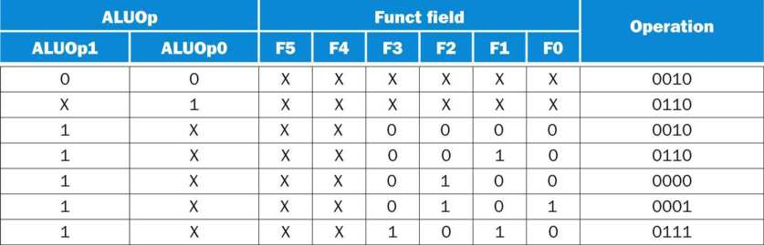

**HÌNH C.2.1 Truth table cho bốn bit ALU control (gọi là Operation) dưới dạng hàm của ALUOp và trường function code. Bảng này giống bảng trong Hình 4.13.**

Hình C.2.2 trình bày truth table cho từng bit trong bốn bit ALU control. Chúng ta tận dụng cấu trúc chung của mỗi truth table để đưa thêm các don’t care vào. Ví dụ, năm dòng trong truth table ở Hình C.2.1 thiết lập Operation1 được rút gọn còn hai entry trong Hình C.2.2. Một chương trình tối thiểu hóa logic sẽ dùng các hạng don’t-care để giảm số gate và số input của mỗi gate khi hiện thực các truth table này bằng logic gate.

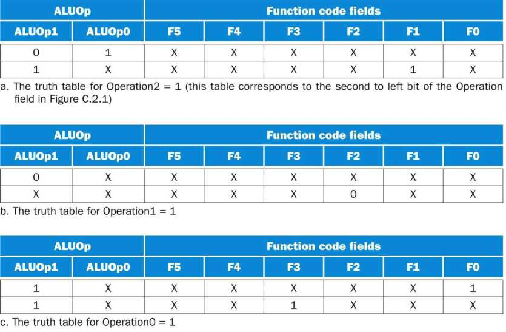

**HÌNH C.2.2 Truth table cho ba đường ALU control. Chỉ những entry có output bằng 1 được trình bày. Các bit trong mỗi trường được đánh số từ phải sang trái bắt đầu từ 0; vì vậy F5 là most significant bit của trường function và F0 là least significant bit. Tương tự, tên các tín hiệu tương ứng với operation code 4-bit cung cấp cho ALU là Operation3, Operation2, Operation1 và Operation0 (bit cuối là least significant bit). Vì vậy truth table trên cho thấy các tổ hợp input mà ALU control phải bằng 0010, 0001, 0110 hoặc 0111 (các tổ hợp khác không được dùng). Các bit ALUOp được đặt tên ALUOp1 và ALUOp0. Ba giá trị output phụ thuộc vào trường ALUOp 2-bit và, khi trường này bằng 10, function code 6-bit trong instruction. Theo đó, khi trường ALUOp khác 10, chúng ta không quan tâm giá trị function code (được biểu diễn bằng X). Không có truth table cho trường hợp Operation3=1 vì nó luôn được đặt bằng 0 trong Hình C.2.1. Xem Phụ lục A để biết thêm nền tảng về don’t care.**

Một điểm dễ gây nhầm lẫn trong Hình C.2.2 là không có hàm logic cho Opera-tion3. Đó là vì đường control này chỉ được dùng cho phép NOR, vốn không cần thiết cho tập con RISC-V trong Hình 4.12.

Từ truth table đã đơn giản hóa trong Hình C.2.2, chúng ta có thể tạo ra logic trong Hình C.2.3, gọi là khối ALU control. Quá trình này trực tiếp và có thể thực hiện bằng chương trình CAD. Ví dụ về cách suy ra các logic gate từ truth table được trình bày trong chú thích Hình C.2.3.

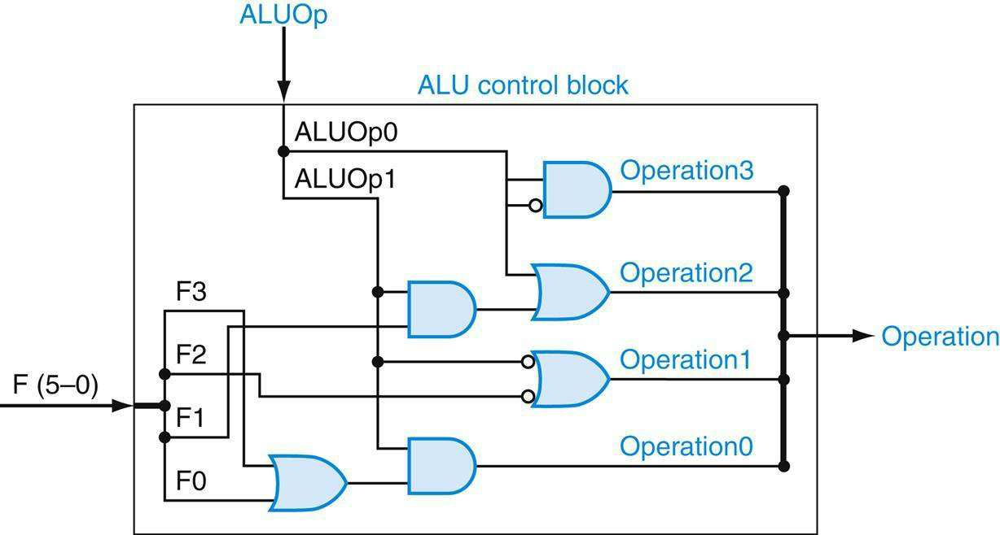

**HÌNH C.2.3 Khối ALU control tạo bốn bit ALU control dựa trên function code và các bit ALUOp. Logic này được tạo trực tiếp từ truth table trong Hình C.2.2. Chỉ 4 trong 6 bit của function code thực sự cần làm input, vì 2 bit phía trên luôn là don’t care. Hãy xem logic này liên hệ với truth table trong Hình C.2.2 như thế nào. Xét output Operation2, được tạo bởi hai dòng trong truth table cho Operation2. Dòng thứ hai là AND của hai hạng (F1 =1 và ALUOp1 =1); gate AND two-input phía trên tương ứng với hạng này. Hạng còn lại khiến Operation2 được assert đơn giản là ALUOp0. Hai hạng được kết hợp bằng gate OR có output là Operation2. Các output Operation0 và Operation1 được suy ra tương tự từ truth table. Vì Operation3 luôn bằng 0, chúng ta nối một tín hiệu và phần bù của nó vào các input của gate AND để tạo 0.**

Logic ALU control này đơn giản vì chỉ có ba output và chỉ cần nhận biết một vài tổ hợp input có thể có. Nếu phải chuyển nhiều function code ALU thành tín hiệu ALU control, phương pháp đơn giản này sẽ không hiệu quả. Thay vào đó, có thể dùng decoder, memory hoặc một mảng logic gate có cấu trúc. Các kỹ thuật này được mô tả trong Phụ lục A, và chúng ta sẽ thấy ví dụ khi khảo sát cách triển khai multicycle controller trong Mục C.3.

#### Giải thích thêm

Nói chung, biểu diễn hàm logic bằng phương trình logic và truth table là tương đương. (Chúng ta thảo luận chi tiết hơn trong Phụ lục A). Tuy nhiên, khi truth table chỉ chỉ định các entry tạo output khác 0, nó có thể chưa mô tả đầy đủ hàm logic. Một truth table đầy đủ chỉ rõ mọi entry don’t-care. Ví dụ, encoding 11 cho ALUOp luôn tạo don’t care ở output. Vì vậy, một truth table đầy đủ sẽ có XXX ở phần output cho tất cả entry có 11 trong trường ALUOp. Những entry don’t-care này cho phép thay trường ALUOp 10 và 01 lần lượt bằng 1X và X1. Việc đưa các hạng don’t-care vào và tối thiểu hóa logic vừa phức tạp vừa error-prone, do đó nên để chương trình thực hiện.

### Ánh xạ hàm main control sang gate

Triển khai hàm main control bằng một tập gate không có cấu trúc, như đã làm với ALU control, là hợp lý vì hàm control không phức tạp cũng không lớn, như có thể thấy trong truth table ở Hình C.2.4. Tuy nhiên, nếu phần lớn trong 64 opcode có thể có được dùng và có nhiều đường control hơn, số gate sẽ lớn hơn nhiều và mỗi gate có thể có nhiều input hơn.

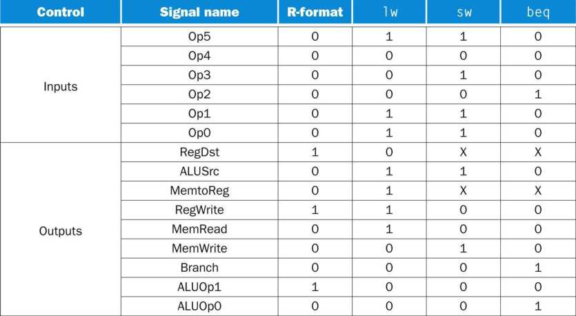

**HÌNH C.2.4 Hàm control của cách triển khai one-clock đơn giản được chỉ định đầy đủ bởi truth table này. Bảng này giống bảng trong Hình 4.22.**

Vì mọi hàm đều có thể được tính bằng hai cấp logic, một cách khác để triển khai hàm logic là dùng mảng logic two-level có cấu trúc. Hình C.2.5 trình bày cách triển khai như vậy. Nó dùng một mảng gate AND theo sau bởi một mảng gate OR. Cấu trúc này gọi là programmable logic array (PLA). PLA là một trong những cách phổ biến nhất để triển khai hàm control. Chúng ta sẽ trở lại việc dùng các phần tử logic có cấu trúc để triển khai control khi triển khai finite-state controller trong mục tiếp theo.

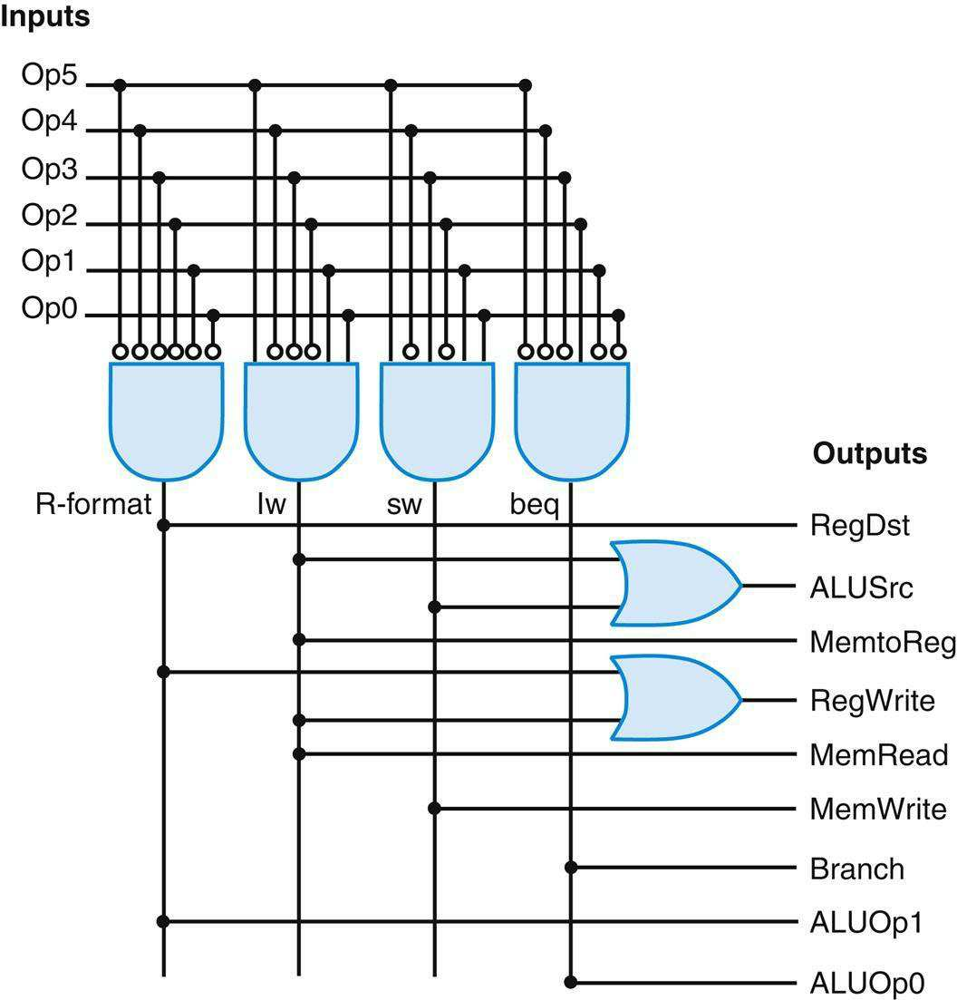

**HÌNH C.2.5 Cách triển khai có cấu trúc của hàm control được mô tả bằng truth table trong Hình C.2.4. Cấu trúc gọi là programmable logic array (PLA) dùng một mảng gate AND theo sau bởi một mảng gate OR. Input của các gate AND là input của hàm và giá trị đảo của chúng (các vòng tròn biểu thị việc đảo tín hiệu). Input của các gate OR là output của các gate AND (hoặc, trong trường hợp suy biến, là input của hàm cùng giá trị đảo). Output của các gate OR là output của hàm.**

## C.3 Triển khai control bằng Finite-State Machine

Để triển khai control dưới dạng finite-state machine, trước hết phải gán một số cho mỗi state trong 10 state; mỗi state có thể dùng bất kỳ số nào, nhưng chúng ta sẽ đánh số liên tiếp cho đơn giản. Hình C.3.1 trình bày sơ đồ finite-state. Với 10 state, cần 4 bit để encode số state, gọi các bit state này là S3, S2, S1 và S0. Số current-state được lưu trong state register, như Hình C.3.2. Nếu các state được gán liên tiếp, state i được encode bằng các bit state dưới dạng số nhị phân i. Ví dụ, state 6 được encode là 0110<sub>two</sub> hay S3 =0, S2 =1, S1 =1, S0 =0, cũng có thể viết là

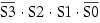

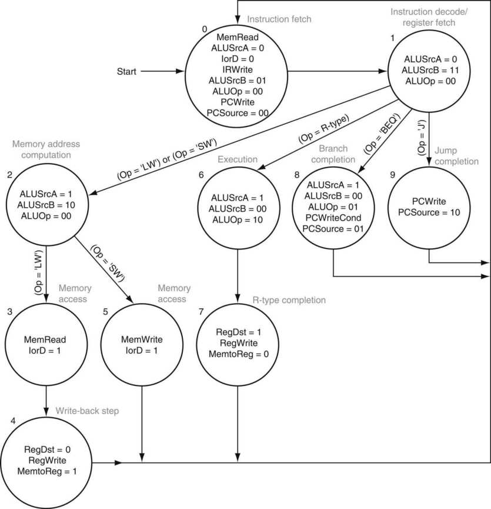

**HÌNH C.3.1 Sơ đồ finite-state cho multicycle control.**

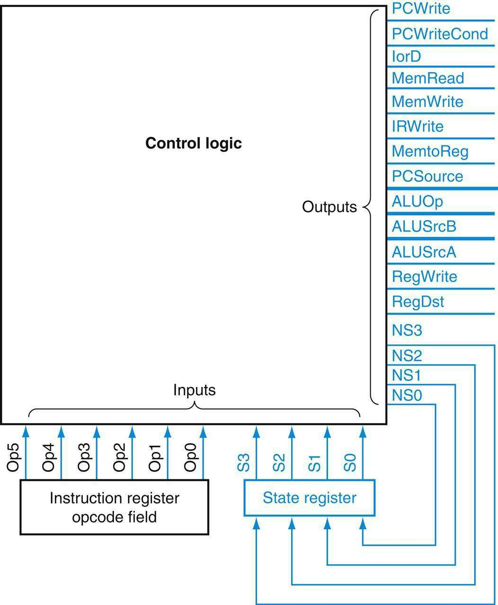

**HÌNH C.3.2 Control unit cho RISC-V gồm một số control logic và một register giữ state. State register được ghi tại active clock edge và ổn định trong clock cycle.**

Control unit có các output chỉ định next state. Chúng được ghi vào state register tại clock edge và trở thành state mới vào đầu clock cycle tiếp theo sau active clock edge. Chúng ta đặt tên các output này là NS3, NS2, NS1 và NS0. Khi đã xác định số input, state và output, chúng ta biết hình dạng cơ bản của control unit, như Hình C.3.2.

Khối mang nhãn “control logic” trong Hình C.3.2 là combinational logic. Có thể xem nó như một bảng lớn cho giá trị output theo input. Logic trong khối triển khai hai phần khác nhau của finite-state machine. Một phần là logic xác định cách thiết lập các output datapath control, chỉ phụ thuộc vào các bit state. Phần control logic còn lại triển khai hàm next-state; các phương trình này xác định giá trị các bit next-state dựa trên các bit current-state và các input khác (opcode 6-bit).

Hình C.3.3 trình bày các phương trình logic: phần trên là các output và phần dưới là hàm next-state. Các giá trị trong bảng được xác định từ sơ đồ state trong Hình C.3.1. Bất cứ khi nào một đường control hoạt động trong một state, state đó được đưa vào cột thứ hai của bảng. Tương tự, các entry next-state được tạo mỗi khi một state là state kế tiếp của một state khác.

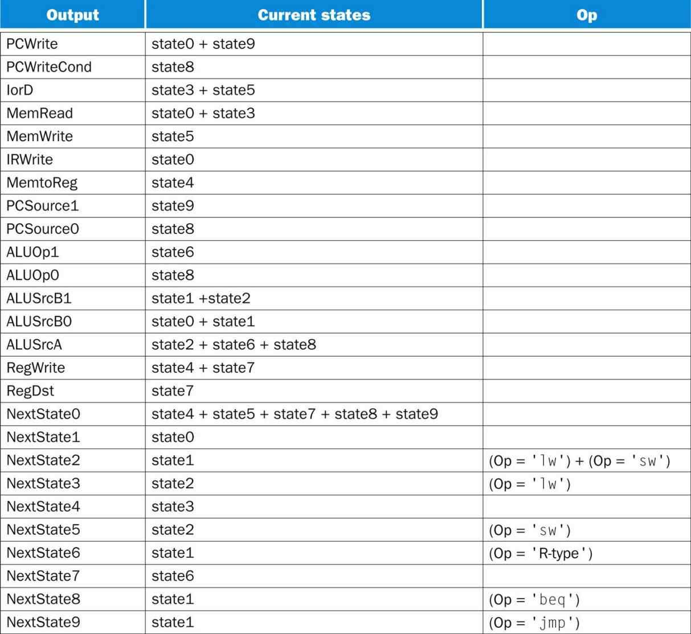

**HÌNH C.3.3 Các phương trình logic cho control unit được trình bày ở dạng viết tắt. Nhớ rằng “+” biểu thị OR trong phương trình logic. Các input state và output NextState phải được khai triển bằng encoding của state. Mọi entry để trống đều là don’t care.**

Trong Hình C.3.3, chúng ta dùng viết tắt stateN để biểu thị current state N. Vì vậy, stateN được thay bằng hạng encode số state N. NextStateN biểu thị việc đặt các output next-state thành N. Output này được triển khai bằng các output next-state (NS). Khi NextStateN hoạt động, các bit NS[3–0] được đặt tương ứng với dạng nhị phân của giá trị N. Tất nhiên, vì một bit next-state cụ thể được kích hoạt trong nhiều next state, phương trình cho mỗi bit state sẽ là OR của các hạng kích hoạt tín hiệu đó. Tương tự, khi dùng một hạng như (Op =‘lw’), nó tương ứng với AND của các input opcode chỉ định encoding của opcode lw bằng 6 bit, như đã làm cho control unit đơn giản trong mục trước của chương này. Việc chuyển các entry trong Hình C.3.3 thành phương trình logic cho output là trực tiếp.

### Các phương trình logic cho output Next-State

**Ví dụ**

Viết phương trình logic cho bit next-state low-order, NS0.

**Trả lời**

Bit next-state NS0 phải hoạt động mỗi khi next state có NS0 =1 trong encoding state. Điều này đúng với NextState1, NextState3, NextState5, NextState7 và NextState9. Các entry cho các state này trong Hình C.3.3 cung cấp điều kiện để những giá trị next-state này hoạt động. Phương trình cho từng next state được đưa ra dưới đây. Phương trình đầu tiên nói rằng next state là 1 nếu current state là 0; current state là 0 nếu mỗi bit input state bằng 0, chính là điều mà product term ngoài cùng bên phải biểu thị.

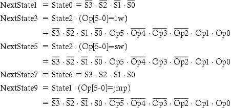

NS0 là tổng logic của tất cả các hạng này.

Như đã thấy, hàm control có thể được biểu diễn bằng một phương trình logic cho mỗi output. Tập phương trình logic này có thể được triển khai theo hai cách: tương ứng với một truth table đầy đủ, hoặc tương ứng với cấu trúc logic two-level cho phép encode thưa truth table. Trước khi xem các cách triển khai này, hãy xem truth table của hàm control đầy đủ.

Đơn giản nhất là chia hàm control được định nghĩa trong Hình C.3.3 thành hai phần: các output next-state có thể phụ thuộc vào mọi input, và các output tín hiệu control chỉ phụ thuộc vào các bit current-state. Hình C.3.4 trình bày truth table cho mọi tín hiệu datapath control. Vì các tín hiệu này thực sự chỉ phụ thuộc vào các bit state (không phụ thuộc opcode), mỗi entry trong một bảng ở Hình C.3.4 thực ra biểu diễn 64 (=2<sup>6</sup>) entry, với 6 bit mang tên Op nhận mọi giá trị có thể; tức là các bit Op là bit don’t-care khi xác định các output control của data path. Hình C.3.5 trình bày truth table cho các bit next-state NS[3–0], phụ thuộc vào các bit input state và các bit instruction cung cấp opcode.

#### Giải thích thêm

Có nhiều cơ hội đơn giản hóa hàm control bằng cách quan sát điểm tương đồng giữa hai hay nhiều tín hiệu control và dùng ngữ nghĩa của cách triển khai. Ví dụ, các tín hiệu PCWriteCond, PCSource0 và ALUOp0 đều được assert trong đúng một state, state 8. Ba tín hiệu control này có thể được thay bằng một tín hiệu duy nhất.

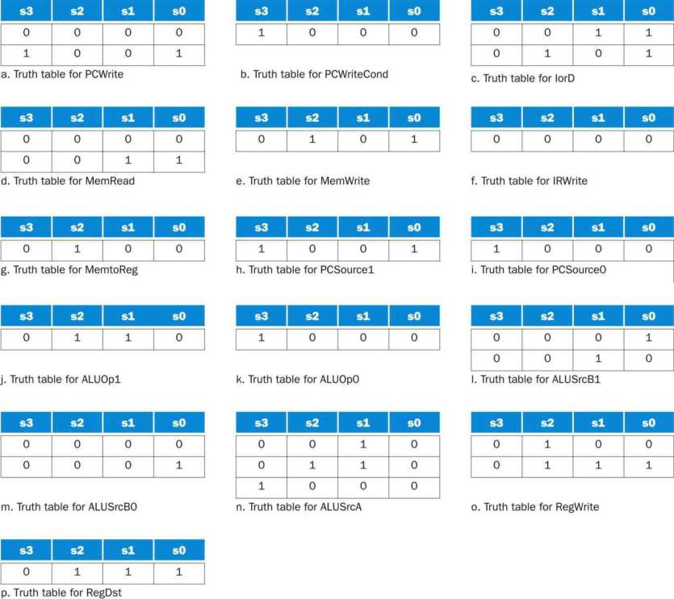

**HÌNH C.3.4 Truth table cho 16 tín hiệu datapath control chỉ phụ thuộc vào các bit input current-state, được trình bày cho mỗi bảng. Mỗi hàng truth table tương ứng với 64 entry: một cho mỗi giá trị có thể của sáu bit Op. Lưu ý rằng một số output hoạt động trong những hoàn cảnh gần giống nhau. Ví dụ, PCWriteCond, PCSource0 và ALUOp0 chỉ hoạt động trong state 8 (xem b, i và k). Có thể thay ba tín hiệu này bằng một tín hiệu. Có những cơ hội khác để giảm logic cần thiết triển khai hàm control bằng cách tận dụng thêm các điểm tương đồng trong truth table.**

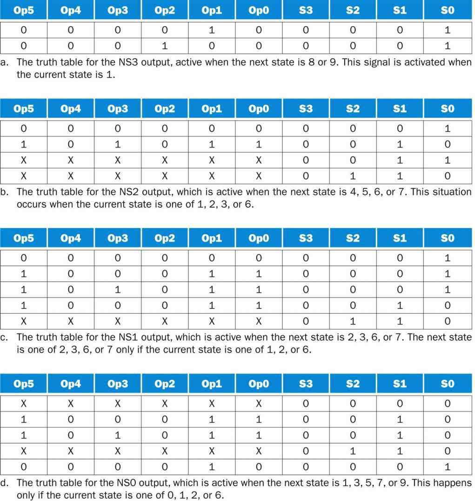

**HÌNH C.3.5 Bốn truth table cho bốn bit output next-state (NS[3–0]). Các output next-state phụ thuộc vào giá trị Op[5-0], là trường opcode, và current state được cho bởi S[3–0]. Những entry có X là hạng don’t-care. Mỗi entry có một hạng don’t-care tương ứng với hai entry, một có input đó bằng 0 và một có input đó bằng 1. Vì vậy một entry có n hạng don’t-care thực ra tương ứng với 2<sup>n</sup> entry trong truth table.**

### Một cách triển khai bằng ROM

Có lẽ cách đơn giản nhất để triển khai hàm control là encode các truth table trong read-only memory (ROM). Số entry trong memory cho các truth table ở Hình C.3.4 và C.3.5 bằng số mọi giá trị input có thể có (6 bit opcode cộng 4 bit state), tức 2<sup># inputs</sup>=2<sup>10</sup>=1024. Các input của control unit trở thành đường address cho ROM, nơi triển khai khối control logic đã thấy trong Hình C.3.2. Độ rộng mỗi entry (hay word trong memory) là 20 bit, vì có 16 output datapath control và 4 bit next-state. Như vậy tổng kích thước ROM là 2<sup>10</sup>×20=20 Kbits.

Việc thiết lập các bit trong một word của ROM phụ thuộc vào output nào hoạt động trong word đó. Trước khi xem các control word, cần sắp thứ tự bit trong word input control (address) và word output (nội dung). Chúng ta đánh số bit theo thứ tự ở Hình C.3.2, trong đó các bit next-state là các bit low-order của control word và các bit input current-state là các bit low-order của address. Điều này nghĩa là output PCWrite sẽ là bit high-order (bit 19) của mỗi memory word, và NS0 là bit low-order. Bit address high-order được cung cấp bởi Op5, là bit high-order của instruction, còn bit address low-order được cung cấp bởi S0.

Có thể xây dựng nội dung ROM bằng cách tạo toàn bộ truth table dưới dạng mỗi hàng tương ứng với một trong 2<sup>n</sup> tổ hợp input duy nhất, và một tập cột chỉ ra output nào hoạt động với tổ hợp input đó. Ở đây không đủ chỗ để trình bày cả 1024 entry của truth table. Tuy nhiên, khi tách các output datapath control và next-state thì có thể làm được, vì output datapath control chỉ phụ thuộc current state. Truth table cho các output datapath control được trình bày trong Hình C.3.6. Chúng ta chỉ đưa vào các encoding input state đang được dùng (tức các giá trị 0 đến 9 tương ứng với 10 state của state machine).

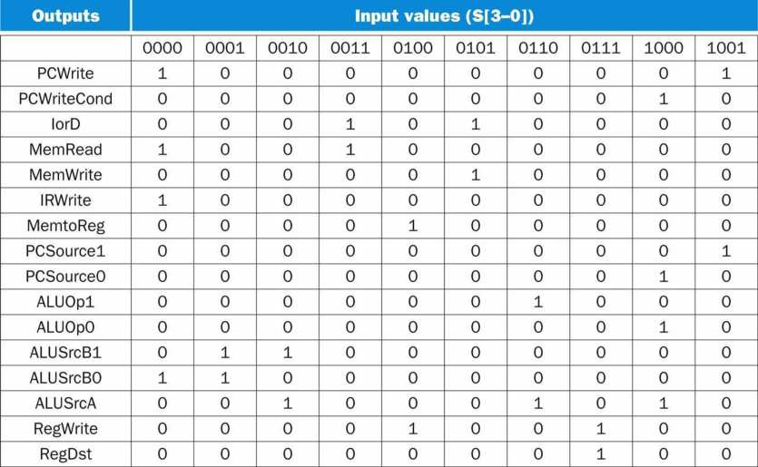

**HÌNH C.3.6 Truth table cho 16 output datapath control chỉ phụ thuộc vào các input state. Các giá trị được xác định từ Hình C.3.4. Mặc dù có 16 giá trị có thể cho trường state 4-bit, chỉ 10 giá trị được dùng và trình bày ở đây. 10 giá trị có thể được ghi phía trên; mỗi cột cho cách thiết lập các output datapath control với giá trị input state ở đầu cột. Ví dụ, khi input state là 0011 (state 3), các output datapath control hoạt động là IorD hoặc MemRead.**

Truth table trong Hình C.3.6 trực tiếp cho nội dung 16 bit phía trên của mỗi word trong ROM. Trường input 4-bit cung cấp 4 bit address low-order của mỗi word, còn cột cung cấp nội dung word tại address đó.

Nếu trình bày truth table đầy đủ cho các bit datapath control với cả số state và các bit opcode làm input, tất cả input opcode đều là don’t care. Khi xây dựng ROM, không thể có don’t care nào vì address vào ROM phải đầy đủ. Vì vậy các output datapath control giống nhau sẽ xuất hiện nhiều lần trong ROM, vì phần ROM này giống nhau mỗi khi các bit state giống nhau, không phụ thuộc giá trị các input opcode.

#### Các entry của control ROM

**Ví dụ**

Ở những address ROM nào thì bit tương ứng với PCWrite, bit cao của control word, bằng 1?

**Trả lời**

PCWrite ở mức cao trong state 0 và 9; điều này tương ứng với các address có 4 bit low-order là 0000 hoặc 1001. Bit này ở mức cao trong memory word bất kể các input Op[5–0], vì vậy các address có bit đó ở mức cao là 000000000, 0000001001, 0000010000, 0000011001, . . . , 1111110000, 1111111001. Dạng tổng quát là XXXXXX0000 hoặc XXXXXX1001, trong đó XXXXXX là bất kỳ tổ hợp bit nào và tương ứng với opcode 6-bit mà output này không phụ thuộc vào.

Chúng ta trình bày toàn bộ nội dung ROM thành hai phần để dễ thể hiện hơn. Hình C.3.7 cho 16 bit phía trên của control word; phần này được lấy trực tiếp từ Hình C.3.6. Các output datapath control này chỉ phụ thuộc các input state, và tập word này sẽ được lặp 64 lần trong ROM đầy đủ, như đã thảo luận ở trên. Những entry tương ứng giá trị input 1010 đến 1111 không được dùng, nên chúng ta không quan tâm nội dung của chúng.

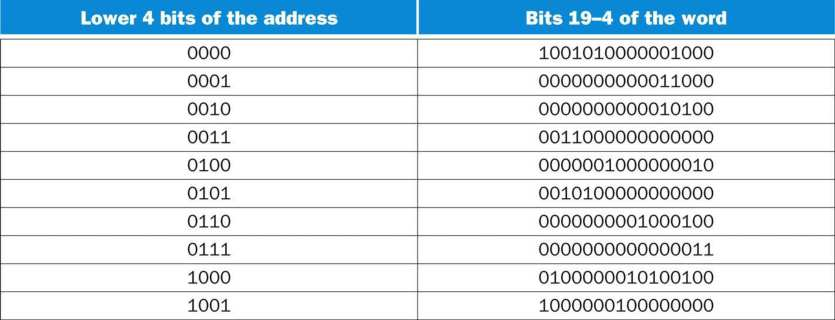

**HÌNH C.3.7 Nội dung 16 bit phía trên của ROM chỉ phụ thuộc các input state. Các giá trị này giống trong Hình C.3.6, chỉ xoay 90°. Tập control word này sẽ được lặp 64 lần cho mỗi giá trị có thể của sáu bit phía trên trong address.**

Hình C.3.8 trình bày bốn bit thấp của control word tương ứng với các output next-state. Cột cuối bảng trong Hình C.3.8 tương ứng với mọi giá trị opcode không khớp các opcode đã chỉ định. Trong state 0, next state luôn là state 1 vì instruction vẫn đang được fetch. Sau state 1, trường opcode phải hợp lệ. Bảng chỉ ra điều này bằng các entry đánh dấu illegal; chúng ta thảo luận cách xử lý các exception này và các opcode interrupt trong Mục 4.9.

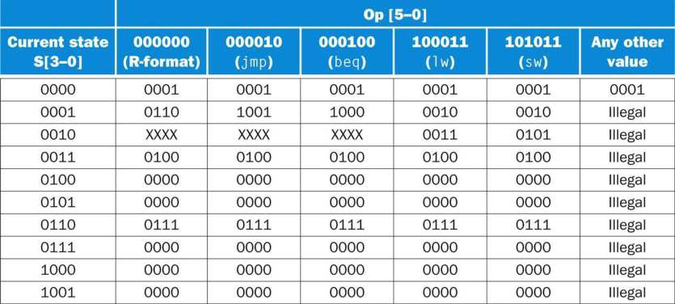

**HÌNH C.3.8 Bảng này chứa 4 bit thấp của control word (các output NS), phụ thuộc cả các input state S[3–0] và opcode Op[5–0], tương ứng với opcode của instruction. Có thể xác định các giá trị này từ Hình C.3.5. Tên opcode được ghi dưới encoding ở phần tiêu đề. Mỗi entry trình bày bốn bit của control word có address được cho bởi các bit current-state và các bit Op. Ví dụ, khi các bit input state là 0000, output luôn là 0001, độc lập với các input khác; khi state là hai, next state là don’t care với ba input, là ba với lw và năm với sw. Cùng với các entry trong Hình C.3.7, bảng này chỉ định nội dung ROM của control unit. Ví dụ, word tại address 1000110001 được lấy bằng cách tìm 16 bit phía trên trong bảng Hình C.3.7 chỉ dùng các bit input state (0001), rồi nối thêm bốn bit thấp được tìm bằng toàn bộ address (0001 để tìm hàng và 100011 để tìm cột). Entry từ Hình C.3.7 cho 0000000000011000, trong khi entry thích hợp trong bảng ngay phía trên là 0010. Vì vậy control word tại address 1000110001 là 00000000000110000010. Cột có nhãn “Any other value” chỉ áp dụng khi các bit Op không khớp một trong các opcode đã chỉ định.**

Biểu diễn bằng hai bảng riêng biệt không chỉ là cách gọn hơn để trình bày nội dung ROM; đó cũng là cách hiệu quả hơn để triển khai ROM. Phần lớn output (16 trong 20 bit) chỉ phụ thuộc bốn trong 10 input. Tổng số bit khi control được triển khai bằng hai ROM riêng biệt là 2<sup>4</sup> × 16 +2<sup>10</sup> × 4 =256 +4096 =4.3 Kbits, khoảng one-fifth kích thước một ROM đơn, vốn cần 2<sup>10</sup> × 20 =20 Kbits. Mọi khối structured-logic đều có một phần overhead, nhưng trong trường hợp này overhead tăng thêm của một ROM nữa nhỏ hơn nhiều so với phần tiết kiệm nhờ tách ROM đơn.

Mặc dù encoding hàm control bằng ROM này đơn giản, nó vẫn lãng phí ngay cả khi chia thành hai phần. Ví dụ, giá trị các input Instruction register thường không cần để xác định next state. Vì vậy ROM next-state có nhiều entry trùng lặp hoặc don’t care. Xét khi máy ở state 0: có 2<sup>6</sup> entry trong ROM (vì trường opcode có thể nhận bất kỳ giá trị nào), và tất cả entry có cùng nội dung (cụ thể là control word 0001). Lý do phần lớn ROM bị lãng phí là ROM triển khai truth table đầy đủ, cho phép mỗi tổ hợp input có một output khác nhau. Nhưng phần lớn tổ hợp input hoặc không bao giờ xảy ra hoặc dư thừa!

### Một cách triển khai bằng PLA

Có thể giảm dung lượng lưu trữ control cần thiết bằng cách chấp nhận giải mã address phức tạp hơn cho các input control, chỉ encode những tổ hợp input cần thiết. Cấu trúc logic thường dùng nhất cho việc này là programmed logic array (PLA), đã nhắc trước đó và minh họa trong Hình C.2.5. Trong PLA, mỗi output là OR logic của một hay nhiều minterm. Minterm, cũng gọi là product term, đơn giản là AND logic của một hay nhiều input. Có thể xem các input là address để lập chỉ mục PLA, còn các minterm chọn ra những tổ hợp address đáng quan tâm trong tất cả tổ hợp có thể. Một minterm tương ứng với một entry trong truth table, chẳng hạn các bảng ở Hình C.3.4, bao gồm cả các hạng don’t-care có thể có. Mỗi output gồm OR của các minterm này, tương ứng chính xác với một truth table đầy đủ. Tuy nhiên, khác ROM, chỉ cần những entry truth table tạo ra output hoạt động, và chỉ cần một bản của mỗi minterm, ngay cả khi minterm chứa don’t care. Hình C.3.9 trình bày PLA triển khai hàm control này.

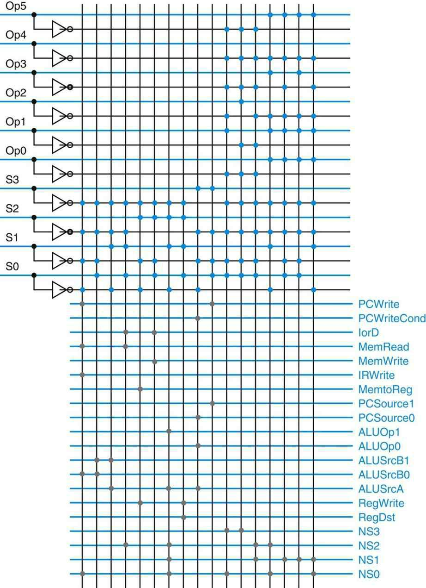

**HÌNH C.3.9 PLA này triển khai logic hàm control cho cách triển khai multicycle. Các input của control ở bên trái và các output ở bên phải. Nửa trên hình là AND plane tính mọi minterm. Các minterm được đưa tới OR plane trên các đường dọc. Mỗi chấm màu tương ứng với một tín hiệu tạo nên minterm được mang trên đường đó. Các sum term được tính từ các minterm này, với mỗi chấm xám biểu thị sự có mặt của minterm giao nhau trong sum term đó. Mỗi output gồm một sum term duy nhất.**

Như có thể thấy từ PLA trong Hình C.3.9, có 17 minterm duy nhất—10 minterm chỉ phụ thuộc current state và bảy minterm khác phụ thuộc tổ hợp trường Op và các bit current-state. Tổng kích thước PLA tỷ lệ với (#inputs ×#product terms)+(#outputs ×#product terms), như có thể thấy qua các ký hiệu trong hình. Điều này nghĩa là tổng kích thước PLA trong Hình C.3.9 tỷ lệ với (10 ×17)+(20 ×17)=510. Để so sánh, kích thước một ROM đơn tỷ lệ với 20 Kb, và ngay cả ROM two-part cũng có tổng 4.3 Kb. Vì kích thước một cell PLA chỉ lớn hơn chút ít so với một bit trong ROM, PLA là cách triển khai hiệu quả hơn nhiều cho control unit này.

Tất nhiên, giống như tách ROM thành hai phần, chúng ta có thể tách PLA thành hai PLA: một PLA có bốn input và 10 minterm tạo 16 output control, và một PLA có 10 input và bảy minterm tạo bốn output next-state. PLA thứ nhất có kích thước tỷ lệ với (4 ×10)+(10 ×16)=200, còn PLA thứ hai tỷ lệ với (10 ×7)+(4 ×7)=98. Tổng kích thước khi đó tỷ lệ với 298 cell PLA, khoảng 55% kích thước một PLA đơn. Hai PLA này nhỏ hơn đáng kể cách triển khai bằng hai ROM. Để biết thêm chi tiết về PLA và cách triển khai chúng, cũng như tài liệu tham khảo về thiết kế logic, xem Phụ lục A.

## C.4 Triển khai hàm Next-State bằng sequencer

Hãy xem kỹ control unit vừa xây dựng trong mục trước. Khi khảo sát các ROM triển khai control trong Hình C.3.7 và C.3.8, có thể thấy phần lớn logic được dùng để chỉ định hàm next-state. Thực tế, trong cách triển khai dùng hai ROM riêng biệt, 4096 trong 4368 bit (94%) tương ứng với hàm next-state! Hơn nữa, hãy hình dung control logic sẽ thế nào nếu instruction set có thêm nhiều loại instruction khác nhau, một số cần nhiều clock để triển khai. Khi đó sẽ có nhiều state hơn trong finite-state machine. Ở một số state, chúng ta có thể branch tới nhiều state khác nhau tùy loại instruction (như đã làm trong state 1 của finite-state machine ở Hình C.3.1). Tuy nhiên, nhiều state sẽ tiến tuần tự, như state 3 và 4 trong Hình C.3.1.

Ví dụ, nếu đưa floating point vào, sẽ có một chuỗi nhiều state liên tiếp triển khai một instruction floating-point multicycle. Hoặc hãy xét control của một máy có thể có nhiều memory operand trong mỗi instruction. Nó sẽ cần thêm nhiều state để fetch nhiều memory operand. Kết quả là việc encode hàm next-state sẽ chiếm phần lớn control logic. Hơn nữa, phần lớn logic dành cho những chuỗi state chỉ có một đường đi qua, giống các state 2 đến 4 trong Hình C.3.1. Với nhiều instruction hơn, những chuỗi này sẽ gồm nhiều state được đánh số liên tiếp hơn nhiều so với tập con đơn giản của chúng ta.

Để encode hiệu quả các hàm control phức tạp hơn này, có thể dùng control unit có counter cung cấp next state liên tiếp. Counter này thường loại bỏ nhu cầu encode tường minh hàm next-state trong control unit. Như Hình C.4.1, một adder tăng state, về bản chất biến nó thành counter. State được tăng luôn là state kế tiếp theo thứ tự số. Tuy nhiên, finite-state machine đôi khi “branch”. Ví dụ, trong state 1 của finite-state machine (xem Hình C.3.1), có bốn next state có thể có, chỉ một trong đó là next state liên tiếp. Vì vậy cần có thể chọn giữa state được tăng và một state mới dựa trên các input từ Instruction register và current state. Mỗi control word sẽ chứa các đường control xác định cách chọn next state.

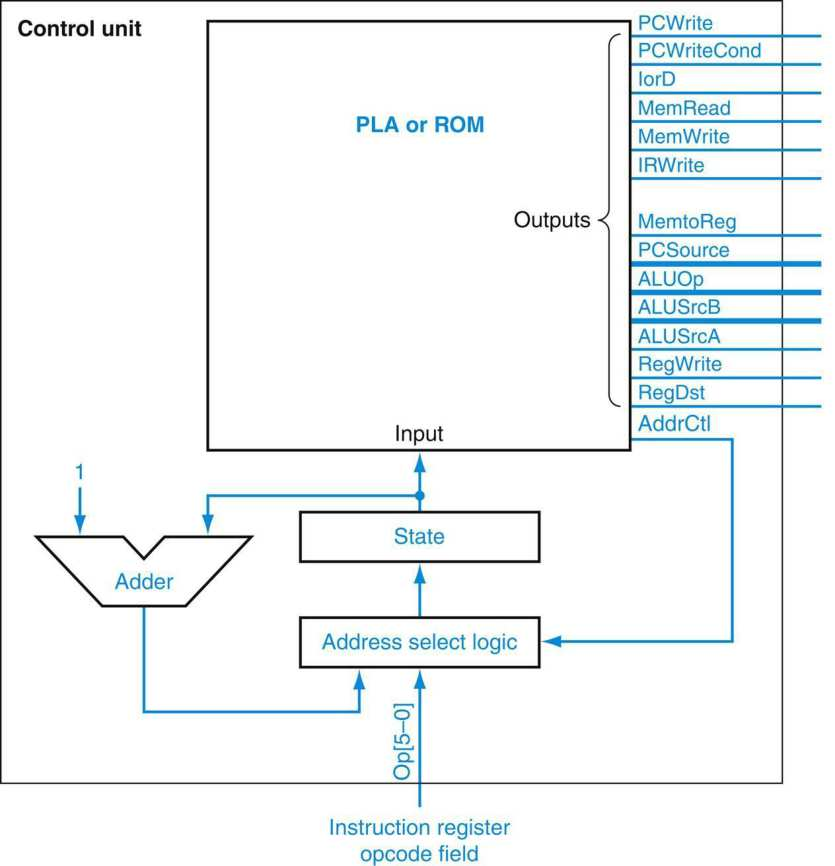

**HÌNH C.4.1 Control unit dùng counter tường minh để tính next state. Trong control unit này, next state được tính bằng counter (ít nhất ở một số state). Để so sánh, Hình C.3.2 encode next state trong control logic cho mọi state. Trong control unit này, các tín hiệu mang nhãn AddrCtl điều khiển cách xác định next state.**

Dễ triển khai phần tín hiệu output control của control word vì, nếu dùng cùng các số state, phần control word này sẽ giống hệt nội dung ROM trong Hình C.3.7. Tuy nhiên, phương pháp chọn next state khác với hàm next-state trong finite-state machine.

Với counter tường minh cung cấp next state liên tiếp, logic control unit chỉ cần chỉ định cách chọn state khi nó không phải state liên tiếp ngay sau đó. Có hai phương pháp làm việc này. Phương pháp đầu tiên đã thấy: control unit encode tường minh hàm next-state. Khác biệt là control unit chỉ cần thiết lập các đường next-state khi next state được chỉ định không phải state mà counter chỉ ra. Nếu số state lớn và hàm next-state cần encode phần lớn trống, đây có thể không phải lựa chọn tốt, vì control unit thu được có nhiều khoảng trống hoặc dư thừa. Một cách khác là dùng logic bên ngoài riêng biệt để chỉ định next state khi counter không chỉ định state đó. Nhiều control unit, đặc biệt những unit triển khai instruction set lớn, dùng cách này, và chúng ta tập trung vào việc chỉ định control từ bên ngoài.

Mặc dù next state không liên tiếp đến từ bảng bên ngoài, control unit cần chỉ định khi nào điều này xảy ra và cách tìm next state đó. Có hai kiểu “branch” cần triển khai trong address select logic. Trước hết, phải có thể jump tới một trong nhiều state dựa trên phần opcode của Instruction register. Thao tác này gọi là dispatch, thường được triển khai bằng một tập ROM hoặc PLA đặc biệt nằm trong address selection logic. Một tập output control bổ sung, gọi là AddrCtl, chỉ ra khi nào phải thực hiện dispatch. Nhìn sơ đồ finite-state (Hình C.3.1), có hai state thực hiện branch dựa trên một phần opcode. Vì vậy cần hai dispatch table nhỏ. (Hoặc cũng có thể dùng một dispatch table và dùng các bit control chọn bảng làm bit address để chọn phần nào trong dispatch table sẽ cung cấp address.)

Kiểu branch thứ hai cần triển khai là branch trở lại state 0, bắt đầu thực thi instruction RISC-V tiếp theo. Vì vậy có bốn cách chọn next state (ba kiểu branch cộng với tăng số current-state), có thể encode bằng 2 bit. Giả sử encoding như sau:

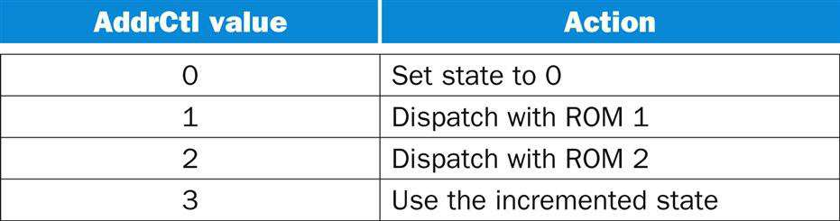

Nếu dùng encoding này, address select logic của control unit có thể được triển khai như Hình C.4.2.

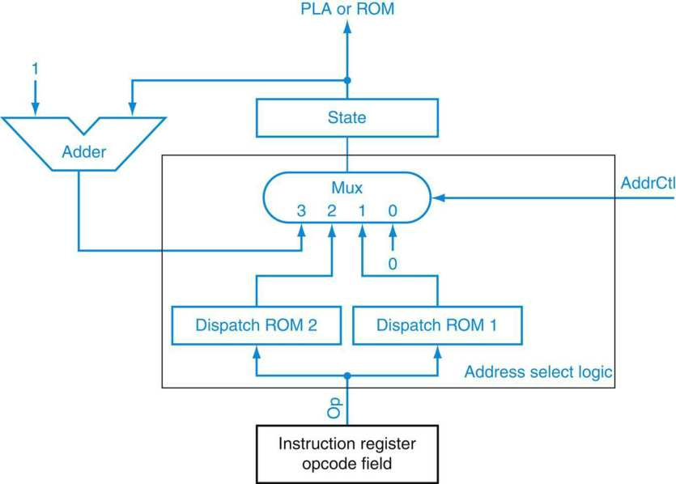

**HÌNH C.4.2 Đây là address select logic cho control unit trong Hình C.4.1.**

Để hoàn thiện control unit, chỉ cần chỉ định nội dung các dispatch ROM và giá trị các đường address-control cho mỗi state. Chúng ta đã chỉ định phần datapath control của control word bằng nội dung ROM trong Hình C.3.7 (hoặc các phần tương ứng của PLA trong Hình C.3.9). Counter next-state và các dispatch ROM thay thế phần control unit tính next state trong Hình C.3.8. Chúng ta chỉ triển khai một phần instruction set, nên các dispatch ROM phần lớn sẽ trống. Hình C.4.3 cho các entry phải gán cho tập con này.

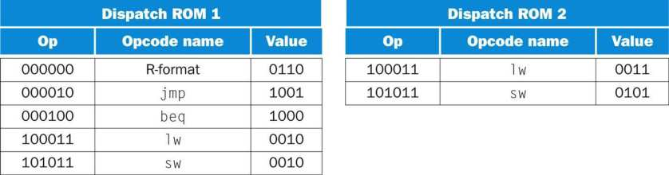

**HÌNH C.4.3 Mỗi dispatch ROM có 2<sup>6</sup> = 64 entry rộng 4 bit, vì đó là số bit trong encoding state. Hình này chỉ trình bày các entry ROM đáng quan tâm cho tập con này. Cột đầu mỗi bảng chỉ giá trị Op, là address dùng để truy cập dispatch ROM. Cột thứ hai cho tên ký hiệu của opcode. Cột thứ ba cho giá trị tại address đó trong ROM.**

Bây giờ có thể xác định cách thiết lập các đường address selection (AddrCtl) trong mỗi control word. Bảng ở Hình C.4.4 cho thấy phải thiết lập address control như thế nào với mỗi state. Thông tin này được dùng để chỉ định cách thiết lập trường AddrCtl trong control word gắn với state đó.

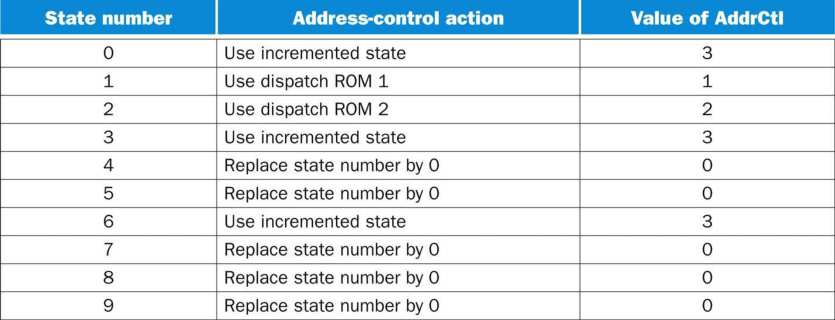

**HÌNH C.4.4 Giá trị các đường address-control được thiết lập trong control word tương ứng với mỗi state.**

Nội dung toàn bộ control ROM được trình bày trong Hình C.4.5. Tổng dung lượng lưu trữ cần cho control khá nhỏ. Có 10 control word, mỗi word rộng 18 bit, tổng cộng 180 bit. Ngoài ra, hai dispatch table rộng 4 bit, mỗi bảng 64 entry, tổng cộng thêm 512 bit. Tổng 692 bit này tốt hơn cách triển khai dùng hai ROM với hàm next-state encode trong ROM (cần 4.3 Kbits).

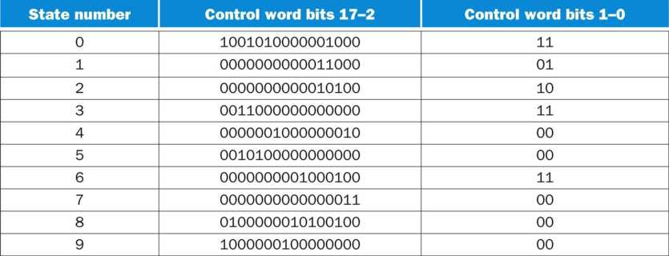

**HÌNH C.4.5 Nội dung control memory cho cách triển khai dùng counter tường minh. Cột đầu cho state, cột thứ hai cho các bit datapath control, và cột cuối cho các bit address-control trong mỗi control word. Các bit 17–2 giống hệt trong Hình C.3.7.**

Tất nhiên, các dispatch table thưa nên có thể triển khai hiệu quả hơn bằng hai PLA nhỏ. Control ROM cũng có thể được thay bằng PLA.

### Tối ưu hóa cách triển khai control

Có thể giảm thêm lượng logic trong control unit bằng hai kỹ thuật khác nhau. Thứ nhất là tối thiểu hóa logic, dùng cấu trúc các phương trình logic, bao gồm các hạng don’t-care, để giảm lượng phần cứng cần thiết. Thành công của quá trình này phụ thuộc số entry trong truth table và quan hệ giữa chúng. Ví dụ, trong tập con này, chỉ opcode lw và sw có giá trị hoạt động cho tín hiệu Op5, nên có thể thay hai entry truth table kiểm tra input có phải lw hay sw bằng một phép kiểm tra bit này; tương tự, có thể loại bỏ một số bit dùng để lập chỉ mục dispatch ROM vì một bit này có thể dùng để tìm lw và sw trong dispatch ROM đầu tiên. Tất nhiên, nếu không gian opcode ít thưa hơn, cơ hội tối ưu như vậy sẽ khó tìm hơn. Tuy nhiên, khi chọn opcode, người thiết kế kiến trúc có thể tạo thêm cơ hội bằng cách chọn những opcode liên quan cho các instruction có khả năng dùng chung state trong control.

Một kiểu tối ưu khác là gán số state trong cách triển khai finite-state hoặc microcode để tối thiểu hóa logic. Tối ưu này gọi là state assignment, cố chọn số state sao cho các phương trình logic thu được có nhiều phần dư thừa hơn và nhờ đó dễ đơn giản hóa. Trước hết hãy xét finite-state machine với next-state control được encode, vì nó cho phép gán state tùy ý. Ví dụ, trong finite-state machine, tín hiệu RegWrite chỉ hoạt động ở state 4 và 7. Nếu encode các state này thành 8 và 9 thay vì 4 và 7, có thể viết lại phương trình RegWrite đơn giản thành phép kiểm tra bit S3 (chỉ bật ở state 8 và 9). Việc đánh số lại cho phép kết hợp hai entry truth table trong phần (o) Hình C.3.4 và thay bằng một entry, loại bỏ một hạng trong control unit. Tất nhiên, phải đánh số lại các state 8 và 9 hiện có, có thể thành 4 và 7.

Có thể áp dụng cùng tối ưu trong cách triển khai dùng program counter tường minh, dù bị hạn chế hơn. Vì số next-state thường được tính bằng cách tăng số current-state, không thể gán state tùy ý. Tuy nhiên, nếu giữ nguyên thứ tự các state mà state được tăng được dùng làm next state, có thể gán lại các state liên tiếp như một khối. Trong cách triển khai có counter next-state tường minh, state assignment có thể cho phép đơn giản hóa nội dung các dispatch ROM.

Nếu nhìn lại control unit trong Hình C.4.1, nó rất giống một máy tính độc lập. Có thể xem ROM hoặc PLA là memory cung cấp instruction cho datapath. Có thể xem state là một instruction address. Đó là nguồn gốc tên microcode hoặc microprogrammed control. Các control word được xem là microinstruction điều khiển datapath, còn State register được gọi là microprogram counter. Hình C.4.6 trình bày cách nhìn control unit như microcode. Mục tiếp theo mô tả cách ánh xạ từ microprogram sang microcode.

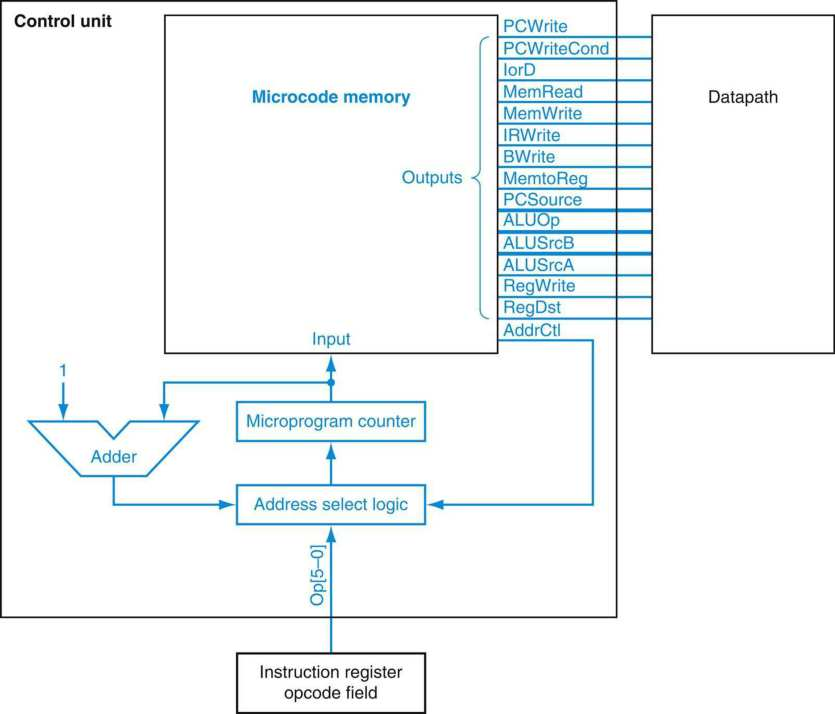

**HÌNH C.4.6 Control unit dưới dạng microcode. Từ “micro” dùng để phân biệt program counter trong datapath với microprogram counter, và phân biệt microcode memory với instruction memory.**

## C.5 Chuyển microprogram thành phần cứng

Để chuyển microprogram thành phần cứng thực tế, cần chỉ định cách mỗi trường chuyển thành tín hiệu control. Có thể triển khai microprogram bằng finite-state control hoặc bằng microcode với sequencer tường minh. Nếu chọn finite-state machine, cần xây dựng hàm next-state từ microprogram. Khi biết hàm này, có thể ánh xạ một tập entry truth table cho các output next-state. Trong mục này, chúng ta chỉ ra cách chuyển microprogram với giả định next state được chỉ định bằng sequencer. Từ các truth table sẽ xây dựng, việc tạo hàm next-state cho finite-state machine là trực tiếp.

Giả sử dùng sequencer tường minh, cần làm thêm hai việc để chuyển microprogram: gán address cho các microinstruction và điền nội dung các dispatch ROM. Quá trình này về bản chất giống chuyển chương trình assembly language thành machine instruction: các trường của instruction assembly language hoặc microprogram được chuyển đổi, còn các label trên instruction phải được phân giải thành address.

Hình C.5.1 cho các giá trị khác nhau của mỗi trường microinstruction điều khiển datapath và cách encode các trường này thành tín hiệu control. Nếu trường tương ứng với tín hiệu ảnh hưởng một unit có state (tức Memory, Memory register, ALU destination hoặc PCWriteControl) bị để trống thì không tín hiệu control nào được hoạt động. Nếu một trường tương ứng với tín hiệu control multiplexor hoặc control phép toán ALU (tức ALUOp, SRC1 hoặc SRC2) bị để trống, output không được dùng, nên các tín hiệu liên quan có thể đặt là don’t care.

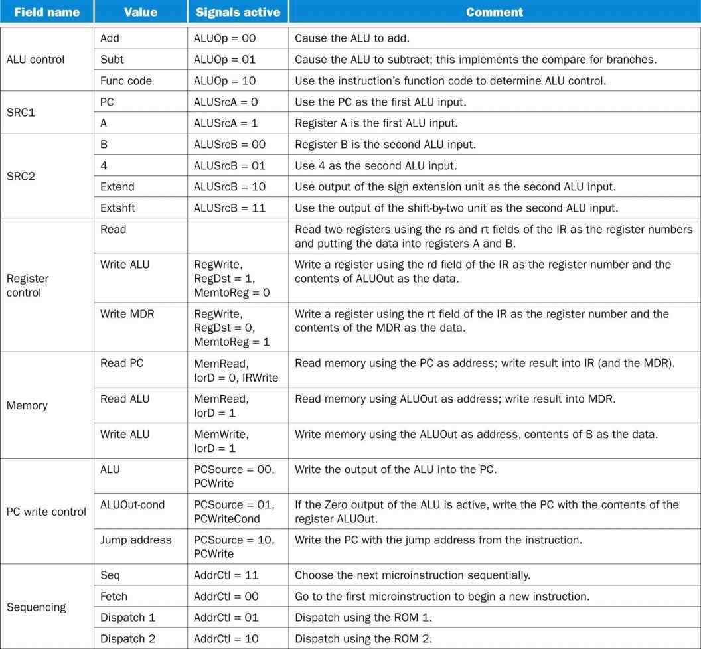

**HÌNH C.5.1 Mỗi trường microcode chuyển thành một tập tín hiệu control cần thiết lập. 22 giá trị trường khác nhau này chỉ định tất cả tổ hợp cần thiết của 18 đường control. Các đường control không được thiết lập, tương ứng với các hành động, mặc định bằng 0. Các đường control multiplexor được đặt bằng 0 nếu output quan trọng. Nếu một đường control multiplexor không được thiết lập tường minh, output của nó là don’t care và không được dùng.**

Trường sequencing có thể có bốn giá trị: Fetch (nghĩa là tới state Fetch), Dispatch 1, Dispatch 2 và Seq. Bốn giá trị này được encode để thiết lập address control 2-bit như trong Hình C.4.4: Fetch =0, Dispatch 1 =1, Dispatch 2 =2, Seq =3. Cuối cùng, cần chỉ định nội dung dispatch table để liên hệ các entry dispatch của trường sequence với các label ký hiệu trong microprogram. Chúng ta dùng cùng các dispatch table như trước trong Hình C.4.3.

Một microcode assembler sẽ dùng encoding trường sequencing, nội dung các dispatch table ký hiệu trong Hình C.5.2, đặc tả ở Hình C.5.1 và microprogram thực tế để tạo các microinstruction.

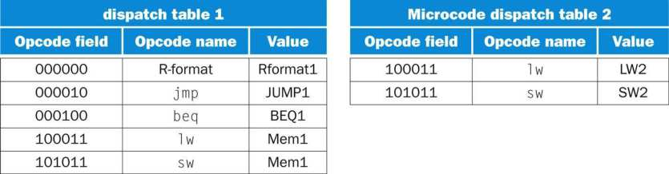

**HÌNH C.5.2 Hai dispatch ROM của microcode trình bày nội dung dưới dạng ký hiệu và dùng các label trong microprogram.**

Vì microprogram là biểu diễn trừu tượng của control, cách chuyển microprogram rất linh hoạt. Ví dụ, address gán cho nhiều microinstruction có thể chọn tùy ý; hạn chế duy nhất là một số microinstruction nhất định phải xuất hiện theo thứ tự liên tiếp (để việc tăng State register tạo address của instruction tiếp theo). Vì vậy microcode assembler có thể giảm độ phức tạp control bằng cách gán các microinstruction khéo léo.

### Tổ chức control để giảm logic

Với máy có control phức tạp, control unit có thể chứa rất nhiều logic. Control ROM hoặc PLA có thể rất tốn kém. Mặc dù cách triển khai đơn giản của chúng ta chỉ có microinstruction 18-bit (giả sử dùng sequencer tường minh), đã có những máy với microinstruction rộng hàng trăm bit. Rõ ràng người thiết kế muốn giảm cả số microinstruction lẫn độ rộng của chúng.

Cách lý tưởng để giảm control store là trước hết viết microprogram đầy đủ bằng ký pháp biểu tượng, rồi đo cách các đường control được thiết lập trong mỗi microinstruction. Qua đo đạc có thể nhận ra những bit control có thể encode vào trường nhỏ hơn. Ví dụ, nếu không quá một trong tám đường được thiết lập đồng thời trong cùng microinstruction, tập con đường control này có thể encode thành trường 3-bit (log<sub>2</sub> 8 =3). Thay đổi này tiết kiệm năm bit trong mỗi microinstruction và không làm hại CPI, dù cần thêm chi phí phần cứng cho decoder 3-to-8 để tạo tám đường control khi datapath cần chúng. Nó cũng có thể ảnh hưởng nhỏ tới clock cycle vì decoder nằm trên signal path. Tuy nhiên, giảm năm bit độ rộng control store thường bù được chi phí decoder, còn ảnh hưởng cycle time có lẽ nhỏ hoặc không có. Ví dụ, kỹ thuật này có thể áp dụng cho các bit 13–6 của microinstruction trong máy này, vì chỉ một trong bảy bit của control word hoạt động tại một thời điểm (xem Hình C.4.5).

Kỹ thuật giảm độ rộng trường này gọi là encoding. Để tiết kiệm thêm không gian, các đường control có thể được encode chung nếu chúng chỉ thỉnh thoảng được thiết lập trong cùng microinstruction; khi cần thiết lập cả hai thì phải dùng hai microinstruction thay vì một. Miễn điều này không xảy ra trong các routine quan trọng, microinstruction hẹp hơn có thể đáng để dùng thêm vài word control store.

Microinstruction còn có thể hẹp hơn nếu được chia thành các định dạng khác nhau và có trường opcode hoặc format để phân biệt. Trường format cho mọi đường control không được chỉ định các giá trị mặc định, nhằm không thay đổi phần nào khác trong máy, tương tự opcode của instruction trong instruction set mạnh hơn. Ví dụ, có thể dùng định dạng khác cho microinstruction truy cập memory và microinstruction thực hiện phép ALU register-register, tận dụng việc các đường control truy cập memory không cần thiết trong microinstruction điều khiển phép ALU.

Giảm chi phí phần cứng bằng trường format thường làm phát sinh chi phí hiệu năng ngoài yêu cầu thêm decoder. Microprogram dùng một định dạng microinstruction có thể chỉ định mọi tổ hợp phép toán trong datapath và có thể cần ít clock cycle hơn microprogram gồm các microinstruction bị giới hạn, không thể thực hiện mọi tổ hợp phép toán trong một microinstruction. Tuy nhiên, nếu khả năng đầy đủ của microprogram word rộng hơn ít được dùng, phần lớn control store bị lãng phí, và có thể làm máy nhỏ hơn, nhanh hơn bằng cách hạn chế khả năng microinstruction.

Cách tiếp cận hẹp nhưng thường dài hơn hay gọi là vertical microcode, còn cách rộng nhưng ngắn gọi là horizontal microcode. Cần lưu ý rằng “vertical microcode” và “horizontal microcode” không có định nghĩa thống nhất—các nhà thiết kế 8086 coi microinstruction 21-bit của nó thiên về horizontal hơn so với các máy tính single-chip khác cùng thời. Những thuật ngữ liên quan maximally encoded và minimally encoded có lẽ phù hợp hơn vertical và horizontal.

## C.6 Nhận xét kết thúc

Chúng ta bắt đầu phụ lục bằng cách xem cách chuyển sơ đồ finite-state thành cách triển khai dùng finite-state machine. Sau đó khảo sát các sequencer tường minh dùng kỹ thuật khác để hiện thực hàm next-state. Mặc dù microprogram lớn thường hướng tới cách triển khai dùng phương pháp next-state tường minh này, chúng ta cũng có thể triển khai microprogram bằng finite-state machine. Như đã thấy, có thể triển khai các hàm logic bằng cả ROM lẫn PLA. Ưu điểm của next state tường minh so với được encode, và của triển khai ROM so với PLA, được tóm tắt dưới đây.

### Bức tranh tổng thể

Bất kể control được biểu diễn bằng sơ đồ finite-state hay microprogram, quá trình chuyển sang phần cứng control là tương tự. Mỗi state hoặc microinstruction assert một tập output control và chỉ định cách chọn next state.

Hàm next-state có thể được triển khai bằng cách encode trong finite-state machine hoặc dùng sequencer tường minh. Sequencer tường minh hiệu quả hơn nếu số state lớn và có nhiều chuỗi state liên tiếp không branch.

Control logic có thể triển khai bằng ROM hoặc PLA (hay kết hợp cả hai). PLA hiệu quả hơn trừ khi hàm control rất dày đặc. ROM có thể phù hợp nếu control được lưu trong memory riêng biệt, thay vì cùng chip với datapath.

## C.7 Bài tập

C.1 [10] <§C.2>Thay vì dùng bốn bit state để triển khai finite-state machine trong Hình C.3.1, hãy dùng chín bit state, mỗi bit chỉ bằng 1 nếu finite-state machine đang ở đúng state đó (ví dụ S1 bằng 1 trong state 1, S2 bằng 1 trong state 2, v.v.). Vẽ lại PLA (Hình C.3.9).

C.2 [5] <§C.3>Chúng ta muốn thêm instruction jal (jump and link). Hãy thực hiện mọi thay đổi cần thiết đối với datapath hoặc các tín hiệu control nếu cần. Có thể photocopy các hình để thể hiện nhanh hơn những phần bổ sung. Cần bao nhiêu product term trong PLA triển khai control của datapath single-cycle cho

```
jal?
```

C.3 [5] <§C.3>Bây giờ chúng ta muốn thêm instruction addi (add immediate). Hãy bổ sung mọi thay đổi cần thiết đối với datapath và các tín hiệu control. Cần bao nhiêu product term trong PLA triển khai control của datapath single-cycle cho

```
addiu?
```

C.4 [10] <§C.3>Xác định số product term trong PLA triển khai finite-state machine cho addi. Cách dễ nhất là xây dựng các phần bổ sung cho truth table ứng với addi.

C.5 [20] <§C.4>Triển khai finite-state machine bằng counter tường minh để xác định next state. Điền các entry mới cho những phần bổ sung vào Hình C.4.5. Đồng thời thêm mọi entry cần thiết vào các dispatch ROM trong Hình C.5.2.

C.6 [15] <§§C.3–C.6>Xác định kích thước các PLA cần để triển khai máy multicycle, giả sử hàm next-state được triển khai bằng counter. Triển khai các dispatch table trong Hình C.5.2 bằng hai PLA và nội dung main control unit trong Hình C.4.5 bằng một PLA khác. Tổng kích thước phương án này so với phương án một PLA với next state được encode như thế nào? Nếu các PLA chính ở cả hai phương pháp được chia thành hai PLA riêng biệt bằng cách tách riêng các tín hiệu next-state hoặc address select thì sao?
