### PHỤ LỤC D

# Khảo sát các kiến trúc RISC cho máy tính desktop, server và embedded

Steven Przybylskic, <sub>Một nhà thiết kế Stanford MIPS</sub>

D.1 Giới thiệu D-3 D.2 Addressing mode và định dạng instruction D-5 D.3 Instruction: Tập con MIPS core D-9 D.4 Instruction: Các phần mở rộng multimedia của

RISC desktop/server D-16 D.5 Instruction: Các phần mở rộng Digital Signal-Processing của

RISC embedded D-19 D.6 Instruction: Các phần mở rộng chung cho MIPS core D-20 D.7 Instruction riêng của MIPS-64 D-25 D.8 Instruction riêng của Alpha D-27 D.9 Instruction riêng của SPARC v9 D-29 D.10 Instruction riêng của PowerPC D-32 D.11 Instruction riêng của PA-RISC 2.0 D-34 D.12 Instruction riêng của ARM D-36 D.13 Instruction riêng của Thumb D-38 D.14 Instruction riêng của SuperH D-39 D.15 Instruction riêng của M32R D-40 D.16 Instruction riêng của MIPS-16 D-40 D.17 Nhận xét kết thúc D-43

RISC: bất kỳ máy tính nào được công bố sau năm 1985.

## D.1 Giới thiệu

Phụ lục này trình bày hai nhóm kiến trúc reduced instruction set computer (RISC). Nhóm thứ nhất là các RISC desktop và server:

- Digital Alpha

- Hewlett-Packard PA-RISC

- IBM và Motorola PowerPC

- MIPS INC MIPS-64

- Sun Microsystems SPARC

Nhóm thứ hai là các RISC embedded:

- Advanced RISC Machines ARM

- Advanced RISC Machines Thumb

- Hitachi SuperH

- Mitsubishi M32R

- MIPS INC MIPS-16

Chưa từng có lớp máy tính nào khác giống nhau đến thế. Sự tương đồng này cho phép trình bày 10 kiến trúc trong khoảng 50 trang. Đặc điểm của các RISC desktop và server nằm trong Hình D.1.1, còn các RISC embedded nằm trong Hình D.1.2.

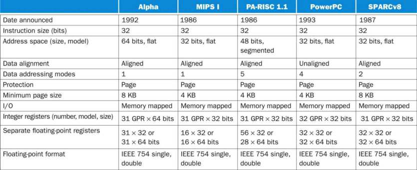

**HÌNH D.1.1 Tóm tắt phiên bản đầu tiên của năm kiến trúc cho desktop và server. Ngoại trừ số data address mode và một số chi tiết instruction set, các integer instruction set của những kiến trúc này rất giống nhau. Đối chiếu với Hình D.17.1. Các phiên bản sau của tất cả kiến trúc này đều hỗ trợ address space phẳng 64-bit.**

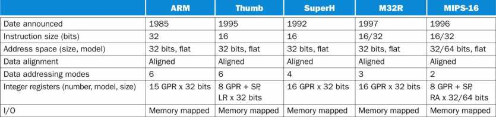

**HÌNH D.1.2 Tóm tắt năm kiến trúc cho ứng dụng embedded. Ngoại trừ số data address mode và một số chi tiết instruction set, các integer instruction set của những kiến trúc này tương tự nhau. Đối chiếu với Hình D.17.1.**

Lưu ý rằng các RISC embedded thường có tám đến 16 general-purpose register, trong khi RISC desktop/server có 32, và độ dài instruction là 16 đến 32 bit trong RISC embedded nhưng luôn là 32 bit trong RISC desktop/server.

Mặc dù được trình bày như các instruction set architecture embedded riêng biệt, Thumb và MIPS-16 thực chất là các chế độ tùy chọn của ARM và MIPS, được gọi bằng call instruction. Trong chế độ này, chúng thực thi một tập con kiến trúc gốc bằng instruction 16-bit-long. Các instruction set 16-bit này không nhằm trở thành kiến trúc đầy đủ, nhưng đủ để encode phần lớn procedure. Cả hai máy đều yêu cầu procedure đồng nhất, mọi instruction đều ở chế độ 16-bit hoặc 32-bit. Chương trình sẽ gồm các procedure ở chế độ 16-bit để tăng mật độ hoặc chế độ 32-bit để tăng hiệu năng.

Một điểm phức tạp trong mô tả này là một số RISC cũ đã được mở rộng qua nhiều năm. Chúng tôi quyết định mô tả phiên bản mới nhất của các kiến trúc: MIPS-64, Alpha phiên bản 3, PA-RISC 2.0 và SPARC phiên bản 9 cho desktop/server; ARM phiên bản 4, Thumb phiên bản 1, Hitachi SuperH SH-3, M32R phiên bản 1 và MIPS-16 phiên bản 1 cho embedded.

Các mục còn lại được sắp xếp như sau: sau khi thảo luận addressing mode và định dạng instruction của các kiến trúc RISC, chúng tôi khảo sát instruction theo năm bước:

- Các instruction có trong MIPS core, được định nghĩa trong Chương 2 và 3 của phần chính cuốn sách

- Các phần mở rộng multimedia của RISC desktop/server

- Các phần mở rộng digital signal-processing của RISC embedded

- Các instruction không có trong MIPS core nhưng có ở từ hai kiến trúc trở lên

- Các instruction và đặc điểm riêng của mỗi kiến trúc trong 10 kiến trúc

Mục cuối trình bày quá trình phát triển của instruction set và kết thúc bằng dự đoán về hướng đi tương lai của RISC.

## D.2 Addressing mode và định dạng instruction

Hình D.2.1 trình bày các data addressing mode được kiến trúc desktop hỗ trợ. Vì tất cả đều có một register luôn mang giá trị 0 khi dùng trong address mode, absolute address mode với phạm vi hạn chế có thể được tổng hợp bằng cách dùng zero làm base trong displacement addressing. (Register này có thể bị thay đổi bởi phép ALU trong PowerPC; nó luôn bằng 0 trong các máy khác.) Tương tự, register indirect addressing được tổng hợp bằng displacement addressing với offset bằng 0. Addressing mode đơn giản hóa là một đặc điểm phân biệt kiến trúc RISC.

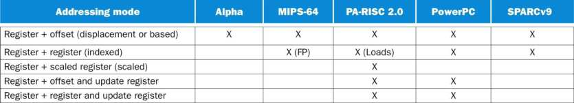

**HÌNH D.2.1 Tóm tắt các data addressing mode được kiến trúc desktop hỗ trợ. PA-RISC cũng có các phiên bản short address của offset addressing mode. MIPS-64 có indexed addressing cho floating-point load và store. (Các addressing mode này được mô tả trong Hình 2.18.)**

Hình D.2.2 trình bày các data addressing mode được kiến trúc embedded hỗ trợ. Khác RISC desktop, các máy embedded này không dành riêng register chứa 0. Mặc dù phần lớn có hai đến ba addressing mode đơn giản, ARM và SuperH có nhiều mode, bao gồm những phép tính khá phức tạp. ARM có addressing mode có thể shift một register một lượng bất kỳ, cộng nó với các register khác để tạo address, rồi cập nhật một register bằng address mới này.

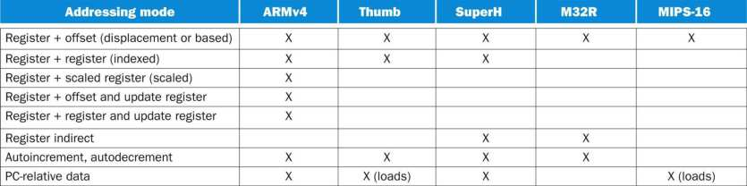

**HÌNH D.2.2 Tóm tắt các data addressing mode được kiến trúc embedded hỗ trợ. SuperH và M32R có register indirect và register + offset addressing mode riêng biệt thay vì chỉ đặt offset bằng 0 trong mode sau. Điều này tăng việc dùng instruction 16-bit trong M32R và cho các instruction data transfer khác nhau trong SuperH một tập address mode rộng hơn. Để có phạm vi address lớn hơn, ARM và Thumb shift offset sang trái một hoặc hai bit nếu kích thước dữ liệu là halfword hoặc word. (Các addressing mode này được mô tả trong Hình 2.18.)**

Tham chiếu tới code thường là PC-relative, dù jump register indirect được hỗ trợ để return từ procedure, cho câu lệnh case và cho lời gọi function pointer. Một biến thể là address branch PC-relative được shift trái 2 bit trước khi cộng vào PC trong RISC desktop, nhờ đó tăng khoảng cách branch. Cách này hoạt động vì mọi instruction RISC desktop đều dài 32 bit, và instruction phải được align theo word 32-bit trong memory. Các kiến trúc embedded với instruction 16-bit-long thường shift address PC-relative một bit vì lý do tương tự.

Hình D.2.3 trình bày định dạng instruction RISC desktop, bao gồm kích thước address. Mỗi instruction set architecture dùng bốn định dạng instruction chính này. Hình D.2.4 trình bày sáu định dạng cho các máy RISC embedded. Mong muốn giảm kích thước code bằng instruction 16-bit dẫn tới nhiều định dạng instruction hơn.

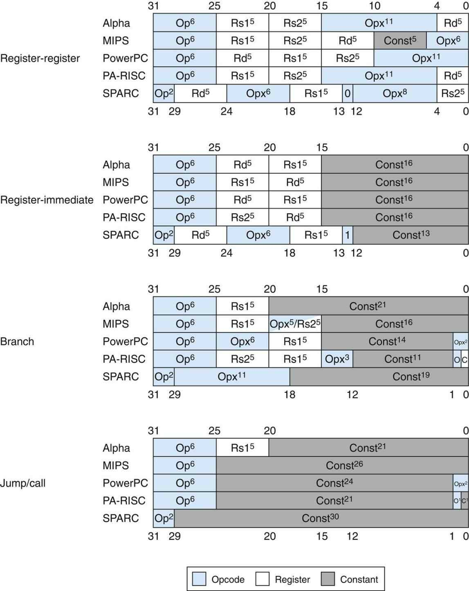

**HÌNH D.2.3 Các định dạng instruction cho kiến trúc RISC desktop/server. Bốn định dạng này có trong cả năm kiến trúc. (Ký pháp superscript trong hình chỉ độ rộng trường tính bằng bit.) Mặc dù các trường register nằm ở những phần tương tự của instruction, lưu ý rằng trường đích và hai trường nguồn bị hoán đổi. Op = opcode chính, Opx = phần mở rộng opcode, Rd = register đích, Rs1 = register nguồn 1, Rs2 = register nguồn 2 và Const = một hằng (dùng làm immediate hoặc address). Khác các RISC còn lại, Alpha có định dạng immediate trong phép toán số học và logic khác định dạng data transfer ở đây. Nó cung cấp immediate 8-bit ở các bit 20 đến 13 của định dạng RR, còn các bit 12 đến 5 vẫn là phần mở rộng opcode.**

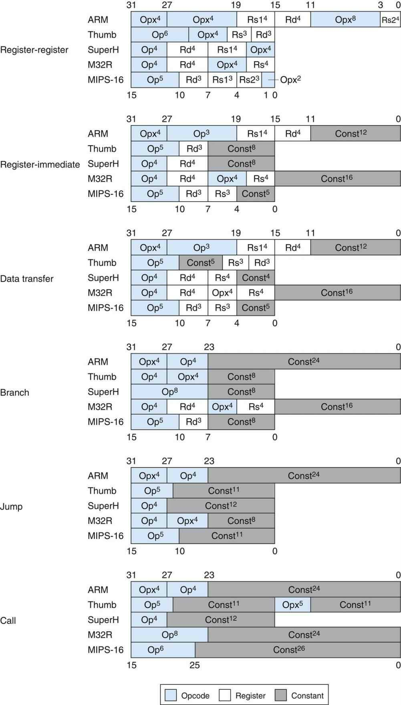

**HÌNH D.2.4 Các định dạng instruction cho kiến trúc RISC embedded. Sáu định dạng này có trong cả năm kiến trúc. Ký pháp giống Hình D.2.3. Lưu ý sự giống nhau trong các định dạng branch, jump và call, và sự đa dạng trong các định dạng register-register, register-immediate và data transfer. Khác biệt xuất phát từ việc kiến trúc có tám hay 16 register, dùng định dạng two- hay three-operand, và instruction dài 16 hay 32 bit.**

Hình D.2.5 và D.2.6 trình bày các biến thể mở rộng trường hằng ra toàn bộ độ rộng register. Ở điểm tinh tế này, các RISC tương tự nhưng không giống hệt nhau.

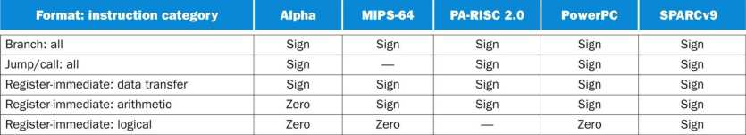

**HÌNH D.2.5 Tóm tắt mở rộng hằng cho RISC desktop. Các hằng trong instruction jump và call của MIPS không được sign-extended, vì chúng chỉ thay thế 28 bit thấp của PC, giữ nguyên 4 bit phía trên. PA-RISC không có logical immediate instruction.**

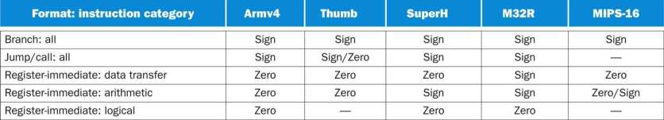

**HÌNH D.2.6 Tóm tắt mở rộng hằng cho RISC embedded. Các instruction 16-bit-length có immediate ngắn hơn nhiều so với RISC desktop, thường chỉ 5 đến 8 bit. Tuy nhiên, phần lớn RISC embedded có cách lấy address dài cho lời gọi procedure từ hai halfword liên tiếp. Các hằng trong instruction jump và call của MIPS không được sign-extended, vì chúng chỉ thay 28 bit thấp của PC, giữ nguyên 4 bit phía trên. Immediate 8-bit trong ARM có thể rotate phải một số bit chẵn từ 2 đến 30, tạo ra phạm vi giá trị immediate lớn. Ví dụ, mọi lũy thừa của hai đều là immediate trong ARM.**

## D.3 Instruction: Tập con MIPS core

Sự tương đồng giữa các kiến trúc cho phép mô tả đồng thời, bắt đầu từ những phép toán tương đương với MIPS core.

### Các instruction MIPS core

Gần như mọi instruction trong MIPS core đều có ở các kiến trúc khác, như Hình D.3.1 đến D.3.5. (Để tham khảo, định nghĩa các instruction MIPS nằm trong MIPS Reference Data Card ở đầu sách.) Instruction được liệt kê theo bốn nhóm: data transfer (Hình D.3.1); số học/logic (Hình D.3.2); control (Hình D.3.3); và floating point (Hình D.3.4). Nhóm thứ năm (Hình D.3.5) trình bày quy ước dùng register và pseudoinstruction trên mỗi kiến trúc. Nếu một instruction MIPS core cần một chuỗi instruction ngắn trong kiến trúc khác, các instruction này được ngăn bằng dấu chấm phẩy trong Hình D.3.1 đến D.3.5. (Để tránh nhầm lẫn, register đích luôn là operand ngoài cùng bên trái trong phụ lục này, không phụ thuộc ký pháp thường dùng của mỗi kiến trúc.) Hình D.3.6 đến D.3.9 trình bày danh sách tương đương cho RISC embedded. Lưu ý rằng floating point nói chung không được định nghĩa cho RISC embedded.

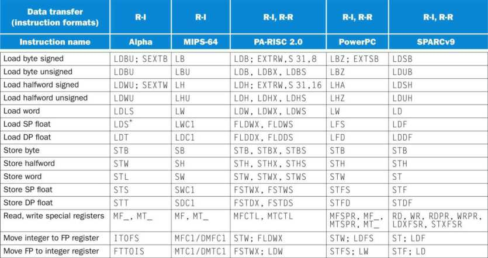

**HÌNH D.3.1 Các instruction data transfer RISC desktop tương đương MIPS core. Chuỗi instruction tổng hợp một instruction MIPS được phân cách bằng dấu chấm phẩy. Nếu có nhiều lựa chọn instruction tương đương MIPS core, chúng được phân cách bằng dấu phẩy. Trong hình này, halfword là 16 bit và word là 32 bit. Lưu ý rằng trong Alpha, LDS chuyển floating point single-precision sang double precision và load toàn bộ register 64-bit.**

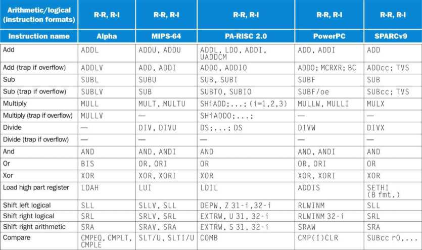

**HÌNH D.3.2 Các instruction số học/logic RISC desktop tương đương MIPS core. Dấu gạch ngang nghĩa là phép toán không có trong kiến trúc đó hoặc không thể tổng hợp bằng vài instruction. Một chuỗi instruction như vậy được phân cách bằng dấu chấm phẩy. Nếu có nhiều lựa chọn instruction tương đương MIPS core, chúng được phân cách bằng dấu phẩy. Lưu ý trong nhóm “Arithmetic/logical”, mọi máy ngoại trừ SPARC dùng mnemonic instruction riêng để chỉ immediate operand; SPARC cung cấp phiên bản immediate của các instruction này nhưng dùng một mnemonic duy nhất. (Tất nhiên đó là các opcode riêng biệt!)**

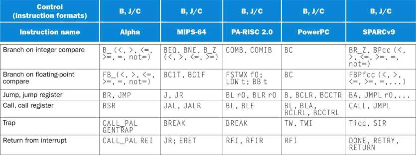

**HÌNH D.3.3 Các instruction control RISC desktop tương đương MIPS core. Nếu có nhiều lựa chọn instruction tương đương MIPS core, chúng được phân cách bằng dấu phẩy.**

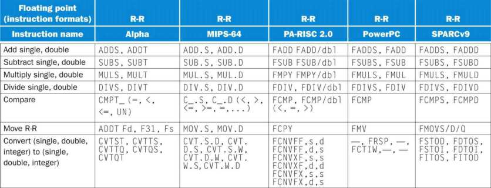

**HÌNH D.3.4 Các instruction floating-point RISC desktop tương đương MIPS core. Dấu gạch ngang nghĩa là phép toán không có trong kiến trúc đó hoặc không thể tổng hợp bằng vài instruction. Nếu có nhiều lựa chọn instruction tương đương MIPS core, chúng được phân cách bằng dấu phẩy.**

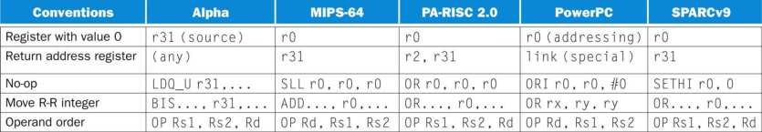

**HÌNH D.3.5 Các quy ước của kiến trúc RISC desktop tương đương MIPS core.**

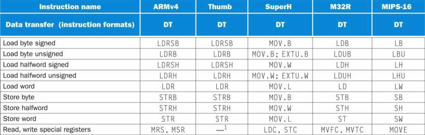

**HÌNH D.3.6 Các instruction data transfer RISC embedded tương đương MIPS core. Chuỗi instruction tổng hợp một instruction MIPS được phân cách bằng dấu chấm phẩy. Lưu ý floating point nói chung không được định nghĩa cho RISC embedded. Thumb và MIPS-16 chỉ là các tập con instruction 16-bit của kiến trúc ARM và MIPS, nên máy có thể chuyển chế độ và thực thi instruction set đầy đủ. Chúng ta dùng —<sup>1</sup> để chỉ các chuỗi có trong chế độ 32-bit nhưng không có trong chế độ 16-bit của Thumb hoặc MIPS-16.**

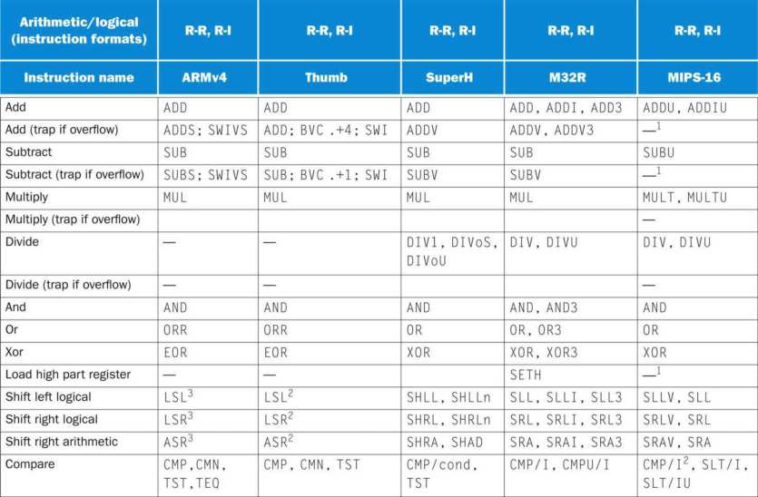

**HÌNH D.3.7 Các instruction số học/logic RISC embedded tương đương MIPS core. Dấu gạch ngang nghĩa là phép toán không có trong kiến trúc đó hoặc không thể tổng hợp bằng vài instruction. Một chuỗi instruction như vậy được phân cách bằng dấu chấm phẩy. Nếu có nhiều lựa chọn instruction tương đương MIPS core, chúng được phân cách bằng dấu phẩy. Thumb và MIPS-16 chỉ là các tập con instruction 16-bit của kiến trúc ARM và MIPS, nên máy có thể chuyển chế độ và thực thi instruction set đầy đủ. Chúng ta dùng —<sup>1</sup> để chỉ các chuỗi có trong chế độ 32-bit nhưng không có trong chế độ 16-bit của Thumb hoặc MIPS-16. Superscript 2 chỉ instruction mới chỉ có trong chế độ 16-bit của Thumb hoặc MIPS-16, như CMP/I<sup>2</sup>. ARM đưa phép shift vào mọi instruction thao tác dữ liệu, nên các phép shift có superscript 3 chỉ là biến thể của instruction move, như LSR<sup>3</sup>.**

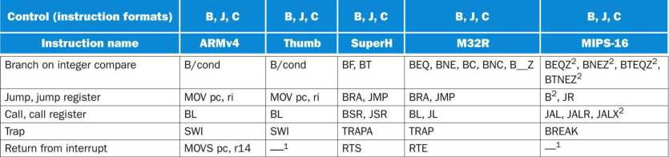

**HÌNH D.3.8 Các instruction control RISC embedded tương đương MIPS core. Thumb và MIPS-16 chỉ là các tập con instruction 16-bit của kiến trúc ARM và MIPS, nên máy có thể chuyển chế độ và thực thi instruction set đầy đủ. Chúng ta dùng —<sup>1</sup> để chỉ các chuỗi có trong chế độ 32-bit nhưng không có trong chế độ 16-bit của Thumb hoặc MIPS-16. Superscript 2 chỉ instruction mới chỉ có trong chế độ 16-bit của Thumb hoặc MIPS-16, như BTEQZ<sup>2</sup>.**

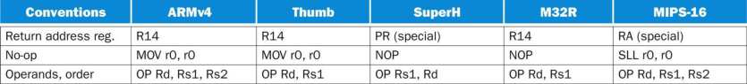

**HÌNH D.3.9 Các quy ước instruction RISC embedded tương đương MIPS core.**

Mỗi kiến trúc phải có một cơ chế compare và conditional branch, nhưng bất chấp mọi tương đồng, mỗi kiến trúc này đều tìm ra cách khác nhau để thực hiện phép toán.

### Compare và conditional branch

SPARC dùng bốn bit condition code truyền thống được lưu trong program status word: negative, zero, carry và overflow. Chúng có thể được thiết lập trong mọi instruction số học hoặc logic; khác các kiến trúc trước đó, việc thiết lập này là tùy chọn ở mỗi instruction. Tùy chọn tường minh gây ít vấn đề hơn trong triển khai pipeline. Mặc dù condition code có thể được thiết lập như tác dụng phụ của phép toán, các phép compare tường minh được tổng hợp bằng phép trừ với r0 làm đích. Conditional branch SPARC kiểm tra condition code để xác định mọi quan hệ unsigned và signed. Floating point dùng condition code riêng để encode các điều kiện IEEE 754, cần instruction compare floating-point. Phiên bản 9 mở rộng branch SPARC theo bốn cách: một tập condition code riêng cho phép toán 64-bit; một branch kiểm tra nội dung register và branch nếu giá trị =, khác =, <, <=, >= hoặc <= 0 (xem MIPS bên dưới); thêm ba tập condition code floating-point; và các instruction branch encode static branch prediction.

PowerPC cũng dùng bốn condition code—nhỏ hơn, lớn hơn, bằng và summary overflow—nhưng có tám bản của chúng. Sự dư thừa này cho phép instruction PowerPC dùng condition code khác nhau mà không xung đột, về bản chất cho PowerPC thêm tám register 4-bit. Bất kỳ condition code nào trong tám condition code này đều có thể là đích của instruction compare và là nguồn của conditional branch. Các integer instruction có bit tùy chọn hoạt động như thể phép integer được theo sau bởi phép compare với zero, thiết lập “register” condition đầu tiên. PowerPC cũng cho phép “register” thứ hai được thiết lập tùy chọn bởi instruction floating-point. PowerPC cung cấp các phép logic giữa tám register condition code 4-bit này (CRAND, CROR, CRXOR, CRNAND, CRNOR, CREQV), cho phép kiểm tra các điều kiện phức tạp hơn bằng một branch.

MIPS dùng nội dung register để đánh giá conditional branch. Bất kỳ hai register nào cũng có thể được so sánh bằng (BEQ) hoặc khác (BNE), rồi branch được thực hiện nếu điều kiện đúng. Các instruction set on less than (SLT, SLTI, SLTU, SLTIU) so sánh hai operand rồi đặt register đích bằng 1 nếu nhỏ hơn và bằng 0 nếu không. Những instruction này đủ để tổng hợp toàn bộ tập quan hệ. Vì so sánh với 0 phổ biến, MIPS có các instruction compare và branch đặc biệt cho mọi phép so sánh đó: lớn hơn hoặc bằng zero (BGEZ), lớn hơn zero (BGTZ), nhỏ hơn hoặc bằng zero (BLEZ) và nhỏ hơn zero (BLTZ). Tất nhiên, bằng và khác zero có thể tổng hợp bằng r0 với BEQ và BNE. Giống SPARC, MIPS I dùng một condition code cho floating point với instruction compare floating-point và branch riêng biệt; MIPS IV mở rộng thành tám condition code floating-point, trong đó các phép compare floating point và instruction branch chỉ định condition cần thiết lập hoặc kiểm tra.

Các phép compare Alpha (CMPEQ, CMPLT, CMPLE, CMPULT, CMPULE) kiểm tra hai register và đặt register thứ ba bằng 1 nếu điều kiện đúng, bằng 0 nếu không. Các phép compare Floating-point (CMTEQ, CMTLT, CMTLE, CMTUN) đặt kết quả bằng 2.0 nếu điều kiện đúng và bằng 0 nếu không. Các instruction branch so sánh một register với 0 (BEQ, BGE, BGT, BLE, BLT, BNE) hoặc least significant bit của nó với 0 (BLBC, BLBS), rồi branch nếu điều kiện đúng.

PA-RISC có nhiều tùy chọn branch, sẽ thấy trong Mục D.11. Trực tiếp nhất là instruction compare và branch (COMB), so sánh hai register, branch tùy các quan hệ chuẩn, rồi kiểm tra least significant bit của kết quả compare.

ARM tương tự SPARC ở chỗ cung cấp bốn condition code truyền thống được thiết lập tùy chọn. CMP trừ operand này khỏi operand kia và hiệu số thiết lập các condition code. Compare negative (CMN) cộng hai operand, và tổng thiết lập các condition code. TST thực hiện AND logic trên hai operand để thiết lập mọi condition code trừ overflow, còn TEQ dùng exclusive OR để thiết lập ba condition code đầu. Giống SPARC, phiên bản có điều kiện của instruction branch ARM kiểm tra condition code để xác định mọi quan hệ unsigned và signed.

Như sẽ thấy trong Mục D.12, một đặc điểm khác thường của ARM là mọi instruction đều có tùy chọn thực thi có điều kiện tùy theo condition code. (Điều này tương tự tùy chọn annulling của PA-RISC trong Mục D.11.)

Không ngạc nhiên khi Thumb theo ARM. Khác biệt là việc thiết lập condition code không còn tùy chọn, instruction TEQ bị loại bỏ và không có thực thi instruction có điều kiện.

Hitachi SuperH dùng một condition T-bit được thiết lập bởi instruction compare. Hai instruction branch quyết định branch nếu bit T bằng 1 (BT) hoặc bằng 0 (BF). Hai dạng branch này cho phép dùng ít instruction compare hơn.

Mitsubishi M32R cũng cung cấp một bit condition code (C) dùng cho so sánh signed và unsigned (CMP, CMPI, CMPU, CMPUI) để xem register này nhỏ hơn register kia hay không, tương tự các instruction set on less than của MIPS. Hai instruction branch kiểm tra bit C bằng 1 hay 0: BC và BNC. M32R cũng có instruction branch khi các register bằng hoặc khác nhau (BEQ và BNE), và theo mọi quan hệ của một register với 0 (BGEZ, BGTZ, BLEZ, BLTZ, BEQZ, BNEZ). Khác BC và BNC, những instruction cuối này đều rộng 32 bit.

MIPS-16 giữ các instruction set on less than (SLT, SLTI, SLTU, SLTIU), nhưng thay vì đặt kết quả vào một trong tám register, kết quả được đặt vào register đặc biệt tên T. MIPS-16 luôn được triển khai trong máy cũng có đầy đủ instruction và register MIPS 32-bit; vì vậy register T thực chất là register 24 trong kiến trúc MIPS đầy đủ. Các instruction branch MIPS-16 kiểm tra một register bằng hay khác zero (BEQZ và BNEZ). Cũng có instruction branch nếu register T bằng hoặc khác zero (BTEQZ và BTNEZ). Để kiểm tra hai register bằng nhau, MIPS thêm instruction compare (CMP, CMPI) tính exclusive OR của hai register và đặt kết quả vào register T. Compare được thêm vì MIPS-16 bỏ các instruction compare và branch khi các register bằng hoặc khác nhau (BEQ và BNE).

Hình D.3.10 và D.3.11 tóm tắt các cơ chế dùng cho conditional branch.

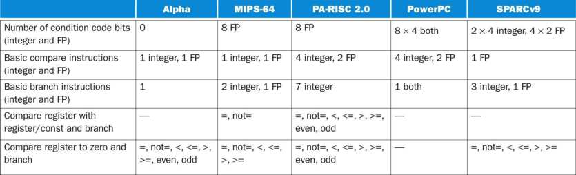

**HÌNH D.3.10 Tóm tắt năm cách tiếp cận RISC desktop đối với conditional branch. Branch Floating-point trên PA-RISC được thực hiện bằng cách copy FP status register vào integer register rồi dùng instruction branch on bit kiểm tra bit compare FP. Compare integer trên SPARC được tổng hợp bằng instruction số học thiết lập condition code với r0 làm đích.**

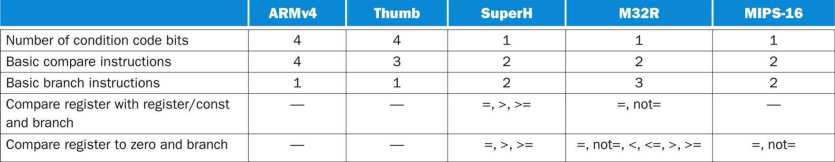

**HÌNH D.3.11 Tóm tắt năm cách tiếp cận RISC embedded đối với conditional branch.**

## D.4 Instruction: Các phần mở rộng multimedia của RISC desktop/server

Vì theo định nghĩa mỗi microprocessor desktop có màn hình đồ họa riêng, khi ngân sách transistor tăng lên, việc thêm hỗ trợ các phép đồ họa là tất yếu. Nhiều hệ thống đồ họa dùng 8 bit biểu diễn mỗi màu trong ba màu cơ bản cùng 8 bit cho vị trí pixel.

Việc thêm loa và microphone cho hội nghị từ xa và trò chơi điện tử cũng gợi ý hỗ trợ âm thanh. Mẫu âm thanh cần độ chính xác hơn 8 bit, nhưng 16 bit là đủ.

Mỗi microprocessor có hỗ trợ đặc biệt để byte và halfword chiếm ít không gian hơn khi lưu trong memory, nhưng vì chương trình integer điển hình ít thực hiện phép số học trên các kích thước dữ liệu này, hỗ trợ ngoài data transfer còn ít. Những nhà thiết kế kiến trúc Intel i860, vốn được thuyết minh trong công ty như một bộ tăng tốc đồ họa, nhận ra rằng nhiều ứng dụng đồ họa và âm thanh thực hiện cùng phép toán trên vector của những dữ liệu này. Mặc dù vector unit vượt ngân sách transistor của i860 năm 1989, bằng cách phân chia carry chain trong ALU 64-bit, nó có thể thực hiện đồng thời các phép toán trên vector ngắn gồm tám operand 8-bit, bốn operand 16-bit hoặc hai operand 32-bit. Chi phí ALU được phân chia như vậy nhỏ. Các ứng dụng phù hợp với hỗ trợ này gồm MPEG (video), trò chơi như DOOM (đồ họa 3-D), Adobe Photoshop (ảnh kỹ thuật số) và hội nghị từ xa (xử lý âm thanh, hình ảnh).

Như virus, theo thời gian hỗ trợ multimedia này lan tới gần như mọi microprocessor desktop. HP là RISC desktop thành công đầu tiên có hỗ trợ đó. Như sẽ thấy, virus này lan không đồng đều. PowerPC là trường hợp duy nhất còn đứng ngoài, và có tin đồn rằng nó đang “lên cơn sốt”.

Các phần mở rộng này được gọi là subword parallelism, vector hoặc SIMD (single-instruction, multiple data) (xem Chương 6). Vì bộ phận marketing Intel dùng SIMD để mô tả phần mở rộng MMX của 8086, nó trở thành tên phổ biến. Hình D.4.1 tóm tắt hỗ trợ theo kiến trúc.

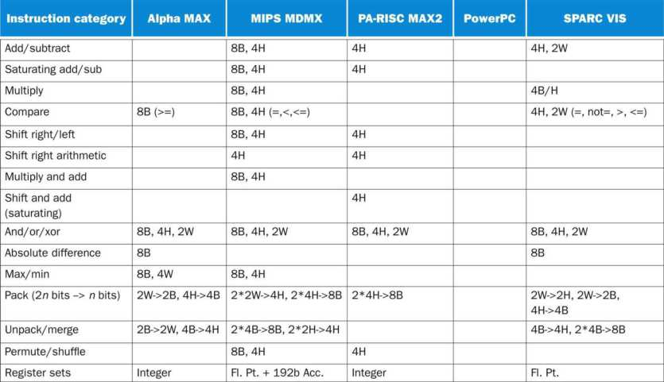

**HÌNH D.4.1 Tóm tắt hỗ trợ multimedia cho RISC desktop. B viết tắt byte (8 bit), H là half word (16 bit) và W là word (32 bit). Vì vậy 8B nghĩa là phép toán trên tám byte trong một instruction. Pack và unpack dùng ký pháp 2*2W chỉ hai operand, mỗi operand có hai word. Lưu ý MDMX có phép vector/scalar, trong đó scalar được chỉ định là phần tử của một vector register. Bảng này đơn giản hóa các kiến trúc multimedia đầy đủ, bỏ nhiều chi tiết. Ví dụ, MIPS MDMX có instruction multiplex giữa hai operand, HP MAX2 có instruction tính trung bình, và SPARC VIS có instruction đặt register thành hằng. Bảng cũng không có phép memory alignment của MDMX, MAX và VIS.**

Từ Hình D.4.1 có thể thấy nói chung MIPS MDMX thao tác trên tám byte hoặc bốn halfword mỗi instruction, HP PA-RISC MAX2 trên bốn half-words, SPARC VIS trên bốn halfword hoặc hai word, còn Alpha không làm nhiều. Các phép Alpha MAX chỉ là phiên bản byte của compare, min, max và hiệu tuyệt đối, để phần mềm tự tách trường và thực hiện các phép cộng, trừ, nhân song song trên byte và halfword. MIPS cũng thêm các phép thao tác trên hai operand floating-point 32-bit mỗi cycle, nhưng chúng được coi là một phần MIPS V chứ không đơn thuần là phần mở rộng multimedia (xem Mục D.7).

Một đặc điểm thường không có trong microprocessor general-purpose là phép saturating. Saturation nghĩa là khi phép tính overflow, kết quả được đặt bằng số dương lớn nhất hoặc số âm nhỏ nhất, thay vì phép tính modulo như số học bù hai. Thường có trong digital signal processor (xem mục tiếp theo), các phép saturating hữu ích trong routine lọc.

Những máy này phần lớn dùng register set hiện có để giữ operand: integer register cho Alpha và HP PA-RISC, floating-point register cho MIPS và Sun. Vì vậy data transfer được thực hiện bằng instruction load và store chuẩn. MIPS cũng thêm register rộng 192-bit (3*64) làm accumulator cho một số phép toán. Với độ rộng gấp ba độ rộng dữ liệu gốc, nó có thể được chia để tích lũy tám byte với 24 bit mỗi trường hoặc bốn halfword với 48 bit mỗi trường. Accumulator rộng này có thể dùng cho instruction add, subtract và multiply/ add. MIPS tuyên bố accumulator đem lại lợi thế hiệu năng gấp hai đến bốn lần.

Có lẽ kết luận đáng ngạc nhiên từ bảng là thiếu nhất quán. Những phép duy nhất có trong cả bốn là phép logic (AND, OR, XOR), vốn không cần ALU được phân chia. Nếu bỏ Alpha tiết kiệm, các phép chung duy nhất còn lại là cộng và trừ song song trên bốn halfword.

Mỗi nhà sản xuất đều nói những instruction này dành cho thư viện subroutine hand-optimized; ý định này có lẽ sẽ được tuân theo, vì xây dựng compiler hoạt động tốt với phần mở rộng multimedia của mọi RISC desktop là một thách thức.

## D.5 Instruction: Các phần mở rộng Digital Signal-Processing của RISC embedded

Một đặc điểm có trong mọi kiến trúc digital signal processor (DSP) là hỗ trợ integer multiply-accumulate. Các phép nhân thường trên word ngắn hơn integer thông thường, như 16 bit, và accumulator thường trên word dài hơn, như 64 bit. Mục đích multiply-accumulate là triển khai hiệu quả digital filter, phổ biến trong ứng dụng DSP. Vì Thumb và MIPS-16 là kiến trúc tập con, chúng không cung cấp hỗ trợ này. Thay vào đó, lập trình viên nên dùng phần mở rộng DSP hoặc multimedia trong instruction chế độ 32-bit của ARM và MIPS-64.

Hình D.5.1 trình bày kích thước phép nhân, kích thước accumulator, các phép toán và tên instruction cho RISC embedded. Máy có accumulator lớn hơn 32 và nhỏ hơn 64 bit buộc các bit phía trên giữ nguyên là sign bit, nhờ đó “saturate” phép cộng để đặt thành giá trị fixed-point lớn nhất và nhỏ nhất nếu phép toán overflow.

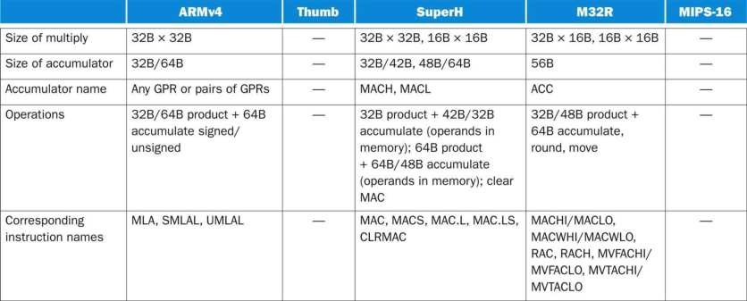

**HÌNH D.5.1 Tóm tắt năm cách tiếp cận RISC embedded đối với multiply-accumulate.**

## D.6 Instruction: Các phần mở rộng chung cho MIPS core

Hình D.6.1 đến D.6.7 liệt kê các instruction không có trong Hình D.3.5 đến D.3.11 theo cùng bốn nhóm. Instruction được đưa vào danh sách nếu xuất hiện ở nhiều hơn một kiến trúc chuẩn. Các instruction được định nghĩa bằng hardware description language định nghĩa trong Hình D.6.8.

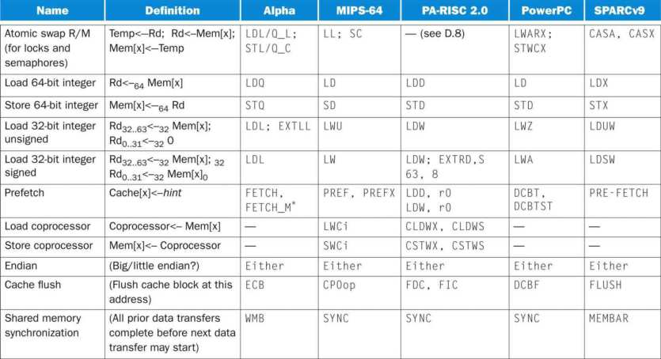

**HÌNH D.6.1 Các instruction data transfer không có trong MIPS core nhưng có ở từ hai trong năm kiến trúc desktop trở lên. Cặp instruction load linked/store conditional cung cấp cho Alpha và MIPS các phép atomic cho semaphore, cho phép đọc dữ liệu từ memory, sửa đổi và lưu mà không lo interrupt hay máy khác truy cập dữ liệu trong multiprocessor (xem Chương 2). Prefetch trong Alpha vào cache ngoài được thực hiện bằng FETCH và FETCH_M; prefetch cache on-chip dùng LD_Q A, R31 và LD_Y A. F31 được dùng trong Alpha 21164 (xem Bhandarkar [1995], tr. 190).**

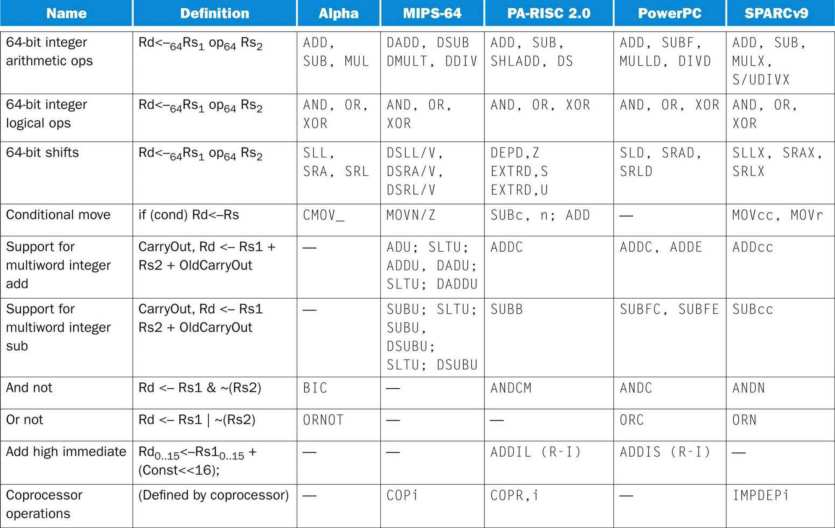

**HÌNH D.6.2 Các instruction số học/logic không có trong MIPS core nhưng có ở từ hai trong năm kiến trúc desktop trở lên.**

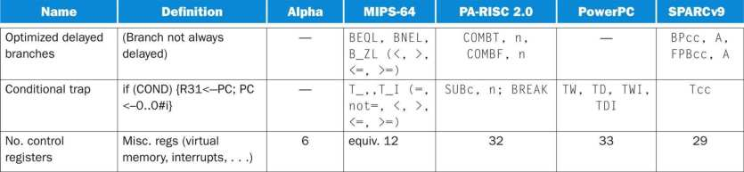

**HÌNH D.6.3 Các instruction control không có trong MIPS core nhưng có ở từ hai trong năm kiến trúc desktop trở lên.**

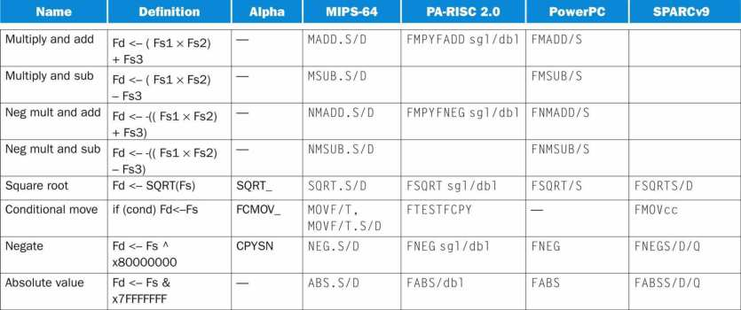

**HÌNH D.6.4 Các instruction Floating-point không có trong MIPS core nhưng có ở từ hai trong năm kiến trúc desktop trở lên.**

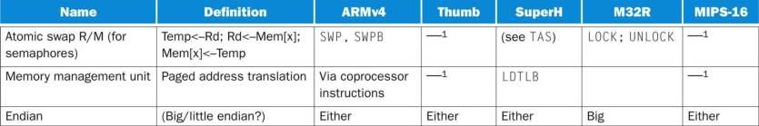

**HÌNH D.6.5 Các instruction data transfer không có trong MIPS core nhưng có ở từ hai trong năm kiến trúc embedded trở lên. Chúng ta dùng —<sup>1</sup> để chỉ các chuỗi có trong chế độ 32-bit nhưng không có trong chế độ 16-bit của Thumb hoặc MIPS-16.**

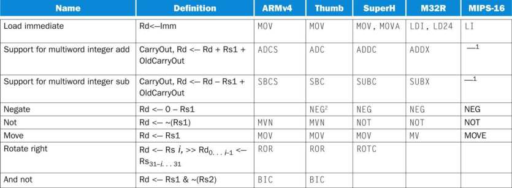

**HÌNH D.6.6 Các instruction số học/logic không có trong MIPS core nhưng có ở từ hai trong năm kiến trúc embedded trở lên. Chúng ta dùng —<sup>1</sup> để chỉ các chuỗi có trong chế độ 32-bit nhưng không có trong chế độ 16-bit của Thumb hoặc MIPS-16. Superscript 2 chỉ instruction mới chỉ có trong chế độ 16-bit của Thumb hoặc MIPS-16, như NEG<sup>2</sup>.**


**HÌNH D.6.7 Thông tin control trong năm kiến trúc embedded.**

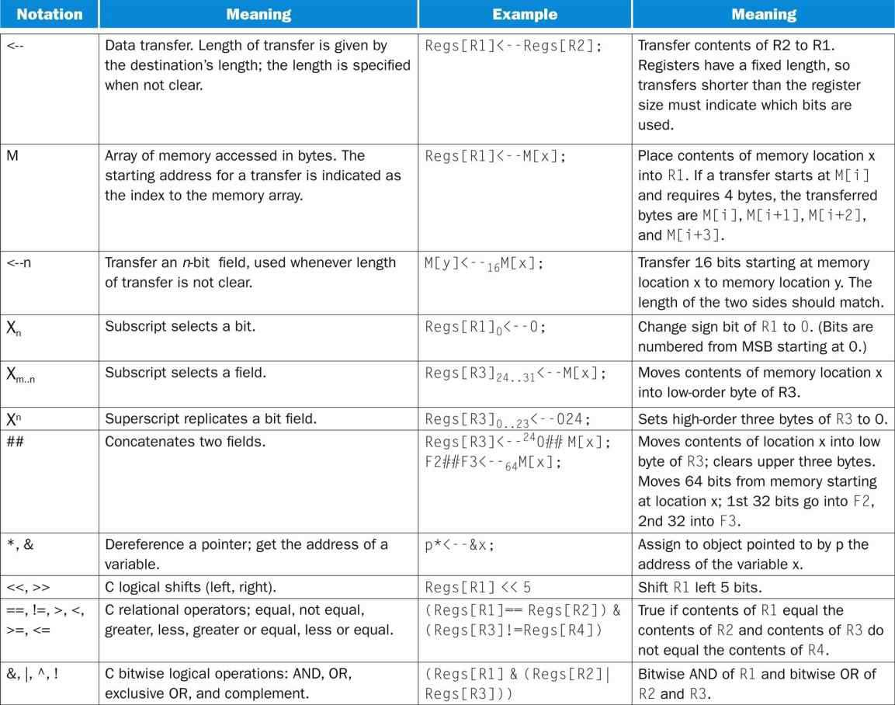

**HÌNH D.6.8 Ký pháp mô tả phần cứng (và một số toán tử C chuẩn).**

Mặc dù phần lớn nhóm đều self-explanatory, một vài nhóm cần bình luận:

- Hàng “atomic swap” chỉ primitive có thể hoán đổi register với memory mà không bị gián đoạn. Điều này hữu ích cho semaphore của operating system trong uniprocessor cũng như đồng bộ multiprocessor (xem Mục 2.11 trong Chương 2).

- Các hàng data transfer và phép toán 64-bit cho thấy MIPS, PowerPC và SPARC định nghĩa addressing và phép integer 64-bit như thế nào. SPARC đơn giản định nghĩa mọi phép register và addressing là 64 bit, chỉ thêm instruction đặc biệt cho shift 64-bit, data transfer và branch. MIPS có cùng các phần mở rộng, đồng thời thêm instruction số học signed 64-bit riêng. PowerPC thêm right shift, load, store, divide và compare 64-bit, và có chế độ riêng quyết định instruction được diễn giải là phép 32- hay 64-bit; phép 64-bit không hoạt động trong máy chỉ hỗ trợ chế độ 32-bit. PA-RISC được mở rộng thành addressing và phép toán 64-bit trong phiên bản 2.0.

- Instruction “prefetch” cung cấp address và gợi ý cho cách triển khai về dữ liệu. Gợi ý gồm dữ liệu có khả năng sớm được đọc hay ghi, có khả năng chỉ được đọc hay ghi một lần, hoặc có khả năng được đọc hay ghi nhiều lần. Prefetch không gây exception. MIPS có phiên bản cộng hai register để lấy address cho chương trình floating-point, khác với chương trình MIPS nonfloating-point.

- Trong hàng “Endian”, “Big/little” nghĩa là có một bit trong program status register cho phép processor hoạt động theo big endian hoặc little endian (xem Phụ lục A). Có thể làm việc này đơn giản bằng cách lấy phần bù một số least significant bit của address trong instruction data transfer.

- “Shared memory synchronization” hỗ trợ các multi-processors cache-coherent: mọi load và store được thực thi trước instruction phải hoàn tất trước khi load và store sau nó có thể bắt đầu. (Xem Chương 2.)

- Hàng “coprocessor operations” liệt kê một số nhóm cho phép mở rộng processor bằng phần cứng special-purpose.

Một khác biệt cần giải thích dài hơn là các branch được tối ưu. Hình D.6.9 trình bày các lựa chọn. Alpha và PowerPC cung cấp branch có hiệu lực ngay lập tức, giống branch trên các kiến trúc trước. Để tăng tốc branch, những máy này dùng branch prediction (xem Chương 4). Mọi RISC desktop còn lại cung cấp delayed branch. RISC embedded nói chung không hỗ trợ delayed branch, ngoại trừ SuperH cung cấp nó như một tùy chọn.

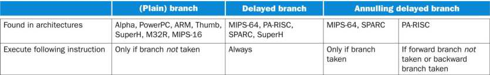

**HÌNH D.6.9 Khi nào instruction theo sau branch được thực thi đối với ba loại branch.**

Ba RISC desktop còn lại cung cấp phiên bản delayed branch giúp điền delay slot dễ hơn. Branch “annulling” của SPARC chỉ thực thi instruction trong delay slot nếu branch được thực hiện; nếu không, instruction bị annul. Điều này nghĩa là có thể copy an toàn instruction tại đích branch vào delay slot, vì nó chỉ được thực thi nếu branch được thực hiện. Hạn chế là đích không phải branch khác và đích được biết tại compile time. (SPARC cũng cung cấp jump không trễ vì unconditional branch có bit annul được đặt sẽ không thực thi instruction theo sau.) Các phiên bản sau của kiến trúc MIPS thêm instruction branch likely cũng annul instruction theo sau nếu branch không được thực hiện. PA-RISC cho phép gần như mọi instruction annul instruction kế tiếp, kể cả branch. Tùy chọn branch “nullifying” thực thi instruction tiếp theo tùy hướng branch và branch có được thực hiện hay không (tức nếu forward branch không được thực hiện hoặc backward branch được thực hiện). Có lẽ lựa chọn này nhằm tối ưu loop, cho phép instruction theo sau exit branch và looping branch thực thi trong trường hợp phổ biến.

Sau khi trình bày các điểm tương đồng, chúng ta tập trung vào đặc điểm riêng của từng kiến trúc. Trước hết là RISC desktop/server, sắp xếp theo độ dài mô tả đặc điểm riêng từ ngắn đến dài, rồi đến RISC embedded.

## D.7 Instruction riêng của MIPS-64

MIPS đã trải qua năm thế hệ instruction set, và quá trình phát triển này nhìn chung thêm các đặc điểm có trong kiến trúc khác. Dưới đây là những đặc điểm riêng nổi bật của MIPS, trong đó một số đặc điểm đầu đã có từ instruction set ban đầu.

### Data transfer không align

MIPS có instruction đặc biệt xử lý word bị misalign trong memory. Hiếm gặp trong phần lớn chương trình, chúng được đưa vào để hỗ trợ ứng dụng minicomputer 16-bit và làm memcpy, strcpy nhanh hơn. Mặc dù phần lớn RISC trap nếu cố load hoặc store word tới address bị misalign, trên mọi kiến trúc có thể truy cập word bị misalign mà không trap bằng bốn instruction load byte rồi ghép kết quả bằng shift và OR logic. Các instruction load và store word left, right của MIPS (LWL, LWR, SWL, SWR) cho phép làm điều này chỉ trong hai instruction: LWL load phần trái register, LWR load phần phải register. SWL và SWR thực hiện các store tương ứng. Hình D.7.1 minh họa cách chúng hoạt động. Cũng có phiên bản 64-bit của các instruction này.

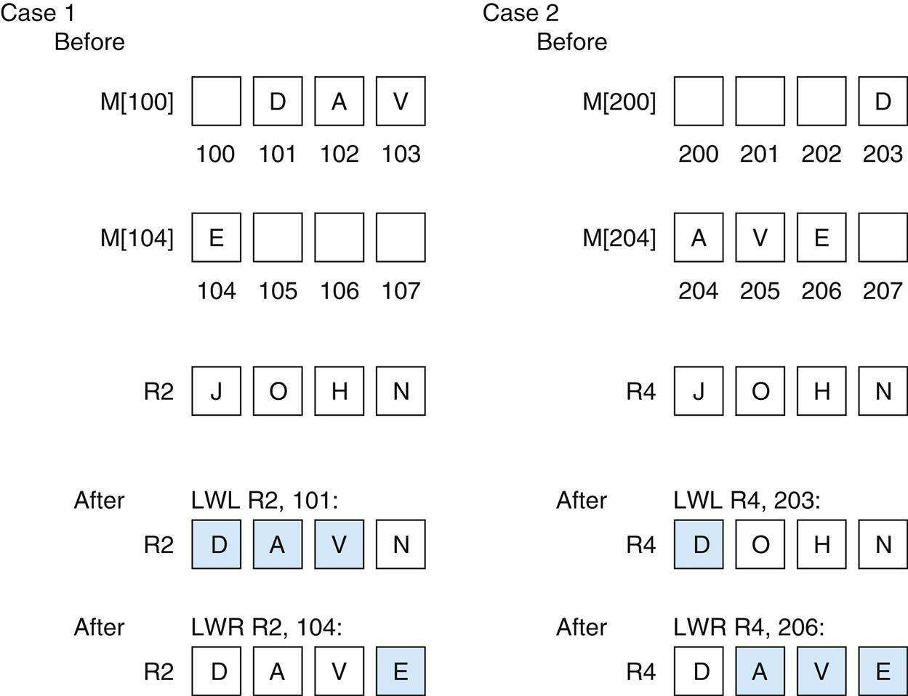

**HÌNH D.7.1 Instruction MIPS để đọc word không align. Hình giả sử hoạt động ở chế độ big-endian. Trường hợp 1 trước hết load ba byte 101, 102 và 103 vào phần trái R2, giữ nguyên least significant byte. LWR theo sau chỉ load byte 104 vào least significant byte của R2, giữ nguyên các byte khác của register sau LWL. Trường hợp 2 trước hết load byte 203 vào most significant byte của R4, rồi LWR load ba byte còn lại của R4 từ các byte memory 204, 205 và 206. LWL đọc word chứa byte đầu từ memory, shift trái để bỏ các byte không cần và chỉ thay đổi các byte đó trong Rd. Các byte được chuyển đi từ byte đầu tới byte lowest-order của word. LWR theo sau dùng address byte cuối, right-shifts để bỏ các byte không cần, rồi chỉ thay đổi các byte đó trong Rd. Các byte được chuyển đi từ byte cuối lên byte highest-order của word. Store word left (SWL) đơn giản là phép ngược của LWL, còn store word right (SWR) là phép ngược của LWR. Chuyển sang chế độ little-endian đảo những byte được chọn và bị loại bỏ. (Nếu big-little, left-right, load-store có vẻ khó hiểu, đừng lo; chúng hoạt động!)**

### Các instruction còn lại

Dưới đây là các chi tiết riêng còn lại của kiến trúc MIPS-64:

- NOR—Instruction logic này tính ~(Rs1 | Rs2).

- Lượng shift hằng—Các phép shift không biến đổi dùng trường hằng 5-bit trong định dạng register-register ở Hình D.2.3.

- SYSCALL—Instruction trap đặc biệt này dùng để gọi operating system.

- Move tới/từ control register—CTCi và CFCi move giữa integer register và control register.

- Jump/call không PC-relative—Address 26-bit của jump và call không được cộng vào PC. Nó được shift trái hai bit và thay 28 bit thấp của PC. Điều này chỉ tạo khác biệt nếu chương trình nằm gần ranh giới 256 MB.

- Instruction TLB—Miss của Translation-lookaside buffer (TLB) được xử lý bằng phần mềm trong MIPS I, nên instruction set cũng có instruction thao tác các register của TLB (xem Chương 5 để biết thêm về TLB). Những register này được coi là một phần “system coprocessor”. Từ MIPS I, các instruction khác nhau giữa các phiên bản kiến trúc; chúng thuộc về cách triển khai nhiều hơn là instruction set architecture.

- Nghịch đảo và nghịch đảo căn bậc hai—Các instruction này không tuân theo hướng dẫn IEEE 754 về làm tròn đúng, dường như dành cho ứng dụng coi trọng tốc độ chia và căn bậc hai hơn độ chính xác.

- Instruction gọi procedure có điều kiện—BGEZAL lưu return address và branch nếu nội dung Rs1 lớn hơn hoặc bằng zero, còn BLTZAL làm tương tự khi nhỏ hơn zero. Mục đích là có một call PC-relative. (Cũng có phiên bản “likely” của những instruction này.)

- Các phép single-precision floating-point song song—Ngoài mở rộng kiến trúc bằng các phép integer song song trong MDMX, MIPS-64 còn hỗ trợ hai phép floating-point 32-bit song song trên register 64-bit trong một instruction. Các phép “Paired single” gồm add (ADD.PS), subtract (SUB.PS), compare (C.__.PS), convert (CVT.PS.S, CVT.S.PL, CVT.S.PU), negate (NEG.PS), absolute value (ABS.PS), move (MOV.PS, MOVF.PS, MOVT.PS), multiply (MUL.PS), multiply-add (MADD.PS) và multiply-subtract (MSUB.PS).

Kiến trúc MIPS không có quy định cụ thể cho thực thi floating-point song song với integer, nhưng các cách triển khai floating point của MIPS cho phép điều này bằng cách kiểm tra khả năng có interrupt số học ngay từ đầu cycle. Thông thường, phát hiện exception sẽ buộc thực thi tuần tự các phép integer và floating-point.

## D.8 Instruction riêng của Alpha

Alpha được dự định là kiến trúc giúp dễ xây dựng các cách triển khai high-performance. Để đạt mục tiêu, ban đầu các nhà thiết kế đưa ra hai quyết định gây tranh cãi: exception floating-point không chính xác và không có data transfer byte hoặc halfword.

Để đơn giản hóa thực thi pipeline, Alpha không yêu cầu exception phải hành xử như thể không instruction nào sau một điểm nhất định được thực thi và tất cả instruction trước điểm đó đều đã thực thi. Nó cung cấp instruction TRAPB, stall cho tới khi bảo đảm mọi instruction số học trước đó hoàn tất mà không gây exception số học. Trong chế độ thận trọng nhất, đặt một TRAPB cho mỗi instruction exception-causing làm chậm thực thi khoảng năm lần nhưng cung cấp precise exception (xem Darcy và Gay [1996]).

Code không chứa TRAPB không tuân theo chuẩn floating-point IEEE 754. Lý do là một số phần của chuẩn (NaN, infinity và denormal) được triển khai bằng phần mềm trên Alpha, giống nhiều microprocessor khác. Tuy nhiên, để triển khai các phép này bằng phần mềm, chương trình phải tìm instruction gây lỗi và các giá trị operand, điều không thể làm với interrupt không chính xác!

Khi phát triển kiến trúc, các nhà thiết kế tin rằng load và store byte sẽ làm chậm data transfer. Load byte cần thêm shifter trên đường data transfer, còn store byte đòi hỏi memory system thực hiện read-modify-write đối với hệ thống có error correction code, vì phải tính lại giá trị ECC mới. Việc bỏ tính năng này nghĩa là store byte cần chuỗi load word, thay byte mong muốn rồi store word. (Thiếu nhất quán ở chỗ load floating-point phải hoán đổi byte đáng kể để chuyển các định dạng floating-point VAX khó hiểu sang dạng chuẩn.)

Để giảm số instruction cần để lấy dữ liệu mong muốn, Alpha có tập instruction thao tác byte phức tạp: trích trường và đặt phần còn lại register bằng zero (EXTxx), chèn trường (INSxx), mask phần còn lại register (MSKxx), đặt các trường register bằng zero (ZAP) và compare nhiều byte (CMPGE).

Dường như những người triển khai không lo load và store byte như các nhà thiết kế kiến trúc ban đầu. Bắt đầu từ bản thu nhỏ của phiên bản chip Alpha thứ hai (21164A), kiến trúc có load và store cho byte và halfword.

### Các instruction còn lại

Dưới đây là các instruction riêng còn lại của kiến trúc Alpha:

- PAL code—Để cung cấp các phép VAX thực hiện bằng microcode, Alpha cung cấp chế độ bật mọi privilege, tắt interrupt và tắt virtual memory mapping cho instruction. PAL (privileged architecture library) code được dùng cho quản lý TLB, các phép memory atomic và một số primitive của operating system. PAL code được gọi qua instruction CALL_PAL.

- Không có divide—Phép chia integer không được hỗ trợ bằng phần cứng.

- load-store “không align”—LDQ_U và STQ_U load, store dữ liệu 64-bit bằng address bỏ qua ba least significant bit. Các instruction extract sau đó chọn word không align mong muốn bằng các bit address thấp. Các instruction này tương tự LWL/R, SWL/R trong MIPS.

- Floating-point single precision được biểu diễn thành double precision—Dữ liệu Single-precision được giữ ở định dạng 32-bit thông thường trong memory nhưng được chuyển thành định dạng double-precision 64-bit trong register.

- Register Floating-point F31 cố định bằng zero—Để đơn giản hóa compare với zero.

- Các định dạng floating-point VAX—Để duy trì tương thích với kiến trúc VAX, ngoài các định dạng single- và double-precision IEEE 754 gọi là S và T, Alpha hỗ trợ các định dạng single-and double-precision VAX gọi là F và G, nhưng không hỗ trợ định dạng D của VAX. (D có trường exponent quá hẹp để hữu ích cho double precision và được thay bằng G trong code VAX.)

- Instruction đếm bit—Phiên bản 3 của kiến trúc thêm instruction đếm số leading zero (CTLZ), số trailing zero (CTTZ) và số bit một trong word (CTPOP). Vốn xuất hiện trên máy tính Cray, các instruction này hỗ trợ giải mã.

## D.9 Instruction riêng của SPARC v9

Một số đặc điểm là riêng của SPARC.

### Register window

Đặc điểm riêng chính của SPARC là register window, một tối ưu để giảm lưu lượng register khi gọi procedure. Nhiều bank register được dùng, mỗi lần gọi procedure cấp phát một bank mới. Mặc dù điều này có thể giới hạn độ sâu lời gọi procedure, giới hạn được tránh bằng cách vận hành các bank như circular buffer, cung cấp độ sâu không giới hạn. Điểm uốn của đường cong chi phí/hiệu năng dường như là sáu đến tám bank.

SPARC có thể có từ hai đến 32 window, thường dùng tám register cho mỗi nhóm global, local, incoming parameter và outgoing parameter. (Vì mỗi window có 16 register riêng, một cách triển khai SPARC có thể chỉ có 40 physical register hoặc tới 520, dù đến nay phần lớn có 128 đến 136.) Thay vì gắn việc đổi window với instruction call và return, SPARC có instruction SAVE và RESTORE riêng. SAVE dùng để “lưu” window của caller bằng cách trỏ tới window register kế tiếp đồng thời thực hiện một instruction add. Mẹo là các register nguồn của phép cộng thuộc window caller, trong khi register đích thuộc window callee. Compiler SPARC thường dùng instruction này để đổi stack pointer nhằm cấp phát local variable trong stack frame mới. RESTORE là phép ngược SAVE, khôi phục window caller đồng thời hoạt động như instruction add, với register nguồn từ window callee và register đích trong window caller. Điều này tự động giải phóng stack frame. Compiler cũng có thể tận dụng nó để tạo return value cuối cùng của callee.

Nguy cơ của register window là số register lớn hơn có thể làm chậm clock rate. Điều này không xảy ra ở những cách triển khai ban đầu. Kiến trúc SPARC (có register window) và MIPS R2000 (không có) đã được chế tạo trên nhiều công nghệ từ năm 1987. Qua vài thế hệ, clock rate SPARC không chậm hơn MIPS trong những cách triển khai với công nghệ tương tự, có lẽ vì thời gian truy cập cache chi phối thời gian truy cập register trong những cách triển khai này. Các máy current-generation chọn chiến lược triển khai khác nhau—in order so với out of order—và khó có khả năng riêng số register quyết định clock rate ở máy nào. Gần đây, các kiến trúc khác đưa register window vào: Tensilica và IA-64.

Một đặc điểm data transfer khác là tùy chọn alternate space cho load và store. Nó đơn giản cho phép memory system nhận biết truy cập memory tới thiết bị input/ output hoặc tới control register của thiết bị như cache và memory management unit.

### Trap nhanh

SPARC phiên bản 9 có hỗ trợ làm trap nhanh hơn. Nó mở rộng một cấp trap thành ít nhất bốn cấp, cho phép interrupt các trap handler overflow và underflow của window. Các cấp bổ sung nghĩa là handler không cần kiểm tra tường minh page fault hoặc stack pointer bị misalign trong code, nhờ đó nhanh hơn. Hai instruction mới được thêm để return từ handler nhiều cấp: RETRY (thử lại instruction bị interrupt) và DONE (không thử lại). Để hỗ trợ trap user-level, instruction RETURN return từ trap ở chế độ không đặc quyền.

### Hỗ trợ LISP và Smalltalk

Đặc điểm số học chính còn lại là phép cộng, trừ có tag. Những nhà thiết kế SPARC dành thời gian suy nghĩ về ngôn ngữ như LISP và Smalltalk, ảnh hưởng tới một số đặc điểm SPARC đã thảo luận: register window, conditional trap instruction, call với address instruction 32-bit và số học multiword (xem Taylor và cộng sự [1986], Ungar và cộng sự [1984]). Một ít hỗ trợ được cung cấp cho kiểu dữ liệu có tag với các phép cộng, trừ và do đó cả compare. Hai least significant bit chỉ operand có phải integer hay không (encode là 00), nên TADDcc và TSUBcc đặt bit overflow nếu một operand không có tag integer hoặc kết quả quá lớn. Conditional branch hoặc trap instruction sau đó có thể quyết định làm gì. (Nếu operand không phải integer, phần mềm khôi phục operand, kiểm tra kiểu và gọi phép toán đúng dựa trên các kiểu đó.) Hóa ra trap truy cập memory bị misalign cũng dùng được cho dữ liệu có tag, vì load từ pointer có tag sai có thể là truy cập không hợp lệ. Hình D.9.1 cho cả hai kiểu hỗ trợ tag.

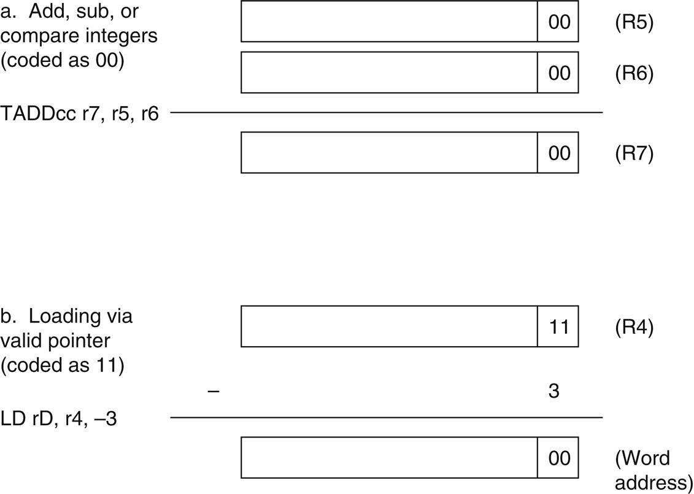

**HÌNH D.9.1 SPARC dùng hai least significant bit để encode các kiểu dữ liệu khác nhau cho instruction số học có tag. a. Số học integer mất một cycle miễn là operand và kết quả đều là integer. b. Misaligned trap có thể dùng để bắt truy cập memory không hợp lệ, như cố dùng integer làm pointer. Với ngôn ngữ có dữ liệu theo cặp như LISP, offset −3 có thể dùng để truy cập word chẵn của một cặp (CAR) và +1 cho word lẻ của một cặp (CDR).**

### Các phép integer và Floating-Point chồng lấp

SPARC cho phép instruction floating-point thực thi chồng lấp với integer instruction. Để khôi phục sau interrupt trong tình huống đó, SPARC có queue chứa các instruction floating-point đang chờ và address của chúng. RDPR cho phép processor làm rỗng queue. Đặc điểm floating-point thứ hai là có các instruction căn bậc hai floating-point FSQRTS, FSQRTD và FSQRTQ.

### Các instruction còn lại

Các đặc điểm riêng còn lại của SPARC như sau:

- JMPL dùng Rd để chỉ định return address register, nên chỉ định r31 làm nó tương tự JALR của MIPS, còn chỉ định r0 làm nó giống

```
JR.
```

- LDSTUB load giá trị byte vào Rd rồi store FF16 vào byte được chỉ định address. Instruction phiên bản 8 này có thể dùng triển khai đồng bộ (xem Chương 2).

- CASA (CASXA) compare một cách atomic giá trị trong processor register với giá trị 32-bit (64-bit) trong memory; khi và chỉ khi bằng nhau, nó hoán đổi giá trị trong memory với giá trị trong processor register thứ hai. Instruction phiên bản 9 này có thể dùng xây dựng thuật toán đồng bộ wait-free không cần lock.

- XNOR tính exclusive OR với phần bù operand thứ hai.

- BPcc, BPr và FBPcc có bit branch prediction để compiler có thể gợi ý cho máy một branch có khả năng được thực hiện hay không.

- ILLTRAP gây trap illegal instruction. Muchnick [1988] giải thích cách dùng nó để thực thi đúng các procedure trả về aggregate trong C.

- POPC đếm số bit được đặt bằng một trong operand, cũng có trong phiên bản thứ ba của kiến trúc Alpha.

- Nonfaulting load cho phép compiler đưa instruction load lên trước các cấu trúc control có điều kiện điều khiển việc dùng chúng. Vì vậy nonfaulting load được thực thi suy đoán.

- Số học và data transfer Quadruple-precision floating-point cho phép floating-point register hoạt động như tám register 128-bit cho các phép floating-point và data transfer.

- Kết quả Multiple-precision floating-point cho phép nhân nghĩa là hai operand single- precision có thể cho tích double-precision, và hai operand double-precision có thể cho tích quadruple-precision. Các instruction này có thể hữu ích trong số học phức và một số mô hình tính toán floating-point.

## D.10 Instruction riêng của PowerPC

PowerPC là kết quả của vài thế hệ máy RISC thương mại IBM— IBM RT/PC, IBM Power1 và IBM Power2—cộng Motorola 8800.

### Branch register: Link và counter

Thay vì dành một trong 32 general-purpose register để lưu return address khi gọi procedure, PowerPC đặt address vào register đặc biệt gọi là link register. Vì nhiều procedure return mà không gọi procedure khác, link không phải lúc nào cũng cần lưu. Đặt return address trong register đặc biệt làm jump return nhanh hơn, vì phần cứng không cần đi qua pipeline stage đọc register cho các jump return.

Tương tự, PowerPC có count register dùng trong for loop khi chương trình lặp số lần cố định. Nhờ register đặc biệt, phần cứng branch có thể xác định nhanh một branch dựa trên count register có khả năng branch hay không, vì giá trị register được biết sớm trong execution cycle. Việc kiểm tra giá trị count register trong instruction branch tự động giảm count register.

Vì count register và link register đã nằm cùng phần cứng điều khiển branch, và một vấn đề của branch prediction là lấy target address sớm trong pipeline, các nhà thiết kế PowerPC quyết định dùng chúng cho mục đích thứ hai. Mỗi register đều có thể giữ target address của conditional branch. Vì vậy PowerPC bổ sung cho conditional branch cơ bản hai instruction lấy target address từ các register này (BCLR, BCCTR).

### Các instruction còn lại

Khác phần lớn máy RISC khác, register 0 không được nối cứng với giá trị 0. Nó không thể dùng làm base register—tức trong trường hợp này nó tạo 0—nhưng trong base + index addressing có thể dùng làm index. Các đặc điểm riêng khác của PowerPC như sau:

- Load multiple và store multiple lưu hoặc khôi phục tối đa 32 register trong một instruction.

- LSW và STSW cho phép fetch và store string fixed- và variable-length có alignment bất kỳ.

- Instruction rotate với mask hỗ trợ trích và chèn bit field. Một phiên bản rotate dữ liệu rồi thực hiện AND logic với mask các bit một, nhờ đó trích một trường. Phiên bản khác rotate dữ liệu nhưng chỉ đặt bit vào register đích ở nơi có bit 1 tương ứng trong mask, nhờ đó chèn một trường.

- Algebraic right shift đặt carry bit (CA) nếu operand âm và có bit 1 bị shift ra. Vì vậy, phép chia signed cho hằng là lũy thừa hai, làm tròn về 0, có thể thực hiện bằng SRAWI theo sau bởi ADDZE, cộng CA vào register.

- CBTLZ đếm leading zero.

- SUBFIC tính (immediate - RA), có thể dùng để tạo bù một hoặc bù hai.

- Các instruction logical shifted immediate shift immediate 16-bit sang trái 16 bit trước khi thực hiện AND, OR hoặc XOR.

## D.11 Instruction riêng của PA-RISC 2.0

PA-RISC được mở rộng nhẹ năm 1990 ở phiên bản 1.1 và thay đổi đáng kể trong 2.0 với các phần mở rộng 64-bit năm 1996. PA-RISC có lẽ có những đặc điểm khác thường nhất trong các máy RISC desktop. Ví dụ, nó có nhiều addressing mode và định dạng instruction nhất, và như sẽ thấy, nhiều instruction thực chất kết hợp hai instruction đơn giản hơn.

### Nullification

Như Hình D.6.9, một số máy RISC có thể chọn không thực thi instruction theo sau delayed branch để cải thiện việc sử dụng branch slot. Điều này được gọi là nullification trong PA-RISC và được tổng quát hóa áp dụng cho mọi instruction số học/logic cũng như mọi branch. Vì vậy một instruction add có thể cộng hai operand, lưu tổng và khiến instruction theo sau bị bỏ qua nếu tổng bằng zero. Giống instruction conditional move, nullification cho phép PA-RISC tránh branch khi phần then của if chỉ có một instruction.

### Rất nhiều conditional branch

Với nullification, PA-RISC không cần instruction conditional branch riêng. Những người phát minh có thể khuyến nghị đặt instruction nullifying trước unconditional branch, nhờ đó đơn giản hóa instruction set. Thay vào đó, PA-RISC có số conditional branch lớn nhất trong mọi máy RISC. Hình D.11.1 trình bày các conditional branch PA-RISC. Như thấy, nhiều instruction thực chất kết hợp hai instruction.

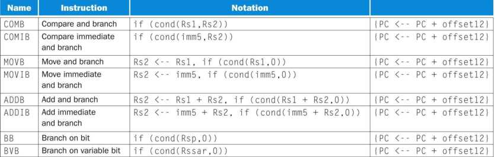

**HÌNH D.11.1 Các instruction conditional branch PA-RISC. Offset 12-bit được gọi là offset12 trong bảng, còn immediate 5-bit gọi là imm5. 16 điều kiện là =, <, < =, odd, signed overflow, unsigned no overflow, zero or no overflow unsigned, never, và các phần bù tương ứng. Instruction BB chọn một trong 32 bit của register và branch tùy giá trị 0 hay 1. BVB chọn bit để branch bằng shift amount register, một register special-purpose. Ký pháp subscript chỉ định bit field.**

### Multiply và divide được tổng hợp

PA-RISC cung cấp một số primitive để tổng hợp multiply và divide bằng phần mềm. Các instruction shift một operand 1, 2 hoặc 3 bit rồi cộng, có hoặc không trap khi overflow, hữu ích trong phép nhân. (Alpha cũng có instruction nhân operand thứ hai của phép cộng và trừ với 4 hoặc 8: S4ADD, S8ADD, S4SUB và S8SUB.) Divide step thực hiện bước quan trọng của nonrestoring divide, cộng hoặc trừ tùy dấu kết quả trước. Magen-heimer và cộng sự [1988] đo kích thước operand trong phép nhân và chia để chỉ ra multiply step hoạt động tốt thế nào. Dùng dữ liệu này cho chương trình C, Muchnick [1988] thấy rằng bằng cách xử lý riêng các trường hợp đặc biệt, phép nhân với hằng trung bình mất sáu clock cycle và phép nhân biến mất 24 clock cycle. PA- RISC có mười instruction cho các phép này.

Kiến trúc SPARC ban đầu dùng tối ưu tương tự, nhưng khi số transistor tăng, instruction set được mở rộng để có đầy đủ phép nhân và chia. PA-RISC có hỗ trợ theo hướng này bằng cách đưa phép nhân integer 32-bit đầy đủ vào floating-point unit; tuy nhiên dữ liệu integer phải được chuyển sang floating-point register trước.

### Các phép decimal

Chương trình COBOL tính trên giá trị decimal, lưu 4 bit mỗi chữ số, thay vì chuyển qua lại giữa binary và decimal. PA-RISC có instruction chuyển tổng của phép cộng 32-bit thông thường thành các chữ số decimal đúng. Nó cũng cung cấp các phép logic và số học thiết lập condition code để kiểm tra carry của chữ số, byte hoặc halfword. Những phép này cũng kiểm tra byte hoặc halfword bằng zero hay không. Chúng hữu ích cho số học trên ký tự ASCII 8-bit. Năm instruction PA-RISC cung cấp hỗ trợ decimal.

### Các instruction còn lại

Dưới đây là một số instruction PA-RISC còn lại:

- Branch vectored shift một index register sang trái 3 bit, cộng vào base register rồi branch tới address được tính. Nó được dùng cho câu lệnh case.

- Instruction extract và deposit cho phép chọn bit field bất kỳ từ register hoặc chèn vào register. Các biến thể gồm trường trích ra có được sign-extended hay không, bit field được chỉ định trực tiếp trong instruction hay gián tiếp trong register khác, và phần còn lại register được đặt bằng zero hay giữ nguyên. PA-RISC có 12 instruction như vậy.

- Để đơn giản hóa việc dùng hằng address 32-bit, PA-RISC có ADDIL, cộng hằng left-adjusted 21-bit vào một register rồi đặt kết quả trong register 1. Instruction data transfer tiếp theo dùng offset addressing để cộng 11 bit thấp của address vào register 1. Cặp instruction này cho phép PA-RISC cộng hằng 32-bit vào base register, đổi lại phải thay đổi register 1.

- PA-RISC có chín instruction debug có thể đặt breakpoint tại address instruction hoặc dữ liệu và trả về những address bị trap.

- Instruction load và clear cung cấp semaphore hoặc lock đọc giá trị từ memory rồi ghi zero.

- Store bytes short tối ưu việc di chuyển dữ liệu không align, chuyển các byte ngoài cùng bên trái hoặc phải trong word tới effective address, tùy tùy chọn instruction và các bit condition code.

- Load và store hoạt động tốt với cache nhờ có tùy chọn gợi ý có load dữ liệu vào cache nếu chưa có trong cache hay không. Ví dụ, load với register đích 0 được định nghĩa là cache prefetch software-controlled.

- PA-RISC 2.0 mở rộng gợi ý cache tới store để chỉ block copy, khuyến nghị processor không load dữ liệu vào cache nếu chưa có trong cache. Nó cũng có thể gợi ý rằng load và store có spatial locality để chuẩn bị cache cho truy cập liên tiếp sau đó.

- PA-RISC 2.0 cũng cung cấp branch target stack tùy chọn để dự đoán indirect jump dùng khi return từ subroutine. Phần mềm có thể gợi ý những address nào được đặt vào và lấy khỏi branch target stack, nhưng phần cứng quyết định chúng có hợp lệ hay không.

- Multiply/add và multiply/subtract là các phép floating-point có thể khởi chạy hai phép floating-point độc lập trong một instruction, ngoài fused multiply/add và fused multiply/negate/add được đưa vào phiên bản 2.0 của PA-RISC.

## D.12 Instruction riêng của ARM

Khó chọn đặc điểm khác thường nhất của ARM, nhưng có lẽ đó là thực thi instruction có điều kiện. Mọi instruction bắt đầu bằng trường 4-bit quyết định nó hoạt động như nop hay instruction thực, tùy condition code. Vì vậy conditional branch được xem đúng là thực thi có điều kiện instruction unconditional branch. Thực thi có điều kiện cho phép tránh branch để nhảy qua một instruction đơn. Chỉ thực thi một instruction có điều kiện tốn ít không gian code và thời gian hơn.

Trường immediate 12-bit có cách diễn giải mới lạ. 8 least significant bit được zero-extended thành giá trị 32-bit, rồi rotate phải số bit được chỉ định trong 4 bit đầu của trường nhân hai. Liệu cách chia này có thực sự biểu diễn được nhiều immediate hơn trường 12-bit đơn giản hay không sẽ là nghiên cứu thú vị. Một ưu điểm là cơ chế này biểu diễn được mọi lũy thừa hai trong word 32-bit.

Shift operand không giới hạn ở immediate. Register thứ hai của mọi phép xử lý số học và logic có tùy chọn được shift trước khi thao tác. Các tùy chọn shift gồm shift left logical, shift right logical, shift right arithmetic và rotate right. Một lần nữa, sẽ thú vị khi xem các phép như rotate-and-add, shift-right-and-test, v.v. xuất hiện thường xuyên thế nào trong chương trình ARM.

### Các instruction còn lại

Dưới đây là các instruction riêng còn lại của kiến trúc ARM:

- Load và store block—Dưới sự điều khiển của mask 16-bit trong instruction, bất kỳ register nào trong 16 register đều có thể được load hoặc store vào memory trong một instruction. Các instruction này có thể lưu, khôi phục register khi vào và return từ procedure. Chúng cũng có thể dùng để copy block memory—cung cấp băng thông gấp tối đa bốn lần load-store một register—và ngày nay block copy là mục đích dùng quan trọng nhất.

- Phép trừ đảo—RSB cho phép trừ register đầu tiên khỏi immediate hoặc register đã shift. RSC làm tương tự nhưng tính cả carry khi tính hiệu.

- Phép nhân dài—Tương tự MIPS, các register Hi và Lo nhận tích signed 64-bit (SMULL) hoặc tích unsigned 64-bit (UMULL).

- Không có divide—Giống Alpha, phép chia integer không được hỗ trợ bằng phần cứng.

- Conditional trap—Một phần mở rộng phổ biến của MIPS core có trong RISC desktop (Hình D.6.1 đến D.6.4), nó có sẵn nhờ thực thi có điều kiện mọi instruction ARM, kể cả SWI.

- Coprocessor interface—Giống nhiều RISC desktop, ARM định nghĩa đầy đủ tập instruction coprocessor: data transfer, move giữa register general- purpose và coprocessor, cùng các phép coprocessor.

- Kiến trúc Floating-point—Dùng coprocessor interface, một kiến trúc floating-point đã được định nghĩa cho ARM. Nó được triển khai thành coprocessor FPA10.

- Branch và chuyển đổi instruction set—Instruction BX chuyển giữa ARM và Thumb, dùng 31 bit thấp của register để đặt PC và most significant bit xác định mode là ARM (1) hay Thumb (0).

## D.13 Instruction riêng của Thumb

Trong mô hình ARM phiên bản 4, các procedure được thực thi thường xuyên dùng instruction ARM để đạt hiệu năng tối đa, còn những procedure ít thực thi dùng Thumb để giảm kích thước code tổng thể. Vì thường chỉ một vài procedure chi phối execution time, hy vọng là sự kết hợp này có được ưu điểm của cả hai.

Mặc dù phần cứng chuyển instruction Thumb thành instruction ARM thông thường để thực thi, có một số hạn chế. Thứ nhất, thực thi có điều kiện bị bỏ khỏi gần như mọi instruction. Thứ hai, chỉ tám register đầu dễ truy cập trong mọi instruction, còn stack pointer, link register và program counter được dùng ngầm trong một số instruction. Thứ ba, Thumb dùng định dạng two-operand để tiết kiệm không gian. Thứ tư, shifted immediate và shifted second operand đặc trưng biến mất, được thay bằng instruction shift riêng. Thứ năm, addressing mode được đơn giản hóa. Cuối cùng, đặt mọi instruction vào 16 bit buộc phải có nhiều định dạng instruction hơn.

Ở nhiều mặt, kiến trúc Thumb được đơn giản hóa thông thường hơn ARM. Dưới đây là những thay đổi bổ sung từ ARM sang Thumb:

- Loại bỏ logical immediate instruction—Các logical immediate không còn.

- Condition code ngầm định—Thay vì thiết lập tùy chọn, condition code được opcode định nghĩa. Mọi instruction ALU thiết lập condition code, còn mọi instruction data transfer đều không.

- Truy cập register Hi/Lo—16 register ARM được chia đôi thành register Lo và Hi, tám register Hi bao gồm stack pointer (SP), link register và PC. Register Lo dùng được trong mọi phép ALU. Các biến thể ADD, BX, CMP và MOV cũng hoạt động với mọi tổ hợp register Lo và Hi. Register SP và PC cũng có trong các biến thể data transfer và add immediate. Mọi phép khác trên register Hi cần một MOV đưa giá trị vào register Lo, thực hiện phép toán ở đó rồi chuyển dữ liệu về register Hi.

- Khoảng cách branch/call—Vì instruction rộng 16 bit, address conditional branch 8-bit được shift một thay vì hai bit. Branch with link được chỉ định trong hai instruction, nối 11 bit từ mỗi instruction và shift trái để tạo address 23-bit load vào PC.

- Khoảng cách offset data transfer—Offset giờ là 5 bit cho general-purpose register và 8 bit cho SP và PC.

## D.14 Instruction riêng của SuperH

Register 0 có vai trò đặc biệt trong address mode SuperH. Nó có thể cộng với register khác để tạo address trong indirect indexed addressing và PC-relative addressing. R0 dùng để load hằng nhằm có phạm vi address lớn hơn khả năng dễ dàng chứa trong instruction 16-bit của SuperH. R0 cũng là register duy nhất có thể làm operand cho phiên bản immediate của AND, CMP, OR và XOR. Dưới đây là các chi tiết riêng còn lại của kiến trúc SuperH:

- Decrement và test—DT giảm một register và đặt bit T bằng 1 nếu kết quả bằng 0.

- Delayed branch tùy chọn—Mặc dù các máy RISC embedded khác nói chung không dùng delayed branch (xem Phụ lục A), SuperH cung cấp tùy chọn thực thi delayed branch cho BT và

```
BF.
```

- Nhiều phép nhân—Tùy phép toán signed hay unsigned, operand 16 hay 32 bit, tích 32 hay 64 bit, instruction nhân thích hợp là MULS, MULU, DMULS, DMULU hoặc MUL. Tích nằm trong các register MACL và MACH.

- Zero và sign extension—Byte hoặc halfword được zero-extended (EXTU) hoặc sign-extended (EXTS) trong register 32-bit.

- Lượng shift One-bit—Có lẽ để vừa instruction 16-bit, các instruction shift chỉ shift một bit mỗi lần.

- Lượng shift động—Các phép shift biến đổi này kiểm tra dấu của lượng shift trong register để quyết định shift trái (dương) hay shift phải (âm). Cả instruction logic (SHLD) và số học (SHAD) đều được hỗ trợ. Những instruction này giúp bù cho lượng shift hằng 1-bit của các phép shift chuẩn.

- Rotate—SuperH cung cấp rotate 1 bit sang trái (ROTL) và phải (ROTR), đặt bit T bằng giá trị được rotate, và cũng có biến thể đưa bit T vào phép rotate (ROTCL và ROTCR).

- SWAP—Instruction này hoán đổi các byte cao và thấp của word 32-bit hoặc hai byte trong 16 bit ngoài cùng bên phải.

- Extract word (XTRCT)—32 bit giữa từ một cặp register 32-bit được đặt vào register khác.

- Negate với carry—Giống SUBC (Hình D.6.6), trừ việc operand đầu bằng 0.

- Cache prefetch—Giống nhiều RISC desktop (Hình D.6.1 đến D.6.4), SuperH có instruction (PREF) prefetch dữ liệu vào cache.

- Test-and-set—SuperH dùng instruction test-and-set (TAS) cũ hơn để thực hiện lock hoặc semaphore atomic (xem Chương 2). TAS trước hết load byte từ memory. Sau đó đặt bit T bằng 1 nếu byte bằng 0, hoặc bằng 0 nếu byte khác 0. Cuối cùng, nó đặt most significant bit của byte bằng 1 và ghi kết quả trở lại memory.

## D.15 Instruction riêng của M32R

Đặc điểm khác thường nhất của M32R là cách tiếp cận hơi hướng VLIW cho cặp instruction 16-bit. Một bit được dành riêng trong instruction đầu cặp để cho biết instruction này có thể thực thi song song với instruction tiếp theo—tức hai instruction độc lập—hay cả hai phải thực thi tuần tự. (Máy trước đó có tùy chọn tương tự là Intel i860.) Đặc điểm này dành cho các cách triển khai kiến trúc trong tương lai.

Một điều bất ngờ là mọi branch displacement được shift trái 2 bit trước khi cộng vào PC, còn 2 bit thấp của PC đặt bằng 0. Vì một số instruction chỉ dài 16 bit, phép shift này nghĩa là branch không thể tới bất kỳ instruction nào trong chương trình: nó chỉ branch tới instruction ở ranh giới word. Hạn chế tương tự áp dụng cho return address của instruction branch-and-link và jump-and-link: chúng chỉ return tới ranh giới word. Vì vậy, để có khoảng cách branch lớn hơn chút ít, phần mềm phải bảo đảm mọi branch address và return address đều align theo ranh giới word. Code space M32R có lẽ lớn hơn đôi chút và có lẽ thực thi nhiều instruction nop hơn so với trường hợp branch address chỉ shift trái 1 bit.

Tuy nhiên, đặc điểm VLIW trên nghĩa là nop có thể thực thi song song với instruction 16-bit khác nên phần đệm không tốn thêm clock cycle. Mức tăng kích thước code phụ thuộc khả năng compiler sắp lịch code và ghép cặp instruction 16-bit liên tiếp; Mitsubishi tuyên bố kích thước code tổng thể chỉ lớn hơn 7% so với kiến trúc Motorola 6800.

Đặc điểm mới lạ cuối cùng còn lại là kết quả phép divide là số dư thay vì thương.

## D.16 Instruction riêng của MIPS-16

MIPS-16 thực chất không phải instruction set riêng mà là phần mở rộng 16-bit của kiến trúc MIPS 32-bit đầy đủ. Nó tương thích mọi kiến trúc MIPS address 32-bit (MIPS I, MIPS II) hoặc kiến trúc 64-bit (MIPS III, IV, V). Bit ISA mode quyết định độ rộng instruction: 0 là instruction 32-bit-wide và 1 là instruction 16-bit-wide. Instruction JALX mới đảo bit ISA mode để chuyển sang ISA kia. JR và JALR được định nghĩa lại để đặt bit ISA mode từ most significant bit của register chứa branch address, và bit này không được xem là một phần address. Mọi instruction jump-and-link lưu bit mode hiện tại làm most significant bit của return address.

Vì vậy MIPS hỗ trợ toàn bộ procedure chứa instruction 16-bit hoặc 32-bit, nhưng không hỗ trợ trộn hai độ dài trong một procedure. Ngoại lệ duy nhất là JAL và JALX: hai instruction này cần 32 bit ngay cả trong chế độ 16-bit, có lẽ để có address đủ lớn nhằm branch tới procedure xa.

Khi chọn tập con này, MIPS quyết định giữ opcode cho một số instruction three-operand và giữ 16 opcode cho phép toán 64-bit. Kết hợp nhiều opcode và operand như vậy trong 16 bit khiến các nhà thiết kế chỉ cung cấp tám register easy-to-use—giống Thumb—trong khi các RISC embedded khác cung cấp khoảng 16 register. Vì phần cứng phải có đầy đủ 32 register của ISA mode 32-bit, MIPS-16 có instruction move để copy giá trị giữa tám register MIPS-16 và 24 register còn lại của kiến trúc MIPS đầy đủ. Để giảm áp lực lên tám register thấy được, stack pointer được coi là register riêng. MIPS-16 có nhiều opcode riêng để thực hiện data transfer dùng SP làm base register và tăng SP: LWSP, LDSP, SWSP, SDSP, ADJSP, DADJSP, ADDIUSPD và DADDIUSP.

Để vừa giới hạn 16-bit, các trường immediate nói chung được rút xuống 5 đến 8 bit. MIPS-16 cung cấp cách mở rộng immediate ngắn thành toàn bộ độ rộng immediate trong chế độ 32-bit. Mượn mẹo từ Intel 8086, instruction EXTEND thực chất là prefix 16-bit có thể đặt trước bất kỳ instruction MIPS-16 có trường address hoặc immediate. Prefix cung cấp đủ bit để chuyển trường 5-bit của data transfer và các trường 5- đến 8-bit của immediate số học thành hằng 16-bit. Tiếc là có hai ngoại lệ. ADDIU và DADDIU bắt đầu với trường immediate 4-bit, nhưng vì EXTEND chỉ cung cấp thêm 11 bit, immediate rộng hơn bị giới hạn ở 15 bit. EXTEND cũng mở rộng trường shift 3-bit thành trường 5-bit cho shift. (Nếu bạn thắc mắc, prefix EXTEND không cần bắt đầu ở ranh giới 32-bit.)

Để giải quyết thêm việc cung cấp hằng, MIPS-16 thêm addressing mode mới! PC-relative addressing cho load word (LWPC) và load double (LDPC) shift trường immediate 8-bit lần lượt 2 hoặc 3 bit, cộng nó vào PC với 2 hoặc 3 bit thấp bị xóa. Word hoặc doubleword hằng sau đó được load vào register. Vì vậy hằng 32-bit hoặc 64-bit có thể nằm cùng code MIPS-16, dù mất LIU để thiết lập các bit register phía trên. Với addressing mode mới này, cũng có instruction (ADDIUPC) tính address PC-relative rồi đặt vào register.

MIPS-16 khác các RISC embedded còn lại ở khả năng tạo tập con của kiến trúc address 64-bit. Vì thế, nó có phiên bản instruction-length 16-bit của phép dữ liệu 64-bit: data transfer (LD, SD, LWU), các phép số học (DADDU/IU, DSUBU, DMULT/U, DDIV/U) và shift (DSLL/V, DSRA/V, DSRL/V).

Vì MIPS đóng vai trò nổi bật trong sách, chúng ta trình bày mọi thay đổi bổ sung từ instruction MIPS core sang MIPS-16:

- Bỏ instruction số học signed—Những instruction số học có thể trap bị bỏ để tiết kiệm không gian opcode: ADD, ADDI, SUB,

```
DADD, DADDI, DSUB.
```

- Bỏ logical immediate instruction—Logical immediate cũng không còn: ANDI, ORI, XORI.

- Instruction branch bị rút gọn—So sánh hai register rồi branch không vừa, và các phép compare khác giữa register với zero cũng vậy. Vì vậy những instruction này cũng bị bỏ: BEQ, BNE, BGEZ, BGTZ, BLEZ và BLTZ. Như đã nói ở Mục D.3, để bù một phần, MIPS-16 có instruction compare kiểm tra hai register bằng nhau hay không. Vì compare và set on less than thiết lập register T mới, các branch được thêm để kiểm tra register T.

- Khoảng cách branch—Vì instruction rộng 16 bit, branch address được shift một thay vì hai bit.

- Delayed branch biến mất—Branch có hiệu lực trước instruction tiếp theo. Jump vẫn có độ trễ one-slot.

- Mở rộng và khoảng cách offset data transfer—Các trường 5-bit và 8-bit được zero-extended thay vì sign-extended trong chế độ 32-bit. Để tăng phạm vi, trường immediate được shift trái 1, 2 hoặc 3 bit tùy dữ liệu là halfword, word hay doubleword. Nếu prefix EXTEND được đặt trước những instruction này, chúng dùng immediate signed 16-bit thông thường của chế độ 32-bit.

- Mở rộng immediate số học—Các trường 5-bit và 8-bit được zero-extended cho instruction set on less than và compare, cho tạo address PC-relative, và cho cộng vào SP rồi đặt kết quả trong register (ADDIUSP, DADDIUSP). Một lần nữa, nếu prefix EXTEND được đặt trước những instruction này, chúng dùng immediate signed 16-bit thông thường của chế độ 32-bit. Chúng vẫn được sign-extended cho phép cộng tổng quát và cho cộng vào SP rồi đặt kết quả lại SP (ADJSP, DADJSP). Tiếc là mật độ code và tính trực giao là cặp bạn đồng hành kỳ lạ trong MIPS-16!

- Định nghĩa lại lượng shift 0—MIPS-16 định nghĩa giá trị 0 trong trường shift 3-bit nghĩa là shift 8 bit.

- Thêm instruction mới do mất register 0 làm zero—Load immediate, negate và not được thêm vì không còn có thể tổng hợp các phép này từ instruction khác dùng r0 làm nguồn.

## D.17 Nhận xét kết thúc

Phụ lục này trình bày addressing mode, định dạng instruction và mọi instruction có trong 10 kiến trúc RISC. Mặc dù các mục sau tập trung vào khác biệt, không thể trình bày 10 kiến trúc trong ít trang như vậy nếu không có nhiều điểm tương đồng. Thực tế, chúng tôi đoán rằng hơn 90% instruction được thực thi trên bất kỳ kiến trúc nào trong số này đều có trong Hình D.3.5 đến D.3.11. Để đối chiếu tính đồng nhất này, Hình D.17.1 tóm tắt bốn kiến trúc những năm 1970 theo định dạng tương tự Hình D.1.1. (Hãy hình dung thử viết một chương theo cách này cho các kiến trúc đó!) Trong lịch sử điện toán, chưa từng có sự đồng thuận rộng rãi như vậy về kiến trúc máy tính.

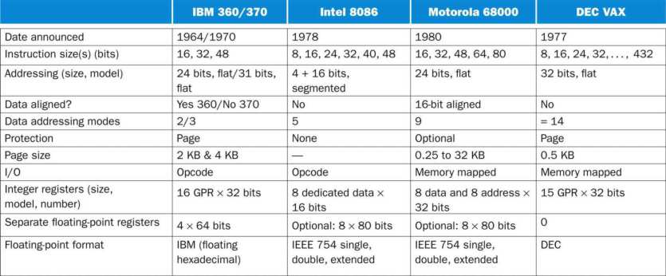

**HÌNH D.17.1 Tóm tắt bốn kiến trúc những năm 1970. Khác các kiến trúc trong Hình D.1.1, các kiến trúc này ít thống nhất với nhau ở bất kỳ nhóm nào.**

Tuy nhiên, kiểu kiến trúc này không thể giữ nguyên. Giống con người, instruction set thường lớn lên khi già đi. Hình D.17.2 trình bày phả hệ các instruction set này, còn Hình D.17.3 cho thấy những đặc điểm được thêm vào hoặc bỏ khỏi các thế hệ RISC desktop qua thời gian.

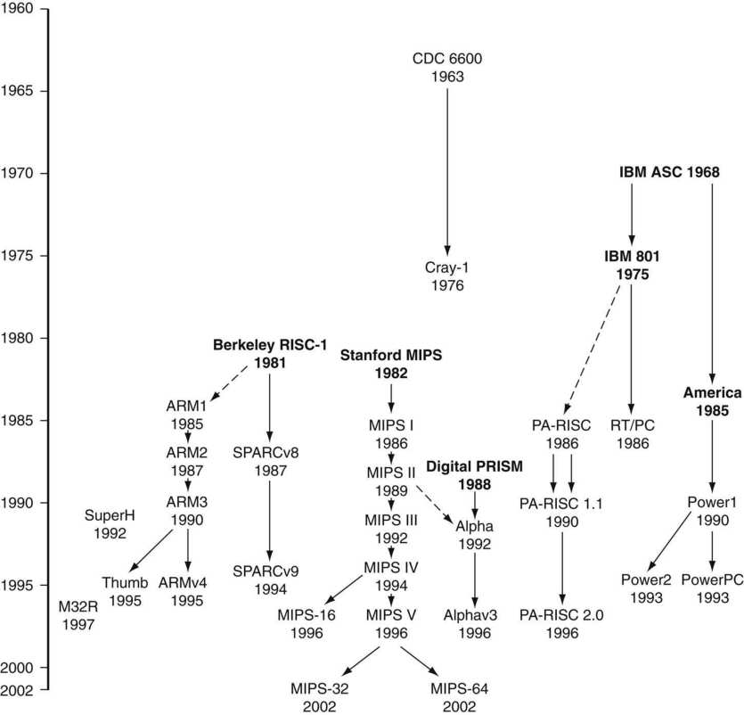

**HÌNH D.17.2 Dòng dõi các instruction set RISC. Máy thương mại được viết bằng chữ thường và máy nghiên cứu in đậm. CDC 6600 và Cray-1 là máy load-store với register 0 cố định bằng 0 và register integer, floating-point riêng. Instruction không được vượt ranh giới word. Một máy nghiên cứu IBM ban đầu dẫn tới các dự án nghiên cứu 801 và America, trong đó 801 dẫn tới RT/PC không thành công, còn America dẫn tới kiến trúc Power thành công. Một số người từng làm 801 sau đó gia nhập Hewlett-Packard để làm PA-RISC. Hai dự án đại học là cơ sở của các máy MIPS và SPARC. Theo Furber [1996], dự án Berkeley RISC truyền cảm hứng cho kiến trúc ARM. Trong khi ARM1, ARM2 và ARM3 là tên cả kiến trúc lẫn chip, ARM phiên bản 4 là tên kiến trúc dùng trong các chip ARM7, ARM8 và StrongARM. (Không có chip ARMv4 và ARM5, nhưng ARM6 và các chip ARM7 đầu dùng kiến trúc ARM3.) DEC chế tạo microprocessor RISC năm 1988 nhưng không giới thiệu. Thay vào đó, DEC xuất xưởng workstation dùng microprocessor MIPS trong 3 năm trước khi đưa ra instruction set RISC riêng Alpha 21064, rất giống MIPS III và PRISM. Kiến trúc Alpha có các phần mở rộng nhỏ nhưng không được chính thức hóa bằng số phiên bản; chúng tôi dùng phiên bản 3 vì đó là phiên bản reference manual. Chip Alpha 21164A thêm load và store byte, halfword, còn Alpha 21264 có các instruction multimedia MAX và đếm bit. Trong nội bộ, Digital đặt tên chip theo công nghệ chế tạo: EV4 (21064), EV45 (21064A), EV5 (21164), EV56 (21164A) và EV6 (21264). “EV” là viết tắt “extended VAX”.**

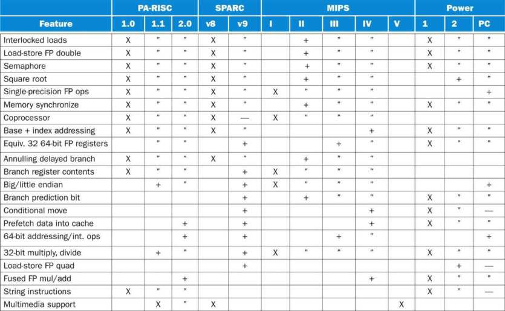

**HÌNH D.17.3 Những đặc điểm được thêm vào máy RISC desktop. X nghĩa là có trong máy ban đầu, +nghĩa là thêm sau, ” nghĩa là tiếp tục từ máy trước, và — nghĩa là bị bỏ khỏi kiến trúc. Alpha không nằm trong bảng nhưng đã thêm load và store byte, word, cùng phần mở rộng đếm bit và multimedia trong phiên bản 3. MIPS V thêm các instruction MDMX và phép paired single floating-point.**

Như có thể thấy, mọi máy RISC desktop đã phát triển thành kiến trúc address 64-bit và đã làm điều đó khá dễ dàng.

Chúng tôi cảm ơn những người sau đã bình luận các bản thảo phụ lục: Giáo sư Steven B. Furber, University of Manchester; Tiến sĩ Dileep Bhandarkar, Intel Corporation; Tiến sĩ Earl Killian, Silicon Graphics/MIPS; và Tiến sĩ Hiokazu Takata, Mitsubishi Electric Corporation.

## Đọc thêm

1. Bhandarkar DP. Alpha Architecture and Implementations Newton, MA: Digital Press; 1995.

2. Darcy, J.D., and D. Gay [1996]. “FLECKmarks: Measuring floating point performance using a full IEEE compliant arithmetic benchmark,” CS 252 class project, U.C. Berkeley (see www.sonic.net/~jddarcy/Research/fleckmrk.pdf).

3. Digital Semiconductor [1996]. Alpha Architecture Handbook, Version 3, Maynard, MA: Digital Press, Order number EC-QD2KB-TE (October).

4. Furber SB. ARM System Architecture Harlow, England: Addison-Wesley; 1996; (See http://www.pearsonhighered.com/pearsonhigheredus/educator/product/products_detail.page? isbn=9780201675191&forced_logout=forced_logged_out#sthash.QX4WfErc

5. Hewlett-Packard [1994]. PA-RISC 2.0 Architecture Reference Manual, 3rd ed.

6. Hitachi [1997]. SuperH RISC Engine SH7700 Series Programming Manual. (See http://am.renesas.com/products/mpumcu/superh/sh7700/Documentation.jsp

7. IBM. The PowerPC Architecture San Francisco: Morgan Kaufmann; 1994.

8. Kane G. PA-RISC 2.0 Architecture Upper Saddle River, NJ: Prentice Hall PTR; 1996.

9. Kane G, Heinrich J. MIPS RISC Architecture Englewood Cliffs, NJ: Prentice Hall; 1992.

10. Kissell, K.D. [1997]. MIPS16: High-Density for the Embedded Market.

11. Magenheimer DJ, Peters L, Pettis KW, Zuras D. Integer multiplication and division on the HP precision architecture. IEEE Trans on Computers. 1988;37(8):980–990.

12. MIPS [1997]. MIPS16 Application Specific Extension Product Description.

13. Mitsubishi [1996]. Mitsubishi 32-Bit Single Chip Microcomputer M32R Family Soft ware Manual (September).

14. Muchnick SS. Optimizing compilers for SPARC. Sun Technology. 1988;1(3):64–77 (Summer).

15. Seal D. Arm Architecture Reference Manual 2<sup>nd</sup> ed Morgan Kaufmann 2000.

16. Silicon Graphics [1996]. MIPS V Instruction Set.

17. Sites RL, Witek R, eds. Alpha Architecture Reference Manual. 2<sup>nd</sup> ed Newton, MA: Digital Press; 1995.

18. Sloss AN, Symes D, Wright C. ARM System Developer’s Guide San Francisco: Elsevier Morgan Kaufmann; 2004.

19. Sun Microsystems [1989]. The SPARC Architectural Manual, Version 8, Part No. 800-1399-09, August 25.

20. Sweetman D. See MIPS Run 2<sup>nd</sup> ed Morgan Kaufmann 2006.

21. Taylor, G., P. Hilfinger, J. Larus, D. Patterson, and B. Zorn [1986]. “Evaluation of the SPUR LISP architecture,” Proc. 13th Symposium on Computer Architecture (June), Tokyo.

22. Ungar, D., R. Blau, P. Foley, D. Samples, and D. Patterson [1984]. “Architecture of SOAR: Smalltalk on a RISC,” Proc. 11th Symposium on Computer Architecture (June), Ann Arbor, MI, 188–97.

23. Weaver DL, Germond T. The SPARC Architectural Manual, Version 9 Englewood Cliffs, NJ: Prentice Hall; 1994.

24. Weiss S, Smith JE. Power and PowerPC San Francisco: Morgan Kaufmann; 1994.
