### 1

# Trừu tượng hóa máy tính và công nghệ

## Tóm tắt

Chương này giải thích rằng tuy khó dự đoán chính xác mức chi phí/hiệu năng của máy tính trong tương lai, rất có khả năng chúng sẽ tốt hơn nhiều so với hiện nay. Để tham gia vào những tiến bộ đó, người thiết kế máy tính và lập trình viên phải hiểu nhiều vấn đề hơn, bao gồm những yếu tố như công suất, độ tin cậy, chi phí sở hữu và khả năng mở rộng. Tuy tập trung vào chi phí, hiệu năng và công suất, chương này nhấn mạnh rằng những thiết kế tốt nhất sẽ cân bằng thích hợp mọi yếu tố cho một thị trường cụ thể. Chương này cũng bàn về kỷ nguyên post-PC, khi personal mobile devices (PMDs) và máy tính bảng phần lớn thay thế desktop computer, còn Cloud computing và warehouse scale computers (WSCs) tiếp quản vai trò của server truyền thống.

### Từ khóa

power wall; uniprocessor; multiprocessor; Intel Core i7; desktop computer; server; supercomputer; datacenter; embedded computer; multicore microprocessor; systems software; operating system; compiler; instruction; assembler; assembly language; machine language; high-level programming language; input device; output device; liquid crystal display; active matrix display; motherboard; integrated circuit; chip; memory; dynamic random access memory; DRAM; dual inline memory module; DIMM; central processor unit; CPU; datapath; control; cache memory; static random access memory; SRAM; abstraction; instruction set architecture; architecture; application binary interface; ABI; implementation; volatile memory; nonvolatile memory; main memory; primary memory; secondary memory; magnetic disk; hard disk; flash memory; local area network; LAN; wide area network; WAN; vacuum tube; transistor; very large scale integrated circuit; VLSI; response time; execution time; throughput; bandwidth; CPU execution time; CPU time; user CPU time; system CPU time; clock cycle; clock period; clock cycles per instruction; CPI; instruction count; instruction mix; silicon; semiconductor; silicon crystal ingot; wafer; defect; die; yield; workload; benchmark; Amdahl’s Law; million instructions per second; MIPS; cloud computing; mobile computing; cloud; mobile; personal mobile device; PMD; warehouse scale computer; WSC; Software as a Service; SaaS

Nền văn minh tiến bộ bằng cách mở rộng số lượng những thao tác quan trọng mà chúng ta có thể thực hiện mà không cần suy nghĩ về chúng.

Alfred North Whitehead, An Introduction to Mathematics, 1911

NỘI DUNG

1.1 Giới thiệu 3 1.2 Tám ý tưởng lớn trong kiến trúc máy tính 11 1.3 Bên dưới chương trình của bạn 13 1.4 Bên trong máy tính 16 1.5 Công nghệ chế tạo processor và memory 24 1.6 Hiệu năng 28 1.7 Power Wall 40 1.8 Bước ngoặt: Chuyển từ uniprocessor sang multiprocessor 43 1.9 Thực tế: Benchmark Intel Core i7 46 1.10 Ngộ nhận và cạm bẫy 49 1.11 Nhận xét kết thúc 52  1.12 Góc nhìn lịch sử và tài liệu đọc thêm 54 1.13 Bài tập 54

## 1.1 Giới thiệu

Chào mừng bạn đến với cuốn sách này! Chúng tôi rất vui khi có cơ hội truyền tải sự thú vị của thế giới hệ thống máy tính. Đây không phải lĩnh vực khô khan, buồn tẻ, nơi tiến bộ chậm như băng trôi và những ý tưởng mới mai một vì bị bỏ quên. Không! Máy tính là sản phẩm của ngành công nghệ thông tin vô cùng sôi động; mọi mặt của ngành này đóng góp gần 10% tổng sản phẩm quốc dân của Hoa Kỳ, và nền kinh tế nước này đã phần nào phụ thuộc vào những cải tiến nhanh chóng trong công nghệ thông tin mà Moore’s Law hứa hẹn. Ngành công nghiệp đặc biệt này đón nhận đổi mới với tốc độ breath-taking. Trong 30 năm qua, sự ra đời của một số máy tính mới dường như đã cách mạng hóa ngành điện toán; những cuộc cách mạng này chỉ bị ngắt quãng vì ai đó lại chế tạo được một máy tính tốt hơn nữa.

Cuộc đua đổi mới này dẫn đến những tiến bộ chưa từng có kể từ khi điện toán điện tử ra đời vào cuối thập niên 1940. Chẳng hạn, nếu ngành giao thông vận tải theo kịp ngành máy tính, ngày nay chúng ta có thể đi từ New York đến London trong một giây với giá một xu. Hãy dành một chút thời gian suy ngẫm xem cải tiến như vậy sẽ thay đổi xã hội ra sao—sống ở Tahiti trong khi làm việc tại San Francisco, đến Moscow vào buổi tối để xem Bolshoi Ballet—và bạn sẽ hiểu ý nghĩa của một thay đổi như thế.

Máy tính đã mang lại cuộc cách mạng thứ ba cho nền văn minh, với cuộc cách mạng thông tin đứng bên cạnh các cuộc cách mạng nông nghiệp và công nghiệp. Sự nhân lên về sức mạnh và phạm vi trí tuệ của nhân loại tất nhiên đã tác động sâu sắc đến đời sống hằng ngày và thay đổi cách tìm kiếm tri thức mới. Hiện nay có một hướng nghiên cứu khoa học mới, trong đó các nhà khoa học tính toán cùng với các nhà khoa học lý thuyết và thực nghiệm khám phá những chân trời mới trong thiên văn học, sinh học, hóa học, vật lý và các lĩnh vực khác.

Cuộc cách mạng máy tính vẫn tiếp diễn. Mỗi lần chi phí tính toán được cải thiện thêm 10 lần, cơ hội ứng dụng máy tính lại tăng lên. Những ứng dụng trước đó không khả thi về kinh tế đột nhiên trở nên thực tế. Trong quá khứ gần đây, các ứng dụng sau vẫn là “khoa học viễn tưởng về máy tính”.

- Máy tính trong ô tô: Cho đến khi microprocessor cải thiện mạnh mẽ về giá và hiệu năng vào đầu thập niên 1980, việc dùng máy tính điều khiển ô tô vẫn là điều phi lý. Ngày nay, máy tính giảm ô nhiễm, cải thiện hiệu quả sử dụng nhiên liệu thông qua điều khiển động cơ và tăng độ an toàn nhờ cảnh báo điểm mù, cảnh báo lệch làn, phát hiện vật thể chuyển động và kích hoạt túi khí để bảo vệ người ngồi trên xe khi va chạm.

- Điện thoại di động: Ai từng mơ rằng những tiến bộ của hệ thống máy tính sẽ khiến hơn một nửa dân số hành tinh sở hữu điện thoại di động, cho phép liên lạc person-to-person với gần như bất kỳ ai ở bất cứ đâu trên thế giới?

- Dự án bộ gene người: Chi phí thiết bị máy tính để lập bản đồ và phân tích các chuỗi DNA của con người lên tới hàng trăm triệu đô la. Khó có ai cân nhắc dự án này nếu chi phí máy tính cao hơn 10 đến 100 lần, như vào 15 đến 25 năm trước đó. Hơn nữa, chi phí vẫn tiếp tục giảm; bạn sẽ sớm có thể có được bộ gene của chính mình, cho phép dịch vụ chăm sóc y tế được điều chỉnh riêng cho bạn.

- World Wide Web: Chưa tồn tại khi ấn bản đầu tiên của cuốn sách ra đời, web đã biến đổi xã hội của chúng ta. Với nhiều người, web đã thay thế thư viện và báo chí.

- Công cụ tìm kiếm: Khi nội dung web tăng về quy mô và giá trị, việc tìm thông tin liên quan ngày càng quan trọng. Ngày nay, nhiều người phụ thuộc vào công cụ tìm kiếm trong một phần lớn cuộc sống đến mức sẽ rất khó khăn nếu thiếu chúng. Rõ ràng, những tiến bộ của công nghệ này hiện ảnh hưởng đến gần như mọi mặt của xã hội. Những tiến bộ về hardware cho phép lập trình viên tạo ra software hữu ích tuyệt vời, giải thích vì sao máy tính có mặt khắp nơi. Khoa học viễn tưởng hôm nay gợi ra những ứng dụng đột phá của ngày mai: kính tăng cường thực tế, xã hội không dùng tiền mặt và ô tô tự lái đã bắt đầu xuất hiện.

### Các nhóm ứng dụng điện toán truyền thống và đặc điểm của chúng

Mặc dù cùng một tập hợp công nghệ hardware (xem Mục 1.4 và 1.5) được dùng trong các máy tính từ thiết bị gia dụng thông minh, điện thoại di động đến những supercomputer lớn nhất, các ứng dụng khác nhau này có yêu cầu thiết kế riêng và sử dụng công nghệ hardware cốt lõi theo những cách khác nhau. Nói khái quát, máy tính được sử dụng trong ba nhóm ứng dụng khác biệt.

Personal computers (PCs) có lẽ là dạng điện toán best-known mà độc giả cuốn sách này có thể đã sử dụng nhiều. Personal computer chú trọng cung cấp hiệu năng tốt cho từng người dùng với chi phí thấp và thường thực thi third-party software. Nhóm điện toán này thúc đẩy sự phát triển của nhiều công nghệ điện toán, dù mới chỉ có 35 năm tuổi!

#### personal computer (PC)

Máy tính được thiết kế cho một cá nhân sử dụng, thường bao gồm màn hình đồ họa, bàn phím và chuột.

Server là hình thức hiện đại của những máy tính trước đây lớn hơn nhiều và thường chỉ được truy cập qua mạng. Server hướng đến xử lý workload lớn, có thể gồm các ứng dụng phức tạp đơn lẻ—thường là ứng dụng khoa học hoặc kỹ thuật—hoặc xử lý nhiều công việc nhỏ, như khi xây dựng một web server lớn. Những ứng dụng này thường dựa trên software từ nguồn khác (chẳng hạn hệ thống cơ sở dữ liệu hoặc mô phỏng), nhưng hay được sửa đổi hoặc tùy chỉnh cho một chức năng cụ thể. Server được chế tạo từ cùng công nghệ cơ bản như desktop computer, nhưng có năng lực tính toán, lưu trữ và input/output lớn hơn. Nhìn chung, server cũng chú trọng hơn đến độ tin cậy, vì sự cố thường gây thiệt hại lớn hơn so với trên một single-user PC.

#### server

Máy tính dùng để chạy các chương trình lớn hơn cho nhiều người dùng, thường đồng thời, và thường chỉ được truy cập qua mạng.

Server có khoảng biến thiên rộng nhất về chi phí và năng lực. Ở mức thấp, một server có thể chỉ hơn một desktop computer không màn hình hay bàn phím chút ít và có giá một nghìn đô la. Những server low-end này thường được dùng để lưu trữ file, chạy ứng dụng doanh nghiệp nhỏ hoặc phục vụ web đơn giản. Ở cực kia là supercomputer, hiện gồm hàng chục nghìn processor và nhiều terabyte memory, với giá từ hàng chục đến hàng trăm triệu đô la. Supercomputer thường được dùng cho các phép tính khoa học và kỹ thuật high-end, như dự báo thời tiết, thăm dò dầu mỏ, xác định cấu trúc protein và những bài toán large-scale khác. Tuy các supercomputer này đại diện cho đỉnh cao năng lực tính toán, chúng chỉ chiếm tỷ lệ tương đối nhỏ trong số server, và vì thế chỉ chiếm phần rất nhỏ tương ứng trong toàn bộ thị trường máy tính xét theo tổng doanh thu.

#### supercomputer

Nhóm máy tính có hiệu năng và chi phí cao nhất; chúng được cấu hình như server và thường có giá từ hàng chục đến hàng trăm triệu đô la.

#### terabyte (TB)

Ban đầu là 1,099,511,627,776 (2<sup>40</sup>) byte, mặc dù các nhà phát triển hệ thống truyền thông và secondary storage bắt đầu dùng thuật ngữ này với nghĩa 1,000,000,000,000 (10<sup>12</sup>) byte. Để giảm nhầm lẫn, hiện chúng ta dùng thuật ngữ tebibyte (TiB) cho 2<sup>40</sup> byte, và định nghĩa terabyte (TB) là 10<sup>12</sup> byte. Hình 1.1 cho thấy đầy đủ các giá trị và tên gọi thập phân và nhị phân.

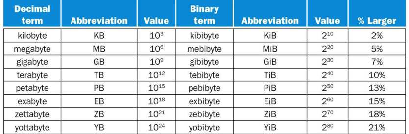

**HÌNH 1.1 Sự mơ hồ giữa 2<sup>X</sup> và 10<sup>Y</sup> byte được giải quyết bằng cách bổ sung ký hiệu nhị phân cho mọi thuật ngữ kích thước thông dụng. Ở cột cuối, chúng tôi ghi mức lớn hơn của thuật ngữ nhị phân so với thuật ngữ thập phân tương ứng, và chênh lệch này tích lũy khi đi xuống bảng. Những tiền tố này dùng được cho bit lẫn byte, vì vậy gigabit (Gb) là 10<sup>9</sup> bit còn gibibit (Gib) là 2<sup>30</sup> bit. Embedded computer là nhóm máy tính lớn nhất và bao phủ phạm vi ứng dụng, hiệu năng rộng nhất. Embedded computer bao gồm microprocessor trong ô tô của bạn, máy tính trong TV và các mạng processor điều khiển máy bay hay tàu chở hàng hiện đại. Hệ thống embedded computing được thiết kế để chạy một ứng dụng hoặc một tập hợp ứng dụng liên quan, thường được tích hợp với hardware và cung cấp như một hệ thống duy nhất; do đó, dù số lượng embedded computer rất lớn, phần lớn người dùng không thực sự nhận ra mình đang sử dụng máy tính!**

#### embedded computer

Máy tính bên trong thiết bị khác, dùng để chạy một ứng dụng hoặc một tập hợp software được xác định trước.

Ứng dụng embedded thường có các yêu cầu riêng, kết hợp hiệu năng tối thiểu với giới hạn nghiêm ngặt về chi phí hoặc công suất. Ví dụ, hãy xét một máy nghe nhạc: processor chỉ cần đủ nhanh để xử lý chức năng hạn chế của nó, và ngoài điều đó, mục tiêu quan trọng nhất là giảm thiểu chi phí và công suất. Mặc dù có chi phí thấp, embedded computer thường ít chấp nhận sự cố hơn, vì hậu quả có thể từ gây khó chịu (khi chiếc TV mới của bạn bị treo) đến thảm khốc (như khi máy tính trên máy bay hoặc tàu chở hàng bị treo). Trong những ứng dụng embedded consumer-oriented, như thiết bị gia dụng số, độ tin cậy đạt được chủ yếu nhờ tính đơn giản—tập trung thực hiện một chức năng hoàn hảo nhất có thể. Trong hệ thống embedded lớn, người ta thường áp dụng các kỹ thuật redundancy từ thế giới server. Mặc dù cuốn sách tập trung vào máy tính general-purpose, phần lớn khái niệm áp dụng trực tiếp, hoặc chỉ cần sửa đổi đôi chút, cho embedded computer.

#### Giải thích thêm

Các phần giải thích thêm là những mục ngắn trong toàn bộ văn bản nhằm cung cấp chi tiết về một chủ đề cụ thể có thể được quan tâm. Độc giả không quan tâm có thể bỏ qua, vì nội dung tiếp theo sẽ không bao giờ phụ thuộc vào phần giải thích thêm đó.

Nhiều embedded processor được thiết kế bằng processor core, tức một phiên bản của processor được viết bằng hardware description language, chẳng hạn Verilog hoặc VHDL (xem Chương 4). Core cho phép người thiết kế tích hợp hardware application-specific khác cùng processor core để chế tạo trên một chip duy nhất.

### Chào mừng đến kỷ nguyên Post-PC

Đà tiến liên tục của công nghệ tạo ra các thay đổi thế hệ trong hardware máy tính, làm rung chuyển toàn bộ ngành công nghệ thông tin. Kể từ ấn bản trước, chúng ta đã trải qua một thay đổi như vậy, có tầm quan trọng tương đương cuộc chuyển sang personal computer bắt đầu cách đây 30 năm. Thay thế PC là personal mobile device (PMD). PMD dùng pin, có kết nối không dây đến Internet và thường có giá hàng trăm đô la; giống PC, người dùng có thể tải software (“app”) để chạy trên đó. Khác PC, chúng không còn bàn phím và chuột, và thường dựa vào màn hình touch-sensitive hoặc thậm chí đầu vào giọng nói. PMD ngày nay là điện thoại thông minh hoặc máy tính bảng, nhưng ngày mai có thể bao gồm kính điện tử. Hình 1.2 cho thấy sự tăng trưởng nhanh theo thời gian của máy tính bảng và điện thoại thông minh so với PC và điện thoại di động truyền thống.

#### Personal mobile devices (PMDs)

là các thiết bị không dây nhỏ để kết nối Internet; chúng dựa vào pin để cấp nguồn, và software được cài bằng cách tải app. Những ví dụ thông thường là điện thoại thông minh và máy tính bảng.

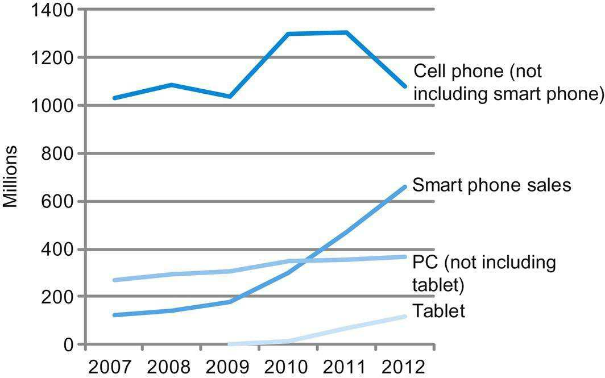

**HÌNH 1.2 Số lượng máy tính bảng và điện thoại thông minh được sản xuất mỗi năm, phản ánh kỷ nguyên post-PC, so với personal computer và điện thoại di động truyền thống. Điện thoại thông minh thể hiện sự tăng trưởng gần đây trong ngành điện thoại di động, và đã vượt PC vào năm 2011. Máy tính bảng là nhóm tăng trưởng nhanh nhất, gần gấp đôi từ năm 2011 đến 2012. Các nhóm PC và điện thoại di động truyền thống gần đây tương đối ổn định hoặc suy giảm. Tiếp quản vai trò của server thông thường là Cloud Computing, dựa vào những datacenter khổng lồ hiện được gọi là Warehouse Scale Computers (WSCs). Các công ty như Amazon và Google xây dựng những WSC này với 100,000 server, rồi cho các công ty thuê từng phần để cung cấp dịch vụ software đến PMD mà không phải xây dựng WSC riêng. Thực vậy, Software as a Service (SaaS) triển khai qua Cloud đang cách mạng hóa ngành software giống như PMD và WSC đang cách mạng hóa ngành hardware. Các nhà phát triển software hiện nay thường có một phần ứng dụng chạy trên PMD và một phần chạy trong Cloud.**

#### Cloud Computing

chỉ những tập hợp server lớn cung cấp dịch vụ qua Internet; một số nhà cung cấp cho thuê số lượng server thay đổi linh hoạt như một dịch vụ tiện ích.

#### Software as a Service (SaaS)

cung cấp software và dữ liệu như một dịch vụ qua Internet, thường qua một chương trình gọn nhẹ như trình duyệt chạy trên thiết bị client cục bộ, thay cho binary code phải được cài đặt và chạy hoàn toàn trên thiết bị đó. Ví dụ gồm tìm kiếm web và mạng xã hội.

### Những điều bạn có thể học trong cuốn sách này

Các lập trình viên thành công luôn quan tâm đến hiệu năng chương trình, vì trả kết quả nhanh cho người dùng rất quan trọng để tạo ra software được ưa chuộng. Trong thập niên 1960 và 1970, một giới hạn chính của hiệu năng máy tính là kích thước memory. Vì vậy, lập trình viên thường tuân theo một nguyên tắc đơn giản: giảm thiểu không gian memory để chương trình chạy nhanh. Trong thập niên vừa qua, những tiến bộ trong thiết kế máy tính và công nghệ memory đã giảm mạnh tầm quan trọng của kích thước memory nhỏ đối với phần lớn ứng dụng, ngoại trừ các ứng dụng trong hệ thống embedded computing.

Lập trình viên quan tâm đến hiệu năng giờ cần hiểu những vấn đề thay thế mô hình memory đơn giản của thập niên 1960: tính song song của processor và tính phân cấp của memory. Chúng tôi minh họa tầm quan trọng của hiểu biết này trong các Chương 3 đến 6 bằng cách chỉ ra cách cải thiện hiệu năng một chương trình C lên 200 lần. Hơn nữa, như giải thích trong Mục 1.7, lập trình viên ngày nay cần quan tâm đến hiệu quả năng lượng của chương trình chạy trên PMD hay trong Cloud, điều cũng đòi hỏi hiểu những gì nằm bên dưới code. Vì thế, lập trình viên muốn xây dựng phiên bản software có sức cạnh tranh sẽ cần nâng cao kiến thức về tổ chức máy tính.

Chúng tôi vinh dự có cơ hội giải thích bên trong cỗ máy mang tính cách mạng này, làm rõ software bên dưới chương trình và hardware bên trong máy tính của bạn. Khi đọc xong cuốn sách, chúng tôi tin rằng bạn sẽ trả lời được những câu hỏi sau:

- Chương trình viết bằng ngôn ngữ high-level, như C hay Java, được dịch thành ngôn ngữ hardware như thế nào, và hardware thực thi chương trình kết quả ra sao? Hiểu những khái niệm này là nền tảng để hiểu các khía cạnh của cả hardware và software ảnh hưởng đến hiệu năng chương trình.

- Interface giữa software và hardware là gì, và software chỉ thị hardware thực hiện các chức năng cần thiết bằng cách nào? Những khái niệm này rất quan trọng để hiểu cách viết nhiều loại software.

- Điều gì quyết định hiệu năng chương trình, và lập trình viên có thể cải thiện hiệu năng như thế nào? Như chúng ta sẽ thấy, điều này phụ thuộc vào chương trình ban đầu, việc software dịch chương trình sang ngôn ngữ máy tính và hiệu quả của hardware khi thực thi chương trình.

- Người thiết kế hardware có thể dùng kỹ thuật nào để cải thiện hiệu năng? Cuốn sách giới thiệu các khái niệm cơ bản của thiết kế máy tính hiện đại. Độc giả quan tâm sẽ tìm thấy nhiều tài liệu hơn về chủ đề này trong cuốn sách nâng cao của chúng tôi, Computer Architecture: A Quantitative Approach.

- Người thiết kế hardware có thể dùng kỹ thuật nào để cải thiện hiệu quả năng lượng? Lập trình viên có thể làm gì để hỗ trợ hoặc cản trở hiệu quả năng lượng?

- Nguyên nhân và hệ quả của bước chuyển gần đây từ xử lý tuần tự sang xử lý song song là gì? Cuốn sách trình bày động lực, mô tả các cơ chế hardware hiện có để hỗ trợ tính song song và khảo sát thế hệ microprocessor “multicore” mới (xem Chương 6).

#### multicore microprocessor

Microprocessor chứa nhiều processor (“core”) trong một integrated circuit duy nhất.

- Từ máy tính thương mại đầu tiên vào năm 1951, các kiến trúc sư máy tính đã nghĩ ra những ý tưởng lớn nào đặt nền móng cho điện toán hiện đại?

Nếu không hiểu câu trả lời cho những câu hỏi này, việc cải thiện hiệu năng chương trình trên máy tính hiện đại hoặc đánh giá tính năng nào giúp một máy tính tốt hơn máy khác cho một ứng dụng cụ thể sẽ là quá trình thử và sai phức tạp, thay vì một quy trình khoa học dựa trên hiểu biết và phân tích. Chương đầu tiên này đặt nền móng cho phần còn lại của sách. Nó giới thiệu các ý tưởng và định nghĩa cơ bản, đặt những thành phần chính của software và hardware vào bối cảnh, chỉ ra cách đánh giá hiệu năng và năng lượng, giới thiệu integrated circuit (công nghệ thúc đẩy cuộc cách mạng máy tính) và giải thích bước chuyển sang multicore.

Trong chương này và các chương sau, bạn có thể gặp nhiều từ mới, hoặc những từ đã từng nghe nhưng chưa chắc về nghĩa. Đừng hoảng! Đúng là có nhiều thuật ngữ chuyên biệt dùng để mô tả máy tính hiện đại, nhưng chúng thực sự hữu ích vì cho phép mô tả chính xác một chức năng hay khả năng. Ngoài ra, người thiết kế máy tính (kể cả các tác giả) thích dùng acronym, vốn dễ hiểu khi biết các chữ cái đại diện cho điều gì! Để giúp bạn nhớ và tìm thuật ngữ, chúng tôi đưa định nghĩa được làm nổi bật của mỗi thuật ngữ vào lề ngay lần đầu xuất hiện trong văn bản. Sau một thời gian ngắn làm quen, bạn sẽ dùng thuật ngữ thành thạo và khiến bạn bè ấn tượng khi sử dụng đúng các acronym như BIOS, CPU, DIMM, DRAM, PCIe, SATA và nhiều từ khác.

#### acronym

Từ được tạo ra bằng cách lấy các chữ cái đầu của một chuỗi từ. Ví dụ: RAM là acronym của Random Access Memory, và CPU là acronym của Central Processing Unit.

Để nhấn mạnh tác động của các hệ thống software và hardware dùng để chạy chương trình đến hiệu năng, chúng tôi dùng mục đặc biệt, Tìm hiểu hiệu năng chương trình, xuyên suốt cuốn sách để tóm lược những nhận thức quan trọng về hiệu năng chương trình. Mục đầu tiên xuất hiện bên dưới.

#### Tìm hiểu hiệu năng chương trình

Hiệu năng chương trình phụ thuộc vào sự kết hợp giữa hiệu quả của các thuật toán dùng trong chương trình, các hệ thống software dùng để tạo và dịch chương trình thành machine instruction, và hiệu quả của máy tính khi thực thi những instruction đó, có thể bao gồm các thao tác input/output (I/O). Bảng này tóm lược cách hardware và software ảnh hưởng đến hiệu năng.

| Thành phần hardware hoặc software | Thành phần này ảnh hưởng đến hiệu năng như thế nào | Chủ đề này được trình bày ở đâu? |
|---|---|---|
| Algorithm | Quyết định cả số câu lệnh source-level lẫn số thao tác I/O được thực thi | Các sách khác! |
| Programming language, compiler và architecture | Quyết định số instruction máy tính cho mỗi câu lệnh source-level | Chương 2 và 3 |
| Processor và memory system | Quyết định tốc độ có thể thực thi instruction | Chương 4, 5 và 6 |
| I/O system (hardware và operating system) | Quyết định tốc độ có thể thực hiện thao tác I/O | Chương 4, 5 và 6 |

Để minh họa tác động của những ý tưởng trong sách, như đã nói ở trên, chúng tôi cải thiện hiệu năng một chương trình C nhân ma trận với vector qua một chuỗi chương. Mỗi bước dựa vào hiểu biết về cách hardware bên dưới thực sự hoạt động trong microprocessor hiện đại để cải thiện hiệu năng lên 200 lần!

- Với data-level parallelism, trong Chương 3 chúng tôi dùng subword parallelism thông qua C intrinsics để tăng hiệu năng lên 3.8 lần.

- Với instruction-level parallelism, trong Chương 4 chúng tôi dùng loop unrolling để tận dụng hardware multiple instruction issue và out-of-order execution, tăng hiệu năng thêm 2.3 lần.

- Với tối ưu memory hierarchy, trong Chương 5 chúng tôi dùng cache blocking để tăng hiệu năng trên ma trận lớn thêm 2.0 đến 2.5 lần.

- Với thread-level parallelism, trong Chương 6 chúng tôi dùng vòng lặp parallel for của OpenMP để tận dụng hardware multicore, tăng hiệu năng thêm 4 đến 14 lần.

#### Tự kiểm tra

Các mục Tự kiểm tra giúp độc giả đánh giá liệu mình đã hiểu những khái niệm chính được giới thiệu trong chương và ý nghĩa của chúng hay chưa. Một số câu hỏi có đáp án đơn giản; những câu khác dành cho thảo luận nhóm. Đáp án cho các câu hỏi cụ thể có ở cuối chương. Các câu hỏi Tự kiểm tra chỉ xuất hiện ở cuối mục, giúp bạn dễ bỏ qua nếu chắc chắn đã hiểu nội dung.

1. Số embedded processor được bán mỗi năm vượt xa số processor PC, và thậm chí post-PC. Bạn có thể xác nhận hay bác bỏ nhận định này từ trải nghiệm của mình không? Hãy thử đếm số embedded processor trong nhà. Con số đó so với số máy tính thông thường trong nhà bạn thế nào?

2. Như đã đề cập, cả software và hardware đều ảnh hưởng đến hiệu năng chương trình. Bạn có nghĩ ra ví dụ mà từng yếu tố sau là nơi thích hợp để tìm bottleneck hiệu năng không?

- Thuật toán được chọn

- Ngôn ngữ lập trình hoặc compiler

- Operating system

- Processor

- I/O system và các thiết bị

## 1.2 Tám ý tưởng lớn trong kiến trúc máy tính

Bây giờ chúng tôi giới thiệu tám ý tưởng lớn mà các kiến trúc sư máy tính đã phát minh trong 60 năm thiết kế máy tính vừa qua. Những ý tưởng này mạnh mẽ đến mức tồn tại rất lâu sau chiếc máy tính đầu tiên sử dụng chúng; các kiến trúc sư thế hệ sau thể hiện sự ngưỡng mộ bằng cách noi theo người đi trước. Những ý tưởng lớn này là chủ đề xuyên suốt chương này và các chương tiếp theo khi có ví dụ phù hợp. Để chỉ ra ảnh hưởng của chúng, trong mục này chúng tôi giới thiệu các biểu tượng và thuật ngữ được làm nổi bật đại diện cho những ý tưởng lớn, rồi dùng chúng để đánh dấu gần 100 mục trong sách có áp dụng các ý tưởng đó.

### Thiết kế theo Moore’s Law

Điều duy nhất không đổi đối với người thiết kế máy tính là sự thay đổi nhanh chóng, chủ yếu do Moore’s Law thúc đẩy. Định luật phát biểu rằng tài nguyên integrated circuit tăng gấp đôi sau mỗi 18–24 tháng. Moore’s Law xuất phát từ dự đoán năm 1965 của Gordon Moore, một trong những người sáng lập Intel, về tốc độ tăng dung lượng IC như vậy. Vì thiết kế máy tính có thể kéo dài nhiều năm, tài nguyên trên mỗi chip có thể dễ dàng tăng gấp đôi hoặc gấp bốn từ khi bắt đầu đến khi hoàn thành dự án. Giống người bắn đĩa bay, kiến trúc sư máy tính phải dự liệu công nghệ sẽ ở đâu khi thiết kế hoàn thành, thay vì thiết kế theo thời điểm bắt đầu. Chúng tôi dùng đồ thị Moore’s Law “đi lên và sang phải” để biểu thị việc thiết kế cho sự thay đổi nhanh chóng.


### Dùng abstraction để đơn giản hóa thiết kế

Cả kiến trúc sư máy tính và lập trình viên đều phải phát minh kỹ thuật để làm việc năng suất hơn, nếu không thời gian thiết kế sẽ kéo dài mạnh mẽ như tài nguyên tăng theo Moore’s Law. Một kỹ thuật quan trọng nâng năng suất hardware và software là dùng abstraction để mô tả thiết kế ở các mức biểu diễn khác nhau; chi tiết lower-level được che đi để cung cấp mô hình đơn giản hơn ở mức cao. Chúng tôi dùng biểu tượng bức tranh trừu tượng để đại diện cho ý tưởng lớn thứ hai này.


### Làm nhanh trường hợp phổ biến

Làm nhanh trường hợp phổ biến thường cải thiện hiệu năng tốt hơn tối ưu trường hợp hiếm. Thật trớ trêu, trường hợp phổ biến thường đơn giản hơn trường hợp hiếm nên cũng dễ cải thiện hơn. Lời khuyên hợp lý này đòi hỏi bạn biết trường hợp phổ biến là gì, điều chỉ có thể xác định bằng thử nghiệm và đo lường cẩn thận (xem Mục 1.6). Chúng tôi dùng xe thể thao làm biểu tượng, vì chuyến đi phổ biến nhất chỉ có một hoặc hai hành khách, và chắc chắn chế tạo xe thể thao nhanh dễ hơn chế tạo xe minivan nhanh!


### Hiệu năng thông qua parallelism

Ngay từ buổi đầu điện toán, kiến trúc sư máy tính đã đưa ra các thiết kế đạt hiệu năng cao hơn bằng cách thực hiện các phép tính song song. Chúng ta sẽ gặp nhiều ví dụ về parallelism trong sách. Chúng tôi dùng nhiều động cơ phản lực của máy bay làm biểu tượng cho hiệu năng song song.


### Hiệu năng thông qua pipelining

Một dạng parallelism đặc biệt phổ biến trong kiến trúc máy tính đến mức xứng đáng có tên riêng: pipelining. Chẳng hạn, trước khi có xe cứu hỏa, một “đội chuyền xô” sẽ ứng phó với hỏa hoạn, như nhiều phim cao bồi thể hiện sau một hành động độc ác của kẻ phản diện. Dân thị trấn xếp thành hàng để đưa nước từ nguồn đến đám cháy, vì chuyền xô dọc hàng người nhanh hơn nhiều so với từng người chạy đi chạy lại. Biểu tượng pipeline của chúng tôi là một chuỗi ống, mỗi đoạn biểu thị một stage của pipeline.


### Hiệu năng thông qua prediction

Theo câu nói rằng xin tha thứ có thể tốt hơn xin phép, ý tưởng lớn tiếp theo là prediction. Trong một số trường hợp, trung bình việc phỏng đoán rồi bắt đầu làm có thể nhanh hơn đợi đến khi biết chắc, giả sử cơ chế phục hồi sau dự đoán sai không quá tốn kém và dự đoán của bạn tương đối chính xác. Chúng tôi dùng quả cầu pha lê của fortune-teller làm biểu tượng prediction.


### Memory hierarchy

Lập trình viên muốn memory nhanh, lớn và rẻ, vì tốc độ memory thường định hình hiệu năng, dung lượng giới hạn kích thước bài toán có thể giải, và chi phí memory hiện nay thường chiếm phần lớn chi phí máy tính. Các kiến trúc sư nhận thấy có thể giải quyết những yêu cầu mâu thuẫn này bằng memory hierarchy, với memory nhanh nhất, nhỏ nhất và đắt nhất trên mỗi bit ở đỉnh, còn memory chậm nhất, lớn nhất và rẻ nhất trên mỗi bit ở đáy. Như sẽ thấy trong Chương 5, cache tạo cho lập trình viên ảo giác rằng main memory nhanh gần bằng đỉnh hierarchy, đồng thời lớn và rẻ gần bằng đáy hierarchy. Chúng tôi dùng biểu tượng tam giác phân tầng để biểu thị memory hierarchy. Hình dạng thể hiện tốc độ, chi phí và kích thước: càng gần đỉnh, memory càng nhanh và đắt trên mỗi bit; đáy của tầng càng rộng thì memory càng lớn.


### Độ tin cậy thông qua redundancy

Máy tính không chỉ cần nhanh mà còn phải đáng tin cậy. Vì mọi thiết bị vật lý đều có thể hỏng, chúng ta tạo ra hệ thống đáng tin cậy bằng cách bổ sung các thành phần dự phòng có thể tiếp quản khi xảy ra hỏng hóc và giúp phát hiện hỏng hóc. Chúng tôi dùng tractor-trailer làm biểu tượng, vì các bánh đôi ở mỗi bên trục sau cho phép xe tiếp tục chạy ngay cả khi một lốp hỏng. (Có lẽ tài xế sẽ lập tức đến cơ sở sửa chữa để sửa lốp xẹp, nhờ đó khôi phục redundancy!)


## 1.3 Bên dưới chương trình của bạn

Một ứng dụng điển hình, như trình xử lý văn bản hoặc hệ thống cơ sở dữ liệu lớn, có thể gồm hàng triệu dòng code và dựa vào các thư viện software phức tạp triển khai những chức năng phức tạp hỗ trợ ứng dụng. Như sẽ thấy, hardware trong máy tính chỉ có thể thực thi những instruction low-level cực kỳ đơn giản. Để đi từ ứng dụng phức tạp đến những instruction cơ bản phải qua nhiều lớp software diễn giải hoặc dịch các thao tác high-level thành instruction máy tính đơn giản, một ví dụ về ý tưởng lớn abstraction.


Ở Paris, họ chỉ trừng mắt nhìn khi tôi nói tiếng Pháp với họ; tôi chưa bao giờ thành công trong việc khiến những kẻ ngốc đó hiểu chính ngôn ngữ của họ.

Mark Twain, The Innocents Abroad, 1869

Hình 1.3 cho thấy những lớp software này chủ yếu được tổ chức theo hierarchy, với ứng dụng là vòng ngoài cùng và nhiều loại systems software nằm giữa hardware và application software.

### systems software

Software cung cấp những dịch vụ hữu ích phổ biến, bao gồm operating system, compiler, loader và assembler.

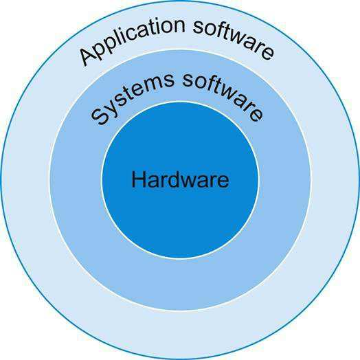

**HÌNH 1.3 Cách nhìn đơn giản hóa về hardware và software như các lớp phân cấp, thể hiện bằng những vòng tròn đồng tâm với hardware ở giữa và application software ngoài cùng. Trong ứng dụng phức tạp, thường còn có nhiều lớp application software. Ví dụ, một hệ thống cơ sở dữ liệu có thể chạy trên systems software lưu trữ một ứng dụng, và ứng dụng đó lại chạy trên cơ sở dữ liệu.**

Có nhiều loại systems software, nhưng hai loại giữ vai trò trung tâm trong mọi hệ thống máy tính hiện nay là operating system và compiler. Operating system làm interface giữa chương trình người dùng với hardware, đồng thời cung cấp nhiều dịch vụ và chức năng giám sát. Những chức năng quan trọng nhất bao gồm:

- Xử lý các thao tác input và output cơ bản

- Cấp phát storage và memory

- Cho phép nhiều ứng dụng đồng thời dùng máy tính chia sẻ máy tính một cách có bảo vệ

### operating system

Chương trình giám sát quản lý tài nguyên máy tính để phục vụ các chương trình chạy trên máy tính đó.

Ví dụ về operating system đang được sử dụng hiện nay là Linux, iOS và Windows.

Compiler thực hiện một chức năng thiết yếu khác: dịch chương trình viết bằng ngôn ngữ high-level, như C, C++, Java hoặc Visual Basic, thành instruction mà hardware có thể thực thi. Do sự phong phú của ngôn ngữ lập trình hiện đại và sự đơn giản của instruction mà hardware thực thi, việc dịch từ chương trình ngôn ngữ high-level sang hardware instruction rất phức tạp. Chúng tôi trình bày khái quát quá trình ở đây, rồi đi sâu hơn trong Chương 2.

### compiler

Chương trình dịch các câu lệnh ngôn ngữ high-level thành câu lệnh assembly language.

### Từ ngôn ngữ High-Level đến ngôn ngữ hardware

Để giao tiếp trực tiếp với hardware điện tử, bạn cần gửi tín hiệu điện. Những tín hiệu dễ hiểu nhất đối với máy tính là bật và tắt, nên bảng chữ cái máy tính chỉ có hai chữ. Giống như 26 chữ cái tiếng Anh không giới hạn lượng nội dung có thể viết, hai chữ cái của máy tính không giới hạn những gì máy tính có thể làm. Hai ký hiệu cho hai chữ này là các số 0 và 1, và chúng ta thường xem ngôn ngữ máy tính như những số cơ số 2, hay số nhị phân. Chúng ta gọi mỗi “chữ” là binary digit hay bit. Máy tính là kẻ phục tùng những mệnh lệnh của chúng ta, được gọi là instruction. Instruction, vốn chỉ là những tập hợp bit máy tính hiểu và tuân theo, có thể được xem như số. Ví dụ, các bit

```
1001010100101110
```

bảo một máy tính cộng hai số. Chương 2 giải thích vì sao chúng ta dùng số cho instruction và dữ liệu; chúng tôi không muốn làm mất sự hấp dẫn của chương đó, nhưng dùng số cho cả instruction và dữ liệu là nền tảng của điện toán.

#### binary digit

Còn được gọi là bit. Một trong hai số cơ số 2 (0 hoặc 1) tạo thành thông tin.

#### instruction

Mệnh lệnh mà hardware máy tính hiểu và tuân theo.

Những lập trình viên đầu tiên giao tiếp với máy tính bằng số nhị phân, nhưng việc đó quá tẻ nhạt nên họ nhanh chóng phát minh ký hiệu mới gần với cách con người suy nghĩ hơn. Ban đầu, các ký hiệu được dịch sang nhị phân bằng tay, nhưng quá trình vẫn mệt nhọc. Dùng máy tính để hỗ trợ lập trình máy tính, những người tiên phong phát minh software dịch từ ký hiệu tượng trưng sang nhị phân. Chương trình đầu tiên thuộc loại này được đặt tên là assembler. Nó dịch phiên bản ký hiệu của instruction thành phiên bản nhị phân. Ví dụ, lập trình viên sẽ viết

```
add A, B
```

và assembler sẽ dịch ký hiệu này thành

```
1001010100101110
```

#### assembler

Chương trình dịch phiên bản ký hiệu của instruction thành phiên bản nhị phân.

Instruction này bảo máy tính cộng hai số A và B. Tên được đặt cho ngôn ngữ ký hiệu này, vẫn được dùng ngày nay, là assembly language. Trái lại, ngôn ngữ nhị phân mà máy hiểu là machine language.

#### assembly language

Biểu diễn bằng ký hiệu của machine instruction.

#### machine language

Biểu diễn nhị phân của machine instruction.

Tuy là một cải tiến to lớn, assembly language vẫn còn xa những ký hiệu mà nhà khoa học muốn dùng để mô phỏng dòng chất lỏng hoặc kế toán muốn dùng để cân đối sổ sách. Assembly language đòi hỏi lập trình viên viết một dòng cho mỗi instruction mà máy tính sẽ thực hiện, buộc lập trình viên suy nghĩ như máy tính.

Nhận ra rằng có thể viết chương trình để dịch một ngôn ngữ mạnh hơn thành instruction máy tính là một trong những đột phá lớn thời kỳ đầu điện toán. Lập trình viên ngày nay có được năng suất—và sự tỉnh táo—nhờ sự ra đời của ngôn ngữ lập trình high-level cùng compiler dịch chương trình viết bằng những ngôn ngữ đó thành instruction. Hình 1.4 cho thấy quan hệ giữa các chương trình và ngôn ngữ này, thêm những ví dụ về sức mạnh của abstraction.


#### high-level programming language

Ngôn ngữ có tính portable như C, C++, Java hoặc Visual Basic, gồm từ ngữ và ký hiệu đại số mà compiler có thể dịch thành assembly language.

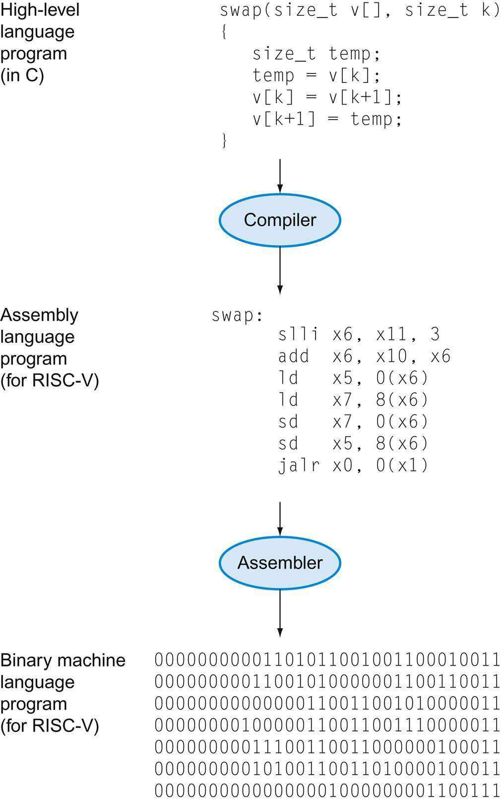

**HÌNH 1.4 Chương trình C được compile thành assembly language rồi assemble thành machine language nhị phân. Mặc dù việc dịch từ ngôn ngữ high-level sang machine language nhị phân được thể hiện qua hai bước, một số compiler bỏ qua bước trung gian và tạo trực tiếp machine language nhị phân. Những ngôn ngữ và chương trình này được khảo sát chi tiết hơn trong Chương 2.**

Compiler cho phép lập trình viên viết biểu thức ngôn ngữ high-level sau:

```
A + B
```

Compiler sẽ compile nó thành câu lệnh assembly language sau:

```
add A, B
```

Như đã trình bày, assembler sẽ dịch câu lệnh này thành các instruction nhị phân bảo máy tính cộng hai số A và B.

Ngôn ngữ lập trình High-level đem lại nhiều lợi ích quan trọng. Thứ nhất, chúng cho phép lập trình viên suy nghĩ bằng ngôn ngữ tự nhiên hơn, dùng từ tiếng Anh và ký hiệu đại số, tạo ra chương trình giống văn bản hơn nhiều so với bảng ký hiệu khó hiểu (xem Hình 1.4). Hơn nữa, chúng cho phép thiết kế ngôn ngữ theo mục đích sử dụng dự kiến. Vì thế, Fortran được thiết kế cho tính toán khoa học, Cobol cho xử lý dữ liệu kinh doanh, Lisp cho thao tác ký hiệu, v.v. Cũng có ngôn ngữ domain-specific cho những nhóm người dùng hẹp hơn nữa, chẳng hạn những người quan tâm đến mô phỏng chất lỏng.

Ưu điểm thứ hai của ngôn ngữ lập trình là cải thiện năng suất lập trình viên. Một trong số ít điều được đồng thuận rộng rãi trong phát triển software là phát triển chương trình mất ít thời gian hơn khi viết bằng ngôn ngữ cần ít dòng để diễn đạt một ý tưởng. Tính ngắn gọn là ưu thế rõ ràng của ngôn ngữ high-level so với assembly language.

Ưu điểm cuối cùng là ngôn ngữ lập trình cho phép chương trình độc lập với máy tính dùng để phát triển chúng, vì compiler và assembler có thể dịch chương trình ngôn ngữ high-level thành instruction nhị phân của bất kỳ máy tính nào. Ba ưu điểm mạnh đến mức ngày nay rất ít việc lập trình được thực hiện bằng assembly language.

## 1.4 Bên trong máy tính

Sau khi đã nhìn bên dưới chương trình để khám phá software nền tảng, hãy mở vỏ máy tính để tìm hiểu hardware bên dưới. Hardware nền tảng trong mọi máy tính đều thực hiện những chức năng cơ bản giống nhau: nhập dữ liệu, xuất dữ liệu, xử lý dữ liệu và lưu dữ liệu. Cách thực hiện những chức năng này là chủ đề chính của sách; các chương tiếp theo bàn về những phần khác nhau của bốn nhiệm vụ đó.

Khi gặp một điểm quan trọng trong sách, quan trọng đến mức chúng tôi mong bạn nhớ mãi, chúng tôi nhấn mạnh bằng cách đánh dấu là Bức tranh tổng thể. Có khoảng một tá mục Bức tranh tổng thể trong sách; mục đầu tiên là năm thành phần máy tính thực hiện các nhiệm vụ nhập, xuất, xử lý và lưu dữ liệu.

Hai thành phần chính của máy tính là input device, như microphone, và output device, như loa. Như tên gọi, input đưa thông tin vào máy tính, còn output là kết quả tính toán gửi đến người dùng. Một số thiết bị, như mạng không dây, cung cấp cả input lẫn output cho máy tính.

### input device

Cơ chế đưa thông tin vào máy tính, chẳng hạn bàn phím.

### output device

Cơ chế truyền kết quả tính toán đến người dùng, chẳng hạn màn hình, hoặc đến máy tính khác.

Chương 5 và 6 mô tả thiết bị input/output (I/O) chi tiết hơn, nhưng trước hết hãy tham quan nhập môn hardware máy tính, bắt đầu với các thiết bị I/O bên ngoài.

### Bức tranh TỔNG THỂ

Năm thành phần kinh điển của máy tính là input, output, memory, datapath và control; hai thành phần cuối đôi khi được gộp lại và gọi là processor. Hình 1.5 cho thấy tổ chức tiêu chuẩn của máy tính. Tổ chức này độc lập với công nghệ hardware: bạn có thể xếp mọi bộ phận của mọi máy tính, trước đây và hiện nay, vào một trong năm nhóm đó. Để giúp bạn giữ được cái nhìn tổng thể, năm thành phần máy tính được trình bày ở trang đầu mỗi chương tiếp theo, trong đó phần liên quan đến chương được làm nổi bật.

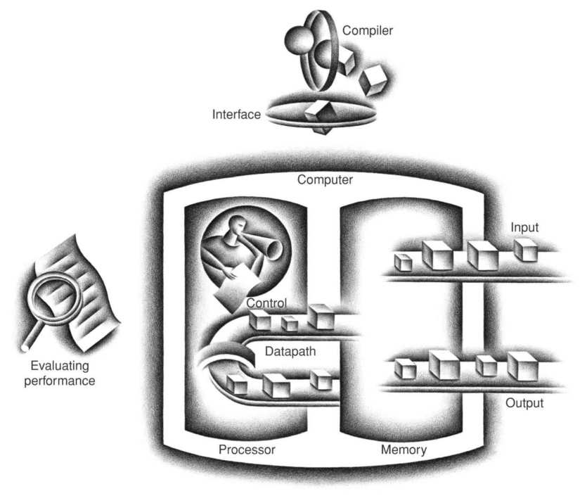

**HÌNH 1.5 Tổ chức máy tính, thể hiện năm thành phần kinh điển. Processor lấy instruction và dữ liệu từ memory. Input ghi dữ liệu vào memory, còn output đọc dữ liệu từ memory. Control gửi các tín hiệu quyết định hoạt động của datapath, memory, input và output.**

### Nhìn qua màn hình

Thiết bị I/O hấp dẫn nhất có lẽ là màn hình đồ họa. Phần lớn personal mobile device dùng liquid crystal display (LCD) để có màn hình mỏng, low-power. LCD không phải nguồn sáng; thay vào đó, nó điều khiển sự truyền ánh sáng. LCD điển hình chứa các phân tử rod-shaped trong chất lỏng, tạo thành xoắn ốc làm đổi hướng ánh sáng đi vào màn hình, từ nguồn sáng phía sau hoặc ít phổ biến hơn là ánh sáng phản xạ. Những thanh này duỗi thẳng khi có dòng điện chạy qua và không còn bẻ hướng ánh sáng. Vì vật liệu tinh thể lỏng nằm giữa hai tấm phân cực lệch nhau 90 độ, ánh sáng không thể đi qua nếu không bị đổi hướng. Ngày nay phần lớn LCD dùng active matrix có transistor chuyển mạch rất nhỏ ở mỗi pixel để điều khiển chính xác dòng điện và tạo ảnh sắc nét hơn. Mặt nạ red-green-blue gắn với mỗi điểm trên màn hình quyết định cường độ các thành phần three-color trong ảnh cuối; ở LCD active matrix màu, mỗi điểm có ba transistor chuyển mạch.

#### liquid crystal display (LCD)

Công nghệ màn hình dùng lớp polymer lỏng mỏng để truyền hoặc chặn ánh sáng tùy theo có áp điện tích hay không.

#### active matrix display

Liquid crystal display dùng transistor để điều khiển sự truyền ánh sáng ở từng pixel riêng lẻ.

Ảnh gồm một ma trận phần tử ảnh, hay pixel, có thể biểu diễn bằng ma trận bit gọi là bit map. Tùy kích thước và độ phân giải màn hình, ma trận hiển thị trong máy tính bảng điển hình có kích thước từ 1024×768 đến 2048×1536. Màn hình màu có thể dùng 8 bit cho mỗi màu trong ba màu (đỏ, lam, lục), tức 24 bit mỗi pixel, cho phép hiển thị hàng triệu màu khác nhau.

#### pixel

Phần tử ảnh riêng lẻ nhỏ nhất. Màn hình gồm hàng trăm nghìn đến hàng triệu pixel, được tổ chức thành ma trận.

Qua màn hình máy tính, tôi đã hạ cánh máy bay lên boong tàu sân bay đang di chuyển, quan sát một hạt nhân va vào giếng thế, bay trong tên lửa ở tốc độ gần bằng ánh sáng và xem máy tính bộc lộ hoạt động sâu kín nhất của nó.

Ivan Sutherland, “cha đẻ” đồ họa máy tính, Scientific American, 1984

Hardware máy tính hỗ trợ đồ họa chủ yếu gồm raster refresh buffer, hay frame buffer, để lưu bit map. Ảnh cần hiển thị được lưu trong frame buffer, và mẫu bit của từng pixel được đọc ra màn hình đồ họa theo refresh rate. Hình 1.6 cho thấy frame buffer với thiết kế đơn giản chỉ 4 bit mỗi pixel.

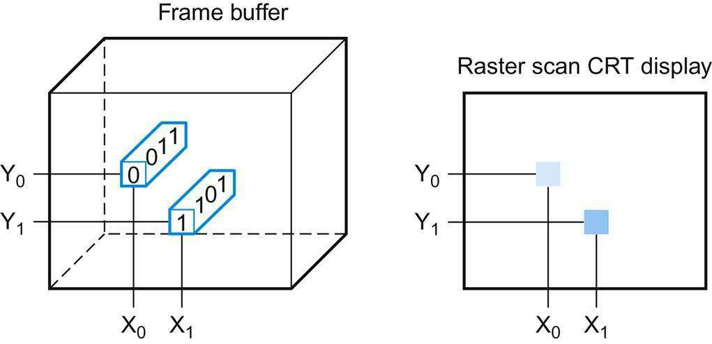

**HÌNH 1.6 Mỗi tọa độ trong frame buffer bên trái quyết định sắc độ của tọa độ tương ứng trên màn hình raster scan CRT bên phải. Pixel (X<sub>0</sub>, Y<sub>0</sub>) chứa mẫu bit 0011, có sắc độ trên màn hình sáng hơn mẫu bit 1101 ở pixel (X<sub>1</sub>, Y<sub>1</sub>).**

Mục đích của bit map là biểu diễn trung thực những gì có trên màn hình. Thách thức trong hệ thống đồ họa nảy sinh vì mắt người rất giỏi phát hiện ngay cả thay đổi nhỏ trên màn hình.

### Màn hình cảm ứng

Trong khi PC cũng dùng LCD, máy tính bảng và điện thoại thông minh thời post-PC đã thay bàn phím và chuột bằng màn hình touch-sensitive, mang lại ưu điểm user interface tuyệt vời: người dùng chỉ trực tiếp vào điều mình quan tâm thay vì gián tiếp qua chuột.

Tuy có nhiều cách triển khai màn hình cảm ứng, nhiều máy tính bảng hiện dùng cảm biến điện dung. Vì con người dẫn điện, nếu một chất cách điện như kính được phủ chất dẫn điện trong suốt, thao tác chạm sẽ làm biến dạng trường tĩnh điện của màn hình, dẫn đến thay đổi điện dung. Công nghệ này có thể cho phép nhiều điểm chạm đồng thời, nhận biết cử chỉ để tạo ra user interface hấp dẫn.

### Mở máy

Hình 1.7 cho thấy bên trong máy tính bảng Apple iPad 2. Không ngạc nhiên khi trong năm thành phần kinh điển của máy tính, I/O chiếm ưu thế trong thiết bị đọc này. Danh sách thiết bị I/O bao gồm LCD cảm ứng điện dung đa điểm, camera front-facing, camera rear-facing, microphone, giắc tai nghe, loa, accelerometer, gyroscope, mạng Wi-Fi và mạng Bluetooth. Datapath, control và memory chỉ chiếm phần rất nhỏ trong các thành phần.

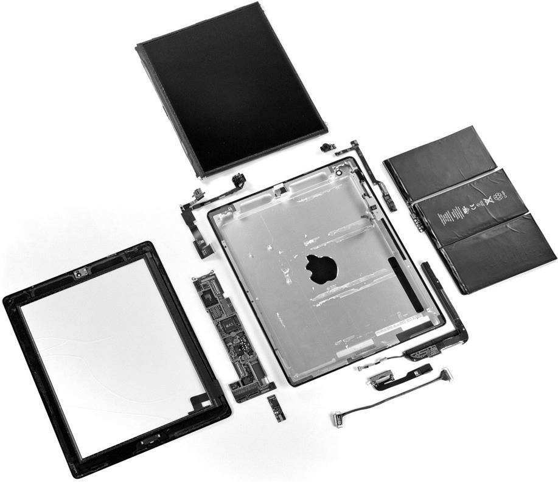

**HÌNH 1.7 Các thành phần của Apple iPad 2 A1395. Mặt lưng kim loại của iPad (với logo Apple đảo ngược ở giữa) nằm chính giữa. Phía trên là màn hình cảm ứng điện dung đa điểm và LCD. Ngoài cùng bên phải là pin polymer 3.8 V, 25 watt-hour, gồm ba khối Li-ion và cung cấp thời lượng pin 10 giờ. Ngoài cùng bên trái là khung kim loại gắn LCD vào mặt lưng iPad. Những thành phần nhỏ quanh mặt lưng kim loại ở giữa là thứ chúng ta xem là máy tính; chúng thường có dạng L-shaped để vừa gọn trong vỏ cạnh pin. Hình 1.8 cho thấy cận cảnh close-up của bo mạch L-shaped phía dưới bên trái vỏ kim loại, tức logic printed circuit board chứa processor và memory. Hình chữ nhật nhỏ dưới logic board chứa chip cung cấp truyền thông không dây: Wi-Fi, Bluetooth và bộ thu FM. Nó vừa với một khe nhỏ ở góc dưới bên trái logic board. Gần góc trên bên trái vỏ có một thành phần L-shaped khác, là cụm camera front-facing gồm camera, giắc tai nghe và microphone. Gần góc trên bên phải vỏ là bo mạch chứa nút điều chỉnh âm lượng và nút khóa im lặng/xoay màn hình cùng gyroscope và accelerometer. Hai chip cuối phối hợp để iPad nhận biết chuyển động six-axis. Hình chữ nhật nhỏ bên cạnh là camera rear-facing. Gần góc dưới bên phải vỏ là cụm loa L-shaped. Cáp ở dưới là kết nối giữa logic board và bo mạch camera/điều chỉnh âm lượng. Bo mạch giữa cáp và cụm loa là controller cho màn hình cảm ứng điện dung. <sub>(Ảnh do iFixit cung cấp, </sub><sub>www.ifixit.com</sub><sub>)</sub>**

Những hình chữ nhật nhỏ trong Hình 1.8 chứa các thiết bị thúc đẩy công nghệ tiến bộ, được gọi là integrated circuit và có biệt danh chip. Package A5 thấy ở giữa Hình 1.8 chứa hai ARM processor hoạt động với clock rate 1 GHz. Processor là phần hoạt động của máy tính, làm đúng từng instruction của chương trình. Nó cộng số, kiểm tra số, phát tín hiệu kích hoạt thiết bị I/O, v.v. Đôi khi người ta gọi processor là CPU, viết tắt của cái tên bureaucratic-sounding hơn, central processor unit.

#### integrated circuit

Còn được gọi là chip. Thiết bị kết hợp từ hàng chục đến hàng triệu transistor.

#### central processor unit (CPU)

Còn được gọi là processor. Phần hoạt động của máy tính, chứa datapath và control, cộng số, kiểm tra số, phát tín hiệu kích hoạt thiết bị I/O, v.v.

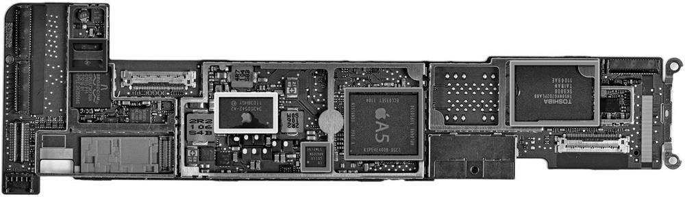

**HÌNH 1.8 Logic board của Apple iPad 2 trong Hình 1.7. Ảnh làm nổi bật năm integrated circuit. Integrated circuit lớn ở giữa là chip Apple A5, chứa hai ARM processor core chạy ở 1 GHz cùng 512 MB main memory bên trong package. Hình 1.9 là ảnh chip processor bên trong package A5. Chip similar-sized bên trái là chip flash memory 32 GB dùng cho lưu trữ non-volatile. Có khoảng trống giữa hai chip để lắp chip flash thứ hai, tăng gấp đôi dung lượng lưu trữ iPad. Các chip bên phải A5 gồm power controller và I/O controller. <sub>(Ảnh do iFixit cung cấp, </sub><sub>www.ifixit.com</sub><sub>)</sub>**

Đi sâu hơn nữa vào hardware, Hình 1.9 bộc lộ chi tiết của microprocessor. Về logic, processor gồm hai thành phần chính: datapath và control, tương ứng là cơ bắp và bộ não của processor. Datapath thực hiện phép toán số học, còn control cho datapath, memory và các thiết bị I/O biết phải làm gì theo yêu cầu của instruction trong chương trình. Chương 4 giải thích datapath và control cho thiết kế higher-performance.

#### datapath

Thành phần của processor thực hiện phép toán số học.

#### control

Thành phần của processor điều khiển datapath, memory và thiết bị I/O theo instruction của chương trình.

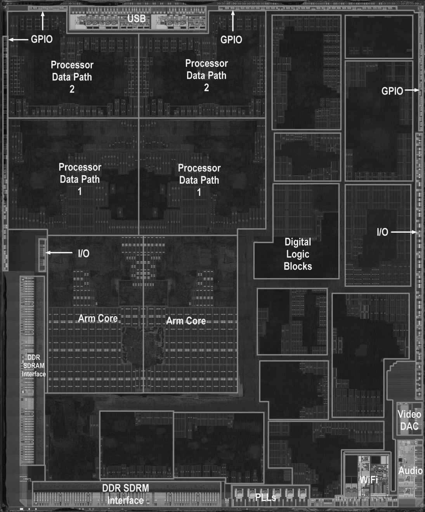

**HÌNH 1.9 Integrated circuit processor bên trong package A5. Chip có kích thước 12.1 × 10.1 mm và ban đầu được chế tạo bằng quy trình 45-nm (xem Mục 1.5). Nó có hai ARM processor hay core giống hệt nhau ở giữa phía trái chip và một PowerVR graphics processing unit (GPU) với bốn datapath ở phần tư trên bên trái. Bên trái và phía dưới các ARM core là interface đến main memory (DRAM). <sub>(Ảnh do Chipworks cung cấp, </sub><sub>www.chipworks.com</sub><sub>)</sub>**

Package A5 trong Hình 1.8 cũng bao gồm hai chip memory, mỗi chip có dung lượng 2 gibibit, nhờ đó cung cấp 512 MiB. Memory là nơi giữ chương trình khi chúng đang chạy; nó cũng chứa dữ liệu cần thiết cho các chương trình đang chạy. Memory được tạo từ chip DRAM. DRAM là viết tắt của dynamic random access memory. Nhiều DRAM được dùng chung để chứa instruction và dữ liệu của chương trình. Trái với sequential access memory như băng từ, phần RAM trong thuật ngữ DRAM nghĩa là truy cập memory về cơ bản mất cùng thời gian bất kể phần nào của memory được đọc.

#### memory

Vùng lưu trữ giữ chương trình khi chúng đang chạy và chứa dữ liệu cần thiết cho các chương trình đó.

#### dynamic random access memory (DRAM)

Memory được chế tạo dưới dạng integrated circuit; nó cung cấp random access đến mọi vị trí. Thời gian truy cập là 50 nanosecond và chi phí mỗi gigabyte vào năm 2012 là $5 đến $10.

Đi sâu vào bất kỳ thành phần hardware nào cũng hé lộ hiểu biết về máy tính. Bên trong processor có một loại memory khác—cache memory. Cache memory gồm memory nhỏ, nhanh đóng vai trò buffer cho DRAM memory. (Nghĩa không chuyên môn của cache là chỗ an toàn để giấu đồ.) Cache được chế tạo bằng công nghệ memory khác, static random access memory (SRAM). SRAM nhanh hơn nhưng mật độ thấp hơn, vì thế đắt hơn DRAM (xem Chương 5). SRAM và DRAM là hai tầng của memory hierarchy.


#### cache memory

Memory nhỏ, nhanh đóng vai trò buffer cho memory chậm hơn, lớn hơn.

#### static random access memory (SRAM)

Cũng là memory được chế tạo dưới dạng integrated circuit, nhưng nhanh hơn và mật độ thấp hơn DRAM.

Như đã đề cập, một trong những ý tưởng lớn để cải thiện thiết kế là abstraction. Một abstraction quan trọng nhất là interface giữa hardware và software lowest-level. Vì tầm quan trọng đó, nó được đặt tên riêng: instruction set architecture, hay đơn giản architecture, của máy tính. Instruction set architecture bao gồm mọi thứ lập trình viên cần biết để chương trình machine language nhị phân hoạt động đúng, gồm instruction, thiết bị I/O, v.v. Thông thường operating system đóng gói các chi tiết thực hiện I/O, cấp phát memory và các chức năng hệ thống low-level khác để lập trình viên ứng dụng không cần lo lắng về chúng. Sự kết hợp giữa instruction set cơ bản và operating system interface cung cấp cho lập trình viên ứng dụng được gọi là application binary interface (ABI).


#### instruction set architecture

Còn được gọi là architecture. Interface trừu tượng giữa hardware và software lowest-level, bao gồm mọi thông tin cần để viết chương trình machine language chạy đúng, gồm instruction, register, truy cập memory, I/O, v.v.

#### application binary interface (ABI)

Phần dành cho người dùng của instruction set cộng với các operating system interface mà lập trình viên ứng dụng sử dụng. Nó xác định tiêu chuẩn binary portability giữa các máy tính.

Instruction set architecture cho phép người thiết kế máy tính nói về chức năng độc lập với hardware thực hiện chúng. Chẳng hạn, chúng ta có thể nói về chức năng đồng hồ số (giữ giờ, hiển thị giờ, đặt báo thức) tách biệt với hardware của đồng hồ (tinh thể thạch anh, màn hình LED, nút nhựa). Người thiết kế máy tính cũng phân biệt architecture với implementation của architecture theo cách đó: implementation là hardware tuân theo abstraction của architecture. Những ý tưởng này dẫn chúng ta đến một Bức tranh tổng thể khác.

#### Bức tranh TỔNG THỂ

Cả hardware và software đều gồm các lớp phân cấp sử dụng abstraction, trong đó mỗi lớp thấp hơn che giấu chi tiết đối với lớp trên. Một interface chính giữa các mức abstraction là instruction set architecture—interface giữa hardware và software low-level. Interface trừu tượng này cho phép nhiều implementation có chi phí và hiệu năng khác nhau chạy cùng một software giống hệt nhau.

### Nơi an toàn cho dữ liệu

Đến đây chúng ta đã thấy cách nhập dữ liệu, tính toán bằng dữ liệu và hiển thị dữ liệu. Tuy nhiên, nếu máy tính mất điện, mọi thứ sẽ mất vì memory bên trong máy tính là volatile—nghĩa là khi mất điện, nó quên. Trái lại, đĩa DVD không quên bộ phim khi bạn tắt nguồn đầu DVD, nên là công nghệ nonvolatile memory.

#### implementation

Hardware tuân theo abstraction của architecture.

#### volatile memory

Storage, chẳng hạn DRAM, chỉ giữ dữ liệu khi được cấp nguồn.

#### nonvolatile memory

Dạng memory giữ dữ liệu ngay cả khi không có nguồn điện, được dùng để lưu chương trình giữa các lần chạy. Đĩa DVD là nonvolatile.

Để phân biệt volatile memory dùng giữ dữ liệu và chương trình khi chạy với nonvolatile memory dùng lưu dữ liệu và chương trình giữa các lần chạy, thuật ngữ main memory hay primary memory được dùng cho loại trước, còn secondary memory cho loại sau. Secondary memory tạo thành tầng thấp hơn tiếp theo của memory hierarchy. DRAM đã thống trị main memory từ năm 1975, nhưng magnetic disk thống trị secondary memory còn sớm hơn nữa. Do kích thước và form factor, personal mobile device dùng flash memory, một nonvolatile semiconductor memory, thay vì đĩa. Hình 1.8 cho thấy chip chứa flash memory của iPad 2. Tuy chậm hơn DRAM, nó rẻ hơn DRAM nhiều, bên cạnh khả năng nonvolatile. Mặc dù đắt hơn đĩa trên mỗi bit, nó nhỏ hơn, được cung cấp ở dung lượng nhỏ hơn nhiều, bền hơn và tiết kiệm điện hơn đĩa. Vì thế flash memory là secondary memory tiêu chuẩn cho PMD. Tiếc thay, khác đĩa và DRAM, bit flash memory hao mòn sau 100,000 đến 1,000,000 lần ghi. Do đó file system phải theo dõi số lần ghi và có chiến lược tránh làm mòn storage, như di chuyển dữ liệu hay dùng. Chương 5 mô tả đĩa và flash memory chi tiết hơn.


#### main memory

Còn được gọi là primary memory. Memory dùng giữ chương trình khi chúng đang chạy; thường gồm DRAM trong máy tính ngày nay.

#### secondary memory

Nonvolatile memory dùng lưu chương trình và dữ liệu giữa các lần chạy; thường gồm flash memory trong PMD và magnetic disk trong server.

#### magnetic disk

Còn được gọi là hard disk. Dạng nonvolatile secondary memory gồm các phiến đĩa quay phủ vật liệu ghi từ. Vì là thiết bị cơ học quay, thời gian truy cập khoảng 5 đến 20 millisecond, và chi phí mỗi gigabyte năm 2012 là $0.05 đến $0.10.

#### flash memory

Nonvolatile semi-conductor memory. Nó rẻ hơn và chậm hơn DRAM nhưng đắt hơn trên mỗi bit và nhanh hơn magnetic disk. Thời gian truy cập khoảng 5 đến 50 microsecond và chi phí mỗi gigabyte năm 2012 là $0.75 đến $1.00.

### Giao tiếp với máy tính khác

Chúng tôi đã giải thích cách nhập, tính toán, hiển thị và lưu dữ liệu, nhưng vẫn còn một mục chưa đề cập có trong máy tính hiện nay: mạng máy tính. Giống như processor trong Hình 1.5 kết nối với memory và thiết bị I/O, mạng kết nối toàn bộ các máy tính với nhau, cho phép người dùng mở rộng sức mạnh điện toán bằng việc bổ sung truyền thông. Mạng đã phổ biến đến mức trở thành xương sống của hệ thống máy tính hiện tại; một personal mobile device hay server mới không có network interface sẽ bị chê cười. Máy tính nối mạng có nhiều ưu điểm chính:

- Truyền thông: Thông tin được trao đổi giữa các máy tính ở tốc độ cao.

- Chia sẻ tài nguyên: Thay vì mỗi máy tính có thiết bị I/O riêng, các máy tính trên mạng có thể dùng chung thiết bị I/O.

- Truy cập từ xa: Nhờ kết nối máy tính qua khoảng cách lớn, người dùng không cần ở gần máy tính mình sử dụng. Mạng khác nhau về chiều dài và hiệu năng, với chi phí truyền thông tăng theo cả tốc độ truyền và khoảng cách thông tin di chuyển. Có lẽ loại mạng phổ biến nhất là Ethernet. Nó có thể dài tới một kilômét và truyền tới 40 gigabit mỗi giây. Chiều dài và tốc độ giúp Ethernet hữu ích để nối máy tính trên cùng tầng của một tòa nhà; do đó nó là ví dụ của loại thường được gọi là local area network. Các local area network được nối với nhau bằng switch, cũng có thể cung cấp dịch vụ routing và bảo mật. Wide area network trải qua các châu lục và là xương sống của Internet, nơi hỗ trợ web. Chúng thường dựa trên cáp quang và được thuê từ công ty viễn thông.

#### local area network (LAN)

Mạng được thiết kế để mang dữ liệu trong một vùng địa lý giới hạn, thường bên trong một tòa nhà.

#### wide area network (WAN)

Mạng trải dài hàng trăm kilômét, có thể bao phủ một châu lục.

Mạng đã thay đổi diện mạo điện toán trong 30 năm qua, vừa trở nên phổ biến hơn nhiều vừa tăng mạnh hiệu năng. Trong thập niên 1970, rất ít cá nhân có quyền truy cập thư điện tử, Internet và web chưa tồn tại, và gửi băng từ bằng bưu điện là cách chính để chuyển lượng lớn dữ liệu giữa hai nơi. Local area network gần như không tồn tại, còn số ít wide area network hiện có thì dung lượng hạn chế và bị giới hạn truy cập.

Khi công nghệ mạng cải thiện, nó rẻ hơn đáng kể và có dung lượng cao hơn rõ rệt. Ví dụ, công nghệ local area network được chuẩn hóa đầu tiên, phát triển khoảng 30 năm trước, là phiên bản Ethernet có dung lượng tối đa (còn gọi là bandwidth) 10 triệu bit mỗi giây, thường được chia sẻ giữa hàng chục, thậm chí một trăm máy tính. Ngày nay công nghệ local area network cung cấp dung lượng từ 1 đến 40 gigabit mỗi giây, thường chỉ chia sẻ giữa nhiều nhất vài máy tính. Công nghệ truyền thông quang đã cho phép tăng tương tự dung lượng wide area network, từ hàng trăm kilobit lên gigabit, và từ hàng trăm máy tính kết nối mạng toàn cầu lên hàng triệu máy tính. Sự gia tăng mạnh mẽ về triển khai mạng kết hợp tăng dung lượng khiến công nghệ mạng trở thành trung tâm của cuộc cách mạng thông tin 30 năm qua.

Trong thập niên vừa qua, một đổi mới mạng khác đang định hình lại cách máy tính giao tiếp. Công nghệ không dây phổ biến rộng rãi đã tạo điều kiện cho kỷ nguyên post-PC. Khả năng chế tạo radio bằng cùng công nghệ semiconductor low-cost (CMOS) dùng cho memory và microprocessor đã cải thiện đáng kể giá thành, dẫn đến bùng nổ triển khai. Công nghệ không dây hiện có, được gọi theo tên tiêu chuẩn IEEE 802.11, cho phép tốc độ truyền từ 1 đến gần 100 triệu bit mỗi giây. Công nghệ không dây khác mạng wire-based khá nhiều, vì mọi người dùng trong vùng lân cận cùng chia sẻ sóng vô tuyến.

#### Tự kiểm tra

- Semiconductor DRAM memory, flash memory và disk storage khác nhau đáng kể. Với mỗi công nghệ, hãy liệt kê tính volatile, thời gian truy cập tương đối xấp xỉ và chi phí tương đối xấp xỉ so với DRAM.

## 1.5 Công nghệ chế tạo processor và memory

Processor và memory đã cải thiện với tốc độ đáng kinh ngạc, vì người thiết kế máy tính từ lâu luôn đón nhận công nghệ điện tử mới nhất để cố thắng cuộc đua thiết kế máy tính tốt hơn. Hình 1.10 cho thấy các công nghệ được dùng qua thời gian, cùng ước tính hiệu năng tương đối trên mỗi đơn vị chi phí của từng công nghệ. Vì công nghệ này định hình những gì máy tính có thể làm và tốc độ phát triển của chúng, chúng tôi cho rằng mọi chuyên gia máy tính nên nắm kiến thức cơ bản về integrated circuit.

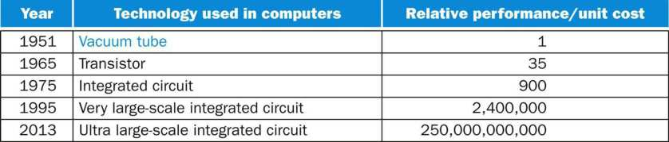

**HÌNH 1.10 Hiệu năng tương đối trên mỗi đơn vị chi phí của các công nghệ dùng trong máy tính qua thời gian. Nguồn: Computer Museum, Boston, với năm 2013 được các tác giả ngoại suy. Xem  Mục 1.12. Transistor đơn giản là công tắc bật/tắt điều khiển bằng điện. Integrated circuit (IC) kết hợp hàng chục đến hàng trăm transistor vào một chip. Khi Gordon Moore dự đoán tài nguyên liên tục tăng gấp đôi, ông đang dự báo tốc độ tăng số transistor trên mỗi chip. Để mô tả sự gia tăng to lớn số transistor từ hàng trăm lên hàng triệu, cụm từ very large scale được thêm vào thuật ngữ, tạo thành viết tắt VLSI, tức very large-scale integrated circuit.**

### transistor

Công tắc bật/tắt được điều khiển bằng tín hiệu điện.

### very large-scale integrated (VLSI) circuit

Thiết bị chứa từ hàng trăm nghìn đến hàng triệu transistor.

Tốc độ tăng mức tích hợp này ổn định đáng kể. Hình 1.11 cho thấy sự tăng dung lượng DRAM từ năm 1977. Trong 35 năm, ngành công nghiệp này đều đặn tăng gấp bốn dung lượng mỗi 3 năm, tạo ra mức tăng hơn 16,000 lần!

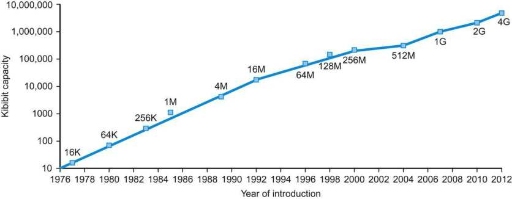

**HÌNH 1.11 Sự tăng dung lượng trên mỗi chip DRAM theo thời gian. Trục y-axis đo bằng kibibit (2<sup>10</sup> bit). Ngành DRAM tăng gấp bốn dung lượng gần như mỗi ba năm, tương ứng tăng 60% mỗi năm, trong 20 năm. Những năm gần đây, tốc độ đã chậm lại và gần với tăng gấp đôi sau mỗi hai đến ba năm hơn.**

Để hiểu cách sản xuất integrated circuit, chúng ta bắt đầu từ đầu. Chế tạo chip bắt đầu bằng silicon, chất có trong cát. Vì silicon dẫn điện không tốt, nó được gọi là semiconductor. Với quy trình hóa học đặc biệt, có thể thêm vật liệu vào silicon để những vùng nhỏ biến thành một trong ba thiết bị:

- Chất dẫn điện rất tốt (dùng dây đồng hoặc nhôm cực nhỏ)

### silicon

Nguyên tố tự nhiên có tính semiconductor.

### semiconductor

Chất dẫn điện không tốt.

- Chất cách điện rất tốt (như vỏ nhựa hoặc thủy tinh)

- Vùng có thể dẫn điện hoặc cách điện trong những điều kiện nhất định (như công tắc)

Transistor thuộc nhóm cuối. Vì vậy, VLSI circuit chỉ là hàng tỷ tổ hợp của chất dẫn, chất cách điện và công tắc được chế tạo trong một package nhỏ duy nhất.

Quy trình sản xuất integrated circuit quyết định chi phí chip, vì thế quan trọng với người thiết kế máy tính. Hình 1.12 cho thấy quy trình đó. Quy trình bắt đầu từ silicon crystal ingot trông như xúc xích khổng lồ. Ngày nay ingot có đường kính 8–12 inch và dài khoảng 12–24 inch. Ingot được cắt thành các wafer mỏng không quá 0.1 inch. Sau đó wafer trải qua một chuỗi bước xử lý, trong đó các mẫu hóa chất được đặt lên từng wafer, tạo thành transistor, chất dẫn và chất cách điện đã bàn ở trên. Integrated circuit ngày nay chỉ chứa một lớp transistor nhưng có thể có từ hai đến tám tầng chất dẫn kim loại, ngăn cách bởi các lớp cách điện.

### silicon crystal ingot

Thanh tinh thể silicon có đường kính từ 8 đến 12 inch và dài khoảng 12 đến 24 inch.

### wafer

Lát cắt từ silicon ingot không dày quá 0.1 inch, dùng để tạo chip.

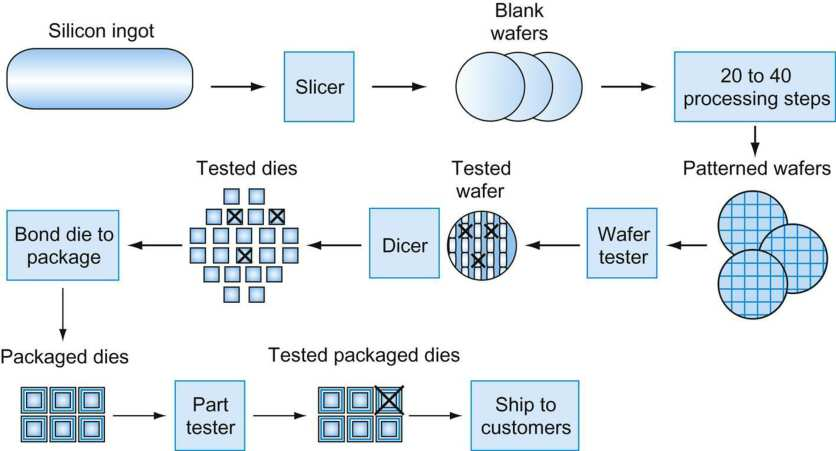

**HÌNH 1.12 Quy trình sản xuất chip. Sau khi được cắt từ silicon ingot, các wafer trống trải qua 20 đến 40 bước để tạo wafer có mẫu (xem Hình 1.13). Những wafer có mẫu này được kiểm tra bằng wafer tester và lập bản đồ các phần tốt. Tiếp theo, wafer được cắt thành die (xem Hình 1.9). Trong hình này, một wafer tạo ra 20 die, trong đó 17 vượt qua kiểm tra. (X nghĩa là die hỏng.) Yield của die tốt trong trường hợp này là 17/20, hay 85%. Các die tốt sau đó được nối vào package và kiểm tra một lần nữa trước khi giao linh kiện đã đóng gói cho khách hàng. Một linh kiện đóng gói bị hỏng được phát hiện ở lần kiểm tra cuối này.**

Một lỗi cực nhỏ duy nhất trong chính wafer hoặc trong một trong hàng chục bước tạo mẫu có thể khiến vùng wafer đó không hoạt động. Những lỗi này, được gọi là defect, khiến gần như không thể chế tạo wafer hoàn hảo. Cách đơn giản nhất để xử lý sự không hoàn hảo là đặt nhiều thành phần độc lập trên cùng wafer. Wafer có mẫu sau đó được chặt, hay cắt, thành những thành phần gọi là die, thường được gọi thân thuộc hơn là chip. Hình 1.13 là ảnh wafer chứa microprocessor trước khi cắt; Hình 1.9 trước đó cho thấy một die microprocessor riêng lẻ.

### defect

Lỗi cực nhỏ trong wafer hoặc bước tạo mẫu có thể khiến die chứa lỗi đó không hoạt động.

### die

Những phần hình chữ nhật riêng lẻ được cắt từ wafer, thường gọi thân thuộc hơn là chip.

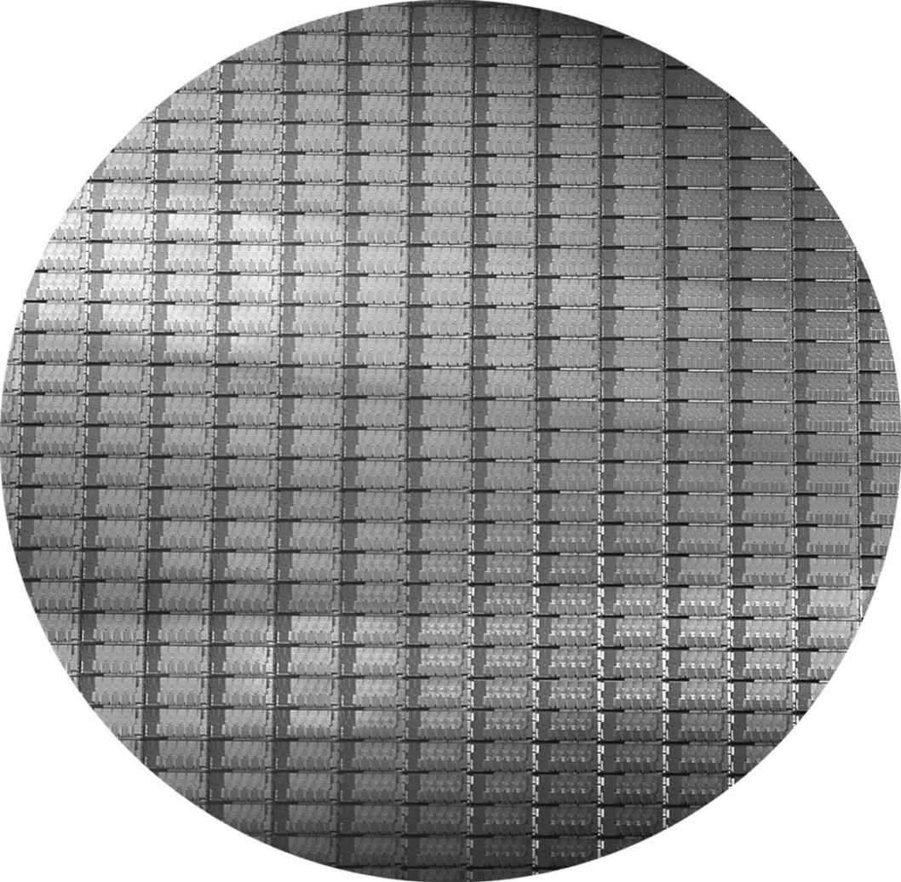

**HÌNH 1.13 Wafer Intel Core i7 12-inch (300 mm) (Ảnh do Intel cung cấp). Số die trên wafer 300 mm (12 inch) này với yield 100% là 280, mỗi die kích thước 20.7 × 10.5 mm. Vài chục chip tròn một phần ở rìa wafer không sử dụng được; chúng được đưa vào vì như vậy dễ tạo mask dùng để tạo mẫu silicon hơn. Die này sử dụng công nghệ 32-nanometer, nghĩa là các chi tiết nhỏ nhất có kích thước xấp xỉ 32 nm, mặc dù chúng thường nhỏ hơn đôi chút so với feature size thực tế, vốn chỉ kích thước transistor được “vẽ” so với kích thước cuối cùng sau chế tạo.**

Việc cắt cho phép chỉ loại bỏ các die không may chứa lỗi, thay vì toàn bộ wafer. Khái niệm này được định lượng bằng yield của quy trình, định nghĩa là tỷ lệ phần trăm die tốt trên tổng số die của wafer.

### yield

Tỷ lệ phần trăm die tốt trên tổng số die của wafer.

Chi phí integrated circuit tăng nhanh khi kích thước die tăng, do cả yield thấp hơn lẫn số die đặt vừa wafer ít hơn. Để giảm chi phí, quy trình thế hệ tiếp theo thu nhỏ die lớn nhờ dùng kích thước nhỏ hơn cho cả transistor và dây dẫn. Điều này cải thiện yield và số die trên mỗi wafer. Quy trình 32-nanometer (nm) là điển hình năm 2012, về cơ bản nghĩa là feature size nhỏ nhất trên die là 32 nm.

Sau khi tìm được die tốt, chúng được nối với các chân input/output của package bằng quy trình gọi là bonding. Những linh kiện đóng gói này được kiểm tra lần cuối, vì có thể xảy ra sai sót khi đóng gói, rồi giao cho khách hàng.

### Giải thích thêm

Chi phí integrated circuit có thể được biểu diễn bằng ba phương trình đơn giản:

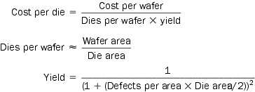

Phương trình đầu dễ suy ra. Phương trình thứ hai là xấp xỉ, vì không trừ diện tích gần rìa wafer tròn không thể chứa die hình chữ nhật (xem Hình 1.13). Phương trình cuối dựa trên quan sát thực nghiệm về yield tại nhà máy integrated circuit, với số mũ liên quan đến số bước xử lý quan trọng.

Vì thế, tùy tỷ lệ defect và kích thước die, wafer, chi phí nhìn chung không tuyến tính theo diện tích die.

### Tự kiểm tra

Một yếu tố chính quyết định chi phí integrated circuit là sản lượng. Điều nào sau đây là lý do khiến chip sản xuất số lượng lớn có chi phí thấp hơn?

1. Với sản lượng lớn, quy trình sản xuất có thể được tinh chỉnh cho một thiết kế cụ thể, tăng yield.

2. Thiết kế một linh kiện high-volume tốn ít công hơn linh kiện low-volume.

3. Mask dùng để chế tạo chip đắt, vì vậy chi phí mỗi chip thấp hơn khi sản lượng cao hơn.

4. Chi phí phát triển kỹ thuật cao và phần lớn độc lập với sản lượng; do đó, chi phí phát triển trên mỗi die thấp hơn với linh kiện high-volume.

5. Linh kiện High-volume thường có die nhỏ hơn linh kiện low-volume và do đó có yield trên mỗi wafer cao hơn.

## 1.6 Hiệu năng

Đánh giá hiệu năng máy tính có thể khá khó khăn. Quy mô và độ phức tạp của hệ thống software hiện đại, cùng với phạm vi rộng các kỹ thuật cải thiện hiệu năng mà người thiết kế hardware sử dụng, khiến việc đánh giá hiệu năng khó hơn nhiều.

Khi lựa chọn giữa các máy tính khác nhau, hiệu năng là thuộc tính quan trọng. Đo lường và so sánh chính xác các máy tính khác nhau rất quan trọng với người mua và vì thế với cả người thiết kế. Người bán máy tính cũng biết điều này. Người bán hàng thường muốn bạn nhìn máy tính của họ theo cách tốt đẹp nhất, bất kể cách nhìn đó có phản ánh chính xác nhu cầu ứng dụng của người mua hay không. Vì thế, hiểu cách đo hiệu năng tốt nhất và giới hạn của những phép đo đó rất quan trọng khi chọn máy tính.

Phần còn lại của mục mô tả các cách xác định hiệu năng; sau đó chúng tôi mô tả các metric đo hiệu năng từ góc nhìn của cả người dùng máy tính lẫn người thiết kế. Chúng tôi cũng xem xét quan hệ giữa các metric và trình bày phương trình hiệu năng processor kinh điển, sẽ được dùng xuyên suốt sách.

### Định nghĩa hiệu năng

Khi nói một máy tính có hiệu năng tốt hơn máy khác, chúng ta muốn nói gì? Tuy câu hỏi có vẻ đơn giản, phép so sánh với máy bay chở khách cho thấy vấn đề hiệu năng tinh tế đến mức nào. Hình 1.14 liệt kê vài máy bay chở khách điển hình, cùng tốc độ hành trình, tầm bay và sức chở. Nếu muốn biết máy bay nào trong bảng có hiệu năng tốt nhất, trước hết phải định nghĩa hiệu năng. Ví dụ, xét các thước đo hiệu năng khác nhau, ta thấy máy bay có tốc độ hành trình cao nhất là Concorde (ngừng phục vụ năm 2003), máy bay có tầm bay xa nhất là DC-8, và máy bay có sức chở lớn nhất là 747.

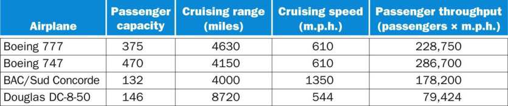

**HÌNH 1.14 Sức chở, tầm bay và tốc độ của một số máy bay thương mại. Cột cuối cho thấy tốc độ vận chuyển hành khách của máy bay, bằng sức chở nhân tốc độ hành trình (bỏ qua tầm bay cùng thời gian cất, hạ cánh).**

Giả sử ta định nghĩa hiệu năng theo tốc độ. Vẫn còn hai định nghĩa khả dĩ. Bạn có thể định nghĩa máy bay nhanh nhất là máy bay có tốc độ hành trình cao nhất, đưa một hành khách từ nơi này đến nơi khác trong thời gian ngắn nhất. Tuy nhiên, nếu quan tâm đến việc vận chuyển 450 hành khách từ nơi này đến nơi khác, 747 rõ ràng nhanh nhất, như cột cuối hình cho thấy. Tương tự, ta có thể định nghĩa hiệu năng máy tính theo nhiều cách riêng biệt.

Nếu chạy một chương trình trên hai desktop computer khác nhau, bạn sẽ nói máy nhanh hơn là máy hoàn thành công việc trước. Nếu vận hành datacenter có nhiều server chạy công việc do nhiều người dùng gửi đến, bạn sẽ nói máy tính nhanh hơn là máy hoàn thành nhiều công việc nhất trong ngày. Là người dùng máy tính cá nhân, bạn quan tâm đến giảm response time—thời gian từ lúc bắt đầu đến lúc hoàn thành một tác vụ—còn gọi là execution time. Người quản lý datacenter thường quan tâm tăng throughput hay bandwidth—tổng lượng công việc thực hiện trong một khoảng thời gian nhất định. Vì thế, trong phần lớn trường hợp cần các metric hiệu năng và tập ứng dụng benchmark khác nhau cho personal mobile device, vốn chú trọng response time hơn, và server, vốn chú trọng throughput hơn.

#### response time

Còn được gọi là execution time. Tổng thời gian máy tính cần để hoàn thành tác vụ, gồm truy cập đĩa, truy cập memory, hoạt động I/O, overhead của operating system, CPU execution time, v.v.

#### throughput

Còn được gọi là bandwidth. Một thước đo hiệu năng khác, là số tác vụ hoàn thành trong một đơn vị thời gian.

#### Throughput và response time

**Ví dụ**

Những thay đổi sau đối với hệ thống máy tính làm tăng throughput, giảm response time, hay cả hai?

1. Thay processor trong máy tính bằng phiên bản nhanh hơn

2. Bổ sung processor vào hệ thống sử dụng nhiều processor cho các tác vụ riêng biệt—chẳng hạn tìm kiếm web

**Trả lời**

Giảm response time gần như luôn cải thiện throughput. Vì vậy, ở trường hợp 1, cả response time và throughput đều cải thiện. Ở trường hợp 2, không tác vụ nào hoàn thành nhanh hơn nên chỉ throughput tăng.

Tuy nhiên, nếu nhu cầu xử lý trong trường hợp thứ hai gần bằng throughput, hệ thống có thể buộc yêu cầu xếp hàng. Khi đó, tăng throughput cũng có thể cải thiện response time vì giảm thời gian chờ trong hàng đợi. Như vậy, trong nhiều hệ thống máy tính thực tế, thay đổi execution time hay throughput thường ảnh hưởng đến yếu tố còn lại.

Khi thảo luận hiệu năng máy tính, trong vài chương đầu chúng ta chủ yếu quan tâm response time. Để tối đa hóa hiệu năng, ta muốn giảm thiểu response time hay execution time cho một tác vụ. Vì vậy, ta có thể liên hệ hiệu năng và execution time của máy tính X:

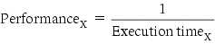

Điều này nghĩa là với hai máy tính X và Y, nếu hiệu năng X lớn hơn hiệu năng Y, ta có

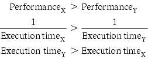

Tức là execution time trên Y dài hơn trên X nếu X nhanh hơn Y.

Khi thảo luận thiết kế máy tính, ta thường muốn liên hệ định lượng hiệu năng của hai máy tính khác nhau. Chúng tôi dùng cụm “X nhanh hơn Y n lần”—hay tương đương “X nhanh gấp n lần Y”—để chỉ

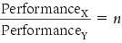

Nếu X nhanh gấp n lần Y, execution time trên Y dài gấp n lần trên X:

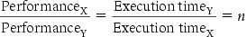

#### Hiệu năng tương đối

**Ví dụ**

Nếu máy tính A chạy chương trình trong 10 giây và máy tính B chạy cùng chương trình trong 15 giây, A nhanh hơn B bao nhiêu?

**Trả lời**

Ta biết A nhanh gấp n lần B nếu

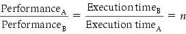

Vì vậy tỷ số hiệu năng là

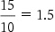

và do đó A nhanh gấp 1.5 lần B.

Trong ví dụ trên, cũng có thể nói máy tính B chậm hơn máy tính A 1.5 lần, vì

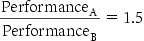

nghĩa là

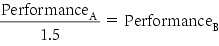

Để đơn giản, chúng tôi thường dùng cách nói “nhanh gấp” khi so sánh định lượng các máy tính. Vì hiệu năng và execution time là nghịch đảo, tăng hiệu năng đòi hỏi giảm execution time. Để tránh nhầm lẫn giữa tăng và giảm, chúng tôi thường nói “cải thiện hiệu năng” hoặc “cải thiện execution time” khi muốn nói “tăng hiệu năng” và “giảm execution time”.

### Đo hiệu năng

Thời gian là thước đo hiệu năng máy tính: máy thực hiện cùng lượng công việc trong thời gian ngắn nhất là nhanh nhất. Execution time của chương trình được đo bằng giây trên mỗi chương trình. Tuy nhiên, thời gian có thể được định nghĩa khác nhau tùy những gì ta tính đến. Định nghĩa trực tiếp nhất gọi là wall clock time, response time hay elapsed time. Những thuật ngữ này chỉ tổng thời gian hoàn thành tác vụ, bao gồm truy cập đĩa, truy cập memory, hoạt động input/output (I/O), overhead của operating system—mọi thứ.

Tuy nhiên, máy tính thường được chia sẻ và processor có thể xử lý nhiều chương trình đồng thời. Khi đó, hệ thống có thể cố tối ưu throughput thay vì giảm thiểu elapsed time của một chương trình. Vì vậy ta thường muốn phân biệt elapsed time với thời gian processor làm việc cho mình. CPU execution time hay đơn giản CPU time, thể hiện sự phân biệt này, là thời gian CPU dành để tính toán cho tác vụ đó, không gồm thời gian chờ I/O hoặc chạy chương trình khác. (Tuy nhiên, hãy nhớ response time mà người dùng trải nghiệm là elapsed time của chương trình, chứ không phải CPU time.) CPU time còn chia thành thời gian CPU dành trong chương trình, gọi là user CPU time, và thời gian CPU dành trong operating system để thực hiện tác vụ thay cho chương trình, gọi là system CPU time. Khó phân biệt chính xác system CPU time với user CPU time vì thường khó quy trách nhiệm cho hoạt động operating system về chương trình người dùng này thay vì chương trình khác, và vì các operating system khác nhau về chức năng.

#### CPU execution time

Còn được gọi là CPU time. Thời gian thực tế CPU dành để tính toán cho một tác vụ cụ thể.

#### user CPU time

CPU time dành cho chính chương trình.

#### system CPU time

CPU time dành trong operating system để thực hiện tác vụ thay cho chương trình.

Để nhất quán, chúng tôi duy trì sự phân biệt giữa hiệu năng dựa trên elapsed time và hiệu năng dựa trên CPU execution time. Thuật ngữ system performance được dùng để chỉ elapsed time trên hệ thống không có tải khác, còn CPU performance để chỉ user CPU time. Chương này tập trung vào CPU performance, mặc dù thảo luận về cách tổng hợp hiệu năng có thể áp dụng cho cả phép đo elapsed time lẫn CPU time.

#### Tìm hiểu hiệu năng chương trình

Các ứng dụng khác nhau nhạy với những khía cạnh hiệu năng khác nhau của hệ thống máy tính. Nhiều ứng dụng, đặc biệt ứng dụng chạy trên server, phụ thuộc tương tự vào hiệu năng I/O, vốn lại dựa vào cả hardware và software. Tổng elapsed time đo bằng đồng hồ thực là phép đo cần quan tâm. Trong một số môi trường ứng dụng, người dùng có thể quan tâm throughput, response time hoặc sự kết hợp phức tạp của cả hai (ví dụ throughput tối đa với response time worst-case). Để cải thiện hiệu năng chương trình, phải xác định rõ metric nào quan trọng rồi tìm bottleneck bằng cách đo việc thực thi chương trình và xem xét những vị trí có khả năng bị nghẽn. Trong các chương sau, chúng tôi mô tả cách tìm bottleneck và cải thiện hiệu năng ở những phần khác nhau của hệ thống.

Mặc dù với tư cách người dùng chúng ta quan tâm thời gian, khi khảo sát chi tiết máy tính, dùng metric khác để suy nghĩ về hiệu năng sẽ thuận tiện. Đặc biệt, người thiết kế có thể muốn xem xét máy tính bằng thước đo liên quan đến tốc độ hardware thực hiện chức năng cơ bản. Gần như mọi máy tính đều dùng clock quyết định thời điểm sự kiện diễn ra trong hardware. Những khoảng thời gian rời rạc này gọi là clock cycle (hoặc tick, clock tick, clock period, clock, cycle). Người thiết kế mô tả độ dài clock period bằng thời gian của một clock cycle đầy đủ (ví dụ 250 picosecond, hay 250 ps) lẫn clock rate (ví dụ 4 gigahertz, hay 4 GHz), là nghịch đảo của clock period. Ở phần tiếp theo, chúng tôi hình thức hóa quan hệ giữa clock cycle của người thiết kế hardware và giây của người dùng máy tính.

#### clock cycle

Còn được gọi là tick, clock tick, clock period, clock hoặc cycle. Thời gian cho một clock period, thường của processor clock chạy với tốc độ không đổi.

#### clock period

Độ dài của mỗi clock cycle.

#### Tự kiểm tra

1. Giả sử ta biết một ứng dụng dùng cả personal mobile device và Cloud bị giới hạn bởi hiệu năng mạng. Với các thay đổi sau, hãy cho biết chỉ throughput cải thiện, cả response time và throughput cải thiện, hay không yếu tố nào cải thiện.

a. Bổ sung một kênh mạng giữa PMD và Cloud, tăng tổng network throughput và giảm độ trễ để có quyền truy cập mạng (vì hiện có hai kênh).

b. Cải thiện networking software, nhờ đó giảm độ trễ truyền thông mạng nhưng không tăng throughput.

c. Bổ sung memory vào máy tính.

2. Hiệu năng máy tính C nhanh gấp bốn máy tính B, vốn chạy một ứng dụng nhất định trong 28 giây. Máy tính C mất bao lâu để chạy ứng dụng đó?

### Hiệu năng CPU và các yếu tố của nó

Người dùng và người thiết kế thường xem xét hiệu năng bằng metric khác nhau. Nếu liên hệ được những metric đó, ta có thể xác định tác động của thay đổi thiết kế đến hiệu năng mà người dùng trải nghiệm. Vì lúc này chỉ xét CPU performance, thước đo hiệu năng bottom-line là CPU execution time. Công thức đơn giản liên hệ các metric cơ bản nhất (clock cycle và clock cycle time) với CPU time:

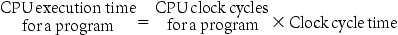

Hoặc, vì clock rate và clock cycle time là nghịch đảo,

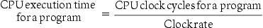

Công thức này cho thấy rõ người thiết kế hardware có thể cải thiện hiệu năng bằng cách giảm số clock cycle chương trình cần hoặc giảm độ dài clock cycle. Như sẽ thấy ở các chương sau, người thiết kế thường đối mặt với trade-off giữa số clock cycle cần cho chương trình và độ dài mỗi cycle. Nhiều kỹ thuật giảm số clock cycle cũng có thể làm tăng clock cycle time.

#### Cải thiện hiệu năng

**Ví dụ**

Chương trình ưa thích của chúng ta chạy trong 10 giây trên máy tính A có clock 2 GHz. Chúng ta đang giúp người thiết kế chế tạo máy tính B chạy chương trình trong 6 giây. Người thiết kế xác định có thể tăng đáng kể clock rate, nhưng mức tăng này ảnh hưởng phần còn lại của thiết kế CPU, khiến B cần số clock cycle gấp 1.2 lần A cho chương trình đó. Nên đề nghị người thiết kế nhắm tới clock rate nào?

**Trả lời**

Trước hết hãy tìm số clock cycle chương trình cần trên A:

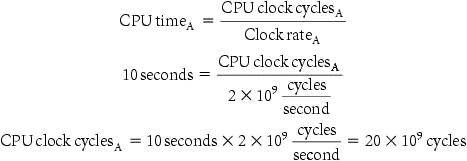

CPU time của B có thể được tìm bằng phương trình:

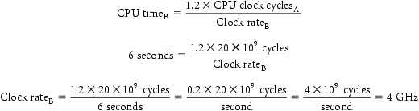

Để chạy chương trình trong 6 giây, B phải có clock rate gấp đôi A.

### Hiệu năng instruction

Các phương trình hiệu năng trên chưa đề cập số instruction cần cho chương trình. Tuy nhiên, vì compiler rõ ràng tạo ra instruction để thực thi và máy tính phải thực thi chúng để chạy chương trình, execution time phải phụ thuộc số instruction trong chương trình. Một cách nhìn execution time là nó bằng số instruction được thực thi nhân thời gian trung bình mỗi instruction. Do đó, số clock cycle cần cho chương trình có thể viết là

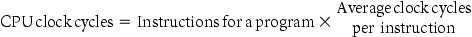

Thuật ngữ clock cycles per instruction, tức số clock cycle trung bình để thực thi mỗi instruction, thường được viết tắt là CPI. Vì các instruction khác nhau có thể mất thời gian khác nhau tùy việc chúng làm, CPI là giá trị trung bình của mọi instruction thực thi trong chương trình. CPI cung cấp một cách so sánh hai implementation khác nhau của cùng instruction set architecture, vì số instruction thực thi cho một chương trình tất nhiên sẽ giống nhau.

#### clock cycles per instruction (CPI)

Số clock cycle trung bình cho mỗi instruction của một chương trình hoặc đoạn chương trình.

#### Sử dụng phương trình hiệu năng

**Ví dụ**

Giả sử có hai implementation của cùng instruction set architecture. Máy tính A có clock cycle time 250 ps và CPI 2.0 cho một chương trình, còn B có clock cycle time 500 ps và CPI 1.2 cho cùng chương trình. Máy nào nhanh hơn với chương trình này và nhanh hơn bao nhiêu?

**Trả lời**

Ta biết mỗi máy thực thi cùng số instruction cho chương trình; gọi số đó là I. Trước hết tìm số processor clock cycle cho mỗi máy:

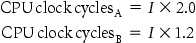

Bây giờ có thể tính CPU time của mỗi máy:

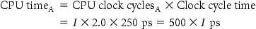

Tương tự, với B:

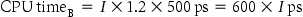

Rõ ràng máy tính A nhanh hơn. Mức nhanh hơn được cho bởi tỷ số execution time:

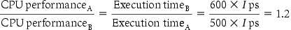

Có thể kết luận máy tính A nhanh gấp 1.2 lần B đối với chương trình này.

### Phương trình hiệu năng CPU kinh điển

Giờ ta có thể viết phương trình hiệu năng cơ bản này theo instruction count (số instruction được chương trình thực thi), CPI và clock cycle time:

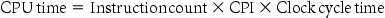

hoặc, vì clock rate là nghịch đảo của clock cycle time:

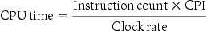

#### instruction count

Số instruction được chương trình thực thi.

Các công thức này đặc biệt hữu ích vì tách ba yếu tố chính ảnh hưởng đến hiệu năng. Ta có thể dùng chúng để so sánh hai implementation khác nhau hoặc đánh giá một phương án thiết kế nếu biết tác động của nó lên ba tham số này.

#### So sánh các đoạn code

**Ví dụ**

Người thiết kế compiler đang quyết định giữa hai chuỗi code cho một máy tính. Người thiết kế hardware cung cấp những thông tin sau:

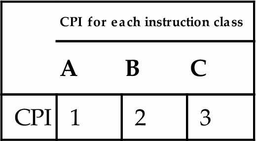

Với một câu lệnh ngôn ngữ high-level cụ thể, người viết compiler cân nhắc hai chuỗi code có instruction count như sau:

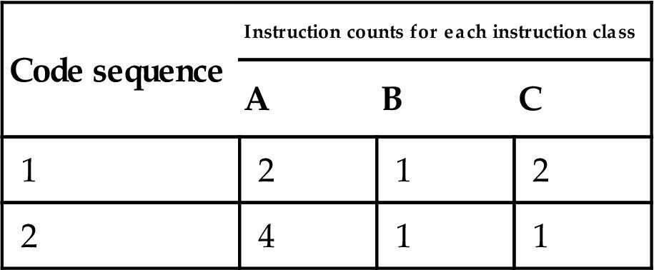

Chuỗi code nào thực thi nhiều instruction nhất? Chuỗi nào nhanh hơn? CPI của mỗi chuỗi là bao nhiêu?

**Trả lời**

Chuỗi 1 thực thi 2 +1 +2 =5 instruction. Chuỗi 2 thực thi 4 +1 +1 =6 instruction. Vì vậy chuỗi 1 thực thi ít instruction hơn.

Ta có thể dùng phương trình CPU clock cycle dựa trên instruction count và CPI để tìm tổng số clock cycle của từng chuỗi:

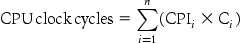

Kết quả là

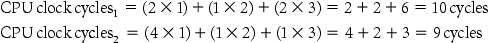

Vì vậy chuỗi code 2 nhanh hơn, dù thực thi thêm một instruction. Vì chuỗi code 2 dùng ít tổng clock cycle hơn nhưng có nhiều instruction hơn, nó phải có CPI thấp hơn. Các giá trị CPI có thể tính bằng

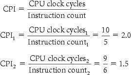

#### Bức tranh TỔNG THỂ

Hình 1.15 cho thấy những phép đo cơ bản ở các mức khác nhau trong máy tính và nội dung được đo ở từng trường hợp. Ta thấy cách các yếu tố kết hợp tạo execution time tính bằng giây trên mỗi chương trình:

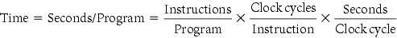

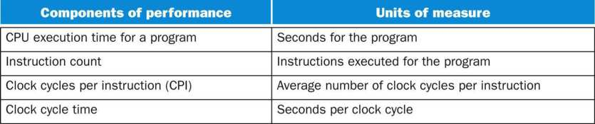

**HÌNH 1.15 Những thành phần cơ bản của hiệu năng và cách đo từng thành phần.**

Luôn nhớ rằng thước đo hiệu năng máy tính đầy đủ và đáng tin cậy duy nhất là thời gian. Ví dụ, thay instruction set để giảm instruction count có thể dẫn đến tổ chức có clock cycle time chậm hơn hoặc CPI cao hơn, bù trừ lợi ích từ giảm instruction count. Tương tự, vì CPI phụ thuộc loại instruction thực thi, code thực thi ít instruction nhất có thể không nhanh nhất.

Làm thế nào xác định giá trị các yếu tố trong phương trình hiệu năng? Ta có thể đo CPU execution time bằng cách chạy chương trình; clock cycle time thường được công bố trong tài liệu máy tính. Instruction count và CPI có thể khó thu thập hơn. Tất nhiên, nếu biết clock rate và CPU execution time, ta chỉ cần biết một trong hai instruction count hoặc CPI để xác định yếu tố còn lại.

Ta có thể đo instruction count bằng công cụ software profile việc thực thi hoặc simulator của architecture. Ngoài ra, có thể dùng hardware counter, được tích hợp trong phần lớn processor, để ghi nhiều phép đo như số instruction được thực thi, CPI trung bình và thường cả nguồn gây mất hiệu năng. Vì instruction count phụ thuộc architecture nhưng không phụ thuộc implementation cụ thể, ta có thể đo nó mà không cần biết mọi chi tiết implementation. Tuy nhiên, CPI phụ thuộc nhiều chi tiết thiết kế máy tính, gồm cả memory system và cấu trúc processor (như sẽ thấy ở Chương 4 và 5), cũng như tỷ lệ các loại instruction thực thi trong ứng dụng. Vì vậy CPI thay đổi theo ứng dụng và giữa những implementation có cùng instruction set.

Ví dụ trên cho thấy nguy cơ của việc chỉ dùng một yếu tố (instruction count) để đánh giá hiệu năng. Khi so sánh hai máy tính, phải xem cả ba thành phần kết hợp thành execution time. Nếu một số yếu tố giống nhau, như clock rate trong ví dụ trên, có thể xác định hiệu năng bằng cách so sánh mọi yếu tố không giống nhau. Vì CPI thay đổi theo instruction mix, phải so sánh cả instruction count lẫn CPI, ngay cả khi clock rate bằng nhau. Nhiều bài tập cuối chương yêu cầu bạn đánh giá chuỗi cải tiến máy tính và compiler ảnh hưởng đến clock rate, CPI và instruction count. Trong  Mục 1.10, chúng tôi khảo sát một phép đo hiệu năng phổ biến không bao gồm mọi thành phần, do đó có thể gây hiểu lầm.

#### instruction mix

Thước đo tần suất động của instruction trong một hoặc nhiều chương trình.

#### Tìm hiểu hiệu năng chương trình

Hiệu năng chương trình phụ thuộc thuật toán, ngôn ngữ, compiler, architecture và hardware thực tế. Bảng sau tóm lược cách những thành phần này ảnh hưởng đến các yếu tố trong phương trình hiệu năng CPU.

| Thành phần hardware hoặc software | Ảnh hưởng đến gì? | Như thế nào? |
|---|---|---|
| Algorithm | Instruction count, CPI | Thuật toán quyết định số instruction của chương trình nguồn được thực thi, từ đó quyết định số processor instruction thực thi. Thuật toán cũng có thể ảnh hưởng CPI bằng cách ưu tiên instruction chậm hoặc nhanh hơn. Ví dụ, nếu thuật toán dùng nhiều phép chia hơn, nó thường có CPI cao hơn. |
| Programming language | Instruction count, CPI | Ngôn ngữ lập trình chắc chắn ảnh hưởng instruction count, vì các câu lệnh trong ngôn ngữ được dịch thành processor instruction, thứ quyết định instruction count. Ngôn ngữ cũng có thể ảnh hưởng CPI qua các tính năng; chẳng hạn ngôn ngữ hỗ trợ mạnh data abstraction (ví dụ Java) đòi hỏi indirect call, sử dụng instruction có CPI cao hơn. |
| Compiler | Instruction count, CPI | Hiệu quả compiler ảnh hưởng cả instruction count lẫn số cycle trung bình mỗi instruction, vì compiler quyết định việc dịch instruction ngôn ngữ nguồn thành instruction máy tính. Vai trò compiler có thể rất phức tạp và ảnh hưởng CPI theo nhiều cách. |
| Instruction set architecture | Instruction count, clock rate, CPI | Instruction set architecture ảnh hưởng cả ba khía cạnh CPU performance, vì nó ảnh hưởng các instruction cần cho một chức năng, chi phí cycle của từng instruction và clock rate tổng thể của processor. |

#### Giải thích thêm

Tuy bạn có thể cho rằng CPI tối thiểu là 1.0, như sẽ thấy trong Chương 4, một số processor fetch và thực thi nhiều instruction mỗi clock cycle. Để phản ánh cách tiếp cận đó, một số người thiết kế đảo CPI để nói về IPC, hay instruction mỗi clock cycle. Nếu processor thực thi trung bình hai instruction mỗi clock cycle, nó có IPC 2 và do đó CPI 0.5.

#### Giải thích thêm

Tuy clock cycle time trước đây cố định, để tiết kiệm năng lượng hoặc tạm thời tăng hiệu năng, processor hiện nay có thể thay đổi clock rate, vì vậy cần dùng clock rate trung bình cho chương trình. Ví dụ, Intel Core i7 tạm tăng clock rate khoảng 10% cho đến khi chip quá nóng. Intel gọi đây là Turbo mode.

#### Tự kiểm tra

Một ứng dụng viết bằng Java chạy 15 giây trên desktop processor. Compiler Java mới được phát hành chỉ cần số instruction bằng 0.6 lần compiler cũ. Tiếc là CPI tăng lên 1.1 lần. Có thể kỳ vọng ứng dụng chạy nhanh đến đâu khi dùng compiler mới? Chọn đáp án đúng trong ba lựa chọn dưới đây: a. 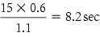 b. 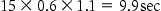 c. 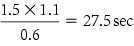

## 1.7 Power Wall

Hình 1.16 cho thấy sự tăng clock rate và công suất của tám thế hệ Intel microprocessor qua 30 năm. Cả clock rate lẫn công suất tăng nhanh trong hàng thập niên rồi gần đây chững lại. Chúng tăng cùng nhau vì có tương quan, và gần đây chậm lại vì chúng ta đã chạm giới hạn công suất thực tế để làm mát microprocessor phổ thông.

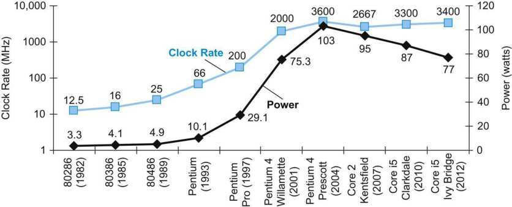

**HÌNH 1.16 Clock rate và công suất của Intel x86 microprocessor qua tám thế hệ và 30 năm. Pentium 4 tăng vọt clock rate và công suất nhưng hiệu năng tăng ít hơn. Vấn đề nhiệt của Prescott dẫn đến từ bỏ dòng Pentium 4. Dòng Core 2 quay về pipeline đơn giản hơn với clock rate thấp hơn và nhiều processor mỗi chip. Pipeline Core i5 tiếp bước cách làm đó.**

Mặc dù công suất giới hạn những gì có thể làm mát, trong kỷ nguyên post-PC tài nguyên thực sự quý giá là năng lượng. Thời lượng pin có thể quan trọng hơn hiệu năng trong personal mobile device, còn kiến trúc sư warehouse scale computer cố giảm chi phí cấp điện và làm mát 100,000 server vì chi phí ở quy mô này rất cao. Giống như đo thời gian bằng giây đánh giá hiệu năng chương trình an toàn hơn một tốc độ như MIPS (xem Mục 1.10), metric năng lượng joule là thước đo tốt hơn tốc độ công suất như watt, vốn chỉ là joule/giây.

Công nghệ chủ đạo cho integrated circuit được gọi là CMOS (complementary metal oxide semiconductor). Đối với CMOS, nguồn tiêu thụ năng lượng chính là năng lượng được gọi là dynamic energy (so-called dynamic energy), tức năng lượng được tiêu thụ khi transistor chuyển trạng thái từ 0 sang 1 và ngược lại. Dynamic energy phụ thuộc vào capacitive load của từng transistor và điện áp đặt vào:

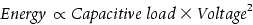

Phương trình này là năng lượng của một xung trong chuyển đổi logic 0 → 1 → 0 hoặc 1 → 0 → 1. Năng lượng của một lần chuyển đổi là

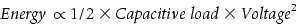

Công suất cần cho mỗi transistor chỉ là tích của năng lượng một lần chuyển đổi với tần số chuyển đổi:

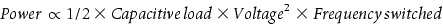

Tần số chuyển đổi là hàm của clock rate. Capacitive load trên mỗi transistor là hàm của cả số transistor nối với output (gọi là fanout) lẫn công nghệ, vốn quyết định điện dung của cả dây dẫn và transistor.

Xét Hình 1.16, làm sao clock rate tăng 1000 lần trong khi công suất chỉ tăng 30 lần? Có thể giảm năng lượng và do đó công suất bằng cách hạ điện áp, điều diễn ra ở mỗi thế hệ công nghệ mới, và công suất là hàm của bình phương điện áp. Thông thường điện áp giảm khoảng 15% mỗi thế hệ. Trong 20 năm, điện áp đã từ 5 V xuống 1 V, đó là lý do công suất chỉ tăng 30 lần.

### Công suất tương đối

**Ví dụ**

Giả sử chúng ta phát triển processor mới đơn giản hơn, có capacitive load bằng 85% processor cũ phức tạp hơn. Hơn nữa, giả sử nó có thể điều chỉnh điện áp để giảm 15% so với processor B, dẫn đến tần số giảm 15%. Tác động lên dynamic power là gì?

**Trả lời**

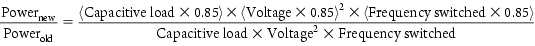

Vì vậy tỷ số công suất là

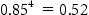

Do đó processor mới dùng khoảng một nửa công suất processor cũ.

Vấn đề hiện nay là hạ điện áp hơn nữa dường như khiến transistor rò quá nhiều, như vòi nước không thể khóa hẳn. Ngay hiện tại khoảng 40% công suất tiêu thụ của chip server do leakage. Nếu transistor bắt đầu rò nhiều hơn, toàn bộ quá trình có thể trở nên khó kiểm soát.

Để cố giải quyết vấn đề công suất, người thiết kế đã gắn các thiết bị lớn để tăng khả năng làm mát và tắt những phần chip không được dùng trong clock cycle nhất định. Mặc dù có nhiều cách làm mát chip đắt hơn để nâng công suất lên, chẳng hạn, 300 watt, những kỹ thuật này thường quá tốn kém cho personal computer và cả server, chưa nói đến personal mobile device.

Vì người thiết kế máy tính đã đâm vào power wall, họ cần một hướng đi mới. Họ chọn con đường khác với cách thiết kế microprocessor trong 30 năm đầu tiên.

### Giải thích thêm

Tuy dynamic energy là nguồn tiêu thụ năng lượng chính trong CMOS, static energy vẫn bị tiêu thụ do leakage current chạy ngay cả khi transistor tắt. Trong server, leakage thường chiếm 40% năng lượng tiêu thụ. Do đó tăng số transistor làm tăng công suất tỏa nhiệt, ngay cả khi transistor luôn tắt. Nhiều kỹ thuật thiết kế và đổi mới công nghệ đang được triển khai để kiểm soát leakage, nhưng rất khó hạ điện áp hơn nữa.

### Giải thích thêm

Công suất là thách thức cho integrated circuit vì hai lý do. Thứ nhất, điện phải được đưa vào và phân phối quanh chip; microprocessor hiện đại dùng hàng trăm chân chỉ cho nguồn và ground! Tương tự, nhiều tầng interconnect của chip chỉ được dùng phân phối nguồn và ground đến các phần chip. Thứ hai, công suất tiêu tán thành nhiệt và phải được đưa đi. Chip server có thể tiêu thụ hơn 100 watt; làm mát chip và hệ thống xung quanh là chi phí lớn trong warehouse scale computer (xem Chương 6).

## 1.8 Bước ngoặt: Chuyển từ uniprocessor sang multiprocessor

Giới hạn công suất đã buộc thiết kế microprocessor thay đổi mạnh mẽ. Hình 1.17 cho thấy mức cải thiện response time của chương trình trên desktop microprocessor theo thời gian. Từ năm 2002, tốc độ cải thiện chậm từ 1.5 lần mỗi năm xuống 1.2 lần mỗi năm.

Cho đến nay, phần lớn software giống bản nhạc viết cho người độc tấu; với thế hệ chip hiện tại, chúng ta có chút kinh nghiệm với song tấu, tứ tấu và những nhóm nhỏ khác; nhưng soạn tác phẩm cho dàn nhạc và hợp xướng lớn lại là kiểu thử thách khác.

Brian Hayes, Computing in a Parallel Universe, 2007.


**HÌNH 1.17 Sự tăng hiệu năng processor kể từ mid-1980s. Biểu đồ này thể hiện hiệu năng tương đối so với VAX 11/780, đo bằng các SPECint benchmark (xem Mục 1.10). Trước mid-1980s, sự tăng hiệu năng processor chủ yếu là technology-driven và trung bình khoảng 25% mỗi năm. Mức tăng lên khoảng 52% kể từ đó là nhờ các ý tưởng architecture và tổ chức tiên tiến hơn. Mức cải thiện hiệu năng hằng năm cao hơn, 52% từ mid-1980s, có nghĩa hiệu năng năm 2002 lớn hơn khoảng bảy lần so với nếu vẫn giữ ở 25%. Từ năm 2002, giới hạn công suất, instruction-level parallelism sẵn có và memory latency dài gần đây đã làm chậm mức tăng hiệu năng uniprocessor xuống khoảng 22% mỗi năm.**

Thay vì tiếp tục giảm response time của một chương trình chạy trên một processor, từ năm 2006 mọi công ty desktop và server đều cung cấp microprocessor có nhiều processor trên mỗi chip, trong đó lợi ích thường nằm ở throughput hơn response time. Để giảm nhầm lẫn giữa processor và microprocessor, các công ty gọi processor là “core”, và những microprocessor như vậy thường được gọi là multicore microprocessor. Vì thế microprocessor “quadcore” là chip chứa bốn processor hay bốn core.

Trước đây, lập trình viên có thể dựa vào đổi mới hardware, architecture và compiler để tăng gấp đôi hiệu năng chương trình sau mỗi 18 tháng mà không đổi một dòng code. Ngày nay, để cải thiện đáng kể response time, lập trình viên cần viết lại chương trình để tận dụng nhiều processor. Hơn nữa, để tiếp tục hưởng lợi ích truyền thống là chạy nhanh hơn trên microprocessor mới, họ phải tiếp tục cải thiện hiệu năng code khi số core tăng.

Để nhấn mạnh cách hệ thống software và hardware phối hợp, chúng tôi dùng mục đặc biệt Hardware/Software Interface xuyên suốt sách, với mục đầu tiên bên dưới. Những mục này tóm lược các nhận thức quan trọng tại interface cốt yếu đó.

### Hardware/Software Interface

Parallelism luôn quan trọng với hiệu năng điện toán, nhưng thường bị che giấu. Chương 4 giải thích pipelining, kỹ thuật tinh tế làm chương trình nhanh hơn bằng cách chồng lấp việc thực thi instruction. Tối ưu này là một ví dụ instruction-level parallelism, trong đó tính song song của hardware được trừu tượng hóa để lập trình viên và compiler có thể xem hardware như thực thi instruction tuần tự.


Buộc lập trình viên nhận biết hardware song song và viết lại chương trình thành song song từng là “đường ray thứ ba” nguy hiểm của kiến trúc máy tính, vì những công ty trước đây phụ thuộc vào thay đổi hành vi như vậy đều thất bại (xem  Mục 6.15). Từ góc nhìn lịch sử đó, thật đáng kinh ngạc khi toàn ngành IT đặt cược tương lai vào việc cuối cùng lập trình viên sẽ chuyển thành công sang lập trình song song tường minh.

Vì sao viết chương trình song song tường minh lại khó với lập trình viên? Lý do đầu tiên là lập trình song song theo định nghĩa chính là lập trình hướng hiệu năng, làm tăng độ khó. Chương trình không chỉ cần đúng, giải quyết vấn đề quan trọng và cung cấp interface hữu ích cho người hoặc chương trình khác gọi nó; chương trình còn phải nhanh. Nếu không cần hiệu năng thì chỉ cần viết chương trình tuần tự.

Lý do thứ hai là nhanh trên hardware song song có nghĩa lập trình viên phải chia ứng dụng sao cho mỗi processor có lượng công việc gần bằng nhau tại cùng thời điểm, và overhead lập lịch, phối hợp không làm tiêu tan lợi ích hiệu năng tiềm năng của parallelism.

Để so sánh, giả sử nhiệm vụ là viết một bài báo. Tám phóng viên cùng làm có thể viết nhanh gấp tám lần. Muốn đạt tốc độ đó, cần chia nhiệm vụ để mỗi phóng viên đều có việc làm đồng thời. Vì thế phải lập lịch các sub-tasks. Nếu có trục trặc và chỉ một phóng viên mất thời gian lâu hơn bảy người còn lại, lợi ích của tám người viết sẽ giảm. Do đó phải cân bằng tải đều để đạt speedup mong muốn. Nguy cơ khác là các phóng viên phải mất nhiều thời gian trao đổi để viết phần của mình. Bạn cũng không đạt mục tiêu nếu một phần bài báo, như kết luận, không thể viết trước khi các phần khác hoàn tất. Vì vậy phải chú ý giảm overhead truyền thông và đồng bộ. Trong cả phép so sánh này lẫn lập trình song song, thách thức bao gồm lập lịch, cân bằng tải, thời gian đồng bộ và overhead truyền thông giữa các bên. Như có thể đoán, thử thách khó hơn khi có thêm phóng viên viết bài hoặc thêm processor cho lập trình song song.

Để phản ánh bước ngoặt của ngành, mỗi chương trong năm chương tiếp theo của ấn bản này đều có một mục về tác động của cuộc cách mạng song song đến nội dung chương:

- Chương 2, Mục 2.11: Parallelism và instruction: Synchronization. Các tác vụ song song thường độc lập đôi lúc cần phối hợp, chẳng hạn để báo đã hoàn thành công việc. Chương này giải thích các instruction mà multicore processor dùng để đồng bộ tác vụ.

- Chương 3, Mục 3.6: Parallelism và số học máy tính: Subword parallelism. Có lẽ dạng parallelism đơn giản nhất để xây dựng là tính toán đồng thời trên các phần tử, như khi nhân hai vector. Subword parallelism tận dụng tài nguyên Moore’s Law cung cấp để tạo đơn vị số học rộng hơn, có thể thao tác trên nhiều operand đồng thời.


- Chương 4, Mục 4.10: Parallelism qua instruction. Do khó khăn của lập trình song song tường minh, trong thập niên 1990 người ta đầu tư nỗ lực to lớn để hardware và compiler tìm ra parallelism tiềm ẩn, ban đầu qua pipelining. Chương này mô tả một số kỹ thuật mạnh mẽ, gồm fetch và thực thi nhiều instruction đồng thời, phỏng đoán kết quả quyết định và thực thi instruction suy đoán bằng prediction.


- Chương 5, Mục 5.10: Parallelism và memory hierarchy: Cache coherence. Một cách giảm chi phí truyền thông là cho mọi processor dùng cùng address space, để processor bất kỳ đều đọc hoặc ghi được dữ liệu bất kỳ. Vì mọi processor hiện nay dùng cache để giữ bản sao tạm của dữ liệu trong memory nhanh hơn gần processor, dễ hình dung lập trình song song còn khó hơn nếu cache gắn với mỗi processor giữ các giá trị shared data không nhất quán. Chương này mô tả cơ chế giữ dữ liệu nhất quán trong mọi cache.


- Chương 5, Mục 5.11: Parallelism và memory hierarchy: Redundant Arrays of Inexpensive Disks. Mục này mô tả cách kết hợp nhiều đĩa có thể cung cấp throughput cao hơn nhiều, nguồn cảm hứng ban đầu của Redundant Arrays of Inexpensive Disks (RAID). Điều thực sự làm RAID phổ biến là độ tin cậy cao hơn nhiều nhờ bổ sung một số đĩa dự phòng vừa phải. Mục này giải thích sự khác nhau về hiệu năng, chi phí và độ tin cậy giữa các RAID level.

Ngoài những mục đó, còn có cả một chương về xử lý song song. Chương 6 đi sâu hơn vào thách thức lập trình song song; trình bày hai cách truyền thông tương phản là shared addressing và explicit message passing; mô tả mô hình parallelism hạn chế hơn nhưng dễ lập trình hơn; thảo luận khó khăn khi benchmark parallel processor; giới thiệu mô hình hiệu năng đơn giản mới cho multicore microprocessor; và cuối cùng mô tả, đánh giá bốn ví dụ multicore microprocessor bằng mô hình này. Như đã nói, Chương 3 đến 6 dùng phép nhân ma trận với vector làm ví dụ xuyên suốt để chỉ ra mỗi loại parallelism có thể tăng đáng kể hiệu năng ra sao.

 Phụ lục B mô tả một thành phần hardware ngày càng phổ biến trong desktop computer, graphics processing unit (GPU). Được phát minh để tăng tốc đồ họa, GPU đang trở thành nền tảng lập trình độc lập. Như bạn có thể đoán trong thời đại này, GPU dựa vào parallelism.

 Phụ lục B mô tả NVIDIA GPU và làm nổi bật một số phần môi trường lập trình song song của nó.


Tôi nghĩ [máy tính] sẽ là ý tưởng có thể áp dụng rộng khắp, giống như sách. Nhưng tôi không nghĩ nó phát triển nhanh như đã diễn ra, vì tôi không hình dung chúng ta có thể đưa nhiều thành phần lên một chip đến mức cuối cùng đã đạt được. Transistor xuất hiện ngoài dự kiến. Mọi việc diễn ra nhanh hơn nhiều so với chúng tôi mong đợi.

J. Presper Eckert, đồng phát minh ENIAC, phát biểu năm 1991

## 1.9 Thực tế: Benchmark Intel Core i7

Mỗi chương có một mục tên “Thực tế”, gắn khái niệm trong sách với máy tính bạn có thể dùng hằng ngày. Các mục này trình bày công nghệ nền tảng của máy tính hiện đại. Trong mục “Thực tế” đầu tiên, chúng ta xem cách chế tạo integrated circuit và đo hiệu năng, công suất, lấy Intel Core i7 làm ví dụ.

### SPEC CPU Benchmark

Người dùng máy tính chạy cùng những chương trình hết ngày này sang ngày khác là ứng viên hoàn hảo để đánh giá máy tính mới. Tập chương trình chạy tạo thành workload. Để đánh giá hai hệ thống máy tính, người dùng chỉ cần so sánh execution time của workload trên hai máy. Tuy nhiên, phần lớn người dùng không ở tình huống này. Thay vào đó, họ phải dựa vào phương pháp khác đo hiệu năng máy đang cân nhắc, hy vọng chúng phản ánh mức hoạt động của máy với workload của mình. Cách thay thế này thường được thực hiện bằng việc đánh giá máy với tập benchmark—những chương trình được chọn riêng để đo hiệu năng. Các benchmark tạo thành workload mà người dùng hy vọng dự đoán được hiệu năng workload thực tế. Như đã lưu ý, muốn làm nhanh trường hợp phổ biến, trước hết phải biết chính xác trường hợp nào phổ biến, nên benchmark đóng vai trò quan trọng trong kiến trúc máy tính.


#### workload

Tập chương trình chạy trên máy tính, có thể là tập ứng dụng thực tế của người dùng hoặc được tạo từ chương trình thực để xấp xỉ tổ hợp đó. Workload điển hình xác định cả chương trình lẫn tần suất tương đối.

#### benchmark

Chương trình được chọn để dùng so sánh hiệu năng máy tính.

SPEC (System Performance Evaluation Cooperative) là nỗ lực được nhiều nhà cung cấp máy tính tài trợ và hỗ trợ nhằm tạo các tập benchmark tiêu chuẩn cho hệ thống máy tính hiện đại. Năm 1989, SPEC ban đầu tạo tập benchmark tập trung vào hiệu năng processor (nay gọi là SPEC89), đã phát triển qua năm thế hệ. Mới nhất là SPEC CPU2006, gồm 12 integer benchmark (CINT2006) và 17 floating-point benchmark (CFP2006). Integer benchmark đa dạng từ một phần compiler C đến chương trình cờ vua và mô phỏng máy tính lượng tử. floating-point benchmark gồm code lưới có cấu trúc cho mô hình phần tử hữu hạn, code phương pháp hạt cho động lực học phân tử và code đại số tuyến tính thưa cho động lực học chất lỏng.

Hình 1.18 mô tả SPEC integer benchmark và execution time trên Intel Core i7, đồng thời chỉ ra các yếu tố giải thích execution time: instruction count, CPI và clock cycle time. Lưu ý CPI thay đổi hơn 5 lần.


**HÌNH 1.18 Các benchmark SPECINTC2006 chạy trên Intel Core i7 920 2.66 GHz. Như phương trình ở trang 36 giải thích, execution time là tích ba yếu tố trong bảng: instruction count tính bằng tỷ, clocks per instruction (CPI) và clock cycle time tính bằng nanosecond. SPECratio đơn giản là thời gian tham chiếu do SPEC cung cấp chia cho execution time đo được. Con số duy nhất được công bố dưới tên SPECINTC2006 là trung bình nhân của các SPECratio.**

Để đơn giản hóa việc tiếp thị máy tính, SPEC quyết định báo cáo một con số tổng hợp cả 12 integer benchmark. Chia execution time của processor tham chiếu cho execution time máy được đánh giá sẽ chuẩn hóa các phép đo execution time; phép chuẩn hóa tạo ra thước đo gọi là SPECratio, có ưu điểm kết quả số lớn hơn biểu thị hiệu năng nhanh hơn. Tức SPECratio là nghịch đảo của execution time. Phép đo tổng hợp CINT2006 hoặc CFP2006 được thu bằng cách lấy trung bình nhân các SPECratio.

#### Giải thích thêm

Khi so sánh hai máy tính bằng SPECratio, hãy dùng trung bình nhân để cho cùng kết quả tương đối bất kể máy nào được dùng chuẩn hóa kết quả. Nếu lấy trung bình cộng các execution time đã chuẩn hóa, kết quả thay đổi tùy máy được chọn làm tham chiếu.

Công thức trung bình nhân là


trong đó Execution time ratio<sub>i</sub> là execution time được chuẩn hóa theo máy tham chiếu của chương trình thứ i trong tổng n chương trình của workload, và


### SPEC Power Benchmark

Do năng lượng và công suất ngày càng quan trọng, SPEC bổ sung benchmark đo công suất. Nó báo cáo công suất tiêu thụ của server ở các mức workload khác nhau, chia thành từng nấc 10%, trong một khoảng thời gian. Hình 1.19 cho thấy kết quả của server dùng Intel Nehalem processor tương tự phía trên.


**HÌNH 1.19 SPECpower_ssj2008 chạy trên Intel Xeon X5650 hai socket 2.66 GHz với 16 GB DRAM và một đĩa SSD 100 GB.**

SPECpower bắt đầu từ một SPEC benchmark khác cho ứng dụng doanh nghiệp Java (SPECJBB2005), sử dụng processor, cache, main memory cũng như Java virtual machine, compiler, garbage collector và các phần operating system. Hiệu năng đo bằng throughput, với đơn vị thao tác nghiệp vụ mỗi giây. Một lần nữa, để đơn giản hóa tiếp thị máy tính, SPEC rút gọn những con số này thành một số, gọi là “overall ssj_ops per watt”. Công thức cho metric tổng hợp duy nhất này là


trong đó ssj_ops<sub>i</sub> là hiệu năng tại mỗi nấc 10% và power<sub>i</sub> là công suất tiêu thụ tại từng mức hiệu năng.

## 1.10 Ngộ nhận và cạm bẫy

Khoa học phải bắt đầu từ những huyền thoại và sự phê phán huyền thoại.

Sir Karl Popper, The Philosophy of Science, 1957 Mục đích của phần ngộ nhận và cạm bẫy có trong mỗi chương là giải thích những quan niệm sai phổ biến bạn có thể gặp. Chúng tôi gọi chúng là ngộ nhận. Khi thảo luận một ngộ nhận, chúng tôi cố đưa ra phản ví dụ. Chúng tôi cũng bàn về cạm bẫy, hay những sai lầm dễ mắc. Cạm bẫy thường là sự khái quát hóa những nguyên tắc chỉ đúng trong bối cảnh hạn chế. Mục đích của những phần này là giúp bạn tránh mắc sai lầm khi thiết kế hoặc sử dụng máy tính. Ngộ nhận và cạm bẫy về chi phí/hiệu năng từng đánh lừa nhiều kiến trúc sư máy tính, kể cả chúng tôi. Vì vậy mục này không thiếu ví dụ liên quan. Chúng tôi bắt đầu bằng cạm bẫy khiến nhiều người thiết kế mắc phải và bộc lộ quan hệ quan trọng trong thiết kế máy tính.

Cạm bẫy: Kỳ vọng cải thiện một khía cạnh máy tính sẽ tăng hiệu năng tổng thể theo tỷ lệ tương ứng với mức cải thiện đó.

Ý tưởng lớn làm nhanh trường hợp phổ biến có một hệ quả gây nản lòng, từng làm khổ người thiết kế cả hardware và software. Nó nhắc rằng cơ hội cải thiện bị ảnh hưởng bởi lượng thời gian sự kiện chiếm dụng.


Một bài toán thiết kế đơn giản minh họa rõ điều này. Giả sử chương trình chạy trong 100 giây, với phép nhân chiếm 80 giây. Phải cải thiện tốc độ nhân bao nhiêu nếu muốn chương trình nhanh gấp năm lần?

Execution time của chương trình sau cải tiến được cho bởi phương trình đơn giản sau, gọi là Amdahl’s Law:


### Amdahl’s Law

Quy tắc phát biểu rằng mức tăng hiệu năng có thể đạt từ một cải tiến bị giới hạn bởi mức độ sử dụng tính năng được cải tiến. Đây là phiên bản định lượng của quy luật lợi ích giảm dần.

Với bài toán này:


Vì muốn hiệu năng nhanh gấp năm, execution time mới phải là 20 giây, cho ta


Tức không có mức enhance-multiply nào giúp tăng hiệu năng gấp năm nếu phép nhân chỉ chiếm 80% workload. Mức tăng hiệu năng có thể đạt từ một cải tiến bị giới hạn bởi mức sử dụng tính năng được cải tiến. Trong đời sống thường ngày, khái niệm này cũng tạo nên điều gọi là quy luật lợi ích giảm dần.

Ta có thể dùng Amdahl’s Law ước tính cải thiện hiệu năng khi biết thời gian tiêu thụ của một chức năng và speedup tiềm năng. Amdahl’s Law cùng phương trình hiệu năng CPU là công cụ thuận tiện để đánh giá cải tiến khả dĩ. Amdahl’s Law được khảo sát kỹ hơn trong bài tập.

Amdahl’s Law cũng được dùng để lập luận về giới hạn thực tế của số parallel processor. Chúng tôi xem xét lập luận này trong mục Ngộ nhận và cạm bẫy của Chương 6.

Ngộ nhận: Máy tính có mức sử dụng thấp tiêu thụ ít công suất.

Hiệu quả công suất ở mức sử dụng thấp quan trọng vì workload server thay đổi. Ví dụ, mức sử dụng server trong warehouse scale computer của Google phần lớn thời gian nằm giữa 10% và 50%, còn ở 100% ít hơn 1% thời gian. Ngay cả sau 5 năm học cách chạy tốt SPECpower benchmark, máy tính được cấu hình chuyên biệt đạt kết quả tốt nhất năm 2012 vẫn dùng 33% công suất đỉnh ở 10% tải. Hệ thống thực tế không cấu hình cho SPECpower benchmark chắc chắn tệ hơn.

Vì workload server thay đổi nhưng vẫn dùng tỷ lệ lớn công suất đỉnh, Luiz Barroso và Urs Hölzle [2007] cho rằng nên thiết kế lại hardware để đạt “energy-proportional computing”. Nếu server tương lai dùng, chẳng hạn, 10% công suất đỉnh ở 10% workload, chúng ta có thể giảm hóa đơn điện datacenter và trở thành doanh nghiệp có trách nhiệm trong thời đại ngày càng lo ngại phát thải CO<sub>2</sub>.

Ngộ nhận: Thiết kế hướng hiệu năng và thiết kế hướng hiệu quả năng lượng là hai mục tiêu không liên quan.

Vì năng lượng là công suất tích lũy theo thời gian, tối ưu hardware hoặc software giúp tốn ít thời gian hơn thường tiết kiệm năng lượng tổng thể, ngay cả khi tối ưu dùng thêm chút năng lượng lúc hoạt động. Một lý do là mọi phần còn lại của máy tính đều tiêu thụ năng lượng khi chương trình chạy, nên dù phần tối ưu dùng thêm chút năng lượng, thời gian giảm có thể tiết kiệm năng lượng cả hệ thống.

Cạm bẫy: Dùng một tập con của phương trình hiệu năng làm metric hiệu năng.

Chúng tôi đã cảnh báo nguy cơ dự đoán hiệu năng chỉ từ một trong các yếu tố clock rate, instruction count hoặc CPI. Một sai lầm phổ biến khác là chỉ dùng hai trong ba yếu tố để so sánh. Tuy cách dùng hai trong ba có thể đúng trong bối cảnh hạn chế, khái niệm cũng dễ bị lạm dụng. Thực vậy, gần như mọi đề xuất thay thế thời gian làm metric hiệu năng cuối cùng đều dẫn đến tuyên bố gây hiểu lầm, kết quả sai lệch hoặc diễn giải sai.

Một lựa chọn thay thời gian là MIPS (million instructions per second). Với chương trình nhất định, MIPS đơn giản là


Vì MIPS là tốc độ thực thi instruction, nó biểu thị hiệu năng ngược với execution time; máy nhanh hơn có chỉ số MIPS cao hơn. Ưu điểm của MIPS là dễ hiểu, và máy nhanh hơn nghĩa là MIPS lớn hơn, phù hợp trực giác.

### million instructions per second (MIPS)

Phép đo tốc độ thực thi chương trình dựa trên số triệu instruction. MIPS được tính bằng instruction count chia tích execution time với 10<sup>6</sup>.

Có ba vấn đề khi dùng MIPS để so sánh máy tính. Thứ nhất, MIPS xác định tốc độ thực thi instruction nhưng không xét khả năng của instruction. Không thể dùng MIPS so sánh máy tính có instruction set khác nhau vì instruction count chắc chắn khác. Thứ hai, MIPS thay đổi giữa các chương trình trên cùng máy; do đó máy tính không thể có một chỉ số MIPS duy nhất. Ví dụ, thay biểu thức execution time, ta thấy quan hệ giữa MIPS, clock rate và CPI:


CPI thay đổi 5 lần với SPEC CPU2006 trên máy Intel Core i7 trong Hình 1.18, nên MIPS cũng vậy. Cuối cùng và quan trọng nhất, nếu chương trình mới thực thi nhiều instruction hơn nhưng mỗi instruction nhanh hơn, MIPS có thể thay đổi độc lập với hiệu năng!

Xét các phép đo hiệu năng sau của một chương trình:

### Tự kiểm tra

| Phép đo | Máy tính A | Máy tính B |
|---|---|---|
| Instruction count | 10 tỷ | 8 tỷ |
| Clock rate | 4 GHz | 4 GHz |
| CPI | 1.0 | 1.1 |

a. Máy tính nào có chỉ số MIPS cao hơn?

b. Máy tính nào nhanh hơn?

## 1.11 Nhận xét kết thúc

Tuy khó dự đoán chính xác mức chi phí/hiệu năng của máy tính tương lai, có thể chắc rằng chúng sẽ tốt hơn nhiều so với hiện nay. Để tham gia vào tiến bộ này, người thiết kế máy tính và lập trình viên phải hiểu nhiều vấn đề hơn.

Trong khi … ENIAC được trang bị 18,000 vacuum tube và nặng 30 tấn, máy tính tương lai có thể có 1,000 vacuum tube và có lẽ chỉ nặng 1½ tấn.

Popular Mechanics, tháng 3 năm 1949

Người thiết kế cả hardware lẫn software xây dựng hệ thống máy tính thành các lớp phân cấp, mỗi lớp thấp che chi tiết khỏi lớp trên. Ý tưởng lớn abstraction này là nền tảng để hiểu hệ thống máy tính ngày nay, nhưng không có nghĩa người thiết kế chỉ cần biết một abstraction. Có lẽ ví dụ quan trọng nhất là interface giữa hardware và software low-level, gọi là instruction set architecture. Giữ instruction set architecture không đổi cho phép nhiều implementation của architecture đó—có lẽ khác nhau về chi phí và hiệu năng—chạy cùng software giống hệt. Mặt bất lợi là architecture có thể ngăn đưa vào đổi mới đòi hỏi thay đổi interface.


Có phương pháp đáng tin cậy để xác định và báo cáo hiệu năng bằng cách dùng execution time của chương trình thực làm metric. Execution time này liên hệ với những phép đo quan trọng khác có thể thực hiện qua phương trình:


Chúng ta sẽ dùng phương trình này cùng các yếu tố của nó nhiều lần. Tuy nhiên, hãy nhớ từng yếu tố riêng lẻ không quyết định hiệu năng: chỉ tích của chúng, bằng execution time, mới là thước đo hiệu năng đáng tin cậy.

### Bức tranh TỔNG THỂ

Execution time là thước đo hiệu năng hợp lệ và không thể bác bỏ duy nhất. Nhiều metric khác đã được đề xuất rồi bộc lộ thiếu sót. Có khi metric sai ngay từ đầu vì không phản ánh execution time; có khi metric đúng trong bối cảnh hạn chế lại được mở rộng, dùng ngoài bối cảnh đó hoặc thiếu giải thích bổ sung cần thiết để nó hợp lệ.

Công nghệ hardware chính của processor hiện đại là silicon. Hiểu tốc độ thay đổi công nghệ dự kiến theo Moore’s Law quan trọng ngang với hiểu công nghệ integrated circuit. Trong khi silicon thúc đẩy tiến bộ nhanh chóng của hardware, ý tưởng mới trong tổ chức máy tính đã cải thiện giá/hiệu năng. Hai ý tưởng chính là khai thác parallelism trong chương trình, hiện nay thường qua nhiều processor, và khai thác locality của truy cập memory hierarchy, thường qua cache.


Hiệu quả năng lượng đã thay diện tích die làm tài nguyên quan trọng nhất của thiết kế microprocessor. Tiết kiệm công suất trong khi cố tăng hiệu năng buộc ngành hardware chuyển sang multicore microprocessor, từ đó đòi hỏi ngành software chuyển sang lập trình hardware song song. Parallelism giờ là điều bắt buộc để có hiệu năng.


Thiết kế máy tính luôn được đánh giá bằng chi phí và hiệu năng, cũng như các yếu tố quan trọng khác như năng lượng, độ tin cậy, chi phí sở hữu và khả năng mở rộng. Tuy chương này tập trung vào chi phí, hiệu năng và năng lượng, thiết kế tốt nhất phải cân bằng thích hợp mọi yếu tố cho một thị trường cụ thể.

### Lộ trình cuốn sách

Ở đáy các abstraction này là năm thành phần kinh điển của máy tính: datapath, control, memory, input và output (xem Hình 1.5). Năm thành phần này cũng làm khung cho các chương còn lại:

- Datapath: Chương 3, Chương 4, Chương 6 và  Phụ lục B

- Control: Chương 4, Chương 6 và  Phụ lục B

- Memory: Chương 5

- Input: Chương 5 và 6

- Output: Chương 5 và 6

Như đã đề cập, Chương 4 mô tả cách processor khai thác parallelism tiềm ẩn; Chương 6 mô tả multicore microprocessor song song tường minh ở trung tâm cuộc cách mạng song song; và  Phụ lục B mô tả chip graphics processor có mức song song cao. Chương 5 mô tả cách memory hierarchy khai thác locality. Chương 2 mô tả instruction set—interface giữa compiler với máy tính—và nhấn mạnh vai trò compiler, ngôn ngữ lập trình khi sử dụng tính năng instruction set. Chương 3 mô tả cách máy tính xử lý dữ liệu số học. Phụ lục A giới thiệu logic design.


## Góc nhìn lịch sử và tài liệu đọc thêm

Một lĩnh vực khoa học năng động giống tổ kiến khổng lồ; cá nhân gần như tan biến vào tập hợp trí óc chen chúc nhau, mang thông tin từ nơi này đến nơi khác, truyền nó đi với tốc độ ánh sáng.

Lewis Thomas, “Natural Science,” in The Lives of a Cell, 1974

Với mỗi chương trong sách, có thể tìm phần góc nhìn lịch sử trực tuyến trên website đi kèm. Chúng tôi có thể theo dõi sự phát triển một ý tưởng qua chuỗi máy tính hoặc mô tả dự án quan trọng, và cung cấp tài liệu tham khảo nếu bạn muốn tìm hiểu sâu hơn.

Góc nhìn lịch sử của chương này cung cấp bối cảnh cho một số ý tưởng chính trong chương mở đầu. Mục đích là kể câu chuyện con người đằng sau tiến bộ công nghệ và đặt thành tựu vào bối cảnh lịch sử. Nghiên cứu quá khứ có thể giúp bạn hiểu hơn những lực định hình điện toán tương lai. Mỗi mục Góc nhìn lịch sử trực tuyến kết thúc bằng gợi ý đọc thêm, cũng được gom riêng trực tuyến trong mục “Tài liệu đọc thêm”. Phần còn lại của  Mục 1.12 có trực tuyến.

## 1.12 Góc nhìn lịch sử và tài liệu đọc thêm

Một lĩnh vực khoa học năng động giống tổ kiến khổng lồ; cá nhân gần như tan biến vào tập hợp trí óc chen chúc nhau, mang thông tin từ nơi này đến nơi khác, truyền nó đi với tốc độ ánh sáng.

Lewis Thomas, “Natural Science,” in The Lives of a Cell, 1974

Với mỗi chương trong sách, có thể tìm phần góc nhìn lịch sử trực tuyến. Chúng tôi có thể theo dõi sự phát triển một ý tưởng qua chuỗi máy hoặc mô tả dự án quan trọng, và cung cấp tài liệu tham khảo nếu bạn muốn tìm hiểu sâu hơn.

Góc nhìn lịch sử của chương này cung cấp bối cảnh cho một số ý tưởng chính được trình bày. Mục đích là kể câu chuyện con người đằng sau tiến bộ công nghệ và đặt thành tựu vào bối cảnh lịch sử. Tìm hiểu quá khứ có thể giúp bạn hiểu hơn những lực định hình điện toán tương lai. Mỗi mục góc nhìn lịch sử kết thúc bằng gợi ý đọc bổ sung, cũng được gom riêng trong mục trực tuyến “Tài liệu đọc thêm”.

### Những máy tính điện tử đầu tiên

J. Presper Eckert và John Mauchly tại Moore School thuộc University of Pennsylvania chế tạo chiếc được công nhận rộng rãi là máy tính điện tử general-purpose hoạt động đầu tiên trên thế giới. Máy này, tên ENIAC (Electronic Numerical Integrator and Calculator), do Lục quân Hoa Kỳ tài trợ và bắt đầu hoạt động trong Thế chiến II nhưng mãi năm 1946 mới công bố. ENIAC là máy general-purpose dùng tính bảng artillery-firing. Hình e1.12.1 cho thấy máy tính U-shaped dài 80 feet, cao 8.5 feet và rộng vài feet. Mỗi register trong 20 register 10-digit dài 2 feet. Tổng cộng ENIAC dùng 18,000 vacuum tube.


**HÌNH E1.12.1 ENIAC, máy tính điện tử general-purpose đầu tiên trên thế giới.**

Về kích thước, ENIAC lớn hơn máy ngày nay hai bậc độ lớn, nhưng chậm hơn trên tám bậc độ lớn, thực hiện 1900 phép cộng mỗi giây. ENIAC cung cấp conditional jump và có thể lập trình, khác rõ rệt máy tính toán trước đó. Lập trình được thực hiện bằng tay bằng cách cắm cáp, đặt công tắc, còn dữ liệu nhập qua thẻ đục lỗ. Lập trình cho phép tính điển hình cần từ nửa giờ đến cả ngày. ENIAC là máy general-purpose, chủ yếu bị giới hạn bởi storage ít và việc lập trình tẻ nhạt.

Năm 1944, John von Neumann bị thu hút đến dự án ENIAC. Nhóm muốn cải thiện cách nhập chương trình và thảo luận việc lưu chương trình dưới dạng số; von Neumann giúp làm rõ ý tưởng và viết bản ghi nhớ đề xuất máy tính stored-program tên EDVAC (Electronic Discrete Variable Automatic Computer). Herman Goldstine phân phát bản ghi nhớ và ghi tên von Neumann lên đó, khiến Eckert và Mauchly rất thất vọng vì tên họ bị bỏ sót. Bản ghi nhớ này là cơ sở cho thuật ngữ phổ biến máy tính von Neumann. Một số người tiên phong cho rằng thuật ngữ dành quá nhiều công lao cho von Neumann, người viết ý tưởng, và quá ít cho các kỹ sư Eckert, Mauchly, những người làm việc trên máy. Vì vậy thuật ngữ không xuất hiện ở nơi khác trong sách hay các phần trực tuyến.

Năm 1946, Maurice Wilkes thuộc Cambridge University đến Moore School dự phần cuối chuỗi bài giảng về phát triển máy tính điện tử. Khi về Cambridge, Wilkes quyết định khởi động dự án chế tạo máy tính stored-program tên EDSAC (Electronic Delay Storage Automatic Calculator). EDSAC bắt đầu hoạt động năm 1949, là máy tính full-scale, stored-program hoạt động đầu tiên trên thế giới [Wilkes, 1985]. (Một prototype nhỏ tên Mark-I, chế tạo tại University of Manchester năm 1948, có thể được gọi là máy stored-program hoạt động đầu tiên.) Mục 2.5 giải thích khái niệm stored-program.

Năm 1947, Eckert và Mauchly nộp đơn bằng sáng chế máy tính điện tử. Trưởng Moore School yêu cầu chuyển bằng sáng chế cho trường, điều có thể giúp họ quyết định rời đi. Sự ra đi làm tê liệt dự án EDVAC, trì hoãn hoàn thành đến năm 1952.

Goldstine rời đi để tham gia cùng von Neumann tại Institute for Advanced Study (IAS) ở Princeton năm 1946. Cùng Arthur Burks, họ công bố báo cáo dựa trên bản ghi nhớ trước đó [Burks et al., 1946]. Bài báo phi thường đối với thời kỳ đó; đọc hôm nay, bạn khó đoán tài liệu cột mốc này viết hơn 50 năm trước vì nó bàn phần lớn khái niệm architecture trong máy tính hiện đại. Bài báo dẫn đến máy IAS do Julian Bigelow chế tạo. Nó có tổng 1024 word 40-bit và nhanh hơn ENIAC khoảng 10 lần. Nhóm suy nghĩ về ứng dụng máy, công bố loạt báo cáo và khuyến khích khách đến thăm. Những báo cáo và khách thăm truyền cảm hứng phát triển nhiều máy tính mới.

Gần đây có tranh cãi về công trình John Atanasoff, người chế tạo máy tính điện tử small-scale đầu thập niên 1940. Máy của ông, thiết kế ở Iowa State University, là máy tính special-purpose chưa bao giờ hoạt động hoàn toàn. Mauchly thăm Atanasoff ngắn trước khi chế tạo ENIAC. Sự tồn tại máy Atanasoff, cùng chậm trễ nộp bằng sáng chế ENIAC (công việc mật, không thể nộp cho đến sau chiến tranh) và việc phổ biến bài báo EDVAC của von Neumann, được dùng để phá bằng sáng chế Eckert-Mauchly. Tuy tranh cãi vai trò Atanasoff vẫn gay gắt, Eckert và Mauchly thường được ghi nhận đã chế tạo máy tính điện tử general-purpose hoạt động đầu tiên [Stern, 1980].

Một máy tính tiên phong khác đáng được ghi nhận là máy special-purpose do Konrad Zuse chế tạo tại Đức cuối thập niên 1930 và đầu thập niên 1940. Tuy Zuse đã có thiết kế máy tính lập trình được, chính phủ Đức quyết định không tài trợ nghiên cứu khoa học mất hơn 2 năm vì giới quan chức dự kiến thắng chiến tranh trước hạn đó.

Bên kia eo biển Anh, trong Thế chiến II người ta chế tạo máy tính điện tử special-purpose để giải mã điện văn Đức bị chặn. Nhóm ở Bletchley Park, gồm Alan Turing, chế tạo Colossus năm 1943. Những máy này được giữ bí mật đến năm 1970; sau chiến tranh nhóm ít ảnh hưởng đến máy tính thương mại Anh.

Khi công việc ENIAC tiến triển, Howard Aiken xây máy tính electro-mechanical tên Mark-I ở Harvard (tên Manchester sau đó dùng cho máy mình). Sau Mark-I ông làm máy relay Mark-II và cặp máy vacuum tube Mark-III, Mark-IV. Trái với máy trước như EDSAC dùng một memory chung cho instruction và dữ liệu, Mark-III và Mark-IV có memory riêng cho instruction và dữ liệu. Người ủng hộ máy tính stored-program coi chúng là bước lùi; thuật ngữ Harvard architecture ra đời để mô tả máy có memory tách biệt. Tôn trọng lịch sử, ngày nay thuật ngữ được dùng với nghĩa khác: máy có một main memory nhưng cache riêng cho instruction và dữ liệu.

Dự án Whirlwind bắt đầu tại MIT năm 1947, hướng đến ứng dụng xử lý tín hiệu radar real-time. Tuy dẫn đến nhiều phát minh, đổi mới quan trọng nhất là magnetic core memory. Whirlwind có 2048 word 16-bit magnetic core. Magnetic core là công nghệ main memory gần 30 năm.

### Phát triển thương mại

Tháng 12 năm 1947, Eckert và Mauchly thành lập Eckert-Mauchly Computer Corporation. Máy đầu tiên của họ, BINAC, được chế tạo cho Northrop và trình diễn tháng 8 năm 1949. Sau khó khăn tài chính, công ty được Remington-Rand mua lại; ở đó họ chế tạo UNIVAC I (Universal Automatic Computer), thiết kế để bán như máy tính general-purpose (Hình e1.12.2). Giao lần đầu tháng 6 năm 1951, UNIVAC I có giá khoảng $1 triệu và là máy tính thương mại thành công đầu tiên—48 hệ thống được chế tạo! Máy thời kỳ đầu này, cùng nhiều tư liệu hấp dẫn khác về lịch sử máy tính, có thể xem tại Computer History Museum ở Mountain View, California.


**HÌNH E1.12.2 UNIVAC I, máy tính thương mại đầu tiên ở Hoa Kỳ. Nó dự đoán đúng kết quả bầu cử tổng thống năm 1952, nhưng dự báo ban đầu không được phát sóng vì chuyên gia nghi ngờ việc dùng kết quả sớm như vậy.**

IBM từng kinh doanh thẻ đục lỗ và tự động hóa văn phòng nhưng đến năm 1950 mới bắt đầu chế tạo máy tính. Máy IBM đầu tiên, IBM 701, giao năm 1952 và cuối cùng bán được 19 chiếc. Đầu thập niên 1950, nhiều người bi quan về tương lai máy tính, tin rằng thị trường và cơ hội cho những máy “chuyên dụng cao” này khá hạn chế.

Năm 1964, sau đầu tư $5 tỷ, IBM có bước đi táo bạo khi công bố System/360. Người phát ngôn IBM khi đó nói:

Chúng tôi hoàn toàn không khiêm tốn trong thông báo này. Đây là thông báo sản phẩm quan trọng nhất lịch sử công ty. Nó không phải máy tính theo bất kỳ nghĩa nào trước đây. Không phải một sản phẩm mà là một dòng sản phẩm … trải về hiệu năng từ mức rất thấp đến rất cao của dòng máy tính.

Đưa ý tưởng architecture abstraction vào thực tế thương mại, IBM công bố sáu implementation System/360 architecture có giá và hiệu năng khác nhau 25 lần. Hình e1.12.3 cho thấy bốn mẫu. IBM đặt cược cả công ty vào thành công của một họ máy tính và đã thắng. System/360 cùng các máy kế nhiệm thống trị thị trường máy tính lớn.


**HÌNH E1.12.3 Máy tính IBM System/360: các model 40, 50, 65 và 75 đều được giới thiệu năm 1964. Bốn model này khác nhau gần 10 lần về chi phí và hiệu năng; mức chênh tăng lên 25 nếu gồm model 20 và 30 (không thể hiện). Clock rate, khoảng kích thước memory và giá xấp xỉ chỉ gồm processor và memory dung lượng trung bình: (a) model 40, 1.6 MHz, 32 KB–256 KB, $225,000; (b) model 50, 2.0 MHz, 128 KB–256 KB, $550,000; (c) model 65, 5.0 MHz, 256 KB–1 MB, $1,200,000; và (d) model 75, 5.1 MHz, 256 KB–1 MB, $1,900,000. Thêm thiết bị I/O thường làm giá tăng 1.8 đến 3.5 lần, với hệ số cao hơn cho model rẻ hơn.**

Khoảng một năm sau, Digital Equipment Corporation (DEC) giới thiệu PDP-8, minicomputer thương mại đầu tiên. Máy nhỏ này là đột phá trong thiết kế low-cost, cho phép DEC chào bán máy tính dưới $20,000. Minicomputer là tiền thân microprocessor, với Intel phát minh microprocessor đầu tiên năm 1971—Intel 4004.

Năm 1963, supercomputer đầu tiên được công bố. Thông báo không đến từ công ty lớn hay thậm chí trung tâm high-tech. Seymour Cray dẫn dắt thiết kế Control Data Corporation CDC 6600 ở Minnesota. Máy này gồm nhiều ý tưởng đang bắt đầu xuất hiện trong microprocessor mới nhất. Sau đó Cray rời CDC lập Cray Research, Inc., ở Wisconsin. Năm 1976, ông công bố Cray-1 (Hình e1.12.4). Máy này đồng thời nhanh nhất thế giới, đắt nhất và có chi phí/hiệu năng tốt nhất cho chương trình khoa học.


**HÌNH E1.12.4 Cray-1, vector supercomputer thương mại đầu tiên, công bố năm 1976. Máy có điểm khác thường là vừa nhanh nhất cho ứng dụng khoa học vừa có giá/hiệu năng tốt nhất cho những ứng dụng đó. Nhìn từ trên, máy giống chữ C. Seymour Cray qua đời năm 1996 vì chấn thương trong tai nạn ô tô. Khi mất, người tiên phong máy tính 70-year-old này đang thực hiện tầm nhìn về thế hệ supercomputer tiếp theo. <sub>(Xem </sub><sub>www.cray.com</sub><sub> để biết thêm</sub> chi tiết.)**

Trong khi Seymour Cray tạo ra máy tính đắt nhất thế giới, người thiết kế khắp thế giới tìm cách dùng microprocessor tạo máy tính rẻ đến mức có thể có trong nhà. Không có một khởi nguồn duy nhất cho personal computer, nhưng năm 1977, Apple IIe (Hình e1.12.5) của Steve Jobs và Steve Wozniak đặt tiêu chuẩn về chi phí thấp, sản lượng cao và độ tin cậy cao, định hình ngành personal computer.


**HÌNH E1.12.5 Apple IIc Plus. Do Steve Wozniak thiết kế, Apple IIc đặt tiêu chuẩn về chi phí và độ tin cậy cho ngành.**

Tuy nhiên, dù có lợi thế đi trước 4-year, personal computer Apple chỉ đứng thứ hai về độ phổ biến. IBM Personal Computer, công bố năm 1981, trở thành máy tính best-selling trong mọi loại; thành công của nó đem lại cho Intel microprocessor phổ biến nhất và Microsoft operating system phổ biến nhất. Ngày nay, CD phổ biến nhất là operating system Microsoft, dù giá cao gấp nhiều lần CD nhạc! Tất nhiên, trong hơn 30 năm tồn tại, personal computer IBM-compatible đã phát triển rất nhiều. Thực tế, personal computer đầu tiên có processor 16-bit, 64 kilobyte memory và chỉ một đĩa mềm low-density, chậm làm nonvolatile storage! IBM ban đầu phát triển đĩa mềm để nạp chương trình chẩn đoán vào mainframe, nhưng chúng là thiết bị I/O chính trong personal computer gần 20 năm trước khi CD và mạng khiến chúng lỗi thời như phương tiện trao đổi dữ liệu.


Tất nhiên, Intel microprocessor cũng phát triển từ PC đầu tiên dùng processor 16-bit với external interface 8-bit! Trong Chương 2, chúng tôi viết về sự phát triển Intel architecture.

Personal computer đầu tiên khá đơn giản, ít hoặc không có đồ họa, không thiết bị trỏ và operating system sơ khai so với ngày nay. Máy truyền cảm hứng cho nhiều khái niệm architecture và software đặc trưng của desktop hiện đại là Xerox Alto trong Hình e1.12.6. Alto được tạo làm prototype thử nghiệm của máy tính tương lai; vài trăm Alto được chế tạo, trong đó số đáng kể tặng cho đại học. Công nghệ tích hợp trong Alto gồm:

- màn hình đồ họa bit-mapped tích hợp với máy tính (màn hình đồ họa trước đó hoạt động như terminal, thường nối với máy tính lớn hơn)

- chuột, được phát minh trước đó nhưng có trên mọi Alto và dùng rộng rãi trong user interface

- local area network (LAN), trở thành tiền thân Ethernet

- user interface dựa trên Windows, có editor WYSIWYG (what you see is what you get) và chương trình vẽ tương tác


**HÌNH E1.12.6 Xerox Alto là nguồn cảm hứng chính cho desktop computer hiện đại. Nó gồm chuột, cơ chế bit-mapped, user interface Windows-based và kết nối mạng cục bộ.**

Ngoài ra, file server và print server đều được phát triển, kết nối qua local area network; kết nối giữa local area network và wide area ARPAnet tạo những phiên bản Internet-style networking đầu tiên. Xerox Alto có ảnh hưởng to lớn, tác động rõ ràng đến thiết kế nhiều máy tính và hệ thống software, gồm Apple Macintosh, PC IBM-compatible, MacOS, Windows, Sun và những workstation thời đầu khác.

### Đo hiệu năng

Ngay từ buổi đầu điện toán, người thiết kế đã đặt mục tiêu hiệu năng—ENIAC phải nhanh gấp 1000 Harvard Mark-I, còn IBM Stretch (7030) phải nhanh gấp 100 máy nhanh nhất lúc đó. Tuy nhiên, điều chưa rõ là đo hiệu năng như thế nào.

Thước đo hiệu năng ban đầu là thời gian cần để thực hiện thao tác riêng lẻ như phép cộng. Vì phần lớn instruction có cùng execution time, thời gian của instruction này cũng như instruction khác. Tuy nhiên, khi execution time của instruction trong máy tính đa dạng hơn, thời gian một thao tác không còn hữu ích để so sánh.

Để xét khác biệt đó, instruction mix được tính bằng cách đo tần suất tương đối của instruction trong máy tính qua nhiều chương trình. Nhân thời gian từng instruction với trọng số trong mix cho người dùng execution time trung bình mỗi instruction. (Nếu đo bằng clock cycle, execution time trung bình mỗi instruction bằng CPI trung bình.) Vì instruction set tương tự nhau, đây là cách so sánh chính xác hơn thời gian cộng. Từ execution time trung bình mỗi instruction đến MIPS chỉ còn bước nhỏ. MIPS có ưu điểm dễ hiểu, nên ngày càng phổ biến.

### Tìm kiếm chương trình trung bình

Khi processor phức tạp hơn và dựa vào memory hierarchy (chủ đề Chương 5), pipelining (chủ đề Chương 4), không còn execution time duy nhất cho mỗi instruction; do đó không thể tính execution time lẫn MIPS từ instruction mix và tài liệu hướng dẫn.

Tuy ngày nay có vẻ hiển nhiên rằng nên phát triển tập ứng dụng thực để dùng làm benchmark tiêu chuẩn, đây là việc khó cho đến tương đối gần đây. Khác biệt về operating system và tiêu chuẩn ngôn ngữ khiến khó tạo chương trình lớn có thể chuyển từ máy này sang máy khác chỉ bằng compile lại.

Thay vào đó, bước tiếp theo là benchmark bằng chương trình tổng hợp. Chương trình tổng hợp Whetstone được tạo bằng cách đo chương trình khoa học viết bằng Algol-60 (xem mô tả Curnow và Wichmann [1976]). Chương trình được chuyển sang Fortran và dùng rộng rãi để đặc trưng hiệu năng chương trình khoa học. Hiệu năng Whetstone thường công bố bằng Whetstone mỗi giây—số lần thực thi một vòng lặp Whetstone benchmark! Dhrystone là benchmark tổng hợp khác vẫn được dùng trong một số giới embedded computing (xem mô tả và phương pháp Weicker [1984]).

Khoảng cùng lúc Whetstone được phát triển, khái niệm kernel benchmark trở nên phổ biến. Kernel là những đoạn nhỏ, time-intensive từ chương trình thực được trích ra dùng làm benchmark. Cách này chủ yếu được phát triển để benchmark máy tính high-end, đặc biệt supercomputer. Livermore Loops và Linpack là ví dụ best-known. Livermore Loops gồm chuỗi 21 đoạn vòng lặp nhỏ. Linpack gồm một phần package subroutine đại số tuyến tính. Kernel thích hợp nhất để tách hiệu năng từng tính năng máy tính và giải thích nguyên nhân khác biệt hiệu năng chương trình thực. Vì ứng dụng khoa học thường dùng đoạn code nhỏ chạy lâu, đặc trưng hiệu năng bằng kernel phổ biến nhất trong nhóm ứng dụng này. Tuy kernel giúp làm rõ hiệu năng, chúng thường phóng đại hiệu năng ứng dụng thực.

### Suy đoán hiệu năng với SPEC

Tiến bộ quan trọng trong đánh giá hiệu năng là thành lập nhóm System Performance Evaluation Cooperative (SPEC) năm 1988. SPEC gồm đại diện nhiều công ty máy tính—các nhà sáng lập là Apollo/ Hewlett-Packard, DEC, MIPS và Sun—đồng ý dùng một tập chương trình và input thực mà tất cả sẽ chạy. SPEC không thể ra đời trước khi có operating system portable và sự phổ biến của ngôn ngữ high-level. Giờ đây compiler cũng được chấp nhận là phần chính đáng của hiệu năng hệ thống máy tính và phải được đo trong mọi đánh giá.

Lịch sử dạy rằng tuy nỗ lực SPEC có thể hữu ích với máy hiện tại, nó không đáp ứng nhu cầu thế hệ tiếp theo nếu không thay đổi. Năm 1991, thước đo throughput được bổ sung, dựa trên chạy nhiều phiên bản benchmark. Nó hữu ích nhất để đánh giá việc dùng chia sẻ thời gian của uniprocessor hoặc multiprocessor. Các system benchmark khác gồm hoạt động OS-intensive và I/O-intensive cũng được thêm. Thay đổi khác là bỏ một số benchmark và thêm benchmark khác. Một hệ quả của khó khăn tìm benchmark là phiên bản SPEC đầu (SPEC89) chứa sáu floating-point benchmark nhưng chỉ bốn integer benchmark. Tính một phép đo tổng hợp bằng trung bình nhân các execution time chuẩn hóa theo VAX-11/780 khiến thước đo ưu ái máy có hiệu năng floating-point mạnh.

Năm 1992, tập benchmark mới (SPEC92) được giới thiệu. Nó thêm benchmark, bỏ matrix300 và cung cấp trung bình riêng (SPEC INT và SPECFP) cho chương trình integer và floating-point. Ngoài ra, thước đo SPECbase không cho phép cờ tối ưu program-specific được thêm để cung cấp phép đo hiệu năng gần trải nghiệm chương trình của người dùng hơn. Các số SPECFP tăng nhiều nhất so với phép đo SPECFP cơ sở, thường cao hơn từ 15% đến 30%.

Năm 1995, tập benchmark lại cập nhật, thêm integer và floating-point benchmark mới, bỏ một số benchmark có lỗi hoặc thời gian chạy trở nên quá ngắn do hiệu năng cải thiện 20 lần trở lên từ bản SPEC đầu. SPEC95 cũng đổi máy cơ sở chuẩn hóa thành Sun SPARC Station 10/40, vì ngày càng khó tìm phiên bản hoạt động của máy cơ sở ban đầu!

Phiên bản SPEC mới nhất là SPEC2006. Có lẽ đáng ngạc nhiên nhất là mọi chương trình floating-point trong SPEC2006 đều mới; với integer, chỉ hai chương trình từ SPEC2000, một từ SPEC95, không có từ SPEC92 và một từ SPEC89. Chương trình duy nhất sống sót từ SPEC89 là compiler gcc.

SPEC cũng thêm các benchmark suite ngoài suite ban đầu hướng đến CPU performance. Năm 2008, SPEC cung cấp tập benchmark cho đồ họa, tính toán khoa học high-performance, object-oriented computing, file system, Web server và client, Java, ứng dụng CAD kỹ thuật và công suất.

### Sự phát triển của embedded computing

Embedded processor đã tồn tại rất lâu; thực tế minicomputer và microprocessor đầu tiên ban đầu được phát triển để điều khiển chức năng trong phòng thí nghiệm hoặc ứng dụng công nghiệp. Trong nhiều năm, ứng dụng chủ đạo là điều khiển công nghiệp; tuy tiếp tục tăng trưởng, processor thường rất rẻ và hiệu năng tương đối thấp. Ví dụ, processor best-selling trên thế giới vẫn là microcontroller 8-bit dùng trong ô tô, một số thiết bị gia dụng và ứng dụng đơn giản khác.

Cuối thập niên 1980 và đầu 1990 xuất hiện cơ hội mới cho embedded processor, từ trò chơi điện tử tiên tiến và set-top box đến điện thoại di động, personal digital assistant. Số thiết bị thông tin tăng nhanh và sự phát triển mạng thúc đẩy tăng vọt số embedded processor cùng yêu cầu hiệu năng. Để đánh giá hiệu năng, cộng đồng embedded lấy cảm hứng SPEC để tạo Embedded Microprocessor Benchmark Consortium (EEMBC). Bắt đầu năm 1997, nó gồm tập kernel tổ chức thành suite phục vụ những phần khác nhau của ngành embedded. Họ công bố thế hệ benchmark thứ hai năm 2007.

### Một Half-Century tiến bộ

Từ năm 1951, hàng nghìn máy tính mới dùng nhiều công nghệ với năng lực rất khác nhau ra đời. Hình e1.12.7 tóm lược đặc điểm chính của một số máy trong mục và cho thấy thay đổi to lớn chỉ trong hơn 50 năm. Sau điều chỉnh lạm phát, giá/hiệu năng cải thiện gần 100 tỷ lần trong 55 năm, hay khoảng 58% mỗi năm. Nói cách khác, chi phí cải thiện 10,000 lần và hiệu năng cải thiện 10,000,000 lần.


**HÌNH E1.12.7 Đặc điểm máy tính thương mại chính từ năm 1950, theo đô la thực tế và đô la năm 2007 điều chỉnh lạm phát. Hàng cuối giả sử tận dụng hết hiệu năng tiềm năng của bốn core Barcelona. Trái Hình e1.12.3, ở đây giá IBM S/360 model 50 gồm thiết bị I/O. <sub>(Nguồn: The Computer History</sub> Museum và Producer Price Index for Industrial Commodities.)**

Độc giả quan tâm lịch sử máy tính nên tham khảo Annals of the History of Computing, tạp chí chuyên lịch sử điện toán. Cũng đã có nhiều sách về buổi đầu điện toán, nhiều cuốn do người tiên phong viết, gồm Goldstine [1972], Metropolis et al. [1980] và Wilkes [1985].

### Tài liệu đọc thêm

Barroso, L. and U. Hölzle [2007]. “The case for energy-proportional computing”, IEEE Computer December.

Lời kêu gọi thay đổi bản chất thành phần máy tính để chúng dùng ít công suất hơn nhiều khi mức sử dụng thấp.

Bell, C. G. [1996]. Computer Pioneers and Pioneer Computers, ACM and the Computer Museum, videotapes.

Hai băng video về lịch sử điện toán do Gordon và Gwen Bell sản xuất, gồm các máy và người phát minh: Harvard Mark-I, ENIAC, EDSAC, máy IAS và nhiều máy khác.

Burks, A. W., H. H. Goldstine, and J. von Neumann [1946]. “Preliminary discussion of the logical design of an electronic computing instrument,” Report to the U.S. Army Ordnance Department, p. 1; also appears in Papers of John von Neumann, W. Aspray and A. Burks (Eds.), MIT Press, Cambridge, MA, and Tomash Publishers, Los Angeles, 1987, 97–146.

Bài báo kinh điển giải thích hardware và software trước khi máy tính stored-program đầu tiên được chế tạo. Chúng tôi trích dẫn nhiều trong Chương 3. Nó vừa giải thích máy tính cho thế giới vừa gây tranh cãi vì bản thảo đầu không ghi công Eckert và Mauchly.

Campbell-Kelly, M. and W. Aspray [1996]. Computer: A History of the Information Machine, Basic Books, New York.

Hai sử gia ghi lại câu chuyện đầy kịch tính. The New York Times đánh giá sách viết hay và có thẩm quyền.

Ceruzzi, P. F. [1998]. A History of Modern Computing, MIT Press, Cambridge, MA.

Mô tả tốt lịch sử điện toán giai đoạn sau: integrated circuit và tác động, personal computer, UNIX và Internet.

Curnow, H. J. and B. A. Wichmann [1976]. “A synthetic benchmark”, The Computer J. 19(1):80.

Mô tả benchmark tổng hợp lớn đầu tiên, Whetstone, và cách nó được tạo ra.

Flemming, P. J. and J. J. Wallace [1986]. “How not to lie with statistics: The correct way to summarize benchmark results”, Comm. ACM 29:3 (March), 218–21.

Mô tả một số nguyên tắc nền tảng khi dùng các loại trung bình khác nhau để tổng hợp kết quả hiệu năng.

Goldstine, H. H. [1972]. The Computer: From Pascal to von Neumann, Princeton University Press, Princeton, NJ.

Góc nhìn cá nhân về điện toán của một người tiên phong từng làm việc cùng von Neumann.

Hayes, B. [2007]. “Computing in a parallel universe”, American Scientist Vol. 95(November–December):476–480.

Tổng quan thử thách điện toán song song viết cho người không chuyên.

Hennessy, J. L. and D. A. Patterson [2007]. Chapter 1 of Computer Architecture: A Quantitative Approach, fourth edition, Morgan Kaufmann Publishers, San Francisco.

Mục 1.5 đi sâu hơn về công suất, Mục 1.6 có nhiều chi tiết hơn về chi phí integrated circuit và giải thích nguyên nhân khác biệt giữa giá và chi phí, còn Mục 1.8 cung cấp thêm chi tiết đánh giá hiệu năng.

Lampson, B. W. [1986]. “Personal distributed computing; The Alto and Ethernet software.” In ACM Conference on the History of Personal Workstations (January).

Thacker, C. R. [1986]. “Personal distributed computing: The Alto and Ethernet hardware,” In ACM Conference on the History of Personal Workstations (January).

Hai bài báo mô tả software và hardware của máy Alto mang tính cột mốc.

Metropolis, N., J. Howlett, and G.-C. Rota (Eds.) [1980]. A History of Computing in the Twentieth Century, Academic Press, New York.

Tập tiểu luận mô tả con người, software, máy tính và phòng thí nghiệm tham gia những máy tính thử nghiệm, thương mại đầu tiên. Phần lớn tác giả trực tiếp tham gia dự án. Danh mục tham khảo tuyệt vời về báo cáo thời đầu kết thúc cuốn sách thú vị này.

Public Broadcasting System [1992]. The Machine That Changed the World, videotapes.

Năm chương trình 1-hour này gồm cảnh quay hiếm và phỏng vấn người tiên phong ngành máy tính.

Slater, R. [1987]. Portraits in Silicon, MIT Press, Cambridge, MA.

Tiểu sử ngắn của 31 người tiên phong máy tính.

Stern, N. [1980]. “Who invented the first electronic digital computer?” Annals of the History of Computing 2:4 (October), 375–76

Góc nhìn sử gia về Atanasoff so với Eckert và Mauchly.

Weicker, R. P. [1984]. “Dhrystone: a synthetic systems programming benchmark”, Communications of the ACM 27(10):1013– 1030.

Mô tả chương trình benchmark tổng hợp cho systems code.

Wilkes, M.V. [1985]. Memoirs of a Computer Pioneer, MIT Press, Cambridge, MA.

Góc nhìn cá nhân về điện toán của một người tiên phong.

## 1.13 Bài tập

Mức thời gian tương đối của bài tập được ghi trong ngoặc vuông sau mỗi số bài. Trung bình, bài mức [10] mất thời gian gấp đôi bài mức [5]. Các mục cần đọc trước khi làm được ghi trong ngoặc nhọn góc; ví dụ <§1.4> nghĩa là bạn nên đọc Mục 1.4, Bên trong máy tính, để hỗ trợ giải bài này.

1.1 [2] <§1.1> Ngoài điện thoại thông minh mà một tỷ người sử dụng, hãy liệt kê và mô tả bốn loại máy tính khác.

1.2 [5] <§1.2> Tám ý tưởng lớn trong kiến trúc máy tính tương tự ý tưởng ở lĩnh vực khác. Ghép tám ý tưởng “Thiết kế theo Moore’s Law”, “Dùng abstraction để đơn giản hóa thiết kế”, “Làm nhanh trường hợp phổ biến”, “Hiệu năng thông qua parallelism”, “Hiệu năng thông qua pipelining”, “Hiệu năng thông qua prediction”, “Memory hierarchy” và “Độ tin cậy thông qua redundancy” với các ý tưởng sau từ lĩnh vực khác:

a. Dây chuyền lắp ráp trong chế tạo ô tô

b. Cáp cầu treo

c. Hệ thống định vị hàng không và hàng hải tích hợp thông tin gió

d. Thang máy tốc hành trong tòa nhà

e. Quầy tài liệu dành riêng ở thư viện

f. Tăng diện tích gate trên transistor CMOS để giảm thời gian chuyển mạch

g. Bổ sung máy phóng máy bay điện từ (chạy điện thay vì các mẫu steam-powered hiện tại), nhờ khả năng phát điện tăng từ công nghệ lò phản ứng mới

h. Chế tạo ô tô self-driving có hệ thống điều khiển phần nào dựa vào hệ thống cảm biến đã lắp trên xe cơ sở, như hệ thống cảnh báo lệch làn và điều khiển hành trình thông minh

1.3 [2] <§1.3> Mô tả các bước chuyển chương trình viết bằng ngôn ngữ high-level như C thành biểu diễn được processor máy tính thực thi trực tiếp.

1.4 [2] <§1.4> Giả sử màn hình màu dùng 8 bit cho mỗi màu cơ bản (đỏ, lục, lam) trên mỗi pixel và kích thước frame 1280 ×1024.

a. Kích thước tối thiểu theo byte của frame buffer để lưu một frame là bao nhiêu?

b. Tối thiểu mất bao lâu để gửi frame qua mạng 100 Mbit/s?

1.5 [4] <§1.6> Xét ba processor P1, P2 và P3 thực thi cùng instruction set. P1 có clock rate 3 GHz, CPI 1.5. P2 có clock rate 2.5 GHz, CPI 1.0. P3 có clock rate 4.0 GHz, CPI 2.2.

a. Processor nào có hiệu năng cao nhất tính bằng instruction mỗi giây?

b. Nếu mỗi processor thực thi chương trình trong 10 giây, tìm số cycle và số instruction.

c. Ta muốn giảm execution time 30%, nhưng điều này làm CPI tăng 20%. Cần clock rate nào để đạt mức giảm thời gian đó?

1.6 [20] <§1.6> Xét hai implementation của cùng instruction set architecture. Instruction chia thành bốn nhóm theo CPI (A, B, C, D). P1 có clock rate 2.5 GHz và các CPI 1, 2, 3, 3; P2 có clock rate 3 GHz và các CPI 2, 2, 2, 2. Với chương trình có dynamic instruction count 1.0E6 instruction chia như sau: 10% nhóm A, 20% nhóm B, 50% nhóm C, 20% nhóm D, P1 hay P2 nhanh hơn?

a. CPI tổng thể cho mỗi implementation là bao nhiêu?

b. Tìm clock cycle cần trong cả hai trường hợp.

1.7 [15] <§1.6> Compiler có thể ảnh hưởng sâu sắc đến hiệu năng ứng dụng. Giả sử với một chương trình, compiler A tạo dynamic instruction count 1.0E9 và execution time 1.1 s, còn compiler B tạo dynamic instruction count 1.2E9 và execution time 1.5 s.

a. Tìm CPI trung bình cho mỗi chương trình khi processor có clock cycle time 1 ns.

b. Giả sử các chương trình đã compile chạy trên hai processor khác nhau. Nếu execution time trên hai processor bằng nhau, clock của processor chạy code compiler A nhanh hơn clock của processor chạy code compiler B bao nhiêu?

c. Compiler mới được phát triển chỉ dùng 6.0E8 instruction và có CPI trung bình 1.1. Speedup khi dùng compiler mới so với compiler A hoặc B trên processor ban đầu là bao nhiêu?

1.8 Processor Pentium 4 Prescott, phát hành năm 2004, có clock rate 3.6 GHz, điện áp 1.25 V. Giả sử trung bình nó tiêu thụ 10 W static power và 90 W dynamic power. Core i5 Ivy Bridge, phát hành năm 2012, có clock rate 3.4 GHz, điện áp 0.9 V. Giả sử trung bình nó tiêu thụ 30 W static power và 40 W dynamic power.

1.8.1 [5] <§1.7> Với mỗi processor, tìm capacitive load trung bình.

1.8.2 [5] <§1.7> Tìm tỷ lệ phần trăm tổng công suất tiêu tán do static power và tỷ số static power trên dynamic power cho mỗi công nghệ.

1.8.3 [15] <§1.7> Nếu tổng công suất tiêu tán cần giảm 10%, phải giảm điện áp bao nhiêu để giữ nguyên leakage current? Lưu ý: công suất được định nghĩa bằng tích điện áp với dòng điện.

1.9 Giả sử với arithmetic, load/store và branch instruction, processor có CPI tương ứng 1, 12 và 5. Giả sử trên một processor, chương trình cần thực thi 2.56E9 arithmetic instruction, 1.28E9 load/store instruction và 256 triệu branch instruction. Mỗi processor có tần số clock 2 GHz.

Giả sử khi chương trình được song song hóa để chạy trên nhiều core, số arithmetic và load/store instruction mỗi processor được chia cho 0.7 × p (p là số processor), nhưng số branch instruction mỗi processor giữ nguyên.

1.9.1 [5] <§1.7> Tìm tổng execution time của chương trình trên 1, 2, 4 và 8 processor; chỉ ra speedup tương đối của kết quả 2, 4, 8 processor so với một processor.

1.9.2 [10] <§§1.6, 1.8> Nếu CPI của arithmetic instruction tăng gấp đôi, execution time chương trình trên 1, 2, 4 hoặc 8 processor bị ảnh hưởng thế nào?

1.9.3 [10] <§§1.6, 1.8> Phải giảm CPI của load/store instruction xuống bao nhiêu để một processor đạt hiệu năng bằng bốn processor dùng CPI ban đầu?

1.10 Giả sử wafer đường kính 15 cm có chi phí 12, chứa 84 die và có 0.020 defect/cm<sup>2</sup>. Wafer đường kính 20 cm có chi phí 15, chứa 100 die và có 0.031 defect/cm<sup>2</sup>.

1.10.1 [10] <§1.5> Tìm yield cho cả hai wafer.

1.10.2 [5] <§1.5> Tìm chi phí mỗi die cho cả hai wafer.

1.10.3 [5] <§1.5> Nếu số die trên wafer tăng 10% và defect trên đơn vị diện tích tăng 15%, tìm diện tích die và yield.

1.10.4 [5] <§1.5> Giả sử quy trình chế tạo cải thiện yield từ 0.92 lên 0.95. Tìm defect trên đơn vị diện tích cho mỗi phiên bản công nghệ với diện tích die 200 mm<sup>2</sup>.

1.11 Kết quả SPEC CPU2006 bzip2 benchmark chạy trên AMD Barcelona có instruction count 2.389E12, execution time 750 s và thời gian tham chiếu 9650 s.

1.11.1 [5] <§§1.6, 1.9> Tìm CPI nếu clock cycle time là 0.333 ns.

1.11.2 [5] <§1.9> Tìm SPECratio.

1.11.3 [5] <§§1.6, 1.9> Tìm mức tăng CPU time nếu số instruction của benchmark tăng 10% mà không ảnh hưởng CPI.

1.11.4 [5] <§§1.6, 1.9> Tìm mức tăng CPU time nếu số instruction của benchmark tăng 10% và CPI tăng 5%.

1.11.5 [5] <§§1.6, 1.9> Tìm thay đổi SPECratio với thay đổi này.

1.11.6 [10] <§1.6> Giả sử chúng ta đang phát triển một phiên bản mới của processor AMD Barcelona với clock rate 4 GHz. Chúng ta đã thêm một số instruction vào instruction set sao cho số instruction giảm 15%. Execution time giảm còn 700 s và SPECratio mới là 13.7. Hãy tìm CPI mới.

1.11.7 [10] <§1.6> Giá trị CPI này lớn hơn kết quả 1.11.1 khi clock rate tăng từ 3 GHz lên 4 GHz. Xác định mức tăng CPI có tương tự mức tăng clock rate không. Nếu khác, vì sao?

1.11.8 [5] <§1.6> CPU time đã giảm bao nhiêu?

1.11.9 [10] <§1.6> Với benchmark thứ hai libquantum, giả sử execution time 960 ns, CPI 1.61 và clock rate 3 GHz. Nếu execution time giảm thêm 10% mà không ảnh hưởng CPI, với clock rate 4 GHz, xác định số instruction.

1.11.10 [10] <§1.6> Xác định clock rate cần để giảm thêm 10% CPU time trong khi giữ số instruction và CPI không đổi.

1.11.11 [10] <§1.6> Xác định clock rate nếu CPI giảm 15%, CPU time giảm 20%, còn số instruction không đổi.

1.12 Mục 1.10 nêu cạm bẫy dùng một tập con phương trình hiệu năng làm metric hiệu năng. Để minh họa, xét hai processor sau. P1 có clock rate 4 GHz, CPI trung bình 0.9 và cần thực thi 5.0E9 instruction. P2 có clock rate 3 GHz, CPI trung bình 0.75 và cần thực thi 1.0E9 instruction.

1.12.1 [5] <§§1.6, 1.10> Một ngộ nhận thường gặp là máy có clock rate lớn nhất có hiệu năng cao nhất. Kiểm tra điều này có đúng với P1, P2 không.

1.12.2 [10] <§§1.6, 1.10> Ngộ nhận khác là processor thực thi nhiều instruction nhất sẽ cần CPU time lớn hơn. Xét processor P1 thực thi chuỗi 1.0E9 instruction và CPI của P1, P2 không đổi, xác định số instruction P2 có thể thực thi trong cùng thời gian P1 cần cho 1.0E9 instruction.

1.12.3 [10] <§§1.6, 1.10> Ngộ nhận phổ biến là dùng MIPS (triệu instruction mỗi giây) so sánh hiệu năng hai processor khác nhau và cho rằng processor có MIPS lớn nhất có hiệu năng cao nhất. Kiểm tra điều này có đúng với P1, P2 không.

1.12.4 [10] <§1.10> Một chỉ số hiệu năng phổ biến khác là MFLOPS (triệu phép toán floating-point mỗi giây), định nghĩa là


nhưng chỉ số này có vấn đề giống MIPS. Giả sử 40% instruction thực thi trên cả P1 lẫn P2 là floating-point instruction. Tìm MFLOPS cho các processor.

1.13 Cạm bẫy khác ở Mục 1.10 là kỳ vọng cải thiện hiệu năng tổng thể máy tính bằng cải thiện duy nhất một khía cạnh. Xét máy chạy chương trình cần 250 s, trong đó 70 s thực thi FP instruction, 85 s thực thi L/S instruction và 40 s thực thi branch instruction.

1.13.1 [5] <§1.10> Tổng thời gian giảm bao nhiêu nếu thời gian cho thao tác FP giảm 20%?

1.13.2 [5] <§1.10> Thời gian thao tác INT giảm bao nhiêu nếu tổng thời gian giảm 20%?

1.13.3 [5] <§1.10> Có thể giảm tổng thời gian 20% bằng cách chỉ giảm thời gian branch instruction không?

1.14 Giả sử chương trình cần thực thi 50 ×10<sup>6</sup> FP instruction, 110 ×10<sup>6</sup> INT instruction, 80 ×10<sup>6</sup> L/S instruction và 16 ×10<sup>6</sup> branch instruction. CPI cho mỗi loại tương ứng là 1, 1, 4 và 2. Processor có clock rate 2 GHz.

1.14.1 [10] <§1.10> Phải cải thiện CPI của FP instruction bao nhiêu nếu muốn chương trình nhanh gấp hai?

1.14.2 [10] <§1.10> Phải cải thiện CPI của L/S instruction bao nhiêu nếu muốn chương trình nhanh gấp hai?

1.14.3 [5] <§1.10> Execution time chương trình cải thiện bao nhiêu nếu CPI của INT và FP instruction giảm 40%, còn CPI của L/S và Branch giảm 30%?

1.15 [5] <§1.8> Khi chương trình được điều chỉnh để chạy trên nhiều processor trong hệ thống multiprocessor, execution time mỗi processor gồm thời gian tính toán và overhead cần cho locked critical section và/hoặc gửi dữ liệu từ processor này sang processor khác.

Giả sử chương trình cần execution time t =100 s trên một processor. Khi chạy p processor, mỗi processor cần t/p s cùng overhead thêm 4 s, bất kể số processor. Tính execution time per-processor cho 2, 4, 8, 16, 32, 64 và 128 processor. Với mỗi trường hợp, liệt kê speedup tương ứng so với một processor và tỷ số speedup thực tế trên speedup lý tưởng (nếu không có overhead).

### Đáp án Tự kiểm tra

§1.1, trang 10: Câu hỏi thảo luận: nhiều câu trả lời được chấp nhận.

§1.4, trang 24: DRAM memory: volatile, thời gian truy cập ngắn 50 đến 70 nanosecond và chi phí mỗi GB $5 đến $10. Disk memory: nonvolatile, truy cập chậm hơn DRAM 100,000 đến 400,000 lần và chi phí mỗi GB rẻ hơn DRAM 100 lần. Flash memory: nonvolatile, truy cập chậm hơn DRAM 100 đến 1000 lần và chi phí mỗi GB rẻ hơn DRAM 7 đến 10 lần.

§1.5, trang 28: 1, 3 và 4 là lý do hợp lệ. Đáp án 5 nhìn chung có thể đúng vì sản lượng lớn khiến đầu tư thêm để giảm kích thước die, chẳng hạn 10%, thành quyết định kinh tế tốt, nhưng không nhất thiết đúng.

§1.6, trang 33: 1. a: cả hai, b: latency, c: không yếu tố nào. 7 giây.

§1.6, trang 40: b.

§1.10, trang 51: a. Máy tính A có MIPS cao hơn. b. Máy tính B nhanh hơn.
