### 2

# Instruction: Ngôn ngữ của máy tính

## Tóm tắt

Chương này mô tả instruction, ngôn ngữ của máy tính. Chương giải thích hai nguyên lý của máy tính stored-program: dùng instruction không phân biệt được với số và dùng bộ nhớ có thể thay đổi cho chương trình. “Instruction set architecture” (ISA) là giao diện trừu tượng giữa phần cứng và phần mềm lowest-level, bao gồm mọi thông tin cần để viết chương trình machine language chạy đúng. Phía trên mức máy này là assembly language, ngôn ngữ con người đọc được. Assembler dịch ngôn ngữ thành các số nhị phân mà máy hiểu, và thậm chí “mở rộng” instruction set bằng cách tạo instruction ký hiệu không có trong phần cứng. Mỗi loại instruction RISC-V gắn với cấu trúc xuất hiện trong ngôn ngữ lập trình. Độ phổ biến của vài instruction lấn át số đông. Độ phổ biến khác nhau của chúng đóng vai trò quan trọng trong các chương về datapath, control và pipelining.

### Từ khóa

Operand; signed number; unsigned number; instructions; logical operations; procedures; synchronization; C Sort; arrays; pointers; compiling C; C; interpreting Java; Java; ARM instructions; RISC-V; MIPS; x86 instructions; instruction set; stored-program concept; word; doubleword; data transfer instruction; address; alignment restriction; binary digit; binary bit; least significant bit; most significant bit; one’s complement; biased notation; instruction format; machine language; hexadecimal; opcode; AND; OR; NOT; XOR; EOR; ORR; conditional branch; basic block; branch address table; branch table; procedure; branch-and-link instruction; return address; caller; callee; program counter; PC; stack; stack pointer; push; pop; global pointer; procedure frame; activation record; frame pointer; text segment; PC-relative addressing; addressing mode; data race; assembly language; pseudoinstruction; symbol table; linker; link editor; executable file; loader; dynamically linked libraries; DLL; Java bytecode; Java Virtual Machine; JVM; Just In Time compiler; JIT; object oriented language; general-purpose register; GPR

Tôi nói tiếng Tây Ban Nha với Chúa, tiếng Ý với phụ nữ, tiếng Pháp với đàn ông và tiếng Đức với con ngựa của mình.

Charles V, Hoàng đế La Mã Thần thánh (1500–1558)

NỘI DUNG

2.1 Giới thiệu 62 2.2 Phép toán của phần cứng máy tính 63 2.3 Toán hạng của phần cứng máy tính 67 2.4 Số signed và unsigned 74 2.5 Biểu diễn instruction trong máy tính 81 2.6 Phép toán logic 89 2.7 Instruction ra quyết định 92 2.8 Hỗ trợ procedure trong phần cứng máy tính 98 2.9 Giao tiếp với con người 108 2.10 Định địa chỉ RISC-V cho immediate và địa chỉ rộng 113 2.11 Tính song song và instruction: Đồng bộ hóa 121 2.12 Dịch và khởi động chương trình 124 2.13 Ví dụ sắp xếp bằng C để kết hợp mọi thứ 133 2.14 Array so với pointer 141  2.15 Nội dung nâng cao: Biên dịch C và thông dịch Java 144 2.16 Thực tế: Instruction MIPS 145 2.17 Thực tế: Instruction x86 146 2.18 Thực tế: Phần còn lại của instruction set RISC-V 155 2.19 Ngộ nhận và cạm bẫy 157

2.20 Nhận xét kết thúc 159  2.21 Góc nhìn lịch sử và tài liệu đọc thêm 162 2.22 Bài tập 162

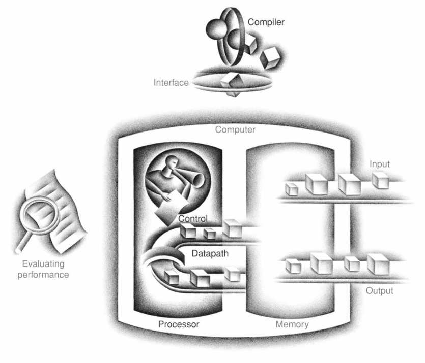

Năm thành phần kinh điển của một máy tính

## 2.1 Giới thiệu

Để ra lệnh cho phần cứng máy tính, bạn phải nói ngôn ngữ của nó. Những từ của ngôn ngữ máy tính gọi là instruction, và từ vựng của nó gọi là instruction set. Trong chương này, bạn sẽ thấy instruction set của máy tính thực, cả ở dạng con người viết và dạng máy tính đọc. Ta giới thiệu instruction theo cách top-down. Bắt đầu từ ký hiệu giống ngôn ngữ lập trình bị hạn chế, ta tinh chỉnh step-by-step tới khi bạn thấy ngôn ngữ thực sự của máy tính thực. Chương 3 tiếp tục đi xuống, hé lộ phần cứng số học và biểu diễn số floating-point.

### instruction set

Tập từ vựng các lệnh mà một kiến trúc nhất định hiểu.

Bạn có thể nghĩ ngôn ngữ máy tính đa dạng như ngôn ngữ con người, nhưng thực tế chúng khá tương tự, giống phương ngữ vùng miền hơn là các ngôn ngữ độc lập. Vì vậy, học một ngôn ngữ rồi sẽ dễ tiếp thu những ngôn ngữ khác.

Instruction set được chọn là RISC-V, ban đầu được phát triển tại UC Berkeley từ năm 2010.

Để minh họa việc học instruction set khác dễ thế nào, ta cũng xem nhanh hai instruction set phổ biến khác.

1. MIPS là ví dụ thanh nhã của các instruction set thiết kế từ thập niên 1980. Ở vài khía cạnh, RISC-V theo thiết kế tương tự.

2. Intel x86 bắt nguồn từ thập niên 1970, nhưng tới nay vẫn vận hành cả PC lẫn Cloud của thời đại post-PC.

Sự tương đồng instruction set này có vì mọi máy tính được xây từ các công nghệ phần cứng dựa trên nguyên lý nền tảng tương tự, và có vài phép toán cơ bản mà mọi máy tính phải cung cấp. Hơn nữa, người thiết kế có mục tiêu chung: tìm ngôn ngữ giúp dễ xây phần cứng và compiler trong khi tối đa hiệu năng, giảm thiểu chi phí và năng lượng. Mục tiêu này là time-honored; trích dẫn sau được viết trước khi có thể mua máy tính, và hôm nay vẫn đúng như năm 1947:

Dễ thấy bằng phương pháp formal-logical rằng tồn tại những [instruction set] về mặt trừu tượng đủ để điều khiển và thực thi mọi chuỗi phép toán.… Những cân nhắc thực sự quyết định từ góc nhìn hiện tại khi chọn [instruction set] mang tính thực tế hơn: sự đơn giản của thiết bị mà [instruction set] đòi hỏi, và sự rõ ràng khi áp dụng nó vào các vấn đề thực sự quan trọng, cùng tốc độ xử lý chúng.

Burks, Goldstine và von Neumann, 1947

“Sự đơn giản của thiết bị” là một cân nhắc có giá trị đối với máy tính ngày nay cũng như đối với máy tính của thập niên 1950. Mục tiêu của chương này là dạy một instruction set tuân theo lời khuyên đó, trình bày cả cách nó được biểu diễn trong hardware lẫn quan hệ giữa các ngôn ngữ lập trình high-level và ngôn ngữ sơ khai hơn này. Các ví dụ của chúng ta được viết bằng ngôn ngữ lập trình C;  Mục 2.15 cho thấy chúng sẽ thay đổi như thế nào đối với một ngôn ngữ object-oriented như Java.

Khi học cách biểu diễn instruction, bạn cũng khám phá bí mật của tính toán: khái niệm stored-program. Hơn nữa, bạn luyện kỹ năng “ngoại ngữ” bằng cách viết chương trình theo ngôn ngữ máy tính và chạy trên simulator đi kèm sách. Bạn cũng thấy tác động của ngôn ngữ lập trình và tối ưu compiler lên hiệu năng. Ta kết thúc bằng xem sự tiến hóa lịch sử của instruction set và tổng quan các phương ngữ máy tính khác.

### stored-program concept

Ý tưởng rằng instruction và dữ liệu nhiều kiểu có thể lưu trong bộ nhớ dưới dạng số nên dễ thay đổi, dẫn tới máy tính stored-program.

Ta giới thiệu instruction set đầu tiên từng phần, đưa lý do cùng các cấu trúc máy tính. Hướng dẫn top-down, step-by-step này đan xen thành phần và giải thích, giúp ngôn ngữ máy tính dễ tiếp thu hơn. Hình 2.1 xem trước instruction set được trình bày trong chương.

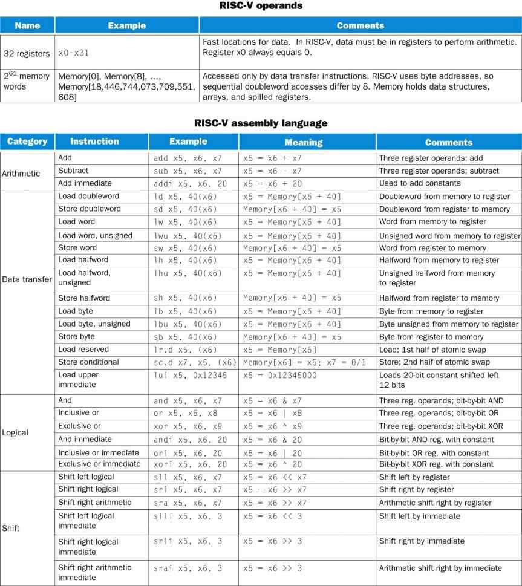

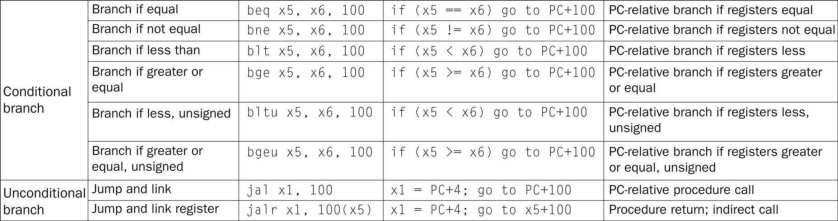

**HÌNH 2.1 Assembly language RISC-V được giới thiệu trong chương này. Thông tin này cũng có ở Cột 1 của RISC-V Reference Data Card ở đầu sách.**

## 2.2 Phép toán của phần cứng máy tính

Chắc chắn phải có instruction thực hiện các phép toán số học cơ bản.

Burks, Goldstine và von Neumann, 1947

Mọi máy tính phải thực hiện được số học. Ký hiệu assembly language RISC-V

```
add a, b, c
```

ra lệnh máy tính cộng hai biến b và c rồi đặt tổng vào a.

Ký hiệu này cứng nhắc ở chỗ mỗi arithmetic instruction RISC-V chỉ thực hiện một phép toán và luôn phải có đúng ba biến. Ví dụ, giả sử muốn đặt tổng bốn biến b, c, d và e vào biến a. (Trong mục này, ta cố ý chưa nói rõ “biến” là gì; mục tiếp theo sẽ giải thích chi tiết.)

Chuỗi instruction sau cộng bốn biến:

```
add a, b, c    // The sum of b and c is placed in a
add a, a, d    // The sum of b, c, and d is now in a
add a, a, e    // The sum of b, c, d, and e is now in a
```

Vì vậy cần ba instruction để cộng bốn biến. Các từ bên phải dấu gạch chéo đôi (//) trên mỗi dòng là comment cho người đọc, nên máy tính bỏ qua. Chú ý khác các ngôn ngữ lập trình khác, mỗi dòng ngôn ngữ này chứa tối đa một instruction. Khác biệt khác với C là comment luôn kết thúc ở cuối dòng.

Số toán hạng tự nhiên của một phép toán như phép cộng là ba: hai số được cộng với nhau và một vị trí để đặt tổng. Yêu cầu mỗi instruction có đúng ba toán hạng, không nhiều hơn cũng không ít hơn, tuân theo triết lý giữ hardware đơn giản: hardware cho số toán hạng thay đổi phức tạp hơn hardware cho số lượng cố định. Tình huống này minh họa nguyên lý đầu tiên trong ba nguyên lý nền tảng của thiết kế hardware:

Nguyên lý thiết kế 1: Sự đơn giản ưu tiên tính đều đặn. Giờ ta có thể cho thấy qua hai ví dụ sau quan hệ giữa chương trình viết bằng ngôn ngữ lập trình higher-level với chương trình ở ký hiệu sơ khai hơn này.

### Biên dịch hai câu lệnh gán C thành RISC-V

**Ví dụ**

Đoạn chương trình C này chứa năm biến a, b, c, d và e. Vì Java phát triển từ C, ví dụ này và vài ví dụ tiếp theo dùng được cho cả hai ngôn ngữ lập trình high-level:

```
a = b + c;
d = a −e;
```

Compiler dịch từ C sang instruction assembly language RISC-V. Hãy chỉ code RISC-V do compiler tạo.

**Trả lời**

Instruction RISC-V thao tác trên hai toán hạng nguồn và đặt kết quả vào một toán hạng đích. Do đó, hai câu lệnh đơn giản trên biên dịch trực tiếp thành hai instruction assembly language RISC-V này:

```
add a, b, c
sub d, a, e
```

### Biên dịch câu lệnh gán C phức tạp thành RISC-V

**Ví dụ**

Câu lệnh hơi phức tạp chứa năm biến f, g, h, i và j:

```
f = (g + h) −(i + j);
```

Compiler C có thể sinh ra gì?

**Trả lời**

Compiler phải tách câu lệnh thành vài assembly instruction, vì mỗi instruction RISC-V chỉ thực hiện một phép toán. Instruction RISC-V đầu tính tổng g và h. Phải đặt kết quả ở đâu đó, nên compiler tạo biến tạm gọi là t0:

```
add t0, g, h // temporary variable t0 contains g + h
```

Mặc dù phép toán kế tiếp là trừ, cần tính tổng i và j trước khi trừ. Vì vậy, instruction thứ hai đặt tổng i và j vào biến tạm khác do compiler tạo, gọi là t1:

```
add t1, i, j // temporary variable t1 contains i + j
```

Cuối cùng, subtract instruction trừ tổng thứ hai khỏi tổng thứ nhất và đặt hiệu vào biến f, hoàn tất code đã biên dịch:

```
sub f, t0, t1 // f gets t0 −t1, which is (g + h) −(i + j)
```

### Tự kiểm tra

Với một chức năng nhất định, ngôn ngữ lập trình nào có thể cần nhiều dòng code nhất? Sắp ba biểu diễn sau theo thứ tự.

1. Java

2. C

3. Assembly language RISC-V

### Giải thích thêm

Để tăng tính di động, Java ban đầu được hình dung dựa vào software interpreter. Instruction set của interpreter này gọi là Java bytecode (xem  Mục 2.15), khá khác instruction set RISC-V. Để đạt hiệu năng gần chương trình C tương đương, hệ thống Java ngày nay thường biên dịch Java bytecode sang native instruction set như RISC-V. Vì việc biên dịch này thường diễn ra muộn hơn nhiều so với chương trình C, compiler Java như vậy thường gọi là Just In Time (JIT) compiler. Mục 2.12 cho thấy JIT được dùng muộn hơn compiler C trong quá trình start-up, và Mục 2.13 cho thấy hệ quả hiệu năng của biên dịch so với thông dịch chương trình Java.

## 2.3 Toán hạng của phần cứng máy tính

Khác chương trình bằng ngôn ngữ high-level, toán hạng arithmetic instruction bị hạn chế; chúng phải đến từ số lượng giới hạn các vị trí đặc biệt xây trực tiếp trong phần cứng gọi là register. Register là primitive dùng trong thiết kế phần cứng mà lập trình viên cũng nhìn thấy khi máy tính hoàn tất, nên có thể xem register là viên gạch xây máy tính. Kích thước register trong kiến trúc RISC-V là 64 bit; nhóm 64 bit xuất hiện thường xuyên đến mức được đặt tên doubleword trong kiến trúc RISC-V. (Kích thước phổ biến khác là nhóm 32 bit, gọi là word trong kiến trúc RISC-V.)

### doubleword

Đơn vị truy cập tự nhiên khác trong máy tính, thường là nhóm 64 bit; tương ứng kích thước register trong kiến trúc RISC-V.

### word

Đơn vị truy cập tự nhiên trong máy tính, thường là nhóm 32 bit.

Khác biệt chính giữa biến của ngôn ngữ lập trình và register là số register giới hạn, thường 32 trên máy tính hiện tại như RISC-V. (Xem  Mục 2.21 về lịch sử số lượng register.) Do đó, tiếp tục sự phát triển từng bước top-down của biểu diễn ký hiệu ngôn ngữ RISC-V, trong mục này ta thêm hạn chế rằng mỗi toán hạng trong ba toán hạng arithmetic instruction RISC-V phải chọn từ một trong 32 register 64-bit.

Lý do giới hạn 32 register có thể thấy ở nguyên lý thứ hai trong ba nguyên lý thiết kế nền tảng của công nghệ phần cứng:

Nguyên lý thiết kế 2: Nhỏ hơn thì nhanh hơn.

Số register rất lớn có thể làm tăng clock cycle time đơn giản vì tín hiệu điện tử mất nhiều thời gian hơn khi phải truyền xa hơn.

Hướng dẫn như “nhỏ hơn thì nhanh hơn” không tuyệt đối; 31 register có thể không nhanh hơn 32. Dù vậy, sự thật đằng sau quan sát ấy khiến người thiết kế xem trọng chúng. Trường hợp này, người thiết kế phải cân bằng khát khao có thêm register của chương trình với mong muốn giữ clock cycle nhanh. Lý do khác để không dùng hơn 32 là số bit cần trong định dạng instruction, như Mục 2.5 chứng minh.

Chương 4 cho thấy vai trò trung tâm của register trong xây dựng phần cứng; như sẽ thấy ở đó, dùng register hiệu quả rất quan trọng với hiệu năng chương trình.

Mặc dù có thể viết instruction đơn giản bằng số register từ 0 đến 31, quy ước RISC-V là x theo sau bởi số register, trừ vài tên register sẽ bàn sau.

### Biên dịch câu lệnh gán C dùng register

**Ví dụ**

Công việc compiler là gắn biến chương trình với register. Chẳng hạn, lấy câu lệnh gán ở ví dụ trước:

```
f = (g + h) −(i + j);
```

Các biến f, g, h, i và j lần lượt gán cho register x19, x20, x21, x22 và x23. Code RISC-V đã biên dịch là gì?

**Trả lời**

Chương trình đã biên dịch rất giống ví dụ trước, chỉ thay biến bằng tên register đã nhắc cùng hai temporary register x5 và x6, tương ứng các biến tạm phía trên:

```
add x5, x20, x21// register x5 contains g + h
add x6, x22, x23// register x6 contains i + j
sub x19, x5, x6// f gets x5 –x6, which is (g + h)−(i + j)
```

### Toán hạng bộ nhớ

Ngôn ngữ lập trình có biến đơn giản chứa một phần tử dữ liệu, như các ví dụ này, nhưng cũng có cấu trúc dữ liệu phức tạp hơn—array và structure. Những cấu trúc dữ liệu kết hợp này có thể chứa nhiều phần tử hơn số register máy tính có. Máy tính biểu diễn và truy cập cấu trúc lớn như vậy thế nào?

Nhớ năm thành phần máy tính giới thiệu ở Chương 1 và lặp lại trang 61. Processor chỉ giữ ít dữ liệu trong register, nhưng bộ nhớ máy tính chứa hàng tỷ phần tử dữ liệu. Do đó, cấu trúc dữ liệu (array và structure) được giữ trong bộ nhớ.

Như giải thích trên, phép toán số học chỉ diễn ra trên register trong instruction RISC-V; do đó RISC-V phải có instruction truyền dữ liệu giữa bộ nhớ và register. Chúng gọi là data transfer instruction. Để truy cập word hay doubleword trong bộ nhớ, instruction phải cung cấp địa chỉ bộ nhớ. Bộ nhớ chỉ là mảng single-dimensional lớn, với địa chỉ làm chỉ số mảng bắt đầu từ 0. Ví dụ, trong Hình 2.2, địa chỉ phần tử dữ liệu thứ ba là 2, và giá trị memory [2] là 10.

#### data transfer instruction

Lệnh chuyển dữ liệu giữa bộ nhớ và register.

#### address

Giá trị dùng để xác định vị trí phần tử dữ liệu cụ thể trong mảng bộ nhớ.

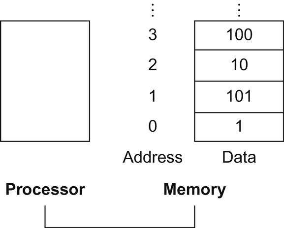

**HÌNH 2.2 Địa chỉ bộ nhớ và nội dung bộ nhớ tại các vị trí ấy. Nếu các phần tử là doubleword, các địa chỉ này sẽ sai, vì RISC-V thực sự dùng byte addressing, mỗi doubleword biểu diễn 8 byte. Hình 2.3 cho thấy định địa chỉ bộ nhớ đúng cho các địa chỉ doubleword liên tiếp.**

Data transfer instruction sao chép dữ liệu từ bộ nhớ vào register theo truyền thống gọi là load. Định dạng load instruction là tên phép toán theo sau bởi register cần load, rồi register và hằng số để truy cập bộ nhớ. Tổng phần hằng số của instruction với nội dung register thứ hai tạo địa chỉ bộ nhớ. Tên RISC-V thực sự của instruction này là ld, viết tắt load doubleword.

#### Biên dịch câu lệnh gán khi một toán hạng ở bộ nhớ

**Ví dụ**

Giả sử A là mảng 100 doubleword và compiler đã gắn biến g, h với register x20, x21 như trước. Cũng giả sử địa chỉ bắt đầu, hay base address, của mảng ở x22. Biên dịch câu lệnh gán C này:

```
g = h + A[8];
```

**Trả lời**

Mặc dù chỉ có một phép toán trong câu lệnh gán, một toán hạng ở bộ nhớ nên trước tiên phải truyền A[8] vào register. Địa chỉ phần tử mảng này là tổng base của mảng A, nằm trong register x22, với số chọn phần tử 8. Dữ liệu cần đặt trong temporary register để dùng ở instruction kế tiếp. Dựa Hình 2.2, instruction đã biên dịch đầu là

```
ld    x9, 8(x22) // Temporary reg x9 gets A[8]
```

(Ta sẽ điều chỉnh nhẹ instruction này, nhưng hiện dùng phiên bản đơn giản ấy.) Instruction tiếp theo có thể thao tác trên giá trị trong x9 (bằng A[8]) vì nó nằm trong register. Instruction phải cộng h (trong x21) với A[8] (trong x9) và đặt tổng vào register tương ứng g (gắn với x20):

```
add   x20, x21, x9 // g = h + A[8]
```

Register được cộng để tạo địa chỉ (x22) gọi là base register, và hằng số trong data transfer instruction (8) gọi là offset.

#### Giao diện phần cứng/phần mềm

Ngoài gắn biến với register, compiler phân bổ cấu trúc dữ liệu như array và structure vào các vị trí bộ nhớ. Sau đó compiler có thể đặt địa chỉ bắt đầu đúng vào data transfer instruction.

Vì byte 8-bit hữu ích trong nhiều chương trình, gần như mọi kiến trúc ngày nay định địa chỉ từng byte. Do đó, địa chỉ doubleword khớp với địa chỉ một trong 8 byte bên trong, và địa chỉ doubleword liên tiếp chênh nhau 8. Ví dụ, Hình 2.3 cho địa chỉ RISC-V thực cho các doubleword trong Hình 2.2; địa chỉ byte của doubleword thứ ba là 16.

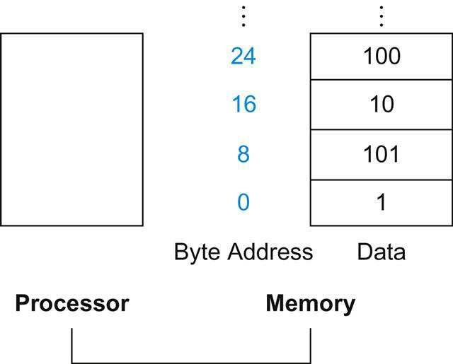

**HÌNH 2.3 Địa chỉ bộ nhớ RISC-V thực và nội dung bộ nhớ cho các doubleword ấy. Địa chỉ thay đổi được tô sáng để so với Hình 2.2. Vì RISC-V định địa chỉ từng byte, địa chỉ doubleword là bội số của 8: có 8 byte trong doubleword.**

Máy tính chia thành loại dùng địa chỉ byte ngoài cùng trái hay “đầu lớn” làm địa chỉ doubleword, và loại dùng byte ngoài cùng phải hay “đầu nhỏ”. RISC-V thuộc nhóm sau, gọi là little-endian. Vì thứ tự chỉ quan trọng nếu truy cập cùng dữ liệu vừa dưới dạng doubleword vừa dưới dạng tám byte riêng, ít người cần biết “endianness”.

Byte addressing cũng ảnh hưởng chỉ số mảng. Để có địa chỉ byte đúng trong code trên, offset cộng vào base register x22 phải là 8×8, hay 64, để địa chỉ load chọn A[8] chứ không phải A[8/8]. (Xem cạm bẫy liên quan ở trang 159 Mục 2.19.)

Instruction bổ sung cho load theo truyền thống gọi là store; nó sao chép dữ liệu từ register vào bộ nhớ. Định dạng store giống load: tên phép toán, theo sau bởi register cần store, rồi base register và cuối cùng offset chọn phần tử mảng. Một lần nữa, địa chỉ RISC-V được chỉ định một phần bằng hằng số và một phần bằng nội dung register. Tên RISC-V thực sự là sd, viết tắt store doubleword.

#### Giải thích thêm

Trong nhiều kiến trúc, word phải bắt đầu ở địa chỉ bội số của 4 và doubleword phải bắt đầu ở địa chỉ bội số của 8. Yêu cầu này gọi là alignment restriction. (Chương 4 gợi ý tại sao alignment giúp truyền dữ liệu nhanh hơn.) RISC-V và Intel x86 không có alignment restriction, nhưng MIPS có.

#### alignment restriction

Yêu cầu dữ liệu căn chỉnh trong bộ nhớ theo ranh giới tự nhiên.

#### Giao diện phần cứng/phần mềm

Vì địa chỉ trong load và store là số nhị phân, ta thấy tại sao DRAM cho main memory có kích thước nhị phân thay kích thước thập phân. Nghĩa là gibibyte (2<sup>30</sup>) hay tebibyte (2<sup>40</sup>), không phải gigabyte (10<sup>9</sup>) hay terabyte (10<sup>12</sup>); xem Hình 1.1.

#### Biên dịch dùng load và store

**Ví dụ**

Giả sử biến h gắn với register x21 và base address mảng A ở x22. Assembly code RISC-V cho câu lệnh gán C dưới đây là gì?

```
A[12] = h + A[8];
```

**Trả lời**

Mặc dù câu lệnh C chỉ có một phép toán, giờ hai toán hạng ở bộ nhớ nên cần nhiều instruction RISC-V hơn nữa. Hai instruction đầu giống ví dụ trước, trừ lần này dùng offset đúng cho byte addressing trong load register instruction để chọn A[8], và add instruction đặt tổng trong x9:

```
ld x9, 64(x22) // Temporary reg x9 gets A[8]
add x9, x21, x9 // Temporary reg x9 gets h + A[8]
```

Instruction cuối store tổng vào A[12], dùng 96 (8×12) làm offset và register x22 làm base register.

```
sdx9, 96(x22)// Stores h + A[8] back into A[12]
```

Load doubleword và store doubleword là instruction sao chép doubleword giữa bộ nhớ và register trong kiến trúc RISC-V. Một số dòng máy dùng instruction khác cùng load và store để truyền dữ liệu. Kiến trúc có lựa chọn như vậy là Intel x86, mô tả ở Mục 2.17.

#### Giao diện phần cứng/phần mềm

Nhiều chương trình có nhiều biến hơn số register máy tính có. Vì vậy, compiler cố giữ biến dùng thường xuyên nhất trong register và đặt phần còn lại trong bộ nhớ, dùng load và store chuyển biến giữa register với bộ nhớ. Quá trình đặt biến ít dùng hơn (hoặc cần về sau) vào bộ nhớ gọi là spilling register.

Nguyên lý phần cứng liên hệ kích thước và tốc độ gợi ý bộ nhớ phải chậm hơn register, vì có ít register hơn. Thực tế đúng như vậy; truy cập dữ liệu nhanh hơn nếu dữ liệu ở register thay vì bộ nhớ.

Hơn nữa, dữ liệu hữu ích hơn khi ở register. Arithmetic instruction RISC-V có thể đọc hai register, thao tác trên chúng và ghi kết quả. Data transfer instruction RISC-V chỉ đọc một toán hạng hoặc ghi một toán hạng, không thao tác tính toán trên nó.

Do đó, register cần ít thời gian truy cập hơn và có throughput cao hơn bộ nhớ, khiến dữ liệu trong register vừa nhanh hơn đáng kể khi truy cập vừa đơn giản hơn khi dùng. Truy cập register cũng dùng ít năng lượng hơn nhiều so với truy cập bộ nhớ. Để đạt hiệu năng cao nhất và tiết kiệm năng lượng, instruction set architecture phải có đủ register, và compiler phải dùng register hiệu quả.

#### Giải thích thêm

Hãy đặt năng lượng và hiệu năng register so với bộ nhớ vào bối cảnh. Giả sử dữ liệu 64-bit, register nhanh hơn khoảng 200 lần (0.25 so với 50 nanosecond) và hiệu quả năng lượng hơn 10,000 lần (0.1 so với 1000 picoJoule) so với DRAM năm 2015. Khác biệt lớn này dẫn tới cache, giảm tổn thất hiệu năng và năng lượng khi vào bộ nhớ (xem Chương 5).

### Toán hạng hằng số hoặc immediate

Chương trình thường dùng hằng số trong phép toán—ví dụ tăng chỉ số để trỏ tới phần tử kế tiếp của mảng. Thực tế, hơn một nửa arithmetic instruction RISC-V có hằng số làm toán hạng khi chạy benchmark SPEC CPU2006.

Chỉ dùng những instruction đã thấy đến đây, ta phải load hằng từ bộ nhớ để sử dụng. (Các hằng đã được đặt trong bộ nhớ khi load chương trình.) Ví dụ, để cộng hằng 4 vào register x22, có thể dùng code

```
ld  x9, AddrConstant4(x3)    // x9 = constant 4
add x22, x22, x9            // x22 = x22 + x9 (where x9 == 4)
```

giả sử x3 + AddrConstant4 là địa chỉ bộ nhớ của hằng 4.

Cách khác tránh load instruction là cung cấp các phiên bản arithmetic instruction có một toán hạng là hằng số. Instruction cộng nhanh với một toán hạng hằng này gọi là add immediate hay addi. Để cộng 4 vào register x22, chỉ cần viết

```
addi    x22, x22, 4      // x22 = x22 + 4
```

Toán hạng hằng xuất hiện thường xuyên; thực tế addi là instruction phổ biến nhất trong phần lớn chương trình RISC-V. Đưa hằng vào arithmetic instruction khiến phép toán nhanh hơn nhiều và dùng ít năng lượng hơn so với load hằng từ bộ nhớ.

Hằng zero có vai trò khác là đơn giản hóa instruction set bằng những biến thể hữu ích. Ví dụ, bạn có thể đổi dấu giá trị trong register bằng sub instruction với zero làm toán hạng đầu. Do đó RISC-V dành register x0 để hard-wired vào giá trị zero. Dùng tần suất để biện minh việc đưa hằng vào là ví dụ khác của ý tưởng lớn ở Chương 1: làm trường hợp phổ biến nhanh.


#### Tự kiểm tra

Với tầm quan trọng của register, tốc độ tăng số register trong chip theo thời gian là gì?

1. Rất nhanh: Tăng nhanh như định luật Moore, dự đoán số transistor trên chip gấp đôi mỗi 18 tháng.

2. Rất chậm: Vì chương trình thường được phân phối bằng ngôn ngữ máy tính, instruction set architecture có quán tính, nên số register chỉ tăng nhanh bằng tốc độ instruction set mới trở nên khả thi.


#### Giải thích thêm

Mặc dù register RISC-V trong sách rộng 64 bit, các kiến trúc sư RISC-V hình dung nhiều biến thể ISA. Ngoài biến thể này, gọi là RV64, biến thể RV32 có register 32-bit, chi phí giảm khiến RV32 phù hợp hơn với processor very low-cost.

#### Giải thích thêm

Định địa chỉ offset cộng base register của RISC-V rất phù hợp cả structure lẫn array, vì register có thể trỏ tới đầu structure và offset chọn phần tử mong muốn. Ta sẽ thấy ví dụ trong Mục 2.13.

#### Giải thích thêm

Register trong data transfer instruction ban đầu được phát minh để giữ chỉ số mảng, còn offset dùng cho địa chỉ bắt đầu mảng. Vì vậy base register còn gọi là index register. Bộ nhớ ngày nay lớn hơn nhiều và mô hình phần mềm phân bổ dữ liệu tinh vi hơn, nên base address mảng thường truyền trong register vì không vừa offset, như sẽ thấy.

#### Giải thích thêm

Việc chuyển từ máy tính có địa chỉ 32-bit sang máy tính có địa chỉ 64-bit đặt ra cho người viết compiler lựa chọn về kích thước các kiểu data trong C. Rõ ràng pointer phải có kích thước 64 bit, nhưng số nguyên thì sao? Hơn nữa, C có các kiểu data int, long int và long long int. Vấn đề nảy sinh khi chuyển đổi giữa các kiểu data và xuất hiện overflow ngoài dự kiến trong code C không hoàn toàn tuân theo tiêu chuẩn; đáng tiếc là loại code đó không hiếm. Bảng bên dưới trình bày hai lựa chọn phổ biến:

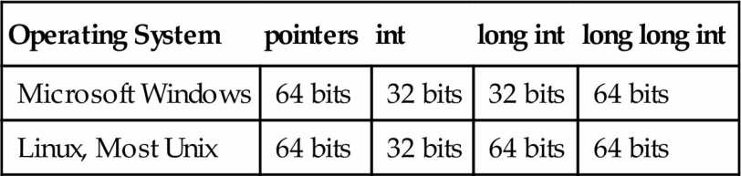

Mặc dù mỗi compiler có thể chọn khác, nhìn chung các compiler gắn với mỗi operating system quyết định giống nhau. Để ví dụ đơn giản, sách giả sử mọi pointer đều 64 bit và khai báo mọi số nguyên C là long long int để giữ cùng kích thước. Ta cũng theo tiêu chuẩn C99, khai báo biến dùng làm chỉ số mảng là size_t, bảo đảm đúng kích thước bất kể mảng lớn bao nhiêu. Chúng thường được khai báo giống long int.

## 2.4 Số signed và unsigned

Trước tiên hãy ôn nhanh cách máy tính biểu diễn số. Con người được dạy nghĩ theo cơ số 10, nhưng số có thể biểu diễn ở bất kỳ cơ số nào. Ví dụ, 123 cơ số 10=1111011 cơ số 2.

Số được giữ trong phần cứng dưới dạng chuỗi tín hiệu điện tử cao và thấp, nên được xem là số cơ số 2. (Giống số cơ số 10 gọi là số thập phân, số cơ số 2 gọi là số nhị phân.)

Một chữ số nhị phân vì vậy là “nguyên tử” của tính toán, vì mọi thông tin cấu thành từ binary digit hay bit. Khối xây dựng cơ bản này có một trong hai giá trị, có thể hiểu theo vài cách: cao hoặc thấp, bật hoặc tắt, đúng hoặc sai, hay 1 hoặc 0.

### binary digit

Cũng gọi là bit. Một trong hai số cơ số 2, 0 hoặc 1, cấu thành thông tin.

Khái quát điều này, trong mọi cơ số, giá trị chữ số d thứ i là

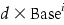

trong đó i bắt đầu từ 0 và tăng từ phải sang trái. Biểu diễn này dẫn tới cách đánh số bit rõ ràng trong doubleword: chỉ dùng lũy thừa của cơ số cho bit đó. Ta đặt chỉ số dưới ten cho số thập phân và two cho số nhị phân. Ví dụ,

<pre>1011<sub>two</sub></pre>

biểu diễn

<pre>(1 ×2<sup>3</sup>) + (0 ×2<sup>2</sup>) + (1 ×2<sup>1</sup>) + (1 ×2<sup>0</sup>)<sub>ten</sub>
= (1 ×8) + (0 ×4)+ (1 ×2)+ (1 ×1)<sub>ten</sub>
= 8+0+2+1<sub>ten</sub>
= 11<sub>ten</sub></pre>

Ta đánh số bit 0, 1, 2, 3, … từ phải sang trái trong doubleword. Hình dưới cho thấy cách đánh số bit trong doubleword RISC-V và vị trí số 1011<sub>two</sub>, (tiếc là phải tách đôi để vừa trang sách):

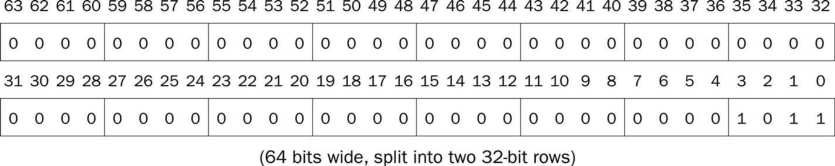

Vì doubleword được vẽ theo cả chiều dọc và ngang, ngoài cùng trái và ngoài cùng phải có thể không rõ. Do đó, cụm least significant bit dùng để chỉ bit ngoài cùng phải (bit 0 phía trên) và most significant bit chỉ bit ngoài cùng trái (bit 63).

### least significant bit

Bit ngoài cùng phải trong doubleword RISC-V.

### most significant bit

Bit ngoài cùng trái trong doubleword RISC-V.

Doubleword RISC-V dài 64 bit, nên có thể biểu diễn 2<sup>64</sup> pattern 64-bit khác nhau. Tự nhiên là dùng những tổ hợp ấy biểu diễn các số từ 0 tới 2<sup>64</sup> −1 (18,446,774,073,709,551,615<sub>ten</sub>):

<pre>00000000 00000000 00000000 00000000 00000000 00000000
00000000 00000000<sub>two</sub>= 0<sub>ten</sub>
00000000 00000000 00000000 00000000 00000000 00000000
00000000 00000001<sub>two</sub>= 1<sub>ten</sub>
00000000 00000000 00000000 00000000 00000000 00000000
00000000 00000010<sub>two</sub>= 2<sub>ten</sub>
. . .               . . .
11111111 11111111 11111111 11111111 11111111 11111111
11111111 11111101<sub>two</sub>= 18,446,774,073,709,551,613<sub>ten</sub>
11111111 11111111 11111111 11111111 11111111 11111111
11111111 11111110<sub>two</sub>= 18,446,744,073,709,551,614<sub>ten</sub>
11111111 11111111 11111111 11111111 11111111 11111111
11111111 11111111<sub>two</sub>= 18,446,744,073,709,551,615<sub>ten</sub></pre>

Nghĩa là số nhị phân 64-bit có thể biểu diễn bằng giá trị bit nhân lũy thừa của 2 (ở đây x<sub>i</sub> là bit thứ i của x):

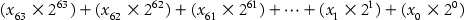

Vì những lý do sắp thấy, các số dương này gọi là số unsigned.

### Giao diện phần cứng/phần mềm

Cơ số 2 không tự nhiên với con người; ta có 10 ngón tay nên thấy cơ số 10 tự nhiên. Tại sao máy tính không dùng thập phân? Thực tế máy tính thương mại đầu tiên có số học thập phân. Vấn đề là máy tính vẫn dùng tín hiệu bật và tắt, nên một chữ số thập phân chỉ được biểu diễn bằng vài chữ số nhị phân. Thập phân tỏ ra kém hiệu quả đến mức máy tính sau trở lại hoàn toàn nhị phân, chỉ chuyển sang cơ số 10 cho các sự kiện input/output tương đối hiếm.

Nhớ rằng bit pattern nhị phân trên chỉ là đại diện cho số. Số thực sự có vô hạn chữ số, hầu hết là 0 trừ vài chữ số ngoài cùng phải. Ta chỉ thường không viết số 0 đầu.

Phần cứng có thể thiết kế để cộng, trừ, nhân và chia các bit pattern nhị phân này. Nếu số là kết quả đúng của phép toán không thể biểu diễn bởi các bit phần cứng ngoài cùng phải ấy, ta nói đã xảy ra overflow. Ngôn ngữ lập trình, operating system và chương trình phải quyết định làm gì nếu overflow.

Chương trình tính cả số dương và âm, nên cần biểu diễn phân biệt dương với âm. Giải pháp rõ nhất là thêm dấu riêng, thuận tiện biểu diễn bằng một bit; tên cách biểu diễn này là sign and magnitude.

Tiếc rằng biểu diễn sign and magnitude có vài nhược điểm. Thứ nhất, không rõ đặt sign bit ở đâu. Bên phải? Bên trái? Máy tính đầu tiên thử cả hai. Thứ hai, adder sign and magnitude có thể cần bước bổ sung đặt dấu vì không biết trước dấu đúng. Cuối cùng, sign bit riêng nghĩa là sign and magnitude có cả zero dương và zero âm, có thể gây vấn đề cho lập trình viên bất cẩn. Vì những nhược điểm này, biểu diễn sign and magnitude sớm bị bỏ.

Khi tìm lựa chọn hấp dẫn hơn, câu hỏi xuất hiện: kết quả số unsigned sẽ thế nào nếu thử trừ số lớn khỏi số nhỏ? Đáp án là nó cố mượn từ chuỗi số 0 đầu, nên kết quả có chuỗi số 1 đầu.

Vì không có lựa chọn tốt hơn rõ ràng, giải pháp cuối là chọn biểu diễn làm phần cứng đơn giản: số 0 đầu nghĩa là dương, số 1 đầu nghĩa là âm. Quy ước biểu diễn số nhị phân signed này gọi là two’s complement:

<pre>00000000 00000000 00000000 00000000 00000000 00000000
00000000<sub>two</sub>= 0<sub>ten</sub>
00000000 00000000 00000000 00000000 00000000 00000000
00000001<sub>two</sub>= 1<sub>ten</sub>
00000000 00000000 00000000 00000000 00000000 00000000
00000010<sub>two</sub>= 2<sub>ten</sub>
. . .                        . . .
01111111 11111111 11111111 11111111 11111111 11111111
11111111 11111101<sub>two</sub>= 9,223,372,036,854,775,805<sub>ten</sub>
01111111 11111111 11111111 11111111 11111111 11111111
11111111 11111110<sub>two</sub>= 9,223,372,036,854,775,806<sub>ten</sub>
01111111 11111111 11111111 11111111 11111111 11111111
11111111 11111111<sub>two</sub>= 9,223,372,036,854,775,807<sub>ten</sub>
10000000 00000000 00000000 00000000 00000000 00000000
00000000 00000000<sub>two</sub>= −9,223,372,036,854,775,808<sub>ten</sub>
10000000 00000000 00000000 00000000 00000000 00000000
00000000 00000001<sub>two</sub>= −9,223,372,036,854,775,807<sub>ten</sub>
10000000 00000000 00000000 00000000 00000000 00000000
00000000 00000010<sub>two</sub>= −9,223,372,036,854,775,806<sub>ten</sub>
…                          . . .
11111111 11111111 11111111 11111111 11111111 11111111
11111111 11111101<sub>two</sub>= −3<sub>ten</sub>
11111111 11111111 11111111 11111111 11111111 11111111
11111111 11111110<sub>two</sub>= −2<sub>ten</sub>
11111111 11111111 11111111 11111111 11111111 11111111
11111111 11111111<sub>two</sub>= −1<sub>ten</sub></pre>

Nửa số dương, từ 0 tới 9,223,372,036,854,775,807<sub>ten</sub> (2<sup>63</sup>−1), dùng biểu diễn như trước. Bit pattern tiếp theo (1000 … 0000<sub>two</sub>) biểu diễn số âm nhất −9,223,372,036,854,775,808<sub>ten</sub> (−2<sup>63</sup>). Theo sau là tập số âm giảm dần: −9,223,372,036,854,775,807<sub>ten</sub> (1000 … 0001<sub>two</sub>) xuống −1<sub>ten</sub> (1111 … 1111<sub>two</sub>).

Two’s complement có một số âm không có số dương tương ứng: −9,223,372,036,854,775,808<sub>ten</sub>. Sự mất cân bằng ấy cũng gây lo cho lập trình viên bất cẩn, nhưng sign and magnitude gây vấn đề cho cả lập trình viên lẫn người thiết kế phần cứng. Vì vậy mọi máy tính ngày nay dùng biểu diễn nhị phân two’s complement cho số signed.

Biểu diễn two’s complement có ưu điểm mọi số âm có 1 ở most significant bit. Do đó, phần cứng chỉ cần xét bit này để xem số dương hay âm (zero được coi là dương). Bit này thường gọi là sign bit. Nhận ra vai trò sign bit, ta biểu diễn số dương và âm 64-bit bằng giá trị bit nhân lũy thừa của 2:

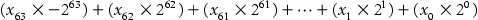

Sign bit được nhân với −2<sup>63</sup>, và các bit còn lại nhân với phiên bản dương của giá trị cơ số tương ứng.

### Chuyển từ nhị phân sang thập phân

**Ví dụ**

Giá trị thập phân của số two’s complement 64-bit này là gì?

<pre>11111111 11111111 11111111 11111111 11111111 11111111
11111111 11111100<sub>two</sub></pre>

**Trả lời**

Thay giá trị bit của số vào công thức trên:

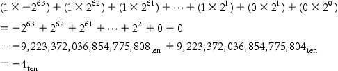

Ta sẽ sớm thấy mẹo đơn giản hóa chuyển từ âm sang dương.

Giống phép toán số unsigned có thể vượt khả năng biểu diễn kết quả của phần cứng, phép toán số two’s complement cũng có thể vậy. Overflow xảy ra khi bit ngoài cùng trái được giữ trong bit pattern nhị phân không giống vô hạn chữ số bên trái (sign bit sai): 0 bên trái bit pattern khi số âm hoặc 1 khi số dương.

### Giao diện phần cứng/phần mềm

Signed so với unsigned áp dụng cho load cũng như số học. Chức năng signed load là sao chép dấu lặp lại để lấp phần còn lại register—gọi là sign extension—nhưng mục đích là đặt biểu diễn đúng của số trong register ấy. Unsigned load chỉ điền 0 bên trái dữ liệu, vì số biểu diễn bởi bit pattern là unsigned.

Khi load doubleword 64-bit vào register 64-bit, khác biệt không còn ý nghĩa; signed và unsigned load giống nhau. RISC-V cung cấp hai kiểu byte load: load byte unsigned (lbu) coi byte là số unsigned nên zero-extends để điền các bit ngoài cùng trái register, còn load byte (lb) làm việc với số nguyên signed. Vì chương trình C gần như luôn dùng byte biểu diễn ký tự thay vì số nguyên signed rất ngắn, lbu được dùng gần như độc quyền cho byte load.

### Giao diện phần cứng/phần mềm

Khác số signed bàn ở trên, địa chỉ bộ nhớ tự nhiên bắt đầu từ 0 và tiếp tục tới địa chỉ lớn nhất. Nói cách khác, địa chỉ âm vô nghĩa. Do đó chương trình đôi khi muốn xử lý số có thể dương hoặc âm, đôi khi chỉ dương. Một số ngôn ngữ phản ánh phân biệt này. Ví dụ C gọi nhóm trước là integer (khai báo long long int trong chương trình), nhóm sau là unsigned integer (unsigned long long int). Một số hướng dẫn phong cách C còn khuyên khai báo nhóm trước là signed long long int để phân biệt rõ.

Hãy xét hai mẹo hữu ích khi làm việc với số two’s complement. Mẹo đầu là cách nhanh đổi dấu số nhị phân two’s complement. Chỉ đảo mọi 0 thành 1 và mọi 1 thành 0, rồi cộng một vào kết quả. Mẹo dựa trên nhận xét tổng một số và biểu diễn đảo của nó phải là 111 … 111<sub>two</sub>, biểu diễn −1. Vì 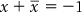, do đó 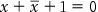 hoặc 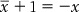. (Ta dùng ký hiệu 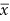 nghĩa là đảo mọi bit trong x từ 0 thành 1 và ngược lại.)

### Mẹo đổi dấu

**Ví dụ**

Đổi dấu 2<sub>ten</sub>, rồi kiểm tra kết quả bằng đổi dấu −2<sub>ten</sub>.

**Trả lời**

2<sub>ten</sub>=00000000 00000000 00000000 00000000 00000000 00000000

<pre>00000000 00000010<sub>two</sub></pre>

Đổi dấu số này bằng đảo bit và cộng một,

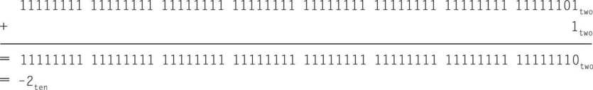

Theo hướng ngược lại,

<pre>11111111 11111111 11111111 11111111 11111111 11111111
11111111 11111110<sub>two</sub></pre>

trước tiên được đảo rồi tăng một:

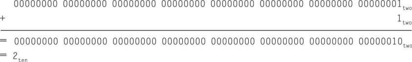

Mẹo tiếp theo cho biết cách chuyển số nhị phân biểu diễn bằng n bit sang số biểu diễn bằng hơn n bit. Mẹo là lấy most significant bit của số nhỏ hơn—sign bit—và lặp lại để điền các bit mới của số lớn hơn. Các bit không phải dấu cũ chỉ sao chép vào phần phải của doubleword mới. Mẹo này thường gọi là sign extension.

### Mẹo sign extension

**Ví dụ**

Chuyển phiên bản nhị phân 16-bit của 2<sub>ten</sub> và −2<sub>ten</sub> thành số nhị phân 64-bit.

**Trả lời**

Phiên bản nhị phân 16-bit của số 2 là

<pre>00000000 00000010<sub>two</sub>= 2<sub>ten</sub></pre>

Nó được chuyển thành số 64-bit bằng tạo 48 bản sao giá trị most significant bit (0) và đặt bên trái doubleword. Phần phải nhận giá trị cũ:

<pre>00000000 00000000 00000000 00000000 00000000 00000000
00000000 00000010<sub>two</sub>= 2<sub>ten</sub></pre>

Hãy đổi dấu phiên bản 16-bit của 2 bằng mẹo trước. Do đó,

<pre>0000 0000 0000 0010<sub>two</sub></pre>

trở thành

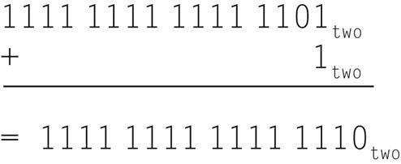

Tạo phiên bản 64-bit của số âm nghĩa là sao chép sign bit 48 lần rồi đặt bên trái:

<pre>11111111 11111111 11111111 11111111 11111111 11111111
11111111 11111110<sub>two</sub>= −2<sub>ten</sub></pre>

Mẹo này đúng vì số two’s complement dương thực sự có vô hạn 0 bên trái và số two’s complement âm có vô hạn 1. Bit pattern nhị phân biểu diễn số giấu các bit đầu để vừa chiều rộng phần cứng; sign extension chỉ khôi phục một số bit đó.

### Tổng kết

Điểm chính của mục này là cần biểu diễn cả số nguyên dương lẫn âm trong máy tính, và mặc dù lựa chọn nào cũng có ưu nhược điểm, lựa chọn nhất trí từ năm 1965 là two’s complement.

#### Giải thích thêm

Với số thập phân signed, ta dùng “−” biểu diễn âm vì kích thước số thập phân không giới hạn. Với kích thước dữ liệu cố định, chuỗi bit nhị phân và hexadecimal (xem Hình 2.4) có thể mã hóa dấu; vì vậy thường không dùng “+” hoặc “−” với ký hiệu nhị phân hay hexadecimal.

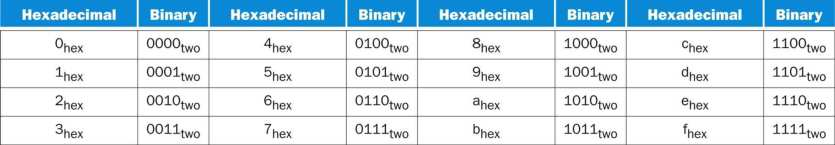

**HÌNH 2.4 Bảng chuyển hexadecimal–nhị phân. Chỉ thay một chữ số hexadecimal bằng bốn chữ số nhị phân tương ứng và ngược lại. Nếu chiều dài số nhị phân không là bội số 4, đi từ phải sang trái.**

#### Tự kiểm tra

Giá trị thập phân của số two’s complement 64-bit này là gì?

<pre>11111111 11111111 11111111 11111111 11111111 11111111
11111111 11111000<sub>two</sub></pre>

1) −4<sub>ten</sub> 2) −8<sub>ten</sub> 3) −16<sub>ten</sub> 4) 18,446,744,073,709,551,609<sub>ten</sub>

#### Giải thích thêm

Two’s complement có tên từ quy tắc tổng unsigned của số n-bit và số âm n-bit của nó là 2<sup>n</sup>; do đó số đối hay complement của x là 2<sup>n</sup>−x, hay “two’s complement” của nó.

Lựa chọn biểu diễn thứ ba bên cạnh two’s complement và sign and magnitude là one’s complement. Số đối one’s complement tìm bằng đảo từng bit, từ 0 thành 1 và 1 thành 0, hay  . Quan hệ này giúp giải thích tên vì complement của x là 2<sup>n</sup> − x −1. Nó cũng nhằm tốt hơn sign and magnitude, và vài máy tính khoa học đầu tiên dùng cách viết ấy. Biểu diễn này giống two’s complement trừ việc cũng có hai zero: 00 … 00<sub>two</sub> là zero dương và 11 … 11<sub>two</sub> là zero âm. Số âm nhất, 10 … 000<sub>two</sub>, biểu diễn −2,147,483,647<sub>ten</sub>, nên số dương và âm cân bằng. One’s complement adder cần thêm bước để trừ số, nên two’s complement thống trị ngày nay.

#### one’s complement

Cách viết biểu diễn giá trị âm nhất bằng 10 … 000<sub>two</sub> và dương nhất bằng 01 … 11<sub>two</sub>, có số lượng âm và dương bằng nhau nhưng có hai zero, một dương (00 … 00<sub>two</sub>) và một âm (11 … 11<sub>two</sub>). Thuật ngữ cũng dùng chỉ đảo mọi bit trong pattern: 0 thành 1 và 1 thành 0.

Cách viết cuối, sẽ xét khi bàn floating point ở Chương 3, biểu diễn giá trị âm nhất bằng 00 … 000<sub>two</sub> và dương nhất bằng 11 … 11<sub>two</sub>, với zero thường có giá trị 10 … 00<sub>two</sub>. Biểu diễn này gọi là biased notation vì nó dịch số sao cho số cộng bias có biểu diễn non-negative.

#### biased notation

Cách viết biểu diễn giá trị âm nhất bằng 00 … 000<sub>two</sub> và dương nhất bằng 11 … 11<sub>two</sub>, với zero thường có giá trị 10 … 00<sub>two</sub>, qua đó dịch số sao cho số cộng bias có biểu diễn non-negative.

## 2.5 Biểu diễn instruction trong máy tính

Giờ ta sẵn sàng giải thích khác biệt giữa cách con người ra instruction cho máy tính và cách máy tính nhìn instruction.

Instruction được giữ trong máy tính dưới dạng chuỗi tín hiệu điện tử cao và thấp, có thể biểu diễn bằng số. Thực tế, mỗi phần instruction có thể xem là số riêng, và đặt các số cạnh nhau tạo instruction. Ba mươi hai register RISC-V được gọi bằng số từ 0 tới 31.

### Dịch assembly instruction RISC-V thành machine instruction

**Ví dụ**

Hãy làm bước tiếp theo trong tinh chỉnh ngôn ngữ RISC-V làm ví dụ. Ta cho phiên bản ngôn ngữ RISC-V thực của instruction biểu diễn ký hiệu là

```
add x9, x20, x21
```

trước bằng tổ hợp số thập phân rồi số nhị phân.

**Trả lời**

Biểu diễn thập phân là

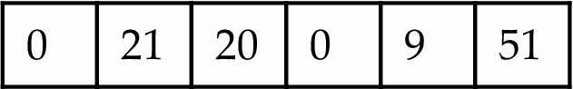

Mỗi đoạn instruction này gọi là field. Field thứ nhất, thứ tư và thứ sáu (chứa 0, 0 và 51 trong trường hợp này) cùng báo máy tính RISC-V instruction thực hiện phép cộng. Field thứ hai cho số register là toán hạng nguồn thứ hai của phép cộng (21 cho x21), field thứ ba cho toán hạng nguồn còn lại (20 cho x20). Field thứ năm chứa số register nhận tổng (9 cho x9). Vì vậy instruction cộng register x20 với register x21 và đặt tổng vào register x9.

Instruction này cũng có thể biểu diễn bằng các field số nhị phân thay thập phân:

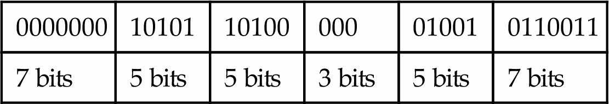

Bố cục instruction này gọi là instruction format. Như có thể thấy khi đếm bit, instruction RISC-V này chiếm đúng 32 bit—một word, hay nửa doubleword. Theo nguyên lý thiết kế sự đơn giản ưu tiên tính đều đặn, mọi instruction RISC-V dài 32 bit.

### instruction format

Dạng biểu diễn instruction gồm các field số nhị phân.

Để phân biệt với assembly language, ta gọi phiên bản số của instruction là machine language và chuỗi instruction như vậy là machine code.

### machine language

Biểu diễn nhị phân dùng cho giao tiếp bên trong hệ thống máy tính.

Có vẻ giờ bạn sẽ phải đọc và viết chuỗi số nhị phân dài tẻ nhạt. Ta tránh điều đó bằng cơ số cao hơn nhị phân nhưng dễ chuyển sang nhị phân. Vì gần như mọi kích thước dữ liệu máy tính là bội số 4, số hexadecimal (cơ số 16) rất phổ biến. Vì cơ số 16 là lũy thừa của 2, dễ dàng chuyển bằng thay mỗi nhóm bốn chữ số nhị phân bằng một chữ số hexadecimal và ngược lại. Hình 2.4 chuyển giữa hexadecimal và nhị phân.

### hexadecimal

Số ở cơ số 16.

Vì thường xử lý các cơ số khác nhau, để tránh nhầm lẫn, ta đặt chỉ số dưới ten cho số thập phân, two cho nhị phân và hex cho hexadecimal. (Nếu không có chỉ số dưới, mặc định cơ số 10.) Nhân tiện, C và Java dùng ký hiệu 0xnnnn cho số hexadecimal.

### Từ nhị phân sang hexadecimal và ngược lại

**Ví dụ**

Chuyển các số hexadecimal 8-digit và nhị phân 32-bit sau sang cơ số còn lại:

<pre>eca8 6420<sub>hex</sub>
0001 0011 0101 0111 1001 1011 1101 1111<sub>two</sub></pre>

**Trả lời**

Dùng Hình 2.4, đáp án chỉ là tra bảng theo một hướng:

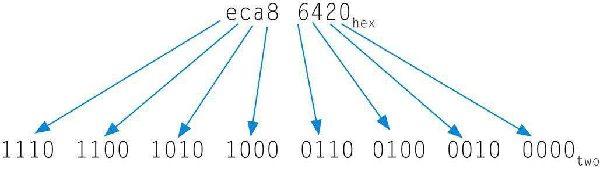

Rồi theo hướng còn lại:

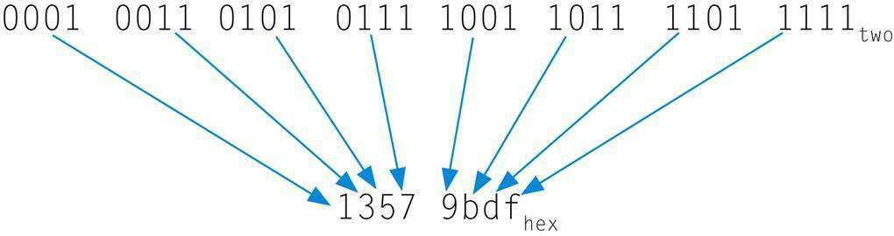

### Các field RISC-V

Field RISC-V được đặt tên để dễ thảo luận:

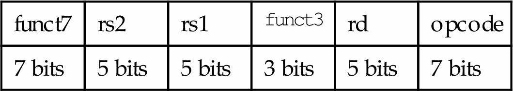

Ý nghĩa từng tên field trong instruction RISC-V như sau:

- opcode: Phép toán cơ bản của instruction, chữ viết tắt này là tên truyền thống.

- rd: Toán hạng register đích. Nó nhận kết quả phép toán.

- funct3: Field opcode bổ sung.

- rs1: Toán hạng register nguồn thứ nhất.

- rs2: Toán hạng register nguồn thứ hai.

- funct7: Field opcode bổ sung.

#### opcode

Field biểu thị phép toán và định dạng instruction.

Vấn đề xảy ra khi instruction cần field dài hơn trên. Ví dụ, load register instruction phải chỉ định hai register và hằng số. Nếu địa chỉ dùng một field 5-bit trong định dạng trên, hằng lớn nhất trong load register instruction bị giới hạn ở 2<sup>5</sup>−1 hay 31. Hằng này chọn phần tử array hay structure, thường cần lớn hơn 31 nhiều. Field 5-bit này quá nhỏ để hữu ích.

Vì vậy, có xung đột giữa mong muốn giữ mọi instruction cùng chiều dài và mong muốn có một instruction format duy nhất. Xung đột dẫn tới nguyên lý thiết kế phần cứng cuối:

Nguyên lý thiết kế 3: Thiết kế tốt đòi hỏi thỏa hiệp tốt.

Thỏa hiệp người thiết kế RISC-V chọn là giữ mọi instruction cùng chiều dài, do đó cần instruction format riêng cho các loại instruction khác nhau. Ví dụ, định dạng trên gọi là R-type (register). Loại instruction format thứ hai là I-type, dùng cho phép toán số học có một toán hạng hằng, gồm addi, và load instruction. Các field của định dạng I-type là

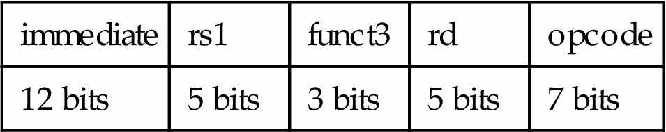

Immediate 12-bit được hiểu là giá trị two’s complement, nên biểu diễn số nguyên từ −2<sup>11</sup> tới 2<sup>11</sup>−1. Khi dùng I-type cho load instruction, immediate biểu diễn byte offset, nên load doubleword instruction có thể tham chiếu mọi doubleword trong vùng ±2<sup>11</sup> hay 2048 byte (±2<sup>8</sup> hay 256 doubleword) quanh base address trong base register rd. Ta thấy khó có hơn 32 register trong định dạng này, vì field rd và rs1 mỗi field cần thêm một bit, khiến khó nhét mọi thứ vào một word.

Hãy xem load register instruction ở trang 71:

```
ld x9, 64(x22) // Temporary reg x9 gets A[8]
```

Ở đây 22 (cho x22) đặt trong field rs1, 64 đặt trong field immediate và 9 (cho x9) đặt trong field rd. Cũng cần định dạng cho store doubleword instruction sd, cần hai source register (base address và dữ liệu store) cùng immediate cho address offset. Các field định dạng S-type là

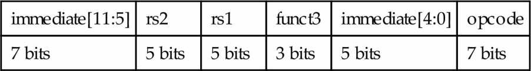

Immediate 12-bit ở S-type tách thành hai field cung cấp 5 bit thấp và 7 bit cao. Kiến trúc sư RISC-V chọn thiết kế này vì giữ field rs1 và rs2 cùng vị trí trong mọi instruction format. Giữ các định dạng giống nhau nhất có thể giảm phức tạp phần cứng. Tương tự, field opcode và funct3 có cùng kích thước ở mọi vị trí và luôn nằm cùng chỗ.

Nếu bạn thắc mắc, định dạng được phân biệt bằng giá trị field opcode: mỗi định dạng được gán tập giá trị opcode riêng trong field đầu (opcode) để phần cứng biết xử lý phần còn lại thế nào. Hình 2.5 cho số dùng trong từng field cho các instruction RISC-V đã trình bày.

#### Dịch assembly language RISC-V thành machine language

**Ví dụ**

Giờ ta có thể lấy ví dụ xuyên suốt từ thứ lập trình viên viết tới thứ máy tính thực thi. Nếu x10 chứa base mảng A và x21 tương ứng h, câu lệnh gán

```
A[30] = h + A[30] + 1;
```

được biên dịch thành

```
ld x9, 240(x10) // Temporary reg x9 gets A[30]
add x9, x21, x9 // Temporary reg x9 gets h+A[30]
addi x9, x9, 1 // Temporary reg x9 gets h+A[30]+1
sd x9, 240(x10) // Stores h+A[30]+1 back into A[30]
```

Machine language code RISC-V cho ba instruction này là gì?

**Trả lời**

Để thuận tiện, trước tiên biểu diễn machine language instruction bằng số thập phân. Từ Hình 2.5, có thể xác định ba machine language instruction:

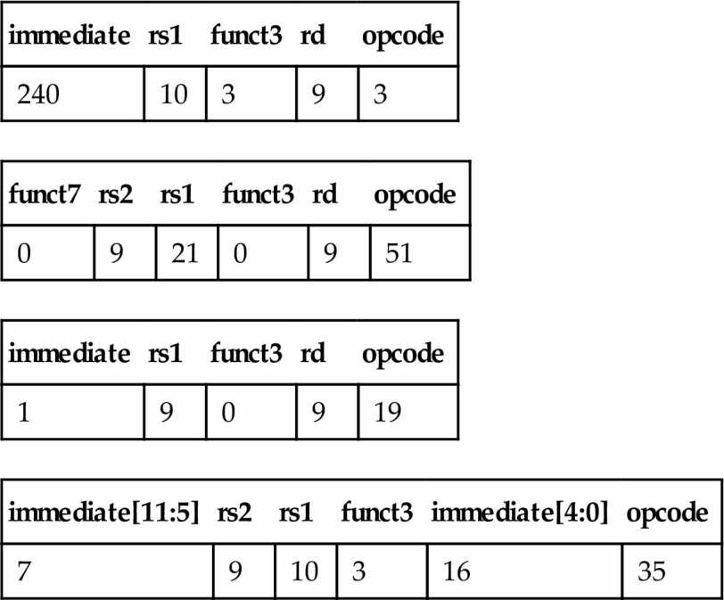

Instruction ld nhận diện bằng 3 (xem Hình 2.5) trong field opcode và 3 trong field funct3. Base register 10 được chỉ định trong field rs1, destination register 9 trong field rd. Offset chọn A[30] (240=30×8) nằm trong field immediate.

Instruction add tiếp theo được chỉ định bằng 51 trong field opcode, 0 trong field funct3 và 0 trong field funct7. Ba toán hạng register (9, 21 và 9) nằm trong field rd, rs1 và rs2.

Instruction addi sau đó được chỉ định bằng 19 trong field opcode và 0 trong field funct3. Các toán hạng register (9 và 9) nằm trong field rd và rs1, còn số hạng hằng 1 trong field immediate.

Instruction sd nhận diện bằng 35 trong field opcode và 3 trong field funct3. Toán hạng register (9 và 10) lần lượt nằm trong field rs2 và rs1. Address offset 240 tách qua hai field immediate. Vì phần cao immediate giữ bit 5 trở lên, có thể tách offset 240 bằng chia cho 2<sup>5</sup>. Phần cao immediate giữ quotient 7, phần thấp giữ remainder 16.

Vì 240<sub>ten</sub> = 0000 1111 0000<sub>two</sub>, dạng nhị phân tương đương dạng thập phân là:

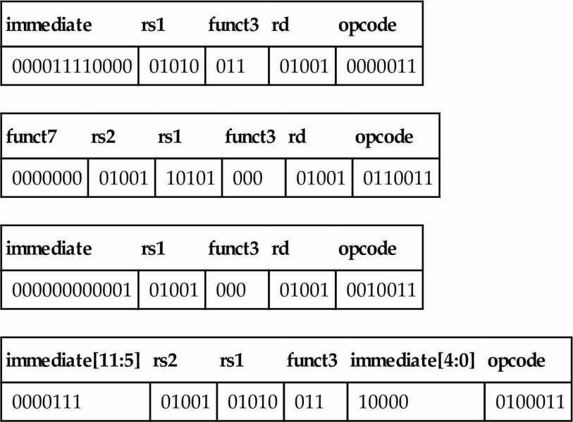

#### Giải thích thêm

Lập trình viên assembly language RISC-V không buộc dùng addi khi làm việc với hằng. Lập trình viên chỉ viết add, assembler sinh opcode và instruction format thích hợp tùy các toán hạng đều là register (R-type) hay một toán hạng hằng (I-type). Ta dùng tên tường minh trong RISC-V cho opcode và định dạng khác nhau vì nghĩ ít nhầm hơn khi giới thiệu assembly language so với machine language.

#### Giải thích thêm

Mặc dù RISC-V có cả add và sub, nó không có subi tương ứng addi. Vì field immediate biểu diễn số nguyên two’s complement, addi có thể dùng để trừ hằng.

#### Giao diện phần cứng/phần mềm

Mong muốn giữ mọi instruction cùng kích thước xung đột mong muốn có càng nhiều register càng tốt. Mọi tăng số register tiêu tốn ít nhất một bit nữa trong mỗi field register của instruction format. Với các ràng buộc này và nguyên lý nhỏ hơn nhanh hơn, phần lớn instruction set ngày nay có 16 hoặc 32 general-purpose register.

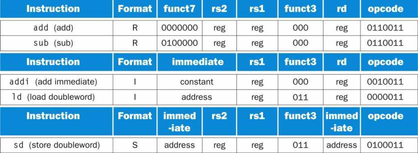

**HÌNH 2.5 Mã hóa instruction RISC-V. Trong bảng trên, “reg” nghĩa là số register từ 0 tới 31 và “address” nghĩa là địa chỉ hoặc hằng 12-bit. Field funct3 và funct7 đóng vai field opcode bổ sung.**

Hình 2.6 tổng kết các phần machine language RISC-V mô tả trong mục. Như sẽ thấy ở Chương 4, sự giống nhau trong biểu diễn nhị phân của instruction liên quan đơn giản hóa thiết kế phần cứng. Những tương đồng này là ví dụ khác của tính đều đặn trong kiến trúc RISC-V.

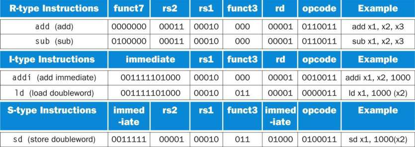

**HÌNH 2.6 Kiến trúc RISC-V được giới thiệu đến Mục 2.5. Ba instruction format RISC-V tới đây là R, I và S. R-type có hai toán hạng source register và một toán hạng destination register. I-type thay một toán hạng source register bằng field immediate 12-bit. S-type có hai toán hạng nguồn và field immediate 12-bit nhưng không có toán hạng destination register. Field immediate S-type tách hai phần, bit 11—5 ở field ngoài cùng trái và bit 4—0 ở field second-rightmost.**

#### Bức tranh TOÀN CẢNH

Máy tính ngày nay xây trên hai nguyên lý chính:

1. Instruction biểu diễn dưới dạng số.

2. Chương trình lưu trong bộ nhớ để đọc hoặc ghi, giống dữ liệu.

Các nguyên lý dẫn tới khái niệm stored-program; phát minh này giải phóng vị thần tính toán khỏi chai. Hình 2.7 cho sức mạnh khái niệm; cụ thể bộ nhớ có thể chứa source code chương trình editor, machine code đã biên dịch tương ứng, văn bản mà chương trình đã biên dịch đang dùng, và thậm chí compiler đã tạo machine code.

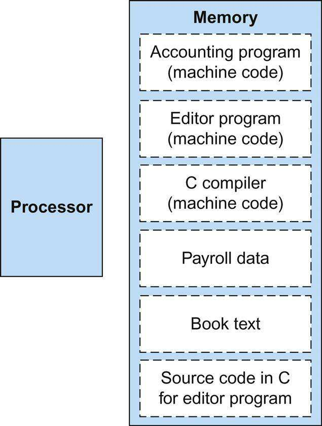

**HÌNH 2.7 Khái niệm stored-program. Chương trình được lưu cho phép máy tính làm kế toán trong chớp mắt trở thành máy tính giúp tác giả viết sách. Chuyển đổi đơn giản bằng load bộ nhớ với chương trình và dữ liệu rồi bảo máy tính bắt đầu thực thi tại vị trí cho trước trong bộ nhớ. Xử lý instruction giống dữ liệu đơn giản hóa rất nhiều cả phần cứng bộ nhớ lẫn phần mềm hệ thống máy tính. Cụ thể, công nghệ bộ nhớ cho dữ liệu cũng dùng được cho chương trình, và chẳng hạn chương trình như compiler có thể dịch code viết bằng ký hiệu thuận tiện cho con người hơn nhiều thành code máy tính hiểu.**

Một hệ quả instruction là số là chương trình thường phân phối dưới dạng file số nhị phân. Hệ quả thương mại là máy tính có thể thừa hưởng phần mềm ready-made nếu tương thích instruction set hiện có. “Tương thích nhị phân” như vậy thường khiến ngành tập trung quanh số ít instruction set architecture.

#### Tự kiểm tra

Đây biểu diễn instruction RISC-V nào? Chọn một trong bốn phương án dưới.

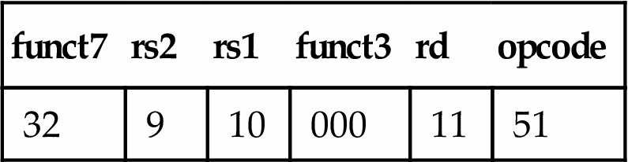

1. subx9,x10,x11

2. addx11,x9,x10

3. subx11,x10,x9

4. subx11,x9,x10

## 2.6 Phép toán logic

Mặc dù máy tính đầu tiên thao tác trên toàn word, chẳng bao lâu rõ rằng thao tác trên field bit trong word hay thậm chí từng bit là hữu ích. Xét ký tự trong word, mỗi ký tự lưu bằng 8 bit, là ví dụ phép toán ấy (xem Mục 2.9). Do đó phép toán được thêm vào ngôn ngữ lập trình và instruction set architecture để, trong số các việc khác, đơn giản hóa đóng gói và tháo bit vào word. Những instruction này gọi là logical operation. Hình 2.8 cho logical operation trong C, Java và RISC-V.

“Ngược lại,” Tweedledee tiếp, “nếu đã như thế thì có thể là thế; và nếu là thế thì sẽ là thế; nhưng vì không phải thế nên chẳng phải thế. Đó là logic.”

Lewis Carroll, Alice’s Adventures in Wonderland, 1865

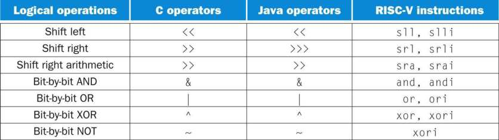

**HÌNH 2.8 Toán tử logic C và Java cùng instruction RISC-V tương ứng. Một cách triển khai NOT là dùng XOR với một toán hạng toàn bit một (FFFF FFFF FFFF FFFF<sub>hex</sub>).**

Loại phép toán đầu như vậy gọi là shift. Chúng dịch mọi bit trong doubleword trái hoặc phải, điền các bit trống bằng 0. Ví dụ nếu register x19 chứa

<pre>00000000 00000000 00000000 00000000 00000000 00000000
00000000 00001001<sub>two</sub>= 9<sub>ten</sub></pre>

và instruction dịch trái 4 được thực hiện, giá trị mới là:

<pre>00000000 00000000 00000000 00000000 00000000 00000000
00000000 10010000<sub>two</sub>= 144<sub>ten</sub></pre>

Đối ngẫu dịch trái là dịch phải. Tên thực của hai shift instruction RISC-V là shift left logical immediate (slli) và shift right logical immediate (srli). Instruction sau thực hiện phép toán trên nếu giá trị gốc ở register x19 và kết quả cần vào register x11:

```
slli x11, x19, 4 // reg x11 = reg x19 << 4 bits
```

Các shift instruction này dùng I-type. Vì không hữu ích khi dịch register 64-bit hơn 63 bit, chỉ 6 bit thấp của immediate 12-bit ở I-type thực sự được dùng. Sáu bit còn lại được dùng lại làm field opcode bổ sung funct6.

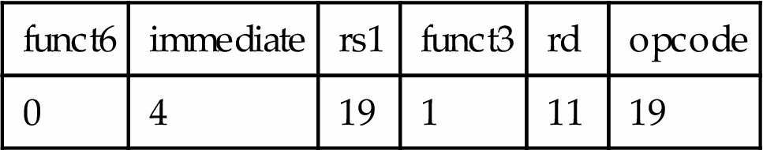

Mã hóa slli là 19 trong field opcode, rd chứa 11, funct3 chứa 1, rs1 chứa 19, immediate chứa 4 và funct6 chứa 0.

Shift left logical có lợi ích thêm. Dịch trái i bit cho kết quả giống hệt nhân với 2<sup>i</sup>, cũng như dịch số thập phân i chữ số tương đương nhân 10i. Ví dụ slli trên dịch 4, cho kết quả như nhân 2<sup>4</sup> hay 16. Bit pattern đầu phía trên biểu diễn 9, và 9×16=144, giá trị bit pattern thứ hai. RISC-V cung cấp loại shift thứ ba, shift right arithmetic (srai). Biến thể này giống srli, nhưng thay vì điền bit trống bên trái bằng zero, nó điền bản sao sign bit cũ. Nó cũng cung cấp biến thể của cả ba shift lấy lượng dịch từ register thay immediate: sll, srl và sra.

Phép toán hữu ích khác tách field là AND. (Ta viết hoa để tránh nhầm phép toán với liên từ tiếng Anh.) AND là phép toán bit-by-bit chỉ để 1 trong kết quả nếu cả hai bit toán hạng là 1. Ví dụ nếu register x11 chứa

### AND

Phép toán logic bit-by-bit với hai toán hạng tính 1 chỉ nếu cả hai toán hạng có 1.

<pre>00000000 00000000 00000000 00000000 00000000 00000000
00001101 11000000<sub>two</sub></pre>

và register x10 chứa

<pre>00000000 00000000 00000000 00000000 00000000 00000000
00111100 00000000<sub>two</sub></pre>

thì sau khi thực thi instruction RISC-V

```
and x9, x10, x11   // reg x9 = reg x10 & reg x11
```

giá trị register x9 sẽ là

<pre>00000000 00000000 00000000 00000000 00000000 00000000
00001100 00000000<sub>two</sub></pre>

Như thấy, AND có thể áp bit pattern lên tập bit để ép 0 ở nơi bit pattern có 0. Bit pattern như vậy kết hợp AND theo truyền thống gọi là mask vì mask “che” một số bit.

Để đặt giá trị vào một trong các biển số 0 này, có đối ngẫu AND gọi là OR. Đây là phép toán bit-by-bit đặt 1 trong kết quả nếu bit của bất kỳ toán hạng nào là 1. Cụ thể, nếu register x10 và x11 không đổi từ ví dụ trước, kết quả instruction RISC-V

### OR

Phép toán logic bit-by-bit với hai toán hạng tính 1 nếu bất kỳ toán hạng nào có 1.

```
or x9, x10, x11 // reg x9 = reg x10 | reg x11
```

là giá trị này trong register x9:

<pre>00000000 00000000 00000000 00000000 00000000 00000000
00111101 11000000<sub>two</sub></pre>

Phép toán logic cuối có tính đảo ngược. NOT nhận một toán hạng và đặt 1 trong kết quả nếu bit toán hạng là 0, và ngược lại. Dùng ký hiệu trước, nó tính  .

### NOT

Phép toán logic bit-by-bit với một toán hạng đảo bit; nghĩa là thay mọi 1 bằng 0 và mọi 0 bằng 1.

Theo định dạng three-operand, người thiết kế RISC-V quyết định đưa instruction XOR (exclusive OR) thay NOT. Vì exclusive OR tạo 0 khi các bit giống nhau và 1 nếu khác nhau, tương đương NOT là xor 111…111.

### XOR

Phép toán logic bit-by-bit với hai toán hạng tính exclusive OR của chúng. Nghĩa là chỉ tính 1 nếu giá trị ở hai toán hạng khác nhau.

Nếu register x10 không đổi từ ví dụ trước và register x12 có giá trị 0, kết quả instruction RISC-V

```
xor x9, x10, x12 // reg x9 = reg x10 ^ reg x12
```

là giá trị này trong register x9:

<pre>00000000 00000000 00000000 00000000 00000000 00000000
00110001 11000000<sub>two</sub></pre>

Hình 2.8 trên cho quan hệ giữa toán tử C, Java với instruction RISC-V. Hằng hữu ích trong logical operation cũng như arithmetic operation, nên RISC-V cung cấp thêm instruction and immediate (andi), or immediate (ori) và exclusive or immediate (xori).

### Giải thích thêm

C cho phép định nghĩa bit field hay field trong doubleword, vừa cho phép đóng gói đối tượng trong doubleword vừa khớp giao diện áp đặt từ ngoài như thiết bị I/O. Mọi field phải vừa một doubleword. Field là số nguyên unsigned có thể ngắn chỉ 1 bit. Compiler C chèn và trích field bằng logical instruction RISC-V: andi, ori, slli và srli.

### Tự kiểm tra

Những phép toán nào tách được field trong doubleword?

1. AND

2. Dịch trái rồi dịch phải

Tính hữu ích máy tính tự động nằm ở khả năng dùng lặp lại chuỗi instruction cho trước, số lần lặp tùy kết quả tính toán.… Lựa chọn này có thể phụ thuộc dấu của số (zero được tính là dương cho máy). Do đó ta đưa vào [instruction] (conditional transfer [instruction]) tùy dấu số cho trước sẽ khiến một trong hai routine thích hợp được thực thi.

Burks, Goldstine và von Neumann, 1947

## 2.7 Instruction ra quyết định

Điều phân biệt máy tính với máy tính cầm tay đơn giản là khả năng ra quyết định. Tùy dữ liệu input và giá trị tạo trong tính toán, instruction khác nhau thực thi. Ra quyết định thường biểu diễn trong ngôn ngữ lập trình bằng câu lệnh if, đôi khi kết hợp câu lệnh go to và label. Assembly language RISC-V có hai instruction decision-making, giống if có go to. Instruction đầu là

```
beq rs1, rs2, L1
```

Instruction này nghĩa là tới câu lệnh nhãn L1 nếu giá trị register rs1 bằng giá trị register rs2. Mnemonic beq là branch if equal. Instruction thứ hai là

```
bne rs1, rs2, L1
```

Nó nghĩa là tới câu lệnh nhãn L1 nếu giá trị register rs1 không bằng giá trị register rs2. Mnemonic bne là branch if not equal. Hai instruction này theo truyền thống gọi là conditional branch.

### conditional branch

Instruction kiểm tra giá trị và cho phép sau đó chuyển điều khiển tới địa chỉ mới trong chương trình dựa trên kết quả kiểm tra.

### Biên dịch if-then-else thành conditional branch

**Ví dụ**

Trong đoạn code sau, f, g, h, i và j là biến. Nếu năm biến f tới j tương ứng năm register x19 tới x23, code RISC-V đã biên dịch cho câu lệnh if C này là gì?

```
if (i == j) f = g + h; else f = g −h;
```

**Trả lời**

Hình 2.9 cho lưu đồ việc code RISC-V cần làm. Biểu thức đầu so sánh bằng giữa hai biến trong register. Có vẻ ta muốn branch nếu I và j bằng nhau (beq). Nhìn chung, code hiệu quả hơn nếu kiểm tra điều kiện ngược để branch qua code, tức branch nếu giá trị khác nhau (bne). Đây là code:

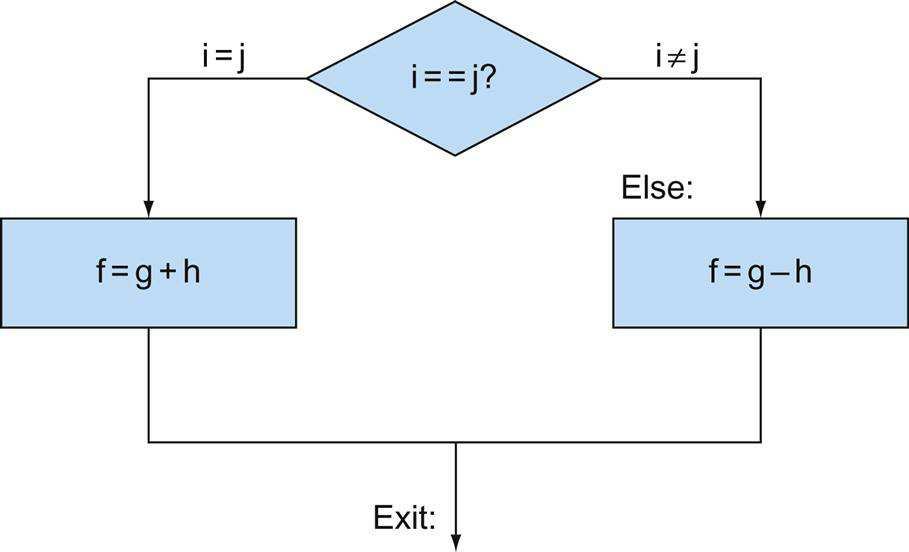

**HÌNH 2.9 Minh họa các lựa chọn trong câu lệnh if trên. Hộp trái tương ứng phần then của if, hộp phải tương ứng phần else.**

```
bne x22, x23, Else  // go to Else if i ≠ j
```

Câu lệnh gán tiếp theo thực hiện một phép toán, và nếu mọi toán hạng được phân bổ vào register, chỉ là một instruction:

```
add x19, x20, x21    // f = g + h (skipped if i ≠ j)
```

Giờ cần tới cuối câu lệnh if. Ví dụ giới thiệu loại branch khác, thường gọi là unconditional branch. Instruction này nói processor luôn đi theo branch. Một cách biểu diễn unconditional branch trong RISC-V là dùng conditional branch có điều kiện luôn đúng:

```
beq x0, x0, Exit    // if 0 == 0, go to Exit
```

Câu lệnh gán trong phần else của if một lần nữa có thể biên dịch thành một instruction. Chỉ cần thêm nhãn Else vào instruction này. Ta cũng cho nhãn Exit sau instruction, biểu thị cuối code if-then-else đã biên dịch:

```
Else:sub x19, x20, x21  // f = g −h (skipped if i = j)
Exit:
```

Chú ý assembler giải phóng compiler và lập trình viên assembly language khỏi việc tẻ nhạt tính địa chỉ branch, như khi tính địa chỉ dữ liệu cho load và store (xem Mục 2.12).

### Giao diện phần cứng/phần mềm

Compiler thường tạo branch và label nơi chúng không xuất hiện trong ngôn ngữ lập trình. Tránh gánh nặng viết label và branch tường minh là lợi ích của ngôn ngữ lập trình high-level và là lý do viết code nhanh hơn ở mức ấy.

### Vòng lặp

Quyết định quan trọng cả để chọn giữa hai lựa chọn—trong if—lẫn lặp phép tính—trong loop. Cùng assembly instruction là khối xây dựng cho cả hai trường hợp.

#### Biên dịch vòng lặp while trong C

**Ví dụ**

Đây là vòng lặp truyền thống trong C:

```
while (save[i] == k)
   i += 1;
```

Giả sử i và k tương ứng register x22, x24, và base mảng save ở x25. Assembly code RISC-V tương ứng code C này là gì?

**Trả lời**

Bước đầu là load save[i] vào temporary register. Trước khi load save[i] vào temporary register, cần có địa chỉ. Trước khi cộng i với base mảng save để tạo địa chỉ, phải nhân chỉ số i với 8 do byte addressing. May mắn có thể dùng shift left, vì dịch trái 3 bit nhân với 2<sup>3</sup> hay 8 (xem trang 90 mục trước). Cần thêm nhãn Loop để có thể branch trở lại instruction ấy ở cuối vòng lặp:

```
Loop: slli x10, x22, 3   // Temp reg x10 = i * 8
```

Để có địa chỉ save[i], cần cộng x10 với base save trong x25:

```
add x10, x10, x25    // x10 = address of save[i]
```

Giờ dùng địa chỉ đó load save[i] vào temporary register:

```
ld x9, 0(x10)    // Temp reg x9 = save[i]
```

Instruction tiếp theo kiểm tra vòng lặp, thoát nếu save[i] ≠

```
k:
bne x9, x24, Exit   // go to Exit if save[i] ≠ k
```

Instruction sau cộng 1 vào i:

```
addi x22, x22, 1    // i = i + 1
```

Cuối vòng lặp branch trở lại kiểm tra while ở đầu. Chỉ thêm nhãn Exit sau đó là xong:

```
beq x0, x0, Loop    // go to Loop
Exit:
```

(Xem bài tập về tối ưu chuỗi này.)

#### Giao diện phần cứng/phần mềm

Chuỗi instruction kết thúc bằng branch như vậy cơ bản với biên dịch đến mức có thuật ngữ riêng: basic block là chuỗi instruction không có branch, trừ có thể ở cuối, và không có đích branch hay nhãn branch, trừ có thể ở đầu. Một trong những giai đoạn đầu biên dịch là chia chương trình thành basic block.

#### basic block

Chuỗi instruction không có branch (trừ có thể cuối) và không có đích branch hoặc nhãn branch (trừ có thể đầu).

Kiểm tra bằng hay không bằng có lẽ phổ biến nhất, nhưng có nhiều quan hệ khác giữa hai số. Ví dụ vòng lặp for có thể muốn kiểm tra biến chỉ số nhỏ hơn 0. Đầy đủ các so sánh là nhỏ hơn (<), nhỏ hơn hoặc bằng (≤), lớn hơn (>), lớn hơn hoặc bằng (≥), bằng (=) và khác (≠).

So sánh bit pattern cũng phải xử lý phân biệt signed và unsigned. Đôi khi bit pattern có 1 ở most significant bit biểu diễn số âm và dĩ nhiên nhỏ hơn mọi số dương vốn có 0 ở most significant bit. Ngược lại, với số nguyên unsigned, 1 ở most significant bit biểu diễn số lớn hơn mọi số bắt đầu bằng 0. (Ta sẽ sớm tận dụng nghĩa kép này để giảm chi phí kiểm tra biên mảng.) RISC-V cung cấp instruction xử lý cả hai. Chúng có dạng như beq và bne nhưng so sánh khác. Instruction branch if less than (blt) so sánh giá trị register rs1, rs2 và branch nếu giá trị rs1 nhỏ hơn, khi coi là số two’s complement. Branch if greater than or equal (bge) branch trong trường hợp ngược, tức giá trị rs1 ít nhất bằng rs2. Branch if less than, unsigned (bltu) branch nếu giá trị rs1 nhỏ hơn rs2 khi coi là unsigned. Cuối cùng, branch if greater than or equal, unsigned (bgeu) branch trong trường hợp ngược.

Cách thay thế cung cấp branch instruction bổ sung là đặt register dựa kết quả so sánh, rồi branch theo giá trị temporary register ấy bằng beq hoặc bne. Cách này, dùng trong instruction set MIPS, có thể làm processor datapath hơi đơn giản hơn nhưng cần nhiều instruction hơn để biểu diễn chương trình.

Cách khác nữa, dùng bởi instruction set ARM, là giữ bit bổ sung ghi lại điều xảy ra trong instruction. Những bit này gọi là condition code hay flag, cho biết chẳng hạn kết quả arithmetic operation âm, zero hay overflow.

Conditional branch sau đó dùng tổ hợp condition code để thực hiện kiểm tra mong muốn.

Nhược điểm condition code là nếu nhiều instruction luôn đặt chúng, sẽ tạo phụ thuộc gây khó thực thi pipelined (xem Chương 4).

### Mẹo kiểm tra biên

Coi số signed như unsigned cho cách low-cost kiểm tra 0 ≤x<y, khớp kiểm tra chỉ số out-of-bounds của mảng. Mấu chốt là số nguyên âm ở two’s complement trông như số lớn ở unsigned; nghĩa là most significant bit là sign bit ở cách trước nhưng là phần lớn của số ở cách sau. Do đó so sánh unsigned x<y kiểm tra cả x âm lẫn x nhỏ hơn y.

**Ví dụ**

Dùng mẹo này giảm kiểm tra index-out-of-bounds: branch tới IndexOutOfBounds nếu x20 ≥ x11 hoặc x20 âm.

**Trả lời**

Code chỉ dùng so sánh unsigned lớn hơn hoặc bằng để làm cả hai kiểm tra:

```
bgeu x20, x11, IndexOutOfBounds // if x20 >= x11 or x20 < 0,
goto IndexOutOfBounds
```

### Câu lệnh case/switch

Phần lớn ngôn ngữ có case hay switch cho phép lập trình viên chọn một trong nhiều phương án tùy một giá trị. Cách đơn giản nhất triển khai switch là chuỗi kiểm tra có điều kiện, biến switch thành chuỗi if-then-else.

Đôi khi các phương án được mã hóa hiệu quả hơn thành bảng địa chỉ những chuỗi instruction khác nhau, gọi là branch address table hay branch table, và chương trình chỉ cần đánh chỉ mục bảng rồi branch tới chuỗi thích hợp. Vì vậy branch table chỉ là array doublewords chứa địa chỉ tương ứng label trong code. Chương trình load mục thích hợp từ branch table vào register. Sau đó cần branch bằng địa chỉ trong register. Để hỗ trợ, máy tính như RISC-V có indirect jump instruction thực hiện unconditional branch tới địa chỉ chỉ định trong register. Trong RISC-V, instruction jump-and-link register (jalr) phục vụ mục đích này. Ta sẽ thấy cách dùng phổ biến hơn nữa của instruction linh hoạt này ở mục tiếp.

#### branch address table

Cũng gọi là branch table. Bảng địa chỉ các chuỗi instruction lựa chọn.

#### Giao diện phần cứng/phần mềm

Mặc dù có nhiều câu lệnh quyết định và vòng lặp trong C, Java, câu lệnh nền tảng triển khai chúng ở mức instruction set là conditional branch.

#### Tự kiểm tra

I. C có nhiều câu lệnh quyết định và vòng lặp, còn RISC-V ít. Điều nào sau đây giải thích hoặc không giải thích mất cân bằng này? Vì sao?

1. Nhiều câu lệnh quyết định làm code dễ đọc hiểu hơn.

2. Ít câu lệnh quyết định đơn giản hóa công việc tầng bên dưới chịu trách nhiệm thực thi.

3. Nhiều câu lệnh quyết định nghĩa là ít dòng code, thường giảm thời gian viết code.

4. Nhiều câu lệnh quyết định nghĩa là ít dòng code, thường khiến thực thi ít phép toán hơn.

II. Vì sao C cung cấp hai tập toán tử AND (& và &&) và hai tập toán tử OR (| và ||), còn RISC-V không?

1. Logical operation AND và ORR triển khai & và |, còn conditional branch triển khai && và ||.

2. Phát biểu trước ngược: && và || tương ứng logical operation, còn & và | ánh xạ sang conditional branch.

3. Chúng dư thừa và cùng ý nghĩa: && và || đơn thuần kế thừa từ ngôn ngữ B, tiền thân C.

## 2.8 Hỗ trợ procedure trong phần cứng máy tính

Procedure hay function là công cụ lập trình viên dùng cấu trúc chương trình, vừa dễ hiểu hơn vừa cho tái sử dụng code. Procedure cho phép tập trung mỗi lúc một phần nhiệm vụ; tham số làm giao diện giữa procedure với phần còn lại chương trình và dữ liệu, vì truyền giá trị và trả kết quả. Ta mô tả tương đương procedure trong Java ở  Mục 2.15, nhưng Java cần mọi thứ C cần từ máy tính. Procedure là cách triển khai abstraction trong phần mềm.

### procedure

Subroutine được lưu thực hiện nhiệm vụ cụ thể dựa các tham số được cung cấp.


Bạn có thể nghĩ procedure như điệp viên rời đi với kế hoạch bí mật, thu nguồn lực, làm nhiệm vụ, xóa dấu vết rồi trở về xuất phát với kết quả mong muốn. Không thứ gì khác nên bị xáo trộn khi hoàn tất. Hơn nữa điệp viên chỉ hoạt động trên cơ sở “cần biết”, nên không thể giả định về người chỉ huy.

Tương tự, khi thực thi procedure, chương trình phải theo sáu bước:

1. Đặt tham số nơi procedure truy cập được.

2. Chuyển điều khiển tới procedure.

3. Nhận tài nguyên lưu trữ cần cho procedure.

4. Thực hiện nhiệm vụ mong muốn.

5. Đặt kết quả nơi chương trình gọi truy cập được.

6. Trả điều khiển về điểm xuất phát, vì procedure có thể gọi từ nhiều điểm trong chương trình.

Như nói trên, register là nơi giữ dữ liệu nhanh nhất trong máy tính, nên muốn dùng càng nhiều càng tốt. Phần mềm RISC-V theo quy ước gọi procedure sau khi phân bổ 32 register:

- x10–x17: tám parameter register để truyền tham số hoặc trả giá trị.

- x1: một return address register để về xuất phát. Ngoài phân bổ các register này, assembly language RISC-V có instruction riêng cho procedure: branch tới địa chỉ và đồng thời lưu địa chỉ instruction sau vào destination register rd. Instruction jump-and-link (jal) viết là

```
jal x1, ProcedureAddress    // jump to ProcedureAddress and
write return address to x1
```

### jump-and-link instruction

Instruction branch tới địa chỉ và đồng thời lưu địa chỉ instruction tiếp trong register (thường x1 ở RISC-V).

Phần link trong tên nghĩa là tạo địa chỉ hay link trỏ tới chỗ gọi để procedure trở lại địa chỉ đúng. “Link” lưu trong register x1 gọi là return address. Cần return address vì cùng procedure có thể gọi từ nhiều phần chương trình.

### return address

Link tới chỗ gọi cho phép procedure trở lại địa chỉ đúng; trong RISC-V lưu ở register x1.

Để hỗ trợ trở về từ procedure, máy tính như RISC-V dùng indirect jump, như instruction jump-and-link (jalr) đã giới thiệu để hỗ trợ case:

```
jalr x0,  0(x1)
```

Instruction jump-and-link register branch tới địa chỉ lưu trong register x1—đúng điều ta muốn. Do đó chương trình gọi, hay caller, đặt giá trị tham số trong x10–x17 và dùng jal x1, X để branch tới procedure X (đôi khi gọi là callee). Callee thực hiện tính toán, đặt kết quả trong cùng parameter register và trả điều khiển về caller bằng

```
jalr x0, 0(x1).
```

### caller

Chương trình khởi gọi procedure và cung cấp giá trị tham số cần thiết.

### callee

Procedure thực thi chuỗi instruction được lưu dựa tham số caller cung cấp rồi trả điều khiển về caller.

Ý tưởng stored-program ngầm đòi hỏi register giữ địa chỉ instruction hiện đang thực thi. Vì lý do lịch sử, register này gần như luôn gọi là program counter, viết tắt PC trong kiến trúc RISC-V, mặc dù tên hợp lý hơn là instruction address register. Instruction jal thực sự lưu PC+4 trong register đích (thường x1) để liên kết tới địa chỉ byte instruction tiếp, chuẩn bị trở về từ procedure.

### program counter (PC)

Register chứa địa chỉ instruction trong chương trình đang được thực thi.

### Giải thích thêm

Instruction jump-and-link cũng có thể dùng unconditional branch trong procedure bằng dùng x0 làm destination register. Vì x0 hard-wired zero, tác dụng là bỏ return address:

```
jal x0, Label // unconditionally branch to Label
```

### Dùng thêm register

Giả sử compiler cần nhiều register cho procedure hơn tám argument register. Vì phải xóa dấu vết sau nhiệm vụ, mọi register caller cần phải khôi phục giá trị trước khi gọi procedure. Đây là ví dụ cần spill register vào bộ nhớ, như phần Giao diện phần cứng/phần mềm trang 69 đã nói.

Cấu trúc dữ liệu lý tưởng để spill register là stack—hàng đợi last-in-first-out. Stack cần pointer tới địa chỉ mới phân bổ nhất để chỉ procedure tiếp nên đặt register cần spill đâu hoặc tìm giá trị register cũ đâu. Trong RISC-V, stack pointer là register x2, cũng gọi sp. Stack pointer điều chỉnh một doubleword cho mỗi register lưu hoặc khôi phục. Stack phổ biến đến mức có thuật ngữ riêng cho truyền dữ liệu tới và từ nó: đặt dữ liệu lên stack là push, lấy khỏi stack là pop.

#### stack

Cấu trúc dữ liệu để spill register tổ chức thành hàng đợi last-in-first-out.

#### stack pointer

Giá trị biểu thị địa chỉ mới phân bổ nhất trong stack, chỉ nơi spill register hoặc tìm giá trị register cũ. Trong RISC-V là register sp hay x2.

#### push

Thêm phần tử vào stack.

#### pop

Lấy phần tử khỏi stack.

Theo tiền lệ lịch sử, stack “tăng” từ địa chỉ cao xuống thấp. Quy ước này nghĩa là push giá trị bằng trừ stack pointer. Cộng stack pointer thu nhỏ stack, qua đó pop giá trị khỏi stack.

#### Biên dịch procedure C không gọi procedure khác

**Ví dụ**

Hãy biến ví dụ trang 66 Mục 2.2 thành procedure C:

```
long long int leaf_example (long long int g, long long int
h, long long int i, long long int j)
{
    long long int f;
    f = (g + h) −(i + j);
    return f;
}
```

Assembly code RISC-V đã biên dịch là gì?

**Trả lời**

Biến tham số g, h, i và j tương ứng argument register x10, x11, x12, x13, còn f tương ứng x20. Chương trình biên dịch bắt đầu bằng nhãn procedure:

```
leaf_example:
```

Bước tiếp là lưu register procedure dùng. Câu lệnh gán C trong thân giống ví dụ trang 67, dùng hai temporary register (x5 và x6). Do đó cần lưu ba register: x5, x6 và x20. Ta “push” giá trị cũ lên stack bằng tạo chỗ ba doubleword (24 byte) trên stack rồi store chúng:

```
addi sp,  sp, -24    // adjust stack to make room for 3 items
sdx5, 16(sp)   // save register x5 for use afterwards
sdx6, 8(sp)     // save register x6 for use afterwards
sdx20, 0(sp)    // save register x20 for use afterwards
```

Hình 2.10 cho stack trước, trong và sau procedure call.

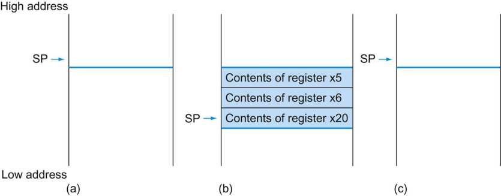

**HÌNH 2.10 Giá trị stack pointer và stack (a) trước, (b) trong, (c) sau procedure call. Stack pointer luôn trỏ “đỉnh” stack, hay doubleword cuối trong stack ở hình này.**

Ba câu lệnh tiếp tương ứng thân procedure, theo ví dụ trang 67:

```
add x5, x10, x11// register x5 contains g + h
add x6, x12, x13// register x6 contains i + j
sub x20, x5, x6// f = x5 − x6, which is (g + h)−(i + j)
```

Để trả giá trị f, sao chép nó vào parameter register:

```
addi x10, x20, 0 // returns f (x10 = x20 + 0)
```

Trước khi trở về, khôi phục ba giá trị register cũ đã lưu bằng “pop” khỏi stack:

```
ld x20, 0(sp)  // restore register x20 for caller
ld x6, 8(sp)  // restore register x6 for caller
ld x5, 16(sp) // restore register x5 for caller
addi sp, sp, 24   // adjust stack to delete 3 items
```

Procedure kết thúc bằng branch register dùng return address:

```
jalr x0, 0(x1)      // branch back to calling routine
```

Trong ví dụ trước, ta dùng temporary register và giả sử giá trị cũ phải lưu và khôi phục. Để tránh lưu và khôi phục register có giá trị không bao giờ dùng, điều có thể xảy ra với temporary register, phần mềm RISC-V chia 19 register thành hai nhóm:

- x5−x7 và x28−x31: temporary register không được callee (procedure được gọi) bảo toàn qua procedure call

- x8−x9 và x18−x27: saved register phải bảo toàn qua procedure call (nếu dùng, callee lưu và khôi phục) Quy ước đơn giản giảm register spilling. Trong ví dụ, vì caller không trông đợi register x5, x6 bảo toàn qua procedure call, có thể bỏ hai store và hai load khỏi code. Vẫn phải lưu khôi phục x20 vì callee phải giả sử caller cần giá trị nó.

### Procedure lồng nhau

Procedure không gọi procedure khác gọi là leaf procedure. Cuộc sống đơn giản nếu mọi procedure đều leaf, nhưng không phải vậy. Như điệp viên có thể dùng điệp viên khác trong nhiệm vụ, rồi họ lại dùng thêm điệp viên, procedure cũng gọi procedure khác. Hơn nữa, recursive procedure còn gọi “bản sao” chính mình. Như cần cẩn thận dùng register trong procedure, cũng phải chú ý khi gọi nonleaf procedure.

Ví dụ giả sử main gọi procedure A với đối số 3 bằng đặt 3 trong register x10 rồi dùng jal x1, A. Sau đó giả sử A gọi B qua jal x1, B với đối số 7 cũng đặt trong x10. Vì A chưa hoàn thành, có xung đột dùng x10. Tương tự xung đột return address ở x1 vì giờ chứa return address cho B. Nếu không ngăn, xung đột làm mất khả năng A trở về caller.

Một giải pháp là push mọi register khác cần bảo toàn lên stack, như saved register. Caller push argument register (x10–x17) hay temporary register (x5-x7 và x28-x31) cần sau call. Callee push return address register x1 và saved register (x8-x9 và x18-x27) nó dùng. Stack pointer sp điều chỉnh theo số register đặt lên stack. Khi trở về, register khôi phục từ bộ nhớ và stack pointer điều chỉnh lại.

#### Biên dịch recursive procedure C, cho thấy liên kết procedure lồng nhau

**Ví dụ**

Hãy xử lý recursive procedure tính giai thừa:

```
long long int fact (long long int n)
{
     if (n < 1) return (1);
          else return (n * fact(n −1));
}
```

Assembly code RISC-V là gì?

**Trả lời**

Biến tham số n tương ứng argument register x10. Chương trình biên dịch bắt đầu nhãn procedure rồi lưu hai register trên stack, return address và x10:

```
fact:
   addi   sp, sp, -16// adjust stack for 2 items
      sd x1, 8(sp)// save the return address
      sd x10, 0(sp)// save the argument n
```

Lần đầu gọi fact, sd lưu địa chỉ trong chương trình đã gọi fact. Hai instruction tiếp kiểm tra n nhỏ hơn 1 không, tới L1 nếu n ≥ 1.

```
addi   x5, x10, -1   // x5 = n - 1
bge   x5, x0, L1   // if (n - 1) >= 0, go to L1
```

Nếu n nhỏ hơn 1, fact trả 1 bằng đặt 1 vào value register: cộng 1 với 0 rồi đặt tổng trong x10. Sau đó pop hai giá trị đã lưu khỏi stack và branch tới return address:

```
addi   x10, x0, 1   // return 1
addi   sp, sp, 16   // pop 2 items off stack
jalr      // return to caller
```

*(ghi chú: sách in `jalr` thiếu toán hạng; đúng là `jalr x0, 0(x1)`)*

Trước khi pop hai mục khỏi stack, có thể load x1 và x10. Vì x1, x10 không thay đổi khi n nhỏ hơn 1, ta bỏ các instruction đó.

Nếu n không nhỏ hơn 1, đối số n giảm một rồi fact được gọi lại với giá trị đã giảm:

```
L1: addi x10, x10, -1   // n >= 1: argument gets (n −1)
   jalx1, fact   // call fact with (n −1)
```

*(ghi chú: sách in `jalx1, fact`; đúng là `jal x1, fact`)*

Instruction tiếp là nơi fact trở về; kết quả ở x10. Giờ return address cũ và đối số cũ được khôi phục cùng stack pointer:

```
addi   x6, x10, 0   // return from jal: move result of fact(n -
1) to x6:
ld   x10, 0(sp)   // restore argument n
ld   x1, 8(sp)   // restore the return address
addi   sp, sp, 16   // adjust stack pointer to pop 2 items
```

Tiếp theo argument register x10 nhận product của đối số cũ với kết quả fact(n - 1), giờ ở x6. Ta giả sử có multiply instruction dù tới Chương 3 mới trình bày:

```
mul   x10, x10, x6   // return n * fact (n −1)
```

Cuối cùng fact lại branch tới return address:

```
jalr   x0, 0(x1)   // return to the caller
```

#### Giao diện phần cứng/phần mềm

Biến C thường là vị trí lưu trữ, và cách hiểu phụ thuộc cả kiểu lẫn storage class. Ví dụ kiểu gồm số nguyên, ký tự (xem Mục 2.9). C có hai storage class: automatic và static. Biến automatic cục bộ với procedure, bị bỏ khi procedure thoát. Biến static tồn tại qua các lần thoát và vào procedure. Biến C khai báo ngoài mọi procedure là static, cũng như mọi biến khai báo bằng từ khóa static. Phần còn lại automatic. Để đơn giản truy cập dữ liệu static, một số compiler RISC-V dành register x3 làm global pointer hay gp.

#### global pointer

Register được dành để trỏ vùng static.

Hình 2.11 tổng kết những gì bảo toàn qua procedure call. Chú ý vài cơ chế bảo toàn stack, bảo đảm caller lấy lại cùng dữ liệu khi load từ stack như đã store. Stack phía trên sp bảo toàn bằng bảo đảm callee không ghi trên sp; chính sp bảo toàn bởi callee cộng đúng lượng đã trừ; các register khác bảo toàn bằng lưu trên stack (nếu dùng) rồi khôi phục từ đó.

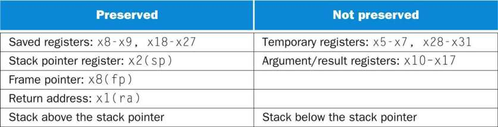

**HÌNH 2.11 Những gì được và không được bảo toàn qua procedure call. Nếu phần mềm dựa vào global pointer register bàn ở các tiểu mục sau, nó cũng được bảo toàn.**

### Phân bổ chỗ cho dữ liệu mới trên stack

Điểm phức tạp cuối là stack cũng lưu biến cục bộ procedure không vừa register, như array hay structure cục bộ. Đoạn stack chứa saved register và biến cục bộ procedure gọi là procedure frame hay activation record. Hình 2.12 cho trạng thái stack trước, trong và sau procedure call.

#### procedure frame

Cũng gọi là activation record. Đoạn stack chứa saved register và biến cục bộ procedure.

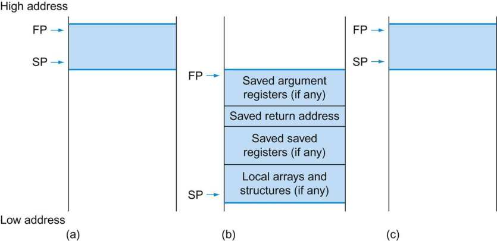

**HÌNH 2.12 Minh họa phân bổ stack (a) trước, (b) trong, (c) sau procedure call. Frame pointer (fp hay x8) trỏ doubleword đầu frame, thường là argument register đã lưu, và stack pointer (sp) trỏ đỉnh stack. Stack điều chỉnh để chứa mọi saved register và biến cục bộ memory-resident. Vì stack pointer có thể thay đổi khi chương trình chạy, lập trình viên dễ tham chiếu biến qua frame pointer ổn định hơn, dù có thể chỉ dùng stack pointer cùng chút số học địa chỉ. Nếu không có biến cục bộ trên stack trong procedure, compiler tiết kiệm thời gian bằng không đặt và khôi phục frame pointer. Khi dùng frame pointer, nó khởi tạo bằng địa chỉ trong sp khi call, và sp khôi phục bằng fp. Thông tin này cũng ở Cột 4 RISC-V Reference Data Card đầu sách. Một số compiler RISC-V dùng frame pointer fp hay register x8 trỏ doubleword đầu frame procedure. Stack pointer có thể đổi trong procedure, nên tham chiếu biến cục bộ bộ nhớ có thể có offset khác nhau tùy vị trí trong procedure, khiến khó hiểu hơn. Ngược lại frame pointer cung cấp base register ổn định trong procedure cho memory-references cục bộ. Chú ý activation record xuất hiện trên stack dù dùng frame pointer tường minh hay không. Ta đã tránh fp bằng tránh thay đổi sp trong procedure: ở ví dụ, stack chỉ điều chỉnh lúc vào và thoát procedure.**

#### frame pointer

Giá trị biểu thị vị trí saved register và biến cục bộ cho procedure nhất định.

### Phân bổ chỗ cho dữ liệu mới trên heap

Ngoài biến automatic cục bộ procedure, lập trình viên C cần chỗ bộ nhớ cho biến static và cấu trúc dữ liệu động. Hình 2.13 cho quy ước RISC-V phân bổ bộ nhớ khi chạy Linux operating system. Stack bắt đầu đầu cao user address space (xem Chương 5) và tăng xuống. Phần đầu ở đầu thấp bộ nhớ dành riêng, tiếp theo nơi chứa machine code RISC-V, theo truyền thống gọi text segment. Trên code là static data segment, nơi chứa hằng và biến static khác. Mặc dù array thường dài cố định nên hợp static data segment, cấu trúc như linked list thường tăng giảm trong vòng đời. Segment cho cấu trúc ấy theo truyền thống gọi heap, đặt tiếp theo trong bộ nhớ. Chú ý phân bổ cho stack, heap tăng về phía nhau, cho phép dùng bộ nhớ hiệu quả khi hai segment tăng giảm.

#### text segment

Segment của object file UNIX chứa machine language code cho routine trong source file.

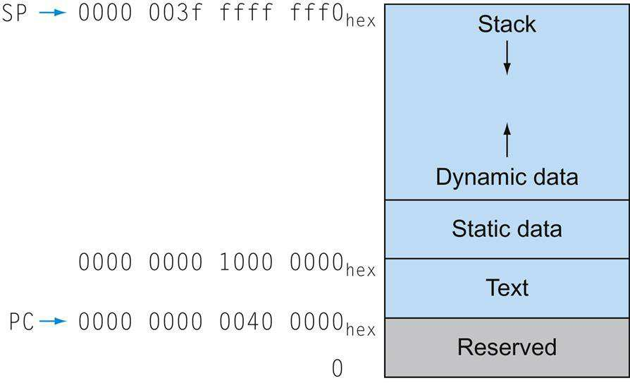

**HÌNH 2.13 Phân bổ bộ nhớ RISC-V cho chương trình và dữ liệu. Địa chỉ chỉ là quy ước phần mềm, không thuộc kiến trúc RISC-V. User address space đặt bằng 2<sup>38</sup> trong tổng không gian địa chỉ có thể 2<sup>64</sup> của kiến trúc 64-bit (xem Chương 5). Stack pointer khởi tạo 0000 003f ffff fff0<sub>hex</sub> và tăng xuống phía data segment. Ở đầu kia, program code (“text”) bắt đầu 0000 0000 0040 0000<sub>hex</sub>. Static data bắt đầu ngay sau cuối text segment; ví dụ này giả sử địa chỉ ấy là 0000 0000 1000 0000<sub>hex</sub>. Dynamic data, phân bổ bởi malloc trong C và new trong Java, nằm tiếp. Nó tăng lên phía stack trong vùng heap. Thông tin này cũng có ở Cột 4 RISC-V Reference Data Card đầu sách.**

C phân bổ và giải phóng chỗ trên heap bằng function tường minh. malloc() phân bổ chỗ heap và trả pointer tới nó, free() giải phóng chỗ heap mà pointer trỏ. Chương trình C kiểm soát phân bổ bộ nhớ, nguồn nhiều bug phổ biến khó xử lý. Quên giải phóng dẫn tới “memory leak”, cuối cùng dùng nhiều bộ nhớ đến mức operating system có thể crash. Giải phóng quá sớm dẫn tới “dangling pointer”, có thể khiến pointer trỏ thứ chương trình không hề định trỏ. Java dùng phân bổ bộ nhớ tự động và garbage collection chính để tránh bug ấy.

Hình 2.14 tổng kết quy ước register assembly language RISC-V. Đây là ví dụ khác làm trường hợp phổ biến nhanh: phần lớn procedure có thể thỏa mãn với tối đa tám argument register, mười hai saved register và bảy temporary register mà không bao giờ vào bộ nhớ.


#### Giải thích thêm

Nếu hơn tám tham số thì sao? Quy ước RISC-V đặt tham số dư trên stack ngay trên frame pointer. Procedure trông đợi tám tham số đầu trong register x10 tới x17, phần còn lại trong bộ nhớ, định địa chỉ qua frame pointer.

Như chú thích Hình 2.12, frame pointer thuận tiện vì mọi tham chiếu biến trên stack trong procedure có cùng offset. Nhưng không bắt buộc. Compiler C RISC-V chỉ dùng frame pointer ở procedure đổi stack pointer trong thân.

#### Giải thích thêm

Một số recursive procedure có thể triển khai lặp không đệ quy. Lặp có thể cải thiện đáng kể hiệu năng bằng bỏ overhead của recursive procedure call. Ví dụ xét procedure tích lũy tổng:

```
long long int sum (long long int n, long long int acc) {
   if (n > 0)
      return sum(n − 1, acc + n);
   else
      return acc;
}
```

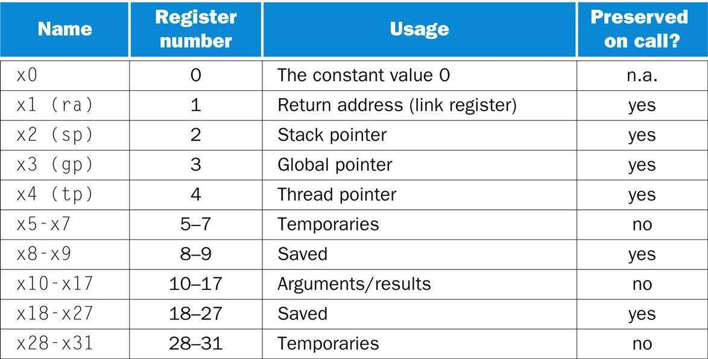

**HÌNH 2.14 Quy ước register RISC-V. Thông tin này cũng có ở Cột 2 RISC-V Reference Data Card đầu sách.**

Xét procedure call sum(3,0). Nó dẫn tới recursive call sum(2,3), sum(1,5), sum(0,6), rồi kết quả 6 trả bốn lần. Recursive call sum này gọi là tail call, và ví dụ tail recursion có thể triển khai rất hiệu quả (giả sử x10 = n, x11 = acc, kết quả vào x12):

```
sum: ble x10, x0, sum_exit    // go to sum_exit if n <= 0
 add x11, x11, x10    // add n to acc
 addi x10, x10, -1     // subtract 1 from n
 jal x0, sum       // jump to sum
sum_exit:
 addi x12, x11, 0    // return value acc
 jalr x0, 0(x1)    // return to caller
```

#### Tự kiểm tra

Phát biểu nào sau về C và Java thường đúng?

1. Lập trình viên C quản lý dữ liệu tường minh, còn Java tự động.

2. C dẫn tới nhiều pointer bug và memory leak bug hơn Java.

!(@ |=>(wow open tab at bar is great)

Dòng thứ tư bài thơ bàn phím “Hatless Atlas”, 1991 (một số đặt tên cho ký tự ASCII: “!” là “wow”, “(” là open, “|” là bar, v.v.).

## 2.9 Giao tiếp với con người

Máy tính được phát minh để xử lý số, nhưng ngay khi khả thi thương mại đã dùng xử lý văn bản. Phần lớn máy tính ngày nay cung cấp byte 8-bit biểu diễn ký tự, với American Standard Code for Information Interchange (ASCII) là biểu diễn gần như mọi người theo. Hình 2.15 tổng kết ASCII.

### ASCII so với số nhị phân

**Ví dụ**

Có thể biểu diễn số bằng chuỗi chữ số ASCII thay số nguyên. Lưu trữ tăng bao nhiêu nếu số 1 tỷ biểu diễn ở ASCII so với số nguyên 32-bit?

**Trả lời**

Một tỷ là 1,000,000,000 nên cần 10 chữ số ASCII, mỗi chữ dài 8 bit. Do đó mức tăng lưu trữ là (10×8)/32 hay 2.5. Ngoài tăng lưu trữ, phần cứng cộng, trừ, nhân, chia số thập phân như vậy khó và tốn năng lượng hơn. Khó khăn giải thích vì sao chuyên gia máy tính được dạy tin nhị phân tự nhiên và máy tính thập phân thỉnh thoảng xuất hiện là kỳ lạ.

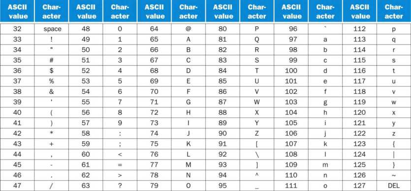

**HÌNH 2.15 Biểu diễn ASCII của ký tự. Chú ý chữ upper- và lowercase khác đúng 32; quan sát có thể dẫn tới mẹo kiểm tra hoặc đổi upper- và lowercase. Giá trị không hiển thị gồm ký tự định dạng. Ví dụ 8 biểu diễn backspace, 9 là tab và 13 carriage return. Giá trị hữu ích khác là 0 cho null, giá trị ngôn ngữ C dùng đánh dấu cuối string.**

Chuỗi instruction có thể trích byte từ doubleword, nên load register và store register đủ để truyền byte cũng như word. Tuy nhiên vì text phổ biến trong một số chương trình, RISC-V cung cấp instruction chuyển byte. Load byte unsigned (lbu) load byte từ bộ nhớ, đặt trong 8 bit ngoài cùng phải register. Store byte (sb) lấy byte từ 8 bit ngoài cùng phải register và ghi vào bộ nhớ. Do đó sao chép byte bằng chuỗi

```
lbu x12, 0(x10)  // Read byte from source
sbx12, 0(x11)  // Write byte to destination
```

Ký tự thường kết hợp thành string có số ký tự biến đổi. Có ba lựa chọn biểu diễn: (1) vị trí đầu dành cho chiều dài string, (2) biến đi kèm chứa chiều dài (như trong structure), hoặc (3) vị trí cuối được chỉ bằng ký tự đánh dấu cuối string. C dùng cách thứ ba, kết thúc string bằng byte giá trị 0 (tên null trong ASCII). Do đó string “Cal” biểu diễn trong C bằng 4 byte sau ở dạng thập phân: 67, 97, 108 và 0. (Như sẽ thấy Java dùng cách đầu.)

### Biên dịch procedure sao chép string, cho thấy cách dùng string C

**Ví dụ**

Procedure strcpy sao chép string y sang string x dùng quy ước byte null kết thúc của C:

```
void strcpy (char x[], char y[])
{
  size_t i;
  i = 0;
  while ((x[i] = y[i]) != ‘\0’) /* copy & test byte */
  i += 1;
}
```

Assembly code RISC-V là gì?

**Trả lời**

Dưới là đoạn assembly code RISC-V cơ bản. Giả sử base address mảng x và y ở x10, x11, còn i ở x19. strcpy điều chỉnh stack pointer rồi lưu saved register x19 trên stack:

```
strcpy:
 addi sp, sp, -8 // adjust stack for 1 more item
 sd x19, 0(sp) // save x19
```

Để khởi tạo i bằng 0, instruction tiếp đặt x19 bằng 0 bằng cộng 0 với 0 và đặt tổng vào x19:

```
add x19, x0, x0// i = 0+0
```

Đây là đầu vòng lặp. Trước tiên tạo địa chỉ y[i] bằng cộng i với y[]:

```
L1: add  x5, x19, x11 // address of y[i] in x5
```

Chú ý không phải nhân i với 8 vì y là array byte chứ không phải doubleword như ví dụ trước.

Để load ký tự ở y[i], dùng load byte unsigned đặt ký tự vào x6:

```
lbu x6, 0(x5) // x6 = y[i]
```

Tính địa chỉ tương tự đặt địa chỉ x[i] vào x7, rồi ký tự trong x6 được store tại địa chỉ ấy.

```
add x7, x19, x10 // address of x[i] in x7
sb x6, 0(x7) // x[i] = y[i]
```

Tiếp theo thoát vòng lặp nếu ký tự là 0. Nghĩa là thoát nếu là ký tự cuối string:

```
beq x6, x0, L2
```

Nếu không, tăng i và lặp lại:

```
addi x19, x19, 1 // i = i + 1
jal x0, L1 // go to L1
```

Nếu không lặp lại, đó là ký tự cuối string; khôi phục x19 và stack pointer rồi trở về.

```
L2: ld x19, 0(sp) // restore old x19
    addi  sp, sp, 8 // pop 1 doubleword off stack
    jalr  x0, 0(x1) // return
```

Sao chép string trong C thường dùng pointer thay array để tránh phép toán trên i ở code trên. Xem Mục 2.14 giải thích array so với pointer.

Vì strcpy trên là leaf procedure, compiler có thể phân bổ i vào temporary register và tránh lưu khôi phục x19. Do đó thay vì nghĩ chúng chỉ dành biến tạm, có thể nghĩ là register callee nên dùng bất cứ khi nào thuận tiện. Khi compiler thấy leaf procedure, nó dùng hết temporary register trước khi dùng register phải lưu.

### Ký tự và string trong Java

Unicode là mã hóa phổ quát bảng chữ cái phần lớn ngôn ngữ con người. Hình 2.16 liệt kê bảng chữ cái Unicode; số bảng chữ cái gần bằng số ký hiệu hữu ích ASCII. Để bao quát hơn, Java dùng Unicode cho ký tự. Mặc định dùng 16 bit biểu diễn ký tự.

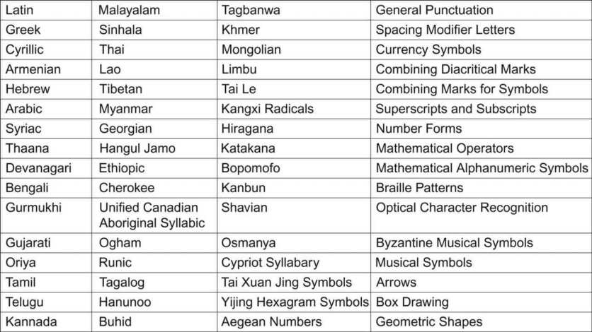

**HÌNH 2.16 Ví dụ bảng chữ cái Unicode. Unicode 4.0 có hơn 160 “block”, tên gọi tập hợp ký hiệu. Mỗi block là bội số 16. Ví dụ Greek bắt đầu 0370<sub>hex</sub>, Cyrillic ở 0400<sub>hex</sub>. Ba cột đầu cho 48 block tương ứng ngôn ngữ con người theo gần thứ tự số Unicode. Cột cuối có 16 block đa ngôn ngữ không theo thứ tự. Mã hóa 16-bit gọi UTF-16 là mặc định. Mã hóa variable-length gọi UTF-8 giữ tập con ASCII ở tám bit và dùng 16 hoặc 32 bit cho ký tự khác. UTF-32 dùng 32 bit mỗi ký tự. Tìm hiểu thêm tại www.unicode.org.**

Instruction set RISC-V có instruction tường minh để load, store lượng 16-bit như vậy gọi là halfword. Load half unsigned load halfword từ bộ nhớ, đặt trong 16 bit ngoài cùng phải register, điền 48 bit ngoài cùng trái bằng zero. Giống load byte, load half (lh) coi halfword là signed nên sign-extends để điền 48 bit ngoài cùng trái. Store half (sh) lấy halfword từ 16 bit ngoài cùng phải register và ghi bộ nhớ. Sao chép halfword bằng chuỗi

```
lhu x19, 0(x10) // Read halfword (16 bits) from source
shx19, 0(x11) // Write halfword (16 bits) to dest
```

String là class Java tiêu chuẩn có hỗ trợ built-in đặc biệt và method định trước cho nối, so sánh, chuyển đổi. Khác C, Java có word cho chiều dài string, giống array Java.

#### Giải thích thêm

Phần mềm RISC-V phải giữ stack căn chỉnh theo địa chỉ “quadword” (16 byte) để hiệu năng tốt hơn. Quy ước nghĩa là biến char phân bổ trên stack có thể chiếm tới 16 byte dù cần ít hơn. Tuy nhiên biến string C hay array byte đóng gói 16 byte mỗi quadword, còn biến string Java hay array short đóng gói 8 halfword mỗi quadword.

#### Giải thích thêm

Phản ánh tính quốc tế của web, phần lớn trang web ngày nay dùng Unicode thay ASCII. Do đó Unicode có thể còn phổ biến hơn ASCII hiện nay.

#### Giải thích thêm

RISC-V cũng có instruction chuyển giá trị 32-bit tới và từ bộ nhớ. Load word unsigned (lwu) load word 32-bit từ bộ nhớ vào 32 bit ngoài cùng phải register, điền 32 bit ngoài cùng trái bằng zero. Load word (lw) thay vào đó điền 32 bit ngoài cùng trái bằng bản sao bit 31. Store word (sw) lấy word từ 32 bit ngoài cùng phải register và store vào bộ nhớ.

#### Tự kiểm tra

I. Phát biểu nào về ký tự và string C, Java là đúng?

1. String C chiếm khoảng nửa bộ nhớ cùng string trong Java.

2. String chỉ là tên không chính thức cho array single-dimension của ký tự trong C và Java.

3. String C và Java dùng null (0) đánh dấu cuối string.

4. Phép toán trên string như length nhanh hơn trong C so với Java.

II. Kiểu biến nào chứa được 1,000,000,000<sub>ten</sub> chiếm nhiều bộ nhớ nhất?

1. long long int trong C

2. string trong C

3. string trong Java

## 2.10 Định địa chỉ RISC-V cho immediate và địa chỉ rộng

Mặc dù giữ mọi instruction RISC-V dài 32 bit đơn giản hóa phần cứng, có lúc thuận tiện nếu có hằng hoặc địa chỉ 32-bit hay lớn hơn. Mục này bắt đầu bằng giải pháp tổng quát cho hằng lớn rồi cho tối ưu với địa chỉ instruction dùng trong branch.

### Toán hạng immediate rộng

Mặc dù hằng thường ngắn và vừa field 12-bit, đôi khi chúng lớn hơn.

Instruction set RISC-V có instruction Load upper immediate (lui) để load hằng 20-bit vào bit 12 tới 31 của register. Ba mươi hai bit ngoài cùng trái điền bằng bản sao bit 31, và 12 bit ngoài cùng phải điền zero. Instruction này cho phép chẳng hạn tạo hằng 32-bit bằng hai instruction. lui dùng instruction format mới U-type vì định dạng khác không chứa được hằng lớn vậy.

#### Load hằng 32-Bit

**Ví dụ**

Assembly code RISC-V để load hằng 64-bit này vào register x19 là gì?

```
00000000 00000000 00000000 00000000 00000000 00111101
00000101 00000000
```

**Trả lời**

Đầu tiên load bit 12 tới 31 với bit pattern ấy, là 976 thập phân, dùng lui:

<pre>lui   x19, 976 // 976<sub>decimal</sub> = 0000 0000 0011 1101 0000</pre>

Giá trị register x19 sau đó là:

```
0000000 00000000 00000000 00000000 00000000 00111101
00000000 00000000
```

Bước tiếp là cộng 12 bit thấp nhất, có giá trị thập phân 1280:

<pre>addi   x19, x19, 1280// 1280<sub>decimal</sub> = 00000101 00000000</pre>

Giá trị cuối trong register x19 là giá trị mong muốn:

```
00000000 00000000 00000000 00000000 00000000 00111101
00000101 00000000
```

#### Giải thích thêm

Trong ví dụ trước bit 11 hằng là 0. Nếu bit 11 được đặt, có thêm phức tạp: immediate 12-bit được sign-extended nên số hạng sẽ âm. Nghĩa là ngoài cộng 11 bit ngoài cùng phải của hằng, ta cũng trừ 2<sup>12</sup>. Để bù lỗi, chỉ cần cộng 1 vào hằng load bằng lui, vì hằng lui nhân tỷ lệ 2<sup>12</sup>.

#### Giao diện phần cứng/phần mềm

Compiler hoặc assembler phải chia hằng lớn thành phần rồi ghép lại trong register. Như có thể đoán, giới hạn kích thước field immediate có thể gây vấn đề cho địa chỉ bộ nhớ trong load, store cũng như hằng trong immediate instruction.

Do đó biểu diễn ký hiệu machine language RISC-V không còn bị giới hạn bởi phần cứng mà bởi thứ người tạo assembler chọn đưa vào (xem Mục 2.12). Ta bám sát phần cứng để giải thích kiến trúc máy tính, ghi rõ khi dùng ngôn ngữ assembler nâng cao không có trong processor.

### Định địa chỉ trong branch

Branch instruction RISC-V dùng instruction format RISC-V gọi là SB-type. Định dạng biểu diễn địa chỉ branch từ −4096 tới 4094 theo bội số 2. Vì lý do sắp rõ, chỉ branch được tới địa chỉ chẵn. SB-type gồm opcode 7-bit, function code 3-bit, hai toán hạng register 5-bit (rs1, rs2), và address immediate 12-bit. Địa chỉ dùng mã hóa bất thường, đơn giản thiết kế datapath nhưng làm assembly phức tạp. Instruction

<pre>bne  x10, x11, 2000  // if x10 != x11, go to location 2000<sub>ten</sub> =
0111 1101 0000</pre>

có thể được assemble thành định dạng này (thực tế phức tạp hơn chút như sẽ thấy):

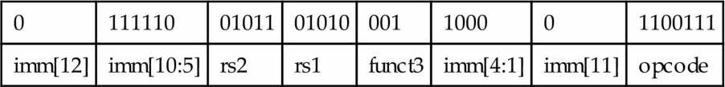

trong đó opcode conditional branch là 1100111<sub>two</sub> và mã funct3 của bne là 001<sub>two</sub>.

Instruction jump-and-link vô điều kiện (jal) là instruction duy nhất dùng UJ-type. Nó gồm opcode 7-bit, toán hạng destination register 5-bit (rd), address immediate 20-bit. Link address, địa chỉ instruction sau jal, được ghi vào rd.

Giống SB-type, toán hạng địa chỉ UJ-type dùng mã hóa immediate bất thường và không mã hóa được địa chỉ lẻ. Nên,

<pre>jal x0, 2000 // go to location 2000<sub>ten</sub> = 0111 1101 0000</pre>

được assemble thành định dạng:

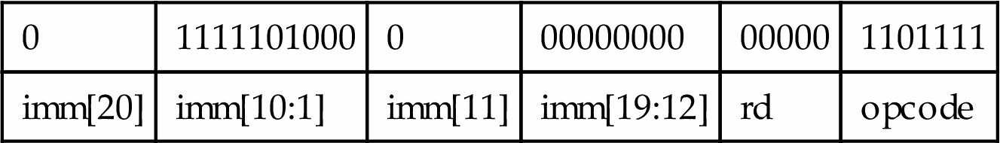

Nếu địa chỉ chương trình phải vừa field 20-bit này, không chương trình nào lớn hơn 2<sup>20</sup>, quá nhỏ để là lựa chọn thực tế ngày nay. Cách khác là chỉ định register luôn cộng vào branch offset, để branch instruction tính:

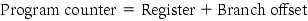

Tổng cho phép chương trình lớn tới 2<sup>64</sup> mà vẫn dùng conditional branch, giải quyết kích thước địa chỉ branch. Câu hỏi sau là register nào?

Đáp án đến từ cách dùng conditional branch. Chúng nằm trong loop và if nên thường branch tới instruction gần. Ví dụ khoảng nửa conditional branch trong benchmark SPEC tới vị trí cách dưới 16 instruction. Vì program counter (PC) chứa địa chỉ instruction hiện tại, có thể branch trong ±2<sup>10</sup> word quanh instruction hiện tại hoặc jump trong ±2<sup>18</sup> word nếu dùng PC làm register cộng vào địa chỉ. Gần như mọi loop và if nhỏ hơn 2<sup>10</sup> word, nên PC lý tưởng. Dạng định địa chỉ branch này gọi là PC-relative addressing.

#### PC-relative addressing

Cách định địa chỉ trong đó địa chỉ là tổng program counter (PC) và hằng trong instruction.

Giống phần lớn máy tính gần đây, RISC-V dùng PC-relative addressing cho cả conditional branch và unconditional jump vì đích thường gần branch. Ngược lại procedure call có thể cần jump xa hơn 2<sup>18</sup> word, vì không bảo đảm callee gần caller. Do đó RISC-V cho phép jump rất xa tới mọi địa chỉ 32-bit bằng chuỗi two-instruction: lui ghi bit 12 tới 31 địa chỉ vào temporary register, jalr cộng 12 bit thấp địa chỉ vào temporary register rồi jump tới tổng.

Vì instruction RISC-V dài 4 byte, branch instruction RISC-V có thể thiết kế kéo dài tầm với bằng để địa chỉ PC-relative tham chiếu số word giữa branch và instruction đích thay số byte. Tuy nhiên kiến trúc sư RISC-V muốn hỗ trợ khả năng instruction chỉ dài 2 byte, nên branch instruction biểu diễn số halfword giữa branch và đích. Do đó field địa chỉ 20-bit trong jal mã hóa khoảng ±2<sup>19</sup> halfword, hay ±1 MiB từ PC hiện tại. Tương tự field 12-bit trong conditional branch cũng là địa chỉ halfword, nghĩa là biểu diễn địa chỉ byte 13-bit.

#### Thể hiện branch offset trong machine language

**Ví dụ**

Vòng lặp while trang 94 được biên dịch thành assembler code RISC-V:

```
Loop:slli x10, x22, 3 // Temp reg x10 = i * 8
 add x10, x10, x25  // x10 = address of save[i]
 ld x9, 0(x10)  // Temp reg x9 = save[i]
 bne x9, x24, Exit  // go to Exit if save[i] != k
 addi x22, x22, 1  // i = i + 1
 beq  x0, x0, Loop  // go to Loop
Exit:
```

**Trả lời**

Nếu giả sử đặt vòng lặp bắt đầu tại vị trí 80000 trong bộ nhớ, machine code RISC-V cho vòng lặp là gì?

Các instruction đã assemble và địa chỉ là:

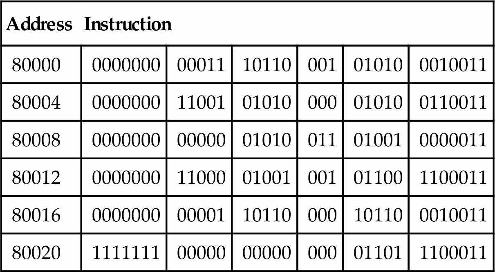

Nhớ instruction RISC-V có địa chỉ byte, nên địa chỉ word liên tiếp chênh 4. Instruction bne dòng thứ tư cộng 3 word hay 12 byte vào địa chỉ instruction, chỉ định đích branch tương đối với branch instruction (12+80012), không dùng địa chỉ đích đầy đủ (80024). Branch instruction dòng cuối tính tương tự cho branch ngược (−20+80020), tương ứng nhãn Loop.

#### Giao diện phần cứng/phần mềm

Phần lớn conditional branch tới gần, nhưng đôi lúc xa hơn biểu diễn được trong địa chỉ 12-bit của conditional branch instruction. Assembler giải cứu như với địa chỉ hay hằng lớn: chèn unconditional branch tới đích, đảo điều kiện để conditional branch quyết định có bỏ qua unconditional branch không.

#### Branch đi xa

**Ví dụ**

Cho branch khi register x10 bằng zero,

```
beq  x10, x0, L1
```

thay bằng cặp instruction có khoảng branch lớn hơn nhiều.

**Trả lời**

Những instruction này thay conditional branch short-address:

```
  bne  x10, x0, L2
  jal  x0, L1
L2:
```

### Tổng kết addressing mode RISC-V

Các dạng định địa chỉ gọi chung addressing mode. Hình 2.17 cho cách xác định toán hạng mỗi mode. Các addressing mode instruction RISC-V gồm:

1. Immediate addressing, toán hạng là hằng ngay trong instruction.

2. Register addressing, toán hạng là register.

3. Base hay displacement addressing, toán hạng ở vị trí bộ nhớ có địa chỉ là tổng register với hằng trong instruction.

4. PC-relative addressing, địa chỉ branch là tổng PC và hằng trong instruction.

#### addressing mode

Một trong vài cách định địa chỉ phân biệt bằng cách dùng toán hạng và/hoặc địa chỉ khác nhau.

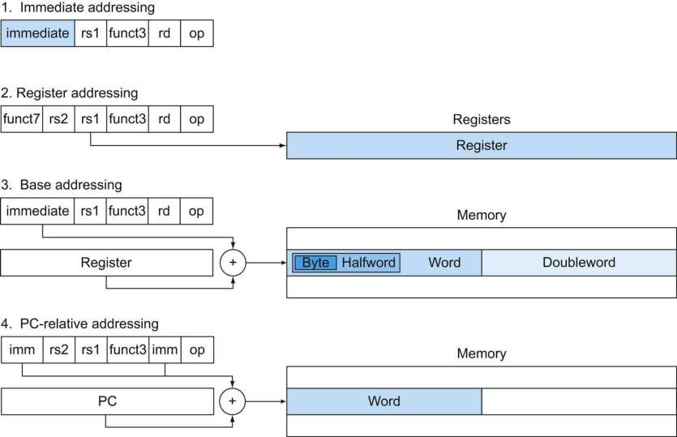

**HÌNH 2.17 Minh họa bốn addressing mode RISC-V. Toán hạng tô màu. Toán hạng mode 3 trong bộ nhớ, mode 2 là register. Chú ý phiên bản load và store truy cập byte, halfword, word hoặc doubleword. Mode 1 có toán hạng thuộc chính instruction. Mode 4 định địa chỉ instruction trong bộ nhớ, cộng địa chỉ dài vào PC. Chú ý một phép toán có thể dùng hơn một addressing mode. Ví dụ Add dùng cả immediate (addi) lẫn register (add) addressing.**

### Giải mã machine language

Đôi khi bạn buộc reverse-engineer machine language để tạo assembly language gốc. Ví dụ khi xem “core dump”. Hình 2.18 cho mã hóa RISC-V của opcode machine language RISC-V. Hình giúp khi dịch tay giữa assembly language và machine language.

#### Giải mã machine code

**Ví dụ**

Câu lệnh assembly language tương ứng machine instruction này là gì?

<pre>00578833<sub>hex</sub></pre>

**Trả lời**

Bước đầu chuyển hexadecimal sang nhị phân:

```
0000 0000 0101 0111 1000 1000 0011 0011
```

Để biết cách hiểu bit, cần xác định instruction format, trước hết cần opcode. Opcode là 7 bit ngoài cùng phải, hay 0110011. Tìm Hình 2.20 cho giá trị này thấy opcode tương ứng arithmetic instruction R-type. Do đó có thể tách định dạng nhị phân thành các field trong Hình 2.21:

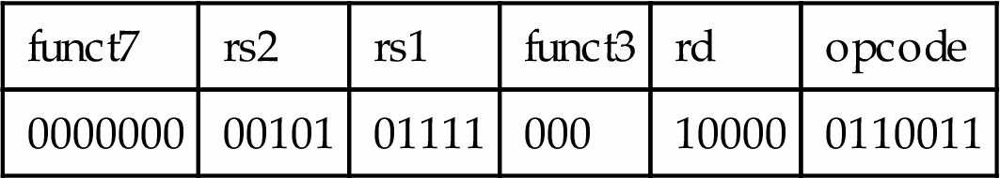

Ta giải mã phần còn lại bằng xét field. Field funct7 và funct3 đều zero, cho biết instruction là add. Giá trị thập phân toán hạng register là 5 cho rs2, 15 cho rs1, 16 cho rd. Chúng biểu diễn register x5, x15, x16. Giờ có thể cho assembly instruction:

```
add x16, x15, x5
```

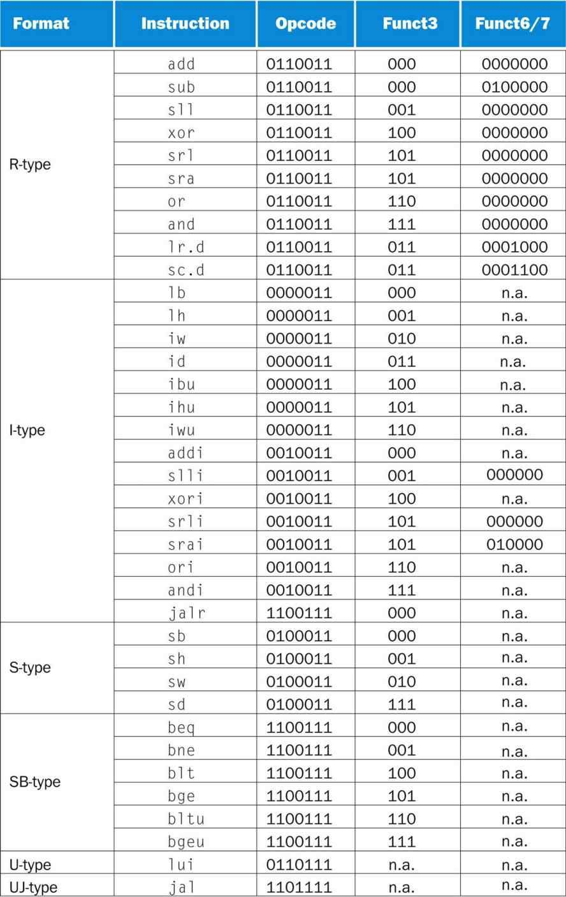

**HÌNH 2.18 Mã hóa instruction RISC-V. Mọi instruction có field opcode, mọi định dạng trừ U-type và UJ-type dùng field funct3. Instruction R-type dùng funct7, immediate shift (slli, srli, srai) dùng funct6.**

Hình 2.19 cho mọi instruction format RISC-V. Hình 2.1 trang 64–65 cho assembly language RISC-V giới thiệu trong chương. Chương sau trình bày instruction RISC-V cho nhân, chia và số học số thực.

#### Tự kiểm tra

I. Phạm vi địa chỉ byte conditional branch trong RISC-V là gì (K =1024)?

1. Địa chỉ từ 0 tới 4K −1

2. Địa chỉ từ 0 tới 8K −1

3. Địa chỉ khoảng 2K trước branch tới khoảng 2K sau

4. Địa chỉ khoảng 4K trước branch tới khoảng 4K sau

II. Phạm vi địa chỉ byte instruction jump-and-link trong RISC-V là gì (M =1024K)?

1. Địa chỉ từ 0 tới 512K −1

2. Địa chỉ từ 0 tới 1M −1

3. Địa chỉ khoảng 512K trước branch tới khoảng 512K sau

4. Địa chỉ khoảng 1M trước branch tới khoảng 1M sau

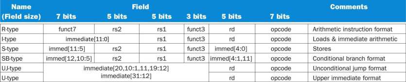

**HÌNH 2.19 Instruction format RISC-V.**

## 2.11 Tính song song và instruction: Đồng bộ hóa

Thực thi song song dễ hơn khi nhiệm vụ độc lập nhưng thường cần hợp tác. Hợp tác thường nghĩa là vài nhiệm vụ ghi giá trị mới mà nhiệm vụ khác phải đọc. Để biết khi nào nhiệm vụ ghi xong và an toàn cho nhiệm vụ khác đọc, chúng cần đồng bộ hóa. Nếu không, có nguy cơ data race, nơi kết quả chương trình thay đổi tùy thứ tự sự kiện xảy ra.


### data race

Hai truy cập bộ nhớ tạo data race nếu từ thread khác nhau tới cùng vị trí, ít nhất một là ghi, và diễn ra nối tiếp nhau.

Ví dụ nhớ phép so sánh tám phóng viên viết bài ở trang 44–45 Chương 1. Giả sử một người cần đọc mọi phần trước khi viết kết luận. Vì vậy phải biết người khác hoàn tất phần của họ khi nào để không lo chúng đổi sau đó. Nghĩa là tốt hơn họ đồng bộ ghi và đọc mỗi phần để kết luận nhất quán nội dung in các phần trước.

Trong máy tính, cơ chế đồng bộ thường xây bằng routine phần mềm user-level dựa instruction đồng bộ hardware-supplied. Ở mục này tập trung triển khai lock và unlock. Lock, unlock dùng thẳng để tạo vùng chỉ một processor hoạt động, gọi là mutual exclusion, cũng như triển khai cơ chế đồng bộ phức tạp hơn.

Khả năng cốt yếu để triển khai đồng bộ trong multiprocessor là tập hardware primitive đọc và sửa vị trí bộ nhớ một cách atomic. Nghĩa là không gì chen vào giữa đọc và ghi vị trí ấy. Không có khả năng này, chi phí xây synchronization primitive cơ bản cao và tăng bất hợp lý khi số processor tăng.

Có vài cách định nghĩa hardware primitive cơ bản, tất cả cung cấp khả năng đọc và sửa vị trí một cách atomic cùng cách biết đọc và ghi có atomic không. Nhìn chung kiến trúc sư không trông đợi người dùng dùng hardware primitive cơ bản mà system programmer dùng chúng xây thư viện đồng bộ, quá trình thường phức tạp khó khăn.

Hãy bắt đầu hardware primitive như vậy và chỉ cách dùng xây synchronization primitive cơ bản. Phép toán điển hình là atomic exchange hay atomic swap, inter-changes giá trị register với giá trị bộ nhớ.

Để thấy cách dùng xây synchronization primitive cơ bản, giả sử muốn lock đơn giản với 0 chỉ lock tự do và 1 chỉ lock không sẵn. Processor cố đặt lock bằng exchange 1 trong register với địa chỉ bộ nhớ tương ứng lock. Giá trị trả từ exchange instruction là 1 nếu processor khác đã chiếm quyền, ngược lại 0. Ở trường hợp sau, giá trị cũng đổi thành 1, ngăn exchange cạnh tranh ở processor khác cũng nhận 0.

Ví dụ xét hai processor mỗi cái cố exchange simultane-ously: race bị ngăn vì đúng một processor exchange trước, trả 0, và processor thứ hai trả 1 khi exchange. Mấu chốt dùng exchange primitive cho đồng bộ là phép toán atomic: exchange không chia cắt, hai exchange đồng thời được phần cứng sắp thứ tự. Không thể hai processor cùng cố đặt biến đồng bộ kiểu này mà đều nghĩ đã đồng thời đặt biến.

Triển khai một atomic memory operation đặt ra thách thức thiết kế processor vì cần cả đọc lẫn ghi bộ nhớ trong một instruction duy nhất không thể ngắt.

Cách khác là cặp instruction trong đó instruction thứ hai trả giá trị cho biết cặp có thực thi như atomic không. Cặp thực sự atomic nếu dường như mọi phép toán khác trên bất kỳ processor nào đều xảy ra trước hoặc sau cặp. Vì thế khi cặp thực sự atomic, processor khác không thể đổi giá trị giữa hai instruction.

Trong RISC-V cặp gồm load đặc biệt gọi load-reserved doubleword (lr.d) và store đặc biệt gọi store-conditional doubleword (sc.d). Chúng dùng nối tiếp: nếu nội dung vị trí bộ nhớ load-reserved chỉ định thay đổi trước khi store-conditional tới cùng địa chỉ diễn ra, store-conditional thất bại và không ghi bộ nhớ. store-conditional được định nghĩa vừa store giá trị register (có lẽ khác) vào bộ nhớ vừa đổi register khác thành 0 nếu thành công, khác không nếu thất bại. Do đó sc.d chỉ định ba register: một giữ địa chỉ, một chỉ atomic operation thất bại hay thành công, một giữ giá trị store nếu thành công. Vì load-reserved trả giá trị đầu và store-conditional chỉ trả 0 nếu thành công, chuỗi sau triển khai atomic exchange trên vị trí bộ nhớ chỉ bởi nội dung x20:

```
again:lr.d x10, (x20)     // load-reserved
 sc.d x11, x23, (x20)     // store-conditional
 bnex11, x0, again     // branch if store fails
 addi x23, x10, 0     // put loaded value in x23
```

Bất cứ khi processor chen vào sửa giá trị bộ nhớ giữa lr.d và sc.d, sc.d ghi giá trị khác không vào x11, khiến chuỗi code thử lại. Cuối chuỗi, nội dung x23 và vị trí bộ nhớ x20 chỉ định đã exchange atomic.

### Giải thích thêm

Mặc dù trình bày cho đồng bộ multiprocessor, atomic exchange cũng hữu ích với operating system xử lý nhiều process trên một processor. Để bảo đảm không can thiệp ở một processor, store-conditional cũng thất bại nếu processor context switch giữa hai instruction (xem Chương 5).

### Giải thích thêm

Ưu điểm cơ chế load-reserved/store-conditional là dùng xây synchronization primitive khác, như atomic compare and swap hoặc atomic fetch-and-increment dùng trong vài mô hình lập trình song song. Chúng có nhiều instruction hơn giữa lr.d và sc.d nhưng không quá nhiều.

Vì store-conditional thất bại sau store khác thử tới địa chỉ load reservation hoặc bất kỳ exception, cần cẩn thận chọn instruction chèn giữa hai instruction. Cụ thể chỉ integer arithmetic, forward branch và backward branch ra khỏi block load-reserved/store-conditional được phép an toàn; nếu không có thể tạo deadlock nơi processor không bao giờ hoàn thành sc.d vì page fault lặp lại. Ngoài ra số instruction giữa load-reserved và store-conditional nên ít để giảm khả năng sự kiện không liên quan hay processor cạnh tranh làm store-conditional thất bại thường xuyên.

### Giải thích thêm

Trong khi code trên triển khai atomic exchange, code sau nhận lock hiệu quả hơn tại vị trí trong register x20, nơi 0 nghĩa lock tự do và 1 nghĩa đã lấy lock:

```
      addi x12, x0, 1     // copy locked value
again: lr.d x10, (x20)     // load-reserved to read lock
      bnex10, x0, again      // check if it is 0 yet
      sc.d x11, x12, (x20)      // attempt to store new value
      bnex11, x0, again      // branch if store fails
```

Ta thả lock chỉ bằng store thường ghi 0 vào vị trí:

```
sd x0, 0(x20)      // free lock by writing 0
```

### Tự kiểm tra

Khi nào dùng primitive như load-reserved và store-conditional?

1. Khi các thread hợp tác của chương trình song song cần đồng bộ để đọc ghi shared data đúng.

2. Khi các process hợp tác trên uniprocessor cần đồng bộ đọc ghi shared data.

## 2.12 Dịch và khởi động chương trình

Mục mô tả bốn bước biến chương trình C trong file từ lưu trữ (disk hay flash memory) thành chương trình chạy trên máy tính. Hình 2.20 cho hệ phân cấp dịch. Một số hệ thống kết hợp bước để giảm thời gian dịch, nhưng chương trình qua bốn giai đoạn logic này. Mục theo hệ phân cấp dịch ấy.


**HÌNH 2.20 Hệ phân cấp chuyển đổi chương trình C. Một chương trình bằng ngôn ngữ high-level trước tiên được biên dịch thành chương trình assembly language, rồi được assemble thành object module bằng machine language. Linker kết hợp nhiều module với các library routine để giải quyết mọi reference. Sau đó, loader đặt machine code vào các vị trí memory thích hợp để processor thực thi. Để tăng tốc quá trình chuyển đổi, một số bước được bỏ qua hoặc kết hợp. Một số compiler tạo object module trực tiếp, còn một số hệ thống sử dụng linking loader thực hiện hai bước cuối. Để nhận diện loại file, UNIX tuân theo quy ước hậu tố: source file C là x.c, assembly file là x.s, object file là x.o, các library routine liên kết tĩnh là x.a, các library routine liên kết động là x.so, và executable file mặc định có tên a.out. MS-DOS sử dụng các hậu tố .C, .ASM, .OBJ, .LIB, .DLL và .EXE với cùng mục đích.**

### Compiler

Compiler biến chương trình C thành assembly language, dạng ký hiệu của thứ máy hiểu. Chương trình ngôn ngữ High-level cần ít dòng code hơn nhiều so với assembly language, nên năng suất lập trình viên cao hơn nhiều.

Năm 1975 nhiều operating system và assembler viết bằng assembly language vì bộ nhớ nhỏ, compiler kém hiệu quả. Dung lượng bộ nhớ mỗi chip DRAM tăng million-fold giảm lo kích thước chương trình, và optimizing compiler ngày nay tạo chương trình assembly language gần tốt như chuyên gia, đôi khi tốt hơn cho chương trình lớn.

#### assembly language

Ngôn ngữ ký hiệu có thể dịch thành binary machine language.

### Assembler

Vì assembly language là giao diện tới phần mềm higher-level, assembler cũng coi biến thể phổ biến của machine language instruction như instruction riêng. Phần cứng không cần triển khai chúng; tuy nhiên xuất hiện trong assembly language đơn giản hóa dịch và lập trình. Chúng gọi là pseudoinstruction.

#### pseudoinstruction

Biến thể phổ biến của assembly language instruction thường được coi như instruction riêng.

Như nói trên phần cứng RISC-V bảo đảm register x0 luôn 0. Nghĩa là khi dùng x0, nó cấp 0, và nếu lập trình viên cố đổi giá trị x0, giá trị mới bị bỏ. Register x0 dùng tạo assembly language instruction sao chép nội dung register này sang register khác. Do đó assembler RISC-V chấp nhận instruction sau dù không có trong machine language RISC-V:

```
li x9, 123    // load immediate value 123 into register x9
```

Assembler chuyển assembly language instruction này thành machine language tương đương instruction sau:

```
addi x9, x0, 123 // register x9 gets register x0 + 123
```

Assembler RISC-V cũng chuyển mv (move) thành addi. Vì thế

```
mv x10, x11    // register x10 gets register x11
```

trở thành

```
addi x10, x11, 0    // register x10 gets register x11 + 0
```

Assembler cũng chấp nhận j Label để branch vô điều kiện tới label như stand-in cho jal x0, Label. Nó cũng đổi branch tới nơi xa thành branch và jump. Như nói trên assembler RISC-V cho load hằng lớn vào register dù kích thước immediate instruction giới hạn. Do đó pseudoinstruction load immediate (li) đã giới thiệu có thể tạo hằng lớn hơn field immediate của addi chứa được; macro load address (la) tương tự cho địa chỉ ký hiệu. Cuối cùng nó đơn giản instruction set bằng xác định biến thể lập trình viên muốn. Ví dụ assembler RISC-V không yêu cầu chỉ định phiên bản immediate khi dùng hằng cho arithmetic và logical instruction; nó chỉ sinh opcode thích hợp. Vì vậy

```
and x9, x10, 15 // register x9 gets x10 AND 15
```

trở thành

```
andi x9, x10, 15 // register x9 gets x10 AND 15
```

Ta thêm “i” vào instruction để nhắc andi tạo opcode khác trong instruction format khác so với and không có immediate operand.

Tổng kết, pseudoinstruction cho RISC-V tập assembly language instruction phong phú hơn phần cứng triển khai. Nếu viết assembly program hãy dùng pseudoinstruction để đơn giản công việc. Tuy nhiên để hiểu kiến trúc RISC-V và bảo đảm hiệu năng tốt nhất, nghiên cứu instruction RISC-V thực ở Hình 2.1 và 2.18.

Assembler cũng chấp nhận số ở nhiều cơ số. Ngoài nhị phân, thập phân, thường chấp nhận cơ số gọn hơn nhị phân nhưng dễ đổi bit pattern. Assembler RISC-V dùng hexadecimal và octal.

Những tính năng thuận tiện, nhưng nhiệm vụ chính assembler là assemble thành machine code. Assembler biến chương trình assembly language thành object file, kết hợp machine language instruction, dữ liệu và thông tin cần để đặt instruction đúng trong bộ nhớ.

Để tạo phiên bản nhị phân từng instruction chương trình assembly language, assembler phải xác định địa chỉ mọi label. Assembler theo dõi label dùng trong branch và data transfer instruction ở symbol table. Như dự đoán, bảng chứa cặp symbol và địa chỉ.

#### symbol table

Bảng khớp tên label với địa chỉ word bộ nhớ instruction chiếm.

Object file hệ thống UNIX thường gồm sáu phần riêng:

- Object file header mô tả kích thước và vị trí các phần khác của object file.

- Text segment chứa machine language code.

- Static data segment chứa dữ liệu phân bổ suốt vòng đời chương trình. (UNIX cho chương trình dùng cả static data phân bổ suốt chương trình và dynamic data tăng giảm theo nhu cầu. Xem Hình 2.13.)

- Relocation information xác định instruction và data word phụ thuộc địa chỉ tuyệt đối khi chương trình load vào bộ nhớ.

- Symbol table chứa label còn chưa định nghĩa như external reference.

- Debugging information chứa mô tả ngắn cách module được biên dịch để debugger gắn machine instruction với source file C và làm cấu trúc dữ liệu đọc được.

Tiểu mục tiếp cho cách gắn routine đã assemble như library routine.

### Linker

Nội dung tới đây gợi rằng đổi một dòng trong một procedure đòi hỏi biên dịch và assemble toàn chương trình. Dịch lại hoàn toàn lãng phí tài nguyên tính toán khủng khiếp. Lặp lại đặc biệt lãng phí với standard library routine, vì lập trình viên biên dịch, assemble routine theo định nghĩa gần như không đổi. Cách khác là biên dịch, assemble từng procedure độc lập để đổi một dòng chỉ cần làm lại một procedure. Điều này cần systems program mới gọi link editor hay linker, lấy các chương trình machine language đã assemble độc lập và “khâu” lại. Linker hữu ích vì vá code nhanh hơn biên dịch và assemble lại nhiều.

#### linker

Cũng gọi link editor. Systems program kết hợp chương trình machine language đã assemble độc lập và giải mọi label chưa định nghĩa thành executable file.

Linker có ba bước:

1. Đặt code và data module theo ký hiệu trong bộ nhớ.

2. Xác định địa chỉ label dữ liệu và instruction.

3. Vá cả internal và external reference.

Linker dùng relocation information và symbol table từng object module giải mọi label chưa định nghĩa. Tham chiếu xuất hiện trong branch instruction và địa chỉ dữ liệu, nên công việc giống editor: tìm địa chỉ cũ thay địa chỉ mới. Việc chỉnh sửa là nguồn tên “link editor”, hay ngắn gọn linker.

Nếu mọi external reference giải xong, linker xác định vị trí bộ nhớ mỗi module chiếm. Nhớ Hình 2.13 trang 106 cho quy ước RISC-V phân bổ chương trình, dữ liệu vào bộ nhớ. Vì file assemble riêng, assembler không biết instruction, dữ liệu module nằm đâu tương đối module khác. Khi linker đặt module vào bộ nhớ, mọi tham chiếu tuyệt đối, tức địa chỉ bộ nhớ không tương đối với register, phải relocate để phản ánh vị trí thật.

Linker tạo executable file chạy trên máy tính. Thường file cùng định dạng object file trừ không còn tham chiếu chưa giải. Có thể có file link một phần, như library routine, vẫn có địa chỉ chưa giải nên là object file.

#### executable file

Chương trình hoạt động ở định dạng object file không chứa tham chiếu chưa giải. Có thể chứa symbol table và debugging information. “Stripped executable” không có thông tin ấy. Có thể gồm relocation information cho loader.

#### Link object file

**Ví dụ**

Link hai object file dưới. Cho địa chỉ cập nhật của vài instruction đầu executable file hoàn chỉnh. Ta viết instruction ở assembly language chỉ để ví dụ dễ hiểu; thực tế chúng là số.

Chú ý trong object file đã tô sáng địa chỉ và symbol phải cập nhật khi link: instruction tham chiếu địa chỉ procedure A, B và instruction tham chiếu địa chỉ data doubleword X, Y.


**Trả lời**

Procedure A cần tìm địa chỉ biến nhãn X để đặt load instruction và địa chỉ procedure B đặt jal. Procedure B cần địa chỉ biến nhãn Y cho store và địa chỉ procedure A cho jal.

Từ Hình 2.14 trang 107 biết text segment bắt đầu 0000 0000 0040 0000<sub>hex</sub>, data segment 0000 0000 1000 0000<sub>hex</sub>. Text procedure A đặt địa chỉ đầu, dữ liệu ở địa chỉ thứ hai. Object file header A nói text dài 100<sub>hex</sub> byte, data dài 20<sub>hex</sub> byte, nên địa chỉ bắt đầu text B là 40 0100<sub>hex</sub>, data bắt đầu 1000 0020<sub>hex</sub>.

| Header executable file |  |  |
|---|---|---|
|  | Kích thước text | 300<sub>hex</sub> |
|  | Kích thước data | 50<sub>hex</sub> |
| Text segment | Địa chỉ | Instruction |
|  | 0000 0000 0040 0000<sub>hex</sub> | ld x10, 0(x3) |
|  | 0000 0000 0040 0004<sub>hex</sub> | jal x1, 252<sub>ten</sub> |
|  | . . . | . . . |
|  | 0000 0000 0040 0100<sub>hex</sub> | sd x11, 32(x3) |
|  | 0000 0000 0040 0104<sub>hex</sub> | jal x1, -260<sub>ten</sub> |
|  | . . . | . . . |
| Data segment | Địa chỉ |  |
|  | 0000 0000 1000 0000<sub>hex</sub> | (X) |
|  | . . . | . . . |
|  | 0000 0000 1000 0020<sub>hex</sub> | (Y) |
|  | . . . | . . . |

Giờ linker cập nhật field địa chỉ instruction. Nó dùng field loại instruction biết định dạng địa chỉ cần sửa. Ở đây có ba loại:

1. Instruction jump and link dùng PC-relative addressing. Vì vậy jal tại 40 0004<sub>hex</sub> tới 40 0100<sub>hex</sub> (địa chỉ B) phải đặt (40 0100<sub>hex</sub> – 40 0004<sub>hex</sub>) hay 252<sub>ten</sub> trong field địa chỉ. Tương tự vì 40 0000<sub>hex</sub> là địa chỉ A, jal tại 40 0104<sub>hex</sub> nhận số âm -260<sub>ten</sub> (40 0000<sub>hex</sub> – 40 0104<sub>hex</sub>) trong field địa chỉ.

2. Địa chỉ load khó hơn vì tương đối với base register. Ví dụ dùng x3 làm base register, giả sử khởi tạo 0000 0000 1000 0000<sub>hex</sub>. Để có địa chỉ 0000 0000 1000 0000<sub>hex</sub> (địa chỉ doubleword X), đặt 0<sub>ten</sub> vào field địa chỉ ld tại 40 0000<sub>hex</sub>. Tương tự đặt 20<sub>hex</sub> vào field địa chỉ sd tại 40 0100<sub>hex</sub> để có địa chỉ 0000 0000 1000 0020<sub>hex</sub> (doubleword Y).

3. Địa chỉ store xử lý như load, trừ S-type biểu diễn immediate khác I-type của load. Đặt 32<sub>ten</sub> trong field địa chỉ sd tại 40 0100<sub>hex</sub> để có địa chỉ 0000 0000 1000 0020<sub>hex</sub> (doubleword Y).

### Loader

Giờ executable file ở disk, operating system đọc vào bộ nhớ và khởi chạy. Loader theo bước sau trong UNIX:

#### loader

Systems program đặt object program vào main memory để sẵn sàng thực thi.

1. Đọc executable file header xác định kích thước text và data segment.

2. Tạo address space đủ lớn cho text và data.

3. Sao chép instruction và dữ liệu từ executable file vào bộ nhớ.

4. Sao chép tham số (nếu có) cho main lên stack.

5. Khởi tạo processor register, đặt stack pointer vào vị trí trống đầu.

6. Branch tới routine start-up sao chép tham số vào argument register và gọi main routine chương trình. Khi main trở về, routine start-up kết thúc chương trình bằng exit system call.

Gần như mọi vấn đề khoa học máy tính có thể giải bằng thêm một mức gián tiếp.

David Wheeler

### Thư viện liên kết động

Phần đầu mục mô tả cách truyền thống link thư viện trước khi chạy chương trình. Mặc dù cách static nhanh nhất gọi library routine, nó có vài nhược điểm:

- Library routine thành phần executable code. Nếu thư viện mới phát hành sửa bug hay hỗ trợ thiết bị phần cứng mới, chương trình statically linked vẫn dùng bản cũ.

- Load mọi routine thư viện được gọi đâu đó trong executable, ngay cả call không thực thi. Thư viện có thể lớn so với chương trình; ví dụ thư viện C chuẩn trên hệ RISC-V chạy Linux operating system là 1.5 MiB.

Nhược điểm dẫn tới dynamically linked library (DLL), nơi library routine không link và load cho tới khi chương trình chạy. Cả chương trình lẫn library routine giữ thêm thông tin vị trí nonlocal procedure và tên. Ở DLL đầu tiên, loader chạy dynamic linker, dùng thông tin file bổ sung để tìm thư viện đúng và cập nhật mọi external reference.

#### dynamically linked libraries (DLLs)

Library routine link vào chương trình trong khi thực thi.

Nhược điểm DLL đầu là vẫn link mọi routine thư viện có thể gọi, thay chỉ routine thực sự gọi khi chạy. Quan sát dẫn tới phiên bản lazy procedure linkage DLL, mỗi routine chỉ link sau khi gọi.

Giống nhiều đổi mới ngành, thủ thuật dựa mức gián tiếp. Hình 2.21 cho kỹ thuật. Bắt đầu bằng nonlocal routine gọi tập dummy routine cuối chương trình, một entry cho mỗi nonlocal routine. Mỗi dummy entry chứa indirect branch.


**HÌNH 2.21 Dynamically linked library qua lazy procedure linkage. (a) Các bước lần đầu gọi DLL routine. (b) Bước tìm routine, remap, link được bỏ ở lần gọi sau. Như sẽ thấy Chương 5, operating system có thể tránh sao chép routine mong muốn bằng remap qua virtual memory management.**

Lần đầu gọi library routine, chương trình gọi dummy entry và theo indirect branch. Nó trỏ code đặt số vào register để nhận diện library routine mong muốn rồi branch dynamic linker/loader. Linker/loader tìm routine, remap, đổi địa chỉ trong vị trí indirect branch để trỏ routine ấy rồi branch tới nó. Khi routine xong, trở về chỗ gọi gốc. Sau đó call tới library routine branch gián tiếp thẳng routine không qua bước nhảy bổ sung.

Tổng kết DLL cần thêm chỗ cho thông tin dynamic linking nhưng không cần sao chép hay link cả thư viện. Chúng chịu overhead lớn lần đầu gọi routine, nhưng sau chỉ một indirect branch. Chú ý trở về từ thư viện không thêm overhead. Windows Microsoft dựa nhiều vào DLL, và đây cũng là mặc định khi chạy chương trình UNIX ngày nay.

### Khởi động chương trình Java

Thảo luận trên thể hiện mô hình truyền thống thực thi chương trình, nhấn mạnh chạy nhanh cho chương trình nhắm ISA cụ thể hay thậm chí triển khai cụ thể kiến trúc ấy. Thực tế có thể chạy Java giống C. Tuy nhiên Java phát minh với mục tiêu khác. Một là chạy an toàn trên mọi máy dù có thể chậm.

Hình 2.22 cho bước dịch, chạy điển hình Java. Thay biên dịch assembly language máy đích, Java trước biên dịch thành instruction dễ thông dịch: Java bytecode instruction set (xem  Mục 2.15). Tập này thiết kế gần ngôn ngữ Java nên bước biên dịch đơn giản. Gần như không tối ưu. Giống compiler C, compiler Java kiểm tra kiểu dữ liệu và tạo phép toán đúng cho mỗi kiểu. Chương trình Java phân phối dưới dạng nhị phân bytecode.

#### Java bytecode

Instruction thuộc instruction set thiết kế để thông dịch chương trình Java.


**HÌNH 2.22 Hệ phân cấp dịch Java. Chương trình Java trước biên dịch thành phiên bản nhị phân Java bytecode, mọi địa chỉ do compiler xác định. Giờ sẵn chạy trên interpreter Java Virtual Machine (JVM). JVM link tới method mong muốn trong thư viện Java khi chương trình chạy. Để hiệu năng hơn, JVM gọi compiler JIT biên dịch chọn lọc method thành native machine language của máy đang chạy. Software interpreter gọi JVM có thể thực thi Java bytecode. Interpreter là chương trình mô phỏng instruction set architecture. Ví dụ simulator RISC-V dùng với sách là interpreter. Không cần assembly riêng vì hoặc dịch đơn giản đến mức compiler điền địa chỉ, hoặc JVM tìm lúc chạy.**

#### Java Virtual Machine (JVM)

Chương trình thông dịch Java bytecode.

Ưu điểm thông dịch là tính di động. Có software Java virtual machine nghĩa là phần lớn mọi người viết, chạy Java ngay sau công bố. Ngày nay JVM có ở hàng tỷ thiết bị, từ điện thoại tới trình duyệt Internet.

Nhược điểm thông dịch là hiệu năng thấp hơn. Tiến bộ hiệu năng phi thường thập niên 1980, 1990 làm thông dịch khả thi với nhiều ứng dụng quan trọng, nhưng chậm gấp 10 so với C biên dịch truyền thống khiến Java kém hấp dẫn cho một số ứng dụng.

Để giữ tính di động, tăng tốc chạy, giai đoạn phát triển Java sau là compiler dịch khi chương trình chạy. Just In Time compiler (JIT) thường profile chương trình đang chạy tìm method “nóng” rồi biên dịch native instruction set mà virtual machine chạy. Phần biên dịch lưu cho lần chạy sau để mỗi lần nhanh hơn. Cân bằng thông dịch, biên dịch thay đổi theo thời gian để chương trình Java chạy thường xuyên chịu ít overhead thông dịch.

#### Just In Time compiler (JIT)

Tên thường dành cho compiler hoạt động lúc chạy, dịch đoạn code thông dịch thành native code máy tính.

Khi máy nhanh hơn cho compiler làm nhiều hơn, và nhà nghiên cứu tìm cách biên dịch Java tức thời tốt hơn, khoảng cách hiệu năng Java với C hay C++ thu hẹp.  Mục 2.15 đi sâu hơn nhiều về triển khai Java, bytecode, JVM và JIT compiler.

#### Tự kiểm tra

Ưu điểm nào của interpreter so với translator quan trọng nhất với người thiết kế Java?

1. Dễ viết interpreter

2. Thông báo lỗi tốt hơn

3. Object code nhỏ hơn

4. Độc lập máy

## 2.13 Ví dụ sắp xếp C kết hợp mọi thứ

Nguy cơ khi cho assembly language code theo mẩu là bạn không biết chương trình đầy đủ trông thế nào. Mục này suy code RISC-V từ hai procedure C: một hoán đổi phần tử mảng, một sắp xếp chúng.

### Procedure swap

Bắt đầu code procedure swap ở Hình 2.23. Procedure chỉ hoán đổi hai vị trí bộ nhớ. Khi dịch C sang assembly language bằng tay, theo bước chung:

1. Phân bổ register cho biến chương trình.

2. Tạo code thân procedure.

3. Bảo toàn register qua procedure invocation.


**HÌNH 2.23 Procedure C hoán đổi hai vị trí bộ nhớ. Tiểu mục dùng nó trong ví dụ sắp xếp.**

Mục mô tả swap theo ba phần này rồi kết hợp mọi phần.

#### Phân bổ register cho swap

Như trang 98, quy ước RISC-V truyền tham số dùng register x10 tới x17. Vì swap chỉ hai tham số v, k, chúng nằm x10, x11. Biến khác duy nhất temp gắn register x5 vì swap là leaf procedure (xem trang 102). Phân bổ tương ứng khai báo biến trong phần đầu swap Hình 2.23.

#### Code thân procedure swap

Các dòng code C còn lại trong swap là

```
temp= v[k];
v[k]= v[k+1];
v[k+1] = temp;
```

Nhớ địa chỉ bộ nhớ RISC-V là địa chỉ byte nên doubleword thực sự cách 8 byte. Vì vậy cần nhân chỉ số k với 8 trước cộng địa chỉ. Quên địa chỉ doubleword liên tiếp chênh 8 thay 1 là lỗi assembly language phổ biến. Do đó bước đầu lấy địa chỉ v[k] bằng nhân k với 8 qua dịch trái 3:

```
slli    x6, x11, 3    // reg x6 = k * 8
add    x6, x10, x6    // reg x6 = v + (k * 8)
```

Giờ load v[k] dùng x6, rồi v[k+1] bằng cộng 8 vào x6:

```
ld    x5, 0(x6)    // reg x5 (temp) = v[k]
ld    x7, 8(x6)    // reg x7 = v[k + 1]
                 // refers to next element of v
```

Tiếp store x9 và x11 vào địa chỉ hoán đổi:

```
sd    x7, 0(x6)    // v[k] = reg x7
sd    x5, 8(x6)    // v[k+1] = reg x5 (temp)
```

Giờ đã phân bổ register và viết code làm phép toán procedure. Thiếu code bảo toàn saved register dùng trong swap. Vì không dùng saved register trong leaf procedure này, không có gì bảo toàn.

#### Procedure swap đầy đủ

Giờ sẵn sàng toàn routine. Chỉ còn thêm nhãn procedure và return branch.

```
swap:
sllix6, x11, 3    // reg x6 = k * 8
 addx6, x10, x6    // reg x6 = v + (k * 8)
 ldx5, 0(x6)    // reg x5 (temp) = v[k]
 ldx7, 8(x6)    // reg x7 = v[k + 1]
 sdx7, 0(x6)    // v[k] = reg x7
 sdx5, 8(x6)    // v[k+1] = reg x5 (temp)
 jalrx0, 0(x1)    // return to calling routine
```

### Procedure sort

Để bảo đảm bạn hiểu tính chặt chẽ khi lập trình assembly language, thử ví dụ thứ hai dài hơn. Ta xây routine gọi swap. Chương trình sắp xếp array số nguyên bằng bubble hay exchange sort, một trong cách đơn giản nhất dù không nhanh nhất. Hình 2.24 cho phiên bản C. Một lần nữa trình bày vài bước rồi procedure đầy đủ.


**HÌNH 2.24 Procedure C sắp xếp array v.**

#### Phân bổ register cho sort

Hai tham số sort v, n ở parameter register x10, x11, gán register x19 cho i và x20 cho j.

#### Code thân procedure sort

Thân gồm hai vòng for lồng nhau và call swap có tham số. Hãy tháo code từ ngoài vào giữa.

Bước dịch đầu là vòng for đầu:

```
for (i = 0; i < n; i += 1) {
```

Nhớ for C có ba phần: khởi tạo, kiểm tra vòng lặp, tăng biến lặp. Chỉ cần một instruction khởi tạo i bằng 0, phần đầu for:

```
li    x19,    0
```

(Nhớ li là pseudoinstruction assembler cung cấp thuận tiện cho lập trình viên assembly language; xem trang 125.) Cũng chỉ một instruction tăng i, phần cuối for:

```
addi    x19, x19, 1    // i += 1
```

Vòng lặp thoát nếu i < n không đúng, hay nói khác nếu i ≥ n. Kiểm tra chỉ cần một instruction:

```
for1tst: bge x19, x11, exit1// go to exit1 if x19 ≥ x1 (i≥n)
```

Cuối vòng lặp chỉ branch về kiểm tra vòng lặp:

```
    j  for1tst    // branch to test of outer loop
exit1:
```

Code khung vòng for đầu là

```
    li x19, 0    // i = 0
for1tst:
    bge x19, x11, exit1   // go to exit1 if x19 ≥ x1 (i≥n)
```

…

```
    (body of first for loop)
```

…

```
    addi x19, x19, 1    // i += 1
    j    for1tst    // branch to test of outer loop
exit1:
```

Xong! (Bài tập tìm hiểu code nhanh hơn cho vòng lặp tương tự.)

Vòng for thứ hai trong C như sau:

```
for (j = i – 1; j >= 0 && v[j] > v[j + 1]; j -= 1) {
```

Khởi tạo vòng này cũng là một instruction:

```
addi    x20, x19, -1    // j = i – 1
```

Giảm j ở cuối vòng cũng một instruction:

```
addi    x20, x20, -1 j -= 1
```

Kiểm tra vòng lặp hai phần. Thoát nếu bất kỳ điều kiện thất bại nên kiểm tra đầu phải thoát nếu thất bại (j < 0):

```
for2tst:
    blt x20, x0, exit2    // go to exit2 if x20 < 0 (j < 0)
```

Branch bỏ kiểm tra thứ hai. Nếu không bỏ thì j ≥ 0.

Kiểm tra thứ hai thoát nếu v[j] > v[j + 1] không đúng, hay nếu v[j] ≤ v[j + 1]. Trước tạo địa chỉ bằng nhân j với 8 (cần địa chỉ byte), cộng base address v:

```
slli    x5, x20, 3    // reg x5 = j * 8
add    x5, x10, x5    // reg x5 = v + (j * 8)
```

Giờ load v[j]:

```
ld    x6, 0(x5)    // reg x6 = v[j]
```

Vì biết phần tử thứ hai là doubleword tiếp, cộng 8 vào địa chỉ register x5 để có v[j + 1]:

```
ld    x7, 8(x5)    // reg x7 = v[j + 1]
```

Kiểm tra v[j] ≤ v[j + 1] để thoát vòng lặp:

```
ble    x6, x7, exit2   // go to exit2 if x6 ≤ x7
```

Cuối vòng branch lại kiểm tra vòng trong:

```
jfor2tst   // branch to test of inner loop
```

Ghép các phần, khung vòng for thứ hai như sau:

```
addi x20, x19, -1 // j = i - 1
for2tst: blt x20, x0, exit2  // go to exit2 if x20 < 0 (j <
0)
 sllix5, x20, 3 // reg x5 = j * 8
 addx5, x10, x5 // reg x5 = v + (j * 8)
 ldx6, 0(x5) // reg x6 = v[j]
 ldx7, 8(x5) // reg x7 = v[j + 1]
 ble  x6, x7, exit2 // go to exit2 if x6 ≤ x7
 . . .
 (body of second for loop)
 . . .
 addi x20, x20, -1 // j -= 1
 j for2tst // branch to test of inner loop
exit2:
```

#### Procedure call trong sort

Bước tiếp là thân vòng for thứ hai:

```
swap(v,j);
```

Gọi swap khá dễ:

```
jal x1, swap
```

#### Truyền tham số trong sort

Vấn đề khi truyền tham số là sort cần giá trị register x10, x11 nhưng swap cũng cần đặt tham số vào đúng register ấy. Giải pháp là sao chép tham số sort sang register khác sớm hơn trong procedure, giải phóng x10, x11 cho call swap. (Sao chép nhanh hơn lưu khôi phục stack.) Trước tiên sao chép x10, x11 sang x21, x22 trong procedure:

```
mv x21, x10 // copy parameter x10 into x21
mv x22, x11 // copy parameter x11 into x22
```

Rồi truyền tham số swap bằng hai instruction:

```
mv x10, x21 // first swap parameter is v
mv x11, x20 // second swap parameter is j
```

#### Bảo toàn register trong sort

Code còn lại chỉ lưu và khôi phục register. Rõ ràng phải lưu return address register x1 vì sort là procedure và được gọi. Sort cũng dùng callee-saved register x19, x20, x21, x22 nên phải lưu. Prologue sort là

```
addi sp, sp, -40 // make room on stack for 5 regs
sd x1, 32(sp) // save x1 on stack
sd x22, 24(sp) // save x22 on stack
sd x21, 16(sp) // save x21 on stack
sd x20, 8(sp) // save x20 on stack
sd x19, 0(sp) // save x19 on stack
```

Đuôi procedure chỉ đảo ngược mọi instruction này rồi thêm jalr để trở về.

#### Procedure sort đầy đủ

Giờ ghép mọi phần trong Hình 2.25, cẩn thận thay tham chiếu register x10, x11 trong for bằng x21, x22. Để code dễ theo dõi, lại xác định mỗi block theo mục đích trong procedure. Ví dụ này chín dòng sort C thành 34 dòng assembly language RISC-V.


**HÌNH 2.25 Phiên bản assembly RISC-V của procedure sort trong Hình 2.27.**

#### Giải thích thêm

Tối ưu dùng được là procedure inlining. Thay truyền đối số qua tham số và gọi code bằng jal, compiler sao chép code thân swap tại chỗ call swap xuất hiện. Inlining tránh bốn instruction ở ví dụ. Nhược điểm là code biên dịch lớn hơn nếu procedure inline được gọi nhiều nơi. Mở rộng code có thể giảm hiệu năng nếu tăng cache miss rate; xem Chương 5.

#### Hiểu hiệu năng chương trình

Hình 2.26 cho tác động tối ưu compiler tới hiệu năng sort, thời gian biên dịch, clock cycle, instruction count, CPI. Chú ý code chưa tối ưu có CPI tốt nhất, O1 có instruction count thấp nhất, nhưng O3 nhanh nhất, nhắc rằng thời gian là thước đo chính xác duy nhất hiệu năng chương trình.


**HÌNH 2.26 So sánh hiệu năng, instruction count và CPI khi sử dụng compiler optimization cho Bubble Sort. Các chương trình sắp xếp 100,000 word 32-bit, với array được khởi tạo bằng các giá trị ngẫu nhiên. Những chương trình này chạy trên Pentium 4 có clock rate 3.06 GHz và system bus 533 MHz với 2 GB PC2100 DDR SDRAM. Hệ thống sử dụng Linux phiên bản 2.4.20.**

Hình 2.27 so sánh ảnh hưởng của ngôn ngữ lập trình, biên dịch so với thông dịch và thuật toán lên hiệu năng sắp xếp. Cột thứ tư cho thấy chương trình C chưa tối ưu hóa nhanh gấp 8.3 lần code Java thông dịch đối với Bubble Sort. Sử dụng JIT compiler khiến Java nhanh gấp 2.1 lần C chưa tối ưu hóa và cách code C có mức tối ưu hóa cao nhất một hệ số 1.13. (  Mục 2.15 cung cấp thêm chi tiết về thông dịch so với biên dịch Java và code Java cùng jalr cho Bubble Sort.) Các tỷ lệ không gần nhau như vậy đối với Quicksort trong Cột 5, có lẽ vì khó phân bổ chi phí biên dịch runtime trên thời gian thực thi ngắn hơn. Cột cuối cùng minh họa ảnh hưởng của thuật toán tốt hơn, mang lại mức tăng hiệu năng ba bậc độ lớn khi sắp xếp 100,000 phần tử. Ngay cả khi so sánh Java thông dịch trong Cột 5 với compiler C ở mức tối ưu hóa cao nhất trong Cột 4, Quicksort vẫn vượt Bubble Sort một hệ số 50 (0.05×2468, tức nhanh gấp 123 lần code C chưa tối ưu hóa so với 2.41 lần).


**HÌNH 2.27 Hiệu năng của hai thuật toán sắp xếp trong C và Java khi sử dụng thông dịch và optimizing compiler, lấy phiên bản C chưa tối ưu hóa làm mốc. Cột cuối cùng cho thấy lợi thế hiệu năng của Quicksort so với Bubble Sort đối với từng ngôn ngữ và tùy chọn thực thi. Các chương trình này chạy trên cùng hệ thống như trong Hình 2.29. JVM là Sun phiên bản 1.3.1 và JIT là Sun Hotspot phiên bản 1.3.1.**

## 2.14 Array so với pointer

Một thách thức đối với người mới lập trình C là hiểu pointer. So sánh assembly code sử dụng array và array index với assembly code sử dụng pointer giúp hiểu sâu hơn về pointer. Mục này trình bày các phiên bản C và assembly RISC-V của hai procedure để xóa một chuỗi doubleword trong memory: một phiên bản sử dụng array index và một phiên bản sử dụng pointer. Hình 2.28 minh họa hai procedure C.


**HÌNH 2.28 Hai procedure C đặt array toàn zero. clear1 dùng index, clear2 dùng pointer. Procedure thứ hai cần giải thích cho người chưa quen C. Địa chỉ biến chỉ bằng &, đối tượng pointer trỏ chỉ bằng \*. Khai báo nói array và p là pointer tới số nguyên. Phần đầu for trong clear2 gán địa chỉ phần tử đầu array vào pointer p. Phần thứ hai kiểm tra pointer có trỏ quá phần tử cuối không. Tăng pointer một ở phần dưới for nghĩa là dịch pointer tới đối tượng liên tiếp có kích thước khai báo. Vì p là pointer số nguyên, compiler sinh instruction RISC-V tăng p tám, số byte trong số nguyên RISC-V. Phép gán trong vòng đặt 0 vào đối tượng p trỏ.**

Mục đích là chỉ pointer ánh xạ tới instruction RISC-V thế nào, không cổ vũ phong cách lập trình lỗi thời. Cuối mục sẽ thấy tác động tối ưu compiler hiện đại tới hai procedure.

### Phiên bản array của Clear

Bắt đầu phiên bản array clear1, tập trung thân vòng và bỏ code liên kết procedure. Giả sử hai tham số array, size ở register x10, x11 và i phân bổ x5.

Khởi tạo i, phần đầu for, đơn giản:

```
li   x5, 0   // i = 0 (register x5 = 0)
```

Để đặt array[i] bằng 0 phải lấy địa chỉ trước. Bắt đầu nhân i với 8 để có địa chỉ byte:

```
loop1: slli   x6, x5, 3   // x6 = i * 8
```

Vì địa chỉ bắt đầu array trong register, phải cộng vào index để có địa chỉ array[i] bằng add:

```
add  x7, x10, x6   // x7 = address of array[i]
```

Cuối cùng store 0 tại địa chỉ:

```
sd   x0, 0(x7)   // array[i] = 0
```

Instruction này cuối thân vòng nên bước tiếp tăng i:

```
addi x5, x5, 1    // i = i + 1
```

Kiểm tra vòng xét i nhỏ hơn size không:

```
blt  x5, x11, loop1 // if (i < size) go to loop1
```

Giờ thấy mọi phần procedure. Đây là code RISC-V xóa array bằng index:

```
 li x5, 0 // i = 0
loop1: slli x6, x5, 3 // x6 = i * 8
 add x7, x10, x6 // x7 = address of array[i]
 sd x0, 0(x7) // array[i] = 0
 addi x5, x5, 1 // i = i + 1
 blt x5, x11, loop1 // if (i < size) go to loop1
```

(Code hoạt động nếu size lớn hơn 0; ANSI C yêu cầu kiểm tra size trước vòng nhưng ta bỏ yêu cầu đó ở đây.)

### Phiên bản pointer của Clear

Procedure thứ hai dùng pointer phân bổ tham số array, size tới register x10, x11, p tới x5. Code bắt đầu gán pointer p địa chỉ phần tử đầu array:

```
mv  x5, x10   // p = address of array[0]
```

Code tiếp là thân for, chỉ store 0 vào p:

```
loop2: sd   x0, 0(x5)    // Memory[p] = 0
```

Instruction triển khai thân vòng nên code tiếp tăng biến lặp, đổi p trỏ doubleword tiếp:

```
addi   x5, x5, 8   // p = p + 8
```

Tăng pointer 1 nghĩa là chuyển tới đối tượng liên tiếp tiếp theo trong C. Vì p là pointer tới số nguyên long long int, mỗi cái 8 byte, compiler tăng p 8.

Tiếp là kiểm tra vòng. Bước đầu tính địa chỉ phần tử cuối array. Bắt đầu nhân size với 8 để có địa chỉ byte:

```
slli   x6, x11, 3   // x6 = size * 8
```

rồi cộng product vào địa chỉ bắt đầu array để có địa chỉ doubleword đầu sau array:

```
add    x7, x10, x6    // x7 = address of array[size]
```

Kiểm tra vòng chỉ xem p nhỏ hơn phần tử cuối của

```
array:
bltu x5, x7, loop2    // if (p<&array[size]) go to loop2
```

Hoàn tất mọi phần, có thể cho phiên bản pointer code zero array:

```
 mvx5, x10 // p = address of array[0]
loop2: sdx0, 0(x5) // Memory[p] = 0
 addi   x5, x5, 8 // p = p + 8
 slli  x6, x11, 3 // x6 = size * 8
 add  x7, x10, x6 // x7 = address of array[size]
 bltu x5, x7, loop2 // if (p<&array[size]) go to loop2
```

Như ví dụ đầu, code giả sử size lớn hơn 0.

Chú ý chương trình tính địa chỉ cuối array mỗi vòng dù không đổi. Phiên bản nhanh hơn đưa tính toán ra ngoài vòng:

```
 mv x5, x10  // p = address of array[0]
 slli x6, x11, 3  // x6 = size * 8
 add x7, x10, x6  // x7 = address of array[size]
loop2: sdx0, 0(x5) // Memory[p] = 0
 addi x5, x5, 8 // p = p + 8
 bltu x5, x7, loop2 // if (p < &array[size]) go to loop2
```

### So sánh hai phiên bản Clear

So sánh hai chuỗi code cạnh nhau cho thấy sự khác biệt giữa array index và pointer (những thay đổi được đưa vào trong phiên bản pointer được tô sáng):


Phiên bản trái phải có “nhân” và cộng trong vòng vì i tăng, mỗi địa chỉ tính lại từ index mới. Phiên bản memory pointer bên phải tăng p trực tiếp. Pointer đưa scaling shift và cộng array bound ra ngoài vòng, giảm instruction mỗi vòng từ năm còn ba. Tối ưu tay tương ứng tối ưu compiler strength reduction (shift thay multiply) và induction variable elimination (loại tính địa chỉ array trong vòng).  Mục 2.15 mô tả hai tối ưu cùng nhiều tối ưu khác.

#### Giải thích thêm

Như nói trước, compiler C thêm kiểm tra size lớn hơn 0. Một cách là branch tới instruction sau vòng bằng blt x0, x11, afterLoop.

#### Hiểu hiệu năng chương trình

Người ta từng được dạy dùng pointer C để hiệu quả hơn array: “Dùng pointer dù không hiểu code.” Optimizing compiler hiện đại có thể sinh code array tốt ngang. Phần lớn lập trình viên ngày nay thích compiler làm việc nặng.


## Nội dung nâng cao: Biên dịch C và thông dịch Java

Mục tổng quan ngắn cách compiler C hoạt động và Java thực thi. Vì compiler ảnh hưởng đáng kể hiệu năng máy tính, hiểu công nghệ compiler ngày nay rất quan trọng để hiểu hiệu năng. Nhớ xây dựng compiler thường dạy trong khóa one- hoặc two-semester, nên giới thiệu tất yếu chỉ chạm cơ bản.

Phần hai dành người quan tâm ngôn ngữ object-oriented như Java chạy trên kiến trúc RISC-V thế nào. Cho Java byte-codes dùng thông dịch và code RISC-V cho phiên bản Java của vài đoạn C trước, gồm Bubble Sort. Bao quát cả JVM và JIT compiler.

### object-oriented language

Ngôn ngữ lập trình hướng quanh object thay vì hành động, hay dữ liệu thay logic.

Phần còn lại  Mục 2.15 có trực tuyến.

## 2.15 Nội dung nâng cao: Biên dịch C và thông dịch Java

Mục tổng quan ngắn cách compiler C hoạt động và Java thực thi. Vì compiler ảnh hưởng đáng kể hiệu năng máy tính, hiểu công nghệ compiler ngày nay rất quan trọng để hiểu hiệu năng. Nhớ xây dựng compiler thường dạy trong khóa one- hoặc two-semester, nên giới thiệu tất yếu chỉ chạm cơ bản.

Phần hai, bắt đầu trang 150.e15, dành người quan tâm ngôn ngữ objected-oriented như Java chạy trên kiến trúc RISC-V thế nào. Cho Java bytecode thông dịch và code RISC-V của phiên bản Java vài đoạn C trước, gồm Bubble Sort. Bao quát cả Java virtual machine và compiler just-in-time (JIT).

### Biên dịch C

Phần đầu giới thiệu cấu tạo bên trong compiler. Trước hết Hình e2.15.1 cho cấu trúc compiler gần đây, và ta mô tả tối ưu theo thứ tự pass cấu trúc ấy.


**HÌNH E2.15.1 Cấu trúc optimizing compiler hiện đại gồm vài pass hay phase. Về logic mỗi pass có thể xem là chạy xong trước pass tiếp. Thực tế vài pass xử lý từng procedure, về cơ bản xen kẽ pass khác.**

Để minh họa khái niệm phần này, dùng phiên bản C vòng while trang 95:

```
while (save[i] == k)
  i += 1;
```

### Front end

Chức năng front end là đọc source program, kiểm tra cú pháp, ngữ nghĩa, dịch thành dạng trung gian thể hiện phần lớn hoạt động language-specific. Như sẽ thấy dạng trung gian thường đơn giản, một số thực tế giống Java bytecode (xem Hình e2.15.8).

Front end thường chia bốn chức năng riêng:

1. Scanning đọc từng ký tự và tạo chuỗi token. Ví dụ token là reserved word, name, operator và ký hiệu dấu câu. Trong ví dụ trên chuỗi token là while, (, save, [, i, ], ==, k, ), i, +=, 1. Từ while nhận diện là reserved word C, nhưng save, i, j là name và 1 là number.

2. Parsing lấy token stream, bảo đảm cú pháp đúng và tạo abstract syntax tree, biểu diễn cấu trúc cú pháp chương trình. Hình e2.15.2 cho abstract syntax tree có thể có của đoạn chương trình.

3. Semantic analysis lấy abstract syntax tree, kiểm tra đúng ngữ nghĩa. Thường bảo đảm biến, kiểu khai báo đúng và kiểu toán tử, đối tượng khớp, bước gọi type checking. Trong quá trình thường tạo symbol table biểu diễn mọi đối tượng có tên—class, variable, function—và dùng để type-check chương trình.

4. Tạo intermediate representation (IR) lấy symbol table, abstract syntax tree và sinh IR đầu ra front end. IR thường dùng phép toán đơn giản trên tập nhỏ primitive type như integer, character, real. Java bytecode là một dạng. Trong compiler hiện đại dạng phổ biến nhất giống instruction set RISC-V nhưng vô hạn virtual register; sau sẽ mô tả ánh xạ chúng tới tập hữu hạn real register. Hình e2.15.3 cho ví dụ biểu diễn trong dạng ấy.


**HÌNH E2.15.2 Abstract syntax tree cho ví dụ while. Các gốc cây gồm informational token như number, name. Chuỗi hậu duệ straight-line dài thường bỏ khi xây cây.**


**HÌNH E2.15.3 Ví dụ while dùng intermediate representation điển hình. Thực tế tên save, i, k được thay loại địa chỉ nào đó như tham chiếu local stack pointer hoặc global pointer cùng offset, giống cách truy cập save[i]. Chú ý định dạng instruction RISC-V khác phần còn lại chương vì ở đây biểu diễn IR dùng ký hiệu rXX cho virtual register.**

Dạng trung gian chỉ chức năng chương trình độc lập source gốc. Sau front end tạo dạng trung gian, pass còn lại phần lớn độc lập ngôn ngữ.

### Tối ưu High-Level

Tối ưu High-level là biến đổi ở mức gần source.

Biến đổi high-level phổ biến nhất có lẽ procedure inlining, thay call function bằng thân function, thế đối số caller cho tham số procedure. Tối ưu high-level khác gồm biến đổi loop giảm overhead, cải thiện truy cập bộ nhớ, khai thác phần cứng hiệu quả. Ví dụ trong loop nhiều vòng như for truyền thống, loop-unrolling thường hữu ích. Loop-unrolling lấy loop, sao chép thân nhiều lần, chạy loop biến đổi ít lần hơn. Loop-unrolling giảm overhead và mở cơ hội nhiều tối ưu khác. Biến đổi high-level khác gồm biến đổi loop tinh vi như hoán đổi loop lồng và blocking loop để hành vi bộ nhớ tốt hơn; xem ví dụ Chương 5.

#### loop-unrolling

Kỹ thuật tăng hiệu năng loop truy cập array, tạo nhiều bản sao thân loop và lên lịch instruction các vòng khác nhau cùng nhau.

### Tối ưu cục bộ và toàn cục

Trong pass dành local và global optimization có ba lớp tối ưu:

1. Local optimization làm trong một basic block. Pass local thường chạy trước và sau global để “dọn” code trước sau tối ưu global.

2. Global optimization làm qua nhiều basic block; sắp thấy ví dụ.

3. Global register allocation phân bổ biến tới register cho vùng code. Register allocation cốt yếu để hiệu năng tốt trên processor hiện đại.

Vài tối ưu làm cả local và global gồm common subexpression elimination, constant propagation, copy propagation, dead store elimination, strength reduction. Hãy xem ví dụ đơn giản.

Common subexpression elimination tìm nhiều lần xuất hiện cùng biểu thức và thay lần thứ hai bằng tham chiếu lần đầu. Ví dụ đoạn code cộng 4 vào phần tử array:

```
x[i] = x[i] + 4
```

Tính địa chỉ x[i] xảy ra hai lần giống hệt vì địa chỉ đầu x, giá trị i đều không đổi. Do đó tái dùng phép tính. Hãy xem code trung gian vì cho phép vài tối ưu khác. Code trung gian chưa tối ưu bên trái. Bên phải tối ưu dùng common subexpression elimination thay tính địa chỉ thứ hai bằng lần đầu. Chú ý chưa register allocation nên compiler dùng số virtual register như r100.

```
// x[i] + 4 // x[i] + 4
la r100,x la r100,x
ld r101,i ld r101,i
mul r102,r101,8 slli r102,r101,3
add r103,r100,r102 add r103,r100,r102
ld r104, 0(r103) ld r104, 0(r103)
// // value of x[i] is in r104
addi r105, r104,4 addi r105, r104,4
la r106,x sd r105, 0(r103)
ld r107,i
mul r108,r107,8
add r109,r106,r107
sd r105,0(r109)
```

Nếu cùng tối ưu làm được qua hai basic block thì là global common subexpression elimination. Xét vài tối ưu khác:

- Strength reduction thay phép toán phức tạp bằng đơn giản, áp dụng đoạn này bằng thay mul bằng dịch trái.

- Constant propagation và họ hàng constant folding tìm hằng trong code, lan truyền và gộp giá trị hằng khi có thể.

- Copy propagation lan truyền giá trị là bản sao đơn giản, loại nhu cầu load lại và có thể cho tối ưu khác như common subexpression elimination.

- Dead store elimination tìm store tới giá trị không dùng lại và bỏ store; “họ hàng” dead code elimination tìm code không dùng—không ảnh hưởng kết quả—và bỏ nó. Với dùng nhiều macro, template và kỹ thuật tái dùng code high-level tương tự, dead code xảy ra thường đáng ngạc nhiên. Compiler phải bảo thủ. Nhiệm vụ đầu là sinh code đúng, thứ hai thường là nhanh, dù yếu tố như kích thước code đôi lúc quan trọng. Code nhanh nhưng sai—với bất kỳ tổ hợp input nào—đơn giản là sai. Do đó nói compiler “bảo thủ” nghĩa chỉ tối ưu nếu biết chắc 100% bất kể input, code làm như người dùng viết. Vì phần lớn compiler dịch, tối ưu từng function hay procedure, nhất là mức tối ưu thấp, chúng giả định xấu nhất về function call và tham số của mình.

#### Hiểu hiệu năng chương trình

Lập trình viên lo hiệu năng loop quan trọng, nhất là ứng dụng real-time hay embedded, có thể nhìn assembly language compiler sinh và tự hỏi vì sao không làm global optimization hay phân bổ biến vào register suốt loop. Đáp án thường ở yêu cầu bảo thủ. Cơ hội cải thiện có vẻ rõ với lập trình viên nhưng họ thường biết điều compiler không biết, như hai pointer không alias hay function call không side effect. Compiler có thể làm biến đổi nếu giúp chút để loại hành vi worst-case buộc giả định. Điều này cũng cho quan sát quan trọng: người dùng pointer cố tăng hiệu năng truy cập biến, nhất là pointer tới giá trị stack cũng có tên biến hay phần tử array, có thể vô hiệu nhiều tối ưu compiler. Kết quả code pointer lower-level có thể không tốt hơn, thậm chí tệ hơn code higher-level được tối ưu.

#### Tối ưu code toàn cục

Nhiều global code optimization cùng mục đích local, gồm common subexpression elimination, constant propagation, copy propagation, dead store và dead code elimination.

Có hai global optimization quan trọng khác: code motion và induction variable elimination. Cả hai đều là loop optimization, tức nhằm vào code trong các vòng lặp. Code motion tìm code có tính loop invariant: một đoạn code cụ thể tính cùng một giá trị ở mọi lượt lặp, nên có thể được tính một lần bên ngoài vòng lặp. Induction variable elimination là tổ hợp các phép biến đổi làm giảm overhead khi đánh chỉ số array, về cơ bản thay array indexing bằng pointer access. Thay vì xem xét sâu induction variable elimination, chúng tôi hướng người đọc đến Mục 2.14, so sánh cách sử dụng array indexing và pointer; với phần lớn vòng lặp, optimizing compiler hiện đại có thể chuyển code array rõ ràng hơn thành code pointer nhanh hơn.

#### Triển khai local optimization

Local optimization thực hiện trên basic block bằng quét theo thứ tự thực thi instruction, tìm cơ hội. Trong ví dụ gán trang 150.e6, tính địa chỉ trùng toàn bộ được nhận ra bằng chuỗi pass tuần tự qua code. Quá trình có thể như sau, gồm mô tả kiểm tra cần:

1. Xác định hai LDA trả cùng kết quả vì toán hạng x giống và giá trị địa chỉ không đổi giữa hai LDA.

2. Thay mọi dùng R106 trong basic block bằng R101.

3. Nhận ra i không đổi giữa hai LDUR tham chiếu nó. Thay mọi dùng R107 bằng R101.

4. Nhận ra MUL giờ cùng input operand nên R108 thay bằng R102.

5. Nhận ra hai ADD giờ cùng input operand (R100, R102), nên thay R109 bằng R103.

6. Dùng dead store code elimination xóa tập LDA,LDUR, MUL, ADD thứ hai vì kết quả không dùng. Suốt quá trình cần biết khi nào hai lần xuất hiện toán hạng có cùng giá trị. Dễ khi tham chiếu virtual register vì IR chỉ dùng chúng một lần, nhưng khó hơn với biến bộ nhớ dù chỉ xét tham chiếu trong basic block.

Compiler khá dễ quyết định common subexpression elimination bảo thủ trong trường hợp này; như tiểu mục sau sẽ thấy, khó hơn khi branch chen vào.

#### Triển khai global optimization

Để hiểu thách thức global optimization, xét vài ví dụ:

- Xét cơ hội common subexpression elimination, chẳng hạn câu lệnh IR ADD Rx, R20, R50. Để xác định hai câu tính cùng giá trị, phải biết R20, R50 có giống ở hai câu không. Thực tế nghĩa là R20, R50 không đổi giữa câu đầu và thứ hai. Một basic block dễ quyết định; cấu trúc phức tạp nhiều basic block, branch khó hơn.

- Xét LDUR thứ hai của i vào R107 trong ví dụ: biết giá trị còn dùng lại thế nào? Nếu chỉ một basic block và mọi dùng R107 trong block, dễ thấy. Nhưng khi tối ưu tiến hành, common subexpression elimination, copy propagation có thể tạo dùng khác của giá trị. Xác định giá trị không dùng và code chết khó hơn khi nhiều basic block.

- Cuối cùng xét load k trong loop, ứng viên code motion. Ví dụ đơn giản dễ thấy k không đổi nên loop invariant. Nhưng tưởng tượng loop phức tạp nhiều tầng lồng và if trong thân. Xác định load k loop invariant khó hơn.

Thông tin cần cho các global optimization tương tự: cần biết mỗi toán hạng trong câu IR có thể đổi hay định nghĩa ở đâu (use-definition information). Cũng cần đối ngẫu: tìm mọi dùng của toán hạng đã đổi (definition-use information). Data flow analysis lấy cả hai.

Global optimization và data flow analysis thao tác trên control flow graph, node biểu diễn basic block, arc biểu diễn control flow giữa chúng. Hình e2.15.4 cho graph loop đơn giản với một biến đổi quan trọng. Ta mô tả ở caption nhưng hãy thử tự phát hiện và lý do!


**HÌNH E2.15.4 Control flow graph ví dụ while. Mỗi node là basic block kết thúc bằng branch hoặc fall-through tuần tự sang block khác cũng là đích branch. Câu IR đánh số dễ tham chiếu. Biến đổi quan trọng là đưa kiểm tra while và conditional branch xuống cuối. Loại unconditional branch vốn trong loop, đặt trước loop. Biến đổi quan trọng đến mức nhiều compiler làm khi sinh IR. mul cũng thay (“strength-reduced”) bằng slli.**

Giả sử đã tính use-definition information cho graph Hình e2.15.4. Nó cho code motion thế nào? Xét câu IR 1, 6: cả hai có use-definition cho biết không có định nghĩa (thay đổi) toán hạng trong loop. Do đó có thể đưa ngoài loop. Chú ý nếu LDA save và LDUR k thực thi một lần ngay trước vào loop, hiệu quả tính toán như nhau nhưng chạy nhanh hơn vì hai câu ngoài loop. Ngược lại câu IR 2 load i. Định nghĩa i ảnh hưởng câu này nằm cả ngoài loop, nơi khởi tạo i, và trong loop ở câu 10 store i. Do đó không loop invariant.

Hình e2.15.5 cho code sau cả code motion và induction variable elimination đơn giản tính địa chỉ. Biến i vẫn có thể phân bổ register, bỏ load store mỗi lần, và tiểu mục sau chỉ cách.


**HÌNH E2.15.5 Control flow graph biểu diễn ví dụ while sau code motion và induction variable elimination. Số instruction vòng trong giảm 10 còn 6.**

Trước register allocation, cần lưu ý minh họa phức tạp khó khăn optimizer. Nhớ compiler phải thận trọng. Để bảo thủ phải hỏi: k có thể đổi trong loop theo cách nào không? Tiếc là có. Giả sử k, i thực sự cùng vị trí bộ nhớ, có thể nếu truy cập bằng pointer hay reference parameter.

Chắc nhiều độc giả nói “Đó hẳn code ngu ngốc!” Nhưng compiler không được phản ứng vậy, phải dịch như viết. Nhớ aliasing information cũng bảo thủ; do đó compiler thường bỏ cơ hội tối ưu vì alias có thể tồn tại một chỗ trong code hoặc thông tin alias thiếu.

### Register allocation

Register allocation có lẽ tối ưu quan trọng nhất cho kiến trúc load-store hiện đại. Bỏ load hoặc store loại instruction. Hơn nữa tăng giá trị tối ưu khác như common subexpression elimination. May mắn xu hướng nhiều register hơn làm register allocation đơn giản hiệu quả hơn. Làm cả local lẫn global, tức qua nhiều basic block nhưng trong một function. Local thường làm cuối biên dịch khi sinh code cuối. Ở đây tập trung global khó hơn và nhiều cơ hội hơn.

Global register allocation hiện đại dùng cách region-based, region (đôi khi gọi live range) là đoạn code trong đó biến cụ thể có thể gán register cụ thể. Chọn region thế nào? Quá trình lặp:

1. Chọn định nghĩa (thay đổi) biến trong basic block, thêm block vào region.

2. Tìm mọi dùng của định nghĩa, bài toán data flow analysis; thêm basic block chứa dùng và block giá trị đi qua để tới dùng vào region.

3. Tìm định nghĩa khác cũng ảnh hưởng dùng tìm ở bước trước, thêm block chứa chúng cùng block đi qua để tới dùng vào region.

4. Lặp bước 2, 3 với định nghĩa tìm ở bước 3 tới hội tụ.

Tập basic block tìm được có tính chất: nếu biến chỉ định gán register trong mọi block này, không cần load store biến.

Global register allocator hiện đại bắt đầu xây region cho mọi virtual register trong function. Xây xong, câu hỏi chính là phân bổ register mỗi region thế nào: khó là vài region chồng lấn, không thể cùng register. Region không chồng (không chung basic block) dùng chung register được. Cách ghi interference giữa region là interference graph, node biểu diễn region và arc giữa node cho biết region có chung basic block. Xây graph xong, bài toán phân bổ register tương đương bài toán graph coloring nổi tiếng: tìm màu mỗi node sao hai node kề không cùng màu. Nếu số màu bằng số register, tô interference graph tương đương phân bổ register mỗi region! Hiểu biết là động lực đầu cho phương pháp giờ gọi region-based allocation, trước là graph-coloring. Hình e2.15.6 cho flow graph while sau register allocation.


**HÌNH E2.15.6 Control flow graph biểu diễn while sau code motion, induction variable elimination, register allocation, dùng tên register RISC-V. Số câu IR vòng trong giờ chỉ bốn, từ sáu trước register allocation và 10 trước mọi global optimization. Giá trị i ở x12 cuối vòng, có thể cần store sau để giữ ngữ nghĩa. Nếu i không dùng sau vòng, không chỉ tránh store mà còn bỏ tăng i trong vòng!**

Nếu graph không tô được bằng số register có sẵn? Allocator phải spill tới khi tô xong. Tô theo hàm ưu tiên xét số memory reference tiết kiệm và chi phí chiếm register, allocator cố tránh spill ứng viên quan trọng nhất.

Spill tương đương chia region (live range); nếu chia, ít region khác interference với hai node riêng biểu diễn region gốc hơn. Quá trình chia region, tô tiếp cho phép hoàn tất phân bổ, mọi ứng viên có register. Dĩ nhiên mỗi lần chia phải thêm load, store lấy giá trị bộ nhớ hoặc lưu. Vị trí chia phải cân bằng chi phí load/store thêm với lợi ích giải phóng register và giảm interference.

Register allocator hiện đại cực hiệu quả dùng số register lớn trên processor hiện đại. Nhiều chương trình bị giới hạn hiệu quả phân bổ không bởi thiếu register mà khả năng aliasing khiến compiler bảo thủ khi chọn ứng viên.

### Sinh code

Bước cuối compiler là sinh code, assembly. Phần lớn không dùng assembler stand-alone nhận source code assembly language; để tiết kiệm thời gian thay vào đó làm gần cùng chức năng: điền giá trị ký hiệu, sinh binary code ở giai đoạn cuối sinh code.

Ở processor hiện đại, sinh code khá đơn giản vì kiến trúc đơn giản làm chọn instruction rõ. Sinh code phức tạp hơn ở kiến trúc phức tạp như x86 vì nhiều instruction IR có thể gộp thành một machine instruction. Compiler hiện đại dùng pattern matching với matcher tree-based hoặc điều khiển bởi parser.

Khi sinh code cũng thực hiện giai đoạn tối ưu machine-dependent cuối. Gồm vài constant folding và local instruction scheduling (xem Chương 4).

### Tổng kết tối ưu

Hình e2.15.7 cho ví dụ tối ưu điển hình, cột cuối chỉ nơi làm trong gcc. Đôi lúc khó tách tối ưu đơn giản—local và processor-dependent—khỏi biến đổi code generator, và vài tối ưu làm nhiều lần, nhất là local trước sau global và khi sinh code.

#### Giao diện phần cứng/phần mềm

Ngày nay về cơ bản mọi lập trình desktop, server bằng ngôn ngữ high-level, cũng như phần lớn embedded. Vì đa số instruction thực thi do compiler sinh, ISA chủ yếu là đích compiler. Định luật Moore mang cám dỗ thêm phép toán tinh vi vào instruction set. Thách thức là có thể không khớp thứ compiler cần sinh hoặc quá tổng quát nên không nhanh. Ví dụ loop instruction đặc biệt ở vài máy. Giả sử thay giảm một compiler muốn tăng bốn, hoặc thay branch nếu khác zero muốn branch nếu index nhỏ hơn hoặc bằng giới hạn. Loop instruction có thể không khớp. Khi gặp phản đối, người thiết kế có thể tổng quát hóa thêm, thêm toán hạng chỉ bước tăng và tùy chọn điều kiện branch. Nguy cơ là trường hợp phổ biến như tăng một chậm hơn chuỗi phép toán đơn giản.


#### Giải thích thêm

Vài compiler tinh vi và nhiều research compiler dùng interprocedural analysis lấy thông tin function và cách gọi. Nó cố tìm thuộc tính còn đúng qua function call. Ví dụ biết call không bao giờ đổi global variable hữu ích tối ưu loop gọi function ấy. Thông tin gọi may-information hoặc flow-insensitive, lấy khá hiệu quả dù phân tích call F đòi hỏi phân tích mọi function F gọi, hơi tốn thời gian với chương trình lớn. Thuộc tính tốn hơn là function luôn phải đổi biến nào đó, gọi must-information hoặc flow-sensitive. Nhớ yêu cầu bảo thủ: may-information không bao giờ dùng như must-information—function có thể đổi biến không nghĩa bắt buộc đổi. Tuy nhiên dùng phủ định may-information là bảo thủ, nên compiler dựa việc function không bao giờ đổi biến để tối ưu quanh chỗ gọi.


**HÌNH E2.15.7 Loại tối ưu chính và giải thích mỗi lớp. Cột ba cho thời điểm xảy ra ở mức tối ưu gcc khác nhau. GNU gọi ba mức medium (O1), full (O2), full với tích hợp procedure nhỏ (O3).**

Một trong những công dụng quan trọng nhất của interprocedural analysis là thu được thông tin được gọi là alias information (so-called alias information). Alias xuất hiện khi hai tên có thể chỉ cùng một biến. Ví dụ, biết rằng hai pointer được truyền vào một function không bao giờ có thể chỉ cùng một biến là rất hữu ích. Alias information thường có tính flow-insensitive và phải được sử dụng một cách thận trọng.

### Thông dịch Java

Phần hai dành độc giả quan tâm ngôn ngữ object-oriented như Java chạy trên RISC-V thế nào. Cho Java bytecode thông dịch và code RISC-V của phiên bản Java vài đoạn C trước, gồm Bubble Sort.

#### object-oriented language

Ngôn ngữ lập trình hướng quanh object thay hành động, hay dữ liệu thay logic.

Ôn nhanh thuật ngữ Java để cùng hiểu. Ý tưởng lớn object-oriented là lập trình viên nghĩ theo abstract object, phép toán gắn mỗi kiểu object. Kiểu mới thường coi là tinh chỉnh kiểu cũ nên dùng một số phép toán kiểu cũ không đổi. Hy vọng lập trình viên nghĩ mức cao hơn, tái dùng code dễ hơn nếu triển khai phép toán chung trên nhiều kiểu.

Góc nhìn khác dẫn tới thuật ngữ khác. Kiểu object là class, định nghĩa data type mới cùng phép toán cho kiểu đó. Object cụ thể là instance của class, tạo object từ class là instantiation. Phép toán class gọi method, giống procedure C. Thay call procedure C, invoke method Java. Thành viên khác là field, tương ứng biến C. Biến trong object là instance field. Thay truy cập structure bằng pointer, Java dùng object reference. Cú pháp method invocation là x.y, x là object reference, y tên method.

Quan hệ cha–con giữa class cũ mới qua động từ “extends”: child class extends (hay subclasses) parent class. Child thường định nghĩa lại vài method parent cho kiểu dữ liệu mới. Một số method vẫn tốt, child thừa hưởng chúng.

Để giảm lỗi pointer và giải phóng bộ nhớ tường minh, Java tự giải phóng lưu trữ không dùng, qua garbage collector riêng khi bộ nhớ đầy. Do đó new tạo instance dynamic object mới trên heap nhưng Java không có free. Java cũng yêu cầu kiểm tra array bound lúc chạy để bắt loại lỗi khác của C.

### Thông dịch

Như nói trước, Java phân phối Java bytecode, JVM thực thi chúng. JVM hiểu định dạng nhị phân class file format. Class file là stream byte cho một class, chứa bảng method hợp lệ với bytecode, constant pool đóng một phần vai symbol table, và thông tin khác như parent class.

Khi JVM khởi động tìm class method main. Để khởi chạy class Java, JVM load, link, khởi tạo động class. Load bằng tìm biểu diễn nhị phân class đúng (class file), tạo class từ đó. Linking kết hợp class vào runtime state JVM để chạy được. Cuối cùng chạy class initialization method có trong mỗi class.

Hình e2.15.8 cho Java bytecode và instruction RISC-V tương ứng, minh họa năm khác biệt:

1. Để đơn giản biên dịch Java dùng stack thay register cho toán hạng. Push toán hạng lên stack, thao tác rồi pop.

2. Người thiết kế JVM lo kích thước code nên bytecode dài từ một tới năm byte so với instruction RISC-V four-byte fixed-size. Để tiết kiệm, JVM còn có instruction dư thừa dài khác chỉ khác kích thước immediate. Quyết định minh họa biến thể kích thước code nguyên lý thứ ba: làm trường hợp phổ biến nhỏ.

3. JVM có tính năng an toàn nhúng kiến trúc. Ví dụ array data transfer instruction kiểm tra toán hạng đầu là reference, toán hạng index thứ hai trong biên.

4. Để garbage collector tìm mọi live pointer, JVM dùng instruction khác nhau thao tác địa chỉ và số nguyên để biết toán hạng nào chứa địa chỉ. RISC-V thường gộp chúng.

5. Cuối cùng khác RISC-V, Java bytecode có instruction Java-specific làm phép toán phức tạp như phân bổ array trên heap hay invoke method.

#### Biên dịch while Java dùng bytecode

**Ví dụ**

Biên dịch while trang 95, lần này Java bytecode:

```
while (save[i] == k)
  i += 1;
```

Giả sử i, k, save là ba biến local đầu. Cho địa chỉ bytecode. Phiên bản RISC-V vòng C trong Hình e2.15.3 mất sáu instruction, 24 byte. Phiên bản bytecode lớn bao nhiêu?

**Trả lời**

Bước đầu đặt array reference trong save lên stack:

```
0 aload_3 // Push local variable 3 (save[]) onto stack
```

Instruction 1-byte này báo JVM địa chỉ trong local variable 3 đang đặt lên stack. Số 0 bên trái instruction là địa chỉ byte instruction đầu; bytecode mỗi method bắt đầu 0. Bước tiếp đặt index lên stack:

```
1 iload_1 // Push local variable 1 (i) onto stack
```

Giống instruction trước, instruction 1-byte là bản ngắn của instruction tổng quát hơn cần 2 byte để load local variable lên stack. Tiếp là lấy giá trị array element:

```
2 iaload // Put array element (save[i]) onto stack
```

Instruction 1-byte kiểm tra hai toán hạng trước, pop chúng, đặt giá trị array element mong muốn lên đỉnh mới stack. Tiếp đặt k lên stack:

```
3 iload_2 // Push local variable 2 (k) onto stack
```

Giờ sẵn kiểm tra while:

```
4 if_icompne, Exit // Compare and exit if not equal
```

Instruction 3-byte này so sánh hai phần tử trên cùng của stack, pop chúng khỏi stack và thực hiện branch nếu chúng không bằng nhau. Cuối cùng, chúng ta đã sẵn sàng cho phần thân của vòng lặp:

```
7 iinc, 1, 1 // Increment local variable 1 by 1 (i+=1)
```

Instruction 3-byte bất thường tăng local variable 1 không dùng operand stack, tối ưu lại tiết kiệm chỗ. Cuối cùng về đầu bằng branch 3-byte:

```
10 go to 0 // Go to top of Loop (byte address 0)
```

Vì vậy phiên bản bytecode cần bảy instruction, 13 byte, chỉ hơn nửa kích thước code RISC-V C. (Như trước có thể tối ưu branch ít hơn.)


**HÌNH E2.15.8 Java bytecode architecture so với RISC-V. Mặc dù nhiều bytecode đơn giản, các bytecode trong khoảng sáu hàng cuối (last half-dozen rows) ở trên phức tạp và dành riêng cho Java. Bytecode dài từ một đến năm byte, vì vậy có tên gọi như vậy. Mnemonic Java sử dụng tiền tố i cho số nguyên 32-bit, a cho reference (address), s cho số nguyên 16-bit (short) và b cho byte 8-bit. Chúng ta sử dụng I8 cho hằng số 8-bit và I16 cho hằng số 16-bit. RISC-V sử dụng register cho toán hạng, nhưng JVM sử dụng stack. Compiler biết kích thước tối đa của operand stack cho mỗi method và chỉ cần cấp phát không gian cho nó trong frame hiện tại. Ký hiệu trong cột Meaning như sau: TOS: đỉnh stack; NOS: vị trí ngay dưới TOS; NNOS: vị trí ngay dưới NOS; pop: loại bỏ TOS; pop2: loại bỏ TOS và NOS; push: thêm một vị trí vào stack. \*NOS và \*NNOS có nghĩa là truy cập vị trí memory được trỏ đến bởi địa chỉ trong stack tại những vị trí đó. Const[] chỉ runtime constant pool của một class do JVM tạo ra, còn Frame[] chỉ các biến của local method frame. Các Java bytecode còn thiếu trong Hình e2.1 gồm một số toán tử arithmetic và logic, một số thao tác quản lý stack phức tạp, so sánh với 0 và branch, hỗ trợ branch table, chuyển đổi kiểu, các biến thể khác của những instruction phức tạp Java-specific, cùng các thao tác trên data floating-point, số nguyên 64-bit (long) và ký tự 16-bit.**

### Biên dịch cho Java

Vì Java bắt nguồn từ C và có cùng các built-in type như C, những ví dụ về câu lệnh gán trong Mục 2.2 đến 2.6 giống nhau trong Java và C. Điều tương tự cũng đúng với ví dụ câu lệnh if trong Mục 2.7.

Nhưng phiên bản Java while khác. Người thiết kế C giao lập trình viên bảo đảm code không vượt array bound. Người thiết kế Java muốn bắt bug biên nên yêu cầu compiler kiểm tra. Muốn kiểm tra phải biết biên. Java thêm doubleword trong mỗi array giữ upper bound. Lower bound định nghĩa 0.

#### Biên dịch while Java

**Ví dụ**

Sửa code RISC-V while trang 95 để gồm kiểm tra array bound Java yêu cầu. Giả sử length ngay trước phần tử đầu array.

**Trả lời**

Giả sử array Java dành hai doubleword đầu trước dữ liệu. Sắp thấy dùng doubleword đầu nhưng thứ hai có array length. Trước vào loop, load length vào temporary register:

```
ld x5, 8(x25) // Temp reg x5 = length of array save
```

Trước nhân i với 8, phải kiểm tra nhỏ hơn 0 hay lớn hơn phần tử cuối. Bước đầu kiểm tra i nhỏ hơn 0:

```
Loop: blt x22, x0, IndexOutOfBounds // if i<0, goto Error
```

Vì array bắt đầu 0, index cuối nhỏ hơn length một. Do đó kiểm tra upper bound là chắc i nhỏ hơn length. Bước hai branch lỗi nếu lớn hơn hoặc bằng length.

```
bge x22, x5, IndexOutOfBounds //if i>=length, goto Error
```

Hai dòng RISC-V while tiếp không đổi từ C:

```
slli x10, x22, 3 // Temp reg x10 = i * 8
add x10, x10, x25 // x10 = address of save[i]
```

Cần tính tới 16 byte đầu dành riêng trong array Java. Đổi field địa chỉ load từ 0 sang 16:

```
ld x9, 16(x10) // Temp reg x9 = save[i]
```

Code RISC-V còn lại từ while C giữ nguyên:

```
bne x9, x24, Exit // go to Exit if save[i] ≠ k
addi x22, x22, 1 // i = i + 1
beq x0, x0, Loop // go to Loop
Exit:
```

(Xem bài tập tối ưu chuỗi này.)

### Invoke method Java

Compiler chọn method tùy kiểu object. Vài trường hợp không mơ hồ nên invoke không overhead hơn procedure C. Nhưng nói chung chỉ biết biến chứa pointer object thuộc subtype nào đó của general class. Vì lúc biên dịch không biết subclass cụ thể và method nên gọi, compiler sinh code trước kiểm tra pointer không null rồi load pointer tới bảng mọi method hợp lệ kiểu ấy. Doubleword đầu object chứa địa chỉ method table, lý do array Java dành hai doubleword. Giả sử dùng method thứ năm khai báo class. (Thứ tự method giống mọi subclass.) Compiler lấy địa chỉ thứ năm bảng, invoke method tại đó.

Chi phí object orientation nói chung là method invocation năm bước:

1. Conditional branch bảo đảm pointer object hợp lệ;

2. Load lấy địa chỉ bảng method có sẵn;

3. Load khác lấy địa chỉ method đúng;

4. Đặt return address vào return register; cuối cùng

5. Branch register để invoke method.

### Ví dụ sort Java

Hình e2.15.9 cho phiên bản Java exchange sort. Khác biệt đơn giản là không cần truyền array length riêng vì array Java chứa length: v.length chỉ length v.


**HÌNH E2.15.9 Procedure Java ban đầu sắp xếp array v. Thay đổi từ Hình e2.24 và e2.26 tô sáng.**

Khác biệt đáng kể hơn là method Java có keyword đầu không ở procedure C. Sort khai báo public static, swap protected static. Public nghĩa sort được invoke từ mọi method, protected nghĩa swap chỉ được gọi bởi method cùng package và method trong derived class. Static method là tên khác class method—method làm phép toán class-wide không áp object riêng. Static method về cơ bản giống procedure C.

#### public

Keyword Java cho phép mọi method khác invoke method.

#### protected

Keyword Java giới hạn invocation tới method khác trong package đó.

#### package

Về cơ bản directory chứa nhóm class liên quan.

#### static method

Method áp toàn class thay object riêng. Không liên quan static C.

Dịch thẳng C thành static method nghĩa không mơ hồ invocation nên hiệu quả ngang C. Cũng giới hạn sắp integer nên cần sort khác mỗi kiểu dữ liệu.

Để minh họa object orientation Java, Hình e2.15.10 cho bản mới tô thay đổi. Trước khai báo v kiểu Comparable, thay v[j] > v[j + 1] bằng invoke compareTo. Đổi class v cho phép dùng code sắp nhiều kiểu.


**HÌNH E2.15.10 Procedure Java sửa đổi sắp array v nhận được nhiều kiểu hơn. Thay đổi từ Hình e2.15.9 tô sáng.**

Method compareTo so sánh hai phần tử và trả về một giá trị lớn hơn 0 nếu tham số lớn hơn object, bằng 0 nếu bằng nhau và một số âm nếu tham số nhỏ hơn object. Hai thay đổi này tổng quát hóa code để có thể sắp xếp số nguyên, ký tự, string, v.v., nếu có các subclass của Comparable cho từng kiểu này và một phiên bản compareTo cho mỗi kiểu. Vì mục đích giảng dạy, ở đây chúng ta định nghĩa lại class Comparable và method compareTo để so sánh số nguyên. Định nghĩa thực tế của Comparable trong thư viện Java khác đáng kể.

Bắt đầu code RISC-V đã sinh cho C, ta cho thay đổi để tạo code RISC-V cho Java.

Với swap, khác đáng kể chỉ là kiểm tra object reference không null, mỗi array reference trong biên. Kiểm tra đầu xét địa chỉ tham số thứ nhất khác zero:

```
swap: beq x10, x0, Error x10, NullPointer // if X0==0,goto
Error
```

Tiếp load length v vào register và kiểm tra index k hợp lệ.

```
ld x5, 8(x10) // Temp reg x5 = length of array v
blt x11, x0, IndexOutOfBounds // if k < 0, goto Error
bge x11, x5, IndexOutOfBounds // if k >= length, goto Error
```

Sau đó kiểm tra k+1 trong biên.

```
addi x6,x11,1 // Temp reg x6 = k+1
blt x6, x0, IndexOutOfBounds // if k+1 < 0, goto Error
bge x6, x5, IndexOutOfBounds // if k+1 >= length, goto Error
```

Hình e2.15.11 tô instruction RISC-V thêm trong swap mà compiler Java có thể tạo. Lại cần chỉnh offset load, store để tính hai doubleword dành method table, length.


**HÌNH E2.15.11 Assembly code RISC-V của swap Hình e2.24.**

Hình e2.15.12 cho thân method của instruction mới sort. (Có thể lấy save, restore, return từ Hình e2.28.)


**HÌNH E2.15.12 Phiên bản assembly RISC-V thân method Java sort. Code mới tô sáng. Vẫn phải thêm code lưu khôi phục register và return từ code RISC-V Hình e2.27. Để giống hình ấy, load v.length vào x22 thay temporary register. Để giảm dòng, giả định đơn giản compareTo là leaf procedure, không cần push register cần lưu lên stack.**

Kiểm tra đầu lại bảo đảm pointer v không null:

```
beq x10, x0, Error // if x10==0,goto Error
```

Tiếp load array length (dùng x22 để giống code sort C):

```
ld x22, 8(x10) // x22 = length of array v
```

Giờ bảo đảm index trong biên. Vì kiểm tra đầu vòng trong xét j âm không, có thể bỏ kiểm tra biên đầu ấy. Còn kiểm tra quá lớn:

```
bge x20, x22, IndexOutOfBounds // if j > = length, goto Error
```

Code kiểm tra j + 1 giống kiểm tra k + 1 trong swap nên bỏ ở đây.

Khác biệt chính là invoke compareTo. Trước load địa chỉ bảng method hợp lệ, giả sử hai doubleword trước đầu array:

```
ld x28, 0(x10) // x28 = address of method table
```

Có địa chỉ method table object, lấy method muốn. Giả sử compareTo là method thứ ba Comparable. Để chọn địa chỉ thứ ba, load vào temporary register:

```
ld x28, 16(x28) // x28 = address of third method
```

Giờ sẵn gọi compareTo. Bước tiếp lưu register cần trên stack. May không cần temporary, argument register sau invocation nên không lưu gì. Chỉ truyền tham số compareTo:

```
mv x10, x6  // 1st parameter of compareTo is v[j]
mv x11, x7 // 2nd parameter of compareTo is v[j+1]
```

Rồi dùng jump-and-link register invoke compareTo:

```
jalr x1, 0(x28) // invoke compareTo, and save return address
in x1
```

Method trở về, x10 xác định phần tử nào lớn hơn. Nếu x10 > 0, v[j] >v[j+1] nên cần swap. Do đó để bỏ swap cần kiểm tra x10 ≤ 0:

```
ble x10, x0, exit2 // go to exit2 if v[j] ≤ v[j+1]
```

Code RISC-V compareTo dành làm bài tập.

#### Giao diện phần cứng/phần mềm

Những thay đổi chính trong các phiên bản Java của sort và swap là kiểm tra null object reference, lỗi index out-of-bounds và thêm method invocation để thực hiện phép so sánh tổng quát hơn. Method invocation này tốn kém hơn procedure call trong C vì cần một conditional branch, một cặp load nối tiếp phụ thuộc nhau và một indirect branch. Như chúng ta sẽ thấy trong Chương 4, các dependent load và indirect branch có thể tương đối chậm trên processor hiện đại. Java ngày càng phổ biến cho thấy nhiều lập trình viên hiện nay sẵn sàng dùng hiệu năng cao của processor hiện đại để trả chi phí cho việc kiểm tra lỗi và tái sử dụng code.

#### Giải thích thêm

Dù kiểm tra từng tham chiếu j, j + 1 trong biên, lập trình viên assembly có thể xem code và lý luận:

1. Vòng for trong chỉ chạy nếu j ≤ 0, vì j + 1 > j nên không cần kiểm tra j + 1 nhỏ hơn 0.

2. Vì i nhận các giá trị 0, 1, 2, …, (data.length −1) và j nhận các giá trị i −1, i −2, …, 2, 1, 0, không cần kiểm tra j ≤ data.length vì giá trị lớn nhất mà j có thể nhận là data.length −2.

3. Theo cùng lập luận, không cần kiểm tra j + 1 ≤data.length vì giá trị lớn nhất của j+1 là data.length −1. Các thủ thuật code trong Chương 2 và superscalar execution trong Chương 4 làm giảm chi phí hiệu dụng của bounds checking như vậy, nhưng chỉ các compiler tối ưu hóa cao mới có thể suy luận theo cách này. Lưu ý rằng nếu compiler inline method swap vào sort, nhiều phép kiểm tra sẽ không còn cần thiết.

#### Giải thích thêm

Xem kỹ code swap Hình e2.15.11. Có sai gì ở code hay ít nhất giải thích không? Nó ngầm giả sử mỗi Comparable trong v dài 8 byte. Chắc cần hơn 8 byte cho subclass phức tạp có bất kỳ số field. Ngạc nhiên là code hoạt động vì thuộc tính quan trọng ngữ nghĩa Java buộc cùng biểu diễn nhỏ cho mọi biến, field, array element thuộc Comparable hay subclass.

Kiểu Java chia primitive type—kiểu định trước cho number, character, Boolean—và reference type—class built-in như String, class user-defined, array. Giá trị reference type là pointer (reference) tới anonymous object tự phân bổ heap. Với lập trình viên, gán biến này sang biến kia không tạo object mới mà cả hai trỏ cùng object. Vì anonymous, chương trình không tham chiếu trực tiếp được, phải gián tiếp qua biến để đọc ghi field object. Do đó vì cấu trúc array v toàn pointer, an toàn giả sử cùng kích thước và code swap dùng cho mọi subtype Comparable.

Để viết các function sắp xếp và hoán đổi cho array chứa các primitive type, chúng ta phải viết các phiên bản function mới, mỗi phiên bản cho một kiểu. Việc nhân bản này có hai lý do. Thứ nhất, giá trị primitive type không chứa các reference đến dispatching table mà chúng ta đã sử dụng trên Comparable để xác định lúc runtime cách so sánh các giá trị. Thứ hai, các giá trị primitive có kích thước khác nhau: 1, 2, 4 hoặc 8 byte.

Pointer dùng khắp Java thanh nhã ở nhất quán, giá phải trả là mức gián tiếp và yêu cầu phân bổ object heap. Hơn nữa trong ngôn ngữ mà vòng đời anonymous object heap-allocated độc lập vòng đời biến có tên, field, array element tham chiếu chúng, lập trình viên phải quyết định khi nào an toàn giải phóng lưu trữ heap-allocated. Java chọn garbage collection. Dĩ nhiên thay quản lý bộ nhớ người dùng tường minh bằng garbage collection cũng tăng an toàn.

C++ mang lại một sự đối chiếu thú vị. Mặc dù lập trình viên có thể viết về cơ bản cùng giải pháp pointer-manipulating trong C++, vẫn còn một lựa chọn khác. Trong C++, lập trình viên có thể bỏ qua mức gián tiếp và trực tiếp thao tác trên array object thay vì array pointer đến những object đó. Để làm vậy, lập trình viên C++ thường sử dụng khả năng template, cho phép tham số hóa class hoặc function theo kiểu data mà nó thao tác. Tuy nhiên, template được biên dịch bằng cách tương đương với macro expansion. Nghĩa là, nếu khai báo một instance của sort có thể sắp xếp các kiểu X và Y, C++ sẽ tạo hai bản code cho class: một cho sort&lt;X&gt; và một cho sort&lt;Y&gt;, mỗi bản được chuyên biệt tương ứng. Giải pháp này làm tăng kích thước code để đổi lấy việc so sánh nhanh hơn (vì function call không còn gián tiếp và thậm chí có thể được inline expansion). Dĩ nhiên, lợi thế tốc độ sẽ bị triệt tiêu nếu việc hoán đổi object đòi hỏi di chuyển lượng data lớn thay vì chỉ các pointer riêng lẻ. Như thường lệ, thiết kế tốt nhất phụ thuộc vào chi tiết của bài toán.

## 2.16 Thực tế: Instruction MIPS

Instruction set giống RISC-V nhất, MIPS, cũng bắt nguồn từ giới học thuật, nhưng hiện thuộc sở hữu của Imagination Technologies. MIPS và RISC-V có cùng triết lý thiết kế, mặc dù MIPS ra đời sớm hơn RISC-V 25 năm. Tin tốt là nếu biết RISC-V, bạn sẽ rất dễ học MIPS. Để minh họa sự tương đồng, Hình 2.29 so sánh các instruction format của RISC-V và MIPS.


**HÌNH 2.29 Instruction format RISC-V, MIPS. Giống nhau phần do cả hai có 32 register.**

MIPS ISA có bản địa chỉ 32-bit và 64-bit, tên hợp lý MIPS-32, MIPS-64. Chúng gần như giống trừ địa chỉ lớn cần register 64-bit thay 32-bit. Điểm chung RISC-V và MIPS:

- Mọi instruction rộng 32 bit ở cả hai.

- Cả hai 32 general-purpose register, một hardwired 0.

- Cách duy nhất truy cập bộ nhớ là load, store ở cả hai.

- Khác vài kiến trúc, không instruction load/store nhiều register trong MIPS hay RISC-V.

- Cả hai có branch nếu register bằng zero và branch nếu khác zero.

- Cả hai tập addressing mode đều hoạt động với mọi kích thước word. Một trong những khác biệt chính giữa RISC-V và MIPS nằm ở các conditional branch ngoài trường hợp bằng hoặc khác. Trong khi RISC-V chỉ cần cung cấp các branch instruction để so sánh hai register, MIPS dựa vào một comparison instruction đặt register thành 0 hoặc 1 tùy theo kết quả so sánh có đúng hay không. Sau comparison instruction đó, lập trình viên sử dụng branch nếu bằng hoặc khác không, tùy theo kết quả so sánh mong muốn. Theo triết lý tối giản, MIPS chỉ thực hiện phép so sánh nhỏ hơn, để lập trình viên đổi thứ tự toán hạng hoặc đổi điều kiện được branch kiểm tra nhằm có được mọi kết quả mong muốn. MIPS có cả phiên bản signed và unsigned của instruction set on less than: slt và sltu. Khi xét ngoài những core instruction được sử dụng phổ biến nhất, khác biệt chính còn lại là instruction set MIPS đầy đủ lớn hơn RISC-V nhiều, như chúng ta sẽ thấy trong Mục 2.18.

## 2.17 Thực tế: Instruction x86

Vẻ đẹp hoàn toàn trong mắt người ngắm.

Margaret Wolfe Hungerford, Molly Bawn, 1877

Người thiết kế instruction set đôi khi cho phép toán mạnh hơn RISC-V, MIPS. Mục tiêu thường giảm instruction chương trình thực thi. Nguy cơ là giảm đánh đổi đơn giản, tăng thời gian chạy vì instruction chậm hơn. Chậm có thể do clock cycle time dài hơn hoặc cần nhiều cycle hơn chuỗi đơn giản.

Con đường phức tạp phép toán vì thế đầy hiểm nguy. Mục 2.19 cho cạm bẫy phức tạp.

### Sự tiến hóa Intel x86

RISC-V, MIPS là tầm nhìn nhóm riêng cùng làm một thời điểm; các phần khớp đẹp. X86 không vậy, sản phẩm vài nhóm độc lập phát triển gần 40 năm, thêm tính năng như nhét quần áo vào túi đầy. Mốc quan trọng:

#### general-purpose register (GPR)

Register dùng cho địa chỉ hay dữ liệu với gần như mọi instruction.

- 1978: Intel 8086 công bố như mở rộng assembly language-compatible của Intel 8080 then-successful, microprocessor 8-bit. 8086 là kiến trúc 16-bit, mọi internal register rộng 16 bit. Khác RISC-V, register có dùng riêng nên không coi 8086 là kiến trúc general-purpose register (GPR).

- 1980: Intel 8087 floating-point coprocessor công bố. Mở rộng 8086 với khoảng 60 instruction floating-point. Thay register, dựa stack (xem  Mục 2.21 và Mục 3.7).

- 1982: 80286 mở rộng 8086 bằng tăng address space 24 bit, tạo mô hình memory-mapping và protection phức tạp (Chương 5), thêm vài instruction hoàn thiện tập và thao tác protection model.

- 1985: 80386 mở rộng 80286 lên 32 bit. Ngoài kiến trúc 32-bit với register 32-bit, address space 32-bit, thêm addressing mode và phép toán. Instruction mở rộng khiến gần là máy general-purpose register. Cũng thêm paging ngoài segmented addressing (Chương 5). Giống 80286, có mode chạy 8086 không đổi.

- 1989–95: 80486 năm 1989, Pentium năm 1992, Pentium Pro năm 1995 nhắm hiệu năng cao, chỉ thêm bốn instruction vào user-visible instruction set: ba cho multiprocessing (Chương 6), một conditional move.

- 1997: Sau Pentium, Pentium Pro giao hàng, Intel công bố mở rộng bằng MMX (Multi Media Extensions). Tập 57 instruction mới dùng floating-point stack tăng tốc multimedia, communication. MMX thường xử lý nhiều phần tử ngắn mỗi lúc theo truyền thống SIMD (Chương 6). Pentium II không thêm instruction.

- 1999: Intel thêm 70 instruction SSE (Streaming SIMD Extensions) trong Pentium III. Chính là tám register riêng, gấp đôi rộng thành 128 bit, thêm kiểu single precision floating-point. Do đó bốn phép toán floating-point 32-bit song song. Để cải thiện bộ nhớ SSE có cache prefetch và streaming store bỏ cache ghi thẳng bộ nhớ.

- 2001: Intel thêm 144 instruction SSE2. Kiểu mới double precision cho cặp phép toán floating-point 64-bit song song. Gần như mọi instruction là phiên bản MMX, SSE cũ xử lý song song 64 bit. Không chỉ thêm multimedia, còn cho compiler đích floating-point khác stack độc đáo. Compiler chọn tám SSE register như floating-point register máy khác. Tăng hiệu năng floating-point Pentium 4, microprocessor đầu gồm SSE2.

- 2003: Lần này công ty khác Intel nâng x86. AMD công bố extension tăng address space 32 lên 64 bit. Giống chuyển 16- sang 32-bit năm 1985 với 80386, AMD64 mở mọi register 64 bit. Cũng tăng số register 16, SSE register 128-bit thành 16. Thay đổi ISA chính là long mode định nghĩa lại mọi instruction x86 với địa chỉ, dữ liệu 64-bit. Để địa chỉ nhiều register, thêm prefix mới. Tùy cách đếm thêm bốn tới 10 instruction, bỏ 27 cũ. PC-relative data addressing là extension nữa. AMD64 vẫn có mode giống x86 (legacy), thêm mode giới hạn user program x86 nhưng operating system dùng AMD64 (compatibility). Chuyển địa chỉ 64-bit êm hơn kiến trúc HP/Intel IA-64.

- 2004: Intel chấp nhận AMD64, đổi tên Extended Memory 64 Technology (EM64T). Khác chính thêm atomic compare and swap 128-bit, lẽ ra nên có trong AMD64. Đồng thời công bố media extension mới SSE3 thêm 13 instruction cho complex arithmetic, graphics array structure, video encoding, floating-point conversion, thread synchronization (Mục 2.11). AMD thêm SSE3 các chip sau cùng atomic swap thiếu để giữ tương thích nhị phân.

- 2006: Intel công bố 54 instruction SSE4, chỉnh như sum of absolute differences, dot product array structure, sign/zero extension dữ liệu hẹp, population count, v.v. Cũng hỗ trợ virtual machine (Chương 5).

- 2007: AMD công bố 170 instruction SSE5, gồm 46 base instruction thêm three operand instruction như RISC-V.

- 2011: Intel phát hành Advanced Vector Extension mở SSE register 128 lên 256 bit, định nghĩa lại khoảng 250 instruction và thêm 128 mới.

Lịch sử minh họa “còng tay vàng” tương thích trên x86, vì nền phần mềm mỗi bước quá quan trọng để mạo hiểm bằng thay đổi kiến trúc lớn.

Dù x86 có những hạn chế nào về vẻ đẹp thiết kế, hãy nhớ rằng instruction set này phần lớn đã thúc đẩy thế hệ máy tính PC và vẫn thống trị phần Cloud trong thời đại post-PC. Việc sản xuất 350M chip x86 mỗi năm có vẻ nhỏ so với 14 tỷ chip ARM, nhưng nhiều công ty rất muốn kiểm soát một thị trường như vậy. Tuy nhiên, lịch sử phát triển chắp vá này đã dẫn đến một architecture khó giải thích và không thể yêu thích. Hãy chuẩn bị tinh thần cho những gì bạn sắp thấy! Đừng cố đọc mục này kỹ như khi cần viết chương trình x86; mục tiêu là giúp bạn quen với các ưu điểm và nhược điểm của desktop architecture phổ biến nhất thế giới. Thay vì trình bày toàn bộ instruction set 16-bit, 32-bit và 64-bit, mục này tập trung vào tập con 32-bit bắt nguồn từ 80386. Chúng ta bắt đầu bằng register và addressing mode, chuyển sang các phép toán integer, rồi kết thúc bằng việc xem xét instruction encoding.

### Register và data addressing mode x86

Register 80386 cho tiến hóa instruction set (Hình 2.30). 80386 mở mọi register 16-bit (trừ segment) lên 32 bit, tiền tố E chỉ bản 32-bit. Ta gọi chung GPR (general-purpose register). Chỉ tám GPR, nghĩa RISC-V, MIPS dùng được gấp bốn.


**HÌNH 2.30 Tập register 80386. Từ 80386 tám register trên mở rộng 32 bit và có thể dùng như general-purpose register.**

Hình 2.31 cho arithmetic, logical, data transfer instruction là two-operand. Hai khác biệt quan trọng: arithmetic/logical x86 phải có toán hạng vừa source vừa destination, RISC-V, MIPS cho register riêng. Hạn chế tăng áp lực register ít vì một source phải sửa. Thứ hai một toán hạng có thể bộ nhớ. Do đó gần như mọi instruction có thể một toán hạng bộ nhớ, khác RISC-V, MIPS.


**HÌNH 2.31 Loại instruction arithmetic, logical, data transfer. X86 cho các tổ hợp hiện. Chỉ hạn chế không memory-memory mode. Immediate dài 8, 16, 32 bit; register bất kỳ trong 14 register chính Hình 2.33 (không EIP, EFLAGS).**

Các data memory-addressing mode, được mô tả chi tiết bên dưới, cung cấp hai kích thước địa chỉ trong instruction. Những giá trị được gọi là displacement (so-called displacements) này có thể dài 8 bit hoặc 32 bit.

Dù toán hạng bộ nhớ dùng mọi addressing mode, có hạn chế register nào trong mode. Hình 2.32 cho mode x86, GPR không dùng được từng mode, và cách đạt cùng tác dụng bằng RISC-V.


**HÌNH 2.32 Addressing mode x86 32-bit với hạn chế register và code RISC-V tương đương. Base plus Scaled Index, không trong RISC-V/MIPS, tránh nhân 8 (scale factor 3) để đổi index register thành địa chỉ byte (Hình 2.26, 2.28). Scale factor 1 cho dữ liệu 16-bit, 2 cho 32-bit. 0 nghĩa không scale. Nếu displacement dài hơn 12 bit ở mode hai, bốn, RISC-V cần thêm instruction, thường lui load bit 12–31 displacement rồi add cộng base register. (Intel đặt hai tên Based, Indexed cho cùng Based addressing mode, về cơ bản giống nên gộp đây.)**

### Phép toán số nguyên x86

8086 hỗ trợ dữ liệu 8-bit (byte), 16-bit (word). 80386 thêm địa chỉ, dữ liệu 32-bit (doubleword) trong x86. (AMD64 thêm 64-bit gọi quad word; mục giữ 80386.) Phân biệt kiểu áp register operation cũng như memory access.

Gần mọi phép toán hoạt động trên 8-bit lẫn một kích thước dài hơn, tùy mode là 16 hay 32 bit.

Rõ có chương trình muốn cả ba kích thước nên kiến trúc sư 80386 cho cách tiện chỉ mỗi bản không tăng code nhiều. Họ quyết định 16-bit hoặc 32-bit thống trị đa số chương trình, nên hợp lý đặt kích thước lớn mặc định. Đặt bằng bit trong code segment register. Để ghi đè, gắn prefix 8-bit vào instruction bảo dùng kích thước lớn còn lại cho instruction ấy.

Prefix mượn từ 8086 cho nhiều prefix sửa hành vi. Ba prefix gốc ghi đè segment register mặc định, lock bus hỗ trợ đồng bộ (Mục 2.11), hoặc lặp instruction sau tới ECX giảm 0. Prefix cuối định ghép byte move chuyển số byte biến đổi. 80386 thêm prefix ghi đè address size mặc định.

Integer operation x86 chia bốn lớp:

1. Data movement instruction gồm move, push, pop.

2. Arithmetic, logic instruction gồm test, số học integer, decimal.

3. Control flow gồm conditional branch, unconditional branch, call, return.

4. String instruction gồm string move, string compare. Hai lớp đầu không đặc biệt trừ arithmetic, logic cho destination register hay bộ nhớ. Hình 2.33 cho instruction x86 điển hình và chức năng.


**HÌNH 2.33 Instruction x86 điển hình và chức năng. Danh sách thường gặp Hình 2.37. CALL lưu EIP instruction tiếp trên stack. (EIP là PC Intel.)**

Conditional branch trên x86 dựa vào condition code hoặc flag. Các condition code được đặt như một side effect của phép toán; phần lớn được sử dụng để so sánh giá trị kết quả với 0. Sau đó, các branch kiểm tra condition code. Địa chỉ branch PC-relative phải được chỉ định theo số byte vì, khác với RISC-V và MIPS, các instruction của 80386 không có hạn chế alignment.

String instruction thuộc tổ tiên 8080 của x86, không thường chạy trong đa số chương trình. Thường chậm hơn software routine tương đương (Ngộ nhận trang 157).

Hình 2.34 liệt kê vài integer instruction x86. Nhiều instruction có cả byte và word.


**HÌNH 2.34 Phép toán x86 điển hình. Nhiều phép dùng register-memory, source hoặc destination có thể bộ nhớ, cái kia register hay immediate operand.**

### Mã hóa instruction x86

Để phần tệ nhất cuối, encoding 80386 phức tạp, nhiều định dạng. Instruction có thể dài từ 1 byte khi chỉ một toán hạng tới 15 byte.

Hình 2.35 cho format vài instruction Hình 2.33. Opcode byte thường có bit cho biết toán hạng 8 hay 32 bit. Vài instruction có opcode gồm addressing mode, register; đúng với nhiều dạng “register=register op immediate”. Instruction khác dùng “postbyte” hay opcode byte thêm, nhãn “mod, reg, r/m”, chứa addressing mode. Postbyte dùng nhiều instruction định địa chỉ bộ nhớ. Base plus scaled index dùng postbyte thứ hai “sc, index, base”.


**HÌNH 2.35 Instruction format x86 điển hình. Hình 2.39 cho mã postbyte. Nhiều instruction chứa field 1-bit w, chỉ byte hay doubleword. Field d trong MOV cho instruction tới/từ bộ nhớ, chỉ hướng move. ADD cần 32 bit immediate vì trong mode 32-bit immediate 8 hoặc 32 bit. Field immediate TEST dài 32 bit vì không immediate 8-bit cho test mode 32-bit. Tổng thể instruction dài 1 tới 15 byte. Dài do prefix 1-byte thêm, cả immediate 4-byte và displacement address 4-byte, opcode 2 byte, scaled index specifier thêm byte nữa.**

Hình 2.36 cho mã hai postbyte address specifier cả mode 16-bit, 32-bit. Không may để hiểu đầy đủ register, addressing mode nào có sẵn cần thấy mã mọi mode, đôi khi cả instruction.


**HÌNH 2.36 Mã hóa address specifier đầu x86: mod, reg, r/m. Bốn cột đầu cho mã field reg 3-bit, phụ thuộc bit w opcode và mode 16-bit (8086) hay 32-bit (80386). Cột còn lại giải thích mod, r/m. Nghĩa field r/m 3-bit tùy mod 2-bit và address size. Về cơ bản register tính địa chỉ liệt kê cột sáu, bảy dưới mod =0; mod =1 thêm displacement 8-bit, mod =2 thêm displacement 16-bit hay 32-bit tùy address mode. Ngoại lệ 1) r/m =6 khi mod =1 hay mod =2 ở 16-bit chọn BP cộng displacement; 2) r/m =5 khi mod =1 hay mod =2 ở 32-bit chọn EBP cộng displacement; 3) r/m =4 ở 32-bit khi mod khác 3, (sib) nghĩa dùng scaled index mode Hình 2.35. Khi mod =3, r/m chỉ register, cùng mã field reg kết hợp bit w.**

### Kết luận x86

Intel có microprocessor 16-bit sớm hơn hai năm so với những architecture thanh nhã hơn của các đối thủ, chẳng hạn Motorola 68000, và lợi thế xuất phát sớm này dẫn đến việc chọn 8086 làm CPU cho IBM PC. Các kỹ sư Intel nhìn chung thừa nhận x86 khó xây dựng hơn những máy tính như RISC-V và MIPS, nhưng trong thời đại PC, thị trường lớn cho phép AMD và Intel đầu tư nhiều tài nguyên hơn để vượt qua mức độ phức tạp tăng thêm. Những gì x86 thiếu về phong cách được bù lại bằng quy mô thị trường, khiến nó trở nên đẹp khi nhìn từ góc độ phù hợp.

Điểm cứu vãn là thành phần x86 hay dùng nhất không quá khó triển khai, như AMD/Intel chứng minh tăng nhanh hiệu năng integer từ 1978. Để đạt, compiler phải tránh phần khó triển khai nhanh.

Nhưng thời post-PC, dù chuyên môn kiến trúc, sản xuất đáng kể, x86 chưa cạnh tranh ở personal mobile device.

## 2.18 Thực tế: Phần còn lại instruction set RISC-V

Với mục tiêu tạo instruction set architecture phù hợp với nhiều loại máy tính, các kiến trúc sư RISC-V chia instruction set thành một base architecture và một số extension. Mỗi phần được đặt tên bằng một chữ cái, và base architecture được đặt tên là I, viết tắt của integer. Base architecture có ít instruction so với các instruction set phổ biến khác hiện nay; thực tế, chương này đã trình bày gần như tất cả chúng. Mục này hoàn thiện phần trình bày về base architecture, sau đó mô tả năm standard extension.

Hình 2.37 liệt kê instruction base RISC-V còn lại. Đầu auipc dùng PC-relative memory addressing. Giống lui, giữ hằng 20-bit tương ứng bit 12 tới 31 integer. Auipc cộng số vào PC, ghi tổng register. Kết hợp addi có thể địa chỉ mọi byte trong 4 GiB quanh PC. Hữu ích cho position-independent code chạy đúng bất kể load đâu, thường nhất ở DLL.


**HÌNH 2.37 Mười bốn instruction còn lại trong base ISA RISC-V.**

Bốn instruction tiếp theo so sánh hai số nguyên rồi ghi kết quả Boolean của phép so sánh vào một register. slt và sltu so sánh hai register lần lượt dưới dạng số signed và unsigned, rồi ghi 1 vào register nếu giá trị thứ nhất nhỏ hơn giá trị thứ hai, hoặc ghi 0 trong trường hợp ngược lại. slti và sltiu thực hiện những phép so sánh tương tự, nhưng sử dụng immediate làm toán hạng thứ hai.

Các instruction còn lại đều có vẻ quen thuộc vì tên của chúng giống những instruction khác đã thảo luận trong chương này, nhưng được thêm chữ w, viết tắt của word. Chúng thực hiện cùng phép toán với những instruction có tên tương tự đã được trình bày, ngoại trừ chỉ thao tác trên 32 bit thấp của toán hạng và bỏ qua các bit 32 đến 63. Ngoài ra, chúng tạo kết quả 32-bit sign-extended: các bit 32 đến 63 đều giống bit 31. Các kiến trúc sư RISC-V đưa vào những instruction w này vì phép toán trên số 32-bit vẫn rất phổ biến trên máy tính có địa chỉ 64-bit. Lý do chính là kiểu data int phổ biến vẫn có kích thước 32 bit trong Java và phần lớn cách triển khai ngôn ngữ C.

Base chỉ vậy! Hình 2.38 liệt kê năm standard extension. Đầu M thêm nhân/chia integer. Chương 3 giới thiệu vài instruction M.


**HÌNH 2.38 ISA RISC-V chia base ISA tên I và năm standard extension M, A, F, D, C.**

Extension thứ hai A hỗ trợ atomic memory operation cho đồng bộ multiprocessor. Instruction load-reserved (lr.d), store-conditional (sc.d) Mục 2.11 thuộc A. Cũng có bản word 32-bit (lr.w, sc.w). Mười tám instruction còn lại tối ưu pattern đồng bộ phổ biến như atomic exchange, atomic addition, nhưng không thêm chức năng ngoài load-reserved, store-conditional.

Extension ba, bốn F, D cung cấp phép toán floating-point, mô tả Chương 3.

Extension cuối C không thêm chức năng, mà lấy instruction RISC-V phổ biến như addi cho bản tương đương chỉ dài 16 bit thay 32. Cho chương trình ít byte, giảm chi phí và như Chương 5 có thể tăng hiệu năng. Để vừa 16 bit, hạn chế toán hạng: vài instruction chỉ truy cập một số trong 32 register, field immediate hẹp hơn.

Tổng base và extension RISC-V có 184 instruction, cộng 13 system instruction giới thiệu cuối Chương 5.

## 2.19 Ngộ nhận và cạm bẫy

Ngộ nhận: Instruction mạnh hơn nghĩa hiệu năng cao hơn.

Một phần sức mạnh x86 Intel là prefix sửa thực thi instruction sau. Một prefix lặp instruction sau tới counter giảm 0. Để chuyển dữ liệu bộ nhớ, dường như chuỗi tự nhiên là move với repeat prefix làm chuyển memory-to-memory 32-bit.

Cách khác dùng instruction chuẩn mọi máy là load dữ liệu vào register rồi store về bộ nhớ. Bản thứ hai sao code giảm overhead loop, sao chép nhanh gấp khoảng 1.5. Bản ba dùng floating-point register lớn hơn thay integer x86, nhanh khoảng 2.0 lần complex move.

Ngộ nhận: Viết assembly language để hiệu năng cao nhất.

Từng có thời compiler sinh chuỗi instruction ngây thơ; ngày càng tinh vi nghĩa khoảng cách code biên dịch và viết tay thu hẹp nhanh. Để cạnh tranh compiler hiện tại, người viết assembly cần hiểu thấu Chương 4, 5 (processor pipelining, memory hierarchy).

Cuộc cạnh tranh giữa compiler và người viết assembly language là một tình huống nữa mà con người đang mất dần ưu thế. Ví dụ, C cho phép lập trình viên gợi ý compiler nên giữ biến nào trong register thay vì spill vào memory. Khi compiler còn yếu về register allocation, những gợi ý này rất quan trọng đối với hiệu năng. Thực tế, một số giáo trình C cũ dành khá nhiều nội dung cho các ví dụ sử dụng register hint hiệu quả. Compiler C ngày nay thường bỏ qua những gợi ý đó vì compiler thực hiện allocation tốt hơn lập trình viên.

Ngay cả khi viết thủ công tạo ra code nhanh hơn, các nguy cơ của việc viết bằng assembly language là thời gian viết code và debug kéo dài, mất tính khả chuyển và khó bảo trì code. Một trong số ít tiên đề được chấp nhận rộng rãi trong software engineering là viết nhiều dòng hơn sẽ mất nhiều thời gian hơn, và rõ ràng viết một chương trình bằng assembly language cần nhiều dòng hơn rất nhiều so với C hoặc Java. Hơn nữa, sau khi viết xong, nguy cơ tiếp theo là nó trở thành một chương trình phổ biến. Những chương trình như vậy luôn tồn tại lâu hơn dự kiến, nghĩa là sẽ có người phải cập nhật code trong nhiều năm và làm cho nó hoạt động với các phiên bản hệ điều hành mới và máy tính mới. Viết bằng ngôn ngữ higher-level thay vì assembly language không chỉ cho phép compiler tương lai điều chỉnh code cho những máy sắp xuất hiện, mà còn giúp software dễ bảo trì hơn và cho phép chương trình chạy trên nhiều nhãn hiệu máy tính hơn.

Ngộ nhận: Tầm quan trọng tương thích nhị phân thương mại nghĩa instruction set thành công không đổi.

Dù tương thích nhị phân ngược bất khả xâm phạm, Hình 2.39 cho x86 tăng mạnh. Trung bình hơn một instruction mỗi tháng qua vòng đời 35-year!

Cạm bẫy: Quên địa chỉ word/doubleword liên tiếp ở máy byte addressing không chênh một.


**HÌNH 2.39 Tăng trưởng instruction set x86 theo thời gian. Dù vài extension có giá trị kỹ thuật rõ, đổi nhanh cũng tăng khó cho công ty khác xây processor tương thích.**

Nhiều người viết assembly khổ vì giả sử địa chỉ word/doubleword tiếp tìm bằng tăng register một thay kích thước byte word/doubleword. Biết trước để phòng!

Cạm bẫy: Dùng pointer tới automatic variable ngoài procedure định nghĩa nó.

Lỗi pointer phổ biến là trả kết quả procedure chứa pointer tới array local. Theo stack Hình 2.12, bộ nhớ array local tái dùng ngay khi procedure trở về. Pointer automatic variable có thể gây hỗn loạn.

## 2.20 Nhận xét kết thúc

Ít hơn là nhiều hơn.

Robert Browning, Andrea del Sarto, 1855

Hai nguyên lý máy tính stored-program là dùng instruction không phân biệt số và bộ nhớ chương trình thay đổi được. Cho cùng máy giúp nhà nghiên cứu ung thư, tư vấn tài chính, nhà văn trong chuyên môn. Chọn instruction máy hiểu đòi hỏi cân bằng tinh tế số instruction chạy chương trình, số clock cycle mỗi instruction, tốc độ clock. Như chương minh họa ba nguyên lý hướng dẫn tác giả instruction set đánh đổi khó:

1. Sự đơn giản ưu tiên tính đều đặn. Tính đều đặn thúc đẩy nhiều tính năng RISC-V: mọi instruction cùng kích thước, luôn đòi hỏi toán hạng register trong arithmetic instruction, field register cùng vị trí mọi format.

2. Nhỏ hơn nhanh hơn. Mong muốn tốc độ là lý do RISC-V 32 register thay nhiều hơn.

3. Thiết kế tốt đòi hỏi thỏa hiệp tốt. Ví dụ RISC-V cân bằng địa chỉ, hằng lớn hơn trong instruction với mọi instruction cùng chiều dài. Cũng thấy ý tưởng Chương 1 làm trường hợp phổ biến nhanh áp instruction set và kiến trúc. Ví dụ làm trường hợp RISC-V phổ biến nhanh là PC-relative addressing conditional branch, immediate addressing toán hạng hằng lớn hơn.


Trên mức máy là assembly language con người đọc. Assembler dịch thành binary number máy hiểu, thậm chí “mở rộng” bằng instruction ký hiệu không ở phần cứng. Chẳng hạn hằng/địa chỉ quá lớn tách phần vừa, biến thể phổ biến có tên riêng, v.v. Hình 2.40 liệt kê instruction RISC-V đã học, cả thực, pseudo. Giấu chi tiết khỏi tầng cao là ví dụ abstraction.


**HÌNH 2.40 Instruction set RISC-V tới đây, instruction RISC-V thực trái, pseudo phải. Hình 2.1 chi tiết kiến trúc RISC-V chương này. Thông tin cũng có Cột 1, 2 RISC-V Reference Data Card đầu sách.**

Mỗi loại instruction RISC-V gắn cấu trúc ngôn ngữ lập trình:

- Arithmetic instruction tương ứng phép toán ngôn ngữ.

- Transfer instruction thường khi xử lý cấu trúc dữ liệu array/structure.

- Conditional branch dùng if, loop.

- Unconditional branch dùng call, return, case/switch.

Instruction không bình đẳng; độ phổ biến số ít lấn số đông. Ví dụ Hình 2.41 cho độ phổ biến từng lớp với SPEC CPU2006. Khác nhau quan trọng trong chương datapath, control, pipelining.


**HÌNH 2.41 Lớp instruction RISC-V, ví dụ, tương ứng cấu trúc ngôn ngữ high-level, tỷ lệ instruction RISC-V thực thi theo loại cho benchmark SPEC CPU2006 integer và floating point trung bình. Hình 3.24 Chương 3 cho phần trăm trung bình từng instruction RISC-V.**

Sau giải thích số học Chương 3, ta giới thiệu thêm ISA RISC-V.


## Góc nhìn lịch sử và tài liệu đọc thêm

Mục khảo sát lịch sử ISA theo thời gian, lịch sử ngắn ngôn ngữ lập trình và compiler. ISA gồm accumulator, general-purpose register, stack, lịch sử ngắn x86 và kiến trúc ARM 32-bit ARMv7. Cũng xem chủ đề tranh cãi high-level-language computer architecture và reduced instruction set computer architecture. Lịch sử ngôn ngữ gồm Fortran, Lisp, Algol, C, Cobol, Pascal, Simula, Smalltalk, C++, Java; lịch sử compiler gồm mốc chính, người tiên phong. Phần còn lại  Mục 2.21 trực tuyến.

## 2.22 Góc nhìn lịch sử và tài liệu đọc thêm

Mục khảo sát lịch sử ISA theo thời gian, lịch sử ngắn ngôn ngữ và compiler. ISA gồm accumulator, general-purpose register, stack, lịch sử ngắn ARMv7 và x86. Cũng xem chủ đề tranh cãi high-level-language computer architecture và reduced instruction set computer architecture. Lịch sử ngôn ngữ gồm Fortran, Lisp, Algol, C, Cobol, Pascal, Simula, Smalltalk, C++, Java; lịch sử compiler gồm mốc chính, người tiên phong.

### Kiến trúc accumulator

Phần cứng quý trong máy stored-program đầu. Vì vậy người tiên phong không đủ số register kiến trúc nay. Thực tế chỉ một register arithmetic instruction. Vì mọi phép tích lũy một register, gọi accumulator, và kiểu instruction set cùng tên. Ví dụ EDSAC 1949 một accumulator.

#### accumulator

Thuật ngữ cổ cho register. Dùng On-line như đồng nghĩa “register” là dấu khá chắc người dùng đã ở ngành lâu.

Eric Raymond, The New Hacker’s Dictionary, 1991

Định dạng three-operand RISC-V gợi một register thiếu ít nhất hai. Dùng accumulator vừa source vừa destination bù một phần nhưng thiếu một toán hạng, nằm bộ nhớ. Kiến trúc accumulator có mode memory-based operand-addressing gợi trước. Do đó add của instruction set accumulator như sau:

```
ADD  200
```

Instruction nghĩa cộng accumulator với word bộ nhớ địa chỉ 200, đặt tổng lại accumulator. Không chỉ register vì biết accumulator vừa source vừa destination.

Bước tiến instruction set sau là thêm register dành phép toán cụ thể. Có thể làm index array trong data transfer instruction, accumulator riêng multiply/divide, top-of-stack pointer. Ví dụ best-known có lẽ Intel 80x86. Kiểu gọi extended accumulator, dedicated register, special-purpose register. Giống single-register accumulator, một toán hạng arithmetic có thể bộ nhớ. Nhưng giống RISC-V cũng có instruction mọi toán hạng register.

### Kiến trúc General-Purpose Register

Tổng quát dedicated-register cho mọi register dùng mọi mục đích, tên general-purpose register. RISC-V là ví dụ kiến trúc general-purpose register. Chia tiếp loại cho một toán hạng bộ nhớ (như accumulator), gọi register-memory, và loại đòi hỏi mọi toán hạng register, gọi load-store hay register-register. Hình e2.22.1 cho lịch sử số register máy phổ biến.

#### load-store architecture

Cũng gọi register-register architecture. ISA mọi phép toán giữa register, data memory chỉ truy cập load/store.


**HÌNH E2.22.1 Số general-purpose register kiến trúc phổ biến qua năm.**

Kiến trúc load-store đầu là CDC 6600 năm 1963, nhiều người coi supercomputer đầu. RISC-V, ARMv7, ARMv8, MIPS là ví dụ load-store gần đây.

80386 là cố gắng Intel đổi 8086 thành instruction set general-purpose register-memory. Có lẽ register-memory best-known là IBM 360 công bố 1964. Vẫn lõi mainframe IBM, chịu phần lớn kinh doanh công ty máy tính lớn nhất thế giới. Register-memory phổ biến nhất thập niên 1960, nửa đầu 1970.

VAX Digital Equipment Corporation tiến xa toán hạng bộ nhớ năm 1977. Cho mọi tổ hợp register, memory operand. Kiến trúc mọi toán hạng có thể bộ nhớ là memory-memory. (Thực tế VAX như gần mọi tập từ IBM 360 là lai vì cũng general-purpose register.)

X86 có nhiều phiên bản add 64-bit chỉ toán hạng bộ nhớ hay register. Hơn nữa toán hạng bộ nhớ truy cập hơn bảy addressing mode. Kết hợp mode, register-memory nghĩa hàng chục biến thể add. Rõ làm triển khai x86 khó hơn.

### Code gọn và kiến trúc stack

Khi memory khan hiếm, việc giữ chương trình nhỏ cũng quan trọng, nên các architecture như Intel x86, IBM 360 và VAX có instruction variable-length, vừa để phù hợp với đặc tả toán hạng thay đổi vừa giảm thiểu kích thước code. Instruction Intel x86 dài từ 1 đến 15 byte; instruction IBM 360 dài 2, 4 hoặc 6 byte; còn instruction VAX có độ dài từ 1 đến 54 byte.

Ứng dụng embedded vẫn coi trọng code size. Nhận nhu cầu, ARM/MIPS/RISC-V tạo bản vừa instruction format 16-bit vừa 32-bit: Thumb, Thumb-2 ARM, MIPS-16, RISC-V Compressed. Dù chỉ hai kích thước, chương trình Thumb, Thumb-2, MIPS-16, RISC-V Compressed nhỏ hơn khoảng 25% tới 30%, nhỏ hơn 80x86. Code nhỏ còn tăng instruction cache hit rate (Chương 5).

Thập niên 1960 vài công ty theo cách triệt để: tin compiler khó dùng register hiệu quả, bỏ register hoàn toàn! Instruction set dựa stack execution như máy tính cầm tay Hewlett-Packard cũ. Toán hạng push từ bộ nhớ hoặc pop về bộ nhớ. Phép toán lấy toán hạng stack, đặt kết quả lại. Ngoài đơn giản compiler bằng bỏ register allocation, stack architecture cho mã instruction gọn, loại lý do bộ nhớ nhỏ không lập trình high-level.

Bộ nhớ lại quý với Java, vừa vì hạn chế chi phí embedded vừa vì chương trình tải Internet/đường điện thoại như applet, chương trình nhỏ truyền nhanh. Do đó bytecode Java muốn instruction encoding gọn.

### Kiến trúc máy tính High-Level-Language

Thập niên 1960 ít systems software viết high-level. Ví dụ gần mọi OS thương mại trước UNIX là assembly, gần đây hơn cả OS/2 ban đầu cùng mức thấp. Một số đổ code density instruction set thay ngôn ngữ, compiler.

Do đó triết lý high-level-language computer architecture được ủng hộ nhằm làm hardware gần ngôn ngữ. Ngôn ngữ/compiler hiệu quả hơn, bộ nhớ mở rộng khiến phong trào chỉ còn ghi chú lịch sử. Burroughs B5000 là nguồn thương mại triết lý nhưng nay không hậu duệ thương mại đáng kể của kẻ cấp tiến thập niên 1960 này.

### Kiến trúc Reduced Instruction Set Computer

Triết lý language-oriented thay thập niên 1980 bằng RISC (reduced instruction set computer). Cải thiện ngôn ngữ, compiler, chi phí bộ nhớ nghĩa ít lập trình assembly hơn, nên đo instruction set bằng compiler dùng tốt thế nào thay kỹ năng người viết assembly.

Gần mọi instruction set từ 1982 theo RISC: instruction dài cố định, load-store, addressing mode và operation giới hạn. ARMv7, ARMv8 Hitachi SH, IBM PowerPC, MIPS, Sun SPARC, dĩ nhiên RISC-V là ví dụ.

### Lịch sử ngắn ARMv7

ARM bắt đầu processor máy Acorn, nên tên gốc Acorn RISC Machine. Bài báo Berkeley RISC ảnh hưởng kiến trúc.

Ứng dụng đầu quan trọng là giả lập AM 6502, microprocessor 16-bit, để cung cấp phần lớn phần mềm Acorn. Vì 6502 có instruction set variable-length là bội byte, giả lập giúp giải thích nhấn mạnh shifting/masking ở ARMv7.

Phổ biến như máy embedded low-power bắt đầu khi chọn cho PDA Apple Newton ill-fated. Dù Newton không phổ biến như mong, Apple giúp ARM trước được biết, sau thâm nhập thị trường gồm điện thoại. Khác Newton, thành công phi thường điện thoại giải thích 12 tỷ processor ARM giao năm 2014.

Sự kiện lớn ARM là extension địa chỉ 64-bit version 8. ARM tận dụng thiết kế lại tập giống MIPS hơn phiên bản cũ.

### Lịch sử ngắn x86

Tổ tiên x86 là microprocessor đầu từ 1972. Intel 4004, 8008 là kiến trúc accumulator-style 4-bit, 8-bit cực đơn giản. Morse và cộng sự [1980] mô tả 8086 tiến từ 8080 cuối 1970 nhằm kiến trúc 16-bit throughput tốt hơn. Khi ấy gần mọi lập trình microprocessor assembly—thiếu cả bộ nhớ/compiler. Intel muốn giữ người dùng 8080 nên 8086 “tương thích”. Không bao giờ object-code compatible nhưng đủ gần để dịch assembly tự động.

Đầu 1980 IBM chọn bản 8086 bus ngoài 8-bit gọi 8088 cho IBM PC; chọn bản 8-bit để giảm chi phí. Lựa chọn cùng PC thành công khiến 8086 khắp nơi. Thành công một phần IBM mở kiến trúc, cho ngành PC-clone phát triển. Như Mục 2.18, 80286, 80386, 80486, Pentium, Pentium Pro, Pentium II, Pentium III, Pentium 4, AMD64 mở rộng, tăng hiệu năng.

Dù 68000 chọn Macintosh, Mac không phổ biến ngang PC, phần vì Apple không cho clone 68000 nên không có phần mềm theo như 8086. Motorola 68000 có thể ý nghĩa kỹ thuật hơn, nhưng IBM chọn và mở kiến trúc lấn ưu kỹ thuật thị trường.

Có người nói thiếu thanh nhã x86 không tránh, giá thành công vượt bậc mọi kiến trúc. Ta phản đối. Rõ kiến trúc thành công không bỏ tính năng cũ, theo thời gian vài tính năng không muốn. Vụng x86 từ lõi 8086, nặng thêm mở rộng không nhất quán 8087, 80286, 80386, MMX, SSE, SSE2, SSE3, SSE4, AMD64 (EM64T), AVX.

Phản ví dụ IBM 360/370 lâu đời hơn nhiều, thống trị mainframe như x86 PC. Chắc nhờ nền tốt, mở rộng tương thích hơn, ISA hợp lý hơn x86 sau 50 năm triển khai đầu.

Mở x86 địa chỉ 64-bit nghĩa có thể sống vài thập niên nữa. Nhà nhân học instruction set tương lai bóc từng lớp tới hiện vật microprocessor đầu. Họ đánh giá kiến trúc nay thế nào?

### Lịch sử ngắn ngôn ngữ lập trình

Năm 1954 John Backus dẫn nhóm IBM tạo ký hiệu tự nhiên hơn cho khoa học. Fortran “FORmula TRANslator” giảm thời gian phát triển. Gồm ý tưởng nay như assignment, expression, typed variable, loop, array. Ngôn ngữ/compiler phát triển song hành. Thành chuẩn tiến hóa tăng năng suất, tính di động. Các bước Fortran I, II, IV, 77, 90.

Fortran cho máy thương mại IBM thứ hai 704, cũng nôi Lisp. John McCarthy phát minh “LISt Processing” 1958. Quan niệm lập trình là xử lý list nên có follow link, tạo list mới từ cũ. Ký hiệu list dùng cả code/data nên sửa/tạo chương trình Lisp phổ biến. Đóng góp lớn dynamic data structure, do đó pointer. Vì tác giả tiên phong AI, Lisp phổ biến cộng đồng AI. Không type declaration, thường tự thu hồi lưu trữ qua garbage collection built-in. Đầu thông dịch, sau có compiler.

Fortran gợi cộng đồng quốc tế tạo ngôn ngữ biểu diễn thuật toán tự nhiên hơn, ít nhấn coding. Thành Algol “ALGOrithmic Language”. Giống Fortran có khai báo kiểu nhưng thêm recursive procedure call, if-then-else lồng, while, begin-end cấu trúc code, call-by-name. Algol-60 kinh điển dạy lập trình thập niên 1960.

Dù kỹ sư, AI researcher, computer scientist có ngôn ngữ riêng, xử lý dữ liệu kinh doanh chưa có. Cobol “COmmon Business-Oriented Language” phát triển chuẩn cùng thời Algol-60. Tạo để dễ đọc nên theo từ vựng, dấu câu Anh. Thêm record, tách mô tả dữ liệu khỏi code.

Niklaus Wirth thuộc ủy ban Algol-68 cập nhật Algol-60. Khó chịu kết quả phức tạp, viết báo cáo thiểu số cho ngôn ngữ kết hợp sức mạnh Algol-60, record Cobol mà dễ hiểu, triển khai, mạnh. Thành Pascal. Đầu triển khai interpreter và Pascal bytecode. Dễ triển khai khiến phổ biến hơn Algol-68 nhiều, sớm thay Algol-60 dạy lập trình.

Cùng thời Dennis Ritchie phát minh C xây UNIX. Tác giả nói không “rất high level” hay lớn, không nhắm ứng dụng riêng. Do nơi sinh giỏi systems programming, OS UNIX và compiler C viết bằng C. UNIX phổ biến thúc C.

Object orientation đầu ở Simula-67, ngôn ngữ mô phỏng kế Algol-60. Ole-Johan Dahl, Kristen Nygaard Đại học Oslo phát minh 1967, thêm object, class, inheritance.

Ý tưởng mạnh dẫn Alan Kay và cộng sự Xerox PARC tạo Smalltalk thập niên 1970. Smalltalk-80 ghép typeless variable, garbage collection Lisp và object orientation Simula-67. Dựa thông dịch bằng Smalltalk VM với bytecode ISA. Kay lập luận processor nhanh hơn nên cuối cùng hy sinh hiệu năng để phát triển tốt hơn. CLU là ví dụ cho object-oriented có compile-time type checking. Simula-67 cũng gợi Bjarne Stroustrup Bell Labs tạo C++ object-oriented thập niên 1980, dùng rộng trong ngành.

Không hài lòng C++, nhóm Sun James Gosling tạo Oak đầu 1990. Dialect C object-oriented cho embedded trong dự án Sun lớn. Để di động, thông dịch, VM, bytecode riêng. Mới nên thiết kế object-oriented thanh nhã hơn C++, dễ học/biên dịch hơn Smalltalk-80. Dự án embedded thất bại, có thể không nghe tới nếu không ai nối Oak với trình duyệt lập trình được WWW. Đổi tên Java, 1995 Netscape báo kèm browser. Sớm cực phổ biến, hiếm khi vừa chuẩn ứng dụng kinh doanh mới vừa ưa dạy học. Java và tương tự khuyến tái dùng nên dùng nhiều library, trước thường tự viết mọi thứ.

### Lịch sử ngắn compiler

Backus lo Fortran thất bại nếu người hoài nghi tìm ví dụ chậm nửa assembly tương đương. Thành công một trong compiler đầu tạo đầu cầu nhiều người theo.

Các compiler ban đầu là những chương trình ad hoc thực hiện các bước được mô tả trong Mục 2.15 trực tuyến. Những cách tiếp cận ad hoc này được thay thế bằng nền tảng lý thuyết vững chắc cho từng bước. Mỗi khi lý thuyết được xác lập, một công cụ dựa trên lý thuyết đó được xây dựng để tự động hóa việc tạo ra bước tương ứng.

Gốc scanning/parsing từ automata theory, quan hệ ngôn ngữ/automata biết sớm. Scanning nhận ngôn ngữ finite-state automata chấp nhận, parsing nhận bằng push-down automata (cơ bản có stack). Ngôn ngữ mô tả bằng grammar, tập quy tắc tạo mọi chương trình hợp lệ.

Lượt scanning của compiler đã sớm được hiểu rõ, nhưng parsing khó hơn. Những parser đầu tiên sử dụng kỹ thuật precedence bắt nguồn từ cấu trúc của các câu lệnh arithmetic, sau đó được tổng quát hóa. Đột phá lớn trong parsing hiện đại là việc Donald Knuth phát minh LR-parsing, hệ thống hóa hai bước then chốt của kỹ thuật parsing: push một token lên stack hoặc reduce một tập token trên stack bằng một quy tắc ngữ pháp. Nền tảng lý thuyết vững chắc cho scanning và parsing dẫn đến việc phát triển các công cụ tự động xây dựng compiler như lex và yacc, được phát triển như một phần của UNIX.

Tối ưu trong nhiều compiler khó xác định đầu. Nhưng Victor Vyssotsky viết đầu data flow analysis 1963, William McKeeman thường ghi công peephole optimizer đầu 1965. Nhóm IBM John Cocke, Fran Allan phát triển nhiều khái niệm tối ưu sớm, định nghĩa/mở rộng flow analysis. Al Aho, Jeff Ullman cũng đóng góp quan trọng.

Thách thức lớn tối ưu là register allocation. Khó đến mức vài kiến trúc sư dùng stack tránh. Đột phá khi nhà nghiên cứu compiler cho 801, RISC sớm, nhận tô graph số màu tối thiểu tương đương phân bổ số register cố định cho vô hạn virtual register IR.

Compiler cũng quan trọng phong trào open-source. Sứ mệnh self-appointed Richard Stallman là UNIX public domain. Xây GNU C Compiler gcc open-source 1987, sớm port nhiều kiến trúc và dùng nhiều hệ nay.

### Tài liệu đọc thêm

Bayko, J. [1996]. “Great microprocessors of the past and present,” tìm tại http://www.cpushack.com/CPU/cpu.html.

Góc nhìn cá nhân lịch sử microprocessor đại diện và bất thường từ Intel 4004 tới Patriot Scientific ShBoom!

Kane, G. and J. Heinrich [1992]. MIPS RISC Architecture, Prentice Hall, Englewood Cliffs, NJ.

Sách mô tả MIPS chi tiết hơn Phụ lục A.

Levy, H. and R. Eckhouse [1989]. Computer Programming and Architecture, The VAX, Digital Press, Boston.

Sách tập trung VAX nhưng mô tả cả Intel 8086, IBM 360, CDC 6600.

Morse, S., B. Ravenal, S. Mazor, and W. Pohlman [1980]. “Intel microprocessors—8080 to 8086”, Computer 13 10 (October).

Lịch sử kiến trúc Intel từ 4004 tới 8086 theo người tham gia thiết kế.

Wakerly, J. [1989]. Microcomputer Architecture and Programming, Wiley, New York.

Motorola 6800 là trọng tâm nhưng gồm Intel 8086, Motorola 6809, TI 9900, Zilog Z8000.

## 2.22 Bài tập

2.1 [5] <§2.2> Với câu lệnh C sau, viết assembly code RISC-V tương ứng. Giả sử biến f, g, h lần lượt ở x5, x6, x7. Dùng số assembly instruction RISC-V tối thiểu.

```
f = g + (h − 5);
```

2.2 [5] <§2.2> Viết một câu lệnh C tương ứng hai assembly instruction RISC-V dưới.

```
add f, g, h
add f, i, f
```

2.3 [5] <§§2.2, 2.3> Với câu C sau viết assembly code RISC-V. Giả sử f, g, h, i, j lần lượt ở x5, x6, x7, x28, x29. Base address array A, B lần lượt x10, x11.

```
B[8] = A[i−j];
```

2.4 [10] <§§2.2, 2.3> Với assembly instruction RISC-V dưới, câu C tương ứng gì? Giả sử f, g, h, i, j lần lượt ở x5, x6, x7, x28, x29. Base address array A, B lần lượt x10, x11.

```
slli x30, x5, 3  // x30 = f*8
add x30, x10, x30  // x30 = &A[f]
slli x31, x6, 3  // x31 = g*8
add x31, x11, x31  // x31 = &B[g]
ld x5, 0(x30)  // f = A[f]
addi x12, x30, 8
ld x30, 0(x12)
add x30, x30, x5
sd x30, 0(x31)
```

2.5 [5] <§2.3> Cho cách 0xabcdef12 sắp trong bộ nhớ máy little-endian, big-endian. Giả sử dữ liệu lưu từ địa chỉ 0, word size 4 byte.

2.6 [5] <§2.4> Chuyển 0xabcdef12 sang thập phân.

2.7 [5] <§§2.2, 2.3> Dịch code C sau sang RISC-V. Giả sử f, g, h, i, j lần lượt ở register x5, x6, x7, x28, x29. Base address A, B lần lượt x10, x11. Phần tử A, B là word 8-byte:

```
B[8] = A[i] + A[j];
```

2.8 [10] <§§2.2, 2.3> Dịch code RISC-V sau sang C. Giả sử f, g, h, i, j lần lượt ở register x5, x6, x7, x28, x29. Base address array A, B lần lượt x10, x11.

```
addi x30, x10, 8
addi x31, x10, 0
sd x31, 0(x30)
ld x30, 0(x30)
add x5,x30, x31
```

2.9 [20] <§§2.2, 2.5> Mỗi instruction RISC-V Bài 2.8, cho giá trị field opcode (op), source register (rs1), destination register (rd). Với I-type cho field immediate, R-type cho second source register (rs2). Với instruction không U- và UJ-type cho funct3, với R-type, S-type cũng cho funct7.

2.10 Giả sử register x5, x6 lần lượt giữ 0x8000000000000000, 0xD000000000000000.

2.10.1 [5] <§2.4> Giá trị x30 sau assembly code sau là gì?

```
  add x30, x5, x6
```

2.10.2 [5] <§2.4> Kết quả x30 đúng mong muốn hay overflow?

2.10.3 [5] <§2.4> Với nội dung x5, x6 trên, giá trị x30 sau code sau là gì?

```
  sub x30, x5, x6
```

2.10.4 [5] <§2.4> Kết quả x30 đúng mong muốn hay overflow?

2.10.5 [5] <§2.4> Với nội dung x5, x6 trên, giá trị x30 sau code sau là gì?

```
  add x30, x5, x6
  add x30, x30, x5
```

2.10.6 [5] <§2.4> Kết quả x30 đúng mong muốn hay overflow?

2.11 Giả sử x5 giữ 128<sub>ten</sub>.

2.11.1 [5] <§2.4> Với add x30, x5, x6, phạm vi giá trị x6 nào gây overflow?

2.11.2 [5] <§2.4> Với sub x30, x5, x6, phạm vi giá trị x6 nào gây overflow?

2.11.3 [5] <§2.4> Với sub x30, x6, x5, phạm vi giá trị x6 nào gây overflow?

2.12 [5] <§§2.2, 2.5> Cho loại instruction và assembly language instruction của giá trị nhị phân sau:

<pre>0000 0000 0001 0000 1000 0000 1011 0011<sub>two</sub></pre>

Gợi ý: Hình 2.20 có thể hữu ích.

2.13 [5] <§§2.2, 2.5> Cho loại instruction và biểu diễn hexadecimal instruction sau:

```
sd x5, 32(x30)
```

2.14 [5] <§2.5> Cho loại, assembly language instruction, biểu diễn nhị phân instruction mô tả bởi field RISC-V sau:

```
opcode=0x33, funct3=0x0, funct7=0x20, rs2=5, rs1=7, rd=6
```

2.15 [5] <§2.5> Cho loại, assembly language instruction, biểu diễn nhị phân instruction mô tả bởi field RISC-V sau:

```
opcode=0x3, funct3=0x3, rs1=27, rd=3, imm=0x4
```

2.16 Giả sử muốn mở register file RISC-V thành 128 register, instruction set gấp bốn instruction.

2.16.1 [5] <§2.5> Ảnh hưởng kích thước mỗi bit field R-type thế nào?

2.16.2 [5] <§2.5> Ảnh hưởng kích thước mỗi bit field I-type thế nào?

2.16.3 [5] <§§2.5, 2.8, 2.10> Mỗi thay đổi đề xuất giảm kích thước assembly program RISC-V thế nào? Ngược lại có thể tăng kích thước chương trình assembly RISC-V thế nào?

2.17 Giả sử nội dung register:

```
x5 = 0x00000000AAAAAAAA, x6 = 0x1234567812345678
```

2.17.1 [5] <§2.6> Với giá trị trên, x7 sau chuỗi instruction sau là gì?

```
  slli x7, x5, 4
  orx7, x7, x6
```

2.17.2 [5] <§2.6> Với giá trị trên, x7 sau chuỗi instruction sau là gì?

```
  slli x7, x6, 4
```

2.17.3 [5] <§2.6> Với giá trị trên, x7 sau chuỗi instruction sau là gì?

```
 srli x7, x5, 3
 andi x7, x7, 0xFEF
```

2.18 [10] <§2.6> Tìm chuỗi RISC-V ngắn nhất trích bit 16 xuống 11 từ x5, dùng giá trị field thay bit 31 xuống 26 x6 không đổi bit khác x5, x6. (Nhớ thử x5 = 0, x6 = 0xffffffffffffffff để phát hiện bỏ sót phổ biến.)

2.19 [5] <§2.6> Cho tập instruction RISC-V tối thiểu triển khai pseudoinstruction:

```
not x5, x6    // bit-wise invert
```

2.20 [5] <§2.6> Với câu C sau viết chuỗi assembly instruction RISC-V tối thiểu làm giống hệt. Giả sử x6 = A, x17 là base address C.

```
A = C[0] << 4;
```

2.21 [5] <§2.7> Giả sử x5 giữ 0x00000000001010000. Giá trị x6 sau instruction sau là gì?

```
    bge x5, x0, ELSE
    jal x0, DONE
ELSE:  ori x6, x0, 2
DONE:
```

2.22 Giả sử PC đặt 0x20000000.

2.22.1 [5] <§2.10> Phạm vi địa chỉ nào tới được bằng instruction jump-and-link (jal) RISC-V? (Tập giá trị PC có thể sau jump là gì?)

2.22.2 [5] <§2.10> Phạm vi địa chỉ nào tới được bằng branch if equal (beq) RISC-V? (Tập giá trị PC có thể sau branch là gì?)

2.23 Xét instruction mới rpt kết hợp kiểm tra điều kiện loop và giảm counter thành một. Ví dụ rpt x29, loop làm:

```
if (x29 > 0) {
x29 = x29 −1;
goto loop
}
```

2.23.1 [5] <§2.7, 2.10> Nếu thêm instruction vào RISC-V, format thích hợp nhất là gì?

2.23.2 [5] <§2.7> Chuỗi RISC-V ngắn nhất làm cùng phép toán là gì?

2.24 Xét loop RISC-V:

```
LOOP:    beqx6, x0, DONE
    addi x6, x6, -1
    addi x5, x5, 2
    jalx0, LOOP
DONE:
```

2.24.1 [5] <§2.7> Giả sử x6 khởi tạo 10. Giá trị cuối x5 là gì nếu ban đầu zero?

2.24.2 [5] <§2.7> Viết code C tương đương loop trên. Giả sử x5, x6 là integer acc, i.

2.24.3 [5] <§2.7> Với loop assembly RISC-V trên, giả sử x6 khởi tạo N. Bao nhiêu instruction RISC-V thực thi?

2.24.4 [5] <§2.7> Với loop assembly RISC-V trên thay “beq x6, x0, DONE” bằng “blt x6, x0, DONE”, viết C tương đương.

2.25 [10] <§2.7> Dịch C sau sang assembly RISC-V với ít instruction nhất. Giả sử a, b, i, j ở x5, x6, x7, x29; x10 giữ base address array D.

```
for(i=0; i<a; i++)
    for(j=0; j<b; j++)
        D[4*j] = i + j;
```

2.26 [5] <§2.7> Cần bao nhiêu instruction RISC-V triển khai C Bài 2.25? Nếu a, b khởi tạo 10, 1 và mọi phần tử D ban đầu 0, tổng instruction RISC-V chạy để hoàn tất loop là bao nhiêu?

2.27 [5] <§2.7> Dịch loop sau sang C. Giả sử integer C-level i ở x5,x6 giữ integer C-level tên result, x10 giữ base address của integer

```
MemArray.
 addi x6, x0, 0
 addi x29, x0, 100
LOOP: ldx7, 0(x10)
 addx5, x5, x7
 addi x10, x10, 8
 addi x6, x6, 1
 bltx6, x29, LOOP
```

2.28 [10] <§2.7> Viết lại loop Bài 2.27 giảm instruction RISC-V thực thi. Gợi ý: i chỉ dùng điều khiển loop.

2.29 [30] <§2.8> Triển khai C sau bằng assembly RISC-V. Gợi ý: stack pointer phải căn chỉnh bội 16.

```
int fib(int n){
 if (n==0)
  return 0;
 else if (n == 1)
  return 1;
 else
  return fib(n−1) + fib(n−2);
}
```

2.30 [20] <§2.8> Với mỗi function call Bài 2.29 cho stack sau call. Giả sử stack pointer gốc 0x7ffffffc, theo quy ước register Hình 2.11.

2.31 [20] <§2.8> Dịch function f thành assembly RISC-V. Giả sử khai báo g là int g(int a, int b). Code f:

```
int f(int a, int b, int c, int d){
   return g(g(a,b), c+d);
}
```

2.32 [5] <§2.8> Dùng tối ưu tail-call ở đây được không? Nếu không giải thích; nếu có số instruction f có/không tối ưu khác bao nhiêu?

2.33 [5] <§2.8> Ngay trước khi function f của bạn trong Bài tập 2.31 return, chúng ta biết gì về nội dung các register x10-x14, x8, x1 và sp? Hãy nhớ rằng chúng ta biết toàn bộ nội dung function f, nhưng với function g chỉ biết khai báo của nó.

2.34 [30] <§2.9> Viết assembly RISC-V chuyển string ASCII số nguyên thập phân dương/âm thành integer. Chương trình mong x10 giữ địa chỉ string null-terminated có dấu “+” hoặc “−” tùy chọn rồi tổ hợp chữ số 0 tới 9. Tính giá trị integer tương đương rồi đặt x10. Nếu ký tự non-digit xuất hiện bất kỳ chỗ nào, dừng với −1 trong x10. Ví dụ x10 trỏ ba byte 50<sub>ten</sub>, 52<sub>ten</sub>, 0<sub>ten</sub> (string null-terminated “24”), khi dừng x10 chứa 24<sub>ten</sub>. Mul RISC-V lấy hai register input, không “muli”, nên chỉ store hằng 10 trong register.

2.35 Xét code:

```
lb x6, 0(x7)
sd x6, 8(x7)
```

Giả sử x7 chứa địa chỉ 0×10000000 và dữ liệu tại đó 0×1122334455667788.

2.35.1 [5] <§2.3, 2.9> Giá trị nào lưu tại 0×10000008 trên máy big-endian?

2.35.2 [5] <§2.3, 2.9> Giá trị nào lưu tại 0×10000008 trên máy little-endian?

2.36 [5] <§2.10> Viết assembly RISC-V tạo hằng 64-bit 0x1122334455667788<sub>two</sub>, lưu giá trị vào register

```
x10.
```

2.37 [10] <§2.11> Viết assembly RISC-V triển khai C sau thành atomic “set max” bằng lr.d/sc.d. Đối số shvar chứa địa chỉ shared variable cần thay bởi x nếu x lớn hơn giá trị nó trỏ:

```
void setmax(int* shvar, int x) {
// Begin critical section
if (x > *shvar)
*shvar = x;
// End critical section}
}
```

2.38 [5] <§2.11> Dùng code Bài 2.37 giải thích khi hai processor bắt đầu critical section cùng lúc, mỗi processor đúng một instruction mỗi cycle.

2.39 Giả sử một processor có CPI của arithmetic instruction bằng 1, CPI của load/store instruction bằng 10 và CPI của branch instruction bằng 3. Giả sử chương trình có thành phần instruction như sau: 500 triệu arithmetic instruction, 300 triệu load/store instruction và 100 triệu branch instruction.

2.39.1 [5] <§§1.6, 2.13> Giả sử thêm arithmetic instruction mạnh hơn. Trung bình giảm 25% số arithmetic instruction cần nhưng tăng clock cycle time chỉ 10%. Lựa chọn thiết kế tốt không? Vì sao?

2.39.2 [5] <§§1.6, 2.13> Giả sử tăng gấp đôi hiệu năng arithmetic instruction. Tổng speedup máy là gì? Nếu tăng gấp 10 thì sao?

2.40 Giả sử 70% instruction thực thi arithmetic, 10% load/store, 20% branch.

2.40.1 [5] <§§1.6, 2.13> Với instruction mix này và giả định rằng một arithmetic instruction cần hai cycle, một load/store instruction cần sáu cycle và một branch instruction cần ba cycle, hãy tìm CPI trung bình.

2.40.2 [5] <§§1.6, 2.13> Để tăng hiệu năng 25%, arithmetic trung bình mất bao nhiêu cycle nếu load/store, branch không cải thiện?

2.40.3 [5] <§§1.6, 2.13> Để tăng hiệu năng 50%, arithmetic trung bình mất bao nhiêu cycle nếu load/store, branch không cải thiện?

2.41 [10] <§2.19> Giả sử RISC-V có scaled offset addressing mode như x86 Mục 2.17 (Hình 2.35). Mô tả dùng scaled offset load giảm thêm assembly instruction cho function Bài 2.4.

2.42 [10] <§2.19> Giả sử RISC-V có scaled offset addressing mode như x86 Mục 2.17 (Hình 2.35). Mô tả dùng scaled offset load giảm thêm assembly instruction triển khai C Bài 2.7.

### Đáp án tự kiểm tra

§2.2, trang 66: RISC-V, C, Java.

§2.3, trang 73: 2) Rất chậm.

§2.4, trang 80: 2) −8<sub>ten</sub>

§2.5, trang 89: 3) sub x11, x10, x9

§2.6, trang 92: Cả hai. AND với mask pattern bit 1 để 0 mọi nơi trừ field muốn. Dịch trái đúng lượng bỏ bit bên trái field. Dịch phải thích hợp đặt field vào bit right-most doubleword, phần còn lại 0. Chú ý AND giữ field vị trí cũ, cặp shift đưa field về ngoài cùng phải.

§2.7, trang 97: I. Mọi điều đúng. II. 1).

§2.8, trang 108: Cả hai đúng.

§2.9, trang 113: I. 1) và 2) II. 3).

§2.10, trang 121: I. 4) ±4 K. II. 4) ± 1 M.

§2.11, trang 124: Cả hai đúng.

§2.12, trang 133: 4) Độc lập máy.
