### 3

# Số học cho máy tính

## Tóm tắt

Chương này mô tả cách máy tính xử lý dữ liệu số học. Chương giải thích rằng word của máy tính (được cấu thành từ các bit) có thể biểu diễn dưới dạng số nhị phân. Các số nguyên có thể dễ dàng chuyển sang dạng thập phân hoặc nhị phân; phân số và những số thực khác cũng có thể chuyển đổi, như chương này trình bày. Chương cũng giải thích điều gì xảy ra nếu một phép toán tạo ra số lớn hơn khả năng biểu diễn, đồng thời trả lời câu hỏi phần cứng máy tính nhân và chia các số như thế nào.

### Từ khóa

Computer arithmetic; addition; subtraction; multiplication; division; associativity; x86; Arithmetic Logic Unit; ALU; exception; interrupt; dividend; divisor; quotient; remainder; scientific notation; normalized; floating point; fraction; exponent; overflow; underflow; double precision; single precision; guard; round; units in the last place; ULP; sticky bit; fused multiply add; matrix multiply; SIMD; subword parallelism

Độ chính xác số học chính là linh hồn của khoa học.

Sir D’arcy Wentworth Thompson, On Growth and Form, 1917

NỘI DUNG

3.1 Giới thiệu 174

3.2 Phép cộng và phép trừ 174 3.3 Phép nhân 177 3.4 Phép chia 183 3.5 Floating Point 191 3.6 Tính song song và số học máy tính: Subword Parallelism 216 3.7 Thực tế: Streaming SIMD Extensions và Advanced Vector Extensions trong x86 217 3.8 Tăng tốc: Subword Parallelism và phép nhân ma trận 218 3.9 Ngộ nhận và cạm bẫy 222 3.10 Nhận xét kết thúc 225  3.11 Góc nhìn lịch sử và tài liệu đọc thêm 227 3.12 Bài tập 227

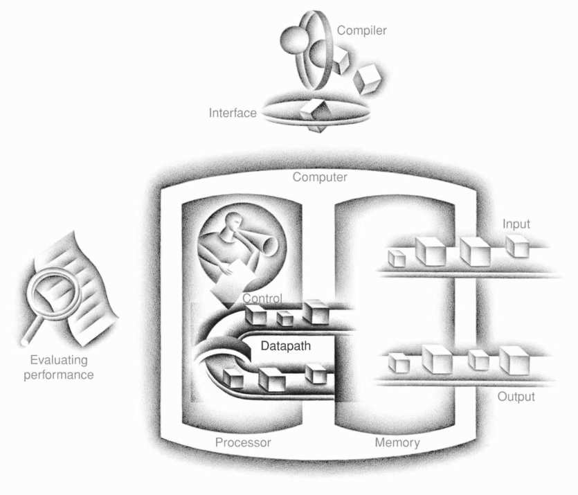

Năm thành phần kinh điển của một máy tính

## 3.1 Giới thiệu

Word của máy tính được cấu thành từ các bit; do đó, word có thể biểu diễn dưới dạng số nhị phân. Chương 2 cho thấy số nguyên có thể được biểu diễn ở dạng thập phân hoặc nhị phân, nhưng còn những số thường gặp khác thì sao? Ví dụ:

- Phân số và những số thực khác thì sao?

- Điều gì xảy ra nếu một phép toán tạo ra số lớn hơn khả năng biểu diễn?

- Và đằng sau những câu hỏi này là một bí ẩn: Phần cứng thực sự nhân hoặc chia các số như thế nào?

Mục tiêu của chương này là làm sáng tỏ những bí ẩn đó—bao gồm cách biểu diễn số thực, các thuật toán số học, phần cứng thực hiện những thuật toán ấy—và tác động của tất cả những điều này tới instruction set. Những hiểu biết này có thể giải thích các đặc điểm kỳ lạ mà bạn đã gặp ở máy tính. Ngoài ra, chúng tôi chỉ ra cách dùng kiến thức này để làm cho những chương trình arithmetic-intensive chạy nhanh hơn nhiều.

## 3.2 Phép cộng và phép trừ

Phép cộng trong máy tính diễn ra đúng như bạn mong đợi. Các chữ số được cộng từng bit từ phải sang trái, với carry truyền tới chữ số tiếp theo bên trái, giống như khi bạn tính bằng tay. Phép trừ sử dụng phép cộng: chỉ cần đổi dấu toán hạng thích hợp trước khi cộng.

Phép trừ: Người bạn tinh quái của phép cộng

Số 10, Mười khóa học hàng đầu cho vận động viên tại một lò đào tạo bóng bầu dục, David Letterman và cộng sự, Book of Top Ten Lists, 1990

### Phép cộng và phép trừ nhị phân

**Ví dụ**

Hãy thử cộng 6<sub>ten</sub> với 7<sub>ten</sub> ở dạng nhị phân, rồi trừ 6<sub>ten</sub> khỏi 7<sub>ten</sub> ở dạng nhị phân.

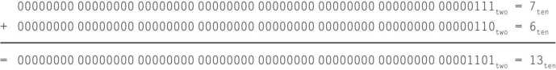

Toàn bộ quá trình diễn ra ở 4 bit bên phải; Hình 3.1 cho thấy các tổng và carry. Dấu ngoặc xác định các carry, còn các mũi tên minh họa cách chúng được truyền đi.

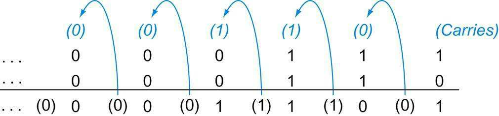

**HÌNH 3.1 Phép cộng nhị phân, cho thấy carry truyền từ phải sang trái. Bit ngoài cùng bên phải cộng 1 với 0, tạo ra tổng của bit này là 1 và carry out của bit này là 0. Vì vậy, phép toán cho chữ số thứ hai từ bên phải là 0 +1 +1. Phép toán này tạo ra 0 cho bit tổng và carry out là 1. Chữ số thứ ba là tổng 1 +1 +1, tạo ra carry out là 1 và bit tổng là 1. Bit thứ tư là 1 +0 +0, cho tổng bằng 1 và không có carry.**

**Trả lời**

Có thể trừ trực tiếp 6<sub>ten</sub> khỏi 7<sub>ten</sub>:

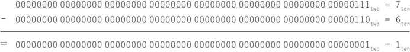

hoặc thông qua phép cộng sử dụng biểu diễn two’s complement của −6:

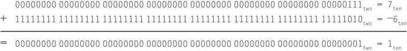

Nhớ rằng overflow xảy ra khi kết quả của một phép toán không thể biểu diễn bằng phần cứng hiện có, trong trường hợp này là một word 64-bit. Khi nào phép cộng có thể xảy ra overflow? Khi cộng những toán hạng khác dấu, overflow không thể xảy ra. Lý do là tổng không thể lớn hơn một trong các toán hạng. Ví dụ, −10 +4 =−6. Vì các toán hạng vừa trong 64 bit và tổng không lớn hơn một toán hạng, tổng cũng phải vừa trong 64 bit. Do đó, không thể có overflow khi cộng một toán hạng dương với một toán hạng âm.

Có những hạn chế tương tự đối với overflow trong phép trừ, nhưng nguyên tắc hoàn toàn ngược lại: khi các toán hạng cùng dấu, overflow không thể xảy ra. Để thấy điều này, nhớ rằng c−a=c+(−a), bởi ta thực hiện phép trừ bằng cách đổi dấu toán hạng thứ hai rồi cộng. Vì thế, khi trừ các toán hạng cùng dấu, cuối cùng ta cộng các toán hạng khác dấu. Từ đoạn trước, ta biết overflow cũng không thể xảy ra trong trường hợp này.

Biết khi nào overflow không thể xảy ra trong phép cộng và phép trừ là điều tốt, nhưng làm thế nào phát hiện khi nó thực sự xảy ra? Rõ ràng, cộng hoặc trừ hai số 64-bit có thể cho kết quả cần 65 bit để biểu diễn đầy đủ.

Việc thiếu bit thứ 65 có nghĩa là khi overflow xảy ra, sign bit được đặt theo giá trị của kết quả thay vì dấu đúng của kết quả. Vì chỉ cần thêm một bit, chỉ sign bit có thể sai. Do đó, overflow xảy ra khi cộng hai số dương mà tổng lại âm, hoặc ngược lại. Tổng sai lệch này có nghĩa là đã có carry truyền vào sign bit.

Overflow trong phép trừ xảy ra khi trừ một số âm khỏi một số dương mà nhận kết quả âm, hoặc trừ một số dương khỏi một số âm mà nhận kết quả dương. Kết quả vô lý như vậy có nghĩa là đã có borrow từ sign bit. Hình 3.2 cho thấy các tổ hợp phép toán, toán hạng và kết quả biểu thị overflow.

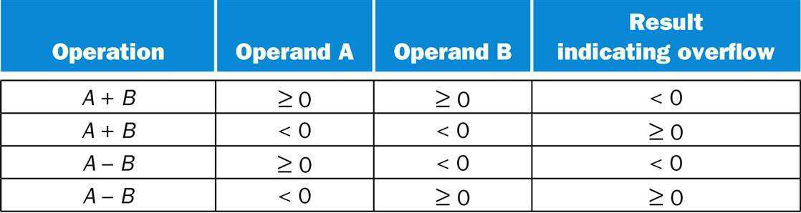

**HÌNH 3.2 Các điều kiện overflow cho phép cộng và phép trừ.**

Ta vừa thấy cách phát hiện overflow đối với số two’s complement trong máy tính. Còn overflow với số nguyên unsigned thì sao? Số nguyên unsigned thường dùng cho địa chỉ bộ nhớ, nơi overflow được bỏ qua.

May mắn là compiler có thể dễ dàng kiểm tra unsigned overflow bằng một branch instruction. Phép cộng đã overflow nếu tổng nhỏ hơn bất kỳ số hạng nào, còn phép trừ đã overflow nếu hiệu lớn hơn số bị trừ.

Phụ lục A mô tả phần cứng thực hiện phép cộng và phép trừ, gọi là Arithmetic Logic Unit hay ALU.

#### Arithmetic Logic Unit (ALU)

Phần cứng thực hiện phép cộng, phép trừ và thường cả những phép toán logic như AND và OR.

#### Giao diện phần cứng/phần mềm

Người thiết kế máy tính phải quyết định cách xử lý arithmetic overflow. Mặc dù một số ngôn ngữ như C và Java bỏ qua integer overflow, các ngôn ngữ như Ada và Fortran yêu cầu thông báo cho chương trình. Khi đó, lập trình viên hoặc môi trường lập trình phải quyết định làm gì khi overflow xảy ra.

### Tổng kết

Một điểm chính của mục này là, bất kể cách biểu diễn, kích thước word hữu hạn của máy tính có nghĩa các phép toán số học có thể tạo ra kết quả quá lớn để vừa trong kích thước word cố định này. Dễ dàng phát hiện overflow ở số unsigned, mặc dù nó gần như luôn bị bỏ qua vì chương trình không muốn phát hiện overflow trong số học địa chỉ, cách dùng phổ biến nhất của số tự nhiên. Two’s complement đặt ra thách thức lớn hơn, nhưng một số hệ thống phần mềm yêu cầu nhận biết overflow, nên ngày nay mọi máy tính đều có cách phát hiện nó.

#### Tự kiểm tra

Một số ngôn ngữ lập trình cho phép số học số nguyên two’s complement trên những biến khai báo là byte và half, trong khi RISC-V chỉ có các phép toán số học số nguyên trên toàn bộ word. Như đã biết từ Chương 2, RISC-V có các phép truyền dữ liệu cho byte và halfword. Cần sinh những instruction RISC-V nào cho các phép toán số học byte và halfword?

1. Load bằng lb, lh; tính toán bằng add, sub, mul, div, dùng and để mask kết quả còn 8 hoặc 16 bit sau mỗi phép toán; rồi store bằng

```
sb, sh.
```

2. Load bằng lb, lh; tính toán bằng add, sub, mul, div; rồi store bằng sb, sh.

#### Giải thích thêm

Một tính năng thường không có trong các microprocessor general-purpose là saturating operation. Saturation có nghĩa là khi phép tính overflow, kết quả được đặt thành số dương lớn nhất hoặc số âm nhỏ nhất, thay vì tính modulo như trong số học two’s complement. Saturation có lẽ là điều bạn muốn cho các phép xử lý media. Ví dụ, núm âm lượng trên radio sẽ gây bực mình nếu khi vặn nó, âm lượng cứ lớn dần một lúc rồi lập tức rất nhỏ. Núm có saturation sẽ dừng ở âm lượng lớn nhất bất kể bạn vặn thêm bao xa. Các multimedia extension cho instruction set tiêu chuẩn thường cung cấp saturating arithmetic.

#### Giải thích thêm

Tốc độ phép cộng phụ thuộc vào tốc độ tính carry vào các bit high-order. Có nhiều phương án dự đoán carry để trường hợp worst-case là một hàm của log<sub>2</sub> số bit trong adder. Những tín hiệu dự đoán này nhanh hơn vì chúng đi qua ít gate nối tiếp hơn, nhưng cần nhiều gate hơn đáng kể để dự đoán carry đúng. Phổ biến nhất là carry lookahead, được mô tả trong Mục A.6 ở Phụ lục A.

## 3.3 Phép nhân

Giờ đây, khi đã giải thích xong phép cộng và phép trừ, ta sẵn sàng xây dựng phép nhân phức tạp hơn.

Phép nhân thật phiền toái, phép chia cũng chẳng hơn; quy tắc tam suất làm tôi bối rối, còn luyện tập khiến tôi phát điên.

Khuyết danh, bản thảo thời Elizabeth, 1570

Trước tiên, hãy ôn lại phép nhân viết tay các số thập phân để nhớ lại những bước nhân và tên các toán hạng. Vì những lý do sẽ sớm rõ ràng, ta giới hạn ví dụ thập phân này ở các chữ số 0 và 1. Nhân 1000<sub>ten</sub> với 1001<sub>ten</sub>:

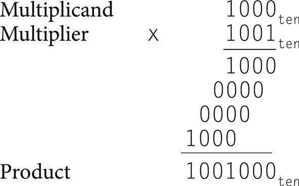

Toán hạng thứ nhất gọi là multiplicand và toán hạng thứ hai là multiplier. Kết quả cuối cùng gọi là product. Như bạn có thể còn nhớ, thuật toán học ở tiểu học là lấy từng chữ số của multiplier từ phải sang trái, nhân multiplicand với chữ số đó của multiplier, rồi dịch intermediate product sang trái một chữ số so với các intermediate product trước.

Nhận xét đầu tiên là số chữ số trong product lớn hơn đáng kể so với trong multiplicand hoặc multiplier. Thực tế, nếu bỏ qua sign bit, phép nhân một multiplicand n-bit với một multiplier m-bit cho product dài n+m bit. Nghĩa là cần n+m bit để biểu diễn mọi product có thể có. Vì vậy, giống phép cộng, phép nhân phải xử lý overflow bởi ta thường muốn product 64-bit làm kết quả của phép nhân hai số 64-bit.

Trong ví dụ này, ta giới hạn các chữ số thập phân ở 0 và 1. Chỉ với hai lựa chọn, mỗi bước nhân đều đơn giản:

1. Chỉ cần đặt một bản sao multiplicand (1 ×multiplicand) vào vị trí thích hợp nếu chữ số của multiplier là 1, hoặc

2. Đặt 0 (0 ×multiplicand) vào vị trí thích hợp nếu chữ số đó là 0. Mặc dù ví dụ thập phân trên tình cờ chỉ dùng 0 và 1, phép nhân số nhị phân luôn phải dùng 0 và 1, nên luôn chỉ có hai lựa chọn này.

Giờ đây, khi đã ôn lại cơ sở của phép nhân, bước tiếp theo theo truyền thống là đưa ra phần cứng nhân đã tối ưu cao độ. Chúng tôi phá lệ vì tin rằng bạn sẽ hiểu rõ hơn khi thấy sự phát triển của phần cứng và thuật toán nhân qua nhiều thế hệ. Hiện tại, hãy giả sử ta chỉ nhân các số dương.

### Phiên bản tuần tự của thuật toán và phần cứng nhân

Thiết kế này mô phỏng thuật toán ta học ở tiểu học; Hình 3.3 cho thấy phần cứng. Ta vẽ phần cứng sao cho dữ liệu đi từ trên xuống dưới để gần giống phương pháp paper-and-pencil hơn.

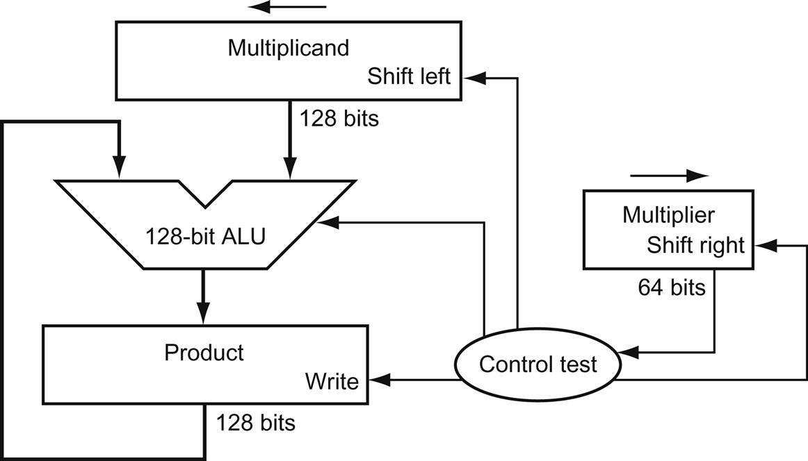

**HÌNH 3.3 Phiên bản đầu tiên của phần cứng nhân. Multiplicand register, ALU và Product register đều rộng 128 bit, chỉ Multiplier register chứa 64 bit. (Phụ lục A mô tả ALU.) Multiplicand 64-bit bắt đầu ở nửa phải Multiplicand register và được dịch trái 1 bit mỗi bước. Multiplier được dịch theo hướng ngược lại ở mỗi bước. Thuật toán bắt đầu với product khởi tạo bằng 0. Control quyết định khi nào dịch Multiplicand register và Multiplier register, và khi nào ghi giá trị mới vào Product register.**

Giả sử multiplier nằm trong Multiplier register 64-bit và Product register 128-bit được khởi tạo bằng 0. Từ ví dụ paper-and-pencil ở trên, rõ ràng ta cần dịch multiplicand sang trái một chữ số mỗi bước, vì nó có thể được cộng vào các intermediate product. Qua 64 bước, multiplicand 64-bit sẽ dịch 64 bit sang trái. Do đó, ta cần Multiplicand register 128-bit, khởi tạo với multiplicand 64-bit ở nửa phải và số không ở nửa trái. Sau đó register này được dịch trái 1 bit mỗi bước để căn multiplicand với tổng đang tích lũy trong Product register 128-bit.

Hình 3.4 cho thấy ba bước cơ bản cần thực hiện cho mỗi bit. Bit ít có trọng số nhất của multiplier (Multiplier0) quyết định có cộng multiplicand vào Product register hay không. Dịch trái trong bước 2 có tác dụng chuyển các toán hạng trung gian sang trái, giống khi nhân bằng giấy bút. Dịch phải trong bước 3 cho ta bit tiếp theo của multiplier để xét trong vòng lặp kế tiếp. Ba bước này lặp lại 64 lần để thu được product. Nếu mỗi bước mất một clock cycle, thuật toán sẽ cần gần 200 clock cycle để nhân hai số 64-bit. Tầm quan trọng tương đối của các phép toán số học như phép nhân thay đổi theo chương trình, nhưng phép cộng và phép trừ có thể phổ biến hơn phép nhân từ 5 đến 100 lần. Theo đó, trong nhiều ứng dụng, phép nhân có thể mất vài clock cycle mà không ảnh hưởng đáng kể đến hiệu năng. Tuy nhiên, định luật Amdahl (xem Mục 1.10) nhắc rằng ngay cả tần suất vừa phải của một phép toán chậm cũng có thể giới hạn hiệu năng.

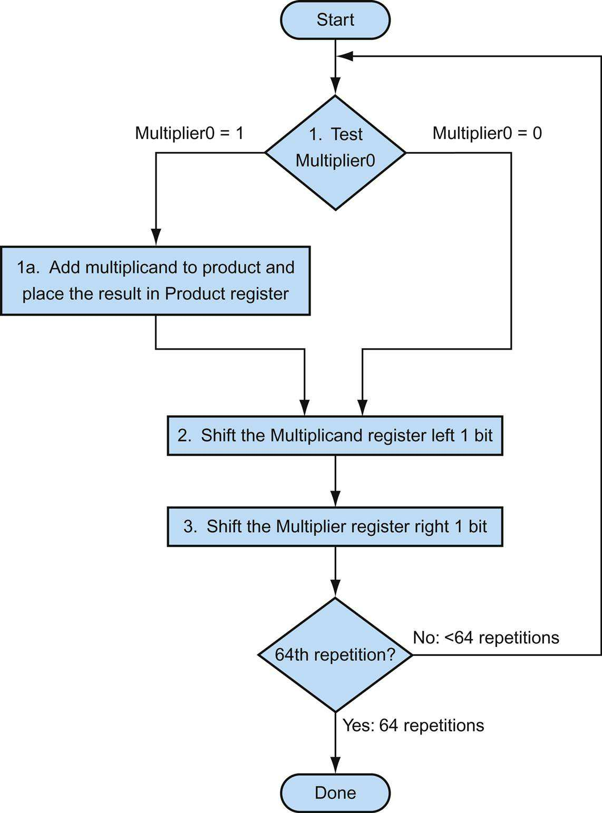

**HÌNH 3.4 Thuật toán nhân đầu tiên, dùng phần cứng trong Hình 3.3. Nếu bit ít có trọng số nhất của multiplier là 1, cộng multiplicand vào product. Nếu không, chuyển sang bước tiếp theo. Dịch multiplicand sang trái và multiplier sang phải trong hai bước tiếp theo. Ba bước này được lặp lại 64 lần.**

Có thể dễ dàng cải tiến thuật toán và phần cứng này để mỗi bước mất một clock cycle. Tăng tốc đến từ việc thực hiện các phép toán song song: multiplier và multiplicand được dịch trong lúc multiplicand được cộng vào product nếu bit multiplier là 1. Phần cứng chỉ phải bảo đảm kiểm tra đúng bit multiplier và lấy phiên bản multiplicand trước khi dịch. Phần cứng thường được tối ưu thêm để giảm một nửa chiều rộng adder và các register, bằng cách nhận ra những phần không sử dụng của chúng. Hình 3.5 cho thấy phần cứng đã sửa đổi.

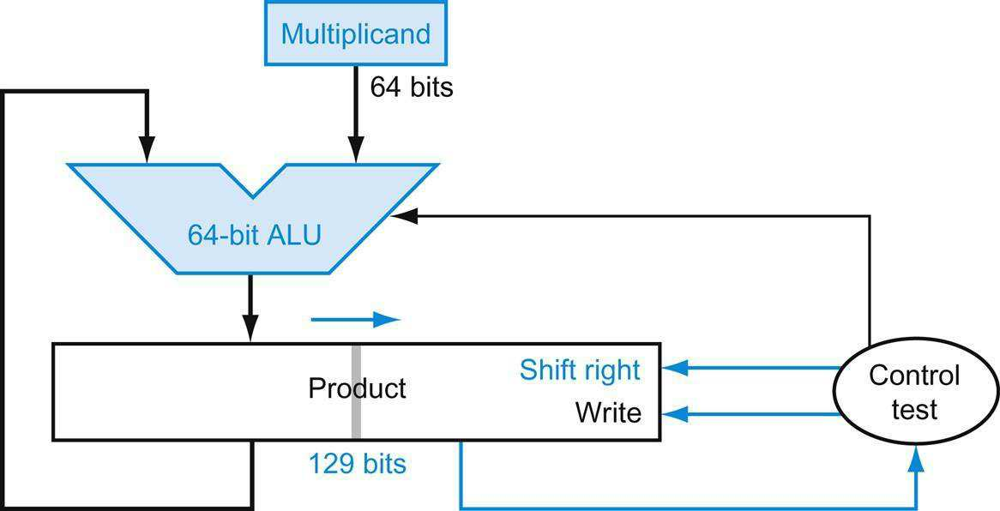

**HÌNH 3.5 Phiên bản cải tiến của phần cứng nhân. So sánh với phiên bản đầu tiên trong Hình 3.3. Multiplicand register và ALU được giảm còn 64 bit. Giờ đây product được dịch phải. Multiplier register riêng cũng biến mất. Thay vào đó, multiplier nằm trong nửa phải Product register, được mở rộng thêm một bit thành 129 bit để giữ carry-out của adder. Những thay đổi này được tô màu.**

#### Giao diện phần cứng/phần mềm

Việc thay số học bằng phép dịch cũng có thể diễn ra khi nhân với hằng số. Một số compiler thay phép nhân với hằng số nhỏ bằng chuỗi phép dịch và phép cộng. Vì một bit sang trái biểu diễn số lớn gấp đôi trong cơ số 2, dịch các bit sang trái có tác dụng giống nhân với lũy thừa của 2. Như đã đề cập trong Chương 2, gần như mọi compiler đều thực hiện tối ưu strength reduction, thay phép nhân với lũy thừa của 2 bằng dịch trái.

#### Một thuật toán nhân

**Ví dụ**

Dùng các số 4-bit để tiết kiệm chỗ, hãy nhân 2<sub>ten</sub> × 3<sub>ten</sub>, hay 0010<sub>two</sub> × 0011<sub>two</sub>.

**Trả lời**

Hình 3.6 cho thấy giá trị mỗi register tại từng bước được đánh nhãn theo Hình 3.4, với giá trị cuối là 0000 0110<sub>two</sub> hay 6<sub>ten</sub>. Màu sắc chỉ những giá trị register thay đổi trong bước đó, còn bit khoanh tròn là bit được kiểm tra để quyết định phép toán ở bước tiếp theo.

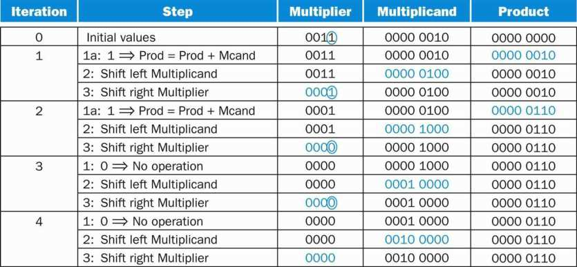

**HÌNH 3.6 Ví dụ phép nhân dùng thuật toán trong Hình 3.4. Bit được kiểm tra để quyết định bước tiếp theo được khoanh tròn màu.**

### Phép nhân signed

Cho đến đây, ta đã làm việc với số dương. Cách dễ nhất để hiểu cách xử lý số signed là trước tiên chuyển multiplier và multiplicand sang số dương rồi ghi nhớ dấu ban đầu của chúng. Tiếp đó chạy thuật toán trong 31 vòng lặp, không đưa dấu vào phép tính. Như đã học ở tiểu học, chỉ cần đổi dấu product nếu dấu ban đầu khác nhau.

Hóa ra thuật toán cuối sẽ hoạt động với số signed nếu ta nhớ rằng đang xử lý các số có vô hạn chữ số và chỉ biểu diễn chúng bằng 64 bit. Do đó, các bước dịch cần mở rộng dấu của product đối với số signed. Khi thuật toán hoàn tất, doubleword phía dưới sẽ chứa product 64-bit.

### Phép nhân nhanh hơn

Định luật Moore cung cấp nhiều tài nguyên hơn đến mức người thiết kế phần cứng giờ có thể xây dựng phần cứng nhân nhanh hơn nhiều. Việc có cộng multiplicand hay không được biết ngay khi bắt đầu phép nhân bằng cách xem từng bit trong 64 bit multiplier. Có thể nhân nhanh hơn bằng cách về cơ bản cung cấp một adder 64-bit cho mỗi bit multiplier: một đầu vào là multiplicand được AND với bit multiplier, đầu vào còn lại là đầu ra của adder trước.


Một cách đơn giản là nối đầu ra các adder bên phải với đầu vào các adder bên trái, tạo một chồng cao 64 adder. Một cách khác để tổ chức 64 phép cộng này là thành cây song song, như Hình 3.7. Thay vì đợi thời gian 64 phép cộng, ta chỉ đợi log<sub>2</sub> (64), tức thời gian sáu phép cộng 64-bit.

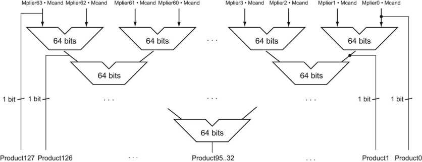

**HÌNH 3.7 Phần cứng nhân nhanh. Thay vì dùng một adder 64-bit 63 lần, phần cứng này “trải vòng lặp” để dùng 63 adder rồi tổ chức chúng nhằm giảm thiểu độ trễ.**

Thực tế, phép nhân có thể nhanh hơn thời gian sáu phép cộng nhờ dùng carry save adder (xem Mục A.6 trong Phụ lục A), và vì dễ pipeline thiết kế như vậy để hỗ trợ đồng thời nhiều phép nhân (xem Chương 4).


### Phép nhân trong RISC-V

Để tạo product 128-bit signed hoặc unsigned đúng, RISC-V có bốn instruction: multiply (mul), multiply high (mulh), multiply high unsigned (mulhu), và multiply high signed-unsigned (mulhsu). Để lấy product số nguyên 64-bit, lập trình viên dùng mul. Để lấy 64 bit phía trên của product 128-bit, lập trình viên dùng (mulh) nếu cả hai toán hạng là signed, (mulhu) nếu cả hai là unsigned, hoặc (mulhsu) nếu một toán hạng signed và toán hạng kia unsigned.

### Tổng kết

Phần cứng nhân chỉ đơn giản dịch và cộng, được suy ra từ phương pháp paper-and-pencil học ở tiểu học. Compiler thậm chí dùng shift instruction cho phép nhân với lũy thừa của 2. Với nhiều phần cứng hơn đáng kể, ta có thể thực hiện các phép cộng song song và nhanh hơn nhiều.


#### Giao diện phần cứng/phần mềm

Phần mềm có thể dùng các instruction multiply-high để kiểm tra overflow của phép nhân 64-bit. Không có overflow trong phép nhân unsigned 64-bit nếu kết quả mulhu bằng không. Không có overflow trong phép nhân signed 64-bit nếu mọi bit trong kết quả mulh là bản sao sign bit của kết quả mul.

## 3.4 Phép chia

Phép toán ngược của phép nhân là phép chia, một phép toán còn ít gặp và kỳ lạ hơn. Nó thậm chí cho phép thực hiện một phép toán không hợp lệ về toán học: chia cho 0.

Divide et impera.

Tiếng Latin nghĩa là “Chia để trị”, châm ngôn chính trị cổ được Machiavelli trích dẫn, 1532

Hãy bắt đầu bằng ví dụ chia dài với các số thập phân để nhớ lại tên toán hạng và thuật toán chia từ tiểu học. Vì lý do tương tự mục trước, ta giới hạn chữ số thập phân ở 0 hoặc 1. Ví dụ là chia 1,001,010<sub>ten</sub> cho 1000<sub>ten</sub>:

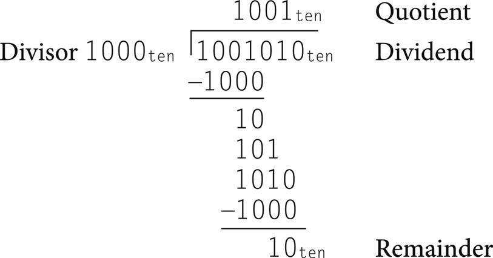

Hai toán hạng của phép chia, gọi là dividend và divisor, cùng kết quả gọi là quotient, đi kèm một kết quả thứ hai gọi là remainder. Sau đây là cách khác để biểu diễn quan hệ giữa các thành phần:

### dividend

Một số được chia.

#### divisor

Một số dùng để chia dividend.

#### quotient

Kết quả chính của phép chia; số mà khi nhân với divisor rồi cộng remainder sẽ tạo ra dividend.

#### remainder

Kết quả phụ của phép chia; số mà khi cộng với tích của quotient và divisor sẽ tạo ra dividend.

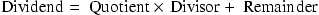

trong đó remainder nhỏ hơn divisor. Đôi khi chương trình dùng divide instruction chỉ để lấy remainder, bỏ qua quotient.

Thuật toán chia cơ bản ở tiểu học thử xem có thể trừ một số lớn đến đâu, tạo ra một chữ số quotient sau mỗi lần thử. Ví dụ thập phân đã được chọn cẩn thận chỉ dùng các số 0 và 1, nên dễ xác định divisor vừa bao nhiêu lần trong phần dividend: hoặc 0 lần hoặc 1 lần. Số nhị phân chỉ chứa 0 hoặc 1, nên phép chia nhị phân bị giới hạn ở hai lựa chọn ấy, nhờ đó đơn giản hơn.

Giả sử cả dividend lẫn divisor đều dương, và do đó quotient và remainder không âm. Các toán hạng chia cùng cả hai kết quả là giá trị 64-bit, và hiện tại ta bỏ qua dấu.

### Một thuật toán và phần cứng chia

Hình 3.8 cho thấy phần cứng mô phỏng thuật toán tiểu học. Ta bắt đầu với Quotient register 64-bit đặt bằng 0. Mỗi vòng lặp cần dịch divisor sang phải một chữ số, nên ta bắt đầu với divisor ở nửa trái Divisor register 128-bit và dịch phải 1 bit mỗi bước để căn với dividend. Remainder register được khởi tạo bằng dividend.

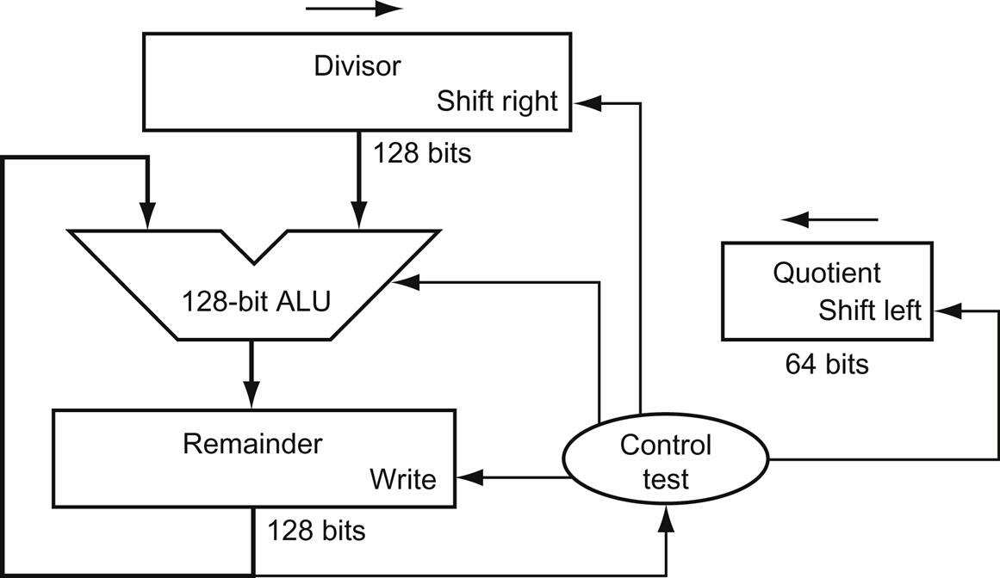

**HÌNH 3.8 Phiên bản đầu tiên của phần cứng chia. Divisor register, ALU và Remainder register đều rộng 128 bit, chỉ Quotient register rộng 62 bit. Divisor 64-bit bắt đầu ở nửa trái Divisor register và dịch phải 1 bit mỗi vòng lặp. Remainder được khởi tạo bằng dividend. Control quyết định khi nào dịch Divisor register và Quotient register, và khi nào ghi giá trị mới vào Remainder register.**

Hình 3.9 cho thấy ba bước của thuật toán chia đầu tiên. Khác con người, máy tính không đủ thông minh để biết trước divisor có nhỏ hơn dividend hay không. Trước hết nó phải trừ divisor trong bước 1; nhớ rằng đây là cách ta thực hiện so sánh. Nếu kết quả dương, divisor nhỏ hơn hoặc bằng dividend nên ta sinh 1 trong quotient (bước 2a). Nếu kết quả âm, bước tiếp theo khôi phục giá trị ban đầu bằng cách cộng divisor trở lại remainder và sinh 0 trong quotient (bước 2b). Divisor được dịch phải, rồi ta lặp lại. Remainder và quotient sẽ nằm trong các register cùng tên sau khi hoàn tất các vòng lặp.

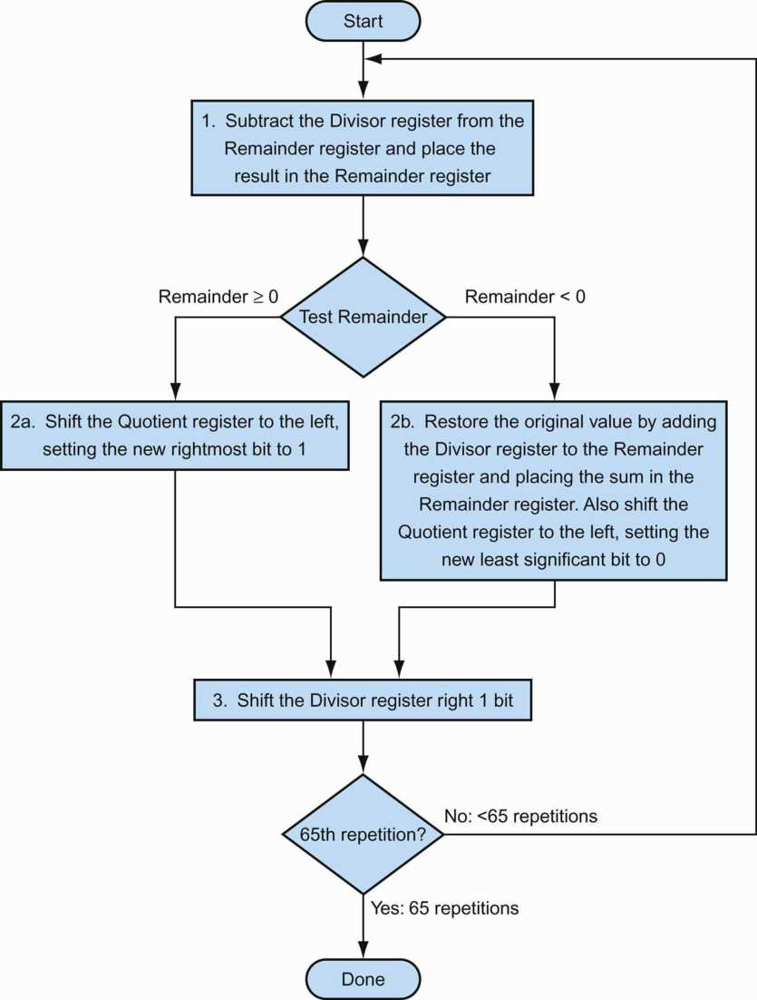

**HÌNH 3.9 Một thuật toán chia, sử dụng phần cứng trong Hình 3.8. Nếu remainder dương, divisor đã vừa trong dividend, nên bước 2a sinh 1 trong quotient. Remainder âm sau bước 1 nghĩa là divisor không vừa trong dividend, nên bước 2b sinh 0 trong quotient và cộng divisor vào remainder, đảo ngược phép trừ của bước 1. Phép dịch cuối, trong bước 3, căn divisor đúng so với dividend cho vòng lặp kế tiếp. Những bước này được lặp lại 65 lần.**

#### Một thuật toán chia

**Ví dụ**

Dùng phiên bản 4-bit của thuật toán để tiết kiệm số trang, hãy thử chia 7<sub>ten</sub> cho 2<sub>ten</sub>, hay 0000 0111<sub>two</sub> cho 0010<sub>two</sub>.

**Trả lời**

Hình 3.10 cho thấy giá trị mỗi register tại từng bước, với quotient là 3<sub>ten</sub> và remainder là 1<sub>ten</sub>. Chú ý rằng kiểm tra remainder dương hay âm trong bước 2 chỉ đơn giản kiểm tra sign bit của Remainder register là 0 hay 1. Yêu cầu đáng ngạc nhiên của thuật toán là cần n + 1 bước để có quotient và remainder đúng.

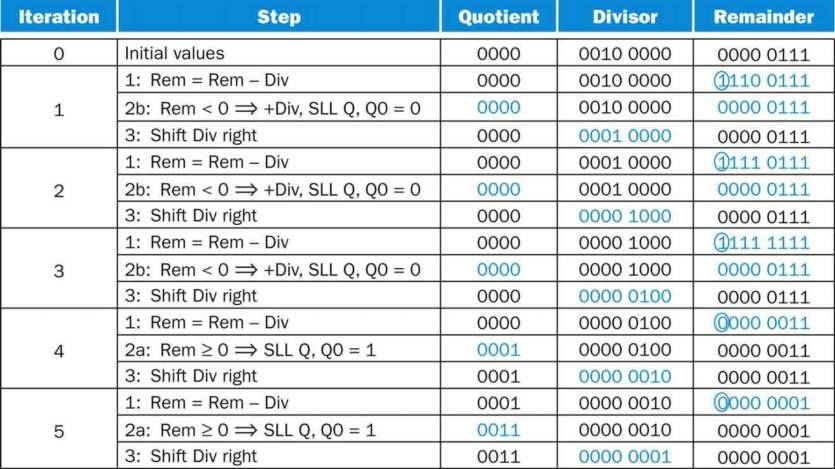

**HÌNH 3.10 Ví dụ phép chia dùng thuật toán trong Hình 3.9. Bit được xét để quyết định bước tiếp theo được khoanh tròn màu.**

Có thể cải tiến thuật toán và phần cứng này để nhanh hơn và rẻ hơn. Sự speed-up đến từ việc dịch các toán hạng và quotient đồng thời với phép trừ. Cải tiến này giảm một nửa chiều rộng adder và register bằng cách nhận ra những phần không dùng của chúng. Hình 3.11 cho thấy phần cứng đã sửa đổi.

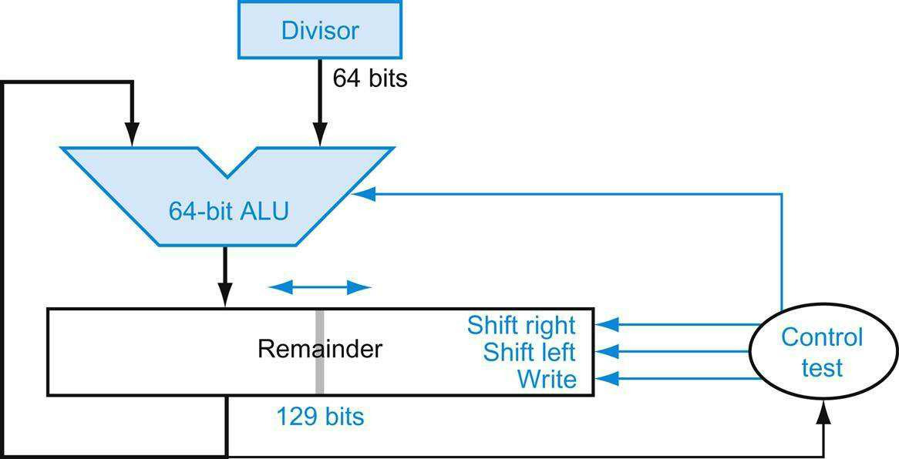

**HÌNH 3.11 Phiên bản cải tiến của phần cứng chia. Divisor register, ALU và Quotient register đều rộng 64 bit. So với Hình 3.8, ALU và Divisor register được giảm một nửa, còn remainder được dịch trái. Phiên bản này cũng kết hợp Quotient register với nửa phải Remainder register. Như trong Hình 3.5, Remainder register tăng lên 129 bit để bảo đảm carry out của adder không bị mất.**

### Phép chia signed

Cho đến đây, ta đã bỏ qua số signed trong phép chia. Giải pháp đơn giản nhất là nhớ dấu của divisor và dividend, rồi đổi dấu quotient nếu các dấu khác nhau.

#### Giải thích thêm

Điểm phức tạp duy nhất của phép chia signed là ta cũng phải đặt dấu cho remainder. Nhớ rằng phương trình sau phải luôn đúng:

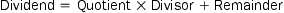

Để hiểu cách đặt dấu cho remainder, hãy xem ví dụ chia mọi tổ hợp ±7<sub>ten</sub> cho ±2<sub>ten</sub>. Trường hợp đầu tiên rất dễ:

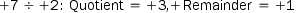

Kiểm tra các kết quả:

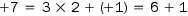

Nếu đổi dấu dividend, quotient cũng phải đổi dấu:

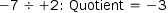

Viết lại công thức cơ bản để tính remainder:

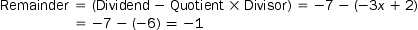

Vì vậy,

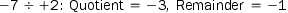

Kiểm tra lại các kết quả:

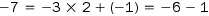

Lý do đáp án không phải quotient bằng −4 và remainder bằng +1, vốn cũng thỏa công thức này, là khi đó giá trị tuyệt đối của quotient sẽ thay đổi tùy dấu dividend và divisor! Rõ ràng, nếu

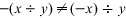

thì việc lập trình sẽ còn khó khăn hơn. Có thể tránh hành vi bất thường này bằng quy tắc dividend và remainder phải cùng dấu, bất kể dấu divisor và quotient.

Ta tính những tổ hợp khác theo cùng quy tắc:

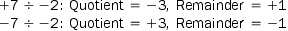

Như vậy, thuật toán chia signed đúng đổi dấu quotient nếu các toán hạng khác dấu và làm cho remainder khác không có cùng dấu với dividend.

### Phép chia nhanh hơn

Định luật Moore áp dụng cho phần cứng chia cũng như phần cứng nhân, nên ta muốn tăng tốc phép chia bằng cách bổ sung phần cứng. Ta đã dùng nhiều adder để tăng tốc phép nhân, nhưng không thể làm tương tự với phép chia. Lý do là phải biết dấu của hiệu trước khi thực hiện bước thuật toán tiếp theo, trong khi với phép nhân ta có thể tính ngay 64 partial product.


Có những kỹ thuật tạo nhiều hơn một bit quotient mỗi bước. Kỹ thuật chia SRT cố dự đoán vài bit quotient mỗi bước, dùng table lookup dựa trên các bit phía trên của dividend và remainder. Nó dựa vào các bước tiếp theo để sửa dự đoán sai. Giá trị điển hình hiện nay là 4 bit. Mấu chốt là đoán giá trị cần trừ. Với phép chia nhị phân, chỉ có một lựa chọn. Những thuật toán này dùng 6 bit từ remainder và 4 bit từ divisor để đánh chỉ mục một bảng xác định giá trị đoán cho mỗi bước.


Độ chính xác của phương pháp nhanh này phụ thuộc vào việc có các giá trị đúng trong lookup table. Ngộ nhận ở trang 224 trong Mục 3.8 cho thấy điều gì có thể xảy ra nếu bảng sai.

### Phép chia trong RISC-V

Có thể bạn đã nhận ra rằng cùng phần cứng tuần tự có thể dùng cho cả nhân và chia trong Hình 3.5 và 3.11. Yêu cầu duy nhất là một register 128-bit có thể dịch trái hoặc phải và một ALU 64-bit thực hiện cộng hoặc trừ.

Để xử lý cả số nguyên signed và unsigned, RISC-V có hai instruction cho phép chia và hai instruction cho remainder: divide (div), divide unsigned (divu), remainder (rem), và remainder unsigned (remu).

### Tổng kết

Phần cứng hỗ trợ chung cho phép nhân và chia cho phép RISC-V cung cấp một cặp register 64-bit duy nhất dùng cho cả nhân và chia. Ta tăng tốc phép chia bằng cách dự đoán nhiều bit quotient rồi sửa những dự đoán sai sau đó. Hình 3.12 tổng kết những bổ sung vào kiến trúc RISC-V trong hai mục vừa qua.

#### Giao diện phần cứng/phần mềm

Các divide instruction RISC-V bỏ qua overflow, nên phần mềm phải xác định quotient có quá lớn hay không. Ngoài overflow, phép chia cũng có thể tạo phép tính không hợp lệ: chia cho 0. Một số máy tính phân biệt hai sự kiện bất thường này. Phần mềm RISC-V phải kiểm tra divisor để phát hiện cả chia cho 0 lẫn overflow.

#### Giải thích thêm

Một thuật toán còn nhanh hơn không cộng divisor trở lại ngay khi remainder âm. Nó chỉ cộng dividend vào remainder đã dịch trong bước sau, vì (r+d)×2 −d=r − 2 +d × 2 −d=r × 2 +d. Thuật toán nonrestoring division này, mất một clock cycle mỗi bước, được tìm hiểu thêm trong bài tập; thuật toán phía trên gọi là restoring division. Thuật toán thứ ba không lưu kết quả phép trừ nếu nó âm gọi là nonperforming division. Trung bình, nó cần ít hơn one-third số phép toán số học.

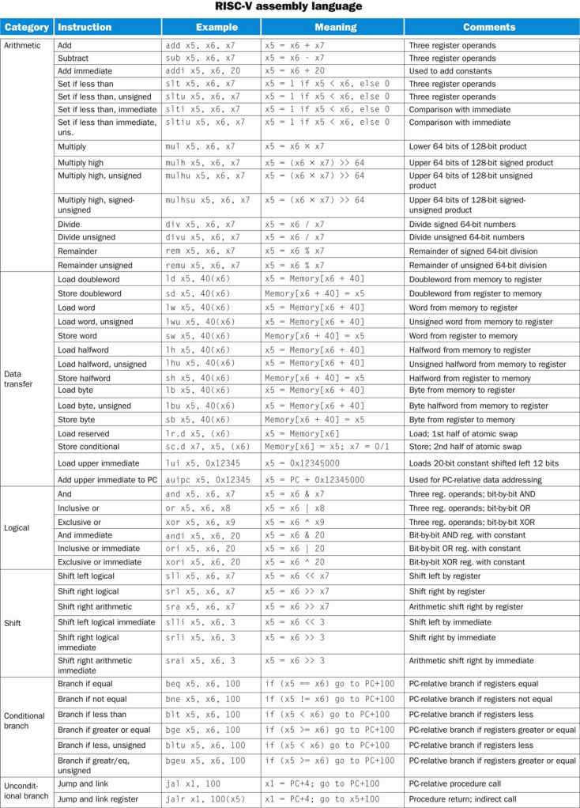

**HÌNH 3.12 Kiến trúc lõi RISC-V. Machine language RISC-V được liệt kê trong RISC-V Reference Data Card ở đầu sách này.**

## 3.5 Floating Point

Ngoài số nguyên signed và unsigned, các ngôn ngữ lập trình còn hỗ trợ số có phần lẻ, gọi là số thực trong toán học. Sau đây là vài ví dụ số thực:

Tốc độ chẳng đưa bạn đến đâu nếu bạn đang đi sai hướng.

Tục ngữ Mỹ

3.14159265… <sub>ten</sub> (pi)

2.71828… <sub>ten</sub> (e)

0.000000001<sub>ten</sub> hoặc 1.0<sub>ten</sub> ×10<sup>−9</sup> (số giây trong một nanosecond)

3,155,760,000<sub>ten</sub> hoặc 3.15576<sub>ten</sub> × 10<sup>9</sup> (số giây trong một thế kỷ điển hình)

Chú ý trong trường hợp cuối, số này không biểu diễn một phân số nhỏ mà lớn hơn khả năng biểu diễn bằng một số nguyên signed 32-bit. Cách viết khác của hai số cuối gọi là scientific notation, có một chữ số duy nhất ở bên trái dấu thập phân. Một số ở scientific notation không có các chữ số 0 đầu gọi là số normalized, cũng là cách viết thông thường. Ví dụ, 1.0<sub>ten</sub> × 10<sup>−9</sup> là normalized scientific notation, nhưng 0.1<sub>ten</sub> × 10<sup>−8</sup> và 10.0<sub>ten</sub> × 10<sup>−10</sup> thì không.

### scientific notation

Một cách biểu diễn số với một chữ số duy nhất ở bên trái dấu thập phân.

#### normalized

Một số ở dạng floating-point không có các chữ số 0 đầu.

Giống như có thể viết số thập phân bằng scientific notation, ta cũng có thể viết số nhị phân bằng scientific notation:

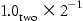

Để giữ số nhị phân ở dạng normalized, ta cần một cơ số có thể tăng hoặc giảm chính xác bằng số bit cần dịch để số đó có một chữ số khác không ở bên trái dấu thập phân. Chỉ cơ số 2 đáp ứng nhu cầu này. Vì cơ số không phải 10, ta cũng cần tên mới thay cho dấu thập phân; binary point là phù hợp.

Số học máy tính hỗ trợ những số như vậy gọi là floating point vì nó biểu diễn các số mà binary point không cố định như ở số nguyên. Ngôn ngữ C dùng tên float cho những số này. Giống scientific notation, các số được biểu diễn với một chữ số khác không duy nhất ở bên trái binary point. Trong hệ nhị phân, dạng đó là

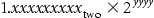

(Mặc dù máy tính biểu diễn exponent ở cơ số 2 cũng như phần còn lại của số, để đơn giản ký hiệu, ta viết exponent ở dạng thập phân.)

#### floating point

Số học máy tính biểu diễn những số mà binary point không cố định.

Scientific notation tiêu chuẩn cho số thực dạng normalized mang lại ba lợi ích. Nó đơn giản hóa việc trao đổi dữ liệu chứa số floating-point; biết rằng số luôn ở dạng này làm đơn giản các thuật toán số học floating-point; và nó tăng độ chính xác của số có thể lưu trong một word, bởi các chữ số thực bên phải binary point thay cho những số 0 đầu không cần thiết.

### Biểu diễn Floating-Point

Người thiết kế biểu diễn floating-point phải tìm cách cân bằng giữa kích thước fraction và kích thước exponent, vì kích thước word cố định có nghĩa phải lấy một bit từ phần này để thêm vào phần kia. Đây là đánh đổi giữa độ chính xác và phạm vi: tăng kích thước fraction làm chính xác fraction hơn, còn tăng kích thước exponent mở rộng phạm vi số có thể biểu diễn. Như nguyên tắc thiết kế từ Chương 2 nhắc ta, thiết kế tốt đòi hỏi sự thỏa hiệp tốt.

#### fraction

Giá trị, thường từ 0 đến 1, được đặt trong trường fraction. Fraction cũng gọi là mantissa.

#### exponent

Trong hệ biểu diễn số của số học floating-point, giá trị được đặt trong trường exponent.

Số Floating-point thường có kích thước là bội số của một word. Biểu diễn số floating-point RISC-V được cho bên dưới, trong đó s là dấu của số floating-point (1 nghĩa là âm), exponent là giá trị trường exponent 8-bit (bao gồm dấu exponent), còn fraction là số 23-bit. Như đã biết từ Chương 2, cách biểu diễn này là sign and magnitude vì dấu là một bit tách khỏi phần còn lại của số.

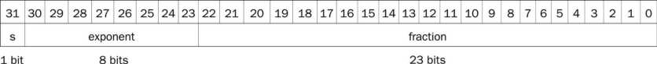

Nói chung, số floating-point có dạng

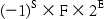

F liên quan đến giá trị trường fraction và E liên quan đến giá trị trường exponent; quan hệ chính xác với những trường này sẽ sớm được trình bày rõ. (Ta sẽ sớm thấy RISC-V thực hiện tinh vi hơn một chút.)

Kích thước exponent và fraction được chọn như vậy mang lại phạm vi phi thường cho số học máy tính RISC-V. Máy tính có thể biểu diễn những phân số nhỏ gần bằng 2.0<sub>ten</sub> × 10<sup>−38</sup> và những số lớn gần bằng 2.0<sub>ten</sub> × 10<sup>38</sup>. Tuy nhiên, phi thường khác với vô hạn, nên số vẫn có thể quá lớn. Do đó, overflow interrupt có thể xảy ra trong số học floating-point cũng như số học số nguyên. Chú ý overflow ở đây nghĩa là exponent quá lớn để biểu diễn trong trường exponent.

#### overflow (floating-point)

Tình huống exponent dương trở nên quá lớn để vừa trong trường exponent.

Floating point cũng mang đến một kiểu sự kiện ngoại lệ mới. Cũng như muốn biết khi tính ra số quá lớn để biểu diễn, lập trình viên muốn biết nếu phân số khác không đang tính trở nên nhỏ đến mức không thể biểu diễn; cả hai sự kiện đều có thể khiến chương trình trả lời sai. Để phân biệt với overflow, ta gọi sự kiện này là underflow. Tình huống này xảy ra khi exponent âm có độ lớn quá lớn để vừa trong trường exponent.

#### underflow (floating-point)

Tình huống exponent âm có độ lớn trở nên quá lớn để vừa trong trường exponent.

Một cách giảm khả năng underflow hoặc overflow là cung cấp định dạng khác có exponent lớn hơn. Trong C, kiểu số này gọi là double, và phép toán trên double gọi là số học floating-point double precision; single precision floating point là tên của định dạng trước đó.

#### double precision

Một giá trị floating-point biểu diễn trong doubleword 64-bit.

#### single precision

Một giá trị floating-point biểu diễn trong word 32-bit.

Biểu diễn số floating-point double precision chiếm một doubleword RISC-V, như bên dưới, trong đó s vẫn là dấu của số, exponent là giá trị trường exponent 11-bit, còn fraction là số 52-bit trong trường fraction.

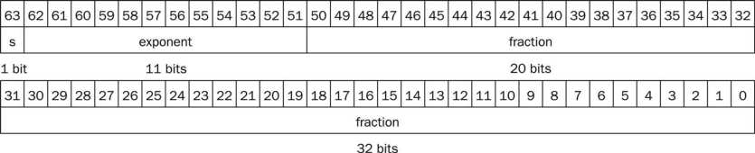

Double precision RISC-V cho phép số nhỏ gần bằng 2.0<sub>ten</sub> × 10<sup>−308</sup> và lớn gần bằng 2.0<sub>ten</sub> × 10<sup>308</sup>. Mặc dù double precision mở rộng phạm vi exponent, lợi ích chính là độ chính xác cao hơn nhờ fraction lớn hơn rất nhiều.

### Exception và interrupt

Khi overflow hoặc underflow, điều gì cần xảy ra để người dùng biết đã có vấn đề? Một số máy tính báo những sự kiện này bằng cách phát sinh exception, đôi khi gọi là interrupt. Exception hay interrupt về cơ bản là một procedure call không được lên lịch trước. Địa chỉ instruction gây overflow được lưu trong một register, và máy tính nhảy tới địa chỉ định trước để gọi routine thích hợp cho exception đó. Địa chỉ bị ngắt được lưu để trong một số tình huống, chương trình có thể tiếp tục sau khi chạy code khắc phục. (Mục 4.9 trình bày exception chi tiết hơn; Chương 5 mô tả những tình huống khác có exception và interrupt.) Máy tính RISC-V không phát sinh exception khi overflow hoặc underflow; thay vào đó, phần mềm có thể đọc floating-point control and status register (fcsr) để kiểm tra overflow hoặc underflow đã xảy ra hay chưa.

#### exception

Cũng gọi là interrupt. Một sự kiện không lên lịch trước làm gián đoạn thực thi chương trình; dùng để phát hiện overflow.

#### interrupt

Exception đến từ bên ngoài processor. (Một số kiến trúc dùng thuật ngữ interrupt cho mọi exception.)

### Tiêu chuẩn Floating-Point IEEE 754

Những định dạng này vượt ra ngoài RISC-V. Chúng thuộc tiêu chuẩn floating-point IEEE 754, có trong gần như mọi máy tính được sáng chế từ năm 1980. Tiêu chuẩn này cải thiện đáng kể cả sự dễ dàng khi chuyển chương trình floating-point sang nền tảng khác lẫn chất lượng số học máy tính.

Để nhét thêm bit vào số, IEEE 754 ngầm định bit 1 đầu của số nhị phân normalized. Do đó, số thực sự dài 24 bit ở single precision (1 ngầm định và fraction 23-bit), và dài 53 bit ở double precision (1 + 52). Nói chính xác, ta dùng thuật ngữ significand cho số 24 hoặc 53-bit bằng 1 cộng fraction, còn fraction khi muốn nói số 23 hoặc 52-bit. Vì 0 không có 1 đầu, nó được dành giá trị exponent 0 để phần cứng không gắn thêm 1 đầu vào nó.

Vì vậy, 00 … 00<sub>two</sub> biểu diễn 0; các số còn lại dùng dạng trước với 1 ẩn được thêm vào:

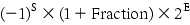

trong đó các bit fraction biểu diễn số từ 0 đến 1 và E xác định giá trị trường exponent, sẽ được trình bày chi tiết ngay sau đây. Nếu đánh số bit fraction từ trái sang phải là s1, s2, s3, … thì giá trị là

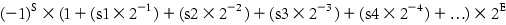

Hình 3.13 cho thấy cách mã hóa số floating-point IEEE 754. Các tính năng khác của IEEE 754 là những ký hiệu đặc biệt biểu diễn sự kiện bất thường. Ví dụ, thay vì ngắt khi chia cho 0, phần mềm có thể đặt kết quả thành bit pattern biểu diễn +∞ hoặc −∞; exponent lớn nhất được dành cho những ký hiệu đặc biệt này. Khi lập trình viên in kết quả, chương trình sẽ xuất ký hiệu vô cực. (Với người học toán, mục đích của vô cực là tạo bao đóng tôpô của tập số thực.)

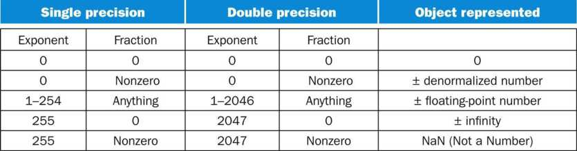

**HÌNH 3.13 Mã hóa số floating-point IEEE 754. Một sign bit riêng quyết định dấu. Số denormalized được mô tả trong phần Giải thích thêm ở trang 216. Thông tin này cũng có trong Cột 4 của RISC-V Reference Data Card ở đầu sách.**

IEEE 754 thậm chí có ký hiệu cho kết quả phép toán không hợp lệ, chẳng hạn 0/0 hoặc trừ vô cực khỏi vô cực. Ký hiệu đó là NaN, viết tắt của Not a Number. Mục đích của NaN là cho phép lập trình viên trì hoãn một số kiểm tra và quyết định tới thời điểm thuận tiện hơn về sau trong chương trình.

Những người thiết kế IEEE 754 cũng muốn một biểu diễn floating-point dễ xử lý bằng phép so sánh số nguyên, nhất là khi sắp xếp. Mong muốn đó là lý do dấu nằm ở bit có trọng số lớn nhất, cho phép kiểm tra nhanh nhỏ hơn, lớn hơn hay bằng 0. (Điều này phức tạp hơn một chút so với sắp xếp số nguyên đơn thuần, vì ký hiệu này về cơ bản là sign and magnitude thay vì two’s complement.)

Đặt exponent trước significand cũng đơn giản hóa việc sắp xếp số floating-point bằng integer comparison instruction, vì số có exponent lớn hơn trông lớn hơn số có exponent nhỏ hơn, miễn là hai exponent cùng dấu.

Exponent âm gây khó khăn cho cách sắp xếp đơn giản này. Nếu dùng two’s complement hay ký hiệu khác mà exponent âm có 1 ở bit có trọng số lớn nhất của trường exponent, exponent âm sẽ trông giống số lớn. Ví dụ, 1.0<sub>two</sub> × 2<sup>−1</sup> sẽ được biểu diễn ở single precision là

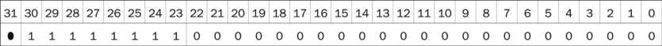

(Nhớ rằng 1 đầu được ngầm định trong significand.) Giá trị 1.0<sub>two</sub> × 2<sup>+1</sup> sẽ trông giống số nhị phân nhỏ hơn

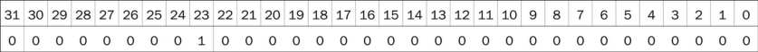

Vì vậy, ký hiệu mong muốn phải biểu diễn exponent âm nhất là 00 … 00<sub>two</sub> và dương nhất là 11 … 11<sub>two</sub>. Quy ước này gọi là biased notation, với bias là số trừ khỏi biểu diễn unsigned thông thường để xác định giá trị thật.

IEEE 754 dùng bias 127 cho single precision, nên exponent −1 được biểu diễn bằng bit pattern của giá trị −1 +127<sub>ten</sub>, hay 126<sub>ten</sub> = 0111 1110<sub>two</sub>, còn +1 được biểu diễn bằng 1 +127, hay 128<sub>ten</sub> = 1000 0000<sub>two</sub>. Bias exponent cho double precision là 1023. Biased exponent nghĩa là giá trị được biểu diễn bởi số floating-point thực sự là

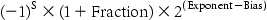

Phạm vi số single precision khi đó từ nhỏ bằng

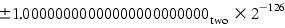

đến lớn bằng

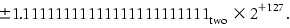

Hãy minh họa.

**Ví dụ**

Hãy cho biểu diễn nhị phân IEEE 754 của số −0.75<sub>ten</sub> ở single precision và double precision.

**Trả lời**

Số −0.75<sub>ten</sub> cũng là

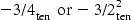

Nó cũng được biểu diễn bằng phân số nhị phân

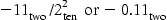

Ở scientific notation, giá trị là

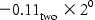

và ở normalized scientific notation, nó là

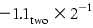

Biểu diễn tổng quát của số single precision là

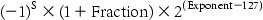

Trừ bias 127 khỏi exponent của −1.1<sub>two</sub> × 2<sup>−1</sup> cho

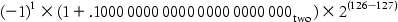

Biểu diễn nhị phân single precision của −0.75<sub>ten</sub> khi đó là

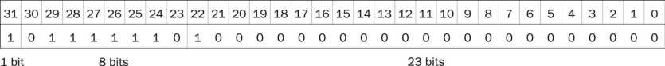

Biểu diễn double precision là

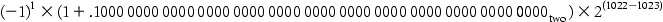

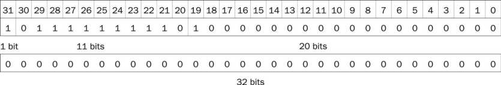

Giờ hãy thử theo hướng ngược lại.

#### Chuyển floating point từ nhị phân sang thập phân

**Ví dụ**

Số float single precision này biểu diễn số thập phân nào?


**Trả lời**

Sign bit là 1, trường exponent chứa 129 và trường fraction chứa 1 ×2<sup>−2</sup> = 1/4, hay 0.25. Dùng phương trình cơ bản,


Trong vài tiểu mục tiếp theo, ta đưa ra thuật toán cộng và nhân floating-point. Về cốt lõi, chúng dùng các phép toán số nguyên tương ứng trên significand, nhưng cần thêm công việc quản lý để xử lý exponent và chuẩn hóa kết quả. Trước tiên ta suy ra thuật toán trực quan ở hệ thập phân, rồi trình bày phiên bản nhị phân chi tiết hơn trong các hình.

#### Giải thích thêm

Theo hướng dẫn IEEE, ủy ban IEEE 754 được tái lập 20 năm sau tiêu chuẩn để xem có cần thay đổi gì không. Tiêu chuẩn sửa đổi IEEE 754-2008 bao gồm gần như toàn bộ IEEE 754-1985 và thêm định dạng 16-bit (“half precision”) cùng định dạng 128-bit (“quadruple precision”). Tiêu chuẩn sửa đổi cũng thêm số học decimal floating point.

#### Giải thích thêm

Nhằm tăng phạm vi mà không lấy bit khỏi significand, một số máy tính trước tiêu chuẩn IEEE 754 dùng cơ số khác 2. Ví dụ, mainframe IBM 360 và 370 dùng cơ số 16. Vì thay đổi exponent IBM một đơn vị nghĩa là dịch significand 4 bit, số cơ số 16 “normalized” có thể có tới 3 bit 0 đầu! Do đó, chữ số hexadecimal có nghĩa phải bỏ tới 3 bit khỏi significand, gây những vấn đề bất ngờ về độ chính xác số học floating-point. Mainframe IBM hiện hỗ trợ IEEE 754 cùng định dạng hex cũ.

### Phép cộng Floating-Point

Hãy cộng bằng tay các số ở scientific notation để minh họa những vấn đề của phép cộng floating-point: 9.999<sub>ten</sub> × 10<sup>1</sup> + 1.610<sub>ten</sub> × 10<sup>−1</sup>. Giả sử chỉ có thể lưu bốn chữ số thập phân của significand và hai chữ số thập phân của exponent.

Bước 1. Để cộng đúng các số này, ta phải căn dấu thập phân của số có exponent nhỏ hơn. Vì vậy, cần dạng của số nhỏ hơn, 1.610<sub>ten</sub> × 10<sup>−1</sup>, khớp với exponent lớn hơn. Ta có được dạng này khi nhận thấy có nhiều biểu diễn của số floating-point chưa normalized ở scientific notation:


Số bên phải là phiên bản ta muốn, vì exponent của nó khớp với exponent của số lớn hơn, 9.999<sub>ten</sub> × 10<sup>1</sup>. Do đó, bước đầu dịch significand của số nhỏ hơn sang phải đến khi exponent đã điều chỉnh khớp exponent số lớn hơn. Nhưng ta chỉ biểu diễn được bốn chữ số thập phân nên sau khi dịch, số thực sự là


Bước 2. Tiếp đến là phép cộng các significand:


Tổng là 10.015<sub>ten</sub> × 10<sup>1</sup>.

Bước 3. Tổng này chưa ở normalized scientific notation, nên ta cần điều chỉnh:


Vì vậy, sau phép cộng ta có thể phải dịch tổng về dạng normalized, điều chỉnh exponent thích hợp. Ví dụ này cho thấy dịch phải, nhưng nếu một số dương và số kia âm, tổng có thể có nhiều số 0 đầu, cần dịch trái. Bất cứ khi nào tăng hoặc giảm exponent, ta phải kiểm tra overflow hoặc underflow—nghĩa là bảo đảm exponent vẫn vừa trong trường của nó.

Bước 4. Vì giả sử significand chỉ dài bốn chữ số (không tính dấu), ta phải làm tròn số. Trong thuật toán tiểu học, quy tắc cắt bỏ phần dư nếu chữ số bên phải vị trí mong muốn nằm từ 0 đến 4, và cộng 1 vào chữ số nếu chữ số bên phải nằm từ 5 đến 9. Số


được làm tròn còn bốn chữ số trong significand thành


vì chữ số thứ tư bên phải dấu thập phân nằm từ 5 đến 9. Chú ý nếu không may khi làm tròn, chẳng hạn cộng 1 vào chuỗi các chữ số 9, tổng có thể không còn normalized và ta cần thực hiện lại bước 3.

Hình 3.14 cho thấy thuật toán cộng floating-point nhị phân theo ví dụ thập phân này. Bước 1 và 2 tương tự ví dụ vừa xét: điều chỉnh significand của số có exponent nhỏ hơn rồi cộng hai significand. Bước 3 chuẩn hóa kết quả, buộc kiểm tra overflow hoặc underflow. Kiểm tra overflow và underflow ở bước 3 phụ thuộc độ chính xác của toán hạng. Nhớ rằng pattern toàn bit 0 ở exponent được dành riêng và dùng cho biểu diễn floating-point của số không. Ngoài ra, pattern toàn bit 1 ở exponent được dành để chỉ các giá trị và tình huống ngoài phạm vi số floating-point bình thường (xem phần Giải thích thêm ở trang 216). Với ví dụ dưới, nhớ rằng ở single precision, exponent lớn nhất là 127 và nhỏ nhất là −126.

#### Phép cộng Floating-Point nhị phân

**Ví dụ**

Hãy thử cộng các số 0.5<sub>ten</sub> và −0.4375<sub>ten</sub> ở nhị phân bằng thuật toán trong Hình 3.14.


**HÌNH 3.14 Phép cộng Floating-point. Luồng thông thường thực hiện bước 3 và 4 một lần, nhưng nếu làm tròn khiến tổng chưa normalized, phải lặp lại bước 3.**

**Trả lời**

Trước tiên hãy xem phiên bản nhị phân của hai số ở normalized scientific notation, giả sử giữ độ chính xác 4 bit:


Giờ ta làm theo thuật toán:

Bước 1. Significand của số có exponent nhỏ hơn (−1.11<sub>two</sub> × 2<sup>−2</sup>) được dịch phải đến khi exponent khớp với số lớn hơn:


Bước 2. Cộng các significand:


Bước 3. Chuẩn hóa tổng, kiểm tra overflow hoặc underflow:


Vì 127 ≥−4 ≥−126, không có overflow hoặc underflow. (Biased exponent là −4 +127, hay 123, nằm giữa 1 và 254, các biased exponent nhỏ nhất và lớn nhất không được dành riêng.)

Bước 4. Làm tròn tổng:


Tổng đã vừa chính xác trong 4 bit, nên không có thay đổi bit do làm tròn.

Tổng này khi đó là


Đây là tổng ta mong đợi khi cộng 0.5<sub>ten</sub> với −0.4375<sub>ten</sub>.

Nhiều máy tính dành riêng phần cứng để chạy các phép toán floating-point nhanh nhất có thể. Hình 3.15 phác thảo tổ chức cơ bản của phần cứng cộng floating-point.


**HÌNH 3.15 Sơ đồ khối của arithmetic unit dành riêng cho phép cộng floating-point. Các bước trong Hình 3.14 tương ứng với mỗi khối từ trên xuống dưới. Đầu tiên, exponent của toán hạng này được trừ khỏi toán hạng kia bằng ALU nhỏ để xác định cái nào lớn hơn và lớn hơn bao nhiêu. Hiệu này điều khiển ba multiplexor; từ trái sang phải, chúng chọn exponent lớn hơn, significand của số nhỏ hơn và significand của số lớn hơn. Significand nhỏ hơn được dịch phải, rồi các significand được cộng bằng ALU lớn. Bước chuẩn hóa sau đó dịch tổng trái hoặc phải và tăng hoặc giảm exponent. Làm tròn tạo kết quả cuối, có thể cần chuẩn hóa lại để tạo kết quả cuối thực sự.**

### Phép nhân Floating-Point

Giờ khi đã giải thích phép cộng floating-point, hãy thử phép nhân floating-point. Ta bắt đầu bằng việc nhân bằng tay các số thập phân ở scientific notation: 1.110<sub>ten</sub> × 10<sup>10</sup> × 9.200<sub>ten</sub> × 10<sup>−5</sup>. Giả sử chỉ lưu được bốn chữ số significand và hai chữ số exponent.

Bước 1. Khác phép cộng, ta tính exponent của product chỉ bằng cách cộng các exponent toán hạng:


Hãy làm điều này với biased exponent để bảo đảm có cùng kết quả: 10 +127 =137, và −5 +127 =122, nên


Kết quả này quá lớn cho trường exponent 8-bit, nên có điều không đúng! Vấn đề nằm ở bias vì ta cộng cả bias lẫn exponent:


Do đó, để có tổng biased đúng khi cộng các số biased, ta phải trừ bias khỏi tổng:


và 5 đúng là exponent đã tính lúc đầu.

Bước 2. Tiếp đến là nhân các significand:


Mỗi toán hạng có ba chữ số bên phải dấu thập phân, nên dấu thập phân được đặt cách bên phải sáu chữ số trong significand của product:


Nếu chỉ giữ ba chữ số bên phải dấu thập phân, product là 10.212 ×10<sup>5</sup>.

Bước 3. Product này chưa normalized, nên cần chuẩn hóa:


Vì vậy, sau phép nhân, product có thể dịch phải một chữ số để đưa về dạng normalized, cộng 1 vào exponent. Tại đây có thể kiểm tra overflow và underflow. Underflow có thể xảy ra nếu cả hai toán hạng nhỏ—nghĩa là cả hai có exponent âm với độ lớn lớn.

Bước 4. Ta giả sử significand chỉ dài bốn chữ số (không tính dấu), nên phải làm tròn số. Số


được làm tròn còn bốn chữ số trong significand thành


Bước 5. Dấu product phụ thuộc dấu các toán hạng ban đầu. Nếu chúng cùng dấu, dấu product dương; nếu không, nó âm. Do đó, product là


Dấu của tổng trong thuật toán cộng được quyết định bởi phép cộng significand, nhưng trong phép nhân, dấu toán hạng quyết định dấu product.

Một lần nữa, như Hình 3.16 cho thấy, phép nhân số floating-point nhị phân khá giống các bước vừa hoàn thành. Ta bắt đầu tính exponent mới của product bằng cách cộng biased exponent, bảo đảm trừ một bias để có kết quả đúng. Tiếp theo là nhân significand, rồi bước chuẩn hóa nếu cần. Kích thước exponent được kiểm tra overflow hoặc underflow, sau đó product được làm tròn. Nếu làm tròn dẫn tới chuẩn hóa thêm, ta lại kiểm tra kích thước exponent. Cuối cùng, đặt sign bit bằng 1 nếu các toán hạng khác dấu (product âm) hoặc bằng 0 nếu cùng dấu (product dương).


**HÌNH 3.16 Phép nhân Floating-point. Luồng thông thường thực hiện bước 3 và 4 một lần, nhưng nếu làm tròn khiến tổng chưa normalized, phải lặp lại bước 3.**

#### Phép nhân Floating-Point nhị phân

**Ví dụ**

Hãy thử nhân các số 0.5<sub>ten</sub> và −0.4375<sub>ten</sub>, dùng các bước trong Hình 3.16.

**Trả lời**

Ở hệ nhị phân, nhiệm vụ là nhân 1.000<sub>two</sub> × 2<sup>−1</sup> với −1.110<sub>two</sub> × 2<sup>−2</sup>.

Bước 1. Cộng các exponent không có bias:


hoặc dùng biểu diễn biased:


Bước 2. Nhân các significand:


Product là 1.110000<sub>two</sub> × 2<sup>−3</sup>, nhưng cần giữ trong 4 bit, nên nó là 1.110<sub>two</sub> × 2<sup>−3</sup>.

Bước 3. Giờ kiểm tra product để bảo đảm normalized, rồi kiểm tra exponent về overflow hoặc underflow. Product đã normalized và vì 127 ≥−3 ≥−126, không có overflow hay underflow. (Dùng biểu diễn biased, 254 ≥124 ≥1, nên exponent vừa.)

Bước 4. Làm tròn product không tạo thay đổi:


Bước 5. Vì các toán hạng ban đầu khác dấu, đặt dấu product âm. Do đó, product là


Chuyển sang thập phân để kiểm tra kết quả:


Tích của 0.5<sub>ten</sub> và −0.4375<sub>ten</sub> đúng là −0.21875<sub>ten</sub>.

### Instruction Floating-Point trong RISC-V

RISC-V hỗ trợ các định dạng single-precision và double-precision IEEE 754 bằng những instruction sau:

- Phép cộng Floating-point, single (fadd.s) và cộng, double (fadd.d)

- Phép trừ Floating-point, single (fsub.s) và trừ, double (fsub.d)

- Phép nhân Floating-point, single (fmul.s) và nhân, double (fmul.d)

- Phép chia Floating-point, single (fdiv.s) và chia, double (fdiv.d)

- Căn bậc hai Floating-point, single (fsqrt.s) và căn bậc hai, double (fsqrt.d)

- So sánh bằng Floating-point, single (feq.s) và so sánh bằng, double (feq.d)

- So sánh less-than Floating-point, single (flt.s) và less-than, double (flt.d)

- So sánh less-than-or-equals Floating-point, single (fle.s) và less-than-or-equals, double (fle.d)

Các comparison instruction feq, flt và fle đặt integer register bằng 0 nếu so sánh sai và bằng 1 nếu đúng. Vì thế, phần mềm có thể branch theo kết quả so sánh floating-point bằng các integer branch instruction beq và bne.

Những người thiết kế RISC-V quyết định thêm các floating-point register riêng. Chúng gọi là f0, f1, …, f31. Do đó, họ đưa vào các load và store riêng cho floating-point register: fld và fsd cho double-precision, flw và fsw cho single-precision. Base register dùng làm địa chỉ cho truyền dữ liệu floating-point vẫn là integer register. Code RISC-V để load hai số single precision từ bộ nhớ, cộng chúng rồi store tổng có thể như sau:

```
 flw f0, 0(x10) // Load 32-bit F.P. number into f0
 flw f1, 4(x10) // Load 32-bit F.P. number into f1
 fadd.s f2, f0, f1 // f2 = f0 + f1, single precision
 fsw f2, 8(x10) // Store 32-bit F.P. number from f2
```

Single precision register chỉ là nửa dưới của double-precision register. Chú ý khác với integer register x0, floating-point register f0 không được hard-wired vào hằng số 0.

Hình 3.17 tổng kết phần floating-point của kiến trúc RISC-V được giới thiệu trong chương này, với các phần mới hỗ trợ floating point tô màu. Các floating-point instruction dùng cùng định dạng với các instruction số nguyên tương ứng: load dùng định dạng I-type, store dùng S-type và arithmetic instruction dùng R-type.


**HÌNH 3.17 Kiến trúc floating-point RISC-V đã giới thiệu đến đây. Thông tin này cũng có ở cột 2 của RISC-V Reference Data Card ở đầu sách.**

#### Giao diện phần cứng/phần mềm

Một vấn đề mà kiến trúc sư gặp khi hỗ trợ số học floating-point là chọn cùng các register dùng bởi integer instruction hay thêm một tập đặc biệt cho floating point. Vì chương trình thường thực hiện phép toán số nguyên và floating-point trên các dữ liệu khác nhau, tách register chỉ làm tăng nhẹ số instruction cần để chạy chương trình. Tác động chính là tạo một tập data transfer instruction riêng để chuyển dữ liệu giữa floating-point register và bộ nhớ.

Lợi ích của floating-point register riêng là có số register gấp đôi mà không tiêu tốn thêm bit trong định dạng instruction, có băng thông register gấp đôi nhờ các tập integer register và floating-point register riêng, và có thể tùy biến register cho floating point; ví dụ, một số máy tính chuyển toán hạng mọi kích thước trong register thành một định dạng nội bộ duy nhất.

#### Biên dịch chương trình C Floating-Point thành assembly code RISC-V

**Ví dụ**

Hãy chuyển nhiệt độ từ Fahrenheit sang Celsius:

```
float f2c (float fahr)
  {
   return ((5.0f/9.0f) *(fahr – 32.0f));
  }
```

Giả sử đối số floating-point fahr được truyền trong f10 và kết quả cũng cần vào f10. Assembly code RISC-V là gì?

**Trả lời**

Ta giả sử compiler đặt ba hằng floating-point trong bộ nhớ ở vị trí register x3 dễ truy cập. Hai instruction đầu load các hằng 5.0 và 9.0 vào floating-point register:

```
f2c:
  flw f0, const5(x3) // f0 = 5.0f
  flw f1, const9(x3) // f1 = 9.0f
```

Sau đó chúng được chia để thu phân số 5.0/9.0:

```
fdiv.s f0, f0, f1 // f0 = 5.0f / 9.0f
```

(Nhiều compiler sẽ chia 5.0 cho 9.0 lúc biên dịch và lưu một hằng 5.0/9.0 trong bộ nhớ, nhờ đó tránh phép chia lúc chạy.) Tiếp theo, ta load hằng 32.0 rồi trừ nó khỏi fahr (f10):

```
flw f1, const32(x3) // f1 = 32.0f
fsub.s f10, f10, f1 // f10 = fahr – 32.0f
```

Cuối cùng, ta nhân hai kết quả trung gian, đặt product vào f10 làm kết quả trả về, rồi return

```
fmul.s f10, f0, f10 // f10 = (5.0f / 9.0f)*(fahr – 32.0f)
jalr x0, 0(x1)  // return
```

Giờ hãy thực hiện các phép toán floating-point trên ma trận, kiểu code thường gặp trong chương trình khoa học.

#### Biên dịch procedure C Floating-Point với ma trận Two-Dimensional sang RISC-V

**Ví dụ**

Phần lớn phép tính floating-point thực hiện ở double precision. Hãy per-form phép nhân ma trận C =C +A * B. Phép này thường gọi là DGEMM, viết tắt của Double precision, General Matrix Multiply. Ta sẽ gặp lại các phiên bản DGEMM trong Mục 3.8 và tiếp đó trong Chương 4, 5 và 6. Giả sử C, A và B đều là ma trận vuông với 32 phần tử ở mỗi chiều.

```
void mm (double c[][], double a[][], double b[][])
{
  size_t i, j, k;
  for (i = 0; i < 32; i = i + 1)
  for (j = 0; j < 32; j = j + 1)
  for (k = 0; k < 32; k = k + 1)
   c[i][j] = c[i][j] + a[i][k] *b[k][j];
}
```

Địa chỉ bắt đầu các mảng là tham số, nên chúng ở x10, x11 và x12. Giả sử các biến số nguyên lần lượt ở x5, x6 và x7. Assembly code RISC-V cho thân procedure là gì?

**Trả lời**

Chú ý c[i][j] được dùng trong vòng lặp trong cùng phía trên. Vì chỉ số vòng lặp là k, chỉ số không ảnh hưởng c[i][j], nên ta có thể tránh load và store c[i][j] mỗi vòng lặp. Thay vào đó, compiler load c[i][j] vào register bên ngoài vòng lặp, tích lũy tổng các tích a[i][k] và b[k][j] trong cùng register đó, rồi store tổng vào c[i][j] khi vòng lặp trong cùng kết thúc. Ta giữ code đơn giản hơn bằng assembly language pseudoinstruction li, dùng để load hằng số vào register.

Thân procedure bắt đầu bằng việc lưu giá trị kết thúc vòng lặp 32 trong temporary register rồi khởi tạo ba biến vòng lặp for:

```
  mm:...
   li x28, 32  // x28 = 32 (row size/loop end)
   li x5, 0  // i = 0; initialize 1st for loop
L1: li x6, 0  // j = 0; initialize 2nd for loop
L2: li x7, 0  // k = 0; initialize 3rd for loop
```

Để tính địa chỉ c[i][j], cần biết mảng two-dimensional 32 ×32 được lưu thế nào trong bộ nhớ. Như bạn mong đợi, bố cục giống như có 32 mảng single-dimensional, mỗi mảng 32 phần tử. Vì vậy, bước đầu là bỏ qua i “mảng single-dimensional”, hay hàng, để tới hàng ta muốn. Do đó, ta nhân chỉ số chiều thứ nhất với kích thước hàng, 32. Vì 32 là lũy thừa của 2, ta có thể dùng phép dịch thay thế:

```
slli x30, x5, 5  // x30 = i * 2<sup>5</sup>(size of row of c)
```

Giờ ta cộng chỉ số thứ hai để chọn phần tử thứ j của hàng mong muốn:

```
add x30, x30, x6  // x30 = i * size(row) + j
```

Để biến tổng này thành chỉ số byte, ta nhân nó với kích thước một phần tử ma trận tính bằng byte. Vì mỗi phần tử double precision dài 8 byte, ta có thể thay bằng dịch trái ba bit:

```
slli x30, x30, 3  // x30 = byte offset of [i][j]
```

Tiếp theo ta cộng tổng này với địa chỉ cơ sở của c, cho địa chỉ c[i][j], rồi load số double precision c[i][j] vào f0:

```
add x30, x10, x30  // x30 = byte address of c[i][j]
fld f0, 0(x30)  // f0 = 8 bytes of c[i][j]
```

Năm instruction sau gần như giống năm instruction vừa rồi: tính địa chỉ rồi load số double precision b[k][j].

```
L3: slli x29, x7, 5  // x29 = k * 2<sup>5</sup>(size of row of b)
  add x29, x29, x6  // x29 = k * size(row) + j
  slli x29, x29, 3  // x29 = byte offset of [k][j]
  add x29, x12, x29 // x29 = byte address of b[k][j]
  fld f1, 0(x29)  // f1 = 8 bytes of b[k][j]
```

Tương tự, năm instruction tiếp theo giống năm instruction vừa rồi: tính địa chỉ rồi load số double precision a[i][k].

```
slli x29, x5, 5  // x29 = i * 2<sup>5</sup>(size of row of a)
add x29, x29, x7 // x29 = i * size(row) + k
slli x29, x29, 3  // x29 = byte offset of [i][k]
add x29, x11, x29 // x29 = byte address of a[i][k]
fld f2, 0(x29) // f2 = a[i][k]
```

Giờ đã load mọi dữ liệu, cuối cùng ta sẵn sàng thực hiện một số phép toán floating-point! Ta nhân các phần tử của a và b nằm trong register f2 và f1, rồi tích lũy tổng vào f0.

```
fmul.d f1, f2, f1 // f1 = a[i][k] * b[k][j]
fadd.d f0, f0, f1  // f0 = c[i][j] + a[i][k] * b[k][j]
```

Khối cuối tăng chỉ số k và lặp lại nếu chỉ số không bằng 32. Nếu bằng 32, tức vòng lặp trong cùng đã kết thúc, ta cần store tổng tích lũy trong f0 vào c[i][j].

```
addi x7, x7, 1 // k = k + 1
bltu x7, x28, L3  // if (k < 32) go to L3
fsd f0, 0(x30)  // c[i][j] = f0
```

Tương tự, sáu instruction cuối này tăng biến chỉ số của vòng lặp giữa và ngoài cùng, lặp lại nếu chỉ số không bằng 32 và thoát nếu chỉ số bằng 32.

```
addi x6, x6, 1 // j = j + 1
bltu x6, x28, L2  // if (j < 32) go to L2
addi x5, x5, 1 // i = i + 1
bltu x5, x28, L1  // if (i < 32) go to L1
. . .
```

Nhìn trước một chút, Hình 3.20 bên dưới cho thấy code assembly language x86 cho phiên bản DGEMM hơi khác trong Hình 3.19.

#### Giải thích thêm

C và nhiều ngôn ngữ lập trình khác dùng bố cục mảng đã xét trong ví dụ, gọi là row-major order. Ngược lại, Fortran dùng column-major order, trong đó mảng được lưu lần lượt từng cột.

#### Giải thích thêm

Lý do khác để tách integer register và floating-point register là các microprocessor thập niên 1980 không có đủ transistor để đặt floating-point unit trên cùng chip với integer unit. Do đó, floating-point unit, bao gồm floating-point register, được cung cấp tùy chọn dưới dạng chip thứ hai. Những chip tăng tốc tùy chọn như vậy gọi là coprocessor chip. Từ đầu thập niên 1990, microprocessor tích hợp floating point (và gần như mọi thứ khác) trên chip, nên thuật ngữ coprocessor chip cùng accumulator và core memory trở thành những từ cổ cho thấy tuổi tác người nói.

#### Giải thích thêm

Như đề cập trong Mục 3.4, tăng tốc phép chia khó hơn phép nhân. Ngoài SRT, một kỹ thuật khác tận dụng multiplier nhanh là phép lặp Newton, trong đó phép chia được chuyển thành tìm nghiệm của một hàm để tạo nghịch đảo 1/c, rồi nhân với toán hạng kia. Các kỹ thuật lặp không thể làm tròn đúng nếu không tính nhiều bit bổ sung. Một chip TI giải quyết vấn đề bằng cách tính nghịch đảo extra-precise.

#### Giải thích thêm

Java nêu đích danh IEEE 754 trong định nghĩa các kiểu dữ liệu và phép toán floating-point của Java. Vì thế, code trong ví dụ đầu hoàn toàn có thể được sinh cho một class method chuyển Fahrenheit sang Celsius.

Ví dụ thứ hai phía trên dùng mảng nhiều chiều, vốn không được Java hỗ trợ tường minh. Java cho phép mảng của mảng, nhưng mỗi mảng có thể có chiều dài riêng, khác mảng nhiều chiều trong C. Giống các ví dụ Chương 2, phiên bản Java của ví dụ thứ hai cần khá nhiều code kiểm tra biên mảng, gồm tính chiều dài mới ở cuối các truy cập hàng. Nó cũng cần kiểm tra object reference không phải null.

### Số học chính xác

Khác số nguyên có thể biểu diễn chính xác mọi số giữa số nhỏ nhất và lớn nhất, số floating-point thường là xấp xỉ của số mà nó không thực sự biểu diễn được. Lý do là tồn tại vô hạn số thực khác nhau giữa, chẳng hạn, 1 và 2, nhưng không quá 2<sup>53</sup> số có thể biểu diễn chính xác trong double precision floating point. Điều tốt nhất có thể làm là đưa biểu diễn floating-point gần số thực tế. Do đó, IEEE 754 cung cấp vài chế độ làm tròn để lập trình viên chọn xấp xỉ mong muốn.

Làm tròn nghe có vẻ đơn giản, nhưng làm tròn chính xác đòi hỏi phần cứng tính thêm bit trong phép tính. Ở các ví dụ trước, ta chưa nói rõ số bit mà biểu diễn trung gian có thể chiếm, nhưng rõ ràng nếu mọi kết quả trung gian bị cắt về đúng số chữ số, sẽ không có cơ hội làm tròn. Vì thế IEEE 754 luôn giữ thêm hai bit bên phải trong các phép cộng trung gian, lần lượt gọi là guard và round. Hãy làm ví dụ thập phân để minh họa giá trị của chúng.

#### guard

Bit đầu tiên trong hai bit bổ sung giữ bên phải khi tính trung gian số floating-point; dùng để cải thiện độ chính xác làm tròn.

#### round

Phương pháp làm cho kết quả floating-point trung gian vừa định dạng floating-point; mục tiêu thường là tìm số gần nhất có thể biểu diễn ở định dạng. Đây cũng là tên bit thứ hai trong hai bit bổ sung giữ bên phải khi tính floating-point trung gian, giúp cải thiện độ chính xác làm tròn.

#### Làm tròn với chữ số guard

**Ví dụ**

Cộng 2.56<sub>ten</sub> × 10<sup>0</sup> với 2.34<sub>ten</sub> × 10<sup>2</sup>, giả sử có ba chữ số thập phân có nghĩa. Làm tròn tới số thập phân gần nhất có ba chữ số thập phân có nghĩa, trước tiên có guard digit và round digit, rồi không có chúng.

**Trả lời**

Trước hết phải dịch số nhỏ hơn sang phải để căn exponent, nên 2.56<sub>ten</sub> × 10<sup>0</sup> trở thành 0.0256<sub>ten</sub> × 10<sup>2</sup>. Vì có guard digit và round digit, ta biểu diễn được hai chữ số ít có trọng số nhất khi căn exponent. Guard digit giữ 5 và round digit giữ 6. Tổng là


Vì vậy tổng là 2.3656<sub>ten</sub> × 10<sup>2</sup>. Vì có hai chữ số để làm tròn, ta muốn các giá trị 0 tới 49 làm tròn xuống và 51 tới 99 làm tròn lên, với 50 là trường hợp phân định. Làm tròn tổng lên với ba chữ số có nghĩa cho 2.37<sub>ten</sub> × 10<sup>2</sup>.

Thực hiện mà không có guard digit và round digit loại bỏ hai chữ số khỏi phép tính. Tổng mới khi đó là


Đáp án là 2.36<sub>ten</sub> × 10<sup>2</sup>, lệch 1 ở chữ số cuối so với tổng phía trên.

Vì trường hợp làm tròn xấu nhất là khi số thực tế nằm chính giữa hai biểu diễn floating-point, độ chính xác floating point thường đo bằng số bit sai ở các bit ít có trọng số nhất của significand; phép đo gọi là số units in the last place, hay ulp. Nếu một số lệch 2 ở các bit ít có trọng số nhất, ta nói lệch 2 ulp. Miễn không có exception overflow, underflow hay invalid operation, IEEE 754 bảo đảm máy tính dùng số nằm trong one-half ulp.

#### units in the last place (ulp)

Số bit sai ở các bit ít có trọng số nhất của significand giữa số thực tế và số có thể biểu diễn.

#### Giải thích thêm

Mặc dù ví dụ trên thực sự chỉ cần thêm một chữ số, phép nhân có thể cần hai. Product nhị phân có thể có một bit 0 đầu; do đó bước chuẩn hóa phải dịch product trái một bit. Việc này dịch guard digit vào bit ít có trọng số nhất của product, để lại round bit giúp làm tròn product chính xác.

IEEE 754 có bốn chế độ làm tròn: luôn làm tròn lên (về +∞), luôn làm tròn xuống (về −∞), cắt bỏ và làm tròn tới số chẵn gần nhất. Chế độ cuối quyết định làm gì khi số nằm chính giữa. Sở Thuế vụ Hoa Kỳ (IRS) luôn làm tròn 0.50 đô la lên, có thể có lợi cho IRS. Cách công bằng hơn là làm tròn lên trong nửa số trường hợp và xuống trong nửa còn lại. IEEE 754 quy định nếu bit ít có trọng số nhất được giữ lại trong trường hợp chính giữa là lẻ, cộng một; nếu chẵn, cắt bỏ. Phương pháp này luôn tạo 0 ở bit ít có trọng số nhất trong trường hợp tie-breaking, từ đó có tên chế độ làm tròn. Đây là chế độ được dùng phổ biến nhất và duy nhất Java hỗ trợ.

Mục tiêu các bit làm tròn bổ sung là để máy tính có kết quả giống như kết quả trung gian được tính với độ chính xác vô hạn rồi làm tròn. Để hỗ trợ mục tiêu này và làm tròn tới số chẵn gần nhất, tiêu chuẩn có bit thứ ba ngoài guard và round; nó được đặt bất cứ khi nào có bit khác không bên phải round bit. Sticky bit này cho phép máy tính phân biệt 0.50 … 00<sub>ten</sub> và 0.50 … 01<sub>ten</sub> khi làm tròn.

#### sticky bit

Bit dùng trong làm tròn bên cạnh guard và round, được đặt bất cứ khi nào có bit khác không bên phải round bit.

Ví dụ, sticky bit có thể được đặt trong phép cộng khi số nhỏ hơn được dịch phải. Giả sử cộng 5.01<sub>ten</sub> × 10<sup>−1</sup> với 2.34<sub>ten</sub> × 10<sup>2</sup> trong ví dụ trên. Ngay cả với guard và round, ta vẫn cộng 0.0050 với 2.34, cho tổng 2.3450. Sticky bit sẽ được đặt vì có bit khác không bên phải. Không có sticky bit để nhớ bit 1 nào đã dịch ra ngoài hay chưa, ta sẽ giả sử số bằng 2.345000 … 00 và làm tròn tới số chẵn gần nhất là 2.34. Với sticky bit ghi nhớ số lớn hơn 2.345000 … 00, thay vào đó ta làm tròn thành 2.35.

#### Giải thích thêm

Các kiến trúc RISC-V, MIPS-64, PowerPC, SPARC64, AMD SSE5 và Intel AVX đều cung cấp một instruction duy nhất thực hiện nhân và cộng trên ba register: a=a+(b×c). Rõ ràng instruction này có thể mang lại hiệu năng floating-point cao hơn cho phép toán phổ biến này. Cũng quan trọng như vậy, thay vì làm tròn hai lần—sau phép nhân rồi sau phép cộng—như khi dùng các instruction riêng, instruction multiply add có thể làm tròn một lần sau phép cộng. Một bước làm tròn làm tăng độ chính xác multiply add. Những phép toán chỉ làm tròn một lần như vậy gọi là fused multiply add. Nó được thêm vào tiêu chuẩn sửa đổi IEEE 754-2008 (xem  Mục 3.11).

#### fused multiply add

Một instruction floating-point thực hiện cả nhân lẫn cộng, nhưng chỉ làm tròn một lần sau phép cộng.

### Tổng kết

Phần Bức tranh toàn cảnh tiếp theo củng cố khái niệm stored-program từ Chương 2; không thể xác định ý nghĩa thông tin chỉ bằng cách nhìn các bit, vì cùng các bit có thể biểu diễn nhiều đối tượng khác nhau. Mục này cho thấy số học máy tính là hữu hạn và do đó có thể khác số học tự nhiên. Ví dụ, biểu diễn floating-point tiêu chuẩn IEEE 754


gần như luôn là xấp xỉ của số thực. Hệ thống máy tính phải chú ý giảm thiểu khoảng cách giữa số học máy tính và số học thế giới thực, và đôi lúc lập trình viên cần nhận thức các hệ quả của xấp xỉ này.

#### Bức tranh TOÀN CẢNH

Bit pattern không có ý nghĩa vốn có. Chúng có thể biểu diễn số nguyên signed, số nguyên unsigned, số floating-point, instruction, chuỗi ký tự, v.v. Nội dung được biểu diễn phụ thuộc instruction thao tác trên các bit trong word.

Khác biệt chính giữa số máy tính và số trong thế giới thực là số máy tính có kích thước giới hạn nên độ chính xác cũng giới hạn; có thể tính ra số quá lớn hoặc quá nhỏ để biểu diễn trong word máy tính. Lập trình viên phải nhớ những giới hạn này và viết chương trình cho phù hợp.


#### Giao diện phần cứng/phần mềm

Ở chương trước, ta đã trình bày các storage class của ngôn ngữ C (xem phần Giao diện phần cứng/phần mềm trong Mục 2.7). Bảng trên cho thấy một số kiểu dữ liệu C và Java, các data transfer instruction và instruction thao tác trên những kiểu ấy xuất hiện trong Chương 2 và chương này. Chú ý Java bỏ qua số nguyên unsigned.

#### Tự kiểm tra

Tiêu chuẩn sửa đổi IEEE 754-2008 thêm định dạng floating-point 16-bit với năm bit exponent. Bạn nghĩ phạm vi số có thể biểu diễn nhiều khả năng là gì?

1. 1.0000 00 ×2<sup>0</sup> đến 1.1111 1111 11 ×2<sup>31</sup>, 0

2. ±1.0000 0000 0 ×2<sup>−14</sup> đến ±1.1111 1111 1 ×2<sup>15</sup>, ±0, ±∞, NaN

3. ±1.0000 0000 00 ×2<sup>−14</sup> đến ±1.1111 1111 11 ×2<sup>15</sup>, ±0, ±∞, NaN

4. ±1.0000 0000 00 ×2<sup>−15</sup> đến ±1.1111 1111 11 ×2<sup>14</sup>, ±0, ±∞, NaN

#### Giải thích thêm

Để hỗ trợ so sánh có thể chứa NaN, tiêu chuẩn đưa vào ordered và unordered làm tùy chọn so sánh. RISC-V không cung cấp instruction cho so sánh unordered, nhưng một chuỗi so sánh ordered được bố trí cẩn thận có cùng tác dụng. (Java không hỗ trợ so sánh unordered.)

Nhằm tận dụng từng bit chính xác từ phép toán floating-point, tiêu chuẩn cho phép một số số được biểu diễn ở dạng chưa normalized. Thay vì có khoảng trống giữa 0 và số normalized nhỏ nhất, IEEE cho phép số denormalized (cũng gọi là denorm hoặc subnormal). Chúng có cùng exponent với zero nhưng fraction khác không. Chúng cho phép độ có nghĩa của số giảm dần đến khi thành 0, gọi là gradual underflow. Ví dụ, số normalized single precision dương nhỏ nhất là


nhưng số denormalized single precision nhỏ nhất là


Với double precision, khoảng denorm đi từ 1.0 ×2<sup>−1022</sup> tới 1.0 ×2<sup>−1074</sup>.

Khả năng thỉnh thoảng có toán hạng chưa normalized khiến người thiết kế floating-point đau đầu khi cố xây dựng floating-point unit nhanh. Do đó, nhiều máy tính gây exception nếu toán hạng denormalized, để phần mềm hoàn tất phép toán. Mặc dù triển khai phần mềm hoàn toàn hợp lệ, hiệu năng thấp hơn làm giảm sự phổ biến của denorm trong phần mềm floating-point có tính di động. Hơn nữa, nếu không dự kiến denorm, lập trình viên có thể bất ngờ với chương trình của mình.

## 3.6 Tính song song và số học máy tính: Subword Parallelism

Vì mọi microprocessor trong điện thoại, máy tính bảng hay laptop theo định nghĩa đều có màn hình đồ họa riêng, khi ngân sách transistor tăng lên, việc bổ sung hỗ trợ phép toán đồ họa là tất yếu.

Ban đầu nhiều hệ thống đồ họa dùng 8 bit biểu diễn mỗi màu trong ba màu cơ bản, cộng 8 bit cho vị trí pixel. Việc thêm loa và microphone cho hội nghị từ xa và trò chơi điện tử gợi ý hỗ trợ cả âm thanh. Mẫu âm thanh cần hơn 8 bit độ chính xác, nhưng 16 bit là đủ.

Mọi microprocessor có hỗ trợ đặc biệt để byte và halfword chiếm ít chỗ hơn khi lưu trong bộ nhớ (xem Mục 2.9), nhưng vì ít gặp phép toán số học trên những kích thước dữ liệu này trong chương trình số nguyên điển hình, ngoài truyền dữ liệu thì ít có hỗ trợ. Kiến trúc sư nhận ra nhiều ứng dụng đồ họa và âm thanh thực hiện cùng phép toán trên các vector dữ liệu này. Bằng cách phân chia carry chain trong adder 128-bit, processor có thể dùng tính song song để thực hiện đồng thời các phép toán trên vector ngắn gồm mười sáu toán hạng 8-bit, tám toán hạng 16-bit, bốn toán hạng 32-bit hoặc hai toán hạng 64-bit.


Chi phí của adder phân chia như vậy nhỏ nhưng mức tăng tốc có thể lớn.

Vì tính song song diễn ra bên trong một word rộng, các extension được phân loại là subword parallelism. Nó cũng thuộc tên tổng quát hơn là data level parallelism. Chúng còn được biết là vector hoặc SIMD, viết tắt của single instruction, multiple data (xem Mục 6.6). Sự phổ biến gia tăng của ứng dụng multimedia dẫn đến các arithmetic instruction hỗ trợ phép toán hẹp hơn có thể dễ dàng tính song song. Tại thời điểm viết, RISC-V chưa có instruction bổ sung để khai thác subword parallelism, nhưng mục tiếp theo trình bày ví dụ real-world của kiến trúc như vậy.

## 3.7 Thực tế: Streaming SIMD Extensions và Advanced Vector Extensions trong x86

MMX (MultiMedia eXtension) ban đầu cho x86 có các instruction thao tác trên vector số nguyên ngắn. Sau đó, SSE (Streaming SIMD Extension) cung cấp instruction thao tác trên vector ngắn chứa số floating-point single-precision. Chương 2 lưu ý năm 2001 Intel thêm 144 instruction vào kiến trúc trong SSE2, bao gồm floating-point register và phép toán double precision. Nó có tám register 64-bit dùng cho toán hạng floating-point. AMD mở rộng số lượng thành 16 register gọi là XMM trong AMD64, được Intel đổi nhãn thành EM64T để sử dụng. Hình 3.18 tổng kết instruction SSE và SSE2.


**HÌNH 3.18 Các instruction floating-point SSE/SSE2 của x86. xmm nghĩa là một toán hạng là SSE2 register 128-bit, và {mem|xmm} nghĩa là toán hạng kia ở bộ nhớ hoặc là SSE2 register. Bảng dùng regular expression để chỉ các biến thể instruction. Do đó, MOV[AU]{SS|PS|SD|PD} biểu diễn tám instruction**

```
      MOVASS,MOVAPS,MOVASD,MOVAPD,MOVUSS,MOVUPS,MOVUSD,
```

và MOVUPD. Ta dùng ngoặc vuông [] để chỉ các lựa chọn single-letter: A nghĩa là toán hạng 128-bit được căn chỉnh trong bộ nhớ; U nghĩa là toán hạng 128-bit chưa căn chỉnh trong bộ nhớ; H nghĩa là chuyển nửa cao của toán hạng 128-bit; và L nghĩa là chuyển nửa thấp của toán hạng 128-bit. Ta dùng ngoặc nhọn {} với thanh đứng | để chỉ các biến thể nhiều chữ cái của phép toán cơ bản: SS viết tắt của Scalar Single precision floating point, hay một toán hạng 32-bit trong register 128-bit; PS viết tắt của Packed Single precision floating point, hay bốn toán hạng 32-bit trong register 128-bit; SD viết tắt của Scalar Double precision floating point, hay một toán hạng 64-bit trong register 128-bit; PD viết tắt của Packed Double precision floating point, hay hai toán hạng 64-bit trong register 128-bit.

Ngoài giữ một số single precision hoặc double precision trong register, Intel cho phép đóng gói nhiều toán hạng floating-point vào một SSE2 register 128-bit: bốn single precision hoặc hai double precision. Vì thế, 16 floating-point register cho SSE2 thực sự rộng 128 bit. Nếu các toán hạng có thể sắp trong bộ nhớ thành dữ liệu được căn chỉnh 128-bit, truyền dữ liệu 128-bit có thể load và store nhiều toán hạng mỗi instruction. Định dạng floating-point đóng gói này được hỗ trợ bởi các phép toán số học có thể tính đồng thời trên bốn số single (PS) hoặc hai số double (PD).

Năm 2011, Intel lại tăng gấp đôi chiều rộng register, giờ gọi là YMM, với Advanced Vector Extensions (AVX). Vì vậy, một phép toán giờ có thể chỉ định tám phép toán floating-point 32-bit hoặc bốn phép toán floating-point 64-bit. Các instruction SSE và SSE2 cũ giờ thao tác trên 128 bit thấp của YMM register. Do đó, để chuyển từ phép toán 128-bit sang 256-bit, bạn thêm chữ “v” (vector) trước phép toán assembly language SSE2 rồi dùng tên YMM register thay XMM register. Ví dụ, instruction SSE2 thực hiện hai phép cộng floating-point 64-bit

```
addpd %xmm0, %xmm4
```

trở thành

```
vaddpd %ymm0, %ymm4
```

giờ tạo ra bốn phép nhân floating-point 64-bit. Intel đã công bố kế hoạch mở rộng AVX register trước tiên lên 512 bit và sau đó 1024 bit ở các phiên bản kiến trúc x86 về sau.

### Giải thích thêm

AVX cũng thêm instruction ba địa chỉ vào x86. Ví dụ, vaddpd giờ có thể chỉ định

```
vaddpd %ymm0, %ymm1, %ymm4  // %ymm4 = %ymm0 + %ymm1
```

thay vì phiên bản hai địa chỉ tiêu chuẩn

```
addpd %xmm0, %xmm4 // %xmm4 = %xmm4 + %xmm0
```

(Khác RISC-V, đích nằm bên phải trong x86.) Ba địa chỉ có thể giảm số register và instruction cần cho một phép tính.

## 3.8 Tăng tốc: Subword Parallelism và phép nhân ma trận

Để minh họa tác động hiệu năng của subword parallelism, ta chạy cùng code trên Intel Core i7, trước không có AVX rồi có AVX. Hình 3.19 cho thấy phiên bản chưa tối ưu của phép nhân matrix-matrix viết bằng C. Như đã thấy ở Mục 3.5, chương trình này thường gọi là DGEMM, viết tắt của Double precision GEneral Matrix Multiply. Bắt đầu từ ấn bản này, ta thêm mục mới có tên “Tăng tốc” để minh họa lợi ích hiệu năng của việc điều chỉnh phần mềm cho phần cứng bên dưới, trong trường hợp này là phiên bản Sandy Bridge của microprocessor Intel Core i7. Mục mới này trong các Chương 3, 4, 5 và 6 sẽ cải thiện dần hiệu năng DGEMM bằng các ý tưởng mỗi chương giới thiệu.


**HÌNH 3.19 Phiên bản C chưa tối ưu của phép nhân ma trận double precision, thường gọi là DGEMM, viết tắt của Double-precision GEneral Matrix Multiply. Vì truyền kích thước ma trận qua tham số n, phiên bản DGEMM này dùng phiên bản single-dimensional của ma trận C, A và B cùng số học địa chỉ để có hiệu năng tốt hơn, thay vì mảng two-dimensional trực quan hơn đã thấy trong Mục 3.5. Các comment nhắc lại cách viết trực quan hơn này.**

Hình 3.20 cho thấy đầu ra assembly language x86 cho vòng lặp trong cùng của Hình 3.19. Năm point-instructions floating bắt đầu bằng v như các instruction AVX, nhưng chú ý chúng dùng XMM register thay YMM và có sd trong tên, viết tắt của scalar double precision. Ta sẽ định nghĩa những subword parallel instruction ngay sau đây.


**HÌNH 3.20 Assembly language x86 cho thân các vòng lặp lồng nhau được sinh bằng cách biên dịch code C chưa tối ưu trong Hình 3.19. Mặc dù chỉ xử lý 64 bit dữ liệu, compiler dùng phiên bản AVX của instruction thay SSE2, có lẽ để dùng ba địa chỉ mỗi instruction thay vì hai (xem phần Giải thích thêm ở Mục 3.7).**

Mặc dù người viết compiler cuối cùng có thể thường xuyên sinh code high-quality dùng các instruction AVX của x86, hiện tại ta phải “gian lận” bằng C intrinsic, ít nhiều nói chính xác cho compiler cách sinh code tốt. Hình 3.21 cho thấy phiên bản cải tiến của Hình 3.19 mà Gnu C compiler sinh code AVX. Hình 3.22 cho code x86 có chú thích, là đầu ra biên dịch bằng gcc ở mức tối ưu –O3.


**HÌNH 3.21 Phiên bản C tối ưu của DGEMM dùng C intrinsic để sinh instruction subword-parallel AVX cho x86. Hình 3.22 cho assembly language do compiler sinh cho vòng lặp trong cùng.**


**HÌNH 3.22 Assembly language x86 cho thân các vòng lặp lồng nhau sinh bằng cách biên dịch code C tối ưu trong Hình 3.21. Chú ý sự tương đồng với Hình 3.20, khác biệt chính là năm phép toán floating-point giờ dùng YMM register và phiên bản instruction pd cho packed double precision thay phiên bản sd cho scalar double precision.**

Khai báo ở dòng 6 Hình 3.21 dùng kiểu dữ liệu __m256d, báo cho compiler rằng biến giữ bốn giá trị floating-point double-precision. Intrinsic _mm256_load_pd() cũng ở dòng 6 dùng instruction AVX để load song song (_pd) bốn số floating-point double-precision từ ma trận C vào c0. Phép tính địa chỉ C+i+j*n ở dòng 6 biểu diễn phần tử C[i+j*n]. Đối xứng với nó, bước cuối ở dòng 11 dùng intrinsic _mm256_store_pd() để store bốn số floating-point double-precision từ c0 vào ma trận C. Vì mỗi vòng lặp đi qua bốn phần tử, vòng lặp for ngoài cùng ở dòng 4 tăng i thêm 4 thay vì 1 như dòng 3 Hình 3.19.

Bên trong các vòng lặp, ở dòng 9 trước tiên ta load bốn phần tử A, cũng dùng _mm256_load_pd(). Để nhân những phần tử này với một phần tử B, ở dòng 10 trước tiên dùng intrinsic _mm256_broadcast_sd(), tạo bốn bản sao giống hệt của số scalar double precision—trong trường hợp này là phần tử B—trong một YMM register. Sau đó dùng _mm256_mul_pd() ở dòng 9 để nhân song song bốn kết quả double-precision. Cuối cùng, _mm256_add_pd() ở dòng 8 cộng bốn product vào bốn tổng trong c0.

Hình 3.22 cho thấy code x86 kết quả cho thân các vòng lặp trong cùng do compiler tạo ra. Bạn có thể thấy năm instruction AVX—tất cả bắt đầu bằng v và bốn trong năm dùng pd cho packed double precision—tương ứng các C intrinsic đề cập trên. Code rất giống Hình 3.20 phía trên: cả hai dùng 12 instruction, integer instruction gần như giống hệt (nhưng khác register), và khác biệt floating-point instruction thường chỉ là chuyển từ scalar double (sd) dùng XMM register sang packed double (pd) với YMM register. Ngoại lệ duy nhất là dòng 4 Hình 3.22. Mọi phần tử A phải nhân với một phần tử B. Một giải pháp là đặt bốn bản sao giống hệt của phần tử B 64-bit side-by-side vào YMM register 256-bit, đúng việc instruction vbroadcastsd làm.

Với ma trận kích thước 32 nhân 32, DGEMM chưa tối ưu trong Hình 3.19 chạy ở 1.7 GigaFLOPS (FLoating point Operations Per Second) trên một core Intel Core i7 (Sandy Bridge) 2.6 GHz. Code tối ưu trong Hình 3.21 đạt 6.4 GigaFLOPS. Phiên bản AVX nhanh gấp 3.85 lần, rất gần mức tăng 4.0 mà bạn hy vọng khi thực hiện số phép toán cùng lúc nhiều gấp bốn nhờ subword parallelism.


### Giải thích thêm

Như đã đề cập trong phần Giải thích thêm ở Mục 1.6, Intel cung cấp chế độ Turbo tạm thời chạy ở clock rate cao hơn cho tới khi chip quá nóng. Intel Core i7 (Sandy Bridge) này có thể tăng từ

2.6 GHz lên 3.3 GHz trong chế độ Turbo. Các kết quả trên được đo khi tắt Turbo. Nếu bật nó, mọi kết quả cải thiện theo mức tăng clock rate 3.3/2.6 =1.27, thành 2.1 GFLOPS cho DGEMM chưa tối ưu và 8.1 GFLOPS với AVX. Turbo đặc biệt hiệu quả khi chỉ dùng một core của chip eight-core, như trường hợp này, vì cho phép core đó dùng nhiều năng lượng hơn phần chia đều do các core khác nhàn rỗi.

## 3.9 Ngộ nhận và cạm bẫy

Vì thế, toán học có thể được định nghĩa là môn học mà ta không bao giờ biết mình đang nói về cái gì, cũng không biết điều mình nói có đúng hay không.

Bertrand Russell, Recent Words on the Principles of Mathematics, 1901

Ngộ nhận và cạm bẫy số học thường bắt nguồn từ khác biệt giữa độ chính xác giới hạn của số học máy tính và độ chính xác không giới hạn của số học tự nhiên.

Ngộ nhận: Cũng như instruction dịch trái có thể thay phép nhân số nguyên với lũy thừa của 2, dịch phải giống phép chia số nguyên cho lũy thừa của 2.

Nhớ rằng số nhị phân x, trong đó xi là bit thứ i, biểu diễn số


Dịch các bit của c sang phải n bit có vẻ giống chia cho 2n. Điều này đúng với số nguyên unsigned. Vấn đề nằm ở số nguyên signed. Ví dụ, giả sử muốn chia −5<sub>ten</sub> cho 4<sub>ten</sub>; quotient phải là −1<sub>ten</sub>. Biểu diễn two’s complement của −5<sub>ten</sub> là


Theo ngộ nhận này, dịch phải hai bit sẽ chia cho 4<sub>ten</sub> (2<sup>2</sup>):


Với 0 ở sign bit, kết quả rõ ràng sai. Giá trị tạo bởi dịch phải thực sự là 4,611,686,018,427,387,902<sub>ten</sub> thay vì −1<sub>ten</sub>.

Một giải pháp là có arithmetic right shift mở rộng sign bit thay vì dịch các số 0 vào. Arithmetic shift right 2-bit của −5<sub>ten</sub> tạo ra


Kết quả là −2<sub>ten</sub> thay vì −1<sub>ten</sub>; gần đúng nhưng vẫn chưa đạt.

Cạm bẫy: Phép cộng Floating-point không có tính kết hợp.

Tính kết hợp đúng với chuỗi phép cộng số nguyên two’s complement, ngay cả nếu tính toán overflow. Tuy nhiên, vì số floating-point là xấp xỉ số thực và số học máy tính có độ chính xác giới hạn, tính chất này không đúng với số floating-point. Với phạm vi số rộng có thể biểu diễn bằng floating point, vấn đề xảy ra khi cộng hai số lớn khác dấu với một số nhỏ. Ví dụ, hãy xem c+(a+b)=(c+a)+b có đúng không. Giả sử c=−1.5<sub>ten</sub> × 10<sup>38</sup>, a = 1.5<sub>ten</sub> × 10<sup>38</sup>, và b = 1.0, và tất cả đều là số single precision.


Vì số floating-point có độ chính xác giới hạn và cho xấp xỉ của kết quả thực, 1.5<sub>ten</sub> × 10<sup>38</sup> lớn hơn 1.0<sub>ten</sub> nhiều đến mức 1.5<sub>ten</sub> × 10<sup>38</sup> + 1.0 vẫn là 1.5<sub>ten</sub> × 10<sup>38</sup>. Đó là lý do tổng của c, a và b bằng 0.0 hoặc 1.0 tùy thứ tự các phép cộng floating-point, nên c+(a+b) ≠(c+a)+b. Vì vậy, phép cộng floating-point không có tính kết hợp.

Ngộ nhận: Chiến lược thực thi song song hiệu quả với kiểu dữ liệu số nguyên cũng hiệu quả với kiểu dữ liệu floating-point.

Chương trình thường được viết trước để chạy tuần tự rồi viết lại để chạy đồng thời, nên câu hỏi tự nhiên là “Hai phiên bản có cho cùng đáp án không?” Nếu không, bạn giả định có bug trong phiên bản song song cần tìm ra.

Cách tiếp cận này giả sử số học máy tính không ảnh hưởng kết quả khi chuyển từ tuần tự sang song song. Nghĩa là nếu cộng một triệu số, kết quả như nhau dù dùng một processor hay 1000 processor. Giả định này đúng với số nguyên two’s complement, vì phép cộng số nguyên có tính kết hợp. Tiếc rằng, vì phép cộng floating-point không có tính kết hợp, giả định không đúng.

Phiên bản khó chịu hơn của ngộ nhận này xảy ra trên máy tính song song khi operating system scheduler có thể dùng số processor khác nhau tùy những chương trình khác đang chạy trên máy tính song song. Vì số processor thay đổi mỗi lần chạy sẽ làm các tổng floating-point được tính theo thứ tự khác nhau, nhận kết quả hơi khác mỗi lần dù chạy cùng code với cùng input có thể khiến lập trình viên song song không biết điều này bối rối.

Với tình thế khó xử này, lập trình viên viết code song song với số floating-point cần kiểm chứng kết quả có đáng tin hay không, ngay cả nếu không cho đáp án chính xác như code tuần tự. Lĩnh vực xử lý vấn đề này gọi là numerical analysis, tự nó đã là chủ đề của nhiều giáo trình. Những mối quan tâm ấy là một lý do khiến các thư viện số như LAPACK và ScaLAPAK phổ biến, vì đã được kiểm chứng ở cả dạng tuần tự và song song.

Ngộ nhận: Chỉ các nhà toán học lý thuyết mới quan tâm độ chính xác floating-point.

Tiêu đề báo tháng 11 năm 1994 chứng minh phát biểu này là ngộ nhận (xem Hình 3.23). Sau đây là câu chuyện bên trong đằng sau các tiêu đề.


**HÌNH 3.23 Một số bài báo và tạp chí tháng 11 năm 1994, gồm New York Times, San Jose Mercury News, San Francisco Chronicle và Infoworld. Bug phép chia floating-point của Pentium thậm chí vào “Top 10 List” của chương trình David Letterman Late Show trên truyền hình. Cuối cùng Intel phải ghi giảm tài sản $300 triệu để thay các chip lỗi, một khoản write-off.**

Pentium dùng thuật toán chia floating-point tiêu chuẩn tạo nhiều bit quotient mỗi bước, dùng các bit có trọng số lớn nhất của divisor và dividend để đoán 2 bit quotient tiếp theo. Dự đoán lấy từ lookup table chứa −2, −1, 0, +1 hoặc +2. Dự đoán được nhân với divisor và trừ khỏi remainder để tạo remainder mới. Giống nonrestoring division, nếu dự đoán trước cho remainder quá lớn, partial remainder được điều chỉnh ở lượt tiếp theo.

Có vẻ có năm phần tử bảng từ 80486 mà kỹ sư Intel nghĩ không bao giờ được truy cập, và họ tối ưu PLA để trả 0 thay 2 trong những tình huống này trên Pentium. Intel đã sai: trong khi 11 bit đầu luôn đúng, lỗi thỉnh thoảng xuất hiện ở bit 12 tới 52, hay chữ số thập phân thứ 4 tới 15.

Giáo sư toán Thomas Nicely ở Lynchburg College, Virginia phát hiện bug tháng 9 năm 1994. Sau khi gọi hỗ trợ kỹ thuật Intel mà không có phản hồi chính thức, ông đăng phát hiện lên Internet. Bài đăng dẫn tới câu chuyện trên tạp chí chuyên ngành, rồi khiến Intel phát hành thông cáo báo chí. Thông cáo gọi bug là trục trặc chỉ ảnh hưởng các nhà toán học lý thuyết, với người dùng spreadsheet trung bình gặp lỗi mỗi 27,000 năm. IBM Research sớm phản bác rằng người dùng spreadsheet trung bình sẽ gặp lỗi mỗi 24 ngày. Intel nhanh chóng chịu thua bằng thông báo sau vào ngày 21 tháng 12:

Chúng tôi tại Intel chân thành xin lỗi về cách xử lý lỗi processor Pentium vừa được công bố. Biểu tượng Intel Inside có nghĩa máy tính của bạn có microprocessor không thua kém bất kỳ sản phẩm nào về chất lượng và hiệu năng. Hàng nghìn nhân viên Intel làm việc rất chăm chỉ để bảo đảm điều này đúng. Nhưng không microprocessor nào hoàn hảo. Điều Intel vẫn tin là vấn đề cực kỳ nhỏ về kỹ thuật đã trở thành một câu chuyện vượt khỏi tầm kiểm soát. Mặc dù Intel vững tin vào chất lượng phiên bản processor Pentium hiện tại, chúng tôi nhận ra nhiều người dùng lo ngại. Chúng tôi muốn giải quyết các lo ngại này. Intel sẽ đổi phiên bản processor Pentium hiện tại sang phiên bản cập nhật đã sửa lỗi chia floating-point này cho bất kỳ chủ sở hữu nào yêu cầu, miễn phí vào bất cứ thời điểm nào trong vòng đời máy tính của họ.

Các nhà phân tích ước tính đợt thu hồi này tốn của Intel $500 triệu, và kỹ sư Intel không được thưởng Giáng sinh năm đó.

Câu chuyện này nêu vài điểm để mọi người suy ngẫm. Sửa bug vào tháng 7 năm 1994 sẽ rẻ hơn bao nhiêu? Chi phí khắc phục thiệt hại uy tín Intel là gì? Và trách nhiệm công ty trong việc công bố bug ở sản phẩm được sử dụng và tin cậy rộng rãi như microprocessor là gì?

## 3.10 Nhận xét kết thúc

Qua nhiều thập niên, số học máy tính phần lớn được tiêu chuẩn hóa, cải thiện đáng kể tính di động của chương trình. Số học số nguyên nhị phân two’s complement có trong mọi máy tính bán ngày nay, và nếu hỗ trợ floating point, nó cung cấp số học floating-point nhị phân IEEE 754.

Số học máy tính khác số học paper-and-pencil ở ràng buộc độ chính xác giới hạn. Giới hạn này có thể gây phép toán không hợp lệ khi tính các số lớn hơn hoặc nhỏ hơn các giới hạn định trước. Những bất thường như vậy gọi là “overflow” hoặc “underflow”, có thể gây exception hoặc interrupt, các sự kiện khẩn cấp tương tự subroutine call không dự kiến. Chương 4 và 5 bàn exception chi tiết hơn.

Số học Floating-point có thêm thách thức là xấp xỉ số thực, và cần cẩn thận bảo đảm số máy tính được chọn là biểu diễn gần số thực tế nhất. Thách thức thiếu chính xác và giới hạn biểu diễn floating point là một phần cảm hứng cho lĩnh vực numerical analysis. Việc chuyển sang song song sẽ lại hướng sự chú ý vào numerical analysis, vì những giải pháp lâu nay được xem an toàn trên máy tính tuần tự phải được xem xét lại khi cố tìm thuật toán nhanh nhất cho máy tính song song mà vẫn cho kết quả đúng.


Tính song song Data-level, cụ thể subword parallelism, cung cấp đường đơn giản tới hiệu năng cao hơn cho chương trình chuyên sâu phép toán số học trên dữ liệu số nguyên hoặc floating-point. Ta đã cho thấy có thể tăng tốc nhân ma trận gần bốn lần bằng instruction thực hiện bốn phép toán floating-point cùng lúc.

Đi cùng phần giải thích số học máy tính trong chương này là mô tả thêm nhiều phần của instruction set RISC-V.

Hình 3.24 xếp hạng độ phổ biến của hai mươi instruction RISC-V phổ biến nhất cho benchmark số nguyên và floating-point SPEC CPU2006. Như bạn thấy, số lượng instruction tương đối nhỏ chiếm ưu thế trong bảng xếp hạng. Quan sát này có ý nghĩa quan trọng cho thiết kế processor, như ta sẽ thấy trong Chương 4.


**HÌNH 3.24 Tần suất instruction RISC-V cho benchmark SPEC CPU2006. Hai mươi instruction phổ biến nhất, cùng chiếm 76% mọi instruction được thực thi, nằm trong bảng. Pseudoinstruction được chuyển sang RISC-V trước khi thực thi nên không xuất hiện ở đây, phần nào giải thích độ phổ biến của addi.**

Bất kể instruction set hay kích thước của nó—RISC-V, MIPS, x86—đừng bao giờ quên bit pattern không có ý nghĩa vốn có. Cùng bit pattern có thể biểu diễn số nguyên signed, số nguyên unsigned, số floating-point, chuỗi, instruction, v.v. Trong máy tính stored-program, chính phép toán trên bit pattern quyết định ý nghĩa của nó.


## Góc nhìn lịch sử và tài liệu đọc thêm

Định luật Gresham (“Tiền xấu đẩy tiền tốt ra khỏi lưu thông”) cho máy tính sẽ nói: “Máy nhanh đẩy máy chậm ra, ngay cả khi máy nhanh tính sai.”

W. Kahan, 1992

Mục này khảo sát lịch sử floating point từ thời von Neumann, gồm nỗ lực tiêu chuẩn IEEE gây tranh cãi đáng ngạc nhiên, cùng lý do của kiến trúc stack 80-bit cho floating point trong x86. Xem phần còn lại của  Mục 3.11 trực tuyến.


## Góc nhìn lịch sử và tài liệu đọc thêm

Định luật Gresham (“Tiền xấu đẩy tiền tốt ra khỏi lưu thông”) cho máy tính sẽ nói: “Máy nhanh đẩy máy chậm ra, ngay cả khi máy nhanh tính sai.”

W. Kahan, 1992

Mục này khảo sát lịch sử floating point từ thời von Neumann, gồm nỗ lực tiêu chuẩn IEEE gây tranh cãi đáng ngạc nhiên, lý do của kiến trúc stack 80-bit cho floating point trong IA-32, và cập nhật về vòng tiếp theo của tiêu chuẩn.

Thoạt tiên khó tưởng tượng chủ đề nào ít thú vị hơn tính đúng đắn hay độ chính xác của số học máy tính, và càng khó hiểu vì sao chủ đề lâu đời và mang tính toán học như vậy lại gây tranh cãi đến thế. Số học máy tính lâu đời như chính việc tính toán, và một số ý tưởng đầu tiên của nó, như tái sử dụng register tiết kiệm trong nhân và chia tuần tự, vẫn được coi trọng ngày nay. Maurice Wilkes [1985] nhớ lại cuộc trò chuyện về ý tưởng ấy trong chuyến thăm Hoa Kỳ năm 1946, trước khi máy tính stored-program đầu tiên được xây dựng:

… một dự án dưới sự chỉ đạo của von Neumann sẽ được thành lập ở Institute of Advanced Studies tại Princeton.… Goldstine giải thích cho tôi các đặc điểm chính của thiết kế, gồm cơ chế đặt các chữ số multiplier ở đuôi accumulator và dịch chúng ra khi phần ít có trọng số nhất của product được dịch vào. Tôi bày tỏ sự ngưỡng mộ về cách sắp xếp register và mạch dịch … và Goldstine nhận xét rằng những việc như thế rất dễ dàng với von Neumann.

Ở đây không có tranh cãi; khó có tranh cãi trong số học số nguyên chính xác, miễn là mọi người nhất trí số nguyên nào phải là kết quả đúng. Tuy nhiên, ngay khi số học xấp xỉ xuất hiện, tranh cãi cũng xuất hiện, như thể điều người này coi là “không đáng kể” lại phải là “tất cả” với người khác.

### Tranh luận đầu tiên

Số học Floating-point đã khơi bất đồng trước cả khi được chế tạo. John von Neumann biết đề xuất máy tính của Konrad Zuse ở Đức năm 1939, vốn chưa bao giờ được xây dựng, có lẽ vì floating point làm nó có vẻ quá phức tạp để hoàn tất trước thời điểm người Đức kỳ vọng Thế chiến II kết thúc. Do đó, von Neumann từ chối đưa nó vào máy tính ông xây ở Princeton. Trong báo cáo có ảnh hưởng đồng tác giả năm 1946 với H. H. Goldstine và A. W. Burks, ông nêu lập luận ủng hộ và phản đối floating point. Ủng hộ là:

… giữ trong tổng hoặc product càng nhiều chữ số có nghĩa càng tốt và … giải phóng người vận hành khỏi gánh nặng ước tính và đưa vào bài toán các “hệ số tỷ lệ”—hằng số nhân giữ các số trong giới hạn máy.

Floating point bị loại vì vài lý do:

Dĩ nhiên không thể phủ nhận con người mất thời gian để sắp xếp đưa vào các hệ số tỷ lệ thích hợp. Chúng tôi chỉ lập luận rằng thời gian này là tỷ lệ rất nhỏ so với tổng thời gian chuẩn bị một bài toán thú vị cho máy. Theo chúng tôi, lợi ích đầu tiên của floating point có phần ảo tưởng. Để có floating point như vậy, phải lãng phí dung lượng bộ nhớ vốn có thể dùng để chứa thêm chữ số mỗi word. Vì vậy, với chúng tôi, hoàn toàn chưa rõ lợi ích khiêm tốn của binary point không cố định có bù được mất mát dung lượng bộ nhớ và độ phức tạp tăng thêm của các mạch số học, điều khiển hay không.

Lập luận dường như là phần lớn bit dành cho trường exponent sẽ bị lãng phí. Kinh nghiệm đã chứng minh điều ngược lại.

Một cách phần mềm hỗ trợ số thực mà không có phần cứng floating-point gọi là floating vector; ý tưởng là tính lúc chạy một hệ số tỷ lệ cho toàn bộ mảng số, chọn hệ số sao cho số lớn nhất trong mảng chỉ vừa lấp đầy trường của nó. Đến năm 1951, James H. Wilkinson đã dùng rộng rãi phương án này cho tính toán ma trận. Vấn đề là chương trình có thể gặp giá trị rất lớn, nên hệ số tỷ lệ phải hỗ trợ những số lớn hiếm gặp ấy. Các số thông thường vì vậy có nhiều số 0 đầu, bởi mọi số phải dùng cùng hệ số tỷ lệ. Độ chính xác bị hy sinh, vì phải mất các bit ít có trọng số nhất bên phải để chừa chỗ cho số 0 đầu. Sự lãng phí này trở nên rõ ràng với người dùng máy tính sơ khai hiển thị mọi bit bộ nhớ dưới dạng chấm trên ống tia cathode (giống màn hình TV), vì mất chính xác nhìn thấy được. Nơi floating point xứng đáng được dùng, không có lựa chọn thực tế thay thế.

Do đó, phần cứng floating-point thực sự trở nên phổ biến vì hữu ích. Đến năm 1957, phần cứng floating-point gần như có khắp nơi. IBM 650 có decimal floating-point unit, và chẳng bao lâu dòng IBM 704, 709, 7090, 7094 … cung cấp phần cứng binary floating-point cho cả double precision lẫn single precision.

Kết quả là ai cũng có floating point, nhưng mọi triển khai đều khác nhau.

### Đa dạng so với tính di động

Vì làm tròn gây một ít sai số trong gần như mọi phép toán floating-point, phàn nàn thêm một bit sai có vẻ vụn vặt. Nên suốt 20 năm, ít ai phàn nàn rằng những phép toán ấy hoạt động hơi khác trên các máy tính khác nhau. Nếu phần mềm cần thủ thuật khéo léo để tránh các đặc thù đó và cuối cùng cho kết quả đúng trừ vài bit cuối, thủ thuật như vậy được xem là nghệ thuật lập trình. Trong thời gian dài, tính toán ma trận làm hầu hết người không biết phân tích sai số thấy khó hiểu; có lẽ vẫn đúng ngày nay. Đó có thể là lý do người ta vẫn ngạc nhiên rằng tính toán ma trận ổn định số học phụ thuộc chất lượng số học ở rất ít chỗ, ít hơn nhiều so với thường nghĩ. Sách của Wilkinson và gói phần mềm phổ biến như Linpack, Eispack duy trì ấn tượng sai lầm lan rộng đầu thập niên 1970 rằng một chút kỹ năng là đủ tạo phần mềm tính số có tính di động.

“Có tính di động” ở đây nghĩa là phần mềm được phân phối dưới dạng source code bằng một ngôn ngữ tiêu chuẩn nào đó để biên dịch và chạy trên gần như mọi máy tính đáng kể về thương mại, rồi thực hiện nhiệm vụ tốt như bất kỳ chương trình nào khác làm nhiệm vụ ấy trên máy đó. Vì phần mềm tính số thường được cho là hoàn toàn gồm các công thức toán computer-independent, tính di động thường được coi là hiển nhiên; sai lầm trong giả định đó sẽ sớm rõ ràng.

Các gói như Linpack và Eispack có chi phí phát triển cao đến mức—hơn một trăm đô la mỗi dòng Fortran bàn giao—không thể được phát triển nếu thiếu trợ cấp chính phủ Hoa Kỳ; tính di động là điều kiện tiên quyết cho trợ cấp. Nhưng không ai nghĩ phân biệt đóng góp của các thành phần vào chi phí. Một thành phần là thuật toán—tạo thuật toán đáng hoạt động trên ít nhất một máy tính bất chấp giới hạn làm tròn và over-/underflow. Thành phần khác là nỗ lực kỹ nghệ phần mềm để đạt và xác nhận tính di động tới các máy tính đa dạng đáng kể về thương mại khi đó; thành phần này càng nặng nề khi ngày càng nhiều kiểu số học floating-point khác nhau nở rộ trong thập niên 1970. Vậy mà hầu như không ai nhận ra sự đa dạng làm tăng chi phí các gói ấy đến mức nào.

### Một bước lùi

Bằng chứng ban đầu cho thấy các kiểu số học hơi khác có thể tạo chi phí phát triển phần mềm khác nhau rất lớn được trình bày năm 1964. Điều này xảy ra tại cuộc họp SHARE, nhóm người dùng mainframe IBM, nơi IBM công bố System/360, kế nhiệm dòng 7094. Một diễn giả mô tả những thủ thuật buộc phải sáng tạo để đạt chất lượng cho thư viện S/360 vẫn chưa cao bằng mức ông từng đạt ở 7094.

Von Neumann hẳn đã dự đoán được một phần vấn đề nếu còn sống. Năm 1948, ông và Goldstine công bố phân tích sai số dài, khó và bi quan đến mức ít ai chú ý. Tuy nhiên, nó đã dự đoán đúng rằng tính toán với mảng dữ liệu lớn hơn sẽ dễ chịu tác động làm tròn hơn. IBM S/360 có bộ nhớ lớn hơn 7094, nên mảng dữ liệu có thể lớn hơn và thực sự đã vậy. Tệ hơn, S/360 có word single precision hẹp hơn (32 bit so với 36) và số học thô hơn (hexadecimal hay cơ số 16 so với nhị phân hay cơ số 2), do đó độ chính xác worst-case kém hơn (21 bit có nghĩa so với 27) so với 7094 cũ. Kết quả, phần mềm trước gần như luôn có độ chính xác (vừa đủ) thỏa đáng trên 7094 lại quá thường xuyên cho kết quả thiếu chính xác trên S/360. Cách nhanh nhất lấy lại độ chính xác đủ là thay khai báo single precision trong code cũ bằng double precision trước khi biên dịch lại cho S/360. Việc này dùng double precision S/360 nhiều hơn dự kiến rất nhiều.

Rắc rối tồi tệ nhất của S/360 ban đầu do thiếu guard digit trong double precision. Sự thiếu hụt xuất hiện trong phép nhân khi đẳng thức như 1.0* x=x không đúng vì nhân x với 1.0 làm mất chữ số hexadecimal cuối (4 bit) của x. Tương tự, nếu x và y rất gần nhưng khác exponent, phép trừ làm mất chữ số cuối của toán hạng nhỏ hơn trước khi tính x−y. Bất thường cuối trong double precision này phá một định lý quý giá mà single precision khi đó (và bây giờ) tuân thủ: Nếu 1/2 ≤x/y ≤2, không thể có sai số làm tròn khi tính x−y; phải tính chính xác.

Vô số phép tính đã hưởng lợi từ định lý nhỏ này, thường vô tình, trong vài thập niên trước khi nó được phát biểu và chứng minh chính thức lần đầu. Ta đã coi mọi thứ này là hiển nhiên.

Những đẳng thức và định lý về quan hệ chính xác vẫn tồn tại bất chấp làm tròn với các triển khai hợp lý của số học xấp xỉ đã không được đánh giá đúng cho tới khi mất đi. Trước đó, người ta nghĩ điều quan trọng là độ chính xác (giữ bao nhiêu chữ số có nghĩa) và phạm vi (khoảng giữa các ngưỡng over-/underflow). Vì double precision S/360 có độ chính xác cao hơn và phạm vi rộng hơn 7094, người ta kỳ vọng phần mềm tiếp tục hoạt động ít nhất tốt như trước. Nhưng không phải vậy.

Lập trình viên đã trở thành quản lý chương trình kinh hoàng trước chi phí chuyển phần mềm 7094 sang S/360. Một tiểu ban nhỏ của SHARE đề xuất cải tiến floating point S/360. Tiểu ban ngạc nhiên và biết ơn khi IBM đáp ứng phần đáng kể yêu cầu, gồm guard digit all-important. Đến năm 1968, chúng được bổ sung vào các S/360 đang sử dụng với chi phí đáng kể; tệ hơn là khách hàng mất niềm tin rằng IBM không bao giờ sai (bài học Intel học 30 năm sau). Nhân viên IBM còn nhớ sự cố vẫn rùng mình.

### Những người chế tạo bom

Seymour Cray gắn bó hàng thập niên với máy tính CDC và Cray, lớn nhất và nhanh nhất thế giới khi ông chế tạo. Ông luôn hiểu điều khách hàng muốn nhất: tốc độ. Và ông trao cho họ, dù đồng thời cho họ kiểu số học “thú vị” hơn bất kỳ ai khác. Khách hàng gồm các phòng thí nghiệm lớn của chính phủ như Livermore và Los Alamos, nơi thiết kế vũ khí hạt nhân. Thách thức của số học “thú vị” khá nhẹ nhàng với người phải vượt qua thử thách của Mẹ Thiên nhiên.

Có lẽ tất cả có thể học cách sống với đặc thù số học nếu chỉ phải chịu đặc thù của một máy tính. Nhưng khi gom các bất thường khác nhau của nhiều máy tính, phần mềm chết bởi ngàn vết cắt. Đây là ví dụ từ máy tính Cray:

```
if (x == 0.0)  y = 17.0 else y = z/x
```

Câu lệnh này có thể bị dừng bởi lỗi divide-by-zero không? Trên CDC 6600 thì có. Lý do là xung đột giữa adder 6600, nơi so sánh x với 0.0, và multiplier cùng divider. Phép so sánh adder xét 13 bit đầu của x, đủ phân biệt zero với số floating-point x khác không bình thường. Multiplier và divider chỉ xét 12 bit đầu. Kết quả, tồn tại số rất nhỏ khác không đối với adder nhưng bằng không đối với multiplier và divider! Để tránh thảm họa với những số nhỏ này, lập trình viên học cách thay câu lệnh như trên bằng

```
if (1.0 * x == 0.0)  y = 17.0 else y = z/x
```

Nhưng câu lệnh này không an toàn trong phần mềm would-be có tính di động vì lỗi khó hiểu trên máy tính khác do Cray thiết kế, được Cray Research, Inc. bán. Nếu x lớn đến mức 2.0 * x overflow, thì 1.0 * x cũng có thể overflow! Overflow xảy ra vì máy tính Cray kiểm tra exponent product trước khi exponent product được chuẩn hóa, chỉ để tiết kiệm độ trễ một AND gate.

Các bất thường sai số làm tròn tệ hơn nhiều so với bất thường over-/underflow vừa xét cũng ảnh hưởng máy tính Cray. Lỗi tệ nhất đến từ thiếu guard digit trong cộng/trừ, căn bệnh của IBM S/360. Phần mềm còn xui xẻo hơn do cách Cray tiết kiệm multiplier; khoảng one-third số bit mà multiplier array bình thường tạo ra đã bị bỏ khỏi multiplier của ông, vì chúng đóng góp chưa đến một đơn vị ở vị trí cuối của product Cray-rounded cuối cùng. Kết quả, multiplier Cray sai nhiều hơn gần một bit so với dự kiến. Sai số cộng dồn khi phép chia dùng ba phép nhân để cải thiện nghịch đảo xấp xỉ divisor rồi nhân numerator với nó. Căn bậc hai cộng dồn thêm vài sai số nhân.

Cách nhanh đẩy cách chậm ra, dù cách nhanh thỉnh thoảng hơi sai.

### Làm thế giới an toàn cho floating point, hoặc ngược lại

William Kahan là sinh viên University of Toronto năm 1953 khi học lập trình máy Ferranti-Manchester Mark-I của trường. Vì bước vào lĩnh vực sớm, Kahan quen với nhiều thiết bị và phần lớn các nhân vật hoạt động trong ngành máy tính; khi đó cả hai đều ít. Ông đã tính toán trên thước logarit, máy tính cơ để bàn, máy phân tích vi phân analog để bàn, v.v.; ông dùng tất cả ngoại trừ những máy tính và máy tính cầm tay điện tử sớm nhất nhắc trong sách.

Mong muốn cung cấp phần mềm đáng tin dẫn Kahan tới quan tâm phân tích sai số, tăng mạnh trong hai năm nghiên cứu sau tiến sĩ ở Anh, nơi ông quen Wilkinson. Năm 1960, ông trở lại giảng dạy tại Toronto, nơi vừa có IBM 7090, và được tự do chỉnh operating system, Fortran compiler và runtime library. (Ông phủ nhận từng tới gần phần cứng 7090 với mỏ hàn nhưng thừa nhận đã xin làm vậy.) Một câu chuyện thời đó làm sáng tỏ cách hiểu sai và bất thường số học trong hệ thống máy tính gây chi phí ẩn khủng khiếp.

Một nghiên cứu sinh kỹ thuật hàng không dùng 7090 mô phỏng cánh máy bay anh thiết kế cho cất hạ cánh ngắn. Anh biết cánh như vậy khó điều khiển nếu đặc tính có mất lực nâng đột ngột, nhưng nghĩ có thể tránh. Mô phỏng cho anh biết ngược lại. Để chắc làm tròn không can thiệp, anh lặp nhiều phép tính ở double precision và có kết quả rất giống single; cánh mất lực nâng đột ngột ở cả hai độ chính xác. Nản lòng, sinh viên bỏ cuộc.

Trong lúc đó Kahan thay chương trình logarithm (ALOG) của IBM bằng chương trình riêng, hy vọng chính xác hơn. Khi kiểm tra, Kahan chạy lại chương trình với ALOG mới. Kết quả của sinh viên thay đổi đáng kể; Kahan tìm anh để hỏi điều gì xảy ra.

Sinh viên bối rối. Dù thích kết quả ALOG mới hơn—dự đoán mất lực nâng từ từ—anh biết chúng hẳn sai vì khác kết quả double precision. Chênh lệch giữa single và double precision biến mất vài ngày sau khi bản phát hành mới của phần mềm số học double precision IBM cho 7090 tới. (7090 không có phần cứng double precision.) Anh tiếp tục viết luận án và chế tạo cánh; chúng hoạt động như dự đoán. Nhưng chuyện chưa kết thúc.

Năm 1963, 7090 được thay bởi 7094 nhanh hơn với phần cứng floating-point double precision, nhưng còn lại instruction set gần như giống 7090. Chỉ ở double precision và chỉ khi dùng phần cứng mới, cánh lại mất lực nâng đột ngột. Mất rất nhiều thời gian tìm lý do. Phần cứng 7094 hóa ra, giống phần mềm 7090 bị thay thế và S/360 ban đầu sau đó, thiếu guard bit ở double precision. Giống nhiều lập trình viên trên các máy này và máy Cray, sinh viên tìm thủ thuật bù thiếu guard digit; anh viết biểu thức (0.5 — x) + 0.5 thay cho 1.0 — x. Ngày nay ta sẽ ngượng nếu phải giải thích vì sao cần thủ thuật như vậy, nhưng nó giải quyết vấn đề của anh.

Trong lúc đó sức hấp dẫn của California tác động tới Kahan và gia đình; họ đến Berkeley và ông tới University of California. Cơ hội xuất hiện năm 1974 khi câu hỏi độ chính xác khiến người thiết kế máy tính cầm tay Hewlett-Packard gọi tư vấn. Người tư vấn là Kahan, và công việc của ông cải thiện đáng kể độ chính xác máy tính HP, nhưng đó là chuyện khác. Tuy nhiên, hợp tác hiệu quả với đồng nghiệp hợp ý củng cố ông cho cơ hội tiếp theo, cũng là cơ hội quyết định.

Nó đến năm 1976, khi John F. Palmer tại Intel được trao quyền đặc tả số học floating-point “tốt nhất có thể” cho toàn dòng sản phẩm Intel, vì định luật Moore giờ cho phép tạo toàn bộ floating-point unit trên một chip. Tiêu chuẩn floating-point ban đầu dành cho iAPX-432, nhưng khi nó chậm trễ, Intel bắt đầu 8086 như phương án short-term khẩn cấp stand-in cho tới khi iAPX-432 sẵn sàng. iAPX-432 không bao giờ phổ biến, nên phương án stand-in khẩn cấp trở thành standard-bearer của Intel. floating-point coprocessor 8087 cho 8086 được dự tính. (Coprocessor đơn giản là chip bổ sung tăng tốc một phần công việc processor; trường hợp này tăng tốc tính floating-point.)


Palmer lấy bằng Ph.D. tại Stanford vài năm trước và biết gọi ai để được tư vấn sự hoàn hảo—Kahan. Họ cùng tạo thiết kế rõ ràng không thể làm chỉ vài năm trước và có vẻ chưa hẳn khả thi lúc đó. Nhưng nhóm nhân viên Intel Israel mới do Rafi Navé dẫn dắt cảm thấy được thách thức chứng tỏ năng lực với người Mỹ và chớp cơ hội đặt điều không thể lên chip—8087.

Đến lúc này, số học floating-point vốn chỉ đa dạng giữa mainframe đã trở nên hỗn loạn giữa microprocessor, một máy có thể chứa hàng chục biến thể số học trong ROM firmware hoặc phần mềm. Robert G. Stewart, kỹ sư nổi bật trong hoạt động IEEE, chán sự hỗn loạn và đề xuất IEEE soạn tiêu chuẩn floating-point tử tế. Đồng thời, tin rò rỉ ở Silicon Valley rằng Intel sắp đưa lên một chip khả năng floating point phi thường vượt xa dự định đối thủ. Đối thủ phải tìm cách làm Intel chậm lại nên lập ủy ban để làm điều Stewart yêu cầu.

Cuộc họp ủy ban bắt đầu cuối năm 1977 với rất nhiều bản dự thảo cạnh tranh từ vô số nguồn và kéo dài tới năm 1985, khi IEEE Standard 754 cho Binary Floating Point chính thức ban hành. Bản thắng rất gần bản do Kahan, học trò Jerome T. Coonen và Harold S. Stone, giáo sư thỉnh giảng ở Berkeley khi đó, đệ trình. Bản của họ dựa trên thiết kế Intel, dĩ nhiên có phép Intel, được Coonen đơn giản hóa. Sự kết hợp hài hòa các tính năng, gần như không tính năng nào mới, từ đầu thu hút nhiều hỗ trợ trong ủy ban và chuyên gia ngoài như Wilkinson hơn mọi dự thảo khác, nhưng phải đạt hỗ trợ gần nhất trí trong ủy ban để được IEEE chính thức phê chuẩn, và điều đó mất thời gian.

### Những chip IEEE 754 đầu tiên

Năm 1980, Intel chán chờ đợi và phát hành 8087 dùng trong IBM PC. Kiến trúc floating-point của chip đồng hành 8087 phải ghép vào không gian opcode 8086, khiến khó cung cấp hai toán hạng mỗi instruction như phần còn lại của 8086. Do đó có quyết định một toán hạng mỗi instruction dùng stack: “Nhiệm vụ người thiết kế là biến sự bắt buộc này thành ưu điểm.” (Lịch sử lựa chọn kiến trúc stack 8087 của Kahan [1990] là tài liệu thú vị.)

Thay vì kiến trúc stack cổ điển, vốn không có cơ chế tránh push và pop những common subexpression từ bộ nhớ vào đỉnh stack nằm trong register, Intel thử kết hợp flat register file với stack. Lý luận là giới hạn dùng đỉnh stack làm một toán hạng không quá tệ vì chỉ cần thực hiện instruction FXCH (hoán đổi register) để có kết quả như instruction two-operand, và FXCH nhanh hơn rất nhiều các phép toán floating-point của 8087.

Vì biểu thức floating-point không quá phức tạp, Kahan lý luận tám register nghĩa là stack hiếm khi overflow. Do đó, ông thúc giục 8087 dùng phương án lai này với điều kiện stack overflow hoặc stack underflow sẽ ngắt 8086 để phần mềm interrupt tạo cho người viết compiler cảm giác stack dữ liệu floating-point không giới hạn.

Intel 8087 được triển khai tại Israel, và khoảng cách 7500 dặm cùng 10 múi giờ khiến liên lạc từ California khó khăn. Theo Palmer và Morse (The 8087 Primer, J. Wiley, New York, 1984, trang 93):

Không may, không ai thử viết trình quản lý stack phần mềm tới sau khi 8087 được chế tạo, và khi đó quá muộn; điều quá phức tạp để làm bằng phần cứng hóa ra còn tệ hơn bằng phần mềm. Một thứ thiếu là khả năng xác định thuận tiện invalid operation có thực sự do stack overflow không.… Cũng thiếu khả năng khởi động lại instruction gây stack overflow …

Kết quả là stack exception quá chậm để xử lý bằng phần mềm. Như Kahan [1990] nói:

Do đó, gần như mọi compiler ngôn ngữ higher-level sinh code kém hiệu quả cho họ 80x87, thường giảm hiệu năng chip 50% với store và load thừa chỉ cần để ngăn stack over/under-flow.…

Tôi vẫn tiếc triển khai stack 8087 không gọn như ý định ban đầu.… Nếu thiết kế ban đầu được hiện thực hóa, compiler ngày nay sẽ dùng 80x87 và hậu duệ hiệu quả hơn, và đối thủ Intel dễ bán bản sao 80x87 nhanh hơn nhưng tương thích hơn.

Năm 1982, Motorola công bố 68881, được dùng ở Sun 3 và Macintosh II; Apple ủng hộ đề xuất từ đầu. Một nghiên cứu sinh Berkeley khác, George S. Taylor, sớm thiết kế triển khai high-speed của tiêu chuẩn đề xuất cho superminicomputer thời đầu (ELXSI 6400). Tiêu chuẩn trở thành de facto trước khi mực bản dự thảo cuối khô.

Làn sóng áp dụng sớm khiến ngành máy tính tưởng sai IEEE 754, như nhiều tiêu chuẩn khác, dễ triển khai theo công thức tiêu chuẩn. Không đúng. Chỉ nhiệt huyết và sự khéo léo của người triển khai đầu tiên mới làm nó có vẻ dễ.

Thực tế, triển khai IEEE 754 đúng đòi hỏi chú ý chi tiết hết sức cẩn thận; chạy nhanh đòi hỏi năng lực sáng tạo thiết kế đặc biệt. Nếu quản lý kỹ thuật trong ngành nhận ra điều này, có lẽ họ không nhanh khẳng định chính sách “Chúng tôi tuân thủ mọi tiêu chuẩn áp dụng.”

### IEEE 754 ngày nay

Không may, cộng đồng compiler-writing chưa được đại diện đầy đủ trong tranh luận, và một số tính năng chưa cân bằng vấn đề ngôn ngữ và compiler với các điểm khác. Cộng đồng ấy chậm cung cấp tính năng khác thường IEEE 754 cho lập trình viên ứng dụng. Xử lý exception thân thiện là một tính năng như vậy; directed rounding là tính năng khác. Thiếu hỗ trợ compiler, chúng đã teo đi.

Thành công của IEEE 754 là trở thành tiêu chuẩn triển khai rộng với định dạng floating-point chung, yêu cầu độ chính xác tối thiểu one-half ulp ở bit ít có trọng số nhất, và các phép toán phải có tính giao hoán.

IEEE 754/854 được triển khai khá trung thành trong ít nhất một phần dòng sản phẩm của mọi nhà sản xuất máy tính Bắc Mỹ. Ngoại lệ đáng kể duy nhất là DEC VAX, hậu duệ IBM S/370 và vector supercomputer Cray Research, và cả ba đã được thay bằng máy tuân thủ.

Quy tắc IEEE yêu cầu định kỳ xem lại tiêu chuẩn để cập nhật. Một ủy ban bắt đầu năm 2000, dự thảo sửa đổi được phát để biểu quyết và phê duyệt năm 2008. Tiêu chuẩn sửa đổi IEEE Std 754-2008 [2008] gồm vài kiểu mới: floating point 16-bit gọi là half precision; floating point 128-bit gọi là quad precision; và ba kiểu thập phân khớp chiều dài các định dạng nhị phân 32-bit, 64-bit và 128-bit. Năm 1989, Association for Computing Machinery ghi nhận lợi ích IEEE 754 mang tới ngành máy tính, trao Kahan giải Turing. Khi nhận, ông cảm ơn nhiều cộng sự vì hỗ trợ tận tâm, và đối thủ vì sai lầm của họ. Vậy nên . . . không phải sai lầm nào cũng xấu.

### Tài liệu đọc thêm

Nếu muốn tìm hiểu thêm floating point, hai ấn phẩm David Goldberg [1991, 2002] là điểm khởi đầu tốt; chúng có nhiều chỉ dẫn đọc thêm. Vài câu chuyện trong mục này đến từ Kahan [1972, 1983]. Thông tin mới nhất về trình độ số học máy tính thường nằm trong Proceedings của Symposium on Computer Arithmetic gần nhất do IEEE-sponsored, tổ chức hai năm một lần; lần thứ 23 tổ chức năm 2016.

Burks, A.W., H.H. Goldstine, and J. von Neumann [1946]. “Preliminary discussion of the logical design of an electronic computing instrument,” Report to the U.S. Army Ordnance Dept., p. 1; also in Papers of John von Neumann, W. Aspray and A. Burks (Eds.), MIT Press, Cambridge, MA, and Tomash Publishers, Los Angeles, 1987, 97–146.

Bài báo kinh điển này có các lập luận phản đối phần cứng floating-point.

Goldberg, D. [2002]. “Computer arithmetic”. Appendix A of Computer Architecture: A Quantitative Approach, third edition, J. L. Hennessy and D. A. Patterson, Morgan Kaufmann Publishers, San Francisco.

Giới thiệu nâng cao hơn về số học số nguyên và floating-point, nhấn mạnh phần cứng. Nó bao quát Mục 3.4–3.6 của sách chỉ trong 10 trang, dành 45 trang còn lại cho chủ đề nâng cao.

Goldberg, D. [1991]. “What every computer scientist should know about floating-point arithmetic”, ACM Computing Surveys 23(1), 5–48.

Một giới thiệu tốt khác về số học floating-point của cùng tác giả, lần này nhấn mạnh phần mềm.

Kahan, W. [1972]. “A survey of error-analysis,” in Info. Processing 71 (Proc. IFIP Congress 71 in Ljubljana), Vol. 2, North-Holland Publishing, Amsterdam, 1214–1239.

Khảo sát này là nguồn các câu chuyện về tầm quan trọng của số học chính xác.

Kahan, W. [1983]. “Mathematics written in sand,” Proc. Amer. Stat. Assoc. Joint Summer Meetings of 1983, Statistical Computing Section, 12–26.

Tiêu đề nói tới silicon và đây là nguồn khác của các câu chuyện minh họa tầm quan trọng của số học chính xác.

Kahan, W. [1990]. “On the advantage of the 8087’s stack,” unpublished course notes, Computer Science Division, University of California, Berkeley.

Kiến trúc floating-point 8087 đã có thể như thế nào.

Kahan, W. [1997]. Có tại http://www.cims.nyu.edu/~dbindel/class/cs279/87stack.pdf.

Tập hợp các bản ghi nhớ về floating point, gồm “Beastly numbers” (một bug Pentium ít nổi tiếng khác), “Notes on the IEEE floating point arithmetic” (gồm bình luận về cách một số tính năng teo đi) và “The baleful effects of computing benchmarks” (về sự ám ảnh không lành mạnh với tốc độ so với tính đúng đắn, độ chính xác, dễ dùng, linh hoạt, …).

Koren, I. [2002]. Computer Arithmetic Algorithms, second edition, A. K. Peters, Natick, MA.

Giáo trình dành cho sinh viên năm cuối và cao học first-year giải thích nguyên lý cơ bản của số học, cùng phép toán phức tạp như hàm logarithm và lượng giác.

Wilkes, M. V. [1985]. Memoirs of a Computer Pioneer, MIT Press, Cambridge, MA.

Hồi ký người tiên phong máy tính này gồm việc suy ra phần cứng tiêu chuẩn nhân và chia do von Neumann phát triển.

## 3.12 Bài tập

Đừng bao giờ đầu hàng, đừng bao giờ đầu hàng, không bao giờ, không bao giờ, không bao giờ—trong bất cứ điều gì, lớn hay nhỏ, trọng đại hay vụn vặt—đừng bao giờ đầu hàng.

Winston Churchill, diễn văn tại Harrow School, 1941

3.1 [5] <§3.2>5ED4 −07A4 bằng bao nhiêu khi các giá trị biểu diễn số hexadecimal unsigned 16-bit? Viết kết quả ở hexadecimal. Trình bày cách làm.

3.2 [5] <§3.2>5ED4 −07A4 bằng bao nhiêu khi các giá trị biểu diễn số hexadecimal signed 16-bit lưu ở định dạng sign-magnitude? Viết kết quả ở hexadecimal. Trình bày cách làm.

3.3 [10] <§3.2>Chuyển 5ED4 sang số nhị phân. Điều gì khiến cơ số 16 (hexadecimal) hấp dẫn khi biểu diễn giá trị trong máy tính?

3.4 [5] <§3.2>4365 −3412 bằng bao nhiêu khi các giá trị biểu diễn số octal unsigned 12-bit? Viết kết quả ở octal. Trình bày cách làm.

3.5 [5] <§3.2>4365 −3412 bằng bao nhiêu khi các giá trị biểu diễn số octal signed 12-bit lưu ở định dạng sign-magnitude? Viết kết quả ở octal. Trình bày cách làm.

3.6 [5] <§3.2>Giả sử 185 và 122 là số nguyên thập phân unsigned 8-bit. Tính 185–122. Có overflow, underflow hay không có cả hai?

3.7 [5] <§3.2>Giả sử 185 và 122 là số nguyên thập phân signed 8-bit lưu ở định dạng sign-magnitude. Tính 185 +122. Có overflow, underflow hay không có cả hai?

3.8 [5] <§3.2>Giả sử 185 và 122 là số nguyên thập phân signed 8-bit lưu ở định dạng sign-magnitude. Tính 185 −122. Có overflow, underflow hay không có cả hai?

3.9 [10] <§3.2>Giả sử 151 và 214 là số nguyên thập phân signed 8-bit lưu ở định dạng two’s complement. Tính 151 +214 bằng saturating arithmetic. Viết kết quả ở thập phân. Trình bày cách làm.

3.10 [10] <§3.2>Giả sử 151 và 214 là số nguyên thập phân signed 8-bit lưu ở định dạng two’s complement. Tính 151 −214 bằng saturating arithmetic. Viết kết quả ở thập phân. Trình bày cách làm.

3.11 [10] <§3.2>Giả sử 151 và 214 là số nguyên unsigned 8-bit. Tính 151+214 bằng saturating arithmetic. Viết kết quả ở thập phân. Trình bày cách làm.

3.12 [20] <§3.3>Dùng bảng tương tự Hình 3.6, tính product của các số nguyên octal unsigned 6-bit 62 và 12 bằng phần cứng trong Hình 3.3. Trình bày nội dung mỗi register ở mỗi bước.

3.13 [20] <§3.3>Dùng bảng tương tự Hình 3.6, tính product của các số nguyên hexadecimal unsigned 8-bit 62 và 12 bằng phần cứng trong Hình 3.5. Trình bày nội dung mỗi register ở mỗi bước.

3.14 [10] <§3.3>Tính thời gian cần thiết để thực hiện phép nhân bằng cách tiếp cận trong Hình 3.3 và 3.4 nếu số nguyên rộng 8 bit và mỗi bước của phép toán mất bốn đơn vị thời gian. Giả sử trong bước 1a, phép cộng luôn được thực hiện: hoặc cộng multiplicand, hoặc cộng số không. Đồng thời, giả sử các register đã được khởi tạo; bạn chỉ tính thời gian thực hiện chính vòng lặp nhân. Nếu thực hiện bằng hardware, việc dịch multiplicand và multiplier có thể diễn ra đồng thời. Nếu thực hiện bằng software, chúng phải được thực hiện lần lượt. Hãy giải cho từng trường hợp.

3.15 [10] <§3.3>Tính thời gian cần thực hiện phép nhân theo cách mô tả trong bài (31 adder xếp chồng dọc) nếu số nguyên rộng 8 bit và adder mất bốn đơn vị thời gian.

3.16 [20] <§3.3>Tính thời gian cần thực hiện phép nhân theo cách trong Hình 3.7 nếu số nguyên rộng 8 bit và adder mất bốn đơn vị thời gian.

3.17 [20] <§3.3>Như đã bàn, một cải thiện hiệu năng có thể là dịch và cộng thay phép nhân thực sự. Ví dụ vì 9 ×6 có thể viết (2 ×2 ×2 +1)×6, ta tính 9 ×6 bằng dịch 6 sang trái ba lần rồi cộng 6 vào kết quả. Hãy chỉ cách tốt nhất tính 0 ×33 ×0 ×55 bằng dịch và cộng/trừ. Giả sử cả hai input là số nguyên unsigned 8-bit.

3.18 [20] <§3.4>Dùng bảng tương tự Hình 3.10, tính 74 chia 21 bằng phần cứng trong Hình 3.8. Trình bày nội dung mỗi register ở mỗi bước. Giả sử cả hai input là số nguyên unsigned 6-bit.

3.19 [30] <§3.4>Dùng bảng tương tự Hình 3.10, tính 74 chia 21 bằng phần cứng trong Hình 3.11. Trình bày nội dung mỗi register ở mỗi bước. Giả sử A và B là số nguyên unsigned 6-bit. Thuật toán này cần cách hơi khác Hình 3.9. Bạn cần suy nghĩ kỹ, làm một hai thí nghiệm, hoặc tìm trên web cách làm đúng. (Gợi ý: một giải pháp dùng thực tế Hình 3.11 ngụ ý remainder register có thể dịch theo cả hai hướng.)

3.20 [5] <§3.5>Bit pattern 0×0C000000 biểu diễn số thập phân nào nếu là số nguyên two’s complement? Nếu là số nguyên unsigned?

3.21 [10] <§3.5>Nếu bit pattern 0×0C000000 được đặt vào Instruction Register, instruction MIPS nào được thực thi?

3.22 [10] <§3.5>Bit pattern 0×0C000000 biểu diễn số thập phân nào nếu là số floating point? Dùng tiêu chuẩn IEEE 754.

3.23 [10] <§3.5>Viết biểu diễn nhị phân của số thập phân 63.25 với định dạng IEEE 754 single precision.

3.24 [10] <§3.5>Viết biểu diễn nhị phân của số thập phân 63.25 với định dạng IEEE 754 double precision.

3.25 [10] <§3.5>Viết biểu diễn nhị phân của số thập phân 63.25 khi lưu bằng định dạng single precision IBM (cơ số 16 thay cơ số 2, exponent 7 bit).

3.26 [20] <§3.5>Viết bit pattern nhị phân biểu diễn −1.5625 ×10<sup>−1</sup> với định dạng tương tự DEC PDP-8 (12 bit ngoài cùng trái là exponent lưu dưới dạng số two’s complement, 24 bit ngoài cùng phải là fraction lưu dưới dạng số two’s complement). Không dùng 1 ẩn. Nhận xét phạm vi và độ chính xác của pattern 36-bit này so với các tiêu chuẩn IEEE 754 single precision và double precision.

3.27 [20] <§3.5>IEEE 754-2008 có half precision chỉ rộng 16 bit. Bit ngoài cùng trái vẫn là sign bit, exponent rộng 5 bit và có bias 15, mantissa dài 10 bit. Giả định có 1 ẩn. Viết bit pattern biểu diễn −1.5625 ×10<sup>−1</sup> với phiên bản định dạng này dùng định dạng excess-16 để lưu exponent. Nhận xét phạm vi và độ chính xác của định dạng floating point 16-bit này so với tiêu chuẩn IEEE 754 single precision.

3.28 [20] <§3.5>Hewlett-Packard 2114, 2115 và 2116 dùng định dạng với 16 bit ngoài cùng trái là fraction lưu ở two’s complement, theo sau bởi trường 16-bit khác có 8 bit ngoài cùng trái mở rộng fraction (thành fraction dài 24 bit), còn 8 bit ngoài cùng phải biểu diễn exponent. Tuy nhiên, điểm thú vị là exponent lưu ở định dạng sign-magnitude với sign bit ngoài cùng phải! Viết bit pattern biểu diễn −1.5625 ×10<sup>−1</sup> theo định dạng này. Không dùng 1 ẩn. Nhận xét phạm vi và độ chính xác pattern 32-bit này so với tiêu chuẩn IEEE 754 single precision.

3.29 [20] <§3.5>Tính bằng tay tổng 2.6125 ×10<sup>1</sup> và 4.150390625 ×10<sup>−1</sup>, giả sử A và B lưu ở half precision 16-bit mô tả trong Bài tập 3.27. Giả sử có 1 guard, 1 round bit và 1 sticky bit, làm tròn tới số chẵn gần nhất. Trình bày mọi bước.

3.30 [30] <§3.5>Tính bằng tay product của –8.0546875 ×10<sup>0</sup> và −1.79931640625 ×10<sup>–1</sup>, giả sử A và B lưu ở định dạng half precision 16-bit mô tả trong Bài tập 3.27. Giả sử có 1 guard, 1 round bit và 1 sticky bit, làm tròn tới số chẵn gần nhất. Trình bày mọi bước; tuy nhiên, như ví dụ trong bài, bạn có thể nhân ở dạng human-readable thay vì dùng kỹ thuật trong Bài tập 3.12 đến 3.14. Chỉ rõ có overflow hay underflow. Viết đáp án ở cả định dạng floating point 16-bit trong Bài tập 3.27 và dạng số thập phân. Kết quả chính xác thế nào? So với số nhận được khi nhân trên máy tính cầm tay ra sao?

3.31 [30] <§3.5>Tính bằng tay 8.625 ×10<sup>1</sup> chia cho −4.875 ×10<sup>0</sup>. Trình bày mọi bước cần để có đáp án. Giả sử có guard, round bit và sticky bit, dùng nếu cần. Viết đáp án cuối ở cả định dạng floating point 16-bit trong Bài tập 3.27 và dạng thập phân, rồi so sánh kết quả thập phân với kết quả trên máy tính cầm tay.

3.32 [20] <§3.10>Tính bằng tay (3.984375 ×10<sup>−1</sup> + 3.4375 ×10<sup>−1</sup>)+1.771 ×10<sup>3</sup>, giả sử mỗi giá trị lưu ở định dạng half precision 16-bit trong Bài tập 3.27 (cũng mô tả trong bài). Giả sử có 1 guard, 1 round bit và 1 sticky bit, làm tròn tới số chẵn gần nhất. Trình bày mọi bước và viết đáp án ở cả định dạng floating point 16-bit và thập phân.

3.33 [20] <§3.10>Tính bằng tay 3.984375 ×10<sup>−1</sup>+(3.4375 ×10<sup>−1</sup> + 1.771 ×10<sup>3</sup>), giả sử mỗi giá trị lưu ở định dạng half precision 16-bit trong Bài tập 3.27 (cũng mô tả trong bài). Giả sử có 1 guard, 1 round bit và 1 sticky bit, làm tròn tới số chẵn gần nhất. Trình bày mọi bước và viết đáp án ở cả định dạng floating point 16-bit và thập phân.

3.34 [10] <§3.10>Dựa trên đáp án Bài tập 3.32 và 3.33, liệu (3.984375 ×10<sup>−1</sup> + 3.4375 ×10<sup>−1</sup>)+1.771 ×10<sup>3</sup> =3.984375 ×10<sup>−1</sup>+ (3.4375 ×10<sup>−1</sup> + 1.771 ×10<sup>3</sup>)?

3.35 [30] <§3.10>Tính bằng tay (3.41796875 ×10<sup>−3</sup> × 6.34765625 ×10<sup>−3</sup>)×1.05625 ×10<sup>2</sup>, giả sử mỗi giá trị lưu ở định dạng half precision 16-bit trong Bài tập 3.27 (cũng mô tả trong bài). Giả sử có 1 guard, 1 round bit và 1 sticky bit, làm tròn tới số chẵn gần nhất. Trình bày mọi bước và viết đáp án ở cả định dạng floating point 16-bit và thập phân.

3.36 [30] <§3.10>Tính bằng tay 3.41796875 ×10<sup>−3</sup>×(6.34765625 ×10<sup>−3</sup> × 1.05625 ×10<sup>2</sup>), giả sử mỗi giá trị lưu ở định dạng half precision 16-bit trong Bài tập 3.27 (cũng mô tả trong bài). Giả sử có 1 guard, 1 round bit và 1 sticky bit, làm tròn tới số chẵn gần nhất. Trình bày mọi bước và viết đáp án ở cả định dạng floating point 16-bit và thập phân.

3.37 [10] <§3.10>Dựa trên đáp án Bài tập 3.35 và 3.36, liệu (3.41796875 ×10<sup>−3</sup> × 6.34765625 ×10<sup>−3</sup>)×1.05625 ×10<sup>2</sup> =3.41796875 ×10<sup>−3</sup>×(6.34765625 ×10<sup>−3</sup> × 1.05625 ×10<sup>2</sup>)?

3.38 [30] <§3.10>Tính bằng tay 1.666015625 ×10<sup>0</sup>×(1.9760 ×10<sup>4</sup>+−1.9744 ×10<sup>4</sup>), giả sử mỗi giá trị lưu ở định dạng half precision 16-bit trong Bài tập 3.27 (cũng mô tả trong bài). Giả sử có 1 guard, 1 round bit và 1 sticky bit, làm tròn tới số chẵn gần nhất. Trình bày mọi bước và viết đáp án ở cả định dạng floating point 16-bit và thập phân.

3.39 [30] <§3.10>Tính bằng tay (1.666015625 ×10<sup>0</sup> × 1.9760 ×10<sup>4</sup>)+ (1.666015625 ×10<sup>0</sup>×−1.9744 ×10<sup>4</sup>), giả sử mỗi giá trị lưu ở định dạng half precision 16-bit trong Bài tập 3.27 (cũng mô tả trong bài). Giả sử có 1 guard, 1 round bit và 1 sticky bit, làm tròn tới số chẵn gần nhất. Trình bày mọi bước và viết đáp án ở cả định dạng floating point 16-bit và thập phân.

3.40 [10] <§3.10>Dựa trên đáp án Bài tập 3.38 và 3.39, liệu (1.666015625 ×10<sup>0</sup> × 1.9760 ×10<sup>4</sup>)+(1.666015625 ×10<sup>0</sup>×−1.9744 ×10<sup>4</sup>) =1.666015625 ×10<sup>0</sup>×(1.9760 ×10<sup>4</sup>+−1.9744 ×10<sup>4</sup>)?

3.41 [10] <§3.5>Dùng định dạng floating point IEEE 754, viết bit pattern biểu diễn −1/4. Có biểu diễn chính xác −1/4 được không?

3.42 [10] <§3.5>Bạn được gì nếu cộng −1/4 với chính nó bốn lần? −1/4 ×4 bằng bao nhiêu? Chúng giống nhau không? Đáng lẽ chúng phải là gì?

3.43 [10] <§3.5>Viết bit pattern ở fraction của giá trị 1/3 với định dạng floating point dùng số nhị phân trong fraction. Giả sử có 24 bit và không cần chuẩn hóa. Biểu diễn có chính xác không?

3.44 [10] <§3.5>Viết bit pattern ở fraction của giá trị 1/3 với định dạng floating point dùng số Binary Coded Decimal (cơ số 10) trong fraction thay cơ số 2. Giả sử có 24 bit và không cần chuẩn hóa. Biểu diễn có chính xác không?

3.45 [10] <§3.5>Viết bit pattern khi dùng số cơ số 15 trong fraction của giá trị 1/3 thay cơ số 2. (Số cơ số 16 dùng ký hiệu 0–9 và A–F. Số cơ số 15 sẽ dùng 0–9 và A–E.) Giả sử có 24 bit và không cần chuẩn hóa. Biểu diễn có chính xác không?

3.46 [20] <§3.5>Viết bit pattern khi dùng số cơ số 30 trong fraction của giá trị 1/3 thay cơ số 2. (Số cơ số 16 dùng ký hiệu 0–9 và A–F. Số cơ số 30 sẽ dùng 0–9 và A–T.) Giả sử có 20 bit và không cần chuẩn hóa. Biểu diễn có chính xác không?

3.47 [45] <§§3.6, 3.7>Code C sau triển khai bộ lọc FIR four-tap trên mảng input sig_in. Giả sử mọi mảng là giá trị fixed-point 16-bit.

```
for (i = 3;i< 128;i+ +)
sig_out[i] = sig_in[i − 3] * f[0] + sig_in[i − 2] * f[1]
 + sig_in[i − 1] * f[2] + sig_in[i] * f[3];
```

Giả sử bạn phải viết triển khai tối ưu của code này bằng assembly language trên processor có instruction SIMD và register 128-bit. Không biết chi tiết instruction set, hãy mô tả ngắn cách triển khai code, tối đa hóa dùng phép toán sub-word và giảm thiểu dữ liệu truyền giữa register với bộ nhớ. Nêu mọi giả định về các instruction dùng.

### Đáp án tự kiểm tra

§3.2, trang 177: 2.

§3.5, trang 215: 3.
