### 4

# Processor

## Tóm tắt

Chương này mô tả cách processor khai thác tính song song ngầm. Chương giải thích các nguyên lý và kỹ thuật dùng khi triển khai một processor, bắt đầu bằng phần tổng quan có mức trừu tượng cao và được đơn giản hóa. Tiếp theo là phần xây dựng một datapath và một phiên bản processor đơn giản, đủ để triển khai một instruction set như RISC-V. Phần lớn chương trình bày một triển khai RISC-V có pipeline thực tế hơn, và kết thúc bằng phần phát triển những khái niệm cần thiết để triển khai các instruction set phức tạp hơn, như x86.

### Từ khóa

ARMv8; logic design; datapath; pipelining; control hazard; instruction-level parallelism; digital design; combinational element; state element; asserted; deasserted; clocking methodology; edge-triggered clocking; control signal; data signal; datapath element; program counter; PC; register file; sign-extend; branch target address; branch taken; branch not taken; untaken branch; truth table; don’t-care term; opcode; single-cycle implementation; pipelining; structural hazard; data hazard; forwarding; bypassing; load-use data hazard; pipeline stall; bubble; control hazard; branch hazard; branch prediction; latency; nop; flush; dynamic branch prediction; branch prediction buffer; branch history table; branch delay slot; branch target buffer; correlating predictor; tournament branch predictor; exception; interrupt; vectored interrupt; imprecise interrupt; imprecise exception; precise interrupt; precise exception; parallelism; instruction-level parallelism; multiple issue; static multiple issue; dynamic multiple issue; issue slots; speculation; issue packet; Very Long Instruction Word; VLIW; use latency; loop unrolling; register renaming; antidependence; name dependence; superscalar; dynamic pipeline scheduling; commit unit; reservation station; reorder buffer; out-of-order execution; in-order commit; microarchitecture; architectural registers; instruction latency; matrix multiply; ARM Cortex-A53; Intel Core i7

Trong một việc lớn, không có chi tiết nào là nhỏ.

Tục ngữ Pháp

NỘI DUNG

4.1 Giới thiệu 236 4.2 Các quy ước thiết kế logic 240 4.3 Xây dựng Datapath 243 4.4 Một phương án triển khai đơn giản 251 4.5 Tổng quan về Pipelining 262 4.6 Datapath và điều khiển có Pipeline 276 4.7 Data Hazard: Forwarding so với Stalling 294 4.8 Control Hazard 307 4.9 Exception 315 4.10 Tính song song thông qua Instruction 321 4.11 Thực tế: Pipeline của ARM Cortex-A53 và Intel Core i7 334 4.12 Tăng tốc: Instruction-Level Parallelism và phép nhân ma trận 342  4.13 Chủ đề nâng cao: Giới thiệu thiết kế kỹ thuật số bằng Hardware Design Language để mô tả và mô hình hóa Pipeline, cùng các minh họa Pipelining bổ sung 345 4.14 Quan niệm sai và cạm bẫy 345 4.15 Nhận xét kết thúc 346  4.16 Góc nhìn lịch sử và tài liệu đọc thêm 347 4.17 Bài tập 347

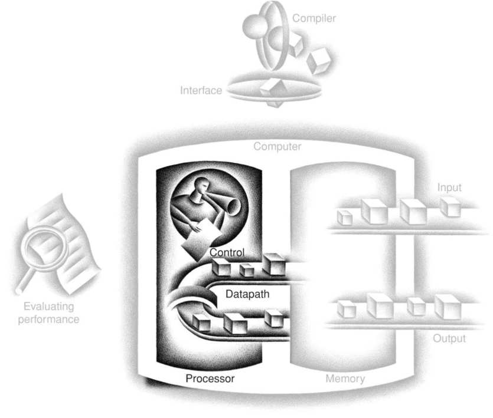

Năm thành phần kinh điển của máy tính

## 4.1 Giới thiệu

Chương 1 giải thích rằng hiệu năng máy tính do ba yếu tố chính quyết định: instruction count, clock cycle time và số clock cycle trên mỗi instruction (CPI). Chương 2 giải thích rằng compiler và instruction set architecture quyết định instruction count cần thiết cho một chương trình cụ thể. Tuy nhiên, cách triển khai processor quyết định cả clock cycle time lẫn số clock cycle trên mỗi instruction. Trong chương này, chúng ta xây dựng datapath và control unit cho hai cách triển khai khác nhau của instruction set RISC-V.

Chương này giải thích các nguyên lý và kỹ thuật dùng khi triển khai một processor, bắt đầu bằng phần tổng quan có mức trừu tượng cao và được đơn giản hóa trong mục này. Tiếp theo là phần xây dựng một datapath và một phiên bản processor đơn giản, đủ để triển khai một instruction set như RISC-V. Phần lớn chương trình bày một triển khai RISC-V có pipeline thực tế hơn, sau đó là phần phát triển những khái niệm cần thiết để triển khai các instruction set phức tạp hơn, như x86.


Với độc giả muốn hiểu cách diễn giải instruction ở mức high-level và tác động của nó lên hiệu năng chương trình, mục mở đầu này và Mục 4.5 trình bày các khái niệm cơ bản về pipelining. Các xu hướng hiện nay được trình bày trong Mục 4.10; Mục 4.11 mô tả các kiến trúc Intel Core i7 và ARM Cortex-A53 gần đây. Mục 4.12 cho thấy cách dùng instruction-level parallelism để tăng hiệu năng phép nhân ma trận trong Mục 3.9 lên hơn gấp đôi. Các mục này cung cấp đủ nền tảng để hiểu các khái niệm pipeline ở mức khái quát.

Với độc giả muốn hiểu sâu hơn về processor và hiệu năng của nó, các Mục 4.3, 4.4 và 4.6 sẽ hữu ích. Những người muốn học cách xây dựng một processor cũng nên đọc các Mục 4.2, 4.7–4.9. Với độc giả quan tâm đến thiết kế hardware hiện đại,  Mục 4.13 mô tả cách dùng hardware design language và công cụ CAD để triển khai hardware, rồi cách dùng một hardware design language để mô tả một triển khai có pipeline. Mục này cũng đưa ra thêm một số minh họa về cách hardware có pipeline thực thi.

### Một triển khai RISC-V cơ bản

Chúng ta sẽ khảo sát một triển khai bao gồm một tập con của instruction set RISC-V cốt lõi:

- Các instruction memory-reference là load doubleword (ld) và store doubleword (sd)

- Các instruction arithmetic-logical là add, sub, and và or

- Instruction conditional branch là branch if equal (beq) Tập con này không bao gồm mọi integer instruction (ví dụ, còn thiếu shift, multiply và divide), cũng không có bất kỳ instruction floating-point nào. Tuy nhiên, nó minh họa các nguyên lý chính dùng để tạo datapath và thiết kế control. Cách triển khai các instruction còn lại cũng tương tự.

Khi khảo sát triển khai này, chúng ta sẽ thấy instruction set architecture quyết định nhiều khía cạnh của cách triển khai như thế nào, và việc lựa chọn các chiến lược triển khai khác nhau ảnh hưởng ra sao đến clock rate và CPI của máy tính. Nhiều nguyên lý thiết kế chính đã giới thiệu trong Chương 1 có thể được minh họa bằng cách xem xét triển khai, chẳng hạn Sự đơn giản ưu tiên tính đều đặn. Ngoài ra, phần lớn các khái niệm dùng để triển khai tập con RISC-V trong chương này cũng chính là những ý tưởng cơ bản được dùng để xây dựng nhiều loại máy tính, từ server high-performance đến microprocessor general-purpose và embedded processor.

### Tổng quan về triển khai

Trong Chương 2, chúng ta đã xem xét các instruction RISC-V cốt lõi, gồm integer instruction arithmetic-logical, instruction memory-reference và branch instruction. Phần lớn công việc cần thực hiện để triển khai các instruction này giống nhau, không phụ thuộc vào lớp instruction cụ thể. Với mọi instruction, hai bước đầu tiên đều giống nhau:

1. Gửi program counter (PC) đến memory chứa code và fetch instruction từ memory đó.

2. Đọc một hoặc hai register, dùng các field của instruction để chọn register cần đọc. Với instruction ld, chúng ta chỉ cần đọc một register, nhưng phần lớn instruction khác yêu cầu đọc hai register.

Sau hai bước này, các thao tác cần thiết để hoàn tất instruction phụ thuộc vào lớp instruction. May thay, với từng lớp trong ba lớp instruction (memory-reference, arithmetic-logical và branch), các thao tác phần lớn giống nhau, không phụ thuộc instruction cụ thể. Tính đơn giản và đều đặn của instruction set RISC-V giúp đơn giản hóa triển khai bằng cách làm cho việc thực thi nhiều lớp instruction trở nên tương tự nhau.

Ví dụ, mọi lớp instruction đều dùng arithmetic-logical unit (ALU) sau khi đọc các register. Các instruction memory-reference dùng ALU để tính địa chỉ, instruction arithmetic-logical dùng ALU để thực hiện phép toán, và conditional branch dùng ALU để kiểm tra bằng nhau. Sau khi dùng ALU, các thao tác cần thiết để hoàn tất các lớp instruction khác nhau sẽ khác nhau. Một instruction memory-reference cần truy cập memory để đọc dữ liệu cho load hoặc ghi dữ liệu cho store. Một instruction arithmetic-logical hoặc load phải ghi dữ liệu từ ALU hoặc memory trở lại register. Cuối cùng, với một instruction conditional branch, có thể cần thay đổi địa chỉ instruction tiếp theo dựa trên kết quả so sánh; nếu không, PC phải tăng thêm bốn để có địa chỉ instruction kế tiếp.

Hình 4.1 trình bày góc nhìn high-level về một triển khai RISC-V, tập trung vào các functional unit khác nhau và cách kết nối chúng. Mặc dù hình này cho thấy phần lớn luồng dữ liệu qua processor, nó bỏ qua hai khía cạnh quan trọng của việc thực thi instruction.

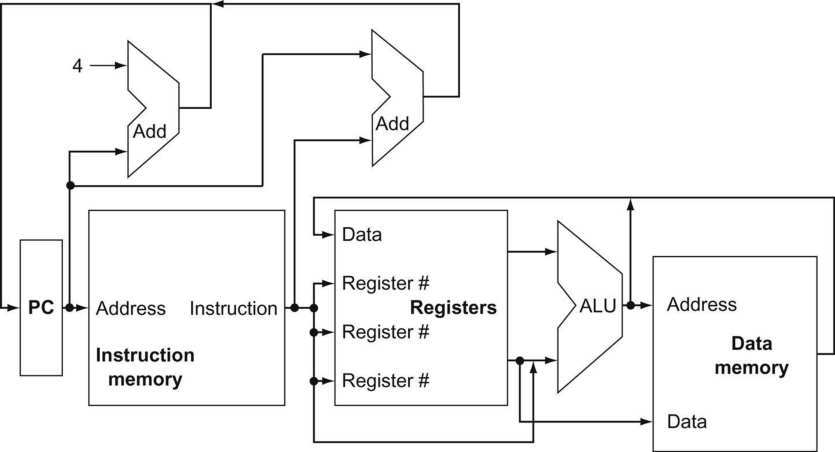

**HÌNH 4.1 Góc nhìn trừu tượng về triển khai tập con RISC-V, cho thấy các functional unit chính và các kết nối chính giữa chúng. Mọi instruction đều bắt đầu bằng việc dùng program counter để cung cấp địa chỉ instruction cho instruction memory. Sau khi instruction được fetch, các register operand mà instruction dùng được xác định bởi các field của instruction đó. Khi đã lấy được các register operand, có thể thực hiện phép toán trên chúng để tính địa chỉ memory (cho load hoặc store), tính kết quả số học (cho integer instruction arithmetic-logical), hoặc kiểm tra bằng nhau (cho branch). Nếu instruction là instruction arithmetic-logical, kết quả từ ALU phải được ghi vào register. Nếu thao tác là load hoặc store, kết quả ALU được dùng làm địa chỉ để lưu một giá trị từ register hoặc nạp một giá trị từ memory vào register. Kết quả từ ALU hoặc memory được ghi trở lại register file. Branch cần dùng output ALU để xác định địa chỉ instruction tiếp theo, lấy từ adder (cộng PC và branch offset) hoặc từ adder tăng PC hiện tại thêm bốn. Các đường đậm nối các functional unit biểu diễn bus, gồm nhiều signal. Mũi tên giúp độc giả biết thông tin di chuyển như thế nào. Vì các đường signal có thể giao nhau, chúng ta thể hiện rõ các đường giao nhau có kết nối bằng dấu chấm tại giao điểm.**

Thứ nhất, tại một số vị trí, Hình 4.1 cho thấy dữ liệu đi vào một unit cụ thể đến từ hai nguồn khác nhau. Ví dụ, giá trị ghi vào PC có thể đến từ một trong hai adder, dữ liệu ghi vào register file có thể đến từ ALU hoặc data memory, và input thứ hai của ALU có thể đến từ register hoặc immediate field của instruction. Trong thực tế, không thể chỉ nối chung các đường dữ liệu này; chúng ta phải thêm một logic element chọn giữa nhiều nguồn và đưa một nguồn đến đích. Việc lựa chọn này thường được thực hiện bằng thiết bị gọi là multiplexor, dù gọi thiết bị này là data selector có lẽ phù hợp hơn. Phụ lục A mô tả multiplexor, thiết bị chọn giữa nhiều input dựa trên thiết lập các control line. Các control line được thiết lập chủ yếu dựa trên thông tin lấy từ instruction đang thực thi.

Điểm bị bỏ qua thứ hai trong Hình 4.1 là một số unit phải được điều khiển tùy theo loại instruction. Ví dụ, data memory phải đọc với load và ghi với store. Register file chỉ được ghi với load hoặc instruction arithmetic-logical. Và tất nhiên, ALU phải thực hiện một trong nhiều phép toán. (Phụ lục A mô tả thiết kế chi tiết của ALU.) Tương tự multiplexor, các control line được thiết lập theo các field khác nhau trong instruction sẽ điều khiển các thao tác này.

Hình 4.2 cho thấy datapath của Hình 4.1 với ba multiplexor cần thiết được bổ sung, cùng các control line cho những functional unit chính. Một control unit nhận instruction làm input được dùng để xác định cách thiết lập các control line cho các functional unit và hai multiplexor. Multiplexor trên cùng, quyết định ghi PC +4 hay địa chỉ đích branch vào PC, được thiết lập dựa trên output Zero của ALU, output dùng để thực hiện phép so sánh của instruction beq. Tính đều đặn và đơn giản của instruction set RISC-V cho phép dùng một quá trình decode đơn giản để xác định cách thiết lập control line.

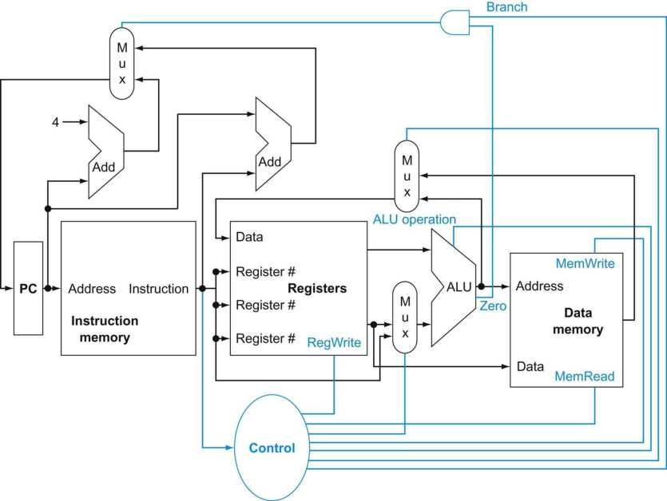

**HÌNH 4.2 Triển khai cơ bản của tập con RISC-V, bao gồm các multiplexor và control line cần thiết. Multiplexor trên cùng (“Mux”) điều khiển giá trị nào thay thế PC (PC + 4 hoặc địa chỉ đích branch); multiplexor được điều khiển bởi gate thực hiện “AND” output Zero của ALU với control signal cho biết instruction là branch. Multiplexor ở giữa, có output trở lại register file, dùng để đưa output ALU (khi là instruction arithmetic-logical) hoặc output data memory (khi là load) đến register file để ghi. Cuối cùng, multiplexor bottom-most xác định input ALU thứ hai đến từ register (cho instruction arithmetic-logical hoặc branch) hay từ offset field của instruction (cho load hoặc store). Các control line bổ sung khá đơn giản và xác định phép toán được thực hiện tại ALU, data memory đọc hay ghi, và register có thực hiện thao tác ghi hay không. Các control line được tô màu để dễ nhìn hơn.**

Trong phần còn lại của chương, chúng ta tinh chỉnh góc nhìn này để bổ sung chi tiết, đòi hỏi thêm các functional unit, tăng số kết nối giữa các unit và, tất nhiên, nâng cấp control unit để điều khiển các thao tác cho những lớp instruction khác nhau. Các Mục 4.3 và 4.4 mô tả một triển khai đơn giản dùng một clock cycle dài duy nhất cho mọi instruction và tuân theo dạng tổng quát của Hình 4.1 và 4.2. Trong thiết kế đầu tiên này, mỗi instruction bắt đầu thực thi tại một clock edge và hoàn tất tại clock edge tiếp theo.

Mặc dù dễ hiểu hơn, cách này không thực tế vì clock cycle phải kéo dài đáng kể để đáp ứng instruction dài nhất. Sau khi thiết kế control cho máy tính đơn giản này, chúng ta sẽ xem xét triển khai có pipeline với mọi yếu tố phức tạp của nó, bao gồm exception.

#### Tự kiểm tra

Trong năm thành phần kinh điển của máy tính—được trình bày ở trang 235—các Hình 4.1 và 4.2 bao gồm bao nhiêu thành phần?

## 4.2 Các quy ước thiết kế logic

Để thảo luận về thiết kế máy tính, chúng ta phải quyết định hardware logic triển khai máy tính sẽ hoạt động như thế nào và clock được cấp cho máy tính ra sao. Mục này ôn lại một số ý tưởng chính về digital logic sẽ được dùng rộng rãi trong chương. Nếu có ít hoặc chưa có kiến thức nền về digital logic, bạn sẽ thấy việc đọc Phụ lục A trước khi tiếp tục là hữu ích.

Các datapath element trong triển khai RISC-V gồm hai loại logic element khác nhau: phần tử thực hiện phép toán trên các giá trị dữ liệu và phần tử chứa state. Các phần tử thực hiện phép toán trên giá trị dữ liệu đều là combinational, nghĩa là output chỉ phụ thuộc vào input hiện tại. Với cùng input, một combinational element luôn tạo ra cùng output. ALU trong Hình 4.1, được thảo luận trong Phụ lục A, là một ví dụ về combinational element. Với một tập input cho trước, nó luôn tạo ra cùng output vì không có bộ lưu trữ bên trong.

### combinational element

Một phần tử thực hiện phép toán, chẳng hạn AND gate hoặc ALU

Các phần tử khác trong thiết kế không phải combinational mà chứa state. Một phần tử chứa state nếu có bộ lưu trữ bên trong. Chúng ta gọi chúng là state element vì nếu rút phích cắm điện máy tính, có thể khởi động lại chính xác bằng cách nạp cho các state element những giá trị chúng chứa trước khi rút phích. Hơn nữa, nếu lưu rồi khôi phục các state element, máy tính sẽ hoạt động như thể chưa từng mất điện. Do đó, các state element này xác định hoàn toàn trạng thái máy tính. Trong Hình 4.1, instruction memory và data memory, cũng như các register, đều là ví dụ về state element.

#### state element

Một phần tử memory, chẳng hạn register hoặc memory.

Một state element có ít nhất hai input và một output. Các input cần thiết là giá trị dữ liệu cần ghi vào phần tử và clock, thứ quyết định thời điểm ghi giá trị dữ liệu. Output của state element cung cấp giá trị đã được ghi trong một clock cycle trước đó. Ví dụ, một trong những state element đơn giản nhất về logic là D-type flip-flop (xem Phụ lục A), có đúng hai input này (một giá trị và một clock) và một output. Ngoài flip-flops, triển khai RISC-V của chúng ta dùng hai loại state element khác: memory và register, cả hai đều xuất hiện trong Hình 4.1. Clock được dùng để xác định khi nào cần ghi state element; có thể đọc state element bất kỳ lúc nào.

Các thành phần logic chứa state còn được gọi là sequential, vì output của chúng phụ thuộc vào cả input và nội dung state bên trong. Ví dụ, output của functional unit biểu diễn các register phụ thuộc cả số register được cung cấp lẫn dữ liệu đã ghi vào register trước đó. Phụ lục A thảo luận chi tiết hơn về hoạt động của cả combinational element và sequential element, cùng cách xây dựng chúng.

### Clocking Methodology

#### clocking methodology

Phương pháp dùng để xác định khi nào dữ liệu hợp lệ và ổn định so với clock.

Một clocking methodology xác định khi nào có thể đọc và ghi signal. Việc quy định thời điểm đọc và ghi rất quan trọng, vì nếu signal được ghi đồng thời với lúc đọc, giá trị đọc có thể là giá trị cũ, giá trị vừa ghi, hoặc thậm chí hỗn hợp của cả hai! Thiết kế máy tính không thể chấp nhận tính khó dự đoán này. Clocking methodology được thiết kế để làm cho hardware có hành vi dự đoán được.

#### edge-triggered clocking

Một phương án clocking trong đó mọi thay đổi state đều xảy ra tại clock edge.

Để đơn giản, chúng ta giả định dùng clocking methodology edge-triggered. Một clocking methodology edge-triggered có nghĩa là mọi giá trị lưu trong sequential logic element chỉ được cập nhật tại clock edge, tức chuyển đổi nhanh từ thấp sang cao hoặc ngược lại (xem Hình 4.3). Vì chỉ state element mới có thể lưu giá trị dữ liệu, mọi tập hợp combinational logic phải nhận input từ một tập state element và có output được ghi vào một tập state element. Input là các giá trị đã được ghi trong clock cycle trước, còn output là các giá trị có thể được dùng trong clock cycle tiếp theo.

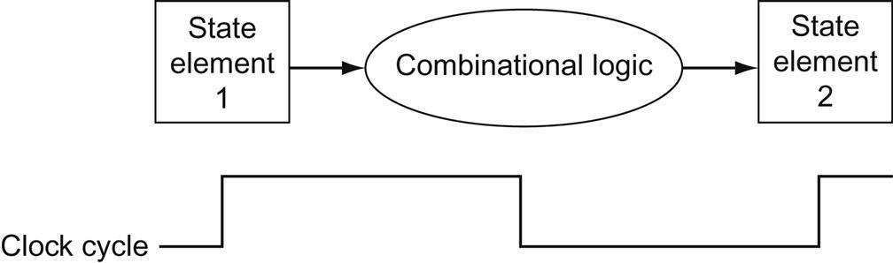

**HÌNH 4.3 Combinational logic, state element và clock có quan hệ chặt chẽ. Trong một hệ thống digital đồng bộ, clock quyết định khi nào các phần tử có state ghi giá trị vào bộ lưu trữ bên trong. Mọi input của state element phải đạt giá trị ổn định (tức đạt một giá trị không thay đổi cho đến sau clock edge) trước khi clock edge có hiệu lực khiến state được cập nhật. Mọi state element trong chương này, bao gồm memory, được giả định là positive edge-triggered; nghĩa là chúng thay đổi tại cạnh lên của clock.**

Hình 4.3 cho thấy hai state element bao quanh một khối combinational logic hoạt động trong một clock cycle: mọi signal phải truyền từ state element 1, qua combinational logic, đến state element 2 trong thời gian một clock cycle. Thời gian cần để signal đến state element 2 xác định độ dài clock cycle.

#### control signal

Một signal dùng để lựa chọn multiplexor hoặc điều khiển hoạt động của functional unit; khác với data signal, vốn chứa thông tin được functional unit xử lý.

Để đơn giản, chúng ta không vẽ write control signal khi state element được ghi tại mọi clock edge có hiệu lực. Ngược lại, nếu state element không được cập nhật trong mọi clock thì cần một write control signal tường minh. Cả clock signal và write control signal đều là input, và state element chỉ thay đổi khi write control signal được asserted và xuất hiện clock edge.

Chúng ta dùng từ asserted để chỉ signal ở mức logic cao, assert để quy định signal phải được đưa lên mức logic cao, và deassert hoặc deasserted để biểu diễn mức logic thấp. Chúng ta dùng các thuật ngữ assert và deassert vì khi triển khai hardware, đôi khi 1 biểu diễn mức logic cao, nhưng đôi khi lại có thể biểu diễn mức logic thấp.

#### asserted

Signal ở mức logic cao hoặc true.

#### deasserted

Signal ở mức logic thấp hoặc false.

Phương pháp edge-triggered cho phép đọc nội dung register, đưa giá trị qua combinational logic rồi ghi register đó trong cùng clock cycle. Hình 4.4 đưa ra ví dụ tổng quát. Việc giả định mọi thao tác ghi diễn ra tại cạnh lên (từ thấp sang cao) hay cạnh xuống (từ cao sang thấp) đều không ảnh hưởng, vì input của khối combinational logic chỉ có thể thay đổi tại clock edge đã chọn. Trong sách này, chúng ta dùng cạnh lên. Với timing methodology edge-triggered, không có feedback trong một clock cycle và logic ở Hình 4.4 hoạt động chính xác. Trong Phụ lục A, chúng ta thảo luận ngắn gọn các ràng buộc timing bổ sung (chẳng hạn setup time và hold time), cùng các timing methodology khác.

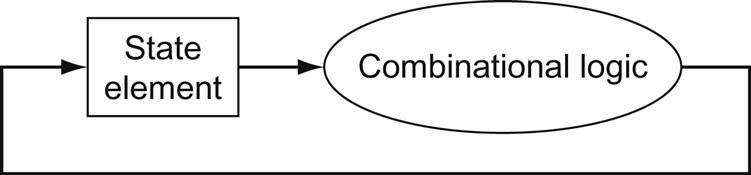

**HÌNH 4.4 Phương pháp edge-triggered cho phép đọc và ghi một state element trong cùng clock cycle mà không tạo race có thể dẫn đến giá trị dữ liệu không xác định. Tất nhiên, clock cycle vẫn phải đủ dài để input ổn định khi clock edge có hiệu lực xuất hiện. Feedback không thể xảy ra trong một clock cycle vì state element được cập nhật theo kiểu edge-triggered. Nếu feedback có thể xảy ra, thiết kế này sẽ không hoạt động đúng. Các thiết kế trong chương này và chương tiếp theo dựa vào timing methodology edge-triggered và các cấu trúc như trong hình.**

Với kiến trúc RISC-V 64-bit, gần như mọi state element và logic element này đều có input và output rộng 64 bit, vì đó là độ rộng của phần lớn dữ liệu do processor xử lý. Chúng ta sẽ nêu rõ bất cứ khi nào một unit có input hoặc output khác độ rộng 64 bit. Các hình thể hiện bus, tức signal rộng hơn 1 bit, bằng đường đậm hơn. Đôi khi, chúng ta muốn kết hợp nhiều bus thành bus rộng hơn; ví dụ có thể muốn có một bus 64-bit bằng cách kết hợp hai bus 32-bit. Trong các trường hợp đó, nhãn trên các đường bus sẽ làm rõ việc ghép nối bus để tạo bus rộng hơn. Mũi tên cũng được thêm để làm rõ hướng luồng dữ liệu giữa các phần tử. Cuối cùng, màu sắc chỉ control signal để phân biệt với signal mang dữ liệu; sự phân biệt này sẽ rõ hơn khi tiếp tục chương.

#### Tự kiểm tra

Đúng hay sai: Vì register file vừa được đọc vừa được ghi trong cùng clock cycle, mọi datapath RISC-V dùng thao tác ghi edge-triggered phải có nhiều hơn một bản sao register file.

#### Giải thích thêm

Cũng có phiên bản 32-bit của kiến trúc RISC-V; một cách tự nhiên, phần lớn đường dữ liệu trong triển khai đó sẽ rộng 32 bit.

## 4.3 Xây dựng Datapath

Một cách hợp lý để bắt đầu thiết kế datapath là khảo sát các thành phần chính cần thiết để thực thi từng lớp instruction RISC-V. Hãy bắt đầu từ mức trên cùng bằng việc xem mỗi instruction cần những datapath element nào, rồi đi xuống qua các mức trừu tượng. Khi trình bày các datapath element, chúng ta cũng sẽ trình bày control signal của chúng. Chúng ta dùng sự trừu tượng trong phần giải thích này, bắt đầu từ dưới lên.


### datapath element

Một unit dùng để xử lý hoặc giữ dữ liệu trong processor. Trong triển khai RISC-V, các datapath element gồm instruction memory và data memory, register file, ALU và adder.

#### program counter (PC)

Register chứa địa chỉ của instruction trong chương trình đang được thực thi.

Hình 4.5a cho thấy phần tử đầu tiên chúng ta cần: một memory unit để lưu các instruction của chương trình và cung cấp instruction theo địa chỉ cho trước. Hình 4.5b cũng cho thấy program counter (PC), như đã thấy trong Chương 2, là register giữ địa chỉ instruction hiện tại. Cuối cùng, chúng ta cần một adder để tăng PC đến địa chỉ instruction tiếp theo. Adder này là combinational và có thể được xây dựng từ ALU mô tả chi tiết trong Phụ lục A bằng cách nối các control line sao cho control luôn chỉ định phép cộng. Chúng ta sẽ vẽ ALU như vậy với nhãn Add, như ở Hình 4.5c, để chỉ rằng nó đã được cố định thành adder và không thể thực hiện các chức năng ALU khác.

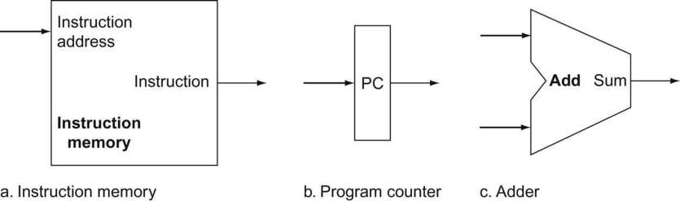

**HÌNH 4.5 Cần hai state element để lưu và truy cập instruction, và một adder để tính địa chỉ instruction tiếp theo. Hai state element là instruction memory và program counter. Instruction memory chỉ cần cung cấp truy cập đọc vì datapath không ghi instruction. Do instruction memory chỉ đọc, chúng ta xem nó như combinational logic: output tại bất kỳ thời điểm nào phản ánh nội dung vị trí được chỉ định bởi address input, và không cần read control signal. (Chúng ta sẽ cần ghi instruction memory khi nạp chương trình; việc bổ sung không khó và được bỏ qua để đơn giản.) Program counter là register 64-bit được ghi ở cuối mọi clock cycle nên không cần write control signal. Adder là ALU được nối để luôn cộng hai input 64-bit và đưa tổng ra output.**

Để thực thi bất kỳ instruction nào, chúng ta phải bắt đầu bằng việc fetch instruction từ memory. Để chuẩn bị thực thi instruction tiếp theo, chúng ta cũng phải tăng program counter để nó trỏ đến instruction tiếp theo, cách 4 byte. Hình 4.6 cho thấy cách kết hợp ba phần tử từ Hình 4.5 thành datapath fetch instruction và tăng PC để có địa chỉ instruction tuần tự tiếp theo.

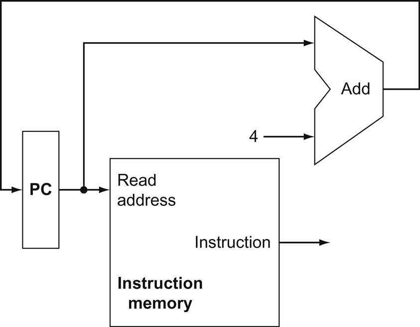

**HÌNH 4.6 Một phần datapath dùng để fetch instruction và tăng program counter. Instruction đã fetch được các phần khác của datapath sử dụng.**

Bây giờ hãy xét các instruction R-format (xem Hình 2.19 ở trang 120). Tất cả đều đọc hai register, thực hiện phép toán ALU trên nội dung register rồi ghi kết quả vào một register. Chúng ta gọi chúng là instruction R-type hoặc instruction arithmetic-logical (vì chúng thực hiện phép toán số học hoặc logic). Lớp instruction này gồm add, sub, and và or đã được giới thiệu trong Chương 2. Nhớ rằng ví dụ điển hình là add x1, x2, x3, đọc x2 và x3 rồi ghi tổng vào x1.

#### register file

Một state element gồm một tập register có thể đọc và ghi bằng cách cung cấp số register cần truy cập.

32 register general-purpose của processor được lưu trong cấu trúc gọi là register file. Register file là tập hợp register trong đó có thể đọc hoặc ghi bất kỳ register nào bằng cách chỉ định số register trong file. Register file chứa state của các register trong máy tính. Ngoài ra, chúng ta cần một ALU để thực hiện phép toán trên các giá trị đọc từ register.

Các instruction R-format có ba register operand, vì vậy với mỗi instruction, chúng ta cần đọc hai data word từ register file và ghi một data word vào register file. Với mỗi data word cần đọc từ register, cần một input vào register file chỉ định số register cần đọc và một output mang giá trị đã đọc từ register. Để ghi một data word, cần hai input: một chỉ định số register cần ghi và một cung cấp dữ liệu cần ghi vào register. Register file luôn xuất nội dung các register có số được đặt tại các input Read register. Tuy nhiên, thao tác ghi được điều khiển bởi write control signal, signal này phải được asserted để thao tác ghi xảy ra tại clock edge. Hình 4.7a cho thấy kết quả; tổng cộng cần ba input (hai cho số register và một cho dữ liệu) và hai output (đều cho dữ liệu). Các input số register rộng 5 bit để chỉ định một trong 32 register (32 = 2<sup>5</sup>), còn data input và hai bus data output đều rộng 64 bit.

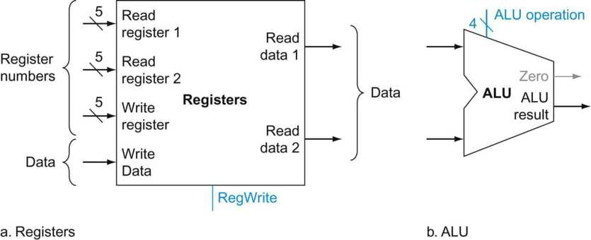

**HÌNH 4.7 Hai phần tử cần để triển khai các phép toán ALU R-format là register file và ALU. Register file chứa mọi register, có hai read port và một write port. Thiết kế register file nhiều port được thảo luận trong Mục A.8 của Phụ lục A. Register file luôn xuất nội dung các register tương ứng với input Read register ra output; không cần control input nào khác. Ngược lại, thao tác ghi register phải được chỉ định tường minh bằng việc assert write control signal. Nhớ rằng thao tác ghi là edge-triggered, vì vậy mọi write input (tức giá trị cần ghi, số register và write control signal) phải hợp lệ tại clock edge. Vì ghi vào register file là edge-triggered, thiết kế có thể đọc và ghi cùng register trong một clock cycle một cách hợp lệ: thao tác đọc nhận giá trị đã ghi trong một clock cycle trước, còn giá trị được ghi sẽ sẵn sàng cho thao tác đọc ở clock cycle sau. Các input mang số register vào register file đều rộng 5 bit, còn các đường mang giá trị dữ liệu rộng 64 bit. Phép toán ALU cần thực hiện được điều khiển bằng signal ALU operation rộng 4 bit, dùng ALU được thiết kế trong Phụ lục A. Chúng ta sẽ sớm dùng output phát hiện Zero của ALU để triển khai conditional branch.**

Hình 4.7b cho thấy ALU nhận hai input 64-bit và tạo ra kết quả 64-bit, cũng như signal 1-bit nếu kết quả bằng 0. Control signal 4-bit của ALU được mô tả chi tiết trong Phụ lục A; chúng ta sẽ sớm ôn lại ALU control khi cần biết cách thiết lập nó.

Tiếp theo, xét các instruction load register và store register của RISC-V, có dạng tổng quát ld x1, offset(x2) hoặc sd x1, offset(x2). Các instruction này tính địa chỉ memory bằng cách cộng base register x2 với offset field có dấu 12-bit trong instruction. Nếu instruction là store, giá trị cần lưu cũng phải được đọc từ register file, nơi nó nằm trong x1. Nếu instruction là load, giá trị đọc từ memory phải được ghi vào register được chỉ định trong register file, tức x1. Vì vậy, chúng ta cần cả register file lẫn ALU ở Hình 4.7.

#### sign-extend

Tăng kích thước một mục dữ liệu bằng cách lặp lại sign bit high-order của mục dữ liệu gốc vào các bit high-order của mục dữ liệu đích lớn hơn.

#### branch target address

Địa chỉ được chỉ định trong branch, trở thành program counter (PC) mới nếu branch được thực hiện. Trong kiến trúc RISC-V, branch target là tổng offset field của instruction và địa chỉ branch.

Ngoài ra, chúng ta cần một unit để sign-extend offset field 12-bit trong instruction thành giá trị có dấu 64-bit, và một data memory unit để đọc hoặc ghi. Data memory phải được ghi với store instruction; vì vậy data memory có read control signal và write control signal, một address input và một input cho dữ liệu cần ghi vào memory. Hình 4.8 cho thấy hai phần tử này.

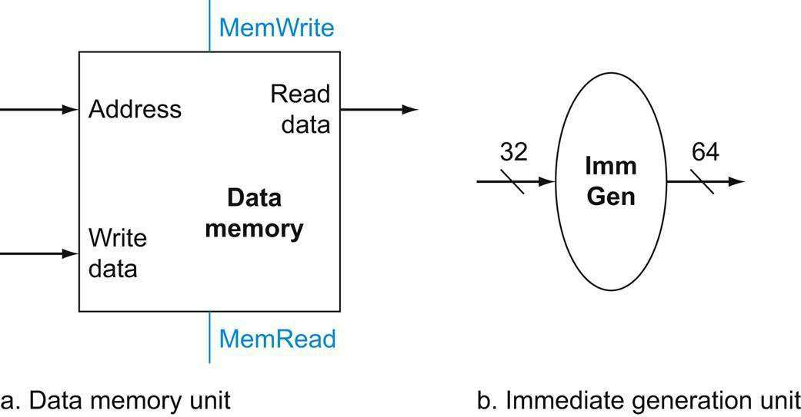

**HÌNH 4.8 Hai unit cần để triển khai load và store, ngoài register file và ALU ở Hình 4.7, là data memory unit và immediate generation unit. Memory unit là một state element có input cho địa chỉ và dữ liệu ghi, cùng một output duy nhất cho kết quả đọc. Có các control đọc và ghi riêng biệt, mặc dù chỉ một trong hai được asserted trong mỗi clock cụ thể. Memory unit cần read signal vì khác với register file, việc đọc giá trị tại một địa chỉ không hợp lệ có thể gây vấn đề, như sẽ thấy trong Chương 5. Immediate generation unit (ImmGen) nhận instruction 32-bit làm input để chọn field 12-bit cho load, store và branch if equal, rồi tạo kết quả sign-extended 64-bit xuất hiện tại output (xem Chương 2). Chúng ta giả định data memory ghi theo kiểu edge-triggered. Thực tế, chip memory tiêu chuẩn có write enable signal dùng cho thao tác ghi. Mặc dù write enable không phải edge-triggered, thiết kế edge-triggered của chúng ta có thể dễ dàng được điều chỉnh để làm việc với chip memory thực tế. Xem Mục A.8 của Phụ lục A để tìm hiểu thêm cách chip memory thực tế hoạt động.**

Instruction beq có ba operand: hai register được so sánh bằng nhau và offset 12-bit dùng để tính branch target address tương đối với địa chỉ branch instruction. Nó có dạng beq x1, x2, offset. Để triển khai instruction này, chúng ta phải tính branch target address bằng cách cộng offset field đã sign-extended của instruction với PC. Có hai chi tiết trong định nghĩa branch instruction (xem Chương 2) cần chú ý:

- Instruction set architecture quy định cơ sở để tính địa chỉ branch là địa chỉ của chính branch instruction.

- Kiến trúc cũng quy định offset field được dịch trái 1 bit để trở thành offset theo half word; phép dịch này tăng phạm vi hiệu dụng của offset field lên 2 lần.

Để xử lý điểm phức tạp thứ hai, chúng ta cần dịch offset field đi 1.

Ngoài tính branch target address, chúng ta còn phải xác định instruction tiếp theo là instruction tuần tự kế tiếp hay instruction tại branch target address. Khi điều kiện đúng (tức hai operand bằng nhau), branch target address trở thành PC mới và chúng ta nói branch được taken. Nếu operand khác không, PC đã tăng phải thay thế PC hiện tại (như mọi instruction bình thường khác); trong trường hợp này, chúng ta nói branch không được taken.

#### branch taken

Một branch có điều kiện branch được thỏa mãn và program counter (PC) trở thành branch target. Mọi unconditional branch đều là taken branch.

#### branch not taken or (untaken branch)

Một branch có điều kiện branch sai và program counter (PC) trở thành địa chỉ instruction tuần tự kế tiếp branch.

Do đó, branch datapath phải thực hiện hai thao tác: tính branch target address và kiểm tra nội dung register. (Branch cũng ảnh hưởng phần instruction fetch của datapath, như chúng ta sẽ sớm xử lý.) Hình 4.9 cho thấy cấu trúc đoạn datapath xử lý branch. Để tính branch target address, branch datapath gồm immediate generation unit từ Hình 4.8 và một adder. Để so sánh, cần dùng register file ở Hình 4.7a để cung cấp hai register operand (dù không cần ghi vào register file). Ngoài ra, có thể so sánh bằng nhau bằng ALU được thiết kế trong Phụ lục A. Vì ALU đó cung cấp output signal cho biết kết quả có bằng 0 hay không, chúng ta có thể gửi cả hai register operand đến ALU với control được đặt để trừ hai giá trị. Nếu Zero signal ra khỏi ALU được asserted, chúng ta biết các giá trị register bằng nhau. Mặc dù output Zero luôn báo khi kết quả bằng 0, chúng ta chỉ dùng nó để triển khai phép kiểm tra bằng nhau của conditional branch. Sau này, chúng ta sẽ chỉ chính xác cách kết nối control signal của ALU để dùng trong datapath.

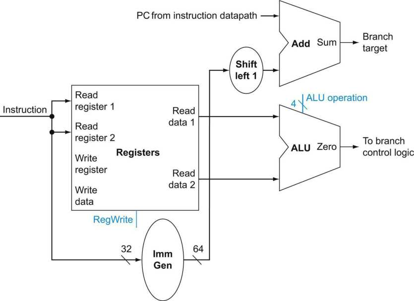

**HÌNH 4.9 Datapath cho branch dùng ALU để đánh giá điều kiện branch và một adder riêng để tính branch target bằng tổng PC với 12 bit đã sign-extended của instruction (branch displacement), dịch trái 1 bit. Unit có nhãn Shift left 1 đơn giản là cách định tuyến signal giữa input và output để thêm 0<sub>two</sub> vào đầu low-order của offset field đã sign-extended; không cần hardware dịch thực sự vì lượng “dịch” là hằng số. Vì biết offset đã được sign-extended từ 12 bit, phép dịch chỉ bỏ đi các “sign bit”. Control logic dùng để quyết định PC đã tăng hay branch target sẽ thay thế PC, dựa trên output Zero của ALU.**

Branch instruction hoạt động bằng cách cộng PC với 12 bit của instruction đã dịch trái 1 bit. Chỉ cần ghép thêm 0 vào branch offset là thực hiện được phép dịch này, như mô tả trong Chương 2.

### Tạo một Datapath duy nhất

Sau khi khảo sát các thành phần datapath cần cho từng lớp instruction, chúng ta có thể kết hợp chúng thành một datapath duy nhất và thêm control để hoàn tất triển khai. Datapath đơn giản nhất này cố gắng thực thi mọi instruction trong một clock cycle. Thiết kế đó có nghĩa không tài nguyên datapath nào được dùng nhiều hơn một lần trên mỗi instruction, vì vậy bất kỳ phần tử nào cần dùng nhiều lần đều phải được nhân bản. Do đó, cần memory cho instruction tách biệt với memory cho dữ liệu. Mặc dù cần nhân bản một số functional unit, nhiều phần tử có thể được chia sẻ giữa các luồng instruction khác nhau.

Để chia sẻ datapath element giữa hai lớp instruction khác nhau, có thể cần cho phép nhiều kết nối đến input của phần tử, dùng multiplexor và control signal để chọn giữa các input.

#### Xây dựng Datapath

**Ví dụ**

Hoạt động datapath của instruction arithmetic-logical (hay R-type) và memory instruction khá tương tự nhau. Các khác biệt chính như sau:

- Các instruction arithmetic-logical dùng ALU với input đến từ hai register. Memory instruction cũng có thể dùng ALU để tính địa chỉ, mặc dù input thứ hai là offset field 12-bit đã sign-extended từ instruction.

- Giá trị lưu vào destination register đến từ ALU (với instruction R-type) hoặc memory (với load). Hãy chỉ cách xây dựng datapath cho phần thực hiện thao tác của các instruction memory-reference và arithmetic-logical dùng một register file và một ALU duy nhất để xử lý cả hai loại instruction, bổ sung các multiplexor cần thiết.

**Trả lời**

Để tạo datapath chỉ có một register file và một ALU, chúng ta phải hỗ trợ hai nguồn khác nhau cho input ALU thứ hai, cũng như hai nguồn khác nhau cho dữ liệu lưu vào register file. Do đó, một multiplexor được đặt tại ALU input và một multiplexor khác tại data input của register file. Hình 4.10 cho thấy phần thực hiện thao tác của datapath kết hợp.

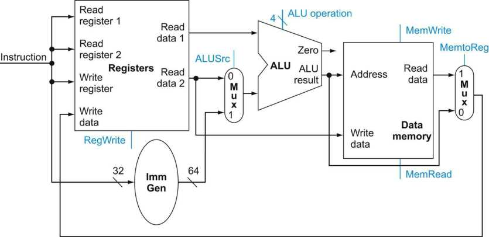

**HÌNH 4.10 Datapath cho memory instruction và instruction R-type. Ví dụ này cho thấy cách lắp ráp một datapath duy nhất từ các phần trong Hình 4.7 và 4.8 bằng cách thêm multiplexor. Cần hai multiplexor, như mô tả trong ví dụ.**

Bây giờ có thể kết hợp mọi phần để tạo datapath đơn giản cho kiến trúc RISC-V cốt lõi bằng cách thêm datapath instruction fetch (Hình 4.6), datapath cho instruction R-type và memory instruction (Hình 4.10), cùng datapath cho branch (Hình 4.9). Hình 4.11 cho thấy datapath thu được khi ghép các phần riêng. Branch instruction dùng ALU chính để so sánh bằng nhau giữa hai register operand, vì vậy phải giữ adder từ Hình 4.9 để tính branch target address. Cần thêm một multiplexor để chọn ghi vào PC địa chỉ instruction tuần tự kế tiếp (PC +4) hoặc branch target address.

#### Tự kiểm tra

I. Phát biểu nào sau đây đúng với load instruction? Tham khảo Hình 4.10.

a. Phải thiết lập MemtoReg để dữ liệu từ memory được gửi đến register file.

b. Phải thiết lập MemtoReg để destination register chính xác được gửi đến register file.

c. Không cần quan tâm thiết lập MemtoReg đối với load.

II. Datapath single-cycle được mô tả về mặt khái niệm trong mục này phải có instruction memory và data memory riêng biệt vì a. định dạng dữ liệu và instruction khác nhau trong RISC-V, vì vậy cần memory khác nhau; b. dùng memory riêng ít tốn kém hơn; c. processor hoạt động trong một cycle và không thể dùng một memory (single-ported) cho hai truy cập khác nhau trong cycle đó.

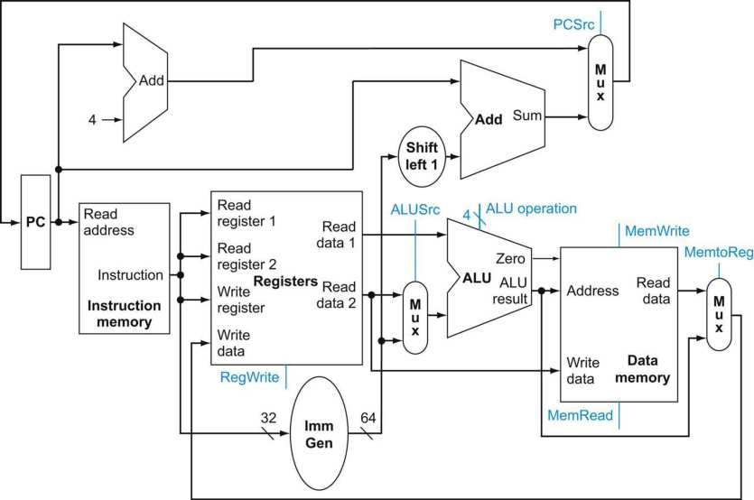

**HÌNH 4.11 Datapath đơn giản cho kiến trúc RISC-V cốt lõi kết hợp các phần tử cần cho những lớp instruction khác nhau. Các thành phần lấy từ Hình 4.6, 4.9 và 4.10. Datapath này có thể thực thi các instruction cơ bản (load-store register, phép toán ALU và branch) trong một clock cycle. Chỉ cần thêm một multiplexor để tích hợp branch.**

Sau khi hoàn thành datapath đơn giản này, chúng ta có thể thêm control unit. Control unit phải có thể nhận input và tạo write signal cho từng state element, selector control cho từng multiplexor và ALU control. ALU control khác ở một số khía cạnh, và việc thiết kế nó trước khi thiết kế phần control unit còn lại sẽ hữu ích.

#### Giải thích thêm

Immediate generation logic phải chọn giữa việc sign-extending field 12-bit tại các bit instruction 31:20 cho load instruction, các bit 31:25 và 11:7 cho store instruction, hoặc các bit 31, 7, 30:25 và 11:8 cho conditional branch. Vì input là toàn bộ 32 bit của instruction, nó có thể dùng các opcode bit của instruction để chọn field thích hợp. Opcode bit 6 của RISC-V tình cờ bằng 0 cho data transfer instruction và bằng 1 cho conditional branch; opcode bit 5 của RISC-V tình cờ bằng 0 cho load instruction và bằng 1 cho store instruction. Do đó, bit 5 và 6 có thể điều khiển một multiplexor 3:1 bên trong immediate generation logic để chọn field 12-bit thích hợp cho load, store và conditional branch instruction.

## 4.4 Một phương án triển khai đơn giản

Trong mục này, chúng ta xem xét một cách có thể được coi là triển khai đơn giản của tập con RISC-V. Chúng ta xây dựng triển khai đơn giản này bằng datapath của mục trước và bổ sung một chức năng control đơn giản. Triển khai này bao gồm load doubleword (ld), store doubleword (sd), branch if equal (beq), cùng các instruction arithmetic-logical add, sub, and và or.

### ALU Control

ALU RISC-V trong Phụ lục A định nghĩa bốn tổ hợp sau của bốn control input:

| ALU control line | Chức năng |
|---|---|
| 0000 | AND |
| 0001 | OR |
| 0010 | add |
| 0110 | trừ |

Tùy lớp instruction, ALU cần thực hiện một trong bốn chức năng này. Với load và store instruction, chúng ta dùng ALU để tính địa chỉ memory bằng phép cộng. Với instruction R-type, ALU cần thực hiện một trong bốn thao tác (AND, OR, cộng hoặc trừ), tùy giá trị funct7 field 7-bit (bit 31:25) và funct3 field 3-bit (bit 14:12) trong instruction (xem Chương 2). Với instruction conditional branch if equal, ALU trừ hai operand và kiểm tra kết quả có bằng 0 hay không.

Chúng ta có thể tạo control input 4-bit của ALU bằng một control unit nhỏ nhận funct7 field và funct3 field của instruction cùng control field 2-bit gọi là ALUOp làm input. ALUOp chỉ ra thao tác cần thực hiện là cộng (00) cho load và store, trừ rồi kiểm tra bằng không (01) cho beq, hay được xác định bởi thao tác mã hóa trong funct7 field và funct3 field (10). Output của ALU control unit là signal 4-bit điều khiển trực tiếp ALU bằng cách tạo một trong các tổ hợp 4-bit đã trình bày trước đó.

Trong Hình 4.12, chúng ta cho thấy cách thiết lập ALU control input dựa trên ALUOp control 2-bit, funct7 field và funct3 field. Sau này trong chương, chúng ta sẽ xem cách các ALUOp bit được tạo từ main control unit.

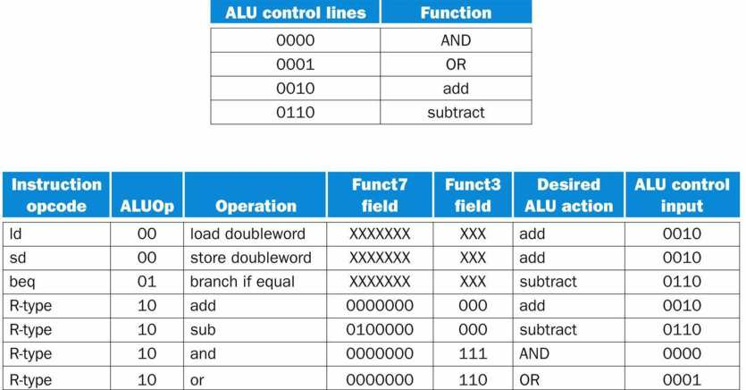

**HÌNH 4.12 Cách thiết lập các ALU control bit phụ thuộc các ALUOp control bit và các opcode khác nhau của instruction R-type. Instruction liệt kê trong cột đầu xác định thiết lập các ALUOp bit. Mọi mã hóa đều ở dạng nhị phân. Lưu ý khi mã ALUOp là 00 hoặc 01, thao tác ALU mong muốn không phụ thuộc funct7 field hoặc funct3 field; trong trường hợp này, chúng ta nói “không quan tâm” đến giá trị opcode và biểu diễn các bit bằng X. Khi giá trị ALUOp là 10, funct7 field và funct3 field được dùng để thiết lập ALU control input. Xem Phụ lục A.**

Cách dùng nhiều mức decode này—tức main control unit tạo các ALUOp bit, sau đó chúng được dùng làm input cho ALU control để tạo signal thực sự điều khiển ALU unit—là kỹ thuật triển khai phổ biến. Dùng nhiều mức control có thể giảm kích thước main control unit. Dùng nhiều control unit nhỏ hơn cũng có khả năng giảm latency của control unit. Những tối ưu này rất quan trọng vì latency của control unit thường là yếu tố then chốt quyết định clock cycle time.

Có nhiều cách khác nhau để triển khai ánh xạ từ ALUOp field 2-bit và các funct field đến bốn ALU operation control bit. Vì chỉ cần quan tâm một số nhỏ giá trị funct field có thể có và funct field chỉ được dùng khi ALUOp bit bằng 10, chúng ta có thể dùng một phần logic nhỏ nhận biết tập con các giá trị có thể có và tạo ALU control signal thích hợp.

Trong quá trình thiết kế logic này, việc tạo truth table cho các tổ hợp funct field và ALUOp signal cần quan tâm sẽ hữu ích, như trong Hình 4.13; truth table này cho thấy cách thiết lập ALU control 4-bit theo các input field. Vì truth table đầy đủ rất lớn và chúng ta không quan tâm giá trị ALU control đối với nhiều tổ hợp input, chúng ta chỉ trình bày các mục truth table mà ALU control phải có giá trị cụ thể. Trong suốt chương, chúng ta sẽ chỉ trình bày các mục truth table cho output phải được asserted, và không trình bày các mục đều deasserted hoặc don’t care. (Cách này có một nhược điểm, được thảo luận trong Mục C.2 của  Phụ lục C.)

#### truth table

Trong logic, cách biểu diễn một phép toán logic bằng việc liệt kê mọi giá trị input, rồi trong từng trường hợp cho thấy output kết quả phải như thế nào.

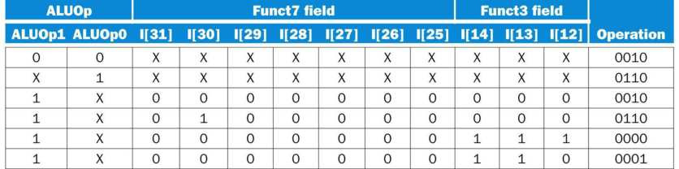

**HÌNH 4.13 Truth table cho 4 ALU control bit (gọi là Operation). Input là ALUOp và các funct field. Chỉ trình bày các mục mà ALU control được asserted. Một số mục don’t-care đã được thêm. Ví dụ, ALUOp không dùng mã hóa 11, nên truth table có thể chứa các mục 1X và X1 thay cho 10 và 01. Mặc dù trình bày cả 10 bit của các funct field, lưu ý rằng những bit duy nhất có giá trị khác nhau giữa bốn instruction R-format là các bit 30, 14, 13 và 12. Do đó, chỉ cần bốn bit funct field này làm input cho ALU control thay vì cả 10 bit.**

Vì trong nhiều trường hợp chúng ta không quan tâm giá trị của một số input và muốn giữ bảng gọn, chúng ta cũng đưa vào các don’t-care term. Một don’t-care term trong truth table này (biểu diễn bằng X trong cột input) cho biết output không phụ thuộc giá trị input tương ứng với cột đó. Ví dụ, khi các ALUOp bit là 00, như hàng đầu tiên của Hình 4.13, chúng ta luôn đặt ALU control bằng 0010, không phụ thuộc các funct field. Trong trường hợp này, funct input sẽ là don’t care trong hàng truth table đó. Sau này, chúng ta sẽ thấy các ví dụ về một loại don’t-care term khác. Nếu chưa quen khái niệm don’t-care term, hãy xem Phụ lục A để biết thêm thông tin.

Sau khi xây dựng truth table, có thể tối ưu rồi chuyển nó thành các gate. Quá trình này hoàn toàn mang tính cơ học. Do đó, thay vì trình bày những bước cuối ở đây, chúng ta mô tả quá trình và kết quả trong Mục C.2 của  Phụ lục C.

#### don’t-care term

Một phần tử của hàm logic trong đó output không phụ thuộc vào giá trị của mọi input. Các Don’t-care term có thể được chỉ định bằng nhiều cách.

### Thiết kế Main Control Unit

Sau khi mô tả cách thiết kế ALU dùng opcode và signal 2-bit làm control input, chúng ta có thể quay lại phần control còn lại. Để bắt đầu, hãy xác định các field instruction và control line cần cho datapath đã xây dựng ở Hình 4.11. Để hiểu cách kết nối các field instruction với datapath, việc ôn lại định dạng của bốn lớp instruction sẽ hữu ích: arithmetic, load, store và conditional branch. Hình 4.14 cho thấy các định dạng này.

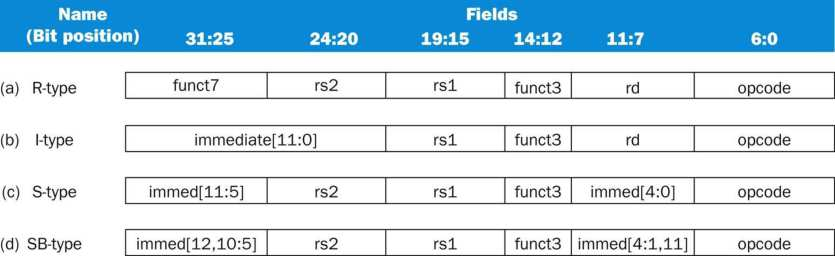

**HÌNH 4.14 Bốn lớp instruction (arithmetic, load, store và conditional branch) dùng bốn định dạng instruction khác nhau. (a) Định dạng instruction arithmetic R-type (opcode = 51<sub>ten</sub>), có ba register operand: rs1, rs2 và rd. Các field rs1 và rd là nguồn, rd là đích. Chức năng ALU nằm trong funct3 field và funct7 field, được decode bằng thiết kế ALU control ở mục trước. Các instruction R-type chúng ta triển khai là add, sub, and và or. (b) Định dạng load instruction I-type (opcode = 3<sub>ten</sub>). Register rs1 là base register được cộng với immediate field 12-bit để tạo địa chỉ memory. Field rd là destination register cho giá trị được nạp. (c) Định dạng store instruction S-type (opcode = 35<sub>ten</sub>). Register rs1 là base register được cộng với immediate field 12-bit để tạo địa chỉ memory. (Immediate field được tách thành phần 7-bit và phần 5-bit.) Field rs2 là source register có giá trị cần lưu vào memory. (d) Định dạng conditional branch instruction SB-type (opcode =99<sub>ten</sub>). Các register rs1 và rs2 được so sánh. Immediate address field 12-bit được sign-extended, dịch trái 1 bit rồi cộng với PC để tính branch target address.**

Có một số nhận xét quan trọng về định dạng instruction này mà chúng ta sẽ dựa vào:

#### opcode

Field biểu thị phép toán và định dạng của một instruction.

- Opcode field, như đã thấy trong Chương 2, luôn nằm tại các bit 6:0. Tùy opcode, funct3 field (bit 14:12) và funct7 field (bit 31:25) đóng vai trò opcode field mở rộng.

- Register operand thứ nhất luôn ở các vị trí bit 19:15 (rs1) đối với instruction R-type và branch instruction. Field này cũng chỉ định base register cho load và store instruction.

- Register operand thứ hai luôn ở các vị trí bit 24:20 (rs2) đối với instruction R-type và branch instruction. Field này cũng chỉ định register operand được sao chép vào memory đối với store instruction.

- Một operand khác cũng có thể là offset 12-bit cho branch hoặc instruction load-store.

- Destination register luôn ở các vị trí bit 11:7 (rd) đối với instruction R-type và load instruction.

Nguyên lý thiết kế đầu tiên từ Chương 2—sự đơn giản ưu tiên tính đều đặn—phát huy tác dụng ở đây khi quy định control.

Với thông tin này, chúng ta có thể thêm các nhãn instruction vào datapath đơn giản. Hình 4.15 cho thấy các bổ sung này cùng khối ALU control, các write signal cho state element, read signal cho data memory và control signal cho multiplexor. Vì mọi multiplexor đều có hai input nên mỗi cái chỉ cần một control line.

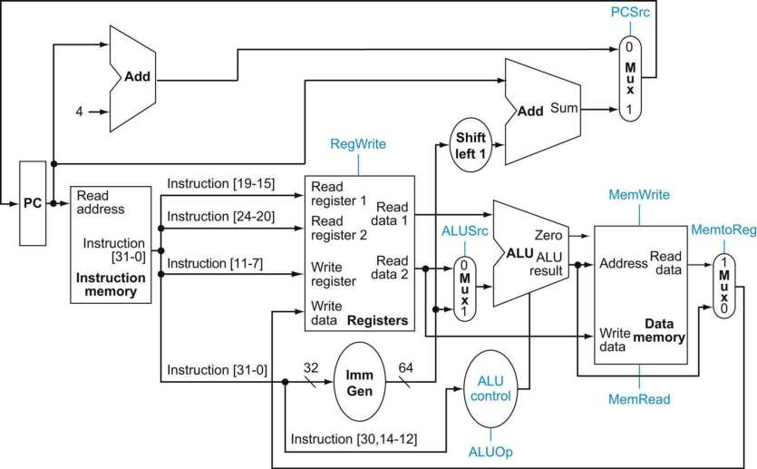

**HÌNH 4.15 Datapath của Hình 4.11 với mọi multiplexor cần thiết và mọi control line được xác định. Các control line được tô màu. Khối ALU control cũng được thêm vào, phụ thuộc funct3 field và một phần funct7 field. PC không cần write control vì được ghi một lần ở cuối mỗi clock cycle; branch control logic xác định ghi PC đã tăng hay branch target address vào nó.**

Hình 4.15 cho thấy sáu control line single-bit cùng ALUOp control signal 2-bit. Chúng ta đã định nghĩa cách ALUOp control signal hoạt động; việc mô tả không hình thức sáu control signal còn lại làm gì sẽ hữu ích trước khi xác định cách thiết lập chúng trong khi thực thi instruction. Hình 4.16 mô tả chức năng sáu control line này.

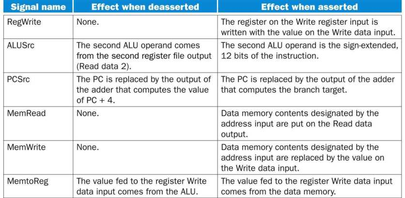

**HÌNH 4.16 Tác động của từng signal trong sáu control signal. Khi control 1-bit đến multiplexor two-way được asserted, multiplexor chọn input tương ứng với 1. Nếu control được deasserted, multiplexor chọn input 0. Nhớ rằng mọi state element đều có clock làm input ngầm và clock được dùng để điều khiển thao tác ghi. Gating clock bên ngoài state element có thể tạo vấn đề timing. (Xem Phụ lục A để tìm hiểu thêm vấn đề này.)**

Sau khi xem xét chức năng từng control signal, chúng ta có thể xem cách thiết lập chúng. Control unit có thể thiết lập mọi control signal, trừ một signal, chỉ dựa trên opcode và các funct field của instruction. PCSrc control line là ngoại lệ. Control line này phải được asserted nếu instruction là branch if equal (quyết định mà control unit có thể đưa ra) và output Zero của ALU, được dùng cho phép kiểm tra bằng nhau, được asserted. Để tạo PCSrc signal, chúng ta cần AND signal từ control unit, gọi là Branch, với Zero signal ra khỏi ALU.

Bây giờ có thể thiết lập tám control signal này (sáu từ Hình 4.16 và hai cho ALUOp) theo các input signal của control unit, tức các opcode bit 6:0. Hình 4.17 cho thấy datapath với control unit và các control signal.

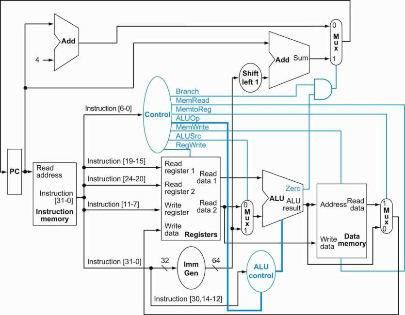

**HÌNH 4.17 Datapath đơn giản với control unit. Input của control unit là opcode field 7-bit từ instruction. Output của control unit gồm hai signal 1-bit dùng để điều khiển multiplexor (ALUSrc và MemtoReg), ba signal điều khiển đọc và ghi trong register file và data memory (RegWrite, MemRead và MemWrite), một signal 1-bit dùng để xác định khả năng branch (Branch), và control signal 2-bit cho ALU (ALUOp). Một AND gate kết hợp branch control signal với output Zero từ ALU; output AND gate điều khiển việc chọn PC tiếp theo. Lưu ý PCSrc giờ là signal dẫn xuất, thay vì đến trực tiếp từ control unit. Vì vậy, chúng ta bỏ tên signal này trong các hình tiếp theo.**

Trước khi viết một tập phương trình hoặc truth table cho control unit, việc thử định nghĩa chức năng control một cách không hình thức sẽ hữu ích. Vì thiết lập các control line chỉ phụ thuộc opcode, chúng ta xác định mỗi control signal phải là 0, 1 hay don’t care (X) với từng giá trị opcode. Hình 4.18 định nghĩa cách thiết lập control signal cho từng opcode; thông tin này suy ra trực tiếp từ Hình 4.12, 4.16 và 4.17.

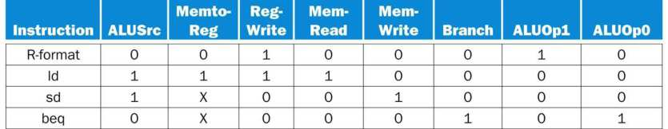

**HÌNH 4.18 Thiết lập các control line được xác định hoàn toàn bởi các opcode field của instruction. Hàng đầu tiên trong bảng tương ứng các instruction R-format (add, sub, and và or). Với mọi instruction này, source register field là rs1 và rs2, destination register field là rd; điều này xác định cách thiết lập signal ALUSrc. Hơn nữa, một instruction R-type ghi register (RegWrite =1), nhưng không đọc hay ghi data memory. Khi Branch control signal bằng 0, PC được thay bằng PC +4 vô điều kiện; nếu không, PC được thay bằng branch target nếu output Zero của ALU cũng ở mức cao. ALUOp field cho instruction R-type được đặt bằng 10 để chỉ ALU control phải được tạo từ các funct field. Hàng thứ hai và thứ ba của bảng cho biết thiết lập control signal đối với ld và sd. Các ALUSrc field và ALUOp field này được thiết lập để tính địa chỉ. MemRead và MemWrite được thiết lập để thực hiện truy cập memory. Cuối cùng, RegWrite được thiết lập với load để kết quả được lưu vào register rd. ALUOp field cho branch được thiết lập để trừ (ALU control =01), dùng để kiểm tra bằng nhau. Lưu ý MemtoReg field không liên quan khi RegWrite signal bằng 0: vì register không được ghi, giá trị dữ liệu tại register data write port không được dùng. Do đó, mục MemtoReg trong hai hàng cuối của bảng được thay bằng X cho don’t care. Người thiết kế phải bổ sung kiểu don’t care này vì nó phụ thuộc hiểu biết về cách datapath hoạt động.**

### Hoạt động của Datapath

Với thông tin trong Hình 4.16 và 4.18, chúng ta có thể thiết kế logic của control unit, nhưng trước đó, hãy xem từng instruction dùng datapath như thế nào. Trong vài hình tiếp theo, chúng ta trình bày luồng của ba lớp instruction khác nhau qua datapath. Các control signal được asserted và các datapath element hoạt động được làm nổi bật trong từng hình. Lưu ý multiplexor có control bằng 0 vẫn thực hiện một thao tác xác định, dù control line không được làm nổi bật. Các control signal Multiple-bit được làm nổi bật nếu có bất kỳ signal thành phần nào được asserted.

Hình 4.19 cho thấy hoạt động datapath của một instruction R-type, chẳng hạn add x1, x2, x3. Mặc dù mọi việc diễn ra trong một clock cycle, có thể hình dung bốn bước để thực thi instruction; các bước được sắp theo luồng thông tin:

1. Instruction được fetch và PC được tăng.

2. Hai register x2 và x3 được đọc từ register file; main control unit cũng tính thiết lập các control line trong bước này.

3. ALU thực hiện phép toán trên dữ liệu đọc từ register file, dùng các phần opcode để tạo chức năng ALU.

4. Kết quả từ ALU được ghi vào destination register (x1) trong register file.

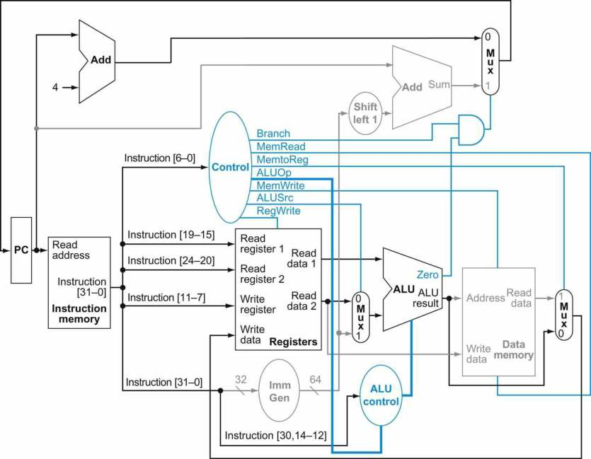

**HÌNH 4.19 Datapath hoạt động cho một instruction R-type, chẳng hạn add x1, x2, x3. Các control line, datapath unit và kết nối đang hoạt động được làm nổi bật.**

Tương tự, chúng ta có thể minh họa việc thực thi load register, chẳng hạn

```
ld x1, offset(x2)
```

theo cách tương tự Hình 4.19. Hình 4.20 cho thấy các functional unit đang hoạt động và control line được asserted cho load. Có thể hình dung một load instruction hoạt động qua năm bước (tương tự instruction R-type thực thi qua bốn bước):

1. Một instruction được fetch từ instruction memory và PC được tăng.

2. Giá trị của một register (x2) được đọc từ register file.

3. ALU tính tổng giá trị đọc từ register file và 12 bit đã sign-extended của instruction (offset).

4. Tổng từ ALU được dùng làm địa chỉ cho data memory.

5. Dữ liệu từ memory unit được ghi vào register file (x1).

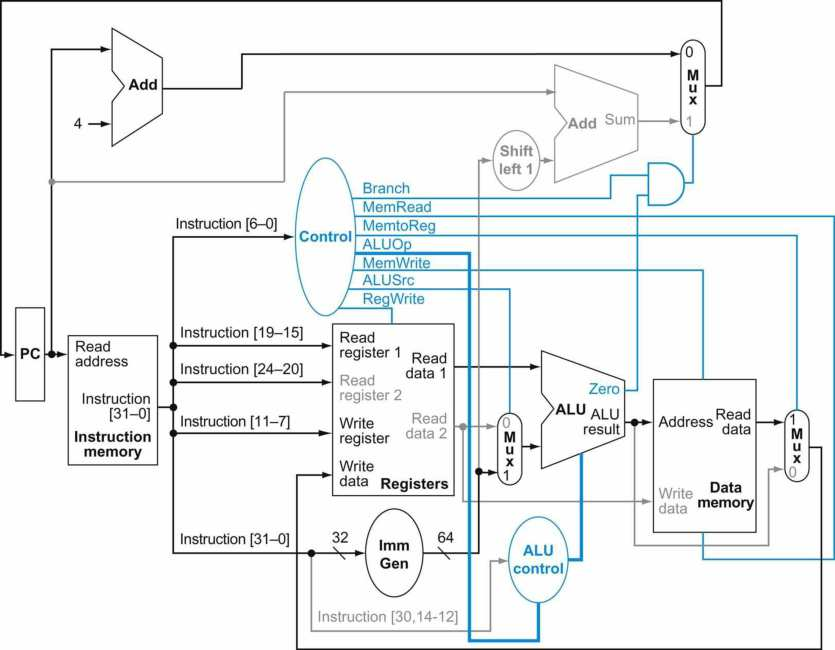

**HÌNH 4.20 Datapath hoạt động cho một load instruction. Các control line, datapath unit và kết nối đang hoạt động được làm nổi bật. Store instruction hoạt động rất tương tự. Khác biệt chính là memory control chỉ định ghi thay vì đọc, giá trị register thứ hai được đọc sẽ làm dữ liệu cần lưu, và thao tác ghi giá trị data memory vào register file không xảy ra.**

Cuối cùng, có thể trình bày hoạt động của instruction branch-if-equal, chẳng hạn beq x1, x2, offset, theo cùng cách. Nó hoạt động rất giống instruction R-format, nhưng output ALU được dùng để xác định ghi PC +4 hay branch target address vào PC. Hình 4.21 cho thấy bốn bước thực thi:

1. Một instruction được fetch từ instruction memory và PC được tăng.

2. Hai register x1 và x2 được đọc từ register file.

3. ALU trừ một giá trị dữ liệu cho giá trị còn lại, cả hai đều được đọc từ register file. Giá trị PC được cộng với 12 bit đã sign-extended của instruction (offset), dịch trái một bit; kết quả là branch target address.

4. Thông tin trạng thái Zero từ ALU được dùng để quyết định lưu kết quả adder nào vào PC.

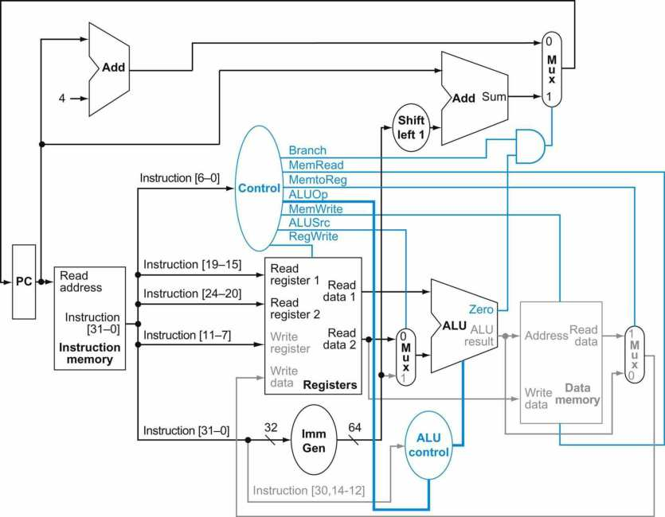

**HÌNH 4.21 Datapath hoạt động cho instruction branch-if-equal. Các control line, datapath unit và kết nối đang hoạt động được làm nổi bật. Sau khi dùng register file và ALU để so sánh, output Zero được dùng để chọn program counter tiếp theo từ hai ứng viên.**

### Hoàn thiện Control

Sau khi xem cách instruction hoạt động theo từng bước, hãy tiếp tục triển khai control. Chức năng control có thể được định nghĩa chính xác bằng nội dung Hình 4.18. Output là các control line, input là các opcode bit. Do đó, có thể tạo truth table cho từng output dựa trên mã hóa nhị phân của các opcode.

Hình 4.22 định nghĩa logic trong control unit bằng một truth table lớn kết hợp mọi output và dùng opcode bit làm input. Bảng quy định hoàn toàn chức năng control, và có thể được triển khai trực tiếp thành gate theo cách tự động. Chúng ta trình bày bước cuối này trong Mục C.2 ở  Phụ lục C.

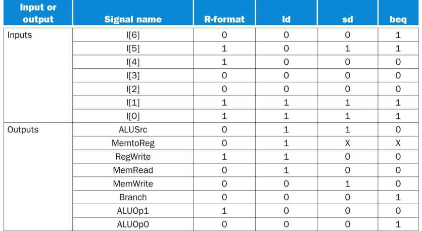

**HÌNH 4.22 Chức năng control cho triển khai single-cycle đơn giản được quy định hoàn toàn bởi truth table này. Nửa trên bảng cho biết các tổ hợp input signal tương ứng với bốn lớp instruction, mỗi cột một lớp, xác định thiết lập control output. Phần dưới bảng cho biết output cho từng opcode trong bốn opcode. Do đó, output RegWrite được asserted với hai tổ hợp input khác nhau. Nếu chỉ xét bốn opcode trong bảng, có thể đơn giản hóa truth table bằng don’t care trong phần input. Ví dụ, có thể phát hiện instruction R-format bằng biểu thức Op4 ∙ Op5, vì đủ để phân biệt instruction R-format với ld, sd và beq. Chúng ta không tận dụng sự đơn giản hóa này vì các opcode RISC-V còn lại được dùng trong triển khai đầy đủ.**

### Vì sao hiện nay không dùng triển khai Single-Cycle

Mặc dù thiết kế single-cycle hoạt động đúng, nó quá kém hiệu quả để dùng trong thiết kế hiện đại. Để hiểu lý do, lưu ý clock cycle phải có cùng độ dài cho mọi instruction trong thiết kế single-cycle này. Tất nhiên, đường dài nhất có thể có trong processor quyết định clock cycle. Đường này rất có thể là load instruction, dùng nối tiếp năm functional unit: instruction memory, register file, ALU, data memory và register file. Mặc dù CPI bằng 1 (xem Chương 1), hiệu năng tổng thể của triển khai single-cycle có thể thấp vì clock cycle quá dài.

Tổn thất khi dùng thiết kế single-cycle với clock cycle cố định là đáng kể, nhưng có thể được coi là chấp nhận được với instruction set nhỏ này. Trong lịch sử, các máy tính đầu tiên có instruction set rất đơn giản đã dùng kỹ thuật triển khai này. Tuy nhiên, nếu thử triển khai unit floating-point hoặc một instruction set có các instruction phức tạp hơn, thiết kế single-cycle này sẽ hoạt động rất kém.

Vì phải giả định clock cycle bằng delay worst-case của mọi instruction, việc thử các kỹ thuật triển khai giảm delay trường hợp phổ biến nhưng không cải thiện cycle time worst-case là vô ích. Do đó, triển khai single-cycle vi phạm ý tưởng lớn ở Chương 1: làm nhanh trường hợp phổ biến.


Trong mục tiếp theo, chúng ta sẽ xem kỹ thuật triển khai khác gọi là pipelining, dùng datapath rất giống datapath single-cycle nhưng hiệu quả hơn nhiều nhờ throughput cao hơn đáng kể. Pipelining cải thiện hiệu quả bằng cách thực thi đồng thời nhiều instruction.

#### Tự kiểm tra

Hãy xem các control signal trong Hình 4.22. Có thể kết hợp signal nào với nhau không? Có thể thay bất kỳ control signal output nào trong hình bằng giá trị đảo của signal khác không? (Gợi ý: tính cả don’t care.) Nếu có, có thể dùng signal này cho signal kia mà không thêm inverter không?

## 4.5 Tổng quan về Pipelining

### pipelining

Một kỹ thuật triển khai trong đó nhiều instruction được thực thi chồng lấp, giống như dây chuyền lắp ráp.

Pipelining là kỹ thuật triển khai trong đó nhiều instruction được thực thi chồng lấp. Ngày nay, pipelining gần như được dùng ở khắp nơi.

Đừng bao giờ lãng phí thời gian.

Tục ngữ Mỹ


Mục này dựa nhiều vào một phép so sánh để đưa ra tổng quan các thuật ngữ và vấn đề pipelining. Nếu chỉ quan tâm bức tranh chung, bạn nên tập trung vào mục này rồi chuyển đến Mục 4.10 và 4.11 để xem phần giới thiệu các kỹ thuật pipelining nâng cao dùng trong processor gần đây như Intel Core i7 và ARM Cortex-A53. Nếu muốn khám phá cấu trúc bên trong máy tính có pipeline, mục này là phần giới thiệu hữu ích cho các Mục 4.6 đến 4.9.

Bất kỳ ai đã giặt nhiều quần áo đều từng dùng pipelining theo trực giác. Cách giặt quần áo non-pipelined như sau:

1. Cho một mẻ quần áo bẩn vào máy giặt.

2. Khi máy giặt xong, cho mẻ quần áo ướt vào máy sấy.

3. Khi máy sấy xong, đặt mẻ quần áo khô lên bàn rồi gấp.

4. Khi gấp xong, nhờ bạn cùng phòng cất quần áo.

Khi bạn cùng phòng làm xong, bắt đầu lại với mẻ quần áo bẩn tiếp theo. Cách có pipeline tốn ít thời gian hơn nhiều, như Hình 4.23. Ngay khi máy giặt xong mẻ đầu và mẻ đó được cho vào máy sấy, bạn nạp mẻ bẩn thứ hai vào máy giặt. Khi mẻ đầu khô, bạn đặt lên bàn để bắt đầu gấp, chuyển mẻ ướt vào máy sấy và cho mẻ bẩn tiếp theo vào máy giặt. Tiếp đó, bạn nhờ bạn cùng phòng cất mẻ đầu, bắt đầu gấp mẻ thứ hai, máy sấy xử lý mẻ thứ ba và bạn cho mẻ thứ tư vào máy giặt. Lúc này mọi bước—gọi là stage trong pipelining—đều hoạt động đồng thời. Miễn là mỗi stage có tài nguyên riêng, chúng ta có thể pipeline các công việc.

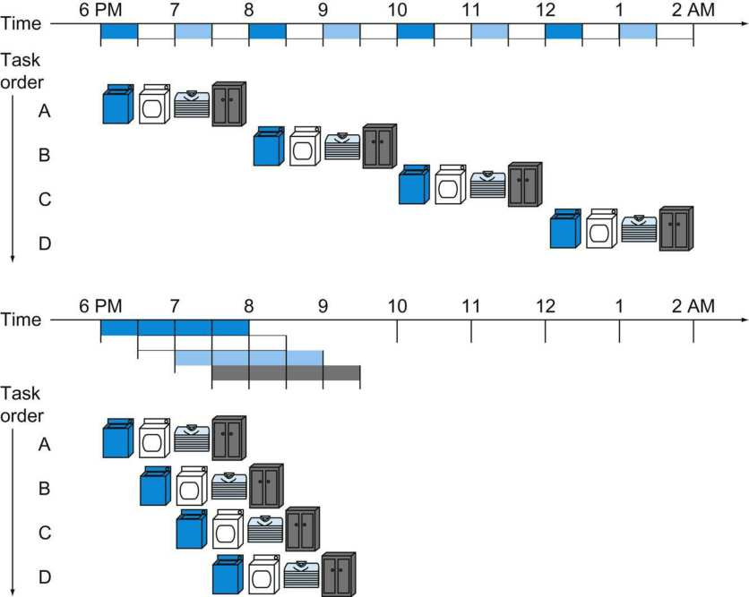

**HÌNH 4.23 Phép so sánh giặt quần áo cho pipelining. Ann, Brian, Cathy và Don đều có quần áo bẩn cần giặt, sấy, gấp và cất. Máy giặt, máy sấy, “người gấp” và “người cất” mỗi bên mất 30 phút cho công việc của mình. Giặt tuần tự mất 8 giờ cho bốn mẻ, trong khi giặt theo pipeline chỉ mất 3.5 giờ. Chúng ta thể hiện pipeline stage của các mẻ khác nhau theo thời gian bằng các bản sao của bốn tài nguyên trên trục thời gian two-dimensional này, nhưng thực tế mỗi tài nguyên chỉ có một.**

Nghịch lý pipelining là thời gian từ lúc đặt một chiếc tất bẩn vào máy giặt đến khi nó được sấy, gấp và cất không ngắn hơn khi dùng pipelining; lý do pipelining nhanh hơn với nhiều mẻ là mọi việc diễn ra song song, nên hoàn thành nhiều mẻ hơn mỗi giờ. Pipelining cải thiện throughput của hệ thống giặt. Vì vậy, pipelining không giảm thời gian hoàn thành một mẻ quần áo, nhưng khi có nhiều mẻ cần giặt, cải thiện throughput làm giảm tổng thời gian hoàn tất công việc.

Nếu mọi stage mất thời gian gần bằng nhau và có đủ công việc, speed-up nhờ pipelining bằng số stage trong pipeline, ở đây là bốn: giặt, sấy, gấp và cất. Do đó, giặt theo pipeline có thể nhanh gấp bốn cách không pipeline: 20 mẻ mất khoảng năm lần thời gian một mẻ, trong khi giặt tuần tự 20 mẻ mất 20 lần thời gian một mẻ. Hình 4.23 chỉ nhanh gấp 2.3 vì chỉ có bốn mẻ. Lưu ý lúc bắt đầu và kết thúc khối lượng công việc trong phiên bản có pipeline ở Hình 4.23, pipeline chưa đầy hoàn toàn; giai đoạn start-up và wind-down này ảnh hưởng hiệu năng khi số công việc không lớn so với số stage trong pipeline. Nếu số mẻ lớn hơn bốn rất nhiều, các stage sẽ đầy phần lớn thời gian và mức tăng throughput sẽ rất gần bốn.

Các nguyên lý tương tự áp dụng cho processor khi chúng ta pipeline việc thực thi instruction. Instruction RISC-V thường có năm bước:

1. Fetch instruction từ memory.

2. Đọc register và decode instruction.

3. Thực hiện phép toán hoặc tính địa chỉ.

4. Truy cập operand trong data memory (nếu cần).

5. Ghi kết quả vào register (nếu cần).

Vì vậy, pipeline RISC-V được khảo sát trong chương này có năm stage. Ví dụ tiếp theo cho thấy pipelining tăng tốc thực thi instruction giống như tăng tốc việc giặt quần áo.

#### Hiệu năng Single-Cycle so với có Pipeline

**Ví dụ**

Để phần thảo luận cụ thể hơn, hãy tạo một pipeline. Trong ví dụ này và phần còn lại của chương, chúng ta giới hạn ở bảy instruction: load doubleword (ld), store doubleword (sd), cộng (add), trừ (sub), AND (and), OR (or) và branch if equal (beq).

Hãy so sánh thời gian trung bình giữa các instruction của triển khai single-cycle, trong đó mọi instruction mất một clock cycle, với triển khai có pipeline. Giả sử thời gian thao tác của các functional unit chính trong ví dụ là 200 ps cho truy cập instruction memory hoặc data memory, 200 ps cho phép toán ALU và 100 ps cho đọc hoặc ghi register file. Trong mô hình single-cycle, mỗi instruction mất đúng một clock cycle, vì vậy clock cycle phải kéo dài để đáp ứng instruction chậm nhất.

**Trả lời**

Hình 4.24 cho thấy thời gian cần cho từng instruction trong bảy instruction. Thiết kế single-cycle phải đáp ứng instruction chậm nhất—trong Hình 4.24 là ld—nên thời gian cần cho mọi instruction là 800 ps. Tương tự Hình 4.23, Hình 4.25 so sánh việc thực thi ba instruction load register khi không có và khi có pipeline. Do đó, thời gian giữa instruction đầu tiên và thứ tư trong thiết kế không pipeline là 3 ×800 ps, hay 2400 ps.

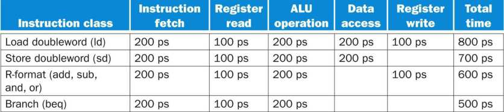

**HÌNH 4.24 Tổng thời gian cho mỗi instruction được tính từ thời gian từng thành phần. Phép tính giả định multiplexor, control unit, truy cập PC và sign extension unit không có delay.**

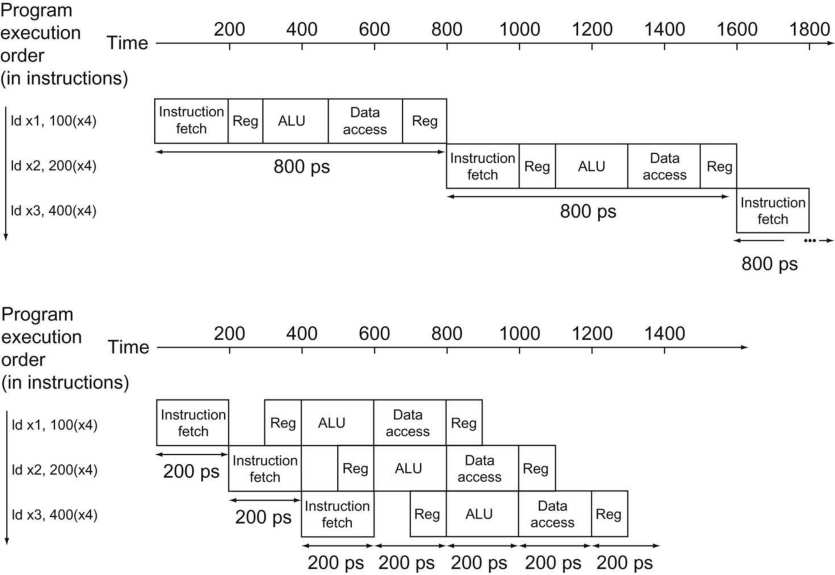

**HÌNH 4.25 Thực thi Single-cycle, không pipeline (trên) so với thực thi có pipeline (dưới). Cả hai dùng cùng các thành phần hardware, có thời gian liệt kê ở Hình 4.24. Trong trường hợp này, thời gian trung bình giữa các instruction có speed-up gấp bốn, từ 800 ps xuống 200 ps. So sánh hình này với Hình 4.23. Với việc giặt, chúng ta giả định mọi stage bằng nhau. Nếu máy sấy chậm nhất, stage máy sấy quyết định thời gian stage. Thời gian pipeline stage của máy tính cũng bị giới hạn bởi tài nguyên chậm nhất, là phép toán ALU hoặc truy cập memory. Chúng ta giả định ghi vào register file xảy ra trong nửa đầu clock cycle và đọc từ register file xảy ra trong nửa sau. Giả định này được dùng trong suốt chương.**

Mọi pipeline stage mất một clock cycle, nên clock cycle phải đủ dài để đáp ứng thao tác chậm nhất. Giống như thiết kế single-cycle phải dùng clock cycle worst-case 800 ps dù một số instruction có thể nhanh đến 500 ps, clock cycle thực thi có pipeline phải dùng clock cycle worst-case 200 ps dù một số stage chỉ mất 100 ps. Pipelining vẫn cải thiện hiệu năng gấp bốn: thời gian giữa instruction đầu tiên và thứ tư là 3 ×200 ps, hay 600 ps.

Chúng ta có thể chuyển phần thảo luận speed-up nhờ pipelining trên thành công thức. Nếu các stage cân bằng hoàn hảo, thời gian giữa các instruction trên processor có pipeline—giả định điều kiện lý tưởng—bằng

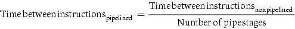

Trong điều kiện lý tưởng và với nhiều instruction, speed-up từ pipelining xấp xỉ số pipeline stage; pipeline five-stage nhanh hơn gần năm lần.

Công thức gợi ý rằng pipeline five-stage phải cải thiện gần năm lần so với thời gian 800 ps không pipeline, tức clock cycle 160 ps. Tuy nhiên, ví dụ cho thấy các stage có thể không cân bằng hoàn hảo. Hơn nữa, pipelining phát sinh overhead, nguồn gốc sẽ sớm rõ hơn. Do đó, thời gian trên mỗi instruction của processor có pipeline vượt quá mức tối thiểu có thể có, và speed-up sẽ nhỏ hơn số pipeline stage.

Tuy nhiên, ngay cả khẳng định cải thiện gấp bốn trong ví dụ cũng không thể hiện ở tổng thời gian thực thi ba instruction: 1400 ps so với 2400 ps. Tất nhiên, lý do là số instruction không lớn. Điều gì xảy ra nếu tăng số instruction? Chúng ta có thể mở rộng các hình trước thành 1,000,003 instruction. Ta thêm 1,000,000 instruction trong ví dụ có pipeline; mỗi instruction thêm 200 ps vào tổng thời gian thực thi. Tổng thời gian thực thi là 1,000,000 ×200 ps +1400 ps, hay 200,001,400 ps. Trong ví dụ không pipeline, ta thêm 1,000,000 instruction, mỗi instruction mất 800 ps, nên tổng thời gian thực thi là 1,000,000 ×800 ps +2400 ps, hay 800,002,400 ps. Trong điều kiện này, tỷ lệ tổng thời gian thực thi chương trình thực tế trên processor không pipeline so với có pipeline gần bằng tỷ lệ thời gian giữa các instruction:

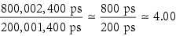

Pipelining cải thiện hiệu năng bằng cách tăng instruction throughput, thay vì giảm thời gian thực thi một instruction riêng lẻ, nhưng instruction throughput là thước đo quan trọng vì chương trình thực tế thực thi hàng tỷ instruction.

### Thiết kế Instruction Set cho Pipelining

Ngay cả với giải thích đơn giản này về pipelining, chúng ta vẫn có thể hiểu thêm về thiết kế instruction set RISC-V, vốn được thiết kế cho việc thực thi có pipeline.

Thứ nhất, mọi instruction RISC-V đều có cùng độ dài. Ràng buộc này giúp việc fetch instruction trong pipeline stage đầu và decode chúng trong stage thứ hai dễ hơn nhiều. Với instruction set như x86, nơi instruction có độ dài từ 1 byte đến 15 byte, pipelining khó khăn hơn đáng kể. Các triển khai kiến trúc x86 hiện đại thực ra chuyển instruction x86 thành các thao tác đơn giản giống instruction RISC-V, rồi pipeline các thao tác đơn giản thay vì instruction x86 gốc! (Xem Mục 4.10.)

Thứ hai, RISC-V chỉ có ít định dạng instruction, với các source register field và destination register field nằm cùng vị trí trong mỗi instruction.

Thứ ba, memory operand chỉ xuất hiện trong load hoặc store ở RISC-

V. Ràng buộc này có nghĩa có thể dùng execute stage để tính địa chỉ memory rồi truy cập memory trong stage tiếp theo. Nếu có thể thực hiện phép toán trên operand trong memory, như x86, các stage 3 và 4 sẽ mở rộng thành address stage, memory stage rồi execute stage. Chúng ta sẽ sớm thấy nhược điểm của pipeline dài hơn.

### Pipeline Hazard

Trong pipelining, có những tình huống instruction tiếp theo không thể thực thi trong clock cycle kế tiếp. Những sự kiện này được gọi là hazard, và có ba loại khác nhau.

#### Structural Hazard structural hazard

Khi một instruction dự kiến không thể thực thi trong clock cycle thích hợp vì hardware không hỗ trợ tổ hợp các instruction được lên lịch thực thi.

Hazard đầu tiên gọi là structural hazard. Nghĩa là hardware không thể hỗ trợ tổ hợp instruction chúng ta muốn thực thi trong cùng clock cycle. Structural hazard trong phòng giặt sẽ xảy ra nếu dùng máy washer-dryer kết hợp thay vì máy giặt và máy sấy riêng, hoặc nếu bạn cùng phòng bận làm việc khác và không chịu cất quần áo. Kế hoạch pipeline được lên lịch cẩn thận khi đó sẽ bị phá vỡ.

Như đã nói, instruction set RISC-V được thiết kế để có pipeline, giúp người thiết kế khá dễ tránh structural hazard khi thiết kế pipeline. Tuy nhiên, giả sử chỉ có một memory thay vì hai memory. Nếu pipeline trong Hình 4.25 có instruction thứ tư, chúng ta sẽ thấy trong cùng clock cycle, instruction đầu tiên truy cập dữ liệu từ memory trong khi instruction thứ tư fetch instruction từ chính memory đó. Không có hai memory, pipeline có thể gặp structural hazard.

#### Data Hazard data hazard

Còn gọi là pipeline data hazard. Khi một instruction dự kiến không thể thực thi trong clock cycle thích hợp vì dữ liệu cần để thực thi instruction chưa sẵn sàng.

Data hazard xảy ra khi pipeline phải stall vì một bước phải đợi bước khác hoàn tất. Giả sử bạn thấy một chiếc tất ở nơi gấp mà không có chiếc cùng đôi. Một chiến lược là chạy về phòng và tìm trong tủ quần áo xem có thấy chiếc cùng đôi không. Rõ ràng, khi bạn tìm kiếm, các mẻ đã sấy xong sẵn sàng để gấp, còn các mẻ đã giặt xong sẵn sàng để sấy.

Trong pipeline máy tính, data hazard phát sinh từ việc một instruction phụ thuộc instruction trước đó vẫn còn trong pipeline (mối quan hệ không thực sự tồn tại khi giặt quần áo). Ví dụ, giả sử có add instruction được theo ngay sau bởi subtract instruction dùng tổng đó (x19):

```
add x19, x0, x1
sub x2, x19, x3
```

Nếu không can thiệp, data hazard có thể khiến pipeline stall nghiêm trọng. Add instruction chưa ghi kết quả cho đến stage thứ năm, nghĩa là chúng ta phải lãng phí ba clock cycle trong pipeline.

Mặc dù có thể dựa vào compiler để loại bỏ mọi hazard như vậy, kết quả sẽ không thỏa đáng. Các phụ thuộc này xảy ra quá thường xuyên và delay quá dài để có thể trông chờ compiler giải quyết tình thế khó khăn này.

Giải pháp chính dựa trên nhận xét rằng không cần chờ instruction hoàn tất mới bắt đầu giải quyết data hazard. Với chuỗi code trên, ngay khi ALU tạo tổng cho add, chúng ta có thể cung cấp nó làm input cho subtract. Việc thêm hardware để lấy sớm dữ liệu còn thiếu từ tài nguyên bên trong gọi là forwarding hoặc bypassing.

#### forwarding

Còn gọi là bypassing. Phương pháp giải quyết data hazard bằng cách lấy phần tử dữ liệu còn thiếu từ buffer bên trong thay vì chờ nó đến từ register programmer-visible hoặc từ memory.

#### Forwarding với hai instruction

**Ví dụ**

Với hai instruction trên, hãy cho biết forwarding kết nối những pipeline stage nào. Dùng hình vẽ trong Hình 4.26 để biểu diễn datapath trong năm stage của pipeline. Căn chỉnh một bản sao datapath cho mỗi instruction, tương tự pipeline giặt quần áo trong Hình 4.23.

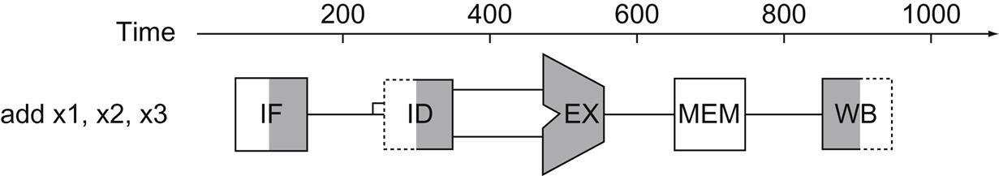

**HÌNH 4.26 Biểu diễn đồ họa của instruction pipeline, có ý tưởng tương tự pipeline giặt quần áo trong Hình 4.23. Ở đây dùng ký hiệu biểu diễn các tài nguyên vật lý cùng chữ viết tắt pipeline stage được dùng xuyên suốt chương. Ký hiệu cho năm stage: IF là instruction fetch stage, với hộp biểu diễn instruction memory; ID là instruction decode/register file read stage, với hình register file đang được đọc; EX là execution stage, với hình biểu diễn ALU; MEM là memory access stage, với hộp biểu diễn data memory; WB là write-back stage, với hình register file đang được ghi. Phần tô nền cho biết phần tử được instruction dùng. Vì vậy MEM có nền trắng vì add không truy cập data memory. Tô nền nửa phải register file hoặc memory nghĩa là phần tử được đọc trong stage đó; tô nền nửa trái nghĩa là được ghi trong stage đó. Do đó nửa phải ID được tô ở stage thứ hai vì register file được đọc, còn nửa trái WB được tô ở stage thứ năm vì register file được ghi.**

**Trả lời**

Hình 4.27 cho thấy kết nối forward giá trị trong x1 sau execution stage của add instruction đến làm input cho execution stage của sub instruction.

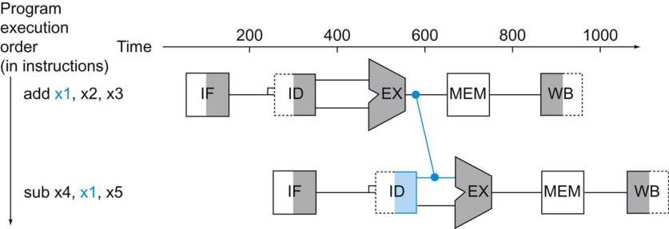

**HÌNH 4.27 Biểu diễn đồ họa của forwarding. Kết nối cho thấy forwarding path từ output EX stage của add đến input EX stage của sub, thay thế giá trị từ register x1 được đọc trong stage thứ hai của sub.**

Trong cách biểu diễn sự kiện bằng đồ họa này, forwarding path chỉ hợp lệ nếu destination stage muộn hơn source stage về thời gian. Ví dụ, không thể có forwarding path hợp lệ từ output memory access stage của instruction đầu đến input execution stage của instruction tiếp theo, vì như vậy là đi ngược thời gian.

Forwarding hoạt động rất tốt và được mô tả chi tiết trong Mục 4.7. Tuy nhiên, nó không ngăn được mọi pipeline stall. Ví dụ, giả sử instruction đầu là load x1 thay vì add. Như có thể hình dung từ Hình 4.27, dữ liệu mong muốn chỉ sẵn sàng sau stage thứ tư của instruction đầu trong mối phụ thuộc, quá muộn cho input stage thứ ba của sub. Vì vậy, ngay cả khi có forwarding, vẫn phải stall một stage do data hazard load-use, như Hình 4.28. Hình này cho thấy một khái niệm pipeline quan trọng, tên chính thức là pipeline stall nhưng thường được gọi là bubble. Chúng ta sẽ gặp stall ở các vị trí khác trong pipeline. Mục 4.7 chỉ cách xử lý các trường hợp khó như vậy, dùng phát hiện bằng hardware và stall, hoặc software sắp xếp lại code để cố tránh pipeline stall load-use, như minh họa trong ví dụ này.

#### load-use data hazard

Một dạng data hazard cụ thể trong đó dữ liệu do load instruction nạp chưa sẵn sàng khi instruction khác cần nó.

#### pipeline stall

Còn gọi là bubble. Một stall được khởi tạo để giải quyết hazard.

#### Sắp xếp lại code để tránh Pipeline Stall

**Ví dụ**

Xét đoạn code C sau:

```
a = b + e;
c = b + f;
```

Dưới đây là code RISC-V được tạo cho đoạn này, giả sử mọi biến nằm trong memory và có thể định địa chỉ bằng offset từ x31:

```
ld  x1, 0(x31) // Load b
ld  x2, 8(x31) // Load e
add   x3, x1, x2 // b + e
sd  x3, 24(x31) // Store a
ld  x4, 16(x31) // Load f
add   x5, x1, x4 // b + f
sd  x5, 32(x31) // Store c
```

Tìm các hazard trong đoạn code trên và sắp xếp lại instruction để tránh mọi pipeline stall.

**Trả lời**

Cả hai add instruction đều có hazard vì phụ thuộc vào ld instruction ngay trước tương ứng. Lưu ý forwarding loại bỏ một số hazard tiềm tàng khác, gồm phụ thuộc của add đầu vào ld đầu và mọi hazard cho store instruction. Đưa ld instruction thứ ba lên làm instruction thứ ba sẽ loại bỏ cả hai hazard:

```
ld  x1, 0(x31)
ld  x2, 8(x31)
ld  x4, 16(x31)
add   x3, x1, x2
sd  x3, 24(x31)
add   x5, x1, x4
sd  x5, 32(x31)
```

Trên processor có pipeline và forwarding, chuỗi đã sắp xếp lại hoàn tất ít hơn hai cycle so với phiên bản gốc.

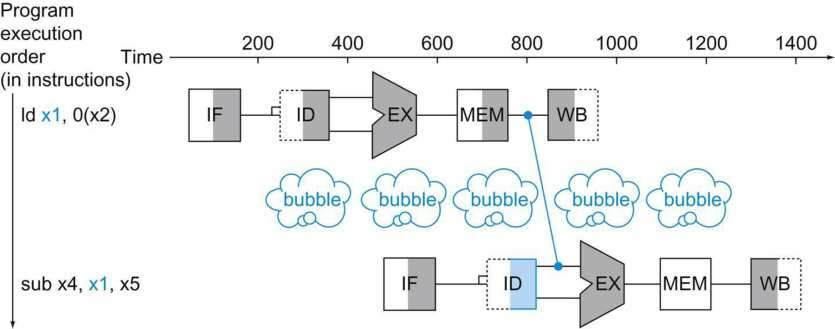

**HÌNH 4.28 Cần stall ngay cả khi có forwarding nếu instruction R-format theo sau load cố dùng dữ liệu. Nếu không stall, đường từ output memory access stage đến input execution stage sẽ đi ngược thời gian, điều không thể xảy ra. Hình này thực ra đã đơn giản hóa vì chỉ sau khi subtract instruction được fetch và decode, chúng ta mới biết có cần stall hay không. Mục 4.7 cho thấy chi tiết điều thực sự xảy ra khi có hazard.**

Ngoài ba điểm đã nêu ở trang 267, forwarding đem lại một hiểu biết khác về kiến trúc RISC-V. Mỗi instruction RISC-V ghi nhiều nhất một kết quả và thực hiện ở stage cuối pipeline. Forwarding khó hơn nếu mỗi instruction có nhiều kết quả cần forward hoặc cần ghi kết quả sớm trong quá trình thực thi instruction.

#### Giải thích thêm

Tên “forwarding” xuất phát từ ý tưởng chuyển kết quả về phía trước từ instruction trước sang instruction sau. “Bypassing” xuất phát từ việc đưa kết quả đi vòng qua register file đến unit mong muốn.

### Control Hazard

Loại hazard thứ ba gọi là control hazard, phát sinh từ nhu cầu đưa ra quyết định dựa trên kết quả của một instruction trong khi các instruction khác đang thực thi.

#### control hazard

Còn gọi là branch hazard. Khi instruction đúng không thể thực thi trong pipeline clock cycle thích hợp vì instruction đã fetch không phải instruction cần thiết; tức luồng địa chỉ instruction không như pipeline dự kiến.

Giả sử nhóm giặt quần áo được giao nhiệm vụ thú vị là giặt đồng phục đội bóng. Do quần áo quá bẩn, chúng ta cần xác định lượng chất giặt và thiết lập nhiệt độ nước đã chọn có đủ mạnh để giặt sạch đồng phục, nhưng không quá mạnh khiến đồng phục mau hỏng hay không. Trong pipeline giặt, phải đợi đến stage thứ hai để kiểm tra đồng phục khô xem có cần thay đổi thiết lập máy giặt không. Phải làm gì?

Dưới đây là giải pháp đầu tiên trong hai giải pháp cho control hazard trong phòng giặt và trường hợp tương đương trong máy tính.

Stall: Chỉ làm tuần tự cho đến khi mẻ đầu khô, rồi lặp lại cho đến khi có công thức đúng.

Lựa chọn thận trọng này chắc chắn hiệu quả, nhưng chậm.

Nhiệm vụ ra quyết định tương đương trong máy tính là conditional branch instruction. Lưu ý phải bắt đầu fetch instruction sau branch trong clock cycle kế tiếp. Tuy nhiên, pipeline không thể biết instruction tiếp theo phải là gì, vì nó chỉ vừa nhận branch instruction từ memory! Giống việc giặt, một giải pháp là stall ngay sau khi fetch branch, chờ đến khi pipeline xác định kết quả branch và biết phải fetch từ địa chỉ instruction nào.

Giả sử bổ sung đủ hardware để kiểm tra register, tính địa chỉ branch và cập nhật PC trong stage thứ hai của pipeline (xem Mục 4.8 để biết chi tiết). Ngay cả với hardware bổ sung này, pipeline có conditional branch cũng sẽ như Hình 4.29. Instruction được thực thi nếu branch không xảy ra sẽ bị stall thêm một clock cycle 200 ps trước khi bắt đầu.

#### Hiệu năng của “Stall on Branch”

**Ví dụ**

Ước lượng tác động của việc stall tại branch lên số clock cycle trên mỗi instruction (CPI). Giả sử mọi instruction khác có CPI bằng 1.

**Trả lời**

Hình 3.28 trong Chương 3 cho thấy conditional branch chiếm 17% instruction được thực thi trong SPECint2006. Vì các instruction khác có CPI bằng 1 và conditional branch mất thêm một clock cycle cho stall, CPI sẽ là 1.17 và do đó mức chậm đi là 1.17 so với trường hợp lý tưởng.

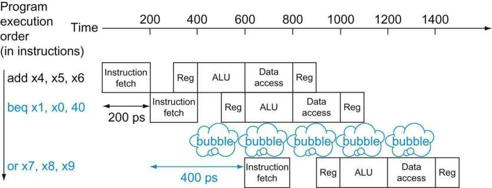

**HÌNH 4.29 Pipeline stall tại mọi conditional branch để giải quyết control hazard. Ví dụ giả định conditional branch được taken và instruction tại đích branch là or instruction. Có pipeline stall one-stage, hay bubble, sau branch. Thực tế, quá trình tạo stall phức tạp hơn một chút, như sẽ thấy trong Mục 4.8. Tuy nhiên, ảnh hưởng lên hiệu năng giống như khi chèn bubble.**

Nếu không thể giải quyết branch trong stage thứ hai, như thường xảy ra với pipeline dài hơn, việc stall tại conditional branch còn gây chậm hơn. Chi phí của lựa chọn này quá cao đối với phần lớn máy tính, thúc đẩy giải pháp thứ hai cho control hazard bằng một trong các ý tưởng lớn ở Chương 1:

Dự đoán: Nếu chắc chắn có công thức đúng để giặt đồng phục, cứ dự đoán nó sẽ hiệu quả và giặt mẻ thứ hai trong lúc chờ mẻ đầu khô.

Lựa chọn này không làm chậm pipeline khi bạn đúng. Tuy nhiên, khi sai, bạn phải giặt lại mẻ đã được giặt trong lúc đoán quyết định.


Máy tính thực sự dùng dự đoán để xử lý conditional branch. Một cách đơn giản là luôn dự đoán conditional branch sẽ không taken. Khi đúng, pipeline chạy ở tốc độ tối đa. Chỉ khi conditional branch được taken thì pipeline mới stall. Hình 4.30 cho thấy ví dụ này.

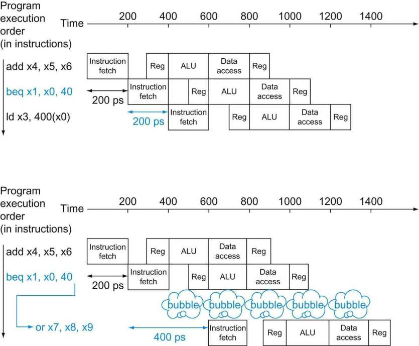

**HÌNH 4.30 Dự đoán branch không được taken như giải pháp cho control hazard. Hình trên thể hiện pipeline khi branch không được taken. Hình dưới thể hiện pipeline khi branch được taken. Như đã lưu ý ở Hình 4.29, chèn bubble theo cách này đơn giản hóa điều thực sự xảy ra, ít nhất trong clock cycle đầu ngay sau branch. Mục 4.8 sẽ trình bày chi tiết. Phiên bản branch prediction tinh vi hơn dự đoán một số conditional branch được taken và số khác không taken. Trong phép so sánh của chúng ta, đồng phục tối màu hoặc sân nhà có thể cần một công thức, còn đồng phục sáng màu hoặc sân khách cần công thức khác. Trong lập trình, cuối loop thường là conditional branch nhảy về đầu loop. Vì chúng có khả năng được taken và nhảy ngược, chúng ta có thể luôn dự đoán taken đối với conditional branch nhảy đến địa chỉ trước đó.**

#### branch prediction

Phương pháp giải quyết branch hazard bằng cách giả định một kết quả nhất định cho conditional branch rồi tiếp tục theo giả định đó, thay vì chờ xác định kết quả thực sự.


Các cách branch prediction cứng nhắc như vậy dựa vào hành vi khuôn mẫu và không tính đặc điểm riêng của branch instruction cụ thể. Ngược lại, dynamic hardware predictor dự đoán theo hành vi từng conditional branch và có thể thay đổi dự đoán cho một conditional branch trong suốt quá trình chạy chương trình. Theo phép so sánh, trong dynamic prediction, một người nhìn độ bẩn của đồng phục và đoán công thức, rồi điều chỉnh dự đoán tiếp theo theo mức thành công của các lần đoán gần đây.

Một cách dynamic prediction phổ biến cho conditional branch là giữ lịch sử taken hoặc untaken của từng conditional branch, rồi dùng hành vi gần đây để dự đoán tương lai. Như sẽ thấy sau này, lượng và loại lịch sử được giữ đã trở nên phong phú, khiến dynamic branch predictor có thể dự đoán đúng conditional branch với độ chính xác hơn 90% (xem Mục 4.8). Khi dự đoán sai, pipeline control phải bảo đảm các instruction sau conditional branch bị dự đoán sai không có tác động, rồi khởi động lại pipeline từ địa chỉ branch đúng. Trong phép so sánh giặt, phải ngừng nhận mẻ mới để bắt đầu lại mẻ đã dự đoán sai.

Như mọi giải pháp control hazard khác, pipeline dài hơn làm vấn đề trầm trọng thêm, ở đây là tăng chi phí dự đoán sai. Các giải pháp control hazard được mô tả chi tiết hơn trong Mục 4.8.

#### Giải thích thêm

Có cách thứ ba cho control hazard, gọi là delayed decision. Trong phép so sánh, mỗi khi cần đưa ra quyết định về giặt như vậy, chỉ cần cho một mẻ quần áo non-football vào máy giặt trong lúc đợi đồng phục khô. Miễn có đủ quần áo bẩn không bị ảnh hưởng bởi phép thử, giải pháp này hoạt động tốt.

Trong máy tính, cách này gọi là delayed branch, chính là giải pháp được kiến trúc MIPS dùng. Delayed branch luôn thực thi instruction tuần tự kế tiếp, và branch diễn ra sau delay một instruction đó. Nó được ẩn khỏi người lập trình assembly MIPS vì assembler có thể tự động sắp xếp instruction để đạt hành vi branch mong muốn. Software MIPS đặt một instruction không bị branch ảnh hưởng ngay sau delayed branch instruction; branch được taken sẽ thay đổi địa chỉ instruction theo sau instruction an toàn đó. Trong ví dụ, add instruction trước branch ở Hình 4.29 không ảnh hưởng branch và có thể được chuyển ra sau branch để ẩn hoàn toàn branch delay. Vì delayed branch hữu ích khi branch ngắn, hiếm thấy processor có delayed branch lớn hơn một cycle. Với branch delay dài hơn, thường dùng branch prediction hardware-based.

### Tóm lược tổng quan Pipeline

Pipelining là kỹ thuật khai thác tính song song giữa các instruction trong một luồng instruction tuần tự. Nó có ưu điểm đáng kể là về cơ bản vô hình với programmer, khác với việc lập trình multiprocessor (xem Chương 6).


Trong vài mục tiếp theo, chúng ta trình bày khái niệm pipelining bằng tập con instruction RISC-V từ triển khai single-cycle trong Mục 4.4 và cho thấy một phiên bản pipeline đơn giản hóa. Sau đó, chúng ta xem các vấn đề do pipelining gây ra và hiệu năng có thể đạt được trong tình huống điển hình.


Nếu muốn tập trung hơn vào software và tác động của pipelining lên hiệu năng, bạn hiện đã có đủ nền tảng để chuyển đến Mục 4.10. Mục 4.10 giới thiệu các khái niệm pipelining nâng cao như superscalar và dynamic scheduling, còn Mục 4.11 khảo sát pipeline của các microprocessor gần đây.

Nếu quan tâm cách triển khai pipelining và những thách thức xử lý hazard, bạn có thể tiếp tục khảo sát thiết kế datapath có pipeline và control cơ bản, được giải thích trong Mục 4.6. Sau đó có thể dùng hiểu biết này để khám phá triển khai forwarding và stall trong Mục 4.7. Tiếp theo đọc Mục 4.8 để tìm hiểu các giải pháp branch hazard, rồi cuối cùng xem cách xử lý exception trong Mục 4.9.

#### Tự kiểm tra

Với từng chuỗi code dưới đây, cho biết nó phải stall, có thể tránh stall chỉ bằng forwarding, hay có thể thực thi mà không cần stall hoặc forwarding.

| Chuỗi 1 | Chuỗi 2 | Chuỗi 3 |
|---|---|---|
| ld x10, 0(x10) | add x11, x10, x10 | addi x11, x10, 1 |
| add x11, x10, x10 | addi x12, x10, 5 | addi x12, x10, 2 |
|  | addi x14, x11, 5 | addi x13, x10, 3 |
|  |  | addi x14, x10, 4 |

```
  addi x15, x10, 5
```

#### Hiểu hiệu năng chương trình

Ngoài hệ thống memory, hoạt động hiệu quả của pipeline thường là yếu tố quan trọng nhất quyết định CPI của processor và do đó hiệu năng của nó. Như sẽ thấy trong Mục 4.10, việc hiểu hiệu năng của processor có pipeline multiple-issue hiện đại khá phức tạp và đòi hỏi hiểu nhiều hơn những vấn đề phát sinh trong processor có pipeline đơn giản. Dù vậy, structural hazard, data hazard và control hazard vẫn quan trọng trong cả pipeline đơn giản lẫn tinh vi hơn.

Với pipeline hiện đại, structural hazard thường xoay quanh unit floating-point, vốn có thể chưa được pipeline hoàn toàn; control hazard thường gây vấn đề hơn trong chương trình integer, thường có tần suất conditional branch cao hơn và branch khó dự đoán hơn. Data hazard có thể là nút thắt hiệu năng trong cả chương trình integer và floating-point. Thường dễ xử lý data hazard trong chương trình floating-point hơn vì tần suất conditional branch thấp và mẫu truy cập memory đều đặn hơn cho phép compiler thử lên lịch instruction để tránh hazard. Khó thực hiện tối ưu như vậy hơn trong chương trình integer có truy cập memory kém đều đặn, dùng pointer nhiều hơn. Như sẽ thấy trong Mục 4.10, có các kỹ thuật compiler và hardware tham vọng hơn để giảm data dependence thông qua scheduling.

#### Bức tranh TỔNG THỂ

Pipelining tăng số instruction thực thi đồng thời và tốc độ bắt đầu, hoàn tất instruction. Pipelining không giảm thời gian hoàn tất một instruction riêng lẻ, còn gọi là latency. Ví dụ, pipeline five-stage vẫn mất năm clock cycle để hoàn tất instruction. Theo thuật ngữ ở Chương 1, pipelining cải thiện instruction throughput thay vì thời gian thực thi hay latency của từng instruction.


Instruction set có thể làm công việc của người thiết kế pipeline khó hơn hoặc đơn giản hơn, trong khi họ vốn phải xử lý structural hazard, control hazard và data hazard. Branch prediction và forwarding giúp máy tính chạy nhanh mà vẫn cho kết quả đúng.


#### latency (pipeline)

Số stage trong pipeline hoặc số stage giữa hai instruction trong quá trình thực thi.

## 4.6 Datapath và Control có Pipeline

Điều này có ít hơn vẻ bề ngoài.

Tallulah Bankhead, lời nói với Alexander Woollcott, 1922

Hình 4.31 cho thấy datapath single-cycle từ Mục 4.4 với các pipeline stage được xác định. Chia instruction thành năm stage tạo ra pipeline five-stage, có nghĩa tối đa năm instruction có thể đang thực thi trong bất kỳ clock cycle nào. Vì vậy phải tách datapath thành năm phần, mỗi phần được đặt tên tương ứng với một stage thực thi instruction:

1. IF: Instruction fetch

2. ID: Instruction decode và đọc register file

3. EX: Thực thi hoặc tính địa chỉ

4. MEM: Truy cập data memory

5. WB: Write back

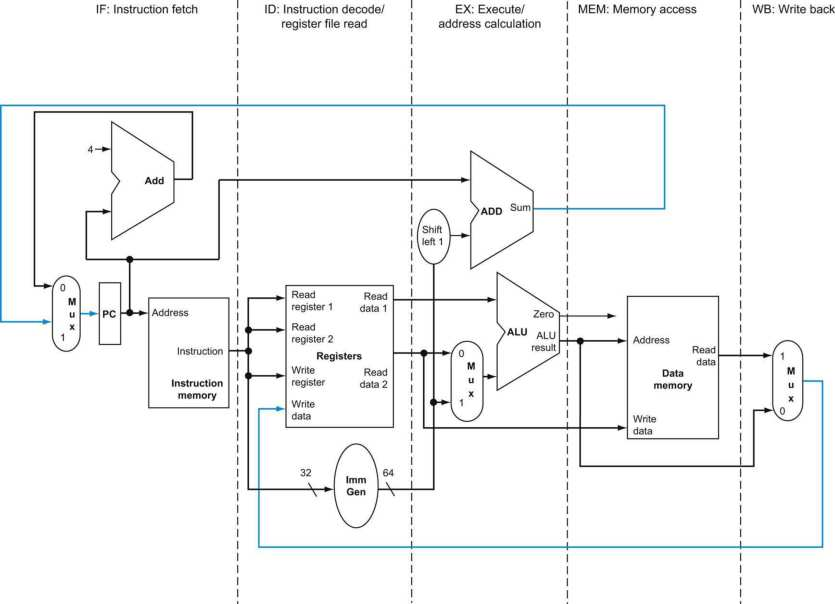

**HÌNH 4.31 Datapath single-cycle từ Mục 4.4 (tương tự Hình 4.17). Mỗi bước của instruction có thể được ánh xạ lên datapath từ trái sang phải. Ngoại lệ duy nhất là cập nhật PC và bước write-back, được tô màu, gửi kết quả ALU hoặc dữ liệu từ memory về bên trái để ghi vào register file. (Thông thường dùng đường màu cho control, nhưng đây là các đường dữ liệu.)**

Trong Hình 4.31, năm thành phần này tương ứng gần đúng với cách vẽ data-path; instruction và dữ liệu thường di chuyển từ trái sang phải qua năm stage khi hoàn tất thực thi. Trở lại phép so sánh giặt, quần áo sạch hơn, khô hơn và gọn hơn khi đi qua dây chuyền, và không bao giờ đi ngược.

Tuy nhiên, có hai ngoại lệ đối với luồng instruction left-to-right này:

- Stage write-back đặt kết quả trở lại register file ở giữa datapath

- Việc chọn giá trị PC tiếp theo giữa PC đã tăng và địa chỉ branch từ MEM stage Dữ liệu đi từ phải sang trái không ảnh hưởng instruction hiện tại; các chuyển động dữ liệu ngược này chỉ ảnh hưởng instruction sau trong pipeline. Lưu ý luồng dữ liệu right-to-left đầu tiên có thể gây data hazard, còn luồng thứ hai gây control hazard.

Một cách thể hiện điều xảy ra khi thực thi có pipeline là giả vờ mỗi instruction có datapath riêng, rồi đặt các datapath trên trục thời gian để cho thấy quan hệ giữa chúng. Hình 4.32 cho thấy việc thực thi các instruction trong Hình 4.25 bằng cách biểu diễn datapath riêng của chúng trên trục thời gian chung. Chúng ta dùng phiên bản cách điệu của datapath trong Hình 4.31 để thể hiện các quan hệ ở Hình 4.32.

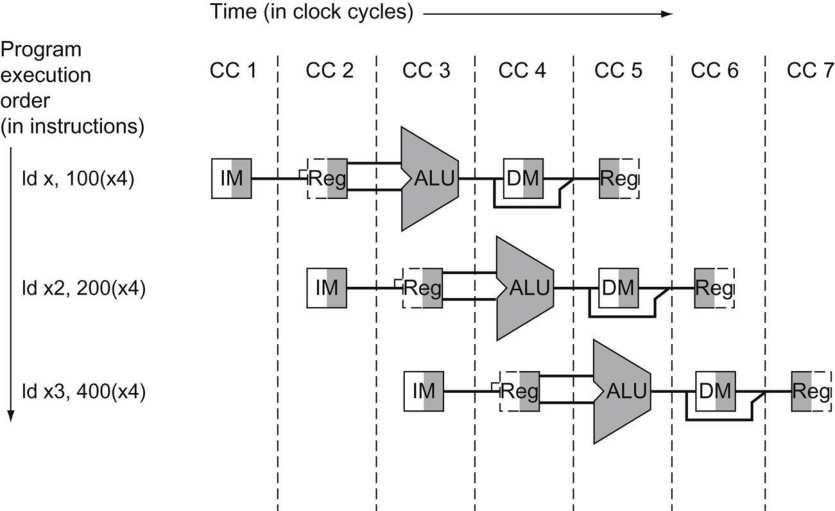

**HÌNH 4.32 Các instruction được thực thi bằng datapath single-cycle ở Hình 4.31, giả định thực thi có pipeline. Tương tự các Hình 4.26 đến 4.28, hình này giả vờ mỗi instruction có datapath riêng và tô nền từng phần theo việc sử dụng. Khác các hình đó, mỗi stage được ghi nhãn bằng tài nguyên vật lý được dùng trong stage, tương ứng các phần datapath ở Hình 4.31. IM biểu diễn instruction memory và PC trong instruction fetch stage, Reg biểu diễn register file và sign extender trong instruction decode/register file read stage (ID), v.v. Để duy trì thứ tự thời gian đúng, datapath cách điệu này tách register file thành hai phần logic: register được đọc khi register fetch (ID) và register được ghi khi write back (WB). Việc dùng hai lần được biểu diễn bằng cách vẽ nửa trái không tô của register file bằng nét đứt trong ID stage, lúc không được ghi, và nửa phải không tô bằng nét đứt trong WB stage, lúc không được đọc. Như trước, giả định register file được ghi trong nửa đầu clock cycle và được đọc trong nửa sau.**

Hình 4.32 có vẻ gợi ý ba instruction cần ba datapath. Thay vào đó, chúng ta thêm register để giữ dữ liệu sao cho các phần của một datapath có thể được chia sẻ khi thực thi instruction.

Ví dụ, như Hình 4.32 cho thấy, instruction memory chỉ được dùng trong một stage của năm stage instruction, cho phép instruction sau chia sẻ nó trong bốn stage còn lại. Để giữ giá trị một instruction cho bốn stage khác, giá trị đọc từ instruction memory phải được lưu vào register. Lập luận tương tự áp dụng cho mọi pipeline stage, nên phải đặt register ở bất kỳ đường phân chia stage nào trong Hình 4.31. Trở lại phép so sánh giặt, chúng ta có thể đặt giỏ giữa mỗi cặp stage để giữ quần áo cho bước tiếp theo.

Hình 4.33 cho thấy datapath có pipeline với các pipeline register được high-lighted. Trong mỗi clock cycle, mọi instruction tiến từ pipeline register này sang pipeline register kế tiếp. Register được đặt tên theo hai stage mà nó ngăn cách. Ví dụ, pipeline register giữa IF stage và ID stage gọi là IF/ID.

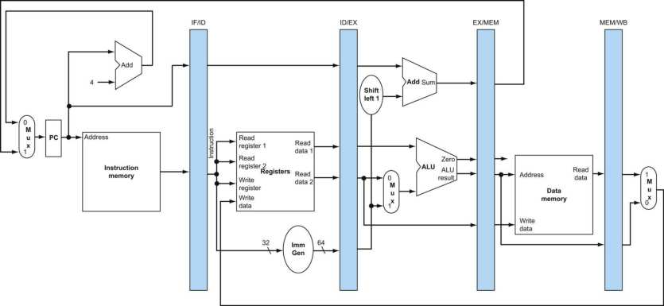

**HÌNH 4.33 Phiên bản có pipeline của datapath trong Hình 4.31. Các pipeline register tô màu ngăn cách từng pipeline stage. Chúng được ghi nhãn theo các stage được ngăn cách; ví dụ, register đầu có nhãn IF/ID vì ngăn cách instruction fetch stage và instruction decode stage. Register phải đủ rộng để lưu mọi dữ liệu tương ứng với các đường đi qua nó. Ví dụ, IF/ID register phải rộng 96 bit vì phải giữ cả instruction 32-bit fetch từ memory lẫn địa chỉ PC 64-bit đã tăng. Chúng ta sẽ mở rộng các register này trong suốt chương, nhưng hiện tại ba pipeline register còn lại lần lượt chứa 256, 193 và 128 bit.**

Lưu ý không có pipeline register ở cuối stage write-back. Mọi instruction phải cập nhật một state nào đó trong processor—register file, memory hoặc PC—nên một pipeline register riêng sẽ dư thừa so với state được cập nhật. Ví dụ, load instruction đặt kết quả vào một trong 32 register, và mọi instruction sau cần dữ liệu đó chỉ việc đọc register thích hợp.

Tất nhiên, mọi instruction đều cập nhật PC, bằng cách tăng nó hoặc đặt thành địa chỉ đích branch. Có thể coi PC là pipeline register cấp input cho IF stage của pipeline. Tuy nhiên, khác các pipeline register tô nền trong Hình 4.33, PC là một phần của architectural state nhìn thấy được; nội dung phải được lưu khi có exception, trong khi có thể bỏ nội dung các pipeline register. Trong phép so sánh giặt, có thể coi PC tương ứng giỏ giữ mẻ quần áo bẩn trước bước giặt.

Để cho thấy cách pipelining hoạt động, xuyên suốt chương chúng ta dùng chuỗi hình minh họa hoạt động theo thời gian. Những trang bổ sung này có vẻ đòi hỏi bạn tốn nhiều thời gian hơn để hiểu. Đừng lo; các chuỗi hình tốn ít thời gian hơn vẻ bề ngoài rất nhiều, vì có thể so sánh để thấy thay đổi xảy ra trong từng clock cycle. Mục 4.7 mô tả điều xảy ra khi có data hazard giữa các instruction trong pipeline; hiện tại hãy bỏ qua chúng.

Các Hình 4.34 đến 4.37, chuỗi đầu tiên, làm nổi bật các phần datapath đang hoạt động khi load instruction đi qua năm stage thực thi có pipeline. Chúng ta trình bày load trước vì nó hoạt động ở cả năm stage. Như trong Hình 4.26 đến 4.28, chúng ta làm nổi bật nửa phải register hoặc memory khi được đọc và nửa trái khi được ghi.

Chúng ta ghi instruction ld cùng tên pipeline stage đang hoạt động trong mỗi hình. Năm stage như sau:

1. Instruction fetch: Phần trên Hình 4.34 cho thấy instruction được đọc từ memory bằng địa chỉ trong PC rồi đặt vào IF/ID pipeline register. Địa chỉ PC tăng thêm 4 rồi được ghi lại vào PC để sẵn sàng cho clock cycle kế tiếp. PC này cũng được lưu trong IF/ID pipeline register phòng khi instruction như beq cần dùng sau này. Máy tính không thể biết loại instruction đang fetch, nên phải chuẩn bị cho mọi instruction bằng cách chuyển thông tin có thể cần xuống pipeline.

2. Instruction decode và đọc register file: Phần dưới Hình 4.34 cho thấy phần instruction của IF/ID pipeline register cung cấp immediate field được sign-extended thành 64 bit, cùng các số register để đọc hai register. Cả ba giá trị được lưu trong ID/EX pipeline register, cùng địa chỉ PC. Một lần nữa, chúng ta chuyển mọi thứ có thể được bất kỳ instruction nào cần trong clock cycle sau.

3. Thực thi hoặc tính địa chỉ: Hình 4.35 cho thấy load instruction đọc nội dung register và immediate đã sign-extended từ ID/EX pipeline register rồi cộng chúng bằng ALU. Tổng đó được đặt vào EX/MEM pipeline register.

4. Truy cập memory: Phần trên Hình 4.36 cho thấy load instruction đọc data memory bằng địa chỉ từ EX/MEM pipeline register và nạp dữ liệu vào MEM/WB pipeline register.

5. Write-back: Phần dưới Hình 4.36 cho thấy bước cuối: đọc dữ liệu từ MEM/WB pipeline register rồi ghi vào register file ở giữa hình.

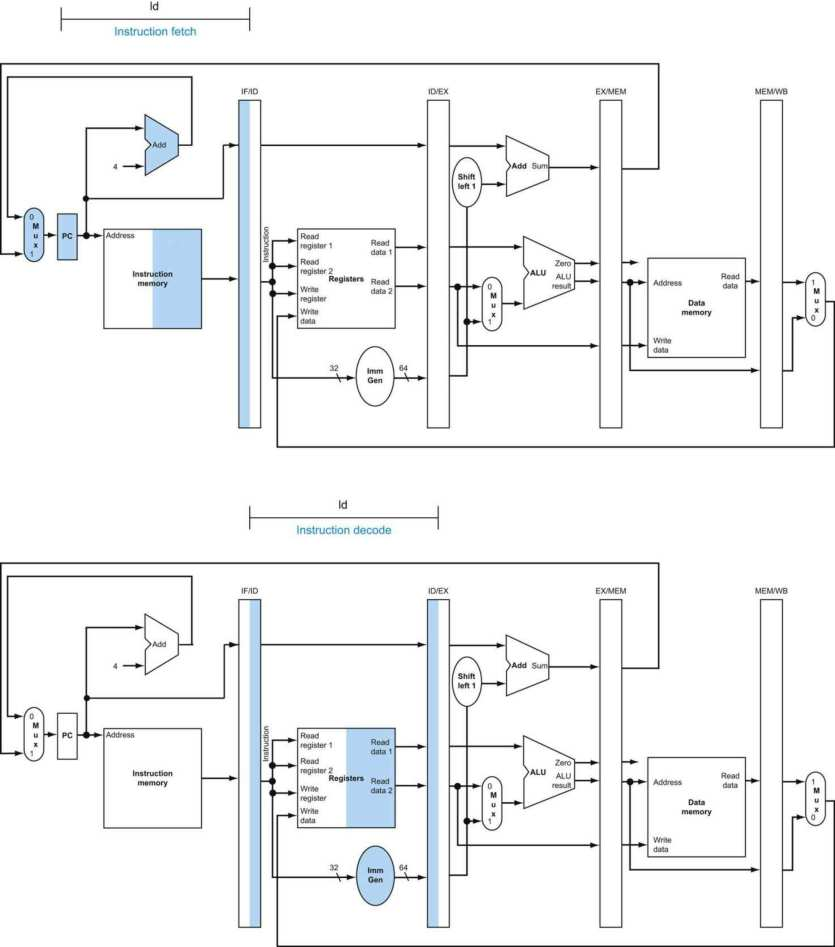

**HÌNH 4.34 IF và ID: Pipeline stage thứ nhất và thứ hai của instruction, với các phần đang hoạt động của datapath trong Hình 4.33 được làm nổi bật. Quy ước làm nổi bật giống Hình 4.26. Như trong Mục 4.2, không có nhầm lẫn khi đọc và ghi register vì nội dung chỉ thay đổi tại clock edge. Mặc dù load chỉ cần register trên trong stage 2, việc làm thêm những việc có thể không cần thiết không gây hại, nên nó sign-extends hằng số và đọc cả hai register vào ID/EX pipeline register. Chúng ta không cần cả ba operand, nhưng giữ cả ba giúp đơn giản hóa control.**

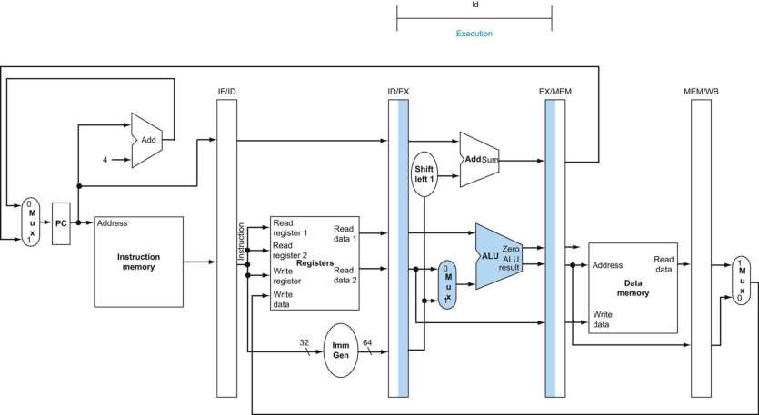

**HÌNH 4.35 EX: Pipeline stage thứ ba của load instruction, làm nổi bật các phần datapath ở Hình 4.33 được dùng trong stage này. Giá trị register được cộng với immediate đã sign-extended, và tổng được đặt vào EX/MEM pipeline register.**

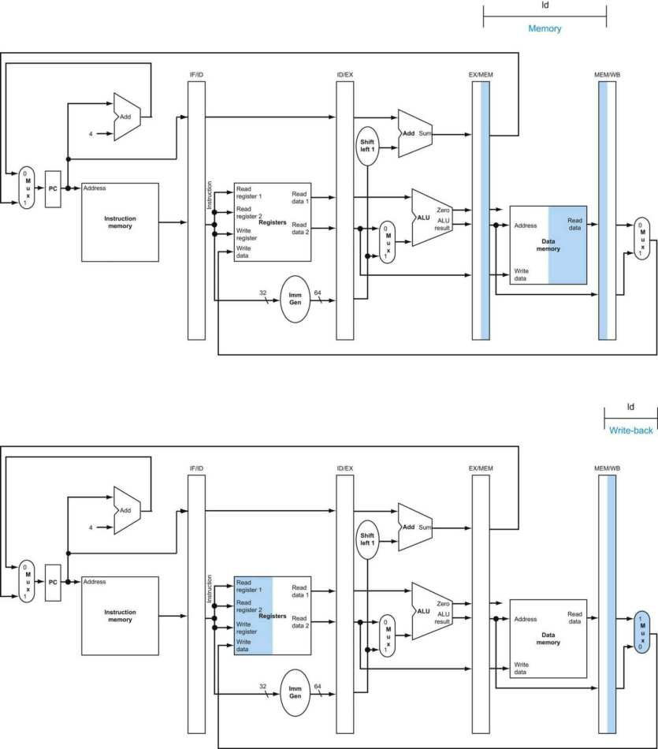

**HÌNH 4.36 MEM và WB: Pipeline stage thứ tư và thứ năm của load instruction, làm nổi bật các phần datapath ở Hình 4.33 được dùng trong stage này. Data memory được đọc bằng địa chỉ trong EX/MEM pipeline register, và dữ liệu được đặt vào MEM/WB pipeline register. Tiếp theo, dữ liệu được đọc từ MEM/WB pipeline register và ghi vào register file ở giữa datapath. Lưu ý: thiết kế này có bug được sửa trong Hình 4.39.**

Phần walk-through load instruction này cho thấy mọi thông tin cần trong pipeline stage sau phải được chuyển đến stage đó qua pipeline register. Khảo sát từng bước store instruction cho thấy sự tương đồng trong thực thi instruction, cũng như việc chuyển thông tin cho các stage sau. Dưới đây là năm pipeline stage của store instruction:

1. Instruction fetch: Instruction được đọc từ memory bằng địa chỉ trong PC rồi đặt vào IF/ID pipeline register. Stage này xảy ra trước khi nhận diện instruction, nên phần trên Hình 4.34 áp dụng cho cả store lẫn load.

2. Instruction decode và đọc register file: Instruction trong IF/ID pipeline register cung cấp số register để đọc hai register và mở rộng dấu của immediate operand. Cả ba giá trị 64-bit đều được lưu trong ID/EX pipeline register. Phần dưới Hình 4.34 cho load instruction cũng cho thấy các thao tác stage thứ hai của store. Hai stage đầu này được mọi instruction thực hiện vì còn quá sớm để biết loại instruction. (Mặc dù store instruction dùng rs2 field để đọc register thứ hai trong pipeline stage này, chi tiết đó không được thể hiện trên sơ đồ pipeline nên có thể dùng cùng hình cho cả hai.)

3. Thực thi và tính địa chỉ: Hình 4.37 cho thấy bước thứ ba; effective address được đặt vào EX/MEM pipeline register.

4. Truy cập memory: Phần trên Hình 4.38 cho thấy dữ liệu được ghi vào memory. Lưu ý register chứa dữ liệu cần lưu đã được đọc trong stage trước và lưu trong ID/EX. Cách duy nhất để dữ liệu sẵn sàng trong MEM stage là đặt dữ liệu vào EX/MEM pipeline register trong EX stage, giống như lưu effective address vào EX/MEM.

5. Write-back: Phần dưới Hình 4.38 cho thấy bước cuối của store. Với instruction này, không có gì xảy ra trong stage write-back. Vì mọi instruction sau store đều đã được xử lý, chúng ta không có cách tăng tốc chúng. Do đó, một instruction đi qua stage ngay cả khi không có gì để làm, vì các instruction sau đã tiến triển ở tốc độ tối đa.

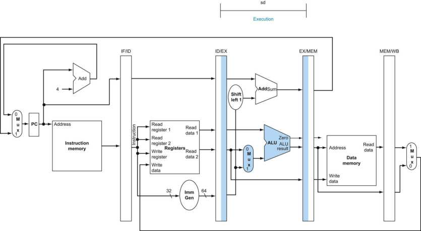

**HÌNH 4.37 EX: Pipeline stage thứ ba của store instruction. Khác stage thứ ba của load instruction trong Hình 4.35, giá trị register thứ hai được nạp vào EX/MEM pipeline register để dùng ở stage sau. Mặc dù luôn ghi register thứ hai này vào EX/MEM pipeline register cũng không có hại, chúng ta chỉ ghi register thứ hai với store instruction để pipeline dễ hiểu hơn.**

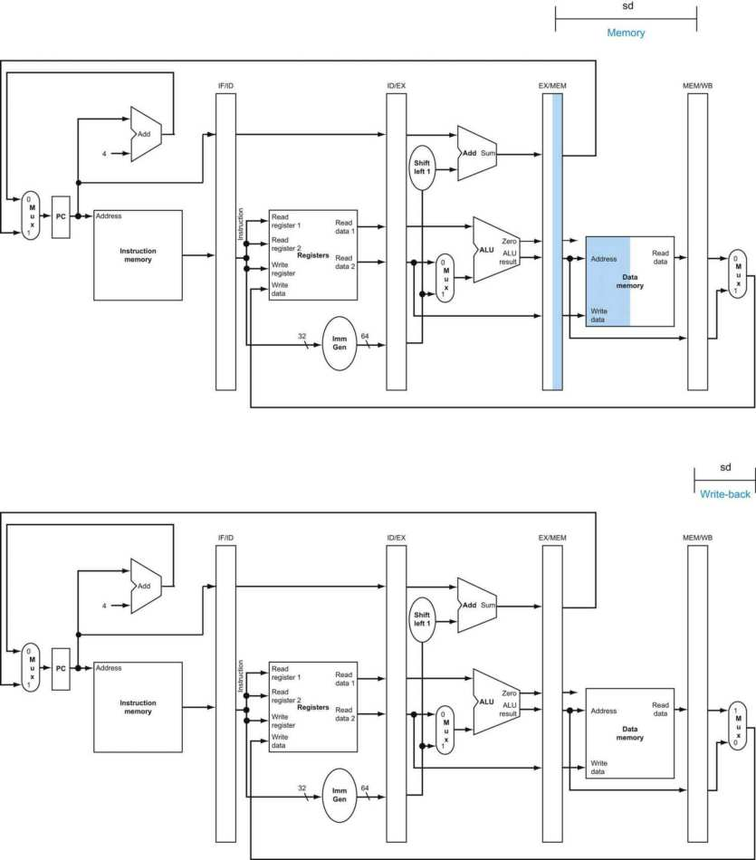

**HÌNH 4.38 MEM và WB: Pipeline stage thứ tư và thứ năm của store instruction. Trong stage thứ tư, dữ liệu được ghi vào data memory cho store. Lưu ý dữ liệu đến từ EX/MEM pipeline register và không có gì thay đổi trong MEM/WB pipeline register. Khi dữ liệu đã được ghi vào memory, store instruction không còn việc gì phải làm, nên không có gì xảy ra trong stage 5.**

Store instruction một lần nữa minh họa rằng muốn chuyển thứ gì từ pipeline stage trước đến pipeline stage sau, phải đặt thông tin vào pipeline register; nếu không, thông tin sẽ mất khi instruction tiếp theo vào pipeline stage đó. Với store instruction, cần chuyển một trong các register đã đọc ở ID stage đến MEM stage, nơi nó được lưu vào memory. Dữ liệu trước hết được đặt trong ID/EX pipeline register rồi chuyển đến EX/MEM pipeline register.

Load và store minh họa điểm quan trọng thứ hai: mỗi thành phần logic của datapath—như instruction memory, register read port, ALU, data memory và register write port—chỉ có thể được dùng trong một pipeline stage. Nếu không, sẽ có structural hazard (xem trang 267). Do đó, các thành phần này và control tương ứng có thể gắn với một pipeline stage duy nhất.

Bây giờ có thể chỉ ra bug trong thiết kế load instruction. Bạn đã thấy chưa? Register nào thay đổi trong stage cuối của load? Cụ thể hơn, instruction nào cung cấp số write register? Instruction trong IF/ID pipeline register cung cấp số write register, nhưng instruction này xảy ra sau load instruction khá xa!

Vì vậy, cần bảo toàn số destination register trong load instruction. Giống như store chuyển giá trị register từ ID/EX đến EX/MEM pipeline register để dùng trong MEM stage, load phải chuyển số register từ ID/EX qua EX/MEM đến MEM/WB pipeline register để dùng trong WB stage. Một cách khác để nghĩ về việc chuyển số register là: để chia sẻ datapath có pipeline, phải bảo toàn instruction đã đọc trong IF stage, nên mỗi pipeline register chứa một phần instruction cần cho stage đó và các stage sau.

Hình 4.39 cho thấy phiên bản datapath đúng, chuyển số write register trước đến ID/EX register, rồi EX/MEM register và cuối cùng MEM/WB register. Số register được dùng trong WB stage để chỉ định register cần ghi. Hình 4.40 là hình duy nhất của datapath đã sửa, làm nổi bật hardware được dùng trong cả năm stage của instruction load register ở Hình 4.34 đến 4.36. Xem Mục 4.8 để biết cách làm branch instruction hoạt động đúng mong đợi.

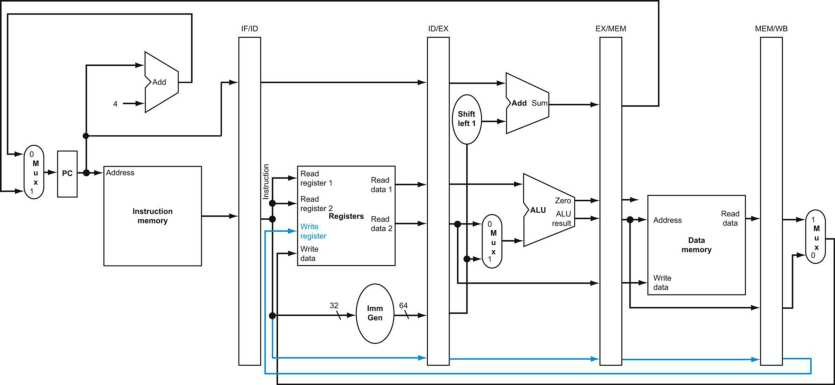

**HÌNH 4.39 Datapath có pipeline đã sửa để xử lý load instruction đúng. Số write register giờ đến từ MEM/WB pipeline register cùng dữ liệu. Số register được chuyển từ ID pipeline stage cho đến khi đến MEM/WB pipeline register, bổ sung năm bit vào ba pipeline register cuối. Đường mới này được tô màu.**

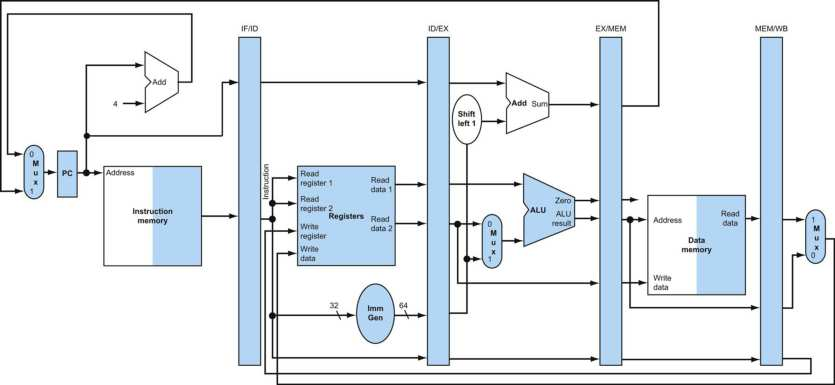

**HÌNH 4.40 Phần datapath trong Hình 4.39 được dùng trong cả năm stage của load instruction.**

### Biểu diễn Pipeline bằng đồ họa

Pipelining có thể khó nắm vững vì nhiều instruction thực thi đồng thời trong một datapath ở mỗi clock cycle. Để hỗ trợ hiểu, có hai kiểu hình pipeline cơ bản: sơ đồ pipeline multiple-clock-cycle, như Hình 4.32 ở trang 278, và sơ đồ pipeline single-clock-cycle, như các Hình 4.34 đến 4.38. Sơ đồ multiple-clock-cycle đơn giản hơn nhưng không chứa mọi chi tiết. Ví dụ, xét chuỗi five-instruction sau:

```
ld   x10, 40(x1)
sub    x11, x2, x3
add    x12, x3, x4
ld   x13, 48(x1)
add    x14, x5, x6
```

Hình 4.41 cho thấy sơ đồ pipeline multiple-clock-cycle của các instruction này. Trong các sơ đồ này, thời gian đi từ trái sang phải trang, và instruction đi từ trên xuống dưới, tương tự pipeline giặt trong Hình 4.23. Biểu diễn pipeline stage được đặt tại từng phần dọc trục instruction, chiếm các clock cycle thích hợp. Các datapath cách điệu biểu diễn đồ họa năm stage của pipeline, nhưng một hình chữ nhật ghi tên từng pipeline stage cũng có tác dụng tương tự. Hình 4.42 cho thấy phiên bản sơ đồ pipeline multiple-clock-cycle truyền thống hơn. Lưu ý Hình 4.41 thể hiện tài nguyên vật lý được dùng ở mỗi stage, còn Hình 4.42 dùng tên từng stage.

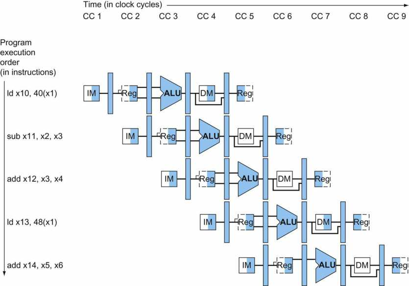

**HÌNH 4.41 Sơ đồ pipeline Multiple-clock-cycle của năm instruction. Cách biểu diễn pipeline này cho thấy toàn bộ việc thực thi instruction trong một hình. Instruction được liệt kê theo thứ tự thực thi từ trên xuống dưới, còn clock cycle từ trái sang phải. Khác Hình 4.26, ở đây thể hiện pipeline register giữa từng stage. Hình 4.42 cho thấy cách vẽ truyền thống của sơ đồ này.**

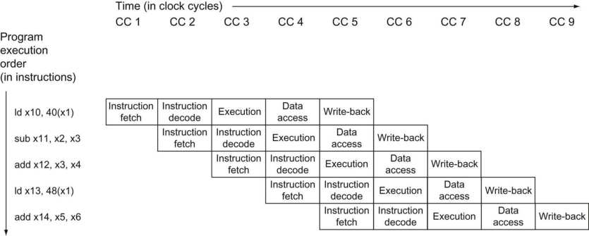

**HÌNH 4.42 Sơ đồ pipeline multiple-clock-cycle truyền thống của năm instruction trong Hình 4.41.**

Sơ đồ pipeline Single-clock-cycle thể hiện state của toàn bộ datapath trong một clock cycle; thông thường cả năm instruction trong pipeline được xác định bằng nhãn phía trên pipeline stage tương ứng. Chúng ta dùng kiểu hình này để cho thấy chi tiết điều xảy ra bên trong pipeline trong từng clock cycle; các hình thường đi theo nhóm để thể hiện hoạt động pipeline qua một chuỗi clock cycle. Sơ đồ multiple-clock-cycle dùng để cung cấp tổng quan các tình huống pipelining. (  Mục 4.13 đưa ra thêm minh họa bằng sơ đồ single-clock nếu bạn muốn xem thêm chi tiết về Hình 4.41.) Sơ đồ single-clock-cycle biểu diễn một lát cắt dọc tại một clock cycle qua tập sơ đồ multiple-clock-cycle, cho thấy từng instruction trong pipeline dùng datapath như thế nào tại clock cycle chỉ định. Ví dụ, Hình 4.43 là sơ đồ single-clock-cycle tương ứng clock cycle 5 trong Hình 4.41 và 4.42. Rõ ràng các sơ đồ single-clock-cycle có nhiều chi tiết hơn và cần nhiều không gian hơn đáng kể để thể hiện cùng số clock cycle. Bài tập yêu cầu bạn tạo các sơ đồ như vậy cho những chuỗi code khác.

#### Tự kiểm tra

Một nhóm sinh viên tranh luận về hiệu quả của pipeline five-stage khi một sinh viên chỉ ra không phải instruction nào cũng hoạt động ở mọi stage của pipeline. Sau khi quyết định bỏ qua ảnh hưởng hazard, họ đưa ra bốn phát biểu sau. Phát biểu nào đúng?

1. Cho phép branch và ALU instruction dùng ít stage hơn năm stage mà load instruction cần sẽ tăng hiệu năng pipeline trong mọi hoàn cảnh.

2. Cố cho một số instruction dùng ít cycle hơn không giúp ích vì throughput do clock cycle quyết định; số pipeline stage trên mỗi instruction ảnh hưởng latency, không ảnh hưởng throughput.

3. Không thể làm ALU instruction dùng ít cycle hơn vì việc write-back kết quả, nhưng branch có thể dùng ít cycle hơn, nên có một số cơ hội cải thiện.

4. Thay vì cố làm instruction dùng ít cycle hơn, nên khám phá việc làm pipeline dài hơn để instruction dùng nhiều cycle hơn, nhưng cycle ngắn hơn. Điều này có thể cải thiện hiệu năng.

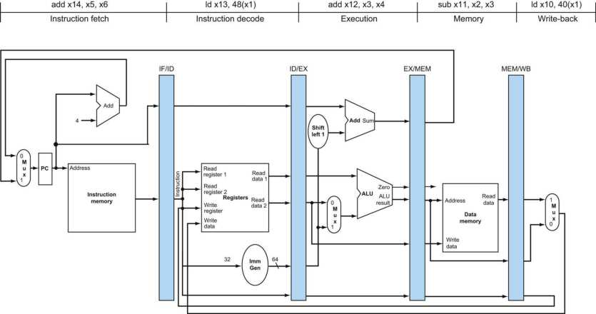

**HÌNH 4.43 Sơ đồ single-clock-cycle tương ứng clock cycle 5 của pipeline trong Hình 4.41 và 4.42. Như có thể thấy, hình single-clock-cycle là lát cắt dọc qua sơ đồ multiple-clock-cycle.**

### Control có Pipeline

Trong máy tính 6600, có lẽ còn hơn bất kỳ máy tính nào trước đó, hệ thống control tạo nên sự khác biệt.

James Thornton, Design of a Computer: The Control Data 6600, 1970

Giống như đã thêm control vào datapath single-cycle trong Mục 4.4, bây giờ chúng ta thêm control vào datapath có pipeline. Chúng ta bắt đầu bằng một thiết kế đơn giản nhìn vấn đề qua lăng kính rose-colored.

Bước đầu là ghi nhãn các control line trên datapath hiện có. Hình 4.44 cho thấy các đường đó. Chúng ta tận dụng tối đa control cho datapath đơn giản trong Hình 4.17. Cụ thể, dùng cùng ALU control logic, branch logic và control line. Các chức năng này được định nghĩa trong Hình 4.12, 4.16 và 4.18. Chúng ta trình bày lại thông tin chính trong Hình 4.45 đến 4.47 trên một trang để phần thảo luận sau dễ tiếp thu hơn.

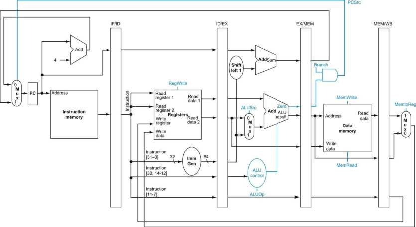

**HÌNH 4.44 Datapath có pipeline trong Hình 4.39 với control signal được xác định. Datapath này dùng lại control logic cho nguồn PC, số destination register và ALU control từ Mục 4.4. Lưu ý giờ cần các funct field của instruction trong EX stage làm input cho ALU control, nên các bit này cũng phải nằm trong ID/EX pipeline register.**

Như với triển khai single-cycle, chúng ta giả định PC được ghi trong mỗi clock cycle nên không có write signal riêng cho PC. Cũng theo lập luận này, không có write signal riêng cho các pipeline register (IF/ID, ID/EX, EX/MEM và MEM/WB), vì chúng cũng được ghi trong mỗi clock cycle.

Để quy định control cho pipeline, chỉ cần thiết lập các control value trong từng pipeline stage. Vì mỗi control line gắn với thành phần chỉ hoạt động trong một pipeline stage, có thể chia các control line thành năm nhóm theo pipeline stage.

1. Instruction fetch: Các control signal để đọc instruction memory và ghi PC luôn được asserted nên không có gì đặc biệt cần điều khiển trong pipeline stage này.

2. Instruction decode/đọc register file: Hai source register luôn nằm cùng vị trí trong các định dạng instruction RISC-V, nên không có gì đặc biệt cần điều khiển trong pipeline stage này.

3. Thực thi/tính địa chỉ: Các signal cần thiết lập là ALUOp và ALUSrc (xem Hình 4.45 và 4.46). Các signal chọn phép toán ALU và chọn Read data 2 hoặc immediate đã sign-extended làm input cho ALU.

4. Truy cập memory: Các control line được thiết lập trong stage này là Branch, MemRead và MemWrite. Instruction branch if equal, load và store lần lượt thiết lập các signal này. Nhớ rằng PCSrc trong Hình 4.46 chọn địa chỉ tuần tự tiếp theo, trừ khi control assert Branch và kết quả ALU bằng 0.

5. Write-back: Hai control line là MemtoReg, quyết định gửi kết quả ALU hay giá trị memory đến register file, và RegWrite, ghi giá trị đã chọn.

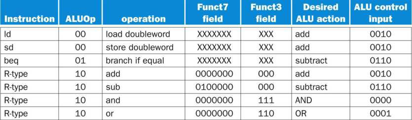

**HÌNH 4.45 Bản sao Hình 4.12. Hình này cho thấy cách thiết lập ALU control bit theo ALUOp control bit và các opcode khác nhau của instruction R-type.**

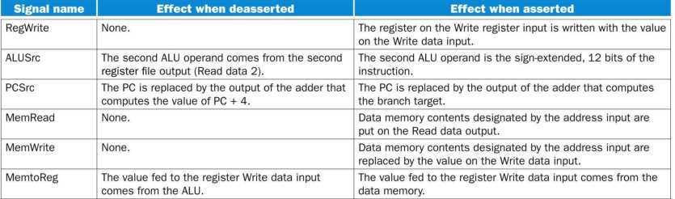

**HÌNH 4.46 Bản sao Hình 4.16. Chức năng từng signal trong sáu control signal được định nghĩa. Các ALU control line (ALUOp) được định nghĩa trong cột thứ hai Hình 4.45. Khi control 1-bit đến multiplexor two-way được asserted, multiplexor chọn input tương ứng 1. Nếu control được deasserted, multiplexor chọn input 0. Lưu ý PCSrc được điều khiển bởi AND gate trong Hình 4.44. Nếu Branch signal và ALU Zero signal đều được đặt, PCSrc bằng 1; nếu không bằng 0. Control chỉ đặt Branch signal trong instruction beq; nếu không, PCSrc được đặt bằng 0.**

Vì đưa datapath vào pipeline không làm thay đổi ý nghĩa các control line, chúng ta có thể dùng cùng các control value. Hình 4.47 có cùng các giá trị như Mục 4.4, nhưng giờ bảy control line được nhóm theo pipeline stage.

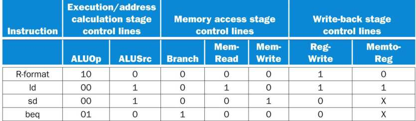

**HÌNH 4.47 Giá trị các control line giống Hình 4.18, nhưng được sắp xếp lại thành ba nhóm tương ứng ba pipeline stage cuối.**

Triển khai control nghĩa là đặt bảy control line thành các giá trị này trong từng stage cho từng instruction.

Vì phần control line còn lại bắt đầu từ EX stage, chúng ta có thể tạo control information cho các stage sau trong khi instruction decode. Cách đơn giản nhất để chuyển các control signal này là mở rộng pipeline register để chứa control information. Hình 4.48 phía trên cho thấy các control signal sau đó được dùng trong pipeline stage thích hợp khi instruction đi xuống pipeline, giống số destination register của load đi xuống pipeline trong Hình 4.39. Hình 4.49 cho thấy datapath đầy đủ với pipeline register mở rộng và control line nối đến stage thích hợp. (  Mục 4.13 đưa ra thêm ví dụ code RISC-V thực thi trên hardware có pipeline bằng sơ đồ single-clock nếu bạn muốn xem thêm chi tiết.)


**HÌNH 4.48 Bảy control line cho ba stage cuối. Lưu ý hai trong bảy control line được dùng trong pha EX, còn năm control line được chuyển đến EX/MEM pipeline register đã mở rộng để giữ control line; ba được dùng trong MEM stage và hai cuối được chuyển đến MEM/WB để dùng trong WB stage.**


**HÌNH 4.49 Datapath có pipeline trong Hình 4.44, với các control signal nối đến phần control của pipeline register. Các control value cho ba stage cuối được tạo trong instruction decode stage rồi đặt vào ID/EX pipeline register. Các control line của từng pipeline stage được dùng, còn các control line còn lại được chuyển đến pipeline stage kế tiếp.**

## 4.7 Data Hazard: Forwarding so với Stalling

Các ví dụ ở mục trước cho thấy sức mạnh của thực thi có pipeline và cách hardware thực hiện công việc. Giờ là lúc bỏ lăng kính rose-colored và xem điều xảy ra với chương trình thực tế. Các instruction RISC-V trong Hình 4.41 đến 4.43 độc lập; không instruction nào dùng kết quả do instruction khác tính. Tuy nhiên, trong Mục 4.5, chúng ta đã thấy data hazard là trở ngại cho thực thi có pipeline.

Ý anh là gì, tại sao phải xây nó? Nó là đường vòng. Anh phải xây những đường vòng.

Douglas Adams, The Hitchhiker’s Guide to the Galaxy, 1979

Hãy xem một chuỗi có nhiều phụ thuộc, được tô màu:

```
sub  x2, x1, x3     // Register z2 written by sub
and  x12, x2, x5     // 1st operand(x2) depends on sub
or   x13, x6, x2     // 2nd operand(x2) depends on sub
add  x14, x2, x2     // 1st(x2) & 2nd(x2) depend on sub
sd   x15, 100(x2)  // Base (x2) depends on sub
```

Bốn instruction cuối đều phụ thuộc kết quả trong register x2 của instruction đầu. Nếu register x2 có giá trị 10 trước subtract instruction và −20 sau đó, programmer muốn −20 được dùng trong các instruction sau tham chiếu register x2.

Chuỗi này hoạt động thế nào trên pipeline của chúng ta? Hình 4.50 minh họa việc thực thi các instruction bằng biểu diễn pipeline multiple-clock-cycle. Để thể hiện việc thực thi chuỗi instruction này trong pipeline hiện tại, phía trên Hình 4.50 cho thấy giá trị register x2, thay đổi ở giữa clock cycle 5 khi sub instruction ghi kết quả.


**HÌNH 4.50 Các phụ thuộc trong pipeline của chuỗi five-instruction, dùng datapath đơn giản hóa để thể hiện phụ thuộc. Mọi thao tác phụ thuộc được tô màu, và “CC 1” trên hình nghĩa là clock cycle 1. Instruction đầu ghi vào x2, mọi instruction sau đọc x2. Register này được ghi trong clock cycle 5, nên giá trị đúng không sẵn sàng trước clock cycle 5. (Đọc register trong clock cycle trả về giá trị được ghi ở cuối nửa đầu cycle khi có thao tác ghi như vậy.) Các đường màu từ datapath trên đến các datapath dưới cho thấy phụ thuộc. Những đường phải đi ngược thời gian là pipeline data hazard.**

Hazard tiềm tàng cuối có thể được giải quyết bằng thiết kế hardware register file: Điều gì xảy ra khi register được đọc và ghi trong cùng clock cycle? Chúng ta giả định ghi trong nửa đầu clock cycle và đọc trong nửa sau, nên thao tác đọc nhận dữ liệu vừa ghi. Như trong nhiều triển khai register file, không có data hazard ở trường hợp này.

Hình 4.50 cho thấy giá trị đọc từ register x2 sẽ không phải kết quả sub instruction, trừ khi đọc trong clock cycle 5 hoặc sau đó. Do đó, các instruction nhận giá trị đúng −20 là add và sd; instruction and và or sẽ nhận giá trị sai 10! Với cách vẽ này, vấn đề trở nên rõ ràng khi đường phụ thuộc đi ngược thời gian.

Như đã nói trong Mục 4.5, kết quả mong muốn sẵn sàng ở cuối EX stage của sub instruction, tức clock cycle 3. Khi nào instruction and và or thực sự cần dữ liệu? Câu trả lời là đầu EX stage của instruction and và or, tức lần lượt clock cycle 4 và 5. Vì vậy, có thể thực thi đoạn này không stall nếu forward dữ liệu ngay khi sẵn sàng đến mọi unit cần nó trước khi dữ liệu có thể được đọc từ register file.

Forwarding hoạt động thế nào? Để đơn giản, trong phần còn lại của mục, chúng ta chỉ xét thách thức forwarding đến một thao tác trong EX stage, có thể là phép toán ALU hoặc tính effective address. Nghĩa là khi instruction cố dùng một register trong EX stage mà instruction trước dự định ghi trong WB stage, chúng ta thực sự cần các giá trị làm input cho ALU.

Ký pháp đặt tên các field của pipeline register cho phép biểu diễn phụ thuộc chính xác hơn. Ví dụ, “ID/EX.RegisterRs1” chỉ số của một register có giá trị nằm trong pipeline register ID/EX; tức register từ read port đầu của register file. Phần đầu tên, bên trái dấu chấm, là tên pipeline register; phần thứ hai là tên field trong register đó. Dùng ký pháp này, hai cặp điều kiện hazard là

1a. EX/MEM.RegisterRd =ID/EX.RegisterRs1

1b. EX/MEM.RegisterRd =ID/EX.RegisterRs2

2a. MEM/WB.RegisterRd =ID/EX.RegisterRs1

2b. MEM/WB.RegisterRd =ID/EX.RegisterRs2

Hazard đầu tiên trong chuỗi ở trang 295 nằm trên register x2, giữa kết quả sub x2, x1, x3 và read operand đầu của and x12, x2, x5. Có thể phát hiện hazard này khi and instruction ở EX stage còn instruction trước ở MEM stage, nên đây là hazard 1a:

EX/MEM.RegisterRd =ID/EX.RegisterRs1 =x2

### Phát hiện phụ thuộc

**Ví dụ**

Phân loại các phụ thuộc trong chuỗi từ trang 295 này:

```
subx2,    x1, x3     // Register x2 set by sub
andx12,   x2, x5     // 1st operand(z2) set by sub
orx13,   x6, x2     // 2nd operand(x2) set by sub
addx14,   x2, x2     // 1st(x2) & 2nd(x2) set by sub
sdx15, 100(x2)   // Index(x2) set by sub
```

**Trả lời**

Như đã nói, sub–and là hazard loại 1a. Các hazard còn lại như sau:

- Sub–or là hazard loại 2b:

MEM/WB.RegisterRd =ID/EX.RegisterRs2 =x2

- Hai phụ thuộc trong sub–add không phải hazard vì register file cung cấp dữ liệu đúng trong ID stage của add.

- Không có data hazard giữa sub và sd vì sd đọc x2 trong clock cycle sau khi sub ghi x2.

Vì một số instruction không ghi register, chính sách này chưa chính xác; đôi khi nó sẽ forward khi không nên. Một giải pháp đơn giản là kiểm tra RegWrite signal có hoạt động hay không: khảo sát WB control field của pipeline register trong EX stage và MEM stage sẽ xác định RegWrite có được asserted hay không. Nhớ rằng RISC-V yêu cầu mọi lần dùng x0 làm operand phải cho giá trị operand bằng 0. Nếu instruction trong pipeline có destination là x0 (ví dụ addi x0, x1, 2), chúng ta muốn tránh forward giá trị kết quả có thể khác không của nó. Không forward kết quả đích x0 giúp programmer assembly và compiler không phải tránh dùng x0 làm destination. Do đó, các điều kiện trên hoạt động đúng nếu thêm EX/MEM.RegisterRd ≠0 vào điều kiện hazard đầu và MEM/WB.RegisterRd ≠0 vào điều kiện thứ hai.

Giờ có thể phát hiện hazard, một nửa vấn đề đã được giải quyết—nhưng vẫn phải forward dữ liệu đúng.

Hình 4.51 cho thấy phụ thuộc giữa pipeline register và input ALU cho cùng chuỗi code ở Hình 4.50. Thay đổi là phụ thuộc bắt đầu từ pipeline register, thay vì đợi WB stage ghi register file. Do đó, dữ liệu cần thiết tồn tại kịp cho các instruction sau, với pipeline register giữ dữ liệu cần forward.


**HÌNH 4.51 Các phụ thuộc giữa pipeline register đi về phía trước theo thời gian, nên có thể cung cấp input ALU mà instruction and và or cần bằng cách forward kết quả có trong pipeline register. Các giá trị trong pipeline register cho thấy giá trị mong muốn sẵn sàng trước khi được ghi vào register file. Chúng ta giả định register file forward các giá trị được đọc và ghi trong cùng clock cycle, nên add không stall, nhưng giá trị đến từ register file thay vì pipeline register. “Forwarding” của register file—tức đọc nhận giá trị ghi trong clock cycle đó—là lý do clock cycle 5 cho thấy register x2 có giá trị 10 lúc bắt đầu và −20 lúc kết thúc clock cycle.**

Nếu có thể lấy input ALU từ bất kỳ pipeline register nào thay vì chỉ ID/EX, chúng ta có thể forward dữ liệu đúng. Bằng cách thêm multiplexor vào input ALU và dùng control thích hợp, có thể chạy pipeline hết tốc độ khi có các data hazard này.

Hiện tại, chúng ta giả định các instruction duy nhất cần forward là bốn instruction R-format: add, sub, and và or. Hình 4.52 cho thấy close-up của ALU và pipeline register trước và sau khi thêm forwarding. Hình 4.53 cho thấy giá trị các control line cho ALU multiplexor chọn giá trị register file hoặc một trong các giá trị được forward.


**HÌNH 4.52 Phía trên là ALU và pipeline register trước khi thêm forwarding. Phía dưới, các multiplexor được mở rộng để thêm forwarding path và có forwarding unit. Hardware mới được tô màu. Tuy nhiên, hình này là bản vẽ cách điệu, bỏ qua các chi tiết từ datapath đầy đủ như hardware sign extension.**


**HÌNH 4.53 Các control value cho forwarding multiplexor trong Hình 4.52. Signed immediate là một input khác của ALU, được mô tả trong phần Giải thích thêm ở cuối mục này.**

Forwarding control này nằm trong EX stage vì các ALU forwarding multiplexor nằm ở stage đó. Vì vậy, phải chuyển số operand register từ ID stage qua ID/EX pipeline register để xác định có forward giá trị hay không. Trước khi có forwarding, ID/EX register không cần không gian giữ rs1 field và rs2 field. Do đó, chúng được thêm vào ID/EX.

Bây giờ hãy viết cả điều kiện phát hiện hazard lẫn control signal giải quyết chúng:

1. EX hazard:

```
if (EX/MEM.RegWrite
and  (EX/MEM.RegisterRd ≠ 0)
and  (EX/MEM.RegisterRd = ID/EX.RegisterRs1)) ForwardA = 10
if  (EX/MEM.RegWrite
and  (EX/MEM.RegisterRd ≠ 0)
and  (EX/MEM.RegisterRd = ID/EX.RegisterRs2)) ForwardB = 10
```

Trường hợp này forward kết quả instruction trước đến một trong hai input ALU. Nếu instruction trước sẽ ghi register file và số write register khớp số read register của ALU input A hoặc B, với điều kiện không phải register 0, thì điều khiển multiplexor chọn giá trị từ pipeline register EX/MEM thay vào đó.

2. MEM hazard:

```
if (MEM/WB.RegWrite
and  (MEM/WB.RegisterRd ≠ 0)
and  (MEM/WB.RegisterRd = ID/EX.RegisterRs1)) ForwardA = 01
if (MEM/WB.RegWrite
and  (MEM/WB.RegisterRd ≠ 0)
and  (MEM/WB.RegisterRd = ID/EX.RegisterRs2)) ForwardB = 01
```

Như đã nói, không có hazard trong WB stage vì giả định register file cung cấp kết quả đúng nếu instruction trong ID stage đọc cùng register được instruction trong WB stage ghi. Register file như vậy thực hiện một kiểu forwarding khác, nhưng xảy ra bên trong register file. Một điểm phức tạp là data hazard tiềm tàng giữa kết quả instruction trong WB stage, kết quả instruction trong MEM stage và source operand của instruction trong ALU stage. Ví dụ, khi tính tổng một vector số trong một register duy nhất, một chuỗi instruction đều đọc và ghi cùng register:

```
add  x1, x1, x2
add  x1, x1, x3
add  x1, x1, x4
. . .
```

Trong trường hợp này, phải forward kết quả từ MEM stage vì kết quả trong MEM stage mới hơn. Do đó, control cho MEM hazard là (các phần bổ sung được làm nổi bật):

```
if (MEM/WB.RegWrite
and  (MEM/WB.RegisterRd ≠ 0)
and  not(EX/MEM.RegWrite and (EX/MEM.RegisterRd ≠ 0)
       and (EX/MEM.RegisterRd = ID/EX.RegisterRs1))
and  (MEM/WB.RegisterRd = ID/EX.RegisterRs1)) ForwardA = 01
if (MEM/WB.RegWrite
and  (MEM/WB.RegisterRd ≠ 0)
and  not(EX/MEM.RegWrite and (EX/MEM.RegisterRd ≠ 0)
       and (EX/MEM.RegisterRd = ID/EX.RegisterRs2))
and  (MEM/WB.RegisterRd = ID/EX.RegisterRs2)) ForwardB = 01
```

Hình 4.54 cho thấy hardware cần để hỗ trợ forwarding cho các thao tác dùng kết quả trong EX stage. Lưu ý EX/MEM.RegisterRd field là register destination của ALU instruction hoặc load.


**HÌNH 4.54 Datapath được sửa để giải quyết hazard bằng forwarding. So với datapath trong Hình 4.49, phần bổ sung là các multiplexor tại input ALU. Tuy nhiên, hình này được cách điệu hơn, bỏ qua chi tiết từ datapath đầy đủ như branch hardware và sign extension hardware.**

Nếu muốn xem thêm ví dụ minh họa bằng bản vẽ pipeline single-cycle,  Mục 4.13 có các hình thể hiện hai đoạn code RISC-V với hazard gây forwarding.

#### Giải thích thêm

Forwarding cũng có thể giúp giải quyết hazard khi store instruction phụ thuộc instruction khác. Vì store chỉ dùng một giá trị dữ liệu trong MEM stage nên forwarding dễ thực hiện. Tuy nhiên, xét load được theo ngay bởi store, hữu ích khi sao chép memory-to-memory trong kiến trúc RISC-V. Vì sao chép thường gặp, cần thêm forwarding hardware để chúng chạy nhanh hơn. Nếu vẽ lại Hình 4.51, thay instruction sub và and bằng ld và sd, chúng ta sẽ thấy có thể tránh stall vì dữ liệu tồn tại trong MEM/WB register của load instruction kịp để dùng trong MEM stage của store instruction. Cần thêm forwarding vào memory access stage để thực hiện lựa chọn này. Chúng ta dành sửa đổi này làm bài tập cho độc giả.

Ngoài ra, input signed-immediate của ALU, cần cho load và store, còn thiếu trong datapath ở Hình 4.54. Vì central control quyết định giữa register và immediate, còn forwarding unit chọn pipeline register cho register input của ALU, giải pháp dễ nhất là thêm multiplexor 2:1 chọn giữa output ForwardB multiplexor và signed immediate. Hình 4.55 cho thấy bổ sung này.


**HÌNH 4.55 Một close-up của datapath trong Hình 4.52 cho thấy multiplexor 2:1 được thêm để chọn signed immediate làm ALU input.**

### Data Hazard và Stall

Như đã nói trong Mục 4.5, một trường hợp forwarding không thể giải quyết là khi một instruction cố đọc register ngay sau load instruction ghi cùng register. Hình 4.56 minh họa vấn đề. Dữ liệu vẫn đang được đọc từ memory trong clock cycle 4 khi ALU thực hiện phép toán cho instruction tiếp theo. Phải có thứ gì làm pipeline stall với tổ hợp load theo sau bởi instruction đọc kết quả của nó.

Nếu lần đầu không thành công, hãy định nghĩa lại thành công.

Khuyết danh


**HÌNH 4.56 Một chuỗi instruction có pipeline. Vì phụ thuộc giữa load và instruction tiếp theo (and) đi ngược thời gian, hazard này không thể giải quyết bằng forwarding. Do đó, tổ hợp này phải dẫn đến stall do hazard detection unit tạo.**

Vì vậy, ngoài forwarding unit, chúng ta cần hazard detection unit. Nó hoạt động trong ID stage để chèn stall giữa load và instruction phụ thuộc. Khi kiểm tra load instruction, control cho hazard detection unit là điều kiện duy nhất này:

```
if (ID/EX.MemRead and
    ((ID/EX.RegisterRd = IF/ID.RegisterRs1) or
       (ID/EX.RegisterRd = IF/ID.RegisterRs2)))
       stall the pipeline
```

Nhớ rằng chúng ta dùng RegisterRd để chỉ register được quy định tại các bit instruction 11:7 cho cả load lẫn instruction R-type. Dòng đầu kiểm tra instruction có phải load không: instruction duy nhất đọc data memory là load. Hai dòng sau kiểm tra destination register field của load trong EX stage có khớp một trong hai source register của instruction trong ID stage hay không. Nếu điều kiện đúng, instruction stall một clock cycle. Sau stall one-cycle này, forwarding logic có thể xử lý phụ thuộc và việc thực thi tiếp tục. (Nếu không có forwarding, các instruction trong Hình 4.56 cần thêm một stall cycle.)

Nếu instruction trong ID stage bị stall, instruction trong IF stage cũng phải stall; nếu không, instruction đã fetch sẽ mất. Ngăn hai instruction này tiến triển được thực hiện đơn giản bằng cách ngăn PC register và IF/ID pipeline register thay đổi. Miễn các register này được giữ nguyên, instruction trong IF stage tiếp tục được đọc bằng cùng PC, và register trong ID stage tiếp tục được đọc bằng cùng các instruction field trong IF/ID pipeline register. Trở lại phép so sánh quen thuộc, giống như khởi động lại máy giặt với cùng quần áo và để máy sấy tiếp tục quay rỗng. Tất nhiên, giống máy sấy, nửa sau pipeline bắt đầu từ EX stage phải làm gì đó; điều nó làm là thực thi các instruction không có tác động: nop.

#### nops

Một instruction không thực hiện thao tác nào làm thay đổi state.

Làm thế nào chèn các nop này, hoạt động như bubble, vào pipeline? Trong Hình 4.47, chúng ta thấy deassert cả bảy control signal (đặt về 0) trong EX stage, MEM stage và WB stage sẽ tạo instruction “không làm gì”, hay nop. Bằng cách nhận diện hazard trong ID stage, có thể chèn bubble vào pipeline bằng việc đổi EX control field, MEM control field và WB control field của ID/EX pipeline register thành 0. Các control value vô hại này được chuyển tiếp qua mỗi clock cycle với tác động đúng: không register hay memory nào được ghi nếu mọi control value đều bằng 0.

Hình 4.57 cho thấy điều thực sự xảy ra trong hardware: pipeline execution slot gắn với and instruction được chuyển thành nop, và mọi instruction bắt đầu từ and bị trễ một cycle. Như bọt khí trong ống nước, stall bubble làm trễ mọi thứ phía sau và tiến xuống instruction pipeline một stage mỗi clock cycle cho đến khi ra ở cuối. Trong ví dụ, hazard buộc instruction and và or lặp lại trong clock cycle 4 điều đã làm ở clock cycle 3: and đọc register và decode, còn or được fetch lại từ instruction memory. Công việc lặp lại như vậy là hình thức của stall, nhưng tác động là kéo dài thời gian instruction and và or, đồng thời làm trễ fetch add instruction.


**HÌNH 4.57 Cách stall thực sự được chèn vào pipeline. Bubble được chèn bắt đầu từ clock cycle 4 bằng cách đổi and instruction thành nop. Lưu ý and instruction thực sự được fetch và decode trong clock cycle 2 và 3, nhưng EX stage bị trễ đến clock cycle 5 (so với vị trí không stall ở clock cycle 4). Tương tự, or instruction được fetch trong clock cycle 3 nhưng ID stage bị trễ đến clock cycle 5 (so với vị trí không stall ở clock cycle 4). Sau khi chèn bubble, mọi phụ thuộc đều đi về phía trước theo thời gian và không có hazard nào nữa.**

Hình 4.58 làm nổi bật các kết nối pipeline cho cả hazard detection unit lẫn forwarding unit. Như trước, forwarding unit điều khiển ALU multiplexor để thay giá trị từ register general-purpose bằng giá trị từ pipeline register thích hợp. Hazard detection unit điều khiển ghi PC register và IF/ID register cùng multiplexor chọn giữa control value thực và toàn bộ số 0. Hazard detection unit stall và deassert các control field nếu phép kiểm tra hazard load-use phía trên đúng. Nếu muốn xem thêm chi tiết,  Mục 4.13 đưa ra ví dụ minh họa bằng sơ đồ pipeline single-clock của code RISC-V với hazard gây stall.

#### Bức tranh TỔNG THỂ

Mặc dù compiler thường dựa vào hardware để giải quyết hazard và nhờ đó bảo đảm thực thi đúng, compiler phải hiểu pipeline để đạt hiệu năng tốt nhất. Nếu không, những stall ngoài dự kiến sẽ giảm hiệu năng code đã compile.

#### Giải thích thêm

Về nhận xét trước đó rằng đặt control line về 0 để tránh ghi register hoặc memory: chỉ RegWrite signal và MemWrite signal cần bằng 0, còn các control signal khác có thể là don’t care.

Có hàng nghìn người chặt những nhánh cây của cái ác, trong khi chỉ một người đánh vào gốc rễ.

Henry David Thoreau, Walden, 1854


**HÌNH 4.58 Tổng quan control có pipeline, cho thấy hai multiplexor cho forwarding, hazard detection unit và forwarding unit. Mặc dù ID stage và EX stage đã được đơn giản hóa—không có immediate sign-extended và branch logic—hình này cho thấy bản chất các yêu cầu hardware cho forwarding.**

## 4.8 Control Hazard

Đến nay, chúng ta chỉ xét hazard liên quan phép toán số học và truyền dữ liệu. Tuy nhiên, như đã thấy trong Mục 4.5, còn có pipeline hazard liên quan conditional branch. Hình 4.59 cho thấy một chuỗi instruction và thời điểm branch xảy ra trong pipeline này. Phải fetch một instruction trong mỗi clock cycle để duy trì pipeline, nhưng trong thiết kế, quyết định có branch hay không chỉ xảy ra ở MEM pipeline stage. Như đã nói trong Mục 4.5, delay khi xác định instruction thích hợp cần fetch này gọi là control hazard hoặc branch hazard, khác với data hazard vừa khảo sát.


**HÌNH 4.59 Tác động của pipeline lên branch instruction. Các số bên trái instruction (40, 44, …) là địa chỉ instruction. Vì branch instruction quyết định có branch hay không trong MEM stage—clock cycle 4 với instruction beq phía trên—ba instruction tuần tự sau branch sẽ được fetch và bắt đầu thực thi. Nếu không can thiệp, ba instruction theo sau đó bắt đầu thực thi trước khi beq branch đến ld tại vị trí 72. (Hình 4.29 giả định hardware bổ sung để giảm control hazard xuống một clock cycle; hình này dùng datapath chưa tối ưu.)**

Mục control hazard này ngắn hơn các mục data hazard trước. Lý do là control hazard tương đối dễ hiểu, ít xảy ra hơn data hazard, và không có biện pháp nào hiệu quả với control hazard như forwarding đối với data hazard. Vì vậy, chúng ta dùng các phương án đơn giản hơn. Chúng ta xem hai phương án giải quyết control hazard và một tối ưu để cải thiện chúng.

### Giả định Branch không Taken

Như đã thấy trong Mục 4.5, stall đến khi branch hoàn tất là quá chậm. Một cải tiến so với branch stall là dự đoán conditional branch không được taken và tiếp tục thực thi theo luồng instruction tuần tự. Nếu conditional branch được taken, phải loại bỏ các instruction đang được fetch và decode. Việc thực thi tiếp tục tại branch target. Nếu conditional branch không taken trong một nửa số lần và chi phí bỏ instruction thấp, tối ưu này giảm một nửa chi phí control hazard.


Để bỏ instruction, chỉ cần đổi các control value gốc thành 0, tương tự cách stall cho data hazard load-use. Khác biệt là phải thay đổi cả ba instruction trong IF stage, ID stage và EX stage khi branch đến MEM stage; với stall load-use, chỉ đổi control thành 0 trong ID stage rồi để chúng truyền qua pipeline. Vì vậy, loại bỏ instruction nghĩa là phải có khả năng flush instruction trong IF stage, ID stage và EX stage của pipeline.

#### flush

Loại bỏ instruction trong pipeline, thường do một sự kiện ngoài dự kiến.

### Giảm delay của Branch

Một cách cải thiện hiệu năng conditional branch là giảm chi phí taken branch. Đến nay, chúng ta giả định PC tiếp theo của branch được chọn trong MEM stage, nhưng nếu đưa việc thực thi conditional branch lên sớm hơn trong pipeline, sẽ cần flush ít instruction hơn. Đưa quyết định branch lên đòi hỏi hai thao tác xảy ra sớm hơn: tính branch target address và đánh giá quyết định branch. Phần dễ là đưa phép tính địa chỉ branch lên. Chúng ta đã có giá trị PC và immediate field trong IF/ID pipeline register nên chỉ chuyển branch adder từ EX stage sang ID stage; tất nhiên, phép tính địa chỉ branch target sẽ được thực hiện cho mọi instruction, nhưng chỉ dùng khi cần.

Phần khó hơn là chính quyết định branch. Với branch if equal, chúng ta so sánh hai giá trị register đọc được trong ID stage để xem có bằng nhau không. Có thể kiểm tra bằng nhau bằng cách XOR từng vị trí bit của hai register rồi OR các kết quả XOR. Đưa phép kiểm tra branch sang ID stage đòi hỏi thêm forwarding hardware và hazard detection hardware, vì branch phụ thuộc kết quả vẫn còn trong pipeline phải tiếp tục hoạt động đúng với tối ưu này. Ví dụ, để triển khai branch if equal (và phép đảo của nó), cần forward kết quả đến equality test logic hoạt động trong ID. Có hai yếu tố gây phức tạp:

1. Trong ID, phải decode instruction, quyết định có cần bypass đến equality test unit không, rồi hoàn tất phép kiểm tra bằng nhau để nếu instruction là branch, có thể đặt PC bằng branch target address. Forwarding cho operand của branch trước đây do ALU forwarding logic xử lý, nhưng thêm equality test unit trong ID sẽ đòi hỏi forwarding logic mới. Lưu ý source operand được bypass của branch có thể đến từ EX/MEM hoặc MEM/WB pipeline register.

2. Vì giá trị dùng so sánh branch cần trong ID nhưng có thể được tạo muộn hơn, data hazard có thể xảy ra và cần stall. Ví dụ, nếu ALU instruction ngay trước branch tạo operand cho phép kiểm tra conditional branch, cần stall vì EX stage của ALU instruction xảy ra sau ID cycle của branch. Mở rộng ra, nếu load được theo ngay bởi conditional branch phụ thuộc kết quả load, cần hai stall cycle vì kết quả load xuất hiện ở cuối MEM cycle nhưng cần ở đầu ID của branch. Dù có khó khăn, đưa thực thi conditional branch sang ID stage là cải tiến vì giảm penalty của branch xuống chỉ một instruction nếu branch được taken, tức instruction đang được fetch. Bài tập khảo sát chi tiết triển khai forwarding path và phát hiện hazard.

Để flush instruction trong IF stage, chúng ta thêm control line gọi là IF.Flush, đưa instruction field của IF/ID pipeline register về 0. Xóa register biến instruction đã fetch thành nop, instruction không có thao tác và không thay đổi state.

#### Branch có Pipeline

**Ví dụ**

Cho biết điều xảy ra khi branch được taken trong chuỗi instruction này, giả định pipeline được tối ưu cho branch không taken và việc thực thi branch đã được chuyển sang ID stage:

```
36 sub  x10, x4, x8
40 beq  x1, x3, 16 //  PC-relative branch to 40+16*2=72
44 and  x12, x2, x5
48 or  x13, x2, x6
52 add  x14, x4, x2
56 sub  x15, x6, x7
. . .
72 ld  x4, 50(x7)
```

**Trả lời**

Hình 4.60 cho thấy điều xảy ra khi conditional branch được taken. Khác Hình 4.59, chỉ có một pipeline bubble khi branch được taken.


**HÌNH 4.60 ID stage của clock cycle 3 xác định phải thực hiện branch, nên chọn 72 làm địa chỉ PC tiếp theo và đưa instruction được fetch cho clock cycle kế tiếp về 0. Clock cycle 4 cho thấy instruction tại vị trí 72 đang được fetch và một bubble duy nhất, hay nop instruction, trong pipeline do taken branch.**

### Dynamic Branch Prediction

Giả định conditional branch không taken là một dạng branch prediction đơn giản. Trong trường hợp đó, chúng ta dự đoán conditional branch không taken và flush pipeline khi sai. Với pipeline five-stage đơn giản, cách này, có thể kết hợp dự đoán compiler-based, có lẽ đã đủ. Với pipeline sâu hơn, branch penalty tính theo clock cycle tăng. Tương tự, với multiple issue (xem Mục 4.10), branch penalty tăng theo số instruction mất. Kết hợp này nghĩa là trong pipeline mạnh, phương án static prediction đơn giản có thể lãng phí quá nhiều hiệu năng. Như đã nói trong Mục 4.5, có thể dùng thêm hardware để thử dự đoán hành vi branch trong lúc chương trình thực thi.


Một cách là tra địa chỉ instruction để xem conditional branch có được taken ở lần thực thi instruction này gần nhất hay không; nếu có, bắt đầu fetch instruction mới từ cùng nơi như lần trước. Kỹ thuật này gọi là dynamic branch prediction.

#### dynamic branch prediction

Dự đoán branch tại runtime bằng thông tin runtime.

#### branch prediction buffer

Còn gọi là branch history table. Một memory nhỏ được index bằng phần thấp của địa chỉ branch instruction và chứa một hoặc nhiều bit cho biết gần đây branch có được taken hay không.

Một triển khai của cách đó là branch prediction buffer hay branch history table. Branch prediction buffer là memory nhỏ được index bằng phần thấp của địa chỉ branch instruction. Memory chứa một bit cho biết branch có được taken gần đây hay không.

Dự đoán này dùng kiểu buffer đơn giản nhất; thực tế không biết dự đoán có đúng cho branch này không—nó có thể được đặt ở đó bởi conditional branch khác có cùng các address bit low-order. Tuy nhiên, điều này không ảnh hưởng tính đúng đắn. Dự đoán chỉ là gợi ý mà chúng ta hy vọng đúng, nên fetch bắt đầu theo hướng dự đoán. Nếu gợi ý sai, các instruction bị dự đoán sai được xóa, prediction bit được đảo rồi lưu lại, và chuỗi đúng được fetch, thực thi.

Phương án prediction 1-bit đơn giản này có nhược điểm hiệu năng: ngay cả nếu conditional branch gần như luôn taken, chúng ta vẫn có thể dự đoán sai hai lần thay vì một lần khi nó không taken. Ví dụ sau cho thấy tình thế này.

#### Loop và dự đoán

**Ví dụ**

Xét loop branch thực hiện branch chín lần liên tiếp rồi không taken một lần. Độ chính xác dự đoán branch này là bao nhiêu, giả sử prediction bit của branch vẫn trong prediction buffer?

**Trả lời**

Hành vi dự đoán steady-state sẽ dự đoán sai ở vòng lặp đầu và cuối. Sai ở vòng cuối là không tránh khỏi vì prediction bit chỉ taken, do branch đã taken chín lần liên tiếp tại thời điểm đó. Sai ở vòng đầu xảy ra vì bit được đảo trong lần thực thi vòng cuối của loop trước đó, do branch không taken ở vòng thoát ấy. Vì vậy, độ chính xác dự đoán của branch taken 90% số lần này chỉ là 80% (hai dự đoán sai và tám đúng).

Lý tưởng nhất, độ chính xác predictor khớp tần suất taken branch với các branch rất đều đặn này. Để khắc phục điểm yếu, phương án prediction 2-bit thường được dùng. Trong phương án 2-bit, dự đoán phải sai hai lần trước khi thay đổi. Hình 4.61 cho thấy máy finite-state của phương án prediction 2-bit.


**HÌNH 4.61 Các state trong phương án prediction 2-bit. Dùng 2 bit thay vì 1, branch rất thiên về taken hoặc không taken—như nhiều branch—chỉ bị dự đoán sai một lần. Hai bit mã hóa bốn state trong hệ thống. Phương án 2-bit là trường hợp tổng quát của predictor counter-based, được tăng khi dự đoán đúng và giảm nếu sai, dùng mid-point của phạm vi làm ranh giới giữa taken và không taken.**

Branch prediction buffer có thể được triển khai bằng buffer đặc biệt nhỏ, được truy cập với địa chỉ instruction trong IF pipeline stage. Nếu instruction được dự đoán taken, fetch bắt đầu từ target ngay khi biết PC; như đã nói ở trang 308, có thể sớm từ ID stage. Nếu không, fetch và thực thi tuần tự tiếp tục. Nếu dự đoán sai, các prediction bit thay đổi như Hình 4.61.

#### Giải thích thêm

Branch predictor cho biết conditional branch có taken không nhưng vẫn cần tính branch target. Trong pipeline five-stage, phép tính này mất một cycle, nghĩa là taken branch chịu penalty one-cycle. Một cách là dùng cache giữ destination program counter hoặc destination instruction bằng branch target buffer.

#### branch target buffer

Cấu trúc cache destination PC hoặc destination instruction cho branch. Nó thường được tổ chức như cache có tag, tốn kém hơn prediction buffer đơn giản.

#### correlating predictor

Branch predictor kết hợp hành vi cục bộ của branch cụ thể với thông tin toàn cục về hành vi một số branch vừa được thực thi.

Phương án dynamic prediction 2-bit chỉ dùng thông tin về một branch cụ thể. Các nhà nghiên cứu nhận thấy kết hợp thông tin về branch cục bộ lẫn hành vi toàn cục của các branch vừa thực thi cho độ chính xác dự đoán cao hơn với cùng số prediction bit. Các predictor như vậy gọi là correlating predictor. Một correlating predictor điển hình có thể có hai predictor 2-bit cho mỗi branch, lựa chọn giữa chúng dựa trên branch được thực thi gần nhất có taken hay không. Do đó, có thể coi hành vi branch toàn cục như bổ sung index bit cho việc tra dự đoán.

Cách khác để branch prediction là dùng tournament predictor. Tournament branch predictor dùng nhiều predictor, theo dõi predictor nào cho kết quả tốt nhất với từng branch. Một tournament predictor điển hình có thể chứa hai dự đoán cho mỗi branch index: một dựa vào thông tin cục bộ và một dựa vào hành vi branch toàn cục. Selector chọn predictor dùng cho từng dự đoán. Selector có thể hoạt động tương tự predictor 1- hoặc 2-bit, ưu tiên predictor nào trong hai predictor chính xác hơn. Một số microprocessor gần đây dùng ensemble predictor như vậy.

#### tournament branch predictor

Branch predictor có nhiều dự đoán cho mỗi branch và cơ chế lựa chọn predictor nào được bật cho branch cụ thể.

#### Giải thích thêm

Một cách giảm số conditional branch là thêm conditional move instruction. Thay vì thay đổi PC bằng conditional branch, instruction thay đổi destination register của move theo điều kiện. Ví dụ, instruction set architecture ARMv8 có conditional select instruction gọi là CSEL. Nó quy định destination register, hai source register và một điều kiện. Destination register nhận giá trị operand đầu nếu điều kiện đúng và operand thứ hai nếu không. Vì vậy, CSEL X8, X11, X4, NE sao chép nội dung register 11 vào register 8 nếu condition code cho biết kết quả phép toán khác không, hoặc sao chép register 4 vào register 11 nếu bằng không. Do đó, chương trình dùng instruction set ARMv8 có thể có ít conditional branch hơn chương trình viết bằng RISC-V.

### Tổng kết Pipeline

Chúng ta bắt đầu trong phòng giặt, trình bày nguyên lý pipelining trong bối cảnh hằng ngày. Dùng phép so sánh đó làm hướng dẫn, chúng ta giải thích instruction pipelining step-by-step, bắt đầu từ datapath single-cycle rồi thêm pipeline register, forwarding path, data hazard detection, branch prediction và flush instruction khi branch dự đoán sai hoặc có data hazard load-use. Hình 4.62 cho thấy datapath và control sau cùng. Giờ chúng ta sẵn sàng cho một control hazard nữa: vấn đề exception khó xử lý.

#### Tự kiểm tra

Xét ba phương án branch prediction: dự đoán không taken, dự đoán taken và dynamic prediction. Giả sử mọi phương án có penalty bằng không khi dự đoán đúng và hai cycle khi sai. Giả sử độ chính xác dự đoán trung bình của dynamic predictor là 90%. Predictor nào là lựa chọn tốt nhất cho các branch sau?

1. Conditional branch được taken với tần suất 5%

2. Conditional branch được taken với tần suất 95%

3. Conditional branch được taken với tần suất 70%

Làm cho máy tính có khả năng program-interruption tự động hoạt động [tuần tự] không phải việc dễ, vì số instruction ở các giai đoạn xử lý khác nhau khi interrupt signal xuất hiện có thể lớn.

Fred Brooks, Jr., Planning a Computer System: Project Stretch, 1962


**HÌNH 4.62 Datapath và control cuối cùng của chương này. Lưu ý đây là hình cách điệu thay vì datapath chi tiết, nên thiếu ALUsrc Mux từ Hình 4.55 và multiplexor control từ Hình 4.49.**

## 4.9 Exception

Control là khía cạnh khó nhất trong thiết kế processor: vừa khó làm đúng nhất, vừa khó làm nhanh nhất. Một nhiệm vụ đòi hỏi cao của control là triển khai exception và interrupt—các sự kiện ngoài branch làm thay đổi luồng thực thi instruction bình thường. Ban đầu, chúng được tạo để xử lý sự kiện bất ngờ bên trong processor, như instruction không được định nghĩa. Cùng cơ chế cơ bản được mở rộng để thiết bị I/O giao tiếp với processor, như sẽ thấy trong Chương 5.

### exception

Còn gọi là interrupt. Một sự kiện không được lên lịch làm gián đoạn việc thực thi chương trình; dùng để phát hiện instruction không được định nghĩa.

#### interrupt

Một exception đến từ bên ngoài processor. (Một số kiến trúc dùng thuật ngữ interrupt cho mọi exception.)

Nhiều kiến trúc và tác giả không phân biệt interrupt và exception, thường dùng tên nào cũng để chỉ cả hai loại sự kiện. Ví dụ, Intel x86 dùng interrupt. Chúng ta dùng exception cho mọi thay đổi bất ngờ trong control flow, không phân biệt nguyên nhân bên trong hay bên ngoài; chỉ dùng interrupt khi sự kiện do bên ngoài gây ra. Dưới đây là các ví dụ cho biết tình huống được tạo bên trong processor hay bên ngoài, cùng tên gọi mà RISC-V dùng:

| Loại sự kiện | Từ đâu? | Thuật ngữ RISC-V |
|---|---|---|
| System reset | Bên ngoài | Exception |
| Yêu cầu từ thiết bị I/O | Bên ngoài | Interrupt |
| Gọi operating system từ user program | Bên trong | Exception |
| Dùng instruction không được định nghĩa | Bên trong | Exception |
| Hardware trục trặc | Cả hai | Cả hai |

Nhiều yêu cầu hỗ trợ exception xuất phát từ tình huống cụ thể gây ra exception. Vì vậy, chúng ta sẽ trở lại chủ đề này trong Chương 5, khi hiểu rõ hơn động cơ của các khả năng bổ sung trong exception mechanism. Trong mục này, chúng ta xử lý triển khai control để phát hiện các loại exception phát sinh từ phần instruction set và cách triển khai đã thảo luận.

Phát hiện điều kiện exception và thực hiện thao tác thích hợp thường nằm trên critical timing path của processor, thứ quyết định clock cycle time và do đó hiệu năng. Nếu không chú ý đúng mức đến exception khi thiết kế control unit, việc cố bổ sung exception vào triển khai phức tạp có thể giảm hiệu năng đáng kể, đồng thời làm phức tạp việc bảo đảm thiết kế đúng.

### Cách xử lý Exception trong kiến trúc RISC-V

Các loại exception duy nhất mà triển khai hiện tại có thể tạo là thực thi instruction không được định nghĩa hoặc hardware trục trặc. Chúng ta giả sử hardware trục trặc trong instruction add x11, x12, x11 làm ví dụ exception trong vài trang sau. Thao tác cơ bản processor phải thực hiện khi có exception là lưu địa chỉ instruction không may đó vào supervisor exception cause register (SEPC), rồi chuyển control đến operating system tại một địa chỉ quy định.

Operating system sau đó có thể thực hiện thao tác thích hợp, chẳng hạn cung cấp dịch vụ cho user program, thực hiện hành động định trước để đáp ứng trục trặc, hoặc dừng chương trình và báo lỗi. Sau khi thực hiện các thao tác exception yêu cầu, operating system có thể kết thúc chương trình hoặc tiếp tục thực thi, dùng SEPC để xác định nơi bắt đầu lại việc thực thi chương trình. Trong Chương 5, chúng ta sẽ xem kỹ hơn vấn đề khởi động lại thực thi.

Để operating system xử lý exception, ngoài instruction gây ra nó, hệ thống phải biết lý do exception. Có hai phương pháp chính truyền lý do exception. Phương pháp dùng trong kiến trúc RISC-V là bổ sung register gọi là Supervisor Exception Cause Register (SCAUSE), chứa field chỉ lý do exception.

#### vectored interrupt

Một interrupt mà địa chỉ nhận control được xác định bởi nguyên nhân exception.

Phương pháp thứ hai là dùng vectored interrupt. Trong vectored interrupt, địa chỉ nhận control được xác định bởi nguyên nhân exception, có thể cộng với base register trỏ đến vùng memory cho vectored interrupt. Ví dụ, có thể định nghĩa các exception vector address sau để đáp ứng những loại exception này:

| Loại exception | Exception vector address cần cộng vào Vector Table Base Register |
|---|---|
| Instruction không được định nghĩa | 00 0100 0000<sub>two</sub> |
| System Error (hardware trục trặc) | 01 1000 0000<sub>two</sub> |

Operating system biết lý do exception qua địa chỉ nơi nó được khởi động. Khi exception không vectored, như RISC-V, có thể dùng một entry point cho mọi exception và operating system decode status register để tìm nguyên nhân. Với kiến trúc có vectored exception, các địa chỉ có thể cách nhau chẳng hạn 32 byte hoặc tám instruction; operating system phải ghi lại lý do exception và có thể thực hiện một ít xử lý trong chuỗi này.

Chúng ta có thể thực hiện xử lý exception cần thiết bằng cách thêm vài register và control signal vào triển khai cơ bản, đồng thời mở rộng control một chút. Giả sử triển khai exception system với một interrupt entry point duy nhất tại địa chỉ 0000 0000 1C09 0000<sub>hex</sub>. (Triển khai vectored exception không khó hơn.) Cần thêm hai register vào triển khai RISC-V hiện tại:

- SEPC: Register 64-bit dùng để giữ địa chỉ instruction bị ảnh hưởng. (Register này vẫn cần ngay cả khi exception là vectored.)

- SCAUSE: Register dùng để ghi nguyên nhân exception. Trong kiến trúc RISC-V, register này rộng 64 bit, dù phần lớn bit hiện chưa dùng. Giả sử có field mã hóa hai nguồn exception đã nêu, với 2 biểu diễn instruction không được định nghĩa và 12 biểu diễn hardware trục trặc.

### Exception trong triển khai có Pipeline

Triển khai có pipeline xem exception là một dạng control hazard khác. Ví dụ, giả sử hardware trục trặc trong add instruction. Giống taken branch ở mục trước, phải flush các instruction sau add khỏi pipeline và bắt đầu fetch instruction từ địa chỉ mới. Chúng ta dùng cùng cơ chế đã dùng cho taken branch, nhưng lần này exception khiến các control line được deasserted.

Khi xử lý branch misprediction, chúng ta đã thấy cách flush instruction trong IF stage bằng cách đổi nó thành nop. Để flush instruction trong ID stage, dùng multiplexor sẵn có trong ID stage đưa control signal về 0 cho stall. Một control signal mới gọi là ID.Flush được OR với stall signal từ hazard detection unit để flush trong ID. Để flush instruction trong EX phase, dùng signal mới EX.Flush khiến các multiplexor mới đưa control line về 0. Để bắt đầu fetch instruction từ vị trí 0000 0000 1C09 0000<sub>hex</sub>, được dùng làm địa chỉ exception RISC-V, chỉ cần thêm một input cho PC multiplexor để gửi 0000 0000 1C09 0000<sub>hex</sub> đến PC. Hình 4.63 cho thấy các thay đổi này.


**HÌNH 4.63 Datapath với control để xử lý exception. Những bổ sung chính gồm một input mới có giá trị 0000 0000 1C09 0000<sub>hex</sub> trong multiplexor cung cấp giá trị PC mới; một SCAUSE register để ghi nguyên nhân exception; và một SEPC register để lưu địa chỉ instruction gây exception. Input 0000 0000 1C09 0000<sub>hex</sub> của multiplexor là địa chỉ ban đầu để bắt đầu fetch instruction khi có exception.**

Ví dụ chỉ ra vấn đề của exception: nếu không dừng thực thi giữa instruction, programmer không thể thấy giá trị gốc register x1 vì nó bị ghi đè khi là destination register của add instruction. Nếu giả định exception được phát hiện trong EX stage, có thể dùng EX.Flush signal để ngăn instruction trong EX stage ghi kết quả trong WB stage. Nhiều exception yêu cầu cuối cùng phải hoàn tất instruction gây exception như thể nó thực thi bình thường. Cách dễ nhất là flush instruction và bắt đầu lại từ đầu sau khi xử lý exception.

Bước cuối là lưu địa chỉ instruction gây lỗi vào supervisor exception program counter (SEPC). Hình 4.63 cho thấy phiên bản datapath cách điệu, gồm branch hardware và các điều chỉnh cần để xử lý exception.

#### Exception trong máy tính có Pipeline

**Ví dụ**

Cho chuỗi instruction này,

<pre>40<sub>hex</sub>  sub  x11, x2, x4
44<sub>hex</sub>  and  x12, x2, x5
48<sub>hex</sub>  or  x13, x2, x6
4C<sub>hex</sub>  add  x1, x2, x1
50<sub>hex</sub>  sub  x15, x6, x7
54<sub>hex</sub>  ld x16, 100(x7)
. . .</pre>

giả sử các instruction được gọi khi có exception bắt đầu như sau:

<pre>1C090000<sub>hex</sub>  sd    x26, 1000(x10)
1C090004<sub>hex</sub>  sd    x27, 1008(x10)
. . .</pre>

Cho biết điều xảy ra trong pipeline nếu exception hardware trục trặc xảy ra trong add instruction.

**Trả lời**

Hình 4.64 cho thấy các sự kiện, bắt đầu với add instruction trong EX stage. Giả sử hardware trục trặc được phát hiện trong pha đó và 0000 0000 1C09 0000<sub>hex</sub> được ép vào PC. Clock cycle 7 cho thấy add và các instruction sau được flush, còn instruction đầu của code exception-handling được fetch. Lưu ý địa chỉ add instruction được lưu: 4C<sub>hex</sub>.


**HÌNH 4.64 Kết quả của exception do hardware trục trặc trong add instruction. Exception được phát hiện trong EX stage của clock 6, lưu địa chỉ add instruction vào SEPC register (4C<sub>hex</sub>). Nó khiến mọi Flush signal được đặt gần cuối clock cycle này, deassert các control value (đặt về 0) cho add. Clock cycle 7 cho thấy các instruction chuyển thành bubble trong pipeline cùng việc fetch instruction đầu của exception routine—sd x26, 1000(x0)—từ vị trí instruction 0000 0000 1C09 0000<sub>hex</sub>. Lưu ý instruction and và or, nằm trước add, vẫn hoàn tất.**

Chúng ta đã nêu một số ví dụ exception ở trang 315 và sẽ thấy thêm trong Chương 5. Với năm instruction hoạt động trong bất kỳ clock cycle nào, thách thức là gắn exception với đúng instruction. Hơn nữa, nhiều exception có thể xảy ra đồng thời trong một clock cycle. Giải pháp là ưu tiên các exception để dễ xác định exception nào được phục vụ trước. Trong các triển khai RISC-V, hardware sắp xếp exception sao cho instruction sớm nhất bị interrupt.

Yêu cầu thiết bị I/O và hardware trục trặc không gắn với instruction cụ thể, nên triển khai có một mức linh hoạt về thời điểm interrupt pipeline. Vì vậy, cơ chế dùng cho các exception khác vẫn hoạt động tốt.

SEPC register giữ địa chỉ các instruction bị interrupt, và SCAUSE register ghi exception ưu tiên cao nhất trong clock cycle nếu có nhiều exception xảy ra.

#### Giao diện Hardware/Software

Hardware và operating system phải phối hợp để exception có hành vi như mong đợi. Cam kết của hardware thường là dừng instruction gây lỗi giữa chừng, cho mọi instruction trước hoàn tất, flush mọi instruction sau, đặt register cho biết nguyên nhân exception, lưu địa chỉ instruction gây lỗi rồi branch đến địa chỉ định trước. Cam kết của operating system là xem nguyên nhân exception và hành động thích hợp. Với instruction không được định nghĩa hoặc hardware hỏng, operating system thường kết thúc chương trình và trả về chỉ báo lý do. Với yêu cầu thiết bị I/O hoặc lời gọi dịch vụ operating system, operating system lưu state chương trình, thực hiện công việc mong muốn rồi tại thời điểm nào đó sau này khôi phục chương trình để tiếp tục thực thi. Với yêu cầu thiết bị I/O, chúng ta thường có thể chọn chạy task khác trước khi tiếp tục task đã yêu cầu I/O, vì task đó thường không thể tiếp tục cho đến khi I/O hoàn tất. Exception là lý do khả năng lưu và khôi phục state mọi task rất quan trọng. Một trong những ứng dụng quan trọng và thường gặp nhất của exception là xử lý page fault; Chương 5 mô tả các exception này và cách xử lý chi tiết hơn.

#### Giải thích thêm

Khó khăn trong việc luôn gắn đúng exception với đúng instruction trong máy tính có pipeline đã khiến một số nhà thiết kế nới lỏng yêu cầu trong trường hợp không quan trọng. Các processor như vậy được nói là có imprecise interrupt hoặc imprecise exception. Trong ví dụ trên, PC bình thường có 58<sub>hex</sub> ở đầu clock cycle sau khi exception được phát hiện, dù instruction gây lỗi nằm ở địa chỉ 4C<sub>hex</sub>. Processor có imprecise exception có thể đặt 58<sub>hex</sub> vào SEPC rồi để operating system xác định instruction nào gây vấn đề. RISC-V và phần lớn máy tính ngày nay hỗ trợ precise interrupt hoặc precise exception. Một lý do là người thiết kế processor có pipeline sâu hơn có thể muốn ghi giá trị khác vào SEPC, gây đau đầu cho OS. Để tránh điều đó, pipeline sâu hơn có lẽ phải ghi cùng PC như pipeline five-stage. Ghi PC của chính instruction lỗi đơn giản hơn cho mọi bên. (Lý do khác là hỗ trợ virtual memory, sẽ thấy trong Chương 5.)

#### imprecise interrupt

Còn gọi là imprecise exception. Interrupt hoặc exception trong máy tính có pipeline không gắn với chính xác instruction đã gây interrupt hoặc exception.

#### precise interrupt

Còn gọi là precise exception. Interrupt hoặc exception luôn gắn với đúng instruction trong máy tính có pipeline.

#### Giải thích thêm

Chúng ta cho thấy RISC-V dùng địa chỉ entry exception 0000 0000 1C09 0000<sub>hex</sub>, được chọn phần nào tùy ý. Nhiều máy tính RISC-V lưu địa chỉ entry exception trong register đặc biệt tên Supervisor Trap Vector (STVEC), cho phép OS nạp giá trị tùy chọn.

#### Tự kiểm tra

Exception nào phải được nhận diện trước trong chuỗi này?

1. xxx x11, x12, x11 // instruction không được định nghĩa

2. sub x11, x12, x11 // lỗi hardware

## 4.10 Tính song song thông qua Instruction

Xin báo trước: mục này là tổng quan ngắn về các chủ đề hấp dẫn nhưng phức tạp. Nếu muốn tìm hiểu chi tiết hơn, bạn nên tham khảo sách nâng cao của chúng tôi, Computer Architecture: A Quantitative Approach, ấn bản thứ năm, trong đó nội dung 13 trang này được mở rộng thành gần 200 trang (kể cả phụ lục)!


Pipelining khai thác tính song song tiềm tàng giữa các instruction. Tính song song này đương nhiên gọi là instruction-level parallelism (ILP). Có hai phương pháp chính tăng lượng instruction-level parallelism tiềm tàng. Thứ nhất là tăng độ sâu pipeline để chồng lấp nhiều instruction hơn. Dùng phép so sánh giặt và giả định cycle máy giặt dài hơn các bước khác, chúng ta có thể chia máy giặt thành ba máy thực hiện bước giặt, xả và vắt của máy giặt truyền thống. Khi đó chuyển từ pipeline four-stage sang six-stage. Để đạt speed-up đầy đủ, phải cân bằng lại các bước còn lại để có cùng độ dài, dù với processor hay việc giặt. Lượng tính song song được khai thác cao hơn vì nhiều thao tác được chồng lấp hơn. Hiệu năng có khả năng cao hơn vì clock cycle có thể ngắn hơn.

### instruction-level parallelism

Tính song song giữa các instruction.

Cách khác là nhân bản thành phần bên trong máy tính để có thể khởi chạy nhiều instruction trong mỗi pipeline stage. Tên chung của kỹ thuật này là multiple issue. Việc giặt multiple-issue sẽ thay máy giặt và máy sấy gia đình bằng chẳng hạn ba máy giặt và ba máy sấy. Cũng cần thêm người trợ giúp để gấp và cất lượng quần áo gấp ba trong cùng thời gian. Nhược điểm là thêm công việc để giữ mọi máy bận và chuyển các mẻ đến pipeline stage tiếp theo.

#### multiple issue

Phương án khởi chạy nhiều instruction trong một clock cycle.

Khởi chạy nhiều instruction trên mỗi stage cho phép tốc độ thực thi instruction vượt clock rate, hay nói cách khác, CPI nhỏ hơn 1. Như đã nói trong Chương 1, đôi khi hữu ích nếu đảo thước đo và dùng IPC, tức số instruction trên mỗi clock cycle. Vì vậy, microprocessor 3- GHz, four-way multiple-issue có thể thực thi ở tốc độ đỉnh 12 tỷ instruction mỗi giây và có CPI best-case 0.33, hay IPC 3. Giả định pipeline five-stage, processor như vậy có tối đa 20 instruction đang thực thi tại mọi thời điểm. Các microprocessor high-end ngày nay cố issue từ ba đến sáu instruction mỗi clock cycle. Ngay cả thiết kế vừa phải cũng nhắm IPC đỉnh bằng 2. Tuy nhiên, thường có nhiều ràng buộc về loại instruction được thực thi đồng thời và điều xảy ra khi có phụ thuộc.

Có hai cách chính triển khai processor multiple-issue, khác biệt lớn là phân chia công việc giữa compiler và hardware. Vì phân chia này quyết định các quyết định được đưa ra statically (tức lúc compile) hay dynamically (tức trong lúc thực thi), hai cách đôi khi gọi là static multiple issue và dynamic multiple issue. Như sẽ thấy, cả hai có tên gọi khác phổ biến hơn, nhưng có thể kém chính xác hoặc hạn chế hơn.

#### static multiple issue

Cách triển khai processor multiple-issue trong đó nhiều quyết định do compiler đưa ra trước khi thực thi.

#### dynamic multiple issue

Cách triển khai processor multiple-issue trong đó nhiều quyết định được processor đưa ra khi thực thi.

Trong pipeline multiple-issue, phải xử lý hai trách nhiệm chính, riêng biệt:

1. Đóng gói instruction vào issue slot: processor xác định số lượng và những instruction nào có thể được issue trong một clock cycle cụ thể như thế nào? Trong phần lớn static issue processor, quá trình này ít nhất được compiler xử lý một phần; trong thiết kế dynamic issue, processor thường xử lý tại runtime, dù compiler thường đã cố giúp cải thiện issue rate bằng cách đặt instruction theo thứ tự có lợi.

2. Xử lý data hazard và control hazard: trong static issue processor, compiler xử lý một phần hoặc mọi hậu quả của data hazard và control hazard theo kiểu static. Ngược lại, phần lớn dynamic issue processor cố giảm ít nhất một số lớp hazard bằng kỹ thuật hardware hoạt động lúc thực thi.

#### issue slots

Các vị trí mà từ đó instruction có thể được issue trong một clock cycle cụ thể; theo phép so sánh, tương ứng các vị trí xuất phát trong cuộc chạy nước rút.

Mặc dù mô tả chúng như các cách riêng biệt, thực tế cách này thường mượn kỹ thuật của cách kia và không cách nào có thể coi là hoàn toàn thuần túy.

### Khái niệm Speculation

Một trong những phương pháp quan trọng nhất để tìm và khai thác thêm ILP là speculation. Dựa trên ý tưởng lớn về dự đoán, speculation cho phép compiler hoặc processor “đoán” thuộc tính của instruction để bắt đầu thực thi các instruction khác có thể phụ thuộc instruction được suy đoán. Ví dụ, có thể suy đoán kết quả branch để các instruction sau branch được thực thi sớm hơn. Ví dụ khác là suy đoán store trước load không tham chiếu cùng địa chỉ, cho phép thực thi load trước store. Khó khăn là speculation có thể sai. Vì vậy, mọi speculation mechanism phải có cả phương pháp kiểm tra dự đoán đúng hay không lẫn phương pháp hoàn tác hoặc rút lại tác động của các instruction đã thực thi theo speculation. Triển khai khả năng back-out này làm tăng độ phức tạp.


#### speculation

Cách mà compiler hoặc processor đoán kết quả instruction để loại bỏ nó như một phụ thuộc khi thực thi instruction khác.

Speculation có thể được compiler hoặc hardware thực hiện. Ví dụ, compiler có thể dùng speculation để sắp xếp lại instruction, chuyển instruction qua branch hoặc load qua store. Processor hardware có thể thực hiện cùng biến đổi tại runtime bằng các kỹ thuật được thảo luận sau trong mục.

Các recovery mechanism dùng khi speculation sai khá khác nhau. Với speculation trong software, compiler thường chèn instruction bổ sung kiểm tra độ chính xác speculation và cung cấp routine fix-up khi speculation sai. Trong hardware speculation, processor thường buffer kết quả speculative cho đến khi biết chúng không còn speculative. Nếu speculation đúng, instruction được hoàn tất bằng cách cho phép nội dung buffer được ghi vào register hoặc memory. Nếu speculation sai, hardware flush buffer và re-executes chuỗi instruction đúng. Misspeculation thường đòi hỏi flush pipeline, hoặc ít nhất stall, do đó giảm hiệu năng thêm.

Speculation gây thêm một vấn đề có thể xảy ra: suy đoán một số instruction có thể tạo exception vốn trước đây không tồn tại. Ví dụ, giả sử load instruction được chuyển theo speculation nhưng địa chỉ nó dùng nằm ngoài giới hạn khi speculation sai. Kết quả là exception không nên xảy ra lại xảy ra. Vấn đề phức tạp vì nếu load instruction không speculative thì exception lại phải xảy ra! Trong speculation compiler-based, vấn đề này được tránh bằng hỗ trợ speculation đặc biệt cho phép bỏ qua exception như vậy đến khi rõ chúng thực sự phải xảy ra. Trong speculation hardware-based, exception chỉ được buffer đến khi rõ instruction gây ra nó không còn speculative và sẵn sàng hoàn tất; khi đó exception được phát ra và việc xử lý exception bình thường tiếp tục.

Vì speculation có thể cải thiện hiệu năng khi làm đúng và giảm hiệu năng khi làm thiếu thận trọng, rất nhiều công sức được dành để quyết định khi nào speculation phù hợp. Sau này trong mục, chúng ta sẽ khảo sát cả kỹ thuật static lẫn dynamic cho speculation.

### Static Multiple Issue

Mọi processor static multiple-issue đều dùng compiler hỗ trợ đóng gói instruction và xử lý hazard. Trong static issue processor, có thể coi tập instruction được issue trong một clock cycle, gọi là issue packet, là một instruction lớn có nhiều thao tác. Cách nhìn này không chỉ là phép so sánh. Vì processor static multiple-issue thường giới hạn tổ hợp instruction được khởi chạy trong một clock cycle, hữu ích khi coi issue packet là một instruction duy nhất cho phép nhiều thao tác trong các field định trước. Cách nhìn này dẫn đến tên gọi ban đầu của phương pháp: Very Long Instruction Word (VLIW).

#### issue packet

Tập instruction được issue cùng nhau trong một clock cycle; packet có thể được compiler xác định statically hoặc processor xác định dynamically.

#### Very Long Instruction Word (VLIW)

Kiểu instruction set architecture khởi chạy nhiều thao tác được định nghĩa là độc lập trong một instruction single-wide, thường có nhiều opcode field riêng biệt.

Phần lớn static issue processor cũng dựa vào compiler đảm nhiệm một phần trách nhiệm xử lý data hazard và control hazard. Trách nhiệm compiler có thể gồm static branch prediction và lên lịch code để giảm hoặc ngăn mọi hazard. Hãy xem một phiên bản static issue đơn giản của processor RISC-V trước khi mô tả việc dùng các kỹ thuật này trong processor mạnh hơn.

#### Một ví dụ: Static Multiple Issue với ISA RISC-V

Để hình dung static multiple issue, xét processor RISC-V two-issue đơn giản, trong đó một instruction có thể là phép toán integer ALU hoặc branch, instruction kia là load hoặc store. Thiết kế này tương tự loại dùng trong một số embedded processor. Issue hai instruction mỗi cycle cần fetch và decode 64 bit instruction. Trong nhiều processor static multiple-issue, và gần như mọi VLIW processor, bố trí các instruction issue đồng thời bị giới hạn để đơn giản hóa decode và instruction issue. Vì vậy, yêu cầu instruction được ghép cặp và căn chỉnh tại ranh giới 64-bit, với phần ALU hoặc branch xuất hiện trước. Hơn nữa, nếu không dùng được một instruction trong cặp, yêu cầu thay nó bằng nop. Do đó, instruction luôn issue thành cặp, có thể với nop ở một slot. Hình 4.65 cho thấy các instruction đi vào pipeline theo cặp như thế nào.


**HÌNH 4.65 Pipeline static two-issue đang hoạt động. ALU instruction và data transfer instruction được issue cùng lúc. Ở đây giả định cùng cấu trúc five-stage như pipeline single-issue. Dù không hoàn toàn bắt buộc, cách này có một số ưu điểm. Đặc biệt, giữ thao tác ghi register ở cuối pipeline giúp đơn giản hóa xử lý exception và duy trì mô hình precise exception, vốn khó hơn trong processor multiple-issue.**

Các processor static multiple-issue khác nhau ở cách xử lý data hazard và control hazard tiềm tàng. Trong một số thiết kế, compiler chịu toàn bộ trách nhiệm loại bỏ mọi hazard, lên lịch code và chèn no-ops để code thực thi không cần hazard detection hay stall hardware-generated. Trong thiết kế khác, hardware phát hiện data hazard và tạo stall giữa hai issue packet, nhưng yêu cầu compiler tránh mọi phụ thuộc bên trong instruction packet. Dù vậy, hazard thường buộc toàn bộ issue packet chứa instruction phụ thuộc phải stall. Dù software phải xử lý mọi hazard hay chỉ cố giảm tỷ lệ hazard giữa các issue packet riêng, cách nhìn một instruction lớn duy nhất với nhiều thao tác được củng cố. Chúng ta giả định cách thứ hai cho ví dụ này.

Để issue một phép toán ALU và một thao tác truyền dữ liệu song song, nhu cầu hardware bổ sung đầu tiên—ngoài hazard detection logic và stall logic thông thường—là thêm port trong register file (xem Hình 4.66). Trong một clock cycle, có thể cần đọc hai register cho phép toán ALU và thêm hai register cho store, đồng thời cần một write port cho phép toán ALU và một write port cho load. Vì ALU bận thực hiện phép toán ALU, cần thêm adder riêng để tính effective address cho truyền dữ liệu. Không có các tài nguyên bổ sung, pipeline two-issue sẽ bị structural hazard cản trở.


**HÌNH 4.66 Datapath static two-issue. Các bổ sung cần cho double issue được làm nổi bật: thêm 32 bit từ instruction memory, thêm hai read port và một write port trên register file, cùng một ALU nữa. Giả sử ALU dưới xử lý tính địa chỉ cho truyền dữ liệu, còn ALU trên xử lý mọi việc khác.**

Rõ ràng processor two-issue này có thể cải thiện hiệu năng tới hai lần! Tuy nhiên, để làm vậy cần chồng lấp gấp đôi số instruction khi thực thi; phần chồng lấp bổ sung này tăng tổn thất hiệu năng tương đối do data hazard và control hazard. Ví dụ, trong pipeline five-stage đơn giản, load có use latency một clock cycle, ngăn một instruction dùng kết quả nếu không stall. Trong pipeline two-issue, five-stage, kết quả load instruction không thể được dùng trong clock cycle kế tiếp. Nghĩa là hai instruction kế tiếp không thể dùng kết quả load mà không stall. Hơn nữa, ALU instruction vốn không có use latency trong pipeline five-stage đơn giản giờ có use latency one-instruction vì kết quả không thể dùng trong load hoặc store ghép cặp. Để khai thác hiệu quả tính song song sẵn có trong processor multiple-issue, cần kỹ thuật scheduling của compiler hoặc hardware tham vọng hơn, và static multiple issue yêu cầu compiler đảm nhận vai trò này.

#### use latency

Số clock cycle giữa load instruction và instruction có thể dùng kết quả load mà không làm pipeline stall.

#### Lên lịch code Multiple-Issue đơn giản

**Ví dụ**

Loop này được lên lịch như thế nào trên pipeline static two-issue cho RISC-V?

```
Loop: ldx31, 0(x20)   // x31=array element
   addx31, x31, x21   // add scalar in x21
   sdx31, 0(x20)  // store result
   addix20, x20, -8   // decrement pointer
   bltx22, x20, Loop    // compare to loop limit,
          // branch if x20 > x22
```

Sắp xếp lại instruction để tránh nhiều pipeline stall nhất có thể. Giả sử branch được dự đoán, nên control hazard do hardware xử lý.

**Trả lời**

Ba instruction đầu có phụ thuộc dữ liệu, hai instruction tiếp theo cũng vậy. Hình 4.67 cho thấy lịch tốt nhất cho các instruction này. Lưu ý chỉ một cặp instruction dùng cả hai issue slot. Mỗi vòng lặp mất năm clock; với bốn clock để thực thi năm instruction, CPI đáng thất vọng là 0.8 so với trường hợp tốt nhất 0.5, hoặc IPC 1.25 so với 2.0. Lưu ý khi tính CPI hay IPC, không tính các nop được thực thi là instruction hữu ích. Làm vậy sẽ cải thiện CPI, nhưng không cải thiện hiệu năng!


**HÌNH 4.67 Code đã lên lịch như xuất hiện trên pipeline RISC-V two-issue. Các slot trống là no-ops. Lưu ý vì đã chuyển addi lên trước sd nên phải điều chỉnh offset của sd thêm 8.**

Kỹ thuật compiler quan trọng để tăng hiệu năng loop là loop unrolling, tạo nhiều bản sao loop body. Sau unrolling, có thêm ILP nhờ chồng lấp instruction từ các vòng lặp khác nhau.

#### loop unrolling

Kỹ thuật tăng hiệu năng các loop truy cập array bằng cách tạo nhiều bản sao loop body và lên lịch instruction từ các vòng lặp khác nhau cùng nhau.

#### Loop Unrolling cho pipeline Multiple-Issue

**Ví dụ**

Xem loop unrolling và scheduling hoạt động tốt thế nào trong ví dụ trên. Để đơn giản, giả sử loop index là bội số của bốn.

**Trả lời**

Để lên lịch loop không có delay, hóa ra cần tạo bốn bản sao loop body. Sau unrolling và loại bỏ các instruction loop overhead không cần thiết, loop chứa bốn bản sao mỗi instruction ld, add và sd, cùng một addi và một blt. Hình 4.68 cho thấy code đã unroll và lên lịch.


**HÌNH 4.68 Code trong Hình 4.67 đã unroll và lên lịch như xuất hiện trên pipeline RISC-V static two-issue. Các slot trống là no-ops. Vì instruction đầu loop giảm x20 đi 32, các địa chỉ được load là giá trị x20 ban đầu, rồi địa chỉ đó trừ 8, trừ 16 và trừ 24.**

Trong quá trình unrolling, compiler thêm các register (x28, x29, x30). Mục tiêu của quá trình này, gọi là register renaming, là loại bỏ các phụ thuộc không phải phụ thuộc dữ liệu thực sự nhưng có thể dẫn đến hazard tiềm tàng hoặc ngăn compiler lên lịch code linh hoạt. Hãy xét code đã unroll nếu chỉ dùng x31. Sẽ có các lần lặp ld x31, 0(x20), add x31, x31, x21 rồi sd x31, 8(x20), nhưng các chuỗi này dù dùng x31 thực ra hoàn toàn độc lập—không có giá trị dữ liệu nào đi từ tập instruction này sang tập tiếp theo. Trường hợp này gọi là antidependence hay name dependence, một thứ tự bị ép chỉ vì dùng lại tên, thay vì phụ thuộc dữ liệu thực sự, còn gọi là true dependence.

Đổi tên register trong quá trình unrolling cho phép compiler sau đó di chuyển các instruction độc lập này để lên lịch code tốt hơn. Quá trình renaming loại bỏ name dependence nhưng giữ true dependence.

Lưu ý giờ 12 trong 14 instruction của loop được thực thi theo cặp. Bốn vòng lặp mất tám clock, cho IPC bằng 14/8 =1.75. Loop unrolling và scheduling tăng hiệu năng hơn gấp đôi—8 so với 20 clock cycle cho 4 vòng lặp—một phần do giảm loop control instruction và một phần do thực thi dual issue. Chi phí của cải thiện hiệu năng này là dùng bốn temporary register thay vì một, cùng kích thước code hơn gấp đôi.

#### register renaming

Việc compiler hoặc hardware đổi tên register để loại bỏ antidependence.

#### antidependence Còn gọi là name dependence

Thứ tự bị ép do dùng lại một tên, thường là register, thay vì true dependence mang giá trị giữa hai instruction.

### Processor Dynamic Multiple-Issue

Processor dynamic multiple-issue còn gọi là superscalar processor, hoặc đơn giản superscalar. Trong superscalar processor đơn giản nhất, instruction issue theo thứ tự và processor quyết định không, một hay nhiều instruction có thể issue trong một clock cycle cụ thể. Rõ ràng, đạt hiệu năng tốt trên processor như vậy vẫn cần compiler cố lên lịch instruction để tách xa các phụ thuộc và nhờ đó cải thiện instruction issue rate. Ngay cả với compiler scheduling như vậy, vẫn có khác biệt quan trọng giữa superscalar đơn giản này và VLIW processor: hardware bảo đảm code, dù đã lên lịch hay chưa, thực thi đúng. Hơn nữa, code đã compile luôn chạy đúng, không phụ thuộc issue rate hay cấu trúc pipeline processor. Trong một số thiết kế VLIW, điều này không đúng và phải compile lại khi chuyển giữa các model processor; trong static issue processor khác, code chạy đúng qua các triển khai nhưng thường kém đến mức thực tế phải compile lại.

#### superscalar

Kỹ thuật pipelining nâng cao cho phép processor thực thi hơn một instruction mỗi clock cycle bằng cách chọn chúng trong khi thực thi.

Nhiều superscalar mở rộng nền tảng quyết định dynamic issue để bao gồm dynamic pipeline scheduling. Dynamic pipeline scheduling chọn instruction thực thi trong một clock cycle cụ thể trong khi cố tránh hazard và stall. Hãy bắt đầu bằng ví dụ đơn giản tránh data hazard. Xét chuỗi code sau:

#### dynamic pipeline scheduling

Hỗ trợ hardware để sắp xếp lại thứ tự thực thi instruction nhằm tránh stall.

```
ld   x31, 0(x21)
add    x1, x31, x2
sub    x23, x23, x3
andi    x5, x23, 20
```

Dù sub instruction sẵn sàng thực thi, nó phải đợi ld và add hoàn tất trước, có thể mất nhiều clock cycle nếu memory chậm. (Chương 5 giải thích cache miss, lý do truy cập memory đôi khi rất chậm.) Dynamic pipeline scheduling cho phép tránh hoàn toàn hoặc một phần các hazard như vậy.


#### Dynamic Pipeline Scheduling

Dynamic pipeline scheduling chọn instruction thực thi tiếp theo, có thể sắp xếp lại để tránh stall. Trong các processor này, pipeline chia thành ba unit chính: instruction fetch và issue unit, nhiều functional unit (một tá hoặc nhiều hơn trong thiết kế high-end năm 2015), và commit unit. Hình 4.69 cho thấy mô hình. Unit đầu fetch instruction, decode rồi gửi từng instruction đến functional unit tương ứng để thực thi. Mỗi functional unit có các buffer gọi là reservation station, giữ operand và phép toán. (Trong mục tiếp theo sẽ thảo luận phương án thay reservation station được nhiều processor gần đây dùng.) Ngay khi buffer chứa đủ operand và functional unit sẵn sàng thực thi, kết quả được tính. Khi kết quả hoàn tất, nó được gửi đến mọi reservation station đang chờ kết quả cụ thể đó và đến commit unit, nơi buffer kết quả đến khi an toàn để đưa vào register file hoặc memory nếu là store. Buffer trong commit unit, thường gọi reorder buffer, cũng được dùng cung cấp operand tương tự forwarding logic trong pipeline được lên lịch statically. Khi kết quả đã commit vào register file, có thể lấy trực tiếp từ đó như pipeline bình thường.

#### commit unit

Unit trong pipeline dynamic hoặc out-of-order execution quyết định khi nào an toàn để đưa kết quả phép toán vào register programmer-visible và memory.

#### reservation station

Buffer trong functional unit giữ operand và phép toán.

#### reorder buffer

Buffer giữ kết quả trong processor được lên lịch dynamically cho đến khi an toàn để lưu kết quả vào memory hoặc register.


**HÌNH 4.69 Ba unit chính của pipeline được lên lịch dynamically. Bước cuối cập nhật state còn gọi là retirement hoặc graduation.**

Kết hợp buffer operand trong reservation station với kết quả trong reorder buffer cung cấp một dạng register renaming, giống cách compiler dùng trong ví dụ loop-unrolling trước ở trang 327. Để hiểu khái niệm này hoạt động thế nào, xét các bước sau:

1. Khi instruction issue, nó được sao chép đến reservation station của functional unit thích hợp. Mọi operand sẵn có trong register file hoặc reorder buffer cũng được sao chép ngay vào reservation station. Instruction được buffer trong reservation station đến khi mọi operand và functional unit đều sẵn sàng. Với instruction đang issue, bản sao operand trong register không còn cần thiết; nếu có thao tác ghi register đó, giá trị có thể bị ghi đè.

2. Nếu operand không nằm trong register file hoặc reorder buffer, nó phải đang chờ functional unit tạo ra. Tên functional unit sẽ tạo kết quả được theo dõi. Khi unit đó cuối cùng tạo kết quả, kết quả được sao chép trực tiếp từ functional unit vào reservation station đang chờ, bỏ qua register. Các bước này thực chất dùng reorder buffer và reservation station để triển khai register renaming.

Về khái niệm, có thể coi pipeline được lên lịch dynamically phân tích cấu trúc data flow của chương trình. Processor sau đó thực thi instruction theo thứ tự bảo toàn thứ tự data flow của chương trình. Kiểu thực thi này gọi là out-of-order execution vì instruction có thể được thực thi theo thứ tự khác thứ tự fetch.

#### out-of-order execution

Tình huống trong thực thi có pipeline khi một instruction bị chặn thực thi không khiến các instruction sau phải chờ.

#### in-order commit

Commit trong đó kết quả thực thi có pipeline được ghi vào state nhìn thấy bởi programmer theo cùng thứ tự instruction được fetch.

Để chương trình có hành vi như chạy trên pipeline in-order đơn giản, instruction fetch và decode unit phải issue instruction theo thứ tự, cho phép theo dõi phụ thuộc; commit unit phải ghi kết quả vào register và memory theo thứ tự fetch chương trình. Chế độ thận trọng này gọi là in-order commit. Vì vậy, nếu có exception, máy tính có thể chỉ đến instruction cuối được thực thi, và các register duy nhất được cập nhật là register do instruction trước instruction gây exception ghi. Mặc dù phần đầu (fetch và issue) và phần cuối (commit) của pipeline chạy theo thứ tự, functional unit được tự do bắt đầu thực thi bất cứ khi nào dữ liệu cần sẵn sàng. Ngày nay, mọi pipeline được lên lịch dynamically đều dùng in-order commit.

Dynamic scheduling thường được mở rộng bằng speculation hardware-based, đặc biệt với kết quả branch. Bằng cách dự đoán hướng branch, processor được lên lịch dynamically có thể tiếp tục fetch và thực thi instruction theo đường dự đoán. Vì instruction commit theo thứ tự, chúng ta biết branch có được dự đoán đúng trước khi bất kỳ instruction nào trên đường dự đoán được commit. Pipeline speculative được lên lịch dynamically cũng có thể hỗ trợ speculation địa chỉ load, cho phép sắp xếp lại load-store và dùng commit unit để tránh speculation sai. Trong mục tiếp theo, chúng ta xem việc dùng dynamic scheduling với speculation trong thiết kế Intel Core i7.

#### Hiểu hiệu năng chương trình

Vì compiler cũng có thể lên lịch code quanh phụ thuộc dữ liệu, bạn có thể hỏi tại sao superscalar processor cần dùng dynamic scheduling. Có ba lý do chính. Thứ nhất, không phải mọi stall đều dự đoán được. Đặc biệt, cache miss (xem Chương 5) trong memory hierarchy gây stall không dự đoán được. Dynamic scheduling cho phép processor ẩn một phần stall bằng cách tiếp tục thực thi instruction trong khi chờ stall kết thúc.


Thứ hai, nếu processor suy đoán kết quả branch bằng dynamic branch prediction, không thể biết thứ tự instruction chính xác lúc compile vì phụ thuộc hành vi dự đoán và hành vi thực của branch. Kết hợp dynamic speculation để khai thác thêm instruction-level parallelism (ILP) mà không có dynamic scheduling sẽ hạn chế đáng kể lợi ích speculation.

Thứ ba, khi pipeline latency và issue width thay đổi từ triển khai này sang triển khai khác, cách tốt nhất để compile chuỗi code cũng thay đổi. Ví dụ, cách lên lịch chuỗi instruction phụ thuộc bị cả issue width lẫn latency ảnh hưởng. Cấu trúc pipeline ảnh hưởng cả số lần cần unroll loop để tránh stall lẫn quá trình register renaming compiler-based. Dynamic scheduling cho phép hardware ẩn phần lớn chi tiết này. Vì vậy, người dùng và nhà phân phối software không phải lo có nhiều phiên bản chương trình cho các triển khai khác nhau của cùng instruction set. Tương tự, code cũ hưởng phần lớn lợi ích triển khai mới mà không cần compile lại.

#### Bức tranh TỔNG THỂ

Cả pipelining lẫn thực thi multiple-issue đều tăng instruction throughput đỉnh và cố khai thác instruction-level parallelism (ILP). Tuy nhiên, data dependence và control dependence trong chương trình đặt giới hạn trên cho hiệu năng duy trì vì processor đôi khi phải chờ phụ thuộc được giải quyết. Các cách Software-centric khai thác ILP dựa vào khả năng compiler tìm và giảm tác động phụ thuộc, còn cách hardware-centric dựa vào mở rộng pipeline và issue mechanism. Speculation do compiler hoặc hardware thực hiện có thể tăng lượng ILP khai thác qua dự đoán, nhưng phải thận trọng vì speculation sai có khả năng giảm hiệu năng.


#### Giao diện Hardware/Software

Microprocessor hiện đại high-performance có thể issue nhiều instruction mỗi clock; đáng tiếc, duy trì issue rate đó rất khó. Ví dụ, dù có processor issue bốn đến sáu instruction mỗi clock, rất ít ứng dụng duy trì hơn hai instruction mỗi clock. Có hai lý do chính.

Thứ nhất, trong pipeline, nút thắt hiệu năng chính phát sinh từ các phụ thuộc không thể giảm nhẹ, làm giảm tính song song giữa instruction và issue rate duy trì. Dù có ít cách xử lý true data dependence, compiler hoặc hardware thường không biết chính xác phụ thuộc có tồn tại không nên phải thận trọng giả định có. Ví dụ, code dùng pointer, đặc biệt theo cách có thể gây aliasing, dẫn đến nhiều phụ thuộc tiềm tàng được ngầm định hơn. Ngược lại, truy cập array đều đặn hơn thường cho phép compiler suy ra không có phụ thuộc. Tương tự, branch không thể dự đoán chính xác tại runtime hoặc compile time hạn chế khả năng khai thác ILP. Thường vẫn có thêm ILP, nhưng khả năng compiler hoặc hardware tìm ILP nằm cách xa nhau (đôi khi hàng nghìn instruction thực thi) bị giới hạn.

Thứ hai, tổn thất trong memory hierarchy (chủ đề Chương 5) cũng hạn chế khả năng giữ pipeline đầy. Có thể ẩn một số stall của hệ thống memory, nhưng lượng ILP hạn chế cũng giới hạn mức độ có thể ẩn stall.


### Hiệu quả năng lượng và Pipelining nâng cao

Nhược điểm của việc tăng khai thác instruction-level parallelism qua dynamic multiple issue và speculation là khả năng kém hiệu quả năng lượng. Mỗi đổi mới có thể chuyển thêm transistor thành hiệu năng, nhưng thường rất kém hiệu quả. Giờ khi đã chạm power wall, chúng ta thấy thiết kế nhiều processor mỗi chip, trong đó processor không có pipeline sâu hoặc speculation mạnh như thế hệ trước.

Quan điểm là dù processor đơn giản không nhanh bằng các processor tinh vi cùng loại, chúng có hiệu năng trên mỗi Joule tốt hơn, nên cung cấp hiệu năng mỗi chip cao hơn khi thiết kế bị ràng buộc bởi năng lượng nhiều hơn số transistor.

Hình 4.70 cho thấy số pipeline stage, issue width, mức speculation, clock rate, số core mỗi chip và công suất của một số microprocessor Intel cũ và gần đây. Lưu ý số pipeline stage và công suất giảm khi công ty chuyển sang thiết kế multicore.

#### Giải thích thêm

Commit unit điều khiển cập nhật register file và memory. Một số processor được lên lịch dynamically cập nhật register file ngay trong thực thi, dùng register bổ sung để thực hiện renaming và giữ bản sao register cũ đến khi instruction cập nhật register không còn speculative. Processor khác buffer kết quả, thường trong cấu trúc gọi là reorder buffer như đã nói, và cập nhật register file thực sự xảy ra sau như một phần commit. Store vào memory phải được buffer đến commit time trong store buffer (xem Chương 5) hoặc reorder buffer. Commit unit cho phép store ghi từ buffer vào memory khi buffer có địa chỉ hợp lệ, dữ liệu hợp lệ và store không còn phụ thuộc branch dự đoán.

#### Giải thích thêm

Truy cập memory hưởng lợi từ nonblocking cache, tiếp tục phục vụ cache access trong lúc cache miss (xem Chương 5). Processor Out-of-order execution cần cache cho phép instruction thực thi trong lúc miss.

#### Tự kiểm tra

Cho biết các kỹ thuật hoặc thành phần sau chủ yếu gắn với cách software- hay hardware-based để khai thác ILP. Trong một số trường hợp, câu trả lời có thể là cả hai.

1. Branch prediction

2. Multiple issue

3. VLIW

4. Superscalar

5. Dynamic scheduling

6. Out-of-order execution

7. Speculation

8. Reorder buffer

9. Register renaming


**HÌNH 4.70 Lịch sử Microprocessor Intel về độ phức tạp pipeline, số core và công suất. Các pipeline stage Pentium 4 không bao gồm commit stage. Nếu tính cả chúng, pipeline Pentium 4 còn sâu hơn.**

## 4.11 Thực tế: Pipeline của ARM Cortex-A53 và Intel Core i7

Hình 4.71 mô tả hai microprocessor được khảo sát trong mục này, hướng đến hai đầu của kỷ nguyên post-PC.


**HÌNH 4.71 Thông số ARM Cortex-A53 và Intel Core i7 920.**

### ARM Cortex-A53

ARM Corxtex-A53 chạy ở 1.5 GHz với pipeline eight-stage và thực thi instruction set ARMv8. Nó dùng dynamic multiple issue, với hai instruction mỗi clock cycle. Đây là pipeline static in-order, tức instruction issue, thực thi và commit theo thứ tự. Pipeline gồm ba phần cho instruction fetch, instruction decode và execute. Hình 4.72 cho thấy pipeline tổng thể.


**HÌNH 4.72 Pipeline Cortex-A53. Ba stage đầu fetch instruction vào instruction queue 13-entry. Address Generation Unit (AGU) dùng Hybrid Predictor, Indirect Predictor và Return Stack để dự đoán branch, cố giữ instruction queue đầy. Instruction decode có ba stage và instruction execution có ba stage. Có thêm hai stage cho phép toán floating point và SIMD.**

Ba stage đầu fetch hai instruction mỗi lần và cố giữ instruction queue 13-entry đầy. Nó dùng hybrid conditional branch predictor 6k-bit, indirect branch predictor 256-entry và return address stack 8-entry để dự đoán lần return từ function tương lai. Dự đoán indirect branch cần thêm một pipeline stage. Lựa chọn thiết kế này gây thêm latency nếu instruction queue không thể tách decode stage và execute stage khỏi fetch stage, chủ yếu khi branch misprediction hoặc instruction cache miss. Khi branch prediction sai, pipeline bị làm rỗng, gây misprediction penalty eight-clock cycle.

Các decode stage của pipeline xác định có phụ thuộc giữa cặp instruction buộc thực thi tuần tự không, và cần gửi instruction đến pipeline nào của execution stage.

Phần instruction execution chủ yếu chiếm ba pipeline stage và cung cấp một pipeline cho load instruction, một cho store instruction, hai cho phép toán integer arithmetic và pipeline riêng cho integer multiply và divide. Bất kỳ instruction nào trong cặp cũng có thể được issue đến load hoặc store pipeline. Các execution stage có forwarding đầy đủ giữa pipeline.

Phép toán Floating-point và SIMD thêm hai pipeline stage vào phần instruction execution, với một pipeline cho multiply/divide/square root và một pipeline cho các phép toán arithmetic khác.

Hình 4.73 cho thấy CPI của Cortex-A53 dùng benchmark SPEC2006. Dù CPI lý tưởng là 0.5, trường hợp tốt nhất đạt 1.0, trung vị 1.3 và tệ nhất 8.6. Với trường hợp trung vị, 60% stall do pipelining hazard và 40% do memory hierarchy. Pipeline stall do branch misprediction, structural hazard và data dependence giữa cặp instruction. Với pipeline static của Cortex-A53, compiler phải cố tránh structural hazard và data dependence.

#### Giải thích thêm

Cortex-A53 là core có thể cấu hình hỗ trợ instruction set architecture ARMv8, được cung cấp dưới dạng IP (Intellectual Property) core. IP core là hình thức chuyển giao công nghệ chủ đạo trong thị trường embedded, thiết bị di động cá nhân và thị trường liên quan; hàng tỷ processor ARM và MIPS đã được tạo từ các IP core này.

Lưu ý IP core khác core trong máy tính Intel i7 multicore. IP core (bản thân có thể là multicore) được thiết kế để kết hợp với logic khác (vì vậy là “core” của chip), gồm processor application-specific (như encoder hoặc decoder video), I/O interface và memory interface, rồi được chế tạo để cho processor tối ưu cho ứng dụng cụ thể. Dù processor core gần như giống nhau về logic, các chip cuối có nhiều khác biệt. Một tham số là kích thước L2 cache, có thể khác nhau 16 lần.


**HÌNH 4.73 CPI trên ARM Cortex-A53 với các integer benchmark SPEC2006.**

### Intel Core i7 920

Microprocessor x86 dùng cách pipelining tinh vi, kết hợp dynamic multiple issue và dynamic pipeline scheduling với out-of-order execution và speculation cho pipeline. Tuy nhiên, các processor vẫn phải đối mặt thách thức triển khai instruction set x86 phức tạp, mô tả ở Chương 2. Intel fetch instruction x86 và chuyển thành instruction nội bộ RISC-V-like mà Intel gọi là micro-operations. Các micro-operations sau đó được thực thi bởi pipeline tinh vi, speculative và được lên lịch dynamically, có thể duy trì tốc độ tới sáu micro-operations mỗi clock cycle. Mục này tập trung vào pipeline micro-operation đó.

Khi xét thiết kế processor như vậy, thiết kế functional unit, cache và register file, instruction issue, cùng control pipeline tổng thể đan xen, khiến khó tách datapath khỏi pipeline. Vì vậy, nhiều kỹ sư và nhà nghiên cứu dùng thuật ngữ microarchitecture để chỉ kiến trúc chi tiết bên trong processor.

#### microarchitecture

Tổ chức processor, bao gồm các functional unit chính, kết nối và control của chúng.

#### architectural registers

Các register của processor mà instruction set nhìn thấy; ví dụ trong RISC-V là 32 integer register và 32 register floating-point.

Intel Core i7 dùng phương án giải quyết antidependence và speculation sai bằng reorder buffer kết hợp register renaming. Register renaming đổi tên tường minh các architectural register trong processor (16 với phiên bản 64-bit kiến trúc x86) sang tập physical register lớn hơn. Core i7 dùng register renaming để loại bỏ antidependence. Register renaming yêu cầu processor duy trì ánh xạ architectural register và physical register, cho biết physical register nào là bản sao hiện hành nhất của architectural register. Bằng cách theo dõi renaming đã diễn ra, register renaming cung cấp cách khác để phục hồi khi speculation sai: chỉ cần hoàn tác các ánh xạ từ instruction speculative sai đầu tiên. Hoàn tác đưa state processor về instruction được thực thi đúng cuối cùng, giữ ánh xạ đúng giữa architectural register và physical register.

Hình 4.74 cho thấy tổ chức tổng thể và pipeline Core i7. Dưới đây là tám bước một instruction x86 trải qua để thực thi.

1. Instruction fetch—Processor dùng branch target buffer nhiều mức để cân bằng tốc độ và độ chính xác dự đoán. Cũng có return address stack để tăng tốc return từ function. Misprediction gây penalty khoảng 15 cycle. Dùng địa chỉ dự đoán, instruction fetch unit fetch 16 byte từ instruction cache.

2. 16 byte được đặt trong predecode instruction buffer—Predecode stage chuyển 16 byte thành các instruction x86 riêng. Predecode này không đơn giản vì độ dài instruction x86 có thể từ 1 đến 15 byte và predecoder phải xem nhiều byte trước khi biết độ dài instruction. Các instruction x86 riêng được đặt vào instruction queue 18-entry.

3. Decode Micro-op—Các instruction x86 riêng được chuyển thành micro-operations (micro-ops). Ba decoder xử lý instruction x86 chuyển trực tiếp thành một micro-op. Với instruction x86 có ngữ nghĩa phức tạp hơn, microcode engine tạo chuỗi micro-op; nó có thể tạo tới bốn micro-ops mỗi cycle và tiếp tục đến khi tạo đủ chuỗi micro-op cần thiết. Các micro-ops được đặt theo thứ tự instruction x86 vào micro-op buffer 28-entry.

4. micro-op buffer thực hiện loop stream detection—Nếu có chuỗi instruction nhỏ (dưới 28 instruction hoặc dài 256 byte) tạo thành loop, loop stream detector tìm loop và issue trực tiếp micro-ops từ buffer, không cần kích hoạt instruction fetch stage và instruction decode stage.

5. Thực hiện instruction issue cơ bản—Tra vị trí register trong register table, đổi tên register, cấp phát reorder buffer entry và lấy mọi kết quả từ register hoặc reorder buffer trước khi gửi micro-ops đến reservation station.

6. i7 dùng centralized reservation station 36-entry được sáu functional unit chia sẻ. Tối đa sáu micro-ops có thể được dispatch đến functional unit mỗi clock cycle.

7. Từng functional unit thực thi micro-ops rồi kết quả được gửi lại mọi reservation station đang chờ và register retirement unit, nơi cập nhật register state khi biết instruction không còn speculative. Entry tương ứng instruction trong reorder buffer được đánh dấu hoàn tất.

8. Khi một hoặc nhiều instruction ở đầu reorder buffer được đánh dấu hoàn tất, các thao tác ghi đang chờ trong register retirement unit được thực hiện và instruction được loại khỏi reorder buffer.

#### Giải thích thêm

Hardware ở bước thứ hai và thứ tư có thể kết hợp hay hợp nhất các thao tác để giảm số thao tác phải thực hiện. Macro-op fusion trong bước thứ hai lấy các tổ hợp instruction x86, chẳng hạn compare theo sau bởi branch, và hợp nhất thành một thao tác. Microfusion trong bước thứ tư kết hợp các cặp micro-operation như load/phép toán ALU và phép toán ALU/store rồi issue đến một reservation station duy nhất (nơi chúng vẫn có thể issue độc lập), nhờ đó tăng mức sử dụng buffer. Trong nghiên cứu kiến trúc Intel Core, vốn cũng có microfusion và macrofusion, Bird và cộng sự [2007] phát hiện microfusion ít ảnh hưởng hiệu năng, còn macrofusion dường như có tác động tích cực vừa phải lên hiệu năng integer và ít ảnh hưởng hiệu năng floating-point.


**HÌNH 4.74 Pipeline Core i7 cùng các thành phần memory. Tổng độ sâu pipeline là 14 stage, với branch misprediction tốn 17 clock cycle. Thiết kế này có thể buffer 48 load và 32 store. Sáu unit độc lập có thể bắt đầu thực thi một micro-operation sẵn sàng mỗi clock cycle.**

### Hiệu năng Intel Core i7 920

Hình 4.75 cho thấy CPI của Intel Core i7 cho từng benchmark SPEC2006. Trong khi CPI lý tưởng là 0.25, trường hợp tốt nhất đạt 0.44, trung vị 0.79 và tệ nhất 2.67.


**HÌNH 4.75 CPI của Intel Core i7 920 chạy các integer benchmark SPEC2006.**

Mặc dù khó phân biệt pipeline stall và memory stall trong pipeline dynamic out-of-order execution, chúng ta có thể cho thấy hiệu quả của branch prediction và speculation. Hình 4.76 thể hiện phần trăm branch bị dự đoán sai và phần trăm công việc (đo bằng số micro-ops được dispatch vào pipeline) không retire (tức kết quả bị hủy) so với mọi lần micro-op dispatch. Giá trị nhỏ nhất, trung vị và lớn nhất của branch misprediction là 0%, 2% và 10%. Với công việc lãng phí, chúng là 1%, 18% và 39%.


**HÌNH 4.76 Phần trăm branch misprediction và công việc lãng phí do speculation không thành công của Intel Core i7 920 chạy integer benchmark SPEC2006.**

Công việc lãng phí trong một số trường hợp khớp khá sát tỷ lệ branch misprediction, như gobmk và astar. Trong một số trường hợp như mcf, công việc lãng phí dường như lớn hơn tương đối so với tỷ lệ misprediction. Sự khác biệt có thể do hành vi memory. Với tỷ lệ data cache miss rất cao, mcf sẽ dispatch nhiều instruction trong speculation sai miễn là đủ reservation station cho các memory reference đang stall. Khi một branch trong số nhiều instruction được speculation cuối cùng bị dự đoán sai, các micro-ops tương ứng mọi instruction này bị flush.

#### Hiểu hiệu năng chương trình

Intel Core i7 kết hợp pipeline 14-stage và multiple issue mạnh để đạt hiệu năng cao. Bằng cách giữ latency cho các thao tác back-to-back thấp, tác động data dependence được giảm. Các nút thắt hiệu năng tiềm tàng nghiêm trọng nhất cho chương trình chạy trên processor này là gì? Danh sách sau gồm một số vấn đề hiệu năng có thể có; ba mục cuối có thể áp dụng dưới dạng nào đó cho mọi processor có pipeline high-performance.

- Dùng instruction x86 không ánh xạ thành một vài micro-operations đơn giản

- Branch khó dự đoán, gây misprediction stall và khởi động lại khi speculation thất bại

- Phụ thuộc dài—thường do instruction long-running hoặc memory hierarchy—dẫn đến stall

- Delay hiệu năng phát sinh khi truy cập memory (xem Chương 5) khiến processor stall


## 4.12 Tăng tốc: Instruction-Level Parallelism và phép nhân ma trận

Trở lại ví dụ DGEMM từ Chương 3, có thể thấy tác động instruction-level parallelism bằng cách unroll loop để processor multiple-issue, out-of-order execution có thêm instruction để xử lý. Hình 4.77 cho thấy phiên bản đã unroll của Hình 3.22, chứa các C intrinsic tạo instruction AVX.


**HÌNH 4.77 Phiên bản C tối ưu của DGEMM dùng C intrinsic để tạo instruction subword-parallel AVX cho x86 (Hình 3.22) và loop unrolling để tạo thêm cơ hội instruction-level parallelism. Hình 4.78 cho thấy assembly do compiler tạo cho inner loop, unroll ba body for-loop để bộc lộ instruction-level parallelism.**

Giống ví dụ unrolling trong Hình 4.68 phía trên, chúng ta sẽ unroll loop bốn lần. Thay vì unroll thủ công trong C bằng bốn bản sao mỗi intrinsic ở Hình 3.22, có thể dựa vào compiler gcc thực hiện unrolling ở tối ưu −O3. (Dùng hằng UNROLL trong code C để điều khiển lượng unrolling nếu muốn thử giá trị khác.) Chúng ta bao mỗi intrinsic bằng for loop đơn giản bốn vòng lặp (dòng 9, 15 và 20) và thay scalar C0 ở Hình 3.22 bằng array four-element c[] (dòng 8, 10, 16 và 21).

Hình 4.78 cho thấy assembly output của code đã unroll. Đúng như dự kiến, Hình 4.78 có bốn phiên bản mỗi instruction AVX trong Hình 3.23, với một ngoại lệ. Chỉ cần một bản sao instruction vbroadcastsd vì có thể dùng lặp lại bốn bản sao phần tử B trong register %ymm0 xuyên suốt loop. Vì vậy, năm instruction AVX trong Hình 3.23 trở thành 17 ở Hình 4.78, còn bảy integer instruction xuất hiện trong cả hai, dù hằng số và cách định địa chỉ thay đổi để phù hợp unrolling. Do đó, dù unroll bốn lần, số instruction trong loop body chỉ tăng gấp đôi: từ 12 lên 24.


**HÌNH 4.78 Assembly x86 cho body của các nested loop được tạo khi compile code C đã unroll trong Hình 4.77.**

Hình 4.79 cho thấy mức tăng hiệu năng DGEMM cho ma trận 32 ×32 khi chuyển từ chưa tối ưu sang AVX rồi AVX có unrolling. Unrolling tăng hiệu năng hơn gấp đôi, từ

6.4 GFLOPS lên 14.6 GFLOPS. Các tối ưu subword parallelism và instruction-level parallelism tạo speedup tổng thể 8.59 so với DGEMM chưa tối ưu trong Hình 3.21.


### Giải thích thêm

Như đã nêu trong phần Giải thích thêm ở Mục 3.8, các kết quả này thu được khi tắt Turbo mode. Nếu bật, như Chương 3, mọi kết quả được cải thiện nhờ tăng clock rate tạm thời 3.3/2.6 =1.27, thành 2.1 GFLOPS cho DGEMM chưa tối ưu, 8.1 GFLOPS với AVX và 18.6 GFLOPS với unrolling và AVX. Như đã nêu trong Mục 3.8, Turbo mode đặc biệt hiệu quả ở đây vì chỉ dùng một core của chip eight-core.

#### Giải thích thêm

Không có pipeline stall dù dùng lại register %ymm5 ở dòng 9 đến 17 của Hình 4.78 vì pipeline Intel Core i7 đổi tên register.

#### Tự kiểm tra

Các phát biểu sau đúng hay sai?

1. Intel Core i7 dùng pipeline multiple-issue để thực thi trực tiếp instruction x86.

2. Cả Cortex-A53 lẫn Core i7 đều dùng dynamic multiple issue.

3. Microarchitecture Core i7 có nhiều register hơn yêu cầu của x86 rất nhiều.

4. Intel Core i7 dùng ít hơn một nửa số pipeline stage của Intel Pentium 4 Prescott trước đó (xem Hình 4.70).


**HÌNH 4.79 Hiệu năng ba phiên bản DGEMM cho ma trận 32 × 32. Subword parallelism và instruction-level parallelism tạo speedup gần 9 lần so với code chưa tối ưu trong Hình 3.21.**


## Chủ đề nâng cao: Giới thiệu thiết kế digital dùng Hardware Design Language để mô tả và mô hình hóa Pipeline cùng các minh họa Pipelining bổ sung

Thiết kế digital hiện đại được thực hiện bằng hardware description language và công cụ synthesis computer-aided hiện đại có thể tạo thiết kế hardware chi tiết từ mô tả bằng cả thư viện lẫn logic synthesis. Có những cuốn sách riêng viết về các ngôn ngữ này và việc dùng chúng trong thiết kế digital. Mục này xuất hiện trực tuyến, giới thiệu ngắn và cho thấy cách dùng hardware design language, ở đây là Verilog, để mô tả processor control cả theo hành vi lẫn dạng phù hợp hardware synthesis. Sau đó cung cấp một loạt behavioral model bằng Verilog cho pipeline five-stage. Model đầu bỏ qua hazard; các bổ sung làm nổi bật thay đổi cho forwarding, data hazard và branch hazard.

Sau đó chúng ta cung cấp khoảng một tá minh họa bằng biểu diễn pipeline đồ họa single-cycle cho độc giả muốn xem chi tiết hơn cách pipeline hoạt động với một vài chuỗi instruction RISC-V.

## 4.13 Chủ đề nâng cao: Giới thiệu thiết kế digital dùng Hardware Design Language để mô tả và mô hình hóa Pipeline cùng các minh họa Pipelining bổ sung

Mục trực tuyến này trình bày hardware description language rồi đưa ra một tá ví dụ sơ đồ pipeline, bắt đầu ở trang 366.e18.

Như đã nêu trong Phụ lục A, Verilog có thể mô tả processor để mô phỏng hoặc để specification Verilog được synthesis. Để đạt kết quả synthesis chấp nhận được về kích thước và tốc độ, một behavioral specification dùng cho synthesis phải phân định cẩn thận các phần có tính combinational cao của thiết kế, như datapath, với control. Datapath sau đó có thể được synthesis bằng thư viện sẵn có. Specification Verilog dành cho synthesis thường dài và phức tạp hơn.

Chúng ta bắt đầu với behavioral model của pipeline five-stage. Để minh họa khác biệt giữa thiết kế behavioral và synthesizable, sau đó đưa ra hai mô tả Verilog của processor RISC-V multiple-cycle-per-instruction: một chỉ để mô phỏng và một phù hợp synthesis.

### Dùng Verilog cho Behavioral Specification với mô phỏng Pipeline Five-Stage

Hình e4.13.1 cho thấy mô tả behavioral Verilog của pipeline xử lý ALU instruction cũng như load và store. Nó không hỗ trợ branch (kể cả không chính xác!), chúng ta trì hoãn bổ sung đến phần sau của chương.


**HÌNH E4.13.1 Behavioral model Verilog cho pipeline RISC-V five-stage, bỏ qua branch hazard và data hazard. Như thiết kế trước trong Chương 4, dùng instruction memory và data memory riêng, sẽ được triển khai bằng cache riêng như mô tả trong Chương 5.**

Vì Verilog thiếu khả năng định nghĩa register có field đặt tên như structure trong C, chúng ta dùng nhiều register độc lập cho mỗi pipeline register. Chúng ta đặt tên register bằng prefix theo cùng quy ước; vì vậy IFIDIR là phần IR của IFID pipeline register.

Phiên bản này là behavioral description không nhằm synthesis. Instruction mất cùng số clock cycle như thiết kế hardware, nhưng control được thực hiện đơn giản hơn bằng cách decode lặp lại các field instruction trong từng pipeline stage. Do khác biệt này, instruction register (IR) cần xuyên suốt pipeline, và toàn bộ IR được chuyển từ pipeline stage này sang stage khác. Khi đọc các mô tả Verilog trong chương, nhớ rằng mọi thao tác trong always block diễn ra song song trong mỗi clock cycle. Vì không có blocking assignment, thứ tự sự kiện trong always block là tùy ý.

### Triển khai Forwarding trong Verilog

Để mở rộng model Verilog hơn nữa, Hình e4.13.2 cho thấy bổ sung forwarding logic cho trường hợp nguồn và đích là ALU instruction. Chưa xử lý load stall hay branch; chúng ta sẽ sớm thêm chúng. Các thay đổi so với mô tả Verilog trước được làm nổi bật.

#### Tự kiểm tra

Có người đề xuất chuyển thao tác ghi kết quả ALU instruction từ WB sang MEM stage, chỉ ra điều này giảm độ dài tối đa forwarding từ ALU instruction một cycle. Những mục nào sau đây là lý do chính xác để không cân nhắc thay đổi này?

1. Nó không thực sự thay đổi forwarding logic nên không có ưu điểm.

2. Không thể triển khai thay đổi này trong bất kỳ hoàn cảnh nào vì thao tác ghi kết quả ALU phải ở cùng pipeline stage với ghi kết quả load.

3. Chuyển thao tác ghi ALU instruction tạo khả năng ghi từ hai instruction khác nhau trong cùng clock cycle. Cần thêm write port trên register file hoặc sẽ tạo structural hazard.

4. Kết quả ALU instruction không sẵn sàng kịp để ghi trong MEM.


**HÌNH E4.13.2 Định nghĩa behavioral của pipeline RISC-V five-stage có bypassing đến phép toán ALU và phép tính địa chỉ. Code thêm vào Hình e4.13.1 để xử lý bypassing được làm nổi bật. Vì các bypass này chỉ yêu cầu thay nguồn ALU input, các thay đổi duy nhất cần thiết nằm trong combinational logic chịu trách nhiệm chọn ALU input.**

### Behavioral Verilog với Stall Detection

Nếu bỏ qua branch, stall cho data hazard trong pipeline RISC-V chỉ giới hạn ở một trường hợp đơn giản: load có kết quả hiện nằm trong WB clock stage. Do đó, mở rộng Verilog để xử lý load có đích là ALU instruction hoặc phép tính effective address tương đối đơn giản; Hình e4.13.3 cho thấy vài bổ sung cần thiết.

#### Tự kiểm tra

Có người hỏi về khả năng data hazard xảy ra qua memory thay vì qua register. Phát biểu nào sau đây về hazard như vậy đúng?

1. Vì truy cập memory chỉ xảy ra trong MEM stage, mọi memory operation theo cùng thứ tự thực thi instruction, khiến hazard như vậy không thể xảy ra trong pipeline này.

2. Hazard như vậy có thể xảy ra trong pipeline này; chúng ta chỉ chưa thảo luận.

3. Không pipeline nào có thể có hazard liên quan memory vì programmer có trách nhiệm giữ thứ tự memory reference đúng.

4. Memory hazard có thể xảy ra trong một số pipeline nhưng không thể xảy ra trong pipeline cụ thể này.

5. Dù pipeline control phải duy trì thứ tự memory reference để tránh hazard, không thể thiết kế pipeline mà reference có thể sai thứ tự.


**HÌNH E4.13.3 Định nghĩa behavioral của pipeline RISC-V five-stage có stall cho load khi đích là ALU instruction hoặc phép tính effective address. Các thay đổi so với Hình e4.13.2 được làm nổi bật.**

#### Triển khai Branch Hazard Logic trong Verilog

Có thể mở rộng behavioral model Verilog để triển khai control cho branch. Chúng ta thêm code mô hình hóa branch equal bằng chiến lược “dự đoán không taken”. Code Verilog trong Hình e4.13.4 triển khai branch hazard bằng phát hiện taken branch ở ID và dùng signal đó squash instruction trong IF (đặt IR thành 0x00000013, một NOP hiệu dụng trong RISC-V); ngoài ra PC được gán branch target. Lưu ý để tránh latch ngoài dự kiến, quan trọng là PC được gán rõ ràng trên mọi đường qua always block; vì vậy gán PC trong một if statement duy nhất. Cuối cùng, dù Hình e4.13.4 có logic cơ bản cho branch và control hazard, hỗ trợ branch đòi hỏi thêm bypassing và data hazard detection chưa được đưa vào.


**HÌNH E4.13.4 Định nghĩa behavioral của pipeline RISC-V five-stage có stall cho load khi đích là ALU instruction hoặc phép tính effective address. Các thay đổi so với Hình e4.13.2 được làm nổi bật.**

### Dùng Verilog cho Behavioral Specification với Synthesis

Để minh họa các kiểu Verilog khác nhau, chúng ta đưa ra hai mô tả của một kiểu triển khai RISC-V khác, không pipeline, dùng nhiều clock cycle mỗi instruction. (Vì một số giảng viên dùng mô tả synthesizable của pipeline RISC-V làm dự án lớp, chúng ta không đưa vào đây. Nó cũng sẽ dài.)

Hình e4.13.5 đưa ra behavioral specification của triển khai multicycle processor RISC-V. Vì dùng behavioral operation, khó synthesis datapath và control unit riêng với hiệu quả hợp lý. Phiên bản minh họa cách khác cho control bằng máy Mealy finite-state (xem thảo luận trong Mục A.10 của Phụ lục A). Dùng Mealy machine cho phép output phụ thuộc cả input lẫn state hiện tại giúp giảm tổng số state.


**HÌNH E4.13.5 Behavioral specification của thiết kế RISC-V multicycle. Nó có cùng hành vi cycle như thiết kế multicycle, nhưng chỉ để mô phỏng và specification. Không thể dùng để synthesis.**

Vì phiên bản thiết kế RISC-V dành cho synthesis phức tạp hơn đáng kể, chúng ta dựa vào một số module Verilog đã quy định trong Phụ lục A, gồm:

- Multiplexor 4-to-1 trong Hình A.4.2, và multiplexor 2-to-1 dễ dàng suy ra dựa trên multiplexor 4-to-1.

- ALU RISC-V trong Hình A.5.15.

- ALU control RISC-V được định nghĩa trong Hình A.5.16.

- Register file RISC-V được định nghĩa trong Hình A.8.11.

Bây giờ, hãy xem phiên bản Verilog của processor RISC-V dành cho synthesis. Hình e4.13.6 cho thấy phiên bản structural của datapath RISC-V. Hình e4.13.7 dùng datapath module để quy định CPU RISC-V. Phiên bản này cũng minh họa cách khác triển khai control unit, cùng một số tối ưu dựa trên quan hệ giữa các control signal. Quan sát rằng specification state machine chỉ cung cấp các sequencing action.


**HÌNH E4.13.6 Phiên bản Verilog của datapath RISC-V multicycle phù hợp synthesis. Datapath này dựa vào nhiều unit từ Phụ lục A. Các initial statement không được synthesis, và phiên bản dùng cho synthesis phải có reset signal tạo tác động đó. Cũng lưu ý reset R0 về 0 trong mỗi clock không phải cách tốt nhất bảo đảm R0 luôn bằng 0; thay vào đó, sửa register file module để tạo 0 mỗi khi đọc R0 và bỏ qua ghi R0 sẽ hiệu quả hơn.**


**HÌNH E4.13.7 CPU RISC-V dùng datapath từ Hình e4.13.6.**

Thiết lập control line được thực hiện bằng chuỗi assign statement phụ thuộc state cùng opcode field của instruction register. Nếu gộp thiết lập control vào state specification, nó giống control unit Mealy-style finite-state. Vì thiết lập control line được quy định bằng assign statement ngoài always block, phần lớn logic synthesis system sẽ tạo triển khai nhỏ của máy finite-state xác định thiết lập state register rồi dùng logic ngoài để suy ra control input cho datapath.

Khi viết phiên bản control này, chúng ta cũng tận dụng một số hiểu biết về quan hệ giữa các control signal và các tình huống không quan tâm control signal value; phần giải thích thêm sau đưa ra một số ví dụ.

### Thêm minh họa thực thi Instruction trên Hardware

Để giảm giá sách, bắt đầu từ ấn bản thứ ba, chúng tôi chuyển các mục và hình chỉ được số ít giảng viên dùng lên trực tuyến. Tiểu mục này đưa lại những hình đó cho độc giả muốn có tài liệu bổ sung để hiểu pipelining tốt hơn. Tất cả là sơ đồ pipeline single-clock-cycle, cần nhiều hình để minh họa thực thi một chuỗi instruction.

Ba ví dụ lần lượt là code không hazard, ví dụ forwarding trên triển khai có pipeline, và ví dụ bypassing trên triển khai có pipeline.

#### Minh họa không Hazard

Ở trang 285, chúng ta đã đưa ra chuỗi code ví dụ

```
ld x10, 40(x1)
sub x11, x2, x3
add x12, x3, x4
ld x13, 48(x1)
add x14, x5, x6
```

Các Hình e4.42 và e4.43 cho thấy sơ đồ pipeline multiple-clock-cycle cho chuỗi two-instruction này thực thi qua sáu clock cycle. Các Hình e4.13.8 đến e4.13.10 cho thấy sơ đồ pipeline single-clock-cycle tương ứng của hai instruction này. Lưu ý thứ tự instruction khác nhau giữa hai kiểu sơ đồ: instruction mới nhất ở dưới cùng bên phải sơ đồ pipeline multiple-clock-cycle, và ở bên trái sơ đồ pipeline single-clock-cycle.


**HÌNH E4.13.8 Sơ đồ pipeline Single-cycle cho clock cycle 1 (trên) và 2 (dưới). Kiểu biểu diễn pipeline này là ảnh chụp mọi instruction đang thực thi trong một clock cycle. Ví dụ chỉ có hai instruction nên nhiều nhất hai stage được xác định mỗi clock cycle; thông thường cả năm stage đều bận. Phần datapath được làm nổi bật hoạt động trong clock cycle đó. Load được fetch trong clock cycle 1 và decode trong clock cycle 2, còn subtract được fetch trong clock cycle thứ hai. Để hình dễ hiểu hơn, các pipeline stage khác để trống, nhưng bình thường mọi pipeline stage đều có instruction.**


**HÌNH E4.13.9 Sơ đồ pipeline Single-cycle cho clock cycle 3 (trên) và 4 (dưới). Trong clock cycle thứ ba ở sơ đồ trên, ld vào EX stage. Đồng thời, sub vào ID. Trong clock cycle thứ tư (datapath dưới), ld chuyển sang MEM stage, đọc memory bằng địa chỉ trong EX/MEM ở đầu clock cycle 4. Đồng thời, ALU thực hiện phép trừ rồi đặt hiệu vào EX/MEM ở cuối clock cycle.**


**HÌNH E4.13.10 Sơ đồ pipeline Single-cycle cho clock cycle 5 (trên) và 6 (dưới). Trong clock cycle 5, ld hoàn tất bằng cách ghi dữ liệu trong MEM/WB vào register 10, còn sub gửi hiệu trong EX/MEM đến MEM/WB. Trong clock cycle kế tiếp, sub ghi giá trị trong MEM/WB vào register 11.**

#### Thêm ví dụ

Để hiểu pipeline control hoạt động thế nào, hãy xét năm instruction này đi qua pipeline:

```
ld x10, 40(x1)
sub x11, x2, x3
and x12, x4, x5
or x13, x6, x7
add x14, x8, x9
```

Các Hình e4.13.11 đến e4.13.15 cho thấy các instruction này đi qua chín clock cycle cần để hoàn tất thực thi, làm nổi bật thành phần hoạt động trong stage và xác định instruction gắn với từng stage trong clock cycle. Nếu xem kỹ, có thể nhận thấy:

- Trong Hình e4.13.13, có thể thấy chuỗi số destination register từ trái sang phải ở cuối các pipeline register. Các số tiến sang phải mỗi clock cycle, với MEM/WB pipeline register cung cấp số register được ghi trong WB stage.

- Khi stage không hoạt động, giá trị control line được deasserted thể hiện bằng 0 hoặc X (cho don’t care).

- Trình tự control được nhúng trong chính cấu trúc pipeline. Thứ nhất, mọi instruction mất cùng số clock cycle, nên không có control đặc biệt cho thời lượng instruction. Thứ hai, mọi control information được tính trong instruction decode rồi chuyển đi bằng pipeline register.


**HÌNH E4.13.11 Clock cycle 1 và 2. Cụm “before <i>” nghĩa là instruction thứ i trước ld. Instruction ld trong datapath trên nằm ở IF stage. Cuối clock cycle, ld nằm trong IF/ID pipeline register. Trong clock cycle thứ hai, thể hiện ở datapath dưới, ld chuyển sang ID stage và sub vào IF stage. Lưu ý giá trị instruction field và các source register được chọn thể hiện trong ID stage. Vì vậy, register x1 và hằng 40, operand của ld, được ghi vào ID/EX pipeline register. Số 10 biểu diễn số destination register của ld cũng được đặt vào ID/EX. Đầu ID/EX pipeline register cho thấy các control value của ld dùng trong stage còn lại. Có thể đọc các giá trị này từ hàng ld trong bảng ở Hình e4.18.**


**HÌNH E4.13.12 Clock cycle 3 và 4. Trong sơ đồ trên, ld vào EX stage ở clock cycle thứ ba, cộng x1 và 40 để tạo địa chỉ trong EX/MEM pipeline register. (Instruction ld được viết ld x10, … khi đến EX vì danh tính operand instruction không cần cho EX hoặc stage sau. Trong phiên bản pipeline này, các thao tác EX, MEM và WB chỉ phụ thuộc instruction và destination register hoặc target address.) Đồng thời, sub vào ID, đọc register x2 và x3, còn and instruction bắt đầu IF. Trong clock cycle thứ tư (datapath dưới), ld chuyển sang MEM stage, đọc memory bằng giá trị trong EX/MEM làm địa chỉ. Cùng clock cycle, ALU trừ x3 khỏi x2 rồi đặt hiệu vào EX/MEM, các register x4 và x5 được đọc trong ID, và or instruction vào IF. Hai sơ đồ cho thấy control signal được tạo trong ID stage rồi tách ra khi được dùng ở các pipeline stage sau.**


**HÌNH E4.13.13 Clock cycle 5 và 6. Với add, instruction cuối ví dụ, vào IF ở datapath trên, mọi instruction đều hoạt động. Bằng cách ghi dữ liệu trong MEM/WB vào register 10, ld hoàn tất; cả dữ liệu và số register đều ở MEM/WB. Trong cùng clock cycle, sub gửi hiệu trong EX/MEM đến MEM/WB, và các instruction còn lại tiến lên. Trong clock cycle tiếp theo, sub chọn giá trị trong MEM/WB để ghi vào register số 11, cũng được tìm thấy trong MEM/WB. Các instruction còn lại theo kiểu follow-the-leader: ALU tính OR của x6 và x7 cho or instruction trong EX stage, còn register x8 và x9 được đọc trong ID stage cho add instruction. Các instruction sau add được thể hiện không hoạt động chỉ để nhấn mạnh điều xảy ra với năm instruction trong ví dụ. Cụm “after <i>” nghĩa là instruction thứ i sau add.**


**HÌNH E4.13.14 Clock cycle 7 và 8. Trong datapath trên, add instruction đi cuối, cộng các giá trị tương ứng register x8 và x9 trong EX stage. Kết quả or instruction được chuyển từ EX/MEM sang MEM/WB trong MEM stage, và WB stage ghi kết quả and instruction trong MEM/WB vào register x12. Lưu ý các control signal được deasserted (đặt về 0) trong ID stage vì không có instruction đang thực thi. Trong clock cycle sau (hình dưới), WB stage ghi kết quả vào register x13, hoàn tất or, còn MEM stage chuyển tổng add từ EX/MEM sang MEM/WB. Các instruction sau add được thể hiện không hoạt động vì mục đích giảng giải.**


**HÌNH E4.13.15 Clock cycle 9. WB stage ghi kết quả ALU trong MEM/WB vào register x14, hoàn tất add và chuỗi five-instruction. Các instruction sau add được thể hiện không hoạt động vì mục đích giảng giải.**

#### Minh họa Forwarding

Có thể dùng sơ đồ pipeline single-clock-cycle để cho thấy forwarding hoạt động thế nào và control kích hoạt forwarding path ra sao. Xét chuỗi code sau với các phụ thuộc được làm nổi bật:

```
sub x2, x1, x3
and x4, x2, x5
or x4, x4, x2
add x9, x4, x2
```

Các Hình e4.13.16 và e4.13.17 cho thấy sự kiện trong clock cycle 3–6 khi thực thi các instruction này.


**HÌNH E4.13.16 Clock cycle 3 và 4 của chuỗi instruction ở trang 366.e26. Các đường đậm là đường hoạt động trong clock cycle, còn số register in nghiêng tô màu chỉ hazard. Forwarding unit được tô nền khi đang forward dữ liệu đến ALU. Các instruction trước sub được thể hiện không hoạt động chỉ để nhấn mạnh điều xảy ra với bốn instruction trong ví dụ. Tên operand được dùng trong EX để điều khiển forwarding; vì vậy chúng có trong nhãn instruction của EX. Tên operand không cần trong MEM hoặc WB nên dùng …. So sánh với các Hình e4.13.12 đến e4.13.15, thể hiện datapath không forwarding trong đó ID là stage cuối cần thông tin operand.**


**HÌNH E4.13.17 Clock cycle 5 và 6 của chuỗi instruction ở trang 366.e26. Forwarding unit được làm nổi bật khi đang forward dữ liệu đến ALU. Hai instruction sau add được thể hiện không hoạt động chỉ để nhấn mạnh điều xảy ra với bốn instruction trong ví dụ. Các đường đậm là đường hoạt động trong clock cycle, còn số register in nghiêng tô màu chỉ hazard.**

Do đó, trong clock cycle 5, forwarding unit chọn EX/MEM pipeline register cho input ALU trên và MEM/WB pipeline register cho input ALU dưới. Add instruction tiếp theo đọc cả register x4, đích của and instruction, lẫn register x2 mà sub instruction đã ghi. Lưu ý hai instruction trước đều ghi register x4 nên forwarding unit phải chọn instruction ngay trước (MEM stage).

Trong clock cycle 6, forwarding unit vì vậy chọn EX/MEM pipeline register chứa kết quả or instruction cho ALU input trên, nhưng dùng giá trị register non-forwarding cho ALU input dưới.

#### Minh họa Pipeline có Stall và Forwarding

Có thể dùng sơ đồ pipeline single-clock-cycle để cho thấy control cho stall hoạt động thế nào. Các Hình e4.13.18 đến e4.13.20 cho thấy sơ đồ single-cycle của clock 2 đến 7 cho chuỗi code sau (các phụ thuộc được làm nổi bật):


**HÌNH E4.13.18 Clock cycle 2 và 3 của chuỗi instruction ở trang 366.e26 với load thay sub. Các đường đậm hoạt động trong clock cycle, số register in nghiêng tô màu chỉ hazard, và … thay operand nghĩa là danh tính của chúng là thông tin stage đó không cần. Giá trị các control line, register và số register quan trọng được ghi nhãn trong hình. And instruction muốn đọc giá trị do ld instruction tạo trong clock cycle 3, nên hazard detection unit làm instruction and và or stall. Vì vậy, hazard detection unit được làm nổi bật.**


**HÌNH E4.13.19 Clock cycle 4 và 5 của chuỗi instruction ở trang 366.e26 với load thay sub. Bubble được chèn vào pipeline trong clock cycle 4 rồi and instruction được phép tiếp tục ở clock cycle 5. Forwarding unit được làm nổi bật trong clock cycle 5 vì forward dữ liệu từ ld đến ALU. Lưu ý trong clock cycle 4, forwarding unit forward địa chỉ ld như thể đó là nội dung register x2; việc chèn bubble khiến điều này vô hại. Các đường đậm hoạt động trong clock cycle, số register in nghiêng tô màu chỉ hazard.**


**HÌNH E4.13.20 Clock cycle 6 và 7 của chuỗi instruction ở trang 366.e26 với load thay sub. Lưu ý khác Hình e4.13.17, stall cho phép ld hoàn tất, nên không có forwarding từ MEM/WB trong clock cycle 6. Register x4 cho add trong EX stage vẫn phụ thuộc kết quả or trong EX/MEM, nên forwarding unit chuyển kết quả đến ALU. Các đường đậm thể hiện ALU input line hoạt động trong clock cycle, số register in nghiêng chỉ hazard. Các instruction sau add được thể hiện không hoạt động vì mục đích giảng giải.**

```
ld x2, 40(x1)
and x4, x2, x5
or x4, x4, x2
add x9, x4, x2
```

## 4.14 Quan niệm sai và cạm bẫy

Quan niệm sai: Pipelining dễ.

Các sách của chúng tôi chứng minh sự tinh tế của thực thi pipeline đúng. Sách nâng cao có bug pipeline trong ấn bản đầu, dù được hơn 100 người đánh giá và class-tested ở 18 trường đại học. Bug chỉ được phát hiện khi có người thử xây máy tính trong sách. Việc Verilog mô tả pipeline như Intel Core i7 dài hàng trăm nghìn dòng cho thấy độ phức tạp. Hãy thận trọng!

Quan niệm sai: Có thể triển khai ý tưởng pipelining độc lập công nghệ.

Khi số transistor on-chip và tốc độ transistor khiến pipeline five-stage là giải pháp tốt nhất, delayed branch (xem phần Giải thích thêm ở trang 274) là giải pháp đơn giản cho control hazard. Với pipeline dài hơn, superscalar execution và dynamic branch prediction, nó giờ dư thừa. Đầu thập niên 1990, dynamic pipeline scheduling tốn quá nhiều tài nguyên và không cần cho hiệu năng cao, nhưng khi ngân sách transistor tiếp tục gấp đôi theo Moore’s Law và logic nhanh hơn memory nhiều, nhiều functional unit và dynamic pipelining trở nên hợp lý hơn. Ngày nay, lo ngại công suất dẫn đến thiết kế bớt mạnh tay và hiệu quả hơn.


Cạm bẫy: Không cân nhắc thiết kế instruction set có thể ảnh hưởng xấu pipelining.

Nhiều khó khăn pipelining phát sinh do instruction set phức tạp. Dưới đây là vài ví dụ:

- Độ dài instruction và thời gian chạy biến thiên lớn có thể gây mất cân bằng pipeline stage và làm phát hiện hazard phức tạp nghiêm trọng trong thiết kế pipeline ở mức instruction set. Vấn đề này ban đầu được khắc phục trong DEC VAX 8500 cuối thập niên 1980 bằng micro-operations và phương án micropipelined mà Intel Core i7 dùng ngày nay. Tất nhiên, overhead chuyển đổi và duy trì tương ứng giữa micro-operations và instruction thực vẫn còn.

- Chế độ Sophisticated-addressing có thể gây các dạng vấn đề khác. Addressing mode cập nhật register làm phức tạp phát hiện hazard. Addressing mode khác đòi hỏi nhiều truy cập memory làm phức tạp đáng kể pipeline control và khó giữ pipeline vận hành trơn tru.

- Có lẽ ví dụ tốt nhất là DEC Alpha và DEC NVAX. Với công nghệ tương đương, instruction set architecture mới hơn của Alpha cho phép triển khai có hiệu năng nhanh hơn NVAX trên hai lần. Trong ví dụ khác, Bhandarkar và Clark [1991] so sánh MIPS M/2000 và DEC VAX 8700 bằng cách đếm clock cycle của benchmark SPEC; họ kết luận dù MIPS M/2000 thực thi nhiều instruction hơn, VAX trung bình thực thi số clock cycle gấp 2.7, nên MIPS nhanh hơn.

## 4.15 Nhận xét kết thúc

Nine-tenths của sự khôn ngoan là khôn ngoan đúng lúc.

Tục ngữ Mỹ

Như đã thấy trong chương, cả datapath lẫn control của processor có thể được thiết kế bắt đầu từ instruction set architecture và hiểu biết các đặc tính công nghệ cơ bản. Trong Mục 4.3, chúng ta thấy cách xây datapath processor RISC-V dựa trên kiến trúc và quyết định tạo triển khai single-cycle. Tất nhiên, công nghệ nền cũng ảnh hưởng nhiều quyết định thiết kế bằng việc quy định thành phần nào có thể dùng trong datapath, cũng như triển khai single-cycle có hợp lý không.

Pipelining cải thiện throughput nhưng không cải thiện thời gian thực thi vốn có, hay instruction latency; với một số instruction, latency có độ dài tương tự cách single-cycle. Multiple instruction issue thêm datapath hardware cho phép nhiều instruction bắt đầu mỗi clock cycle, nhưng tăng effective latency. Pipelining được trình bày như giảm clock cycle time của datapath single-cycle đơn giản. Trong khi đó, multiple instruction issue rõ ràng tập trung giảm số clock cycle trên mỗi instruction (CPI).


### instruction latency

Thời gian thực thi vốn có của một instruction.

Pipelining và multiple issue đều cố khai thác instruction-level parallelism. Sự hiện diện của data dependence và control dependence, có thể trở thành hazard, là giới hạn chính của lượng tính song song khai thác được. Scheduling và speculation qua prediction, cả trong hardware và software, là các kỹ thuật chính giảm tác động hiệu năng của phụ thuộc.


Chúng ta đã cho thấy unroll loop DGEMM bốn lần làm lộ thêm instruction có thể tận dụng out-of-order execution engine của Core i7 để tăng hiệu năng hơn gấp đôi.

Chuyển sang pipeline dài hơn, multiple instruction issue và dynamic scheduling từ mid-1990s giúp duy trì mức tăng hiệu năng processor 60% mỗi năm bắt đầu từ đầu thập niên 1980. Như đã nói trong Chương 1, các microprocessor giữ mô hình lập trình tuần tự nhưng cuối cùng chạm power wall. Vì vậy, ngành buộc chuyển sang multiprocessor, khai thác tính song song ở mức thô hơn nhiều (chủ đề Chương 6). Xu hướng này cũng khiến nhà thiết kế đánh giá lại tác động energy-performance của một số phát minh từ mid-1990s, dẫn đến đơn giản hóa pipeline trong các phiên bản microarchitecture gần đây.

Để duy trì tiến bộ hiệu năng xử lý bằng parallel processor, Amdahl’s law gợi ý phần khác của hệ thống sẽ thành nút thắt. Nút thắt đó là chủ đề chương tiếp theo: memory hierarchy.


## Góc nhìn lịch sử và tài liệu đọc thêm

Mục trực tuyến này thảo luận lịch sử các processor có pipeline đầu tiên, superscalar sớm nhất, sự phát triển kỹ thuật out-of-order và speculative, cùng những phát triển quan trọng của công nghệ compiler đi kèm.

## 4.16 Góc nhìn lịch sử và tài liệu đọc thêm

supercomputer: Bất kỳ máy nào vẫn còn trên bản vẽ.

Stan Kelly-Bootle, The Devil’s DP Dictionary, 1981 Mục này thảo luận lịch sử các processor có pipeline ban đầu, superscalar sớm nhất, sự phát triển kỹ thuật out-of-order và speculative, cùng những phát triển quan trọng của công nghệ compiler đi kèm.

Người ta thường đồng ý một trong các máy tính general-purpose có pipeline đầu tiên là Stretch, IBM 7030 (Hình e4.16.1). Stretch tiếp nối IBM 704 và có mục tiêu nhanh hơn 704 gấp 100 lần. Các mục tiêu là sự “kéo giãn” trình độ công nghệ khi đó—vì vậy có biệt danh này. Kế hoạch là đạt hệ số 1.6 bằng chồng lấp fetch, decode và execute qua pipeline four-stage. Có vẻ phần còn lại đến từ nhiều hardware hơn và logic nhanh hơn. Stretch cũng là nơi đào tạo cả kiến trúc sư IBM 360, Gerrit Blaauw và Fred Brooks, Jr., lẫn kiến trúc sư IBM RS/6000, John Cocke.


**HÌNH E4.16.1 Máy tính Stretch, một trong những máy tính có pipeline đầu tiên.**

Control Data Corporation (CDC) cung cấp máy được coi là supercomputer đầu tiên, CDC 6600, năm 1964 (Hình e4.16.2). Các instruction cốt lõi trong máy tính Cray sau đó có nhiều điểm giống CDC 6600 ban đầu. CDC 6600 độc đáo theo nhiều cách. Mối tương tác giữa pipelining và thiết kế instruction set đã được hiểu, instruction set được giữ đơn giản để thúc đẩy pipelining. CDC 6600 cũng dùng công nghệ đóng gói tiên tiến. Sách James Thornton [1970] mô tả xuất sắc toàn bộ máy tính, từ công nghệ đến kiến trúc, có lời tựa Seymour Cray. (Đáng tiếc, sách hiện đã ngừng xuất bản.) Jim Smith, khi đó làm tại CDC, phát triển phương án branch prediction 2-bit ban đầu và khảo sát nhiều kỹ thuật tăng cường instruction issue cho CDC Cyber 180/990. Cray, Thornton và Smith lần lượt nhận ACM Eckert-Mauchly Award vào năm 1989, 1994 và 1999.


**HÌNH E4.16.2 CDC 6600, supercomputer đầu tiên.**

IBM 360/91 giới thiệu nhiều khái niệm mới, gồm dynamic detection của memory hazard, generalized forwarding và reservation station (Hình e4.16.3). Cách này thường gọi là Tomasulo’s algorithm, theo một kỹ sư tham gia dự án. Nhóm tạo 360/91 do Michael Flynn dẫn dắt, người nhận ACM Eckert-Mauchly Award năm 1992 một phần nhờ đóng góp cho IBM 360/91; năm 1997, cùng giải được trao cho Robert Tomasulo vì công trình tiên phong về xử lý out-of-order.


**HÌNH E4.16.3 IBM 360/91 đẩy trình độ công nghệ thực thi có pipeline lên khi ra mắt năm 1966.**

Tổ chức nội bộ 360/91 chia sẻ nhiều đặc điểm với Pentium III, Pentium 4 và một số microprocessor khác. Khác biệt lớn là 360/91 không có branch prediction nên không speculation. Khác biệt lớn khác là không có commit unit, nên instruction vừa thực thi xong sẽ cập nhật register. Instruction commit Out-of-order dẫn đến imprecise interrupt, tỏ ra không được ưa chuộng và dẫn đến commit unit trong processor có pipeline được lên lịch dynamically từ đó. Dù 360/91 không thành công, các ý tưởng chính được hồi sinh sau này và tồn tại dưới dạng nào đó trong phần lớn microprocessor của thập kỷ qua.

### Cải thiện hiệu quả Pipelining và thêm Multiple Issue

Processor RISC tinh chỉnh khái niệm pipeline compiler-scheduled đầu thập niên 1980. Khái niệm delayed branch và delayed load—phổ biến trong microprogramming—được mở rộng vào kiến trúc high-level. Thực tế, processor Stanford dẫn đến kiến trúc MIPS thương mại được gọi “Microprocessor without Interlocked Pipelined Stages” vì assembler hoặc compiler phải tránh data hazard.

Ngoài đóng góp phát triển khái niệm RISC, IBM tiên phong về multiple issue. Thập niên 1960 có dự án ACS đang under-way, gồm khái niệm multiple-instruction issue và thiết kế compiler, kiến trúc tích hợp, nhưng không đến giai đoạn sản phẩm. Đề xuất sớm nhất cho superscalar processor đưa ra issue decision dynamically là John Cocke; ông mô tả ý tưởng chính trong nhiều bài nói vào mid-1980s và cùng Tilak Agarwala đặt tên superscalar. Thiết kế đầu là máy two-issue tên Cheetah, tiếp theo là máy four-issue được thảo luận rộng rãi hơn tên America. Kiến trúc IBM Power-1 dùng trong dòng RS/6000 dựa trên các ý tưởng này, và PowerPC là biến thể Power-1. Cocke nhận Turing Award, giải cao nhất trong khoa học và kỹ thuật máy tính, cho công trình kiến trúc.

Static multiple issue, thể hiện qua long instruction word (LIW), đôi khi very long instruction word (VLIW), xuất hiện trong thiết kế thực trước cách superscalar. Thực tế, các máy multiple-issue sớm nhất là attached processor special-purpose cho ứng dụng khoa học. Culler Scientific và Floating Point Systems là hai nhà sản xuất nổi bật nhất. Cảm hứng khác cho nhiều thao tác mỗi instruction đến từ người nghiên cứu microcode compiler, dẫn đến dự án Yale do Josh Fisher dẫn dắt, người đặt thuật ngữ VLIW. Cydrome và Multiflow là hai công ty đầu xây mini-supercomputers bằng processor có khả năng multiple-issue. Các processor này, xây bằng triển khai bit-slice và multiple-chip gate array, ra thị trường cùng thời điểm microprocessor RISC ban đầu. Dù có hiệu năng hứa hẹn với code khoa học high-end, tỷ lệ giá/hiệu năng tốt hơn nhiều của máy tính microprocessor-based khiến thế hệ VLIW đầu thất bại. Bob Rau và Josh Fisher lần lượt nhận Eckert-Mauchly Award năm 2002 và 2003 vì đóng góp phát triển multiple processor và kỹ thuật software khai thác ILP.

Đầu thập niên 1990 xuất hiện superscalar processor đầu dùng static scheduling và không speculation, gồm phiên bản kiến trúc MIPS và PowerPC. Giai đoạn này cũng có nghiên cứu quan trọng ở Wisconsin, Stanford, Illinois và Michigan, tập trung kỹ thuật khai thác thêm ILP qua multiple issue có và không speculation. Những hiểu biết này dùng để xây processor speculative được lên lịch dynamically, gồm Motorola 88110, MIPS R10000, DEC Alpha 21264, PowerPC 603, Intel Pentium Pro, Pentium III và Pentium 4.

Năm 2001, Intel giới thiệu kiến trúc IA-64 và triển khai đầu tiên Itanium. Itanium là sự trở lại cách compiler-intensive hơn được gọi EPIC. EPIC cải thiện đáng kể kiến trúc VLIW ban đầu, loại bỏ nhiều nhược điểm. Doanh số của nó khiêm tốn. Năm 2013, kiến trúc IA-64 chỉ dùng trong server low-volume, high-end và số lượng processor x86 vượt nó hơn 100:1.

### Công nghệ Compiler khai thác ILP

Thành công phát triển processor khai thác ILP phụ thuộc tiến bộ công nghệ compiler. Khái niệm loop unrolling được hiểu sớm; nhiều công ty và nhà nghiên cứu—gồm Floating Point Systems, Cray và dự án Stanford MIPS—phát triển compiler dùng loop unrolling và pipeline scheduling để cải thiện instruction throughput. Processor special-purpose tên WARP, thiết kế ở Carnegie Mellon University, truyền cảm hứng phát triển software pipelining, cách unroll loop mang tính ký hiệu.

Để khai thác ILP cao hơn, cần công nghệ compiler mạnh hơn. Dự án VLIW ở Yale phát triển khái niệm trace scheduling được Multi-flow triển khai trong compiler. Trace scheduling dựa trên loop unrolling mạnh và path prediction để compile hiệu quả các execution trace được ưu tiên. Nhà thiết kế Cydrome tạo phiên bản predication sớm và hỗ trợ software pipelining. Hwu tại Illinois nghiên cứu phiên bản loop unrolling mở rộng gọi superblock và kỹ thuật compile với predication. Khái niệm từ Multiflow, Cydrome và nhóm Illinois là nền tảng kiến trúc, compiler của IA-64.

### Tài liệu đọc thêm

Bhandarkar, D. and D. W. Clark [1991]. “Performance from architecture: Comparing a RISC and a CISC with similar hardware organizations,” Proc. Fourth Conf. on Architectural Support for Programming Languages and Operating Systems, IEEE/ACM (April), Palo Alto, CA, 310–19.

So sánh định lượng RISC và CISC do những học giả từng ủng hộ và xây CISC viết; kết luận MIPS nhanh hơn VAX dùng công nghệ tương tự từ 2 đến 4 lần, trung bình 2.7.

Fisher, J. A. and B. R. Rau [1993]. Journal of Supercomputing (January), Kluwer.

Toàn bộ số tạp chí dành cho khai thác ILP, chứa bài về cả kiến trúc và software, là nguồn tuyệt vời để tìm tài liệu tham khảo thêm.

Hennessy, J. L. and D. A. Patterson [2001]. Computer Architecture: A Quantitative Approach, fourth edition, Morgan Kaufmann, San Francisco.

Chương 2 và Phụ lục A trình bày chi tiết hơn đáng kể về processor có pipeline (gần 200 trang), gồm superscalar processor và VLIW processor. Phụ lục G mô tả Itanium.

Jouppi, N. P. and D. W. Wall [1989]. “Available instruction-level parallelism for supersc2alar and superpipelined processors,” Proc. Third Conf. on Architectural Support for Programming Languages and Operating Systems, IEEE/ACM (April), Boston, 272–82.

So sánh hệ thống có pipeline sâu (còn gọi superpipelined) và superscalar.

Kogge, P. M. [1981]. The Architecture of Pipelined Computers, McGraw-Hill, New York.

Giáo trình chính quy về control có pipeline, nhấn mạnh nguyên lý nền tảng.

Russell, R. M. [1978]. "The CRAY-1 computer system", Comm. of the ACM 21:1 (January), 63–72.

Tóm lược ngắn một máy tính kinh điển dùng vector thao tác để loại bỏ pipeline stall.

Smith, A. and J. Lee [1984]. "Branch prediction strategies and branch target buffer design", Computer 17:1 (January), 6–22.

Khảo sát ban đầu về branch prediction.

Smith, J. E. and A. R. Plezkun [1988]. "Implementing precise interrupts in pipelined processors", IEEE Trans. on Computers 37:5 (May), 562–73

Trình bày khó khăn khi interrupt máy tính có pipeline.

Thornton, J. E. [1970]. Design of a Computer. The Control Data 6600, Glenview, IL: Scott, Foresman.

Sách kinh điển mô tả máy tính kinh điển, được coi là supercomputer đầu tiên.

## 4.17 Bài tập

4.1 Xét instruction sau:

Instruction: and rd, rs1, rs2

Diễn giải: Reg[rd] = Reg[rs1] AND Reg[rs2]

4.1.1 [5] <§4.3>Các control signal do control trong Hình 4.10 tạo cho instruction này có giá trị nào?

4.1.2 [5] <§4.3>Tài nguyên (khối) nào thực hiện chức năng hữu ích cho instruction này?

4.1.3 [10] <§4.3>Tài nguyên (khối) nào không tạo output cho instruction này? Tài nguyên nào tạo output không được dùng?

4.2 [10] <§4.4>Giải thích từng “don’t care” trong Hình 4.18.

4.3 Xét instruction mix sau:


4.3.1 [5] <§4.4>Tỷ lệ instruction dùng data memory là bao nhiêu?

4.3.2 [5] <§4.4>Tỷ lệ instruction dùng instruction memory là bao nhiêu?

4.3.3 [5] <§4.4>Tỷ lệ instruction dùng sign extend là bao nhiêu?

4.3.4 [5] <§4.4>Sign extend làm gì trong cycle mà output không cần thiết?

4.4 Khi chế tạo chip silicon, khuyết tật vật liệu (như silicon) và lỗi sản xuất có thể tạo mạch lỗi. Một lỗi rất phổ biến là dây signal bị “đứt” và luôn ghi nhận logic 0. Đây thường gọi lỗi “stuck-at-0”.

4.4.1 [5] <§4.4>Instruction nào không hoạt động đúng nếu dây MemToReg bị kẹt tại 0?

4.4.2 [5] <§4.4>Instruction nào không hoạt động đúng nếu dây ALUSrc bị kẹt tại 0?

4.5 Trong bài này, chúng ta khảo sát chi tiết cách thực thi instruction trên datapath single-cycle. Các câu hỏi xét clock cycle trong đó processor fetch instruction word sau: 0x00c6ba23.

4.5.1 [10] <§4.4>Giá trị input của ALU control unit cho instruction này là gì?

4.5.2 [5] <§4.4>Địa chỉ PC mới sau khi instruction này thực thi là gì? Làm nổi bật đường xác định giá trị này.

4.5.3 [10] <§4.4> Với mỗi mux, cho biết giá trị input và output khi thực thi instruction này. Liệt kê các giá trị là register output tại Reg [xn].

4.5.4 [10] <§4.4> Input value cho ALU và hai add unit là gì?

4.5.5 [10] <§4.4> Giá trị mọi input của registers unit là gì?

4.6 Mục 4.4 không thảo luận instruction I-type như addi hoặc andi.

4.6.1 [5] <§4.4> Cần thêm logic block nào, nếu có, để bổ sung instruction I-type cho CPU trong Hình 4.21? Thêm các logic block cần thiết vào Hình 4.21 và giải thích mục đích.

4.6.2 [10] <§4.4> Liệt kê giá trị signal do control unit tạo cho addi. Giải thích lý do mọi control signal “don’t care”.

4.7 Các câu hỏi giả định logic block dùng triển khai datapath processor có latency sau:


“Register read” là thời gian cần sau cạnh lên clock để giá trị register mới xuất hiện tại output. Giá trị chỉ áp dụng cho PC. “Register setup” là khoảng thời gian data input của register phải ổn định trước cạnh lên clock. Giá trị áp dụng cho cả PC và Register File.

4.7.1 [5] <§4.4> Latency của instruction R-type là bao nhiêu (tức clock period phải dài bao nhiêu để bảo đảm instruction hoạt động đúng)?

4.7.2 [10] <§4.4> Latency của ld là bao nhiêu? (Kiểm tra kỹ câu trả lời. Nhiều sinh viên đặt thừa mux trên critical path.)

4.7.3 [10] <§4.4> Latency của sd là bao nhiêu? (Kiểm tra kỹ câu trả lời. Nhiều sinh viên đặt thừa mux trên critical path.)

4.7.4 [5] <§4.4> Latency của beq là bao nhiêu?

4.7.5 [5] <§4.4> Latency của instruction I-type là bao nhiêu?

4.7.6 [5] <§4.4> Clock period tối thiểu của CPU này là bao nhiêu?

4.8 [10] <§4.4> Giả sử có thể xây CPU có clock cycle time khác nhau cho mỗi instruction. Speedup của CPU mới so với CPU trong Hình 4.21 là bao nhiêu với instruction mix dưới đây?


4.9 Xét việc bổ sung một multiplier vào CPU trong Hình 4.21. Bổ sung này làm tăng latency của ALU thêm 300 ps, nhưng giảm số instruction 5% vì không còn cần mô phỏng multiply instruction.

4.9.1 [5] <§4.4> Clock cycle time khi có và không có cải tiến này là bao nhiêu?

4.9.2 [10] <§4.4> Speedup đạt được khi thêm cải tiến này là bao nhiêu?

4.9.3 [10] <§4.4> ALU mới chậm nhất có thể đến mức nào mà vẫn cải thiện hiệu năng?

4.10 Khi nhà thiết kế processor cân nhắc cải tiến datapath, quyết định thường phụ thuộc trade-off chi phí/hiệu năng. Trong ba câu hỏi sau, giả sử bắt đầu với datapath Hình 4.21, latency từ Bài tập 4.7 và chi phí sau:


Giả sử tăng gấp đôi general purpose register từ 32 lên 64 giảm số instruction ld và sd 12%, nhưng tăng latency register file từ 150 ps lên 160 ps và tăng gấp đôi chi phí từ 200 lên 400. (Dùng instruction mix Bài tập 4.8 và bỏ qua tác động khác lên ISA đã thảo luận trong Bài tập 2.18.)

4.10.1 [5] <§4.4> Speedup đạt được khi thêm cải tiến này là bao nhiêu?

4.10.2 [10] <§4.4>So sánh thay đổi hiệu năng với thay đổi chi phí.

4.10.3 [10] <§4.4>Với các tỷ lệ chi phí/hiệu năng vừa tính, mô tả tình huống thêm register là hợp lý và tình huống thêm register không hợp lý.

4.11 Khảo sát khó khăn khi thêm instruction đề xuất lwi.d rd, rs1, rs2 (“Load With Increment”) vào RISC-V. Diễn giải: Reg[rd]=Mem[Reg[rs1]+Reg[rs2]]

4.11.1 [5] <§4.4> Cần functional block mới nào (nếu có) cho instruction này?

4.11.2 [5] <§4.4> Functional block hiện có nào (nếu có) cần sửa đổi?

4.11.3 [5] <§4.4> Cần data path mới nào (nếu có) cho instruction này?

4.11.4 [5] <§4.4> Cần signal mới nào (nếu có) từ control unit để hỗ trợ instruction này?

4.12 Khảo sát khó khăn khi thêm instruction đề xuất swap rs1, rs2 vào RISC-V.

Diễn giải: Reg[rs2]=Reg[rs1]; Reg[rs1]=Reg[rs2]

4.12.1 [5] <§4.4> Cần functional block mới nào (nếu có) cho instruction này?

4.12.2 [10] <§4.4> Functional block hiện có nào (nếu có) cần sửa đổi?

4.12.3 [5] <§4.4> Cần data path mới nào (nếu có) để hỗ trợ instruction này?

4.12.4 [5] <§4.4> Cần signal mới nào (nếu có) từ control unit để hỗ trợ instruction này?

4.12.5 [5] <§4.4> Sửa Hình 4.21 để minh họa triển khai instruction mới này.

4.13 Khảo sát khó khăn khi thêm instruction đề xuất ss rs1, rs2, imm (Store Sum) vào RISC-V.

Diễn giải: Mem[Reg[rs1]]=Reg[rs2]+immediate

4.13.1 [10] <§4.4> Cần functional block mới nào (nếu có) cho instruction này?

4.13.2 [10] <§4.4> Functional block hiện có nào (nếu có) cần sửa đổi?

4.13.3 [5] <§4.4> Cần data path mới nào (nếu có) để hỗ trợ instruction này?

4.13.4 [5] <§4.4> Cần signal mới nào (nếu có) từ control unit để hỗ trợ instruction này?

4.13.5 [5] <§4.4> Sửa Hình 4.21 để minh họa triển khai instruction mới này.

4.14 [5] <§4.4> Với instruction nào (nếu có), khối Imm Gen nằm trên critical path? 4.15 ld là instruction có latency dài nhất trên CPU từ Mục 4.4. Nếu sửa ld và sd để không có offset (tức địa chỉ cần load/store phải được tính và đặt vào rs1 trước khi gọi ld/sd), không instruction nào dùng cả ALU lẫn Data memory. Điều này cho phép giảm clock cycle time. Tuy nhiên, cũng tăng số instruction vì nhiều instruction ld và sd cần thay bằng tổ hợp ld/add hoặc sd/add.

4.15.1 [5] <§4.4> Clock cycle time mới là bao nhiêu?

4.15.2 [10] <§4.4> Chương trình có instruction mix trong Bài tập 4.7 chạy nhanh hay chậm hơn trên CPU mới? Bao nhiêu? (Để đơn giản, giả sử mỗi instruction ld và sd được thay bằng chuỗi hai instruction.)

4.15.3 [5] <§4.4> Yếu tố chính ảnh hưởng chương trình chạy nhanh hay chậm hơn trên CPU mới là gì?

4.15.4 [5] <§4.4> Bạn coi CPU gốc (Hình 4.21) hay CPU mới là thiết kế tổng thể tốt hơn? Vì sao?

4.16 Bài tập này khảo sát pipelining ảnh hưởng clock cycle time của processor thế nào. Các câu hỏi giả định từng datapath stage có latency sau:


Cũng giả sử instruction do processor thực thi được phân chia như sau:


4.16.1 [5] <§4.5> Clock cycle time trong processor có pipeline và non-pipelined là bao nhiêu?

4.16.2 [10] <§4.5> Tổng latency của instruction ld trong processor có pipeline và non-pipelined là bao nhiêu?

4.16.3 [10] <§4.5> Nếu có thể chia một stage của datapath có pipeline thành hai stage mới, mỗi stage có nửa latency ban đầu, bạn chia stage nào và clock cycle time mới của processor là bao nhiêu?

4.16.4 [10] <§4.5> Giả sử không stall hay hazard, mức sử dụng data memory là bao nhiêu?

4.16.5 [10] <§4.5> Giả sử không stall hay hazard, mức sử dụng port write-register của unit “Registers” là bao nhiêu?

4.17 [10] <§4.5> Số cycle tối thiểu để thực thi hoàn toàn n instruction trên CPU có pipeline k stage là bao nhiêu? Giải thích công thức.

4.18 [5] <§4.5> Giả sử x11 được khởi tạo bằng 11 và x12 bằng 22. Giả sử chạy code dưới trên phiên bản pipeline từ Mục 4.5 không xử lý data hazard (tức programmer chịu trách nhiệm giải quyết data hazard bằng chèn NOP instruction nơi cần). Giá trị cuối của register x13 và x14 là bao nhiêu?

```
addix11, x12, 5
addx13, x11, x12
addix14, x11, 15
```

4.19 [10] <§4.5> Giả sử x11 được khởi tạo bằng 11 và x12 bằng 22. Giả sử chạy code dưới trên phiên bản pipeline từ Mục 4.5 không xử lý data hazard (tức programmer chịu trách nhiệm giải quyết bằng chèn NOP instruction nơi cần). Giá trị cuối của register x15 là bao nhiêu? Giả sử register file được ghi ở đầu cycle và đọc ở cuối cycle. Do đó, ID stage trả kết quả của WB state xảy ra trong cùng cycle. Xem Mục 4.7 và Hình 4.51 để biết chi tiết.

```
addix11, x12, 5
addx13, x11, x12
addix14, x11, 15
addx15, x11, x11
```

4.20 [5] <§4.5> Thêm NOP instruction vào code dưới để chạy đúng trên pipeline không xử lý data hazard.

```
addix11, x12, 5
addx13, x11, x12
addix14, x11, 15
addx15, x13, x12
```

4.21 Xét một phiên bản pipeline trong Mục 4.5 không xử lý data hazard, tức lập trình viên chịu trách nhiệm xử lý data hazard bằng cách chèn các instruction NOP ở những nơi cần thiết. Giả sử sau khi tối ưu hóa, một chương trình n-instruction điển hình cần thêm 4*n instruction NOP để xử lý chính xác data hazard.

4.21.1 [5] <§4.5> Giả sử cycle time pipeline không forwarding này là 250 ps. Giả sử thêm forwarding hardware giảm số NOP từ .4*n xuống .05*n nhưng tăng cycle time lên 300 ps. Speedup của pipeline mới so với không forwarding là bao nhiêu?

4.21.2 [10] <§4.5> Các chương trình khác nhau cần lượng NOP khác nhau. Có thể còn bao nhiêu NOP (theo phần trăm instruction code) trong chương trình điển hình trước khi nó chạy chậm hơn trên pipeline có forwarding?

4.21.3 [10] <§4.5> Lặp lại 4.21.2; nhưng lần này dùng x biểu diễn số NOP instruction tương đối với n. (Trong 4.21.2, x bằng .4.) Câu trả lời sẽ theo x.

4.21.4 [10] <§4.5> Chương trình chỉ có .075*n NOP có thể chạy nhanh hơn trên pipeline có forwarding không? Giải thích vì sao có hoặc không.

4.21.5 [10] <§4.5> Chương trình phải có tối thiểu bao nhiêu NOP (theo phần trăm instruction code) mới có khả năng chạy nhanh hơn trên pipeline có forwarding?

4.22 [5] <§4.5> Xét đoạn assembly RISC-V dưới đây:

```
sd  x29, 12(x16)
ld  x29, 8(x16)
sub x17, x15, x14
beqz x17, label
add x15, x11, x14
sub x15, x30, x14
```

Giả sử sửa pipeline để chỉ có một memory (xử lý cả instruction và dữ liệu). Khi đó có structural hazard mỗi khi chương trình cần fetch instruction trong cùng cycle với instruction khác truy cập dữ liệu.

4.22.1 [5] <§4.5> Vẽ sơ đồ pipeline cho thấy code trên stall ở đâu.

4.22.2 [5] <§4.5> Nhìn chung, có thể giảm stall/NOP do structural hazard này bằng sắp xếp lại code không?

4.22.3 [5] <§4.5> Structural hazard này có phải được xử lý bằng hardware không? Chúng ta thấy có thể loại bỏ data hazard bằng thêm NOP vào code. Có thể làm tương tự với structural hazard này không? Nếu có, giải thích cách làm. Nếu không, giải thích lý do.

4.22.4 [5] <§4.5> Dự kiến structural hazard này tạo khoảng bao nhiêu stall trong chương trình điển hình? (Dùng instruction mix từ Bài tập 4.8.)

4.23 Nếu đổi load/store instruction để dùng register (không offset) làm địa chỉ, chúng không cần dùng ALU nữa. (Xem Bài tập 4.15.) Do đó MEM stage và EX stage có thể chồng lấp và pipeline chỉ có bốn stage.

4.23.1 [10] <§4.5> Giảm độ sâu pipeline ảnh hưởng cycle time thế nào?

4.23.2 [5] <§4.5> Thay đổi này có thể cải thiện hiệu năng pipeline thế nào?

4.23.3 [5] <§4.5> Thay đổi này có thể làm giảm hiệu năng pipeline thế nào?

4.24 [10] <§4.7> Sơ đồ nào trong hai sơ đồ pipeline dưới mô tả hoạt động hazard detection unit tốt hơn? Vì sao?

Lựa chọn 1:

```
   ld x11, 0(x12):  IF ID EX ME WB
   add x13, x11, x14:   IF ID EX..ME WB
   or x15, x16, x17:   IF ID..EX ME WB
```

Lựa chọn 2:

```
   ld x11, 0(x12):  IF ID EX ME WB
   add x13, x11, x14:   IF ID..EX ME WB
   or x15, x16, x17:   IF..ID EX ME WB
```

4.25 Xét loop sau.

```
LOOP: ldx10, 0(x13)
  ldx11, 8(x13)
  addx12, x10, x11
  subix13, x13, 16
  bnezx12, LOOP
```

Giả sử dùng branch prediction hoàn hảo (không stall do control hazard), không delay slot, pipeline hỗ trợ forwarding đầy đủ và branch được giải quyết trong EX stage (thay vì ID).

4.25.1 [10] <§4.7> Vẽ sơ đồ thực thi pipeline cho hai vòng lặp đầu loop này.

4.25.2 [10] <§4.7> Đánh dấu pipeline stage không làm việc hữu ích. Khi pipeline đầy, bao lâu có một cycle mà cả năm pipeline stage đều làm việc hữu ích? (Bắt đầu ở cycle subi nằm trong IF stage. Kết thúc ở cycle bnez nằm trong IF stage.)

4.26 Bài tập giúp hiểu trade-offs chi phí/độ phức tạp/hiệu năng của forwarding trong processor có pipeline. Câu hỏi xét datapath có pipeline từ Hình 4.53. Giả định trong toàn bộ instruction được thực thi, tỷ lệ sau có một loại RAW data dependence cụ thể. Loại RAW data dependence được xác định bởi stage tạo kết quả (EX hoặc MEM) và instruction tiếp theo dùng kết quả (instruction thứ nhất sau instruction tạo kết quả, instruction thứ hai sau đó, hoặc cả hai). Giả định ghi register trong nửa đầu clock cycle, đọc register trong nửa sau, nên không tính phụ thuộc “EX to 3rd” và “MEM to 3rd” vì không gây data hazard. Cũng giả định branch được giải quyết trong EX stage (thay vì ID), và CPI processor bằng 1 nếu không data hazard.


Giả định latency sau cho từng pipeline stage. Với EX stage, latency được cho riêng cho processor không forwarding và processor có các kiểu forwarding khác nhau.


4.26.1 [5] <§4.7> Với mỗi RAW dependency liệt kê trên, đưa ra chuỗi ít nhất ba assembly statement thể hiện dependency đó.

4.26.2 [5] <§4.7> Với mỗi RAW dependency trên, cần chèn bao nhiêu NOP để code từ 4.26.1 chạy đúng trên pipeline không forwarding hoặc hazard detection? Cho biết vị trí có thể chèn NOP.

4.26.3 [10] <§4.7> Phân tích từng instruction độc lập sẽ over-count số NOP cần chạy chương trình trên pipeline không forwarding hoặc hazard detection. Viết chuỗi ba assembly instruction sao cho khi xét từng instruction độc lập, tổng stall lớn hơn số stall chuỗi thực sự cần để tránh data hazard.

4.26.4 [5] <§4.7> Giả sử không hazard khác, CPI của chương trình mô tả trong bảng trên khi chạy pipeline không forwarding là bao nhiêu? Bao nhiêu phần trăm cycle là stall? (Để đơn giản, giả sử mọi trường hợp cần thiết đã liệt kê và có thể xử lý độc lập.)

4.26.5 [5] <§4.7> CPI là bao nhiêu nếu dùng forwarding đầy đủ (forward mọi kết quả có thể forward)? Bao nhiêu phần trăm cycle là stall?

4.26.6 [10] <§4.7> Giả sử không đủ chi phí cho multiplexor three-input cần thiết cho forwarding đầy đủ. Phải quyết định nên chỉ forward từ EX/MEM pipeline register (forwarding next-cycle) hay chỉ từ MEM/WB pipeline register (forwarding two-cycle). CPI mỗi lựa chọn là bao nhiêu?

4.26.7 [5] <§4.7> Với xác suất hazard và latency pipeline stage đã cho, speedup mỗi loại forwarding (EX/MEM, MEM/WB, đầy đủ) so với pipeline không forwarding là bao nhiêu?

4.26.8 [5] <§4.7> Speedup bổ sung (so với processor nhanh nhất từ 4.26.7) là bao nhiêu nếu thêm forwarding “time-travel” loại bỏ mọi data hazard? Giả sử mạch time-travel yet-to-be-invented thêm 100 ps vào latency EX stage full-forwarding.

4.26.9 [5] <§4.7> Bảng loại hazard có mục riêng cho “EX to 1<sup>st</sup>” và “EX to 1<sup>st</sup> and EX to 2<sup>nd</sup>”. Vì sao không có mục “MEM to 1<sup>st</sup> and MEM to 2<sup>nd</sup>”?

4.27 Các câu hỏi xét chuỗi instruction sau và giả định được thực thi trên datapath có pipeline five-stage:

```
add x15, x12, x11
ld x13, 4(x15)
ld x12, 0(x2)
or x13, x15, x13
sd x13, 0(x15)
```

4.27.1 [5] <§4.7> Nếu không forwarding hoặc hazard detection, chèn NOP để bảo đảm thực thi đúng.

4.27.2 [10] <§4.7> Bây giờ thay đổi và/hoặc sắp xếp lại code để giảm tối thiểu số NOP cần thiết. Có thể giả định register x17 được dùng giữ giá trị tạm trong code sửa đổi.

4.27.3 [10] <§4.7> Nếu processor có forwarding nhưng quên triển khai hazard detection unit, điều gì xảy ra khi chạy code gốc?

4.27.4 [20] <§4.7> Nếu có forwarding, trong bảy cycle đầu khi chạy code, quy định signal nào được asserted ở mỗi cycle bởi hazard detection unit và forwarding unit trong Hình 4.59.

4.27.5 [10] <§4.7> Nếu không forwarding, cần input signal và output signal mới nào cho hazard detection unit trong Hình 4.59? Dùng chuỗi instruction này làm ví dụ, giải thích vì sao cần từng signal.

4.27.6 [20] <§4.7> Với hazard detection unit mới từ 4.26.5, quy định output signal nào được assert trong mỗi cycle của năm cycle đầu khi thực thi code này.

4.28 Tầm quan trọng của branch predictor tốt phụ thuộc tần suất thực thi conditional branch. Cùng độ chính xác branch predictor, nó quyết định thời gian stall do branch dự đoán sai. Trong bài tập, giả sử phân bố dynamic instruction theo các loại như sau:


Cũng giả định độ chính xác branch predictor sau:

| Always-Taken | Always-Not-Taken | 2-Bit |
|---|---|---|
| 45% | 55% | 85% |

4.28.1 [10] <§4.8> Stall cycle do branch dự đoán sai tăng CPI. CPI bổ sung do branch dự đoán sai với predictor always-taken là bao nhiêu? Giả sử kết quả branch được xác định trong ID stage và áp dụng trong EX stage, không data hazard và không dùng delay slot.

4.28.2 [10] <§4.8> Lặp lại 4.28.1 cho predictor “always-not-taken”.

4.28.3 [10] <§4.8> Lặp lại 4.28.1 cho predictor 2-bit.

4.28.4 [10] <§4.8> Với predictor 2-bit, speedup là bao nhiêu nếu chuyển một nửa branch instruction thành ALU instruction nào đó? Giả sử instruction dự đoán đúng và sai có cùng khả năng được thay.

4.28.5 [10] <§4.8> Với predictor 2-bit, speedup là bao nhiêu nếu chuyển một nửa branch instruction theo cách thay mỗi branch bằng hai ALU instruction? Giả sử instruction dự đoán đúng và sai có cùng khả năng được thay.

4.28.6 [10] <§4.8> Một số branch instruction dễ dự đoán hơn nhiều. Nếu biết 80% branch instruction thực thi là branch loop-back easy-to-predict luôn được dự đoán đúng, độ chính xác predictor 2-bit trên 20% branch instruction còn lại là bao nhiêu?

4.29 Bài tập khảo sát độ chính xác các branch predictor cho mẫu kết quả branch lặp lại (ví dụ trong loop): T, NT, T, T, NT.

4.29.1 [5] <§4.8> Độ chính xác predictor always-taken và always-not-taken cho chuỗi kết quả branch này là bao nhiêu?

4.29.2 [5] <§4.8> Độ chính xác predictor 2-bit cho bốn branch đầu mẫu này là bao nhiêu, giả sử predictor bắt đầu từ state dưới bên trái trong Hình 4.61 (dự đoán không taken)?

4.29.3 [10] <§4.8> Độ chính xác predictor 2-bit là bao nhiêu nếu mẫu lặp mãi?

4.29.4 [30] <§4.8> Thiết kế predictor chính xác hoàn hảo nếu mẫu lặp mãi. Predictor phải là sequential circuit có một output dự đoán (1 cho taken, 0 cho không taken) và không input nào khác ngoài clock cùng control signal cho biết instruction là conditional branch.

4.29.5 [10] <§4.8> Độ chính xác predictor từ 4.29.4 là bao nhiêu nếu nhận mẫu lặp hoàn toàn đối lập mẫu này?

4.29.6 [20] <§4.8> Lặp lại 4.29.4, nhưng predictor cuối cùng phải có khả năng (sau giai đoạn warm-up có thể dự đoán sai) dự đoán hoàn hảo cả mẫu này và mẫu đối lập. Predictor phải có input cho biết kết quả thực. Gợi ý: input này cho phép xác định đang nhận mẫu lặp nào trong hai mẫu.

4.30 Bài tập khảo sát exception handling ảnh hưởng thiết kế pipeline. Ba câu đầu xét hai instruction sau:

| Instruction 1 | Instruction 2 |
|---|---|
| beqz x11, LABEL ld | x11, 0(x12) |

4.30.1 [5] <§4.9> Mỗi instruction có thể kích hoạt exception nào? Với từng exception, quy định pipeline stage phát hiện nó.

4.30.2 [10] <§4.9> Nếu mỗi exception có handler address riêng, cho thấy tổ chức pipeline phải đổi thế nào để xử lý exception này. Có thể giả định biết địa chỉ handler khi thiết kế processor.

4.30.3 [10] <§4.9> Nếu instruction thứ hai được fetch ngay sau instruction đầu, mô tả điều xảy ra trong pipeline khi instruction đầu gây exception đầu tiên bạn liệt kê ở Bài tập 4.30.1. Vẽ sơ đồ thực thi pipeline từ khi instruction đầu được fetch đến khi instruction đầu của exception handler hoàn tất.

4.30.4 [20] <§4.9> Trong vectored exception handling, bảng địa chỉ exception handler nằm trong data memory tại địa chỉ biết trước (cố định). Đổi pipeline để triển khai cơ chế này. Lặp lại Bài tập 4.30.3 bằng pipeline đã sửa và vectored exception handling.

4.30.5 [15] <§4.9> Chúng ta muốn mô phỏng vectored exception handling (Bài tập 4.30.4) trên máy chỉ có một handler address cố định. Viết code cần đặt tại địa chỉ đó. Gợi ý: code phải xác định exception, lấy đúng địa chỉ từ exception vector table và chuyển thực thi đến handler đó.

4.31 Bài tập so sánh hiệu năng processor 1-issue và 2-issue, tính cả biến đổi chương trình có thể thực hiện để tối ưu thực thi 2-issue. Các câu hỏi xét loop sau (viết bằng C):

```
for(i=0;i!=j;i+=2)
  b[i]=a[i]–a[i+1];
```

Compiler ít hoặc không tối ưu có thể tạo assembly code RISC-V sau:

```
   li x12, 0
   jalENT
TOP:  slli x5, x12, 3
   add x6, x10, x5
   ld x7, 0(x6)
   ld x29, 8(x6)
   sub x30, x7, x29
   add x31, x11, x5
   sd x30, 0(x31)
   addi x12, x12, 2
ENT:  bnex12, x13, TOP
```

Code trên dùng các register sau:


Giả sử processor two-issue được lên lịch statically trong bài này có đặc tính sau:

1. Một instruction phải là memory operation; instruction kia phải là arithmetic/logic instruction hoặc branch.

2. Processor có mọi forwarding path có thể giữa stage (gồm đường đến ID stage để giải quyết branch).

3. Processor có branch prediction hoàn hảo.

4. Hai instruction không thể issue cùng trong packet nếu cái này phụ thuộc cái kia. (Xem trang 324.)

5. Nếu cần stall, cả hai instruction trong issue packet phải stall. (Xem trang 324.)

Khi làm bài tập, chú ý lượng công sức dành để tạo code có speedup near-optimal.

4.31.1 [30] <§4.10> Vẽ sơ đồ pipeline cho thấy code RISC-V trên thực thi thế nào trên processor two-issue. Giả sử loop thoát sau hai vòng lặp.

4.31.2 [10] <§4.10> Speedup khi chuyển processor one-issue sang two-issue là bao nhiêu? (Giả sử loop chạy hàng nghìn vòng lặp.)

4.31.3 [10] <§4.10> Sắp xếp lại/viết lại code RISC-V trên để đạt hiệu năng tốt hơn trên processor one-issue. Gợi ý: Dùng instruction “beqz x13,DONE” bỏ qua toàn bộ loop nếu j = 0.

4.31.4 [20] <§4.10> Sắp xếp lại/viết lại code RISC-V trên để đạt hiệu năng tốt hơn trên processor two-issue. (Tuy nhiên, không unroll loop.)

4.31.5 [30] <§4.10> Lặp lại Bài tập 4.31.1 nhưng dùng code tối ưu từ Bài tập 4.31.4.

4.31.6 [10] <§4.10> Speedup từ processor one-issue sang two-issue khi chạy code tối ưu từ Bài tập 4.31.3 và 4.31.4 là bao nhiêu.

4.31.7 [10] <§4.10> Unroll code RISC-V từ Bài tập 4.31.3 để mỗi vòng lặp loop đã unroll xử lý hai vòng loop gốc. Sau đó sắp xếp lại/viết lại code đã unroll để đạt hiệu năng tốt hơn trên processor one-issue. Có thể giả định j là bội số 4.

4.31.8 [20] <§4.10> Unroll code RISC-V từ Bài tập 4.31.4 để mỗi vòng loop đã unroll xử lý hai vòng loop gốc. Sau đó sắp xếp lại/viết lại code đã unroll để đạt hiệu năng tốt hơn trên processor two-issue. Có thể giả định j là bội số 4. (Gợi ý: Re-organize loop để một số phép tính xuất hiện cả ngoài loop lẫn cuối loop. Có thể giả định giá trị temporary register không cần sau loop.)

4.31.9 [10] <§4.10> Speedup từ processor one-issue sang two-issue khi chạy code đã unroll, tối ưu từ Bài tập 4.31.7 và 4.31.8 là bao nhiêu?

4.31.10 [30] <§4.10> Lặp lại Bài tập 4.31.8 và 4.31.9, nhưng giả sử processor two-issue chạy hai arithmetic/logic instruction cùng nhau. (Nói cách khác, instruction đầu packet có thể thuộc mọi loại, nhưng instruction thứ hai phải arithmetic hoặc logic. Không thể lên lịch đồng thời hai memory operation.)

4.32 Bài tập khảo sát hiệu quả năng lượng và quan hệ với hiệu năng. Giả định mức tiêu thụ năng lượng sau cho hoạt động trong Instruction memory, Registers và Data memory. Có thể giả định các thành phần datapath khác tiêu thụ năng lượng không đáng kể. (“Register Read” và “Register Write” chỉ register file.)


Giả sử các thành phần datapath có latency sau. Có thể giả định thành phần khác có latency không đáng kể.


4.32.1 [5] <§§4.3, 4.6, 4.14> Tốn bao nhiêu năng lượng để thực thi add instruction trong thiết kế single-cycle và thiết kế có pipeline five-stage?

4.32.2 [10] <§§4.6, 4.14> Instruction RISC-V worst-case về tiêu thụ năng lượng là gì? Năng lượng thực thi là bao nhiêu?

4.32.3 [10] <§§4.6, 4.14> Nếu giảm năng lượng là ưu tiên hàng đầu, bạn đổi thiết kế có pipeline thế nào? Phần trăm giảm năng lượng của instruction ld sau thay đổi là bao nhiêu?

4.32.4 [10] <§§4.6, 4.14> Instruction khác nào có thể hưởng lợi từ thay đổi trong Bài tập 4.32.3?

4.32.5 [10] <§§4.6, 4.14> Thay đổi từ Bài tập 4.32.3 ảnh hưởng hiệu năng CPU có pipeline thế nào?

4.32.6 [10] <§§4.6, 4.14> Có thể bỏ MemRead control signal và đọc data memory mỗi cycle, tức giữ MemRead=1 vĩnh viễn. Giải thích vì sao processor vẫn hoạt động đúng sau thay đổi. Nếu 25% instruction là load, tác động lên clock frequency và tiêu thụ năng lượng là gì?

4.33 Khi chế tạo chip silicon, khuyết tật vật liệu (như silicon) và lỗi sản xuất có thể tạo mạch lỗi. Lỗi rất phổ biến là một dây ảnh hưởng signal dây khác. Đây gọi lỗi “cross-talk”. Một lớp đặc biệt của lỗi cross-talk là signal nối vào dây có giá trị logic cố định (như dây nguồn). Các lỗi khiến signal bị ảnh hưởng luôn có giá trị logic 0 hoặc 1 gọi là lỗi “stuck-at-0” hoặc “stuck-at-1”. Các câu hỏi sau xét bit 0 của input Write Register trên register file trong Hình 4.21.

4.33.1 [10] <§§4.3, 4.4> Giả sử kiểm tra processor bằng (1) nạp PC, register, data memory và instruction memory bằng các giá trị (tự chọn), (2) cho một instruction thực thi, rồi (3) đọc PC, memory và register. Các giá trị được xem xét để xác định lỗi cụ thể có tồn tại không. Bạn có thể thiết kế phép thử (giá trị PC, memory và register) phát hiện lỗi stuck-at-0 trên signal này không?

4.33.2 [10] <§§4.3, 4.4> Lặp lại Bài tập 4.33.1 cho lỗi stuck-at-1. Có thể dùng một phép thử duy nhất cho cả stuck-at-0 và stuck-at-1 không? Nếu có, giải thích cách; nếu không, giải thích lý do.

4.33.3 [10] <§§4.3, 4.4> Nếu biết processor có lỗi stuck-at-1 trên signal này, processor còn dùng được không? Để dùng được, phải chuyển mọi chương trình chạy trên processor RISC-V bình thường thành chương trình chạy trên processor này. Có thể giả định đủ instruction memory và data memory trống để kéo dài chương trình và lưu dữ liệu bổ sung.

4.33.4 [10] <§§4.3, 4.4> Lặp lại Bài tập 4.33.1 nhưng lỗi cần kiểm tra là MemRead control signal trở thành 0 nếu branch control signal bằng 0, ngoài ra không lỗi.

4.33.5 [10] <§§4.3, 4.4> Lặp lại Bài tập 4.33.1 nhưng lỗi cần kiểm tra là MemRead control signal trở thành 1 nếu RegRd control signal bằng 1, ngoài ra không lỗi. Gợi ý: Câu này cần kiến thức operating system. Xét nguyên nhân segmentation fault.

### Đáp án Tự kiểm tra

§4.1, trang 240: 3 trên 5: Control, Datapath, Memory. Thiếu Input và Output.

§4.2, trang 243: sai. State element Edge-triggered cho phép đọc và ghi đồng thời, không nhập nhằng.

§4.3, trang 250: I. a. II. c.

§4.4, trang 262: Có, Branch và ALUOp0 giống nhau. Ngoài ra, có thể dùng sự linh hoạt của bit don’t care để kết hợp signal khác. ALUSrc và MemtoReg có thể giống nhau bằng đặt hai bit don’t care của MemtoReg lần lượt 1 và 0. ALUOp1 và MemtoReg có thể đảo nhau bằng đặt bit don’t care của MemtoReg về 1. Không cần inverter; chỉ dùng signal kia và đảo thứ tự input MemtoReg multiplexor!

§4.5, trang 275: 1. Stall do data hazard load-use của kết quả ld. 2. Tránh stall trong instruction thứ ba đối với data hazard read-after-write trên x11 bằng forwarding kết quả add. 3. Không cần stall, ngay cả không forwarding.

§4.6, trang 288: Phát biểu 2 và 4 đúng; còn lại sai.

§4.8, trang 314: 1. Dự đoán không taken. 2. Dự đoán taken. 3. Dynamic prediction.

§4.9, trang 321: Instruction đầu vì về logic nó được thực thi trước các instruction khác.

§4.10, trang 334: 1. Cả hai. 2. Cả hai. 3. Software. 4. Hardware. 5. Hardware. 6. Hardware. 7. Cả hai. 8. Hardware. 9. Cả hai.

§4.12, trang 344: Hai câu đầu sai, hai câu cuối đúng.
