### 5

# Lớn và nhanh: Khai thác Memory Hierarchy

## Tóm tắt

Chương này mô tả cách memory hierarchy khai thác locality. Chương cho thấy nguyên lý locality giúp người thiết kế vượt qua latency dài của truy cập memory, giải thích cách áp dụng các chiến lược khai thác locality ở mọi mức memory hierarchy. Chương kết thúc bằng việc nhấn mạnh hệ thống memory là vấn đề thiết kế trung tâm của parallel processor, và tầm quan trọng ngày càng tăng của memory hierarchy trong việc quyết định hiệu năng hệ thống khiến lĩnh vực quan trọng này tiếp tục là trọng tâm của nhà thiết kế và nhà nghiên cứu trong những năm tới.

### Từ khóa

cache performance; virtual memory; memory hierarchy; ARM Cortex-A53; Intel Core i7; Intel; temporal locality; spatial locality; memory hierarchy; block; line; hit rate; miss rate; hit time; miss penalty; cache coherence; snooping protocol; direct-mapped cache; tag; valid bit; cache miss; write-through; write buffer; write-back; split cache; fully associative cache; set-associative cache; least recently used; LRU; multilevel cache; global miss rate; local miss rate; virtual memory; virtual machine; physical address; protection; page fault; virtual address; address translation; segmentation; page table; swap space; reference bit; use bit; translation-lookaside buffer; TLB; virtually addressed cache; aliasing; physically addressed cache; supervisor mode; kernel mode; system call; context switch; exception enable; restartable instruction; handler; unmapped; three Cs model; compulsory miss; cold-start miss; capacity miss; conflict miss; collision miss; finite-state machine; next-state function; false sharing; nonblocking cache; prefetching; dependability; reliability; availability; disk storage; flash storage; I/O device; I/O; operating system; file system; array; redundant array; networks; matrix multiply; common case fast

Lý tưởng là mong muốn dung lượng memory lớn vô hạn sao cho bất kỳ … word nào cũng sẵn sàng ngay lập tức. … Chúng ta … buộc phải nhìn nhận khả năng xây dựng một hierarchy gồm nhiều memory, mỗi memory có dung lượng lớn hơn memory trước nhưng truy cập chậm hơn.

A. W. Burks, H. H. Goldstine, and J. von Neumann, Preliminary Discussion of the Logical Design of an Electronic Computing Instrument, 1946

NỘI DUNG

5.1 Giới thiệu 366 5.2 Công nghệ Memory 370 5.3 Cơ bản về Cache 375 5.4 Đo lường và cải thiện hiệu năng Cache 390 5.5 Memory Hierarchy đáng tin cậy 410 5.6 Virtual Machine 416 5.7 Virtual Memory 419 5.8 Framework chung cho Memory Hierarchy 443 5.9 Dùng máy Finite-State điều khiển Cache đơn giản 449 5.10 Tính song song và Memory Hierarchy: Cache Coherence 454  5.11 Tính song song và Memory Hierarchy: Redundant Arrays of Inexpensive Disks 458  5.12 Nội dung nâng cao: Triển khai Cache Controller 459 5.13 Thực tế: Memory Hierarchy của ARM Cortex-A53 và Intel Core i7 459 5.14 Thực tế: Phần còn lại của hệ thống RISC-V và Instruction đặc biệt 464 5.15 Tăng tốc: Cache Blocking và phép nhân ma trận 465 5.16 Quan niệm sai và cạm bẫy 468 5.17 Nhận xét kết thúc 472  5.18 Góc nhìn lịch sử và tài liệu đọc thêm 473 5.19 Bài tập 473

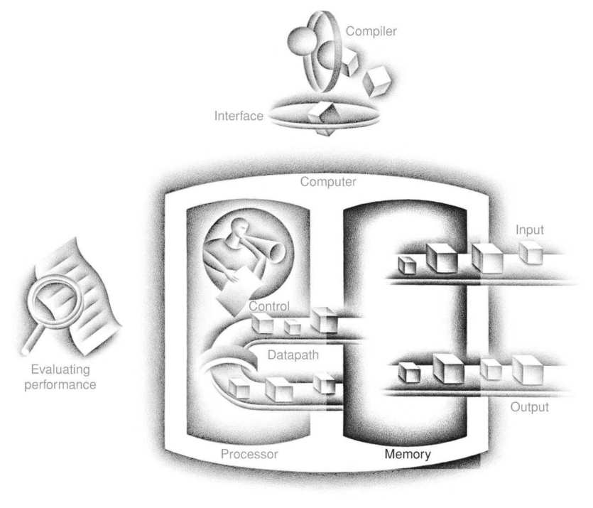

Năm thành phần kinh điển của máy tính

## 5.1 Giới thiệu

Ngay từ thời kỳ đầu của điện toán, programmer đã muốn có lượng memory nhanh không giới hạn. Các chủ đề trong chương hỗ trợ programmer bằng cách tạo ảo giác đó. Trước khi xem cách tạo ảo giác, hãy xét phép so sánh đơn giản minh họa các nguyên lý và cơ chế chính được dùng.

Giả sử bạn là sinh viên viết tiểu luận về những phát triển lịch sử quan trọng trong computer hardware. Bạn ngồi ở bàn thư viện với tập sách lấy từ kệ và đang xem xét. Bạn thấy một số máy tính quan trọng cần viết được mô tả trong sách đang có, nhưng không có gì về EDSAC. Vì vậy bạn quay lại kệ tìm thêm sách. Bạn tìm thấy sách về máy tính Anh thời kỳ đầu có trình bày EDSAC. Khi đã có tập sách phù hợp trên bàn, khả năng cao nhiều chủ đề cần thiết nằm trong đó, và bạn có thể dành phần lớn thời gian dùng sách trên bàn mà không trở lại kệ. Có nhiều sách trên bàn tiết kiệm thời gian hơn chỉ có một sách và liên tục quay lại kệ trả rồi lấy sách khác.

Cùng nguyên lý cho phép tạo ảo giác memory lớn có thể truy cập nhanh như memory rất nhỏ. Giống như không cần truy cập mọi sách thư viện cùng lúc với xác suất bằng nhau, chương trình không truy cập mọi code hoặc dữ liệu cùng lúc với xác suất bằng nhau. Nếu không, không thể làm phần lớn truy cập memory nhanh mà vẫn có memory lớn trong máy tính, như không thể đặt mọi sách thư viện trên bàn mà vẫn tìm nhanh thứ cần.

Nguyên lý locality này là nền tảng cho cả cách làm việc trong thư viện lẫn cách chương trình hoạt động. Nguyên lý locality phát biểu chương trình chỉ truy cập phần tương đối nhỏ của address space tại mỗi thời điểm, giống bạn chỉ truy cập phần rất nhỏ bộ sưu tập thư viện. Có hai loại locality khác nhau:

- Temporal locality (locality theo thời gian): nếu một mục được tham chiếu, nó có xu hướng sớm được tham chiếu lại. Nếu vừa mang sách đến bàn để xem, có lẽ bạn sẽ sớm cần xem lại.

- Spatial locality (locality theo không gian): nếu một mục được tham chiếu, các mục có địa chỉ gần đó có xu hướng sớm được tham chiếu. Ví dụ, khi lấy sách về máy tính Anh thời kỳ đầu để tìm hiểu EDSAC, bạn cũng thấy sách bên cạnh về máy tính cơ khí ban đầu, nên mang cả về và sau đó tìm thấy điều hữu ích. Thư viện đặt sách cùng chủ đề cạnh nhau trên kệ để tăng spatial locality. Chúng ta sẽ thấy memory hierarchy dùng spatial locality thế nào ở phần sau chương.

### temporal locality

Nguyên lý locality nói rằng nếu vị trí dữ liệu được tham chiếu thì có xu hướng sớm được tham chiếu lại.

### spatial locality

Nguyên lý locality nói rằng nếu vị trí dữ liệu được tham chiếu thì các vị trí dữ liệu có địa chỉ gần đó có xu hướng sớm được tham chiếu.

Giống truy cập sách trên bàn tự nhiên thể hiện locality, locality trong chương trình phát sinh từ cấu trúc chương trình đơn giản, tự nhiên. Ví dụ, phần lớn chương trình chứa loop nên instruction và dữ liệu có khả năng được truy cập lặp lại, thể hiện temporal locality lớn. Vì instruction thường được truy cập tuần tự, chương trình cũng có spatial locality cao. Truy cập dữ liệu cũng thể hiện spatial locality tự nhiên. Ví dụ, truy cập tuần tự phần tử array hoặc record tự nhiên có mức spatial locality cao.

Chúng ta tận dụng nguyên lý locality bằng cách triển khai memory máy tính dưới dạng memory hierarchy. Memory hierarchy gồm nhiều mức memory có tốc độ và kích thước khác nhau. Memory nhanh hơn đắt hơn mỗi bit so với memory chậm nên nhỏ hơn.

### memory hierarchy

Cấu trúc dùng nhiều mức memory; khi khoảng cách đến processor tăng, cả kích thước memory lẫn thời gian truy cập đều tăng.

Hình 5.1 cho thấy memory nhanh hơn gần processor, memory chậm và rẻ hơn nằm bên dưới. Mục tiêu là cung cấp cho người dùng lượng memory bằng công nghệ rẻ nhất, nhưng tốc độ truy cập bằng memory nhanh nhất.

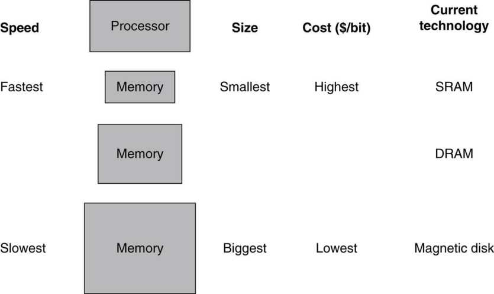

**HÌNH 5.1 Cấu trúc cơ bản của memory hierarchy. Triển khai hệ thống memory thành hierarchy tạo ảo giác memory lớn bằng mức lớn nhất của hierarchy nhưng truy cập như toàn bộ được xây bằng memory nhanh nhất. Flash memory đã thay disk trong nhiều thiết bị di động cá nhân và có thể tạo mức mới trong storage hierarchy cho desktop và server; xem Mục 5.2.**

Dữ liệu cũng có tính phân cấp: mức gần processor thường là tập con của mọi mức xa hơn, và mọi dữ liệu được lưu ở mức thấp nhất. Theo phép so sánh, sách trên bàn là tập con thư viện bạn làm việc, thư viện này lại là tập con mọi thư viện trong trường. Hơn nữa, càng xa processor, các mức càng mất nhiều thời gian truy cập, giống điều có thể gặp trong hierarchy thư viện trường.

Memory hierarchy có thể gồm nhiều mức, nhưng dữ liệu chỉ được sao chép giữa hai mức liền kề mỗi lần, nên có thể tập trung vào hai mức. Mức trên—gần processor hơn—nhỏ và nhanh hơn mức dưới vì dùng công nghệ đắt hơn. Hình 5.2 cho thấy đơn vị thông tin tối thiểu có thể có hoặc không có trong hierarchy two-level gọi là block hoặc line; trong phép so sánh thư viện, block thông tin là một sách.

### block (or line)

Đơn vị thông tin tối thiểu có thể có hoặc không có trong cache.

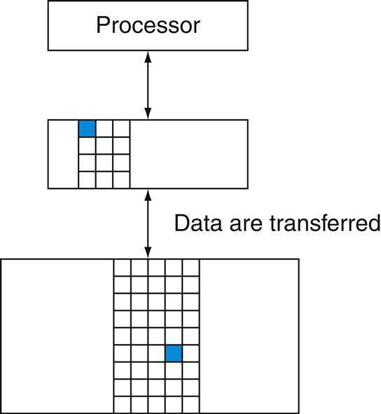

**HÌNH 5.2 Mỗi cặp mức trong memory hierarchy có thể được xem là gồm mức trên và mức dưới. Trong mỗi mức, đơn vị thông tin hiện diện hoặc không hiện diện gọi là block hoặc line. Thông thường chuyển toàn bộ block khi sao chép giữa các mức.**

Nếu dữ liệu processor yêu cầu xuất hiện trong block nào đó ở mức trên, đây gọi là hit (như tìm thấy thông tin trong sách trên bàn). Nếu không tìm thấy dữ liệu ở mức trên, yêu cầu gọi là miss. Khi đó truy cập mức dưới để lấy block chứa dữ liệu yêu cầu. (Tiếp tục phép so sánh, bạn từ bàn đến kệ tìm sách mong muốn.) Hit rate, hay hit ratio, là tỷ lệ truy cập memory tìm thấy ở mức trên; thường dùng đo hiệu năng memory hierarchy. Miss rate (1−hit rate) là tỷ lệ truy cập memory không tìm thấy ở mức trên.

### hit rate

Tỷ lệ truy cập memory tìm thấy trong một mức memory hierarchy.

### miss rate

Tỷ lệ truy cập memory không tìm thấy trong một mức memory hierarchy.

Vì hiệu năng là lý do chính có memory hierarchy, thời gian phục vụ hit và miss rất quan trọng. Hit time là thời gian truy cập mức trên memory hierarchy, bao gồm thời gian xác định truy cập là hit hay miss (tức thời gian xem sách trên bàn). Miss penalty là thời gian thay block mức trên bằng block tương ứng từ mức dưới, cộng thời gian đưa block đến processor (hay thời gian lấy sách khác từ kệ và đặt lên bàn). Vì mức trên nhỏ hơn và xây bằng linh kiện memory nhanh hơn, hit time nhỏ hơn nhiều thời gian truy cập mức kế tiếp, vốn là phần chính miss penalty. (Thời gian xem sách trên bàn nhỏ hơn nhiều thời gian đứng dậy lấy sách mới từ kệ.)

### hit time

Thời gian cần để truy cập một mức memory hierarchy, gồm thời gian xác định truy cập là hit hay miss.

### miss penalty

Thời gian cần để fetch block từ mức dưới vào một mức memory hierarchy, gồm thời gian truy cập block, truyền giữa hai mức, chèn vào mức xảy ra miss rồi chuyển block đến bên yêu cầu.

Như sẽ thấy trong chương, các khái niệm xây hệ thống memory ảnh hưởng nhiều khía cạnh khác của máy tính, gồm cách operating system quản lý memory và I/O, cách compiler tạo code, thậm chí cách ứng dụng dùng máy tính. Tất nhiên, vì mọi chương trình dành nhiều thời gian truy cập memory, hệ thống memory tất yếu là yếu tố chính quyết định hiệu năng. Dựa vào memory hierarchy để đạt hiệu năng nghĩa là programmer, vốn từng coi memory là thiết bị lưu trữ random access phẳng, nay cần hiểu memory là hierarchy để có hiệu năng tốt. Chúng ta cho thấy tầm quan trọng của hiểu biết này qua ví dụ sau, như Hình 5.18 ở trang 400 và Mục 5.14 cho thấy cách tăng gấp đôi hiệu năng nhân ma trận.

Vì hệ thống memory rất quan trọng cho hiệu năng, nhà thiết kế máy tính chú ý lớn đến chúng và phát triển cơ chế tinh vi để cải thiện hiệu năng. Trong chương, chúng ta thảo luận các ý tưởng khái niệm chính, dù dùng nhiều đơn giản hóa và trừu tượng để nội dung có độ dài, độ phức tạp phù hợp.

### Bức tranh TỔNG THỂ

Chương trình thể hiện cả temporal locality, xu hướng dùng lại mục dữ liệu vừa truy cập, lẫn spatial locality, xu hướng tham chiếu mục dữ liệu gần các mục vừa truy cập khác. Memory hierarchy tận dụng temporal locality bằng cách giữ dữ liệu vừa truy cập gần processor hơn. Memory hierarchy tận dụng spatial locality bằng cách chuyển block gồm nhiều word liên tiếp trong memory lên mức trên.

Hình 5.3 cho thấy memory hierarchy dùng công nghệ memory nhỏ và nhanh hơn gần processor. Vì vậy, truy cập hit ở mức cao nhất có thể được xử lý nhanh. Truy cập miss đi đến mức thấp hơn, lớn hơn nhưng chậm hơn. Nếu hit rate đủ cao, memory hierarchy có thời gian truy cập hiệu dụng gần mức cao nhất (nhanh nhất) và kích thước bằng mức thấp nhất (lớn nhất).

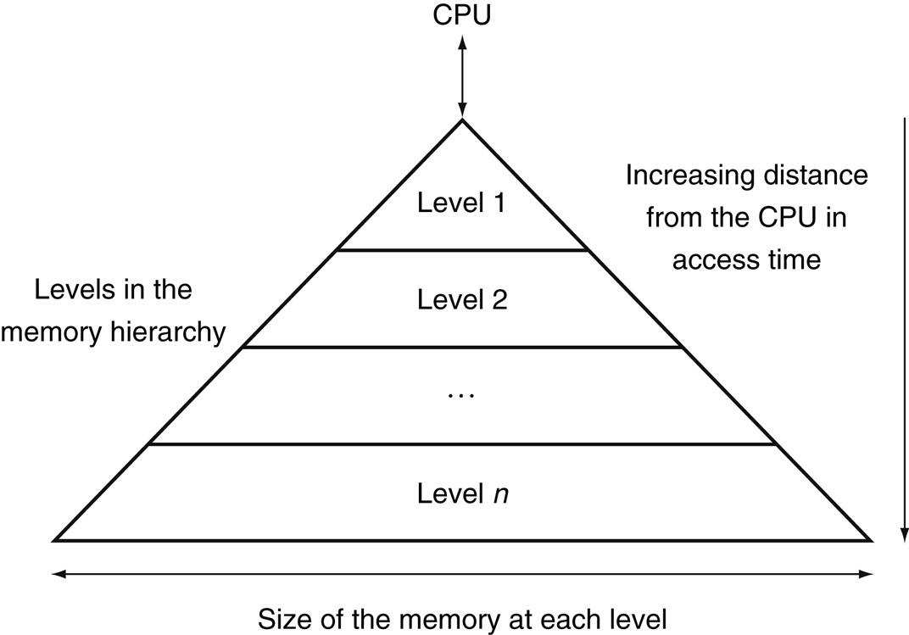

**HÌNH 5.3 Sơ đồ cho thấy cấu trúc memory hierarchy: khi khoảng cách đến processor tăng, kích thước cũng tăng. Cấu trúc này cùng cơ chế hoạt động thích hợp cho phép processor có thời gian truy cập chủ yếu do mức 1 quyết định nhưng memory lớn bằng mức n. Duy trì ảo giác này là chủ đề chương. Dù local disk thường là đáy hierarchy, một số hệ thống dùng tape hoặc file server qua local area network làm các mức tiếp theo.**

Trong phần lớn hệ thống, memory là hierarchy thực sự, nghĩa là dữ liệu không thể có ở mức i trừ khi cũng có ở mức i + 1.

### Tự kiểm tra

Những phát biểu nào sau đây nhìn chung đúng?

1. Memory hierarchy tận dụng temporal locality.

2. Khi đọc, giá trị trả về phụ thuộc block nào trong cache.

3. Phần lớn chi phí memory hierarchy ở mức cao nhất.

4. Phần lớn dung lượng memory hierarchy ở mức thấp nhất.

## 5.2 Công nghệ Memory

Có bốn công nghệ chính dùng trong memory hierarchy ngày nay. Main memory được triển khai bằng DRAM (dynamic random access memory), còn mức gần processor hơn (cache) dùng SRAM (static random access memory). DRAM rẻ hơn mỗi bit so với SRAM dù chậm hơn đáng kể. Chênh lệch giá vì DRAM dùng ít diện tích hơn mỗi bit memory, nên DRAM có dung lượng lớn hơn với cùng lượng silicon; chênh lệch tốc độ do nhiều yếu tố mô tả trong Mục A.9 của Phụ lục A. Công nghệ thứ ba là flash memory. Memory nonvolatile này là secondary memory trong Personal Mobile Devices. Công nghệ thứ tư dùng triển khai mức lớn và chậm nhất trong hierarchy server là magnetic disk. Thời gian truy cập và giá mỗi bit khác nhau lớn giữa các công nghệ, như bảng dưới với giá trị điển hình năm 2012.

| Công nghệ memory | Thời gian truy cập điển hình | $ mỗi GiB năm 2012 |
|---|---|---|
| Memory bán dẫn SRAM | 0.5–2.5 ns | \$500–\$1000 |
| Memory bán dẫn DRAM | 50–70 ns | \$10–\$20 |
| Memory bán dẫn Flash | 5,000–50,000 ns | \$0.75–\$1.00 |
| Magnetic disk | 5,000,000–20,000,000 ns | \$0.05–\$0.10 |

Phần còn lại của mục mô tả từng công nghệ memory.

### Công nghệ SRAM

SRAM đơn giản là integrated circuit gồm memory array với (thường) một access port có thể đọc hoặc ghi. SRAM có thời gian truy cập cố định cho mọi dữ liệu, dù thời gian đọc và ghi có thể khác.

SRAM không cần refresh nên thời gian truy cập rất gần cycle time. SRAM thường dùng sáu đến tám transistor mỗi bit để ngăn thông tin bị nhiễu khi đọc. SRAM chỉ cần công suất tối thiểu để giữ điện tích trong standby mode.

Trước đây, phần lớn PC và server dùng chip SRAM riêng cho primary, secondary hoặc cả tertiary cache. Ngày nay nhờ Moore’s Law, mọi mức cache được tích hợp lên processor chip, nên thị trường chip SRAM độc lập gần như biến mất.


### Công nghệ DRAM

Trong SRAM, miễn còn cấp điện, giá trị có thể được giữ vô thời hạn. Trong dynamic RAM (DRAM), giá trị trong cell được lưu dưới dạng điện tích trên capacitor. Một transistor duy nhất truy cập điện tích này để đọc giá trị hoặc ghi đè điện tích đã lưu. Vì DRAM chỉ dùng một transistor mỗi bit lưu trữ, chúng có mật độ cao và giá mỗi bit rẻ hơn SRAM nhiều. Vì lưu điện tích trên capacitor, DRAM không thể giữ vô thời hạn mà phải refresh định kỳ. Đó là lý do cấu trúc này gọi dynamic, trái với lưu trữ static trong SRAM cell.

Để refresh cell, chỉ cần đọc nội dung rồi ghi lại. Điện tích có thể giữ vài millisecond. Nếu phải đọc từng bit khỏi DRAM rồi ghi lại riêng, chúng ta sẽ liên tục refresh, không còn thời gian truy cập. May thay, DRAM dùng cấu trúc decode two-level cho phép refresh cả row (dùng chung word line) bằng một read cycle theo ngay bởi write cycle.

Hình 5.4 cho thấy tổ chức bên trong DRAM, Hình 5.5 cho thấy mật độ, chi phí và thời gian truy cập thay đổi qua các năm.

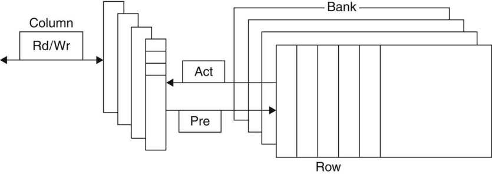

**HÌNH 5.4 Tổ chức bên trong DRAM. DRAM hiện đại tổ chức thành bank, thường bốn với DDR3. Mỗi bank gồm chuỗi row. Gửi lệnh PRE (precharge) mở hoặc đóng bank. Row address được gửi với Act (activate), khiến row chuyển vào buffer. Khi row trong buffer, có thể truyền bằng các column address liên tiếp ở độ rộng DRAM (thường 4, 8 hoặc 16 bit trong DDR3), hoặc quy định block transfer và địa chỉ bắt đầu. Mỗi lệnh và block transfer đều đồng bộ với clock.**

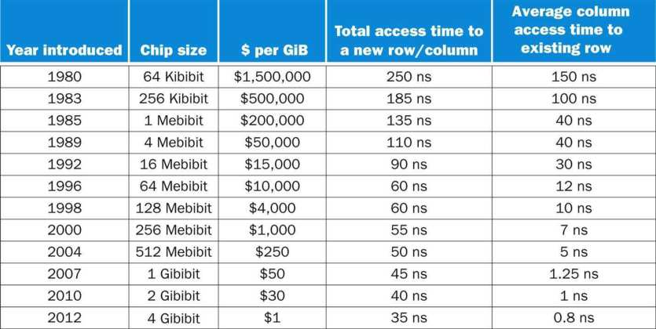

**HÌNH 5.5 Kích thước DRAM tăng bốn lần khoảng mỗi 3 năm đến 1996, sau đó chậm hơn đáng kể. Cải thiện thời gian truy cập chậm hơn nhưng liên tục; chi phí gần theo cải thiện mật độ dù thường bị yếu tố khác như nguồn cung và nhu cầu ảnh hưởng. Chi phí mỗi gibibyte chưa điều chỉnh lạm phát.**

Tổ chức row giúp refresh cũng giúp hiệu năng. Để cải thiện hiệu năng, DRAM buffer row cho truy cập lặp lại. Buffer hoạt động như SRAM; bằng đổi địa chỉ, có thể truy cập bit ngẫu nhiên trong buffer đến lần truy cập row tiếp theo. Khả năng này cải thiện thời gian truy cập đáng kể vì truy cập bit trong row nhanh hơn nhiều. Làm chip rộng hơn cũng cải thiện memory bandwidth. Khi row trong buffer, có thể truyền qua địa chỉ liên tiếp ở độ rộng DRAM (thường 4, 8 hoặc 16 bit), hoặc quy định block transfer và địa chỉ bắt đầu trong buffer.

Để cải thiện giao diện processor hơn nữa, DRAM thêm clock và được gọi đúng là synchronous DRAM hay SDRAM. Ưu điểm SDRAM là clock loại bỏ thời gian đồng bộ memory và processor. Lợi thế tốc độ synchronous DRAM đến từ khả năng truyền bit trong burst mà không cần thêm address bit. Thay vào đó, clock truyền các bit liên tiếp trong burst. Phiên bản nhanh nhất gọi Double Data Rate (DDR) SDRAM. Tên nghĩa là dữ liệu truyền ở cả cạnh lên và cạnh xuống clock, đạt bandwidth gấp đôi dự kiến từ clock rate và data width. Phiên bản mới nhất công nghệ này gọi DDR4. DRAM DDR4-3200 có thể thực hiện 3200 triệu lần truyền mỗi giây, nghĩa là clock 1600- MHz.

Duy trì bandwidth lớn như vậy đòi hỏi tổ chức thông minh bên trong DRAM. Thay vì chỉ có row buffer nhanh hơn, DRAM có thể tổ chức bên trong để đọc hoặc ghi nhiều bank, mỗi bank có row buffer riêng. Gửi địa chỉ đến nhiều bank cho phép tất cả đọc hoặc ghi đồng thời. Ví dụ, với bốn bank, chỉ có một access time, sau đó truy cập luân phiên giữa bốn bank để cung cấp bandwidth gấp bốn. Phương án truy cập luân phiên gọi address interleaving.

Dù thiết bị di động cá nhân như iPad (xem Chương 1) dùng DRAM riêng, memory server thường được bán trên bo nhỏ gọi dual inline memory module (DIMM). DIMM thường chứa 4–16 DRAM và tổ chức rộng 8 byte cho server. DIMM dùng SDRAM DDR4-3200 có thể truyền 8 ×3200 =25,600 megabyte mỗi giây. DIMM được đặt tên theo bandwidth: PC25600. Vì DIMM có thể có nhiều chip DRAM đến mức chỉ một phần được dùng cho lần truyền cụ thể, cần thuật ngữ chỉ tập con chip DIMM dùng chung address line. Để tránh nhầm với tên nội bộ row và bank của DRAM, dùng memory rank cho tập con chip như vậy trong DIMM.

#### Giải thích thêm

Một cách đo hiệu năng hệ thống memory phía sau cache là Stream benchmark [McCalpin, 1995], đo hiệu năng phép toán vector dài. Chúng không có temporal locality và truy cập array lớn hơn cache của máy đang thử.

### Flash Memory

Flash memory là loại electrically erasable programmable read-only memory (EEPROM).

Khác disk và DRAM nhưng giống công nghệ EEPROM khác, thao tác ghi có thể làm mòn bit flash memory. Để xử lý giới hạn, phần lớn sản phẩm flash có controller phân bố ghi bằng cách remap block đã ghi nhiều lần sang block ít dùng. Kỹ thuật gọi wear leveling. Với wear leveling, thiết bị di động cá nhân rất khó vượt giới hạn ghi flash. Wear leveling giảm hiệu năng tiềm năng nhưng cần thiết trừ khi software higher-level theo dõi độ mòn block. Flash controller làm wear leveling cũng có thể cải thiện yield bằng loại các memory cell sản xuất lỗi khỏi ánh xạ.

### Disk Memory

Như Hình 5.6, magnetic hard disk gồm tập platter quay trên trục ở 5400 đến 15,000 vòng mỗi phút. Platter kim loại phủ vật liệu ghi từ hai mặt, giống vật liệu băng cassette hoặc video. Để đọc, ghi thông tin, cánh tay di chuyển được chứa cuộn điện từ nhỏ gọi đầu read-write nằm ngay trên mỗi mặt. Toàn bộ drive được niêm kín vĩnh viễn để kiểm soát môi trường bên trong, cho phép đầu disk gần bề mặt hơn nhiều.

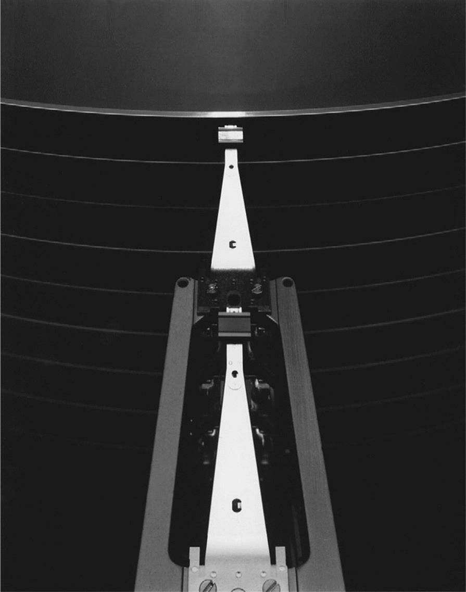

**HÌNH 5.6 Disk có 10 platter và đầu read/write. Đường kính disk ngày nay là 2.5 hoặc 3.5 inch, thường một hoặc hai platter mỗi drive. Mỗi mặt chia thành vòng tròn đồng tâm gọi track. Thường có hàng chục nghìn track mỗi mặt. Mỗi track lại chia thành sector chứa thông tin; mỗi track có thể có hàng nghìn sector. Sector thường 512 đến 4096 byte. Chuỗi ghi trên môi trường từ là số sector, khoảng trống, thông tin sector gồm error correction code (xem Mục 5.5), khoảng trống, số sector kế tiếp, v.v.**

#### track

Một trong hàng nghìn vòng tròn đồng tâm tạo thành bề mặt magnetic disk.

#### sector

Một đoạn tạo thành track trên magnetic disk; sector là lượng thông tin nhỏ nhất được đọc hoặc ghi trên disk.

Đầu disk cho mỗi mặt nối nhau và di chuyển cùng nhau, nên mỗi đầu đều trên cùng track của mỗi mặt. Cylinder chỉ toàn bộ track dưới các đầu tại vị trí cho trước trên mọi mặt.

Để truy cập dữ liệu, operating system phải điều khiển disk qua quá trình three-stage. Bước đầu đặt đầu trên đúng track. Thao tác gọi seek, thời gian di chuyển đầu đến track mong muốn gọi seek time.

#### seek

Quá trình đặt đầu read/write trên đúng track của disk.

Nhà sản xuất disk công bố minimum, maximum và average seek time trong tài liệu. Hai giá trị đầu dễ đo, nhưng trung bình có thể diễn giải rất khác vì phụ thuộc khoảng cách seek. Ngành tính average seek time bằng tổng thời gian mọi seek có thể chia số seek. Average seek time thường quảng cáo 3 ms đến 13 ms, nhưng tùy ứng dụng và scheduling yêu cầu disk, trung bình thực có thể chỉ 25% đến 33% số quảng cáo vì locality của disk reference. Locality này do truy cập liên tiếp cùng file và operating system cố lên lịch chúng cùng nhau.

Khi đầu đến đúng track, phải đợi sector mong muốn quay dưới đầu read/write. Thời gian gọi rotational latency hoặc rotational delay. Latency trung bình đến thông tin mong muốn là nửa vòng disk. Disk quay ở 5400 RPM đến 15,000 RPM. Rotational latency trung bình ở 5400 RPM là

#### rotational latency

Còn gọi rotational delay. Thời gian cần để sector mong muốn quay dưới đầu read/write; thường giả định bằng nửa thời gian một vòng quay.

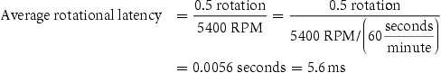

Thành phần cuối của disk access, transfer time, là thời gian truyền block bit. Transfer time là hàm của sector size, tốc độ quay và mật độ ghi track. Transfer rate năm 2012 từ 100 đến 200 MB/sec.

Điểm phức tạp là phần lớn disk controller có cache built-in lưu sector khi chúng đi qua; transfer rate từ cache thường cao hơn, tới 750 MB/sec (6 Gbit/sec) năm 2012.

Đáng tiếc, vị trí block number không còn trực quan. Giả định mô hình sector-track-cylinder trên là block gần nhau trên cùng track, block cùng cylinder truy cập nhanh hơn vì không seek time, và một số track gần hơn số khác. Nguyên nhân thay đổi là nâng mức disk interface. Để speed-up truyền tuần tự, các interface higher-level tổ chức disk giống tape hơn thiết bị random access. Logical block xếp kiểu uốn lượn qua một mặt, cố gom mọi sector ghi cùng bit density để đạt hiệu năng tốt nhất. Vì vậy block tuần tự có thể ở track khác nhau.

Tóm lại, hai khác biệt chính giữa magnetic disk và công nghệ semiconductor memory là disk truy cập chậm hơn vì cơ khí—flash nhanh gấp 1000 và DRAM nhanh gấp 100,000—nhưng rẻ hơn mỗi bit vì dung lượng lớn với chi phí vừa phải—disk rẻ hơn 10 đến 100 lần. Magnetic disk nonvolatile giống flash, nhưng khác flash không có vấn đề write wear-out. Tuy nhiên, flash bền hơn nhiều nên phù hợp rung xóc vốn có trong thiết bị di động cá nhân.

## 5.3 Cơ bản về Cache

Cache: nơi an toàn để giấu hoặc cất đồ.

Webster’s New World Dictionary of the American Language, Third College Edition, 1988

Trong ví dụ thư viện, bàn đóng vai trò cache—nơi an toàn lưu thứ (sách) cần xem. Cache là tên được chọn cho mức memory hierarchy giữa processor và main memory trong máy tính thương mại đầu có mức bổ sung này. Các memory trong datapath Chương 4 đơn giản được thay bằng cache. Ngày nay, dù đây vẫn là cách dùng từ cache chủ đạo, thuật ngữ còn chỉ mọi lưu trữ được quản lý để tận dụng locality truy cập. Cache xuất hiện đầu trong máy nghiên cứu đầu thập niên 1960 và máy sản xuất cuối cùng thập niên; mọi máy tính general-purpose xây hiện nay, từ server đến embedded processor low-power, đều có cache.

Trong mục này, bắt đầu bằng cache rất đơn giản mà mỗi yêu cầu processor là một word và block cũng chỉ một word. (Độc giả đã quen cơ bản cache có thể chuyển Mục 5.4.) Hình 5.7 cho thấy cache đơn giản trước và sau yêu cầu dữ liệu ban đầu không trong cache. Trước yêu cầu, cache chứa tập tham chiếu gần đây X<sub>1</sub>, X<sub>2</sub>, …, X<sub>n</sub><sub>−1</sub>, processor yêu cầu word X<sub>n</sub> không trong cache. Yêu cầu gây miss và word X<sub>n</sub> được đưa từ memory vào cache.

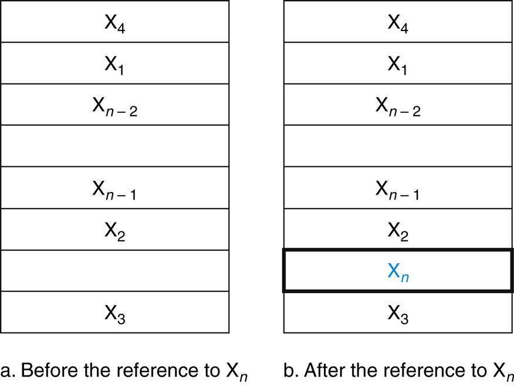

**HÌNH 5.7 Cache ngay trước và sau tham chiếu word X<sub>n</sub> ban đầu không trong cache. Tham chiếu gây miss buộc cache fetch X<sub>n</sub> từ memory rồi chèn vào cache.**

Xét tình huống Hình 5.7, cần trả lời hai câu: Làm sao biết dữ liệu trong cache? Nếu có, làm sao tìm? Các câu trả lời liên quan nhau. Nếu mỗi word chỉ có thể nằm đúng một nơi trong cache, dễ tìm nếu nó có trong cache. Cách đơn giản nhất gán vị trí cache cho mỗi word memory là dựa vào địa chỉ word trong memory. Cấu trúc cache gọi direct mapped vì mỗi vị trí memory ánh xạ trực tiếp đúng một vị trí cache. Ánh xạ điển hình giữa địa chỉ và vị trí trong cache direct-mapped thường đơn giản. Ví dụ gần như mọi cache direct-mapped dùng ánh xạ sau để tìm block:

### direct-mapped cache

Cấu trúc cache trong đó mỗi vị trí memory được ánh xạ đúng một vị trí cache.

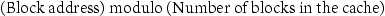

Nếu số entry cache là lũy thừa 2, modulo có thể tính đơn giản bằng các bit low-order log<sub>2</sub> (kích thước cache theo block) của địa chỉ. Do đó cache 8-block dùng ba bit thấp nhất (8=2<sup>3</sup>) của block address. Ví dụ, Hình 5.8 cho thấy các memory address từ 1<sub>ten</sub> (00001<sub>two</sub>) đến 29<sub>ten</sub> (11101<sub>two</sub>) ánh xạ vào vị trí 1<sub>ten</sub> (001<sub>two</sub>) và 5<sub>ten</sub> (101<sub>two</sub>) trong cache direct-mapped tám word.

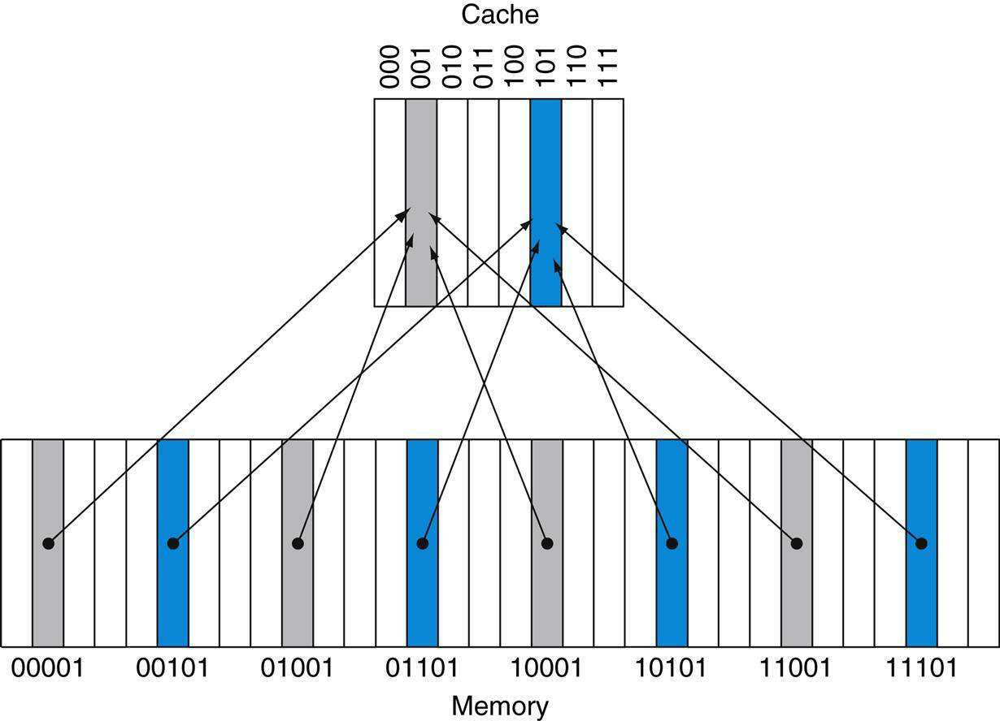

**HÌNH 5.8 Cache direct-mapped tám entry thể hiện địa chỉ memory word từ 0 đến 31 ánh xạ cùng vị trí cache. Vì cache có tám word, địa chỉ X ánh xạ word cache direct-mapped X modulo 8. Tức các bit low-order log<sub>2</sub>(8)=3 làm cache index. Vì vậy địa chỉ 00001<sub>two</sub>, 01001<sub>two</sub>, 10001<sub>two</sub> và 11001<sub>two</sub> đều ánh xạ entry 001<sub>two</sub>, còn 00101<sub>two</sub>, 01101<sub>two</sub>, 10101<sub>two</sub> và 11101<sub>two</sub> đều ánh xạ entry 101<sub>two</sub>.**

Vì mỗi vị trí cache có thể chứa nội dung nhiều vị trí memory, làm sao biết dữ liệu cache tương ứng word yêu cầu? Tức làm sao biết word yêu cầu có trong cache? Câu trả lời là thêm tập tag vào cache. Tag chứa thông tin địa chỉ cần để nhận diện word cache có tương ứng word yêu cầu không. Tag chỉ cần chứa phần trên địa chỉ, tương ứng bit không làm index. Ví dụ, Hình 5.8 chỉ cần hai bit trên của năm address bit trong tag vì index field 3-bit dưới chọn block. Kiến trúc sư bỏ index bit vì dư thừa: theo định nghĩa index field của mọi địa chỉ cache block phải chính là block number đó.

### tag

Field trong bảng dùng cho memory hierarchy, chứa thông tin địa chỉ để xác định block liên quan có tương ứng word yêu cầu không.

Cũng cần nhận biết cache block không có thông tin hợp lệ. Ví dụ, khi processor khởi động, cache không có dữ liệu đúng, tag field vô nghĩa. Ngay cả sau nhiều instruction, một số cache entry có thể còn trống, như Hình 5.7. Do đó cần biết phải bỏ qua tag cho entry đó. Cách phổ biến nhất là thêm valid bit chỉ entry có địa chỉ hợp lệ không. Nếu bit chưa đặt, không thể match block này.

### valid bit

Field trong bảng memory hierarchy chỉ block liên quan chứa dữ liệu hợp lệ.

Phần còn lại mục tập trung giải thích cách cache xử lý đọc. Nhìn chung, đọc đơn giản hơn ghi một chút vì không cần thay nội dung cache. Sau cơ bản cách đọc và xử lý cache miss, chúng ta khảo sát thiết kế cache máy tính thực và chi tiết xử lý ghi.

### Bức tranh TỔNG THỂ

Caching có lẽ là ví dụ quan trọng nhất của ý tưởng lớn về prediction. Nó dựa vào nguyên lý locality để cố tìm dữ liệu mong muốn ở mức memory hierarchy cao hơn, và cung cấp cơ chế bảo đảm khi dự đoán sai sẽ tìm, dùng đúng dữ liệu từ mức thấp hơn. Hit rate của cache prediction trên máy tính hiện đại thường hơn 95% (xem Hình 5.46).


### Truy cập Cache

Dưới đây là chuỗi chín memory reference đến cache eight-block trống, gồm thao tác cho từng reference. Hình 5.9 cho thấy nội dung cache đổi ở mỗi miss. Vì có tám block trong cache, 3 bit low-order của địa chỉ cho block number:

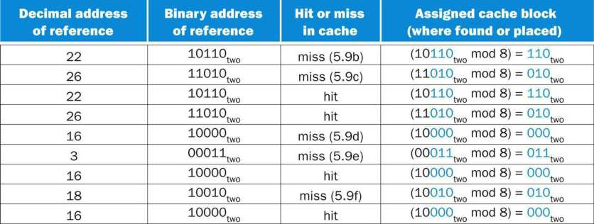

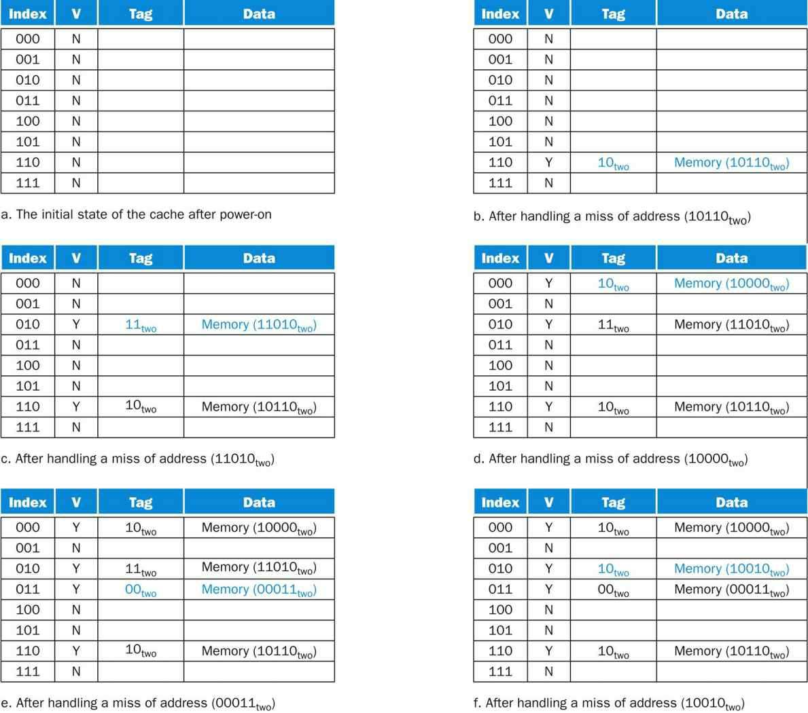

**HÌNH 5.9 Nội dung cache sau mỗi yêu cầu tham chiếu miss, với index field và tag field ở dạng nhị phân cho chuỗi địa chỉ trang 379. Cache ban đầu trống, mọi valid bit (mục V) tắt (N). Processor yêu cầu các địa chỉ: 10110<sub>two</sub> (miss), 11010<sub>two</sub> (miss), 10110<sub>two</sub> (hit), 11010<sub>two</sub> (hit), 10000<sub>two</sub> (miss), 00011<sub>two</sub> (miss), 10000<sub>two</sub> (hit), 10010<sub>two</sub> (miss) và 10000<sub>two</sub> (hit). Hình cho thấy nội dung cache sau khi xử lý mỗi miss. Khi tham chiếu địa chỉ 10010<sub>two</sub> (18), phải thay entry địa chỉ 11010<sub>two</sub> (26); tham chiếu 11010<sub>two</sub> sẽ gây miss sau đó. Tag field chỉ chứa phần trên địa chỉ. Địa chỉ đầy đủ word trong cache block i có tag field j là j×8+i, tương đương ghép tag field j và index i. Ví dụ trong cache f trên, index 010<sub>two</sub> có tag 10<sub>two</sub>, tương ứng địa chỉ 10010<sub>two</sub>.**

Vì cache trống, một số reference đầu miss; chú thích Hình 5.9 mô tả thao tác cho mỗi memory reference. Reference thứ tám có yêu cầu xung đột cho block. Word tại địa chỉ 18 (10010<sub>two</sub>) phải vào cache block 2 (010<sub>two</sub>). Vì vậy phải thay word địa chỉ 26 (11010<sub>two</sub>) đang ở cache block 2 (010<sub>two</sub>). Hành vi này cho phép tận dụng temporal locality: word vừa tham chiếu thay word ít được tham chiếu gần đây hơn.

Tình huống tương tự cần sách từ kệ khi bàn hết chỗ—phải trả một sách đang trên bàn. Trong cache direct-mapped, chỉ một chỗ đặt mục mới yêu cầu nên chỉ một lựa chọn thay thế.

Chúng ta biết tìm ở đâu trong cache cho mọi địa chỉ: các bit low-order có thể tìm cache entry duy nhất mà địa chỉ ánh xạ. Hình 5.10 cho thấy địa chỉ tham chiếu được chia thành

- Tag field dùng để so sánh giá trị tag field cache

- Cache index dùng chọn block

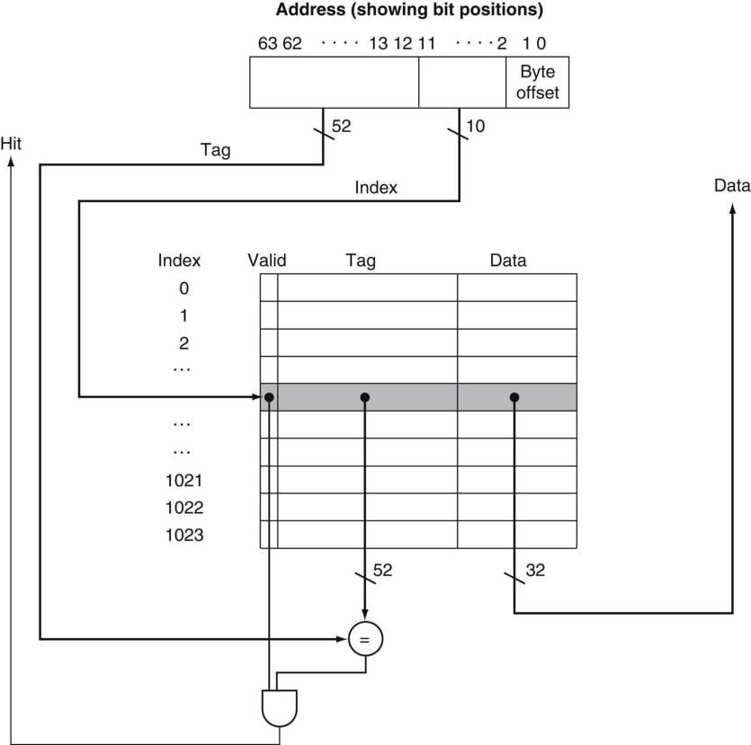

**HÌNH 5.10 Với cache này, phần dưới địa chỉ chọn cache entry gồm data word và tag. Cache chứa 1024 word hay 4 KiB. Trừ khi nói khác, chương giả định địa chỉ 64-bit. Tag cache được so sánh phần trên địa chỉ để xác định entry tương ứng địa chỉ yêu cầu không. Vì cache có 2<sup>10</sup> (hay 1024) word và block size một word, 10 bit dùng index, còn 64 −10 −2 =52 bit so sánh tag. Nếu tag bằng 52 bit trên địa chỉ và valid bit bật, yêu cầu hit và word được cung cấp cho processor. Nếu không, miss xảy ra.**

Index cache block cùng nội dung tag xác định duy nhất địa chỉ memory của word trong block. Vì index field làm địa chỉ tham chiếu cache và field n-bit có 2<sup>n</sup> giá trị, tổng entry cache direct-mapped phải là lũy thừa 2. Vì word căn chỉnh bội bốn byte, hai bit ít quan trọng nhất của địa chỉ quy định byte trong word. Do đó nếu word căn chỉnh trong memory, có thể bỏ qua hai bit này khi chọn word trong block. Chương giả định dữ liệu căn chỉnh, và thảo luận truy cập cache không căn chỉnh trong phần Giải thích thêm.

Tổng bit cần cho cache là hàm của cache size và address size vì cache lưu cả dữ liệu lẫn tag. Block trên là một word (4 byte), nhưng thông thường nhiều word. Với tình huống sau:

- Địa chỉ 64-bit

- Cache direct-mapped

- Cache size là 2<sup>n</sup> block, nên n bit dùng cho index

- Block size là 2<sup>m</sup> word (2<sup>m</sup><sup>+2</sup> byte), nên m bit dùng cho word trong block, hai bit dùng cho phần byte địa chỉ

Kích thước tag field là

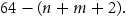

Tổng bit trong cache direct-mapped là

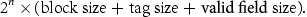

Vì block size là 2<sup>m</sup> word (2<sup>m</sup><sup>+5</sup> bit) và cần 1 bit cho valid field, số bit cache là

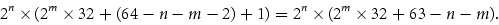

Dù đây là kích thước thực theo bit, quy ước tên loại trừ kích thước tag và valid field, chỉ đếm dữ liệu. Vì vậy cache Hình 5.10 gọi cache 4 KiB.

#### Bit trong Cache

**Ví dụ**

Cần tổng bao nhiêu bit cho cache direct-mapped có 16 KiB dữ liệu và block four-word, giả định địa chỉ 64-bit?

**Trả lời**

Biết 16 KiB là 4096 (2<sup>12</sup>) word. Với block size bốn word (2<sup>2</sup>), có 1024 (2<sup>10</sup>) block. Mỗi block có 4 ×32 hay 128 bit dữ liệu cộng tag 64 −10 −2 −2 bit và valid bit. Do đó kích thước cache đầy đủ là

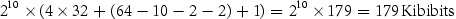

hay 22.4 KiB cho cache 16 KiB. Tổng bit cache này khoảng 1.4 lần số chỉ cần lưu dữ liệu.

#### Ánh xạ địa chỉ vào Cache Block nhiều word

**Ví dụ**

Xét cache có 64 block và block size 16 byte. Byte address 1200 ánh xạ block number nào?

**Trả lời**

Chúng ta đã thấy công thức ở trang 376. Block được cho bởi

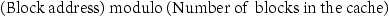

trong đó địa chỉ block là

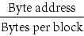

Lưu ý block address này là block chứa mọi địa chỉ giữa

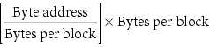

và

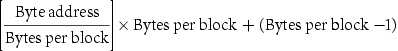

Do đó, với 16 byte mỗi block, byte address 1200 là block address

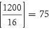

ánh xạ cache block number (75 modulo 64)=11. Thực tế block này ánh xạ mọi địa chỉ từ 1200 đến 1215.

Block lớn hơn khai thác spatial locality để giảm miss rate. Như Hình 5.11, tăng block size thường giảm miss rate. Cuối cùng miss rate có thể tăng nếu block size chiếm phần đáng kể cache size, vì số block chứa được ít và cạnh tranh lớn. Kết quả là block bị đẩy khỏi cache trước khi nhiều word được truy cập. Nói khác, spatial locality giữa word trong block giảm khi block quá lớn; lợi ích miss rate vì vậy nhỏ hơn.

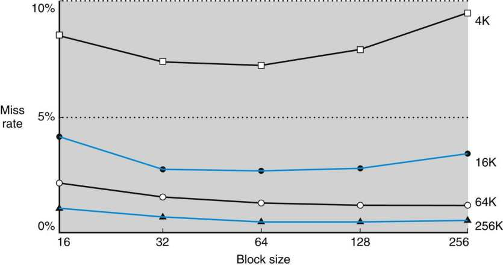

**HÌNH 5.11 Miss rate theo block size. Lưu ý miss rate thực sự tăng nếu block quá lớn so với cache size. Mỗi đường biểu diễn cache kích thước khác nhau. (Hình không phụ thuộc associativity sẽ sớm thảo luận.) Đáng tiếc, trace SPEC CPU2000 sẽ mất quá lâu nếu xét block size nên dữ liệu dựa trên SPEC92.**

Vấn đề nghiêm trọng hơn khi chỉ tăng block size là chi phí miss tăng. Miss penalty do thời gian fetch block từ mức ngay dưới và nạp vào cache quyết định. Thời gian fetch gồm latency đến word đầu và transfer time phần còn lại. Rõ ràng, nếu không đổi hệ thống memory, transfer time—và miss penalty—có khả năng tăng theo block size. Hơn nữa, cải thiện miss rate bắt đầu giảm khi block lớn lên. Kết quả là miss penalty tăng lấn át miss rate giảm với block quá lớn, nên hiệu năng cache giảm. Tất nhiên, nếu thiết kế memory truyền block lớn hiệu quả hơn, có thể tăng block size và tiếp tục cải thiện hiệu năng. Mục tiếp theo thảo luận chủ đề này.

#### Giải thích thêm

Dù khó xử lý thành phần latency dài hơn của miss penalty với block lớn, có thể ẩn một phần transfer time để giảm miss penalty hiệu dụng. Cách dễ nhất gọi early restart, chỉ tiếp tục thực thi ngay khi word yêu cầu trở về thay vì chờ cả block. Nhiều processor dùng kỹ thuật cho instruction access, nơi hiệu quả nhất. Instruction access chủ yếu tuần tự nên nếu memory cung cấp một word mỗi clock cycle, processor có thể chạy lại khi word yêu cầu trở về, memory cung cấp instruction word mới vừa kịp. Kỹ thuật thường kém hiệu quả với data cache vì thứ tự yêu cầu word trong block khó dự đoán hơn và xác suất cần word từ block khác trước khi truyền xong cao. Nếu processor không thể truy cập data cache vì đang truyền, phải stall.

Phương án tinh vi hơn là tổ chức memory để truyền word yêu cầu đến cache trước. Phần còn lại truyền sau, bắt đầu từ địa chỉ sau word yêu cầu rồi vòng về đầu block. Kỹ thuật gọi requested word first hay critical word first, có thể nhanh hơn early restart một chút nhưng bị cùng đặc tính giới hạn.

### Xử lý Cache Miss

Trước khi xem cache hệ thống thực, hãy xem control unit xử lý cache miss. (Mục 5.9 mô tả chi tiết cache controller.) Control unit phải phát hiện miss và xử lý bằng fetch dữ liệu yêu cầu từ memory (hoặc cache lower-level như sẽ thấy). Nếu cache báo hit, máy tính tiếp tục dùng dữ liệu như không có gì xảy ra.

#### cache miss

Yêu cầu dữ liệu từ cache không được đáp ứng vì dữ liệu không có trong cache.

Sửa processor control để xử lý hit rất đơn giản; miss cần thêm việc. Xử lý cache miss được processor control unit phối hợp với controller riêng khởi tạo memory access và refill cache. Xử lý cache miss tạo pipeline stall (Chương 4), khác exception hay interrupt phải lưu state mọi register. Với cache miss, có thể stall toàn processor, đóng băng nội dung temporary register và register programmer-visible trong khi chờ memory. Processor out-of-order tinh vi hơn có thể cho instruction thực thi trong khi chờ cache miss, nhưng mục này giả định processor in-order stall khi cache miss.

Hãy xem kỹ hơn xử lý instruction miss; dễ mở rộng cùng cách cho data miss. Nếu instruction access miss, nội dung Instruction register không hợp lệ. Để đưa đúng instruction vào cache, phải có thể yêu cầu mức dưới trong memory hierarchy đọc. Vì program counter tăng ở clock cycle đầu thực thi, địa chỉ instruction gây instruction cache miss bằng program counter trừ 4. Có địa chỉ rồi, cần yêu cầu main memory đọc, chờ phản hồi (vì mất nhiều clock cycle), rồi ghi các word chứa instruction mong muốn vào cache.

Bây giờ có thể định nghĩa các bước khi instruction cache miss:

1. Gửi giá trị PC gốc đến memory.

2. Yêu cầu main memory đọc và đợi truy cập hoàn tất.

3. Ghi cache entry, đặt dữ liệu memory vào phần data, ghi bit trên địa chỉ (từ ALU) vào tag field và bật valid bit.

4. Khởi động lại thực thi instruction từ bước đầu, fetch lại và lần này tìm thấy trong cache. Cache control cho data access về cơ bản giống: khi miss, chỉ stall processor đến khi memory phản hồi dữ liệu.

### Xử lý ghi

Ghi hoạt động hơi khác. Giả sử store instruction chỉ ghi dữ liệu vào data cache (không đổi main memory); sau ghi cache, memory có giá trị khác cache. Khi đó cache và memory được gọi inconsistent. Cách đơn giản nhất giữ nhất quán là luôn ghi cả memory lẫn cache. Phương án gọi write-through.

#### write-through

Phương án ghi luôn cập nhật cả cache và mức memory hierarchy ngay dưới, bảo đảm dữ liệu giữa hai bên luôn nhất quán.

Khía cạnh chính khác là write miss. Trước hết fetch word của block từ memory. Sau khi block vào cache, có thể ghi đè word gây miss trong cache block. Cũng ghi word vào main memory bằng địa chỉ đầy đủ.

Dù thiết kế xử lý ghi đơn giản, hiệu năng không tốt. Với write-through, mỗi ghi khiến dữ liệu được ghi vào main memory. Ghi mất lâu, có thể ít nhất 100 clock cycle processor, làm chậm đáng kể. Ví dụ, giả sử 10% instruction là store. Nếu CPI không cache miss là 1.0, thêm 100 cycle mỗi ghi dẫn đến CPI 1.0 +100 ×10%=11, giảm hiệu năng hơn 10 lần.

Một giải pháp là write buffer, lưu dữ liệu trong lúc chờ ghi memory. Sau khi ghi dữ liệu vào cache và write buffer, processor tiếp tục thực thi. Khi main memory ghi xong, entry buffer được giải phóng. Nếu buffer đầy khi processor gặp ghi, processor phải stall đến khi có chỗ trống. Tất nhiên, nếu tốc độ memory hoàn tất ghi thấp hơn tốc độ processor tạo ghi, không lượng buffer nào giúp được vì ghi được tạo nhanh hơn hệ thống memory nhận.

#### write buffer

Queue giữ dữ liệu trong lúc chờ ghi vào memory.

Tốc độ tạo ghi cũng có thể thấp hơn memory nhận, nhưng stall vẫn xảy ra nếu ghi theo burst. Để giảm stall, processor thường tăng độ sâu write buffer hơn một entry.

Thay write-through là write-back. Trong write-back, khi ghi, giá trị mới chỉ được ghi vào block cache. Block đã sửa được ghi xuống mức dưới khi thay thế. Write-back có thể cải thiện hiệu năng, đặc biệt khi processor tạo ghi nhanh bằng hoặc hơn tốc độ main memory xử lý; tuy nhiên triển khai write-back phức tạp hơn write-through.

#### write-back

Phương án xử lý ghi bằng chỉ cập nhật block cache, rồi ghi block đã sửa xuống mức dưới khi bị thay thế.

Phần còn lại mô tả cache processor thực và khảo sát cả đọc, ghi. Mục 5.8 mô tả xử lý ghi chi tiết hơn.

#### Giải thích thêm

Ghi gây một số phức tạp không có với đọc. Ở đây thảo luận hai điểm: chính sách write miss và triển khai ghi hiệu quả trong cache write-back.

Xét miss trong cache write-through. Chiến lược phổ biến nhất là cấp phát block trong cache, gọi write allocate. Block được fetch từ memory rồi phần thích hợp bị ghi đè. Cách khác là cập nhật phần block trong memory nhưng không đưa vào cache, gọi no write allocate. Động cơ là đôi khi chương trình ghi toàn block, như operating system đưa page memory về 0. Khi đó fetch gắn với write miss đầu có thể không cần. Một số máy cho đổi write allocation policy theo per-page.

Triển khai store hiệu quả trong cache write-back phức tạp hơn write-through. Cache write-through có thể ghi dữ liệu và đọc tag; nếu tag không khớp, miss xảy ra. Vì write-through, ghi đè block cache không nghiêm trọng do memory có giá trị đúng. Trong cache write-back, trước hết phải ghi block trở lại memory nếu dữ liệu đã sửa và cache miss. Nếu chỉ ghi đè block với store trước khi biết có hit hay không (như write-through), sẽ phá nội dung block chưa có bản sao ở mức memory hierarchy dưới.

Trong cache write-back, vì không thể ghi đè block, store cần hai cycle (kiểm tra hit rồi ghi thật) hoặc write buffer giữ dữ liệu—cho phép store thực chất chỉ mất một cycle bằng pipeline. Khi dùng store buffer, processor tra cache và đặt dữ liệu vào buffer trong cache access cycle bình thường. Giả định hit, dữ liệu mới được ghi từ buffer vào cache ở cache access cycle trống tiếp theo.

Ngược lại, cache write-through luôn có thể ghi một cycle. Chúng ta đọc tag và ghi phần data của block chọn. Nếu tag khớp địa chỉ block đang ghi, processor tiếp tục bình thường vì cập nhật đúng block. Nếu không khớp, processor tạo write miss để fetch phần còn lại block tương ứng địa chỉ.

Nhiều cache write-back cũng có write buffer giảm miss penalty khi thay block đã sửa. Khi đó block đã sửa chuyển sang buffer write-back của cache trong khi block yêu cầu được đọc từ memory. Buffer write-back được ghi memory sau. Nếu không có miss khác ngay lập tức, kỹ thuật giảm một nửa miss penalty khi thay dirty block.

### Cache ví dụ: Processor Intrinsity FastMATH

Intrinsity FastMATH là embedded microprocessor dùng kiến trúc MIPS và triển khai cache đơn giản. Gần cuối chương, chúng ta khảo sát thiết kế cache phức tạp hơn của ARM, Intel; bắt đầu bằng ví dụ đơn giản nhưng thực vì lý do giảng dạy. Hình 5.12 cho thấy tổ chức data cache Intrinsity FastMATH. Lưu ý address size chỉ 32 bit, không phải 64 như phần còn lại sách.

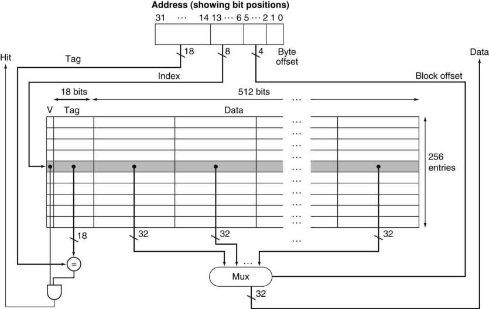

**HÌNH 5.12 Mỗi cache 16 KiB trong Intrinsity FastMATH có 256 block, 16 word mỗi block. Address size chỉ 32 bit. Tag field rộng 18 bit, index field 8 bit; field 4-bit (bit 5–2) index block và chọn word bằng multiplexor 16-to-1. Thực tế, để bỏ multiplexor, cache dùng RAM lớn riêng cho data, RAM nhỏ hơn cho tag, block offset cung cấp address bit bổ sung cho data RAM lớn. Khi đó RAM lớn rộng 32 bit và phải có số word gấp 16 số block cache.**

Processor có pipeline 12-stage. Ở tốc độ đỉnh, có thể yêu cầu cả instruction word và data word mỗi clock. Để đáp ứng mà không stall, dùng instruction cache và data cache riêng. Mỗi cache 16 KiB hay 4096 word, block 16-word.

Yêu cầu đọc đơn giản. Vì data cache và instruction cache riêng, cần control signal riêng để đọc, ghi từng cache. (Nhớ phải cập nhật instruction cache khi miss.) Các bước đọc mỗi cache như sau:

1. Gửi địa chỉ đến cache thích hợp, từ PC (instruction) hoặc ALU (data).

2. Nếu cache báo hit, word yêu cầu sẵn trên data line. Vì block có 16 word, phải chọn đúng word. Block index field điều khiển multiplexor (cuối hình) chọn word yêu cầu từ 16 word trong block được index.

3. Nếu cache báo miss, gửi địa chỉ đến main memory. Khi memory trả dữ liệu, ghi cache rồi đọc để đáp ứng yêu cầu.

Với ghi, Intrinsity FastMATH cung cấp cả write-through và write-back, để operating system quyết định chiến lược cho ứng dụng. Nó có write buffer one-entry.

Cấu trúc như Intrinsity FastMATH đạt miss rate nào? Hình 5.13 cho instruction và data cache miss rate. Combined miss rate là miss rate hiệu dụng mỗi reference cho từng chương trình sau khi tính tần suất instruction access và data access khác nhau.


**HÌNH 5.13 Instruction miss rate và data miss rate xấp xỉ của Intrinsity FastMATH cho benchmark SPEC CPU2000. Combined miss rate là miss rate hiệu dụng khi kết hợp instruction cache 16 KiB và data cache 16 KiB, lấy trọng số miss rate riêng theo tần suất instruction reference và data reference.**

Dù miss rate quan trọng trong thiết kế cache, thước đo cuối là tác động hệ thống memory lên thời gian thực thi; chúng ta sẽ sớm thấy quan hệ miss rate và execution time.

#### Giải thích thêm

Combined cache có tổng kích thước bằng hai split cache thường có hit rate tốt hơn vì không chia cứng số entry instruction và data được dùng. Dù vậy, gần như mọi processor ngày nay dùng instruction cache và data cache tách để tăng bandwidth đáp ứng pipeline hiện đại. (Cũng có thể ít conflict miss hơn; xem Mục 5.8.)

Dưới đây là miss rate cho cache cỡ Intrinsity FastMATH và combined cache kích thước bằng tổng hai cache:

- Tổng cache size: 32 KiB

- Miss rate hiệu dụng của split cache: 3.24%

- Miss rate combined cache: 3.18%

Miss rate split cache chỉ tệ hơn chút. Ưu điểm gấp đôi bandwidth bằng hỗ trợ đồng thời instruction và data access dễ vượt nhược điểm miss rate tăng nhẹ. Điều này nhắc không dùng miss rate làm thước đo hiệu năng duy nhất, như Mục 5.4.

#### split cache

Phương án một mức memory hierarchy gồm hai cache độc lập hoạt động song song, một xử lý instruction, một xử lý data.

### Tổng kết

Mục trước bắt đầu với cache đơn giản nhất: cache direct-mapped có block one-word. Cả hit lẫn miss đơn giản vì word chỉ có đúng một vị trí và mỗi word có tag riêng. Để nhất quán cache, memory, dùng write-through để mỗi ghi cache cũng cập nhật memory. Thay write-through là write-back sao chép block về memory khi bị thay; sẽ thảo luận thêm ở mục sau.

Để tận dụng spatial locality, block phải lớn hơn một word. Block lớn giảm miss rate và tăng hiệu quả bằng giảm tỷ lệ lưu tag so với data. Dù block lớn giảm miss rate, có thể tăng miss penalty. Nếu penalty tăng tuyến tính theo block size, block lớn dễ làm giảm hiệu năng.

Để tránh mất hiệu năng, tăng main memory bandwidth để truyền block hiệu quả hơn. Cách thường dùng tăng bandwidth ngoài DRAM là tăng độ rộng memory và interleaving. Người thiết kế DRAM liên tục cải thiện giao diện processor, memory để tăng bandwidth truyền burst mode, giảm chi phí cache block lớn.

#### Tự kiểm tra

Tốc độ hệ thống memory ảnh hưởng quyết định block size. Hướng dẫn thiết kế cache nào sau nhìn chung hợp lệ?

1. Memory latency càng ngắn, cache block càng nhỏ

2. Memory latency càng ngắn, cache block càng lớn

3. Memory bandwidth càng cao, cache block càng nhỏ

4. Memory bandwidth càng cao, cache block càng lớn

## 5.4 Đo lường và cải thiện hiệu năng Cache

Trong mục này, đầu tiên khảo sát cách đo, phân tích hiệu năng cache. Sau đó tìm hiểu hai kỹ thuật cải thiện. Một giảm miss rate bằng giảm xác suất hai block memory khác nhau tranh cùng vị trí cache. Kỹ thuật thứ hai giảm miss penalty bằng thêm mức hierarchy. Kỹ thuật gọi multilevel caching, xuất hiện đầu ở máy high-end giá hơn $100,000 năm 1990; từ đó phổ biến trong thiết bị di động cá nhân giá vài trăm dollar!

CPU time có thể chia thành clock cycle CPU thực thi chương trình và clock cycle chờ hệ thống memory. Thường giả định chi phí cache hit thuộc CPU execution cycle bình thường. Do đó,

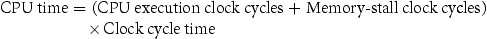

Clock cycle memory-stall chủ yếu do cache miss, và ở đây giả định như vậy. Cũng giới hạn thảo luận ở model memory đơn giản. Processor thực có stall do đọc, ghi khá phức tạp; dự đoán hiệu năng chính xác thường cần mô phỏng rất chi tiết processor và hệ thống memory.

Clock cycle Memory-stall bằng tổng stall cycle do đọc và ghi:

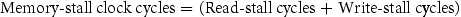

Cycle read-stall có thể định nghĩa theo số read access mỗi chương trình, read miss penalty theo clock cycle và read miss rate:

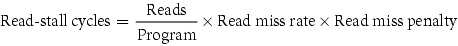

Ghi phức tạp hơn. Với write-through, có hai nguồn stall: write miss thường cần fetch block trước khi tiếp tục ghi (xem Giải thích thêm trang 386), và write buffer stall khi buffer đầy lúc ghi. Do đó cycle stall cho ghi bằng tổng hai phần:

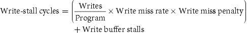

Vì write buffer stall phụ thuộc mức gần nhau của các ghi, không chỉ tần suất, không thể có phương trình đơn giản. May thay, với độ sâu buffer hợp lý (ví dụ bốn word trở lên) và memory nhận ghi nhanh hơn đáng kể tần suất trung bình (ví dụ gấp 2), stall nhỏ và có thể bỏ qua. Hệ thống không đáp ứng tiêu chí này chưa được thiết kế tốt; đáng lẽ phải dùng buffer sâu hơn hoặc tổ chức write-back.

Write-back cũng có stall bổ sung tiềm tàng do phải ghi block về memory khi thay. Mục 5.8 sẽ thảo luận thêm.

Trong phần lớn cache write-through, read và write miss penalty giống nhau (thời gian fetch block từ memory). Nếu bỏ qua write buffer stall, có thể kết hợp đọc, ghi bằng một miss rate và miss penalty:

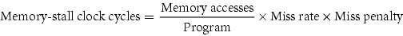

Cũng có thể phân tích thành

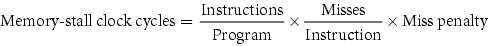

Hãy xét ví dụ đơn giản để hiểu tác động hiệu năng cache lên processor.

### Tính hiệu năng Cache

**Ví dụ**

Giả sử instruction cache miss rate 2%, data cache miss rate 4%. Processor có CPI 2 khi không memory stall và miss penalty 100 cycle cho mọi miss. Xác định processor nhanh hơn bao nhiêu với cache hoàn hảo không miss. Giả sử tổng tần suất load, store 36%.

**Trả lời**

Số memory miss cycle cho instruction theo Instruction count (I) là

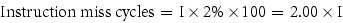

Vì tổng tần suất load, store 36%, có thể tìm memory miss cycle cho data reference:

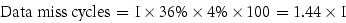

Tổng cycle memory-stall là 2.00 I +1.44 I =3.44 I, hơn ba cycle memory stall mỗi instruction. Do đó CPI gồm memory stall là 2 +3.44 =5.44. Vì instruction count và clock rate không đổi, tỷ lệ CPU execution time là

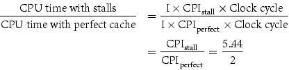

Hiệu năng cache hoàn hảo tốt hơn 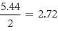.

Điều gì xảy ra nếu processor nhanh hơn nhưng memory không đổi? Thời gian memory stall chiếm tỷ lệ execution time ngày càng lớn; Amdahl’s Law từ Chương 1 nhắc điều này. Vài ví dụ đơn giản cho thấy mức nghiêm trọng. Giả sử speed-up máy tính ví dụ trước bằng giảm CPI 2 xuống 1 mà không đổi clock rate, có thể bằng pipeline cải thiện. Hệ thống có cache miss khi đó CPI 1 +3.44 =4.44, hệ thống cache hoàn hảo sẽ là

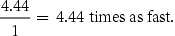

Tỷ lệ execution time cho memory stall tăng từ

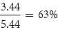

lên

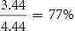

Tương tự, tăng clock rate không đổi memory cũng tăng mất hiệu năng do cache miss.

Các ví dụ và phương trình trước giả định hit time không quyết định hiệu năng cache. Rõ ràng nếu hit time tăng, tổng thời gian truy cập word tăng, có thể tăng processor cycle time. Một ví dụ là tăng cache size; chúng ta sớm thấy thêm ví dụ tăng hit time. Cache lớn có thể truy cập lâu hơn, như bàn thư viện rất lớn (chẳng hạn 3 mét vuông) khiến tìm sách lâu hơn. Hit time tăng có thể thêm stage vào pipeline vì cache hit mất nhiều cycle. Dù khó tính tác động pipeline sâu hơn, tại một mức nào đó hit time tăng vì cache lớn có thể lấn át hit rate cải thiện, giảm hiệu năng processor.

Để thể hiện thời gian truy cập data của cả hit, miss ảnh hưởng hiệu năng, người thiết kế đôi khi dùng average memory access time (AMAT) để xem các thiết kế cache thay thế. AMAT là thời gian trung bình truy cập memory, xét hit, miss và tần suất các loại truy cập; bằng:

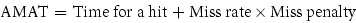

### Tính Average Memory Access Time

**Ví dụ**

Tìm AMAT cho processor có clock cycle time 1 ns, miss penalty 20 clock cycle, miss rate 0.05 miss mỗi instruction và cache access time (gồm hit detection) 1 clock cycle. Giả sử read, write miss penalty bằng nhau, bỏ qua write stall khác.

**Trả lời**

Average memory access time mỗi instruction là

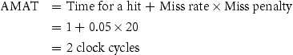

hay 2 ns.

Tiểu mục tiếp thảo luận tổ chức cache thay thế giảm miss rate nhưng đôi khi tăng hit time; Mục 5.16 có thêm ví dụ.

### Giảm Cache Miss bằng đặt Block linh hoạt hơn

Đến nay, khi đưa block vào cache, dùng cách đơn giản: block chỉ có đúng một chỗ. Như đã nói, gọi direct mapped vì ánh xạ trực tiếp mỗi block address memory đến một vị trí mức trên. Tuy nhiên có cả dải phương án đặt block. Direct mapped, chỉ đặt đúng một vị trí, là một cực.

Cực kia là block có thể đặt mọi vị trí cache. Gọi fully associative vì block memory có thể gắn với mọi cache entry. Để tìm block, phải tìm mọi entry vì block có thể ở bất cứ đâu. Để thực tế, tìm song song bằng comparator cho mỗi entry. Comparator tăng chi phí hardware đáng kể, khiến fully associative chỉ thực tế với cache ít block.

#### fully associative cache

Cấu trúc cache cho phép block đặt ở mọi vị trí cache.

Giữa direct mapped và fully associative là set associative. Cache set-associative có số vị trí cố định cho mỗi block. Cache set-associative có n vị trí cho block gọi cache n-way set-associative. Cache n-way set-associative gồm nhiều set, mỗi set n block. Mỗi block memory ánh xạ duy nhất một set theo index field và có thể đặt ở mọi phần tử set. Vì vậy cách đặt set-associative kết hợp direct-mapped và fully associative: block ánh xạ trực tiếp một set, rồi tìm mọi block trong set để match. Ví dụ Hình 5.14 cho thấy block 12 có thể đặt đâu trong cache tổng tám block theo ba chính sách.

#### set-associative cache

Cache có số vị trí cố định (ít nhất hai) mà mỗi block có thể đặt.

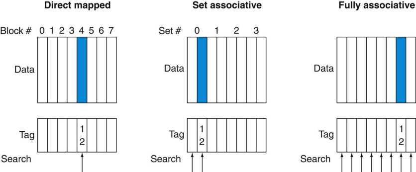

**HÌNH 5.14 Vị trí block memory địa chỉ 12 trong cache tám block thay đổi theo direct-mapped, set-associative và fully associative. Với direct-mapped, chỉ một block cache chứa được memory block 12, là (12 modulo 8)=4. Trong cache two-way set-associative, có bốn set và block 12 phải ở set (12 mod 4)=0; có thể ở một trong hai phần tử. Với fully associative, block address 12 có thể ở mọi block trong tám block cache.**

Nhớ rằng trong cache direct-mapped, vị trí memory block là

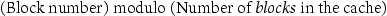

Trong cache set-associative, set chứa memory block là

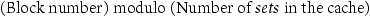

Vì block có thể đặt mọi phần tử set, phải tìm mọi tag của mọi phần tử. Trong cache fully associative, block ở bất cứ đâu nên phải tìm mọi tag của mọi block cache.

Cũng có thể coi mọi chiến lược đặt block là biến thể set associativity. Hình 5.15 cho các cấu trúc cache eight-block. Cache direct-mapped là cache one-way set-associative: mỗi entry giữ một block, mỗi set một phần tử. Cache fully associative m entry chỉ là cache m-way set-associative; có một set m block, entry có thể ở mọi block set đó.

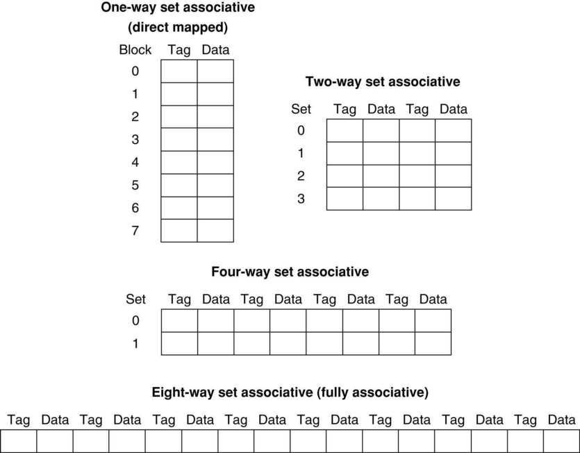

**HÌNH 5.15 Cache eight-block cấu hình direct-mapped, two-way set associative, four-way set associative và fully associative. Tổng cache size theo block bằng số set nhân associativity. Vì vậy với cache size cố định, tăng associativity giảm số set, tăng phần tử mỗi set. Với tám block, cache eight-way set-associative giống cache fully associative.**

Ưu điểm tăng associativity là thường giảm miss rate, như ví dụ tiếp. Nhược điểm chính, sẽ thảo luận chi tiết, là có thể tăng hit time.

#### Miss và Associativity trong Cache

**Ví dụ**

Giả sử ba cache nhỏ, mỗi cache bốn block one-word. Một fully associative, một two-way set associative, một direct-mapped. Tìm số miss mỗi tổ chức với chuỗi block address 0, 8, 0, 6 và 8.

**Trả lời**

Trường hợp direct-mapped dễ nhất. Trước hết xác định mỗi block address ánh xạ cache block nào:

| Block address | Cache block |
|---|---|
| 0 | (0 modulo 4)=0 |
| 6 | (6 modulo 4)=2 |
| 8 | (8 modulo 4)=0 |

Giờ điền nội dung cache sau mỗi reference, để entry trống nghĩa block không hợp lệ, chữ màu cho entry mới thêm ứng với reference, chữ thường cho entry cũ:

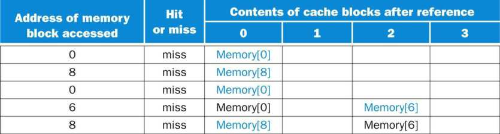

Cache direct-mapped tạo năm miss cho năm access.

Cache set-associative có hai set (index 0 và 1), mỗi set hai phần tử. Trước hết xác định mỗi block address ánh xạ set nào:

| Block address | Cache set |
|---|---|
| 0 | (0 modulo 2)=0 |
| 6 | (6 modulo 2)=0 |
| 8 | (8 modulo 2)=0 |

Vì có thể chọn entry set để thay khi miss, cần replacement rule. Cache Set-associative thường thay block least recently used trong set, tức block được dùng xa nhất trong quá khứ. (Sẽ thảo luận quy tắc khác chi tiết sau.) Theo quy tắc này, nội dung cache set-associative sau mỗi reference như sau:

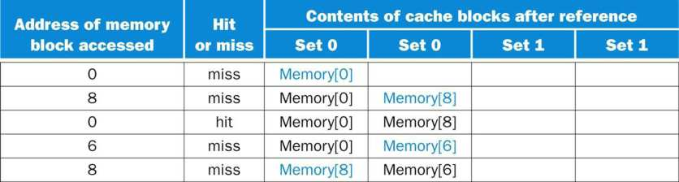

Khi tham chiếu block 6, nó thay block 8 vì block 8 được tham chiếu lâu hơn block 0. Cache two-way set-associative có bốn miss, ít hơn direct-mapped một miss.

Cache fully associative có bốn block (một set); mọi memory block có thể lưu mọi cache block. Hiệu năng tốt nhất, chỉ ba miss:

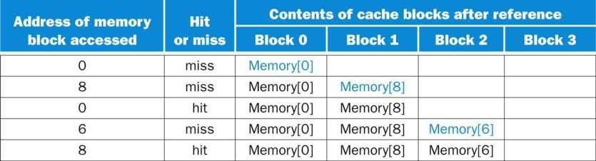

Với chuỗi này, ba miss là tốt nhất vì truy cập ba block address riêng. Nếu cache tám block, không có thay thế trong cache two-way set-associative (hãy tự kiểm tra), số miss bằng fully associative. Nếu 16 block, cả ba cache có số miss bằng nhau. Ví dụ đơn giản cũng cho thấy cache size và associativity không độc lập khi quyết định hiệu năng.

Associativity giảm miss rate bao nhiêu? Hình 5.16 cho cải thiện data cache 64 KiB, block 16-word và associativity từ direct-mapped đến eight-way. Chuyển one-way sang two-way giảm miss rate khoảng 15%, nhưng tăng cao hơn chỉ cải thiện ít.

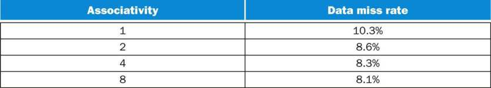

**HÌNH 5.16 Data cache miss rate cho tổ chức như Intrinsity FastMATH với benchmark SPEC CPU2000, associativity từ one-way đến eight-way. Kết quả 10 chương trình từ Hennessy và Patterson (2003).**

### Định vị Block trong Cache

Xét tìm block trong cache set associative. Như direct-mapped, mỗi block cache set-associative có address tag cho block address. Tag mọi block trong set thích hợp được kiểm tra khớp block address processor hay không. Hình 5.17 phân chia địa chỉ. Index chọn set chứa địa chỉ cần, phải tìm tag mọi block set. Vì tốc độ cốt yếu, tìm song song mọi tag set chọn. Như fully associative, tìm tuần tự khiến hit time cache set-associative quá chậm.

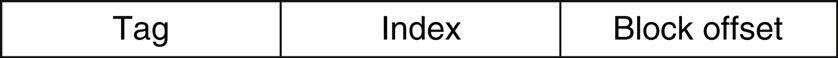

**HÌNH 5.17 Ba phần địa chỉ trong cache set-associative hoặc direct-mapped. Index chọn set, tag chọn block bằng so sánh các block set đã chọn. Block offset là địa chỉ dữ liệu mong muốn trong block.**

Nếu giữ tổng cache size, tăng associativity tăng block mỗi set, tức số so sánh đồng thời để tìm song song: mỗi tăng 2 lần associativity gấp đôi block mỗi set, giảm nửa số set. Do đó, mỗi tăng factor-of-2 giảm index 1 bit, tăng tag 1 bit. Cache fully associative thực chất một set, kiểm tra mọi block song song. Vì vậy không index; toàn địa chỉ trừ block offset so với tag mọi block. Nói khác, tìm toàn cache không indexing.

Cache direct-mapped chỉ cần một comparator vì entry chỉ ở một block, truy cập đơn giản bằng indexing. Hình 5.18 cho thấy cache four-way set-associative cần bốn comparator cùng multiplexor 4-to-1 chọn giữa bốn thành viên set. Cache access gồm index set thích hợp rồi tìm tag set. Chi phí associative cache là comparator bổ sung và delay do so sánh, chọn giữa các phần tử.

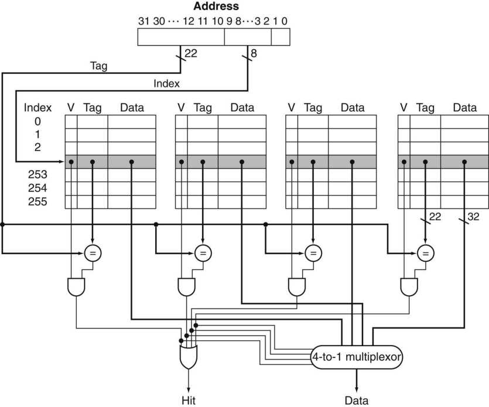

**HÌNH 5.18 Triển khai cache four-way set-associative cần bốn comparator và multiplexor 4-to-1. Comparator xác định phần tử nào (nếu có) trong set khớp tag. Output comparator chọn dữ liệu một trong bốn block bằng multiplexor có decoded select signal. Một số triển khai dùng Output enable signal trên phần data RAM cache để chọn entry điều khiển output. Output enable từ comparator khiến phần tử khớp đưa dữ liệu ra output. Tổ chức này không cần multiplexor.**

Chọn ánh xạ direct-mapped, set-associative hay fully associative trong mọi memory hierarchy phụ thuộc chi phí miss so với chi phí associativity, cả thời gian và hardware thêm.

#### Giải thích thêm

Content Addressable Memory (CAM) là mạch kết hợp so sánh và lưu trữ. Thay vì cấp địa chỉ rồi đọc word như RAM, bạn gửi dữ liệu và CAM kiểm tra có bản sao không, trả index row khớp. CAM cho phép thiết kế set associativity cao hơn nhiều so với xây từ SRAM và comparator. Năm 2013, kích thước và công suất CAM lớn hơn thường khiến two-way, four-way dùng SRAM, comparator chuẩn; eight-way trở lên dùng CAM.

### Chọn Block thay thế

Khi miss cache direct-mapped, block yêu cầu chỉ có đúng một vị trí, phải thay block đang chiếm chỗ. Cache associative cho lựa chọn đặt block nên có lựa chọn thay block nào. Fully associative: mọi block là ứng viên. set-associative: chọn giữa các block trong set đã chọn.

Phương án phổ biến nhất là least recently used (LRU), đã dùng ở ví dụ trước. Trong LRU, thay block không dùng lâu nhất. Ví dụ set-associative trang 397 dùng LRU, nên thay Memory(0) chứ không Memory(6).

#### least recently used (LRU)

Phương án thay block không được dùng trong thời gian lâu nhất.

LRU được triển khai bằng theo dõi lần dùng mỗi phần tử tương đối với phần tử khác trong set. Với cache two-way set-associative, có thể giữ một bit mỗi set, đặt bit chỉ phần tử mỗi khi tham chiếu. Associativity tăng khiến LRU khó hơn; Mục 5.8 sẽ xem phương án thay thế khác.

#### Kích thước Tag so với Set Associativity

**Ví dụ**

Tăng associativity cần thêm comparator và tag bit mỗi block. Giả sử cache 4096 block, block four-word, địa chỉ 64-bit, tìm tổng số set và tag bit cho cache direct-mapped, two-way, four-way set associative và fully associative.

**Trả lời**

Vì mỗi block 16 (=2<sup>4</sup>) byte, địa chỉ 64-bit cho 64 −4 =60 bit index, tag. Cache direct-mapped có số set bằng block, nên 12 bit index vì log<sub>2</sub>(4096)=12; tổng là (60 −12)×4096 =48 ×4096 =197 K tag bit.

Mỗi mức associativity giảm số set 2 lần, giảm bit index 1 và tăng tag 1. Vì vậy cache two-way set-associative có 2048 set, tổng tag bit (60 −11)×2 ×2048 =98 ×2048 =401 Kbit. Cache four-way set-associative có 1024 set, tổng (60 −10)×4 ×1024 =100 ×1024 =205 K tag bit.

Cache fully associative chỉ một set 4096 block, tag 60 bit, cho 60 ×4096 ×1 =246 K tag bit.

### Giảm Miss Penalty bằng Multilevel Cache

Mọi máy hiện đại dùng cache. Để thu hẹp khoảng cách clock rate nhanh và thời gian DRAM ngày càng dài, phần lớn microprocessor hỗ trợ thêm mức cache. Cache second-level thường cùng chip, được truy cập mỗi khi primary cache miss. Nếu cache second-level có dữ liệu, miss penalty cache first-level cơ bản bằng thời gian truy cập second-level, nhỏ hơn nhiều main memory. Nếu cả primary và secondary cache không có, cần truy cập main memory với miss penalty lớn hơn.

Secondary cache cải thiện hiệu năng đáng kể ra sao? Ví dụ sau cho thấy.

#### Hiệu năng Multilevel Cache

**Ví dụ**

Giả sử processor có base CPI 1.0 nếu mọi reference hit primary cache, clock rate 4 GHz. Main memory access time 100 ns gồm mọi xử lý miss. Miss rate mỗi instruction primary cache 2%. Processor nhanh hơn bao nhiêu nếu thêm secondary cache access time 5- ns cho cả hit hoặc miss và đủ lớn giảm miss rate đến main memory còn 0.5%?

**Trả lời**

Miss penalty đến main memory là


CPI hiệu dụng một mức cache là


Với processor một mức cache,


Với hai mức cache, miss primary (hay first-level) cache được secondary cache hoặc main memory đáp ứng. Miss penalty truy cập cache second-level là


Nếu secondary cache đáp ứng miss, đó là toàn penalty. Nếu phải đến main memory, tổng penalty là secondary cache access time cộng main memory access time.

Do đó cache two-level có tổng CPI bằng stall cycle từ cả hai mức cộng base CPI:


Vậy processor có secondary cache nhanh hơn


Cũng có thể tính stall cycle bằng cộng stall cycle reference hit secondary cache ((2%−0.5%)×20 =0.3). Reference đến main memory phải gồm chi phí secondary cache và main memory, là (0.5%×(20 +400)=2.1). Tổng 1.0 +0.3 +2.1 vẫn là 3.4.

Cân nhắc thiết kế primary và secondary cache khác đáng kể vì sự hiện diện cache kia thay lựa chọn tốt nhất so với cache single-level. Đặc biệt, cấu trúc two-level cho primary tập trung giảm hit time để clock cycle ngắn hơn hoặc ít pipeline stage, còn secondary tập trung miss rate để giảm penalty truy cập memory dài.

Có thể thấy ảnh hưởng của những thay đổi này lên hai cache bằng cách so sánh từng cache với thiết kế tối ưu cho một cấp cache duy nhất. So với cache single-level, primary cache của một multilevel cache thường nhỏ hơn. Hơn nữa, primary cache có thể sử dụng block size nhỏ hơn để phù hợp với cache size nhỏ hơn và giảm miss penalty. Ngược lại, secondary cache lớn hơn nhiều so với cache single-level vì thời gian truy cập của secondary cache ít quan trọng hơn. Với tổng kích thước lớn hơn, secondary cache có thể sử dụng block size lớn hơn mức phù hợp cho cache single-level. Nó cũng thường có associativity cao hơn primary cache vì tập trung vào giảm miss rate.

#### multilevel cache

Memory hierarchy có nhiều mức cache thay vì chỉ một cache và main memory.

#### Hiểu hiệu năng chương trình

Sắp xếp đã được phân tích kỹ lưỡng để tìm các thuật toán tốt hơn: Bubble Sort, Quicksort, Radix Sort, v.v. Hình 5.19(a) minh họa số instruction được thực thi trên mỗi phần tử tìm kiếm đối với Radix Sort so với Quicksort. Đúng như dự kiến, đối với các array lớn, Radix Sort có lợi thế thuật toán so với Quicksort về số phép toán. Hình 5.19(b) biểu diễn thời gian trên mỗi key thay cho số instruction được thực thi. Chúng ta thấy các đường ban đầu đi theo cùng xu hướng như trong Hình 5.19(a), nhưng sau đó đường Radix Sort tách ra khi lượng data cần sắp xếp tăng. Điều gì đang xảy ra? Hình 5.19(c) trả lời bằng cách xem xét số cache miss trên mỗi phần tử được sắp xếp: Quicksort luôn có ít miss hơn nhiều trên mỗi phần tử cần sắp xếp.


**HÌNH 5.19 So sánh Quicksort và Radix Sort theo (a) số instruction được thực thi trên mỗi phần tử được sắp xếp, (b) thời gian trên mỗi phần tử được sắp xếp và (c) số cache miss trên mỗi phần tử được sắp xếp. Những data này lấy từ bài báo của LaMarca và Ladner [1996]. Từ các kết quả như vậy, những phiên bản Radix Sort mới có xét đến memory hierarchy đã được phát minh để lấy lại lợi thế thuật toán (xem Mục 5.15). Ý tưởng cơ bản của cache optimization là sử dụng lặp lại toàn bộ data trong một block trước khi chúng bị thay thế do miss.**

Đáng tiếc, phân tích thuật toán chuẩn thường bỏ tác động memory hierarchy. Khi clock rate nhanh hơn và Moore’s Law cho kiến trúc sư khai thác hết hiệu năng luồng instruction, dùng tốt memory hierarchy rất quan trọng. Như phần giới thiệu, hiểu hành vi memory hierarchy rất quan trọng để hiểu hiệu năng chương trình trên máy hiện nay.


### Tối ưu Software bằng Blocking

Với tầm quan trọng memory hierarchy, không ngạc nhiên nhiều software optimization được phát minh cải thiện mạnh hiệu năng bằng dùng lại dữ liệu cache, giảm miss rate nhờ temporal locality tốt hơn.

Với array, có thể đạt hiệu năng memory tốt nếu lưu để truy cập tuần tự. Nhưng giả sử nhiều array, một số truy cập theo row, số khác theo column. Lưu row-by-row (row major order) hoặc column-by-column (column major order) không giải quyết vì mỗi vòng lặp dùng cả row, column.

Thay hoạt động cả row hoặc column, thuật toán blocked hoạt động trên submatrix hay block. Mục tiêu tối đa truy cập dữ liệu đã nạp cache trước thay thế, tức cải thiện temporal locality giảm miss.

Ví dụ inner loop DGEMM (dòng 4 đến 9 Hình 3.22 Chương 3) là

```
for (int j = 0; j < n; ++j)
  {
   double cij = C[i+j*n]; /* cij = C[i][j] */
   for( int k = 0; k < n; k++ )
    cij += A[i+k*n] * B[k+j*n]; /* cij += A[i][k]*B[k][j] */
   C[i+j*n] = cij; /* C[i][j] = cij */
   }
}
```

Nó đọc mọi phần tử N-by-N của B, đọc lặp cùng N phần tử tương ứng một row A và ghi một row N phần tử C. (Comment giúp nhận diện row, column.) Hình 5.20 là ảnh chụp truy cập ba array. Màu đậm chỉ truy cập gần, nhạt chỉ cũ, trắng chưa truy cập.


**HÌNH 5.20 Trạng thái của ba array C, A và B khi N = 6 và i = 1. Độ cũ của các truy cập đến phần tử array được biểu thị bằng sắc độ: màu trắng nghĩa là chưa được truy cập, màu nhạt nghĩa là truy cập cũ hơn và màu đậm nghĩa là truy cập mới hơn. So với Hình 5.22, các phần tử A và B được đọc lặp lại để tính các phần tử C mới. Các biến i, j và k được hiển thị dọc theo những hàng hoặc cột được sử dụng để truy cập các array.**

Số capacity miss rõ ràng phụ thuộc N và cache size. Nếu chứa cả ba ma trận N-by-N, mọi thứ tốt nếu không cache conflict. Chúng ta cố ý chọn 32 trên 32 trong DGEMM Chương 3, 4 để có điều này. Mỗi ma trận 32 ×32 =1024 phần tử, mỗi phần tử 8 byte nên ba ma trận chiếm 24 KiB, vừa thoải mái data cache 32 KiB của Intel Core i7 (Sandy Bridge).

Nếu cache chứa một ma trận N-by-N và một row N, ít nhất row thứ i của A và array B có thể ở lại. Nhỏ hơn thì cả B, C có thể miss. Worst case có 2 N<sup>3</sup>+N<sup>2</sup> memory word được truy cập cho N<sup>3</sup> phép toán.

Để bảo đảm phần tử truy cập vừa cache, code gốc đổi để tính submatrix. Vì vậy cơ bản gọi lặp DGEMM Hình 4.78 Chương 4 trên ma trận BLOCKSIZE trên BLOCKSIZE. BLOCKSIZE gọi blocking factor.

Hình 5.21 cho DGEMM blocked. Function do_block là DGEMM Hình 3.22 với ba tham số mới si, sj, sk chỉ vị trí bắt đầu submatrix A, B, C. Hai inner loop của do_block giờ tính theo bước BLOCKSIZE thay toàn chiều dài B, C. Optimizer gcc bỏ function call overhead bằng “inlining”, chèn code trực tiếp để tránh instruction truyền tham số, quản lý return address thông thường.


**HÌNH 5.21 DGEMM Hình 3.22 được cache blocking. Giả sử C khởi tạo 0. Function do_block cơ bản là DGEMM Chương 3 với tham số mới chỉ vị trí bắt đầu submatrix BLOCKSIZE. Optimizer gcc có thể bỏ function overhead instruction bằng inline do_block.**

Hình 5.22 minh họa truy cập ba array có blocking. Chỉ xét capacity miss, tổng memory word truy cập là 2 N<sup>3</sup>/BLOCKSIZE + N<sup>2</sup>, cải thiện khoảng BLOCKSIZE lần. Blocking khai thác kết hợp spatial, temporal locality vì A hưởng spatial locality, B hưởng temporal locality.


**HÌNH 5.22 Độ cũ truy cập array C, A, B khi BLOCKSIZE = 3. Lưu ý khác Hình 5.20, ít phần tử được truy cập hơn.**

Dù nhắm giảm cache miss, blocking cũng hỗ trợ register allocation. Chọn block nhỏ đủ giữ trong register giúp giảm tối thiểu load, store, tiếp tục cải thiện hiệu năng.

Hình 5.23 cho tác động cache blocking lên DGEMM chưa tối ưu khi tăng matrix size vượt mức cả ba vừa cache. Hiệu năng chưa tối ưu giảm nửa với ma trận lớn nhất. Phiên bản cache-blocked chậm chưa đến 10% ngay cả ma trận 960 ×960, lớn gấp 900 ma trận 32 ×32 Chương 3, 4.

#### Giải thích thêm

Multilevel cache gây nhiều phức tạp. Thứ nhất có nhiều loại miss và miss rate. Ví dụ trang 402–403 có primary miss rate và global miss rate—tỷ lệ reference miss mọi mức. Còn secondary miss rate, tỷ lệ miss secondary chia số truy cập đến nó, gọi local miss rate của secondary. Vì primary lọc truy cập, nhất là locality tốt, secondary local miss rate cao hơn global nhiều. Với ví dụ trang 402–403, local miss rate là 0.5%/2%=25%! May thay, global miss rate quyết định tần suất phải truy cập main memory.

#### global miss rate

Tỷ lệ reference miss mọi mức multilevel cache.

#### local miss rate

Tỷ lệ reference đến một mức cache bị miss; dùng trong multilevel hierarchy.

#### Giải thích thêm

Với processor out-of-order (xem Chương 4), hiệu năng phức tạp hơn vì thực thi instruction trong miss penalty. Thay instruction miss rate, data miss rate, dùng miss mỗi instruction và công thức:


Không có cách chung tính overlapped miss latency, nên đánh giá memory hierarchy cho processor out-of-order tất yếu cần mô phỏng processor và hierarchy. Chỉ xem thực thi trong mỗi miss mới biết processor stall chờ data hay tìm việc khác. Hướng dẫn là processor thường ẩn penalty L1 miss nhưng L2 hit, hiếm ẩn L2 miss.

#### Giải thích thêm

Thách thức hiệu năng thuật toán là memory hierarchy giữa các triển khai cùng kiến trúc khác nhau về cache size, associativity, block size và số cache. Để ứng phó, một số numerical library gần đây tham số hóa thuật toán rồi tìm parameter space tại runtime để có tổ hợp tốt nhất cho máy cụ thể. Cách gọi autotuning.

#### Tự kiểm tra

Phát biểu nào nhìn chung đúng với thiết kế nhiều mức cache?

1. Cache First-level chú trọng hit time hơn, cache second-level chú trọng miss rate hơn.

2. Cache First-level chú trọng miss rate hơn, cache second-level chú trọng hit time hơn.


**HÌNH 5.23 Hiệu năng của DGEMM chưa tối ưu hóa (Hình 3.22) so với DGEMM có cache blocking (Hình 5.21) khi kích thước ma trận thay đổi từ 32 ×32 (khi cả ba ma trận nằm vừa trong cache) đến 960 ×960.**

### Tổng kết

Mục này tập trung bốn chủ đề: hiệu năng cache, dùng associativity giảm miss rate, multilevel cache hierarchy giảm miss penalty, software optimization tăng hiệu quả cache.

Hệ thống memory tác động lớn execution time. Số cycle memory-stall phụ thuộc cả miss rate, miss penalty. Thách thức như Mục 5.8 là giảm một yếu tố mà không ảnh hưởng đáng kể yếu tố quan trọng khác.

Để giảm miss rate, khảo sát associative placement, cho đặt block linh hoạt hơn. Fully associative cho đặt mọi nơi nhưng phải tìm mọi block để đáp ứng yêu cầu. Chi phí cao khiến cache fully associative lớn không thực tế. Cache Set-associative là thay thế thực tế vì chỉ tìm phần tử một set duy nhất chọn bằng index. Cache Set-associative có miss rate cao hơn nhưng truy cập nhanh hơn. Associativity cho hiệu năng tốt nhất phụ thuộc công nghệ và chi tiết triển khai.

Multilevel cache giảm miss penalty bằng secondary cache lớn xử lý primary miss. Cache Second-level phổ biến vì silicon hạn chế và mục tiêu clock rate cao ngăn primary lớn. Secondary thường lớn gấp 10 hoặc hơn, xử lý nhiều primary miss. Khi đó miss penalty là secondary access time (thường <10 processor cycle) thay vì memory access (thường >100). Như associativity, tradeoff giữa secondary size và access time phụ thuộc nhiều khía cạnh triển khai.

Cuối cùng, vì hierarchy quan trọng, khảo sát đổi thuật toán cải thiện hành vi cache; blocking rất quan trọng với array lớn.

## 5.5 Memory Hierarchy đáng tin cậy

Mọi thảo luận trước ngầm định memory hierarchy không quên. Nhanh nhưng không đáng tin không hấp dẫn. Như Chương 1, ý tưởng lớn cho dependability là redundancy. Mục này đầu tiên định nghĩa thuật ngữ, thước đo liên quan failure, rồi cho thấy redundancy tạo memory gần như không quên.


### Định nghĩa Failure

Chúng ta bắt đầu bằng giả định rằng bạn có một đặc tả về dịch vụ đúng yêu cầu. Khi đó, người dùng có thể quan sát hệ thống luân phiên giữa hai trạng thái cung cấp dịch vụ so với đặc tả dịch vụ:

1. Service accomplishment, cung cấp dịch vụ đúng specification

2. Service interruption, dịch vụ khác specification

Chuyển state 1 sang 2 do failure; từ 2 sang 1 gọi restoration. Failure có thể vĩnh viễn hoặc gián đoạn. Gián đoạn khó hơn; khó chẩn đoán khi hệ thống dao động hai state. Failure vĩnh viễn dễ chẩn đoán hơn nhiều. Định nghĩa dẫn đến hai thuật ngữ: reliability và availability.

Reliability đo service accomplishment liên tục—tương đương thời gian đến failure—từ mốc tham chiếu. Vì vậy mean time to failure (MTTF) là thước đo reliability. Annual failure rate (AFR) là phần trăm thiết bị dự kiến hỏng trong năm với MTTF cho trước. MTTF lớn có thể gây hiểu sai, còn AFR trực quan hơn.

#### MTTF so với AFR của Disk

**Ví dụ**

Một số disk được công bố MTTF 1,000,000-hour. Vì 1,000,000 giờ là 1,000,000/(365 ×24)=114 năm, có vẻ gần như không bao giờ hỏng. Máy tính Warehouse-scale chạy dịch vụ Internet như Search có thể có 50,000 server. Giả sử mỗi server hai disk. Dùng AFR tính số disk dự kiến hỏng mỗi năm.

**Trả lời**

Một năm 365 ×24 =8760 giờ. MTTF 1,000,000-hour nghĩa AFR 8760/1,000,000 =0.876%. Với 100,000 disk, dự kiến 876 hỏng mỗi năm, trung bình hơn hai disk mỗi ngày!

Service interruption đo bằng mean time to repair (MTTR). Mean time between failures (MTBF) đơn giản là MTTF +MTTR. Dù MTBF phổ biến, MTTF thường phù hợp hơn. Availability đo service accomplishment trong quá trình luân phiên accomplishment, interruption. Availability được định lượng thống kê:


Reliability, availability là thước đo định lượng thực sự, không chỉ đồng nghĩa dependability. Giảm MTTR giúp availability như tăng MTTF. Ví dụ công cụ phát hiện, chẩn đoán, sửa fault giảm thời gian sửa và cải thiện availability.

Chúng ta muốn availability rất cao. Cách viết tắt là số “chữ số chín availability” mỗi năm. Ví dụ dịch vụ Internet rất tốt hiện có 4 hoặc 5 chữ số chín. Với 365 ngày mỗi năm, tức 365 ×24 ×60 =526,000 phút:

Một chữ chín: 90% =>36.5 ngày sửa/năm

Hai chữ chín: 99% =>3.65 ngày sửa/năm

Ba chữ chín: 99.9% =>526 phút sửa/năm

Bốn chữ chín: 99.99% =>52.6 phút sửa/năm

Năm chữ chín: 99.999% =>5.26 phút sửa/năm

và tiếp tục như vậy.

Để tăng MTTF, có thể cải thiện chất lượng thành phần hoặc thiết kế hệ thống tiếp tục khi thành phần hỏng. Vì vậy failure cần định nghĩa theo bối cảnh: thành phần hỏng chưa chắc hệ thống hỏng. Để phân biệt, fault chỉ failure thành phần. Ba cách tăng MTTF:

1. Fault avoidance: Ngăn fault bằng cách xây dựng.

2. Fault tolerance: Sử dụng redundancy để cho phép dịch vụ tuân theo đặc tả dịch vụ ngay cả khi có fault xảy ra.

3. Fault forecasting: Dự đoán sự hiện diện, phát sinh fault để thay thành phần trước hỏng.


### Hamming Single Error Correcting, Double Error Detecting Code (SEC/DED)

Richard Hamming phát minh phương án redundancy memory phổ biến, nhận Turing Award năm 1968. Để phát minh redundant code, hữu ích khi xét độ “gần” của bit pattern đúng. Hamming distance là số bit khác nhau tối thiểu giữa hai pattern đúng bất kỳ. Ví dụ 011011 và 001111 cách hai. Nếu khoảng cách tối thiểu giữa thành viên code là hai và có lỗi one-bit? Nó biến pattern hợp lệ thành không hợp lệ. Vì vậy nếu phát hiện thành viên code đúng hay không, có thể phát hiện lỗi một bit, gọi single bit error detection code.

#### error detection code

Code cho phép phát hiện lỗi dữ liệu nhưng không vị trí chính xác, do đó không sửa được lỗi.

Hamming dùng parity code phát hiện lỗi. Đếm số 1 trong word; odd parity nếu số 1 lẻ, even nếu chẵn. Khi ghi word memory, parity bit cũng ghi (1 cho lẻ, 0 cho chẵn). Tức parity của word N+1 bit luôn chẵn. Khi đọc, parity bit được đọc, kiểm tra. Nếu parity memory word không khớp parity bit lưu, có lỗi.

**Ví dụ**

Tính parity byte giá trị 31<sub>ten</sub> và cho pattern lưu memory. Giả sử parity bit bên phải. Nếu bit quan trọng nhất bị đảo trong memory rồi đọc lại, phát hiện lỗi không? Nếu hai bit quan trọng nhất bị đảo thì sao?

**Trả lời**

31<sub>ten</sub> là 00011111<sub>two</sub>, có năm số 1. Để parity chẵn, ghi 1 vào parity bit, tức 000111111<sub>two</sub>. Nếu bit quan trọng nhất đảo, đọc 100111111<sub>two</sub> có bảy số 1. Vì mong chẵn nhưng tính lẻ, báo lỗi. Nếu hai bit quan trọng nhất đảo, thấy 110111111<sub>two</sub> có tám số 1, parity chẵn, không báo lỗi.

Nếu lỗi 2 bit, parity 1-bit không phát hiện vì parity vẫn khớp dữ liệu hai lỗi. (Thực ra parity 1-bit phát hiện mọi số lỗi lẻ; nhưng xác suất ba lỗi thấp hơn hai nhiều, nên thực tế code parity 1-bit giới hạn phát hiện một bit lỗi.)

Tất nhiên parity code không sửa lỗi, điều Hamming muốn bên cạnh phát hiện. Nếu code có khoảng cách tối thiểu 3, mọi lỗi một bit gần pattern đúng hơn mọi pattern hợp lệ khác. Ông tìm ánh xạ dễ hiểu từ dữ liệu vào code khoảng cách 3, được gọi Hamming Error Correction Code (ECC) để vinh danh. Dùng parity bit thêm cho nhận diện vị trí lỗi đơn. Các bước tính Hamming ECC 1. Đánh số bit từ 1 bên trái, khác truyền thống bit ngoài cùng phải là 0.

2. Đánh dấu vị trí lũy thừa 2 là parity bit (1, 2, 4, 8, 16, …).

3. Mọi vị trí còn lại là data bit (3, 5, 6, 7, 9, 10, 11, 12, 13, 14, 15, …).

4. Vị trí parity bit xác định chuỗi data bit kiểm tra (Hình 5.24 minh họa đồ họa):

- Bit 1 (0001<sub>two</sub>) kiểm tra bit (1,3,5,7,9,11,...), tức bit có bit địa chỉ ngoài cùng phải là 1 (0001<sub>two</sub>, 0011<sub>two</sub>, 0101<sub>two</sub>, 0111<sub>two</sub>, 1001<sub>two</sub>, 1011<sub>two</sub>,…).

- Bit 2 (0010<sub>two</sub>) kiểm tra bit (2,3,6,7,10,11,14,15,…), có bit địa chỉ thứ hai từ phải là 1.

- Bit 4 (0100<sub>two</sub>) kiểm tra bit (4–7, 12–15, 20–23,…), có bit địa chỉ thứ ba từ phải là 1.

- Bit 8 (1000<sub>two</sub>) kiểm tra bit (8–15, 24–31, 40–47,...), có bit địa chỉ thứ tư từ phải là 1.

Mỗi data bit được hai hoặc nhiều parity bit kiểm tra.

5. Đặt parity bit để mỗi nhóm có even parity.


**HÌNH 5.24 Parity bit, data bit và phạm vi field trong Hamming ECC cho tám data bit.**

Như trò ảo thuật, có thể xác định bit sai bằng parity bit. Với code 12 bit Hình 5.24, nếu bốn phép tính parity (p8,p4,p2,p1) là 0000 thì không lỗi. Nếu pattern chẳng hạn 1010, tức 10<sub>ten</sub>, Hamming ECC cho biết bit 10 (d6) lỗi. Vì nhị phân, chỉ cần đảo bit 10 để sửa.

**Ví dụ**

Giả sử giá trị một byte là 10011010<sub>two</sub>. Đầu tiên cho Hamming ECC byte đó, rồi đảo bit 10 và chứng minh ECC tìm, sửa lỗi một bit.

Để chỗ trống parity bit, pattern 12 bit là__ 1_ 0 0 1_ 1 0 1 0.

**Trả lời**

Vị trí 1 kiểm tra bit 1,3,5,7,9,11, được làm nổi bật:__ 1_ 0 0 1_ 1 0 1 0. Để nhóm even parity, đặt bit 1 bằng 0.

Vị trí 2 kiểm tra bit 2,3,6,7,10,11, là 0_ 1_ 0 0 1_ 1 0 1 0, odd parity, nên đặt vị trí 2 bằng 1.

Vị trí 4 kiểm tra bit 4,5,6,7,12, là 0 1 1_ 0 0 1_ 1 0 1, nên đặt bằng 1.

Vị trí 8 kiểm tra bit 8,9,10,11,12, là 0 1 1 1 0 0 1_ 1 0 1 0, nên đặt bằng 0.

Code word cuối là 011100101010. Đảo bit 10 thành 011100101110.

Parity bit 1 là 0 (011100101110 có bốn số 1, even parity; nhóm này đúng).

Parity bit 2 là 1 (011100101110 có năm số 1, odd parity; có lỗi đâu đó).

Parity bit 4 là 1 (011100101110 có hai số 1, even parity; nhóm này đúng).

Parity bit 8 là 1 (011100101110 có ba số 1, odd parity; có lỗi đâu đó).

Parity bit 2, 8 sai. Vì 2 +8 =10, bit 10 phải sai. Sửa bằng đảo bit 10:

011100101010. Thế là xong!

Hamming không dừng ở single bit error correction code. Thêm một bit có thể làm minimum Hamming distance bằng 4, sửa lỗi một bit và phát hiện hai bit. Ý tưởng thêm parity bit tính trên cả word. Lấy data word 4-bit làm ví dụ, chỉ cần 7 bit cho phát hiện một bit lỗi. Hamming parity bit H (p1 p2 p3) được tính (even parity như thường) cộng even parity cả word, p4: 1 2 3 4 5 6 7 8 p<sub>1</sub> p<sub>2</sub> d<sub>1</sub> p<sub>3</sub> d<sub>2</sub> d<sub>3</sub> d<sub>4</sub> p<sub>4</sub>

Thuật toán sửa một lỗi, phát hiện hai chỉ là tính parity các nhóm ECC (H) như trước cộng cả nhóm (p<sub>4</sub>). Có bốn trường hợp:

1. H chẵn, p<sub>4</sub> chẵn: không lỗi.

2. H lẻ, p<sub>4</sub> lẻ: lỗi đơn sửa được. (p<sub>4</sub> phải cho odd parity nếu có một lỗi.)

3. H chẵn, p<sub>4</sub> lẻ: lỗi đơn ở bit p<sub>4</sub>, không ở phần còn lại, nên sửa bit p<sub>4</sub>.

4. H lẻ, p<sub>4</sub> chẵn: lỗi kép. (p<sub>4</sub> phải cho even parity nếu có hai lỗi.) Single Error Correcting/Double Error Detecting (SEC/DED) phổ biến trong memory server ngày nay. Tiện là data block 8-byte có SEC/DED chỉ cần thêm một byte, nên nhiều DIMM rộng 72 bit.

#### Giải thích thêm

Để tính số bit cần cho SEC, đặt p là tổng parity bit, d là data bit trong word p+d bit. Nếu p error correction bit phải chỉ bit lỗi (p +d trường hợp) cộng một trường hợp không lỗi, cần:


Ví dụ, data 8 bit nghĩa d = 8 và 2<sup>p</sup>≥p + 8 +1, nên p = 4. Tương tự p = 5 cho 16 data bit, 6 cho 32, 7 cho 64, v.v.

#### Giải thích thêm

Trong hệ thống rất lớn, xác suất nhiều lỗi và hỏng hoàn toàn một chip memory rộng trở nên đáng kể. IBM giới thiệu chipkill giải quyết, nhiều hệ thống lớn dùng. (Intel gọi phiên bản SDDC.) Tương tự RAID cho disk (xem  Mục 5.11), Chipkill phân bố dữ liệu, ECC để xử lý hỏng hoàn toàn một chip bằng tái tạo dữ liệu thiếu từ chip còn lại. Giả sử cluster 10,000-processor với 4 GiB mỗi processor, IBM tính tỷ lệ lỗi memory không phục hồi sau trong 3 năm:

- Chỉ parity—khoảng 90,000, hay một failure không phục hồi (hoặc không phát hiện) mỗi 17 phút.

- Chỉ SEC/DED—khoảng 3500, hay một failure không phát hiện hoặc không phục hồi mỗi 7.5 giờ.

- Chipkill—6, hay một failure không phát hiện hoặc không phục hồi mỗi 2 tháng.

Vì vậy Chipkill là yêu cầu cho máy tính warehouse-scale.

#### Giải thích thêm

Dù memory thường lỗi một, hai bit, network có thể lỗi burst. Một giải pháp là Cyclic Redundancy Check. Với block k bit, bên gửi tạo frame check sequence n-k bit, truyền n bit chia hết số nào đó. Bên nhận chia frame cho số đó; không dư thì giả định không lỗi, có dư thì từ chối message, yêu cầu gửi lại. Như có thể đoán từ Chương 3, dễ tính chia một số binary bằng shift register, khiến CRC phổ biến ngay khi hardware quý hơn. Đi xa hơn, code Reed-Solomon dùng Galois field sửa lỗi truyền multibit, coi data là hệ số polynomial và code space là giá trị polynomial. Tính Reed-Solomon phức tạp hơn phép chia binary đáng kể!

## 5.6 Virtual Machine

Virtual machine (VM) được phát triển đầu vào mid-1960s, vẫn quan trọng trong mainframe qua nhiều năm. Dù bị bỏ qua nhiều trong kỷ nguyên PC single-user thập niên 1980, 1990, gần đây phổ biến vì

- Isolation và security ngày càng quan trọng trong hệ thống hiện đại

- Hạn chế security, reliability của operating system tiêu chuẩn

- Chia sẻ một máy cho nhiều người dùng không liên quan, đặc biệt Cloud computing

- Tốc độ thô của processor tăng mạnh qua các thập niên khiến overhead VM dễ chấp nhận hơn Định nghĩa VM rộng nhất gồm hầu hết phương pháp emulation cung cấp software interface chuẩn như Java VM. Mục này xét VM cung cấp môi trường system-level đầy đủ ở mức binary instruction set architecture (ISA). Tuy một số VM chạy ISA khác native hardware, ở đây giả sử luôn khớp hardware. Chúng gọi (Operating) System Virtual Machine, ví dụ IBM VM/370, VirtualBox, VMware ESX Server, Xen.

System virtual machine tạo ảo giác người dùng có cả máy tính riêng, gồm bản operating system. Một máy chạy nhiều VM, hỗ trợ nhiều operating system (OS) khác nhau. Trên nền tảng thông thường, một OS “sở hữu” mọi hardware resource; với VM, nhiều OS cùng chia sẻ tài nguyên.

Software hỗ trợ VM gọi virtual machine monitor (VMM) hoặc hypervisor; là trái tim công nghệ VM. Hardware platform bên dưới gọi host, tài nguyên chia giữa guest VM. VMM quyết định ánh xạ virtual resource sang physical resource: tài nguyên có thể time-shared, partitioned hoặc emulated bằng software. VMM nhỏ hơn OS truyền thống nhiều; phần isolation có lẽ chỉ 10,000 dòng code.

Tuy ở đây quan tâm VM cải thiện protection, VM còn hai lợi ích thương mại quan trọng:

1. Quản lý software. VM cung cấp abstraction chạy toàn software stack, kể cả OS cũ như DOS. Triển khai điển hình có vài VM chạy legacy OS, nhiều VM chạy release ổn định hiện tại và ít VM thử release tiếp.

2. Quản lý hardware. Một lý do dùng nhiều server là mỗi ứng dụng chạy cùng OS version tương thích trên máy riêng để tăng dependability. VM cho các software stack độc lập chia hardware, hợp nhất số server. Ví dụ khác là VMM hỗ trợ chuyển VM đang chạy sang máy khác để cân bằng tải hoặc rời hardware sắp hỏng.

### Giao diện Hardware/Software

Amazon Web Services (AWS) dùng VM trong dịch vụ Cloud computing EC2 vì năm lý do:

1. Cho AWS bảo vệ người dùng khỏi nhau khi chia cùng server.

2. Đơn giản hóa phân phối software trong warehouse-scale computer. Khách cài VM image có software thích hợp, AWS phân đến mọi instance khách muốn.

3. Khách và AWS có thể “kill” VM đáng tin cậy để kiểm soát sử dụng tài nguyên khi xong việc.

4. VM che định danh hardware khách chạy, cho AWS tiếp tục dùng server cũ và thêm server mới hiệu quả hơn. Khách kỳ vọng instance đúng xếp hạng “EC2 Compute Units”, AWS định nghĩa là “năng lực CPU tương đương AMD Opteron hoặc Intel Xeon năm 2007 chạy 1.0–1.2 GHz”. Nhờ Moore’s Law, server mới rõ ràng nhiều unit hơn, nhưng AWS vẫn cho thuê máy cũ miễn kinh tế.


5. VMM kiểm soát tốc độ VM dùng processor, network, disk space, cho AWS đưa nhiều mức giá instance loại khác trên cùng server. Ví dụ năm 2012 AWS có 14 instance type, từ small standard $0.08/giờ tới high I/O quadruple extra-large $3.10/giờ.

Nói chung chi phí processor virtualization tùy workload. Chương trình User-level processor-bound không overhead vì hiếm gọi OS, mọi thứ chạy native speed. Workload I/O-intensive thường OS-intensive, nhiều system call, privileged instruction có thể gây overhead cao. Nhưng nếu workload I/O-intensive cũng I/O-bound, chi phí có thể che hoàn toàn vì processor thường nhàn đợi I/O. Overhead tùy số instruction VMM phải emulate và thời gian emulate từng cái. Vì vậy nếu guest VM cùng ISA host như giả định, mục tiêu architecture và VMM là chạy gần mọi instruction trực tiếp trên native hardware.

### Yêu cầu Virtual Machine Monitor

VM monitor phải làm gì? Nó cung cấp software interface cho guest, cách ly guest state khỏi nhau và bảo vệ chính mình khỏi guest software, gồm guest OS. Yêu cầu định tính:

- Guest software phải hành xử trên VM đúng như native hardware, trừ hành vi performance-related hoặc giới hạn tài nguyên cố định được nhiều VM chia sẻ.

- Guest software không được trực tiếp thay allocation tài nguyên hệ thực.

Để ảo hóa processor, VMM phải kiểm soát gần mọi thứ—truy cập privileged state, I/O, exception, interrupt—dù guest VM và OS đang chạy tạm dùng chúng.

Ví dụ timer interrupt: VMM dừng guest VM hiện tại, lưu state, xử lý interrupt, chọn guest tiếp rồi nạp state. Guest dựa timer interrupt được VMM cấp virtual timer, emulated timer interrupt. Để nắm quyền VMM phải privilege level cao hơn guest, thường chạy user mode; cũng bảo đảm mọi privileged instruction do VMM xử lý. Yêu cầu cơ bản hỗ trợ VMM:

- Ít nhất hai processor mode, system và user.

- Tập con privileged instruction chỉ dùng system mode, trap nếu chạy user mode; mọi system resource phải điều khiển được chỉ qua những instruction này.

### Hỗ trợ (hoặc thiếu hỗ trợ) Instruction Set Architecture cho Virtual Machine

Nếu tính VM ngay khi thiết kế ISA, tương đối dễ giảm instruction phải do VMM thực thi và tăng tốc emulation. Architecture cho VM chạy trực tiếp hardware được gọi virtualizable; IBM 370, RISC-V tự hào mang nhãn đó.

Tiếc rằng chỉ tương đối gần đây VM mới được xét cho PC, server nên phần lớn instruction set tạo ra không nghĩ virtualization. Trong số đó có x86, phần lớn RISC như ARMv7, MIPS.

Vì VMM phải bảo đảm guest chỉ tương tác virtual resource, guest OS thông thường chạy như user mode program trên VMM. Nếu guest thử đọc/sửa thông tin hardware resource bằng privileged instruction—như status bit cho interrupt—sẽ trap đến VMM. VMM sau đó thực hiện thay đổi thích hợp trên real resource tương ứng.

Vì vậy nếu mọi instruction đọc/ghi thông tin nhạy cảm đều trap ở user mode, VMM chặn được và hỗ trợ phiên bản ảo như guest OS kỳ vọng.

Thiếu hỗ trợ đó cần biện pháp khác. VMM phải đặc biệt xác định mọi instruction có vấn đề và bảo đảm chúng hoạt động đúng khi guest chạy, làm VMM phức tạp hơn, VM chậm hơn.

### Protection và Instruction Set Architecture

Protection là nỗ lực chung architecture và OS, nhưng kiến trúc sư phải sửa chi tiết bất tiện trong ISA hiện có khi virtual memory phổ biến.

Ví dụ x86 POPF nạp flag register từ đỉnh stack memory. Một flag là Interrupt Enable (IE). Chạy POPF user mode không trap mà chỉ đổi mọi flag trừ IE; system mode thì đổi IE. Vì guest OS chạy user mode trong VM, đây là vấn đề do nó kỳ vọng IE thay đổi.

Trong lịch sử IBM mainframe hardware, VMM dùng ba bước cải thiện VM:

1. Giảm chi phí processor virtualization.

2. Giảm interrupt overhead do virtualization.

3. Giảm interrupt cost bằng hướng interrupt tới đúng VM không gọi VMM.

AMD, Intel cố giải điểm đầu năm 2006 bằng giảm chi phí processor virtualization. Thú vị xem cần bao nhiêu thế hệ sửa architecture, VMM để giải cả ba, và bao lâu VM x86 thế kỷ 21 hiệu quả như mainframe IBM, VMM thập niên 1970.

#### Giải thích thêm

RISC-V trap mọi privileged instruction ở user mode, hỗ trợ classical virtualization, guest OS chạy user mode, VMM supervisor mode.

## 5.7 Virtual Memory

… một hệ thống đã được tạo để tổ hợp core drum xuất hiện với programmer như lưu trữ một mức, các truyền cần thiết tự động diễn ra.

Kilburn và cộng sự, One-level storage system, 1962

Mục trước thấy cache cho truy cập nhanh phần code, dữ liệu recently-used. Tương tự main memory làm “cache” cho secondary storage, truyền thống là magnetic disk. Kỹ thuật gọi virtual memory. Lịch sử có hai động lực: chia sẻ memory hiệu quả, an toàn giữa nhiều chương trình như VM Cloud computing, và giảm gánh lập trình khi main memory nhỏ. Năm thập niên sau phát minh, lý do đầu thống trị.

### virtual memory

Kỹ thuật dùng main memory như “cache” cho secondary storage.

Để nhiều VM chia memory, phải bảo vệ khỏi nhau, bảo đảm chương trình chỉ đọc, ghi phần main memory được cấp. Main memory chỉ cần chứa phần active của nhiều VM, giống cache chỉ phần active chương trình. Vì vậy locality hỗ trợ cả virtual memory lẫn cache; virtual memory cho chia hiệu quả processor và main memory.

Khi compile, không biết VM nào sẽ chia memory với VM nào. Thực tế các VM cùng memory đổi động khi chạy. Vì tương tác đó, muốn compile mỗi chương trình vào address space riêng—khoảng vị trí chỉ chương trình đó truy cập được. Virtual memory dịch address space sang physical address, bảo vệ address space khỏi VM khác.

### physical address

Địa chỉ trong main memory.

### protection

Tập cơ chế bảo đảm nhiều process chia sẻ processor, memory, I/O không thể cố ý hay vô ý can thiệp nhau bằng đọc, ghi dữ liệu nhau. Cũng cách ly operating system khỏi user process.

Động lực thứ hai là cho chương trình single-user vượt primary memory size. Trước đây nếu quá lớn, lập trình viên phải chia thành phần, xác định phần loại trừ lẫn nhau. Overlay được nạp, gỡ dưới điều khiển user program lúc chạy; người viết bảo đảm không truy cập overlay chưa nạp, tổng overlay không vượt memory. Overlay thường là module chứa code, dữ liệu. Gọi procedure giữa module dẫn đến module này thay module khác.

Như có thể hình dung, trách nhiệm này là gánh nặng đáng kể. Virtual memory phát minh để giảm khó khăn, tự quản lý hai mức main memory (đôi khi gọi physical memory để phân biệt virtual memory) và secondary storage.

Tuy khái niệm như cache, gốc lịch sử khác tạo thuật ngữ khác. Virtual memory block gọi page, miss gọi page fault. Processor tạo virtual address, hardware và software dịch thành physical address để main memory access. Hình 5.25 cho virtually addressed memory có page ánh xạ main memory. Quá trình gọi address mapping/translation. Nay hai mức thường DRAM, flash ở personal mobile device và DRAM, magnetic disk ở server (xem Mục 5.2). Theo thư viện, virtual address như tên sách, physical address là vị trí như Library of Congress call number.

### page fault

Sự kiện xảy ra khi page được truy cập không có trong main memory.

### virtual address

Địa chỉ tương ứng vị trí trong virtual space, được address mapping dịch sang physical address khi truy cập memory.

### address translation

Còn gọi address mapping. Quá trình ánh xạ virtual address sang địa chỉ dùng truy cập memory.


**HÌNH 5.25 Trong virtual memory, memory block gọi page ánh xạ từ virtual address sang physical address. Processor tạo virtual address, memory dùng physical address. Cả virtual và physical memory chia page, virtual page ánh xạ physical page. Tất nhiên virtual page có thể vắng main memory, không ánh xạ physical address, khi đó ở đĩa. Hai virtual address trỏ cùng physical address cho chia physical page, để hai chương trình dùng chung code hoặc dữ liệu.**

Virtual memory cũng đơn giản hóa nạp chương trình qua relocation, ánh xạ virtual address sang physical address khác trước khi dùng truy cập memory. Nhờ đó nạp được chương trình mọi nơi trong main memory. Hơn nữa mọi hệ nay relocate theo block fixed-size (page), không cần tìm vùng liên tiếp để cấp; OS chỉ cần đủ page.

Địa chỉ chia virtual page number và page offset. Hình 5.26 cho dịch virtual sang physical page number. RISC-V địa chỉ 64-bit nhưng 16 bit trên không dùng nên cần ánh xạ 48 bit. Hình giả sử physical memory 1 TiB hay 2<sup>40</sup> byte, cần địa chỉ 40-bit. Physical page number tạo phần trên physical address, page offset không đổi tạo phần dưới. Số bit offset quyết định page size. Số page virtual address định được có thể khác physical address. Nhiều virtual page hơn physical page là nền ảo giác virtual memory gần như vô hạn.


**HÌNH 5.26 Ánh xạ virtual sang physical address. Page size 2<sup>12</sup> = 4 KiB. Cho 2<sup>28</sup> physical page vì physical page number 28 bit. Main memory tối đa 1 TiB, virtual address space 256 TiB. RISC-V cho physical memory tới 1 PiB; chọn 1 TiB vì đủ nhiều máy năm 2016.**

Nhiều lựa chọn thiết kế do page fault rất đắt. Fault tới đĩa mất hàng triệu clock cycle. (Bảng trang 372 cho main memory latency nhanh hơn đĩa khoảng 100,000 lần.) Miss penalty khổng lồ, với page điển hình chủ yếu thời gian lấy word đầu, dẫn đến:

- Page đủ lớn để phân bổ chi phí access time cao. Nay thường 4 KiB đến 64 KiB. Desktop/server mới hỗ trợ 32 KiB, 64 KiB, còn embedded mới đi hướng khác, page 1 KiB.

- Tổ chức giảm page fault hấp dẫn, kỹ thuật chính cho fully associative placement trong memory.

- Page fault có thể được xử lý bằng software vì overhead sẽ nhỏ so với thời gian truy cập đĩa. Ngoài ra, software có thể sử dụng các thuật toán thông minh để lựa chọn cách đặt page, vì ngay cả một mức giảm nhỏ của miss rate cũng đủ bù chi phí của những thuật toán đó.

- Write-through không được vì ghi quá lâu; virtual memory dùng write-back. Các phần tiếp giải quyết những yếu tố thiết kế này.

### Giải thích thêm

Ta lấy nhiều VM chia memory làm động lực, nhưng virtual memory ban đầu để nhiều chương trình chia máy trong timesharing. Vì nhiều độc giả nay chưa dùng time-sharing system, ta dùng VM dẫn nhập.

### Giải thích thêm

RISC-V hỗ trợ nhiều cấu hình virtual memory. Ngoài cơ chế virtual address 48-bit phù hợp với server lớn năm 2016, architecture còn hỗ trợ virtual address space 39-bit và 57-bit. Tất cả các cấu hình này sử dụng page size 4 Kibibyte.

### Giải thích thêm

Đối với server và ngay cả PC, các processor có địa chỉ 32-bit gây ra vấn đề. Mặc dù chúng ta thường cho rằng virtual address lớn hơn physical address nhiều, điều ngược lại có thể xảy ra khi kích thước địa chỉ của processor nhỏ so với trình độ công nghệ memory. Không một chương trình hoặc virtual machine riêng lẻ nào được hưởng lợi, nhưng một tập hợp chương trình hoặc virtual machine chạy đồng thời có thể được hưởng lợi nhờ không phải swap khỏi main memory hoặc nhờ chạy trên các processor song song.

### Giải thích thêm

Phần thảo luận về virtual memory trong cuốn sách này tập trung vào paging, sử dụng các block fixed-size. Ngoài ra còn có cơ chế block variable-size được gọi là segmentation. Trong segmentation, địa chỉ gồm hai phần: segment number và segment offset. Segment number được ánh xạ đến một physical address, rồi offset được cộng vào để tìm physical address thực tế. Vì kích thước segment có thể thay đổi, cần thêm bounds check để bảo đảm offset nằm trong segment. Công dụng chính của segmentation là hỗ trợ những phương pháp protection và sharing mạnh hơn trong một address space. Phần lớn giáo trình hệ điều hành thảo luận chi tiết về segmentation so với paging và cách sử dụng segmentation để chia sẻ address space theo logic. Nhược điểm chính của segmentation là chia address space thành những phần riêng biệt về logic, phải được thao tác như địa chỉ two-part: segment number và offset. Ngược lại, paging che giấu ranh giới giữa page number và offset đối với lập trình viên và compiler.

Segment cũng từng dùng mở address space không đổi word size. Thất bại vì bất tiện, performance penalty vốn có của địa chỉ two-part mà người viết và compiler phải nhận biết.

Nhiều architecture chia address space thành block fixed-size lớn để đơn giản protection OS/user, triển khai paging hiệu quả hơn. Tuy thường gọi “segment”, đơn giản hơn variable block segmentation nhiều, không visible với user; sắp bàn kỹ.

### segmentation

Phương án address mapping variable-size, địa chỉ gồm segment number ánh xạ physical address và segment offset.

### Đặt Page và tìm lại

Vì page fault penalty cực cao, tối ưu placement để giảm tần suất. Cho virtual page ánh xạ bất kỳ physical page, OS chọn thay mọi page khi fault. Ví dụ dùng thuật toán tinh vi, data structure phức tạp theo dõi usage để chọn page lâu chưa cần. Replacement thông minh, linh hoạt giảm page fault và đơn giản hóa fully associative placement.

Như đã đề cập trong Mục 5.4, khó khăn khi sử dụng fully associative placement nằm ở việc tìm một entry, vì nó có thể nằm bất kỳ đâu trong cấp trên của hierarchy. Tìm kiếm toàn bộ là không thực tế. Trong virtual memory system, chúng ta xác định vị trí page bằng một bảng đánh chỉ số main memory; cấu trúc này được gọi là page table và nằm trong main memory. Page table được đánh chỉ số bằng page number từ virtual address để tìm physical page number tương ứng. Mỗi chương trình có page table riêng, ánh xạ virtual address space của chương trình đó đến main memory. Trong phép so sánh với thư viện, page table tương ứng với ánh xạ giữa tên sách và vị trí trong thư viện. Cũng như danh mục thẻ có thể chứa mục cho sách ở thư viện khác trong khuôn viên trường thay vì thư viện chi nhánh tại chỗ, chúng ta sẽ thấy page table có thể chứa entry cho page không nằm trong memory. Để chỉ vị trí page table trong memory, hardware có một register trỏ đến đầu page table, được gọi là page table register. Tạm thời giả định page table nằm trong một vùng memory cố định và liên tục.

#### page table

Bảng chứa virtual-to-physical address translation trong virtual memory, lưu memory, thường index bằng virtual page number; mỗi entry chứa physical page number nếu page đang trong memory.

#### Giao diện Hardware/Software

Page table, cùng program counter và các register, xác định state của một virtual machine. Nếu muốn cho một virtual machine khác sử dụng processor, chúng ta phải lưu state này. Sau đó, khi state được khôi phục, virtual machine có thể tiếp tục thực thi. Chúng ta thường gọi state này là process. Process được xem là active khi đang nắm quyền sử dụng processor; nếu không, nó được xem là inactive. Hệ điều hành có thể làm process trở thành active bằng cách load state của process, bao gồm program counter, khởi đầu việc thực thi tại giá trị program counter đã lưu.

Address space process, tức mọi dữ liệu truy cập được, do page table trong memory định nghĩa. Thay lưu cả bảng, OS chỉ nạp page table register trỏ bảng process muốn active. Mỗi process bảng riêng vì dùng cùng virtual address. OS cấp physical memory, cập nhật bảng để không gian process không va chạm. Bảng riêng cũng bảo vệ process khỏi nhau như sắp thấy.

Hình 5.27 dùng page table register, virtual address, bảng để chỉ hardware tạo physical address. Mỗi entry có valid bit như cache. Bit tắt là page vắng main memory, page fault; bit bật là page trong memory, entry chứa physical page number.


**HÌNH 5.27 Virtual page number index page table để lấy phần physical address tương ứng. Giả sử địa chỉ 48-bit, pointer cho đầu bảng. Page size 2<sup>12</sup> byte hay 4 KiB. Virtual space 2<sup>48</sup> byte hay 256 TiB, physical space 2<sup>40</sup> byte, main memory tới 1 TiB. Nếu RISC-V dùng một bảng như hình, cần 2<sup>36</sup>, khoảng 64 tỷ entry. (Sắp thấy cách RISC-V giảm.) Valid bit chỉ mapping hợp lệ; tắt nghĩa page không trong memory. Tuy entry chỉ cần 29 bit, thường làm tròn lên lũy thừa 2 để index dễ. Entry RISC-V 64 bit. Bit thêm giữ thông tin per-page như protection.**

Vì page table có mapping cho mọi virtual page, không cần tag. Theo cache, index truy cập bảng là full block address, ở đây virtual page number.

### Page Fault

Nếu valid bit virtual page tắt, page fault xảy ra. OS phải nhận quyền qua exception mechanism đã thấy Chương 4, sẽ bàn lại trong mục. Khi có quyền, OS tìm page ở mức kế, thường flash hay magnetic disk, rồi chọn chỗ trong main memory.

Chỉ virtual address không biết ngay vị trí secondary memory. Theo thư viện, không tìm được vị trí sách trên kệ chỉ từ tên; phải tra catalog lấy vị trí như Library of Congress call number. Tương tự phải theo dõi vị trí secondary memory mỗi page trong virtual address space.

Vì không biết trước khi nào page bị thay, OS thường tạo chỗ trên flash/đĩa cho mọi page khi tạo process, gọi swap space. Đồng thời tạo data structure ghi mỗi virtual page ở đâu trên đĩa. Nó có thể thuộc page table hoặc cấu trúc phụ index tương tự. Hình 5.28 cho tổ chức một bảng giữ physical page number hoặc secondary memory address.

#### swap space

Chỗ disk dành cho toàn virtual memory space của process.


**HÌNH 5.28 Page table ánh xạ mỗi virtual page sang page main memory hoặc đĩa, mức kế hierarchy. Virtual page number index bảng. Valid bit bật cho physical page number (địa chỉ đầu page memory). Tắt là page chỉ ở đĩa tại địa chỉ xác định. Nhiều hệ bảng physical page address và disk page address tuy logic một bảng lại lưu hai data structure. Một lý do là phải giữ disk address mọi page kể cả đang main memory. Nhớ page memory và đĩa cùng size.**

Hệ điều hành cũng tạo một cấu trúc data theo dõi những process và virtual address sử dụng từng physical page. Khi page fault xảy ra, nếu tất cả các page trong main memory đều đang được sử dụng, hệ điều hành phải chọn một page để thay thế. Vì muốn giảm thiểu số page fault, phần lớn hệ điều hành cố chọn một page mà chúng dự đoán sẽ chưa cần đến sớm. Dùng quá khứ để dự đoán tương lai, hệ điều hành tuân theo cơ chế thay thế least recently used (LRU) đã được đề cập trong Mục 5.4. Hệ điều hành tìm page lâu chưa được sử dụng nhất, giả định rằng page không được dùng trong thời gian dài ít có khả năng cần đến hơn page mới được truy cập. Những page bị thay thế được ghi vào swap space trong secondary memory. Nếu bạn đang thắc mắc, bản thân hệ điều hành cũng chỉ là một process, và các bảng điều khiển memory này nằm trong memory; chi tiết của mâu thuẫn có vẻ tồn tại này sẽ được giải thích ngay sau đây.

#### Giao diện Hardware/Software

Triển khai cơ chế LRU hoàn toàn chính xác quá tốn kém vì cần cập nhật một cấu trúc data ở mỗi memory reference. Vì vậy, phần lớn hệ điều hành xấp xỉ LRU bằng cách theo dõi những page được và không được sử dụng gần đây. Để giúp hệ điều hành ước lượng các page LRU, máy tính RISC-V cung cấp reference bit, đôi khi được gọi là use bit hoặc access bit, được đặt mỗi khi page được truy cập. Hệ điều hành định kỳ xóa các reference bit rồi ghi nhận chúng sau đó để xác định những page nào đã được truy cập trong một khoảng thời gian cụ thể. Với thông tin sử dụng này, hệ điều hành có thể chọn một page thuộc nhóm lâu chưa được tham chiếu nhất, nhận biết qua reference bit đang tắt. Nếu hardware không cung cấp bit này, hệ điều hành phải tìm cách khác để ước lượng những page đã được truy cập.

#### reference bit

Còn use bit hoặc access bit. Field được đặt khi page truy cập, dùng triển khai LRU hoặc replacement khác.

### Virtual Memory cho Virtual Address lớn

Chú thích Hình 5.27 nói bảng một mức cho địa chỉ 48-bit, page 4 KiB cần 64 tỷ entry. Mỗi entry RISC-V 8 byte nên chỉ mapping đã cần 0.5 TiB! Hơn nữa có thể hàng trăm process mỗi cái bảng riêng; lượng memory này không chi trả nổi dù hệ lớn nhất.

Nhiều kỹ thuật được sử dụng để giảm dung lượng lưu trữ cần thiết cho page table. Năm kỹ thuật bên dưới hướng đến việc giảm tổng dung lượng lưu trữ tối đa cần thiết cũng như giảm thiểu lượng main memory dành riêng cho các page table:

1. Đơn giản nhất giữ limit register giới hạn page table size process. Nếu virtual page number vượt nội dung register, phải thêm entry. Bảng tăng theo process dùng thêm không gian, chỉ lớn khi process dùng nhiều page. Cách này đòi hỏi address space chỉ tăng một hướng.

2. Chỉ cho phép phát triển theo một hướng là không đủ vì phần lớn ngôn ngữ cần hai vùng có kích thước mở rộng được: một vùng chứa stack và vùng kia chứa heap. Vì đặc tính hai vùng này, thuận tiện nhất là chia page table và cho phép nó phát triển từ địa chỉ cao nhất xuống cũng như từ địa chỉ thấp nhất lên. Điều này có nghĩa sẽ có hai page table riêng và hai giới hạn riêng. Sử dụng hai page table chia address space thành hai segment. Bit high-order của địa chỉ thường xác định segment và do đó page table nào được sử dụng cho địa chỉ đó. Vì high-order address bit chỉ định segment, mỗi segment có thể lớn bằng one-half address space. Limit register cho mỗi segment chỉ định kích thước hiện tại của segment, tăng theo đơn vị page. Khác với kiểu segmentation được thảo luận trong phần Giải thích thêm thứ hai ở trang 423, dạng segmentation này không hiển thị với chương trình ứng dụng, mặc dù vẫn hiển thị với hệ điều hành. Nhược điểm chính của cơ chế này là hoạt động không tốt khi address space được sử dụng thưa thay vì như một tập virtual address liên tục.

3. Một cách khác để giảm page table size là áp dụng hashing function cho virtual address để page table chỉ cần có kích thước bằng số physical page trong main memory. Cấu trúc như vậy được gọi là inverted page table. Dĩ nhiên, quá trình lookup với inverted page table hơi phức tạp hơn vì chúng ta không còn có thể chỉ đơn giản đánh chỉ số page table.

4. Để giảm main memory thực dành page table, phần lớn hệ hiện đại cho paging chính page table. Tuy có vẻ phức tạp, nó dùng cùng ý virtual memory, cho bảng nằm trong virtual address space. Có vấn đề nhỏ nhưng cốt yếu như chuỗi page fault never-ending phải tránh. Cách khắc phục rất chi tiết, thường processor-specific. Tóm lại đặt mọi page table vào OS address space, và ít nhất vài bảng của OS vào phần main memory physically addressed luôn hiện diện, không bao giờ ở secondary memory.

5. Nhiều mức page table cũng giảm tổng storage; RISC-V dùng để giảm memory footprint address translation. Hình 5.29 trên cho bốn mức dịch virtual address 48-bit sang physical address 40-bit của page 4 KiB. Đầu tra level 0 bằng highest-order bit. Nếu địa chỉ hợp lệ, dùng tập high-order bit tiếp index bảng do segment table entry chỉ, tiếp tục. Level 0 ánh xạ vùng 512 GB (2<sup>39</sup> byte), level 1 vùng 1 GB (2<sup>30</sup>), tiếp vùng 2 MB (2<sup>21</sup>), cuối page 4 KiB (2<sup>12</sup>). Cho dùng address space sparse, nhiều segment không liên tiếp active, mà không cấp toàn bảng. Hữu ích với không gian rất lớn và software cần noncontiguous allocation. Nhược chính multi-level là translation phức tạp hơn.

### Còn ghi thì sao?

Chênh cache và main memory access time là hàng chục tới hàng trăm cycle; dùng write-through được nhưng cần write buffer che latency khỏi processor. Trong virtual memory, ghi mức kế là đĩa có thể mất hàng triệu clock cycle nên xây buffer cho write-through đĩa hoàn toàn không thực tế. Phải write-back: ghi từng lần vào page memory, sao page về secondary memory khi bị thay.

#### Giao diện Hardware/Software

Cơ chế write-back còn có một ưu điểm lớn khác trong virtual memory system. Vì thời gian truyền dữ liệu của đĩa nhỏ so với thời gian truy cập, việc sao chép trả lại toàn bộ page hiệu quả hơn nhiều so với ghi trả từng word riêng lẻ xuống đĩa. Mặc dù nhanh hơn việc truyền các word riêng lẻ, một thao tác write-back vẫn tốn kém. Vì vậy, chúng ta muốn biết page có cần được sao chép trả lại khi chọn thay thế nó hay không. Để theo dõi liệu page đã được ghi kể từ khi được đọc vào memory, một dirty bit được thêm vào page table. Dirty bit được đặt khi bất kỳ word nào trong page được ghi. Nếu hệ điều hành chọn thay thế page, dirty bit cho biết liệu có cần ghi page ra trước khi vị trí của nó trong memory được dành cho page khác hay không. Vì vậy, một page đã bị sửa đổi thường được gọi là dirty page.

### Làm Address Translation nhanh: TLB

Page table trong main memory nên mỗi access có thể ít nhất lâu gấp đôi: một lần lấy physical address, một lần lấy data. Chìa khóa là locality khi tham chiếu bảng. Khi dùng translation cho virtual page number, có lẽ sớm cần lại vì word trên page có temporal, spatial locality.

Vì vậy processor hiện đại có cache đặc biệt giữ translation mới dùng, truyền thống gọi translation-lookaside buffer (TLB), dù translation cache chính xác hơn. Tương ứng mẩu giấy ghi vị trí vài sách tra catalog: thay liên tục tìm toàn catalog, ghi lại vị trí dùng như cache Library of Congress call number.

#### translation-lookaside buffer (TLB)

Cache giữ address mapping mới dùng để tránh truy cập page table.

Hình 5.30 cho mỗi tag entry TLB giữ phần virtual page number, data entry giữ physical page number. Vì truy cập TLB thay bảng mỗi lần, cần status bit khác như dirty, reference. Tuy hình chỉ một bảng, TLB cũng hoạt động với multi-level page table, chỉ nạp physical address và protection tag từ bảng mức cuối.


**HÌNH 5.29 RISC-V dùng bốn mức bảng dịch virtual address 48-bit thành physical address 40-bit. Thay 64 tỷ entry của bảng đơn Hình 5.27, cách phân cấp chỉ cần phần nhỏ. Mỗi bước dùng 9 bit virtual address tìm bảng sau, đến khi 36 bit trên ánh xạ physical address của page 4 KiB. Entry RISC-V 8 byte, nên 512 entry vừa một page 4 KiB. Supervisor Page Table Base Register (SPTBR) cho địa chỉ đầu bảng thứ nhất.**


**HÌNH 5.30 TLB cache page table chỉ cho entry ánh xạ physical page. Nó chứa tập con virtual-to-physical page mapping, thể hiện màu. Vì là cache phải có tag. Nếu không entry khớp, phải tra page table. Bảng cung cấp physical page number để tạo TLB entry, hoặc chỉ page ở đĩa gây fault. Vì bảng có entry mọi virtual page nên không cần tag; khác TLB, page table không phải cache.**

Ở mỗi reference, chúng ta tra virtual page number trong TLB. Nếu hit, physical page number được sử dụng để tạo địa chỉ và reference bit tương ứng được bật. Nếu processor đang thực hiện ghi, dirty bit cũng được bật. Nếu xảy ra TLB miss, chúng ta phải xác định đó là page fault hay chỉ là TLB miss. Nếu page có trong memory, TLB miss chỉ cho biết thiếu thông tin chuyển đổi địa chỉ. Trong trường hợp đó, processor có thể xử lý TLB miss bằng cách load thông tin chuyển đổi từ page table last-level vào TLB rồi thử lại reference. Nếu page không có trong memory, TLB miss biểu thị một page fault thực sự. Khi đó, processor gọi hệ điều hành bằng exception. Vì TLB có ít entry hơn rất nhiều so với số page trong main memory, TLB miss xảy ra thường xuyên hơn nhiều so với page fault thực sự.

TLB miss xử lý hardware hoặc software. Nếu cẩn thận, khác biệt hiệu năng thực tế nhỏ vì thao tác cơ bản như nhau.

Sau khi TLB miss xảy ra và thông tin chuyển đổi còn thiếu được lấy từ page table, chúng ta cần chọn một TLB entry để thay thế. Vì reference bit và dirty bit nằm trong TLB entry, cần sao chép các bit này trở lại page table entry khi thay một entry. Đây là những phần duy nhất của TLB entry có thể thay đổi. Sử dụng write-back, tức sao chép các entry này trở lại khi miss thay vì khi chúng được ghi, rất hiệu quả vì chúng ta kỳ vọng TLB miss rate nhỏ. Một số hệ thống dùng kỹ thuật khác để xấp xỉ reference bit và dirty bit, loại bỏ nhu cầu ghi vào TLB ngoại trừ khi load một table entry mới do miss.

Giá trị TLB điển hình:

- TLB size: 16–512 entry

- Block size: 1–2 page table entry (thường 4–8 byte mỗi entry)

- Hit time: 0.5–1 clock cycle

- Miss penalty: 10–100 clock cycle

- Miss rate: 0.01%–1%

Người thiết kế đã sử dụng nhiều mức associativity khác nhau trong TLB. Một số hệ thống sử dụng TLB nhỏ, fully associative vì fully associative mapping có miss rate thấp hơn; hơn nữa, do TLB nhỏ, chi phí của fully associative mapping không quá cao. Những hệ thống khác sử dụng TLB lớn, thường với associativity thấp. Với fully associative mapping, chọn entry để thay thế trở nên khó khăn vì triển khai cơ chế LRU bằng hardware quá tốn kém. Hơn nữa, vì TLB miss thường xuyên hơn page fault rất nhiều nên phải được xử lý với chi phí thấp hơn; chúng ta không thể dùng thuật toán software đắt tiền như với page fault. Vì vậy, nhiều hệ thống cung cấp hỗ trợ để chọn ngẫu nhiên một entry thay thế. Chúng ta sẽ xem xét chi tiết hơn các cơ chế thay thế trong Mục 5.8.

### TLB Intrinsity FastMATH

Xem TLB Intrinsity FastMATH để thấy processor thực. Memory dùng page 4 KiB, address space 32-bit, virtual page number 20 bit; physical address cùng size. TLB 16 entry fully associative dùng chung instruction/data reference. Entry 64 bit gồm tag 20-bit (virtual page number), physical page number 20 bit, valid, dirty và bookkeeping bit khác. Như phần lớn MIPS, dùng software xử lý miss.

Hình 5.31 minh họa TLB và một trong các cache, còn Hình 5.32 minh họa các bước xử lý read request hoặc write request. Khi TLB miss xảy ra, hardware lưu page number của reference vào một register đặc biệt và tạo exception. Exception gọi hệ điều hành, xử lý miss bằng software. Để tìm physical address cho page còn thiếu, quá trình xử lý TLB miss đánh chỉ số page table bằng page number của virtual address và page table register, chỉ địa chỉ bắt đầu của page table của process đang hoạt động. Sử dụng một tập system instruction đặc biệt có thể cập nhật TLB, hệ điều hành đưa physical address từ page table vào TLB. Một TLB miss mất khoảng 13 clock cycle, giả sử code và page table entry lần lượt nằm trong instruction cache và data cache. Page fault thực sự xảy ra nếu page table entry không có physical address hợp lệ. Hardware duy trì một index chỉ entry được đề nghị thay thế; entry này được chọn ngẫu nhiên.


**HÌNH 5.31 TLB và cache triển khai quá trình chuyển từ virtual address đến một data item trong Intrinsity FastMATH. Hình này minh họa cấu trúc TLB và data cache, giả sử page size là 4 KiB. Lưu ý rằng kích thước địa chỉ của máy tính này chỉ là 32 bit. Sơ đồ tập trung vào thao tác đọc; Hình 5.32 mô tả cách xử lý thao tác ghi. Lưu ý rằng khác với Hình 5.12, tag RAM và data RAM được tách riêng. Bằng cách định địa chỉ data RAM dài nhưng hẹp bằng cache index ghép với block offset, chúng ta chọn word mong muốn trong block mà không cần multiplexor 16:1. Trong khi cache là direct mapped, TLB là fully associative. Triển khai TLB fully associative đòi hỏi so sánh mọi TLB tag với virtual page number, vì entry cần tìm có thể nằm ở bất kỳ đâu trong TLB. (Xem content addressable memory trong phần Giải thích thêm ở trang 400.) Nếu valid bit của entry khớp đang bật, truy cập là TLB hit, và các bit từ physical page number cùng các bit từ page offset tạo thành index được sử dụng để truy cập cache.**


**HÌNH 5.32 Xử lý thao tác đọc hoặc write-through trong TLB và cache của Intrinsity FastMATH. Nếu TLB tạo hit, cache có thể được truy cập bằng physical address thu được. Với thao tác đọc, cache tạo hit hoặc miss và cung cấp data hoặc gây stall trong khi data được đưa từ memory vào. Nếu là thao tác ghi, một phần cache entry được ghi đè khi hit và data được gửi đến write buffer nếu giả định write-through. Write miss giống read miss, ngoại trừ block được sửa sau khi đọc từ memory. Write-back đòi hỏi các thao tác ghi đặt dirty bit cho cache block, và write buffer chỉ được load toàn bộ block khi read miss hoặc write miss nếu block cần thay thế là dirty. Lưu ý TLB hit và cache hit là các sự kiện độc lập, nhưng cache hit chỉ có thể xảy ra sau khi TLB hit xảy ra, nghĩa là data phải có trong memory. Quan hệ giữa TLB miss và cache miss được xem xét thêm trong ví dụ sau và các bài tập cuối chương. Lưu ý kích thước địa chỉ của máy tính này chỉ là 32 bit.**

Các write request còn có một điểm phức tạp khác: phải kiểm tra write access bit trong TLB. Bit này ngăn chương trình ghi vào những page mà nó chỉ có quyền đọc. Nếu chương trình cố ghi khi write access bit đang tắt, một exception sẽ được tạo ra. Write access bit là một phần của protection mechanism mà chúng ta sẽ thảo luận ngay sau đây.

### Kết hợp Virtual Memory, TLB và Cache

Virtual memory, cache phối hợp hierarchy nên data không trong cache nếu không ở main memory. OS duy trì bằng flush nội dung page khỏi cache khi chuyển secondary memory, đồng thời sửa bảng và TLB để truy cập page đó gây fault.

Trong trường hợp thuận lợi nhất, virtual address được TLB chuyển đổi rồi gửi đến cache, nơi data thích hợp được tìm thấy, lấy ra và gửi trở lại processor. Trong trường hợp xấu nhất, một reference có thể miss ở cả ba thành phần của memory hierarchy: TLB, page table và cache. Ví dụ sau minh họa chi tiết hơn những tương tác này.

#### Hoạt động tổng thể Memory Hierarchy

**Ví dụ**

Với hierarchy Hình 5.31 gồm TLB, cache như vẽ, memory reference có thể TLB miss, page fault, cache miss. Xét mọi tổ hợp có ít nhất một sự kiện, bảy khả năng. Với mỗi cái cho biết thực sự xảy ra được không, trong hoàn cảnh nào.

**Trả lời**

Hình 5.33 cho mọi tổ hợp và khả năng thực tế.


**HÌNH 5.33 Tổ hợp sự kiện TLB, virtual memory, cache. Ba tổ hợp không thể, một có thể (TLB hit, page table hit, cache miss) nhưng không bao giờ được phát hiện.**

#### Giải thích thêm

Hình 5.33 giả sử dịch mọi địa chỉ sang physical trước cache. Cache physically indexed, physically tagged, cả index/tag đều physical thay virtual. Thời gian memory access khi hit phải chứa cả TLB lẫn cache access; tất nhiên pipeline được.


Một cách khác là processor đánh chỉ số cache bằng địa chỉ hoàn toàn hoặc một phần là virtual. Đây được gọi là virtually addressed cache, sử dụng các tag là virtual address; vì vậy, cache như vậy là virtually indexed và virtually tagged. Trong những cache này, hardware chuyển đổi địa chỉ (TLB) không được sử dụng khi truy cập cache bình thường, vì cache được truy cập bằng virtual address chưa chuyển thành physical address. Điều này đưa TLB ra khỏi critical path, giảm cache latency. Tuy nhiên, khi cache miss xảy ra, processor cần chuyển địa chỉ thành physical address để fetch cache block từ main memory.

#### virtually addressed cache

Cache truy cập bằng virtual address thay physical address.

Khi cache được truy cập bằng virtual address và các page được chia sẻ giữa những process có thể truy cập chúng bằng virtual address khác nhau, có khả năng xảy ra aliasing. Aliasing xuất hiện khi cùng một object có hai tên; trong trường hợp này là hai virtual address cho cùng một page. Sự nhập nhằng này gây ra vấn đề vì một word trên page đó có thể được cache ở hai vị trí khác nhau, mỗi vị trí tương ứng với một virtual address riêng. Điều này cho phép một chương trình ghi data mà chương trình kia không biết data đã thay đổi. Các cache hoàn toàn dùng virtual address hoặc đưa ra hạn chế thiết kế trên cache và TLB để giảm alias, hoặc yêu cầu hệ điều hành và có thể cả người dùng thực hiện các bước để bảo đảm alias không xuất hiện.

#### aliasing

Hai địa chỉ truy cập cùng đối tượng; có thể xảy ra virtual memory khi hai virtual address cùng physical page.

Thỏa hiệp phổ biến là virtually indexed cache—đôi khi chỉ dùng page-offset thực ra physical vì không dịch—nhưng physical tag. Cố đạt hiệu năng virtual index cùng lợi kiến trúc đơn giản physically addressed cache; ví dụ không alias problem. Hình 5.31 giả sử page 4 KiB nhưng thực là 16 KiB, cho FastMATH dùng mẹo. Phải phối hợp minimum page size, cache size, associativity cẩn thận. RISC-V đòi hỏi cache hành xử như physical tag/index nhưng không ép implementation. Ví dụ virtually indexed physically tagged cache thêm logic để software không phân biệt.

#### physically addressed cache

Cache được định địa chỉ bằng physical address.

### Triển khai Protection với Virtual Memory

Có lẽ chức năng quan trọng nhất của virtual memory ngày nay là cho phép nhiều process chia sẻ một main memory duy nhất, đồng thời cung cấp memory protection giữa các process này và hệ điều hành. Protection mechanism phải bảo đảm rằng dù nhiều process chia sẻ cùng main memory, một process hoạt động sai không thể cố ý hoặc vô tình ghi vào address space của user process khác hay hệ điều hành. Write access bit trong TLB có thể bảo vệ page khỏi bị ghi. Không có mức protection này, virus máy tính còn phổ biến hơn nữa.

#### Giao diện Hardware/Software

Để hệ điều hành có thể triển khai protection trong virtual memory system, hardware phải cung cấp ít nhất ba khả năng cơ bản được tóm tắt bên dưới. Lưu ý rằng hai khả năng đầu tiên cũng là những yêu cầu cần thiết cho virtual machine (Mục 5.6).

1. Hỗ trợ ít nhất hai mode chỉ process đang chạy là user process hay OS process, còn gọi supervisor, kernel hoặc executive process.

2. Cung cấp một phần processor state mà user process có thể đọc nhưng không thể ghi. State này gồm user/supervisor mode bit, xác định processor đang ở user mode hay supervisor mode, page table pointer và TLB. Để ghi các phần tử này, hệ điều hành sử dụng những instruction đặc biệt chỉ có trong supervisor mode.

3. Có cơ chế chuyển user/supervisor hai chiều. Chiều đầu thường system call exception qua special instruction ecall trong RISC-V, chuyển tới vị trí chuyên dụng supervisor code space. Như exception khác, PC nơi call lưu SEPC, processor đặt supervisor mode. Trở lại user dùng supervisor exception return sret, reset user mode và nhảy SEPC.

Bằng cách sử dụng những cơ chế này và lưu page table trong address space của hệ điều hành, hệ điều hành có thể thay đổi các page table trong khi ngăn user process thay đổi chúng, bảo đảm user process chỉ truy cập vùng lưu trữ mà hệ điều hành cung cấp cho nó.

#### supervisor mode

Còn kernel mode. Mode cho biết process đang chạy là OS process.

#### system call

Special instruction chuyển control từ user đến vị trí riêng supervisor code space, gọi exception mechanism trong quá trình.

Cũng muốn ngăn process đọc dữ liệu bên khác. Ví dụ không muốn chương trình sinh viên đọc điểm giáo viên trong processor memory. Khi chia main memory phải bảo vệ dữ liệu khỏi cả đọc lẫn ghi bên khác, nếu không lợi ích chia sẻ đi cùng rắc rối!

Hãy nhớ rằng mỗi process có virtual address space riêng. Vì vậy, nếu hệ điều hành tổ chức các page table sao cho các virtual page độc lập ánh xạ đến những physical page không giao nhau, một process sẽ không thể truy cập data của process khác. Dĩ nhiên, điều này cũng đòi hỏi user process không thể thay đổi page table mapping. Hệ điều hành có thể bảo đảm an toàn nếu ngăn user process sửa các page table của chính nó. Tuy nhiên, hệ điều hành phải có khả năng sửa page table. Đặt page table trong protected address space của hệ điều hành đáp ứng cả hai yêu cầu.

Khi các process muốn chia sẻ thông tin trong phạm vi giới hạn, hệ điều hành phải hỗ trợ chúng, vì truy cập thông tin của process khác đòi hỏi thay đổi page table của process thực hiện truy cập. Write access bit có thể được sử dụng để giới hạn việc chia sẻ ở mức chỉ đọc, và giống phần còn lại của page table, chỉ hệ điều hành mới có thể thay đổi bit này. Để cho một process khác, chẳng hạn P1, đọc một page thuộc process P2, P2 yêu cầu hệ điều hành tạo page table entry cho một virtual page trong address space của P1, trỏ đến cùng physical page mà P2 muốn chia sẻ. Hệ điều hành có thể sử dụng write protection bit để ngăn P1 ghi data nếu P2 muốn như vậy. Mọi bit xác định quyền truy cập page phải có trong cả page table lẫn TLB vì page table chỉ được truy cập khi có TLB miss.

#### Giải thích thêm

Khi hệ điều hành quyết định chuyển từ chạy process P1 sang process P2 (được gọi là context switch hoặc process switch), nó phải bảo đảm P2 không thể truy cập các page table của P1 vì điều đó sẽ làm mất protection. Nếu không có TLB, chỉ cần thay đổi page table register để trỏ đến page table của P2 thay vì P1; nếu có TLB, chúng ta phải xóa các TLB entry thuộc P1, vừa để bảo vệ data của P1 vừa buộc TLB load các entry cho P2. Nếu tần suất process switch cao, việc này có thể rất kém hiệu quả. Ví dụ, P2 có thể mới load một vài TLB entry thì hệ điều hành đã chuyển lại sang P1. Đáng tiếc, khi đó P1 sẽ thấy mọi TLB entry của nó đều đã biến mất và phải chịu các TLB miss để load lại chúng. Vấn đề này xuất hiện vì các virtual address mà P1 và P2 sử dụng giống nhau, nên chúng ta phải xóa TLB để tránh nhầm lẫn những địa chỉ này.

Một lựa chọn phổ biến khác là mở rộng virtual address space bằng cách thêm process identifier hoặc task identifier. Intrinsity FastMATH có trường address space ID (ASID) 8-bit cho mục đích này. Trường nhỏ này xác định process đang chạy; nó được giữ trong một register mà hệ điều hành load khi chuyển process. RISC-V cũng cung cấp ASID để giảm TLB flush khi context switch. Process identifier được ghép vào phần tag của TLB, nên TLB hit chỉ xảy ra nếu cả page number lẫn process identifier đều khớp. Sự kết hợp này loại bỏ nhu cầu xóa TLB, ngoại trừ những trường hợp hiếm gặp.

Cache cũng có vấn đề khi process switch vì giữ data process cũ. Physically/virtually addressed cache gặp khác nhau; nhiều giải pháp như process identifier bảo đảm nhận đúng data.

#### context switch

Sự thay đổi state nội bộ của processor để cho phép process khác sử dụng processor, bao gồm việc lưu state cần thiết để quay lại process hiện đang thực thi.

### Xử lý TLB Miss và Page Fault

Mặc dù việc chuyển virtual address thành physical address bằng TLB rất đơn giản khi có TLB hit, như đã thấy trước đó, xử lý TLB miss và page fault phức tạp hơn. TLB miss xảy ra khi không có entry nào trong TLB khớp virtual address. Hãy nhớ rằng TLB miss có thể biểu thị một trong hai khả năng:

1. Page trong memory, chỉ cần tạo entry thiếu.

2. Page không có trong memory và chúng ta cần chuyển quyền điều khiển cho hệ điều hành để xử lý page fault. Xử lý TLB miss hoặc page fault đòi hỏi sử dụng exception mechanism để ngắt process đang hoạt động, chuyển quyền điều khiển cho hệ điều hành rồi tiếp tục thực thi process bị ngắt sau đó. Page fault sẽ được nhận biết trong clock cycle dùng để truy cập memory. Để khởi động lại instruction sau khi page fault được xử lý, phải lưu program counter của instruction gây ra page fault. Register supervisor exception program counter (SEPC) được sử dụng để giữ giá trị này.

Ngoài ra, exception do TLB miss hoặc page fault phải được assert chậm nhất vào cuối chính clock cycle diễn ra truy cập memory, để clock cycle tiếp theo bắt đầu xử lý exception thay vì tiếp tục thực thi instruction bình thường. Nếu page fault không được nhận biết trong clock cycle này, một instruction load có thể ghi đè register, gây hậu quả nghiêm trọng khi chúng ta cố khởi động lại instruction. Ví dụ, xét instruction lb x10, 0(x10): máy tính phải có khả năng ngăn stage ghi của pipeline diễn ra; nếu không, nó không thể khởi động lại instruction đúng cách vì nội dung x10 đã bị phá hủy. Một vấn đề tương tự xảy ra với store. Chúng ta phải ngăn thao tác ghi vào memory thực sự hoàn tất khi có page fault; việc này thường được thực hiện bằng cách deassert đường điều khiển ghi đến memory.

#### Giao diện Hardware/Software

Trong khoảng thời gian từ khi bắt đầu thực thi exception handler trong hệ điều hành đến khi hệ điều hành lưu toàn bộ state của process, hệ điều hành đặc biệt dễ gặp sự cố. Chẳng hạn, nếu một exception khác xảy ra khi chúng ta đang xử lý exception đầu tiên trong hệ điều hành, control unit sẽ ghi đè exception link register, khiến không thể quay lại instruction gây page fault! Có thể tránh sự cố này bằng cách cung cấp khả năng disable và enable exception. Khi exception đầu tiên xảy ra, processor đặt một bit vô hiệu hóa tất cả các exception khác; việc này có thể diễn ra đồng thời với đặt supervisor mode bit. Sau đó, hệ điều hành lưu vừa đủ state để có thể phục hồi nếu một exception khác xảy ra, cụ thể là các register supervisor exception program counter (SEPC) và supervisor exception cause (SCAUSE), trong đó SCAUSE ghi nhận nguyên nhân exception như đã thấy trong Chương 4. SEPC và SCAUSE trong RISC-V là hai special control register hỗ trợ xử lý exception, TLB miss và page fault. Sau đó, hệ điều hành có thể re-enable exception. Những bước này bảo đảm exception không làm processor mất state, dẫn đến không thể khởi động lại việc thực thi instruction bị ngắt.

#### exception enable

Còn interrupt enable. Signal hoặc action điều khiển process phản hồi exception không; cần để ngăn exception trước khi processor an toàn lưu state restart.

Khi biết virtual address gây fault, OS phải làm ba bước:

1. Tra entry từ virtual address, tìm page trong secondary memory.

2. Chọn physical page thay; dirty thì ghi secondary trước khi nạp virtual page mới vào.

3. Bắt đầu đọc page từ secondary vào physical page chọn.

Dĩ nhiên, đối với đĩa, bước cuối này sẽ mất hàng triệu processor clock cycle (bước thứ hai cũng vậy nếu page bị thay thế là dirty); vì vậy, hệ điều hành thường chọn một process khác để processor thực thi cho đến khi truy cập đĩa hoàn tất. Vì đã lưu state của process, hệ điều hành có thể tự do trao quyền điều khiển processor cho process khác. Khi việc đọc page từ secondary memory hoàn tất, hệ điều hành có thể khôi phục state của process ban đầu gây ra page fault và thực thi instruction return từ exception. Instruction này đưa processor từ kernel mode về user mode, đồng thời khôi phục program counter. Sau đó, user process thực thi lại (re-executes) instruction gây fault, truy cập thành công page được yêu cầu và tiếp tục thực thi. Các page fault exception do truy cập data khó triển khai đúng trong processor vì sự kết hợp của ba đặc điểm:

1. Xảy ra giữa instruction, khác instruction page fault.

2. Không hoàn tất instruction trước xử lý exception.

3. Sau xử lý phải restart như chưa có gì.

Việc làm cho instruction có thể khởi động lại để xử lý exception rồi tiếp tục instruction sau đó tương đối đơn giản trong một architecture như RISC-V. Vì mỗi instruction chỉ ghi một data item và thao tác ghi này diễn ra ở cuối instruction cycle, chúng ta chỉ cần ngăn instruction hoàn tất bằng cách không ghi, rồi khởi động lại instruction từ đầu.

#### restartable instruction

Instruction tiếp tục thực thi sau exception được giải quyết mà exception không ảnh hưởng kết quả.

#### Giải thích thêm

Đối với processor có những instruction phức tạp hơn, có thể truy cập nhiều vị trí memory và ghi nhiều data item, việc làm cho instruction có thể khởi động lại khó hơn nhiều. Xử lý một instruction có thể tạo ra nhiều page fault ngay giữa quá trình thực thi instruction. Ví dụ, processor x86 có các instruction block move truy cập hàng nghìn data word. Trong những processor như vậy, thường không thể khởi động lại instruction từ đầu như với instruction RISC-V. Thay vào đó, instruction phải được ngắt rồi tiếp tục từ giữa quá trình thực thi. Tiếp tục instruction giữa chừng thường đòi hỏi lưu một số state đặc biệt, xử lý exception rồi khôi phục state đặc biệt đó. Để việc này hoạt động đúng, cần sự phối hợp cẩn thận và chi tiết giữa exception-handling code trong hệ điều hành và hardware.

#### Giải thích thêm

Thay vì trả thêm một mức gián tiếp mỗi lần memory access, Virtual Memory Monitor (Mục 5.6) duy trì shadow page table ánh xạ trực tiếp guest virtual address space sang physical address space của hardware. Phát hiện mọi sửa đổi page table của guest, VMM bảo đảm các shadow page table entry hardware dùng tương ứng môi trường guest OS, ngoại trừ thay real page trong bảng guest bằng physical page đúng. Vì vậy VMM phải trap mọi nỗ lực guest OS thay page table hoặc truy cập page table pointer. Thường thực hiện bằng write protection cho guest page table và trap mọi truy cập page table pointer của guest OS. Như đã nói, điều sau tự xảy ra nếu truy cập pointer là privileged operation.

#### Giải thích thêm

Phần architecture cuối cần ảo hóa là I/O. Đây khó nhất trong system virtualization vì số I/O device gắn máy ngày càng tăng, loại thiết bị ngày càng đa dạng. Khó khăn khác là chia sẻ một thiết bị thật giữa nhiều VM, và hỗ trợ vô số device driver cần thiết, đặc biệt nếu cùng hệ VM hỗ trợ nhiều guest OS. Có thể duy trì ảo giác VM bằng cấp mỗi VM phiên bản generic của từng loại I/O device driver, rồi giao VMM xử lý I/O thực.

#### Giải thích thêm

Ngoài ảo hóa instruction set, thách thức khác là ảo hóa virtual memory vì mỗi guest OS quản lý page table riêng. VMM tách khái niệm real memory và physical memory vốn thường đồng nghĩa, tạo real memory như mức trung gian riêng giữa virtual và physical memory. (Một số dùng virtual memory, physical memory, machine memory cho cùng ba mức.) Guest OS ánh xạ virtual sang real qua page table của nó; VMM page table ánh xạ real của guest sang physical. Virtual memory architecture thường xác định qua page table, như IBM VM/370, x86, RISC-V.

### Tổng kết

Virtual memory là tên mức memory hierarchy quản lý caching giữa main memory và secondary memory. Nó cho một chương trình mở address space vượt giới hạn main memory. Quan trọng hơn, nó hỗ trợ nhiều process đồng thời hoạt động chia sẻ main memory có bảo vệ.

Quản lý hierarchy giữa main memory và đĩa khó vì page fault rất tốn kém. Nhiều kỹ thuật được dùng giảm miss rate:

1. Page được làm lớn để khai thác spatial locality và giảm miss rate.

2. Ánh xạ virtual address sang physical address qua page table là fully associative để virtual page có thể đặt bất cứ đâu trong main memory.

3. Operating system dùng kỹ thuật như LRU và reference bit để chọn page thay thế.

Ghi secondary memory đắt nên virtual memory dùng write-back, theo dõi page có thay đổi không bằng dirty bit để tránh ghi clean page. Cơ chế dịch virtual address chương trình dùng sang physical address space để truy cập memory. Address translation này cho chia sẻ main memory có bảo vệ, thêm lợi ích như đơn giản hóa memory allocation. Để bảo vệ process khỏi nhau, chỉ operating system được đổi address translation, triển khai bằng ngăn user program sửa page table. OS cùng access bit trong page table chỉ quyền đọc/ghi page giúp triển khai chia sẻ có kiểm soát giữa process.

Nếu processor phải truy cập page table trong memory để dịch từng truy cập, virtual memory quá đắt và cache vô nghĩa! Thay vào đó TLB cache các translation từ page table. Địa chỉ được dịch virtual sang physical bằng translation trong TLB.

Cache, virtual memory và TLB cùng dựa một tập nguyên tắc, policy. Mục sau bàn framework chung.

#### Hiểu hiệu năng chương trình

Tuy virtual memory phát minh để memory nhỏ hoạt động như lớn, chênh lệch hiệu năng secondary/main memory nghĩa là chương trình thường truy cập lượng virtual memory vượt physical memory sẽ rất chậm. Nó liên tục swap page giữa main và secondary memory, gọi thrashing. Thrashing là thảm họa nhưng hiếm. Nếu xảy ra, giải pháp dễ nhất là chạy máy nhiều memory hơn hoặc mua thêm memory. Lựa chọn phức tạp hơn là re-examine thuật toán, data structure để thay locality, giảm số page dùng đồng thời. Tập page hay dùng này gọi không chính thức là working set.

Vấn đề phổ biến hơn là TLB miss. TLB chỉ xử lý 32–64 page entry mỗi lúc, nên chương trình dễ có miss rate cao vì processor truy cập trực tiếp chưa tới một phần tư mebibyte: 64 × 4 KiB =0.25 MiB. Ví dụ Radix Sort thường gặp khó với TLB miss. Để giảm vấn đề, phần lớn architecture nay hỗ trợ page lớn. Ngoài page tối thiểu 4 KiB, RISC-V hỗ trợ 2 MiB và 1 GiB. Dùng page lớn cho truy cập trực tiếp nhiều memory hơn mà không TLB miss.

Thách thức thực tế là khiến operating system cho chương trình chọn page lớn. Một lần nữa, giải pháp phức tạp hơn là re-examine thuật toán, data structure để giảm working set page; vì memory access quan trọng và TLB miss thường xuyên, một số chương trình working set lớn đã được thiết kế lại vì mục tiêu này.

#### Giải thích thêm

RISC-V hỗ trợ page lớn qua page table multi-level Hình 5.29. Ngoài trỏ tới page table mức kế ở mức 1, 2, nó cho superpage translation ánh xạ virtual address sang physical address 1 GiB nếu block translation ở mức 1, hoặc 2 MiB nếu ở mức 2.

## 5.8 Framework chung cho Memory Hierarchy

Đến đây bạn đã nhận ra nhiều điểm chung giữa các memory hierarchy. Tuy nhiều khía cạnh khác định lượng, policy và tính năng quyết định hoạt động thường giống định tính. Hình 5.34 cho các đặc điểm định lượng khác nhau ra sao. Phần còn lại bàn lựa chọn hoạt động chung và cách chúng quyết định hành vi. Ta xét policy qua bốn câu hỏi áp dụng giữa mọi cặp mức, dù chủ yếu dùng thuật ngữ cache cho đơn giản.


**HÌNH 5.34 Tham số thiết kế định lượng chính đặc trưng các thành phần memory hierarchy. Đây là giá trị điển hình năm 2012. Khoảng rộng phần nào do nhiều giá trị thay theo thời gian có liên quan; ví dụ cache lớn lên để khắc phục miss penalty lớn hơn, block size cũng tăng. Tuy không thể hiện, server microprocessor nay còn L3 cache từ 2 đến 8 MiB, chứa nhiều block hơn L2 nhiều. L3 giảm L2 miss penalty còn 30 đến 40 clock cycle.**

### Câu 1: Block đặt ở đâu?

Ta đã thấy vị trí block ở mức trên có thể dùng từ direct mapped, set associative đến fully associative. Như đã nói, cả phạm vi là biến thể set-associative với số set và số block mỗi set thay đổi:


Tăng associativity thường giảm miss rate nhờ giảm miss do tranh cùng vị trí. Sắp tới sẽ xem kỹ, trước hết xem mức cải thiện. Hình 5.35 cho miss rate nhiều cache size khi đổi từ direct mapped sang eight-way set associative. Lợi lớn nhất từ direct mapped sang two-way, giảm miss rate 20% đến 30%. Khi cache lớn lên, cải thiện tương đối từ associativity chỉ tăng nhẹ; vì miss rate tổng thấp hơn, cơ hội giảm ít hơn và cải thiện tuyệt đối thu hẹp đáng kể. Nhược điểm tiềm năng đã nói là chi phí tăng và access time chậm hơn.


**HÌNH 5.35 Data cache miss rate của từng kích thước trong tám kích thước cache đều cải thiện khi associativity tăng. Mặc dù lợi ích của việc chuyển từ one-way (direct mapped) sang two-way set associative là đáng kể, lợi ích khi tiếp tục tăng associativity nhỏ hơn (ví dụ, cải thiện 1–10% khi chuyển từ two-way sang four-way, so với 20–30% khi chuyển từ one-way sang two-way). Mức cải thiện khi chuyển từ four-way sang eight-way set associative còn nhỏ hơn nữa; ở mức này, miss rate đã rất gần với fully associative cache. Các cache nhỏ nhận được lợi ích tuyệt đối lớn hơn đáng kể từ associativity vì miss rate cơ sở của cache nhỏ cao hơn. Hình 5.16 giải thích cách thu thập những data này.**

### Câu 2: Tìm Block thế nào?

Cách tìm block phụ thuộc placement scheme vì nó quyết định số vị trí khả dĩ. Có thể tóm lược như sau:


Việc lựa chọn mapping direct-mapped, set-associative hay fully associative trong bất kỳ memory hierarchy nào đều phụ thuộc vào chi phí của một miss so với chi phí triển khai associativity, cả về thời gian lẫn hardware bổ sung. Đưa cache L2 lên chip cho phép associativity cao hơn nhiều vì hit time không còn quá quan trọng và người thiết kế không phải dựa vào các chip SRAM tiêu chuẩn làm khối cấu thành. Fully associative cache có chi phí quá cao, ngoại trừ ở kích thước nhỏ, khi chi phí comparator chưa quá lớn và mức cải thiện miss rate tuyệt đối lớn nhất.

Trong virtual memory, bảng ánh xạ riêng page table dùng index memory. Ngoài storage cho bảng, dùng index table cần thêm memory access. Chọn full associativity cho page placement và bảng thêm vì:

1. Full associativity có lợi vì miss rất đắt.

2. Full associativity cho software dùng replacement scheme tinh vi để giảm miss rate.

3. Có thể index full map dễ mà không thêm hardware, không tìm kiếm.

Vì vậy virtual memory gần như luôn fully associative placement. Set-associative placement thường dùng cho cache và TLB, kết hợp index và tìm trong set nhỏ. Một số hệ dùng direct-mapped cache vì access time và đơn giản; tìm block không phụ thuộc comparison nên nhanh. Lựa chọn phụ thuộc nhiều chi tiết như cache có on-chip không, công nghệ triển khai và vai trò cache access time quyết định processor cycle time.

### Câu 3: Thay Block nào khi Cache Miss?

Khi associative cache miss, phải chọn block thay. Fully associative cache có mọi block là ứng viên. Set associative phải chọn trong set. direct-mapped cache tất nhiên dễ vì chỉ một ứng viên.

Có hai chiến lược chính cho set-associative hoặc fully associative cache:

- Random: Chọn ngẫu nhiên block ứng viên, có thể có hardware hỗ trợ.

- Least recently used (LRU): Thay block lâu không được dùng nhất.

Thực tế, LRU quá đắt nếu associativity hơn mức nhỏ, thường hai đến bốn, vì theo dõi usage information tốn kém. Ngay four-way cũng thường xấp xỉ, ví dụ theo dõi cặp block nào LRU bằng 1 bit rồi block nào trong mỗi cặp LRU bằng 1 bit mỗi cặp.

Associativity lớn hơn thì xấp xỉ LRU hoặc random replacement. Replacement algorithm cache nằm trong hardware nên cần dễ triển khai. Random đơn giản; với cache two-way set-associative, miss rate khoảng 1.1 lần LRU. Cache lớn hơn làm cả hai miss rate giảm và chênh tuyệt đối nhỏ. Thực tế random đôi khi tốt hơn xấp xỉ LRU đơn giản dễ làm hardware. Trong virtual memory luôn xấp xỉ dạng LRU vì miss quá đắt, ngay giảm nhỏ cũng quan trọng. Reference bit hay chức năng tương đương giúp OS theo dõi page ít dùng gần đây. Vì miss đắt và tương đối hiếm, xấp xỉ thông tin chủ yếu bằng software chấp nhận được.

### Câu 4: Khi ghi xảy ra gì?

Đặc điểm chính memory hierarchy là cách xử lý ghi. Ta đã thấy hai lựa chọn:

- Write-through: Ghi cả block trong cache và block ở mức dưới, là main memory đối với cache. Cache Mục 5.3 dùng cách này.

- Write-back: Chỉ ghi block trong cache. Block sửa chỉ ghi xuống mức dưới khi thay. Virtual memory luôn write-back vì lý do Mục 5.7. Cả write-back lẫn write-through có ưu điểm. Lợi chính write-back là:

- Processor có thể ghi từng word theo tốc độ cache chấp nhận thay vì tốc độ memory.

- Nhiều lần ghi cùng block chỉ cần một lần ghi xuống mức dưới.

- Khi write back toàn block, hệ tận dụng hiệu quả truyền high-bandwidth. Write-through có ưu điểm sau:

- Miss đơn giản, rẻ hơn vì không cần write back block xuống mức dưới.

- Write-through dễ triển khai hơn write-back, dù thực tế cache write-through vẫn cần write buffer.

#### Bức tranh TỔNG THỂ

Cache, TLB, virtual memory ban đầu có vẻ rất khác nhưng cùng dựa hai nguyên lý locality, có thể hiểu qua bốn câu hỏi:

| Câu 1: | Block đặt ở đâu? |
|---|---|
| Trả lời: | Một chỗ (direct mapped), vài chỗ (set associative), mọi chỗ (fully associative). |
| Câu 2: | Tìm block thế nào? |
| Trả lời: | Bốn cách: indexing (cache direct-mapped), tìm giới hạn (cache set-associative), tìm toàn bộ (fully associative), bảng tra riêng (page table). |
| Câu 3: | Thay block nào khi miss? |
| Trả lời: | Thường least recently used hoặc ngẫu nhiên. |
| Câu 4: | Xử lý ghi thế nào? |
| Trả lời: | Mỗi mức dùng write-through hoặc write-back. |

Trong virtual memory, chỉ write-back thực tế vì latency ghi xuống mức dưới dài. Tốc độ processor tạo ghi thường vượt tốc độ memory system xử lý, ngay cả khi memory rộng hơn về vật lý, logic và có DRAM burst mode. Vì vậy cache lowest-level nay thường write-back.

### Ba C: Model trực quan hiểu hành vi Memory Hierarchy

Trong tiểu mục này, chúng ta xem xét một mô hình giúp hiểu các nguồn gây miss trong memory hierarchy và cách những miss này bị ảnh hưởng bởi thay đổi trong hierarchy. Chúng ta sẽ giải thích các ý tưởng bằng cache, mặc dù có thể áp dụng trực tiếp chúng cho bất kỳ cấp nào khác trong hierarchy. Trong mô hình này, mọi miss được phân vào một trong ba nhóm, gọi là ba C:

#### three Cs model

Model cache phân mọi miss thành compulsory, capacity, conflict.

- Compulsory miss: Cache miss do lần đầu truy cập block chưa từng trong cache, cũng gọi cold-start miss.

- Capacity miss: Cache không chứa được mọi block cần trong khi chạy. Xảy ra khi block bị thay rồi sau đó lấy lại.

- Conflict miss: Xảy ra ở cache set-associative hoặc direct-mapped khi nhiều block tranh cùng set. Miss trong direct-mapped hoặc set-associative cache này bị loại trong fully associative cache cùng kích thước. Cũng gọi collision miss.

#### compulsory miss

Còn cold-start miss. Miss do lần đầu truy cập block chưa từng trong cache.

#### capacity miss

Miss vì cache, kể cả fully associative, không đủ mọi block cần đáp ứng yêu cầu.

#### conflict miss

Còn collision miss. Miss trong cache set-associative hoặc direct-mapped khi nhiều block cạnh cùng set, bị loại bỏ ở fully associative cùng size.

Hình 5.36 phân miss rate theo ba nguồn. Có thể trực tiếp xử lý bằng đổi thiết kế cache. Vì conflict miss do tranh cùng cache block, tăng associativity giảm conflict miss. Nhưng có thể chậm access time, giảm hiệu năng tổng.


**HÌNH 5.36 Miss rate tách thành ba nguồn. Đồ thị cho tổng và thành phần qua nhiều cache size. Dữ liệu integer, floating-point SPEC CPU2000 từ cùng nguồn Hình 5.35. Compulsory miss 0.006% không thấy được. Thành phần tiếp là capacity miss tùy cache size. Conflict tùy cả associativity và cache size, vẽ từ one-way đến eight-way. Mỗi vùng ghi nhãn là miss rate tăng khi giảm associativity từ mức cao hơn kế tiếp xuống mức nhãn. Ví dụ two-way là miss thêm khi two-way thay four-way. Vì thế chênh direct-mapped và fully associative cùng size bằng tổng vùng four-way, two-way, one-way. Chênh eight-way, four-way nhỏ đến khó thấy.**

Capacity miss dễ giảm bằng cache lớn hơn; second-level cache tăng đều nhiều năm. Nhưng phải cẩn thận access time tăng có thể giảm hiệu năng. Vì thế first-level cache chỉ tăng chậm hoặc không tăng.

Vì compulsory miss được tạo ra bởi reference đầu tiên đến một block, cách chủ yếu để cache system giảm số compulsory miss là tăng block size. Điều này giảm số reference cần thiết để truy cập mỗi block của chương trình một lần vì chương trình sẽ gồm ít cache block hơn. Như đã đề cập ở trên, tăng block size quá nhiều có thể ảnh hưởng xấu đến hiệu năng do miss penalty tăng.

#### Bức tranh TỔNG THỂ

Thách thức memory hierarchy là mọi thay đổi có thể giảm miss rate cũng có thể ảnh hưởng xấu hiệu năng tổng, như Hình 5.37. Kết hợp tác động tích cực, tiêu cực khiến thiết kế thú vị.


**HÌNH 5.37 Thách thức thiết kế Memory hierarchy.**

Phân miss thành ba C là mô hình định tính hữu ích. Trong thiết kế thật, nhiều lựa chọn tương tác, đổi một đặc tính thường ảnh hưởng nhiều thành phần miss rate. Dù thiếu sót, mô hình giúp hiểu hiệu năng cache design.

#### Tự kiểm tra

Phát biểu nào (nếu có) nhìn chung đúng?

1. Không cách giảm compulsory miss.

2. Fully associative cache không conflict miss.

3. Giảm miss thì associativity quan trọng hơn capacity.

## 5.9 Dùng máy Finite-State điều khiển Cache đơn giản

Giờ có thể xây cache control như control cho datapath single-cycle và pipeline Chương 4. Mục bắt đầu định nghĩa cache đơn giản rồi mô tả finite-state machine (FSM), kết bằng FSM controller của cache này.  Mục 5.12 sâu hơn, trình bày cache, controller bằng hardware description language mới.

### Cache đơn giản

Chúng ta sẽ thiết kế controller cho cache đơn giản. Đặc điểm chính:

- Cache Direct-mapped

- Write-back dùng write allocate

- Block size bốn word (16 byte hay 128 bit)

- Cache size 16 KiB, chứa 1024 block

- Địa chỉ 32-bit

- Cache có valid bit, dirty bit mỗi block Từ Mục 5.3 có thể tính các address field:

- Cache index 10 bit

- Block offset 4 bit

- Tag size 32−(10+4) hay 18 bit

Tín hiệu giữa processor và cache là

- Signal Read hoặc Write 1-bit

- Signal Valid 1-bit cho biết có cache operation không

- Địa chỉ 32-bit

- Data 32-bit từ processor đến cache

- Data 32-bit từ cache đến processor

- Tín hiệu Ready 1-bit báo cache operation hoàn tất Interface memory/cache có cùng field processor/cache, trừ data field nay rộng 128 bit. Độ rộng thêm thường có trong microprocessor hiện đại: processor dùng word 32-bit hoặc 64-bit, DRAM controller thường 128 bit. Làm cache block khớp độ rộng DRAM đơn giản hóa thiết kế. Các tín hiệu là:

- Signal Read hoặc Write 1-bit

- Signal Valid 1-bit cho biết có memory operation không

- Địa chỉ 32-bit

- Data 128-bit từ cache đến memory

- Data 128-bit từ memory đến cache

- Tín hiệu Ready 1-bit báo memory operation hoàn tất Interface memory không có số cycle cố định. Giả sử memory controller báo cache qua Ready khi đọc/ghi xong. Trước cache controller, cần ôn finite-state machine để điều khiển thao tác nhiều clock cycle.

### Máy Finite-State

Thiết kế control unit cho datapath single-cycle dùng truth table xác định control signal theo instruction class. Cache phức tạp hơn vì thao tác có thể gồm chuỗi bước. Control phải chỉ cả tín hiệu cần đặt mỗi bước lẫn bước tiếp theo.

Cách multistep control phổ biến nhất dựa finite-state machine, thường biểu diễn đồ họa. Một finite-state machine gồm tập state và hướng dẫn chuyển state. Hướng dẫn do next-state function định nghĩa, ánh xạ state hiện tại và input sang state mới. Khi dùng finite-state machine điều khiển, mỗi state còn chỉ tập output asserted. Implementation finite-state machine thường giả sử mọi output không explicitly asserted thì deasserted. Tương tự datapath đúng phụ thuộc tín hiệu không asserted phải deasserted thay vì don’t care.

#### finite-state machine

Hàm sequential logic gồm input, output, hàm next-state ánh xạ state hiện và input sang state mới, và output function ánh xạ state hiện, có thể input, sang tập output asserted.

#### next-state function

Hàm combinational xác định next state của máy finite-state từ input, state hiện.

Multiplexor control hơi khác vì chọn một input dù 0 hay 1. Vì thế trong finite-state machine luôn chỉ setting mọi multiplexor control cần. Khi triển khai finite-state machine bằng logic, control 0 có thể mặc định nên không cần gate. Phụ lục A có ví dụ finite-state machine đơn giản; nếu chưa quen finite-state machine nên xem trước khi tiếp tục.

Có thể triển khai finite-state machine bằng register tạm giữ current state và combinational logic block xác định cả data-path signal cần asserted lẫn next state. Hình 5.38 cho cấu trúc.  Phụ lục C mô tả chi tiết finite-state machine dùng cấu trúc này. Mục A.3 triển khai combinational control logic finite-state machine bằng ROM (read-only memory) hoặc PLA (programmable logic array). (Cũng xem Phụ lục A mô tả logic element.)

#### Giải thích thêm

Thiết kế này gọi blocking cache vì processor phải chờ cache hoàn tất yêu cầu.  Mục 5.12 mô tả lựa chọn nonblocking cache.


**HÌNH 5.38 Controller Finite-state machine thường dùng combinational logic block và register giữ current state. Output logic là next-state number và control signal asserted cho current state. Input là current state và input dùng xác định next state. Trong finite-state machine chương này, output chỉ phụ thuộc current state, không input. Màu chỉ control line/logic khác data line/logic. Giải thích thêm dưới mô tả kỹ hơn.**

#### Giải thích thêm

Kiểu finite-state machine sách dùng gọi Moore machine theo Edward Moore. Đặc trưng output chỉ tùy current state. Với Moore, khối combinational control logic chia hai: một có control output, chỉ state input; khối còn lại chỉ next-state output.

Kiểu finite-state machine thay thế là Mealy machine theo George Mealy, dùng cả input lẫn current state để xác định output. Moore có ưu điểm tiềm năng về tốc độ, kích thước control unit. Tốc độ vì control output cần sớm trong clock cycle không phụ thuộc input, chỉ current state. Phụ lục A triển khai tới logic gate cho thấy rõ ưu thế kích thước. Nhược tiềm năng Moore là cần state bổ sung. Ví dụ hai chuỗi chỉ khác one-state, Mealy có thể gộp state bằng cho output tùy input.

### FSM cho Cache Controller đơn giản

Hình 5.39 cho bốn state:

- Idle: State này chờ read request hoặc write request hợp lệ từ processor, rồi chuyển FSM sang Compare Tag.

- Compare Tag: Như tên gọi, state kiểm tra yêu cầu đọc/ghi là hit hay miss. Phần index của địa chỉ chọn tag cần so sánh. Nếu dữ liệu trong cache block do index chỉ đến hợp lệ và tag của địa chỉ khớp tag, đó là hit. Nếu load, dữ liệu được đọc từ word đã chọn; nếu store, dữ liệu được ghi vào word đó. Sau đó đặt tín hiệu Cache Ready. Nếu ghi, đặt dirty bit thành 1. Write hit cũng đặt valid bit và tag field; tuy có vẻ không cần, vẫn làm vì tag là một memory duy nhất, nên thay dirty bit cũng phải thay valid field và tag field. Nếu hit và block hợp lệ, FSM trở lại idle. Miss trước cập nhật cache tag rồi sang Write-Back nếu dirty bit của block tại vị trí này là 1, hoặc Allocate nếu là 0.

- Write-Back: State ghi block 128-bit xuống memory bằng địa chỉ ghép từ tag và cache index. Ta ở lại state để chờ Ready từ memory. Khi ghi xong, FSM sang Allocate.

- Allocate: Block mới được fetch từ memory. Ta ở lại state chờ Ready. Khi đọc memory hoàn tất, FSM sang Compare Tag. Tuy có thể thêm state mới để hoàn tất thay vì dùng lại Compare Tag, hai việc trùng lặp nhiều, gồm cập nhật word thích hợp trong block nếu truy cập là ghi.


**HÌNH 5.39 Bốn state của controller đơn giản.**

Mô hình này dễ mở rộng thêm state để cải thiện hiệu năng. Ví dụ Compare Tag thực hiện cả so sánh lẫn đọc/ghi cache data trong một clock cycle. Thường người ta tách so sánh và cache access thành state riêng để cải thiện clock cycle time. Tối ưu khác là thêm write buffer để lưu dirty block rồi đọc block mới trước, giúp processor không phải chờ hai memory access khi dirty miss. Sau đó cache ghi dirty block từ write buffer trong lúc processor xử lý dữ liệu yêu cầu.

 Mục 5.12 đi sâu hơn vào FSM, trình bày controller đầy đủ bằng hardware description language và block diagram của cache đơn giản này.

## 5.10 Tính song song và Memory Hierarchy: Cache Coherence

Vì multicore multiprocessor gồm nhiều processor trên một chip, chúng rất có khả năng chia sẻ physical address space. Cache shared data tạo vấn đề mới: hai processor nhìn memory qua cache riêng, và nếu không phòng ngừa bổ sung, có thể thấy hai giá trị khác nhau. Hình 5.40 minh họa hai processor có giá trị khác nhau cho cùng vị trí. Khó khăn này thường gọi cache coherence problem.


**HÌNH 5.40 Vấn đề cache coherence cho một vị trí memory X được hai processor A, B đọc và ghi. Ban đầu giả sử không cache nào chứa biến, X bằng 0. Cũng giả sử cache write-through; write-back cache thêm phức tạp tương tự. Sau khi A ghi X, cache A và memory có giá trị mới, nhưng cache B không có; nếu B đọc X, nó nhận 0!**

Nói không chính thức, memory system coherent nếu mọi lần đọc dữ liệu trả giá trị được ghi gần nhất. Định nghĩa trực quan nhưng mơ hồ, quá đơn giản; thực tế phức tạp hơn nhiều. Nó chứa hai khía cạnh hành vi memory system đều quan trọng để viết shared memory program đúng. Khía cạnh đầu, coherence, xác định những giá trị có thể trả về khi đọc. Khía cạnh thứ hai, consistency, quyết định khi nào giá trị đã ghi được trả về khi đọc.

Trước hết xét coherence. Memory system coherent nếu 1. Processor P đọc vị trí X sau khi P ghi X, không có processor khác ghi X giữa lần ghi và đọc đó, luôn nhận giá trị P đã ghi. Vì vậy trong Hình 5.40, nếu CPU A đọc X sau bước 3, phải thấy 1.

2. Processor đọc X sau khi processor khác ghi X sẽ nhận giá trị đó nếu đọc và ghi đủ cách xa về thời gian, không có ghi khác vào X giữa hai truy cập. Vì vậy Hình 5.40 cần cơ chế thay 0 trong cache CPU B thành 1 sau khi CPU A ghi 1 vào memory tại X ở bước 3.

3. Các lần ghi cùng vị trí được tuần tự hóa: mọi processor thấy hai lần ghi cùng vị trí của hai processor bất kỳ theo cùng thứ tự. Ví dụ nếu CPU B ghi 2 vào X sau bước 3, processor không bao giờ được đọc X là 2 rồi sau đó lại là 1.

Thuộc tính đầu chỉ giữ program order—chắc chắn ta kỳ vọng nó đúng trong uniprocessor. Thuộc tính hai định nghĩa cái nhìn coherent về memory: nếu processor liên tục đọc giá trị cũ, rõ ràng memory incoherent. Yêu cầu write serialization tinh tế hơn nhưng quan trọng ngang nhau. Giả sử không tuần tự hóa, P1 ghi X rồi P2 ghi X. Tuần tự hóa bảo đảm cuối cùng mọi processor thấy lần ghi P2. Nếu không, một processor có thể thấy P2 trước rồi P1, giữ giá trị P1 vô hạn. Cách đơn giản nhất tránh điều này là bảo đảm mọi lần ghi cùng vị trí được thấy theo cùng thứ tự, gọi write serialization.

### Phương án cơ bản thực thi Coherence

Trong cache coherent multiprocessor, cache cung cấp cả migration lẫn replication của shared data:

- Migration: Dữ liệu có thể chuyển vào local cache và được dùng ở đó trong suốt với chương trình. Migration giảm cả latency truy cập shared data cấp phát ở xa lẫn nhu cầu bandwidth trên shared memory.

- Replication: Khi nhiều bên đồng thời đọc shared data, cache tạo bản sao trong local cache. Replication giảm cả access latency lẫn tranh chấp khi đọc shared data.

Hỗ trợ migration và replication rất quan trọng với hiệu năng shared data access, nên nhiều multiprocessor thêm hardware protocol duy trì coherent cache. Protocol duy trì coherence cho nhiều processor gọi cache coherence protocol. Chìa khóa triển khai là theo dõi state của việc chia sẻ data block.

Cache coherence protocol phổ biến nhất là snooping. Mỗi cache giữ bản sao dữ liệu của physical memory block cũng giữ sharing status của block, nhưng không có state tập trung. Mọi cache truy cập được qua môi trường broadcast như bus hoặc mạng; mọi cache controller theo dõi, snoop môi trường để biết có giữ bản sao block được yêu cầu trên bus hoặc switch access không.

Phần sau giải thích cache coherence snooping-based trên shared bus, nhưng mọi môi trường broadcast cache miss đến tất cả processor đều dùng được để triển khai coherence snooping-based. Broadcast đến mọi cache giúp protocol đơn giản nhưng giới hạn scalability.

### Snooping Protocol

Một cách bảo đảm coherence là cho processor exclusive access trước khi ghi dữ liệu. Kiểu này gọi write invalidate protocol vì ghi sẽ invalidate bản sao ở cache khác. Exclusive access bảo đảm không còn bản sao đọc hoặc ghi được nào khác khi ghi: mọi cached copy khác bị invalidate.

Hình 5.41 minh họa invalidation protocol cho snooping bus với cache write-back. Để hiểu, xét ghi rồi processor khác đọc: vì ghi cần exclusive access, bản sao của processor đọc phải bị invalidate (do đó có tên protocol). Khi đọc, cache miss và phải fetch bản mới. Với ghi, processor cần exclusive access để không processor khác nào ghi đồng thời. Nếu hai processor cùng cố ghi dữ liệu, một bên thắng race, làm bản sao bên kia invalid. Để hoàn tất ghi, bên kia phải lấy bản dữ liệu mới chứa giá trị cập nhật. Vì vậy protocol cũng bảo đảm write serialization.

#### Giao diện Hardware/Software

Một nhận thức là block size có vai trò quan trọng trong cache coherency. Ví dụ cache block tám word, một word luân phiên được hai processor ghi và đọc. Phần lớn protocol trao đổi toàn block, tăng nhu cầu coherency bandwidth.

Block lớn cũng gây false sharing: hai shared variable không liên quan nằm cùng cache block, cả block được trao đổi dù processor truy cập biến khác nhau. Lập trình viên và compiler cần bố trí dữ liệu cẩn thận để tránh.

#### false sharing

Khi hai shared variable không liên quan nằm cùng cache block và cả block được trao đổi giữa processor dù chúng truy cập biến khác nhau.

#### Giải thích thêm

Tuy ba thuộc tính trang 455 đủ bảo đảm coherence, khi nào thấy giá trị đã ghi cũng quan trọng. Không thể yêu cầu đọc X trong Hình 5.40 lập tức thấy giá trị processor khác ghi. Chẳng hạn ghi X trên một processor chỉ xảy ra rất sát trước lần đọc ở processor khác, có thể không bảo đảm đọc trả dữ liệu mới, vì lúc đó dữ liệu thậm chí chưa rời processor ghi. Memory consistency model xác định chính xác khi nào bên đọc phải thấy giá trị đã ghi.

Ta đưa hai giả định. Thứ nhất, một lần ghi chưa hoàn tất (và chưa cho lần ghi sau xảy ra) cho đến khi mọi processor thấy tác động. Thứ hai, processor không thay thứ tự bất kỳ lần ghi nào so với mọi memory access khác. Vì vậy nếu processor ghi X rồi Y, bất kỳ processor thấy Y mới cũng phải thấy X mới. Ràng buộc cho phép đổi thứ tự đọc nhưng buộc hoàn tất ghi theo program order.

#### Giải thích thêm

Vì input có thể thay memory phía sau cache, output có thể cần giá trị mới nhất trong write back cache, còn có cache coherency problem giữa I/O và cache của một processor, không chỉ giữa cache nhiều processor. Vấn đề multiprocessor và I/O (xem Chương 6) tuy chung nguồn gốc nhưng đặc điểm khác ảnh hưởng giải pháp. Khác I/O, nơi nhiều bản dữ liệu hiếm và nên tránh, chương trình nhiều processor thường có cùng dữ liệu ở nhiều cache.

#### Giải thích thêm

Ngoài snooping protocol phân tán shared block status, cache coherence protocol directory-based giữ sharing status physical memory block ở một nơi gọi directory. Coherence Directory-based có implementation overhead nhỉnh hơn snooping nhưng giảm traffic giữa cache, mở rộng đến nhiều processor hơn.


**HÌNH 5.41 Ví dụ invalidation protocol trên snooping bus cho cache block X với cache write-back. Ban đầu không cache nào giữ X, giá trị memory là 0. Nội dung CPU, memory là giá trị sau khi cả hoạt động processor và bus hoàn tất. Ô trống nghĩa không hoạt động hoặc không có cached copy. Khi B miss lần hai, CPU A đáp giá trị và hủy phản hồi memory. Đồng thời cache B và X trong memory cập nhật. Cập nhật memory khi block trở thành shared đơn giản hóa protocol, nhưng cũng có thể theo dõi ownership, chỉ buộc write-back khi block bị thay. Cần thêm state “owner”, chỉ block có thể shared nhưng processor sở hữu chịu trách nhiệm cập nhật processor khác và memory khi thay đổi hoặc thay block.**


## Tính song song và Memory Hierarchy: Redundant Arrays of Inexpensive Disks

Mục trực tuyến mô tả kết hợp nhiều đĩa để cung cấp throughput cao hơn nhiều, cảm hứng ban đầu của Redundant Arrays of Inexpensive Disks (RAID). Tuy nhiên RAID thực sự phổ biến chủ yếu nhờ độ tin cậy cao hơn đáng kể khi thêm ít đĩa dự phòng. Mục giải thích khác biệt hiệu năng, chi phí, độ tin cậy giữa RAID level.


## 5.11 Tính song song và Memory Hierarchy: Redundant Arrays of Inexpensive Disks

Amdahl’s law trong Chương 1 nhắc rằng bỏ qua I/O trong cách mạng song song là liều lĩnh. Ví dụ đơn giản sau minh họa.

### Tác động I/O lên hiệu năng hệ thống

**Ví dụ**

Giả sử benchmark có elapsed time 100 giây, trong đó CPU time 90 giây, còn lại là I/O. Số processor gấp đôi mỗi 2 năm nhưng tốc độ mỗi processor không đổi, I/O time không cải thiện. Sau 6 năm chương trình nhanh hơn bao nhiêu?

**Trả lời**

Biết rằng


CPU time mới và elapsed time kết quả được tính trong bảng sau.


Cải thiện CPU performance sau 6 năm là


Tuy nhiên, cải thiện elapsed time chỉ là


và I/O time tăng từ 10% lên 47% elapsed time.

Vì vậy cách mạng song song cần đến cả I/O lẫn tính toán, nếu không nỗ lực song song hóa có thể lãng phí mỗi khi chương trình I/O, điều mọi chương trình đều phải làm.

Tăng hiệu năng I/O là động lực ban đầu của disk array. Cuối thập niên 1980, high-performance storage được chọn là đĩa lớn đắt tiền. Lập luận là thay ít đĩa lớn bằng nhiều đĩa nhỏ tăng hiệu năng vì có nhiều đầu đọc. Điều này cũng hợp nhiều processor: nhiều đầu đọc/ghi hỗ trợ nhiều truy cập độc lập và truyền lượng lớn trải trên nhiều đĩa. Tức đạt cả I/O mỗi giây cao lẫn data transfer rate cao. Ngoài hiệu năng, còn lợi về chi phí, công suất, diện tích sàn vì đĩa nhỏ thường hiệu quả hơn mỗi gigabyte.

Điểm yếu lập luận là disk array có thể làm reliability tệ hơn nhiều. Ổ nhỏ rẻ có MTTF thấp hơn ổ lớn, nhưng quan trọng hơn, thay một ổ bằng 50 ổ nhỏ chẳng hạn làm failure rate tăng ít nhất 50 lần.

Giải pháp là bổ sung redundancy để hệ thống có thể xử lý disk failure mà không mất thông tin. Với nhiều đĩa nhỏ, chi phí redundancy bổ sung để cải thiện dependability là nhỏ so với giải pháp sử dụng một vài đĩa lớn. Vì vậy, chi phí để đạt dependability dễ chấp nhận hơn nếu xây dựng một redundant array of inexpensive disks. Nhận xét này dẫn đến tên gọi redundant arrays of inexpensive disks, viết tắt là RAID.


### redundant arrays of inexpensive disks (RAID)

Tổ chức đĩa dùng array đĩa nhỏ, rẻ để tăng cả hiệu năng lẫn reliability.

Nhìn lại, tuy phát minh vì hiệu năng, dependability mới là lý do chính RAID phổ biến. Cách mạng song song làm nổi lại luận điểm hiệu năng gốc. Phần còn lại khảo sát lựa chọn dependability và tác động chi phí, hiệu năng.

Cần bao nhiêu redundancy? Cần thông tin thêm để tìm lỗi không? Cách tổ chức dữ liệu, check information trên đĩa có quan trọng không? Bài đặt thuật ngữ trả lời theo tiến trình phát triển, bắt đầu giải pháp đơn giản nhất nhưng đắt nhất. Hình e5.11.1 cho tiến trình và ví dụ chi phí theo số check disk bổ sung. Để theo dõi, tác giả đánh số giai đoạn RAID, vẫn dùng nay.


**HÌNH E5.11.1 Ví dụ RAID bốn data disk, thể hiện check disk thêm theo mỗi RAID level và công ty dùng. Hình e5.11.2, e5.11.3 giải thích khác biệt RAID 3, 4, 5.**

### Không Redundancy (RAID 0)

Chỉ rải dữ liệu trên nhiều đĩa, gọi striping, tự động khiến truy cập tới nhiều đĩa. Striping làm tập đĩa hiện với software như một đĩa lớn, đơn giản hóa storage management. Cũng tăng hiệu năng truy cập lớn vì nhiều đĩa hoạt động cùng lúc. Ví dụ hệ Video-editing thường stripe dữ liệu, có thể ít lo dependability hơn database.

#### striping

Cấp phát block liên tiếp về logic sang đĩa riêng để đạt hiệu năng cao hơn một đĩa.

RAID 0 hơi sai tên vì không có redundancy. Tuy nhiên khi tạo storage system, operator thường chọn RAID level, RAID 0 thường là một lựa chọn. Vì thế thuật ngữ dùng rộng rãi.

### Mirroring (RAID 1)

Cơ chế chịu disk failure truyền thống gọi mirroring hoặc shadowing dùng gấp đôi số đĩa RAID 0. Mỗi khi ghi đĩa, dữ liệu cũng ghi đĩa dự phòng, nên luôn hai bản. Nếu một đĩa hỏng, hệ chỉ đọc “mirror” để lấy thông tin mong muốn. Mirroring đắt nhất vì cần nhiều đĩa nhất.

#### mirroring

Ghi dữ liệu giống nhau lên nhiều đĩa để tăng data availability.

### Error Detecting và Correcting Code (RAID 2)

RAID 2 mượn cơ chế error detection/correction thường dùng cho memory (xem Mục 5.5). Vì không còn dùng phổ biến, không mô tả ở đây.

### Bit-Interleaved Parity (RAID 3)

Chi phí availability cao có thể giảm còn 1/n, n là số đĩa trong protection group. Thay bản sao đầy đủ cho mỗi đĩa, chỉ thêm đủ redundancy khôi phục thông tin khi hỏng. Đọc, ghi tới mọi đĩa trong nhóm, với một đĩa thêm giữ check information. RAID 3 phổ biến ở ứng dụng dataset lớn như multimedia và một số scientific code.

#### protection group

Nhóm data disk hoặc block dùng chung check disk hoặc block.

Parity là cơ chế như vậy. Người chưa quen có thể xem đĩa dự phòng giữ tổng dữ liệu mọi đĩa khác. Khi một đĩa hỏng, trừ dữ liệu các đĩa tốt khỏi parity disk; phần còn lại phải là thông tin thiếu. Parity đơn giản là tổng modulo hai.

Khác RAID 1, cần đọc nhiều đĩa để tìm dữ liệu thiếu. Giả định là phục hồi lâu hơn nhưng ít tốn redundant storage là tradeoff tốt.

### Block-Interleaved Parity (RAID 4)

RAID 4 có cùng tỷ lệ data disk/check disk như RAID 3 nhưng truy cập khác. Parity lưu theo block, gắn với tập data block.

Trong RAID 3, mọi truy cập đều đến tất cả các đĩa. Tuy nhiên, một số ứng dụng thích các truy cập nhỏ hơn, cho phép những truy cập độc lập diễn ra song song. Đó là mục đích của RAID level 4 đến 7. Vì thông tin phát hiện lỗi trong mỗi sector được kiểm tra khi đọc để xác định data có chính xác hay không, những “small read” đến từng đĩa có thể diễn ra độc lập, miễn là kích thước truy cập tối thiểu là một sector. Trong ngữ cảnh RAID, small access chỉ đến một đĩa trong protection group, còn large access đến tất cả các đĩa trong protection group.

Ghi là vấn đề khác. Có vẻ mỗi small write cần truy cập mọi đĩa khác để đọc thông tin tính parity mới như bên trái Hình e5.11.2. “Small write” cần đọc dữ liệu cũ, parity cũ, thêm thông tin mới, rồi ghi parity mới vào parity disk và dữ liệu mới vào data disk.


**HÌNH E5.11.2 Small write update trên RAID 4. Tối ưu giảm số disk access lẫn số đĩa bị chiếm. Giả sử bốn data block, một parity block. Cách ngây thơ bên trái đọc D1, D2, D3 trước khi cộng D0? để tính P? mới. (D0? mới đến trực tiếp từ CPU, không cần đọc đĩa.) Lối tắt bên phải đọc D0 cũ, so với D0? mới để tìm bit thay đổi. Sau đó đọc P cũ, đổi bit tương ứng thành P? Exclusive OR làm đúng điều cần. Ví dụ thay ba lần đọc D1,D2,D3 và hai lần ghi D0?,P? trên mọi đĩa bằng hai lần đọc D0,P, hai lần ghi D0?,P? chỉ trên hai đĩa. Protection group lớn hơn tiết kiệm nhiều hơn. RAID 5 dùng cùng lối tắt.**

Nhận xét then chốt để giảm overhead này là parity chỉ đơn giản là tổng hợp thông tin; bằng cách quan sát những bit thay đổi khi ghi thông tin mới, chúng ta chỉ cần thay đổi những bit tương ứng trên parity disk. Phía bên phải Hình e5.11.2 minh họa cách làm rút gọn này. Chúng ta phải đọc data cũ từ đĩa đang được ghi, so sánh data cũ với data mới để biết những bit nào thay đổi, đọc parity cũ, thay đổi các bit tương ứng rồi ghi data mới và parity mới. Vì vậy, small write gồm bốn lần truy cập đĩa đến hai đĩa, thay vì truy cập tất cả các đĩa. Cấu trúc này là RAID 4.

### Distributed Block-Interleaved Parity (RAID 5)

RAID 4 hỗ trợ hiệu quả cả large read, large write, small read, đồng thời cho small write. Nhược điểm là parity disk phải cập nhật mỗi lần ghi, thành bottleneck với ghi back-to-back.

Để sửa bottleneck parity-write, rải parity information trên mọi đĩa thay vì một bottleneck duy nhất. Tổ chức distributed parity là RAID 5.

Hình e5.11.3 so sánh cách phân bố data trong RAID 4 và RAID 5. Như cấu trúc bên phải cho thấy, trong RAID 5, parity của mỗi hàng data block không còn bị giới hạn trên một đĩa duy nhất. Cấu trúc này cho phép thực hiện nhiều thao tác ghi đồng thời, miễn là các parity block không nằm trên cùng một đĩa. Ví dụ, thao tác ghi vào block 8 bên phải cũng phải truy cập parity block P2, nên chiếm đĩa thứ nhất và thứ ba. Một thao tác ghi thứ hai vào block 5 bên phải, kéo theo cập nhật parity block P1, truy cập đĩa thứ hai và thứ tư, nên có thể diễn ra đồng thời với thao tác ghi vào block 8. Cũng những thao tác ghi đó trên cấu trúc bên trái sẽ làm thay đổi các block P1 và P2, đều nằm trên đĩa thứ năm, tạo thành bottleneck.


**HÌNH E5.11.3 Block-interleaved parity (RAID 4) so với distributed block-interleaved parity (RAID 5). Phân phối parity block ra mọi đĩa cho một số small write chạy song song.**

### P+Q Redundancy (RAID 6)

Cơ chế Parity-based bảo vệ một lỗi self-identifying. Nếu sửa một lỗi chưa đủ, có thể tổng quát parity bằng phép tính thứ hai trên dữ liệu và thêm check disk. Check block thứ hai cho phục hồi lỗi thứ hai. Vì vậy storage overhead gấp đôi RAID 5. Lối tắt small write Hình e5.11.2 vẫn dùng, nhưng sáu disk access thay bốn để cập nhật cả P và Q.

### Tổng kết RAID

RAID 1 và RAID 5 dùng rộng trong server; một ước tính là 80% đĩa server nằm trong tổ chức RAID.

Điểm yếu RAID là sửa chữa. Thứ nhất, để dữ liệu vẫn sẵn khi sửa, array phải cho thay đĩa hỏng không tắt hệ. RAID đủ redundancy để hoạt động liên tục, nhưng hot-swapping đòi hỏi thiết kế vật lý, điện của array và disk interface. Thứ hai, có thể hỏng thêm lúc sửa, nên repair time ảnh hưởng nguy cơ mất dữ liệu: càng lâu càng dễ lỗi tiếp gây mất. Thay chờ operator mang đĩa tốt, vài hệ có standby spare để tái dựng dữ liệu ngay khi phát hiện lỗi, operator thay đĩa sau thong thả hơn. Lưu ý cuối cùng con người quyết định tháo đĩa nào. Operator cũng có sai sót, đôi khi tháo đĩa tốt thay đĩa hỏng, dẫn đến disk failure không phục hồi được.

#### hot-swapping

Thay hardware component trong khi hệ thống đang chạy.

#### standby spares

Hardware resource dự phòng có thể lập tức thay thành phần hỏng.

Ngoài thiết kế RAID dễ sửa, còn câu hỏi công nghệ đĩa thay đổi theo thời gian. Dù hãng công bố MTTF rất cao, đó là điều kiện danh định. Nếu array chịu chu kỳ nhiệt do hệ air-conditioning hỏng chẳng hạn, hoặc rung vì rack thiết kế, chế tạo, lắp đặt kém, failure rate có thể cao gấp ba đến sáu (xem ngộ nhận trang 470). Tính RAID reliability giả sử đĩa hỏng độc lập, nhưng có thể tương quan vì tác hại môi trường thường ảnh hưởng mọi đĩa. Lo ngại khác là bandwidth tăng chậm hơn capacity, khiến repair time tăng và tăng khả năng lỗi thứ hai. Ví dụ đĩa 3-TB cần gần 9 giờ đọc tuần tự nếu không can nhiễu. RAID hỏng vẫn phục vụ dữ liệu nên tái dựng có thể lâu hơn nhiều. Ngoài thời gian, đọc nhiều dữ liệu hơn khi tái dựng làm tăng nguy cơ uncorrectable read media failure gây mất dữ liệu. Số đĩa array tăng và dùng đĩa higher-capacity cũng làm lo ngại nhiều lỗi đồng thời.

Vì vậy xu hướng này tăng quan tâm bảo vệ hơn một lỗi, nên RAID 6 ngày càng được cung cấp và dùng thực tế.

#### Tự kiểm tra

Phát biểu nào sau đúng về RAID 1, 3, 4, 5, 6?

1. RAID dựa redundancy để đạt availability cao.

2. RAID 1 (mirroring) có check disk overhead cao nhất.

3. Với small write, RAID 3 (bit-interleaved parity) có throughput tệ nhất.

4. Với large write, RAID 3, 4, 5 có cùng throughput.

#### Giải thích thêm

Một vấn đề là mirroring tương tác striping ra sao. Giả sử dữ liệu đủ bốn đĩa, có tám đĩa vật lý. Bạn tạo bốn cặp, mỗi cặp RAID 1, rồi stripe dữ liệu qua bốn cặp? Hay tạo hai tập bốn đĩa RAID 0 rồi mirror ghi cả hai tập? Thuật ngữ gọi cách đầu RAID 1+0 hay RAID 10 (“striped mirrors”), cách sau RAID 0+1 hay RAID 01 (“mirrored stripes”).


## Nội dung nâng cao: Triển khai cache controller

Mục trực tuyến này trình bày cách triển khai control cho cache, giống như chúng ta đã triển khai control cho datapath single-cycle và pipeline trong Chương 4. Mục bắt đầu bằng mô tả finite-state machine và việc triển khai cache controller cho một data cache đơn giản, bao gồm mô tả cache controller bằng hardware description language. Sau đó, mục đi sâu vào ví dụ cache coherence protocol và những khó khăn khi triển khai protocol như vậy.

## 5.12 Nội dung nâng cao: Triển khai cache controller

Mục bắt đầu bằng SystemVerilog của cache controller trong Mục 5.9, trình bày qua tám hình. Sau đó, mục đi sâu vào ví dụ cache coherency protocol và những khó khăn khi triển khai protocol như vậy.

### SystemVerilog của cache controller đơn giản

Hardware description language chúng ta sử dụng trong mục này là SystemVerilog. Thay đổi lớn nhất so với các phiên bản Verilog trước là nó mượn cấu trúc từ C để code dễ đọc hơn. Các Hình e5.12.1 đến e5.12.8 trình bày mô tả cache controller bằng SystemVerilog.


**HÌNH E5.12.1 Khai báo kiểu bằng SystemVerilog cho cache tag và dữ liệu. Tag field rộng 18 bit, index field rộng 10 bit, còn field 2-bit (bit 3–2) dùng để index block và chọn word từ block. Phần còn lại của khai báo kiểu nằm trong hình tiếp theo.**


**HÌNH E5.12.2 Khai báo kiểu bằng SystemVerilog cho interface CPU-cache và cache-memory. Chúng gần như giống hệt nhau, ngoại trừ dữ liệu rộng 32 bit giữa CPU và cache, rộng 128 bit giữa cache và memory.**


**HÌNH E5.12.3 Block diagram của cache đơn giản, sử dụng tên trong Verilog. Hình không thể hiện write enable cho cache tag memory và cache data memory, cũng như control signal cho các multiplexor cung cấp dữ liệu cho biến Data Write. Thay vì có write enable riêng cho từng word của cache data block, Verilog đọc giá trị cũ của block vào Data Write rồi cập nhật word trong biến đó khi ghi. Sau đó nó ghi toàn bộ block 128-bit.**


**HÌNH E5.12.4 Module cache data và tag bằng SystemVerilog. Chúng gần như giống hệt nhau, ngoại trừ dữ liệu rộng 32 bit giữa CPU và cache, rộng 128 bit giữa cache và memory. Cả hai chỉ ghi tại positive clock edge nếu write enable được đặt.**


**HÌNH E5.12.5 FSM bằng SystemVerilog, phần I. Các module này instantiate memory theo những định nghĩa kiểu trong hình trước.**


**HÌNH E5.12.6 FSM bằng SystemVerilog, phần II. Phần này mô tả giá trị mặc định của mọi tín hiệu. Các hình tiếp theo sẽ đặt những giá trị này trong một clock cycle, và Verilog này đặt lại chúng về giá trị mặc định trong clock cycle sau.**


**HÌNH E5.12.7 FSM bằng SystemVerilog, phần III. Các state thực tế của FSM được mô tả qua câu lệnh case trong hình này và hình tiếp theo. Hình này có state Idle và phần lớn state Compare Tag.**


**HÌNH E5.12.8 FSM bằng SystemVerilog, phần IV. Các state thực tế của FSM được mô tả qua câu lệnh case trong hình trước và hình này. Hình này có phần cuối state Compare Tag, cùng các state Allocate và Write-Back.**

Hình e5.12.1 và e5.12.2 khai báo những cấu trúc được dùng trong định nghĩa cache ở các hình sau. Ví dụ, cấu trúc cache tag (cache_tag_type) chứa valid bit (valid), dirty bit (dirty) và tag field 18-bit ([TAGMSB:TAGLSB] tag). Hình e5.12.3 trình bày block diagram của cache bằng những tên trong mô tả Verilog.

Hình e5.12.4 định nghĩa module cho cache data (dm_cache_data) và cache tag (dm_cache_tag). Có thể đọc các memory này bất kỳ lúc nào, nhưng chỉ ghi tại positive clock edge (posedge(clk)) và chỉ khi write enable bằng 1 (data_req.we hoặc

```
tag_req.we).
```

Hình e5.12.5 định nghĩa input, output và state của FSM. Input là yêu cầu từ CPU (cpu_req) và phản hồi từ memory (mem_data); output là phản hồi cho CPU (cpu_res) và yêu cầu đến memory (mem_req). Hình cũng khai báo các biến nội bộ FSM cần. Ví dụ, register trạng thái hiện tại và trạng thái tiếp theo của FSM lần lượt là rstate và vstate.

Hình e5.12.6 liệt kê giá trị mặc định của control signal, bao gồm word cần đọc hoặc ghi từ block, đặt cache write enable về 0, v.v. Những giá trị này được đặt mỗi clock cycle, nên write enable cho một phần cache—ví dụ tag_req.we—sẽ được đặt thành 1 trong một clock cycle ở các hình dưới, rồi đặt lại về 0 theo Verilog trong hình này.

Hai hình cuối trình bày FSM dưới dạng câu lệnh case lớn (case(rstate)), với bốn state chia qua hai hình. Hình e5.12.7 bắt đầu với state Idle (idle), chỉ chuyển sang state Compare Tag (compare_tag) nếu CPU gửi yêu cầu hợp lệ. Sau đó hình mô tả phần lớn state Compare Tag. State này kiểm tra tag có khớp và entry có hợp lệ không. Nếu có, trước tiên nó đặt tín hiệu Cache Ready (v_cpu_res.ready). Nếu yêu cầu là ghi, nó đặt tag field, valid bit và dirty bit. State tiếp theo là Idle. Nếu là miss, state chuẩn bị thay tag entry và các valid bit, dirty bit. Nếu block cần thay là clean hoặc invalid, state tiếp theo là Allocate.

Hình e5.12.8 tiếp tục state Compare Tag. Nếu block cần thay là dirty, state tiếp theo là Write-Back. Hình tiếp tục với state Allocate (allocate), chỉ đọc block mới. Nó lặp cho đến khi memory sẵn sàng; khi đó chuyển sang Compare Tag. Sau đó trong hình là state Write-Back (write_back). Như hình cho thấy, state Write-Back chỉ ghi dirty block vào memory, một lần nữa lặp cho đến khi memory sẵn sàng. Khi memory sẵn sàng, báo rằng đã ghi xong, chúng ta chuyển sang Allocate.

Code ở cuối đặt trạng thái hiện tại từ trạng thái tiếp theo hoặc reset FSM về Idle tại clock edge tiếp theo, tùy tín hiệu reset (rst).

Tài liệu trực tuyến bao gồm module Test Case hữu ích để kiểm tra code trong các hình này. SystemVerilog này có thể được dùng để tạo cache và cache controller trong FPGA.

### Kỹ thuật triển khai coherent cache cơ bản

Chìa khóa triển khai invalidate protocol là dùng bus hoặc môi trường broadcast khác để thực hiện invalidate. Để invalidate, processor chỉ cần giành quyền truy cập bus rồi broadcast địa chỉ cần invalidate trên bus. Mọi processor liên tục snoop bus, theo dõi các địa chỉ. Processor kiểm tra địa chỉ trên bus có trong cache của mình không. Nếu có, dữ liệu tương ứng trong cache bị invalidate.

Khi ghi vào shared block, processor ghi phải giành quyền truy cập bus để broadcast invalidation. Nếu hai processor cố ghi shared block đồng thời, các nỗ lực broadcast invalidate operation bị tuần tự hóa khi phân xử quyền dùng bus. Processor đầu tiên giành được bus sẽ khiến mọi bản sao khác của block nó đang ghi bị invalidate. Nếu các processor cố ghi cùng block, việc tuần tự hóa do bus áp đặt cũng tuần tự hóa các lần ghi. Một hệ quả là việc ghi shared data thực sự không thể hoàn tất trước khi giành được bus. Mọi coherence scheme đều cần cách tuần tự hóa truy cập cùng cache block, bằng cách tuần tự hóa quyền truy cập môi trường truyền thông hoặc cấu trúc chia sẻ khác.

Ngoài việc invalidate các bản sao hiện có của cache block đang được ghi, chúng ta cũng cần tìm dữ liệu khi cache miss. Trong write-through cache, dễ tìm giá trị mới nhất vì mọi dữ liệu ghi luôn được gửi đến memory, nơi luôn có thể fetch giá trị most-recent. Trong thiết kế có memory bandwidth đủ hỗ trợ write traffic từ processor, dùng write-through đơn giản hóa việc triển khai cache coherence.

Với write-back cache, tìm giá trị most-recent khó hơn vì giá trị mới nhất có thể nằm trong cache thay vì memory. May thay, write-back cache có thể dùng cùng snooping scheme cho cả cache miss lẫn ghi: mỗi processor snoop mọi địa chỉ trên bus. Nếu processor thấy mình giữ dirty copy của cache block được yêu cầu, nó cung cấp block đó để đáp ứng read request và khiến truy cập memory bị hủy. Độ phức tạp tăng vì phải lấy cache block từ cache của processor; nếu các processor ở chip riêng, việc này thường lâu hơn lấy từ shared memory. Vì write-back cache yêu cầu memory bandwidth thấp hơn, chúng hỗ trợ nhiều processor nhanh hơn và được chọn trong phần lớn multiprocessor, bất chấp sự phức tạp bổ sung để duy trì coherence. Vì vậy, chúng ta sẽ xem cách triển khai coherence với write-back cache.

Có thể dùng cache tag thông thường để triển khai snooping; valid bit mỗi block giúp dễ triển khai invalidation. Read miss do invalidation hoặc sự kiện khác cũng đơn giản vì chỉ dựa vào khả năng snooping. Với ghi, ta muốn biết có bản sao khác của block được cache hay không, vì nếu không có, việc ghi không cần đưa lên bus trong write-back cache. Không gửi thao tác ghi giảm cả thời gian ghi lẫn bandwidth cần thiết.

Để theo dõi cache block có được chia sẻ hay không, ta thêm state bit gắn với mỗi block, giống valid bit và dirty bit. Bằng cách thêm bit chỉ block có shared hay không, ta quyết định được thao tác ghi có phải phát invalidate không. Khi ghi block ở shared state, cache phát invalidation trên bus và đánh dấu block là exclusive. Processor đó không gửi thêm invalidation cho block ấy. Processor giữ bản sao duy nhất của cache block thường được gọi là owner của block.

Khi gửi invalidation, state của cache block tại owner chuyển từ shared sang unshared (hoặc exclusive). Nếu processor khác sau đó yêu cầu block này, state phải trở lại shared. Vì snooping cache cũng thấy mọi miss, nó biết khi processor khác yêu cầu exclusive cache block và cần chuyển state sang shared.

Mọi bus transaction phải kiểm tra cache-address tag, có thể gây can nhiễu truy cập cache của processor. Một cách giảm can nhiễu là nhân đôi tag. Với multilevel cache, cũng có thể hướng snoop request đến L2 cache, vốn chỉ được processor dùng khi L1 miss. Để cách này hoạt động, mọi entry L1 phải hiện diện trong L2, thuộc tính gọi là inclusion property. Nếu snoop hit trong L2, nó phải phân xử quyền truy cập L1 để cập nhật state và có thể lấy dữ liệu, thường đòi hỏi processor stall. Đôi khi nhân đôi tag của secondary cache cũng hữu ích để giảm thêm tranh chấp giữa processor và hoạt động snooping.

### Ví dụ cache coherency protocol

Snooping coherence protocol thường được triển khai bằng finite-state controller trong mỗi node. Controller đáp ứng yêu cầu từ processor và bus (hoặc môi trường broadcast khác), thay đổi state của cache block được chọn, đồng thời dùng bus để truy cập hoặc invalidate dữ liệu. Về logic, có thể xem mỗi block gắn với controller riêng; tức snooping operation hay cache request cho các block khác nhau có thể tiến hành độc lập. Trong implementation thực tế, một controller cho nhiều thao tác trên block khác nhau tiến hành xen kẽ (một thao tác có thể bắt đầu trước khi thao tác khác hoàn tất, dù mỗi lúc chỉ cho một cache access hoặc một bus access). Cũng hãy nhớ rằng tuy mô tả sau nói đến bus, bất kỳ interconnection network nào hỗ trợ broadcast đến mọi coherence controller và cache tương ứng đều có thể dùng để triển khai snooping.

Protocol đơn giản được xét có ba state: invalid, shared và modified. Shared cho biết block có thể đang được chia sẻ; modified cho biết block đã được cập nhật trong cache; lưu ý modified hàm ý block là exclusive. Hình e5.12.9 trình bày yêu cầu do module processor-cache trong node tạo (chín hàng đầu) cùng yêu cầu từ bus (năm hàng cuối). Protocol dành cho write-back cache, nhưng dễ đổi để dùng với write-through cache bằng cách diễn giải modified thành exclusive và cập nhật cache khi ghi theo cách thông thường của write-through cache. Mở rộng phổ biến nhất là thêm exclusive state, mô tả block chưa sửa nhưng chỉ nằm trong một cache; chú thích Hình e5.12.9 giải thích state này và cách bổ sung chi tiết hơn.


**HÌNH E5.12.9 Cơ chế cache coherence nhận yêu cầu từ cả processor lẫn bus, đáp ứng theo loại yêu cầu, hit hay miss trong cache và state của block được yêu cầu. Cột thứ tư mô tả loại cache action: normal hit/miss (giống uniprocessor cache), replacement (replacement miss của uniprocessor cache), hoặc coherence (cần để duy trì cache coherence); normal hoặc replacement action có thể gây coherence action tùy state block trong cache khác. Với read miss, write miss hoặc invalidate được snoop từ bus, chỉ cần hành động nếu địa chỉ đọc/ghi khớp block trong cache và block hợp lệ. Một số protocol thêm state chỉ block chỉ có trong một cache nhưng chưa ghi. State này có thể xuất hiện nếu write access chia thành hai phần: trước hết đưa block độc quyền vào một cache, sau đó cập nhật; trong protocol như vậy, “exclusive unmodified state” là tạm thời, kết thúc ngay khi ghi xong. Protocol khác sử dụng và duy trì exclusive state cho block chưa sửa. Trong snooping protocol, có thể vào state này khi processor đọc block không nằm trong cache nào khác. Vì mọi truy cập sau đều được snoop, có thể duy trì độ chính xác state. Đặc biệt, nếu processor khác phát read miss, state đổi từ exclusive sang shared. Ưu điểm thêm state là lần ghi tiếp theo của cùng processor vào exclusive block không cần giành bus hoặc phát invalidate, vì biết block chỉ trong cache này; processor chỉ chuyển state sang modified. Dễ thêm state bằng cách dùng bit mã hóa coherent state làm exclusive state và dirty bit để chỉ block đã sửa. MESI protocol phổ biến, đặt tên theo bốn state (modified, exclusive, shared, invalid), dùng cấu trúc này. MOESI protocol thêm mở rộng khác: “owned” state.**

Khi invalidate hoặc write miss được đưa lên bus, mọi processor giữ bản sao cache block sẽ invalidate nó. Với write-through cache, dữ liệu cho write miss luôn lấy được từ memory. Với write miss trong writeback cache, nếu block độc quyền trong một cache, cache đó cũng write back block; nếu không, dữ liệu có thể đọc từ memory.

Hình e5.12.10 cho finite-state transition diagram của một cache block dùng write invalidation protocol và write-back cache. Để đơn giản, ba state được vẽ hai lần: bên trái cho transition từ processor request, tương ứng nửa trên bảng Hình e5.12.9; bên phải cho transition từ bus request, tương ứng năm hàng cuối bảng Hình e5.12.9. Chữ đậm phân biệt bus action với điều kiện dẫn đến state transition. State mỗi node biểu thị state của cache block được chọn trong processor hoặc bus request.


**HÌNH E5.12.10 Protocol write-invalidate, cache-coherence cho write-back cache, thể hiện state và state transition của từng cache block. State vẽ bằng vòng tròn; những truy cập processor được phép không đổi state ghi trong ngoặc dưới tên state. Stimulus gây đổi state viết thường trên cung transition, bus action tạo ra trong transition viết đậm trên cung. Stimulus action áp dụng cho block, không phải địa chỉ cụ thể trong cache. Vì vậy read miss tới block shared là miss cho block đó nhưng ở địa chỉ khác. Nửa trái cho transition từ processor gắn với cache; nửa phải từ thao tác bus. Read miss trong exclusive/shared state và write miss trong exclusive state xảy ra khi địa chỉ processor yêu cầu không khớp địa chỉ cache block. Đây là cache replacement miss thông thường. Ghi block shared phát invalidate. Mỗi khi có bus transaction, mọi cache chứa block được chỉ định thực hiện hành động theo nửa phải diagram. Protocol giả sử memory cung cấp dữ liệu khi read miss cho block clean trong mọi cache. Implementation thực kết hợp hai bộ diagram. Trong thực tế có nhiều biến thể tinh tế của invalidate protocol, gồm thêm exclusive unmodified state và khác biệt về processor hay memory cung cấp dữ liệu khi miss.**

Mọi state trong cache protocol này cũng cần thiết trong uniprocessor cache, nơi chúng tương ứng với các state invalid, valid (và clean), dirty. Phần lớn thay đổi state biểu diễn bằng cung trong nửa trái Hình e5.12.10 cũng cần trong write-back uniprocessor cache, ngoại trừ invalidate khi write hit vào shared block. Những thay đổi state biểu diễn bằng cung trong nửa phải Hình e5.12.10 chỉ cần cho coherence và hoàn toàn không xuất hiện trong uniprocessor cache controller.

Như đã đề cập, mỗi cache chỉ có một finite-state machine, nhận stimulus từ processor gắn với nó hoặc từ bus. Hình e5.12.11 cho thấy các state transition trong nửa phải Hình e5.12.10 được kết hợp với những transition trong nửa trái để tạo một state diagram duy nhất cho mỗi cache block.


**HÌNH E5.12.11 Cache coherence state diagram, với state transition do processor cục bộ tạo màu đen, do hoạt động bus tạo màu xám. Như Hình e5.12.10, hoạt động trên transition được viết đậm.**

Để hiểu protocol hoạt động đúng, hãy quan sát rằng mọi cache block hợp lệ hoặc ở shared state trong một hay nhiều cache, hoặc exclusive state trong đúng một cache. Mọi transition sang exclusive (cần để processor ghi block) đòi hỏi đưa invalidate hoặc write miss lên bus, khiến mọi cache làm block invalid. Ngoài ra, nếu cache khác giữ block exclusive, nó phát write back cung cấp block chứa địa chỉ mong muốn. Cuối cùng, nếu bus có read miss đến exclusive block, cache giữ bản exclusive chuyển sang shared.

Các hành động màu xám Hình e5.12.11 xử lý read/write miss trên bus, về cơ bản là thành phần snooping của protocol. Thuộc tính khác được giữ trong protocol này và phần lớn protocol khác là mọi memory block shared luôn cập nhật trong memory, giúp đơn giản implementation.

Tuy cache protocol đơn giản này đúng, nó bỏ qua nhiều yếu tố làm implementation khó hơn nhiều. Quan trọng nhất là giả sử thao tác atomic—nghĩa là làm sao cho không có thao tác xen vào. Ví dụ protocol giả sử phát hiện write miss, giành bus và nhận phản hồi là một hành động atomic. Thực tế không như vậy. Tương tự, nếu dùng switch như mọi multiprocessor gần đây, ngay read miss cũng không atomic.

Hành động nonatomic tạo khả năng protocol deadlock, nghĩa là đến state không thể tiếp tục. Trang tiếp theo sẽ bàn cách triển khai protocol không có bus.

Xây multiprocessor small-scale (hai đến bốn processor) đã rất dễ. Ví dụ Intel Nehalem và AMD Opteron được thiết kế dùng trong multiprocessor cache-coherent, có external interface hỗ trợ snooping và cho nối trực tiếp hai đến bốn processor. Chúng cũng có on-chip cache lớn hơn để giảm mức sử dụng bus. Với Opteron, hỗ trợ interconnect nhiều processor được tích hợp vào chip cùng memory interface. Với Intel, có thể xây hệ two-processor chỉ thêm vài chip ngoài để interface với memory system và I/O. Tuy khó mở rộng lên nhiều processor hơn, đây là giải pháp cực kỳ cost-effective cho hai đến bốn processor.

Khó khăn nằm ở những chi tiết.

Tục ngữ kinh điển.

### Triển khai snoopy cache coherence

Như đã nói, khó khăn lớn khi triển khai snooping coherence protocol là write miss và upgrade miss không atomic trong bất kỳ multiprocessor gần đây nào. Các bước phát hiện write/upgrade miss; truyền thông với processor khác và memory; lấy giá trị most-recent cho write miss và bảo đảm xử lý invalidate; rồi cập nhật cache không thể được thực hiện như thể chỉ mất một cycle.

Trong hệ single-bus đơn giản, có thể làm các bước này atomic về hiệu quả bằng cách giành bus trước (trước khi đổi cache state) và không nhả bus cho đến khi mọi hành động hoàn tất. Processor biết mọi invalidate xong khi nào bằng cách nào? Phần lớn multiprocessor bus-based dùng một line báo mọi invalidate cần thiết đã được nhận và đang xử lý. Sau tín hiệu đó, processor gây miss có thể nhả bus, biết hành động cần thiết sẽ xong trước mọi hoạt động liên quan miss tiếp theo. Giữ bus độc quyền trong các bước này khiến từng bước thực tế trở thành atomic.

Trong hệ không bus, phải tìm cách khác làm các bước miss atomic. Đặc biệt, phải bảo đảm hai processor cùng cố ghi một block—gọi là race—được sắp thứ tự nghiêm ngặt: xử lý một lần ghi trước khi bắt đầu lần sau. Không quan trọng lần nào thắng race, chỉ cần có một bên thắng duy nhất hoàn thành coherence action trước. Trong snoopy system, bảo đảm một bên thắng bằng broadcast cho mọi miss cùng các thuộc tính cơ bản của interconnection network. Những thuộc tính này, cùng khả năng khởi động lại xử lý miss của bên thua race, là chìa khóa triển khai snoopy cache coherence không bus.

## 5.13 Thực tế: Memory Hierarchy của ARM Cortex-A53 và Intel Core i7

Mục này xem memory hierarchy của hai microprocessor đã mô tả ở Chương 4: ARM Cortex-A53 và Intel Core i7. Mục phần nào dựa trên Mục 2.6 của Computer Architecture: A Quantitative Approach, ấn bản thứ 5.

Hình 5.42 tóm lược kích thước địa chỉ và TLB của hai processor. Cortex-A53 có hai fully associative micro-TLBs 10-entry, phía sau là main TLB dùng chung 512-entry four-way set associative, với virtual address space 48-bit và physical address space 40-bit. Core i7 có ba TLB, virtual address 48-bit và physical address 44-bit. Tuy register 64-bit có thể chứa virtual address lớn hơn, software không cần không gian lớn như vậy; virtual address 48-bit thu nhỏ cả page table memory footprint lẫn TLB hardware.


**HÌNH 5.42 Address translation và TLB hardware của ARM Cortex-A53 và Intel Core i7 920. Cả hai hỗ trợ large page, dùng cho những việc như operating system hoặc ánh xạ frame buffer. Cơ chế large-page tránh dùng nhiều entry để ánh xạ một đối tượng luôn hiện diện.**

Hình 5.43 trình bày cache của chúng. Cortex-A53 có từ một đến bốn processor/core, còn Core i7 cố định bốn. Cortex-A53 có L1 instruction cache 16 đến 64 KiB, two-way mỗi core; Core i7 có L1 instruction cache 32 KiB, four-way set associative mỗi core. Cả hai dùng block 64 byte. Cortex-A53 tăng associativity lên four-way cho data cache, giữ các biến khác. Tương tự, Core i7 giữ mọi thứ trừ associativity tăng lên eight-way. Core i7 cung cấp unified L2 cache 256 KiB, eight-way set associative mỗi core với block 64 byte. Trái lại, Cortex-A53 có L2 cache chia sẻ giữa một đến bốn core; cache này 16-way set associative, block 64 byte, kích thước từ 128 KiB đến 2 MiB. Vì dùng cho server, Core i7 còn có L3 cache chung mọi core trên chip. Kích thước tùy số core; với bốn core ở đây là 8 MiB.


**HÌNH 5.43 Cache ARM Cortex-A53 và Intel Core i7 920.**

Thử thách đáng kể của người thiết kế cache là hỗ trợ processor như Cortex-A53 và Core i7 có thể thực thi hơn một memory instruction mỗi clock cycle. Kỹ thuật phổ biến là chia cache thành bank, cho nhiều truy cập độc lập song song nếu đến các bank khác nhau. Kỹ thuật tương tự interleaved DRAM bank (xem Mục 5.2).


Cortex-A53 và Core i7 có tối ưu bổ sung để giảm miss penalty. Đầu tiên là khi xảy ra miss, trả word được yêu cầu trước các word còn lại. Chúng cũng tiếp tục thực thi instruction truy cập data cache trong khi có cache miss. Người thiết kế muốn che cache miss latency thường dùng kỹ thuật gọi là nonblocking cache. Có hai dạng: hit under miss cho thêm cache hit trong khi xử lý miss, còn miss under miss cho nhiều cache miss đang chờ. Mục tiêu dạng đầu là che một phần miss latency bằng công việc khác; dạng sau chồng lấp latency của hai miss khác nhau.

### nonblocking cache

Cache cho phép processor tham chiếu cache trong khi cache đang xử lý miss trước đó.

Chồng lấp phần lớn miss time của nhiều miss đang chờ đòi hỏi memory system high-bandwidth xử lý nhiều miss song song. Trong personal mobile device, memory system bên dưới thường có thể pipeline, merge, reorder hoặc ưu tiên yêu cầu phù hợp. Server lớn và multiprocessor thường có memory system xử lý nhiều miss đang chờ song song.

Cortex-A53 và Core i7 có cơ chế prefetch cho data access. Chúng xem pattern data miss, dùng thông tin để đoán địa chỉ tiếp theo, bắt đầu fetch dữ liệu trước khi miss xảy ra. Kỹ thuật thường tốt nhất khi truy cập array trong vòng lặp.

Memory hierarchy tinh vi của các chip này và phần diện tích die lớn dành cho cache, TLB thể hiện nỗ lực thiết kế đáng kể để thu hẹp khoảng cách giữa processor cycle time và memory latency.

### Hiệu năng Memory Hierarchy Cortex-A53 và Core i7

Memory hierarchy Cortex-A53 được đo bằng integer SPEC2006 benchmark, với L1 instruction cache 32 KiB two-way set associative, L1 data cache 32 KiB four-way set associative và L2 cache 1 MiB 16-way set associative.

Instruction cache miss rate của Cortex-A53 cho những benchmark này rất nhỏ. Hình 5.44 cho kết quả data cache Cortex-A53, có L1 và L2 miss rate đáng kể. L1 data cache miss rate từ 0.5% đến 37.3%, trung bình 6.4%, trung vị 2.4%. L2 cache miss rate toàn cục từ 0.1% đến 9.0%, trung bình 1.3%, trung vị 0.3%. L1 miss penalty của Cortex-A53 1 GHz là 12 clock cycle, L2 là 124. Dùng những penalty này, Hình 5.45 cho miss penalty trung bình mỗi data access. Khi nhân miss rate thấp với penalty cao, có thể thấy chúng chiếm phần đáng kể CPI của 5 trong 12 chương trình SPEC2006.


**HÌNH 5.44 Data cache miss rate của ARM Cortex-A53 khi chạy SPEC2006int. Ứng dụng có memory footprint lớn hơn thường miss rate cao hơn ở cả L1, L2. Lưu ý L2 là global miss rate, tức đếm mọi tham chiếu, gồm cả hit L1. (Xem Giải thích thêm Mục 5.4.) mcf nổi tiếng là cache buster. Hình này dùng cùng hệ thống, benchmark với Hình 4.74 Chương 4.**


**HÌNH 5.45 Penalty truy cập memory trung bình theo clock cycle mỗi data memory reference từ L1, L2 của ARM processor khi chạy SPEC2006int. Tuy L1 miss rate cao hơn đáng kể, L2 miss penalty cao hơn trên năm lần khiến L2 miss có thể đóng góp đáng kể.**

Hình 5.46 cho miss rate các cache Core i7 với SPEC2006. L1 instruction cache miss rate từ 0.1% đến 1.8%, trung bình chỉ hơn 0.4%. Phù hợp nghiên cứu khác về instruction cache của SPECCPU2006 cho miss rate thấp. Với L1 data cache miss rate 5% đến 10%, đôi khi cao hơn, tầm quan trọng L2, L3 rõ ràng. Vì miss đến memory tốn trên 100 cycle, data miss rate L2 trung bình 4%, L3 rõ ràng cốt yếu. Giả sử khoảng nửa instruction là load/store, nếu không có L3 thì L2 miss có thể thêm hai cycle mỗi instruction vào CPI! So sánh, L3 data miss rate trung bình 1% vẫn đáng kể nhưng thấp hơn L2 bốn lần, L1 sáu lần.

#### Giải thích thêm

Vì speculation đôi khi sai (xem Chương 4), có tham chiếu L1 data cache không tương ứng với load/store cuối cùng hoàn tất. Dữ liệu Hình 5.44 được đo trên mọi data request, gồm yêu cầu bị hủy. Miss rate khi chỉ tính data access hoàn tất cao hơn 1.6 lần (trung bình 9.5% so với 5.9% cho L1 Dcache miss).


**HÌNH 5.46 L1, L2 và L3 data cache miss rate của Intel Core i7 920 chạy toàn bộ integer SPECCPU2006 benchmark.**

## 5.14 Thực tế: Phần còn lại hệ thống RISC-V và Instruction đặc biệt

Hình 5.48 liệt kê 13 RISC-V instruction còn lại trong nhóm special purpose và system.

Fence instruction cung cấp synchronization barrier cho instruction (fence.i), dữ liệu (fence) và address translation (sfence.vma). fence.i báo processor rằng software đã sửa instruction memory, để bảo đảm instruction fetch phản ánh instruction cập nhật. fence tác động thứ tự data memory access cho multiprocessing và I/O. sfence.vma báo processor software đã sửa page table, để bảo đảm address translation phản ánh cập nhật.

Sáu instruction truy cập control and status register (CSR) chuyển dữ liệu giữa general-purpose register và CSR. csrrwi (CSR read/write immediate) sao chép CSR sang integer register rồi ghi đè CSR bằng immediate. csrrsi (CSR read/set immediate) sao chép CSR sang integer register, ghi đè CSR bằng bitwise OR của CSR với immediate. csrrci (CSR read/clear) giống csrrsi nhưng xóa bit thay vì đặt. csrrw, csrrs, csrrc dùng register operand thay immediate, còn lại làm giống nhau.

Hai instruction chỉ nhằm tạo exception: ecall tạo environment call exception để gọi OS, ebreak tạo breakpoint exception để gọi debugger. Supervisor exception-return instruction (sret), đúng như tên, cho chương trình trở về từ exception handler.

Cuối cùng, wait-for-interrupt instruction wfi báo processor có thể vào idle state đến khi có interrupt.

## 5.15 Tăng tốc: Cache Blocking và phép nhân ma trận

Bước tiếp theo trong hành trình liên tục cải thiện DGEMM bằng cách điều chỉnh theo hardware là thêm cache blocking vào tối ưu subword parallelism và instruction level parallelism của Chương 3, 4. Hình 5.47 cho bản blocked DGEMM từ Hình 4.78. Thay đổi giống bước từ DGEMM chưa tối ưu Hình 3.22 sang blocked DGEMM Hình 5.21 phía trên. Lần này lấy bản unroll Chương 4, gọi nhiều lần trên các ma trận con A, B, C. Thực vậy, dòng 28–34 và 7–8 Hình 5.47 tương ứng dòng 14–20 và 5–6 Hình 5.21, ngoại trừ vòng for ở dòng 7 tăng theo lượng đã unroll.


**HÌNH 5.47 Bản C của DGEMM Hình 4.78 được tối ưu bằng cache blocking. Những thay đổi giống Hình 5.21. Assembly language compiler tạo cho hàm do_block gần như giống Hình 4.79. Một lần nữa, không có overhead gọi do_block vì compiler inline function call.**

Khác với các chương trước, chúng tôi không trình bày code x86 thu được vì code của inner loop gần như giống Hình 4.79: blocking không ảnh hưởng đến phép tính mà chỉ thay đổi thứ tự truy cập data trong memory. Phần thay đổi là các integer instruction quản lý để triển khai vòng lặp. Số instruction tăng từ 14 trước inner loop và tám sau vòng lặp trong Hình 4.78 lên lần lượt 40 và 28 trong code quản lý được tạo cho Hình 5.47. Tuy nhiên, các instruction thực thi bổ sung không đáng kể so với mức cải thiện hiệu năng nhờ giảm cache miss. Hình 5.49 so sánh code chưa tối ưu hóa với code được tối ưu cho subword parallelism, instruction level parallelism và cache. Blocking cải thiện hiệu năng gấp 2 đến 2.5 lần so với code AVX đã unroll đối với các ma trận lớn hơn. Khi so sánh code chưa tối ưu với code có cả ba cách tối ưu, mức cải thiện hiệu năng là 8 đến 15 lần, với mức tăng lớn nhất ở ma trận lớn nhất.

### Giải thích thêm

Như Giải thích thêm Mục 3.9, kết quả này tắt Turbo mode. Giống Chương 3 và 4, bật Turbo cải thiện mọi kết quả nhờ tạm tăng clock rate theo 3.3/2.6 =1.27. Turbo đặc biệt tốt ở đây vì chỉ dùng một core của chip eight-core. Tuy nhiên muốn chạy nhanh nên dùng mọi core, như sẽ thấy Chương 6.


**HÌNH 5.48 Danh sách assembly language instruction cho system và special operation trong đầy đủ RISC-V instruction set.**


**HÌNH 5.49 Hiệu năng của bốn phiên bản DGEMM với kích thước ma trận từ 32 ×32 đến 960 ×960. Với ma trận lớn nhất, code được tối ưu đầy đủ nhanh gần 15 lần phiên bản chưa tối ưu trong Hình 3.22, Chương 3.**

## 5.16 Ngộ nhận và cạm bẫy

Là một trong những khía cạnh mang tính định lượng tự nhiên nhất của kiến trúc máy tính, memory hierarchy dường như ít bị ngộ nhận và cạm bẫy hơn. Tuy nhiên, không chỉ có nhiều ngộ nhận được lan truyền và cạm bẫy được gặp phải, mà một số còn dẫn đến hậu quả tiêu cực lớn. Chúng tôi bắt đầu bằng cạm bẫy thường khiến sinh viên mắc lỗi trong bài tập và bài thi.

Cạm bẫy: Bỏ qua hành vi memory system khi viết chương trình hoặc tạo code trong compiler.

Có thể viết lại điều này thành ngộ nhận: “Lập trình viên có thể bỏ qua memory hierarchy khi viết code.” Đánh giá sort trong Hình 5.19 và cache blocking trong Mục 5.14 chứng minh rằng lập trình viên có thể dễ dàng tăng gấp đôi hiệu năng nếu đưa hành vi memory system vào thiết kế thuật toán.

Cạm bẫy: Quên tính đến byte addressing hoặc cache block size khi mô phỏng cache.

Khi mô phỏng cache bằng tay hoặc máy tính, phải bảo đảm tính đến tác động của byte addressing và multiword block để xác định địa chỉ ánh xạ vào cache block nào. Ví dụ, với cache direct-mapped 32-byte và block size 4 byte, byte address 36 ánh xạ vào block 1 vì byte address 36 là block address 9 và (9 modulo 8)=1. Ngược lại, nếu 36 là word address, nó ánh xạ vào block (36 mod 8)=4. Hãy bảo đảm đề bài nói rõ đơn vị cơ sở của địa chỉ.

Tương tự, phải tính đến block size. Giả sử cache có 256 byte, block size 32 byte. Byte address 300 thuộc block nào? Tách địa chỉ 300 thành các field sẽ cho thấy đáp án:


Byte address 300 là block address


Số block trong cache là


Block số 9 nằm trong cache block số (9 modulo 8)=1.

Sai lầm này khiến nhiều người mắc phải, kể cả các tác giả trong bản thảo trước và giảng viên quên mình định dùng địa chỉ theo doubleword, word, byte hay block number. Hãy nhớ cạm bẫy này khi làm bài tập.

Cạm bẫy: Shared cache có set associativity thấp hơn số core hoặc thread chia sẻ cache đó.

Nếu không cẩn thận, chương trình song song chạy trên 2<sup>n</sup> processor hoặc thread có thể dễ dàng cấp phát data structure vào những địa chỉ ánh xạ cùng set của shared L2 cache. Nếu cache ít nhất 2<sup>n</sup>-way associative, hardware che giấu các xung đột tình cờ này khỏi chương trình. Nếu không, lập trình viên có thể gặp lỗi hiệu năng có vẻ bí ẩn—thực ra do L2 conflict miss—khi chuyển từ thiết kế 16-core sang 32-core chẳng hạn, nếu cả hai dùng L2 cache 16-way associative.


Cạm bẫy: Dùng average memory access time để đánh giá memory hierarchy của processor out-of-order.

Nếu processor stall khi cache miss, có thể tính riêng memory-stall time và processor execution time, từ đó đánh giá memory hierarchy độc lập bằng average memory access time (xem trang 391).

Nếu processor tiếp tục thực thi instruction và thậm chí có thêm cache miss trong khi xử lý một miss, cách đánh giá chính xác duy nhất là mô phỏng processor out-of-order cùng memory hierarchy.

Cạm bẫy: Mở rộng address space bằng cách thêm segment bên trên address space không phân đoạn.

Trong thập niên 1970, nhiều chương trình lớn đến mức không thể định địa chỉ toàn bộ code và dữ liệu chỉ bằng địa chỉ 16-bit. Máy tính được sửa để cung cấp địa chỉ 32-bit, thông qua address space 32-bit không phân đoạn (còn gọi flat address space) hoặc thêm 16 bit segment vào địa chỉ 16-bit hiện có. Từ góc nhìn tiếp thị, thêm segment programmer-visible, buộc lập trình viên và compiler chia chương trình thành segment, có thể giải quyết vấn đề địa chỉ. Tiếc rằng khó khăn xuất hiện mỗi khi ngôn ngữ lập trình muốn địa chỉ lớn hơn một segment, như index cho array lớn, pointer không hạn chế hoặc reference parameter. Hơn nữa, thêm segment có thể biến mỗi địa chỉ thành hai word—một cho segment number, một cho segment offset—gây vấn đề khi dùng địa chỉ trong register.

Ngộ nhận: Tỷ lệ hỏng đĩa trong thực tế khớp thông số công bố.

Hai nghiên cứu gần đây đánh giá tập đĩa lớn để kiểm tra quan hệ giữa kết quả thực tế và thông số. Một nghiên cứu gần 100,000 đĩa có MTTF công bố từ 1,000,000 đến 1,500,000 giờ, hay AFR 0.6% đến 0.8%. Họ thấy AFR 2% đến 4% là phổ biến, thường cao gấp ba đến năm lần công bố [Schroeder and Gibson, 2007]. Nghiên cứu khác trên hơn 100,000 đĩa tại Google, AFR công bố khoảng 1.5%, thấy tỷ lệ hỏng từ 1.7% ở năm đầu tăng lên 8.6% ở năm thứ ba, khoảng năm đến sáu lần mức công bố [Pinheiro, Weber, and Barroso, 2007].

Ngộ nhận: Operating system là nơi tốt nhất để lập lịch disk access.

Như Mục 5.2 đề cập, disk interface higher-level cung cấp logical block address cho host operating system. Với abstraction high-level này, điều tốt nhất OS có thể làm để hỗ trợ hiệu năng là sắp logical block address theo thứ tự tăng dần. Tuy nhiên, đĩa biết ánh xạ thực từ địa chỉ logic sang cấu trúc vật lý của sector, track và bề mặt, nên có thể giảm rotational latency và seek latency bằng lập lịch lại.

Ví dụ, giả sử workload gồm bốn lần đọc [Anderson, 2003]:

| Thao tác | LBA bắt đầu | Độ dài |
|---|---|---|
| Đọc | 724 | 8 |
| Đọc | 100 | 16 |
| Đọc | 9987 | 1 |
| Đọc | 26 | 128 |

Host có thể sắp bốn lần đọc theo logical block order:

| Thao tác | LBA bắt đầu | Độ dài |
|---|---|---|
| Đọc | 26 | 128 |
| Đọc | 100 | 16 |
| Đọc | 724 | 8 |
| Đọc | 9987 | 1 |

Tùy vị trí tương đối của dữ liệu trên đĩa, sắp lại có thể làm tình hình tệ hơn, như Hình 5.50. Các lần đọc disk-scheduled hoàn tất trong three-quarters vòng quay, nhưng các lần đọc OS-scheduled mất ba vòng.

Cạm bẫy: Triển khai virtual machine monitor trên instruction set architecture không được thiết kế để có thể ảo hóa.


**HÌNH 5.50 Ví dụ so sánh lập lịch truy cập của OS và đĩa, ghi nhãn host-ordered và drive-ordered. Cách đầu mất ba vòng quay để hoàn thành bốn lần đọc, cách sau chỉ mất three-fourths vòng. <sub>Từ Anderson [2003].</sub>**

Nhiều kiến trúc sư trong thập niên 1970 và 1980 không chú ý bảo đảm rằng mọi instruction đọc hoặc ghi thông tin liên quan đến tài nguyên hardware đều là privileged instruction. Thái độ laissez-faire này gây khó khăn cho VMM trên mọi architecture đó, gồm x86 được dùng làm ví dụ ở đây.

Hình 5.51 mô tả 18 instruction gây khó khăn cho virtualization [Robin and Irvine, 2000]. Hai nhóm lớn là những instruction

- Đọc control register trong user mode, làm lộ rằng guest operating system đang chạy trong virtual machine (như POPF đã đề cập)

- Kiểm tra protection theo yêu cầu segmented architecture nhưng giả sử operating system đang chạy ở privilege level cao nhất


**HÌNH 5.51 Tóm lược 18 x86 instruction gây khó khăn cho virtualization [Robin and Irvine, 2000]. Năm instruction đầu nhóm trên cho chương trình user mode đọc control register, như descriptor table register, mà không gây trap. Pop flags instruction sửa control register chứa thông tin nhạy cảm nhưng thất bại âm thầm trong user mode. Protection checking của segmented architecture x86 là điểm yếu nhóm dưới: mỗi instruction ngầm kiểm tra privilege level khi đọc control register trong quá trình thực thi. Việc kiểm tra giả sử OS ở privilege level cao nhất, điều không đúng với guest VM. Chỉ Move to segment register cố sửa control state, và protection checking cũng cản nó.**

Để đơn giản hóa triển khai VMM trên x86, cả AMD và Intel đề xuất mở rộng architecture bằng mode mới. Intel VT-x cung cấp execution mode mới để chạy VM, định nghĩa VM state ở cấp architecture, instruction chuyển VM nhanh và tập tham số lớn chọn trường hợp phải gọi VMM. Tổng cộng VT-x thêm 11 instruction x86. AMD Pacifica đưa ra đề xuất tương tự.

Thay vì sửa hardware, có thể sửa nhỏ operating system để tránh những phần architecture gây khó khăn. Kỹ thuật này gọi paravirtualization; open source Xen VMM là ví dụ tốt. Xen VMM cung cấp cho guest OS virtual machine abstraction chỉ dùng các phần easy-to-virtualize của physical x86 hardware mà VMM chạy trên đó.

## 5.17 Nhận xét kết thúc

Khó khăn xây memory system theo kịp processor nhanh hơn được nhấn mạnh bởi thực tế nguyên liệu tạo main memory, DRAM, về cơ bản giống nhau ở máy nhanh nhất lẫn máy chậm nhất và rẻ nhất.

Chính nguyên lý locality cho cơ hội vượt latency dài của memory access—và tính đúng đắn của chiến lược được chứng minh ở mọi mức memory hierarchy. Tuy các mức rất khác nhau về định lượng, chúng hoạt động theo chiến lược tương tự và khai thác cùng thuộc tính locality.


Multilevel cache giúp dễ áp dụng thêm tối ưu vì hai lý do. Thứ nhất, tham số thiết kế lower-level cache khác first-level cache. Ví dụ, vì lower-level cache lớn hơn nhiều nên có thể dùng block size lớn hơn. Thứ hai, lower-level cache không liên tục được processor sử dụng như first-level cache. Điều này cho phép cân nhắc để lower-level cache làm việc gì đó lúc nhàn rỗi nhằm ngăn miss tương lai.

Xu hướng khác là tìm trợ giúp từ software. Quản lý hiệu quả memory hierarchy bằng biến đổi chương trình và hardware facility là trọng tâm cải tiến compiler. Hai ý tưởng đang được khám phá. Một là tổ chức lại chương trình để tăng spatial locality và temporal locality. Cách này tập trung chương trình loop-oriented dùng array lớn làm data structure chính; bài toán đại số tuyến tính lớn như DGEMM là ví dụ điển hình. Tái cấu trúc vòng truy cập array có thể tăng đáng kể locality, từ đó tăng hiệu năng cache.


Cách khác là prefetching. Trong prefetching, block dữ liệu được đưa vào cache trước khi thực sự được tham chiếu. Nhiều microprocessor dùng hardware prefetching để dự đoán truy cập mà software khó nhận ra.

### prefetching

Kỹ thuật đưa sớm data block cần trong tương lai vào cache bằng instruction đặc biệt xác định địa chỉ block.

Cách thứ ba là instruction cache-aware đặc biệt tối ưu memory transfer. Ví dụ, các microprocessor trong Mục 6.10 Chương 6 có tối ưu không fetch nội dung block từ memory khi write miss, vì chương trình sẽ ghi toàn bộ block. Tối ưu này giảm đáng kể memory traffic cho một kernel.

Như sẽ thấy trong Chương 6, memory system là vấn đề thiết kế trung tâm của parallel processor. Memory hierarchy ngày càng quan trọng trong quyết định hiệu năng hệ thống, nên lĩnh vực này tiếp tục là trọng tâm của cả người thiết kế và nhà nghiên cứu trong những năm tới.


## Góc nhìn lịch sử và tài liệu đọc thêm

Mục trực tuyến này khái quát công nghệ memory, từ mercury delay line đến DRAM, sự phát minh memory hierarchy, protection mechanism và virtual machine; kết thúc bằng lịch sử ngắn operating system, gồm CTSS, MULTICS, UNIX, BSD UNIX, MS-DOS, Windows và Linux.

## 5.18 Góc nhìn lịch sử và tài liệu đọc thêm

…bước phát triển duy nhất giúp máy tính đứng vững là phát minh một dạng memory đáng tin cậy, cụ thể là core memory.… Chi phí hợp lý, nó đáng tin cậy; và vì đáng tin cậy, theo thời gian có thể làm nó lớn hơn.

Maurice Wilkes, Memoirs of a Computer Pioneer, 1985

Phần lịch sử khái quát công nghệ memory, từ mercury delay line đến DRAM, sự phát minh memory hierarchy và protection mechanism; kết thúc bằng lịch sử ngắn operating system, gồm CTSS, MULTICS, UNIX, BSD UNIX, MS-DOS, Windows và Linux.

Sự phát triển của phần lớn khái niệm trong chương được thúc đẩy bởi tiến bộ mang tính cách mạng của công nghệ memory. Trước khi bàn memory hierarchy phát triển ra sao, hãy điểm qua sự phát triển công nghệ memory.

ENIAC chỉ có ít register (khoảng 20) để lưu trữ, triển khai bằng cùng công nghệ vacuum tube cơ bản dùng xây logic circuit. Tuy nhiên công nghệ này quá đắt để xây memory dung lượng lớn hơn. Eckert nghĩ ra công nghệ mới dựa mercury delay line. Tín hiệu điện được đổi thành rung động truyền dọc ống thủy ngân, đến đầu kia được đọc rồi đưa trở lại vòng tuần hoàn. Một mercury delay line lưu khoảng 0.5 Kbit. Tuy truy cập bit tuần tự, nó cost-effective hơn vacuum tube memory khoảng một trăm lần. Mercury delay line hoạt động đầu tiên được biết đến phát triển tại Cambridge cho EDSAC. Hình e5.17.1 cho thấy mercury delay line của EDSAC, có 32 bể và 512 word 36-bit.


**HÌNH E5.17.1 Mercury delay line trong EDSAC. Công nghệ này cho phép xây máy tính stored-program đầu tiên. Kỹ sư trẻ trong ảnh không ai khác là Maurice Wilkes, kiến trúc sư trưởng EDSAC.**

Dù mercury delay line mang lại tiến bộ lớn, chúng rất thiếu tin cậy và vẫn khá đắt. Đột phá đến từ core memory do J. Forrester ở MIT phát minh trong dự án Whirlwind đầu thập niên 1950 (xem Hình e5.17.2). Core memory dùng ferrite core có thể từ hóa; khi từ hóa, nó giữ thông tin như băng ghi từ. Tập dây xuyên tâm core kích thước 0.1–1.0 millimeter cho phép đọc giá trị trên bất kỳ ferrite core nào. Whirlwind cuối cùng có core memory 2048 word 16-bit, hay 32 Kbit. Đây là tiến bộ to lớn: rẻ hơn, nhanh hơn, đáng tin cậy hơn nhiều, mật độ cao hơn. Core memory tốt hơn lựa chọn khác đến mức chỉ vài năm sau phát minh đã thống trị và giữ vị trí gần 20 năm.


**HÌNH E5.17.2 Một core memory plane của Whirlwind chứa 256 core xếp array 16×16. Core memory được phát minh cho Whirlwind, máy dùng giải bài toán phòng không và hiện trưng bày tại Smithsonian. (Nhân tiện, Ken Olsen, người sáng lập Digital và làm chủ tịch 20 năm, xây máy kiểm tra các core memory này; đó là máy tính đầu tiên của ông.)**

Công nghệ thay core memory cũng là công nghệ nay dùng cho logic và memory: integrated circuit. Tuy register được tạo bằng transistorized memory trong thập niên 1960, máy IBM dùng transistorized memory cho microcode store và cache năm 1970, xây main memory từ transistor vẫn đắt đến mức không khả thi cho đến khi có integrated circuit. Integrated circuit cho phép xây DRAM (dynamic random access memory—xem Phụ lục A để biết mô tả). DRAM đầu được Intel chế tạo năm 1970, máy dùng DRAM memory như lựa chọn high-speed thay core xuất hiện ngay sau, dùng DRAM 1 Kbit. Giai thoại máy tính còn nói Intel phát triển microprocessor phần nào để bán thêm DRAM. Hình e5.17.3 cho bo DRAM thời đầu. Cuối thập niên 1970, core memory thành thứ lạ lịch sử. Giống core memory cho phép tăng mạnh memory size, DRAM cũng cho mức tăng tương tự. Trong thập niên 1990, nhiều personal computer có memory lớn bằng những máy core memory lớn nhất từng có.


**HÌNH E5.17.3 Bo DRAM thời đầu. Bo này dùng các chip 18 Kbit.**

Ngày nay, DRAM thường đóng gói nhiều chip trên bo nhỏ gọi DIMM (dual inline memory module). SIMM (single inline memory module) Hình e5.17.4 có tổng 1 MB, bán khoảng $5 năm 1997. Đến 2004, DIMM có dung lượng tới 1024 MB, giá khoảng $100. Tuy DRAM sẽ tiếp tục thống trị một thời gian, đổi mới đóng gói để tăng cả bandwidth lẫn mật độ vẫn diễn ra.


**HÌNH E5.17.4 SIMM 1 MB chế tạo năm 1986 bằng chip 1 Mbit. SIMM này bán khoảng $5/MB năm 1997. Đến 2006, phần lớn main memory đóng gói thành DIMM tương tự nhưng dùng chip higher-density hơn nhiều (1 Gbit).**

### Sự phát triển memory hierarchy

Tuy người tiên phong dự liệu nhu cầu memory hierarchy và đặt thuật ngữ, quản lý tự động hai mức được Kilburn cùng đồng nghiệp đề xuất đầu tiên, trình diễn tại University of Manchester trên Atlas, máy triển khai virtual memory. Đó là năm trước công bố IBM 360. IBM dự định đưa virtual memory vào thế hệ System/370, nhưng OS/360 không đáp ứng được thử thách năm 1970. Virtual memory được công bố cho họ 370 năm 1972; thuật ngữ translation-lookaside buffer được đặt cho máy này. Ngoại trừ một số embedded computer, mọi máy tính nay dùng virtual memory.


Address space không đủ nhiều lần gây khó cho người thiết kế. Kiến trúc sư PDP-11 xác định address space nhỏ là sai lầm architecture duy nhất khó phục hồi. Khi thiết kế PDP-11, mật độ core memory tăng rất chậm, cạnh tranh từ 100 công ty minicomputer khác khiến DEC có thể không có sản phẩm cost-competitive nếu mỗi địa chỉ phải qua datapath 16-bit hai lần—nên quyết định chỉ thêm 4 address bit so với tiền nhiệm PDP-11, từ 12 lên 16. Kiến trúc sư IBM 360 biết tầm quan trọng address size và dự định mở tới 32 bit. Tuy nhiên chỉ dùng 24 bit vì model low-end 360 sẽ chậm hơn nữa với địa chỉ lớn. Tiếc rằng việc mở rộng phức tạp hơn nhiều do lập trình viên lưu thông tin phụ trong 8 address bit trên “không dùng”. Địa chỉ rộng hơn kéo dài đến 2000, khi IBM mở architecture lên 64 bit trong z-series.

Hết address space thường khiến architecture chết, trong khi architecture khác chuyển được sang không gian lớn hơn. Ví dụ PDP-11 16-bit được thay bằng VAX 32-bit. Năm 1985, 80386 mở 80286 từ address space phân đoạn 24-bit sang flat address space 32-bit. Trong thập niên 1990, nhiều RISC instruction set chuyển 32-bit addressing sang 64-bit addressing bằng mở rộng tương thích; MIPS làm đầu tiên. Một thập niên sau Intel, HP công bố IA-64 phần lớn để tạo kế nhiệm địa chỉ 64-bit cho Intel IA-32 32-bit và HP Precision architecture. AMD64 tiến hóa thắng IA-64 cách mạng; mọi máy Intel địa chỉ 64-bit trừ vài nghìn chiếc đều dựa x86.

Nhiều ý tưởng sớm về memory hierarchy bắt nguồn ở Anh. Chỉ vài năm sau bài Atlas, Wilkes [1965] công bố bài đầu mô tả cache, gọi là “slave”:

Bàn về việc dùng core memory nhanh, chẳng hạn 32,000 word, làm slave cho core memory chậm hơn, chẳng hạn một triệu word, sao cho trong thực tế effective access time gần memory nhanh hơn memory chậm.

Bài two-page mô tả direct-mapped cache. Tuy là công bố đầu về cache, implementation đầu có lẽ là instruction cache direct-mapped do Scarrott xây tại University of Cambridge, mô tả ở IFIP Congress 1965. Nó dùng tunnel diode memory, dạng memory nhanh nhất lúc đó.

Sau công bố này, IBM khởi dự án dẫn đến máy thương mại có cache đầu, IBM 360/85. Gibson ở IBM nhận ra hành vi memory-accessing tác động lớn hiệu năng. Ông mô tả cách đo hành vi chương trình, cache và chỉ miss rate khác nhau giữa chương trình. Dùng 20 chương trình mẫu, mỗi chương trình 3 triệu tham chiếu—con số khó tin lúc đó—Gibson phân tích hiệu quả cache bằng average memory access time. Conti, Gibson, Pitowsky mô tả hiệu năng 360/85 trong bài đầu dùng thuật ngữ cache năm 1968. Từ công trình này, rõ cache là ý tưởng quan trọng không chỉ architecture mà cả software system. Caching ứng dụng trong operating system, networking system, database, compiler và nhiều nơi khác. Có hàng nghìn bài, vẫn là hướng nghiên cứu phổ biến.

Một trong các bài nonblocking cache đầu là Kroft năm 1981, có thể cũng đặt thuật ngữ. Ông giải thích sau này rằng mình đầu tiên thiết kế máy có cache tại Control Data Corporation; khi dùng khái niệm cũ cho cơ chế mới, ông nghĩ ra cho cache two-ported tiếp tục phục vụ truy cập khác trong lúc miss.

Multilevel cache là giải pháp tất yếu trước main memory latency ít cải thiện và clock rate microprocessor cao hơn. Chỉ người làm lâu trong ngành mới ngạc nhiên kích thước một số second- hoặc third-level cache vì lớn hơn main memory máy quá khứ. Bất ngờ khác là số mức liên tục tăng, ngay trên microprocessor single-chip.

### Disk storage

Năm 1956, IBM phát triển disk storage system đầu có cả đầu di chuyển và nhiều bề mặt đĩa tại San Jose, giúp gieo mầm ngành magnetic storage phía nam Silicon Valley. Reynold B. Johnson dẫn phát triển IBM 305 RAMAC (Random Access Method of Accounting and Control). Máy lưu 5 triệu ký tự (5 MB) trên 50 đĩa, mỗi đĩa đường kính 24 inch. RAMAC ở Hình e5.17.5, e5.17.6. Tuy người tiên phong sẽ kinh ngạc kích thước, chi phí, dung lượng đĩa hiện đại, thiết kế cơ học cơ bản vẫn như RAMAC.


**HÌNH E5.17.5 Magnetic drum do Digital Development Corporation chế tạo thập niên 1960, dùng trên máy CDC. Có thể thấy mạch điện tử hỗ trợ đầu đọc/ghi bên ngoài drum.**


**HÌNH E5.17.6 Ổ đĩa RAMAC của IBM, chế tạo năm 1956, là ổ đĩa đầu tiên có đầu đọc di chuyển và đầu tiên có nhiều platter. Website công nghệ lưu trữ IBM thảo luận những đóng góp lớn của IBM cho công nghệ lưu trữ.**

Đĩa Moving-head nhanh chóng thống trị magnetic storage high-speed, dù giá cao khiến băng từ tiếp tục dùng rộng rãi đến thập niên 1970. Cột mốc tiếp theo là hard disk drive tháo rời do IBM phát triển năm 1962; nó cho phép dùng chung mạch điện tử ổ đĩa đắt tiền, giúp đĩa vượt băng thành phương tiện lưu trữ được ưa chuộng. Hình e5.17.7 cho ổ đĩa tháo rời và multiplatter disk của nó. IBM cũng phát minh floppy disk drive năm 1970, ban đầu để giữ microcode cho IBM 370. Đĩa mềm phổ biến cùng PC khoảng 10 năm sau.


**HÌNH E5.17.7 Ổ đĩa DEC và removable pack. Các đĩa này phổ biến từ mid-1960s, thống trị công nghệ đĩa đến khi ổ Winchester xuất hiện cuối thập niên 1970. Ổ này chế tạo mid-1970s; mỗi disk pack chứa được 80 MB.**

Đĩa Winchester kín, do IBM phát triển năm 1973, hoàn toàn thống trị công nghệ đĩa hiện nay. Nó hưởng hai đặc tính liên quan. Thứ nhất, mạch điện tử rẻ hơn khiến không cần chia sẻ mạch, làm đĩa không tháo rời trở nên kinh tế. Vì đĩa cố định trong vỏ kín, vấn đề môi trường và điều khiển giảm mạnh, cho tăng đáng kể mật độ. Đĩa đầu IBM giao có hai spindle, mỗi spindle một đĩa 30 MB; biệt danh “30-30” dẫn đến tên Winchester. Đĩa Winchester tăng nhanh độ phổ biến trong thập niên 1980, thay hoàn toàn đĩa tháo rời giữa thập niên đó.

Vai trò lịch sử IBM trong ngành đĩa kết thúc năm 2002 khi bán bộ phận disk storage cho Hitachi. IBM tiếp tục chế tạo storage subsystem nhưng mua disk drive từ hãng khác.

### Lịch sử rất ngắn của flash memory

Flash memory do nhà nghiên cứu Toshiba phát minh trong thập niên 1980. Họ phát minh Flash memory NOR-based năm 1984 và Flash memory NAND-based mật độ cao hơn năm 1989. Ứng dụng đầu là máy ảnh số, bắt đầu với form factor CompactFlash cho NOR Flash và SmartMedia cho NAND Flash. Nay mọi máy ảnh số, điện thoại di động, máy nghe nhạc, máy tính bảng đều dựa Flash memory, và tỷ lệ laptop dùng flash thay đĩa ngày càng tăng.

### Lịch sử ngắn của database

Tuy đã có kho dữ liệu thẻ đục lỗ rồi băng từ, sự xuất hiện magnetic disk mới dẫn đến database hiện đại.

Năm 1961, Charles Bachman tại General Electric tạo database management system tiên phong Integrated Data Store (IDS) để tận dụng magnetic disk mới. Năm 1971, Bachman và đồng nghiệp công bố tiêu chuẩn quản lý database bằng chương trình Cobol, gọi là cách Codasyl theo ủy ban tiêu chuẩn họ tham gia. Nhiều công ty cung cấp database Codasyl-compatible nhưng IBM không làm vậy. IBM giới thiệu IMS năm 1968 từ công việc dự án NASA Apollo. Cả database Codasyl và IMS được xếp navigational database vì chương trình phải điều hướng qua dữ liệu.

Ted Codd, nhà nghiên cứu IBM, cho rằng cách navigational là wrong-headed. Ông nhớ người ta không viết chương trình khi xử lý database thẻ đục lỗ cũ; thay vào đó thiết lập data flow qua chuỗi máy thực hiện chức năng đơn giản như copy, sort. Khi thiết lập xong, chỉ đẩy toàn bộ thẻ qua để nhận kết quả. Theo ông, người dùng chỉ nên khai báo loại dữ liệu cần tìm, để máy tính xử lý. Năm 1970 ông công bố cách tổ chức, truy cập mới gọi relational model. Dựa trên set theory, dữ liệu độc lập implementation, người dùng mô tả điều cần tìm bằng ngôn ngữ declarative, nonprocedural.

Bài báo gây tranh cãi đáng kể trong IBM vì công ty đã có database product. Codd còn tổ chức tranh luận công khai với Bachman, dẫn đến chỉ trích nội bộ rằng ông phá IMS. Tin tốt là tranh luận thúc đẩy nhà nghiên cứu IBM và U.C. Berkeley chứng minh relational database khả thi bằng System R và Ingres.

System R giai đoạn 1974–79 chứng minh tính khả thi và, có lẽ quan trọng hơn, tạo Structured Query Language (SQL) vẫn dùng rộng rãi nay. Tuy nhiên kết quả chưa đủ thuyết phục IBM; một số nhà nghiên cứu rời IBM xây relational database cho công ty khác.

Mike Stonebraker và Gene Wong quan tâm geographic data system; năm 1973 quyết định theo relational database. Thay IBM mainframe, Ingres xây trên DEC minicomputer và Unix. Ingres quan trọng vì dẫn đến công ty thương mại hóa ý tưởng, vì 1000 bản source code được phân phối công khai, và vì đào tạo một thế hệ nhà phát triển, nghiên cứu database. Code và con người dẫn đến nhiều công ty khác, gồm Sybase. Larry Ellison bắt đầu Oracle bằng đọc bài System R, Ingres rồi thuê người từng làm các dự án. Microsoft sau mua bản source Sybase làm nền SQL Server.

Relational database trưởng thành thập niên 1980, IBM phát triển sản phẩm riêng gồm DB2. Thập niên 1990 chứng kiến object-oriented database nhằm giải impedance mismatch giữa database và lập trình, cùng parallel database cho analytic processing, data mining.

ACM trao rất nhiều giải thưởng cho cộng đồng này. ACM Turing Award được trao cho Charles Bachman năm 1973 vì đóng góp qua IDS và nhóm Codasyl. Codd nhận giải năm 1980 cho relational model. Năm 1988, các nhà phát triển System R (Donald Chamberlin, Jim Gray, Raymond Lorie, Gianfranco Putzolu, Patricia Selinger và Irving Traiger) cùng nhận ACM Systems Software Award với các nhà phát triển Ingres (Gerald Held, Michael Stonebraker và Eugene Wong). Jim Gray nhận Turing Award năm 1998 vì đóng góp cho transaction processing và database. Stonebraker nhận giải năm 2014 vì đóng góp cho những khái niệm và thực hành nền tảng của hệ database hiện đại. Cuối cùng, hai ACM SIGMOD Innovations Award đầu tiên thuộc về Stonebraker và Gray; các giải năm 2002 và 2003 thuộc về Selinger và Chamberlin.

### RAID

Hard disk small-form-factor cho PC mid-1980s dẫn nhóm Berkeley đề xuất redundant arrays of inexpensive disks (RAID). Nhóm từng làm reduced instruction set computer nên dự kiến processor nhanh hơn nhiều. Hai câu hỏi: có thể làm gì với đĩa nhỏ đi kèm PC? Có thể làm gì trong I/O để theo kịp processor? Họ đề nghị thay một mainframe drive lớn bằng 50 ổ nhỏ vì nhiều arm độc lập cho hiệu năng cao hơn nhiều. Các ổ nhỏ còn tiết kiệm công suất và diện tích sàn.

Mặt trái nhiều đĩa là MTTF thấp hơn nhiều. Vì vậy họ tự suy ra lợi ích redundant disk, rotating parity để đạt hiệu năng cao với nhiều ổ nhỏ mà độ tin cậy ngang một mainframe disk.

Khi giải thích, họ gặp vấn đề là một số nhà nghiên cứu từng nghe disk array có redundancy nên không hiểu đề xuất Berkeley. Vì thế bài RAID đầu [Patterson, Gibson, and Katz 1987] không chỉ ủng hộ array ổ small-form-factor mà còn hướng dẫn, phân loại công trình disk array hiện có. Mirroring (RAID 1) đã dùng lâu trong máy fault-tolerant như Tandem. Thinking Machines có array 32 data disk, bảy check disk dùng ECC sửa lỗi (RAID 2) năm 1987; Honeywell Bull có RAID 2 sớm hơn. Cùng thời, scientific computer dùng array một parity disk (RAID 3). Bài tiếp mô tả một parity disk hỗ trợ sector access (RAID 4), rotated parity (RAID 5). Chen et al. [1994] khảo sát ý tưởng RAID gốc, sản phẩm thương mại, phát triển khác.

Nhóm Berkeley không biết kỹ sư IBM làm AS/400 cũng nghĩ ra rotated parity để tăng độ tin cậy tập đĩa lớn. IBM nộp bằng sáng chế RAID 5 ngay trước khi nhóm Berkeley nộp bài. Bằng sáng chế RAID 1, RAID 2, RAID 3 của nhiều công ty có trước IBM RAID 5, dẫn đến nhiều tranh tụng.

EMC từng cung cấp bo DRAM cho IBM, nhưng khoảng 1988 chính sách IBM mới khiến EMC gần như không thể tiếp tục bán memory board IBM. Bài Berkeley đến tay lãnh đạo EMC, họ quyết nhắm thị trường IBM disk storage thống trị. Theo đề xuất, dùng nhiều ổ nhỏ cạnh tranh mainframe drive; EMC công bố sản phẩm RAID năm 1990. Nó dựa mirroring (RAID 1) để tin cậy; RAID 5 đến EMC muộn hơn nhiều. Năm tiếp theo Micropolis có RAID 3, Compaq RAID 4, Data General, IBM, NCR RAID 5.

Ý tưởng RAID sớm lan phần còn lại ngành workstation, server. Bài giải thích RAID trên Byte dẫn đến sản phẩm cho desktop PC, hơi bất ngờ với Berkeley. Họ tập trung hiệu năng với availability tốt, nhưng availability cao hấp dẫn thị trường PC.

Bất ngờ khác là chi phí array. Với nguồn, quạt dự phòng, khả năng “hot-swap” ổ đĩa, chính RAID hardware controller, đĩa dự phòng, v.v., array đầu giá gấp nhiều lần chi phí đĩa. Có lẽ vì vậy “inexpensive” trong RAID biến thành “independent”. Nhiều phòng tiếp thị, người viết kỹ thuật nay chỉ biết RAID là “redundant arrays of independent disks”.

Năm 2004 hơn 80% doanh số ổ không dành desktop nằm trong RAID. Ghi nhận vai trò của họ, năm 1999 Garth Gibson, Randy Katz, David Patterson nhận IEEE Reynold B. Johnson Information Storage Award “vì phát triển Redundant Arrays of Inexpensive Disks (RAID)”.

### Protection mechanism

Hỗ trợ protection ở cấp architecture thay đổi nhiều trong 20 năm qua. Máy sớm trước virtual memory, protection tốt nhất cũng rất đơn giản. Thập niên 1960 phát minh cơ chế tinh vi hơn hỗ trợ các protection level gọi ring. Cuối 1970, đầu 1980, cơ chế rất phức tạp được thiết kế rồi xây, hỗ trợ nhiều protection scheme mạnh cho chia sẻ có kiểm soát: process chia sẻ dữ liệu nhưng kiểm soát chính xác thao tác được thực hiện. Cách mạnh nhất gọi capabilities tạo data object mô tả quyền truy cập một phần memory. Capability truyền sang process khác để cấp quyền vào đối tượng được mô tả. Hỗ trợ cơ chế vừa phức tạp vừa đắt vì tạo, sao chép, thao tác capability cần cả OS lẫn hardware. Máy gần đây đều hỗ trợ cách đơn giản hơn dựa virtual memory như Mục 5.7. Với lo ngại security do chi phí worm, virus, có lẽ nghiên cứu protection sẽ hồi sinh, khơi lại quan tâm ấn phẩm 20-year-old.

Như văn bản đề cập, IBM tiên phong system virtual machine trong nghiên cứu virtual memory. Máy IBM đầu có virtual memory là IBM 360/67 năm 1967. Nhà nghiên cứu viết CP-67 tạo ảo giác nhiều máy 360 độc lập, rồi viết interactive single-user OS tên CMS chạy trên VM đó. CP-67 dẫn đến VM/370, nay IBM bán z/VM cho mainframe.

### Lịch sử ngắn của operating system hiện đại

MIT phát triển timesharing system đầu tiên, CTSS (Compatible Time-Sharing System), vào năm 1961. John McCarthy thường được ghi nhận là người đưa ra ý tưởng timesharing, nhưng Fernando Corbato là chuyên gia hệ thống hiện thực hóa khái niệm này dưới dạng CTSS. CTSS cho phép ba người dùng chung một máy, và response time tính bằng phút hoặc giây của nó là một cải thiện lớn so với batch processing system mà nó thay thế. Hơn nữa, nó chứng minh giá trị của interactive computing.

Phấn khởi thành công đầu, nhóm bắt tay hệ thứ hai MULTICS (Multiplexed Information and Computing Service), thêm nhiều đổi mới như protection mạnh, controlled sharing, dynamic library. Nhưng nó mắc “hiệu ứng hệ thống thứ hai”. Fred Brooks, Jr. mô tả trong sách kinh điển về bài học phát triển OS cho IBM mainframe, The Mythical Man Month:

Khi thiết kế kế nhiệm một hệ tương đối nhỏ, tinh tế và thành công, người ta có xu hướng tự mãn rồi thiết kế quái vật khổng lồ feature-laden.

MULTICS đưa sharing đến cực đoan logic để khám phá vấn đề, gồm chính việc quá cực đoan. MIT, General Electric, sau đó Bell Labs đều cố xây hệ kinh tế, hữu ích. Dù tốn nhiều thời gian, tiền bạc, họ thất bại.

UC Berkeley xây timesharing system riêng Cal TSS. (“Cal” là biệt danh University of California.) Người dẫn dự án gồm Peter Deutsch, Butler Lampson, Chuck Thacker, Ken Thompson. Họ thêm paging virtual memory hardware vào SDS 920, viết OS. SDS bán máy dưới tên SDS-930, timesharing system thương mại đầu có hardware, software hoạt động. Thompson tốt nghiệp, gia nhập Bell Labs; người còn lại lập Berkeley Computer Corporation (BCC) nhằm bán time-sharing hardware, software. Sẽ trở lại BCC sau, giờ theo Thompson.

Tại Bell Labs năm 1971, Thompson dẫn phát triển timesharing system đơn giản, giữ vài ý hay MULTICS nhưng bỏ nhiều tính năng phức tạp. Để nhấn khác biệt, ban đầu gọi UNICS. Khi người Bell Labs khác từng bị kinh nghiệm MULTICS làm thất vọng gia nhập, đổi tên UNIX, chữ x từ Phoenix, chim huyền thoại hồi sinh từ tro.

Kết quả là OS tinh tế nhất từng xây. Buộc sống trong address space 16-bit của DEC minicomputer, nó có lượng chức năng đáng kinh ngạc mỗi dòng code. Đóng góp chính là pipe, uniform file system, uniform process model, shell user interface cho nối chương trình qua pipe, file.

Dennis Ritchie gia nhập UNIX năm 1973 từ MIT, nơi có kinh nghiệm MULTICS viết bằng ngôn ngữ high-level. Giống OS trước, UNIX từng viết assembly. Ritchie thiết kế ngôn ngữ triển khai hệ thống C, dùng để làm UNIX portable.

Từ 1971 đến 1976, Bell phát hành sáu ấn bản UNIX timesharing system. Thompson nghỉ phép nghiên cứu tại trường cũ, mang UNIX theo. Berkeley cùng nhiều đại học bắt đầu dùng UNIX trên PDP-11 minicomputer phổ biến.

Khi DEC công bố VAX, kế nhiệm virtual address 32-bit của PDP-11, câu hỏi là chạy OS nào. UNIX trở thành OS đầu được chuyển sang máy khác khi port sang VAX.

Sinh viên Berkeley có một trong những VAX đầu, nhanh chóng thêm tính năng UNIX cho VAX như paging, implementation TCP/IP rất hiệu quả. TCP/IP Berkeley đáng chú ý không chỉ nhanh; gần như là implementation duy nhất nhiều năm, vì implementation ban đầu ở phần lớn OS khác sao nguyên code Berkeley, sửa tối thiểu để tích hợp hệ cục bộ.

Advanced Research Project Agency (ARPA), cơ quan tài trợ nghiên cứu khoa học máy tính, nhờ giáo sư Stanford Forrest Basket đề nghị hệ cộng đồng học thuật nên dùng: DEC VMS do David Cutler dẫn, hay UNIX Berkeley do nghiên cứu sinh Bill Joy dẫn. Ông chọn loại sau, Berkeley UNIX sớm trở thành ngọn cờ tiêu chuẩn học thuật.

Berkeley Software Distribution (BSD) của UNIX, phát hành đầu 1978, về cơ bản là một phong trào open source đầu tiên. Source đi cùng băng, nhà phát triển hệ thống toàn cầu học nghề bằng nghiên cứu code UNIX.

BSD cũng là nhánh UNIX đầu vì AT&T Bell Labs tiếp tục phát triển riêng. Cuối cùng có cả rừng UNIX vì mỗi công ty compile source cho architecture mình. Bill Joy tốt nghiệp Berkeley, góp lập Sun Microsystems, nên Sun OS tự nhiên dựa BSD UNIX. Trong nhiều biến thể có Santa Cruz Operation UNIX, HP-UX, IBM AIX. AT&T, Sun cố thống nhất bằng thỏa thuận hợp lực cùng phát triển AT&T UNIX. HP, IBM, hãng khác phản ứng tiêu cực vì không muốn đối thủ cung cấp code, nên lập Open Source Foundation cạnh tranh.

Ngoài bản công ty, public domain version cũng nở rộ. Nhóm BSD Berkeley viết lại phần đáng kể UNIX để phân phối không cần giấy phép AT&T, dẫn đến kiện tụng mà Berkeley thắng. BSD sớm chia FreeBSD, NetBSD, OpenBSD từ các nhóm phát triển cạnh tranh. OS hiện tại Apple, OS X, dựa Free BSD.

Trở lại Berkeley Computer Corporation. Tiếc là dự án không khả thi thương mại. Khi BCC khó khăn, Xerox thuê Robert Taylor xây bộ phận computer science của Xerox Palo Alto Research Center (PARC) mới năm 1970. Ông vừa hoàn thành thời gian tại ARPA, nơi tài trợ Berkeley, nên tuyển Deutsch, Lampson, Thacker từ BCC làm nòng cốt: 11 trong 20 nhân viên đầu từ BCC. Họ chọn xây máy nhỏ cho cá nhân thay máy lớn cho nhóm. Personal computer đầu tên Alto dùng cùng công nghệ minicomputer nhưng có bàn phím, chuột, màn hình đồ họa, cửa sổ. Nó phổ biến cửa sổ, dẫn nhiều phát minh như client-server computing, Ethernet, print server; trực tiếp truyền cảm hứng Macintosh kế nhiệm Apple II phổ biến.

IBM từ lâu muốn bán cho gia đình, thành công Apple II thúc đẩy dự án cạnh tranh. Khác truyền thống, IBM dùng toàn linh kiện ngoài công ty, chọn microprocessor Intel 16-bit mới 8086. (Để giảm giá, bắt đầu bản bus 8-bit tên 8088.) Họ đến Microsoft hỏi bán Basic interpreter phổ biến và xin đề nghị OS. Gates nói Microsoft cung cấp được cả hai nếu trả royalty $10 đến $50 mỗi bản thay phí cố định. IBM đồng ý nếu kịp hạn. Microsoft không có OS hay thời gian, nguồn lực xây, nhưng Gates biết công ty Seattle đã có OS cho 8086. Microsoft mua QDOS (Quick and Dirty Operating System) $15,000, sửa nhỏ, đổi nhãn MS-DOS. MS-DOS đơn giản, không tính năng hiện đại—không protection, process, virtual memory—phần vì họ tin PC không cần.

Công bố năm 1980, IBM PC thành công to lớn cho IBM và hãng phụ thuộc. Microsoft bán 500,000 bản MS-DOS đến 1983, thu nhập $10 triệu cho phép khởi dự án software mới.

Sau khi xem Macintosh đang phát triển, Microsoft thuê vài người PARC dẫn đáp trả. Macintosh công bố 1984, Windows có trên PC năm sau. Ban đầu ứng dụng trên DOS, sau tích hợp DOS đổi Windows 2.0. Microsoft thuê Cutler từ DEC dẫn Windows NT, OS mới. NT hiện đại có protection, processor, v.v., nhiều điểm chung VMS. OS PC nay tinh vi hơn mọi timesharing system 20 năm trước, nhưng vẫn chịu nhu cầu tương thích OS PC đầu thiếu thốn như MS-DOS.

PC phổ biến tạo mong muốn UNIX chạy trên nó. Nhiều người thử, thành công nhất được Linus Torvalds viết từ đầu năm 1991. Ngoài mở source như BSD, ông cho mọi người sửa, gửi để đưa bản sau. Linux phổ biến open source development như nay, software có hàng trăm tình nguyện viên thử release, thêm tính năng.

Nhiều người trong chuyện nhận giải cho vai trò OS hiện đại. McCarthy nhận ACM Turing Award 1971 phần vì timesharing. Thompson, Ritchie nhận năm 1983 cho UNIX. Thông báo nói “thiên tài của UNIX là framework, cho lập trình viên đứng trên công việc người khác”. Corbato nhận 1990 cho CTSS, MULTICS. Hai năm sau Lampson nhận phần vì personal computing và OS.

### Tài liệu đọc thêm

Brooks, F.P. [1975]. The mythical man-month. Reading: Addison-Wesley

Cuốn sách kinh điển giải thích thử thách software engineering qua ví dụ phát triển IBM OS.

Cantin, J.F. and M.D. Hill [2001]. “Cache performance for selected SPEC CPU2000 benchmarks”, SIGARCH Computer Architecture News 29:4 þ (September), 13–18.

Bài tham khảo cache miss rate cho nhiều cache size với SPEC2000 benchmark.

Chen, P.M., E.K. Lee, G.A. Gibson, R.H. Katz, and D.A. Patterson [1994]. “RAID: High-performance, reliable secondary storage”, ACM Computing Surveys 26:2 (June) 145–88.

Bài hướng dẫn disk array và ưu điểm tổ chức này.

Conti, C., D.H. Gibson, and S.H. Pitowsky [1968]. “Structural aspects of the System/360 Model 85, part I: General organization”, IBM Systems J. 7:1, 2–14.

Bài kinh điển mô tả máy thương mại đầu dùng cache và hiệu năng đạt được.

Hennessy, J. and D. Patterson [2003]. Chapter 5 in Computer Architecture: A Quantitative Approach, third edition, Morgan Kaufmann Publishers, San Francisco.

Trình bày in-depth nhiều chủ đề gồm protection, hiệu năng cache của processor out-of-order, virtually addressed cache, multilevel cache, compiler optimization, cơ chế latency tolerance bổ sung, cache coherency.

Kilburn, T., D.B.G. Edwards, M.J. Lanigan, and F.H. Sumner [1962]. “One-level storage system”, IRE Transactions on Electronic Computers EC-11(April), 223–335. Also appears in D.P. Siewiorek, C.G. Bell, and A. Newell [1982], Computer Structures: Principles and Examples, McGraw-Hill, New York, 135–48.

Bài kinh điển này là đề xuất virtual memory đầu tiên.

LaMarca, A. and R.E. Ladner [1996]. “The influence of caches on the performance of heaps”, ACM J. of Experimental Algorithmics, Vol. 1.

Bài chỉ khác biệt giữa complexity analysis thuật toán, hiệu năng instruction count, memory hierarchy cho bốn sorting algorithm.

McCalpin, J.D. [1995]. “STREAM: Sustainable Memory Bandwidth in High Performance Computers”, https://www.cs.virginia.edu/stream/.

Microbenchmark phổ biến đo hiệu năng memory system phía sau cache.

Patterson, D., G. Gibson, and R. Katz [1988]. “A case for redundant arrays of inexpensive disks (RAID)”, SIGMOD Conference, 109–116.

Bài kinh điển ủng hộ array đĩa nhỏ, giới thiệu RAID level.

Przybylski, S.A. [1990]. Cache and Memory Hierarchy Design: A Performance-Directed Approach, Morgan Kaufmann Publishers, San Francisco.

Khảo sát kỹ multilevel memory hierarchy và hiệu năng.

Ritchie, D. [1984]. “The evolution of the UNIX time-sharing system”, AT&T Bell Laboratories Technical Journal 1984, 1577–1593.

Lịch sử UNIX từ một người phát minh.

Ritchie, D.M. and K. Thompson [1978]. “The UNIX time-sharing system”, Bell System Technical Journal (August), 1991–2019.

Bài mô tả OS tinh tế nhất từng phát minh.

Silberschatz, A., P. Galvin, and G. Grange [2003]. Operating System Concepts, sixth edition, Addison-Wesley, Reading, MA.

Giáo trình OS thảo luận kỹ virtual memory, process và quản lý process, vấn đề protection.

Smith, A.J. [1982]. “Cache memories,” Computing Surveys 14:3 (September), 473–530.

Bài khảo sát cache kinh điển, định nghĩa thuật ngữ lĩnh vực, làm tham khảo cho nhiều người thiết kế máy tính.

Smith, D.K. and R.C. Alexander [1988]. Fumbling the Future: How Xerox Invented, Then Ignored, the First Personal Computer, Morrow, New York.

Sách phổ biến giải thích vai trò Xerox PARC đặt nền điện toán nay, nhưng Xerox không hưởng lợi đáng kể.

Tanenbaum, A. [2001]. Modern Operating Systems, second edition, Upper Saddle River, Prentice Hall, NJ.

Giáo trình OS có thảo luận tốt về virtual memory.

Wilkes, M. [1965]. “Slave memories and dynamic storage allocation”, IEEE Trans. Electronic Computers EC-14:2 (April), 270–71.

Bài kinh điển đầu tiên về cache.

## 5.19 Bài tập

Giả định memory byte addressable, word 64 bit trừ khi nói khác.

5.1 Trong bài tập này, chúng ta xem xét các đặc tính memory locality của phép tính ma trận. Code sau được viết bằng C, trong đó các phần tử cùng một hàng được lưu liên tục. Giả sử mỗi word là một số nguyên 64-bit.

```
for (I=0; I<8; I++)
  for (J=0; J<8000; J++)
   A[I][J]=B[I][0]+A[J][I];
```

5.1.1 [5] <§5.1> Block cache 16-byte chứa bao integer 64-bit?

5.1.2 [5] <§5.1> Reference biến nào temporal locality?

5.1.3 [5] <§5.1> Những tham chiếu biến nào thể hiện spatial locality? Locality bị ảnh hưởng bởi cả thứ tự tham chiếu lẫn bố trí dữ liệu. Cùng phép tính có thể viết bằng Matlab như dưới; khác C, Matlab lưu các phần tử cùng cột liên tiếp trong memory.

```
  for I=1:8
    for J=1:8000
     A(I,J)=B(I,0)+A(J,I);
    end
  end
```

5.1.4 [5] <§5.1> Reference biến nào temporal locality?

5.1.5 [5] <§5.1> Reference biến nào spatial locality?

5.1.6 [15] <§5.1> Cần bao nhiêu cache block 16-byte để lưu mọi phần tử ma trận 64-bit được tham chiếu theo cách lưu Matlab? Theo cách lưu C thì bao nhiêu? (Giả sử mỗi hàng chứa hơn một phần tử.)

5.2 Cache quan trọng cung cấp hierarchy high-performance. Dưới là memory address reference 64-bit dạng word address.

```
0x03, 0xb4, 0x2b, 0x02, 0xbf, 0x58, 0xbe, 0x0e, 0xb5, 0x2c,
0xba, 0xfd
```

5.2.1 [10] <§5.3> Với mỗi tham chiếu, xác định binary word address, tag và index của cache direct-mapped có 16 block one-word. Liệt kê mỗi tham chiếu là hit hay miss, giả sử cache ban đầu trống.

5.2.2 [10] <§5.3> Với mỗi tham chiếu, xác định binary word address, tag, index và offset của cache direct-mapped có block two-word, tổng tám block. Liệt kê hit hay miss, giả sử cache ban đầu trống.

5.2.3 [20] <§§5.3, 5.4> Tối ưu cache cho reference. Ba thiết kế direct-mapped đều tổng tám word data:

- C1 block 1-word,

- C2 có block 2-word, và

- C3 có block 4-word.

5.3 Theo quy ước, cache được đặt tên theo lượng dữ liệu chứa được (cache 4 KiB chứa 4 KiB dữ liệu); nhưng còn cần SRAM lưu metadata như tag, valid bit. Bài này xét cấu hình ảnh hưởng tổng SRAM cần triển khai và hiệu năng cache. Mọi phần giả sử cache byte addressable, địa chỉ và word đều 64 bit.

5.3.1 [10] <§5.3> Tính tổng bit triển khai cache 32 KiB block two-word.

5.3.2 [10] <§5.3> Tính tổng số bit cần để triển khai cache 64 KiB với block 16-word. Cache này lớn hơn cache 32 KiB trong Bài tập 5.3.1 bao nhiêu? (Lưu ý rằng bằng cách thay đổi block size, ta tăng gấp đôi lượng dữ liệu mà không tăng gấp đôi tổng kích thước cache.)

5.3.3 [5] <§5.3> Giải thích vì sao cache 64 KiB data lớn hơn có thể chậm hơn cache đầu.

5.3.4 [10] <§§5.3, 5.4> Tạo một chuỗi read request có miss rate trên cache 32 KiB two-way set associative thấp hơn trên cache được mô tả trong Bài tập 5.3.1.

5.4 [15] <§5.3> Mục 5.3 cho cách index direct-mapped cache điển hình là (Block address) modulo (Number of blocks in the cache). Với địa chỉ 64-bit, 1024 block, xét hàm khác (Block address[63:54] XOR Block address[53:44]). Có thể dùng index direct-mapped cache không? Nếu có, giải thích và bàn thay đổi cần thiết; nếu không, giải thích vì sao.

5.5 Cache direct-mapped địa chỉ 64-bit dùng các bit sau truy cập.

| Tag | Index | Offset |
|---|---|---|
| 63–10 | 9–5 | 4–0 |

5.5.1 [5] <§5.3> Block size theo word?

5.5.2 [5] <§5.3> Có bao block?

5.5.3 [5] <§5.3> Tỷ lệ tổng bit triển khai trên bit data storage? Từ bật nguồn ghi nhận cache reference byte-addressed sau.


5.5.4 [20] <§5.3> Mỗi reference liệt kê (1) tag, index, offset, (2) hit/miss, (3) byte thay (nếu có).

5.5.5 [5] <§5.3> Hit ratio?

5.5.6 [5] <§5.3> Liệt kê state cuối, mỗi entry valid dạng <index, tag, data>. Ví dụ,

```
 <0, 3, Mem[0xC00]-Mem[0xC1F]>
```

5.6 Hãy nhớ rằng chúng ta có hai write policy và hai write allocation policy, và các tổ hợp của chúng có thể được triển khai trong cache L1 hoặc L2. Giả sử các lựa chọn sau cho cache L1 và L2:

| L1 | L2 |
|---|---|
| Write through, non-write allocate | Write back, write allocate |

5.6.1 [5] <§§5.3, 5.8> Buffer được dùng giữa các mức memory hierarchy để giảm access latency. Với cấu hình này, liệt kê buffer có thể cần giữa L1, L2 và giữa L2, memory.

5.6.2 [20] <§§5.3, 5.8> Mô tả xử lý L1 write-miss, các thành phần và khả năng thay dirty block.

5.6.3 [20] <§§5.3, 5.8> Với multilevel exclusive cache (block chỉ nằm ở một trong L1 hoặc L2), mô tả quy trình xử lý L1 write-miss và L1 read-miss, xét các thành phần tham gia và khả năng thay dirty block.

5.7 Xét program, cache behavior sau.


5.7.1 [10] <§§5.3, 5.8> Giả sử CPU với cache write-through, write-allocate đạt CPI 2. Read bandwidth và write bandwidth giữa RAM, cache là bao nhiêu byte mỗi cycle? (Giả sử mỗi miss yêu cầu một block.)

5.7.2 [10] <§§5.3, 5.8> Cache write-back, write-allocate, 30% block thay dirty, bandwidth đọc/ghi cho CPI 2?

5.8 Ứng dụng media phát audio/video thuộc nhóm “streaming” workload: đưa vào lượng dữ liệu lớn nhưng tái dùng ít. Xét video streaming workload truy cập tuần tự working set 512 KiB theo word address stream:

```
0, 1, 2, 3, 4, 5, 6, 7, 8, 9 …
```

5.8.1 [10] <§§5.4, 5.8> Giả sử cache direct-mapped 64 KiB, block 32-byte. Miss rate cho stream trên là bao nhiêu? Nhạy với cache size hay working set size thế nào? Phân loại miss workload theo mô hình 3C ra sao?

5.8.2 [5] <§§5.1, 5.8> Re-compute miss rate với block 16, 64, 128 byte. Workload khai thác locality nào?

5.8.3 [10] <§5.13> “Prefetching” tận dụng address pattern dự đoán được để nạp suy đoán thêm cache block khi truy cập một block. Ví dụ stream buffer prefetch các block kề tuần tự vào buffer riêng khi một block được đưa vào. Nếu thấy dữ liệu trong prefetch buffer, coi là hit, chuyển vào cache, prefetch block tiếp. Giả sử stream buffer two-entry và cache latency cho nạp một block trước khi tính toán block trước hoàn tất. Miss rate stream trên bao nhiêu?

5.9 Cache block size B ảnh hưởng cả miss rate, miss latency. Với máy base CPI 1, trung bình 1.35 tham chiếu instruction/data mỗi instruction, tìm block size giảm thiểu tổng miss latency theo các miss rate sau.


5.9.1 [10] <§5.3> Block size tối ưu với miss latency 20 ×B cycle?

5.9.2 [10] <§5.3> Block size tối ưu với 24 +B cycle?

5.9.3 [10] <§5.3> Miss latency cố định, size tối ưu?

5.10 Bài này xét cách capacity ảnh hưởng hiệu năng tổng. Cache access time thường tỷ lệ capacity. Giả sử main memory access 70 ns, 36% instruction truy cập data memory. Bảng sau cho L1 cache gắn với hai processor P1, P2.


5.10.1 [5] <§5.4> L1 hit time quyết định cycle time, clock rate mỗi P1,P2?

5.10.2 [10] <§5.4> AMAT P1,P2 theo cycle?

5.10.3 [5] <§5.4> Với base CPI 1.0 không memory stall, tổng CPI P1, P2 bao nhiêu, ai nhanh hơn? (“Base CPI 1.0” nghĩa instruction xong một cycle trừ instruction access hoặc data access gây cache miss.) Ba bài tiếp xét thêm L2 vào P1 để bù L1 capacity hạn chế. Dùng L1 capacity, hit time bảng trước. L2 miss rate cho là local miss rate.

| L2 Size | L2 Miss Rate | L2 Hit Time |
|---|---|---|
| 1 MiB | 95% | 5.62 ns |

5.10.4 [10] <§5.4> AMAT P1 thêm L2? Tốt hay xấu hơn?

5.10.5 [5] <§5.4> Base CPI 1.0 không stall, tổng CPI P1 thêm L2?

5.10.6 [10] <§5.4> L2 miss rate cần bao nhiêu để P1 có L2 nhanh hơn không L2?

5.10.7 [15] <§5.4> L2 miss rate cần bao nhiêu để P1 có L2 nhanh hơn P2 không L2?

5.11 Bài tập này khảo sát ảnh hưởng của các thiết kế cache khác nhau, cụ thể là so sánh associative cache với direct-mapped cache trong Mục 5.4. Đối với các bài tập này, hãy tham khảo chuỗi word address bên dưới.

```
0x03, 0xb4, 0x2b, 0x02, 0xbe, 0x58, 0xbf, 0x0e, 0x1f, 0xb5,
0xbf, 0xba, 0x2e, 0xce
```

5.11.1 [10] <§5.4> Phác thảo cấu trúc của một cache three-way set associative có block two-word và tổng kích thước 48 word. Bản phác thảo cần có phong cách tương tự Hình 5.18, nhưng thể hiện rõ độ rộng của các trường tag và data.

5.11.2 [10] <§5.4> Theo hành vi cache Bài 5.11.1, true LRU. Mỗi reference xác định

- binary word address,

- tag,

- index,

- offset

- reference hit hay miss, và

- tag trong mỗi way sau xử lý reference.

5.11.3 [5] <§5.4> Phác thảo cấu trúc của một fully associative cache có block one-word và tổng kích thước tám word. Bản phác thảo cần có phong cách tương tự Hình 5.18, nhưng thể hiện rõ độ rộng của các trường tag và data.

5.11.4 [10] <§5.4> Theo hành vi cache Bài 5.11.3, true LRU. Mỗi reference xác định

- binary word address,

- tag,

- index,

- offset,

- reference hit hay miss, và

- nội dung cache sau mỗi reference.

5.11.5 [5] <§5.4> Phác thảo cấu trúc của một fully associative cache có block two-word và tổng kích thước tám word. Bản phác thảo cần có phong cách tương tự Hình 5.18, nhưng thể hiện rõ độ rộng của các trường tag và data.

5.11.6 [10] <§5.4> Theo hành vi cache Bài 5.11.5, LRU. Mỗi reference xác định

- binary word address,

- tag,

- index,

- offset,

- reference hit hay miss, và

- nội dung cache sau mỗi reference.

5.11.7 [10] <§5.4> Lặp Bài 5.11.6 dùng MRU (most recently used).

5.11.8 [15] <§5.4> Lặp Bài 5.11.6 dùng optimal replacement (miss rate thấp nhất).

5.12 Multilevel caching là kỹ thuật quan trọng để khắc phục dung lượng hạn chế mà first-level cache có thể cung cấp trong khi vẫn duy trì tốc độ của nó. Xét một processor có các tham số sau:


<sup>**</sup>First Level Cache miss rate theo instruction. Giả sử tổng L1 miss instruction/data bằng 7% instruction count.

5.12.1 [10] <§5.4> Tính CPI processor trong bảng khi dùng: 1) chỉ first-level cache, 2) second-level direct-mapped cache, 3) second-level eight-way set associative cache. Nếu main memory access time gấp đôi, số liệu thay đổi thế nào? Cho cả CPI tuyệt đối và phần trăm thay đổi. Chú ý mức L2 che tác động memory chậm.

5.12.2 [10] <§5.4> Có thể có cache hierarchy hơn hai mức không? Với processor có second-level direct-mapped cache trên, người thiết kế muốn thêm third-level cache access 50 cycle, miss rate 13%. Có tăng hiệu năng không? Nói chung ưu, nhược thêm third-level cache là gì?

5.12.3 [20] <§5.4> Processor cũ như Intel Pentium, Alpha 21264 có second-level cache ngoài, ở chip khác processor chính và first-level cache. Cho second-level cache lớn nhưng latency cao hơn nhiều, bandwidth thường thấp vì tần số thấp. Giả sử off-chip second-level cache 512 KiB miss 4%; mỗi 512 KiB thêm giảm 0.7%, tổng access time 50 cycle. Cache phải lớn bao nhiêu để bằng hiệu năng second-level direct-mapped cache trên?

5.13 Mean time between failures (MTBF), mean time to replacement (MTTR) và mean time to failure (MTTF) hữu ích đánh giá reliability, availability storage resource. Khám phá bằng trả lời câu hỏi về thiết bị có metric sau:

| MTTF | MTTR |
|---|---|
| 3 năm | 1 ngày |

5.13.1 [5] <§5.5> Tính MTBF.

5.13.2 [5] <§5.5> Tính availability.

5.13.3 [5] <§5.5> Availability khi MTTR gần 0? Thực tế không?

5.13.4 [5] <§5.5> Availability khi MTTR rất cao, khó sửa? Ngầm availability thấp không?

5.14 Khảo sát Hamming SEC/DED sửa đơn, phát hiện kép.

5.14.1 [5] <§5.5> Parity bit tối thiểu bảo vệ word 128-bit bằng SEC/DED?

5.14.2 [5] <§5.5> Mục 5.5 cho biết các memory module (DIMM) của server hiện đại sử dụng SEC/DED ECC để bảo vệ mỗi 64 bit bằng 8 parity bit. Tính tỷ số cost/performance của code này so với code trong Bài tập 5.14.1. Trong trường hợp này, cost là số lượng parity bit cần thiết tương đối, còn performance là số lượng lỗi có thể sửa được tương đối. Code nào tốt hơn?

5.14.3 [5] <§5.5> SEC bảo vệ word 8 bit bằng 4 parity. Đọc 0x375 có lỗi? Nếu có sửa.

5.15 Với hệ high-performance như B-tree index database, page size chủ yếu do data size, disk performance. Giả sử B-tree index page trung bình đầy 70% entry fix-sized. Utility là B-tree depth, bằng log<sub>2</sub>(entries). Bảng sau cho entry 16-byte, đĩa 10-year-old latency 10 ms, transfer rate 10 MB/s thì page size tối ưu 16 K.


5.15.1 [10] <§5.7> Page size tốt nhất nếu entry 128 byte?

5.15.2 [10] <§5.7> Theo 5.15.1, size tốt nhất nếu page nửa đầy?

5.15.3 [20] <§5.7> Theo 5.15.2, size tốt nếu disk hiện đại 3 ms, 100 MB/s? Giải thích vì sao server tương lai page lớn hơn.

Giữ page “frequently used” (“hot”) trong DRAM tiết kiệm disk access, nhưng xác định “thường dùng” chính xác thế nào? Data engineer dùng cost ratio DRAM/disk access để lượng hóa reuse time threshold. Chi phí disk access là $Disk/accesses_per_sec, giữ page DRAM là $DRAM_MiB/page_size. Chi phí DRAM, đĩa và database page size điển hình theo thời điểm được liệt kê dưới:


5.15.4 [20] <§5.7> Yếu tố khác đổi được để giữ page size, tránh viết lại software? Thảo luận khả năng theo công nghệ, chi phí hiện.

5.16 Như Mục 5.7, virtual memory dùng page table theo dõi mapping virtual/physical. Bài cho cách cập nhật bảng khi truy cập địa chỉ. Dữ liệu sau là stream virtual byte address trong hệ. Giả sử page 4 KiB, TLB four-entry fully associative, true LRU. Nếu phải đưa page từ đĩa, tăng page number lớn nhất kế tiếp.


TLB


Page table

| Index | Valid | Physical Page hoặc trên Disk |
|---|---|---|
| 0 | 1 | 5 |
| 1 | 0 | Disk |
| 2 | 0 | Disk |
| 3 | 1 | 6 |
| 4 | 1 | 9 |
| 5 | 1 | 11 |
| 6 | 0 | Disk |
| 7 | 1 | 4 |
| 8 | 0 | Disk |
| 9 | 0 | Disk |
| a | 1 | 3 |
| b | 1 | 12 |

5.16.1 [10] <§5.7> Với mỗi access trên liệt kê

- hit/miss trong TLB,

- hit/miss trong page table,

- có page fault không,

- state TLB cập nhật.

5.16.2 [15] <§5.7> Làm lại Bài tập 5.16.1, nhưng lần này sử dụng page 16 KiB thay vì page 4 KiB. Page size lớn hơn có những ưu điểm nào? Có những nhược điểm nào?

5.16.3 [15] <§5.7> Lặp Bài 5.16.1 dùng page 4 KiB, TLB two-way set associative.

5.16.4 [15] <§5.7> Lặp Bài 5.16.1 dùng page 4 KiB, TLB direct mapped.

5.16.5 [10] <§§5.4, 5.7> Vì sao CPU cần TLB để hiệu năng cao? Không TLB, xử lý virtual memory access ra sao?

5.17 Nhiều tham số ảnh hưởng tổng page table size. Tham số chính:

| Virtual Address Size | Page Size | Page Table Entry Size |
|---|---|---|
| 32 bit | 8 KiB | 4 byte |

5.17.1 [5] <§5.7> Với tham số trên, tính page table size tối đa hệ năm process.

5.17.2 [10] <§5.7> Với tham số trên, tính tổng page table size cho hệ chạy năm ứng dụng, mỗi cái dùng nửa virtual memory khả dụng, theo bảng two-level với tối đa 256 entry ở mức 1<sup>st</sup>. Mỗi main page table entry 6 byte. Tính memory tối thiểu, tối đa cần cho bảng.

5.17.3 [10] <§5.7> Người thiết kế muốn tăng cache 4 KiB virtually indexed, physically tagged. Với page size trên, có thể làm direct-mapped cache 16 KiB với hai word 64-bit mỗi block không? Người thiết kế tăng data size cache thế nào?

5.18 Khảo sát tối ưu space/time page table. Tham số:


5.18.1 [10] <§5.7> Bảng single-level cần bao PTE, bao physical memory lưu?

5.18.2 [10] <§5.7> Bảng multi-level page table giảm physical memory bằng chỉ giữ active PTE trong physical memory. Cần bao mức nếu segment table (upper-level page table) không giới hạn size? Cần bao memory reference để translation khi TLB miss?

5.18.3 [10] <§5.7> Segment giới hạn page 4 KiB để paging. 4 byte đủ mọi PTE, gồm segment table không?

5.18.4 [10] <§5.7> Cần bao mức nếu segment giới hạn 4 KiB?

5.18.5 [15] <§5.7> Inverted page table tối ưu thêm space, time. Cần bao PTE lưu bảng? Với hash table implementation, số memory reference trong common case, worst case để phục vụ TLB miss bao nhiêu?

5.19 Bảng sau TLB four-entry.


5.19.1 [5] <§5.7> Tình huống nào valid bit entry 3 về 0?

5.19.2 [5] <§5.7> Instruction ghi VA page 30 xảy ra gì? Khi nào software managed TLB nhanh hơn hardware?

5.19.3 [5] <§5.7> Instruction ghi VA page 200 xảy ra gì?

5.20 Khảo sát replacement policy ảnh hưởng miss rate. Cache two-way set associative bốn block one-word. Xét chuỗi word address 0, 1, 2, 3, 4, 2, 3, 4, 5, 6, 7, 0, 1, 2, 3, 4, 5, 6, 7, 0. Xét chuỗi địa chỉ 0, 2, 4, 8, 10, 12, 14, 16, 0

5.20.1 [5] <§§5.4, 5.8> LRU thì access nào hit?

5.20.2 [5] <§§5.4, 5.8> MRU (most recently used) thì access nào hit?

5.20.3 [5] <§§5.4, 5.8> Mô phỏng random replacement bằng tung đồng xu: “ngửa” evict block đầu set, “sấp” block thứ hai. Chuỗi địa chỉ có bao hit?

5.20.4 [10] <§§5.4, 5.8> Mô tả optimal policy cho chuỗi, access nào hit?

5.20.5 [10] <§§5.4, 5.8> Vì sao khó triển khai policy tối ưu mọi chuỗi?

5.20.6 [10] <§§5.4, 5.8> Nếu mỗi reference quyết định có cache địa chỉ yêu cầu không, tác động miss rate thế nào?

5.21 Một trong những trở ngại lớn nhất đối với việc sử dụng rộng rãi virtual machine là performance overhead phát sinh khi chạy virtual machine. Bên dưới liệt kê các tham số hiệu năng và hành vi ứng dụng khác nhau.


5.21.1 [10] <§5.6> Tính CPI hệ trên khi không I/O access. CPI nếu VMM overhead gấp đôi? Giảm nửa? Nếu công ty VM software muốn giới hạn giảm hiệu năng 10%, penalty trap VMM tối đa bao lâu?

5.21.2 [15] <§5.6> I/O access thường ảnh hưởng lớn hiệu năng tổng. Tính CPI máy có đặc tính trên nhưng non-virtualized, rồi tính lại với virtualized system. Các CPI đổi thế nào nếu I/O access còn nửa?

5.22 [15] <§§5.6, 5.7> So sánh những điểm giống và khác nhau giữa khái niệm virtual memory và virtual machine. Mục tiêu của mỗi loại giống và khác nhau như thế nào? Ưu điểm và nhược điểm của mỗi loại là gì? Liệt kê một vài trường hợp nên sử dụng virtual memory và một vài trường hợp nên sử dụng virtual machine.

5.23 [10] <§5.6> Mục 5.6 giả hệ ảo hóa cùng ISA hardware bên dưới. Nhưng virtualization còn để emulate ISA non-native. Ví dụ QEMU emulate nhiều ISA như MIPS, SPARC, PowerPC. Khó khăn của kiểu này là gì? Hệ emulated có thể nhanh hơn trên native ISA không?

5.24 Bài xét control unit cache controller cho processor có write buffer. Dùng FSM Hình 5.39 làm điểm đầu thiết kế FSM riêng. Giả controller cho direct-mapped cache đơn giản trang 453 (Hình 5.39, Mục 5.9), nhưng thêm write buffer dung lượng một block.

Nhớ write buffer là storage tạm để processor không phải chờ hai memory access khi dirty miss. Thay write back dirty block trước đọc mới, nó buffer dirty block và bắt đầu đọc block mới ngay. Sau đó ghi dirty block main memory khi processor làm việc.

5.24.1 [10] <§§5.8, 5.9> Processor request hit khi buffer đang write back thì nên gì?

5.24.2 [10] <§§5.8, 5.9> Processor request miss khi buffer đang write back thì nên gì?

5.24.3 [30] <§§5.8, 5.9> Thiết kế FSM cho write buffer.

5.25 Cache coherence xét cái nhìn của nhiều processor về cache block. Dữ liệu sau cho hai processor đọc/ghi hai word khác nhau trong block X (ban đầu X[0]=X[1]=0).

| P1 | P2 |
|---|---|
| X[0] ++; X[1] = 3; | X[0] = 5; X[1] +=2; |

5.25.1 [15] <§5.10> Liệt kê giá trị block có thể khi cache coherence protocol triển khai đúng. Liệt kê ít nhất một giá trị khác có thể nếu protocol không bảo đảm coherency.

5.25.2 [15] <§5.10> Với snooping, liệt kê chuỗi hợp lệ mỗi processor/cache hoàn tất đọc/ghi trên.

5.25.3 [10] <§5.10> Số miss best-case, worst-case để chạy instruction trên?

Memory consistency xét nhiều data item. Sau là hai processor đọc/ghi block khác (A,B đầu 0).

| P1 | P2 |
|---|---|
| A = 1; B = 2; A+=2; B++; | C = B; D = A; |

5.25.4 [15] <§5.10> Liệt kê C,D có thể nếu bảo đảm hai consistency assumption trang 455.

5.25.5 [15] <§5.10> Thêm ít nhất một cặp nếu không giữ giả định.

5.25.6 [15] <§§5.3, 5.10> Trong tổ hợp write policy, write allocation policy, tổ hợp nào đơn giản protocol?

5.26 Chip multiprocessor (CMP) có nhiều core và cache trên một chip. Thiết kế L2 on-chip có trade-offs thú vị. Bảng cho miss rate, hit latency hai benchmark với L2 private và shared. Giả L1 miss rate 3%, access time 1-cycle.

|  | Riêng | Chia sẻ |
|---|---|---|
| Miss rate Benchmark A | 10% | 4% |
| Miss rate Benchmark B | 2% | 1% |

Giả sử hit latency:

| Cache riêng | Cache chia sẻ | Memory |
|---|---|---|
| 5 | 20 | 180 |

5.26.1 [15] <§5.13> Thiết kế nào tốt mỗi benchmark? Dùng data hỗ trợ.

5.26.2 [15] <§5.13> Off-chip bandwidth thành bottleneck khi số core CMP tăng. Ảnh hưởng hệ private/shared cache khác thế nào? Chọn thiết kế tốt nhất nếu latency off-chip link đầu gấp đôi.

5.26.3 [10] <§5.13> Ưu nhược shared/private L2 với single-threaded, multi-threaded, multiprogrammed workload; xét lại nếu on-chip L3.

5.26.4 [10] <§5.13> L2 non-blocking cải thiện nhiều hơn CMP shared hay private L2? Vì sao?

5.26.5 [10] <§5.13> Giả processor thế hệ mới gấp đôi core mỗi 18 tháng. Giữ per-core performance như cũ cần thêm bao off-chip memory bandwidth cho processor phát hành ba năm sau?

5.26.6 [15] <§5.13> Xét toàn hierarchy, tối ưu nào cải thiện số concurrent miss?

5.27 Trong bài tập này, chúng ta trình bày định nghĩa của một web server log và khảo sát các cách tối ưu code để cải thiện tốc độ xử lý log. Cấu trúc data cho log được định nghĩa như sau:

```
struct entry {
 int srcIP; // remote IP address
 char URL[128]; // request URL (e.g., “GET index.html”)
 long long refTime; // reference time
 int status; // connection status
 char browser[64]; // client browser name
} log [NUM_ENTRIES];
```

Giả sử function xử lý:

```
topK_sourceIP (int hour);
```

Function xác định source IP thường thấy nhất trong giờ cho trước.

5.27.1 [5] <§5.15> Log processing function cho truy cập field nào trong log entry? Với cache block 64-byte, không prefetch, function gây trung bình bao cache miss mỗi entry?

5.27.2 [5] <§5.15> Tổ chức lại structure tăng cache utilization, locality thế nào?

5.27.3 [10] <§5.15> Cho ví dụ log processing function khác thích data structure layout khác. Nếu cả hai quan trọng, viết lại chương trình tăng hiệu năng tổng thế nào? Bổ sung thảo luận bằng code snippet, dữ liệu.

5.28 Dùng data “Cache Performance for SPEC CPU2000 Benchmarks”

(http://www.cs.wisc.edu/multifacet/misc/spec2000cache-data/) cho các cặp benchmark trong bảng.

| a. | Mesa/gcc |
|---|---|
| b. | mcf/swim |

5.28.1 [10] <§5.15> Data cache 64 KiB associativity khác nhau có miss rate theo cold, capacity, conflict mỗi benchmark bao nhiêu?

5.28.2 [10] <§5.15> Chọn associativity L1 data 64 KiB shared hai benchmark. Nếu L1 direct mapped, chọn associativity L2 1 MiB.

5.28.3 [20] <§5.15> Ví dụ bảng miss rate mà associativity cao hơn tăng miss. Xây cấu hình, reference stream chứng minh.

5.29 Hỗ trợ nhiều VM cần hai mức memory virtualization. Mỗi VM vẫn điều khiển mapping virtual address (VA) sang physical address (PA), hypervisor ánh xạ PA từng VM sang actual machine address (MA). Để tăng tốc, software “shadow paging” nhân bản page table mỗi VM trong hypervisor, chặn thay đổi VA/PA để giữ hai bản nhất quán. Để loại phức tạp shadow page table, hardware nested page table (NPT) hỗ trợ tường minh hai lớp bảng VA⇒PA và PA⇒MA, walk hoàn toàn bằng hardware.

Xét chuỗi: (1) Tạo process; (2) TLB miss; (3) page fault; (4) context switch;

5.29.1 [10] <§§5.6, 5.7> Chuỗi trên xảy ra gì với shadow và nested page table?

5.29.2 [10] <§§5.6, 5.7> Giả sử cả guest page table và nested page table đều sử dụng page table four-level x86-based, cần bao nhiêu memory reference để xử lý một TLB miss khi sử dụng native page table so với nested page table?

5.29.3 [15] <§§5.6, 5.7> TLB miss rate/latency, page fault rate/handler latency, thước nào quan trọng hơn shadow? Nested?

Giả sử tham số shadow paging:


5.29.4 [10] <§5.6> Với một benchmark có CPI bằng 1 khi thực thi trực tiếp, các giá trị CPI là bao nhiêu khi sử dụng shadow page table so với NPT (giả sử chỉ tính overhead của page table virtualization)?

5.29.5 [10] <§5.6> Kỹ thuật nào giảm overhead page table shadowing?

5.29.6 [10] <§5.6> Kỹ thuật nào giảm overhead NPT?

### Đáp án Tự kiểm tra

§5.1, trang 369: 1 và 4. (3 sai vì chi phí memory hierarchy khác nhau giữa các máy tính, nhưng năm 2016 chi phí cao nhất thường là DRAM.)

§5.3, trang 390: 1 và 4: Miss penalty thấp hơn có thể cho phép block nhỏ hơn, vì không có nhiều latency cần phân bổ, nhưng memory bandwidth cao hơn thường dẫn đến block lớn hơn, vì miss penalty chỉ lớn hơn chút ít.

§5.4, trang 409: 1.

§5.8, trang 449: 2. (Cả block lớn lẫn prefetching đều có thể giảm compulsory miss, nên 1 sai.)
