### 6

# Parallel processor từ client đến Cloud

## Tóm tắt

Chương này giải thích cách các kiến trúc sư máy tính từ lâu tìm cách tạo máy tính mạnh chỉ bằng nối nhiều máy nhỏ hiện có. Nó cho thấy multiprocessor software phải được thiết kế để hoạt động với số processor biến đổi. Một hệ quả là năng lượng đã trở thành vấn đề quan trọng nhất cho cả microprocessor lẫn datacenter. Thay processor lớn kém hiệu quả bằng nhiều processor nhỏ hiệu quả có thể đem lại hiệu năng trên mỗi joule tốt hơn ở cả quy mô lớn lẫn nhỏ, nhưng chỉ khi software sử dụng chúng hiệu quả. Hiệu quả năng lượng cải thiện cùng hiệu năng có khả năng mở rộng củng cố lý do dùng multiprocessor. Cuộc cách mạng song song tại hardware/software interface này có lẽ là thử thách lớn nhất của lĩnh vực. Chương giải thích rằng cách mạng này sẽ tạo nhiều triển vọng nghiên cứu và kinh doanh mới trong lẫn ngoài IT; công ty thống trị kỷ nguyên multicore có thể khác công ty từng thống trị kỷ nguyên uniprocessor. Nó nhấn mạnh hiểu xu hướng hardware nền tảng và học thích nghi software với chúng là nơi đổi mới và tiến bộ kỹ thuật sẽ diễn ra trong những năm tới.

### Từ khóa

multicore uniprocessor; parallel parallelism; parallel processing programs; multiprocessor; uniprocessor; shared memory multiprocessors; cluster

“Tôi vung gậy thật mạnh, bằng tất cả sức mình. Tôi đánh trúng lớn hoặc trượt lớn. Tôi thích sống hết mình nhất có thể.”

Babe Ruth, cầu thủ bóng chày Mỹ

NỘI DUNG

6.1 Giới thiệu 492 6.2 Khó khăn khi tạo chương trình xử lý song song 494 6.3 SISD, MIMD, SIMD, SPMD và vector 499 6.4 Hardware multithreading 506 6.5 Multicore và những shared memory multiprocessor khác 509 6.6 Giới thiệu graphics processing unit 514 6.7 Cluster, warehouse scale computer và những multiprocessor Message-Passing khác 521 6.8 Giới thiệu network topology của multiprocessor 526  6.9 Giao tiếp với thế giới bên ngoài: Cluster networking 529 6.10 Multiprocessor benchmark và mô hình hiệu năng 530 6.11 Thực tế: Benchmark và Roofline của Intel Core i7 960, NVIDIA Tesla GPU 540 6.12 Chạy nhanh hơn: Nhiều processor và phép nhân ma trận 545 6.13 Ngộ nhận và cạm bẫy 548 6.14 Nhận xét kết thúc 550  6.15 Góc nhìn lịch sử và tài liệu đọc thêm 553 6.16 Bài tập 553

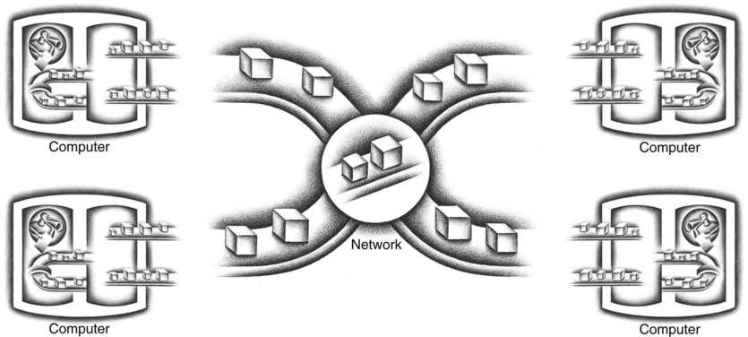

Tổ chức multiprocessor hoặc cluster

## 6.1 Giới thiệu

Vượt qua Núi Mặt Trăng, Xuống Thung lũng Bóng tối, Hãy cưỡi ngựa, mạnh dạn tiến lên, bóng ma đáp—Nếu ngươi tìm El Dorado!

Edgar Allan Poe, “El Dorado”, khổ 4, 1849

Kiến trúc sư máy tính từ lâu tìm “Thành phố Vàng” (El Dorado) của thiết kế máy tính: tạo máy mạnh chỉ bằng nối nhiều máy nhỏ hiện có. Tầm nhìn vàng này là khởi nguồn multiprocessor. Lý tưởng là khách hàng đặt mua số processor trong khả năng tài chính và nhận hiệu năng tương ứng. Do đó multiprocessor software phải thiết kế cho số processor thay đổi. Như Chương 1 đề cập, năng lượng trở thành vấn đề quan trọng nhất với cả microprocessor lẫn datacenter. Thay processor lớn kém hiệu quả bằng nhiều processor nhỏ hiệu quả có thể cải thiện hiệu năng mỗi joule ở cả quy mô lớn lẫn nhỏ nếu software tận dụng hiệu quả. Vì vậy hiệu quả năng lượng tốt hơn cùng hiệu năng mở rộng được củng cố lý do dùng multiprocessor.

### multiprocessor

Hệ thống máy tính có ít nhất hai processor. Khác uniprocessor chỉ có một processor, loại ngày càng khó tìm ngày nay.

Vì multiprocessor software cần mở rộng được, một số thiết kế hỗ trợ hoạt động khi có hardware hỏng; tức nếu một processor hỏng trong multiprocessor có n processor, hệ thống tiếp tục cung cấp dịch vụ với n – 1 processor. Do đó multiprocessor cũng có thể cải thiện availability (xem Chương 5).

Hiệu năng cao có thể là throughput lớn hơn cho tác vụ độc lập, gọi là task-level parallelism hay process-level parallelism. Những tác vụ này là ứng dụng single-threaded độc lập, một cách dùng nhiều processor quan trọng và phổ biến. Cách này khác chạy một công việc trên nhiều processor. Chúng tôi dùng thuật ngữ parallel processing program để chỉ một chương trình chạy đồng thời trên nhiều processor.


#### task-level parallelism hay process-level parallelism

Tận dụng nhiều processor bằng cách chạy chương trình độc lập đồng thời.

#### parallel processing program

Một chương trình chạy đồng thời trên nhiều processor.

Từ lâu đã có bài toán khoa học cần máy tính nhanh hơn nhiều, và nhóm bài toán này là lý do xây dựng nhiều máy tính song song mới qua các thập niên. Ngày nay có thể xử lý đơn giản một số bài toán bằng cluster gồm microprocessor trong nhiều server độc lập (xem Mục 6.7). Ngoài ra cluster phục vụ ứng dụng ngoài khoa học đòi hỏi tương đương như công cụ tìm kiếm, Web server, email server và cơ sở dữ liệu.

#### cluster

Tập máy tính nối qua local area network hoạt động như một multiprocessor lớn duy nhất.

Như Chương 1 mô tả, multiprocessor được đẩy vào tâm điểm vì vấn đề năng lượng khiến tăng hiệu năng tương lai chủ yếu đến từ hardware parallelism tường minh, thay vì clock rate cao hơn nhiều hay CPI cải thiện vượt bậc. Như đã nói trong Chương 1, chúng được gọi là multicore microprocessor thay vì multiprocessor microprocessor, có lẽ để tránh lặp trong tên gọi. Vì thế processor thường gọi là core trong chip multicore. Số core dự kiến tăng theo Moore’s Law. Những multicore này gần như luôn là Shared Memory Processors (SMPs), vì thường chia sẻ một physical address space. Ta sẽ xem thêm SMP ở Mục 6.5.

#### multicore microprocessor

Microprocessor chứa nhiều processor (“core”) trong một integrated circuit. Gần như mọi microprocessor desktop và server hiện nay đều là multicore.

#### shared memory multiprocessor (SMP)

Parallel processor có một physical address space.


Tình trạng công nghệ hiện nay nghĩa là lập trình viên quan tâm hiệu năng phải trở thành lập trình viên song song, vì code tuần tự giờ nghĩa là code chậm.

Thử thách to lớn trước ngành là tạo hardware và software giúp dễ viết chương trình xử lý song song đúng, thực thi hiệu quả về hiệu năng và năng lượng khi số core mỗi chip tăng.

Bước chuyển đột ngột trong thiết kế microprocessor khiến nhiều người bất ngờ, nên có nhiều nhầm lẫn về thuật ngữ và ý nghĩa. Hình 6.1 cố làm rõ serial, parallel, sequential và concurrent. Cột biểu diễn software vốn có tính sequential hoặc concurrent. Hàng biểu diễn hardware serial hoặc parallel. Ví dụ, người viết compiler xem nó là chương trình sequential: các bước gồm parsing, tạo code, tối ưu, v.v. Trái lại, người viết operating system thường xem nó là chương trình concurrent: các process phối hợp xử lý sự kiện I/O từ công việc độc lập chạy trên máy tính.

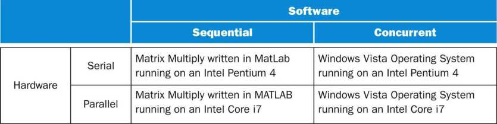

**HÌNH 6.1 Phân loại hardware/software và ví dụ về góc nhìn ứng dụng đối với concurrency so với góc nhìn hardware đối với parallelism.**

Ý nghĩa hai trục Hình 6.1 là software concurrent có thể chạy trên hardware serial, như operating system cho Intel Pentium 4 uniprocessor, hoặc hardware parallel, như OS trên Intel Core i7 mới hơn. Điều tương tự đúng với software sequential. Ví dụ, lập trình viên MATLAB viết phép nhân ma trận theo tư duy sequential, nhưng nó có thể chạy serial trên Pentium 4 hoặc parallel trên Intel Core i7.

Bạn có thể đoán thử thách duy nhất của cách mạng song song là làm software vốn tuần tự đạt hiệu năng cao trên hardware song song, nhưng còn là làm chương trình concurrent đạt hiệu năng cao trên multiprocessor khi số processor tăng. Với phân biệt này, phần còn lại dùng parallel processing program hay parallel software để chỉ software sequential hoặc concurrent chạy trên hardware parallel. Mục tiếp theo mô tả vì sao khó tạo chương trình xử lý song song hiệu quả.

Trước khi đi sâu hơn trên con đường parallelism, đừng quên những bước đầu ở các chương trước:

- Chương 2, Mục 2.11: Parallelism và instruction: Synchronization

- Chương 3, Mục 3.6: Parallelism và số học máy tính: Subword parallelism

- Chương 4, Mục 4.10: Parallelism qua instruction

- Chương 5, Mục 5.10: Parallelism và memory hierarchy: Cache coherence

#### Tự kiểm tra

Đúng hay sai: Để hưởng lợi từ multiprocessor, ứng dụng phải concurrent.

## 6.2 Khó khăn khi tạo chương trình xử lý song song

Khó khăn của parallelism không nằm ở phần cứng; vấn đề là quá ít chương trình ứng dụng quan trọng được viết lại để hoàn thành tác vụ sớm hơn trên multiprocessor. Viết phần mềm sử dụng nhiều processor để hoàn thành một tác vụ nhanh hơn là điều khó, và vấn đề càng nghiêm trọng khi số processor tăng.

Vì sao như vậy? Vì sao chương trình xử lý song song khó phát triển hơn nhiều chương trình tuần tự?

Lý do đầu là chương trình xử lý song song trên multiprocessor phải có hiệu năng hoặc hiệu quả năng lượng tốt hơn; nếu không chỉ cần dùng chương trình tuần tự trên uniprocessor, vì lập trình tuần tự đơn giản hơn. Thực tế, kỹ thuật thiết kế uniprocessor như superscalar và out-of-order execution tận dụng instruction-level parallelism (xem Chương 4), thường không cần lập trình viên tham gia. Đổi mới như vậy giảm nhu cầu viết lại chương trình cho multiprocessor, vì lập trình viên có thể không làm gì mà chương trình tuần tự vẫn nhanh hơn trên máy mới.

Vì sao khó viết chương trình xử lý song song chạy nhanh, đặc biệt khi số processor tăng? Trong Chương 1, chúng ta dùng phép so sánh tám phóng viên cùng cố viết một bài với hy vọng làm nhanh gấp tám. Để thành công, nhiệm vụ phải được chia thành tám phần equal-sized; nếu không, một số phóng viên sẽ nhàn rỗi trong khi chờ những người có phần lớn hơn hoàn thành. Một trở ngại speed-up khác có thể là họ dành quá nhiều thời gian trao đổi với nhau thay vì viết phần bài của mình. Trong cả phép so sánh này lẫn lập trình song song, thách thức gồm lập lịch, chia công việc thành các phần song song, cân bằng tải đều giữa người làm, thời gian đồng bộ và overhead truyền thông giữa các bên. Thách thức càng lớn khi có nhiều phóng viên cùng viết bài báo hoặc nhiều processor trong lập trình song song.

Thảo luận Chương 1 chỉ ra trở ngại khác, Amdahl’s Law. Nó nhắc rằng ngay cả phần nhỏ chương trình cũng phải song song hóa nếu muốn tận dụng tốt nhiều core.

### Thử thách Speed-up

**Ví dụ**

Giả sử muốn đạt speed-up nhanh gấp 90 với 100 processor. Bao nhiêu phần trăm tính toán ban đầu có thể là tuần tự?

**Trả lời**

Amdahl’s Law (Chương 1) phát biểu

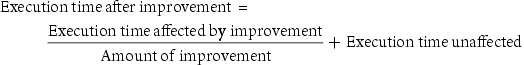

Có thể viết lại Amdahl’s Law theo speed-up so với execution time ban đầu:

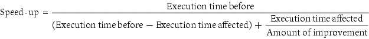

Công thức thường được viết lại với giả định execution time trước cải tiến là 1 theo một đơn vị thời gian, và execution time chịu ảnh hưởng cải tiến được xem là phần của execution time ban đầu:

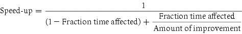

Thay 90 cho speed-up và 100 cho mức cải thiện trong công thức trên:

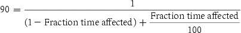

Sau đó đơn giản hóa công thức và giải tìm phần thời gian bị ảnh hưởng:

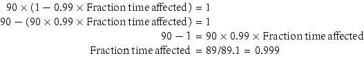

Vì vậy, để đạt speed-up 90 từ 100 processor, tỷ lệ tuần tự chỉ được là 0.1%.

Tuy nhiên có ứng dụng rất nhiều parallelism, như sẽ thấy tiếp theo.

#### Thử thách Speed-up: Bài toán lớn hơn

**Ví dụ**

Giả sử cần thực hiện hai tổng: tổng 10 scalar variable và tổng ma trận của cặp array two-dimensional kích thước 10 × 10. Tạm giả sử chỉ tổng ma trận song song hóa được; sắp tới sẽ thấy cách song song hóa tổng scalar. speed-up với 10 so với 40 processor là bao nhiêu? Tiếp theo tính các speed-ups nếu ma trận tăng lên 20 × 20.

**Trả lời**

Nếu giả sử hiệu năng là hàm của thời gian phép cộng t, có 10 phép cộng không hưởng lợi từ parallel processor và 100 phép cộng có hưởng lợi. Nếu thời gian một processor là 110 t, execution time cho 10 processor là

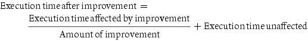

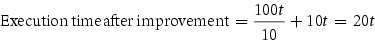

nên speed-up với 10 processor là 110t/20t = 5.5. Execution time cho 40 processor là

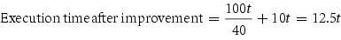

nên speed-up với 40 processor là 110t/12.5t = 8.8. Do đó, với kích thước bài toán này đạt khoảng 55% speed-up tiềm năng với 10 processor, nhưng chỉ 22% với 40.

Xem điều xảy ra khi tăng ma trận. Chương trình tuần tự giờ mất 10t + 400t = 410t. Execution time cho 10 processor là

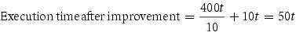

nên speed-up với 10 processor là 410t/50t = 8.2. Execution time cho 40 processor là

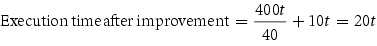

nên speed-up với 40 processor là 410t/20t = 20.5. Do đó với bài toán lớn hơn đạt 82% speed-up tiềm năng với 10 processor và 51% với 40.

Ví dụ cho thấy đạt speed-up tốt trên multiprocessor khi giữ kích thước bài toán cố định khó hơn đạt speed-up tốt bằng tăng kích thước bài toán. Nhận thức này cho phép giới thiệu hai thuật ngữ mô tả cách mở rộng.

Strong scaling nghĩa là đo speed-up trong khi giữ kích thước bài toán cố định. Weak scaling nghĩa là kích thước bài toán tăng tỷ lệ với số processor tăng. Giả sử kích thước bài toán M là working set trong main memory và có P processor. Memory mỗi processor cho strong scaling xấp xỉ M/P, còn weak scaling khoảng M.

#### strong scaling

Speed-up đạt trên multiprocessor mà không tăng kích thước bài toán.

#### weak scaling

Speed-up đạt trên multiprocessor khi tăng kích thước bài toán tỷ lệ với số processor tăng.

Lưu ý memory hierarchy có thể tác động đến hiểu biết thông thường rằng weak scaling dễ hơn strong scaling. Ví dụ, nếu dataset được weak scaling không còn vừa last level cache của multicore microprocessor, hiệu năng có thể tệ hơn nhiều so với dùng strong scaling.


Tùy ứng dụng, có thể lập luận cho mỗi cách scaling. Ví dụ TPC-C debit-credit database benchmark đòi hỏi tăng số tài khoản khách hàng tỷ lệ với số giao dịch mỗi phút cao hơn. Lập luận là vô lý nếu nghĩ nhóm khách hàng nhất định đột nhiên dùng ATM 100 lần một ngày chỉ vì ngân hàng có máy nhanh hơn. Thay vào đó, nếu muốn trình diễn hệ thống thực hiện số giao dịch mỗi phút gấp 100, nên thử nghiệm với số khách hàng gấp 100. Bài toán lớn hơn thường cần thêm dữ liệu, là lý lẽ ủng hộ weak scaling.

Ví dụ cuối cho thấy tầm quan trọng của load balancing.

#### Thử thách Speed-up: Cân bằng tải

**Ví dụ**

Để đạt speed-up 20.5 trên bài toán lớn trước với 40 processor, ta giả sử tải cân bằng hoàn hảo. Tức mỗi processor trong 40 processor có 2.5% công việc. Thay vào đó, hãy chỉ tác động lên speed-up nếu tải một processor cao hơn mọi processor còn lại. Tính khi processor làm nặng nhất có tải gấp đôi (5%) và gấp năm (12.5%). Mức sử dụng các processor còn lại ra sao?

**Trả lời**

Nếu một processor có 5% tải song song thì phải làm 5%×400 hay 20 phép cộng, 39 processor khác chia 380 phép còn lại. Vì hoạt động đồng thời, có thể tính execution time là giá trị lớn nhất

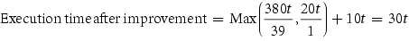

speed-up giảm từ 20.5 xuống 410t/30t = 14. 39 processor còn lại được dùng dưới nửa thời gian: trong khi chờ 20t để processor nặng nhất hoàn tất, chúng chỉ tính 380t/39 =9.7t.

Nếu một processor có 12.5% tải, nó phải làm 50 phép cộng. Công thức là:

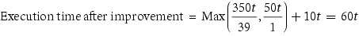

speed-up giảm thêm còn 410t/60t = 7. Processor còn lại được dùng dưới 20% thời gian (9t/50t). Ví dụ cho thấy tầm quan trọng cân bằng tải: chỉ một processor có tải gấp đôi các processor khác đã giảm speed-up một phần ba, và tải gấp năm trên một processor giảm speed-up gần ba lần.

Giờ đã hiểu rõ hơn mục tiêu, thách thức xử lý song song, chúng tôi khái quát phần còn lại của chương. Mục 6.3 mô tả cách phân loại lâu đời hơn nhiều so với Hình 6.1. Nó cũng mô tả hai kiểu instruction set architecture hỗ trợ chạy ứng dụng tuần tự trên hardware song song: SIMD và vector. Mục 6.4 mô tả multithreading, thường bị nhầm với multiprocessing, phần nào vì dựa vào concurrency tương tự trong chương trình. Mục 6.5 mô tả lựa chọn đầu trong hai phương án cho đặc tính cơ bản hardware song song: mọi processor có dựa vào một physical address space hay không. Như đã nói, hai phiên bản phổ biến gọi là shared memory multiprocessor (SMP) và cluster; mục này bàn loại trước. Mục 6.6 mô tả kiểu máy tương đối mới từ cộng đồng graphics hardware, graphics-processing unit (GPU), cũng giả định một physical address. (  Phụ lục B mô tả GPU chi tiết hơn nữa.) Mục 6.7 mô tả cluster, ví dụ phổ biến máy tính nhiều physical address space. Mục 6.8 trình bày topology điển hình nối nhiều processor, là server node trong cluster hoặc core trong microprocessor.  Mục 6.9 mô tả hardware, software để giao tiếp giữa node trong cluster bằng Ethernet, cho thấy cách tối ưu hiệu năng bằng software và hardware tùy chỉnh. Tiếp theo Mục 6.10 bàn khó khăn tìm parallel benchmark. Mục này còn có mô hình hiệu năng đơn giản nhưng sâu sắc, hỗ trợ thiết kế ứng dụng lẫn architecture. Mục 6.11 dùng mô hình cùng parallel benchmark so sánh máy multicore với GPU. Mục 6.12 tiết lộ bước cuối, lớn nhất trong hành trình tăng tốc nhân ma trận. Với ma trận không vừa cache, xử lý song song dùng 16 core cải thiện hiệu năng 14 lần. Chương kết thúc bằng ngộ nhận, cạm bẫy và kết luận về parallelism.

Trong mục tiếp theo, chúng tôi giới thiệu những acronym có lẽ bạn đã thấy để nhận biết các loại máy tính song song.

#### Tự kiểm tra

Đúng hay sai: Strong scaling không bị Amdahl’s Law giới hạn.

## 6.3 SISD, MIMD, SIMD, SPMD và vector

Một cách phân loại hardware song song được đề xuất trong thập niên 1960 vẫn dùng ngày nay. Nó dựa vào số instruction stream và data stream. Hình 6.2 trình bày các nhóm. Uniprocessor thông thường có một instruction stream và một data stream, còn multiprocessor thông thường có nhiều instruction stream và nhiều data stream. Hai nhóm viết tắt lần lượt SISD và MIMD.

### SISD

hay Single Instruction stream, Single Data stream. Một uniprocessor.

#### MIMD

hay Multiple Instruction streams, Multiple Data streams. Một multiprocessor.

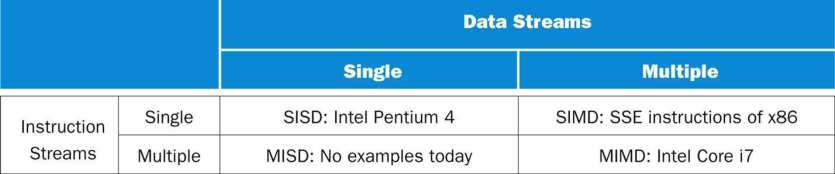

**HÌNH 6.2 Phân loại hardware và ví dụ dựa trên số instruction stream, data stream: SISD, SIMD, MISD và MIMD.**

Tuy có thể viết chương trình riêng chạy trên các processor khác nhau của máy MIMD nhưng vẫn phối hợp cho mục tiêu chung lớn hơn, lập trình viên thường viết một chương trình chạy trên mọi processor MIMD, dựa vào câu lệnh điều kiện khi processor khác nhau cần thực thi phần code riêng. Kiểu này gọi là Single Program Multiple Data (SPMD), nhưng chỉ là cách thông thường lập trình máy MIMD.

#### SPMD

Single Program, Multiple Data streams. Mô hình lập trình MIMD thông thường, một chương trình chạy trên mọi processor.

Thứ gần nhất với processor multiple instruction stream, single data stream (MISD) có lẽ là “stream processor” thực hiện chuỗi tính toán trên một data stream theo pipeline: parse input từ mạng, giải mã dữ liệu, giải nén, tìm khớp, v.v. Dạng ngược MISD phổ biến hơn nhiều. Máy SIMD thao tác trên vector dữ liệu. Ví dụ, một SIMD instruction có thể cộng 64 số bằng cách gửi 64 data stream đến 64 ALU để tạo 64 tổng trong một clock cycle. Subword parallel instruction đã thấy ở Mục 3.6 và 3.7 là ví dụ SIMD khác; thực vậy chữ giữa acronym SSE của Intel đại diện SIMD.

#### SIMD

hay Single Instruction stream, Multiple Data streams. Cùng instruction áp dụng cho nhiều data stream như trong vector processor.

Ưu điểm SIMD là mọi execution unit song song được đồng bộ, cùng đáp ứng một instruction từ một program counter (PC). Theo góc nhìn lập trình viên, điều này gần với SISD quen thuộc. Tuy mọi unit thực thi cùng instruction, mỗi execution unit có address register riêng nên có thể có địa chỉ dữ liệu khác. Do đó theo Hình 6.1, ứng dụng sequential có thể compile để chạy trên hardware serial tổ chức SISD hoặc hardware parallel tổ chức SIMD.

Động lực ban đầu của SIMD là phân bổ chi phí control unit trên hàng chục execution unit. Ưu điểm khác là giảm instruction bandwidth và không gian—SIMD chỉ cần một bản code được thực thi đồng thời, trong khi MIMD message-passing có thể cần bản sao ở mỗi processor, còn shared memory MIMD cần nhiều instruction cache.

SIMD hoạt động tốt nhất khi xử lý array trong vòng for. Vì thế để parallelism hoạt động trong SIMD phải có nhiều dữ liệu cùng cấu trúc, gọi là data-level parallelism. SIMD yếu nhất ở câu lệnh case hay switch, khi mỗi execution unit phải thực hiện thao tác khác trên dữ liệu tùy dữ liệu có được. Unit có dữ liệu không phù hợp phải tắt để unit có dữ liệu đúng tiếp tục. Nếu có n trường hợp, SIMD processor về cơ bản chạy ở 1/n hiệu năng đỉnh.

Các array processor được gọi theo cách này (so-called array processors), từng truyền cảm hứng cho nhóm SIMD, đã lùi vào lịch sử (xem  Mục 6.15 trực tuyến), nhưng hai cách diễn giải SIMD hiện đại vẫn được sử dụng ngày nay.

#### data-level parallelism

Parallelism đạt bằng thực hiện cùng thao tác trên dữ liệu độc lập.

### SIMD trong x86: Multimedia extension

Như Chương 3 mô tả, subword parallelism cho integer data hẹp là cảm hứng ban đầu của Multimedia Extension (MMX) instruction x86 năm 1996. Khi Moore’s Law tiếp diễn, thêm instruction được bổ sung, trước dẫn đến Streaming SIMD Extensions (SSE), nay là Advanced Vector Extensions (AVX). AVX hỗ trợ thực thi đồng thời bốn số floating-point 64-bit. Độ rộng thao tác và register được mã hóa trong opcode của các multimedia instruction này. Khi độ rộng dữ liệu của register và thao tác tăng, số opcode multimedia instruction bùng nổ; nay có hàng trăm SSE và AVX instruction (xem Chương 3).


### Vector

Cách diễn giải SIMD lâu đời hơn và, như sẽ thấy, tinh tế hơn gọi là vector architecture, gắn chặt với máy do Seymour Cray thiết kế từ thập niên 1970. Nó cũng rất phù hợp bài toán nhiều data-level parallelism. Thay vì 64 ALU thực hiện 64 phép cộng cùng lúc như array processor cũ, vector architecture pipeline ALU để đạt hiệu năng tốt với chi phí thấp. Triết lý cơ bản là thu thập phần tử dữ liệu từ memory, xếp thứ tự vào tập register lớn, thao tác tuần tự trên chúng trong register bằng execution unit pipeline rồi ghi kết quả về memory. Vì thế đặc tính chính là tập vector register. Vector architecture có thể có 32 vector register, mỗi register gồm 64 phần tử 64-bit.


#### So sánh vector với code thông thường

**Ví dụ**

Giả sử mở rộng RISC-V instruction set architecture bằng vector instruction và vector register. Vector operation dùng tên thao tác RISC-V với hậu tố “V”. Ví dụ fadd.d.v cộng hai vector double-precision. Thêm 32 vector register v0—v31, mỗi register có sixty-four phần tử 64-bit. Vector instruction nhận input là cặp vector (V) register (fadd.d.v) hoặc vector register và scalar register (fadd.d.vs). Ở trường hợp sau, giá trị scalar register dùng làm input cho mọi thao tác—fadd.d.vs cộng nội dung scalar register vào từng phần tử vector register. Tên fld.v và fsd.v biểu thị vector load và vector store, load hoặc store cả vector dữ liệu double-precision. Một operand là vector register cần load hay store; operand kia là RISC-V general-purpose register giữ địa chỉ đầu vector trong memory.

Với mô tả ngắn đó, hãy chỉ ra code RISC-V thông thường so với code RISC-V vector cho

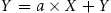

trong đó X và Y là các vector, mỗi vector chứa 64 số floating-point double precision, ban đầu nằm trong memory, còn a là một biến scalar double precision. (Ví dụ này là vòng lặp được gọi là DAXPY, hay so-called DAXPY loop, tạo thành inner loop của benchmark Linpack; DAXPY viết tắt của double precision a×X plus Y.) Giả sử địa chỉ bắt đầu của X và Y lần lượt nằm trong x19 và x20.

**Trả lời**

Đây là code RISC-V thông thường cho DAXPY:

```
   fld f0, a(x3) // load scalar a
   addi x5, x19, 512 // end of array X
loop: fld f1, 0(x19) // load x[i]
   fmul.d f1, f1, f0 // a * x[i]
   fld f2, 0(x20) // load y[i]
   fadd.d f2, f2, f1 // a * x[i] + y[i]
   fsd f2, 0(x20) // store y[i]
   addi x19, x19, 8 // increment index to x
   addi x20, x20, 8 // increment index to y
   bltu x19, x5, loop // repeat if not done
```

Đây là code RISC-V vector giả định cho DAXPY:

```
fld f0, a(x3) // load scalar a
fld.v v0, 0(x19) // load vector x
fmul.d.vs v0, v0, f0 // vector-scalar multiply
fld.v v1, 0(x20) // load vector y
fadd.d.v v1, v1, v0 // vector-vector add
fsd.v v1, 0(x20) // store vector y
```

Có vài so sánh thú vị giữa hai đoạn code. Nổi bật nhất là vector processor giảm mạnh dynamic instruction bandwidth, chỉ thực thi sáu instruction so với hơn 500 của RISC-V architecture cơ sở. Mức giảm đến từ cả việc vector operation xử lý 64 phần tử mỗi lần lẫn không có overhead instruction chiếm gần nửa vòng lặp RISC-V trong vector code. Như có thể đoán, giảm instruction được fetch và thực thi sẽ tiết kiệm năng lượng.

Khác biệt quan trọng khác là tần suất pipeline hazard (Chương 4). Trong code RISC-V trực tiếp, mọi fadd.d phải đợi fmul.d, mọi fsd đợi fadd.d, mọi fadd.d và fmul.d đợi fld. Trên vector processor, mỗi vector instruction chỉ stall ở phần tử đầu của từng vector, các phần tử sau chảy trơn tru qua pipeline. Do đó chỉ cần pipeline stall một lần mỗi vector operation, thay vì một lần mỗi phần tử. Trong ví dụ, tần suất pipeline stall của RISC-V cao hơn khoảng 64 lần phiên bản vector RISC-V. Có thể loại pipeline stall trên RISC-V bằng unroll vòng lặp (xem Chương 4). Tuy nhiên không thể giảm chênh lệch lớn về instruction bandwidth.


Vì các phần tử vector độc lập, có thể thao tác song song, giống subword parallelism của Intel x86 AVX instruction. Mọi máy vector hiện đại có vector functional unit với nhiều pipeline song song (gọi là vector lane; xem Hình 6.2, 6.3), có thể tạo hai kết quả trở lên mỗi clock cycle.

#### Giải thích thêm

Vòng lặp ví dụ khớp đúng vector length. Khi vòng ngắn hơn, vector architecture dùng register giảm độ dài vector operation. Khi vòng lớn hơn, thêm code quản lý để lặp vector operation full-length và xử lý phần thừa. Quá trình sau gọi là strip mining.

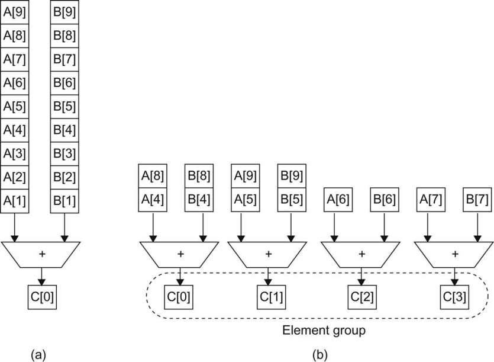

**HÌNH 6.3 Dùng nhiều functional unit để cải thiện hiệu năng một vector add instruction, C =A +B. Vector processor (a) bên trái có một add pipeline, hoàn thành một phép cộng mỗi cycle. Vector processor (b) bên phải có bốn add pipeline hay lane, hoàn thành bốn phép cộng mỗi cycle. Các phần tử trong một vector add instruction được xen kẽ qua bốn lane.**

### Vector so với scalar

Vector instruction có nhiều thuộc tính quan trọng so với instruction set architecture thông thường, trong bối cảnh này gọi là scalar architecture:

- Một vector instruction xác định lượng công việc lớn—tương đương thực thi cả vòng lặp. Bandwidth fetch và decode instruction cần thiết giảm mạnh.

- Khi dùng vector instruction, compiler hoặc lập trình viên chỉ ra tính toán mỗi kết quả trong vector độc lập với tính toán kết quả khác cùng vector, nên hardware không cần kiểm tra data hazard bên trong vector instruction.

- Vector architecture và compiler nổi tiếng giúp dễ viết ứng dụng hiệu quả có data-level parallelism hơn nhiều so với dùng MIMD multiprocessor.

- Hardware chỉ cần kiểm tra data hazard giữa hai vector instruction một lần mỗi vector operand, thay vì mỗi phần tử trong vector. Giảm kiểm tra tiết kiệm cả năng lượng lẫn thời gian.

- Vector instruction truy cập memory có access pattern đã biết. Nếu mọi phần tử vector kề nhau, fetch vector từ tập memory bank xen kẽ mạnh hoạt động rất tốt. Do đó chi phí latency main memory chỉ xuất hiện một lần cho cả vector thay vì mỗi word.

- Vì cả vòng lặp được thay bằng vector instruction với hành vi xác định trước, control hazard thông thường từ loop branch không tồn tại.

- Tiết kiệm instruction bandwidth, kiểm tra hazard và dùng memory bandwidth hiệu quả đem lại lợi thế công suất, năng lượng cho vector architecture so với scalar architecture. Vì thế có thể làm vector operation nhanh hơn chuỗi scalar operation trên cùng số dữ liệu, tạo động lực đưa vector unit vào nếu miền ứng dụng thường dùng được.

### Vector so với multimedia extension

Giống multimedia extension trong x86 AVX instruction, vector instruction xác định nhiều thao tác. Tuy nhiên multimedia extension thường chỉ vài thao tác còn vector chỉ hàng chục. Khác multimedia extension, số phần tử vector operation không nằm trong opcode mà ở register riêng. Điều này cho phép triển khai phiên bản vector architecture có số phần tử khác chỉ bằng đổi nội dung register, do đó giữ binary compatibility. Trái lại, một tập opcode mới lớn được thêm mỗi khi độ dài “vector” thay đổi trong multimedia extension architecture x86: MMX, SSE, SSE2, AVX, AVX2, ….

Cũng khác multimedia extension, truyền dữ liệu không cần liên tiếp. Vector hỗ trợ strided access, hardware load mỗi phần tử dữ liệu thứ n trong memory, và indexed access, hardware tìm địa chỉ phần tử cần load vào vector register. Indexed access còn gọi gather-scatter, vì indexed load gom phần tử từ main memory vào các phần tử vector liên tiếp, indexed store rải phần tử vector khắp main memory.

Giống multimedia extension, vector architecture dễ dàng hỗ trợ độ rộng dữ liệu linh hoạt, nên dễ tạo vector operation làm việc trên 32 phần tử dữ liệu 64-bit, 64 phần tử 32-bit, 128 phần tử 16-bit hoặc 256 phần tử 8-bit. Ngữ nghĩa song song của vector instruction cho phép một triển khai thực thi những phép toán này bằng functional unit có pipeline sâu, một array các functional unit song song, hoặc kết hợp functional unit song song và pipeline. Hình 6.3 minh họa cách tăng hiệu năng vector bằng các pipeline song song để thực thi một vector add instruction.


Vector arithmetic instruction thường chỉ cho phép phần tử N của một vector register tham gia phép toán với phần tử N từ những vector register khác. Điều này đơn giản hóa đáng kể việc xây dựng vector unit có tính song song cao, có thể tổ chức thành nhiều vector lane song song. Giống đường cao tốc, chúng ta có thể tăng throughput đỉnh của vector unit bằng cách thêm lane. Hình 6.4 cho thấy cấu trúc vector unit four-lane. Vì vậy, chuyển từ một lane lên bốn lane giảm số clock mỗi vector instruction khoảng bốn lần. Để nhiều lane đem lại lợi ích, cả ứng dụng lẫn kiến trúc phải hỗ trợ vector dài. Nếu không, chúng thực thi nhanh đến mức không còn đủ instruction, đòi hỏi kỹ thuật instruction level parallel như Chương 4 để cung cấp đủ vector instruction.

#### vector lane

Một hoặc nhiều vector functional unit và một phần vector register file. Lấy cảm hứng làn cao tốc tăng tốc giao thông, nhiều lane thực thi vector operation đồng thời.


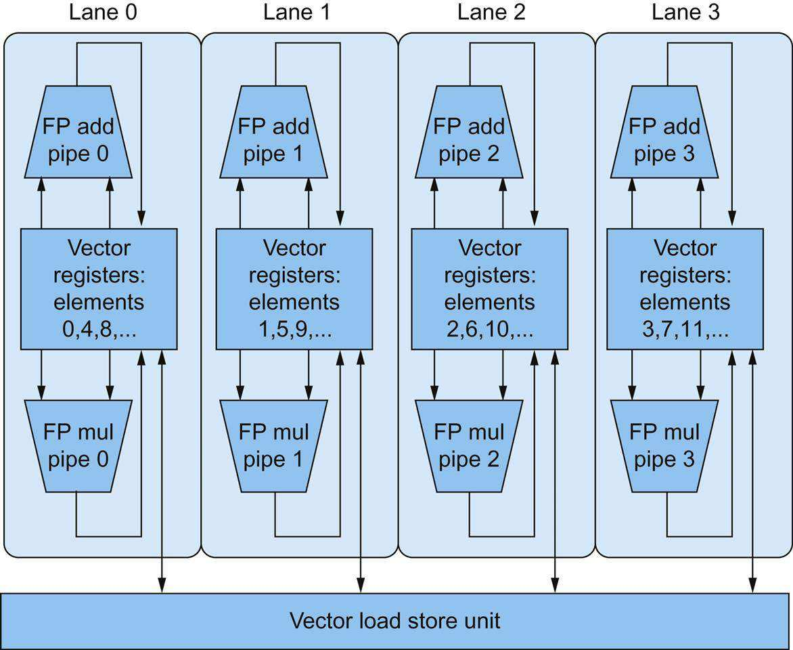

**HÌNH 6.4 Cấu trúc vector unit chứa bốn lane. Storage vector-register chia qua các lane, mỗi lane giữ mỗi phần tử thứ tư của từng vector register. Hình có ba vector functional unit: FP add, FP multiply và load-store unit. Mỗi vector arithmetic unit có bốn execution pipeline, một mỗi lane, phối hợp hoàn thành một vector instruction. Lưu ý mỗi phần vector-register file chỉ cần đủ read/write port (xem Chương 4) cho functional unit trong lane của nó.**

Nhìn chung vector architecture rất hiệu quả để thực thi chương trình xử lý data parallel; phù hợp công nghệ compiler hơn multimedia extension và dễ phát triển theo thời gian hơn multimedia extension của x86 architecture.

Với các nhóm kinh điển này, tiếp theo xem cách khai thác instruction stream song song để cải thiện hiệu năng một processor, rồi dùng lại với nhiều processor.

#### Tự kiểm tra

Đúng hay sai: Như x86 minh họa, multimedia extension có thể xem là vector architecture với vector ngắn chỉ hỗ trợ truyền vector data liên tiếp.

#### Giải thích thêm

Với những ưu điểm của vector, vì sao chúng không phổ biến hơn ngoài high-performance computing? Có những lo ngại rằng trạng thái lớn hơn của vector register làm tăng context switch time, rằng khó xử lý page fault trong vector load và store, trong khi SIMD instruction đã đem lại một phần lợi ích của vector instruction. Ngoài ra, chừng nào tiến bộ về instruction-level parallelism còn hiện thực hóa lời hứa hiệu năng của Moore’s Law, người ta ít có lý do mạo hiểm thay đổi kiểu kiến trúc.


#### Giải thích thêm

Ưu điểm khác của vector và multimedia extension là khá dễ mở rộng scalar instruction set architecture bằng các instruction này để cải thiện hiệu năng thao tác data parallel.

#### Giải thích thêm

Processor x86 Haswell-generation của Intel hỗ trợ AVX2, có thao tác gather nhưng không có scatter.

## 6.4 Hardware multithreading

Một khái niệm liên quan tới MIMD, đặc biệt theo góc nhìn lập trình viên, là hardware multithreading. Trong khi MIMD dựa vào nhiều process hoặc thread để cố giữ nhiều processor bận rộn, hardware multithreading cho phép nhiều thread chia sẻ functional unit của một processor theo cách chồng lấp, nhằm sử dụng hiệu quả tài nguyên phần cứng. Để cho phép chia sẻ này, processor phải nhân bản trạng thái độc lập của mỗi thread. Ví dụ, mỗi thread có một bản register file và program counter riêng. Bản thân bộ nhớ có thể được chia sẻ qua các cơ chế virtual memory vốn đã hỗ trợ multi-programming. Ngoài ra, phần cứng phải hỗ trợ chuyển sang thread khác tương đối nhanh. Cụ thể, thread switch phải hiệu quả hơn nhiều so với process switch: process switch thường cần hàng trăm đến hàng nghìn processor cycle, còn thread switch có thể diễn ra tức thời.

### hardware multithreading

Tăng mức sử dụng processor bằng cách chuyển sang thread khác khi một thread stall.

#### thread

Thread gồm program counter, register state và stack. Là lightweight process; thread thường chia sẻ một address space, process thì không.

#### process

Process gồm một hay nhiều thread, address space và operating system state. Vì vậy process switch thường gọi operating system, thread switch thì không.

Có hai cách chính cho hardware multithreading. Fine-grained multithreading chuyển thread sau mỗi instruction, dẫn đến thực thi xen kẽ nhiều thread. Thường xen kẽ theo round-robin, bỏ qua thread bị stall trong clock cycle đó. Để fine-grained multithreading thực tế, processor phải chuyển thread ở mọi clock cycle. Ưu điểm fine-grained multithreading là che tổn thất throughput do cả stall ngắn và dài, vì instruction thread khác có thể thực thi khi một thread stall. Nhược điểm chính fine-grained multithreading là làm chậm từng thread, vì thread sẵn sàng chạy không stall bị trì hoãn bởi instruction thread khác.

#### fine-grained multithreading

Phiên bản hardware multithreading chuyển thread sau mỗi instruction.

Coarse-grained multithreading được phát minh thay fine-grained multithreading. Coarse-grained multithreading chỉ chuyển thread khi stall tốn kém như last-level cache miss. Thay đổi giảm yêu cầu chuyển thread cực nhanh, ít có khả năng làm chậm từng thread hơn nhiều, vì instruction thread khác chỉ issue khi thread gặp stall tốn kém. Tuy nhiên Coarse-grained multithreading có nhược điểm lớn: khả năng khắc phục mất throughput bị hạn chế, đặc biệt với stall ngắn. Hạn chế do chi phí start-up pipeline của coarse-grained multithreading. Vì processor coarse-grained multithreading issue instruction từ một thread, khi stall phải làm rỗng hoặc đóng băng pipeline. Thread mới bắt đầu sau stall phải lấp pipeline trước khi instruction hoàn tất. Do overhead start-up, coarse-grained multithreading hữu ích hơn nhiều để giảm penalty của stall high-cost, nơi nạp lại pipeline không đáng kể so với thời gian stall.

#### coarse-grained multithreading

Phiên bản hardware multithreading chỉ chuyển thread sau sự kiện đáng kể, như last-level cache miss.


Simultaneous multithreading (SMT) là biến thể hardware multithreading dùng tài nguyên processor pipeline multiple-issue, lập lịch động để khai thác thread-level parallelism đồng thời với instruction-level parallelism (xem Chương 4). Nhận thức chính thúc đẩy SMT là processor multiple-issue thường có nhiều functional unit parallelism hơn mức phần lớn thread đơn sử dụng hiệu quả. Hơn nữa, với register renaming và dynamic scheduling (xem Chương 4), nhiều instruction từ thread độc lập có thể issue bất kể dependency giữa chúng; dynamic scheduling xử lý giải quyết dependency.


#### simultaneous multithreading (SMT)

Phiên bản multithreading giảm chi phí bằng cách tận dụng tài nguyên cần cho microarchitecture multiple issue, lập lịch động.

Vì SMT dựa vào cơ chế động hiện có, nó không chuyển tài nguyên mỗi cycle. Thay vào đó luôn thực thi instruction từ nhiều thread, giao cho hardware gắn instruction slot và register đổi tên với đúng thread.

Hình 6.5 minh họa khái niệm khác biệt khả năng processor khai thác tài nguyên superscalar cho các cấu hình sau. Phần trên cho thấy bốn thread thực thi độc lập trên superscalar không hỗ trợ multithreading. Phần dưới cho thấy kết hợp bốn thread chạy hiệu quả hơn bằng ba lựa chọn:

- Superscalar có coarse-grained multithreading

- Superscalar có fine-grained multithreading

- Superscalar có simultaneous multithreading

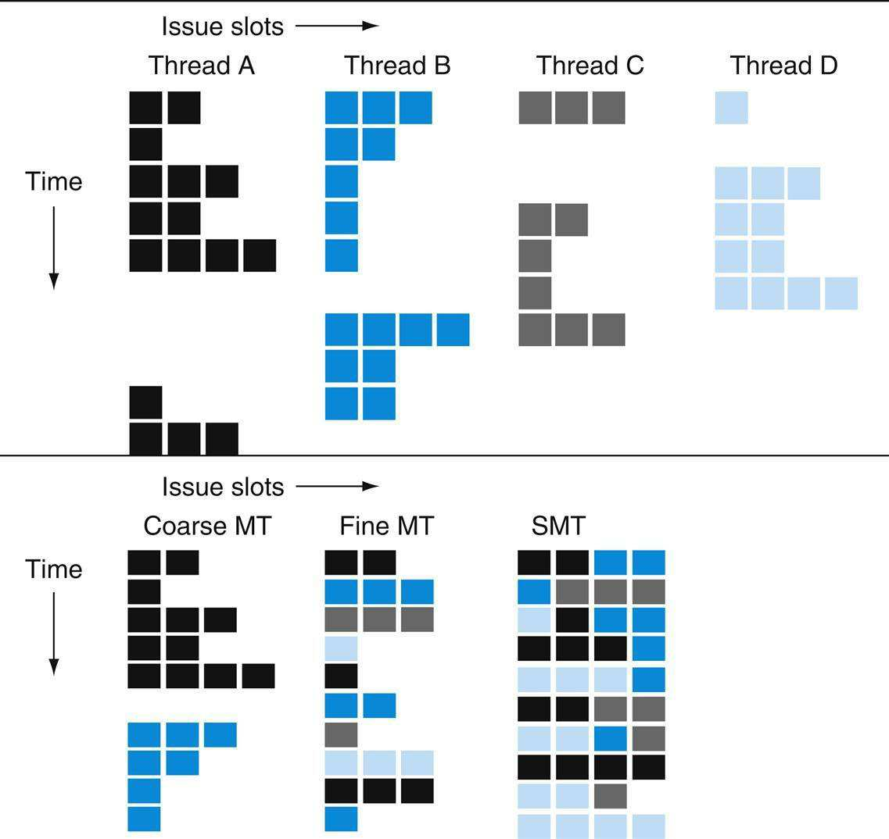

**HÌNH 6.5 Cách bốn thread dùng issue slot superscalar processor theo các cách khác nhau. Bốn thread phía trên cho thấy từng thread chạy riêng trên superscalar tiêu chuẩn không hỗ trợ multithreading. Ba ví dụ dưới cho thấy chạy chung theo ba lựa chọn multithreading. Chiều ngang biểu diễn khả năng instruction issue mỗi clock cycle. Chiều dọc biểu diễn chuỗi clock cycle. Ô trắng chỉ issue slot tương ứng không dùng ở clock cycle đó. Sắc xám và màu tương ứng bốn thread khác nhau trong processor multithreading. Hiệu ứng start-up pipeline bổ sung của coarse multithreading, không minh họa trong hình, sẽ làm giảm throughput coarse multithreading hơn nữa.**

Trong superscalar không hỗ trợ hardware multithreading, dùng issue slot bị hạn chế bởi thiếu instruction-level parallelism. Ngoài ra stall lớn như instruction cache miss có thể khiến cả processor nhàn rỗi.


Trong superscalar multithreaded coarse-grained, stall dài được che một phần bằng chuyển sang thread khác dùng tài nguyên processor. Tuy giảm số clock cycle hoàn toàn nhàn rỗi, overhead start-up pipeline vẫn tạo cycle nhàn rỗi, và giới hạn ILP khiến không dùng hết issue slot. Ở trường hợp fine-grained, xen kẽ thread phần lớn loại clock cycle nhàn rỗi. Tuy nhiên vì chỉ một thread issue instruction mỗi clock cycle, giới hạn instruction-level parallelism vẫn gây slot nhàn rỗi trong một số cycle.

Trong SMT, cả thread-level parallelism lẫn instruction-level parallelism được khai thác, nhiều thread dùng issue slot cùng clock cycle. Lý tưởng, việc dùng slot chỉ bị giới hạn bởi mất cân bằng nhu cầu và khả năng cung cấp tài nguyên giữa thread. Thực tế yếu tố khác có thể hạn chế số slot dùng. Tuy Hình 6.5 đơn giản hóa mạnh hoạt động thật, nó minh họa lợi thế hiệu năng tiềm năng của multithreading nói chung và SMT nói riêng.

Hình 6.6 biểu diễn lợi ích hiệu năng và năng lượng của multithreading trên một processor Intel Core i7 960 hỗ trợ hardware hai thread. speed-up trung bình 1.31, không tệ với tài nguyên thêm khiêm tốn cho hardware multithreading. Cải thiện hiệu quả năng lượng trung bình 1.07 là tuyệt vời. Nhìn chung đạt speed-up hiệu năng mà trung hòa năng lượng đã đáng hài lòng.

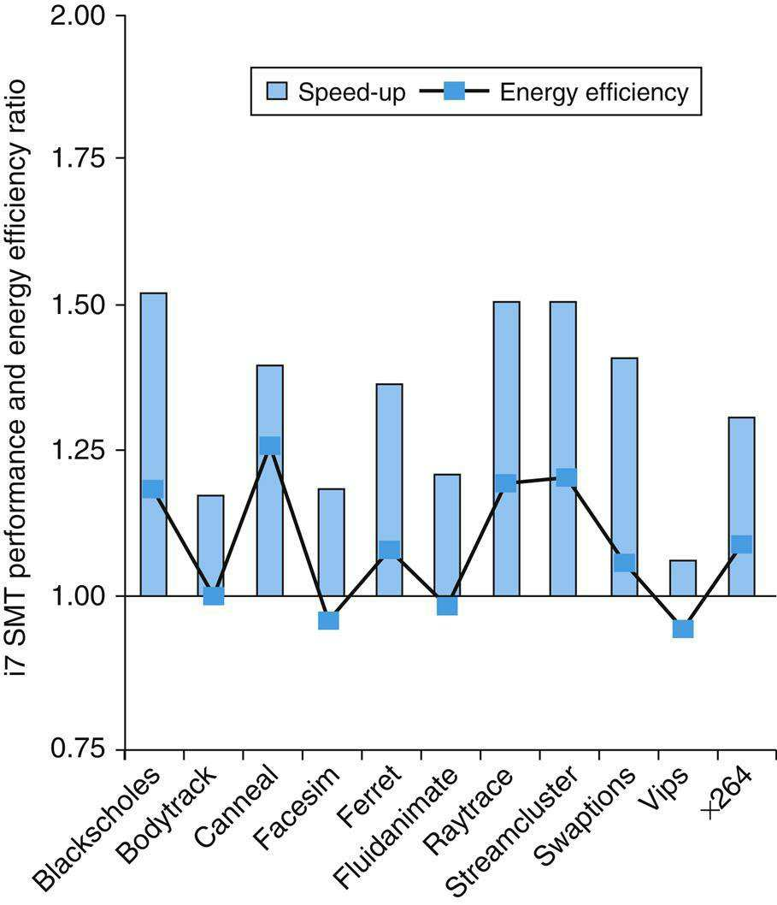

**HÌNH 6.6 speed-up khi dùng multithreading trên một core i7 trung bình là 1.31 với PARSEC benchmark (xem  Mục 6.9), cải thiện hiệu quả năng lượng là 1.07. Dữ liệu do Esmaeilzadeh et al. [2011] thu thập và phân tích.**

Sau khi thấy nhiều thread sử dụng tài nguyên một processor hiệu quả hơn thế nào, tiếp theo xem cách dùng chúng khai thác nhiều processor.

#### Tự kiểm tra

1. Đúng hay sai: Cả multithreading lẫn multicore dựa vào parallelism để tăng hiệu quả chip.

2. Đúng hay sai: Simultaneous multithreading (SMT) dùng thread cải thiện mức sử dụng tài nguyên của processor out-of-order lập lịch động.

## 6.5 Multicore và những shared memory multiprocessor khác

Trong khi hardware multithreading cải thiện hiệu quả processor với chi phí khiêm tốn, thử thách lớn thập niên qua là hiện thực hóa tiềm năng hiệu năng Moore’s Law bằng lập trình hiệu quả số processor mỗi chip ngày càng tăng.


Với khó khăn viết lại chương trình cũ để chạy tốt trên hardware song song, câu hỏi tự nhiên là người thiết kế máy tính làm gì để đơn giản hóa nhiệm vụ? Một đáp án là cung cấp một physical address space mọi processor chia sẻ được, để chương trình không phải lo dữ liệu ở đâu mà chỉ cần quan tâm có thể thực thi song song. Theo cách này, mọi biến chương trình có thể sẵn cho mọi processor bất cứ lúc nào. Lựa chọn khác là address space riêng mỗi processor, đòi hỏi chia sẻ tường minh; sẽ mô tả ở Mục 6.7. Khi physical address space chung, hardware thường cung cấp cache coherence để cho cái nhìn nhất quán về shared memory (xem Mục 5.8).

Như đã nói, shared memory multiprocessor (SMP) cung cấp cho lập trình viên một physical address space trên mọi processor—gần như luôn đúng với chip multicore—dù thuật ngữ chính xác hơn là shared-address multiprocessor. Processor giao tiếp qua shared variable trong memory, mọi processor có thể truy cập mọi vị trí memory qua load và store. Hình 6.7 cho tổ chức SMP kinh điển. Lưu ý hệ thống vẫn chạy được công việc độc lập trong virtual address space riêng, dù cùng physical address space.

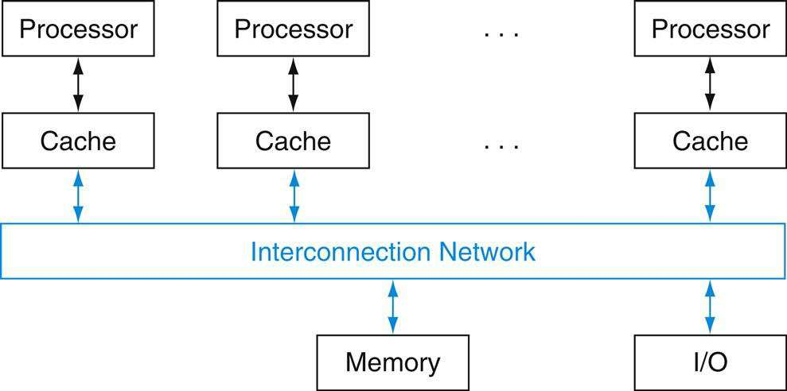

**HÌNH 6.7 Tổ chức kinh điển của shared memory multiprocessor.**

Multiprocessor một address space có hai kiểu. Kiểu đầu, latency đến word trong memory không phụ thuộc processor yêu cầu. Máy đó gọi là uniform memory access (UMA) multiprocessor. Kiểu thứ hai, một số truy cập memory nhanh hơn nhiều truy cập khác tùy processor nào yêu cầu word nào, thường vì main memory chia và gắn vào microprocessor khác nhau hoặc memory controller khác nhau trên cùng chip. Máy này gọi là nonuniform memory access (NUMA) multiprocessor. Như có thể đoán, thử thách lập trình NUMA khó hơn UMA, nhưng máy NUMA mở rộng lớn hơn và có thể có latency thấp hơn đến memory gần.

### uniform memory access (UMA)

Multiprocessor mà latency đến mọi word trong main memory gần bằng nhau bất kể processor nào yêu cầu truy cập.

#### nonuniform memory access (NUMA)

Loại multiprocessor một address space mà một số truy cập memory nhanh hơn nhiều tùy processor nào yêu cầu word nào.

Vì processor hoạt động song song thường chia sẻ dữ liệu, chúng cũng cần phối hợp khi thao tác shared data; nếu không một processor có thể bắt đầu làm trên dữ liệu trước khi processor khác xong. Phối hợp gọi là synchronization, đã thấy Chương 2. Khi một address space hỗ trợ chia sẻ, phải có cơ chế synchronization riêng. Một cách dùng lock cho shared variable. Chỉ một processor được lấy lock tại một thời điểm, các processor khác quan tâm shared data phải chờ processor ban đầu unlock biến. Mục 2.11 Chương 2 mô tả instruction locking trong RISC-V instruction set.

#### synchronization

Quá trình phối hợp hành vi hai hay nhiều process, có thể chạy trên processor khác nhau.

#### lock

Thiết bị synchronization chỉ cho một processor truy cập dữ liệu mỗi thời điểm.

#### Chương trình xử lý song song đơn giản cho shared address space

**Ví dụ**

Giả sử chúng ta muốn tính tổng 64,000 số trên một máy tính shared memory multiprocessor có thời gian truy cập bộ nhớ đồng đều. Hãy giả sử chúng ta có 64 processor.

**Trả lời**

Bước đầu tiên là bảo đảm tải trên mỗi processor được cân bằng, nên chúng ta chia tập số thành các tập con có cùng kích thước. Chúng ta không phân bổ các tập con vào những memory space khác nhau, vì máy này chỉ có một memory space; thay vào đó, chúng ta chỉ cung cấp địa chỉ bắt đầu khác nhau cho mỗi processor. Pn là số nhận dạng processor, nằm từ 0 đến 63. Mọi processor bắt đầu chương trình bằng cách chạy một vòng lặp tính tổng tập số con của mình:

```
sum[Pn] = 0;
for (i = 1000*Pn; i < 1000*(Pn+1); i += 1)
  sum[Pn] += A[i]; /*sum the assigned areas*/
```

(Lưu ý code C i += 1 chỉ là cách viết ngắn của i = i + 1.)

Bước tiếp theo là cộng 64 tổng từng phần này. Bước này được gọi là reduction, trong đó chúng ta áp dụng cách chia để trị. Một nửa số processor cộng các cặp tổng từng phần, rồi một phần tư số processor cộng các cặp tổng mới, và cứ tiếp tục cho đến khi có một tổng cuối cùng duy nhất. Hình 6.8 minh họa tính phân cấp của reduction này.

#### reduction

Hàm xử lý cấu trúc dữ liệu và trả một giá trị.

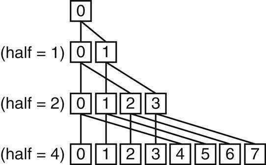

**HÌNH 6.8 Bốn mức cuối của reduction cộng kết quả từng processor, từ dưới lên. Với mọi processor có số i nhỏ hơn half, cộng tổng của processor số (i +half) vào tổng của nó.**

Trong ví dụ này, hai processor phải đồng bộ trước khi processor “consumer” thử đọc kết quả từ vị trí bộ nhớ mà processor “producer” đã ghi; nếu không, consumer có thể đọc giá trị cũ của dữ liệu. Chúng ta muốn mỗi processor có phiên bản riêng của biến đếm vòng lặp i, nên phải chỉ rõ rằng đây là một biến “private”. Code như sau (half cũng là private):

```
half = 64; /*64 processors in multiprocessor*/
do
  synch(); /*wait for partial sum completion*/
  if (half%2 != 0 && Pn == 0)
    sum[0] += sum[half–1];
    /*Conditional sum needed when half is
    odd; Processor0 gets missing element */
    half = half/2; /*dividing line on who sums */
    if (Pn < half) sum[Pn] += sum[Pn+half];
while (half > 1); /*exit with final sum in Sum[0] */
```

#### Hardware/Software Interface

Vì mối quan tâm long-term đối với lập trình song song, đã có hàng trăm nỗ lực xây dựng các hệ thống lập trình song song. Một ví dụ có phạm vi hạn chế nhưng phổ biến là OpenMP. Nó chỉ là một Application Programmer Interface (API) đi cùng một tập compiler directive, environment variable và runtime library routine có thể mở rộng các ngôn ngữ lập trình tiêu chuẩn. Nó cung cấp mô hình lập trình có tính di động, khả năng mở rộng và sự đơn giản cho shared memory multiprocessor. Mục tiêu chính của nó là song song hóa các vòng lặp và thực hiện reduction.

#### OpenMP

API cho shared memory multiprocessing bằng C, C++ hoặc Fortran chạy trên nền tảng UNIX và Microsoft. Gồm compiler directive, thư viện và runtime directive.

Phần lớn compiler C đã hỗ trợ OpenMP. Lệnh dùng OpenMP API với UNIX C compiler chỉ là:

```
cc –fopenmp foo.c
```

OpenMP mở rộng C bằng pragma, vốn chỉ là những lệnh cho C macro preprocessor như #define và #include. Để đặt số processor chúng ta muốn sử dụng thành 64, như mong muốn trong ví dụ trên, chúng ta chỉ cần dùng lệnh

```
#define P 64 /* define a constant that we’ll use a few times
*/
#pragma omp parallel num_threads(P)
```

Tức runtime library cần dùng 64 thread song song.

Để chuyển vòng lặp for tuần tự thành vòng lặp for song song, chia đều công việc giữa tất cả các thread mà chúng ta đã yêu cầu sử dụng, chúng ta chỉ cần viết (giả sử sum được khởi tạo bằng 0)

```
#pragma omp parallel for
for (Pn = 0; Pn < P; Pn += 1)
  for (i = 0; 1000*Pn; i < 1000*(Pn+1); i += 1)
   sum[Pn] += A[i]; /*sum the assigned areas*/
```

Để thực hiện reduction, chúng ta có thể dùng một lệnh khác cho OpenMP biết reduction operator là gì và cần dùng biến nào để chứa kết quả reduction.

```
#pragma omp parallel for reduction(+ : FinalSum)
for (i = 0; i < P; i += 1)
   FinalSum += sum[i]; /* Reduce to a single number */
```

Lưu ý giờ thư viện OpenMP chịu trách nhiệm tìm code hiệu quả để cộng 64 số bằng 64 processor.

Mặc dù OpenMP giúp dễ viết code song song đơn giản, nó không hỗ trợ nhiều cho việc debug. Vì vậy, nhiều lập trình viên dùng các hệ thống lập trình song song tinh vi hơn OpenMP, cũng như nhiều lập trình viên ngày nay dùng những ngôn ngữ đem lại năng suất cao hơn C.

Sau chuyến tham quan hardware, software MIMD kinh điển, tiếp theo là chuyến khám phá lạ hơn về kiểu MIMD architecture có nguồn gốc khác, vì vậy góc nhìn rất khác về thử thách lập trình song song.

#### Tự kiểm tra

Đúng hay sai: Shared memory multiprocessor không thể tận dụng task-level parallelism.

#### Giải thích thêm

Một số tác giả đã dùng lại acronym SMP với nghĩa symmetric multiprocessor để chỉ rằng latency từ processor tới bộ nhớ gần như bằng nhau cho mọi processor. Sự thay đổi này nhằm phân biệt chúng với NUMA multiprocessor large-scale, vì cả hai loại đều dùng một address space. Vì cluster đã trở nên phổ biến hơn nhiều so với NUMA multiprocessor large-scale, trong sách này chúng tôi khôi phục ý nghĩa ban đầu của SMP và dùng nó để phân biệt với những hệ thống có nhiều address space, chẳng hạn cluster.

#### Giải thích thêm

Một lựa chọn thay cho chia sẻ physical address space là có các physical address space riêng nhưng chia sẻ một virtual address space chung, giao việc xử lý truyền thông cho operating system. Cách tiếp cận này đã được thử nghiệm, nhưng overhead của nó quá cao để cung cấp một shared memory abstraction thực tế cho lập trình viên performance-oriented.

## 6.6 Giới thiệu graphics processing unit

Lý do ban đầu để thêm SIMD instruction vào các kiến trúc hiện có là nhiều microprocessor được nối với màn hình đồ họa trong PC và workstation, nên tỷ lệ thời gian xử lý dành cho đồ họa ngày càng tăng. Vì vậy, khi Moore’s Law làm tăng số transistor có sẵn cho microprocessor, việc cải thiện xử lý đồ họa là hợp lý.


Động lực lớn cải thiện xử lý đồ họa là ngành trò chơi máy tính, cả trên PC lẫn console chuyên dụng như Sony PlayStation. Thị trường game tăng nhanh khuyến khích nhiều công ty tăng đầu tư phát triển graphics hardware nhanh hơn, vòng phản hồi tích cực này khiến graphics processing cải thiện nhanh hơn general-purpose processing trong microprocessor phổ thông.

Vì cộng đồng đồ họa và trò chơi có mục tiêu khác với cộng đồng phát triển microprocessor, họ đã phát triển phong cách xử lý và thuật ngữ riêng. Khi các graphics processor mạnh hơn, chúng được gọi là Graphics Processing Units, hay GPU, để phân biệt với CPU.

Ngày nay, chỉ với vài trăm đô la, bất kỳ ai cũng có thể mua GPU chứa hàng trăm floating-point unit song song, giúp high-performance computing dễ tiếp cận hơn. Mối quan tâm tới GPU computing nở rộ khi tiềm năng này được kết hợp với một ngôn ngữ lập trình giúp GPU dễ lập trình hơn. Vì vậy, nhiều lập trình viên ứng dụng khoa học và multimedia ngày nay đang cân nhắc nên dùng GPU hay CPU.

(Mục này tập trung dùng GPU tính toán. Để xem GPU computing kết hợp vai trò tăng tốc đồ họa truyền thống ra sao, xem  Phụ lục B.)

Sau đây là đặc điểm chính về khác biệt GPU với CPU:

- GPU là accelerator bổ sung cho CPU, nên chúng không cần thực hiện được mọi tác vụ của CPU. Vai trò này cho phép chúng dành toàn bộ tài nguyên cho đồ họa. Việc GPU thực hiện một số tác vụ kém hoặc không thực hiện được chúng vẫn chấp nhận được, vì trong hệ thống có cả CPU lẫn GPU, CPU có thể làm những tác vụ ấy khi cần.

- Kích thước bài toán GPU thường hàng trăm megabyte đến gigabyte, không phải hàng trăm gigabyte đến terabyte. Các khác biệt dẫn đến kiểu architecture khác:

- Có lẽ khác biệt lớn nhất là GPU không dựa vào multilevel cache để khắc phục latency dài tới bộ nhớ như CPU. Thay vào đó, GPU dựa vào hardware multithreading (Mục 6.4) để che latency tới bộ nhớ. Nghĩa là trong khoảng thời gian từ lúc gửi yêu cầu bộ nhớ đến lúc dữ liệu tới, GPU thực thi hàng trăm hoặc hàng nghìn thread độc lập với yêu cầu ấy.

- Vì vậy, bộ nhớ GPU hướng tới bandwidth thay vì latency. Thậm chí có các chip graphics DRAM đặc biệt dành cho GPU, rộng hơn và có bandwidth cao hơn chip DRAM dành cho CPU. Ngoài ra, theo truyền thống, GPU có main memory nhỏ hơn microprocessor thông thường. Năm 2013, GPU thường có 4 đến 6 GiB hoặc ít hơn, còn CPU có 32 đến 256 GiB. Cuối cùng, hãy nhớ rằng với tính toán general-purpose, bạn phải tính cả thời gian truyền dữ liệu giữa bộ nhớ CPU và bộ nhớ GPU, vì GPU là một coprocessor.

- Vì dựa vào nhiều thread để đạt memory bandwidth tốt, GPU có thể chứa nhiều parallel processor (MIMD) cũng như nhiều thread. Do đó, mỗi processor của GPU hỗ trợ multithreading ở mức cao hơn CPU điển hình, đồng thời GPU cũng có nhiều processor hơn.

### Hardware/Software Interface

Mặc dù GPU được thiết kế cho tập ứng dụng hẹp hơn, một số lập trình viên tự hỏi liệu có thể đặc tả ứng dụng theo dạng cho phép khai thác tiềm năng hiệu năng cao của GPU hay không. Sau khi mệt mỏi với việc cố đặc tả bài toán bằng graphics API và ngôn ngữ đồ họa, họ phát triển các ngôn ngữ lập trình C-inspired để viết chương trình trực tiếp cho GPU. Một ví dụ là CUDA (Compute Unified Device Architecture) của NVIDIA, cho phép lập trình viên viết chương trình C chạy trên GPU, dù có một số hạn chế.  Phụ lục B đưa ra ví dụ CUDA code. (OpenCL là sáng kiến multi-company nhằm phát triển một ngôn ngữ lập trình có tính di động, cung cấp nhiều lợi ích của CUDA.)

NVIDIA quyết định rằng chủ đề thống nhất tất cả các dạng parallelism này là CUDA Thread. Dùng mức parallelism thấp nhất này làm programming primitive, compiler và phần cứng có thể gom hàng nghìn CUDA thread lại để tận dụng các kiểu parallelism trong GPU: multithreading, MIMD, SIMD và instruction-level parallelism. Những thread này được gom thành block và thực thi theo nhóm 32 thread mỗi lần. Một processor hỗ trợ multithreading bên trong GPU thực thi những block thread này, và một GPU gồm từ 8 đến 32 processor hỗ trợ multithreading như vậy.

### Giới thiệu NVIDIA GPU architecture

Chúng tôi dùng hệ thống NVIDIA làm ví dụ vì chúng đại diện cho kiến trúc GPU. Cụ thể, chúng tôi theo thuật ngữ của ngôn ngữ lập trình song song CUDA và dùng kiến trúc Fermi làm ví dụ.

Giống vector architecture, GPU chỉ hoạt động tốt với bài toán data-level parallel. Cả hai kiểu đều có truyền dữ liệu gather-scatter, và processor GPU còn có nhiều register hơn vector processor. Khác phần lớn vector architecture, GPU còn dựa vào hardware multithreading bên trong một multithreaded SIMD processor để che memory latency (xem Mục 6.4).

Multithreaded SIMD processor tương tự vector processor, nhưng loại trước có nhiều functional unit song song thay vì chỉ vài functional unit có pipeline sâu như loại sau.

Như đã nói ở trên, GPU chứa một tập multithreaded SIMD processor; nghĩa là GPU là MIMD cấu thành từ multithreaded SIMD processor. Ví dụ, NVIDIA có bốn triển khai kiến trúc Fermi ở các mức giá khác nhau với 7, 11, 14 hoặc 15 multithreaded SIMD processor. Để cung cấp khả năng mở rộng trong suốt giữa các mẫu GPU có số multithreaded SIMD processor khác nhau, phần cứng Thread Block Scheduler phân công các block thread cho multithreaded SIMD processor. Hình 6.9 cho thấy block diagram đơn giản hóa của một multithreaded SIMD processor.

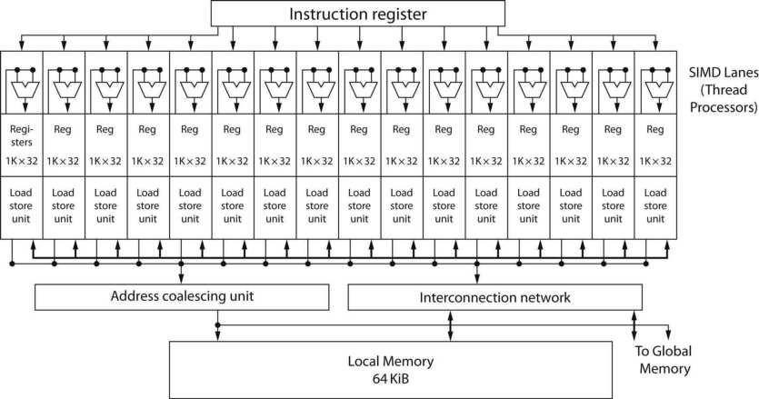

**HÌNH 6.9 Block diagram đơn giản hóa datapath của multithreaded SIMD Processor. Có 16 SIMD lane. SIMD Thread Scheduler có nhiều SIMD thread độc lập để chọn chạy trên processor này.**

Đi xuống thêm một mức chi tiết, machine object mà phần cứng tạo, quản lý, lập lịch và thực thi là một thread gồm các SIMD instruction, cũng được chúng tôi gọi là SIMD thread. Đây là thread truyền thống, nhưng chỉ chứa SIMD instruction. Những SIMD thread này có program counter riêng và chạy trên multithreaded SIMD processor. SIMD Thread Scheduler có controller để biết những thread SIMD instruction nào sẵn sàng chạy, rồi gửi chúng tới dispatch unit để chạy trên multithreaded SIMD processor. Nó giống hệt hardware thread scheduler trong processor multithreaded truyền thống (xem Mục 6.4), trừ việc đang lập lịch các thread SIMD instruction. Vì vậy, phần cứng GPU có hai mức hardware scheduler:

1. Thread Block Scheduler gán thread block cho multithreaded SIMD processor, và

2. SIMD Thread Scheduler trong SIMD processor, lập lịch thời điểm SIMD thread chạy.

SIMD instruction của các thread này rộng 32 phần tử, nên mỗi thread SIMD instruction tính 32 phần tử của phép tính. Vì thread gồm các SIMD instruction, SIMD processor phải có functional unit song song để thực hiện phép toán. Chúng tôi gọi chúng là SIMD Lanes, rất giống Vector Lanes trong Mục 6.3.

#### Giải thích thêm

Số lane mỗi SIMD processor thay đổi giữa các thế hệ GPU. Với Fermi, mỗi thread SIMD instruction 32-wide được ánh xạ lên 16 SIMD lane, nên mỗi SIMD instruction trong thread cần hai clock cycle để hoàn tất. Mỗi thread SIMD instruction được thực thi đồng bộ từng bước. Tiếp tục phép so sánh SIMD processor với vector processor, bạn có thể nói nó có 16 lane và vector length là 32. Tính chất rộng nhưng nông này là lý do chúng tôi dùng thuật ngữ SIMD processor thay vì vector processor, vì nó trực quan hơn.

Vì theo định nghĩa các thread SIMD instruction độc lập với nhau, SIMD Thread Scheduler có thể chọn bất kỳ thread SIMD instruction nào đã sẵn sàng, không cần bám vào SIMD instruction tiếp theo trong chuỗi của một thread duy nhất. Do đó, theo thuật ngữ Mục 6.4, nó sử dụng fine-grained multithreading.

Để giữ những phần tử bộ nhớ này, một Fermi SIMD processor có số lượng ấn tượng 32,768 register 32-bit. Giống vector processor, những register này được chia về mặt logic giữa các vector lane, hay trong trường hợp này là SIMD lane. Mỗi SIMD thread bị giới hạn không quá 64 register, nên bạn có thể xem một SIMD thread có tối đa 64 vector register, mỗi vector register có 32 phần tử và mỗi phần tử rộng 32 bit.

Vì Fermi có 16 SIMD lane, mỗi lane chứa 2048 register. Mỗi CUDA thread nhận một phần tử của mỗi vector register. Lưu ý CUDA thread chỉ là lát cắt dọc của một thread SIMD instruction, tương ứng với một phần tử được một SIMD lane thực thi. Hãy nhớ CUDA thread rất khác POSIX thread; bạn không thể thực hiện system call tùy ý hoặc đồng bộ tùy ý trong CUDA thread.

### Cấu trúc NVIDIA GPU memory

Hình 6.10 cho thấy các cấu trúc bộ nhớ của GPU NVIDIA. Chúng tôi gọi bộ nhớ on-chip cục bộ của mỗi multithreaded SIMD processor là Local Memory. Các SIMD lane trong cùng multithreaded SIMD processor chia sẻ bộ nhớ này, nhưng những multithreaded SIMD processor khác nhau không chia sẻ nó. Chúng tôi gọi DRAM off-chip mà toàn GPU và mọi thread block cùng chia sẻ là GPU Memory.

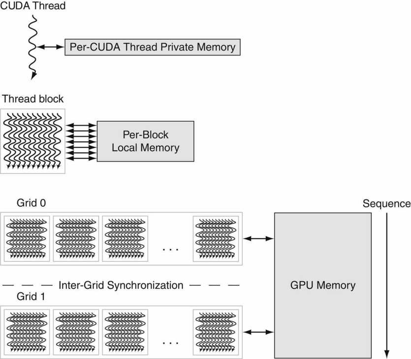

**HÌNH 6.10 Cấu trúc GPU Memory. GPU Memory được các vòng vector hóa dùng chung. Mọi thread SIMD instruction trong một thread block dùng chung Local Memory.**

Thay vì dựa vào cache lớn để chứa toàn bộ working set của ứng dụng, theo truyền thống GPU dùng streaming cache nhỏ hơn và dựa vào multithreading rộng rãi của các thread SIMD instruction để che latency dài tới DRAM, vì working set có thể lớn tới hàng trăm megabyte. Do đó, chúng không vừa last-level cache của microprocessor multicore. Với việc dùng hardware multithreading để che DRAM latency, diện tích chip mà system processor dành cho cache được GPU dùng cho tài nguyên tính toán và số register lớn để giữ trạng thái của nhiều thread SIMD instruction.

#### Giải thích thêm

Mặc dù che memory latency là triết lý nền tảng, hãy lưu ý rằng GPU và vector processor mới nhất đã thêm cache. Ví dụ, kiến trúc Fermi gần đây đã thêm cache, nhưng chúng được xem là bandwidth filter để giảm yêu cầu lên GPU Memory, hoặc là accelerator cho số ít biến có latency không thể che bằng multithreading. Local memory cho stack frame, function call và register spilling rất phù hợp cache, vì latency quan trọng khi gọi function. Cache cũng có thể tiết kiệm năng lượng, vì truy cập cache on-chip tiêu thụ ít năng lượng hơn nhiều so với truy cập nhiều chip DRAM bên ngoài.

### Đặt GPU vào bối cảnh

Ở mức cao, máy tính multicore có SIMD instruction extension thực sự có những điểm tương đồng với GPU. Hình 6.11 tổng kết các điểm giống và khác nhau. Cả hai đều là MIMD có processor sử dụng nhiều SIMD lane, mặc dù GPU có nhiều processor hơn và số lane lớn hơn rất nhiều. Cả hai dùng hardware multithreading để cải thiện mức sử dụng processor, mặc dù GPU có phần cứng hỗ trợ nhiều thread hơn rất nhiều. Cả hai dùng cache, mặc dù GPU dùng streaming cache nhỏ hơn, còn máy tính multicore dùng multilevel cache lớn, cố gắng chứa trọn toàn bộ working set. Cả hai dùng address space 64-bit, mặc dù physical main memory của GPU nhỏ hơn rất nhiều. Dù GPU hỗ trợ memory protection ở cấp page, chúng chưa hỗ trợ demand paging.

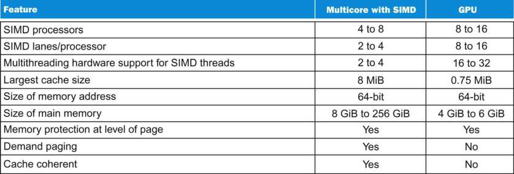

**HÌNH 6.11 Điểm giống, khác giữa multicore có Multimedia SIMD extension và GPU gần đây.**

SIMD processor cũng tương tự vector processor. Nhiều SIMD processor trong GPU hoạt động như các core MIMD độc lập, giống như nhiều máy tính vector có nhiều vector processor. Theo góc nhìn này, Fermi GTX 580 là máy 16-core có phần cứng hỗ trợ multithreading, với mỗi core có 16 lane. Khác biệt lớn nhất là multithreading, vốn là nền tảng của GPU nhưng không có trong phần lớn vector processor.

GPU và CPU không có chung tổ tiên trong phả hệ kiến trúc máy tính; không có Missing Link giải thích được cả hai. Do nguồn gốc khác biệt này, GPU không sử dụng các thuật ngữ phổ biến trong cộng đồng kiến trúc máy tính, dẫn tới nhầm lẫn về GPU là gì và hoạt động ra sao. Để giúp giải quyết nhầm lẫn, Hình 6.12 liệt kê từ trái sang phải: thuật ngữ giàu tính mô tả hơn dùng trong mục này, thuật ngữ gần nhất trong điện toán phổ thông, thuật ngữ NVIDIA GPU chính thức nếu bạn quan tâm, rồi mô tả ngắn của thuật ngữ. “GPU Rosetta Stone” này có thể giúp liên hệ mục này và các ý tưởng với những mô tả GPU thông thường hơn, như trong  Phụ lục B.

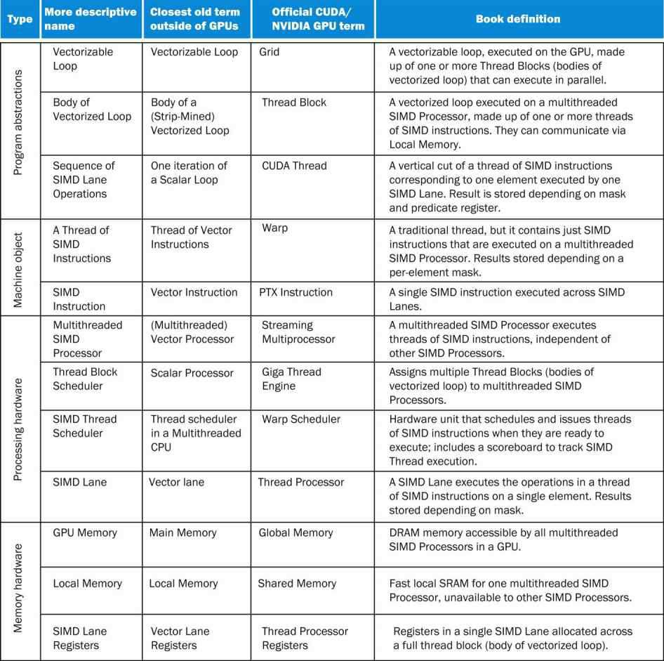

**HÌNH 6.12 Hướng dẫn nhanh thuật ngữ GPU. Chúng tôi dùng cột đầu làm thuật ngữ hardware. 12 thuật ngữ chia bốn nhóm. Từ trên xuống: Program Abstractions, Machine Objects, Processing Hardware và Memory Hardware.**

Trong khi GPU đang tiến về điện toán phổ thông, chúng không thể từ bỏ trách nhiệm tiếp tục vượt trội về đồ họa. Vì vậy, thiết kế GPU có thể hợp lý hơn khi kiến trúc sư đặt câu hỏi: với phần cứng đã đầu tư để làm tốt đồ họa, chúng ta có thể bổ sung gì để cải thiện hiệu năng cho phạm vi ứng dụng rộng hơn?

Sau khi trình bày hai kiểu MIMD khác nhau có shared address space, tiếp theo chúng tôi giới thiệu parallel processor mà mỗi processor có private address space riêng, giúp việc xây dựng hệ thống lớn hơn nhiều dễ dàng hơn đáng kể. Những dịch vụ Internet bạn sử dụng hằng ngày phụ thuộc vào các hệ thống large-scale này.

#### Giải thích thêm

Mặc dù GPU được giới thiệu là có bộ nhớ tách biệt với CPU, cả AMD lẫn Intel đã công bố những sản phẩm “fused” kết hợp GPU và CPU để chia sẻ một bộ nhớ duy nhất. Thách thức sẽ là duy trì bộ nhớ có bandwidth cao trong kiến trúc fused, vốn là nền tảng của GPU.

#### Tự kiểm tra

Đúng hay sai: GPU dựa chip graphics DRAM giảm memory latency, nhờ đó tăng hiệu năng ứng dụng đồ họa.

## 6.7 Cluster, warehouse scale computer và những multiprocessor Message-Passing khác

Cách tiếp cận thay cho chia sẻ address space là để mỗi processor có private physical address space riêng. Hình 6.13 cho thấy tổ chức kinh điển của multiprocessor có nhiều private address space. Loại multiprocessor này phải giao tiếp qua message passing tường minh, vốn theo truyền thống cũng là tên của kiểu máy tính này. Nếu hệ thống có routine gửi và nhận message, việc phối hợp được tích hợp trong message passing, vì một processor biết khi nào message được gửi, còn processor nhận biết khi nào message tới. Nếu bên gửi cần xác nhận message đã tới, processor nhận có thể gửi acknowledgment message trở lại bên gửi.

### message passing

Truyền thông giữa nhiều processor bằng gửi và nhận thông tin tường minh.

#### send message routine

Routine processor trong máy private memory dùng chuyển message đến processor khác.

#### receive message routine

Routine processor trong máy private memory dùng nhận message từ processor khác.

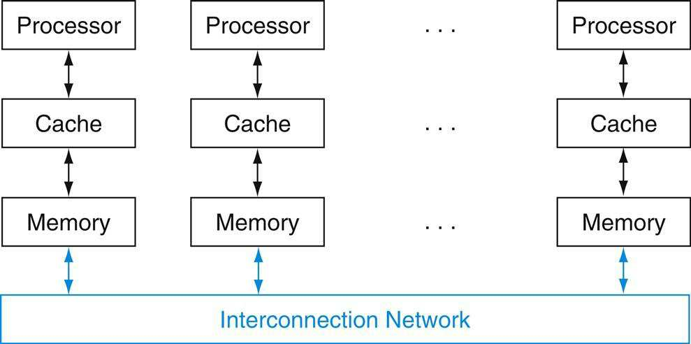

**HÌNH 6.13 Tổ chức kinh điển multiprocessor có nhiều private address space, truyền thống gọi message-passing multiprocessor. Khác SMP Hình 6.7, interconnection network không nằm giữa cache và memory mà giữa các node processor-memory.**

Đã có nhiều nỗ lực xây dựng máy tính large-scale dựa trên mạng message-passing high-performance, và chúng thực sự cung cấp hiệu năng truyền thông tuyệt đối tốt hơn cluster xây bằng local area network. Thực tế, nhiều supercomputer ngày nay dùng mạng tùy chỉnh. Vấn đề là chúng đắt hơn nhiều so với local area network như Ethernet. Với chi phí cao hơn rất nhiều, ngày nay ít ứng dụng ngoài high-performance computing có thể biện minh cho nhu cầu hiệu năng truyền thông cao hơn này.

#### Hardware/Software Interface

Máy tính dựa vào message passing để truyền thông thay vì cache coherent shared memory dễ xây dựng hơn rất nhiều đối với người thiết kế phần cứng (xem Mục 5.8). Lập trình viên cũng có lợi vì truyền thông là tường minh, nghĩa là ít gặp bất ngờ về hiệu năng hơn so với truyền thông ngầm trong máy tính cache-coherent shared memory. Bất lợi đối với lập trình viên là khó port chương trình tuần tự sang máy tính message-passing hơn, vì mọi truyền thông phải được xác định trước, nếu không chương trình sẽ không hoạt động. Cache-coherent shared memory cho phép phần cứng tự xác định dữ liệu nào cần truyền, giúp port dễ hơn. Có những ý kiến khác nhau về con đường ngắn nhất tới hiệu năng cao, xét ưu và nhược điểm của truyền thông ngầm, nhưng thị trường ngày nay không có sự nhầm lẫn. Microprocessor multicore dùng shared physical memory, còn các node của cluster giao tiếp với nhau bằng message passing.

Một số ứng dụng concurrent chạy tốt trên phần cứng song song bất kể nó cung cấp shared address hay message passing. Đặc biệt, task-level parallelism và ứng dụng ít truyền thông—như tìm kiếm Web, mail server và file server—không cần shared addressing để chạy tốt. Vì vậy, cluster đã trở thành ví dụ phổ biến nhất ngày nay của máy tính song song message-passing. Do có các bộ nhớ riêng, mỗi node cluster chạy một bản operating system riêng biệt. Ngược lại, các core trong microprocessor được kết nối bằng mạng high-speed bên trong chip, còn hệ thống multichip shared-memory dùng memory interconnect để truyền thông. Memory interconnect có bandwidth cao hơn và latency thấp hơn, cho phép hiệu năng truyền thông tốt hơn nhiều đối với shared memory multiprocessor.

#### clusters

Tập máy tính nối qua I/O trên network switch tiêu chuẩn để tạo message-passing multiprocessor.

Điểm yếu của việc tách bộ nhớ dành cho người dùng theo góc nhìn lập trình song song lại trở thành điểm mạnh về độ tin cậy hệ thống (xem Mục 5.5). Vì cluster gồm những máy tính độc lập kết nối qua local area network, việc thay một máy mà không dừng cả hệ thống dễ hơn nhiều so với shared memory multiprocessor. Về cơ bản, shared address khiến việc cô lập và thay một processor trở nên khó nếu không có nỗ lực phi thường trong operating system và thiết kế vật lý server. Cluster cũng dễ giảm quy mô một cách ổn thỏa khi server hỏng, nhờ đó cải thiện độ tin cậy. Vì phần mềm cluster là lớp chạy trên operating system cục bộ của từng máy, việc ngắt kết nối và thay máy hỏng dễ dàng hơn nhiều.


Vì cluster dựng từ máy tính hoàn chỉnh và mạng độc lập mở rộng được, cách ly này cũng giúp dễ mở rộng hệ thống mà không dừng ứng dụng chạy trên cluster.

Chi phí thấp hơn, availability cao hơn và khả năng mở rộng tăng dần nhanh chóng làm cluster hấp dẫn đối với nhà cung cấp dịch vụ Internet, dù hiệu năng truyền thông thấp hơn multiprocessor shared-memory large-scale. Những công cụ tìm kiếm mà hàng trăm triệu người trong chúng ta dùng hằng ngày phụ thuộc công nghệ này. Amazon, Facebook, Google, Microsoft và những công ty khác đều có nhiều datacenter, mỗi nơi chứa cluster gồm hàng chục nghìn server. Rõ ràng, việc dùng nhiều processor tại công ty dịch vụ Internet đã thành công to lớn.

### Warehouse-Scale Computer

Các dịch vụ Internet như mô tả trên đòi hỏi xây những tòa nhà mới để chứa, cấp điện và làm mát 100,000 server. Mặc dù có thể phân loại chúng đơn thuần là cluster lớn, kiến trúc và hoạt động của chúng tinh vi hơn. Chúng hoạt động như một máy tính khổng lồ và tốn khoảng $150M cho tòa nhà, hạ tầng điện và làm mát, server cùng thiết bị mạng dùng để kết nối và chứa từ 50,000 đến 100,000 server. Chúng tôi xem đây là lớp máy tính mới, gọi là Warehouse-Scale Computers (WSC).

Ai cũng xây được CPU nhanh. Bí quyết là xây hệ thống nhanh.

Seymour Cray, được coi là cha đẻ supercomputer.

#### Hardware/Software Interface

Framework phổ biến nhất cho batch processing trong WSC là MapReduce [Dean, 2008] và người anh em open-source Hadoop. Lấy cảm hứng từ các hàm Lisp cùng tên, trước tiên Map áp dụng hàm programmer-supplied vào mỗi logical input record. Map chạy trên hàng nghìn server để tạo kết quả trung gian gồm các key-value pair. Reduce thu thập đầu ra của những tác vụ phân tán đó và gộp chúng bằng một hàm programmer-defined khác. Với hỗ trợ phần mềm thích hợp, cả hai có mức song song cao nhưng vẫn dễ hiểu và dễ dùng. Trong vòng 30 phút, một lập trình viên mới có thể chạy một tác vụ MapReduce trên hàng nghìn server.

Ví dụ, một chương trình MapReduce tính số lần xuất hiện của mỗi từ tiếng Anh trong một tập tài liệu lớn. Dưới đây là phiên bản đơn giản hóa của chương trình, chỉ cho thấy vòng lặp trong cùng và giả sử mỗi từ tiếng Anh tìm được trong một tài liệu chỉ xuất hiện một lần:

```
map(String key, String value):
   // key: document name
   // value: document contents
   for each word w in value:
   EmitIntermediate(w, “1”); // Produce list of all words
reduce(String key, Iterator values):
// key: a word
// values: a list of counts
   int result = 0;
   for each v in values:
   result += ParseInt(v); // get integer from key-value pair
   Emit(AsString(result));
```

Hàm EmitIntermediate dùng trong Map phát ra từng từ của tài liệu cùng giá trị một. Sau đó, hàm Reduce tính tổng mọi giá trị của từng từ cho mỗi tài liệu, dùng ParseInt() để có số lần xuất hiện của mỗi từ trong tất cả tài liệu. MapReduce runtime environment lập lịch các map task và reduce task lên server của WSC.

Ở quy mô cực lớn này, vốn đòi hỏi đổi mới trong phân phối điện, làm mát, giám sát và vận hành, WSC là hậu duệ hiện đại của supercomputer thập niên 1970—khiến Seymour Cray trở thành người cha tinh thần của các kiến trúc sư WSC ngày nay. Những máy tính cực mạnh của ông xử lý được các phép tính mà không nơi nào khác làm được, nhưng đắt đến mức chỉ vài công ty đủ khả năng mua. Lần này, mục tiêu là cung cấp công nghệ thông tin cho thế giới thay vì high-performance computing cho nhà khoa học và kỹ sư. Vì vậy, WSC chắc chắn đóng vai trò xã hội quan trọng hơn ngày nay so với vai trò của supercomputer Cray trong quá khứ.

Tuy chung vài mục tiêu với server, WSC có ba điểm khác biệt chính:

1. Parallelism dồi dào, dễ khai thác: Kiến trúc sư server lo ứng dụng thị trường đích có đủ parallelism để biện minh lượng hardware song song không, và hardware truyền thông đủ khai thác parallelism có quá đắt không. Kiến trúc sư WSC không lo như vậy. Thứ nhất, batch application như MapReduce hưởng lợi từ nhiều dataset độc lập cần xử lý độc lập, như hàng tỷ Web page từ Web crawl. Thứ hai, ứng dụng dịch vụ Internet tương tác, hay Software as a Service (SaaS), hưởng lợi từ hàng triệu người dùng độc lập. Đọc, ghi hiếm phụ thuộc trong SaaS, nên ít cần đồng bộ. Ví dụ tìm kiếm dùng index read-only và email thường đọc, ghi thông tin độc lập. Chúng tôi gọi parallelism dễ này là Request-Level Parallelism, vì nhiều công việc độc lập có thể tiến hành song song tự nhiên với ít nhu cầu truyền thông hay đồng bộ.

#### software as a service (SaaS)

Thay vì bán phần mềm được cài và chạy trên máy riêng của khách hàng, phần mềm chạy tại địa điểm từ xa và được cung cấp cho khách hàng qua Internet, thường thông qua Web interface. Khách hàng SaaS được tính phí theo mức sử dụng thay vì quyền sở hữu.

2. Chi phí vận hành quan trọng: Truyền thống, kiến trúc sư server thiết kế hiệu năng đỉnh trong ngân sách chi phí, chỉ lo năng lượng để không vượt khả năng làm mát vỏ máy. Họ thường bỏ qua chi phí vận hành, giả sử không đáng kể so với mua sắm. WSC có tuổi thọ dài hơn—tòa nhà, hạ tầng điện và làm mát thường khấu hao 10 năm trở lên—nên chi phí vận hành tích lũy: năng lượng, phân phối điện, làm mát chiếm trên 30% chi phí WSC trong 10 năm.


3. Quy mô và cơ hội/vấn đề liên quan: Xây một WSC phải mua 100,000 server cùng hạ tầng hỗ trợ, nghĩa là chiết khấu số lượng. Vì vậy nội bộ WSC lớn đến mức có lợi thế quy mô ngay cả khi ít WSC. Lợi thế dẫn đến cloud computing, vì chi phí mỗi đơn vị thấp hơn cho phép công ty cloud cho thuê server có lời nhưng vẫn rẻ hơn bên ngoài tự làm. Mặt trái cơ hội kinh tế là phải đối phó tần suất hỏng của quy mô. Dù server có Mean Time To Failure đáng kinh ngạc 25 năm (200,000 giờ), kiến trúc sư WSC phải thiết kế cho năm server hỏng mỗi ngày. Mục 5.15 đề cập annualized disk failure rate (AFR) tại Google đo 2% đến 4%. Nếu mỗi server bốn đĩa, tỷ lệ hỏng hằng năm 2%, kiến trúc sư WSC nên dự kiến một đĩa hỏng mỗi giờ. Vì thế fault tolerance còn quan trọng hơn với kiến trúc sư server. Lợi thế quy mô WSC tìm ra đã hiện thực hóa ước mơ điện toán như dịch vụ tiện ích. Cloud computing nghĩa là bất kỳ ai bất kỳ đâu có ý tưởng tốt, mô hình kinh doanh, thẻ tín dụng đều có thể khai thác hàng nghìn server đưa tầm nhìn ra toàn cầu gần tức thì. Tất nhiên có trở ngại quan trọng hạn chế tăng trưởng—bảo mật, riêng tư, tiêu chuẩn, tốc độ tăng Internet bandwidth—nhưng chúng tôi dự kiến sẽ giải quyết để WSC, cloud computing phát triển.

Để đặt tốc độ tăng trưởng cloud computing vào bối cảnh, năm 2012 Amazon Web Services công bố rằng mỗi ngày họ bổ sung đủ server capacity mới để hỗ trợ toàn bộ hạ tầng toàn cầu của Amazon năm 2003, khi Amazon là doanh nghiệp có doanh thu hằng năm $5.2Bn với 6000 nhân viên.

Giờ đây, khi đã hiểu tầm quan trọng của multiprocessor message-passing, đặc biệt với cloud computing, chúng ta tiếp tục xem những cách kết nối các node WSC với nhau. Nhờ Moore’s Law và số core mỗi chip ngày càng tăng, ngày nay cũng cần mạng bên trong chip, nên những topology này quan trọng ở cả quy mô nhỏ lẫn lớn.


#### Giải thích thêm

MapReduce framework thực hiện shuffle và sort các key-value pair ở cuối pha Map để tạo các nhóm có cùng key. Sau đó, những nhóm này được chuyển sang pha Reduce.

#### Giải thích thêm

Một dạng tính toán large-scale khác là grid computing, trong đó các máy tính phân bố trên những khu vực rộng, nên chương trình chạy trên chúng phải truyền thông qua mạng đường dài. Dạng grid computing phổ biến và độc đáo nhất được tiên phong bởi dự án SETI@home. Vì tại bất kỳ thời điểm nào cũng có hàng triệu PC nhàn rỗi không làm việc hữu ích, có thể tập hợp và tận dụng chúng nếu ai đó phát triển phần mềm chạy trên những máy ấy rồi giao cho mỗi PC một phần bài toán độc lập. Ví dụ đầu tiên là Search for ExtraTerrestrial Intelligence (SETI), khởi động tại UC Berkeley năm 1999. Hơn 5 triệu người dùng máy tính ở trên 200 quốc gia đã đăng ký SETI@home, hơn 50% ở ngoài Hoa Kỳ. Đến cuối năm 2011, hiệu năng trung bình của grid SETI@home là 3.5 PetaFLOPS.

#### Tự kiểm tra

1. Đúng hay sai: Giống SMP, máy message-passing dựa lock để synchronization.

2. Đúng hay sai: Cluster có memory riêng nên cần nhiều bản operating system.

## 6.8 Giới thiệu network topology của multiprocessor

Chip multicore cần on-chip network để kết nối các core với nhau, còn cluster cần local area network để kết nối các server. Mục này xem xét ưu và nhược điểm của những interconnection network topology khác nhau.

Chi phí mạng gồm số switch, số link mỗi switch nối mạng, độ rộng (số bit) mỗi link và chiều dài link khi ánh xạ mạng vào silicon. Ví dụ một số core hoặc server kề nhau, số khác ở phía đối diện chip hay datacenter. Hiệu năng mạng cũng nhiều mặt: latency gửi, nhận message khi mạng không tải, throughput theo số message tối đa truyền trong khoảng thời gian, độ trễ do tranh chấp phần mạng và hiệu năng thay đổi theo communication pattern. Nghĩa vụ khác có thể là fault tolerance vì hệ thống có thể phải hoạt động khi thành phần hỏng. Cuối cùng, trong thời đại hệ thống energy-limited, hiệu quả năng lượng của tổ chức khác nhau có thể vượt những lo ngại khác.

Mạng thường được vẽ dưới dạng đồ thị, với mỗi cạnh biểu diễn một link của mạng truyền thông. Trong các hình của mục này, node processor-memory được vẽ bằng ô vuông đen, còn switch là vòng tròn màu. Ở đây chúng ta giả sử mọi link đều hai chiều, tức thông tin có thể đi theo cả hai hướng. Mọi mạng đều gồm các switch có link tới node processor-memory và những switch khác. Mạng đầu tiên kết nối một chuỗi node với nhau:


Topology này gọi là ring. Vì một số node không được kết nối trực tiếp, một số message phải đi qua các node trung gian cho đến khi tới đích cuối cùng.

Khác bus—tập dây chia sẻ cho phép broadcast đến mọi thiết bị kết nối—ring cho nhiều lần truyền đồng thời.

Vì có nhiều topology để lựa chọn, chúng ta cần những thước đo hiệu năng để phân biệt các thiết kế. Có hai thước đo phổ biến. Thứ nhất là tổng network bandwidth, bằng bandwidth mỗi link nhân với số link. Nó biểu diễn bandwidth đỉnh. Với mạng ring phía trên có P processor, tổng network bandwidth bằng P lần bandwidth của một link; tổng network bandwidth của bus chỉ bằng bandwidth của bus đó.

### network bandwidth

Nói không chính thức, tốc độ truyền đỉnh mạng; có thể chỉ tốc độ một link hoặc tổng tốc độ mọi link.

Để cân bằng trường hợp bandwidth tốt nhất này, chúng ta đưa vào một thước đo khác gần với trường hợp xấu nhất hơn: bisection bandwidth. Thước đo được tính bằng cách chia máy thành hai nửa, rồi cộng bandwidth của những link cắt qua đường phân chia tưởng tượng. Bisection bandwidth của ring bằng hai lần link bandwidth; đối với bus, nó bằng một lần link bandwidth. Nếu một link nhanh bằng bus, ring chỉ nhanh gấp đôi bus trong trường hợp xấu nhất, nhưng nhanh gấp P lần trong trường hợp tốt nhất.

#### bisection bandwidth

Bandwidth giữa hai phần bằng nhau multiprocessor. Thước đo dành cho cách chia worst-case.

Vì một số network topology không đối xứng, câu hỏi xuất hiện là nên vẽ đường tưởng tượng ở đâu khi chia đôi máy. Bisection bandwidth là thước đo worst-case, nên đáp án là chọn cách chia cho hiệu năng mạng bi quan nhất. Nói cách khác, hãy tính mọi bisection bandwidth có thể có và chọn giá trị nhỏ nhất. Chúng ta chọn góc nhìn bi quan vì chương trình song song thường bị giới hạn bởi mắt xích yếu nhất trong chuỗi truyền thông.

Ở cực đối diện ring là fully connected network, mỗi processor có link hai chiều đến mọi processor khác. Tổng network bandwidth là P×(P−1)/2, bisection bandwidth là (P/2)<sup>2</sup>.

#### fully connected network

Mạng nối node processor-memory bằng đường truyền chuyên dụng giữa mọi node.

Sự cải thiện hiệu năng to lớn của fully connected network phải đánh đổi bằng mức tăng chi phí rất lớn. Hệ quả này thúc đẩy kỹ sư phát minh topology mới nằm giữa chi phí của ring và hiệu năng của fully connected network. Việc đánh giá thành công phụ thuộc phần lớn vào bản chất truyền thông trong workload của các chương trình song song chạy trên máy tính.

Khó đếm hết topology đã bàn trong ấn phẩm, nhưng chỉ ít được dùng trong parallel processor thương mại. Hình 6.14 minh họa hai topology phổ biến.

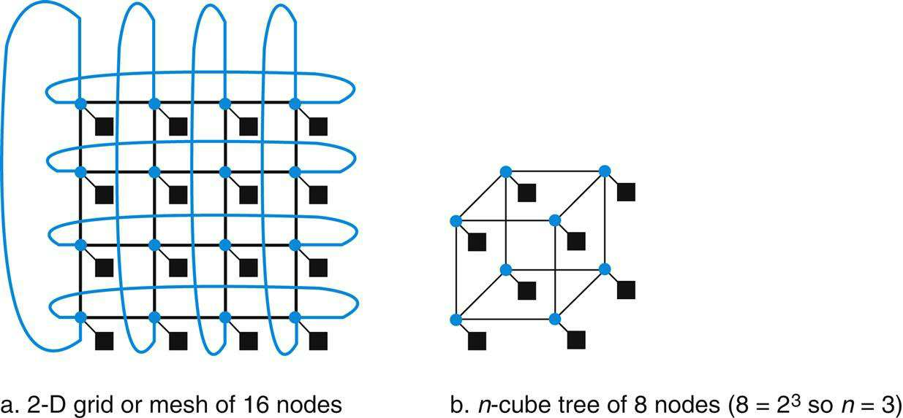

**HÌNH 6.14 Network topology từng xuất hiện trong parallel processor thương mại. Vòng tròn màu là switch, ô đen là node processor-memory. Dù switch nhiều link, thường chỉ một đến processor. Boolean n-cube topology là interconnect n-dimensional có 2<sup>n</sup> node, cần n link mỗi switch (cộng một cho processor), do đó có n node nearest-neighbor. Thường topology cơ bản được thêm cung để tăng hiệu năng, độ tin cậy.**

Một lựa chọn thay cho đặt processor ở mọi node mạng là chỉ để switch ở một số node. Switch nhỏ hơn node processor-memory-switch nên có thể bố trí dày hơn, nhờ đó giảm khoảng cách và tăng hiệu năng. Mạng như vậy thường gọi là multistage network để phản ánh nhiều bước mà message có thể đi qua. Các loại multistage network cũng nhiều như single-stage network; Hình 6.15 minh họa hai tổ chức phổ biến. Fully connected hay crossbar network cho phép bất kỳ node nào giao tiếp với bất kỳ node khác trong một lượt đi qua mạng. Omega network dùng ít phần cứng hơn crossbar network (2n log<sub>2</sub> n so với n<sup>2</sup> switch), nhưng có thể có tranh chấp giữa message tùy communication pattern. Ví dụ, Omega network trong Hình 6.15 không thể gửi message từ P<sub>0</sub> tới P<sub>6</sub> cùng lúc gửi message từ P<sub>1</sub> tới P<sub>4</sub>.

#### multistage network

Mạng cung cấp switch nhỏ ở mỗi node.

#### crossbar network

Mạng cho mọi node giao tiếp node khác bằng một lượt qua mạng.

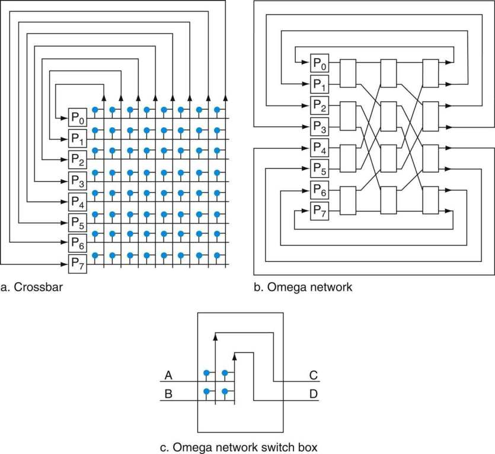

**HÌNH 6.15 Multistage network topology phổ biến cho tám node. Switch trong hình đơn giản hơn hình trước vì link một chiều; dữ liệu vào bên trái, ra link bên phải. Switch box ở c có thể chuyển A đến C và B đến D hoặc B đến C và A đến D. Crossbar dùng n<sup>2</sup> switch, n là số processor, còn Omega dùng 2n log<sub>2</sub>n switch box lớn, mỗi box logic gồm bốn switch nhỏ. Ở đây crossbar dùng 64 switch so với 12 switch box, hay 48 switch, của Omega. Tuy nhiên crossbar hỗ trợ mọi tổ hợp message giữa processor, Omega không thể.**

### Triển khai network topology

Phân tích đơn giản về tất cả các network trong mục này bỏ qua những cân nhắc thực tế quan trọng khi xây dựng network. Chiều dài mỗi link ảnh hưởng đến chi phí giao tiếp ở clock rate cao; nhìn chung, khoảng cách càng dài thì chi phí chạy ở clock rate cao càng lớn. Khoảng cách ngắn cũng giúp bố trí nhiều dây hơn cho link dễ dàng hơn, vì công suất để điều khiển nhiều dây thấp hơn nếu dây ngắn. Dây ngắn cũng rẻ hơn dây dài. Một hạn chế thực tế khác là các hình vẽ three-dimensional phải được ánh xạ lên chip, vốn về cơ bản là môi trường two-dimensional. Mối quan tâm cuối cùng là năng lượng. Ví dụ, yêu cầu năng lượng có thể buộc chip multicore dựa vào topology grid đơn giản. Điều rút ra là các topology trông thanh nhã khi được phác thảo trên bảng có thể không khả thi khi được xây dựng bằng silicon hoặc trong datacenter.

Giờ đây, khi đã hiểu tầm quan trọng của cluster và thấy những topology có thể dùng để kết nối chúng, tiếp theo chúng ta xem xét phần cứng và phần mềm của giao diện giữa mạng với processor.

#### Tự kiểm tra

Đúng hay sai: Với ring P node, tỷ số tổng network bandwidth trên bisection bandwidth là P/2.


## Giao tiếp với thế giới bên ngoài: Cluster networking

Mục trực tuyến này mô tả networking hardware và software dùng để kết nối các node cluster với nhau. Ví dụ là Ethernet 10 gigabit/giây kết nối với máy tính bằng Peripheral Component Interconnect Express (PCIe). Mục trình bày cả tối ưu phần mềm lẫn phần cứng để tăng hiệu năng mạng, gồm zero copy messaging, user space communication, dùng polling thay I/O interrupt và tính checksum bằng phần cứng. Mặc dù ví dụ là networking, các kỹ thuật trong mục này cũng áp dụng cho storage controller và những thiết bị I/O khác.

Sau khi bàn hiệu năng mạng ở mức chi tiết thấp trong mục trực tuyến này, mục tiếp cho thấy cách benchmark mọi loại multiprocessor bằng chương trình higher-level hơn nhiều.

## 6.9 Giao tiếp với thế giới bên ngoài: Cluster networking

Mục trực tuyến này mô tả networking hardware và software dùng để kết nối các node cluster với nhau. Vì đã có cả sách và khóa học chỉ riêng về networking, mục này chỉ giới thiệu các thuật ngữ và khái niệm chính. Mặc dù ví dụ của chúng ta là networking, các kỹ thuật được mô tả cũng áp dụng cho storage controller và những thiết bị I/O khác.

Ethernet đã thống trị local-area network trong nhiều thập niên, nên không ngạc nhiên khi cluster chủ yếu dựa vào Ethernet làm cluster interconnect. Nó trở nên phổ biến về thương mại với link speed 10 Megabit mỗi giây trong thập niên 1980, nhưng ngày nay Ethernet 1 Gigabit mỗi giây là tiêu chuẩn và Ethernet 10 Gigabit mỗi giây đang được triển khai trong datacenter. Hình e6.9.1 cho thấy network interface card (NIC) cho 10 Gigabit Ethernet.

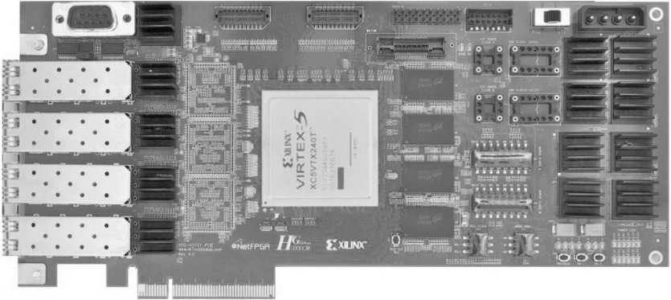

**HÌNH E6.9.1 Card Ethernet NetFPGA 10-Gigabit (xem http://netfpga.org/), nối tới bốn link Ethernet 10-Gigabit/sec. Là open platform FPGA-based cho nghiên cứu mạng và thử nghiệm lớp học. DMA engine và bốn “MAC chip” Hình e6.9.2 chỉ là phần của Xilinx Virtex FPGA giữa bo mạch. Bốn PHY chip Hình e6.9.2 là bốn ô vuông đen ngay phải bốn hình chữ nhật trắng ở cạnh trái, nơi cắm cáp Ethernet.**

Máy tính cung cấp link high-speed để cắm thiết bị I/O nhanh như NIC này. Trước đây, các chip riêng được dùng để kết nối microprocessor với bộ nhớ và thiết bị I/O high-speed, nhưng nhờ Moore’s Law, những chức năng này đã được tích hợp vào chip chính trong các sản phẩm gần đây như Sandy Bridge của Intel. Một link high-speed phổ biến ngày nay là PCIe, viết tắt Peripheral Component Interconnect Express. Nó được gọi là link vì khối xây dựng cơ bản, gọi là serial lane, chỉ gồm bốn dây: hai dây nhận và hai dây truyền dữ liệu. Số dây ít này tương phản với phiên bản PCI trước gồm 64 dây, gọi là parallel bus. PCIe cho phép dùng từ một đến 32 lane để kết nối thiết bị I/O tùy nhu cầu. NIC này dùng PCI 1.1, nên mỗi lane truyền ở 2 Gigabit/giây.


NIC trong Hình e6.9.1 kết nối với host computer qua link PCIe eight-lane, cung cấp 16 Gigabit/giây theo cả hai hướng. Để giao tiếp, NIC phải vừa gửi hay truyền message vừa nhận chúng, thường được viết tắt lần lượt là TX và RX. Với NIC này, mỗi link 10 G dùng transmit queue và receive queue riêng, mỗi queue chứa được hai Ethernet packet full-length, dùng giữa các link Ethernet và NIC. Hình e6.9.2 là block diagram của NIC cho thấy các queue TX và RX. NIC còn có hai queue 32-entry để truyền và nhận giữa host computer với NIC.

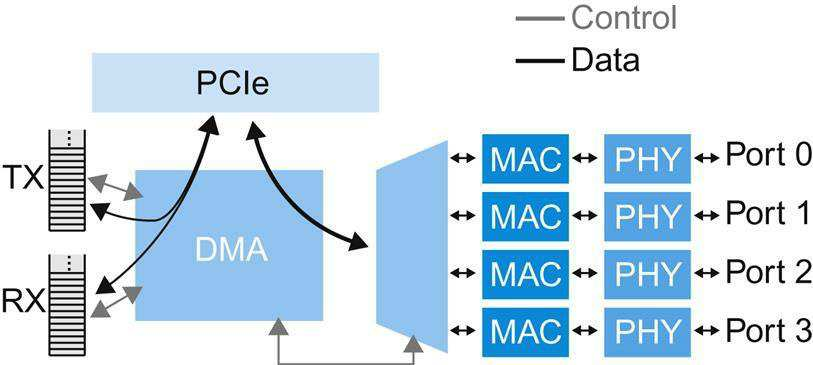

**HÌNH E6.9.2 Block diagram card Ethernet NetFPGA Hình e6.9.1 thể hiện control path, data path. Control path cho DMA engine đọc trạng thái queue, như empty so với on-empty, và nội dung queue entry tiếp theo sẵn có. DMA engine cũng điều khiển port multiplexing. Data path chỉ đi qua DMA block đến queue TX/RX hoặc main memory. “MAC chip” mô tả bên dưới. PHY chip chỉ physical layer, nối “MAC chip” với môi trường mạng vật lý như dây đồng hoặc cáp quang.**

Để gửi lệnh tới NIC, processor phải có khả năng định địa chỉ thiết bị và cung cấp một hoặc nhiều command word. Trong memory-mapped I/O, các phần của address space được gán cho thiết bị I/O. Trong quá trình khởi tạo (lúc boot), thiết bị PCIe có thể yêu cầu được gán một vùng địa chỉ có độ dài xác định. Mọi thao tác đọc và ghi sau đó của processor tới vùng địa chỉ ấy đều được chuyển qua PCIe tới thiết bị. Đọc và ghi những địa chỉ đó được hiểu là lệnh cho thiết bị I/O.

### memory-mapped I/O

Cơ chế I/O gán phần address space cho I/O device, đọc và ghi những địa chỉ này được hiểu như lệnh cho thiết bị.

Ví dụ, thao tác ghi có thể gửi dữ liệu tới network interface, nơi dữ liệu được hiểu là một lệnh. Khi processor phát địa chỉ và dữ liệu, hệ thống bộ nhớ bỏ qua thao tác vì địa chỉ biểu thị phần memory space dùng cho I/O. Tuy nhiên, NIC nhìn thấy thao tác và ghi nhận dữ liệu. User program bị ngăn thực hiện I/O trực tiếp vì OS không cấp quyền truy cập address space được gán cho thiết bị I/O; vì vậy những địa chỉ đó được address translation bảo vệ. Memory-mapped I/O cũng có thể dùng để truyền dữ liệu bằng cách ghi hoặc đọc những địa chỉ được chọn. Thiết bị dùng địa chỉ để xác định loại lệnh, còn dữ liệu có thể được cung cấp qua ghi hoặc lấy qua đọc. Trong mọi trường hợp, địa chỉ mã hóa cả định danh thiết bị lẫn kiểu truyền giữa processor và thiết bị.

Mặc dù processor có thể tự truyền dữ liệu từ user space vào I/O space, overhead truyền dữ liệu từ hoặc tới mạng high-speed có thể không chấp nhận được, vì nó chiếm một phần lớn năng lực processor. Vì vậy, từ lâu người thiết kế máy tính đã phát minh cơ chế giảm tải cho processor, để device controller truyền dữ liệu trực tiếp từ hoặc tới bộ nhớ mà không cần processor tham gia. Cơ chế này gọi là direct memory access (DMA).

#### direct memory access (DMA)

Cơ chế cho device controller truyền dữ liệu trực tiếp từ hoặc đến memory mà không cần processor tham gia.

DMA được triển khai bằng controller chuyên dụng truyền dữ liệu giữa network interface và bộ nhớ độc lập với processor; trong trường hợp này, DMA engine nằm bên trong NIC.

Để thông báo cho operating system (và cuối cùng là ứng dụng sẽ nhận packet) rằng việc truyền đã hoàn tất, DMA gửi một I/O interrupt.

#### interrupt-driven I/O

Cơ chế I/O dùng interrupt báo processor rằng thiết bị I/O cần chú ý.

I/O interrupt giống exception đã thấy Chương 4 và 5, với hai khác biệt quan trọng:

1. I/O interrupt là bất đồng bộ đối với thực thi instruction. Nghĩa là interrupt không gắn với bất kỳ instruction nào và không ngăn instruction hoàn tất, nên nó rất khác page fault exception hay exception như arithmetic overflow. Control unit chỉ cần kiểm tra I/O interrupt đang chờ khi bắt đầu một instruction mới.

2. Ngoài việc báo rằng I/O interrupt đã xảy ra, chúng ta muốn truyền thêm thông tin, chẳng hạn định danh thiết bị tạo interrupt. Hơn nữa, các interrupt đại diện cho thiết bị có mức ưu tiên khác nhau, và yêu cầu interrupt của chúng có độ khẩn khác nhau. Để truyền thông tin tới processor, như định danh thiết bị phát interrupt, hệ thống có thể dùng vectored interrupt hoặc exception identification register, trong RISC-V gọi là supervisor exception cause (SCAUSE) register (xem Mục 4.9). Khi processor nhận biết interrupt, thiết bị có thể gửi vector address hoặc status field để đặt vào Cause register. Kết quả là khi OS nhận quyền điều khiển, nó biết thiết bị nào gây interrupt và có thể lập tức truy vấn thiết bị. Cơ chế interrupt loại bỏ nhu cầu processor phải liên tục kiểm tra thiết bị, cho phép nó tập trung thực thi chương trình.

### Vai trò operating system trong networking

Operating system đóng vai trò giao diện giữa phần cứng và chương trình yêu cầu I/O. Trách nhiệm về mạng của operating system xuất phát từ ba đặc tính của mạng:

1. Nhiều chương trình dùng processor chia sẻ mạng.

2. Mạng thường dùng interrupt để truyền thông tin về các thao tác. Vì interrupt gây chuyển sang kernel hoặc supervisor mode, chúng phải được operating system (OS) xử lý.

3. Điều khiển low-level của mạng phức tạp vì nó đòi hỏi quản lý một tập sự kiện concurrent và vì những yêu cầu để điều khiển thiết bị đúng thường rất chi tiết.

#### Hardware/Software Interface

Ba đặc tính này của mạng nói riêng và hệ thống I/O nói chung dẫn tới một số chức năng khác nhau mà OS phải cung cấp:

- OS bảo đảm chương trình người dùng chỉ truy cập những phần của thiết bị I/O mà người dùng có quyền. Ví dụ, OS không được cho phép chương trình đọc hoặc ghi file trên disk nếu chủ sở hữu chưa cấp quyền truy cập cho chương trình ấy. Trong hệ thống có các thiết bị I/O chia sẻ, không thể cung cấp sự bảo vệ nếu user program thực hiện I/O trực tiếp.

- OS cung cấp abstraction để truy cập thiết bị bằng các routine xử lý thao tác thiết bị low-level.

- OS xử lý interrupt do thiết bị I/O tạo ra, cũng như xử lý exception do chương trình tạo ra.

- OS cố gắng cung cấp quyền truy cập công bằng tới tài nguyên I/O chia sẻ, đồng thời lập lịch các truy cập để tăng system throughput.

Phần mềm bên trong operating system giao tiếp với thiết bị I/O cụ thể như NIC này được gọi là device driver. Driver của NIC này tuân theo năm bước khi truyền hoặc nhận message. Hình e6.9.3 cho thấy quan hệ giữa những bước này khi Ethernet packet được gửi từ một node cluster và nhận bởi node khác trong cluster.

#### device driver

Chương trình điều khiển I/O device gắn vào máy tính.

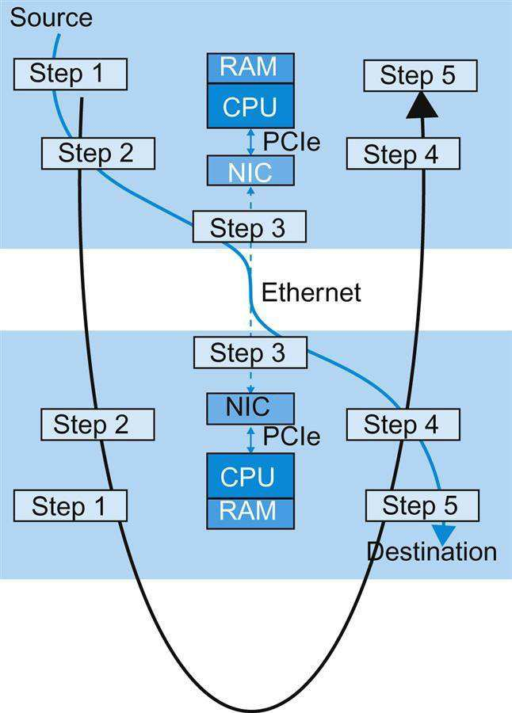

**HÌNH E6.9.3 Quan hệ năm bước driver khi truyền Ethernet packet từ một node và nhận packet ở node khác.**

Trước hết các bước truyền:

1. Trước tiên, driver chuẩn bị packet buffer trong host memory. Nó sao chép packet từ user address space vào buffer do nó phân bổ trong operating system address space.

2. Tiếp theo, driver “nói chuyện” với NIC. Nó ghi một I/O descriptor vào NIC register thích hợp, cung cấp địa chỉ buffer và độ dài của buffer.

3. DMA trong NIC sao chép Ethernet packet gửi đi từ host buffer qua PCIe.

4. Khi truyền hoàn tất, DMA ngắt processor để thông báo cho processor rằng packet đã được truyền thành công.

5. Cuối cùng, driver giải phóng (de-allocates) transmit buffer.

Tiếp theo là các bước nhận:

1. Trước hết, driver chuẩn bị packet buffer trong host memory bằng cách cấp phát một buffer mới để chứa packet nhận được.

2. Tiếp theo, driver “nói chuyện” với NIC. Driver ghi một I/O descriptor vào NIC register thích hợp, cung cấp địa chỉ và độ dài buffer.

3. Sau đó, DMA trong NIC sao chép Ethernet packet đang đến qua PCIe vào host buffer đã được cấp phát.

4. Khi quá trình truyền hoàn tất, DMA interrupt processor để thông báo cho host về packet mới nhận được và kích thước của nó.

5. Cuối cùng, driver sao chép packet nhận được vào user address space.

Như có thể thấy trong Hình e6.9.3, ba bước đầu là time-critical khi truyền packet (vì hai bước cuối xảy ra sau khi packet được gửi), còn ba bước cuối là time-critical khi nhận packet (vì hai bước đầu xảy ra trước khi packet đến). Tuy nhiên, các bước non-critical này vẫn phải hoàn tất trước khi từng node hết tài nguyên, chẳng hạn memory space. Không hoàn tất kịp những bước đó sẽ ảnh hưởng xấu đến hiệu năng mạng.

### Cải thiện hiệu năng mạng

Vì networking có vai trò quan trọng trong cluster, việc tìm cách cải thiện hiệu năng chắc chắn đáng thực hiện. Chúng tôi trình bày cả kỹ thuật software lẫn hardware.

Bắt đầu với tối ưu software, một mục tiêu hiệu năng là giảm số lần sao chép packet; bạn có thể đã nhận thấy thao tác này lặp lại trong năm bước của driver ở trên. Tối ưu zero-copy cho phép DMA engine lấy message trực tiếp từ data space của user program khi truyền và đặt message vào đúng nơi người dùng muốn khi nhận, thay vì phải đi qua các buffer trung gian trong operating system.

Tối ưu software thứ hai là gần như loại operating system khỏi quá trình bằng cách chuyển hoạt động truyền thông vào user address space. Không gọi operating system và không gây context switch giúp giảm đáng kể software overhead.

Trong kịch bản triệt để hơn này, bước thứ ba là bỏ interrupt. Một lý do là processor hiện đại thường vào mode công suất thấp khi chờ interrupt, rồi cần thời gian thoát khỏi mode đó để phục vụ interrupt; việc này còn làm gián đoạn pipeline, khiến latency tăng. Phương án thay interrupt là để processor định kỳ kiểm tra status bit xem thao tác I/O đã hoàn tất chưa, gọi là polling. Do đó, có thể yêu cầu user program liên tục poll NIC để biết khi nào DMA unit đã chuyển message đến; một hệ quả phụ là processor không vào low-power mode.

#### polling

Quá trình định kỳ kiểm tra trạng thái I/O device để xác định có cần phục vụ thiết bị không.

Về tối ưu hardware, một mục tiêu có thể cải thiện là tính giá trị các field của Ethernet packet. Địa chỉ Ethernet 48-bit, gọi là Media Access Control address hay MAC address, là số duy nhất được gán cho mỗi Ethernet NIC. Để cải thiện hiệu năng, “MAC chip”—thực chất chỉ là một phần FPGA trên NIC này—tính giá trị các preamble field và CRC field (xem Mục 5.5). Driver chỉ còn phải đặt MAC destination address, MAC source address, message type, data payload và padding nếu cần. (Ethernet yêu cầu packet tối thiểu, tính cả header và CRC field nhưng không tính preamble, phải có 64 byte.) Lưu ý rằng ngày nay ngay cả Ethernet NIC rẻ nhất cũng tính CRC bằng hardware.

Tối ưu hardware thứ hai, có trên những Intel processor gần đây như Ivy Bridge, cải thiện hiệu năng NIC xét theo memory hierarchy. Direct Data IO (DDIO) cho phép dùng tối đa 10% last-level cache làm scratchpad nhanh cho DMA engine. DMA sao chép dữ liệu trực tiếp vào last-level cache thay vì DRAM, và dữ liệu chỉ được ghi xuống DRAM khi bị eviction khỏi cache. Tối ưu này giúp cả latency lẫn bandwidth: một số vùng memory dùng cho control có thể được NIC ghi nhiều lần, và những lần ghi đó không còn phải tới DRAM. Vì vậy, DDIO mang lại lợi ích tương tự write back cache so với write through cache (Chương 5).

Hãy xét một object store theo kiến trúc client-server, sử dụng phần lớn tối ưu trên: zero copy messaging, user space communication, polling thay interrupt, và hardware tính preamble cùng CRC. Driver hoạt động trong user address space dưới dạng thư viện do ứng dụng gọi. Nó cấp cho ứng dụng quyền truy cập NIC trực tiếp và độc quyền. Toàn bộ I/O register space của NIC được ánh xạ vào ứng dụng, và toàn bộ driver state được giữ trong ứng dụng. OS kernel thậm chí không nhìn thấy NIC như một NIC, nhờ đó tránh overhead của context switching, kernel network software stack tiêu chuẩn và interrupt.

Hình e6.9.4 cho thấy thời gian gửi object từ node này sang node khác. Thời gian dao động từ khoảng 9.5 đến 12.5 microsecond, tùy kích thước object. Dưới đây là thời gian từng bước, tính bằng microsecond:

0.7 – để “driver” client (thư viện) tạo yêu cầu (Driver TX Hình e6.9.4).

6.4 đến 8.7 – để NIC hardware truyền yêu cầu client qua PCIe bus đến Ethernet tùy kích thước object (NIC TX).

0.02 – để gửi object qua Ethernet 10 G (Time of Flight). Time of flight bị tốc độ ánh sáng giới hạn ở 5 ns mỗi mét. Cáp three-meter trong phép đo này tương ứng time of flight 15 ns, quá nhỏ để thấy rõ trong hình.

1.8 đến 2.5 – để NIC hardware nhận object tùy kích thước (NIC RX).

0.6 – để “driver” server chuyển message chứa object yêu cầu đến app (Driver RX).

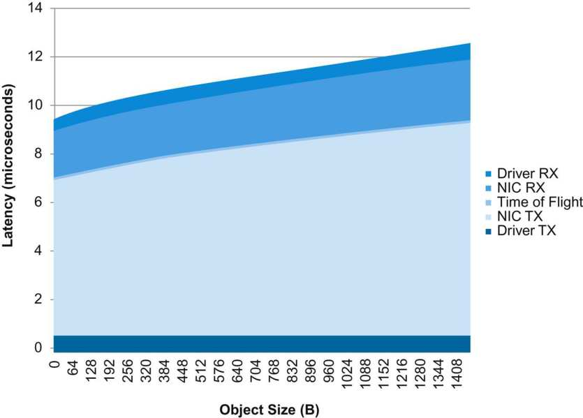

**HÌNH E6.9.4 Thời gian gửi object được chia thành thời gian transmit driver và NIC hardware so với thời gian receive driver và NIC hardware. Thời gian NIC truyền lớn hơn nhiều thời gian NIC nhận vì truyền cần nhiều PCIe round-trips hơn. NIC thực hiện PCIe read để đọc descriptor và dữ liệu, nhưng khi nhận, NIC thực hiện PCIe write cho dữ liệu, độ dài dữ liệu và interrupt. PCIe read chịu round trip latency vì NIC đợi phản hồi, còn PCIe write không cần phản hồi vì PCIe đáng tin cậy, nên các PCIe write có thể được gửi back-to-back.**

Sau khi đã thấy cách đo hiệu năng mạng ở mức chi tiết thấp, hãy nâng góc nhìn để xem cách benchmark mọi loại multiprocessor bằng những chương trình higher-level hơn nhiều.

#### Giải thích thêm

Có ba phiên bản PCIe. NIC này dùng PCIe 1.1, truyền 2 gigabit mỗi giây trên mỗi lane, nên NIC đạt tối đa 16 gigabit mỗi giây ở mỗi hướng. PCIe 2.0, có trên phần lớn motherboard PC hiện nay, tăng gấp đôi lane bandwidth lên 4 gigabit mỗi giây. PCIe 3.0 tăng gấp đôi lần nữa lên 8 gigabit mỗi giây và bắt đầu xuất hiện trên một số motherboard. Chúng tôi hoan nghênh nhịp cải thiện bandwidth hợp lý của ủy ban tiêu chuẩn, khoảng 2<sup>version number</sup> gigabit/giây. Những giới hạn của Virtex 5 FPGA khiến NIC không thể dùng các phiên bản PCIe nhanh hơn.

#### Giải thích thêm

Mặc dù Ethernet là nền tảng truyền thông cluster, cluster thường dùng protocol higher-level để giao tiếp đáng tin cậy. Transmission Control Protocol và Internet Protocol (TCP/IP), tuy được phát minh cho truyền thông planet-wide, vẫn thường được dùng bên trong máy tính warehouse-scale, một phần vì tính đáng tin cậy. IP không bảo đảm giao nhận trong protocol, nhưng TCP có. Bên gửi giữ packet đã gửi cho tới khi nhận được acknowledgment từ bên nhận xác nhận packet đã đến đúng. Bên nhận biết message không bị hỏng trên đường bằng cách double-checking nội dung với TCP CRC field. Để IP giao đúng đích, IP header có checksum bảo đảm số đích không thay đổi. Thành công của Internet phần lớn nhờ sự tinh tế và phổ biến của TCP/IP, cho phép các local-area network độc lập giao tiếp đáng tin cậy. Vì tầm quan trọng trong Internet và cluster, nhiều người đã tăng tốc TCP/IP bằng các kỹ thuật như liệt kê trong mục này [Regnier, 2004].

#### Giải thích thêm

Thêm DMA tạo ra một đường khác tới memory system, không đi qua cơ chế address translation hoặc cache hierarchy. Khác biệt này gây ra vấn đề cho cả virtual memory lẫn cache, thường được giải bằng sự kết hợp kỹ thuật hardware và hỗ trợ software. Khó khăn của DMA trong virtual memory phát sinh vì page có cả physical address và virtual address. DMA cũng gây vấn đề cho hệ có cache vì một dữ liệu có thể có hai bản: một trong cache, một trong memory. Vì DMA phát memory request trực tiếp tới memory thay vì qua processor cache, giá trị của một vị trí memory mà DMA unit và processor nhìn thấy có thể khác nhau. Xét một thao tác đọc từ NIC được DMA unit đặt thẳng vào memory. Nếu một số vị trí DMA ghi đang có trong cache, processor sẽ nhận giá trị cũ khi đọc. Tương tự, nếu cache là write-back, DMA có thể đọc trực tiếp từ memory trong khi giá trị mới hơn vẫn ở cache và chưa được ghi lại. Đây gọi là stale data problem hay coherence problem (xem Chương 5). Những giải pháp coherence tương tự cũng được dùng với DMA.

#### Giải thích thêm

Hỗ trợ Virtual Machine rõ ràng có thể ảnh hưởng xấu đến hiệu năng mạng. Vì vậy, người thiết kế microprocessor đã thêm hardware để giảm performance overhead của virtual machine đối với networking nói riêng và I/O nói chung. Intel cung cấp Virtualization Technology for Directed I/O (VT-d) để hỗ trợ ảo hóa I/O. Đây là I/O memory management unit cho phép guest virtual machine trực tiếp dùng I/O device, như Ethernet. Nó hỗ trợ DMA remapping, cho phép DMA đọc hoặc ghi dữ liệu trực tiếp trong I/O buffer của guest virtual machine, thay vì vào host I/O buffer rồi sao chép sang guest I/O buffer. Nó còn hỗ trợ interrupt remapping, cho phép virtual machine monitor chuyển interrupt request trực tiếp tới virtual machine thích hợp.

#### Tự kiểm tra

Hai lựa chọn networking là interrupt hoặc polling, DMA hoặc dùng processor qua load/store instruction.

1. Muốn latency thấp nhất cho packet nhỏ, kết hợp nào có lẽ tốt nhất?

2. Muốn latency thấp nhất cho packet lớn, kết hợp nào có lẽ tốt nhất?

## 6.10 Multiprocessor benchmark và mô hình hiệu năng

Như đã thấy trong Chương 1, benchmark hệ thống luôn là chủ đề nhạy cảm, vì đây là cách rất dễ được chú ý để xác định hệ thống nào tốt hơn. Kết quả không chỉ ảnh hưởng doanh số hệ thương mại mà cả danh tiếng người thiết kế. Vì vậy, mọi bên đều muốn thắng, nhưng cũng muốn chắc rằng nếu người khác thắng thì họ xứng đáng vì có hệ thống thực sự tốt hơn. Mong muốn này dẫn tới những quy tắc bảo đảm kết quả benchmark không chỉ là thủ thuật kỹ thuật dành riêng cho benchmark, mà là tiến bộ cải thiện hiệu năng ứng dụng thực.

Để tránh thủ thuật, quy tắc điển hình là không được thay đổi benchmark. Source code và data set được cố định, và chỉ có một đáp án đúng. Mọi sai lệch khỏi quy tắc đều làm kết quả mất hiệu lực.

Nhiều multiprocessor benchmark tuân theo những truyền thống này. Một ngoại lệ phổ biến là cho phép tăng kích thước bài toán để có thể chạy benchmark trên các hệ thống có số lượng processor rất khác nhau. Nghĩa là nhiều benchmark cho phép weak scaling thay vì yêu cầu strong scaling, mặc dù cần thận trọng khi so sánh kết quả của các chương trình chạy những kích thước bài toán khác nhau.

Hình 6.16 tóm lược vài parallel benchmark, cũng mô tả dưới:

- Linpack là tập routine đại số tuyến tính; các routine Gaussian elimination tạo nên Linpack benchmark. Routine DGEMM trong ví dụ trang 209 chỉ chiếm phần nhỏ source code, nhưng chiếm phần lớn execution time của benchmark. Linpack cho weak scaling, để người dùng chọn mọi kích thước bài toán. Hơn nữa, người dùng được viết lại Linpack gần như dưới mọi dạng và bằng mọi ngôn ngữ, miễn tính đúng kết quả và thực hiện cùng số phép floating point với một kích thước bài toán cho trước. Hai lần mỗi năm, 500 máy có Linpack nhanh nhất được công bố tại www.top500.org. Báo chí coi máy đầu danh sách là máy tính nhanh nhất thế giới.

- SPECrate là throughput metric dựa trên SPEC CPU benchmark, như SPEC CPU 2006 (Chương 1). Thay vì báo hiệu năng từng chương trình, SPECrate chạy nhiều bản chương trình đồng thời. Do đó, nó đo task-level parallelism vì các task không giao tiếp. Có thể chạy bao nhiêu bản tùy ý, nên đây cũng là weak scaling.

- SPLASH và SPLASH 2 (Stanford Parallel Applications for Shared Memory) là nỗ lực của các nhà nghiên cứu Stanford University trong thập niên 1990 nhằm tạo parallel benchmark suite có mục tiêu tương tự SPEC CPU. Nó có cả kernel và ứng dụng, gồm nhiều ứng dụng từ cộng đồng high-performance computing. Benchmark yêu cầu strong scaling, dù cung cấp hai data set.

- NAS (NASA Advanced Supercomputing) parallel benchmark là nỗ lực khác từ thập niên 1990 để benchmark multiprocessor. Chúng xuất phát từ computational fluid dynamics và gồm năm kernel. Chúng cho weak scaling bằng cách định nghĩa một vài data set. Giống Linpack, có thể viết lại benchmark, nhưng quy tắc chỉ cho dùng C hoặc Fortran.

- PARSEC (Princeton Application Repository for Shared Memory Computers) gần đây gồm các chương trình multithreaded dùng Pthreads (POSIX threads) và OpenMP (Open MultiProcessing; xem Mục 6.5). Chúng tập trung các miền tính toán mới nổi, gồm chín ứng dụng và ba kernel. Tám chương trình dựa trên data parallelism, ba trên pipelined parallelism, một trên unstructured parallelism.

- Về cloud, Yahoo! Cloud Serving Benchmark (YCSB) nhằm so sánh hiệu năng cloud data service. Nó cung cấp framework giúp client dễ benchmark dịch vụ mới, dùng Cassandra và HBase làm ví dụ tiêu biểu [Cooper, 2010].

### Pthreads

API UNIX để tạo, thao tác thread. Tổ chức dưới dạng thư viện.

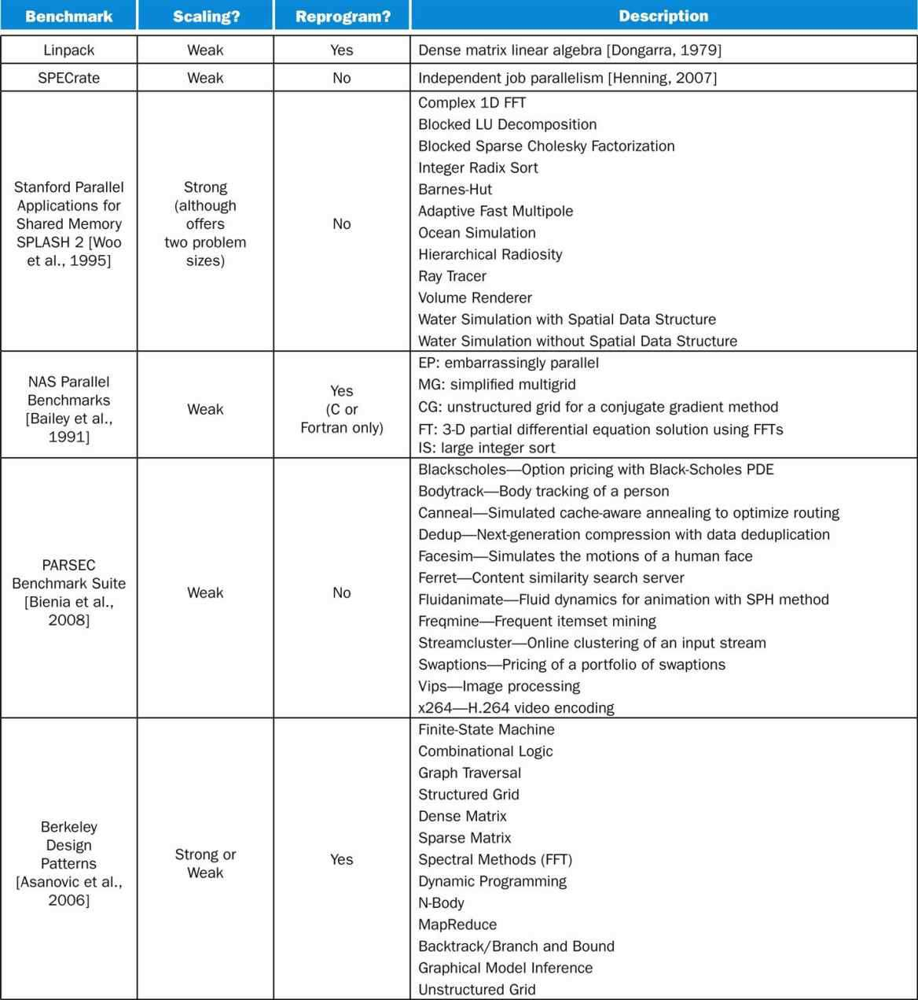

**HÌNH 6.16 Ví dụ parallel benchmark.**

Mặt trái của các hạn chế benchmark truyền thống là đổi mới chủ yếu bị giới hạn ở architecture và compiler. Thường không thể dùng data structure, thuật toán, ngôn ngữ lập trình tốt hơn, v.v. vì sẽ tạo kết quả gây hiểu lầm. Chẳng hạn, hệ thống có thể thắng nhờ thuật toán thay vì hardware hoặc compiler.

Những hướng dẫn này dễ hiểu khi nền tảng điện toán tương đối ổn định—như thập niên 1990 và nửa đầu thập niên này—nhưng không thích hợp trong một cuộc cách mạng lập trình. Để cuộc cách mạng thành công, cần khuyến khích đổi mới ở mọi cấp.

Các nhà nghiên cứu University of California tại Berkeley đề xuất một cách tiếp cận. Họ xác định 13 design pattern mà họ cho sẽ là một phần ứng dụng tương lai. Framework hoặc kernel triển khai những pattern này; ví dụ gồm sparse matrix, structured grid, finite-state machine, map reduce và graph traversal. Bằng cách giữ định nghĩa ở mức cao, họ hy vọng khuyến khích đổi mới mọi cấp hệ thống. Vì vậy, hệ có sparse matrix solver nhanh nhất được hoan nghênh dùng mọi data structure, thuật toán, ngôn ngữ, ngoài architecture và compiler mới.

### Mô hình hiệu năng

Một chủ đề liên quan benchmark là mô hình hiệu năng. Như đã thấy qua sự đa dạng architecture ngày càng tăng trong chương—multithreading, SIMD, GPU—một mô hình đơn giản giúp hiểu hiệu năng của những architecture khác nhau sẽ đặc biệt hữu ích. Mô hình không cần hoàn hảo, chỉ cần đem lại hiểu biết.

Mô hình 3C cho hiệu năng cache trong Chương 5 là một ví dụ. Nó không hoàn hảo vì bỏ qua các yếu tố có thể quan trọng như block size, block allocation policy và block replacement policy. Nó còn có điểm khác thường: chẳng hạn, một miss có thể được quy cho capacity trong thiết kế này nhưng là conflict miss trong cache khác cùng kích thước. Dù vậy, 3C vẫn phổ biến suốt 25 năm vì giúp hiểu hành vi chương trình, từ đó giúp cả kiến trúc sư lẫn lập trình viên cải thiện sản phẩm của mình.

Để tìm mô hình như vậy cho máy tính song song, hãy bắt đầu từ kernel nhỏ, như các kernel thuộc 13 Berkeley design pattern trong Hình 6.16. Dù chúng có những phiên bản dùng datatype khác nhau, floating point vẫn phổ biến trong nhiều cách triển khai. Vì vậy, hiệu năng floating-point đỉnh giới hạn tốc độ các kernel trên một máy tính. Với chip multicore, hiệu năng floating-point đỉnh là tổng hiệu năng đỉnh của mọi core trên chip. Nếu hệ có nhiều microprocessor, lấy đỉnh mỗi chip nhân tổng số chip.

Có thể ước lượng nhu cầu đặt lên memory system bằng cách chia hiệu năng floating-point đỉnh này cho số phép floating-point trung bình trên mỗi byte được truy cập:

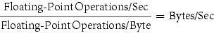

Tỷ số số phép floating-point trên mỗi byte memory được truy cập gọi là arithmetic intensity. Nó được tính bằng tổng số phép floating-point của chương trình chia tổng số byte dữ liệu truyền tới main memory trong khi chương trình chạy. Hình 6.17 cho arithmetic intensity của một số Berkeley design pattern trong Hình 6.16.

#### arithmetic intensity

Tỷ số phép floating-point trong chương trình trên số byte dữ liệu chương trình truy cập từ main memory.

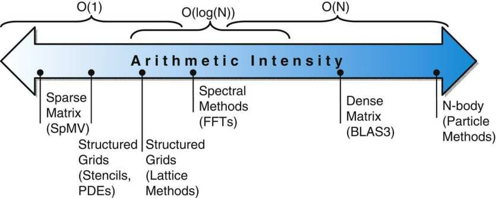

**HÌNH 6.17 Arithmetic intensity được xác định bằng số phép floating-point cần để chạy chương trình chia số byte được truy cập trong main memory [Williams, Waterman, and Patterson, 2009]. Một số kernel có arithmetic intensity tăng theo kích thước bài toán, như Dense Matrix, nhưng nhiều kernel có arithmetic intensity độc lập kích thước bài toán. Với nhóm đầu, weak scaling có thể cho kết quả khác vì đặt nhu cầu thấp hơn nhiều lên memory system.**

### Mô hình Roofline

Mô hình đơn giản này liên kết hiệu năng floating-point, arithmetic intensity và hiệu năng memory trong đồ thị two-dimensional [Williams, Waterman, and Patterson, 2009]. Có thể tìm hiệu năng floating-point đỉnh từ các thông số hardware đã nêu. Working set của những kernel đang xét không vừa on-chip cache, nên hiệu năng memory đỉnh có thể được xác định bởi memory system phía sau cache. Một cách tìm giá trị đó là dùng Stream benchmark. (Xem phần Giải thích thêm trang 373, Chương 5.)

Hình 6.18 cho mô hình được xây một lần cho mỗi máy tính, không phải mỗi kernel. Trục dọc Y-axis là hiệu năng floating-point đạt được, từ 0.5 đến 64.0 GFLOPs/giây. Trục ngang X-axis là arithmetic intensity, từ 1/8 FLOPs/DRAM byte được truy cập tới 16 FLOPs/DRAM byte được truy cập. Lưu ý đồ thị dùng thang log-log.

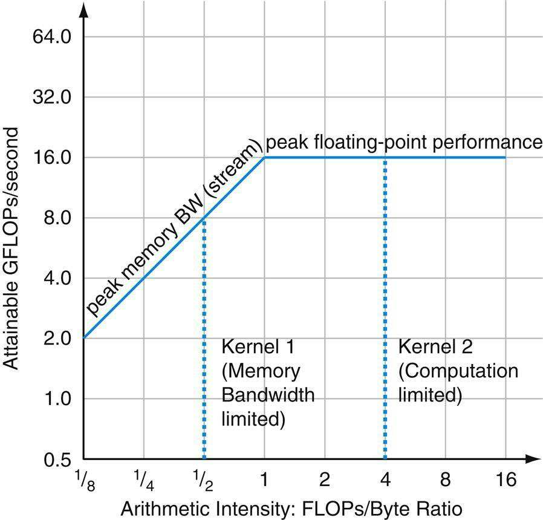

**HÌNH 6.18 Roofline Model [Williams, Waterman, and Patterson, 2009]. Ví dụ có hiệu năng floating-point đỉnh 16 GFLOPS/sec và memory bandwidth đỉnh 16 GB/sec từ Stream benchmark. (Vì Stream thực ra gồm bốn phép đo, đường này là trung bình của bốn phép.) Đường chấm dọc có màu bên trái biểu diễn Kernel 1, arithmetic intensity 0.5 FLOPs/byte. Memory bandwidth giới hạn nó không quá 8 GFLOPS/sec trên Opteron X2 này. Đường chấm dọc bên phải biểu diễn Kernel 2, arithmetic intensity 4 FLOPs/byte, chỉ bị tính toán giới hạn ở 16 GFLOPS/s. (Dữ liệu dựa trên AMD Opteron X2 (Revision F), dùng hai core chạy 2 GHz trong hệ hai socket.)**

Với một kernel, có thể xác định điểm trên X-axis từ arithmetic intensity của nó. Nếu vẽ đường dọc qua điểm đó, hiệu năng kernel trên máy phải nằm đâu đó trên đường. Có thể vẽ đường ngang biểu diễn hiệu năng floating-point đỉnh của máy. Hiển nhiên, hiệu năng floating-point thực không thể cao hơn đường ngang vì đó là giới hạn hardware.

Làm sao vẽ hiệu năng memory đỉnh, được đo bằng byte/giây? Vì X-axis có đơn vị FLOPs/byte và Y-axis là FLOPs/giây, byte/giây chỉ là đường chéo góc 45-degree trong hình. Vì vậy, có thể vẽ đường thứ ba cho hiệu năng floating-point tối đa memory system hỗ trợ với arithmetic intensity cho trước. Có thể biểu diễn giới hạn bằng công thức sau để vẽ đường trong Hình 6.18:

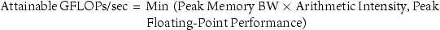

Đường ngang và đường chéo đặt tên cho mô hình đơn giản này và cho thấy giá trị của nó. “Roofline” đặt cận trên cho hiệu năng kernel tùy arithmetic intensity. Khi đã có roofline của máy, có thể áp dụng nhiều lần vì nó không thay đổi theo kernel.

Nếu xem arithmetic intensity như cột chạm mái, cột hoặc chạm phần nghiêng, nghĩa là hiệu năng cuối cùng bị memory bandwidth giới hạn, hoặc chạm phần phẳng, nghĩa là hiệu năng bị tính toán giới hạn. Trong Hình 6.18, kernel 1 minh họa trường hợp đầu và kernel 2 minh họa trường hợp sau.

Lưu ý “ridge point”, nơi mái chéo và mái ngang gặp nhau, đem lại hiểu biết thú vị về máy. Nếu điểm này ở xa bên phải, chỉ kernel có arithmetic intensity rất cao mới đạt hiệu năng tối đa của máy. Nếu ở xa bên trái, gần như kernel nào cũng có khả năng đạt tối đa.

### So sánh hai thế hệ Opteron

AMD Opteron X4 (Barcelona) có bốn core, kế nhiệm Opteron X2 hai core. Để đơn giản thiết kế bo mạch, chúng dùng cùng socket, nên có cùng DRAM channel và cùng memory bandwidth đỉnh. Ngoài tăng đôi số core, X4 còn tăng đôi hiệu năng floating-point đỉnh mỗi core: core X4 issue hai instruction floating-point SSE2 mỗi clock cycle, còn X2 tối đa một. Vì hai hệ có clock rate tương tự—2.2 GHz cho Opteron X2 so với

2.3 GHz cho Opteron X4—X4 có hiệu năng floating-point đỉnh khoảng gấp bốn X2 với cùng DRAM bandwidth. X4 còn có L3 cache 2MiB mà X2 không có.

Hình 6.19 so sánh roofline hai hệ. Như dự kiến, ridge point dịch phải, từ 1 trên X2 tới 5 trên X4. Vì vậy, để thấy tăng hiệu năng ở thế hệ kế tiếp, kernel phải có arithmetic intensity cao hơn 1 hoặc working set phải vừa cache của Opteron X4.

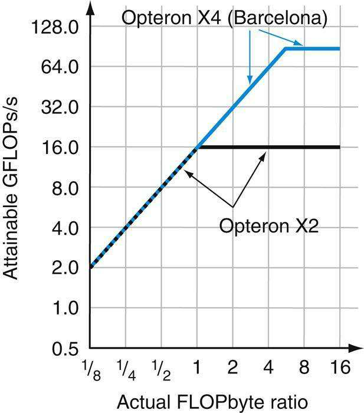

**HÌNH 6.19 Roofline hai thế hệ Opteron. Roofline Opteron X2, giống Hình 6.18, màu đen; roofline Opteron X4 có màu. Ridge point lớn hơn của X4 nghĩa là kernel bị tính toán giới hạn trên X2 có thể trở thành memory-performance bound trên X4.**

Roofline cho cận trên hiệu năng. Giả sử chương trình thấp hơn cận đó rất nhiều. Bạn nên thực hiện tối ưu nào và theo thứ tự nào?

Để giảm bottleneck tính toán, hai tối ưu sau có thể giúp gần như mọi kernel:

1. Floating-point operation mix. Hiệu năng floating-point đỉnh của máy thường đòi hỏi số phép cộng và nhân gần đồng thời bằng nhau. Sự cân bằng cần thiết vì máy hỗ trợ fused multiply-add instruction (xem Giải thích thêm trang 214, Chương 3), hoặc vì floating-point unit có số floating-point adder bằng số floating-point multiplier. Hiệu năng tốt nhất còn đòi hỏi một phần đáng kể instruction mix là phép floating-point thay vì integer instruction.

2. Cải thiện instruction-level parallelism và áp dụng SIMD. Với archi-tectures hiện đại, hiệu năng cao nhất đạt được khi fetch, execute và commit ba đến bốn instruction mỗi clock cycle (xem Mục 4.10). Mục tiêu bước này là cải thiện code compiler tạo để tăng ILP. Một cách là unroll loop như Mục 4.12. Với x86, một instruction AVX thao tác được trên bốn operand double precision, nên dùng khi có thể (xem Mục 3.7, 3.8).


Để giảm bottleneck memory, hai tối ưu sau có thể giúp:

1. Software prefetching. Hiệu năng cao nhất thường cần duy trì nhiều thao tác memory đang thực hiện. Việc này dễ hơn nếu dự đoán truy cập qua instruction software prefetch, thay vì đợi tới khi phép tính cần dữ liệu.


2. Memory affinity. Microprocessor ngày nay tích hợp memory controller trên cùng chip, cải thiện memory hierarchy. Nếu hệ có nhiều chip, một số address tới DRAM local của chip này, còn những address khác phải đi qua interconnect để truy cập DRAM local của chip khác. Sự phân chia tạo truy cập memory non-uniform như Mục 6.5. Truy cập qua chip khác làm giảm hiệu năng. Tối ưu này cố cấp dữ liệu và thread xử lý dữ liệu vào cùng cặp memory-processor, để processor hiếm khi phải truy cập memory chip khác.


Roofline có thể giúp quyết định thực hiện tối ưu nào trong hai loại này và theo thứ tự nào. Có thể xem mỗi tối ưu như một “ceiling” dưới roofline thích hợp: không thể vượt ceiling nếu chưa thực hiện tối ưu tương ứng.

Có thể tìm computational roofline từ manual, memory roofline từ chạy Stream. Computational ceiling như cân bằng floating-point cũng có thể lấy từ manual máy. Memory ceiling như memory affinity đòi hỏi chạy thử trên từng máy để xác định khoảng cách. Tin tốt là chỉ cần làm một lần cho mỗi máy: khi có người xác định ceiling, mọi người dùng kết quả để ưu tiên tối ưu trên máy đó.

Hình 6.20 thêm ceiling vào roofline Hình 6.18, với computational ceiling ở đồ thị trên, memory bandwidth ceiling ở dưới. Tuy ceiling cao hơn không ghi cả hai tối ưu, hình ngầm bao gồm chúng: để vượt ceiling cao nhất, trước đó phải vượt mọi ceiling thấp hơn.

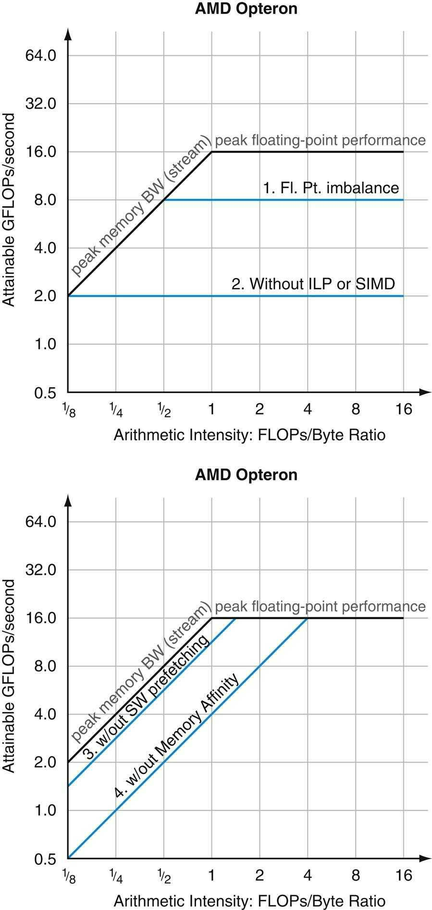

**HÌNH 6.20 Roofline có ceiling. Đồ thị trên cho computational ceiling 8 GFLOPs/sec nếu floating-point operation mix mất cân bằng, và 2 GFLOPs/sec nếu còn thiếu tối ưu tăng ILP, SIMD. Đồ thị dưới cho memory bandwidth ceiling 11 GB/sec nếu thiếu software prefetching, và 4.8 GB/sec nếu còn thiếu tối ưu memory affinity.**

Khoảng cách từ ceiling tới giới hạn cao kế tiếp là phần thưởng cho tối ưu đó. Vì vậy, Hình 6.20 gợi ý tối ưu 2, cải thiện ILP, có lợi lớn cho tính toán trên máy này; tối ưu 4, cải thiện memory affinity, có lợi lớn cho memory bandwidth.

Hình 6.21 gộp các ceiling Hình 6.20 vào một đồ thị. Arithmetic intensity của kernel quyết định vùng tối ưu, từ đó gợi ý tối ưu nên thử. Computational và memory bandwidth optimization chồng lấp trên phần lớn phạm vi arithmetic intensity. Ba vùng tô khác nhau chỉ chiến lược khác nhau. Kernel 2 nằm trong hình thang xanh bên phải, gợi ý chỉ làm tối ưu tính toán. Kernel 1 nằm trong hình bình hành blue-gray ở giữa, gợi ý thử cả hai loại, bắt đầu bằng tối ưu 2 và 4. Đường dọc Kernel 1 nằm dưới tối ưu mất cân bằng floating-point nên tối ưu 1 có thể không cần. Nếu kernel nằm trong tam giác xám dưới trái, nên chỉ thử tối ưu memory.

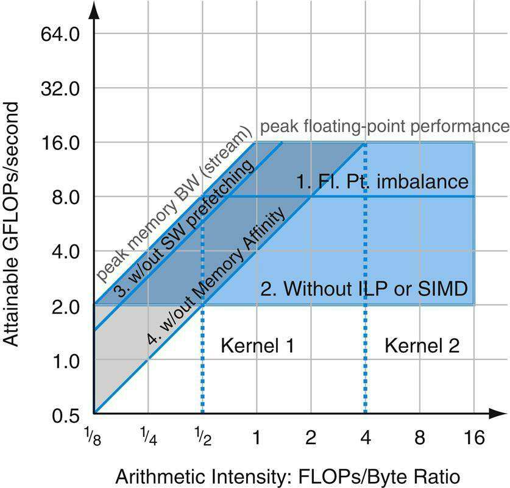

**HÌNH 6.21 Roofline có ceiling, vùng chồng lấp được tô, cùng hai kernel Hình 6.18. Kernel có arithmetic intensity trong hình thang xanh bên phải nên tập trung tối ưu tính toán; trong tam giác xám dưới trái nên tập trung memory bandwidth. Trong hình bình hành blue-gray giữa cần cả hai. Kernel 1 thuộc vùng giữa, nên thử ILP, SIMD, memory affinity, software prefetching. Kernel 2 ở hình thang phải, nên thử ILP, SIMD, cân bằng phép floating-point.**

Đến đây giả sử arithmetic intensity cố định, nhưng thực tế không vậy. Thứ nhất, với một số kernel như Dense Matrix và N-body, nó tăng theo kích thước bài toán (Hình 6.17). Đây có thể là lý do weak scaling thành công hơn strong scaling. Thứ hai, hiệu quả memory hierarchy ảnh hưởng số truy cập tới memory, nên tối ưu cache cũng cải thiện arithmetic intensity. Ví dụ cải thiện temporal locality bằng unroll loop rồi nhóm câu lệnh có address tương tự. Nhiều máy có instruction cache đặc biệt cấp dữ liệu trong cache mà không đọc trước từ memory tại address đó, vì dữ liệu sắp bị over-written. Cả hai tối ưu giảm traffic, dịch cột arithmetic intensity sang phải, ví dụ 1.5 lần. Sự dịch chuyển có thể đưa kernel sang vùng tối ưu khác.


Các ví dụ trên chỉ cách giúp lập trình viên tăng hiệu năng, nhưng kiến trúc sư cũng có thể dùng mô hình để quyết định nên tối ưu hardware ở đâu cho những kernel họ coi là quan trọng.

Mục tiếp dùng roofline để minh họa khác biệt hiệu năng multicore microprocessor và GPU, đồng thời xem khác biệt đó có phản ánh hiệu năng chương trình thực không.

#### Giải thích thêm

Các ceiling được sắp để ceiling thấp hơn dễ tối ưu hơn. Lập trình viên có thể tối ưu mọi thứ tự, nhưng theo chuỗi này giảm khả năng phí công vào tối ưu không có lợi do ràng buộc khác. Giống 3C, miễn roofline đem lại hiểu biết, mô hình vẫn có thể chứa giả định lạc quan. Ví dụ, roofline giả sử tải cân bằng giữa mọi processor.

#### Giải thích thêm

Lựa chọn thay Stream là dùng raw DRAM bandwidth làm roofline. Dù raw bandwidth chắc chắn là cận trên cứng, hiệu năng memory thực thường xa cận tới mức nó không hữu ích: không chương trình nào tới gần. Nhược điểm Stream là lập trình cực cẩn thận có thể vượt kết quả Stream, nên memory roofline không cứng như computational roofline. Vẫn dùng Stream vì ít lập trình viên đạt băng thông hơn Stream tìm được.

#### Giải thích thêm

Dù roofline minh họa dành multicore, rõ ràng nó cũng dùng được cho uniprocessor.

#### Tự kiểm tra

Đúng hay sai: Nhược điểm chính của benchmark máy tính song song truyền thống là các quy tắc bảo đảm công bằng cũng làm chậm đổi mới software.

## 6.11 Thực tế: Benchmark và roofline Intel Core i7 960, NVIDIA Tesla GPU

Một nhóm nghiên cứu Intel công bố bài báo [Lee et al., 2010] so sánh Intel Core i7 960 quad-core có phần mở rộng multimedia SIMD với GPU thế hệ trước, NVIDIA Tesla GTX 280. Hình 6.22 liệt kê đặc tính hai hệ, đều được mua mùa thu 2009. Core i7 dùng công nghệ bán dẫn 45-nanometer của Intel, còn GPU dùng 65-nanometer của TSMC. Dù so sánh do bên trung lập hoặc cả hai bên quan tâm thực hiện có thể công bằng hơn, mục đích ở đây không phải xác định sản phẩm nào nhanh hơn bao nhiêu, mà tìm hiểu giá trị tương đối các tính năng trong hai phong cách kiến trúc tương phản.

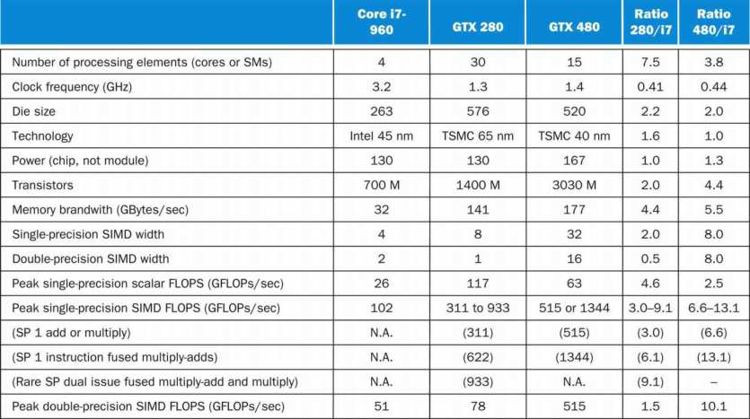

**HÌNH 6.22 Thông số Intel Core i7-960, NVIDIA GTX 280 và GTX 480. Các cột ngoài cùng bên phải biểu diễn tỷ số giữa Tesla GTX 280 và Fermi GTX 480 với Core i7. Mặc dù case study so sánh Tesla 280 với i7, chúng tôi đưa thêm Fermi 480 để cho thấy quan hệ của nó với Tesla 280 vì nó được mô tả trong chương này. Lưu ý rằng các memory bandwidth này cao hơn trong Hình 6.23 vì đây là bandwidth tại các pin DRAM, còn bandwidth trong Hình 6.23 là tại các processor, được đo bằng một chương trình benchmark. (Từ Bảng 2 trong Lee và cộng sự [2010].)**

Roofline Core i7 960 và GTX 280 trong Hình 6.23 minh họa khác biệt hai máy. GTX 280 không chỉ có memory bandwidth và hiệu năng double-precision floating-point cao hơn nhiều, mà ridge point double-precision còn xa hơn đáng kể về bên trái: 0.6 so với 3.1 của Core i7. Như đã nói, ridge point double-precision càng trái càng dễ đạt hiệu năng tính toán đỉnh. Với single-precision, ridge point cả hai dịch xa sang phải, khiến đạt mái hiệu năng single-precision khó hơn đáng kể. Arithmetic intensity kernel dựa trên byte tới main memory, không phải cache memory. Vì vậy caching có thể thay đổi arithmetic intensity trên máy cụ thể nếu phần lớn tham chiếu thực sự tới cache. Cũng lưu ý bandwidth này ứng với truy cập unit-stride ở cả hai kiến trúc; address gather-scatter thực có thể chậm hơn trên cả GTX 280 lẫn Core i7, như sẽ thấy.

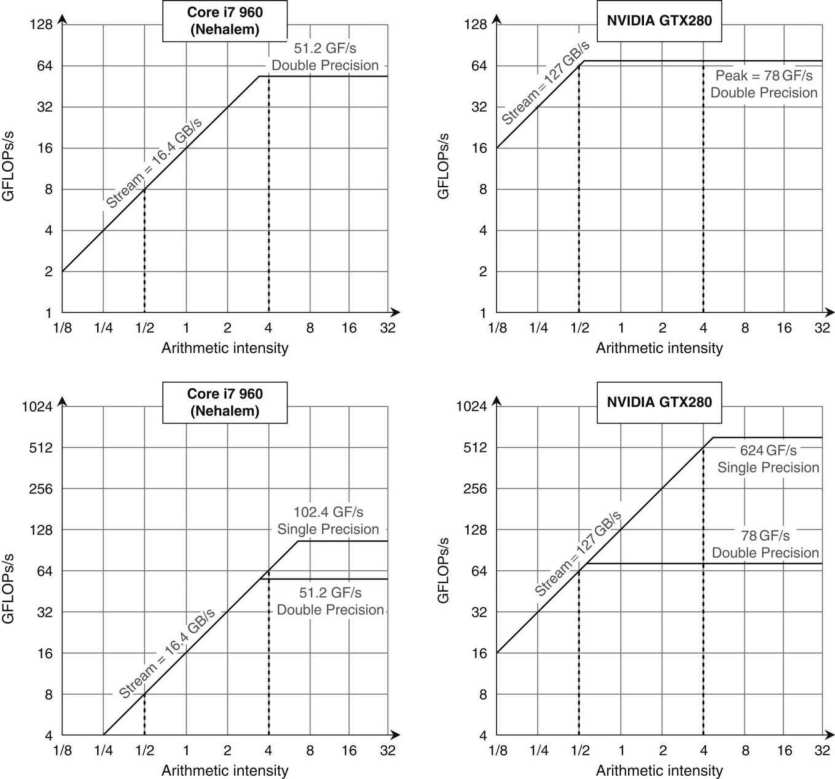

**HÌNH 6.23 Roofline [Williams, Waterman, and Patterson, 2009]. Hàng trên là hiệu năng double-precision floating-point, hàng dưới single-precision. (Ceiling DP FP cũng ở hàng dưới để so sánh.) Core i7 960 bên trái có đỉnh DP FP 51.2 GFLOPs/sec, SP FP 102.4 GFLOPs/sec, memory bandwidth 16.4 GBytes/sec. NVIDIA GTX 280 có đỉnh DP FP 78 GFLOPs/sec, SP FP 624 GFLOPs/sec, memory bandwidth 127 GBytes/sec. Đường dọc nét đứt trái biểu diễn arithmetic intensity 0.5 FLOP/byte, bị bandwidth giới hạn không quá 8 DP GFLOPs/sec hoặc 8 SP GFLOPs/sec trên Core i7. Đường dọc nét đứt phải có arithmetic intensity 4 FLOP/byte, chỉ bị tính toán giới hạn ở 51.2 DP GFLOPs/sec, 102.4 SP GFLOPs/sec trên Core i7 và 78 DP GFLOPs/sec, 624 SP GFLOPs/sec trên GTX 280. Để đạt tốc độ tính cao nhất Core i7 cần cả bốn core, instruction SSE với số phép nhân và cộng bằng nhau. GTX 280 cần instruction fused multiply-add trên mọi SIMD processor multithreaded.**

Các nhà nghiên cứu chọn benchmark bằng phân tích đặc tính tính toán và memory của bốn benchmark suite được đề xuất gần đây, rồi “xây dựng tập throughput computing kernel thể hiện các đặc tính này”. Hình 6.24 cho kết quả; số lớn hơn nghĩa là nhanh hơn. Roofline giúp giải thích hiệu năng tương đối trong nghiên cứu này.

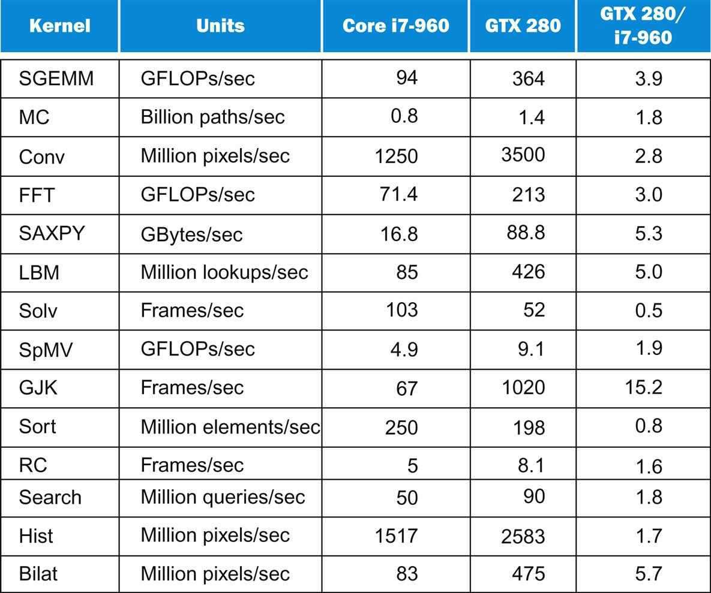

**HÌNH 6.24 Hiệu năng tuyệt đối và tương đối đo trên hai nền tảng. Trong nghiên cứu, SAXPY chỉ đo memory bandwidth, nên đơn vị đúng là GBytes/sec thay vì GFLOP/sec. (Dựa Bảng 3 trong [Lee et al., 2010].)**

Vì thông số hiệu năng GTX 280 trải từ chậm hơn 2.5× (clock rate) tới nhanh hơn 7.5× (core/chip), trong khi hiệu năng thực từ chậm hơn 2.0× (Solv) tới nhanh hơn 15.2× (GJK), các nhà nghiên cứu Intel quyết định tìm lý do:

- Memory bandwidth. GPU có bandwidth gấp 4.4×, giúp giải thích LBM, SAXPY nhanh hơn 5.0 và 5.3×; working set hàng trăm MB không vừa Core i7 cache. (Để truy cập memory mạnh, họ cố ý không dùng cache blocking như Chương 5.) Vì vậy độ dốc roofline giải thích hiệu năng. SpMV cũng working set lớn nhưng chỉ nhanh hơn 1.9× vì double-precision floating point GTX 280 chỉ nhanh bằng 1.5× Core i7.

- Compute bandwidth. Năm kernel còn lại bị tính toán giới hạn: SGEMM, Conv, FFT, MC, Bilat. GTX nhanh hơn lần lượt 3.9, 2.8, 3.0, 1.8, 5.7×. Ba kernel đầu dùng single-precision floating-point, GTX 280 nhanh hơn 3 tới 6× ở single precision. MC dùng double precision nên chỉ nhanh hơn 1.8× vì DP chỉ nhanh hơn 1.5×. Bilat dùng hàm siêu việt được GTX 280 hỗ trợ trực tiếp. Core i7 dành two-thirds thời gian tính hàm siêu việt cho Bilat nên GTX nhanh hơn 5.7×. Điều này cho thấy giá trị hardware hỗ trợ phép xuất hiện trong workload: double-precision floating point, có thể cả hàm siêu việt.

- Lợi ích cache. Ray casting (RC) chỉ nhanh hơn 1.6× trên GTX vì cache blocking với Core i7 cache tránh bị memory bandwidth giới hạn như GPU (Mục 5.4, 5.14). Cache blocking cũng giúp Search: index tree nhỏ vừa cache thì Core i7 nhanh gấp đôi; tree lớn làm giới hạn bởi memory bandwidth. Tổng thể GTX 280 chạy Search nhanh hơn 1.8×. Cache blocking còn giúp Sort. Dù phần lớn lập trình viên không chạy Sort trên SIMD processor, có thể viết bằng primitive Sort 1-bit tên split. Nhưng split chạy nhiều instruction hơn scalar sort, nên Core i7 nhanh bằng 1.25× GTX 280. Cache còn giúp kernel khác, vì blocking cho SGEMM, FFT, SpMV trở thành compute bound, re-emphasizes tầm quan trọng tối ưu cache blocking Chương 5.

- Gather-Scatter. Phần mở rộng multimedia SIMD ít giúp nếu dữ liệu rải khắp main memory; hiệu năng tối ưu chỉ khi truy cập align ranh giới 16-byte. Vì vậy GJK ít lợi SIMD trên Core i7. GPU có gather-scatter addressing như vector architecture nhưng phần lớn SIMD extension bỏ qua. Memory controller còn gom truy cập cùng DRAM page (Mục 5.2). Kết hợp khiến GTX 280 chạy GJK nhanh tới 15.2× Core i7, lớn hơn mọi tham số vật lý đơn lẻ Hình 6.22. Điều này củng cố tầm quan trọng gather-scatter trong vector/GPU, vốn thiếu ở SIMD extension.

- Đồng bộ. Hiệu năng đồng bộ bị atomic update giới hạn, chiếm 28% tổng runtime Core i7 dù có instruction hardware fetch-and-increment. Vì vậy Hist chỉ nhanh hơn 1.7× trên GTX 280. Solv giải batch constraint độc lập bằng ít tính toán rồi barrier. Core i7 có lợi từ atomic instruction và memory consistency model bảo đảm đúng dù chưa xong mọi truy cập memory hierarchy trước. Không có mô hình đó, bản GTX 280 launch một số batch từ system processor nên chỉ nhanh bằng 0.5× Core i7. Điều này chỉ ra hiệu năng đồng bộ quan trọng với một số bài toán data parallel.

Đáng chú ý là nhiều điểm yếu Tesla GTX 280 lộ ra từ kernel Intel chọn đã được xử lý trong kiến trúc kế nhiệm: Fermi có double-precision floating-point nhanh hơn, atomic nhanh hơn và cache. Cũng thú vị khi gather-scatter của vector architecture, có trước SIMD instruction hàng thập niên, lại quan trọng với hiệu quả SIMD extension như một số người đã dự đoán. Nhóm Intel lưu ý sáu trong 14 kernel sẽ tận dụng SIMD tốt hơn nếu Core i7 hỗ trợ gather-scatter hiệu quả hơn. Nghiên cứu cũng xác lập tầm quan trọng cache blocking.

Sau khi thấy nhiều kết quả benchmark các multiprocessor, hãy trở lại DGEMM để xem chi tiết cần đổi code C bao nhiêu nhằm tận dụng nhiều processor.

## 6.12 Chạy nhanh hơn: Nhiều processor và nhân ma trận

Đây là bước cuối và lớn nhất trong hành trình tăng dần hiệu năng bằng thích ứng DGEMM với Intel Core i7 (Sandy Bridge). Mỗi Core i7 có tám core và máy đang dùng có hai Core i7, nên có 16 core chạy DGEMM.

Hình 6.25 cho DGEMM OpenMP tận dụng các core. Lưu ý dòng 30 là dòng duy nhất thêm vào Hình 5.48 để chạy nhiều processor: pragma OpenMP yêu cầu compiler dùng nhiều thread trong loop ngoài cùng. Nó yêu cầu máy chia việc loop ngoài cho mọi thread.

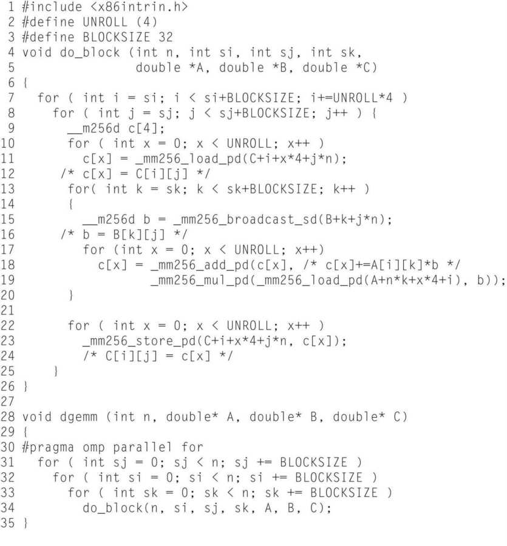

**HÌNH 6.25 DGEMM OpenMP từ Hình 5.48. Dòng 30 là code OpenMP duy nhất, khiến for loop ngoài chạy song song. Đây cũng là khác biệt duy nhất với Hình 5.48.**

Hình 6.26 biểu diễn đồ thị multiprocessor speed-up kinh điển, cho thấy mức cải thiện hiệu năng so với một thread khi số lượng thread tăng. Đồ thị này giúp dễ nhận thấy các thách thức của strong scaling so với weak scaling. Khi toàn bộ data nằm vừa trong first-level data cache, như đối với ma trận 32 ×32, việc thêm thread thực sự làm giảm hiệu năng. Trong trường hợp này, phiên bản DGEMM 16-threaded chỉ đạt gần một nửa tốc độ của phiên bản single-threaded. Ngược lại, hai ma trận lớn nhất đạt speedup 14 × với 16 thread, tạo nên hai đường “lên trên và sang phải” kinh điển trong Hình 6.26.

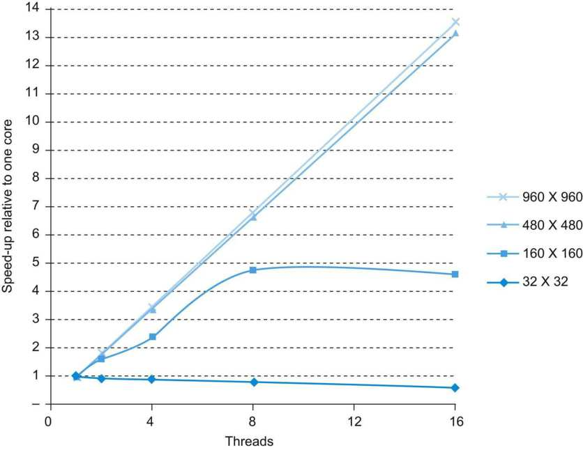

**HÌNH 6.26 Mức cải thiện hiệu năng so với một thread khi số lượng thread tăng. Cách trung thực nhất để trình bày những đồ thị như vậy là lấy hiệu năng của phiên bản tốt nhất của chương trình chạy trên một processor làm mốc, như chúng ta đã làm. Đồ thị này lấy hiệu năng của code trong Hình 5.48 khi không có các pragma OpenMP làm mốc.**

Hình 6.27 cho mức tăng hiệu năng tuyệt đối khi thread tăng từ một tới 16. DGEMM đạt 174 GLOPS trên ma trận 960 ×960. Vì code C chưa tối ưu Hình 3.22 chỉ đạt 0.8 GFLOPS, tối ưu Chương 3 tới 6 thích ứng hardware đã tạo speed-up hơn 200 lần!

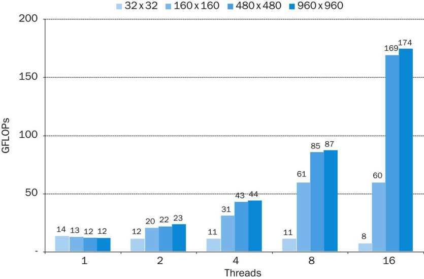

**HÌNH 6.27 Hiệu năng DGEMM theo số lượng thread đối với bốn kích thước ma trận. Với ma trận 960 ×960 và 16 thread, hiệu năng nhanh hơn code chưa tối ưu hóa trong Hình 3.22 đến 212 lần, một mức tăng đáng kinh ngạc!**

Tiếp theo là cảnh báo về ngộ nhận, cạm bẫy multiprocessing. Nghĩa địa kiến trúc máy tính đầy dự án parallel processing đã phớt lờ chúng.

### Giải thích thêm

Các kết quả này được đo khi tắt Turbo. Vì hệ dùng hai chip, không ngạc nhiên khi đạt đầy đủ Turbo speed-up (3.3/2.6 =1.27) với một thread (một core trên một chip) hoặc hai thread (mỗi chip một core). Khi thêm thread, tăng core active, lợi ích Turbo giảm vì ngân sách công suất cho mỗi core active ít hơn. Bốn thread có Turbo speed-up trung bình 1.23, tám là 1.13, 16 là 1.11.

#### Giải thích thêm

Dù Sandy Bridge hỗ trợ hai hardware thread/core, 32 thread không tăng hiệu năng. Hai thread ghép trên một core dùng chung phần cứng AVX duy nhất, nên gán hai thread/core thực ra làm giảm hiệu năng vì overhead ghép kênh.

## 6.13 Ngộ nhận và cạm bẫy

Suốt hơn một thập niên, những người tiên đoán cho rằng tổ chức của một máy tính đơn đã tới giới hạn, và tiến bộ thực sự đáng kể chỉ có thể đạt bằng kết nối nhiều máy sao cho chúng hợp tác giải bài toán. …Chúng tôi chứng minh cách tiếp cận một processor vẫn còn đúng đắn…

Gene Amdahl, “Validity of the single processor approach to achieving large scale computing capabilities,” Spring Joint Computer Conference, 1967

Nhiều nỗ lực chinh phục parallel processing đã làm lộ ra vô số ngộ nhận và cạm bẫy. Ở đây trình bày bốn trường hợp.

Ngộ nhận: Amdahl’s Law không áp dụng máy tính song song.

Năm 1987, người đứng đầu một tổ chức nghiên cứu tuyên bố máy multiprocessor đã phá Định luật Amdahl. Để hiểu cơ sở các bản tin truyền thông, hãy xem câu dẫn tới định luật [1967, tr. 483]:

Một kết luận khá hiển nhiên có thể rút ra là công sức nhằm đạt tốc độ parallel processing cao sẽ bị lãng phí trừ khi đi cùng tiến bộ về tốc độ xử lý tuần tự ở mức gần tương đương.

Phát biểu này vẫn phải đúng: phần chương trình bị bỏ qua vẫn giới hạn hiệu năng. Một cách diễn giải dẫn tới bổ đề: mọi chương trình đều có phần tuần tự, nên số processor phải có cận trên kinh tế, chẳng hạn 100. Chứng minh speed-up tuyến tính với 1000 processor bác bỏ bổ đề, từ đó dẫn tới tuyên bố đã phá Định luật Amdahl.

Các nhà nghiên cứu thực chất dùng weak scaling: thay vì chạy cùng data set nhanh hơn 1000 lần, họ làm gấp 1000 lượng việc trong thời gian tương đương. Với thuật toán đó, phần tuần tự là hằng, độc lập kích thước input, phần còn lại hoàn toàn song song, nên có speed-up tuyến tính 1000 processor.

Định luật Amdahl hiển nhiên áp dụng parallel processor. Nghiên cứu chỉ ra một mục đích chính của máy nhanh là chạy bài toán lớn hơn. Chỉ cần chắc người dùng thực sự quan tâm những bài toán đó, thay vì tìm bài toán giữ nhiều processor bận để biện minh mua máy đắt.

Ngộ nhận: Hiệu năng đỉnh bám sát hiệu năng quan sát được.

Ngành supercomputer từng dùng metric này để marketing, và máy song song làm ngộ nhận trầm trọng hơn. Họ không chỉ dùng hiệu năng đỉnh gần không đạt được của node uniprocessor, mà còn nhân tổng processor, giả sử speed-up hoàn hảo! Amdahl cho thấy đạt từng đỉnh đã khó; nhân chúng chỉ nhân thêm sai lầm. Roofline giúp đặt hiệu năng đỉnh vào bối cảnh.

Cạm bẫy: Không phát triển software tận dụng hoặc tối ưu cho multiprocessor architecture.

Software song song chậm hơn hardware đã có lịch sử dài, có lẽ vì vấn đề software khó hơn nhiều. Chúng tôi đưa một ví dụ về tính tinh tế, dù có rất nhiều ví dụ khác!

Vấn đề thường gặp khi chuyển software uniprocessor sang multiprocessor. Ví dụ operating system Silicon Graphics ban đầu bảo vệ page table bằng một lock, giả sử cấp page ít xảy ra. Uniprocessor không gặp vấn đề hiệu năng, nhưng multiprocessor có thể gặp bottleneck lớn. Xét chương trình dùng nhiều page khởi tạo khi start-up, như UNIX làm với page cấp tĩnh. Giả sử song song hóa để nhiều process cấp page. Vì cấp page cần page table bị lock khi dùng, ngay OS kernel cho nhiều thread cũng bị tuần tự hóa nếu mọi process cùng cấp page—đúng điều có thể xảy ra lúc khởi tạo!

Tuần tự hóa page table loại song song lúc khởi tạo, ảnh hưởng đáng kể hiệu năng tổng. Bottleneck tồn tại cả task-level parallelism. Ví dụ tách chương trình thành job riêng, mỗi processor một job không chia sẻ. (Một người dùng đã làm đúng vậy vì hợp lý tin rằng lỗi do chia sẻ hoặc can thiệp ngoài ý muốn trong ứng dụng.) Nhưng lock vẫn tuần tự mọi job, nên ngay job độc lập cũng chậm.

Cạm bẫy cho thấy lỗi hiệu năng tinh tế nhưng đáng kể khi software chạy multiprocessor. Như nhiều thành phần quan trọng, thuật toán, data structure OS phải xét lại trong bối cảnh này. Đặt lock trên phần nhỏ hơn của page table đã loại vấn đề hiệu quả.

Ngộ nhận: Có thể đạt hiệu năng vector tốt mà không cung cấp memory bandwidth.

Như Roofline, memory bandwidth quan trọng với mọi kiến trúc. DAXPY cần 1.5 tham chiếu memory mỗi phép floating-point, tỷ lệ điển hình nhiều code khoa học. Dù floating-point không tốn thời gian, Cray-1 không tăng hiệu năng chuỗi vector DAXPY vì memory limited. Linpack Cray-1 tăng khi compiler dùng blocking đổi phép tính để giữ giá trị trong vector register. Giảm tham chiếu memory/FLOP làm hiệu năng gần gấp đôi! Vì vậy bandwidth Cray-1 trở nên đủ cho loop trước cần nhiều hơn, đúng như Roofline dự đoán.

## 6.14 Nhận xét kết thúc

Chúng tôi dành toàn bộ phát triển sản phẩm tương lai cho thiết kế multicore. Chúng tôi tin đây là điểm ngoặt then chốt cho ngành. …Đây không phải cuộc đua mà là thay đổi sâu sắc trong điện toán…

Paul Otellini, Chủ tịch Intel, Intel Developers Forum, 2004

Giấc mơ xây dựng máy tính chỉ bằng cách tập hợp các processor đã tồn tại từ những ngày đầu của ngành điện toán. Tuy nhiên, tiến bộ trong việc xây dựng và sử dụng các processor song song hiệu quả, có hiệu suất cao đã diễn ra chậm. Tốc độ tiến bộ này bị giới hạn bởi các vấn đề software khó giải quyết và quá trình phát triển lâu dài của multiprocessor architecture nhằm nâng cao tính dễ sử dụng và cải thiện hiệu suất. Chúng ta đã thảo luận nhiều thách thức software trong chương này, bao gồm việc khó viết chương trình đạt speed-up tốt do Amdahl’s Law. Sự đa dạng của các hướng tiếp cận architecture, cùng thành công hạn chế và vòng đời ngắn của nhiều parallel architecture trước đây, càng làm các khó khăn software trở nên phức tạp. Chúng ta thảo luận lịch sử phát triển của những multiprocessor này trong  Mục 6.15 trực tuyến. Để tìm hiểu sâu hơn các chủ đề trong chương này, xem Chương 4 của Computer Architecture: A Quantitative Approach, Fifth Edition để biết thêm về GPU và so sánh GPU với CPU, cùng Chương 6 để biết thêm về WSC.

Như Chương 1 đã nói, bất chấp quá khứ dài nhiều thăng trầm, ngành công nghệ thông tin nay gắn tương lai với parallel computing. Dù dễ lập luận nỗ lực này sẽ thất bại như trước, vẫn có lý do hy vọng:

- Rõ ràng software as a service (SaaS) ngày càng quan trọng, và cluster đã rất thành công trong cung cấp dịch vụ. Nhờ redundancy ở cấp cao hơn, kể cả datacenter phân tán địa lý, dịch vụ đạt availability 24 ×7 ×365 cho khách hàng toàn cầu.

- Chúng tôi tin Warehouse-Scale Computers đang đổi mục tiêu, nguyên lý thiết kế server, như nhu cầu mobile client đổi thiết kế microprocessor. Cả hai cũng cách mạng hóa software. Hiệu năng mỗi dollar và mỗi joule thúc cả hardware mobile client lẫn WSC, và song song là chìa khóa đạt mục tiêu.

- Các phép toán SIMD và vector rất phù hợp với ứng dụng multimedia, vốn đang đóng vai trò lớn hơn trong thời đại post-PC. Chúng có chung ưu điểm là dễ hơn cho lập trình viên so với lập trình song song MIMD truyền thống và tiết kiệm năng lượng hơn (energy-efficient) so với MIMD. Để làm rõ tầm quan trọng của SIMD so với MIMD, Hình 6.28 biểu diễn số core dành cho MIMD so với số phép toán 32-bit và 64-bit trên mỗi clock cycle trong SIMD mode của máy tính x86 theo thời gian. Đối với máy tính x86, chúng ta kỳ vọng số core trên mỗi chip tăng thêm hai khoảng mỗi 2 năm và SIMD width tăng gấp đôi khoảng mỗi 4 năm. Với các giả định này, trong thập niên tiếp theo, speed-up tiềm năng từ tính song song SIMD gấp đôi từ tính song song MIMD. Với hiệu quả của SIMD cho multimedia và tầm quan trọng ngày càng tăng của nó trong thời đại post-PC, sự chú trọng đó có thể phù hợp. Vì vậy, hiểu tính song song SIMD ít nhất cũng quan trọng như hiểu tính song song MIMD, mặc dù MIMD nhận được sự chú ý nhiều hơn.

- Parallel processing phổ biến trong tính toán khoa học, kỹ thuật. Miền này gần như khát tính toán vô hạn, có nhiều ứng dụng với concurrency tự nhiên lớn. Cluster một lần nữa thống trị. Ví dụ báo cáo Top 500 năm 2012 cho cluster chiếm hơn 80% trong 500 kết quả Linpack nhanh nhất.

- Mọi nhà sản xuất microprocessor desktop/server đều xây multiprocessor để tăng hiệu năng, nên khác trước không còn đường dễ tăng hiệu năng ứng dụng tuần tự. Như đã nói, chương trình tuần tự nay là chương trình chậm. Người cần nhanh phải song song hóa code hoặc viết chương trình parallel processing mới.

- Trước đây microprocessor và multiprocessor có định nghĩa thành công khác. Khi tăng hiệu năng uniprocessor, kiến trúc sư hài lòng nếu single thread performance tăng căn bậc hai mức tăng diện tích silicon, tức tăng dưới tuyến tính theo tài nguyên. Thành công multiprocessor từng là speed-up tuyến tính theo số processor, giả sử giá mua/quản trị n processor gấp n lần một. Nay song song on-chip multicore, có thể dùng metric microprocessor truyền thống, coi tăng hiệu năng dưới tuyến tính là thành công.

- Thành công just-in-time runtime compilation và autotuning cho phép nghĩ tới software tự thích nghi để tận dụng core/chip tăng, linh hoạt hơn giới hạn static compiler.

- Khác trước, phong trào open source nay là phần thiết yếu ngành software. Nó đề cao năng lực, giải pháp kỹ thuật tốt hơn có thể thuyết phục nhà phát triển vượt lo ngại di sản. Nó đón đổi mới, thay software cũ, ngôn ngữ, sản phẩm mới. Văn hóa mở như vậy cực hữu ích lúc thay đổi nhanh.

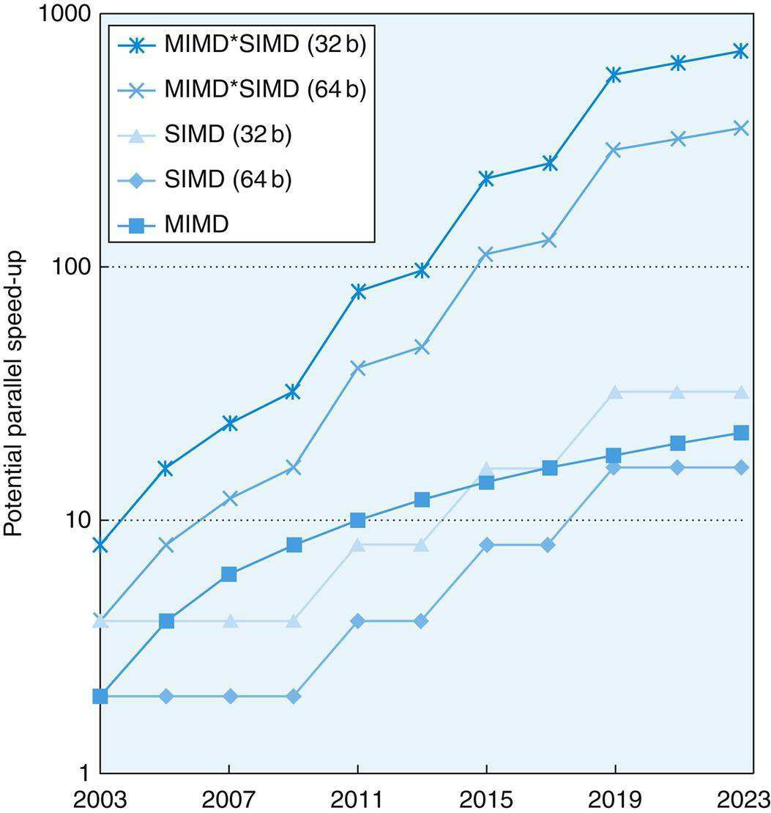

**HÌNH 6.28 speed-up tiềm năng từ MIMD, SIMD và kết hợp theo thời gian trên x86. Giả sử thêm hai core/chip cho MIMD mỗi 2 năm, số phép SIMD gấp đôi mỗi 4 năm.**

Để khuyến khích người đọc tham gia cuộc cách mạng, các mục Going Faster Chương 3 tới 6 đã minh họa cụ thể tiềm năng song song khi nhân ma trận trên Intel Core i7 (Sandy Bridge):

- Data-level parallelism Chương 3 tăng hiệu năng 3.85 lần bằng thực thi song song bốn phép floating-point 64-bit với operand AVX 256-bit, cho thấy giá trị SIMD.

- Instruction-level parallelism Chương 4 tăng thêm 2.3 lần bằng unroll loop bốn lần, cho hardware out-of-order thêm instruction để lập lịch.

- Tối ưu cache Chương 5 tăng hiệu năng ma trận không vừa L1 data cache thêm 2.0 tới 2.5 lần bằng cache blocking giảm miss.

- Thread-level parallelism chương này tăng hiệu năng ma trận không vừa một L1 data cache thêm 4 tới 14 lần bằng cả 16 core, cho thấy giá trị MIMD. Chỉ cần thêm một dòng pragma OpenMP.

Dùng ý tưởng sách và thích ứng software với máy đã thêm 24 dòng code vào DGEMM. Với ma trận 32 ×32, 160 ×160, 480 ×480, 960 ×960, speed-up tổng từ ý tưởng trong two-dozen dòng đó lần lượt 8, 39, 129 và 212!

Cuộc cách mạng song song ở giao diện hardware/software có lẽ là thách thức lớn nhất ngành trong 60 năm. Cũng có thể coi là cơ hội nổi bật như Going Faster minh họa. Nó tạo nhiều triển vọng nghiên cứu, kinh doanh trong và ngoài IT; công ty thống trị thời multicore có thể khác thời uniprocessor. Khi hiểu xu hướng hardware, biết thích nghi software, có lẽ bạn sẽ là người đổi mới nắm cơ hội chắc chắn xuất hiện giữa tương lai bất định. Chúng tôi mong hưởng lợi từ phát minh của bạn!


## Góc nhìn lịch sử và tài liệu đọc thêm

Mục online này trình bày lịch sử phong phú và thường thảm bại của multiprocessor trong 50 năm qua.

### Tài liệu tham khảo

B. F. Cooper, A. Silberstein, E. Tam, R. Ramakrishnan, R. Sears. Benchmarking cloud serving systems with YCSB, In: Proceedings of the 1st ACM Symposium on Cloud computing, June 10–11, 2010, Indianapolis, Indiana, USA, doi:10.1145/1807128.1807152.

G. Regnier, S. Makineni, R. Illikkal, R. Iyer, D. Minturn, R. Huggahalli, D. Newell, L. Cline, and A. Foong. TCP onloading for data center servers. IEEE Computer, 37(11):48–58, 2004.

## 6.15 Góc nhìn lịch sử và tài liệu đọc thêm

Lịch sử multiprocessor rất đồ sộ; mục chia theo cả thời kỳ lẫn kiến trúc. Bắt đầu SIMD, Illiac IV, rồi ngắn gọn một số multiprocessor thử nghiệm đầu và tranh luận lớn về parallel processing. Tiếp theo mô tả nguồn gốc các multiprocessor hiện tại, kết thúc bằng tiến bộ gần đây.


### Máy SIMD: Ý tưởng hấp dẫn, nhiều thử nghiệm, không thành công bền vững

Tuy nhiên chi phí multiprocessor tổng quát rất cao, nên đã xét lựa chọn giảm chi phí mà không suy giảm nghiêm trọng sức mạnh, hiệu quả. Các lựa chọn là tập trung lại một trong ba thành phần chính.… Tập trung [control unit] tạo tổ chức cơ bản của … array processor như Illiac IV.

Bouknight et al. [1972]

SIMD là một trong mô hình parallel computing sớm nhất, bắt nguồn multiprocessor large-scale đầu tiên Illiac IV. Ý chính, cũng như SIMD gần đây, là một instruction thao tác nhiều dữ liệu cùng lúc bằng nhiều functional unit (Hình e6.15.1).

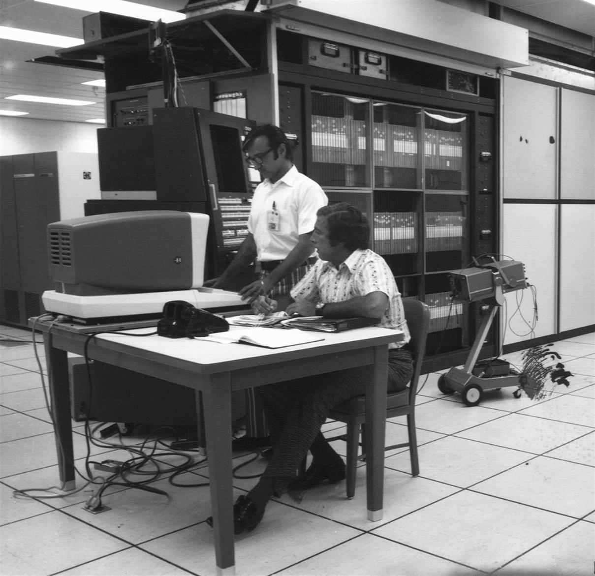

**HÌNH E6.15.1 Control unit Illiac IV theo sau bởi 64 processing element. Có lẽ đây là supercomputer tai tiếng nhất. Dự án bắt đầu 1965, chạy ứng dụng thực đầu 1976. 64 processor clock 13-MHz, tổng main memory 1 MB: 64 ×16 KB. Illiac IV là máy đầu dạy rằng software máy song song chi phối vấn đề hardware. <sub>Ảnh do NASA Ames Research Center cung cấp.</sub>**

Mặc dù thành công trong việc thúc đẩy một số công nghệ tỏ ra hữu ích cho các dự án sau này, nó thất bại với tư cách một máy tính. Chi phí tăng từ mức ước tính $8 triệu năm 1966 lên $31 triệu vào năm 1972, mặc dù chỉ xây dựng một phần tư multiprocessor theo kế hoạch. Hiệu năng thực tế tốt nhất chỉ đạt 15 MFLOPS, so với dự đoán ban đầu là 1000 MFLOPS cho toàn hệ thống [Hord, 1982]. Sau khi được giao cho NASA Ames Research vào năm 1972, máy tính còn cần thêm ba năm công việc kỹ thuật trước khi có thể sử dụng.

Điều này làm chậm nghiên cứu SIMD; Danny Hillis [1989] hồi sinh phong cách ở Connection Machine có 65,636 processor 1-bit.

Máy SIMD thực cần phối hợp SISD và SIMD. SISD host làm branch, tính address không cần song song. SIMD instruction broadcast mọi execution unit, mỗi unit register riêng. Để linh hoạt, có thể disable từng unit trong instruction. SIMD song song đồ sộ còn dựa interconnection/communication network trao đổi dữ liệu giữa processing element.

SIMD tốt nhất với mảng trong for loop. Vì vậy muốn song song đồ sộ cần dữ liệu rất lớn, hay data parallelism. SIMD yếu nhất ở case statement, mỗi unit phải làm phép khác theo dữ liệu. Unit có dữ liệu không phù hợp bị disable để unit đúng tiếp tục. Tình huống này về bản chất đạt 1/n hiệu năng, n số case.

Đánh đổi SIMD cơ bản là hiệu năng mỗi processor với số processor. Gần đây ưu tiên mức song song lớn hơn hiệu năng từng processor. Connection Multiprocessor 2 có 65,536 processor single-bit-wide, còn Illiac IV có 64 processor 64-bit.

Sau hồi sinh thập niên 1980 bởi Thinking Machines rồi MasPar, SIMD lại bị gác như kiến trúc multiprocessor general-purpose vì hai lý do. Một, quá cứng nhắc: nhiều bài toán quan trọng không dùng được, khó scale xuống cạnh tranh; SIMD small-scale thường chi phí/hiệu năng kém phương án khác. Hai, không tận dụng lợi thế hiệu năng, giá microprocessor. Thay tận dụng low-cost, người thiết kế phải xây processor tùy biến.

Dù SIMD rời sân general-purpose, vẫn có vai trò thiết kế special-purpose. Nhiều task special-purpose data parallel cao, cần tập functional unit hạn chế. Vì vậy có thể tích hợp hỗ trợ phép cụ thể và interconnect nối cứng giữa unit. Thường gọi array processor, hữu ích xử lý ảnh, tín hiệu.

### Multimedia extension như SIMD extension cho instruction set

Nhiều kiến trúc gần đây nhận là đầu tiên có multimedia extension: instruction mới dùng ALU rộng chia thành nhiều ALU hẹp song song. Nhưng khó có trước 1957, khi TX-2 của Lincoln Lab cho ALU làm một phép 36-bit, hai 18-bit hoặc bốn 9-bit. Ivan Sutherland, Cha đẻ đồ họa máy tính, xây Sketchpad lịch sử trên TX-2. Sketchpad thực sự dùng SIMD này dù TX-2 ra đời trước thuật ngữ SIMD.

### Thử nghiệm sớm khác

Khó xác định MIMD multiprocessor đầu. Ngạc nhiên là chẳng hạn máy đầu Eckert-Mauchly Corporation đã có unit nhân đôi tăng availability.


Hai dự án best-documented trong thập niên 1970 tại Carnegie Mellon. C.mmp có 16 PDP-11s nối crossbar tới 16 memory unit, thuộc những máy đầu hơn vài processor, mô hình shared memory. Nghiên cứu tập trung software, nhất là OS. Máy sau Cm* là multiprocessor cluster-based, distributed memory, nonuniform access time. Không cache, remote latency dài làm data placement thiết yếu. Nhiều ý tưởng tái dùng thập niên 1980 khi microprocessor giảm mạnh giá xây hệ.

### Tranh luận lớn về xử lý song song

Rời tổ chức truyền thống bắt đầu giữa thập niên 1960 khi quy luật lợi suất giảm tác động nỗ lực tăng tốc máy.… Mạch điện tử cuối cùng bị giới hạn bởi tốc độ ánh sáng … nhiều mạch đã ở phạm vi nanosecond.

W. Jack Bouknight et al. The Illiac IV System [1972]

… máy tuần tự đang tiến tới giới hạn vật lý cơ bản về sức tính tiềm năng. Giới hạn đó là tốc độ ánh sáng …

Angel L. DeCegama The Technology of Parallel Processing, Volume I [1989]

… multiprocessor ngày nay … gần bế tắc khi công nghệ tới tốc độ ánh sáng. Dù thành phần processor tuần tự làm nhanh vậy, tốt nhất cũng không hơn vài triệu instruction/giây.

David Mitchell The Transputer: The Time Is Now [1989]

Các trích dẫn trên là lập luận kinh điển bỏ hình thức điện toán hiện tại; Amdahl [1967] phản hồi kinh điển ủng hộ tiếp tục IBM 360. Lập luận lợi thế thực thi song song có từ thế kỷ 19 [Menabrea, 1842]! Dù vậy hiệu quả multiprocessor giảm latency chương trình quan trọng vẫn được khám phá. Ngoài tranh luận ưu, giới hạn song song, còn nhiều tranh luận nóng cách xây.

Nhìn nay, rõ tốc độ ánh sáng không phải bức tường; bức tường là công suất CMOS khi clock tăng.

Khó dự báo tương lai nhưng năm 1989 Gordon Bell đưa hai dự đoán cho 1995. Chúng tôi đưa vào lần xuất bản đầu lúc chưa rõ kết quả. Mục này thảo luận và đánh giá độ chính xác.

Dự đoán đầu tiên là một máy tính có khả năng duy trì một tera FLOPS, tức một triệu MFLOPS, sẽ được xây dựng vào năm 1995, sử dụng multicomputer với 4K đến 32K node hoặc Connection Multiprocessor với vài triệu processing element. Để đặt dự đoán này vào bối cảnh, mỗi năm Gordon Bell Prize ghi nhận những tiến bộ về tính song song, bao gồm chương trình thực tế nhanh nhất (MFLOPS cao nhất). Năm 1989, người thắng giải sử dụng Cray Y-MP eight-processor để đạt 1680 MFLOPS. Dựa trên những con số này, multiprocessor và chương trình phải cải thiện 3.6 lần mỗi năm để chương trình nhanh nhất đạt 1 TFLOPS vào năm 1995. Năm 1999, một công trình đoạt Gordon Bell Prize lần đầu vượt mốc 1 TFLOPS. Sử dụng hệ thống IBM RS/6000 SST 5832-processor được thiết kế riêng cho Livermore Laboratories, họ đạt 1.18 TFLOPS trên mô phỏng sóng xung kích. Tỷ lệ này tương ứng mức cải thiện year-to-year bằng 1.93, vẫn rất ấn tượng.

Từ thập niên 1990 nhận ra dù đủ công nghệ xây TFLOPS multiprocessor, chưa rõ cost-effective ngoài vài ứng dụng rất chuyên biệt, tối quan trọng an ninh quốc gia. Năm 1990 ước tính 1 TFLOPS cần khoảng 5000 processor, $100 triệu. IBM 5832-processor Livermore giá $110 triệu. Cải thiện micro-processors riêng về giá/hiệu năng ảnh hưởng trực tiếp hệ large-scale, nhưng hệ 5000-processor đắt hơn 5000 lần desktop cùng processor. Từ đó có máy nhanh hơn nhiều, nhưng tiến bộ lớn 5 năm qua ngày càng từ processor thay đột phá cơ bản kiến trúc song song.

Dự đoán thứ hai về số data stream trong super- computer giao năm 1995. Danny Hillis tin dù máy ít stream bán chạy, máy lớn nhất sẽ nhiều stream, làm phần lớn tính toán. Bell cược quý cuối 1995, tổng MFLOPS duy trì giao ở máy ít stream (<100) lớn hơn nhiều stream (>1000). Cược chỉ gồm supercomputer giá hơn $1 triệu, dùng khoa học. MFLOPS duy trì được định nghĩa số phép floating-point/tháng, nên availability ảnh hưởng đánh giá.

Năm 1989 khi cược chưa rõ ai thắng. Khảo sát 1995 chỉ sáu multiprocessor công khai toàn cầu có hơn 1000 stream, nên Bell thắng rõ. Thực ra 1995 multiprocessor microprocessor-based nhỏ hơn nhiều (<20 processor) đang thống trị.

Khảo sát 500 hệ highest-performance, gọi Top 500 năm 1995 theo Linpack cho số đông nhất là shared memory multiprocessor bus-based! Tới 2005 cluster/multicomputer đóng vai lớn: top 25 có 11 cluster tùy biến như IBM Blue Gene, Cray XT3; 10 cluster shared memory multiprocessor (distributed hoặc centralized memory), bốn còn lại PC cluster với interconnect off-the-shelf.

### Tiến bộ và phát triển gần đây hơn

Ngoại trừ chủ yếu vector multiprocessor song song và gần đây IBM Blue Gene, mọi MIMD hiện đại dùng microprocessor off-the-shelf với bus, memory logically central hoặc network, distributed memory. Máy thử nghiệm thập niên 1980 tinh chỉnh khái niệm làm nền nhiều hệ nay.

#### Phát triển multiprocessor coherent Bus-Based

Dù mainframe rất lớn có nhiều processor thập niên 1960, 1970, tới 1980 multiprocessor mới thành công lớn. Bell [1985] cho chìa khóa là kích thước microprocessor nhỏ cho memory bus thay hardware network, OS portable khiến không cần phát minh OS mới. Bài báo định nghĩa multiprocessor/multicomputer, đặt nền hai cách xây larger-scale. Máy bus-based snooping cache đầu là Synapse N +1 năm 1984.

Đầu 1990 hệ mở rộng bằng bus rộng, high-speed (SGI Challenge bus packet-oriented 256-bit hỗ trợ tám board, 32 processor), sau nhiều bus/crossbar như Sun SPARCCenter, Enterprise. Năm 2001, server Sun Enterprise là ví dụ chính symmetric multiprocessor large-scale (>16 processor) đang dùng.

#### Hướng đến multiprocessor Large-Scale

Để xây large-scale, khảo sát message-passing multicomputer và shared memory mở rộng. Dù nhiều thử mesh/hypercube-connected, Cosmic Cube Caltech [Seitz, 1985] là một trong đầu kết hợp thành công. Nó cải tiến routing/interconnect, giảm giá đáng kể, giúp multicomputer khả thi. Intel iPSC 860, tập i860 hypercube-connected, dựa ý này. Intel Paragon sau dùng network ít chiều hơn, link riêng cao hơn. Paragon có i860 riêng làm communication controller mỗi node, dù nhiều người thấy tốt hơn dùng cả hai tính lẫn truyền. Thinking Multiprocessors CM-5 dùng microprocessor off-the-shelf, cho truy cập user-level kênh truyền, giảm latency đáng kể. Năm 1995 hai hệ đại diện tiên tiến nhất message-passing.

#### Cluster

Cluster có lẽ được “phát minh” thập niên 1960 bởi khách không dồn hết việc lên một máy hoặc cần dự phòng [Pfister, 1998]. Tandem có cluster 16-node năm 1975, Digital theo VAX năm 1984. Đầu là máy độc lập chia I/O cần distributed OS phối hợp, sớm có link giữa máy, một phần để phân tán địa lý chống thảm họa tại một site. Người dùng login không biết dùng máy nào. DEC (nay HP) bán hơn 25,000 cluster trước 1993. Công ty sớm khác Tandem (nay HP), IBM (vẫn IBM). Nay gần mọi công ty có cluster, chủ yếu availability, performance scaling lợi phụ.

Scientific computing cluster nổi lên cạnh tranh MPP. Beowulf bắt đầu 1993 để đáp NASA máy 1-GFLOPS dưới $50,000. Năm 1994 cluster 16-node PC off-the-shelf 80486s đạt mục tiêu. Hướng này tạo nhiều giao diện software để dễ submit, phối hợp, debug chương trình lớn hoặc nhiều chương trình độc lập.

Có nỗ lực giảm latency, tăng bandwidth cluster; nhiều dự án nghiên cứu. (Kết quả thương mại low-latency là chuẩn VI, được Infiniband tiếp nhận, nói dưới.) Latency thấp sau hữu ích ứng dụng khác. Năm 1997, cluster 100 desktop UltraSPARC tại U.C. Berkeley nối switch Myrinet 160 MB/sec mỗi link lập kỷ lục database sort (8.6 GB từ disk trong 1 phút), phá mã message (3.5 giờ giải DES key 40-bit).

Dự án Network of Workstations cũng phát triển Inktomi search engine, dẫn start-up cùng tên. Google theo Inktomi xây search từ desktop cluster thay SMP large-scale của Alta Vista dẫn đầu mà Google vượt. Năm 2013 gần mọi dịch vụ Internet dựa cluster phục vụ hàng triệu khách.

Cluster cũng phổ biến với nhà khoa học vì rẻ, cho cá nhân/nhóm nhỏ sở hữu riêng cho chương trình. Có kết quả nhanh hơn đợi hàng dài job MPP chung ở trung tâm supercomputer, có thể hàng tuần.

Muốn biết thêm, Pfister [1998] có sách thú vị về cluster.

#### Xu hướng gần đây trong multiprocessor Large-Scale

Trong mid-to-late thập niên 1990, rõ tăng trưởng hoped-for của ultralarge-scale parallel computing khó xảy ra. Thiếu tăng trưởng, thị trường high-end quá nhỏ gánh hardware/software tùy biến cao. Xu hướng quan trọng nhất từ đó là clustering để đạt hiệu năng cao nhất. Nay có ba lớp large-scale:

1. Cluster tích hợp motherboard desktop chuẩn bằng interconnect như Myrinet hoặc Infiniban

2. Multicomputer từ microprocessor chuẩn cấu hình processing element, nối interconnect tùy biến như IBM Blue Gene

3. Cluster máy shared memory small-scale, có thể vector, gồm Earth Simulator. IBM Blue Gene thú vị nhất vì lý do thiết kế song song nguyên nhân xu hướng multicore uniprocessor gần đây. Blue Gene bắt đầu dự án IBM cho giải trình tự, gấp protein. Nhận ra công suất càng đáng lo ở large-scale, processor embedded có hiệu năng/watt tốt hơn high-end uniprocessor nhiều. Nếu song song là đường hiệu năng cao, sao không bắt đầu block hiệu quả nhất rồi thêm nhiều?

Vì vậy Blue Gene dùng chip tùy biến tích hợp PowerPC embedded, hiệu năng nửa PowerPC high-end nhưng diện tích, công suất chỉ phần nhỏ hơn nhiều. Cho tích hợp thêm chức năng, global interconnect cùng die. Block dễ nhân bản, hiệu quả, giúp tới số processor lớn hơn hiệu quả hơn. Thay microprocessor stand-alone hay board desktop chuẩn, dùng processor core. Chắc chắn hiệu quả hơn nhiều; thị trường có chịu giá tùy biến, software đặc biệt vẫn mở. Năm 2006, Blue Gene Lawrence Livermore 32K processor có Linpack hơn 2.6 lần hệ third-place gồm 20 SGI Altix 512-processor nối Infiniband như cluster.

Tiền nhiệm Blue Gene là QCDOD thử nghiệm, tiên phong dùng embedded microprocessor lower-power và interconnect tích hợp chặt để giảm giá, công suất node.

### Tìm hiểu xa hơn

Thông tin multiprocessor/multicomputer gần vô hạn: hội nghị, bài báo, sách xuất hiện nhanh hơn một người hấp thụ. Nhiều bài chắc bị bỏ qua như trước. Phần lớn hội nghị kiến trúc chính có multiprocessor. Hằng năm Supercomputing XY (X,Y hai số cuối năm) tập hợp người dùng, kiến trúc sư, nhà phát triển, vendor, xuất kỷ yếu sách, CD-ROM, online (www.scXY.org). Journal of Parallel and Distributed Computing, IEEE Transactions on Parallel and Distributed Systems có mọi khía cạnh. Tài liệu dưới gồm sách, Culler et al. [1998] là nỗ lực large-scale gần nhất. Nhiều năm Eugene Miya NASA Ames thu bibliography online, nay hơn 35,000 entry tại www.ira.uka.de/bibliography/Parallel/Eugene/index.html.

Asanovic et al. [2006] khảo sát thách thức wide-ranging của ngành với multicore. Báo cáo có thể giúp hiểu độ sâu từng thách thức.

Ngoài ghi lại khám phá khái niệm nay dùng thực tế, tài liệu còn mô tả nhiều ý tưởng đã thử nhưng thiếu sót, và ý tưởng chưa tới thời. Vì multicore, multiprocessor là tương lai kiến trúc high-performance, dự kiến nhiều cách mới sẽ được thử. Một số sẽ giải vấn đề hardware/software then chốt dùng multiprocessing trong 40 năm qua!

### Tài liệu đọc thêm

Almasi, G. S. and A. Gottlieb [1989]. Highly Parallel Computing, Benjamin/Cummings, Redwood City, CA.

Một giáo trình trình bày về máy tính song song.

Amdahl, G. M. [1967]. “Validity of the single processor approach to achieving large scale computing capabilities,” Proc. AFIPS Spring Joint Computer Conf., Atlantic City, NJ (April), 483–85.

Được viết để đáp lại những tuyên bố về Illiac IV, bài báo three-page này mô tả Amdahl’s law và đưa ra câu trả lời kinh điển cho các lập luận muốn từ bỏ hình thức điện toán hiện tại.

Andrews, G. R. [1991]. Concurrent Programming: Principles and Practice, Benjamin/Cummings, Redwood City, CA.

Một giáo trình trình bày các nguyên tắc lập trình song song.

Archibald, J. and J. -L. Baer [1986]. “Cache coherence protocols: Evaluation using a multiprocessor simulation model”, ACM Trans. on Computer Systems 4 4 (November), 273–98.

Bài khảo sát kinh điển về các protocol cache coherence shared-bus.

Arpaci-Dusseau, A., R. Arpaci-Dusseau, D. Culler, J. Hellerstein, and D. Patterson [1997]. “High-performance sorting on networks of workstations,” Proc. ACM SIG MOD/PODS Conference on Management of Data, Tucson, AZ (May), 12–15.

Mô tả cách thực hiện phép sort lập kỷ lục thế giới trên cluster, bao gồm phê bình architecture của workstation và network interface. Đến ngày 1 tháng 4 năm 1997, họ nâng kỷ lục lên 8.6 GB trong 1 phút và 2.2 giây để sort 100 MB.

Asanovic, K., R. Bodik, B. C. Catanzaro, J. J. Gebis, P. Husbands, K. Keutzer, D. A. Patterson, W. L. Plishker, J. Shalf, S. W. Williams, and K. A. Yelick. [2006]. “The landscape of parallel computing research: A view from Berkeley.” Tech. Rep. UCB/EECS-2006-183, EECS Department, University of California, Berkeley (December 18).

Được đặt biệt danh “Berkeley View”, báo cáo này trình bày toàn cảnh thử thách multicore.

Bailey, D. H., E. Barszcz, J. T. Barton, D. S. Browning, R. L. Carter, L. Dagum, R. A. Fatoohi, P. O. Frederickson, T. A. Lasinski, R. S. Schreiber, H. D. Simon, V. Venkatakrishnan, and S. K. Weeratunga. [1991]. “The NAS parallel benchmarks—summary and preliminary results,” Proceedings of the 1991 ACM/IEEE conference on Supercomputing (August).

Mô tả các NAS parallel benchmark.

Bell, C. G. [1985]. “Multis: A new class of multiprocessor computers”, Science 228(April 26), 462–467.

Phân biệt các multiprocessor shared address và nonshared address dựa trên microprocessor.

Bienia, C., S. Kumar, J. P. Singh, and K. Li [2008]. “The PARSEC benchmark suite: characterization and architectural implications,” Princeton University Technical Report TR-81 1-008 (January).

Mô tả các PARSEC parallel benchmark. Xem thêm http://parsec.cs.princeton.edu/.

Bouknight, W. J., Denenberg, S. A., McIntyre, D. E., Randall, J. M., Sameh, A. H., and Slotnick, D. L. [1972]. The Illiac IV system, Proceedings of the IEEE, 60(4), 369–388.

Tài liệu này mô tả SIMD supercomputer tai tiếng nhất.

Culler, D. E. and J. P. Singh, with A. Gupta [1998]. Parallel Computer Architecture, Morgan Kaufmann, San Francisco.

Một giáo trình về máy tính song song.

Dongarra, J. J., J. R. Bunch, G. B. Moler, G. W. Stewart [1979]. LINPACK Users’ Guide, Society for Industrial Mathematics.

Tài liệu gốc mô tả Linpack, sau này trở thành parallel benchmark được sử dụng rộng rãi.

Falk, H. [1976]. “Reaching for the gigaflop”, IEEE Spectrum 13: 10 (October), 65–70.

Ghi lại câu chuyện buồn của Illiac IV: chi phí gấp bốn lần và hiệu năng chưa bằng one-tenth mục tiêu ban đầu.

Flynn, M. J. [1966]. “Very high-speed computing systems”, Proc. IEEE 54 12 (December), 1901–09.

Bài báo kinh điển trình bày cách phân loại SISD/SIMD/MISD/MIMD.

Hennessy, J. and D. Patterson [2003]. Chapters 6 and 8 in Computer Architecture: A Quantitative Approach, third edition, Morgan Kaufmann Publishers, San Francisco.

Trình bày in-depth nhiều chủ đề về multiprocessor và cluster, bao gồm các chương trình và phép đo.

Henning, J. L. [2007]. “SPEC CPU suite growth: an historical perspective”, Computer Architecture News Vol. 35, no. 1 (March).

Trình bày lịch sử SPEC, bao gồm việc dùng SPECrate để đo hiệu năng các công việc độc lập, vốn đang được dùng làm parallel benchmark.

Hillis, W. D. [1989]. The connection machine. The MIT Press.

Luận án tiến sĩ lập luận ủng hộ máy tính SIMD 1-bit.

Hord, R. M. [1982]. The Illiac-IV, the First Supercomputer, Computer Science Press, Rockville, MD.

Một tường thuật lịch sử về dự án Illiac IV.

Hwang, K. [1993]. Advanced Computer Architecture with Parallel Programming, McGraw-Hill, New York.

Một giáo trình khác trình bày về máy tính song song.

Kozyrakis, C. and D. Patterson [2003]. “Scalable vector processors for embedded systems”, IEEE Micro 23:6 (November–December), 36–45.

Khảo sát vector architecture cho MIPS instruction set trong xử lý media và tín hiệu.

Menabrea, L. F. [1842]. “Sketch of the analytical engine invented by Charles Babbage”, Bibliothèque Universelle de Genève (October).

Chắc chắn là tài liệu tham khảo sớm nhất về multiprocessor; nhà toán học này đưa ra nhận xét khi dịch các bài viết về máy tính cơ học của Babbage.

Pfister, G. F. [1998]. In Search of Clusters: The Coming Battle in Lowly Parallel Computing, second edition, Prentice Hall, Upper Saddle River, NJ.

Một cuốn sách thú vị ủng hộ cluster và phê bình NUMA multiprocessor.

Regnier, G., S. Makineni, I. Illikkal, R. Iyer, D. Minturn, R. Huggahalli, and A. Foong [2004]. TCP onloading for data center servers. Computer, 37(11), 48–58.

Bài báo mô tả lợi ích của việc xử lý TCP/IP bên trong server so với hardware bên ngoài.

Seitz, C. [1985]. “The Cosmic Cube”, Comm. ACM 28 1 (January), 22–31.

Bài hướng dẫn về parallel processor kết nối qua hypertree. Cosmic Cube là tổ tiên của các Intel supercomputer.

Slotnick, D. L. [1982]. “The conception and development of parallel processors—a personal memoir”, Annals of the History of Computing 4: 1 (January), 20–30.

Hồi tưởng về buổi đầu xử lý song song của kiến trúc sư Illiac I V.

Williams, S., J. Carter, L. Oliker, J. Shalf, and K. Yelick [2008]. “Lattice Boltzmann simulation optimization on leading multicore platforms,” International Parallel & Distributed Processing Symposium (IPDPS).

Bài báo chứa kết quả của bốn hệ multicore cho LBMHD.

Williams, S., L. Oliker, R. Vuduc, J. Shalf, K. Yelick, and J. Demmel [2007]. “Optimization of sparse matrix-vector multiplication on emerging multicore platforms,” Supercomputing (SC).

Bài báo chứa kết quả của bốn hệ multicore cho SPmV.

Williams, S. [2008]. Autotuning Performance of Multicore Computers, Ph.D. Dissertation, U.C. Berkeley.

Luận án chứa roofline model.

Woo, S. C., M. Ohara, E. Torrie, J. P. Singh, and A. Gupta. “The SPLASH-2 programs: characterization and methodological considerations,” Proceedings of the 22nd Annual International Symposium on Computer Architecture (ISCA ’95), May, 24–36.

Bài báo mô tả phiên bản thứ hai của các Stanford parallel benchmark.

## 6.16 Bài tập

6.1 Trước tiên, hãy liệt kê các hoạt động hằng ngày bạn thường làm trong một ngày trong tuần. Chẳng hạn, bạn có thể ra khỏi giường, tắm, mặc quần áo, ăn sáng, sấy tóc và đánh răng. Hãy chia nhỏ danh sách để có ít nhất 10 hoạt động.

6.1.1 [5] <§6.2> Bây giờ hãy xem hoạt động nào đã khai thác một dạng parallelism nào đó (ví dụ, đánh nhiều chiếc răng cùng lúc thay vì từng chiếc, mang từng cuốn sách đến trường thay vì xếp tất cả vào ba lô rồi mang “song song”). Với mỗi hoạt động, thảo luận xem nó đã hoạt động song song chưa; nếu chưa, giải thích vì sao.

6.1.2 [5] <§6.2> Tiếp theo, hãy xem hoạt động nào có thể thực hiện đồng thời (ví dụ, ăn sáng và nghe tin tức). Với mỗi hoạt động, mô tả hoạt động khác có thể được ghép cùng nó.

6.1.3 [5] <§6.2> Đối với Bài tập 6.1.2, chúng ta có thể thay đổi điều gì ở các hệ thống hiện tại (ví dụ, vòi tắm, quần áo, TV, ô tô) để thực hiện nhiều tác vụ song song hơn?

6.1.4 [5] <§6.2> Ước tính thời gian thực hiện những hoạt động này sẽ ngắn hơn bao nhiêu nếu bạn cố thực hiện càng nhiều tác vụ song song càng tốt.

6.2 Bạn đang muốn nướng ba chiếc bánh pound cake việt quất. Nguyên liệu làm bánh như sau:

1 cup bơ, làm mềm

1 cup đường

4 trứng lớn

1 thìa cà phê chiết xuất vani

1/2 thìa cà phê muối

1/4 thìa cà phê nhục đậu khấu

1 1/2 cup bột mì

1 cup việt quất

Công thức cho một chiếc bánh như sau:

Bước 1: Làm nóng lò trước đến 325°F (160°C). Quét bơ và rắc bột vào khuôn bánh.

Bước 2: Trong một tô lớn, dùng máy đánh bơ và đường ở tốc độ vừa cho đến khi nhẹ và bông. Thêm trứng, vani, muối và nhục đậu khấu. Đánh cho đến khi hòa quyện hoàn toàn. Giảm tốc độ máy xuống thấp rồi thêm bột, mỗi lần 1/2 cup, chỉ đánh vừa đủ để hòa trộn.

Bước 3: Nhẹ nhàng trộn việt quất vào. Trải đều hỗn hợp trong khuôn đã chuẩn bị. Nướng trong 60 phút.

6.2.1 [5] <§6.2> Nhiệm vụ của bạn là làm ba chiếc bánh hiệu quả nhất có thể. Giả sử chỉ có một lò đủ chứa một bánh, một tô lớn, một khuôn bánh và một máy trộn, hãy lập lịch làm ba bánh nhanh nhất có thể. Xác định các bottleneck khi hoàn thành nhiệm vụ này.

6.2.2 [5] <§6.2> Bây giờ giả sử bạn có ba tô, ba khuôn bánh và ba máy trộn. Quy trình sẽ nhanh hơn bao nhiêu khi có thêm những tài nguyên này?

6.2.3 [5] <§6.2> Bây giờ giả sử có hai người bạn giúp bạn làm bánh và có một lò lớn chứa được cả ba chiếc. Điều này thay đổi lịch bạn đã lập trong Bài tập 6.2.1 ở trên như thế nào?

6.2.4 [5] <§6.2> So sánh tác vụ cake-making với việc tính ba iteration của một vòng lặp trên máy tính song song. Xác định data-level parallelism và task-level parallelism trong vòng lặp cake-making.

6.3 Nhiều ứng dụng máy tính liên quan đến tìm kiếm trong một tập dữ liệu và sắp xếp dữ liệu. Nhiều thuật toán tìm kiếm và sắp xếp hiệu quả đã được xây dựng để giảm runtime của những tác vụ tẻ nhạt này. Trong bài này, chúng ta xem cách song song hóa các tác vụ đó tốt nhất.

6.3.1 [10] <§6.2> Xét thuật toán binary search sau (một thuật toán chia để trị kinh điển), tìm giá trị X trong array A N-element đã được sắp xếp và trả về index của entry khớp:

```
  BinarySearch(A[0..N−1], X) {
    low = 0
    high = N −1
    while (low <= high) {
      mid = (low + high) / 2
      if (A[mid] >X)
        high = mid −1
      else if (A[mid] <X)
        low = mid + 1
      else
        return mid // found
    }
    return −1 // not found
  }
```

Giả sử bạn có Y core trên processor multi-core để chạy BinarySearch. Với giả định Y nhỏ hơn N nhiều, hãy biểu diễn hệ số speed-up có thể kỳ vọng theo các giá trị Y và N. Vẽ chúng trên đồ thị.

6.3.2 [5] <§6.2> Tiếp theo, giả sử Y bằng N. Điều này ảnh hưởng thế nào đến kết luận trong câu trả lời trước? Nếu được giao nhiệm vụ đạt hệ số speed-up tốt nhất có thể (tức strong scaling), giải thích cách bạn có thể thay đổi code để đạt điều đó.

6.4 Xét đoạn code C sau:

```
for (j=2;j<=1000;j++)
  D[j] = D[j−1]+D[j−2];
```

Code RISC-V tương ứng với đoạn trên là:

```
   li x5, 8000
   add x12, x10, x5
   addi x11, x10, 16
LOOP: fld f0, -16(x11)
   fld f1, -8(x11)
   fadd.d f2, f0, f1
   fsd f2, 0(x11)
   addi x11, x11, 8
   ble x11, x12, LOOP
```

Latency của một instruction là số cycle phải nằm giữa instruction đó và instruction sử dụng kết quả của nó. Giả sử các floating point instruction có latency tương ứng sau đây (tính bằng cycle):

| fadd.d | fld | fsd |
|---|---|---|
| 4 | 6 | 1 |

6.4.1 [10] <§6.2> Cần bao nhiêu cycle để thực thi code này?

6.4.2 [10] <§6.2> Re-order code để giảm stall. Bây giờ cần bao nhiêu cycle để thực thi? (Gợi ý: Có thể loại bỏ thêm stall bằng cách đổi offset của fsd instruction.)

6.4.3 [10] <§6.2> Khi một instruction ở iteration sau của vòng lặp phụ thuộc giá trị dữ liệu được tạo ở iteration trước của cùng vòng lặp, chúng ta nói có loop-carried dependence giữa các iteration. Xác định các loop-carried dependence trong code trên. Xác định biến chương trình phụ thuộc và các register assembly-level. Bạn có thể bỏ qua loop induction variable j.

6.4.4 [15] <§6.2> Viết lại code bằng cách dùng register để mang dữ liệu giữa các iteration của vòng lặp (thay vì lưu và re-loading dữ liệu từ main memory). Chỉ ra nơi code bị stall và tính số cycle cần để thực thi. Lưu ý bài này cần assembler pseudo-instruction “fmv.d rd, rs1”, ghi giá trị của floating-point register rs1 vào floating-point register rd. Giả sử fmv.d thực thi trong một cycle.

6.4.5 [10] <§6.2> Loop unrolling đã được mô tả trong Chương 4. Unroll và tối ưu vòng lặp trên sao cho mỗi vòng đã unroll xử lý ba iteration của vòng gốc. Chỉ ra nơi code bị stall và tính số cycle cần để thực thi.

6.4.6 [10] <§6.2> Việc unroll trong Bài tập 6.4.5 hoạt động tốt vì tình cờ số iteration mong muốn là bội số của ba. Điều gì xảy ra nếu không biết số iteration vào lúc compile? Làm thế nào xử lý hiệu quả số iteration không phải bội số của số iteration trong mỗi vòng đã unroll?

6.4.7 [15] <§6.2> Xét việc chạy code này trên hệ thống message passing distributed memory two-node. Giả sử dùng message passing như Mục 6.7, trong đó thêm thao tác send (x, y) gửi giá trị y đến node x và thao tác receive( ) đợi giá trị được gửi đến. Giả sử thao tác send cần một cycle để issue (tức instruction sau trên cùng node có thể tiếp tục ở cycle tiếp theo), nhưng mất vài cycle để được nhận ở node đích. Receive instruction làm stall việc thực thi trên node của nó cho đến khi nhận được message. Có thể dùng hệ thống như vậy để tăng tốc code bài này không? Nếu có, latency nhận thông tin tối đa chấp nhận được là bao nhiêu? Nếu không, vì sao?

6.5 Xét thuật toán mergesort đệ quy sau (một thuật toán chia để trị kinh điển khác). John Von Neumann mô tả mergesort lần đầu năm 1945. Ý tưởng cơ bản là chia danh sách x chưa sắp xếp có m phần tử thành hai danh sách con, mỗi danh sách bằng khoảng nửa kích thước ban đầu. Lặp thao tác trên từng danh sách con và tiếp tục cho đến khi có các danh sách dài 1. Sau đó, bắt đầu từ các danh sách con dài 1, “merge” hai danh sách thành một danh sách đã sắp xếp.

```
Mergesort(m)
  var list left, right, result
  if length(m) ≤ 1
    return m
  else
    var middle = length(m) / 2
    for each x in m up to middle
      add x to left
    for each x in m after middle
      add x to right
    left = Mergesort(left)
    right = Mergesort(right)
    result = Merge(left, right)
    return result
```

Bước merge được thực hiện bằng code sau:

```
Merge(left,right)
  var list result
  while length(left) >0 and length(right) > 0
    if first(left) ≤ first(right)
      append first(left) to result
      left = rest(left)
    else
      append first(right) to result
      right = rest(right)
  if length(left) >0
    append rest(left) to result
  if length(right) >0
    append rest(right) to result
  return result
```

6.5.1 [10] <§6.2> Giả sử bạn có Y core trên multicore processor để chạy Mergesort. Với giả định Y nhỏ hơn length (m) nhiều, hãy biểu diễn hệ số speed-up có thể kỳ vọng theo Y và length (m). Vẽ chúng trên đồ thị.

6.5.2 [10] <§6.2> Tiếp theo, giả sử Y bằng length (m). Điều này ảnh hưởng thế nào đến kết luận trước? Nếu được giao nhiệm vụ đạt hệ số speed-up tốt nhất có thể (tức strong scaling), giải thích cách bạn có thể thay đổi code để đạt điều đó.

6.6 Phép nhân ma trận đóng vai trò quan trọng trong nhiều ứng dụng. Chỉ có thể nhân hai ma trận nếu số cột của ma trận thứ nhất bằng số hàng của ma trận thứ hai.

Giả sử có ma trận A kích thước m×n và muốn nhân nó với ma trận B kích thước n×p. Ta biểu diễn tích của chúng bằng ma trận m×p ký hiệu AB (hoặc A·B). Nếu gán C=AB và c<sub>i</sub><sub>,</sub><sub>j</sub> là phần tử của C tại vị trí (i, j), thì với mỗi i, j thỏa 1≤i≤m và 1≤j≤p 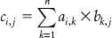. Bây giờ ta muốn xem có thể song song hóa việc tính C hay không. Giả sử các ma trận được bố trí tuần tự trong memory như sau: a<sub>1,1</sub>, a<sub>2,1</sub>, a<sub>3,1</sub>, a<sub>4,1</sub>, …, v.v.

6.6.1 [10] <§6.5> Giả sử tính C trên cả máy single-core shared-memory lẫn máy four-core shared-memory. Tính speed-up kỳ vọng trên máy four-core, bỏ qua mọi vấn đề memory.

6.6.2 [10] <§6.5> Lặp lại Bài tập 6.6.1, giả sử cập nhật C gây cache miss do false sharing khi các phần tử liên tiếp trong một hàng (tức index i) được cập nhật.

6.6.3 [10] <§6.5> Bạn sẽ khắc phục vấn đề false sharing có thể xảy ra như thế nào?

6.7 Xét các phần sau của hai chương trình khác nhau chạy cùng lúc trên bốn processor trong một symmetric multicore processor (SMP). Giả sử trước khi chạy code, cả x và y đều bằng 0.

Core 1: x = 2;

Core 2: y = 2;

Core 3: w = x + y + 1;

Core 4: z = x + y;

6.7.1 [10] <§6.5> Mọi giá trị kết quả có thể của w,x,y và z là gì? Với mỗi kết quả, giải thích cách đạt được các giá trị đó. Bạn cần xem xét mọi cách xen kẽ instruction có thể xảy ra.

6.7.2 [5] <§6.5> Làm thế nào để việc thực thi có tính xác định hơn, sao cho chỉ một tập giá trị có thể xảy ra?

6.8 Bài toán triết gia ăn tối là bài toán kinh điển về synchronization và concurrency. Bài toán tổng quát gồm các triết gia ngồi quanh bàn tròn, làm một trong hai việc: ăn hoặc suy nghĩ. Khi ăn họ không suy nghĩ; khi suy nghĩ họ không ăn. Ở giữa có một tô mì. Một chiếc nĩa được đặt giữa mỗi cặp triết gia. Kết quả là mỗi triết gia có một nĩa bên trái và một nĩa bên phải. Do cách ăn mì, mỗi người cần hai nĩa để ăn, và chỉ có thể dùng nĩa ngay bên trái và bên phải mình. Các triết gia không nói chuyện với nhau.

6.8.1 [10] <§6.7> Mô tả kịch bản không triết gia nào bao giờ được ăn (tức starvation). Chuỗi sự kiện dẫn đến vấn đề này là gì?

6.8.2 [10] <§6.7> Mô tả cách giải quyết bằng cách đưa vào khái niệm priority. Có thể bảo đảm đối xử công bằng với mọi triết gia không? Giải thích.

Bây giờ giả sử thuê một người phục vụ phụ trách phân nĩa cho các triết gia. Không ai được lấy nĩa trước khi được người phục vụ cho phép. Người phục vụ biết tình trạng toàn bộ nĩa. Hơn nữa, nếu đặt quy tắc rằng triết gia luôn yêu cầu lấy nĩa trái trước khi yêu cầu nĩa phải, ta có thể bảo đảm tránh deadlock.

6.8.3 [10] <§6.7> Có thể triển khai yêu cầu đến người phục vụ bằng queue yêu cầu hoặc bằng cách định kỳ thử lại yêu cầu. Với queue, yêu cầu được xử lý theo thứ tự nhận. Vấn đề là không phải lúc nào cũng phục vụ được triết gia có yêu cầu ở đầu queue (do tài nguyên không sẵn có). Mô tả kịch bản năm triết gia có queue nhưng không cho phục vụ dù có nĩa để một triết gia khác (có yêu cầu nằm sâu hơn trong queue) ăn.

6.8.4 [10] <§6.7> Nếu triển khai yêu cầu bằng cách định kỳ lặp lại cho đến khi tài nguyên sẵn có, điều này có giải quyết vấn đề Bài tập 6.8.3 không? Giải thích.

6.9 Xét ba tổ chức CPU sau:

CPU SS: Microprocessor superscalar two-core cung cấp khả năng out-of-order issue trên hai functional unit (FU). Chỉ một thread có thể chạy trên mỗi core tại một thời điểm.

CPU MT: Processor multithreaded fine-grained cho phép instruction từ hai thread chạy đồng thời (tức có hai functional unit), dù chỉ instruction từ một thread có thể issue trong bất kỳ cycle nào.

CPU SMT: Processor SMT cho phép instruction từ hai thread chạy đồng thời (tức có hai functional unit), và instruction từ một hoặc cả hai thread có thể issue để chạy trong bất kỳ cycle nào.

Giả sử có hai thread X và Y để chạy trên những CPU này, gồm các thao tác sau:

| Thread X | Thread Y |
|---|---|
| A1 – mất ba cycle thực thi | B1 – mất hai cycle thực thi |
| A2 – không dependency | B2 – tranh functional unit với B1 |
| A3 – tranh functional unit với A1 | B3 – phụ thuộc kết quả B2 |
| A4 – phụ thuộc kết quả A3 | B4 – không dependency, mất hai cycle thực thi |

Giả sử mọi instruction mất một cycle để thực thi, trừ khi có ghi khác hoặc gặp hazard.

6.9.1 [10] <§6.4> Giả sử có một SS CPU. Cần bao nhiêu cycle để thực thi hai thread? Bao nhiêu issue slot bị lãng phí do hazard?

6.9.2 [10] <§6.4> Bây giờ giả sử có hai SS CPU. Cần bao nhiêu cycle để thực thi hai thread? Bao nhiêu issue slot bị lãng phí do hazard?

6.9.3 [10] <§6.4> Giả sử có một MT CPU. Cần bao nhiêu cycle để thực thi hai thread? Bao nhiêu issue slot bị lãng phí do hazard?

6.9.4 [10] <§6.4> Giả sử có một SMT CPU. Cần bao nhiêu cycle để thực thi hai thread? Bao nhiêu issue slot bị lãng phí do hazard?

6.10 Virtualization software đang được triển khai mạnh để giảm chi phí quản lý server high-performance ngày nay. Các công ty như VMWare, Microsoft và IBM đều phát triển nhiều sản phẩm virtualization. Khái niệm chung được mô tả trong Chương 5 là đưa hypervisor layer vào giữa hardware và operating system để nhiều operating system chia sẻ cùng physical hardware. Hypervisor layer sau đó chịu trách nhiệm cấp phát CPU và memory, cũng như xử lý dịch vụ thường do operating system đảm nhiệm (ví dụ I/O).

Virtualization cung cấp cho hosted operating system và application software cái nhìn trừu tượng về hardware bên dưới. Điều này đòi hỏi suy nghĩ lại cách thiết kế các hệ multi-core và multiprocessor trong tương lai để nhiều operating system đồng thời chia sẻ CPU và memory.

6.10.1 [30] <§6.4> Chọn hai hypervisor trên thị trường hiện nay, so sánh điểm giống và khác trong cách ảo hóa, quản lý hardware bên dưới (CPU và memory).

6.10.2 [15] <§6.4> Thảo luận những thay đổi có thể cần trên nền tảng CPU multi-core tương lai để đáp ứng tốt hơn nhu cầu tài nguyên đặt lên hệ thống. Ví dụ, multithreading có thể đóng vai trò hiệu quả trong giảm cạnh tranh tài nguyên tính toán không?

6.11 Chúng ta muốn thực thi vòng lặp bên dưới hiệu quả nhất có thể. Có hai máy khác nhau, một máy MIMD và một máy SIMD.

```
for (i=0; i<2000; i++)
 for (j=0; j<3000; j++)
  X_array[i][j] = Y_array[j][i] + 200;
```

6.11.1 [10] <§6.3> Với máy MIMD bốn CPU, chỉ ra chuỗi RISC-V instruction sẽ thực thi trên mỗi CPU. Máy MIMD này có speed-up bao nhiêu?

6.11.2 [20] <§6.3> Với máy SIMD eight-wide (tức tám SIMD functional unit song song), viết assembly program dùng SIMD extension riêng của bạn cho RISC-V để thực thi vòng lặp. So sánh số instruction thực thi trên máy SIMD với máy MIMD.

6.12 Systolic array là ví dụ về máy MISD. Systolic array là pipeline network hay “wavefront” các data processing element. Mỗi element không cần program counter vì việc thực thi được kích hoạt khi dữ liệu đến. Systolic array có clock tính theo “lock-step”, mỗi processor luân phiên thực hiện pha tính toán và pha truyền thông.

6.12.1 [10] <§6.3> Xét các implementation systolic array được đề xuất (có thể tìm trên Internet hoặc ấn phẩm kỹ thuật). Sau đó thử lập trình vòng lặp Bài tập 6.11 bằng mô hình MISD này. Thảo luận mọi khó khăn gặp phải.

6.12.2 [10] <§6.3> Thảo luận điểm giống và khác giữa máy MISD và SIMD. Trả lời theo data-level parallelism.

6.13 Giả sử muốn thực thi vòng DAXPY trang 501 bằng RISC-V vector assembly trên NVIDIA 8800 GTX GPU mô tả trong chương. Trong bài này, giả sử mọi phép toán được thực hiện trên số floating-point single-precision (đổi tên vòng thành SAXPY). Giả sử instruction cần số cycle sau để thực thi.


6.13.1 [20] <§6.6> Mô tả cách xây dựng warp cho vòng SAXPY để khai thác tám core trong một multiprocessor.

6.14 Tải CUDA Toolkit và SDK từ https://developer.nvidia.com/cuda-toolkit. Bảo đảm dùng phiên bản code “emurelease” (Emulation Mode). (Bạn không cần NVIDIA hardware thực cho bài này.) Build các chương trình ví dụ trong SDK và xác nhận chúng chạy trên emulator.

6.14.1 [90] <§6.6> Dùng mẫu SDK “template” làm điểm xuất phát, viết chương trình CUDA thực hiện các vector operation sau:

1) a − b (phép trừ vector-vector)

2) a · b (tích vô hướng vector)

Tích vô hướng của hai vector a=[a<sub>1</sub>, a<sub>2</sub>, …, a<sub>n</sub>] và b=[b<sub>1</sub>, b<sub>2</sub>, …, b<sub>n</sub>] được định nghĩa là:


Nộp code cho từng chương trình minh họa mỗi thao tác và kiểm tra tính đúng của kết quả.

6.14.2 [90] <§6.6> Nếu có GPU hardware, thực hiện phân tích hiệu năng chương trình, khảo sát thời gian tính toán của GPU và phiên bản CPU trên một khoảng kích thước vector. Giải thích các kết quả quan sát được.

6.15 AMD gần đây công bố tích hợp graphics processing unit với các x86 core vào một package (dù clock của mỗi core khác nhau). Đây là ví dụ về heterogeneous multiprocessor system. Một điểm thiết kế chính là cho phép truyền dữ liệu nhanh giữa CPU và GPU. Trước AMD Fusion architecture, cần truyền thông giữa chip CPU và GPU riêng biệt. Hiện kế hoạch là dùng nhiều (ít nhất 16) PCI express channel để hỗ trợ liên lạc.

6.15.1 [25] <§6.6> So sánh bandwidth và latency gắn với hai công nghệ interconnect này.

6.16 Tham khảo Hình 6.14b, trình bày topology interconnect n-cube bậc 3 nối tám node. Một đặc tính hấp dẫn của topology n-cube là khả năng chịu link hỏng mà vẫn cung cấp kết nối.

6.16.1 [10] <§6.8> Xây dựng phương trình tính số link trong n-cube (n là bậc cube) có thể hỏng mà vẫn bảo đảm tồn tại link không hỏng để kết nối mọi node trong n-cube.

6.16.2 [10] <§6.8> So sánh khả năng chịu hỏng của n-cube với fully connected interconnection network. Vẽ đồ thị so sánh độ tin cậy theo số link được thêm cho hai topology.

6.17 Benchmarking là lĩnh vực nghiên cứu xác định workload tiêu biểu để chạy trên nền tảng tính toán cụ thể, nhằm so sánh khách quan hiệu năng giữa các hệ thống. Bài này so sánh hai nhóm benchmark: Whetstone CPU benchmark và PARSEC Benchmark suite. Chọn một chương trình PARSEC. Mọi chương trình cần có sẵn miễn phí trên Internet. Xét việc chạy nhiều bản Whetstone so với PARSEC Benchmark trên bất kỳ hệ nào trong Mục 6.11.

6.17.1 [60] <§6.10> Hai nhóm workload này có khác biệt vốn có nào khi chạy trên các hệ multi-core đó?

6.17.2 [60] <§6.10> Theo Roofline Model, kết quả chạy benchmark sẽ phụ thuộc thế nào vào mức sharing và synchronization có trong workload được dùng?

6.18 Khi tính toán trên sparse matrix, latency trong memory hierarchy trở thành yếu tố lớn hơn nhiều. Sparse matrix thiếu spatial locality trong datastream thường có ở matrix operation. Vì vậy, các biểu diễn ma trận mới đã được đề xuất.

Một trong các biểu diễn sparse matrix sớm nhất là Yale Sparse Matrix Format. Nó lưu sparse matrix M kích thước m×n ban đầu theo hàng bằng ba array one-dimensional. Gọi R là số entry khác 0 của M. Ta tạo array A độ dài R chứa mọi entry khác 0 của M (theo thứ tự left-to-right top-to-bottom). Ta cũng tạo array thứ hai IA độ dài m+1 (tức một entry cho mỗi hàng, cộng một). IA(i) chứa index trong A của phần tử khác 0 đầu tiên ở hàng i. Hàng i của ma trận gốc trải từ A(IA(i)) đến A(IA(i+1)−1). Array thứ ba JA chứa column index của từng phần tử A, vì thế cũng có độ dài R.

6.18.1 [15] <§6.10> Xét sparse matrix X bên dưới và viết code C để lưu nó theo Yale Sparse Matrix Format.

```
  Row 1 [1, 2, 0, 0, 0, 0]
  Row 2 [0, 0, 1, 1, 0, 0]
  Row 3 [0, 0, 0, 0, 9, 0]
  Row 4 [2, 0, 0, 0, 0, 2]
  Row 5 [0, 0, 3, 3, 0, 7]
  Row 6 [1, 3, 0, 0, 0, 1]
```

6.18.2 [10] <§6.10> Về storage space, giả sử mỗi phần tử trong X là floating point single-precision, tính dung lượng dùng để lưu ma trận trên theo Yale Sparse Matrix Format.

6.18.3 [15] <§6.10> Thực hiện phép nhân ma trận X với ma trận Y bên dưới.

```
  [2, 4, 1, 99, 7, 2]
```

Đặt phép tính trong vòng lặp và đo execution time. Bảo đảm tăng số lần thực thi vòng lặp để phép đo thời gian có độ phân giải tốt. So sánh runtime khi dùng biểu diễn ma trận ngây thơ và Yale Sparse Matrix Format.

6.18.4 [15] <§6.10> Bạn có thể tìm biểu diễn sparse matrix hiệu quả hơn về không gian và computational overhead không?

6.19 Trong các hệ tương lai, chúng ta kỳ vọng thấy heterogeneous computing platform được xây từ CPU khác loại. Một số đã bắt đầu xuất hiện trong thị trường embedded processing, trong những hệ chứa cả floating-point DSP và microcontroller CPU trong multichip module package. Giả sử bạn có ba nhóm CPU:

CPU A—CPU multi-core moderate-speed (có floating-point unit) có thể thực thi nhiều instruction mỗi cycle. CPU B—CPU integer single-core nhanh (tức không có floating-point unit), có thể thực thi một instruction mỗi cycle.

CPU C—CPU vector chậm (có khả năng floating-point), có thể thực thi nhiều bản sao cùng instruction mỗi cycle. Giả sử processor chạy ở các tần số sau:

| CPU A | CPU B | CPU C |
|---|---|---|
| 1 GHz | 3 GHz | 250 MHz |

CPU A thực thi hai instruction mỗi cycle, CPU B một instruction mỗi cycle, và CPU C tám instruction (qua cùng instruction) mỗi cycle. Giả sử mọi thao tác hoàn thành với latency một cycle mà không có hazard.

Cả ba CPU đều thực hiện được integer arithmetic, nhưng CPU B không thực hiện được floating point arithmetic. CPU A và B có instruction set giống RISC-V processor. CPU C chỉ thực hiện được phép cộng, trừ floating point, cùng memory load và store. Giả sử mọi CPU truy cập được shared memory và synchronization không có chi phí. Nhiệm vụ là so sánh hai ma trận X, Y, mỗi ma trận chứa 1024 ×1024 phần tử floating-point. Output phải là số index mà giá trị X lớn hơn hoặc bằng giá trị Y.

6.19.1 [10] <§6.11> Mô tả cách chia bài toán trên ba CPU khác nhau để đạt hiệu năng tốt nhất.

6.19.2 [10] <§6.11> Bạn sẽ thêm loại instruction nào vào vector CPU C để đạt hiệu năng tốt hơn?

6.20 Câu hỏi này xem xét lượng xếp hàng xảy ra trong hệ thống, khi biết transaction processing rate tối đa và latency trung bình quan sát được của một transaction. Latency gồm cả service time (tính từ rate tối đa) và queue time.

Giả sử hệ thống máy tính quad-core xử lý database query ở trạng thái ổn định với tốc độ tối đa rate request mỗi giây. Cũng giả sử mỗi transaction trung bình mất lat ms để xử lý. Với mỗi cặp trong bảng, trả lời những câu hỏi sau:

| Transaction latency trung bình | Transaction processing rate tối đa |
|---|---|
| 1 ms | 5000/sec |
| 2 ms | 5000/sec |
| 1 ms | 10,000/sec |
| 2 ms | 10,000/sec |

Với mỗi cặp trong bảng, trả lời những câu hỏi sau:

6.20.1 [10] <§6.11> Trung bình có bao nhiêu request đang được xử lý tại bất kỳ thời điểm nào?

6.20.2 [10] <§6.11> Nếu chuyển sang hệ eight-core, về lý tưởng system throughput sẽ thay đổi thế nào (tức máy xử lý bao nhiêu query mỗi giây)?

6.20.3 [10] <§6.11> Thảo luận vì sao hiếm khi đạt speed-up như vậy chỉ bằng tăng số core.

### Đáp án Tự kiểm tra

§6.1, trang 494: Sai. Task-level parallelism có thể hỗ trợ ứng dụng tuần tự và có thể làm ứng dụng tuần tự chạy trên hardware song song, dù khó khăn hơn.

§6.2, trang 499: Sai. Weak scaling có thể bù cho phần tuần tự của chương trình vốn sẽ hạn chế scalability, nhưng strong scaling thì không.

§6.3, trang 504: Đúng, nhưng chúng thiếu những tính năng vector hữu ích như gather-scatter và vector length register để cải thiện hiệu quả vector architecture. (Như phần giải thích thêm trong mục này đề cập, các mở rộng SIMD AVX2 cung cấp indexed load qua thao tác gather nhưng không cung cấp scatter cho indexed store. Thế hệ x86 microprocessor Haswell là thế hệ đầu hỗ trợ AVX2.)

§6.4, trang 509: 1. Đúng. 2. Đúng.

§6.5, trang 513: Sai. Vì shared address là physical address, nhiều tác vụ, mỗi tác vụ trong virtual address space riêng, có thể chạy tốt trên shared memory multiprocessor.

§6.6, trang 521: Sai. Chip graphics DRAM được đánh giá cao vì bandwidth cao hơn.

§6.7, trang 526: 1. Sai. Gửi và nhận message là synchronization ngầm định, đồng thời là cách chia sẻ dữ liệu. 2. Đúng.

§6.8, trang 528: Đúng.

§6.10, trang 540: Đúng. Có lẽ cần đổi mới ở mọi mức trong hardware và software stack để điện toán song song thành công.
