# 1 Tham quan các hệ thống máy tính

Một hệ thống máy tính gồm hardware và systems software phối hợp với nhau để chạy các chương trình ứng dụng. Cách triển khai cụ thể của các hệ thống thay đổi theo thời gian, nhưng các khái niệm nền tảng thì không. Mọi hệ thống máy tính đều có những thành phần hardware và software tương tự, thực hiện các chức năng tương tự. Cuốn sách này dành cho những lập trình viên muốn nâng cao tay nghề bằng cách hiểu cách hoạt động của các thành phần đó và cách chúng ảnh hưởng đến tính đúng đắn cũng như hiệu năng của chương trình.

Bạn sắp bước vào một hành trình thú vị. Nếu dành tâm sức học các khái niệm trong cuốn sách này, bạn sẽ tiến gần hơn đến việc trở thành một “power programmer” hiếm có, với sự hiểu biết sâu sắc về hệ thống máy tính bên dưới và tác động của nó đến các chương trình ứng dụng của mình.

Bạn sẽ học những kỹ năng thực tế, chẳng hạn cách tránh các lỗi số học kỳ lạ do cách máy tính biểu diễn số gây ra. Bạn sẽ học cách tối ưu code C bằng những kỹ thuật khéo léo khai thác thiết kế của processor và hệ thống bộ nhớ hiện đại. Bạn sẽ học cách compiler triển khai procedure call và cách dùng kiến thức đó để tránh những lỗ hổng bảo mật do buffer overflow vốn gây nhiều vấn đề cho software mạng và Internet. Bạn sẽ học cách nhận biết và tránh các lỗi khó chịu trong quá trình linking khiến nhiều lập trình viên bối rối. Bạn sẽ học cách viết Unix shell, gói cấp phát bộ nhớ động, và thậm chí Web server của riêng mình. Bạn sẽ tìm hiểu những triển vọng và cạm bẫy của concurrency, một chủ đề ngày càng quan trọng khi nhiều processor core được tích hợp trên cùng một chip.

Trong tác phẩm kinh điển về ngôn ngữ lập trình C [61], Kernighan và Ritchie giới thiệu C với người đọc thông qua chương trình hello ở Hình 1.1. Mặc dù hello là một chương trình rất đơn giản, mọi bộ phận chính của hệ thống đều phải phối hợp nhịp nhàng để chương trình chạy đến khi hoàn tất. Theo một nghĩa nào đó, mục tiêu của cuốn sách này là giúp bạn hiểu điều gì xảy ra và vì sao khi chạy hello trên hệ thống của mình.

Chúng ta bắt đầu tìm hiểu hệ thống bằng cách lần theo vòng đời của chương trình hello, từ lúc được lập trình viên tạo ra cho đến khi chạy trên hệ thống, in thông báo đơn giản rồi kết thúc. Khi lần theo vòng đời chương trình, chúng ta sẽ giới thiệu ngắn gọn các khái niệm, thuật ngữ và thành phần chủ chốt tham gia vào quá trình đó. Những chương sau sẽ phát triển các ý tưởng này chi tiết hơn.

```
                                                        code/intro/hello.c
1   #include <stdio.h>
2
3   int main()
4   {
5       printf("hello, world\n");
6       return 0;
7   }
                                                        code/intro/hello.c
```

**Hình 1.1 Chương trình hello. (Nguồn: [60])**

```
 #    i    n    c    l    u     d    e    SP   <    s    t    d    i    o    .
 35  105  110   99  108   117  100  101   32   60  115  116  100  105  111   46

 h    >    \n   \n   i    n     t    SP   m    a    i    n    (    )    \n   {
104   62   10   10  105   110  116   32  109   97  105  110   40   41   10  123

 \n   SP   SP   SP   SP   p     r    i    n    t    f    (    "    h    e    l
 10   32   32   32   32   112  114  105  110  116  102   40   34  104  101  108

 l    o    ,    SP   w    o     r    l    d    \    n    "    )    ;    \n   SP
108  111   44   32  119   111  114  108  100   92  110   34   41   59   10   32

 SP   SP   SP   r    e    t     u    r    n    SP   0    ;    \n   }    \n
 32   32   32  114  101   116  117  114  110   32   48   59   10  125   10
```

**Hình 1.2 Biểu diễn văn bản ASCII của hello.c .**

## 1.1 Thông tin là bit + ngữ cảnh

Chương trình hello của chúng ta bắt đầu tồn tại dưới dạng một source program (hoặc source file) do lập trình viên tạo bằng editor và lưu trong text file có tên hello.c. Source program là một chuỗi bit, mỗi bit có giá trị 0 hoặc 1, được tổ chức thành các nhóm 8-bit gọi là byte. Mỗi byte biểu diễn một ký tự văn bản nào đó trong chương trình.

Phần lớn hệ thống máy tính biểu diễn các ký tự văn bản theo chuẩn ASCII, trong đó mỗi ký tự được biểu diễn bằng một giá trị số nguyên byte-size duy nhất.[^1] Ví dụ, Hình 1.2 trình bày biểu diễn ASCII của chương trình hello.c.

Chương trình hello.c được lưu trong file dưới dạng một chuỗi byte. Mỗi byte có một giá trị số nguyên tương ứng với một ký tự nào đó. Ví dụ, byte đầu tiên có giá trị số nguyên 35, tương ứng với ký tự ‘#’. Byte thứ hai có giá trị số nguyên 105, tương ứng với ký tự ‘i’, v.v. Lưu ý rằng mỗi dòng văn bản kết thúc bằng ký tự newline không hiển thị ‘\n’, được biểu diễn bằng giá trị số nguyên 10. Các file như hello.c chỉ gồm các ký tự ASCII được gọi là text file. Mọi file khác được gọi là binary file.

Biểu diễn của hello.c minh họa một ý tưởng nền tảng: mọi thông tin trong hệ thống—bao gồm file trên đĩa, chương trình lưu trong bộ nhớ, dữ liệu người dùng lưu trong bộ nhớ và dữ liệu truyền qua mạng—đều được biểu diễn bằng một tập hợp bit. Điều duy nhất phân biệt các đối tượng dữ liệu khác nhau là ngữ cảnh mà chúng ta xem xét chúng. Ví dụ, trong những ngữ cảnh khác nhau, cùng một chuỗi byte có thể biểu diễn một số nguyên, số floating-point, chuỗi ký tự hoặc machine instruction.

Là lập trình viên, chúng ta cần hiểu các biểu diễn số của máy vì chúng không giống các số nguyên và số thực. Chúng là các giá trị xấp xỉ hữu hạn, có thể hoạt động theo những cách ngoài dự kiến. Ý tưởng nền tảng này được khảo sát chi tiết trong Chương 2.

### Ghi chú Nguồn gốc của ngôn ngữ lập trình C

C được Dennis Ritchie tại Bell Laboratories phát triển từ năm 1969 đến năm 1973. American National Standards Institute (ANSI) phê chuẩn chuẩn ANSI C năm 1989; sau đó trách nhiệm chuẩn hóa được chuyển cho International Standards Organization (ISO). Các chuẩn định nghĩa ngôn ngữ C và một tập hợp library function được gọi là C standard library. Kernighan và Ritchie mô tả ANSI C trong cuốn sách kinh điển thường được gọi thân mật là “K&R” [61]. Theo lời Ritchie [92], C “kỳ quặc, có khiếm khuyết, và thành công vang dội”. Vậy vì sao C thành công?

- C gắn bó chặt chẽ với Unix operating system. Ngay từ đầu, C được phát triển làm ngôn ngữ lập trình hệ thống cho Unix. Phần lớn Unix kernel (phần lõi của operating system), cùng toàn bộ tool và library hỗ trợ, được viết bằng C. Khi Unix trở nên phổ biến tại các trường đại học vào cuối thập niên 1970 và đầu thập niên 1980, nhiều người được tiếp xúc với C và nhận ra rằng họ thích ngôn ngữ này. Vì Unix được viết gần như hoàn toàn bằng C, nó có thể dễ dàng được port sang các máy mới, từ đó thu hút thêm nhiều người sử dụng cả C lẫn Unix.

- C là một ngôn ngữ nhỏ, đơn giản. Thiết kế được một người duy nhất kiểm soát thay vì một ủy ban; kết quả là một thiết kế rõ ràng, nhất quán và ít gánh nặng đi kèm. Cuốn K&R mô tả toàn bộ ngôn ngữ và standard library, cùng nhiều ví dụ và bài tập, chỉ trong 261 trang. Tính đơn giản khiến C tương đối dễ học và dễ port sang các máy tính khác nhau.

- C được thiết kế cho một mục đích thực tế. C được thiết kế để triển khai Unix operating system. Sau này, những người khác nhận ra họ có thể viết các chương trình mình muốn mà không bị ngôn ngữ cản trở.

C là ngôn ngữ được ưu tiên cho lập trình system-level, và cũng có một lượng khổng lồ các chương trình application-level đã được triển khai. Tuy nhiên, C không hoàn hảo cho mọi lập trình viên và mọi tình huống. Pointer trong C thường gây nhầm lẫn và lỗi lập trình. C cũng thiếu sự hỗ trợ tường minh cho các abstraction hữu ích như class, object và exception. Các ngôn ngữ mới hơn như C++ và Java giải quyết những vấn đề này cho các chương trình application-level.

## 1.2 Chương trình được các chương trình khác chuyển đổi sang những dạng khác nhau

Chương trình hello bắt đầu tồn tại dưới dạng chương trình C high-level vì ở dạng đó con người có thể đọc và hiểu được. Tuy nhiên, để chạy hello.c trên hệ thống, từng câu lệnh C phải được các chương trình khác chuyển đổi thành một chuỗi machine-language instruction low-level. Sau đó, các instruction này được đóng gói dưới dạng executable object program và lưu thành binary file trên đĩa. Object program còn được gọi là executable object file.

Trên hệ thống Unix, việc chuyển từ source file sang object file được thực hiện bởi một compiler driver:

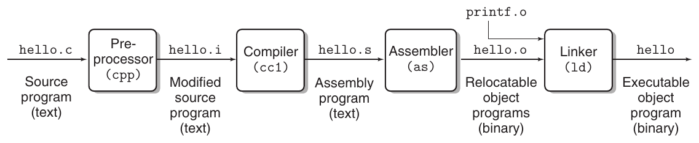

**Hình 1.3 Compilation system.**

```
linux> gcc -o hello hello.c
```

Ở đây, compiler driver gcc đọc source file hello.c và chuyển nó thành executable object file hello. Việc chuyển đổi được thực hiện theo chuỗi bốn giai đoạn trong Hình 1.3. Các chương trình thực hiện bốn giai đoạn đó (preprocessor, compiler, assembler và linker) được gọi chung là compilation system.

- Giai đoạn preprocessing. Preprocessor (cpp) sửa đổi chương trình C gốc theo các directive bắt đầu bằng ký tự ‘#’. Ví dụ, lệnh #include <stdio.h> ở dòng 1 của hello.c yêu cầu preprocessor đọc nội dung system header file stdio.h và chèn trực tiếp vào văn bản chương trình. Kết quả là một chương trình C khác, thường có hậu tố .i.

- Giai đoạn compilation. Compiler (cc1) chuyển text file hello.i thành text file hello.s, chứa một chương trình assembly-language. Chương trình này bao gồm định nghĩa sau của function main:

```
1   main:
2     subq    $8, %rsp
3     movl    $.LC0, %edi
4     call    puts
5     movl    $0, %eax
6     addq    $8, %rsp
7     ret
```

Mỗi dòng từ 2–7 trong định nghĩa này mô tả một machine-language instruction low-level dưới dạng văn bản. Assembly language hữu ích vì cung cấp một ngôn ngữ output chung cho các compiler khác nhau của các ngôn ngữ high-level khác nhau. Ví dụ, cả compiler C lẫn compiler Fortran đều tạo output file bằng cùng một assembly language.

- Giai đoạn assembly. Tiếp theo, assembler (as) chuyển hello.s thành các machine-language instruction, đóng gói chúng dưới dạng relocatable object program và lưu kết quả vào object file hello.o. Đây là một binary file chứa 17 byte để mã hóa các instruction cho function main. Nếu xem hello.o bằng text editor, nội dung của nó sẽ trông như những ký tự vô nghĩa.

### Ghi chú Dự án GNU

Gcc là một trong nhiều tool hữu ích do dự án GNU (viết tắt của GNU’s Not Unix) phát triển. Dự án GNU là một tổ chức từ thiện tax-exempt do Richard Stallman khởi xướng năm 1984, với mục tiêu đầy tham vọng là phát triển một hệ thống Unix-like hoàn chỉnh có source code không bị ràng buộc bởi các hạn chế về cách sửa đổi hoặc phân phối. Dự án GNU đã phát triển một môi trường có mọi thành phần chính của Unix operating system, ngoại trừ kernel được dự án Linux phát triển riêng. Môi trường GNU gồm editor emacs, compiler gcc, debugger gdb, assembler, linker, các tiện ích thao tác binary và những thành phần khác. Compiler gcc đã phát triển để hỗ trợ nhiều ngôn ngữ, với khả năng tạo code cho nhiều loại máy khác nhau. Các ngôn ngữ được hỗ trợ gồm C, C++, Fortran, Java, Pascal, Objective-C và Ada.

Dự án GNU là một thành tựu đáng kể nhưng thường bị bỏ qua. Phong trào open-source hiện đại (thường gắn với Linux) có nguồn gốc tư tưởng từ khái niệm free software của dự án GNU (“free” theo nghĩa “tự do ngôn luận”, không phải “bia miễn phí”). Hơn nữa, Linux có được phần lớn sự phổ biến nhờ các GNU tool cung cấp môi trường cho Linux kernel.

- Giai đoạn linking. Lưu ý rằng chương trình hello gọi function printf, là một phần của standard C library do mọi compiler C cung cấp. Function printf nằm trong một precompiled object file riêng có tên printf.o, cần được hợp nhất với chương trình hello.o của chúng ta bằng cách nào đó. Linker (ld) xử lý việc hợp nhất này. Kết quả là file hello, một executable object file (hoặc đơn giản là executable) sẵn sàng được hệ thống load vào bộ nhớ và thực thi.

## 1.3 Hiểu cách compilation system hoạt động mang lại lợi ích

Với các chương trình đơn giản như hello.c, chúng ta có thể dựa vào compilation system để tạo machine code chính xác và hiệu quả. Tuy nhiên, có một số lý do quan trọng khiến lập trình viên cần hiểu cách compilation system hoạt động:

- Tối ưu hiệu năng chương trình. Compiler hiện đại là những tool tinh vi, thường tạo ra code tốt. Là lập trình viên, chúng ta không cần biết hoạt động bên trong compiler để viết code hiệu quả. Tuy nhiên, để đưa ra những quyết định viết code đúng đắn trong chương trình C, chúng ta cần hiểu cơ bản về code machine-level và cách compiler chuyển các câu lệnh C khác nhau thành machine code. Ví dụ, câu lệnh switch có luôn hiệu quả hơn một chuỗi câu lệnh if-else không? Một function call gây ra bao nhiêu overhead? Vòng lặp while có hiệu quả hơn vòng lặp for không? Tham chiếu pointer có hiệu quả hơn dùng array index không? Vì sao vòng lặp chạy nhanh hơn nhiều nếu cộng dồn vào local variable thay vì một argument được truyền bằng reference? Làm sao một function có thể chạy nhanh hơn khi chúng ta chỉ sắp xếp lại dấu ngoặc trong arithmetic expression? Trong Chương 3, chúng ta giới thiệu x86-64, machine language của những thế hệ máy tính Linux, Macintosh và Windows gần đây. Chúng ta mô tả cách compiler chuyển các cấu trúc C khác nhau sang ngôn ngữ này. Trong Chương 5, bạn sẽ học cách điều chỉnh hiệu năng chương trình C bằng những biến đổi đơn giản đối với code C, giúp compiler thực hiện công việc tốt hơn. Trong Chương 6, bạn sẽ tìm hiểu tính phân cấp của hệ thống bộ nhớ, cách compiler C lưu data array trong bộ nhớ và cách chương trình C khai thác kiến thức đó để chạy hiệu quả hơn.

- Hiểu các lỗi link-time. Theo kinh nghiệm của chúng tôi, một số lỗi lập trình gây bối rối nhất có liên quan đến hoạt động của linker, đặc biệt khi bạn cố gắng build những hệ thống software lớn. Ví dụ, linker báo không thể resolve một reference có nghĩa là gì? Static variable khác global variable như thế nào? Điều gì xảy ra nếu bạn định nghĩa hai global variable trùng tên trong những file C khác nhau? Static library khác dynamic library như thế nào? Vì sao thứ tự liệt kê library trên command line lại quan trọng? Và đáng sợ nhất, vì sao một số lỗi linker-related chỉ xuất hiện khi chạy? Bạn sẽ tìm thấy câu trả lời cho những câu hỏi này trong Chương 7.

- Tránh lỗ hổng bảo mật. Trong nhiều năm, các lỗ hổng buffer overflow là nguyên nhân của nhiều lỗ hổng bảo mật trong server mạng và Internet. Chúng tồn tại vì quá ít lập trình viên hiểu sự cần thiết phải giới hạn cẩn thận số lượng và dạng dữ liệu chấp nhận từ các nguồn không đáng tin cậy. Bước đầu tiên để học lập trình an toàn là hiểu hệ quả của cách dữ liệu và thông tin điều khiển được lưu trên program stack. Chúng ta tìm hiểu các quy tắc sử dụng stack và các lỗ hổng buffer overflow trong Chương 3 khi nghiên cứu assembly language. Chúng ta cũng sẽ tìm hiểu các phương pháp mà lập trình viên, compiler và operating system có thể sử dụng để giảm nguy cơ bị tấn công.

## 1.4 Processor đọc và diễn giải các instruction lưu trong bộ nhớ

Đến đây, source program hello.c đã được compilation system chuyển thành executable object file có tên hello và lưu trên đĩa. Để chạy executable file trên hệ thống Unix, chúng ta gõ tên của nó vào một chương trình ứng dụng được gọi là shell:

```
linux> ./hello
hello, world
linux>
```

Shell là một command-line interpreter: nó in prompt, đợi bạn gõ command line, rồi thực hiện lệnh đó. Nếu từ đầu tiên trên command line không tương ứng với một lệnh shell built-in, shell giả định đó là tên của một executable file cần load và chạy. Vì vậy, trong trường hợp này, shell load và chạy chương trình hello rồi đợi chương trình kết thúc. Chương trình hello in thông báo lên màn hình rồi kết thúc. Sau đó shell in prompt và đợi command line tiếp theo.

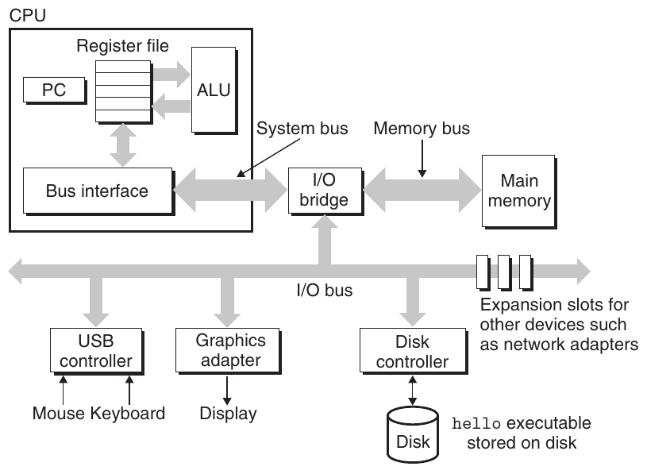

**Hình 1.4 Tổ chức hardware của một hệ thống điển hình. CPU: central processing unit, ALU: arithmetic/logic unit, PC: program counter, USB: Universal Serial Bus.**

### 1.4.1 Tổ chức hardware của một hệ thống

Để hiểu điều gì xảy ra với chương trình hello khi chạy, chúng ta cần hiểu tổ chức hardware của một hệ thống điển hình, được trình bày trong Hình 1.4. Hình cụ thể này được xây dựng theo họ hệ thống Intel gần đây, nhưng mọi hệ thống đều có cách tổ chức tương tự. Bạn chưa cần lo về độ phức tạp của hình. Chúng ta sẽ lần lượt tìm hiểu các chi tiết của nó trong suốt cuốn sách.

### Bus

Xuyên suốt hệ thống là một tập hợp đường dẫn điện được gọi là bus, truyền các byte thông tin qua lại giữa các thành phần. Bus thường được thiết kế để truyền những nhóm byte fixed-size được gọi là word. Số byte trong một word (word size) là một tham số hệ thống cơ bản, khác nhau giữa các hệ thống. Phần lớn máy hiện nay có word size là 4 byte (32 bit) hoặc 8 byte (64 bit). Trong cuốn sách này, chúng ta không giả định một định nghĩa cố định nào về word size. Thay vào đó, chúng ta sẽ nêu rõ “word” có nghĩa gì trong mọi ngữ cảnh cần định nghĩa nó.

### Thiết bị I/O

Các thiết bị input/output (I/O) là kết nối của hệ thống với thế giới bên ngoài. Hệ thống ví dụ có bốn thiết bị I/O: keyboard và mouse để người dùng nhập dữ liệu, display để xuất dữ liệu cho người dùng, và disk drive (hoặc đơn giản là disk) để lưu trữ long-term dữ liệu và chương trình. Ban đầu, chương trình executable hello nằm trên đĩa.

Mỗi thiết bị I/O được nối với I/O bus thông qua controller hoặc adapter. Sự khác biệt giữa hai loại này chủ yếu nằm ở cách đóng gói. Controller là các chip set nằm trong chính thiết bị hoặc trên main printed circuit board của hệ thống (thường được gọi là motherboard). Adapter là một card cắm vào slot trên motherboard. Dù thuộc loại nào, mục đích của chúng đều là truyền thông tin qua lại giữa I/O bus và thiết bị I/O.

Chương 6 trình bày thêm về cách hoạt động của các thiết bị I/O như disk. Trong Chương 10, bạn sẽ học cách sử dụng Unix I/O interface để truy cập thiết bị từ chương trình ứng dụng. Chúng ta tập trung vào một loại thiết bị đặc biệt thú vị là mạng, nhưng các kỹ thuật đó cũng áp dụng được cho những loại thiết bị khác.

### Main memory

Main memory là thiết bị lưu trữ tạm thời chứa cả chương trình lẫn dữ liệu mà chương trình thao tác trong khi processor thực thi chương trình. Về mặt vật lý, main memory gồm một tập hợp chip dynamic random access memory (DRAM). Về mặt logic, bộ nhớ được tổ chức thành một array tuyến tính các byte, mỗi byte có địa chỉ duy nhất riêng (array index), bắt đầu từ 0. Nhìn chung, mỗi machine instruction cấu thành chương trình có thể gồm một số lượng byte thay đổi. Kích thước của các mục dữ liệu tương ứng với variable trong chương trình C thay đổi theo kiểu. Ví dụ, trên máy x86-64 chạy Linux, dữ liệu kiểu short cần 2 byte, kiểu int và float cần 4 byte, còn kiểu long và double cần 8 byte.

Chương 6 trình bày thêm về cách hoạt động của các công nghệ bộ nhớ như chip DRAM và cách kết hợp chúng thành main memory.

### Processor

Central processing unit (CPU), hay đơn giản là processor, là bộ phận diễn giải (hoặc thực thi) các instruction lưu trong main memory. Cốt lõi của nó là một thiết bị lưu trữ word-size (hay register) được gọi là program counter (PC). Tại bất kỳ thời điểm nào, PC trỏ tới (chứa địa chỉ của) một machine-language instruction nào đó trong main memory.[^2]

Từ lúc hệ thống được cấp nguồn cho đến khi tắt nguồn, processor liên tục thực thi instruction mà program counter trỏ tới, rồi cập nhật program counter để trỏ tới instruction tiếp theo. Processor có vẻ hoạt động theo một mô hình thực thi instruction rất đơn giản, được instruction set architecture của nó định nghĩa. Trong mô hình này, các instruction được thực thi theo thứ tự nghiêm ngặt, và việc thực thi một instruction bao gồm một chuỗi bước. Processor đọc instruction từ vị trí bộ nhớ mà program counter (PC) trỏ tới, diễn giải các bit trong instruction, thực hiện một thao tác đơn giản do instruction quy định, rồi cập nhật PC để trỏ tới instruction tiếp theo; instruction đó có thể nằm liền kề hoặc không liền kề trong bộ nhớ với instruction vừa được thực thi.

Chỉ có một vài thao tác đơn giản như vậy, xoay quanh main memory, register file và arithmetic/logic unit (ALU). Register file là một thiết bị lưu trữ nhỏ gồm một tập hợp register word-size, mỗi register có tên duy nhất riêng. ALU tính các giá trị dữ liệu và địa chỉ mới. Sau đây là một số ví dụ về các thao tác đơn giản mà CPU có thể thực hiện theo yêu cầu của instruction:

- Load: Sao chép một byte hoặc một word từ main memory vào register, ghi đè nội dung trước đó của register.

- Store: Sao chép một byte hoặc một word từ register tới một vị trí trong main memory, ghi đè nội dung trước đó của vị trí đó.

- Operate: Sao chép nội dung của hai register tới ALU, thực hiện một arithmetic operation trên hai word và lưu kết quả vào register, ghi đè nội dung trước đó của register đó.

- Jump: Trích xuất một word từ chính instruction và sao chép word đó vào program counter (PC), ghi đè giá trị trước đó của PC.

Chúng ta nói processor có vẻ là một cách triển khai đơn giản của instruction set architecture, nhưng thực tế processor hiện đại dùng các cơ chế phức tạp hơn nhiều để tăng tốc thực thi chương trình. Vì vậy, có thể phân biệt instruction set architecture của processor, mô tả tác động của từng machine-code instruction, với microarchitecture, mô tả cách processor thực sự được triển khai. Khi nghiên cứu machine code trong Chương 3, chúng ta sẽ xem xét abstraction do instruction set architecture của máy cung cấp. Chương 4 trình bày thêm về cách processor thực sự được triển khai. Chương 5 mô tả một mô hình hoạt động của processor hiện đại giúp dự đoán và tối ưu hiệu năng của các chương trình machine-language.

### 1.4.2 Chạy chương trình hello

Với cách nhìn đơn giản này về tổ chức và hoạt động hardware của hệ thống, chúng ta có thể bắt đầu hiểu điều gì xảy ra khi chạy chương trình ví dụ. Ở đây, chúng ta phải lược đi nhiều chi tiết sẽ được bổ sung sau, nhưng hiện tại chỉ cần nắm được bức tranh tổng thể.

Ban đầu, chương trình shell đang thực thi các instruction của nó và đợi chúng ta gõ lệnh. Khi chúng ta gõ các ký tự ./hello trên keyboard, chương trình shell đọc từng ký tự vào register rồi lưu vào bộ nhớ, như trong Hình 1.5.

Khi chúng ta nhấn phím enter trên keyboard, shell biết rằng chúng ta đã gõ xong lệnh. Sau đó shell load executable file hello bằng cách thực thi một chuỗi instruction sao chép code và dữ liệu trong object file hello từ đĩa vào main memory. Dữ liệu bao gồm chuỗi ký tự hello, world\n cuối cùng sẽ được in ra.

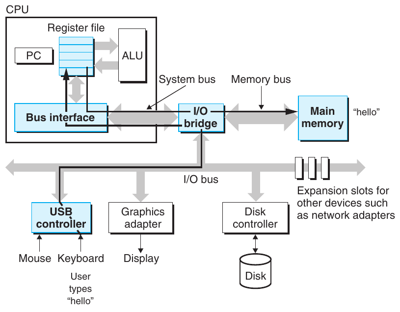

**Hình 1.5 Đọc lệnh hello từ keyboard.**

Sử dụng kỹ thuật direct memory access (DMA, được thảo luận trong Chương 6), dữ liệu đi trực tiếp từ đĩa tới main memory mà không qua processor. Bước này được trình bày trong Hình 1.6.

Khi code và dữ liệu trong object file hello đã được load vào bộ nhớ, processor bắt đầu thực thi các machine-language instruction trong routine main của chương trình hello. Các instruction này sao chép những byte trong chuỗi hello, world\n từ bộ nhớ vào register file, rồi từ đó tới thiết bị display để hiển thị lên màn hình. Bước này được trình bày trong Hình 1.7.

## 1.5 Tầm quan trọng của cache

Một bài học quan trọng từ ví dụ đơn giản này là hệ thống dành nhiều thời gian di chuyển thông tin từ nơi này sang nơi khác. Các machine instruction trong chương trình hello ban đầu được lưu trên đĩa. Khi chương trình được load, chúng được sao chép vào main memory. Khi processor chạy chương trình, các instruction được sao chép từ main memory vào processor. Tương tự, chuỗi dữ liệu hello,world\n ban đầu trên đĩa được sao chép vào main memory, rồi từ main memory tới thiết bị display. Từ góc nhìn của lập trình viên, phần lớn việc sao chép này là overhead làm chậm “công việc thực sự” của chương trình. Vì vậy, một mục tiêu lớn của người thiết kế hệ thống là làm cho các thao tác sao chép này chạy nhanh nhất có thể.

Do các định luật vật lý, thiết bị lưu trữ lớn hơn chậm hơn thiết bị nhỏ hơn. Và thiết bị nhanh hơn có chi phí chế tạo cao hơn thiết bị chậm hơn tương ứng. Ví dụ, disk drive trong một hệ thống điển hình có thể lớn gấp 1,000 lần main memory, nhưng processor có thể mất thời gian đọc một word từ đĩa lâu gấp 10,000,000 lần so với từ bộ nhớ.

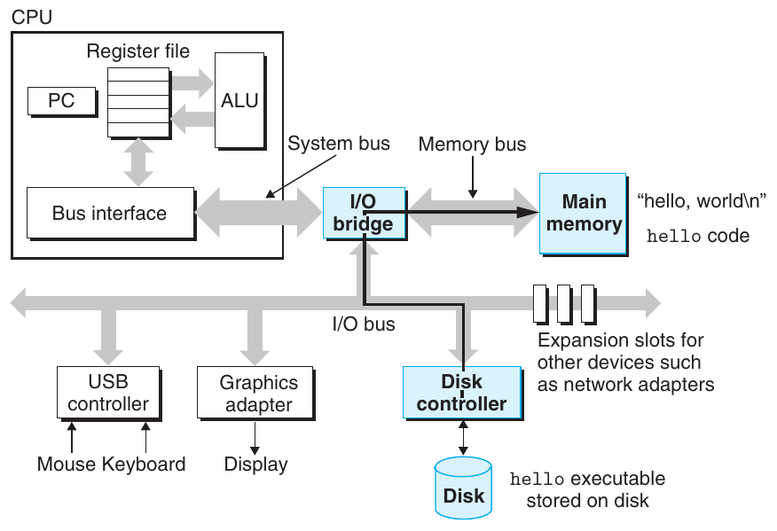

**Hình 1.6 Load executable từ đĩa vào main memory.**

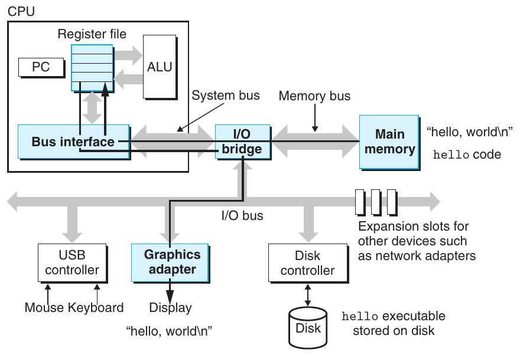

**Hình 1.7 Ghi chuỗi output từ bộ nhớ tới display.**

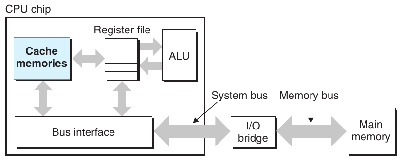

**Hình 1.8 Các cache memory.**

Tương tự, một register file điển hình chỉ lưu vài trăm byte thông tin, so với hàng tỷ byte trong main memory. Tuy nhiên, processor có thể đọc dữ liệu từ register file nhanh hơn gần 100 lần so với từ bộ nhớ. Đáng ngại hơn, khi công nghệ bán dẫn tiến bộ qua các năm, khoảng cách giữa processor và memory này tiếp tục tăng. Làm cho processor chạy nhanh hơn dễ và rẻ hơn làm cho main memory chạy nhanh hơn.

Để xử lý khoảng cách giữa processor và memory, người thiết kế hệ thống bổ sung những thiết bị lưu trữ nhỏ hơn, nhanh hơn gọi là cache memory (hoặc đơn giản là cache), đóng vai trò vùng lưu tạm cho thông tin mà processor có khả năng cần trong tương lai gần. Hình 1.8 trình bày các cache memory trong một hệ thống điển hình. L1 cache trên processor chip chứa hàng chục nghìn byte và có tốc độ truy cập gần bằng register file. L2 cache lớn hơn, chứa từ hàng trăm nghìn đến hàng triệu byte, được nối với processor qua một bus đặc biệt. Processor có thể mất thời gian truy cập L2 cache lâu gấp 5 lần L1 cache, nhưng vẫn nhanh hơn truy cập main memory từ 5 đến 10 lần. L1 cache và L2 cache được triển khai bằng công nghệ hardware gọi là static random access memory (SRAM). Các hệ thống mới và mạnh hơn thậm chí có ba cấp cache: L1, L2 và L3. Ý tưởng đằng sau caching là hệ thống có thể đạt hiệu quả của cả bộ nhớ rất lớn lẫn bộ nhớ rất nhanh bằng cách khai thác locality, tức xu hướng chương trình truy cập dữ liệu và code trong các vùng cục bộ. Bằng cách bố trí cache để giữ dữ liệu có khả năng được truy cập thường xuyên, chúng ta có thể thực hiện phần lớn thao tác bộ nhớ bằng cache nhanh.

Một trong những bài học quan trọng nhất của cuốn sách này là lập trình viên ứng dụng hiểu về cache memory có thể khai thác chúng để cải thiện hiệu năng chương trình lên một bậc mười. Bạn sẽ tìm hiểu thêm về các thiết bị quan trọng này và cách khai thác chúng trong Chương 6.

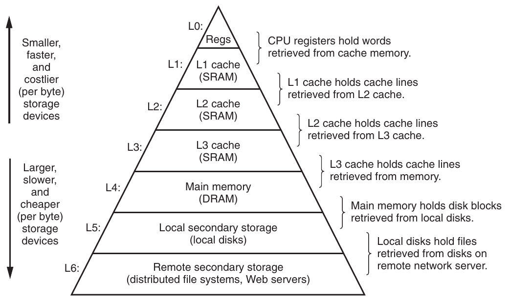

**Hình 1.9 Một ví dụ về memory hierarchy.**

## 1.6 Các thiết bị lưu trữ tạo thành một hệ phân cấp

Ý tưởng chèn một thiết bị lưu trữ nhỏ hơn, nhanh hơn (ví dụ cache memory) giữa processor và thiết bị lớn hơn, chậm hơn (ví dụ main memory) thực ra là một ý tưởng tổng quát. Thật vậy, thiết bị lưu trữ trong mọi hệ thống máy tính đều được tổ chức thành memory hierarchy tương tự Hình 1.9. Khi đi từ trên xuống dưới hệ phân cấp, các thiết bị trở nên chậm hơn, lớn hơn và có chi phí trên mỗi byte thấp hơn. Register file chiếm cấp cao nhất trong hệ phân cấp, được gọi là cấp 0 hoặc L0. Hình trình bày ba cấp caching L1 đến L3, chiếm các cấp 1 đến 3 của memory hierarchy. Main memory chiếm cấp 4, v.v.

Ý tưởng chính của memory hierarchy là thiết bị lưu trữ ở một cấp đóng vai trò cache cho thiết bị lưu trữ ở cấp thấp hơn liền kề. Vì vậy, register file là cache cho L1 cache. L1 cache và L2 cache lần lượt là cache cho L2 và L3. L3 cache là cache cho main memory, còn main memory là cache cho đĩa. Trên một số hệ thống nối mạng sử dụng distributed file system, đĩa cục bộ đóng vai trò cache cho dữ liệu lưu trên đĩa của các hệ thống khác.

Cũng như có thể khai thác kiến thức về các cache khác nhau để cải thiện hiệu năng, lập trình viên có thể khai thác sự hiểu biết về toàn bộ memory hierarchy. Chương 6 sẽ trình bày chi tiết hơn nhiều về điều này.

## 1.7 Operating system quản lý hardware

Trở lại ví dụ hello. Khi shell load và chạy chương trình hello, cũng như khi hello in thông báo, không chương trình nào trực tiếp truy cập keyboard, display, disk hay main memory. Thay vào đó, chúng dựa vào các dịch vụ do operating system cung cấp. Có thể xem operating system như một lớp software nằm giữa chương trình ứng dụng và hardware, như trong Hình 1.10. Mọi nỗ lực thao tác hardware của chương trình ứng dụng đều phải thông qua operating system.

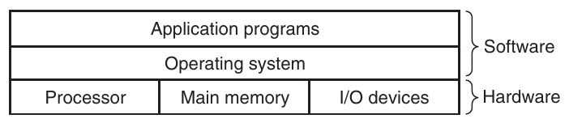

**Hình 1.10 Góc nhìn phân lớp của hệ thống máy tính.**

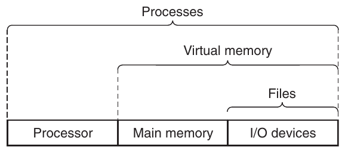

**Hình 1.11 Các abstraction do operating system cung cấp.**

Operating system có hai mục đích chính: (1) bảo vệ hardware khỏi việc sử dụng sai bởi những ứng dụng hoạt động mất kiểm soát và (2) cung cấp cho ứng dụng các cơ chế đơn giản, thống nhất để thao tác những thiết bị hardware low-level phức tạp và thường rất khác nhau. Operating system đạt cả hai mục tiêu thông qua các abstraction nền tảng trong Hình 1.11: process, virtual memory và file. Như hình gợi ý, file là abstraction cho thiết bị I/O, virtual memory là abstraction cho cả main memory lẫn thiết bị I/O disk, còn process là abstraction cho processor, main memory và thiết bị I/O. Chúng ta sẽ lần lượt thảo luận từng abstraction.

### 1.7.1 Process

Khi một chương trình như hello chạy trên hệ thống hiện đại, operating system tạo cảm giác rằng đó là chương trình duy nhất đang chạy trên hệ thống. Chương trình có vẻ được toàn quyền sử dụng processor, main memory và các thiết bị I/O. Processor có vẻ thực thi các instruction của chương trình lần lượt, không bị gián đoạn. Code và dữ liệu của chương trình dường như là những đối tượng duy nhất trong bộ nhớ hệ thống. Những cảm giác này được tạo ra nhờ khái niệm process, một trong những ý tưởng quan trọng và thành công nhất của khoa học máy tính.

Process là abstraction của operating system cho một chương trình đang chạy. Nhiều process có thể chạy đồng thời trên cùng hệ thống, và mỗi process có vẻ được toàn quyền sử dụng hardware. Đồng thời ở đây có nghĩa là instruction của process này được xen kẽ với instruction của process khác. Trong phần lớn hệ thống, số process cần chạy nhiều hơn số CPU để chạy chúng. Hệ thống truyền thống chỉ có thể thực thi một chương trình tại một thời điểm, còn processor multi-core mới hơn có thể thực thi nhiều chương trình cùng lúc. Trong cả hai trường hợp, một CPU duy nhất có thể tạo cảm giác thực thi đồng thời nhiều process bằng cách chuyển qua lại giữa chúng. Operating system thực hiện việc xen kẽ này bằng cơ chế context switching. Để đơn giản hóa phần thảo luận còn lại, chúng ta chỉ xét uniprocessor system chứa một CPU duy nhất. Chúng ta sẽ trở lại thảo luận multiprocessor system trong Mục 1.9.2.

#### Ghi chú Unix, Posix và Standard Unix Specification

Thập niên 1960 là thời kỳ của những operating system khổng lồ, phức tạp như OS/360 của IBM và Multics của Honeywell. Trong khi OS/360 là một trong những dự án software thành công nhất lịch sử, Multics kéo dài nhiều năm và chưa bao giờ được sử dụng wide-scale. Bell Laboratories là đối tác ban đầu của dự án Multics nhưng rút lui năm 1969 do lo ngại về độ phức tạp và sự thiếu tiến triển của dự án. Đáp lại trải nghiệm không dễ chịu với Multics, một nhóm nhà nghiên cứu Bell Labs—Ken Thompson, Dennis Ritchie, Doug McIlroy và Joe Ossanna—bắt đầu xây dựng một operating system đơn giản hơn năm 1969 cho máy tính PDP-7 của Digital Equipment Corporation, viết hoàn toàn bằng machine language. Nhiều ý tưởng trong hệ thống mới, như hierarchical file system và khái niệm shell là một process user-level, được mượn từ Multics nhưng triển khai trong một gói nhỏ hơn, đơn giản hơn. Năm 1970, Brian Kernighan đặt tên hệ thống mới là “Unix”, một cách chơi chữ về độ phức tạp của “Multics”. Kernel được viết lại bằng C năm 1973, và Unix được công bố ra bên ngoài năm 1974 [93].

Vì Bell Labs cung cấp source code cho các trường với điều khoản rộng rãi, Unix thu hút đông đảo người sử dụng trong các trường đại học. Công trình có ảnh hưởng nhất được thực hiện tại University of California ở Berkeley vào cuối thập niên 1970 và đầu thập niên 1980, khi các nhà nghiên cứu Berkeley bổ sung virtual memory và các Internet protocol trong chuỗi phiên bản mang tên Unix 4.xBSD (Berkeley Software Distribution). Đồng thời, Bell Labs phát hành những phiên bản riêng, về sau được biết đến với tên System V Unix. Các phiên bản của nhà cung cấp khác, chẳng hạn hệ thống Solaris của Sun Microsystems, bắt nguồn từ những phiên bản BSD và System V ban đầu này.

Rắc rối xuất hiện vào giữa thập niên 1980 khi các nhà cung cấp Unix cố tạo sự khác biệt bằng cách bổ sung những tính năng mới và thường không tương thích. Để chống lại xu hướng này, IEEE (Institute for Electrical and Electronics Engineers) tài trợ một nỗ lực chuẩn hóa Unix, sau này được Richard Stallman đặt tên “Posix”. Kết quả là một họ chuẩn, được gọi là các chuẩn Posix, bao quát những vấn đề như C language interface cho Unix system call, chương trình shell và tiện ích, thread và lập trình mạng. Gần đây hơn, một nỗ lực chuẩn hóa riêng mang tên “Standard Unix Specification” đã hợp lực với Posix để tạo một chuẩn thống nhất duy nhất cho các hệ thống Unix. Nhờ những nỗ lực chuẩn hóa này, khác biệt giữa các phiên bản Unix phần lớn đã biến mất.

Operating system theo dõi toàn bộ thông tin trạng thái mà process cần để chạy. Trạng thái này, gọi là context, bao gồm những thông tin như giá trị hiện tại của PC, register file và nội dung main memory. Tại bất kỳ thời điểm nào, uniprocessor system chỉ có thể thực thi code của một process duy nhất. Khi operating system quyết định chuyển quyền điều khiển từ process hiện tại sang một process mới, nó thực hiện context switch bằng cách lưu context của process hiện tại, khôi phục context của process mới rồi trao quyền điều khiển cho process mới. Process mới tiếp tục chính xác tại điểm đã dừng trước đó. Hình 1.12 trình bày ý tưởng cơ bản cho tình huống ví dụ hello.

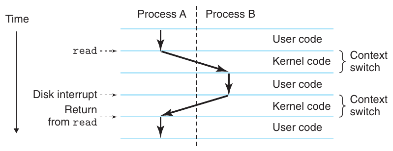

**Hình 1.12 Context switching giữa các process.**

Trong tình huống ví dụ có hai process đồng thời: process shell và process hello. Ban đầu, process shell chạy một mình, đợi input trên command line. Khi chúng ta yêu cầu chạy chương trình hello, shell thực hiện yêu cầu bằng cách gọi một function đặc biệt được gọi là system call, chuyển quyền điều khiển cho operating system. Operating system lưu context của shell, tạo process hello mới cùng context của nó, rồi trao quyền điều khiển cho process hello mới. Sau khi hello kết thúc, operating system khôi phục context của process shell và trao quyền điều khiển lại cho nó để đợi input command-line tiếp theo.

Như Hình 1.12 cho thấy, việc chuyển từ process này sang process khác do operating system kernel quản lý. Kernel là phần code của operating system luôn thường trú trong bộ nhớ. Khi chương trình ứng dụng cần operating system thực hiện một hành động, như đọc hoặc ghi file, nó thực thi một instruction system call đặc biệt để chuyển quyền điều khiển cho kernel. Sau đó kernel thực hiện thao tác được yêu cầu và trả quyền điều khiển lại cho chương trình ứng dụng. Lưu ý rằng kernel không phải một process riêng. Thay vào đó, nó là tập hợp code và data structure mà hệ thống dùng để quản lý tất cả process.

Triển khai abstraction process đòi hỏi sự phối hợp chặt chẽ giữa hardware low-level và software operating system. Chúng ta sẽ tìm hiểu cách hoạt động của sự phối hợp này, cùng cách ứng dụng tạo và điều khiển các process riêng, trong Chương 8.

### 1.7.2 Thread

Mặc dù thường hình dung process chỉ có một control flow, trong hệ thống hiện đại process thực ra có thể gồm nhiều đơn vị thực thi gọi là thread, mỗi thread chạy trong context của process và chia sẻ cùng code cùng global data. Thread là mô hình lập trình ngày càng quan trọng do yêu cầu concurrency trong network server, vì chia sẻ dữ liệu giữa nhiều thread dễ hơn giữa nhiều process và vì thread thường hiệu quả hơn process. Multi-threading cũng là một cách làm chương trình chạy nhanh hơn khi có nhiều processor, như sẽ thảo luận trong Mục 1.9.2. Bạn sẽ học các khái niệm cơ bản của concurrency, bao gồm cách viết chương trình sử dụng thread, trong Chương 12.

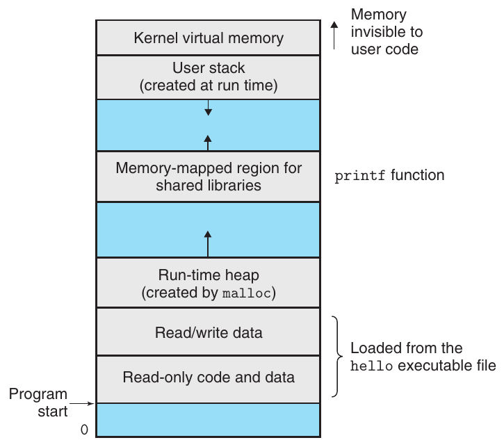

**Hình 1.13 Virtual address space của process. (Các vùng không được vẽ theo tỷ lệ.)**

### 1.7.3 Virtual memory

Virtual memory là một abstraction tạo cho mỗi process cảm giác được toàn quyền sử dụng main memory. Mỗi process có cùng một cách nhìn thống nhất về bộ nhớ, gọi là virtual address space của nó. Virtual address space của các process Linux được trình bày trong Hình 1.13. (Các hệ thống Unix khác sử dụng bố cục tương tự.) Trong Linux, vùng trên cùng của address space được dành cho code và dữ liệu trong operating system dùng chung cho mọi process. Vùng thấp hơn chứa code và dữ liệu do process của người dùng định nghĩa. Lưu ý rằng địa chỉ trong hình tăng từ dưới lên trên.

Virtual address space mà mỗi process nhìn thấy gồm một số vùng well-defined, mỗi vùng có mục đích cụ thể. Bạn sẽ tìm hiểu thêm về các vùng này ở phần sau của sách, nhưng việc xem sơ qua từng vùng, bắt đầu từ địa chỉ thấp nhất rồi đi lên, sẽ hữu ích:

- Code và dữ liệu chương trình. Code bắt đầu tại cùng một địa chỉ cố định cho mọi process, tiếp theo là các vị trí dữ liệu tương ứng với global variable C. Vùng code và dữ liệu được khởi tạo trực tiếp từ nội dung executable object file—trong trường hợp này là executable hello. Bạn sẽ tìm hiểu thêm phần này của address space khi nghiên cứu linking và loading trong Chương 7.

- Heap. Ngay sau vùng code và dữ liệu là heap run-time. Khác với vùng code và dữ liệu có kích thước cố định khi process bắt đầu chạy, heap mở rộng và thu hẹp động tại run time do các lời gọi tới routine của C standard library như malloc và free. Chúng ta sẽ nghiên cứu chi tiết heap khi tìm hiểu quản lý virtual memory trong Chương 9.

- Shared library. Gần giữa address space là vùng chứa code và dữ liệu cho các shared library như C standard library và math library. Shared library là một khái niệm mạnh mẽ nhưng tương đối khó. Bạn sẽ tìm hiểu cách chúng hoạt động khi nghiên cứu dynamic linking trong Chương 7.

- Stack. Ở đỉnh virtual address space của người dùng là user stack mà compiler dùng để triển khai function call. Giống heap, user stack mở rộng và thu hẹp động trong khi thực thi chương trình. Cụ thể, mỗi lần gọi function, stack tăng lên. Mỗi lần return từ function, stack thu lại. Bạn sẽ tìm hiểu cách compiler sử dụng stack trong Chương 3.

- Kernel virtual memory. Vùng trên cùng của address space được dành cho kernel. Chương trình ứng dụng không được phép đọc hoặc ghi nội dung vùng này hay trực tiếp gọi các function được định nghĩa trong kernel code. Thay vào đó, chúng phải gọi kernel để thực hiện các thao tác đó.

Để virtual memory hoạt động, cần có sự tương tác tinh vi giữa hardware và software operating system, bao gồm việc hardware chuyển đổi mọi địa chỉ do processor tạo ra. Ý tưởng cơ bản là lưu nội dung virtual memory của process trên đĩa, rồi dùng main memory làm cache cho đĩa. Chương 9 giải thích cách cơ chế này hoạt động và vì sao nó quan trọng đối với hoạt động của các hệ thống hiện đại.

### 1.7.4 File

File là một chuỗi byte, không hơn không kém. Mọi thiết bị I/O, bao gồm disk, keyboard, display và thậm chí mạng, đều được mô hình hóa thành file. Toàn bộ input và output trong hệ thống được thực hiện bằng cách đọc và ghi file, sử dụng một tập hợp nhỏ các system call được gọi là Unix I/O.

Khái niệm file đơn giản và thanh nhã này vẫn rất mạnh mẽ vì cung cấp cho ứng dụng một cách nhìn thống nhất về mọi thiết bị I/O đa dạng có thể có trong hệ thống. Ví dụ, lập trình viên ứng dụng thao tác nội dung disk file hoàn toàn không cần biết công nghệ đĩa cụ thể. Hơn nữa, cùng một chương trình sẽ chạy trên các hệ thống khác nhau sử dụng những công nghệ đĩa khác nhau. Bạn sẽ tìm hiểu Unix I/O trong Chương 10.

## 1.8 Các hệ thống giao tiếp với nhau qua mạng

Đến thời điểm này trong hành trình tìm hiểu hệ thống, chúng ta coi hệ thống như một tập hợp hardware và software biệt lập. Trong thực tế, hệ thống hiện đại thường được liên kết với các hệ thống khác qua mạng. Từ góc nhìn của một hệ thống riêng lẻ, mạng có thể được xem như một thiết bị I/O khác, như trong Hình 1.14. Khi hệ thống sao chép một chuỗi byte từ main memory sang network adapter, dữ liệu truyền qua mạng tới máy khác thay vì, chẳng hạn, tới disk drive cục bộ. Tương tự, hệ thống có thể đọc dữ liệu do những máy khác gửi đến và sao chép chúng vào main memory của nó.

### Ghi chú Dự án Linux

Tháng 8 năm 1991, một nghiên cứu sinh người Phần Lan tên Linus Torvalds khiêm tốn công bố một operating system kernel Unix-like mới:

```
From: torvalds@klaava.Helsinki.FI (Linus Benedict Torvalds)
Newsgroups: comp.os.minix
Subject: What would you like to see most in minix?
Summary: small poll for my new operating system
Date: 25 Aug 91 20:57:08 GMT

Hello everybody out there using minix -
I’m doing a (free) operating system (just a hobby, won’t be big and
professional like gnu) for 386(486) AT clones. This has been brewing
since April, and is starting to get ready. I’d like any feedback on
things people like/dislike in minix, as my OS resembles it somewhat
(same physical layout of the file-system (due to practical reasons)
among other things).

I’ve currently ported bash(1.08) and gcc(1.40), and things seem to work.
This implies that I’ll get something practical within a few months, and
I’d like to know what features most people would want. Any suggestions
are welcome, but I won’t promise I’ll implement them :-)

Linus (torvalds@kruuna.helsinki.fi)
```

Như Torvalds cho biết, điểm khởi đầu của ông khi tạo Linux là Minix, một operating system do Andrew S. Tanenbaum phát triển cho mục đích giáo dục [113].

Phần còn lại, như người ta thường nói, đã trở thành lịch sử. Linux phát triển thành một hiện tượng kỹ thuật và văn hóa. Bằng cách hợp lực với dự án GNU, dự án Linux đã phát triển một phiên bản Unix operating system hoàn chỉnh, Posix-compliant, bao gồm kernel và toàn bộ hạ tầng hỗ trợ. Linux có mặt trên nhiều loại máy tính, từ thiết bị cầm tay đến mainframe. Một nhóm tại IBM thậm chí đã port Linux lên đồng hồ đeo tay!

Với sự xuất hiện của các mạng toàn cầu như Internet, sao chép thông tin từ máy này sang máy khác trở thành một trong những công dụng quan trọng nhất của hệ thống máy tính. Ví dụ, những ứng dụng như email, instant messaging, World Wide Web, FTP và telnet đều dựa trên khả năng sao chép thông tin qua mạng.

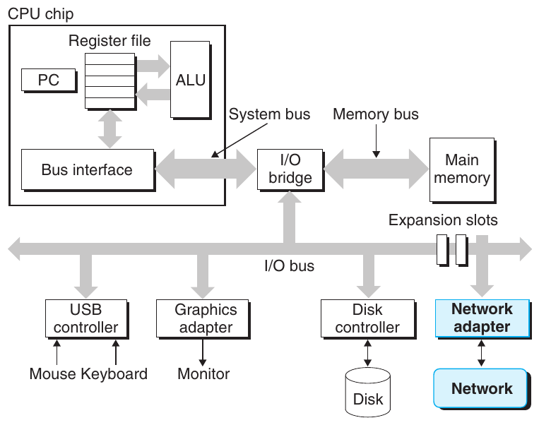

**Hình 1.14 Mạng là một thiết bị I/O khác.**

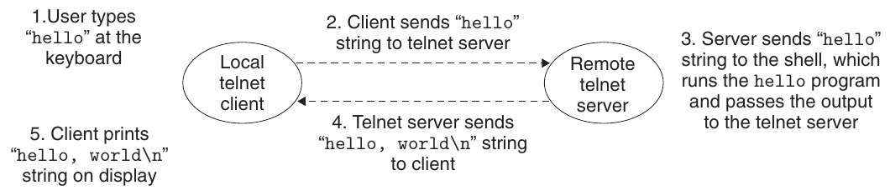

**Hình 1.15 Sử dụng telnet để chạy hello từ xa qua mạng.**

Trở lại ví dụ hello, chúng ta có thể dùng ứng dụng telnet quen thuộc để chạy hello trên máy từ xa. Giả sử chúng ta dùng telnet client chạy trên máy cục bộ để kết nối tới telnet server trên máy từ xa. Sau khi đăng nhập vào máy từ xa và chạy shell, remote shell đợi nhận lệnh input. Từ thời điểm này, chạy chương trình hello từ xa bao gồm năm bước cơ bản trong Hình 1.15.

Sau khi chúng ta gõ chuỗi hello vào telnet client và nhấn enter, client gửi chuỗi tới telnet server. Khi telnet server nhận chuỗi từ mạng, nó chuyển chuỗi cho chương trình remote shell. Tiếp theo, remote shell chạy chương trình hello và chuyển dòng output lại cho telnet server. Cuối cùng, telnet server chuyển tiếp chuỗi output qua mạng tới telnet client, và client in chuỗi output trên terminal cục bộ.

Kiểu trao đổi này giữa client và server là điển hình cho mọi ứng dụng mạng. Trong Chương 11, bạn sẽ học cách xây dựng ứng dụng mạng và áp dụng kiến thức đó để xây dựng một Web server đơn giản.

## 1.9 Những chủ đề quan trọng

Đến đây kết thúc chuyến tham quan khái quát ban đầu về hệ thống. Một ý tưởng quan trọng cần rút ra là hệ thống không chỉ có hardware. Nó là tập hợp hardware và systems software gắn kết, phải phối hợp để đạt mục tiêu cuối cùng là chạy chương trình ứng dụng. Phần còn lại của sách sẽ bổ sung các chi tiết về hardware và software, đồng thời chỉ ra cách bạn có thể viết chương trình nhanh hơn, đáng tin cậy hơn và an toàn hơn nhờ biết những chi tiết đó.

Để kết thúc chương này, chúng ta nhấn mạnh một số khái niệm quan trọng xuyên suốt mọi khía cạnh của hệ thống máy tính. Chúng ta sẽ thảo luận tầm quan trọng của chúng tại nhiều phần trong sách.

### 1.9.1 Định luật Amdahl

Gene Amdahl, một trong những người tiên phong thời kỳ đầu của điện toán, đưa ra một nhận xét đơn giản nhưng sâu sắc về hiệu quả của việc cải thiện hiệu năng một phần của hệ thống. Nhận xét này được biết đến với tên định luật Amdahl. Ý tưởng chính là khi tăng tốc một phần của hệ thống, tác động lên hiệu năng toàn hệ thống phụ thuộc cả vào mức độ quan trọng của phần đó lẫn mức tăng tốc đạt được. Xét một hệ thống cần thời gian T<sub>old</sub> để thực thi một ứng dụng. Giả sử một phần của hệ thống chiếm tỷ lệ α trong thời gian đó và chúng ta cải thiện hiệu năng của nó lên k lần. Nghĩa là ban đầu thành phần này cần thời gian αT<sub>old</sub>, và nay cần thời gian (αT<sub>old</sub>)/ k. Tổng thời gian thực thi khi đó là

T<sub>new</sub> = (1 − α)T<sub>old</sub> + (αT<sub>old</sub>)/ k

= T<sub>old</sub>[(1 − α) + α/ k]

Từ đây, chúng ta có thể tính hệ số tăng tốc S = T<sub>old</sub>/T<sub>new</sub> như sau

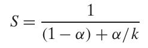 (1.1)

Ví dụ, xét trường hợp một phần của hệ thống ban đầu chiếm 60% thời gian (α = 0.6) được tăng tốc lên 3 lần (k = 3). Khi đó hệ số tăng tốc đạt được là 1/[0.4 + 0.6/3] = 1.67×. Dù đã cải thiện đáng kể một phần quan trọng của hệ thống, mức tăng tốc tổng thể vẫn nhỏ hơn nhiều so với mức tăng tốc của riêng phần đó. Đây là nhận xét chủ chốt của định luật Amdahl—để tăng tốc đáng kể toàn bộ hệ thống, chúng ta phải cải thiện tốc độ của một phần chiếm tỷ trọng rất lớn trong toàn hệ thống.

#### Bài tập thực hành 1.1 (lời giải trang 64)

Giả sử bạn làm tài xế xe tải và được thuê chở một chuyến khoai tây từ Boise, Idaho đến Minneapolis, Minnesota, tổng quãng đường 2,500 kilômét. Bạn ước tính có thể chạy trung bình 100 km/hr trong giới hạn tốc độ cho phép, cần tổng cộng 25 giờ cho chuyến đi.

#### Ghi chú Biểu diễn hiệu năng tương đối

Cách tốt nhất để biểu diễn cải thiện hiệu năng là dùng tỷ số dạng T<sub>old</sub>/T<sub>new</sub>, trong đó T<sub>old</sub> là thời gian cần cho phiên bản ban đầu và T<sub>new</sub> là thời gian cần cho phiên bản đã sửa đổi. Tỷ số này lớn hơn 1.0 nếu thực sự có cải thiện. Chúng ta dùng hậu tố ‘×’ để chỉ tỷ số như vậy, trong đó hệ số “2.2×” được đọc thành “2.2 lần”.

Cách truyền thống hơn là biểu diễn thay đổi tương đối dưới dạng phần trăm, phù hợp khi thay đổi nhỏ nhưng định nghĩa lại không rõ ràng. Nó nên là 100 · (T<sub>old</sub> − T<sub>new</sub>)/T<sub>new</sub>, hay có thể là 100 · (T<sub>old</sub> − T<sub>new</sub>)/T<sub>old</sub>, hoặc một cách khác? Ngoài ra, cách này ít giúp hiểu các thay đổi lớn. Nói “hiệu năng cải thiện 120%” khó nắm bắt hơn việc đơn giản nói hiệu năng tăng 2.2×.

A. Bạn nghe tin Montana vừa bãi bỏ giới hạn tốc độ, và đoạn đi qua bang này chiếm 1,500 km của chuyến đi. Xe tải của bạn có thể chạy 150 km/hr. Hệ số tăng tốc cho chuyến đi sẽ là bao nhiêu?

B. Bạn có thể mua turbocharger mới cho xe tải tại www.fasttrucks.com. Họ có nhiều mẫu, nhưng bạn muốn chạy càng nhanh thì chi phí càng cao. Bạn phải chạy qua Montana nhanh đến mức nào để đạt hệ số tăng tốc tổng thể 1.67× cho chuyến đi?

#### Bài tập thực hành 1.2 (lời giải trang 64)

Một công ty sản xuất ô tô hứa với khách hàng rằng phiên bản tiếp theo của một động cơ mới sẽ cải thiện hiệu năng 4×. Bạn được giao nhiệm vụ thực hiện lời hứa đó. Bạn xác định chỉ có thể cải thiện 90% động cơ. Bạn cần cải thiện phần này bao nhiêu (tức giá trị k bằng bao nhiêu) để đạt mục tiêu hiệu năng tổng thể của động cơ?

Một trường hợp đặc biệt thú vị của định luật Amdahl là xét tác động khi đặt k bằng ∞. Nghĩa là chúng ta có thể lấy một phần hệ thống và tăng tốc đến mức thời gian dành cho nó trở nên không đáng kể. Khi đó ta được

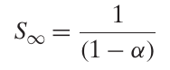 (1.2)

Vì vậy, chẳng hạn nếu có thể tăng tốc 60% hệ thống đến mức gần như không mất thời gian, hệ số tăng tốc tổng thể vẫn chỉ là 1/0.4 = 2.5×.

Định luật Amdahl mô tả một nguyên tắc chung để cải thiện bất kỳ quá trình nào. Ngoài ứng dụng tăng tốc hệ thống máy tính, nó có thể hướng dẫn một công ty đang cố giảm chi phí sản xuất lưỡi dao cạo, hoặc một sinh viên đang cố cải thiện điểm trung bình. Có lẽ nó có ý nghĩa nhất trong thế giới máy tính, nơi chúng ta thường cải thiện hiệu năng lên 2 lần hoặc hơn. Những hệ số cao như vậy chỉ đạt được bằng cách tối ưu những phần lớn của hệ thống.

### 1.9.2 Concurrency và parallelism

Trong suốt lịch sử máy tính số, hai nhu cầu luôn thúc đẩy cải tiến: chúng ta muốn máy làm được nhiều hơn và muốn chúng chạy nhanh hơn. Cả hai đều được cải thiện khi processor làm nhiều việc cùng lúc. Chúng ta dùng thuật ngữ concurrency để chỉ khái niệm tổng quát về hệ thống có nhiều hoạt động đồng thời, và thuật ngữ parallelism để chỉ việc sử dụng concurrency nhằm làm hệ thống chạy nhanh hơn. Có thể khai thác parallelism ở nhiều cấp abstraction trong hệ thống máy tính. Ở đây chúng ta nhấn mạnh ba cấp, đi từ cấp cao nhất xuống thấp nhất trong hệ phân cấp hệ thống.

### Concurrency Thread-Level

Dựa trên abstraction process, chúng ta có thể thiết kế các hệ thống mà nhiều chương trình thực thi cùng lúc, tạo nên concurrency. Với thread, thậm chí có thể có nhiều control flow thực thi trong một process. Hỗ trợ thực thi đồng thời đã có trong hệ thống máy tính từ khi time-sharing xuất hiện đầu thập niên 1960. Theo cách truyền thống, việc thực thi đồng thời này chỉ được mô phỏng bằng cách cho một máy tính duy nhất chuyển nhanh giữa các process đang thực thi, giống người tung hứng giữ nhiều quả bóng bay trong không trung. Dạng concurrency này cho phép nhiều người dùng tương tác với hệ thống cùng lúc, chẳng hạn khi nhiều người muốn lấy trang từ một Web server duy nhất. Nó cũng cho phép một người dùng thực hiện đồng thời nhiều tác vụ, như có Web browser trong một cửa sổ, word processor trong cửa sổ khác và nghe nhạc streaming cùng lúc. Cho đến gần đây, phần lớn việc tính toán thực tế được thực hiện bởi một processor duy nhất, dù processor đó phải chuyển giữa nhiều tác vụ. Cấu hình này được gọi là uniprocessor system.

Khi xây dựng hệ thống gồm nhiều processor dưới quyền điều khiển của một operating system kernel duy nhất, chúng ta có multiprocessor system. Các hệ thống như vậy đã được sử dụng cho tính toán large-scale từ thập niên 1980, nhưng gần đây mới trở nên phổ biến với sự xuất hiện của processor multi-core và hyperthreading. Hình 1.16 trình bày cách phân loại các kiểu processor khác nhau này.

Processor Multi-core có nhiều CPU (gọi là “core”) được tích hợp trên một chip integrated-circuit duy nhất. Hình 1.17 minh họa tổ chức của một processor multi-core điển hình, trong đó chip có bốn CPU core, mỗi core có L1 cache và L2 cache riêng; mỗi L1 cache được chia thành hai phần—một phần giữ các instruction vừa được fetch và một phần giữ dữ liệu. Các core chia sẻ các cấp cache cao hơn cùng interface tới main memory. Chuyên gia trong ngành dự đoán có thể tích hợp hàng chục, và cuối cùng hàng trăm, core trên một chip.

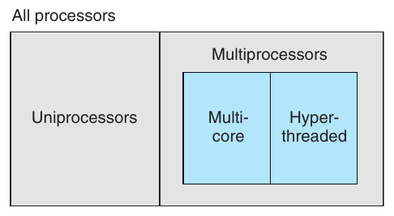

**Hình 1.16 Phân loại những cấu hình processor khác nhau. Multiprocessor đang trở nên phổ biến với sự xuất hiện của processor multi-core và hyperthreading.**

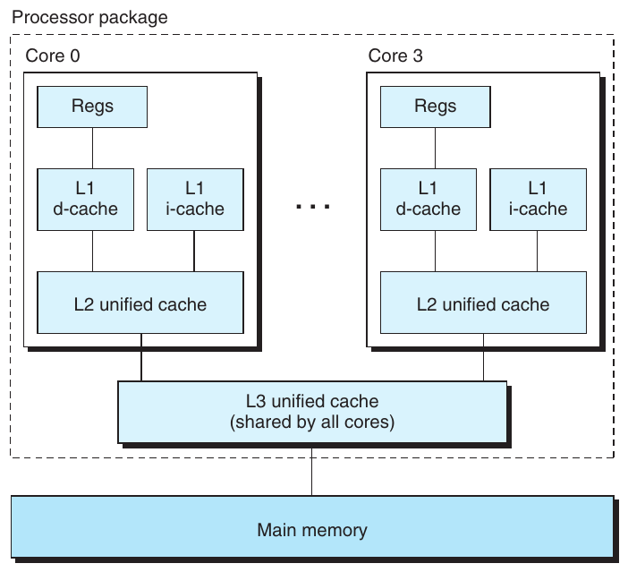

**Hình 1.17 Tổ chức processor Multi-core. Bốn processor core được tích hợp trên một chip duy nhất.**

Hyperthreading, đôi khi được gọi là simultaneous multi-threading, là kỹ thuật cho phép một CPU thực thi nhiều control flow. Kỹ thuật này có nhiều bản sao của một số hardware CPU, chẳng hạn program counter và register file, nhưng chỉ có một bản của các phần hardware khác, như các đơn vị thực hiện phép toán floating-point. Trong khi processor thông thường cần khoảng 20,000 clock cycle để chuyển giữa các thread, processor hỗ trợ hyperthreading quyết định thread nào sẽ được thực thi trên cơ sở cycle-by-cycle. Điều này giúp CPU tận dụng tốt hơn tài nguyên xử lý. Ví dụ, nếu một thread phải đợi dữ liệu được load vào cache, CPU có thể tiếp tục thực thi thread khác. Chẳng hạn, processor Intel Core i7 có thể cho mỗi core thực thi hai thread, nên hệ thống four-core thực sự có thể thực thi tám thread song song.

Việc sử dụng multiprocessing có thể cải thiện hiệu năng hệ thống theo hai cách. Thứ nhất, nó giảm nhu cầu mô phỏng concurrency khi thực hiện nhiều tác vụ. Như đã nói, ngay cả máy tính cá nhân do một người sử dụng cũng được kỳ vọng thực hiện nhiều hoạt động đồng thời. Thứ hai, nó có thể làm một chương trình ứng dụng duy nhất chạy nhanh hơn, nhưng chỉ khi chương trình được biểu diễn bằng nhiều thread có thể thực thi song song hiệu quả. Vì vậy, dù các nguyên tắc concurrency đã được hình thành và nghiên cứu hơn 50 năm, sự xuất hiện của hệ thống multi-core và hệ thống hỗ trợ hyperthreading làm tăng đáng kể mong muốn tìm cách viết ứng dụng có thể khai thác thread-level parallelism mà hardware cung cấp. Chương 12 sẽ tìm hiểu sâu hơn nhiều về concurrency và cách sử dụng nó để chia sẻ tài nguyên xử lý cũng như tăng parallelism trong thực thi chương trình.

### Parallelism Instruction-Level

Ở cấp abstraction thấp hơn nhiều, processor hiện đại có thể thực thi nhiều instruction cùng lúc, một đặc tính được gọi là instruction-level parallelism. Ví dụ, microprocessor đời đầu như Intel 8086 thuộc thế hệ 1978-vintage cần nhiều clock cycle (thường 3–10) để thực thi một instruction. Processor gần đây có thể duy trì tốc độ thực thi 2–4 instruction trên mỗi clock cycle. Mỗi instruction riêng lẻ cần thời gian từ lúc bắt đầu đến hoàn tất lâu hơn nhiều, có thể 20 cycle hoặc hơn, nhưng processor sử dụng một số kỹ thuật khéo léo để xử lý tới 100 instruction cùng lúc. Trong Chương 4, chúng ta sẽ tìm hiểu pipelining, trong đó các hành động cần để thực thi instruction được chia thành những bước khác nhau, còn hardware processor được tổ chức thành một chuỗi stage, mỗi stage thực hiện một bước. Các stage có thể hoạt động song song, xử lý những phần khác nhau của những instruction khác nhau. Chúng ta sẽ thấy thiết kế hardware khá đơn giản cũng có thể duy trì tốc độ thực thi gần 1 instruction trên mỗi clock cycle.

Processor có thể duy trì tốc độ thực thi cao hơn 1 instruction mỗi cycle được gọi là superscalar processor. Phần lớn processor hiện đại hỗ trợ hoạt động superscalar. Trong Chương 5, chúng ta sẽ mô tả một mô hình high-level của những processor này. Chúng ta sẽ thấy lập trình viên ứng dụng có thể sử dụng mô hình để hiểu hiệu năng chương trình. Sau đó, họ có thể viết chương trình sao cho code được tạo ra đạt instruction-level parallelism cao hơn và vì thế chạy nhanh hơn.

### Parallelism Single-Instruction, Multiple-Data (SIMD)

Ở cấp thấp nhất, nhiều processor hiện đại có hardware đặc biệt cho phép một instruction duy nhất khiến nhiều thao tác được thực hiện song song, một chế độ gọi là single-instruction, multiple-data (SIMD) parallelism. Ví dụ, các thế hệ processor Intel và AMD gần đây có instruction có thể cộng song song 8 cặp số floating-point single-precision (kiểu dữ liệu C float).

Các SIMD instruction này chủ yếu được cung cấp để tăng tốc ứng dụng xử lý dữ liệu hình ảnh, âm thanh và video. Mặc dù một số compiler cố tự động trích xuất SIMD parallelism từ chương trình C, phương pháp đáng tin cậy hơn là viết chương trình sử dụng các vector data type đặc biệt được compiler như gcc hỗ trợ. Chúng ta mô tả phong cách lập trình này trong Web Aside opt:simd, bổ sung cho phần trình bày tổng quát hơn về tối ưu chương trình trong Chương 5.

### 1.9.3 Tầm quan trọng của abstraction trong hệ thống máy tính

Sử dụng abstraction là một trong những khái niệm quan trọng nhất của khoa học máy tính. Ví dụ, một khía cạnh của thực hành lập trình tốt là xây dựng một application program interface (API) đơn giản cho tập hợp function, cho phép lập trình viên sử dụng code mà không phải tìm hiểu hoạt động bên trong. Các ngôn ngữ lập trình khác nhau cung cấp những dạng abstraction và mức hỗ trợ khác nhau, như khai báo class của Java và function prototype của C.

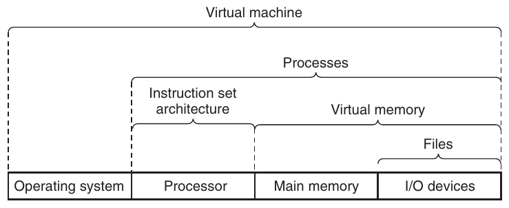

**Hình 1.18 Một số abstraction do hệ thống máy tính cung cấp. Một chủ đề lớn trong hệ thống máy tính là cung cấp các biểu diễn trừu tượng ở những cấp khác nhau nhằm che đi độ phức tạp của cách triển khai thực tế.**

Chúng ta đã được giới thiệu một số abstraction trong hệ thống máy tính, như Hình 1.18 cho thấy. Về phía processor, instruction set architecture cung cấp abstraction cho hardware processor thực tế. Với abstraction này, chương trình machine-code hoạt động như thể được thực thi trên processor chỉ thực hiện một instruction tại một thời điểm. Hardware bên dưới phức tạp hơn nhiều, thực thi nhiều instruction song song nhưng luôn nhất quán với mô hình tuần tự đơn giản. Bằng cách giữ cùng mô hình thực thi, những cách triển khai processor khác nhau có thể thực thi cùng machine code trong khi cung cấp các mức chi phí và hiệu năng khác nhau.

Về phía operating system, chúng ta đã giới thiệu ba abstraction: file là abstraction cho thiết bị I/O, virtual memory là abstraction cho bộ nhớ chương trình, và process là abstraction cho chương trình đang chạy. Chúng ta bổ sung một abstraction mới: virtual machine, cung cấp abstraction cho toàn bộ máy tính, bao gồm operating system, processor và các chương trình. Ý tưởng virtual machine được IBM giới thiệu trong thập niên 1960, nhưng gần đây trở nên nổi bật hơn như một cách quản lý máy tính cần chạy được các chương trình thiết kế cho nhiều operating system (như Microsoft Windows, Mac OS X và Linux) hoặc nhiều phiên bản khác nhau của cùng một operating system.

Chúng ta sẽ trở lại các abstraction này trong những phần tiếp theo của sách.

## 1.10 Tổng kết

Hệ thống máy tính gồm hardware và systems software phối hợp để chạy chương trình ứng dụng. Thông tin trong máy tính được biểu diễn thành các nhóm bit được diễn giải theo nhiều cách khác nhau tùy ngữ cảnh. Chương trình được các chương trình khác chuyển đổi sang những dạng khác nhau, bắt đầu là văn bản ASCII rồi được compiler và linker chuyển thành binary executable file.

Processor đọc và diễn giải các binary instruction lưu trong main memory. Vì máy tính dành phần lớn thời gian sao chép dữ liệu giữa bộ nhớ, thiết bị I/O và các CPU register, thiết bị lưu trữ trong hệ thống được sắp thành hệ phân cấp: CPU register ở đỉnh, tiếp theo là nhiều cấp hardware cache memory, main memory DRAM và thiết bị lưu trữ disk. Các thiết bị lưu trữ ở cấp cao hơn nhanh hơn và có chi phí mỗi bit cao hơn thiết bị ở cấp thấp. Thiết bị ở cấp cao đóng vai trò cache cho thiết bị ở cấp thấp hơn. Lập trình viên có thể tối ưu hiệu năng chương trình C bằng cách hiểu và khai thác memory hierarchy.

Operating system kernel đóng vai trò trung gian giữa ứng dụng và hardware. Nó cung cấp ba abstraction nền tảng: (1) File là abstraction cho thiết bị I/O. (2) Virtual memory là abstraction cho cả main memory và disk. (3) Process là abstraction cho processor, main memory và thiết bị I/O.

Cuối cùng, mạng cung cấp phương tiện để các hệ thống máy tính giao tiếp với nhau. Từ góc nhìn của một hệ thống cụ thể, mạng chỉ là một thiết bị I/O khác.

## Ghi chú thư mục

Ritchie đã viết những tường thuật trực tiếp thú vị về thời kỳ đầu của C và Unix [91, 92]. Ritchie và Thompson trình bày bài mô tả Unix được công bố đầu tiên [93]. Silberschatz, Galvin và Gagne [102] cung cấp lịch sử toàn diện về các biến thể Unix khác nhau. Các trang Web GNU (www.gnu.org) và Linux (www.linux .org) có rất nhiều thông tin hiện tại và lịch sử. Các chuẩn Posix có trên mạng tại (www.unix.org).

## Lời giải các bài tập thực hành

Lời giải Bài tập 1.1 (trang 58) Bài tập này minh họa định luật Amdahl áp dụng không chỉ cho hệ thống máy tính.

A. Theo Phương trình 1.1, ta có α = 0.6 và k = 1.5. Xét trực tiếp hơn, đi 1,500 kilômét qua Montana cần 10 giờ, và phần còn lại của chuyến đi cũng cần 10 giờ. Điều này cho hệ số tăng tốc 25/(10 + 10) = 1.25×.

B. Theo Phương trình 1.1, ta có α = 0.6 và yêu cầu S = 1.67, từ đó có thể giải tìm k. Xét trực tiếp hơn, để tăng tốc chuyến đi 1.67×, chúng ta phải giảm tổng thời gian xuống 15 giờ. Các đoạn ngoài Montana vẫn cần 10 giờ, nên phải lái qua Montana trong 5 giờ. Điều này đòi hỏi tốc độ 300 km/hr, khá nhanh đối với một xe tải!

Lời giải Bài tập 1.2 (trang 59) Cách tốt nhất để hiểu định luật Amdahl là làm một số ví dụ. Ví dụ này yêu cầu bạn xem Phương trình 1.1 từ một góc nhìn khác thường. Bài tập là một ứng dụng đơn giản của phương trình. Bạn được cho S = 4 và α = 0.9, rồi phải giải tìm k:

4 = 1/(1 − 0.9) + 0.9/ k

0.4 + 3.6/ k = 1.0

k = 6.0

---

[^1]: Các phương pháp encoding khác được dùng để biểu diễn văn bản trong ngôn ngữ non-English. Xem ghi chú ở trang 86 để biết thêm về điều này.

[^2]: PC cũng là chữ viết tắt thường dùng của “personal computer”. Tuy nhiên, có thể dễ dàng phân biệt hai nghĩa từ ngữ cảnh.
