Phần I

**Cấu trúc và thực thi chương trình**

Hành trình khám phá hệ thống máy tính bắt đầu bằng việc nghiên cứu chính máy tính, bao gồm processor và memory subsystem. Về cốt lõi, chúng ta cần những cách biểu diễn các data type cơ bản, chẳng hạn các giá trị xấp xỉ dùng trong số học số nguyên và số thực. Từ đó, chúng ta có thể xem các instruction machine-level thao tác dữ liệu như thế nào và compiler chuyển chương trình C thành những instruction này ra sao. Tiếp theo, chúng ta nghiên cứu một số phương pháp triển khai processor để hiểu rõ hơn cách tài nguyên hardware được sử dụng để thực thi instruction. Khi hiểu compiler và code machine-level, chúng ta có thể xem xét cách tối đa hóa hiệu năng chương trình bằng việc viết chương trình C sao cho sau khi biên dịch đạt hiệu năng cao nhất có thể. Chúng ta kết thúc bằng thiết kế memory subsystem, một trong những thành phần phức tạp nhất của hệ thống máy tính hiện đại.

Phần này của sách sẽ giúp bạn hiểu sâu cách chương trình ứng dụng được biểu diễn và thực thi. Bạn sẽ có những kỹ năng giúp viết chương trình an toàn, đáng tin cậy và tận dụng tốt nhất tài nguyên tính toán.

# 2 Biểu diễn và thao tác thông tin

Máy tính hiện đại lưu trữ và xử lý thông tin được biểu diễn bằng các signal two-valued. Những chữ số nhị phân nhỏ bé này, hay bit, tạo nền tảng cho cuộc cách mạng số. Biểu diễn thập phân quen thuộc, hay base-10, đã được sử dụng hơn 1,000 năm: được phát triển ở Ấn Độ, được các nhà toán học Ả Rập cải tiến trong thế kỷ 12, rồi được nhà toán học người Ý Leonardo Pisano (khoảng 1170 đến khoảng 1250), thường được biết đến với tên Fibonacci, đưa tới phương Tây trong thế kỷ 13. Ký pháp thập phân là tự nhiên với con người 10-fingered, nhưng giá trị nhị phân phù hợp hơn khi xây dựng máy lưu trữ và xử lý thông tin. Signal Two-valued có thể dễ dàng được biểu diễn, lưu trữ và truyền đi—chẳng hạn bằng sự có hoặc không có lỗ trên punched card, điện áp cao hoặc thấp trên dây dẫn, hoặc magnetic domain định hướng theo hay ngược chiều kim đồng hồ. Mạch điện tử để lưu trữ và tính toán trên signal two-valued rất đơn giản và đáng tin cậy, cho phép nhà sản xuất tích hợp hàng triệu, thậm chí hàng tỷ mạch như vậy lên một silicon chip duy nhất.

Đứng riêng lẻ, một bit không hữu ích lắm. Tuy nhiên, khi nhóm các bit lại và áp dụng một cách diễn giải mang lại ý nghĩa cho những bit pattern khác nhau có thể có, chúng ta có thể biểu diễn các phần tử của bất kỳ tập hợp hữu hạn nào. Ví dụ, sử dụng hệ đếm nhị phân, chúng ta có thể dùng các nhóm bit để mã hóa số không âm. Sử dụng character code chuẩn, chúng ta có thể mã hóa các chữ cái và ký hiệu trong tài liệu. Chương này trình bày cả hai cách encoding đó, cùng các cách encoding để biểu diễn số âm và xấp xỉ số thực.

Chúng ta xét ba cách biểu diễn số quan trọng nhất. Unsigned encoding dựa trên ký pháp nhị phân truyền thống, biểu diễn các số lớn hơn hoặc bằng 0. Two’s-complement encoding là cách phổ biến nhất để biểu diễn signed integer, tức số có thể dương hoặc âm. Floating-point encoding là phiên bản base-2 của ký pháp khoa học dùng để biểu diễn số thực. Máy tính triển khai các arithmetic operation như cộng và nhân với những cách biểu diễn khác nhau này, tương tự các phép toán tương ứng trên số nguyên và số thực.

Biểu diễn trong máy tính dùng số lượng bit hữu hạn để mã hóa một số, nên một số phép toán có thể bị overflow khi kết quả quá lớn để biểu diễn. Điều này có thể dẫn đến những kết quả bất ngờ. Ví dụ, trên phần lớn máy tính hiện nay (những máy sử dụng biểu diễn 32-bit cho data type int), tính biểu thức

```
200 * 300 * 400 * 500
```

cho kết quả −884,901,888. Điều này trái với tính chất của số học số nguyên—tính tích của một tập hợp số dương lại cho ra kết quả âm.

Mặt khác, số học số nguyên trên máy tính thỏa mãn nhiều tính chất quen thuộc của số học số nguyên thực sự. Ví dụ, phép nhân có tính kết hợp và giao hoán, nên tính bất kỳ biểu thức C nào dưới đây đều cho kết quả −884,901,888:

```
(500  *  400) * (300 * 200)
((500 *  400) * 300) * 200
((200 *  500) * 300) * 400
400   * (200 * (300 * 500))
```

Máy tính có thể không tạo ra kết quả mong đợi, nhưng ít nhất kết quả vẫn nhất quán!

Số học Floating-point có những tính chất toán học hoàn toàn khác. Tích của một tập hợp số dương luôn dương, mặc dù overflow sẽ cho giá trị đặc biệt +∞. Số học Floating-point không có tính kết hợp do độ chính xác hữu hạn của biểu diễn. Ví dụ, biểu thức C (3.14+1e20)-1e20 cho kết quả 0.0 trên phần lớn máy, trong khi 3.14+(1e20-1e20) cho kết quả 3.14. Khác biệt về tính chất toán học giữa số học số nguyên và floating-point bắt nguồn từ cách chúng xử lý tính hữu hạn của biểu diễn—biểu diễn số nguyên có thể mã hóa một phạm vi giá trị tương đối nhỏ nhưng chính xác, còn biểu diễn floating-point có thể mã hóa một phạm vi giá trị rộng nhưng chỉ gần đúng.

Bằng cách nghiên cứu biểu diễn số thực tế, chúng ta có thể hiểu phạm vi giá trị có thể biểu diễn và tính chất của các arithmetic operation khác nhau. Hiểu biết này rất quan trọng để viết chương trình hoạt động chính xác trên toàn bộ phạm vi giá trị số và có thể port giữa những tổ hợp máy, operating system và compiler khác nhau. Như chúng ta sẽ trình bày, nhiều lỗ hổng bảo mật máy tính xuất phát từ những điểm tinh tế trong số học máy tính. Trước đây, bug chương trình chỉ gây bất tiện khi tình cờ được kích hoạt, nhưng hiện nay có vô số hacker cố khai thác mọi bug tìm được để truy cập trái phép hệ thống của người khác. Điều này đặt trách nhiệm cao hơn lên lập trình viên: phải hiểu chương trình hoạt động như thế nào và có thể bị khiến hoạt động theo những cách không mong muốn ra sao.

Máy tính sử dụng một số biểu diễn nhị phân khác nhau để mã hóa giá trị số. Bạn sẽ cần nắm vững những biểu diễn này khi chuyển sang lập trình machine-level trong Chương 3. Chúng ta mô tả các encoding này trong chương này và trình bày cách suy luận về biểu diễn số.

Chúng ta suy ra một số cách thực hiện arithmetic operation bằng cách trực tiếp thao tác các biểu diễn bit-level của số. Hiểu những kỹ thuật này có vai trò quan trọng để hiểu code machine-level do compiler tạo ra khi cố gắng tối ưu hóa hiệu năng đánh giá arithmetic expression.

Cách trình bày nội dung này dựa trên một tập hợp nguyên lý toán học cốt lõi. Chúng ta bắt đầu với định nghĩa cơ bản của các encoding, rồi suy ra các tính chất như phạm vi số có thể biểu diễn, biểu diễn bit-level và tính chất của arithmetic operation. Chúng tôi tin rằng việc xem xét nội dung từ góc nhìn trừu tượng này rất quan trọng, vì lập trình viên cần hiểu rõ số học máy tính liên hệ thế nào với số học số nguyên và số thực quen thuộc hơn.

Ngôn ngữ lập trình C++ được xây dựng trên C, sử dụng đúng những biểu diễn số và phép toán như C. Mọi điều nói về C trong chương này cũng đúng với C++. Ngược lại, định nghĩa ngôn ngữ Java tạo ra một bộ chuẩn mới cho biểu diễn số và phép toán. Trong khi các chuẩn C được thiết kế để cho phép nhiều cách triển khai, chuẩn Java quy định khá cụ thể về format và encoding dữ liệu. Chúng ta nhấn mạnh những biểu diễn và phép toán Java hỗ trợ ở một số chỗ trong chương.

## Ghi chú Cách đọc chương này

Trong chương này, chúng ta khảo sát các tính chất nền tảng của cách số và các dạng dữ liệu khác được biểu diễn trên máy tính, cũng như tính chất của những phép toán máy tính thực hiện trên dữ liệu đó. Điều này đòi hỏi đi sâu vào ngôn ngữ toán học, viết công thức và phương trình, đồng thời trình bày các bước suy ra những tính chất quan trọng.

Để giúp bạn theo dõi phần trình bày, chúng ta tổ chức nội dung bằng cách trước hết phát biểu một tính chất dưới dạng nguyên lý bằng ký pháp toán học. Sau đó minh họa nguyên lý bằng ví dụ và thảo luận không hình thức. Chúng tôi khuyên bạn đọc qua lại giữa phát biểu nguyên lý với các ví dụ và thảo luận, cho đến khi có trực giác vững chắc về điều đang nói và điểm quan trọng của tính chất đó. Với các tính chất phức tạp hơn, chúng ta còn cung cấp phần suy dẫn có cấu trúc gần giống chứng minh toán học. Cuối cùng bạn nên cố hiểu các suy dẫn này, nhưng có thể bỏ qua khi đọc lần đầu.

Chúng tôi cũng khuyến khích bạn làm bài tập thực hành trong quá trình theo dõi nội dung. Các bài tập đưa bạn vào việc học chủ động, giúp biến suy nghĩ thành hành động. Có nền tảng đó, bạn sẽ thấy việc quay lại theo dõi các suy dẫn dễ hơn nhiều. Bạn cũng có thể yên tâm rằng kỹ năng toán học cần để hiểu nội dung này nằm trong khả năng của người nắm vững đại số trung học.

## 2.1 Lưu trữ thông tin

Thay vì truy cập từng bit trong bộ nhớ, phần lớn máy tính dùng các khối 8 bit, hay byte, làm đơn vị bộ nhớ nhỏ nhất có thể định địa chỉ. Chương trình machine-level nhìn bộ nhớ như một array byte rất lớn, gọi là virtual memory. Mỗi byte bộ nhớ được xác định bằng một số duy nhất gọi là địa chỉ; tập hợp mọi địa chỉ có thể có gọi là virtual address space. Như tên gọi cho thấy, virtual address space chỉ là hình ảnh khái niệm được trình bày cho chương trình machine-level. Cách triển khai thực tế (trong Chương 9) kết hợp dynamic random access memory (DRAM), flash memory, disk storage, hardware đặc biệt và operating system software để cung cấp cho chương trình một thứ trông như array byte nguyên khối.

Trong các chương tiếp theo, chúng ta sẽ trình bày cách compiler và hệ thống run-time chia không gian bộ nhớ này thành các đơn vị dễ quản lý hơn để lưu những program object khác nhau, tức dữ liệu, instruction và thông tin điều khiển của chương trình. Nhiều cơ chế được sử dụng để cấp phát và quản lý bộ nhớ cho các phần khác nhau của chương trình. Mọi việc quản lý đều diễn ra trong virtual address space. Ví dụ, giá trị pointer trong C—dù trỏ tới số nguyên, structure hay program object khác—là virtual address của byte đầu tiên trong một khối lưu trữ nào đó. Compiler C cũng gắn thông tin kiểu với từng pointer để có thể tạo code machine-level khác nhau nhằm truy cập giá trị lưu tại vị trí pointer chỉ định, tùy theo kiểu giá trị đó. Mặc dù compiler C duy trì thông tin kiểu này, chương trình machine-level thực tế mà nó tạo ra không có thông tin về data type. Nó chỉ coi mỗi program object là một khối byte và bản thân chương trình là một chuỗi byte.

### Ghi chú Sự phát triển của ngôn ngữ lập trình C

Như đã mô tả trong ghi chú ở trang 40, ngôn ngữ lập trình C được Dennis Ritchie tại Bell Laboratories phát triển ban đầu để sử dụng với Unix operating system (cũng được phát triển tại Bell Labs). Thời đó, phần lớn chương trình hệ thống như operating system phải được viết chủ yếu bằng assembly code để có thể truy cập các biểu diễn low-level của những data type khác nhau. Ví dụ, không thể dễ dàng viết memory allocator, như loại do library function malloc cung cấp, bằng các ngôn ngữ high-level khác thời đó.

Phiên bản C gốc của Bell Labs được mô tả trong ấn bản đầu tiên của cuốn sách do Brian Kernighan và Dennis Ritchie viết [60]. Theo thời gian, C phát triển nhờ nỗ lực của một số nhóm chuẩn hóa. Lần sửa đổi lớn đầu tiên của C gốc Bell Labs dẫn tới chuẩn ANSI C năm 1989, do một nhóm hoạt động dưới sự bảo trợ của American National Standards Institute thực hiện. ANSI C khác biệt đáng kể so với Bell Labs C, đặc biệt trong cách khai báo function. ANSI C được mô tả trong ấn bản thứ hai của sách Kernighan và Ritchie [61], vẫn được xem là một trong những tài liệu tham khảo tốt nhất về C.

International Standards Organization tiếp nhận trách nhiệm chuẩn hóa ngôn ngữ C, thông qua một phiên bản về cơ bản giống ANSI C vào năm 1990, do đó được gọi là “ISO C90”.

Cũng tổ chức này đã bảo trợ việc cập nhật ngôn ngữ vào năm 1999, tạo ra “ISO C99”. Trong số những thay đổi khác, phiên bản này giới thiệu một số data type mới và hỗ trợ text string cần ký tự không có trong tiếng Anh. Một chuẩn gần đây hơn được phê chuẩn năm 2011, do đó mang tên “ISO C11”, tiếp tục bổ sung data type và tính năng. Phần lớn những bổ sung gần đây này có tính tương thích ngược, nghĩa là chương trình viết theo chuẩn trước đó (ít nhất từ ISO C90) có cùng hành vi khi biên dịch theo chuẩn mới hơn.

GNU Compiler Collection (gcc) có thể biên dịch chương trình theo quy ước của một số phiên bản C khác nhau, dựa trên các tùy chọn command-line khác nhau như Hình 2.1. Ví dụ, để biên dịch prog.c theo ISO C11, chúng ta có thể dùng command line

```
linux> gcc -std=c11 prog.c
```

Các tùy chọn -ansi và -std=c89 có tác dụng giống nhau—code được biên dịch theo chuẩn ANSI hoặc ISO C90. (C90 đôi khi được gọi là “C89” vì nỗ lực chuẩn hóa bắt đầu năm 1989.) Tùy chọn -std=c99 khiến compiler tuân theo quy ước ISO C99.

Tại thời điểm viết sách, khi không chỉ định tùy chọn, chương trình được biên dịch theo một phiên bản C dựa trên ISO C90 nhưng có một số tính năng C99, một số của C11, một số của C++, cùng những tính năng riêng của gcc. Dự án GNU đang phát triển phiên bản kết hợp ISO C11 với các tính năng khác, có thể được chỉ định bằng tùy chọn command-line -std=gnu11. (Hiện tại cách triển khai này chưa hoàn tất.) Đây sẽ trở thành phiên bản mặc định.

|Phiên bản C|Tùy chọn command-line của gcc|
|---|---|
| GNU 89 |không có, -std=gnu89|
| ANSI, ISO C90 | -ansi , -std=c89 |
| ISO C99 | -std=c99 |
| ISO C11 | -std=c11 |

**Hình 2.1 Chỉ định các phiên bản C khác nhau cho gcc.**

### Mới học C? Vai trò của pointer trong C

Pointer là một tính năng trung tâm của C. Chúng cung cấp cơ chế tham chiếu các phần tử của data structure, bao gồm array. Giống variable, pointer có hai khía cạnh: giá trị và kiểu. Giá trị chỉ vị trí của một object, còn kiểu chỉ loại object (chẳng hạn số nguyên hoặc số floating-point) được lưu ở vị trí đó.

Để thực sự hiểu pointer, cần xem xét biểu diễn và cách triển khai của chúng ở cấp máy. Đây sẽ là trọng tâm lớn của Chương 3, kết thúc bằng phần trình bày in-depth trong Mục 3.10.1.

### 2.1.1 Ký pháp hexadecimal

Một byte gồm 8 bit. Trong ký pháp nhị phân, giá trị của nó nằm từ 00000000<sub>2</sub> đến 11111111<sub>2</sub>. Khi xem là số nguyên thập phân, giá trị nằm từ 0<sub>10</sub> đến 255<sub>10</sub>. Cả hai ký pháp đều không thuận tiện lắm để mô tả bit pattern. Ký pháp nhị phân quá dài, còn với ký pháp thập phân, chuyển đổi qua lại với bit pattern rất tẻ nhạt. Thay vào đó, chúng ta viết bit pattern thành số base-16, hay hexadecimal. Hexadecimal (hoặc đơn giản “hex”) dùng các chữ số ‘0’ đến ‘9’ cùng các ký tự ‘A’ đến ‘F’ để biểu diễn 16 giá trị có thể có. Hình 2.2 trình bày giá trị thập phân và nhị phân tương ứng với 16 chữ số hexadecimal. Viết theo hexadecimal, giá trị một byte có thể nằm từ 00<sub>16</sub> đến FF<sub>16</sub>.

Trong C, hằng số bắt đầu bằng 0x hoặc 0X được diễn giải theo hexadecimal. Các ký tự ‘A’ đến ‘F’ có thể viết hoa hoặc thường. Ví dụ, có thể viết số FA1D37B<sub>16</sub> thành 0xFA1D37B, 0xfa1d37b hoặc thậm chí dùng lẫn chữ hoa và thường (chẳng hạn 0xFa1D37b). Trong sách này, chúng ta dùng ký pháp C để biểu diễn giá trị hexadecimal.

Một việc thường gặp khi làm việc với chương trình machine-level là chuyển đổi thủ công giữa các biểu diễn thập phân, nhị phân và hexadecimal của bit pattern. Chuyển đổi giữa nhị phân và hexadecimal khá đơn giản vì có thể thực hiện từng chữ số hexadecimal. Có thể chuyển các chữ số bằng cách tra bảng như Hình 2.2. Một mẹo đơn giản để chuyển đổi nhẩm là ghi nhớ giá trị thập phân tương ứng của các chữ số hex A, C và F. Các giá trị hex B, D và E có thể chuyển sang thập phân bằng cách tính giá trị của chúng tương đối với ba chữ số đầu.

|Chữ số hex| 0 | 1 | 2 | 3 | 4 | 5 | 6 | 7 |
|---|---|---|---|---|---|---|---|---|
|Giá trị thập phân| 0 | 1 | 2 | 3 | 4 | 5 | 6 | 7 |
|Giá trị nhị phân| 0000 | 0001 | 0010 | 0011 | 0100 | 0101 | 0110 | 0111 |
|Chữ số hex| 8 | 9 | A | B | C | D | E | F |
|Giá trị thập phân| 8 | 9 | 10 | 11 | 12 | 13 | 14 | 15 |
|Giá trị nhị phân| 1000 | 1001 | 1010 | 1011 | 1100 | 1101 | 1110 | 1111 |

**Hình 2.2 Ký pháp hexadecimal. Mỗi chữ số hex mã hóa một trong 16 giá trị.**

Ví dụ, giả sử bạn được cho số 0x173A4C. Bạn có thể chuyển nó sang dạng nhị phân bằng cách khai triển từng chữ số hexadecimal như sau:

|Hexadecimal| 1 | 7 | 3 | A | 4 | C |
|---|---|---|---|---|---|---|
|Nhị phân| 0001 | 0111 | 0011 | 1010 | 0100 | 1100 |

Điều này cho biểu diễn nhị phân 000101110011101001001100.

Ngược lại, với số nhị phân 1111001010110110110011, trước tiên bạn chuyển sang hexadecimal bằng cách chia thành các nhóm 4 bit. Tuy nhiên, nếu tổng số bit không phải bội số của 4, hãy để nhóm ngoài cùng bên trái là nhóm có ít hơn 4 bit, tương đương với việc thêm các bit 0 ở đầu số. Sau đó chuyển từng nhóm bit thành chữ số hexadecimal tương ứng:

|Nhị phân| 11 | 1100 | 1010 | 1101 | 1011 | 0011 |
|---|---|---|---|---|---|---|
|Hexadecimal| 3 | C | A | D | B | 3 |

#### Bài tập thực hành 2.1 (lời giải trang 179)

Thực hiện các phép chuyển đổi số sau:

A. 0x25B9D2 sang nhị phân

B. Số nhị phân 1010111001001001 sang hexadecimal

C. 0xA8B3D sang nhị phân

D. Số nhị phân 1100100010110110010110 sang hexadecimal

Khi giá trị x là lũy thừa của 2, tức x = 2<sup>n</sup> với n là một số nguyên không âm, chúng ta có thể dễ dàng viết x dưới dạng hexadecimal bằng cách nhớ rằng biểu diễn nhị phân của x chỉ là 1 theo sau bởi n số 0. Chữ số hexadecimal 0 biểu diễn 4 số 0 nhị phân. Vì vậy, với n viết dưới dạng i + 4j , trong đó 0 ≤ i ≤ 3, có thể viết x bằng chữ số hex đầu là 1 (i = 0), 2 (i = 1), 4 (i = 2) hoặc 8 (i = 3), theo sau là j chữ số hexadecimal 0. Ví dụ, với x = 2,048 = 2<sup>11</sup>, ta có n = 11 = 3 + 4 · 2, cho biểu diễn hexadecimal 0x800.

#### Bài tập thực hành 2.2 (lời giải trang 179)

Điền các ô trống trong bảng sau, cho biểu diễn thập phân và hexadecimal của những lũy thừa khác nhau của 2:

| n |2<sup>n</sup> (thập phân)|2<sup>n</sup> (hexadecimal)|
|---|---|---|
| 5 | 32 | 0x20 |
| 23 | ______ | ______ |
| ______ | 32,768 | ______ |
| ______ | ______ | 0x2000 |
| 12 | ______ | ______ |
| ______ | 64 | ______ |
| ______ | ______ | 0x100 |

Chuyển đổi giữa biểu diễn thập phân và hexadecimal trong trường hợp tổng quát đòi hỏi dùng phép nhân hoặc chia. Để chuyển số thập phân x sang hexadecimal, có thể liên tục chia x cho 16, thu được thương q và số dư r sao cho x = q · 16 + r. Sau đó dùng chữ số hexadecimal biểu diễn r làm chữ số có trọng số thấp nhất và tạo các chữ số còn lại bằng cách lặp lại quá trình với q. Ví dụ, xét chuyển đổi số thập phân 314,156:

| 314,156 = 19,634 · 16 + 12 | (C) |
|---|---|
| 19,634 = 1,227 · 16 + 2 | (2) |
| 1,227 = 76 · 16 + 11 | (B) |
| 76 = 4 · 16 + 12 | (C) |
| 4 = 0 · 16 + 4 | (4) |

Từ đây có thể đọc ra biểu diễn hexadecimal là 0x4CB2C.

Ngược lại, để chuyển một số hexadecimal sang thập phân, có thể nhân từng chữ số hexadecimal với lũy thừa thích hợp của 16. Ví dụ, với số 0x7AF, giá trị thập phân tương ứng là 7 · 16<sup>2</sup> + 10 · 16 + 15 = 7 · 256 + 10 · 16 + 15 = 1,792 + 160 + 15 = 1,967.

#### Bài tập thực hành 2.3 (lời giải trang 180)

Một byte có thể được biểu diễn bằng 2 chữ số hexadecimal. Điền các ô còn thiếu trong bảng sau, cho giá trị thập phân, nhị phân và hexadecimal của những byte pattern khác nhau:

|Thập phân|Nhị phân|Hexadecimal|
|---|---|---|
| 0 | 0000 0000 | 0x00 |
| 158 | ______ | ______ |
| 76 | ______ | ______ |
| 145 | ______ | ______ |
| ______ | 1010 1110 | ______ |
| ______ | 0011 1100 | ______ |
| ______ | 1111 0001 | ______ |

#### Ghi chú Chuyển đổi giữa thập phân và hexadecimal

Để chuyển các giá trị lớn hơn giữa thập phân và hexadecimal, tốt nhất nên để máy tính hoặc máy tính cầm tay thực hiện. Có nhiều tool làm được việc này. Một cách đơn giản là sử dụng bất kỳ công cụ tìm kiếm thông dụng nào với các truy vấn như

Convert 0xabcd to decimal

hoặc

123 in hex

|Thập phân|Nhị phân|Hexadecimal|
|---|---|---|
| ______ | ______ | 0x75 |
| ______ | ______ | 0xBD |
| ______ | ______ | 0xF5 |

#### Bài tập thực hành 2.4 (lời giải trang 180)

Không chuyển các số sang thập phân hoặc nhị phân, hãy thử giải những bài toán số học sau và đưa ra đáp án theo hexadecimal. Gợi ý: Chỉ cần điều chỉnh phương pháp cộng và trừ thập phân để dùng cơ số 16.

```
A. 0x605c + 0x5 = ______
B. 0x605c − 0x20 = ______
C. 0x605c + 32 = ______
D. 0x60fa − 0x605c = ______
```

### 2.1.2 Kích thước dữ liệu

Mỗi máy tính có một word size, chỉ kích thước danh định của dữ liệu pointer. Vì virtual address được mã hóa bằng một word như vậy, tham số hệ thống quan trọng nhất do word size quyết định là kích thước tối đa của virtual address space. Nghĩa là với máy có word size w-bit, virtual address nằm từ 0 đến 2<sup>w</sup> − 1, cho phép chương trình truy cập tối đa 2<sup>w</sup> byte.

Trong những năm gần đây có sự chuyển dịch rộng rãi từ máy có word size 32-bit sang máy có word size 64 bit. Việc này diễn ra trước tiên ở máy high-end thiết kế cho ứng dụng khoa học large-scale và cơ sở dữ liệu, sau đó đến desktop và laptop, và gần đây nhất là processor trong smartphone. Word size 32-bit giới hạn virtual address space ở 4 gigabyte (viết là 4 GB), tức hơn 4 × 10<sup>9</sup> byte một chút. Tăng word size lên 64-bit tạo virtual address space 16 exabyte, khoảng 1.84 × 10<sup>19</sup> byte.

Phần lớn máy 64-bit cũng có thể chạy chương trình được biên dịch để dùng trên máy 32-bit, một dạng tương thích ngược. Vì vậy, chẳng hạn khi chương trình prog.c được biên dịch với lệnh

```
linux> gcc -m32 prog.c
```

thì chương trình sẽ chạy chính xác trên cả máy 32-bit lẫn 64-bit. Mặt khác, chương trình được biên dịch với lệnh

```
linux> gcc -m64 prog.c
```

sẽ chỉ chạy trên máy 64-bit. Do đó chúng ta gọi chương trình là “chương trình 32-bit” hoặc “chương trình 64-bit”, vì khác biệt nằm ở cách chương trình được biên dịch thay vì loại máy chạy nó.

Máy tính và compiler hỗ trợ nhiều data format sử dụng các cách mã hóa dữ liệu khác nhau, như số nguyên và floating point, cũng như những độ dài khác nhau. Ví dụ, nhiều máy có instruction thao tác một byte riêng lẻ, cùng số nguyên được biểu diễn bằng các lượng 2-, 4- và 8-byte. Chúng cũng hỗ trợ số floating-point được biểu diễn bằng các lượng 4- và 8-byte.

Ngôn ngữ C hỗ trợ nhiều data format cho cả dữ liệu số nguyên lẫn floating-point. Hình 2.3 trình bày số byte thường được cấp phát cho các data type C khác nhau. (Chúng ta thảo luận mối quan hệ giữa điều chuẩn C bảo đảm và điều thường gặp trong Mục 2.2.) Số byte chính xác của một số data type phụ thuộc cách chương trình được biên dịch. Chúng ta trình bày kích thước cho chương trình 32-bit và 64-bit điển hình. Dữ liệu số nguyên có thể là signed, biểu diễn được giá trị âm, 0 và dương, hoặc unsigned, chỉ cho phép giá trị không âm. Data type char biểu diễn một byte. Mặc dù tên char xuất phát từ việc dùng nó để lưu một ký tự trong text string, nó cũng có thể lưu giá trị số nguyên. Các data type short, int và long nhằm cung cấp một dải kích thước. Ngay cả khi biên dịch cho hệ thống 64-bit, data type int thường vẫn chỉ có 4 byte. Data type long thường có 4 byte trong chương trình 32-bit và 8 byte trong chương trình 64-bit.

|  |Khai báo C|Byte|  |
|---|---|---|---|
| Signed | Unsigned | 32-bit | 64-bit |
| [signed ] char | unsigned char | 1 | 1 |
| short | unsigned short | 2 | 2 |
| int | unsigned | 4 | 4 |
| long | unsigned long | 4 | 8 |
| int32_t | uint32_t | 4 | 4 |
| int64_t | uint64_t | 8 | 8 |
| char * |  | 4 | 8 |
| float |  | 4 | 4 |
| double |  | 8 | 8 |

**Hình 2.3 Kích thước điển hình (theo byte) của các data type C cơ bản. Số byte được cấp phát thay đổi theo cách chương trình được biên dịch. Bảng trình bày các giá trị điển hình của chương trình 32-bit và 64-bit.**

#### Mới học C? Khai báo pointer

Với data type T bất kỳ, khai báo

```
T *p;
```

cho biết p là pointer variable trỏ tới object có kiểu T . Ví dụ,

```
char *p;
```

là khai báo pointer tới object có kiểu char.

Để tránh sự không chắc chắn khi dựa vào kích thước “điển hình” và những thiết lập compiler khác nhau, ISO C99 giới thiệu một lớp data type có kích thước dữ liệu cố định bất kể thiết lập compiler và máy. Trong số đó có int32_t và int64_t, có chính xác 4 và 8 byte tương ứng. Sử dụng các kiểu số nguyên fixed-size là cách tốt nhất để lập trình viên kiểm soát chặt chẽ biểu diễn dữ liệu.

Phần lớn data type mã hóa giá trị signed, trừ khi có keyword unsigned phía trước hoặc dùng khai báo unsigned cụ thể cho data type fixed-size. Ngoại lệ là data type char. Mặc dù phần lớn compiler và máy coi chúng là dữ liệu signed, chuẩn C không bảo đảm điều đó. Thay vào đó, như dấu ngoặc vuông chỉ ra, lập trình viên nên dùng khai báo signed char để bảo đảm giá trị signed 1-byte. Tuy nhiên, trong nhiều ngữ cảnh, hành vi chương trình không phụ thuộc char là signed hay unsigned.

Ngôn ngữ C cho phép nhiều cách sắp xếp keyword và thêm hoặc bỏ các keyword tùy chọn. Ví dụ, mọi khai báo dưới đây có cùng ý nghĩa:

```
unsigned long
unsigned long int
long unsigned
long unsigned int
```

Chúng ta sẽ nhất quán dùng các dạng trong Hình 2.3.

Hình 2.3 cũng cho thấy pointer (chẳng hạn variable khai báo có kiểu char *) dùng toàn bộ word size của chương trình. Phần lớn máy còn hỗ trợ hai format floating-point khác nhau: single precision, khai báo trong C là float, và double precision, khai báo trong C là double. Hai format lần lượt dùng 4 và 8 byte.

Lập trình viên nên cố gắng viết chương trình có thể port giữa các máy và compiler khác nhau. Một khía cạnh của tính portable là khiến chương trình không phụ thuộc kích thước chính xác của những data type khác nhau. Các chuẩn C đặt cận dưới cho phạm vi số của các data type, như sẽ trình bày sau, nhưng không đặt cận trên (ngoại trừ các kiểu fixed-size). Khi máy 32-bit và chương trình 32-bit là tổ hợp chủ đạo từ khoảng năm 1980 đến khoảng năm 2010, nhiều chương trình được viết với giả định cấp phát như cột chương trình 32-bit trong Hình 2.3. Khi chuyển sang máy 64-bit, nhiều sự phụ thuộc ngầm vào word size lộ ra thành bug khi đưa chương trình sang máy mới. Ví dụ, trước đây nhiều lập trình viên giả định object khai báo kiểu int có thể lưu pointer. Điều này hoạt động tốt với phần lớn chương trình 32-bit nhưng gây vấn đề cho chương trình 64-bit.

### 2.1.3 Định địa chỉ và thứ tự byte

Với program object chiếm nhiều byte, cần thiết lập hai quy ước: địa chỉ của object là gì và các byte được sắp theo thứ tự nào trong bộ nhớ. Trên hầu như mọi máy, object multi-byte được lưu thành chuỗi byte liên tiếp; địa chỉ object là địa chỉ nhỏ nhất trong các byte được sử dụng. Ví dụ, giả sử variable x kiểu int có địa chỉ 0x100; tức giá trị address expression &x là 0x100. Khi đó (giả sử data type int có biểu diễn 32-bit), 4 byte của x được lưu tại các vị trí bộ nhớ 0x100, 0x101, 0x102 và 0x103.

Có hai quy ước phổ biến để sắp các byte biểu diễn object. Xét một số nguyên w-bit có biểu diễn bit [x<sub>w−1</sub>, x<sub>w−2</sub>, . . . , x<sub>1</sub>, x<sub>0</sub>], trong đó x<sub>w−1</sub> là bit có trọng số cao nhất và x<sub>0</sub> có trọng số thấp nhất. Giả sử w là bội số của 8, có thể nhóm các bit thành byte: byte có trọng số cao nhất chứa các bit [x<sub>w−1</sub>, x<sub>w−2</sub>, . . . , x<sub>w−8</sub>], byte có trọng số thấp nhất chứa các bit [x<sub>7</sub>, x<sub>6</sub>, . . . , x<sub>0</sub>], còn các byte khác chứa những bit ở giữa. Một số máy chọn lưu object trong bộ nhớ theo thứ tự từ byte có trọng số thấp nhất tới cao nhất, trong khi máy khác lưu từ cao nhất tới thấp nhất. Quy ước thứ nhất—byte có trọng số thấp nhất đứng trước—được gọi là little endian. Quy ước thứ hai—byte có trọng số cao nhất đứng trước—được gọi là big endian.

Giả sử variable x kiểu int ở địa chỉ 0x100 có giá trị hexadecimal 0x01234567. Thứ tự các byte trong phạm vi địa chỉ 0x100 đến 0x103 phụ thuộc loại máy: lưu ý rằng trong word 0x01234567, byte high-order có giá trị hexadecimal 0x01, còn byte low-order có giá trị 0x67.

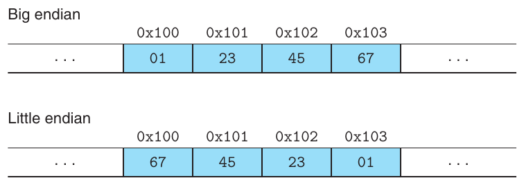

Phần lớn máy Intel-compatible chỉ hoạt động ở chế độ little-endian. Mặt khác, phần lớn máy của IBM và Oracle (có được từ việc mua Sun Microsystems năm 2010) hoạt động ở chế độ big-endian. Lưu ý rằng chúng ta nói “phần lớn”. Các quy ước không phân chia chính xác theo ranh giới công ty. Ví dụ, cả IBM lẫn Oracle đều sản xuất máy sử dụng processor Intel-compatible nên là little endian. Nhiều microprocessor chip gần đây là bi-endian, nghĩa là có thể cấu hình để hoạt động như máy little- hoặc big-endian. Tuy nhiên, trong thực tế, thứ tự byte trở nên cố định khi chọn một operating system cụ thể. Ví dụ, microprocessor ARM dùng trong nhiều điện thoại có hardware hoạt động được ở cả chế độ little- lẫn big-endian, nhưng hai operating system phổ biến nhất cho các chip này—Android (của Google) và IOS (của Apple)—chỉ hoạt động ở chế độ little-endian.

#### Ghi chú Nguồn gốc của “endian”

Sau đây là cách Jonathan Swift viết năm 1726 mô tả lịch sử cuộc tranh cãi giữa những người theo big endian và little endian:

. . . Lilliput và Blefuscu . . . như tôi định kể với bạn, đã giao chiến hết sức ngoan cố suốt six-and-thirty kỳ trăng qua. Mọi chuyện bắt đầu như sau. Ai cũng thừa nhận rằng cách đập trứng nguyên thủy trước khi ăn là đập ở đầu lớn; nhưng ông nội của đương kim hoàng đế, khi còn nhỏ, trong lúc ăn trứng và đập theo lệ xưa đã vô tình làm bị thương một ngón tay. Vì vậy, hoàng đế cha của ông ban sắc lệnh, buộc mọi thần dân phải đập đầu nhỏ của trứng, nếu không sẽ chịu hình phạt nặng. Dân chúng phẫn nộ với luật này đến mức, theo sử sách, đã có sáu cuộc nổi loạn vì nó; trong đó một hoàng đế mất mạng và một người khác mất ngôi. Những cuộc biến loạn này liên tục được các vua Blefuscu kích động; khi bị dẹp, những người lưu vong luôn chạy sang đế quốc ấy nương náu. Người ta tính rằng qua nhiều lần, mười một nghìn người đã chịu chết thay vì chấp nhận đập trứng ở đầu nhỏ. Hàng trăm bộ sách lớn đã được xuất bản về cuộc tranh cãi này, nhưng sách của phe Big-endians từ lâu đã bị cấm, và luật pháp cấm toàn bộ phe ấy giữ chức vụ. (Jonathan Swift. Gulliver’s Travels, Benjamin Motte, 1726.)

Vào thời của mình, Swift châm biếm những xung đột liên miên giữa Anh (Lilliput) và Pháp (Blefuscu). Danny Cohen, một người tiên phong thời kỳ đầu về network protocol, là người đầu tiên dùng những thuật ngữ này để chỉ thứ tự byte [24], và cách gọi đó đã được chấp nhận rộng rãi.

Mọi người phản ứng cảm tính đến bất ngờ về thứ tự byte nào mới đúng. Thực ra, các thuật ngữ “little endian” và “big endian” xuất phát từ Gulliver’s Travels của Jonathan Swift, trong đó hai phe giao chiến không thống nhất được cách mở một quả trứng soft-boiled—ở đầu nhỏ hay đầu lớn. Cũng như chuyện quả trứng, không có lý do kỹ thuật để chọn quy ước thứ tự byte này thay vì quy ước kia, nên tranh luận suy biến thành cãi vã về những vấn đề chính trị xã hội. Miễn là một quy ước được chọn và tuân theo nhất quán, lựa chọn là tùy ý.

Với phần lớn lập trình viên ứng dụng, thứ tự byte mà máy sử dụng hoàn toàn vô hình; chương trình biên dịch cho cả hai loại máy đều cho kết quả giống nhau. Tuy nhiên, đôi lúc thứ tự byte trở thành vấn đề. Trường hợp đầu tiên là truyền dữ liệu nhị phân qua mạng giữa các máy khác nhau. Vấn đề phổ biến là dữ liệu do máy little-endian tạo ra được gửi sang máy big-endian hoặc ngược lại, khiến các byte trong word bị đảo thứ tự đối với chương trình nhận. Để tránh vấn đề này, code ứng dụng mạng phải tuân theo quy ước thứ tự byte đã thiết lập, bảo đảm máy gửi chuyển biểu diễn nội bộ sang chuẩn mạng và máy nhận chuyển chuẩn mạng sang biểu diễn nội bộ. Chúng ta sẽ thấy ví dụ các phép chuyển đổi này trong Chương 11.

Trường hợp thứ hai mà thứ tự byte trở nên quan trọng là khi xem các chuỗi byte biểu diễn dữ liệu số nguyên. Điều này thường xảy ra khi kiểm tra chương trình machine-level. Ví dụ, dòng sau xuất hiện trong một file chứa biểu diễn văn bản của code machine-level cho processor Intel x86-64:

```
4004d3:  01 05 43 0b 20 00       add    %eax,0x200b43(%rip)
```

Dòng này được tạo bởi disassembler, một tool xác định chuỗi instruction được biểu diễn trong executable program file. Chúng ta sẽ tìm hiểu thêm về disassembler và cách diễn giải các dòng như vậy trong Chương 3. Hiện tại, chỉ cần lưu ý dòng này cho biết chuỗi byte hexadecimal 01 05 43 0b 20 00 là biểu diễn byte-level của instruction cộng một word dữ liệu vào giá trị lưu tại địa chỉ được tính bằng cách cộng 0x200b43 vào giá trị hiện tại của program counter, tức địa chỉ instruction tiếp theo sẽ được thực thi. Nếu lấy 4 byte cuối của chuỗi là 43 0b 20 00 và viết theo thứ tự đảo ngược, ta được 00 20 0b 43. Bỏ số 0 đầu, ta có giá trị 0x200b43, chính là giá trị số viết ở bên phải. Byte xuất hiện theo thứ tự đảo ngược là điều thường gặp khi đọc biểu diễn chương trình machine-level tạo cho máy little-endian như máy này. Cách tự nhiên để viết chuỗi byte là đặt byte lowest-numbered ở bên trái và byte có số thứ tự cao nhất bên phải, nhưng điều này ngược với cách viết số thông thường, trong đó chữ số có trọng số cao nhất ở bên trái và thấp nhất ở bên phải.

Trường hợp thứ ba khiến thứ tự byte lộ rõ là khi viết chương trình vượt qua type system thông thường. Trong C, có thể làm điều này bằng cast hoặc union, cho phép tham chiếu object theo data type khác với kiểu lúc tạo ra nó. Những mẹo viết code như vậy rất không được khuyến khích cho phần lớn lập trình ứng dụng, nhưng có thể khá hữu ích và thậm chí cần thiết cho lập trình system-level.

Hình 2.4 trình bày code C dùng casting để truy cập và in biểu diễn byte của các program object khác nhau. Chúng ta dùng typedef để định nghĩa data type byte_pointer là pointer tới object kiểu unsigned char. Byte pointer như vậy tham chiếu một chuỗi byte, trong đó mỗi byte được coi là số nguyên không âm. Routine đầu tiên, show_bytes, nhận địa chỉ chuỗi byte được chỉ bằng byte pointer cùng số lượng byte. Số lượng byte có data type size_t, kiểu được ưu tiên để biểu diễn kích thước data structure. Nó in từng byte theo hexadecimal. Formatting directive %.2x của C chỉ định số nguyên phải được in theo hexadecimal với ít nhất 2 chữ số.

```
 1   #include <stdio.h>
 2
 3   typedef unsigned char *byte_pointer;
 4
 5   void show_bytes(byte_pointer start, size_t len) {
 6       int i;
 7       for (i = 0; i < len; i++)
 8           printf(" %.2x", start[i]);
 9       printf("\n");
10   }
11
12   void show_int(int x) {
13       show_bytes((byte_pointer) &x, sizeof(int));
14   }
15
16   void show_float(float x) {
17       show_bytes((byte_pointer) &x, sizeof(float));
18   }
19
20   void show_pointer(void *x) {
21       show_bytes((byte_pointer) &x, sizeof(void *));
22   }
```

**Hình 2.4 Code in biểu diễn byte của program object. Code dùng casting để vượt qua type system. Có thể dễ dàng định nghĩa các function tương tự cho data type khác.**

Các procedure show_int, show_float và show_pointer minh họa cách dùng procedure show_bytes để in biểu diễn byte của program object C lần lượt có kiểu int, float và void *. Lưu ý chúng chỉ truyền cho show_bytes pointer &x tới argument x, đồng thời cast pointer sang kiểu unsigned char *. Cast này chỉ cho compiler biết chương trình nên coi pointer là trỏ tới chuỗi byte thay vì object thuộc data type ban đầu. Pointer đó sẽ trỏ tới địa chỉ byte thấp nhất mà object chiếm.

Các procedure này dùng toán tử sizeof của C để xác định số byte object sử dụng. Nói chung, biểu thức sizeof(T ) trả về số byte cần để lưu object kiểu T . Dùng sizeof thay cho giá trị cố định là một bước hướng tới code có thể port giữa các loại máy khác nhau.

Chúng ta chạy code ở Hình 2.5 trên một số máy khác nhau, thu được kết quả trong Hình 2.6. Những máy được dùng là:

| Linux 32 |Processor Intel IA32 chạy Linux.|
|---|---|
| Windows |Processor Intel IA32 chạy Windows.|
| Sun |Processor SPARC của Sun Microsystems chạy Solaris. (Những máy này hiện do Oracle sản xuất.)|
| Linux 64 |Processor Intel x86-64 chạy Linux.|

```
                                                   code/data/show-bytes.c
1   void test_show_bytes(int val) {
2       int ival = val;
3       float fval = (float) ival;
4       int *pval = &ival;
5       show_int(ival);
6       show_float(fval);
7       show_pointer(pval);
8   }
                                                   code/data/show-bytes.c
```

**Hình 2.5 Ví dụ biểu diễn byte. Code này in biểu diễn byte của các data object mẫu.**

|Máy|Giá trị|Kiểu|Byte (hex)|
|---|---|---|---|
| Linux 32 | 12,345 | int | 39 30 00 00 |
| Windows | 12,345 | int | 39 30 00 00 |
| Sun | 12,345 | int | 00 00 30 39 |
| Linux 64 | 12,345 | int | 39 30 00 00 |
| Linux 32 | 12,345.0 | float | 00 e4 40 46 |
| Windows | 12,345.0 | float | 00 e4 40 46 |
| Sun | 12,345.0 | float | 46 40 e4 00 |
| Linux 64 | 12,345.0 | float | 00 e4 40 46 |
| Linux 32 | &ival | int * | e4 f9 ff bf |
| Windows | &ival | int * | b4 cc 22 00 |
| Sun | &ival | int * | ef ff fa 0c |
| Linux 64 | &ival | int * | b8 11 e5 ff ff 7f 00 00 |

**Hình 2.6 Biểu diễn byte của các giá trị dữ liệu khác nhau. Kết quả cho int và float giống nhau, ngoại trừ thứ tự byte. Giá trị pointer phụ thuộc máy.**

Argument 12,345 có biểu diễn hexadecimal 0x00003039. Với dữ liệu int, kết quả giống nhau trên mọi máy, ngoại trừ thứ tự byte. Cụ thể, có thể thấy giá trị byte có trọng số thấp nhất 0x39 được in đầu tiên trên Linux 32, Windows và Linux 64, cho biết đây là máy little-endian, còn trên Sun được in cuối cùng, cho biết đó là máy big-endian. Tương tự, các byte của dữ liệu float giống nhau, ngoại trừ thứ tự byte. Mặt khác, giá trị pointer hoàn toàn khác nhau. Những cấu hình máy/operating system khác nhau sử dụng quy ước cấp phát bộ nhớ khác nhau. Một điểm đáng lưu ý là máy Linux 32, Windows và Sun dùng địa chỉ 4-byte, trong khi Linux 64 dùng địa chỉ 8-byte.

#### Mới học C? Đặt tên data type bằng typedef

Khai báo typedef trong C cung cấp cách đặt tên cho data type. Điều này có thể giúp code dễ đọc hơn nhiều vì các khai báo kiểu lồng sâu có thể khó hiểu.

Cú pháp typedef giống hệt khai báo variable, chỉ khác ở chỗ dùng tên kiểu thay cho tên variable. Vì vậy, khai báo byte_pointer trong Hình 2.4 có cùng dạng với khai báo variable kiểu unsigned char *.

Ví dụ, khai báo

```
typedef int *int_pointer;
int_pointer ip;
```

định nghĩa kiểu int_pointer là pointer tới int, và khai báo variable ip có kiểu đó. Hoặc chúng ta có thể khai báo trực tiếp variable này như sau

```
int *ip;
```

#### Mới học C? In có định dạng bằng printf

Function printf (cùng các function họ hàng fprintf và sprintf) cung cấp cách in thông tin với khả năng kiểm soát đáng kể các chi tiết định dạng. Argument đầu tiên là format string, còn các argument còn lại là giá trị cần in. Trong format string, mỗi chuỗi ký tự bắt đầu bằng ‘%’ cho biết cách định dạng argument tiếp theo. Ví dụ điển hình gồm %d để in số nguyên thập phân, %f để in số floating-point và %c để in ký tự có character code được cho bởi argument.

Chỉ định định dạng cho các data type fixed-size như int_32t phức tạp hơn một chút, như được mô tả trong ghi chú trang 103.

Lưu ý rằng dù dữ liệu floating-point và số nguyên đều mã hóa giá trị số 12,345, byte pattern của chúng rất khác: 0x00003039 cho số nguyên và 0x4640E400 cho floating point. Nói chung, hai format này sử dụng encoding scheme khác nhau. Nếu khai triển các pattern hexadecimal này sang nhị phân và dịch chúng thích hợp, ta thấy chuỗi 13 bit trùng nhau, được đánh dấu bằng dãy dấu sao như sau:

```
   0   0   0   0   3   0   3   9
00000000000000000011000000111001
                   *************
             4   6   4   0   E   4   0   0
          01000110010000001110010000000000
```

Đây không phải sự trùng hợp ngẫu nhiên. Chúng ta sẽ trở lại ví dụ này khi nghiên cứu format floating-point.

#### Mới học C? Pointer và array

Trong function show_bytes (Hình 2.4), chúng ta thấy mối liên hệ chặt chẽ giữa pointer và array, sẽ được thảo luận chi tiết trong Mục 3.8. Function có argument start kiểu byte_pointer (đã được định nghĩa là pointer tới unsigned char), nhưng ở dòng 8 lại có array reference start[i]. Trong C, có thể dereference pointer bằng ký pháp array và tham chiếu phần tử array bằng ký pháp pointer. Trong ví dụ này, tham chiếu start[i] cho biết chúng ta muốn đọc byte cách vị trí start trỏ tới i vị trí.

#### Mới học C? Tạo và dereference pointer

Ở các dòng 13, 17 và 21 của Hình 2.4 có hai phép toán mang lại nét đặc trưng cho C (và do đó cả C++). Toán tử “address of” ‘&’ của C tạo pointer. Trong cả ba dòng, biểu thức &x tạo pointer tới vị trí chứa object do variable x chỉ định. Kiểu pointer phụ thuộc kiểu x, nên ba pointer này lần lượt có kiểu int *, float * và void **. (Data type void * là một loại pointer đặc biệt không có thông tin kiểu đi kèm.)

Toán tử cast chuyển từ data type này sang data type khác. Vì vậy, cast (byte_pointer) &x cho biết bất kể pointer &x có kiểu gì trước đó, chương trình giờ sẽ tham chiếu pointer tới dữ liệu kiểu unsigned char. Các cast ở đây không thay đổi pointer thực tế; chúng chỉ hướng compiler tham chiếu dữ liệu mà pointer trỏ tới theo data type mới.

#### Ghi chú Tạo bảng ASCII

Bạn có thể hiển thị bảng character code ASCII bằng cách thực thi lệnh man ascii.

#### Bài tập thực hành 2.5 (lời giải trang 180)

Xét ba lời gọi show_bytes sau:

```
int a = 0x12345678;
byte_pointer ap = (byte_pointer) &a;
show_bytes(ap, 1); /* A. */
show_bytes(ap, 2); /* B. */
show_bytes(ap, 3); /* C. */
```

Cho biết giá trị mỗi lời gọi sẽ in trên máy little-endian và máy big-endian:

| A. Little endian: ______ | Big endian: ______ |
|---|---|
| B. Little endian: ______ | Big endian: ______ |
| C. Little endian: ______ | Big endian: ______ |

#### Bài tập thực hành 2.6 (lời giải trang 181)

Sử dụng show_int và show_float, chúng ta xác định số nguyên 2607352 có biểu diễn hexadecimal 0x0027C8F8, còn số floating-point 3510593.0 có biểu diễn hexadecimal 0x4A1F23E0.

A. Viết biểu diễn nhị phân của hai giá trị hexadecimal này.

B. Dịch hai chuỗi tương đối với nhau để tối đa hóa số bit trùng nhau. Có bao nhiêu bit trùng nhau?

C. Những phần nào của hai chuỗi không trùng nhau?

### 2.1.4 Biểu diễn string

String trong C được mã hóa bằng một array ký tự kết thúc bởi ký tự null (có giá trị 0). Mỗi ký tự được biểu diễn bằng một encoding chuẩn, phổ biến nhất là character code ASCII. Vì vậy, nếu chạy routine show_bytes với argument "12345" và 6 (để bao gồm ký tự kết thúc), ta được kết quả 31 32 33 34 35 00. Lưu ý rằng ASCII code cho chữ số thập phân x là 0x3x, và byte kết thúc có biểu diễn hex 0x00. Kết quả giống hệt này nhận được trên mọi hệ thống dùng ASCII làm character code, độc lập với quy ước thứ tự byte và word size. Do đó, dữ liệu văn bản ít phụ thuộc nền tảng hơn dữ liệu nhị phân.

#### Bài tập thực hành 2.7 (lời giải trang 181)

Lời gọi show_bytes sau sẽ in ra gì?

```
const char *m = "mnopqr";
show_bytes((byte_pointer) m, strlen(m));
```

Lưu ý các chữ cái ‘a’ đến ‘z’ có ASCII code từ 0x61 đến 0x7A.

### 2.1.5 Biểu diễn code

Xét function C sau:

```
1   int sum(int x, int y) {
2       return x + y;
3   }
```

Khi biên dịch trên các máy mẫu, chúng ta tạo ra machine code có các biểu diễn byte sau:

| Linux 32 | 55 89 e5 8b 45 0c 03 45 08 c9 c3 |
|---|---|
| Windows | 55 89 e5 8b 45 0c 03 45 08 5d c3 |
| Sun | 81 c3 e0 08 90 02 00 09 |
| Linux 64 | 55 48 89 e5 89 7d fc 89 75 f8 03 45 fc c9 c3 |

#### Ghi chú Chuẩn Unicode cho encoding văn bản

Character set ASCII phù hợp để mã hóa tài liệu English-language, nhưng không có nhiều ký tự đặc biệt như ‘¸c’ của tiếng Pháp. Nó hoàn toàn không phù hợp để mã hóa tài liệu bằng các ngôn ngữ như Hy Lạp, Nga và Trung Quốc. Qua nhiều năm, nhiều phương pháp đã được phát triển để mã hóa văn bản cho các ngôn ngữ khác nhau. Unicode Consortium xây dựng chuẩn encoding văn bản toàn diện và được chấp nhận rộng rãi nhất. Chuẩn Unicode hiện tại (phiên bản 7.0) có hơn 100,000 ký tự, hỗ trợ nhiều ngôn ngữ, bao gồm các ngôn ngữ cổ của Ai Cập và Babylon. Đáng ghi nhận là Unicode Technical Committee đã bác bỏ đề xuất bổ sung cách viết chuẩn cho Klingon, một nền văn minh hư cấu trong loạt phim truyền hình Star Trek.

Encoding cơ sở, được gọi là “Universal Character Set” của Unicode, dùng biểu diễn ký tự 32-bit. Có vẻ điều này đòi hỏi mọi chuỗi văn bản phải dùng 4 byte mỗi ký tự. Tuy nhiên, có thể dùng những encoding thay thế, trong đó ký tự phổ biến chỉ cần 1 hoặc 2 byte, còn ký tự ít phổ biến cần nhiều hơn. Cụ thể, biểu diễn UTF-8 mã hóa mỗi ký tự thành chuỗi byte sao cho các ký tự ASCII chuẩn sử dụng cùng encoding single-byte như trong ASCII; điều này có nghĩa mọi chuỗi byte ASCII đều có cùng ý nghĩa trong UTF-8 và ASCII.

Ngôn ngữ lập trình Java sử dụng Unicode để biểu diễn string. Cũng có các program library cho C hỗ trợ Unicode.

Ở đây, chúng ta thấy các instruction encoding khác nhau. Các loại máy khác nhau dùng instruction và encoding khác nhau, không tương thích. Ngay cả processor giống nhau nhưng chạy operating system khác nhau cũng có quy ước encoding khác nhau, do đó không tương thích binary. Binary code hiếm khi có thể port giữa các tổ hợp máy và operating system khác nhau.

Một khái niệm nền tảng của hệ thống máy tính là, từ góc nhìn của máy, chương trình chỉ là chuỗi byte. Máy không có thông tin về source program ban đầu, có lẽ ngoại trừ một số bảng phụ trợ duy trì để hỗ trợ debugging. Chúng ta sẽ thấy rõ hơn khi nghiên cứu lập trình machine-level trong Chương 3.

### 2.1.6 Giới thiệu Boolean algebra

Vì giá trị nhị phân nằm ở trung tâm cách máy tính mã hóa, lưu trữ và thao tác thông tin, một khối kiến thức toán học phong phú đã phát triển quanh việc nghiên cứu giá trị 0 và 1. Điều này bắt đầu từ công trình của George Boole (1815–1864) khoảng năm 1850 nên được gọi là Boolean algebra. Boole nhận thấy rằng bằng cách mã hóa các giá trị logic true và false thành giá trị nhị phân 1 và 0, ông có thể xây dựng một hệ đại số nắm bắt những nguyên tắc cơ bản của suy luận logic.

Boolean algebra đơn giản nhất được định nghĩa trên tập two-element {0, 1}. Hình 2.7 định nghĩa một số phép toán trong hệ đại số này. Ký hiệu biểu diễn phép toán được chọn khớp với ký hiệu của các phép toán bit-level trong C, sẽ thảo luận sau. Phép toán Boolean ~ tương ứng với phép toán logic not, ký hiệu ¬. Nghĩa là ¬P đúng khi P không đúng, và ngược lại. Tương ứng, ~p bằng 1 khi p bằng 0, và ngược lại. Phép toán Boolean & tương ứng với phép toán logic and, ký hiệu ∧. P ∧ Q đúng khi cả P lẫn Q đều đúng. Tương ứng, p & q bằng 1 chỉ khi p = 1 và q = 1. Phép toán Boolean | tương ứng với phép toán logic or, ký hiệu ∨. P ∨ Q đúng khi P đúng hoặc Q đúng. Tương ứng, p | q bằng 1 khi p = 1 hoặc q = 1. Phép toán Boolean ^ tương ứng với phép toán logic exclusive-or, ký hiệu ⊕. P ⊕ Q đúng khi P đúng hoặc Q đúng, nhưng không phải cả hai. Tương ứng, p ^ q bằng 1 khi p = 1 và q = 0, hoặc p = 0 và q = 1.

| ~ |  | & | 0 | 1 | \| | 0 | 1 | ^ | 0 | 1 |
|---|---|---|---|---|---|---|---|---|---|---|
| 0 | 1 | 0 | 0 | 0 | 0 | 0 | 1 | 0 | 0 | 1 |
| 1 | 0 | 1 | 0 | 1 | 1 | 1 | 1 | 1 | 1 | 0 |

**Hình 2.7 Các phép toán Boolean algebra. Giá trị nhị phân 1 và 0 mã hóa giá trị logic true và false, còn các phép toán ~, & , | và ^ lần lượt mã hóa phép toán logic not, and, or và exclusive-or.**

Claude Shannon (1916–2001), người sau này sáng lập lĩnh vực information theory, là người đầu tiên kết nối Boolean algebra với digital logic. Trong luận văn thạc sĩ năm 1937, ông cho thấy Boolean algebra có thể áp dụng để thiết kế và phân tích mạng relay điện cơ. Mặc dù công nghệ máy tính đã tiến bộ đáng kể từ đó, Boolean algebra vẫn giữ vai trò trung tâm trong thiết kế và phân tích các hệ thống số.

Có thể mở rộng bốn phép toán Boolean để hoạt động trên bit vector, tức chuỗi số 0 và 1 có độ dài cố định w. Các phép toán trên bit vector được định nghĩa bằng cách áp dụng cho những phần tử tương ứng của các argument. Cho a và b lần lượt là các bit vector [a<sub>w−1</sub>, a<sub>w−2</sub>, . . . , a<sub>0</sub>] và [b<sub>w−1</sub>, b<sub>w−2</sub>, . . . , b<sub>0</sub>]. Chúng ta định nghĩa a & b cũng là bit vector độ dài w, trong đó phần tử thứ i bằng a<sub>i</sub> & b<sub>i</sub>, với 0 ≤ i < w. Các phép toán |, ^ và ~ được mở rộng cho bit vector theo cách tương tự.

Ví dụ, xét trường hợp w = 4 với các argument a = [0110] và b = [1100]. Khi đó bốn phép toán a & b, a | b, a ^ b và ~b cho kết quả

|  | 0110 |  | 0110 |  | 0110 |  |  |
|---|---|---|---|---|---|---|---|
| & | 1100 | \| | 1100 | ^ | 1100 | ~ | 1100 |
|  | 0100 |  | 1110 |  | 1010 |  | 0011 |

#### Bài tập thực hành 2.8 (lời giải trang 181)

Điền bảng sau, trình bày kết quả tính các phép toán Boolean trên bit vector.

#### Ghi chú trên Web DATA:BOOL Tìm hiểu thêm về Boolean algebra và Boolean ring

Các phép toán Boolean |, & và ~ hoạt động trên bit vector độ dài w tạo thành Boolean algebra với mọi số nguyên w > 0. Trường hợp đơn giản nhất là w = 1 và chỉ có hai phần tử, nhưng trong trường hợp tổng quát có 2<sup>w</sup> bit vector độ dài w. Boolean algebra có nhiều tính chất giống số học số nguyên. Ví dụ, cũng như phép nhân phân phối đối với phép cộng, viết là a · (b + c) = (a · b) + (a · c), phép toán Boolean & phân phối đối với |, viết là a & (b | c) = (a & b) | (a & c). Tuy nhiên, ngoài ra phép toán Boolean | còn phân phối đối với &, nên có thể viết a | (b & c) = (a | b) & (a | c), trong khi không thể khẳng định a + (b · c) = (a + b) · (a + c) đúng với mọi số nguyên.

Khi xét các phép toán ^, & và ~ hoạt động trên bit vector độ dài w, chúng ta nhận được một cấu trúc toán học khác gọi là Boolean ring. Boolean ring có nhiều tính chất chung với số học số nguyên. Ví dụ, một tính chất của số học số nguyên là mọi giá trị x có phần tử nghịch đảo cộng −x sao cho x + −x = 0. Tính chất tương tự đúng với Boolean ring, trong đó ^ là phép “cộng”, nhưng ở đây mỗi phần tử là nghịch đảo cộng của chính nó. Nghĩa là a ^ a = 0 với mọi giá trị a, trong đó 0 biểu diễn bit vector gồm toàn số 0. Có thể thấy điều này đúng cho từng bit vì 0 ^ 0 = 1 ^ 1 = 0, và cũng mở rộng được cho bit vector. Tính chất này vẫn đúng khi sắp xếp lại các số hạng và kết hợp theo thứ tự khác, nên (a ^ b) ^ a = b. Tính chất đó dẫn tới một số kết quả thú vị và mẹo khéo léo mà chúng ta sẽ tìm hiểu trong Bài tập 2.10.

|Phép toán|Kết quả|
|---|---|
| a | [01001110] |
| b | [11100001] |
| ~ a | ______ |
| ~ b | ______ |
| a & b | ______ |
| a \| b | ______ |
| a ^ b | ______ |

Một ứng dụng hữu ích của bit vector là biểu diễn tập hợp hữu hạn. Có thể mã hóa mọi tập con A ⊆ {0, 1, . . . , w − 1} bằng bit vector [a<sub>w−1</sub>, . . . , a<sub>1</sub>, a<sub>0</sub>], trong đó a<sub>i</sub> = 1 khi và chỉ khi i ∈ A. Ví dụ, nhớ rằng a<sub>w−1</sub> được viết bên trái và a<sub>0</sub> bên phải, bit vector a = [01101001] mã hóa tập A = {0, 3, 5, 6}, còn bit vector b = [01010101] mã hóa tập B = {0, 2, 4, 6}. Với cách mã hóa tập hợp này, phép toán Boolean | và & lần lượt tương ứng với phép hợp và giao tập hợp, còn ~ tương ứng với phần bù tập hợp. Tiếp tục ví dụ trên, phép toán a & b cho bit vector [01000001], trong khi A ∩ B = {0, 6}.

Chúng ta sẽ gặp encoding tập hợp bằng bit vector trong nhiều ứng dụng thực tế. Ví dụ, trong Chương 8, có một số signal khác nhau có thể ngắt việc thực thi chương trình. Có thể chọn bật hoặc tắt các signal khác nhau bằng cách chỉ định mask bit-vector, trong đó 1 ở vị trí bit i cho biết signal i được bật, còn 0 cho biết nó bị tắt. Do đó, mask biểu diễn tập hợp signal được bật.

#### Bài tập thực hành 2.9 (lời giải trang 182)

Máy tính tạo ảnh màu trên màn hình video hoặc liquid crystal display bằng cách trộn ba màu ánh sáng khác nhau: đỏ, xanh lá và xanh dương. Hãy hình dung mô hình đơn giản với ba đèn khác nhau, mỗi đèn có thể bật hoặc tắt, chiếu lên màn kính:

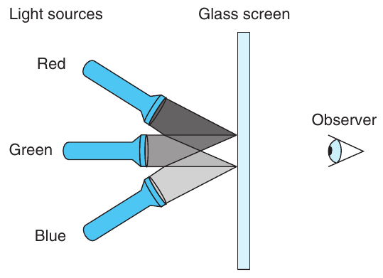

Khi đó có thể tạo tám màu khác nhau dựa trên sự không có (0) hoặc có (1) của các nguồn sáng R, G và B:

| R | G | B |Màu|
|---|---|---|---|
| 0 | 0 | 0 |Đen|
| 0 | 0 | 1 |Xanh dương|
| 0 | 1 | 0 |Xanh lá|
| 0 | 1 | 1 |Xanh lơ|
| 1 | 0 | 0 |Đỏ|
| 1 | 0 | 1 |Đỏ tía|
| 1 | 1 | 0 |Vàng|
| 1 | 1 | 1 |Trắng|

Mỗi màu có thể được biểu diễn bằng bit vector độ dài 3, và có thể áp dụng các phép toán Boolean cho chúng.

A. Màu bù được tạo bằng cách tắt những đèn đang bật và bật những đèn đang tắt. Màu bù của từng màu trong tám màu liệt kê trên là gì?

B. Mô tả tác động khi áp dụng phép toán Boolean lên các màu sau:

Xanh dương | Xanh lá = ______

Vàng & Xanh lơ = ______

Đỏ ^ Đỏ tía = ______

### 2.1.7 Các phép toán Bit-Level trong C

Một tính năng hữu ích của C là hỗ trợ các phép toán Boolean bitwise. Thực ra, các ký hiệu chúng ta dùng cho phép toán Boolean chính là ký hiệu C sử dụng: | cho or, & cho and, ~ cho not và ^ cho exclusive-or. Có thể áp dụng chúng với mọi data type “integral”, bao gồm toàn bộ kiểu trong Hình 2.3. Sau đây là một số ví dụ tính biểu thức với data type char:

|Biểu thức C|Biểu thức nhị phân|Kết quả nhị phân|Kết quả hexadecimal|
|---|---|---|---|
| ~0x41 | ~ [0100 0001] | [1011 1110] | 0xBE |
| ~0x00 | ~ [0000 0000] | [1111 1111] | 0xFF |
| 0x69 & 0x55 | [0110 1001] & [0101 0101] | [0100 0001] | 0x41 |
| 0x69 \| 0x55 | [0110 1001] \| [0101 0101] | [0111 1101] | 0x7D |

Như các ví dụ cho thấy, cách tốt nhất để xác định tác động của biểu thức bit-level là khai triển các argument hexadecimal sang biểu diễn nhị phân, thực hiện phép toán trên nhị phân rồi chuyển lại sang hexadecimal.

#### Bài tập thực hành 2.10 (lời giải trang 182)

Để áp dụng tính chất a ^ a = 0 với mọi bit vector a, xét chương trình sau:

```
1   void inplace_swap(int *x, int *y) {
2       *y = *x ^ *y;  /* Step 1 */
3       *x = *x ^ *y;  /* Step 2 */
4       *y = *x ^ *y;  /* Step 3 */
5   }
```

Như tên gọi gợi ý, chúng ta khẳng định tác dụng của procedure này là hoán đổi các giá trị lưu tại vị trí do pointer variable x và y chỉ định. Lưu ý rằng khác với kỹ thuật thông thường để hoán đổi hai giá trị, chúng ta không cần vị trí thứ ba để tạm lưu một giá trị trong khi di chuyển giá trị còn lại. Cách hoán đổi này không có lợi thế hiệu năng; nó chỉ là một thú vui trí tuệ.

Bắt đầu với giá trị a và b lần lượt ở các vị trí mà x và y trỏ tới, hãy điền bảng sau để cho biết giá trị lưu tại hai vị trí sau mỗi bước của procedure. Sử dụng các tính chất của ^ để chứng minh rằng procedure đạt được tác dụng mong muốn. Nhớ rằng mỗi phần tử là nghịch đảo cộng của chính nó (tức a ^ a = 0).

|Bước| *x | *y |
|---|---|---|
|Ban đầu| a | b |
|Bước 1| ______ | ______ |
|Bước 2| ______ | ______ |
|Bước 3| ______ | ______ |

#### Bài tập thực hành 2.11 (lời giải trang 182)

Với function inplace_swap từ Bài tập 2.10, bạn quyết định viết code đảo thứ tự các phần tử array bằng cách hoán đổi phần tử ở hai đầu đối diện, tiến dần vào giữa.

Bạn xây dựng function sau:

```
1   void reverse_array(int a[], int cnt) {
2       int first, last;
3       for (first = 0, last = cnt-1;
4            first <= last;
5            first++,last--)
6            inplace_swap(&a[first], &a[last]);
7   }
```

Khi áp dụng function cho array chứa các phần tử 1, 2, 3 và 4, bạn thấy array giờ có các phần tử 4, 3, 2 và 1 như mong đợi. Tuy nhiên, khi thử với array chứa 1, 2, 3, 4 và 5, bạn ngạc nhiên thấy array có các phần tử 5, 4, 0, 2 và 1. Thực ra, bạn phát hiện code luôn hoạt động đúng trên array có độ dài chẵn, nhưng đặt phần tử giữa thành 0 mỗi khi array có độ dài lẻ.

A. Với array có độ dài lẻ cnt = 2k + 1, giá trị của variable first và last ở vòng lặp cuối của function reverse_array là gì?

B. Vì sao lời gọi function inplace_swap này đặt phần tử array thành 0?

C. Sửa đổi đơn giản nào trong code reverse_array sẽ loại bỏ vấn đề này?

Một ứng dụng phổ biến của phép toán bit-level là triển khai masking operation, trong đó mask là bit pattern chỉ một tập hợp bit được chọn trong word. Ví dụ, mask 0xFF (có các bit 1 ở 8 bit trọng số thấp nhất) chỉ byte low-order của word. Phép toán bit-level x & 0xFF cho giá trị gồm byte có trọng số thấp nhất của x, còn mọi byte khác bằng 0. Ví dụ, với x = 0x89ABCDEF, biểu thức cho kết quả 0x000000EF. Biểu thức ~0 tạo mask toàn bit 1, bất kể kích thước biểu diễn dữ liệu. Có thể viết cùng mask là 0xFFFFFFFF khi data type int có 32 bit, nhưng cách đó kém portable hơn.

#### Bài tập thực hành 2.12 (lời giải trang 182)

Viết các biểu thức C theo variable x để tạo ra những giá trị sau. Code phải hoạt động với mọi word size w ≥ 8. Để tham khảo, chúng ta trình bày kết quả tính các biểu thức với x = 0x87654321 và w = 32.

A. Byte có trọng số thấp nhất của x, mọi bit khác được đặt bằng 0. [0x00000021]

B. Đảo bit toàn bộ x trừ byte có trọng số thấp nhất, giữ nguyên byte có trọng số thấp nhất. [0x789ABC21]

C. Đặt byte có trọng số thấp nhất thành toàn bit 1, giữ nguyên mọi byte khác của x. [0x876543FF]

#### Bài tập thực hành 2.13 (lời giải trang 183)

Máy tính VAX của Digital Equipment rất phổ biến từ cuối thập niên 1970 đến cuối thập niên 1980. Thay vì instruction cho các phép toán Boolean and và or, nó có instruction bis (bit set) và bic (bit clear). Cả hai nhận một data word x và một mask word m. Chúng tạo kết quả z gồm các bit của x được sửa theo các bit của m. Với bis, việc sửa đổi đặt z bằng 1 tại mỗi vị trí bit mà m bằng 1. Với bic, việc sửa đổi đặt z bằng 0 tại mỗi vị trí bit mà m bằng 1.

Để xem các phép toán này liên hệ thế nào với phép toán bit-level trong C, giả sử có function bis và bic triển khai bit set và bit clear, và chúng ta muốn dùng chúng để triển khai các function tính phép toán bitwise | và ^ mà không dùng bất kỳ phép toán C nào khác. Điền code còn thiếu bên dưới. Gợi ý: Viết biểu thức C cho các phép toán bis và bic.

```
/* Declarations of functions implementing operations bis and bic */
int bis(int x, int m);
int bic(int x, int m);

/* Compute x|y using only calls to functions bis and bic */
int bool_or(int x, int y) {
    int result = ______;
    return result;
}

/* Compute x^y using only calls to functions bis and bic */
int bool_xor(int x, int y) {
    int result = ______;
    return result;
}
```

### 2.1.8 Các phép toán logic trong C

C cũng cung cấp một tập hợp logical operator ||, && và !, tương ứng với phép toán logic or, and và not. Dễ nhầm lẫn chúng với phép toán bit-level, nhưng hành vi rất khác. Các phép toán logic coi mọi argument khác 0 là true và argument 0 là false. Chúng trả về 1 hoặc 0, lần lượt chỉ kết quả true hoặc false. Sau đây là một số ví dụ tính biểu thức:

|Biểu thức|Kết quả|
|---|---|
| !0x41 | 0x00 |
| !0x00 | 0x01 |
| !!0x41 | 0x01 |
| 0x69 && 0x55 | 0x01 |
| 0x69 \|\| 0x55 | 0x01 |

Lưu ý rằng phép toán bitwise chỉ có hành vi khớp với phép toán logic tương ứng trong trường hợp đặc biệt khi argument bị giới hạn ở 0 hoặc 1.

Khác biệt quan trọng thứ hai giữa logical operator ‘&&’ và ‘||’ với các toán tử bit-level tương ứng ‘&’ và ‘|’ là logical operator không đánh giá argument thứ hai nếu có thể xác định kết quả biểu thức bằng argument đầu tiên. Vì vậy, chẳng hạn biểu thức a && 5/a không bao giờ gây chia cho 0, và p && *p++ không bao giờ gây dereference null pointer.

#### Bài tập thực hành 2.14 (lời giải trang 183)

Giả sử a và b lần lượt có giá trị byte 0x55 và 0x46. Điền bảng sau để cho biết giá trị byte của các biểu thức C khác nhau:

|Biểu thức|Giá trị|Biểu thức|Giá trị|
|---|---|---|---|
| a & b | ______ | a && b | ______ |
| a \| b | ______ | a \|\| b | ______ |
| ~a \| ~b | ______ | !a \|\| !b | ______ |
| a & !b | ______ | a && ~b | ______ |

#### Bài tập thực hành 2.15 (lời giải trang 184)

Chỉ dùng phép toán bit-level và logic, viết biểu thức C tương đương x == y. Nói cách khác, nó trả về 1 khi x và y bằng nhau, và 0 nếu không.

### 2.1.9 Các phép toán shift trong C

C cũng cung cấp các phép toán shift để dịch bit pattern sang trái và phải. Với operand x có biểu diễn bit [x<sub>w−1</sub>, x<sub>w−2</sub>, . . . , x<sub>0</sub>], biểu thức C x << k cho giá trị có biểu diễn bit [x<sub>w−k−1</sub>, x<sub>w−k−2</sub>, . . . , x<sub>0</sub>, 0, . . . , 0]. Nghĩa là x được dịch k bit sang trái, bỏ k bit có trọng số cao nhất và điền k số 0 vào đầu bên phải. Số vị trí dịch phải là một giá trị từ 0 đến w − 1. Phép toán shift kết hợp từ trái sang phải, nên x << j << k tương đương (x << j) << k.

Có phép right shift tương ứng, viết trong C là x >> k, nhưng hành vi tinh tế hơn một chút. Nói chung, máy hỗ trợ hai dạng right shift:

Logical. Logical right shift điền k số 0 vào đầu bên trái, cho kết quả [0, . . . , 0, x<sub>w−1</sub>, x<sub>w−2</sub>, . . . x<sub>k</sub>].

Arithmetic. Arithmetic right shift điền k bản sao của bit có trọng số cao nhất vào đầu bên trái, cho kết quả [x<sub>w−1</sub>, . . . , x<sub>w−1</sub>, x<sub>w−1</sub>, x<sub>w−2</sub>, . . . x<sub>k</sub>]. Quy ước này có thể lạ, nhưng như sẽ thấy, nó hữu ích để thao tác dữ liệu signed integer.

Ví dụ, bảng sau cho thấy tác động của những phép toán shift khác nhau lên hai giá trị khác nhau của argument x 8-bit:

|Phép toán|Giá trị 1|Giá trị 2|
|---|---|---|
|Argument x| [01100011] | [10010101] |
| x << 4 | [00110000] | [01010000] |
| x >> 4 (logical) | [00000110] | [00001001] |
| x >> 4 (arithmetic) | [00000110] | [11111001] |

Các chữ số in nghiêng chỉ những giá trị điền vào đầu bên phải (left shift) hoặc bên trái (right shift). Lưu ý mọi trường hợp trừ một đều điền số 0. Ngoại lệ là dịch phải arithmetic đối với [10010101]. Vì bit có trọng số cao nhất là 1, giá trị đó được dùng để điền.

Các chuẩn C không định nghĩa chính xác loại right shift nào phải dùng với số signed—có thể dùng arithmetic shift hoặc logical shift. Đáng tiếc, điều này có nghĩa code giả định một trong hai dạng có thể gặp vấn đề về tính portable. Tuy nhiên, trong thực tế gần như mọi tổ hợp compiler/máy đều dùng arithmetic right shift cho dữ liệu signed, và nhiều lập trình viên giả định như vậy. Ngược lại, với dữ liệu unsigned, right shift bắt buộc là logical.

Khác C, Java định nghĩa chính xác cách thực hiện right shift. Biểu thức x >> k dịch x theo arithmetic k vị trí, còn x >>> k dịch theo logical.

#### Bài tập thực hành 2.16 (lời giải trang 184)

Điền bảng sau, trình bày tác động của các phép toán shift khác nhau lên các lượng single-byte. Cách tốt nhất để suy nghĩ về shift là dùng biểu diễn nhị phân. Chuyển giá trị ban đầu sang nhị phân, thực hiện shift rồi chuyển lại sang hexadecimal. Mỗi đáp án phải gồm 8 chữ số nhị phân hoặc 2 chữ số hexadecimal.

|  |  |  |  | Logical |  | Arithmetic |  |
|---|---|---|---|---|---|---|---|
|  | a |  | a << 2 | a >> 3 |  | a >> 3 |  |
| Hex |Nhị phân|Nhị phân| Hex |Nhị phân| Hex |Nhị phân| Hex |
| 0xD4 | ______ | ______ | ______ | ______ | ______ | ______ | ______ |
| 0x64 | ______ | ______ | ______ | ______ | ______ | ______ | ______ |
| 0x72 | ______ | ______ | ______ | ______ | ______ | ______ | ______ |
| 0x44 | ______ | ______ | ______ | ______ | ______ | ______ | ______ |

#### Ghi chú Dịch k bit với giá trị k lớn

Với data type gồm w bit, dịch một lượng k ≥ w sẽ có tác động gì? Ví dụ, tính các biểu thức sau có tác động gì, giả sử data type int có w = 32:

```
int      lval = 0xFEDCBA98  << 32;
int      aval = 0xFEDCBA98  >> 36;
unsigned uval = 0xFEDCBA98u >> 40;
```

Các chuẩn C thận trọng tránh quy định điều phải làm trong trường hợp này. Trên nhiều máy, shift instruction chỉ xét log<sub>2</sub> w bit thấp của lượng dịch khi dịch giá trị w-bit, nên lượng dịch được tính là k mod w. Ví dụ, với w = 32, ba phép dịch trên được tính như thể lượng dịch lần lượt là 0, 4 và 8, cho kết quả

```
lval    0xFEDCBA98
aval    0xFFEDCBA9
uval    0x00FEDCBA
```

Tuy nhiên, hành vi này không được bảo đảm cho chương trình C, nên lượng dịch cần nhỏ hơn word size.

Ngược lại, Java yêu cầu cụ thể lượng dịch phải được tính theo cách modulo vừa trình bày.

#### Ghi chú Vấn đề độ ưu tiên toán tử với phép toán shift

Bạn có thể muốn viết biểu thức 1<<2 + 3<<4 với ý định là (1<<2) + (3<<4). Tuy nhiên, trong C biểu thức đầu tương đương 1 << (2+3) << 4 vì phép cộng (và trừ) có độ ưu tiên cao hơn shift. Quy tắc kết hợp left-to-right sau đó đặt ngoặc thành (1 << (2+3)) << 4, cho giá trị 512 thay vì 52 như dự định.

Hiểu sai độ ưu tiên trong biểu thức C thường gây lỗi chương trình, và những lỗi này thường khó nhận ra khi đọc kiểm tra. Khi không chắc chắn, hãy thêm dấu ngoặc!

## 2.2 Biểu diễn số nguyên

Trong phần này, chúng ta mô tả hai cách dùng bit để mã hóa số nguyên—một cách chỉ biểu diễn được số không âm, và một cách biểu diễn được số âm, số 0 và số dương. Sau này, chúng ta sẽ thấy chúng liên hệ chặt chẽ cả về tính chất toán học lẫn cách triển khai machine-level. Chúng ta cũng khảo sát tác động của việc mở rộng hoặc thu hẹp số nguyên đã mã hóa để phù hợp với một biểu diễn có độ dài khác.

Hình 2.8 liệt kê các thuật ngữ toán học được giới thiệu để định nghĩa và mô tả chính xác cách máy tính mã hóa và thao tác dữ liệu số nguyên. Các thuật ngữ này sẽ được giới thiệu trong quá trình trình bày. Hình được đặt ở đây để tiện tham khảo.

| Ký hiệu | Kiểu | Ý nghĩa | Trang |
|---|---|---|---|
| B2T<sub>w</sub> | Function | Nhị phân sang two’s complement | 100 |
| B2U<sub>w</sub> | Function | Nhị phân sang unsigned | 98 |
| U2B<sub>w</sub> | Function | Unsigned sang nhị phân | 100 |
| U2T<sub>w</sub> | Function | Unsigned sang two’s complement | 107 |
| T2B<sub>w</sub> | Function | Two’s complement sang nhị phân | 101 |
| T2U<sub>w</sub> | Function | Two’s complement sang unsigned | 107 |
| TMin<sub>w</sub> | Hằng số | Giá trị two’s-complement nhỏ nhất | 101 |
| TMax<sub>w</sub> | Hằng số | Giá trị two’s-complement lớn nhất | 101 |
| UMax<sub>w</sub> | Hằng số | Giá trị unsigned lớn nhất | 99 |
| +<sup>t</sup><sub>w</sub> | Phép toán | Phép cộng Two’s-complement | 126 |
| +<sup>u</sup><sub>w</sub> | Phép toán | Phép cộng unsigned | 121 |
| *<sup>t</sup><sub>w</sub> | Phép toán | Phép nhân Two’s-complement | 133 |
| *<sup>u</sup><sub>w</sub> | Phép toán | Phép nhân unsigned | 132 |
| -<sup>t</sup><sub>w</sub> | Phép toán | Phép lấy đối Two’s-complement | 131 |
| -<sup>u</sup><sub>w</sub> | Phép toán | Phép lấy đối unsigned | 125 |

**Hình 2.8 Thuật ngữ cho dữ liệu số nguyên và arithmetic operation. Chỉ số dưới w biểu thị số bit trong biểu diễn dữ liệu. Cột “Trang” chỉ trang định nghĩa thuật ngữ.**

### 2.2.1 Integral data type

C hỗ trợ nhiều integral data type—những kiểu biểu diễn các phạm vi hữu hạn của số nguyên. Chúng được trình bày trong Hình 2.9 và 2.10, cùng phạm vi giá trị có thể có với chương trình 32- và 64-bit “điển hình”. Mỗi kiểu có thể chỉ định kích thước bằng keyword char, short, long, đồng thời chỉ rõ các số được biểu diễn đều không âm (khai báo unsigned) hay có thể âm (mặc định). Như Hình 2.3 cho thấy, số byte cấp phát cho các kích thước khác nhau thay đổi tùy chương trình được biên dịch cho 32 hay 64 bit. Dựa trên số byte cấp phát, các kích thước khác nhau cho phép biểu diễn các phạm vi giá trị khác nhau. Phạm vi machine-dependent duy nhất được chỉ ra là của chỉ định kích thước long. Phần lớn chương trình 64-bit dùng biểu diễn 8-byte, cho phạm vi giá trị rộng hơn nhiều so với biểu diễn 4-byte trong chương trình 32-bit.

Một đặc điểm quan trọng cần lưu ý trong Hình 2.9 và 2.10 là các phạm vi không đối xứng—phạm vi số âm có thêm một giá trị so với phạm vi số dương. Chúng ta sẽ hiểu nguyên nhân khi xem xét cách biểu diễn số âm.

| Data type C | Nhỏ nhất | Lớn nhất |
|---|---|---|
| [ signed ] char | −128 | 127 |
| unsigned char | 0 | 255 |
| short | −32,768 | 32,767 |
| unsigned short | 0 | 65,535 |
| int | −2,147,483,648 | 2,147,483,647 |
| unsigned | 0 | 4,294,967,295 |
| long | −2,147,483,648 | 2,147,483,647 |
| unsigned long | 0 | 4,294,967,295 |
| int32_t | −2,147,483,648 | 2,147,483,647 |
| uint32_t | 0 | 4,294,967,295 |
| int64_t | −9,223,372,036,854,775,808 | 9,223,372,036,854,775,807 |
| uint64_t | 0 | 18,446,744,073,709,551,615 |

**Hình 2.9 Phạm vi điển hình của integral data type C trong chương trình 32-bit.**

| Data type C | Nhỏ nhất | Lớn nhất |
|---|---|---|
| [ signed ] char | −128 | 127 |
| unsigned char | 0 | 255 |
| short | −32,768 | 32,767 |
| unsigned short | 0 | 65,535 |
| int | −2,147,483,648 | 2,147,483,647 |
| unsigned | 0 | 4,294,967,295 |
| long | −9,223,372,036,854,775,808 | 9,223,372,036,854,775,807 |
| unsigned long | 0 | 18,446,744,073,709,551,615 |
| int32_t | −2,147,483,648 | 2,147,483,647 |
| uint32_t | 0 | 4,294,967,295 |
| int64_t | −9,223,372,036,854,775,808 | 9,223,372,036,854,775,807 |
| uint64_t | 0 | 18,446,744,073,709,551,615 |

**Hình 2.10 Phạm vi điển hình của integral data type C trong chương trình 64-bit.**

Các chuẩn C định nghĩa phạm vi giá trị tối thiểu mà mỗi data type phải biểu diễn được. Như Hình 2.11 cho thấy, các phạm vi này bằng hoặc nhỏ hơn phạm vi của những cách triển khai điển hình trong Hình 2.9 và 2.10. Cụ thể, ngoại trừ các data type fixed-size, chúng chỉ yêu cầu phạm vi số dương và âm đối xứng. Chúng ta cũng thấy data type int có thể được triển khai bằng số 2-byte, mặc dù điều này chủ yếu là tàn dư từ thời máy 16-bit. Kích thước long cũng có thể được triển khai bằng số 4-byte, và thường đúng như vậy trong chương trình 32-bit. Các data type fixed-size bảo đảm phạm vi giá trị đúng bằng các giá trị điển hình trong Hình 2.9, bao gồm tính bất đối xứng giữa số âm và số dương.

#### Mới học C? Số signed và unsigned trong C, C++ và Java

Cả C lẫn C++ đều hỗ trợ số signed (mặc định) và unsigned. Java chỉ hỗ trợ số signed.

| Data type C | Nhỏ nhất | Lớn nhất |
|---|---|---|
| [signed ] char | −127 | 127 |
| unsigned char | 0 | 255 |
| short | −32,767 | 32,767 |
| unsigned short | 0 | 65,535 |
| int | −32,767 | 32,767 |
| unsigned | 0 | 65,535 |
| long | −2,147,483,647 | 2,147,483,647 |
| unsigned long | 0 | 4,294,967,295 |
| int32_t | −2,147,483,648 | 2,147,483,647 |
| uint32_t | 0 | 4,294,967,295 |
| int64_t | −9,223,372,036,854,775,808 | 9,223,372,036,854,775,807 |
| uint64_t | 0 | 18,446,744,073,709,551,615 |

**Hình 2.11 Phạm vi được bảo đảm của integral data type C. Các chuẩn C yêu cầu data type ít nhất phải có những phạm vi giá trị này.**

### 2.2.2 Unsigned encoding

Xét một data type số nguyên gồm w bit. Chúng ta viết bit vector là x⃗ để chỉ toàn bộ vector, hoặc [x<sub>w−1</sub>, x<sub>w−2</sub>, . . . , x<sub>0</sub>] để chỉ từng bit trong vector. Coi x⃗ là một số viết bằng ký pháp nhị phân, ta có cách diễn giải unsigned của x⃗. Trong encoding này, mỗi bit x<sub>i</sub> có giá trị 0 hoặc 1; trường hợp thứ hai cho biết giá trị 2<sup>i</sup> phải được cộng vào giá trị số. Có thể biểu diễn cách diễn giải này bằng function B2U<sub>w</sub> (viết tắt của “binary to unsigned”, độ dài w):

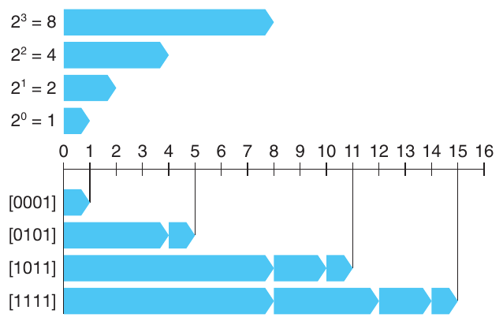

**Hình 2.12 Ví dụ số unsigned với w = 4. Khi bit i trong biểu diễn nhị phân có giá trị 1, nó đóng góp 2<sup>i</sup> vào giá trị.**

nguyên lý: Định nghĩa unsigned encoding

Với vector x⃗ = [x<sub>w−1</sub>, x<sub>w−2</sub>, . . . , x<sub>0</sub>]:

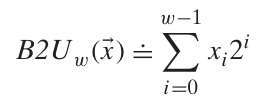 (2.1)

Trong phương trình này, ký hiệu ≐ có nghĩa là vế left-hand được định nghĩa bằng vế right-hand. Function B2U<sub>w</sub> ánh xạ các chuỗi chữ số 0 và 1 có độ dài w sang các số nguyên không âm. Ví dụ, Hình 2.12 trình bày ánh xạ B2U từ các bit vector sang số nguyên cho những trường hợp sau:

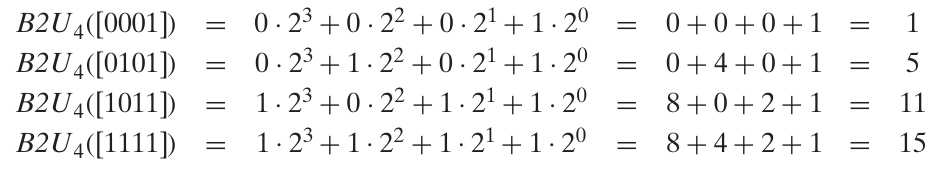 (2.2)

Trong hình, mỗi vị trí bit i được biểu diễn bằng thanh màu xanh rightward-pointing có độ dài 2<sup>i</sup>. Giá trị số tương ứng với bit vector bằng tổng độ dài các thanh có giá trị bit tương ứng là 1.

Xét phạm vi giá trị có thể biểu diễn bằng w bit. Giá trị nhỏ nhất được cho bởi bit vector [00 · · · 0] có giá trị số nguyên 0, còn giá trị lớn nhất được cho bởi bit vector [11 · · · 1] có giá trị số nguyên UMax<sub>w</sub> ≐ ∑<sup>w</sup><sub>i=</sub><sup>−</sup><sub>0</sub><sup>1</sup> 2<sup>i</sup> = 2<sup>w</sup> − 1. Lấy trường hợp 4-bit làm ví dụ, ta có UMax<sub>4</sub> = B2U<sub>4</sub>([1111]) = 2<sup>4</sup> − 1 = 15. Do đó, function B2U<sub>w</sub> có thể được định nghĩa là ánh xạ B2U<sub>w</sub>: {0, 1}<sup>w</sup> → {0, . . . , UMax<sub>w</sub>}.

Biểu diễn nhị phân unsigned có tính chất quan trọng: mọi số từ 0 đến 2<sup>w</sup> − 1 có encoding duy nhất dưới dạng giá trị w-bit. Ví dụ, chỉ có một biểu diễn của giá trị thập phân 11 dưới dạng số unsigned 4-bit—đó là [1011]. Chúng ta nhấn mạnh điều này dưới dạng một nguyên lý toán học, trước tiên phát biểu rồi giải thích.

nguyên lý: Tính duy nhất của unsigned encoding

Function B2U<sub>w</sub> là một song ánh.

Thuật ngữ toán học song ánh chỉ function f hoạt động theo hai chiều: ánh xạ giá trị x sang giá trị y với y = f (x), nhưng cũng có thể hoạt động ngược lại, vì với mọi y có duy nhất một x sao cho f (x) = y. Chiều ngược được cho bởi inverse function f<sup>−1</sup>, trong ví dụ này là x = f<sup>−1</sup>(y). Function B2U<sub>w</sub> ánh xạ mỗi bit vector độ dài w sang một số duy nhất từ 0 đến 2<sup>w</sup> − 1 và có inverse function, gọi là U2B<sub>w</sub> (viết tắt của “unsigned to binary”), ánh xạ mỗi số trong phạm vi 0 đến 2<sup>w</sup> − 1 sang một pattern duy nhất gồm w bit.

### 2.2.3 Two’s-Complement encoding

Trong nhiều ứng dụng, chúng ta cũng muốn biểu diễn giá trị âm. Cách biểu diễn số signed phổ biến nhất trong máy tính được gọi là dạng two’s-complement. Nó được định nghĩa bằng cách diễn giải most significant bit của word là có trọng số âm. Chúng ta biểu diễn cách diễn giải này bằng function B2T<sub>w</sub> (viết tắt của “binary to two’s complement”, độ dài w):

nguyên lý: Định nghĩa two’s-complement encoding

Với vector x⃗ = [x<sub>w−1</sub>, x<sub>w−2</sub>, . . . , x<sub>0</sub>]:

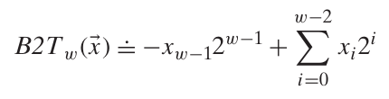 (2.3)

Bit có trọng số cao nhất x<sub>w−1</sub> còn được gọi là sign bit. “Trọng số” của nó là −2<sup>w−1</sup>, tức giá trị đối của trọng số trong biểu diễn unsigned. Khi sign bit bằng 1, giá trị biểu diễn là âm; khi bằng 0, giá trị là không âm. Ví dụ, Hình 2.13 trình bày ánh xạ B2T từ bit vector sang số nguyên cho các trường hợp sau:

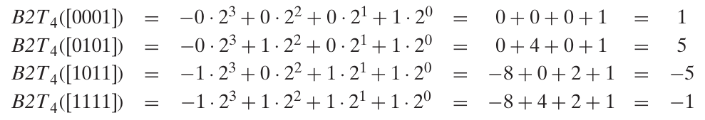 (2.4)

Trong hình, sign bit có trọng số âm được biểu diễn bằng thanh màu xám leftward-pointing. Giá trị số tương ứng với bit vector được cho bởi sự kết hợp giữa thanh màu xám leftward-pointing có thể có và các thanh màu xanh rightward-pointing.

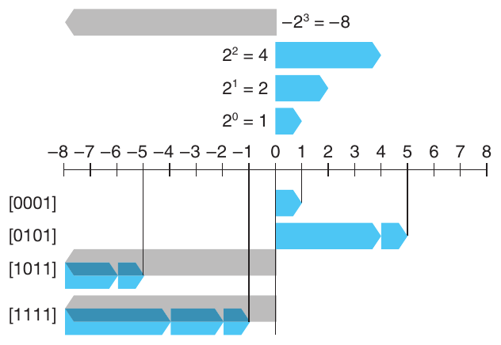

**Hình 2.13 Ví dụ số Two’s-complement với w = 4. Bit 3 đóng vai trò sign bit; khi bằng 1, nó đóng góp −2<sup>3</sup> = −8 vào giá trị. Trọng số này được biểu diễn bằng thanh màu xám leftward-pointing.**

Ta thấy bit pattern giống nhau trong Hình 2.12 và 2.13 (cũng như Phương trình 2.2 và 2.4), nhưng giá trị khác nhau khi most significant bit bằng 1, vì trong trường hợp này nó có trọng số +8, còn trường hợp kia là −8.

Xét phạm vi giá trị có thể biểu diễn bằng số two’s-complement w-bit. Giá trị nhỏ nhất có thể biểu diễn được cho bởi bit vector [10 · · · 0] (đặt bit có trọng số âm và xóa mọi bit khác), có giá trị số nguyên TMin<sub>w</sub> ≐ − 2<sup>w−1</sup>. Giá trị lớn nhất được cho bởi bit vector [01 · · · 1] (xóa bit có trọng số âm và đặt mọi bit khác), có giá trị số nguyên TMax<sub>w</sub> ≐ ∑<sup>w</sup><sub>i=</sub><sup>−</sup><sub>0</sub><sup>2</sup> 2<sup>i</sup> = 2<sup>w−1</sup> − 1. Lấy trường hợp 4-bit làm ví dụ, ta có TMin<sub>4</sub> = B2T<sub>4</sub>([1000]) = −2<sup>3</sup> = −8 và TMax<sub>4</sub> = B2T<sub>4</sub>([0111]) = 2<sup>2</sup> + 2<sup>1</sup> + 2<sup>0</sup> = 4 + 2 + 1 = 7.

Có thể thấy B2T<sub>w</sub> ánh xạ các bit pattern độ dài w sang các số từ TMin<sub>w</sub> đến TMax<sub>w</sub>, viết là B2T<sub>w</sub>: {0, 1}<sup>w</sup> → {TMin<sub>w</sub>, . . . , TMax<sub>w</sub>}. Như với biểu diễn unsigned, mọi số trong phạm vi có thể biểu diễn đều có encoding duy nhất dưới dạng số two’s-complement w-bit. Điều này dẫn đến nguyên lý cho số two’s-complement tương tự số unsigned:

nguyên lý: Tính duy nhất của two’s-complement encoding

Function B2T<sub>w</sub> là một song ánh.

Chúng ta định nghĩa function T2B<sub>w</sub> (viết tắt của “two’s complement to binary”) là inverse function của B2T<sub>w</sub>. Nghĩa là với số x thỏa TMin<sub>w</sub> ≤ x ≤ TMax<sub>w</sub>, T2B<sub>w</sub>(x) là pattern w-bit (duy nhất) mã hóa x.

#### Bài tập thực hành 2.17 (lời giải trang 184)

Giả sử w = 4, có thể gán giá trị số cho mỗi chữ số hexadecimal có thể có, theo cách diễn giải unsigned hoặc two’s-complement. Điền bảng sau theo hai cách diễn giải bằng cách viết ra các lũy thừa của 2 có đóng góp khác 0 trong những tổng ở Phương trình 2.1 và 2.3:

x⃗

| Hexadecimal | Nhị phân | B2U<sub>4</sub>(x⃗) | B2T<sub>4</sub>(x⃗) |
|---|---|---|---|
| 0xA | [1010] | 2<sup>3</sup> + 2<sup>1</sup> = 10 | −2<sup>3</sup> + 2<sup>1</sup> = −6 |
| 0x1 | ______ | ______ | ______ |
| 0xB | ______ | ______ | ______ |
| 0x2 | ______ | ______ | ______ |
| 0x7 | ______ | ______ | ______ |
| 0xC | ______ | ______ | ______ |

Hình 2.14 trình bày bit pattern và giá trị số của một số số quan trọng với các word size khác nhau. Ba giá trị đầu cho phạm vi số nguyên có thể biểu diễn theo UMax<sub>w</sub>, TMin<sub>w</sub> và TMax<sub>w</sub>. Chúng ta sẽ thường xuyên tham chiếu ba giá trị đặc biệt này trong phần thảo luận tiếp theo. Chúng ta sẽ bỏ chỉ số dưới w và gọi là UMax, TMin và TMax khi có thể suy ra w từ ngữ cảnh hoặc khi w không phải trọng tâm thảo luận.

Có vài điểm cần nhấn mạnh về các số này. Thứ nhất, như quan sát trong Hình 2.9 và 2.10, phạm vi two’s-complement bất đối xứng: |TMin| = |TMax| + 1; tức không có số dương tương ứng với TMin. Như sẽ thấy, điều này dẫn đến những tính chất đặc biệt của số học two’s-complement và có thể gây bug chương trình tinh vi. Tính bất đối xứng xuất hiện vì một nửa bit pattern (có sign bit bằng 1) biểu diễn số âm, còn một nửa (có sign bit bằng 0) biểu diễn số không âm. Vì 0 là không âm, điều này có nghĩa có thể biểu diễn ít hơn một số dương so với số âm. Thứ hai, giá trị unsigned lớn nhất chỉ hơn hai lần giá trị two’s-complement lớn nhất một chút: UMax = 2TMax + 1. Mọi bit pattern biểu diễn số âm trong ký pháp two’s-complement trở thành giá trị dương trong biểu diễn unsigned. Hình 2.14 cũng trình bày biểu diễn các hằng số −1 và 0. Lưu ý −1 có cùng biểu diễn bit với UMax—chuỗi toàn bit 1. Giá trị số 0 được biểu diễn bằng chuỗi toàn bit 0 trong cả hai cách biểu diễn.

Word size w

| Giá trị | 8 | 16 | 32 | 64 |
|---|---|---|---|---|
| UMax<sub>w</sub> | 0xFF | 0xFFFF | 0xFFFFFFFF | 0xFFFFFFFFFFFFFFFF |
|  | 255 | 65,535 | 4,294,967,295 | 18,446,744,073,709,551,615 |
| TMin<sub>w</sub> | 0x80 | 0x8000 | 0x80000000 | 0x8000000000000000 |
|  | −128 | −32,768 | −2,147,483,648 | −9,223,372,036,854,775,808 |
| TMax<sub>w</sub> | 0x7F | 0x7FFF | 0x7FFFFFFF | 0x7FFFFFFFFFFFFFFF |
|  | 127 | 32,767 | 2,147,483,647 | 9,223,372,036,854,775,807 |
| −1 | 0xFF | 0xFFFF | 0xFFFFFFFF | 0xFFFFFFFFFFFFFFFF |
| 0 | 0x00 | 0x0000 | 0x00000000 | 0x0000000000000000 |

**Hình 2.14 Các số quan trọng. Cả giá trị số và biểu diễn hexadecimal đều được trình bày.**

#### Ghi chú Tìm hiểu thêm về kiểu số nguyên fixed-size

Với một số chương trình, điều thiết yếu là data type được mã hóa bằng biểu diễn có kích thước cụ thể. Ví dụ, khi viết chương trình cho máy giao tiếp qua Internet theo protocol chuẩn, cần có data type tương thích với những kiểu protocol quy định. Chúng ta đã thấy một số data type C, đặc biệt long, có phạm vi khác nhau trên máy khác nhau, và thực ra chuẩn C chỉ quy định phạm vi tối thiểu cho data type, không phải phạm vi chính xác. Dù có thể chọn data type tương thích với biểu diễn chuẩn trên phần lớn máy, tính portable không được bảo đảm.

Chúng ta đã gặp phiên bản 32- và 64-bit của kiểu số nguyên fixed-size (Hình 2.3); chúng thuộc một lớp data type lớn hơn. Chuẩn ISO C99 giới thiệu lớp kiểu số nguyên này trong file stdint.h. File định nghĩa một tập hợp data type với khai báo dạng intN _t và uintN_t, chỉ số nguyên signed và unsigned N-bit với các giá trị N khác nhau. Giá trị N chính xác phụ thuộc cách triển khai, nhưng phần lớn compiler cho phép 8, 16, 32 và 64. Do đó, có thể khai báo rõ ràng variable unsigned 16-bit bằng kiểu uint16_t, và variable signed 32 bit bằng int32_t.

Đi kèm các data type này là các macro định nghĩa giá trị nhỏ nhất và lớn nhất cho mỗi N. Chúng có tên dạng INTN_MIN, INTN_MAX và UINTN_MAX.

In có định dạng với kiểu fixed-width đòi hỏi dùng macro mở rộng thành format string theo cách system-dependent. Ví dụ, giá trị variable x và y kiểu int32_t và uint64_t có thể được in bằng lời gọi printf sau:

```
printf("x = %" PRId32 ", y = %" PRIu64 "\n", x, y);
```

Khi biên dịch thành chương trình 64-bit, macro PRId32 mở rộng thành string "d", còn PRIu64 mở rộng thành cặp string "l" "u". Khi C preprocessor gặp chuỗi hằng string chỉ được ngăn cách bằng dấu cách (hoặc ký tự whitespace khác), nó nối chúng lại. Vì vậy, lời gọi printf trên trở thành

```
printf("x = %d, y = %lu\n", x, y);
```

Sử dụng macro bảo đảm tạo đúng format string bất kể cách code được biên dịch.

Các chuẩn C không yêu cầu signed integer được biểu diễn ở dạng two’s-complement, nhưng gần như mọi máy đều làm vậy. Lập trình viên muốn tối đa hóa tính portable trên mọi máy có thể có không nên giả định bất kỳ phạm vi biểu diễn nào ngoài các phạm vi trong Hình 2.11, cũng không nên giả định cách biểu diễn cụ thể nào cho số signed. Mặt khác, nhiều chương trình được viết với giả định biểu diễn two’s-complement cho số signed và các phạm vi “điển hình” trong Hình 2.9 và 2.10; những chương trình này có thể port qua nhiều máy và compiler. File <limits.h> trong C library định nghĩa các hằng số giới hạn phạm vi của những integer data type khác nhau cho máy cụ thể mà compiler chạy trên đó. Ví dụ, nó định nghĩa INT_MAX, INT_MIN và UINT_MAX mô tả phạm vi số nguyên signed và unsigned. Với máy two’s-complement có data type int gồm w bit, các hằng số này tương ứng với TMax<sub>w</sub>, TMin<sub>w</sub> và UMax<sub>w</sub>.

#### Ghi chú Những cách biểu diễn khác của số signed

Có hai cách biểu diễn chuẩn khác cho số signed:

Ones’ complement. Cách biểu diễn này giống two’s complement, ngoại trừ việc most significant bit có trọng số −(2<sup>w−1</sup> − 1) thay vì −2<sup>w−1</sup>:

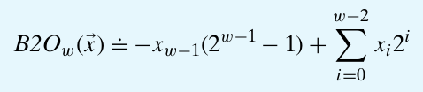

Sign magnitude. Bit có trọng số cao nhất là sign bit quyết định các bit còn lại mang trọng số âm hay dương:

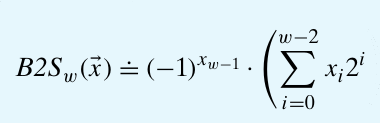

Cả hai cách biểu diễn đều có tính chất đáng chú ý là có hai encoding khác nhau của số 0. Với cả hai, [00 · · · 0] được diễn giải là +0. Giá trị −0 có thể được biểu diễn ở dạng sign-magnitude bằng [10 · · · 0], và ở dạng ones’ complement bằng [11 · · · 1]. Dù trước đây từng có máy dựa trên biểu diễn ones’-complement, gần như mọi máy hiện đại đều dùng two’s complement. Chúng ta sẽ thấy encoding sign-magnitude được dùng cho số floating-point.

Lưu ý vị trí dấu nháy đơn khác nhau: two’s complement và ones’ complement. Thuật ngữ “two’s complement” xuất phát từ việc với x không âm, chúng ta tính biểu diễn w-bit của −x là 2<sup>w</sup> − x (một số hai). Thuật ngữ “ones’ complement” xuất phát từ tính chất có thể tính −x theo ký pháp này là [111 · · · 1] − x (nhiều số một).

Chuẩn Java quy định khá cụ thể về phạm vi và biểu diễn integer data type. Nó yêu cầu biểu diễn two’s-complement với phạm vi chính xác như trường hợp 64-bit (Hình 2.10). Trong Java, data type single-byte gọi là byte thay vì char. Các yêu cầu chi tiết này nhằm giúp chương trình Java có hành vi giống hệt nhau bất kể máy hoặc operating system chạy chúng.

Để hiểu rõ hơn biểu diễn two’s-complement, xét ví dụ code sau:

```
1       short x = 12345;
2       short mx = -x;
3
4       show_bytes((byte_pointer) &x, sizeof(short));
5       show_bytes((byte_pointer) &mx, sizeof(short));
```

|  |  | 12,345 |  | −12,345 |  | 53,191 |
|---|---|---|---|---|---|---|
| Trọng số | Bit | Giá trị | Bit | Giá trị | Bit | Giá trị |
| 1 | 1 | 1 | 1 | 1 | 1 | 1 |
| 2 | 0 | 0 | 1 | 2 | 1 | 2 |
| 4 | 0 | 0 | 1 | 4 | 1 | 4 |
| 8 | 1 | 8 | 0 | 0 | 0 | 0 |
| 16 | 1 | 16 | 0 | 0 | 0 | 0 |
| 32 | 1 | 32 | 0 | 0 | 0 | 0 |
| 64 | 0 | 0 | 1 | 64 | 1 | 64 |
| 128 | 0 | 0 | 1 | 128 | 1 | 128 |
| 256 | 0 | 0 | 1 | 256 | 1 | 256 |
| 512 | 0 | 0 | 1 | 512 | 1 | 512 |
| 1,024 | 0 | 0 | 1 | 1,024 | 1 | 1,024 |
| 2,048 | 0 | 0 | 1 | 2,048 | 1 | 2,048 |
| 4,096 | 1 | 4,096 | 0 | 0 | 0 | 0 |
| 8,192 | 1 | 8,192 | 0 | 0 | 0 | 0 |
| 16,384 | 0 | 0 | 1 | 16,384 | 1 | 16,384 |
| ±32,768 | 0 | 0 | 1 | −32,768 | 1 | 32,768 |
| Tổng |  | 12,345 |  | −12,345 |  | 53,191 |

**Hình 2.15 Biểu diễn Two’s-complement của 12,345 và −12,345, cùng biểu diễn unsigned của 53,191. Lưu ý hai biểu diễn cuối có bit giống hệt nhau.**

Khi chạy trên máy big-endian, code này in 30 39 và cf c7, cho biết x có biểu diễn hexadecimal 0x3039, còn mx có biểu diễn hexadecimal 0xCFC7. Khai triển sang nhị phân, ta được bit pattern [0011000000111001] cho x và [1100111111000111] cho mx. Như Hình 2.15 cho thấy, Phương trình 2.3 cho giá trị 12,345 và −12,345 với hai bit pattern này.

#### Bài tập thực hành 2.18 (lời giải trang 185)

Trong Chương 3, chúng ta sẽ xem các listing do disassembler tạo ra. Disassembler là chương trình chuyển một executable program file trở lại dạng ASCII dễ đọc hơn. Các file này chứa nhiều số hexadecimal, thường biểu diễn các giá trị ở dạng two’s-complement. Khả năng nhận ra các số này và hiểu ý nghĩa của chúng (chẳng hạn chúng là số âm hay số dương) là một kỹ năng quan trọng.

Với các dòng mang nhãn A–I (bên phải) trong listing sau, chuyển các giá trị hexadecimal (ở dạng two’s-complement 32-bit) bên phải tên instruction (sub, mov và add) sang giá trị thập phân tương ứng:

```
4004d0:  48 81 ec e0 02 00 00    sub    $0x2e0,%rsp               A.
4004d7:  48 8b 44 24 a8          mov    -0x58(%rsp),%rax          B.
4004dc:  48 03 47 28             add    0x28(%rdi),%rax           C.
4004e0:  48 89 44 24 d0          mov    %rax,-0x30(%rsp)          D.
4004e5:  48 8b 44 24 78          mov    0x78(%rsp),%rax           E.
4004ea:  48 89 87 88 00 00 00    mov    %rax,0x88(%rdi)           F.
4004f1:  48 8b 84 24 f8 01 00    mov    0x1f8(%rsp),%rax          G.
4004f8:  00
4004f9:  48 03 44 24 08          add    0x8(%rsp),%rax
4004fe:  48 89 84 24 c0 00 00    mov    %rax,0xc0(%rsp)           H.
400505:  00
400506:  48 8b 44 d4 b8          mov    -0x48(%rsp,%rdx,8),%rax   I.
```

### 2.2.4 Chuyển đổi giữa signed và unsigned

C cho phép casting giữa các numeric data type khác nhau. Ví dụ, giả sử variable x được khai báo int và u là unsigned. Biểu thức (unsigned) x chuyển giá trị x sang unsigned, còn (int) u chuyển giá trị u sang signed integer. Cast giá trị signed sang unsigned hoặc ngược lại nên có tác dụng gì? Từ góc nhìn toán học, có thể hình dung nhiều quy ước khác nhau. Rõ ràng, chúng ta muốn giữ nguyên mọi giá trị biểu diễn được trong cả hai dạng. Mặt khác, chuyển giá trị âm sang unsigned có thể cho 0. Chuyển giá trị unsigned quá lớn để biểu diễn ở dạng two’s-complement có thể cho TMax. Tuy nhiên, với phần lớn cách triển khai C, câu trả lời dựa trên góc nhìn bit-level thay vì giá trị số.

Ví dụ, xét code sau:

```
1       short    int    v  = -12345;
2       unsigned short uv = (unsigned short) v;
3       printf("v = %d, uv = %u\n", v, uv);
```

Khi chạy trên máy two’s-complement, code tạo output sau:

```
v = -12345, uv = 53191
```

Điều chúng ta thấy ở đây là casting giữ nguyên giá trị các bit nhưng thay đổi cách diễn giải chúng. Trong Hình 2.15, chúng ta đã thấy biểu diễn two’s-complement 16-bit của −12,345 giống hệt biểu diễn unsigned 16-bit của 53,191. Cast từ short sang unsigned short đã thay đổi giá trị số nhưng không thay đổi biểu diễn bit.

Tương tự, xét code sau:

```
1       unsigned u = 4294967295u;   /* UMax */
2       int     tu = (int) u;
3       printf("u = %u, tu = %d\n", u, tu);
```

Khi chạy trên máy two’s-complement, code tạo output sau:

```
u = 4294967295, tu = -1
```

Từ Hình 2.14, có thể thấy với word size 32-bit, bit pattern biểu diễn 4,294,967,295 (UMax<sub>32</sub>) ở dạng unsigned và −1 ở dạng two’s-complement giống hệt nhau. Khi cast từ unsigned sang int, biểu diễn bit bên dưới giữ nguyên.

Đây là quy tắc chung cho cách phần lớn triển khai C xử lý chuyển đổi giữa số signed và unsigned có cùng word size—giá trị số có thể thay đổi, nhưng bit pattern không đổi. Hãy mô tả ý tưởng này bằng dạng toán học hơn. Chúng ta đã định nghĩa function U2B<sub>w</sub> và T2B<sub>w</sub> ánh xạ số sang biểu diễn bit của nó ở dạng unsigned hoặc two’s-complement. Nghĩa là với số nguyên x trong phạm vi 0 ≤ x < UMax<sub>w</sub>, function U2B<sub>w</sub>(x) cho biểu diễn unsigned w-bit duy nhất của x. Tương tự, khi x thuộc phạm vi TMin<sub>w</sub> ≤ x ≤ TMax<sub>w</sub>, function T2B<sub>w</sub>(x) cho biểu diễn two’s-complement w-bit duy nhất của x.

Bây giờ định nghĩa function T2U<sub>w</sub> là T2U<sub>w</sub>(x) ≐ B2U<sub>w</sub>(T2B<sub>w</sub>(x)). Function nhận số từ TMin<sub>w</sub> đến TMax<sub>w</sub> và cho số từ 0 đến UMax<sub>w</sub>, trong đó hai số có biểu diễn bit giống nhau, ngoại trừ argument có biểu diễn two’s-complement còn kết quả là unsigned. Tương tự, với x từ 0 đến UMax<sub>w</sub>, function U2T<sub>w</sub>, định nghĩa là U2T<sub>w</sub>(x) ≐ B2T<sub>w</sub>(U2B<sub>w</sub>(x)), cho số có biểu diễn two’s-complement giống biểu diễn unsigned của x.

Tiếp tục những ví dụ trước, từ Hình 2.15 ta thấy T2U<sub>16</sub>(−12,345) = 53,191 và U2T<sub>16</sub>(53,191) = −12,345. Nghĩa là pattern 16-bit viết theo hexadecimal là 0xCFC7 vừa là biểu diễn two’s-complement của −12,345 vừa là biểu diễn unsigned của 53,191. Cũng lưu ý 12,345 + 53,191 = 65,536 = 2<sup>16</sup>. Tính chất này tổng quát thành mối liên hệ giữa hai giá trị số (two’s complement và unsigned) được biểu diễn bởi cùng bit pattern. Tương tự, từ Hình 2.14, ta thấy T2U<sub>32</sub>(−1) = 4,294,967,295 và U2T<sub>32</sub>(4,294,967,295) = −1. Nghĩa là UMax ở dạng unsigned có cùng biểu diễn bit với −1 ở dạng two’s-complement. Cũng thấy mối liên hệ giữa hai số này: 1 + UMax<sub>w</sub> = 2<sup>w</sup>.

Như vậy, function T2U mô tả chuyển số two’s-complement sang số unsigned tương ứng, còn U2T chuyển theo chiều ngược lại. Chúng mô tả tác dụng casting giữa các data type này trong phần lớn triển khai C.

#### Bài tập thực hành 2.19 (lời giải trang 185)

Dùng bảng đã điền khi giải Bài tập 2.17 để điền bảng sau mô tả function T2U<sub>4</sub>:

| x | T2U<sub>4</sub>(x) |
|---|---|
| −1 | ______ |
| −5 | ______ |
| −6 | ______ |
| −4 | ______ |
| 1 | ______ |
| 8 | ______ |

Mối liên hệ đã thấy qua một số ví dụ giữa giá trị two’s-complement và unsigned của cùng bit pattern có thể được biểu diễn bằng tính chất của function T2U:

nguyên lý: Chuyển từ two’s complement sang unsigned

Với x thỏa TMin<sub>w</sub> ≤ x ≤ TMax<sub>w</sub>:

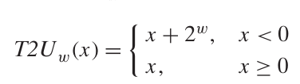 (2.5)

Ví dụ, ta đã thấy T2U<sub>16</sub>(−12,345) = −12,345 + 2<sup>16</sup> = 53,191, và T2U<sub>w</sub>(−1) = −1 + 2<sup>w</sup> = UMax<sub>w</sub>.

Có thể suy ra tính chất này bằng cách so sánh Phương trình 2.1 và 2.3.

suy dẫn: Chuyển từ two’s complement sang unsigned

So sánh Phương trình 2.1 và 2.3, có thể thấy với bit pattern x⃗, nếu tính hiệu B2U<sub>w</sub>(x⃗) − B2T<sub>w</sub>(x⃗), các tổng có trọng số của bit từ 0 đến w − 2 triệt tiêu nhau, để lại B2U<sub>w</sub>(x⃗) − B2T<sub>w</sub>(x⃗) = x<sub>w−1</sub>(2<sup>w−1</sup> − −2<sup>w−1</sup>) = x<sub>w−1</sub>2<sup>w</sup>. Điều này cho mối liên hệ B2U<sub>w</sub>(x⃗) = B2T<sub>w</sub>(x⃗) + x<sub>w−1</sub>2<sup>w</sup>. Do đó ta có

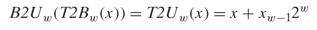 (2.6)

Trong biểu diễn two’s-complement của x, bit x<sub>w−1</sub> quyết định x có âm hay không, cho hai trường hợp của Phương trình 2.5.

Ví dụ, Hình 2.16 so sánh cách function B2U và B2T gán giá trị cho bit pattern với w = 4. Trong trường hợp two’s-complement, most significant bit là sign bit, được vẽ bằng thanh màu xám leftward-pointing. Trong trường hợp unsigned, bit này có trọng số dương, được vẽ bằng thanh màu đen rightward-pointing. Khi chuyển từ two’s complement sang unsigned, most significant bit đổi trọng số từ −8 sang +8. Vì vậy, các giá trị âm trong biểu diễn two’s-complement tăng thêm 2<sup>4</sup> = 16 khi biểu diễn unsigned. Do đó, −5 thành +11 và −1 thành +15.

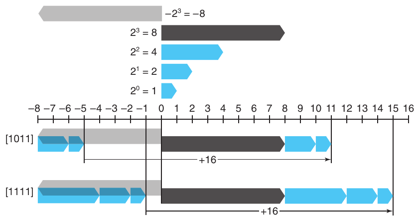

**Hình 2.16 So sánh biểu diễn unsigned và two’s-complement với w = 4. Trọng số của bit cao nhất là −8 trong two’s complement và +8 trong unsigned, tạo chênh lệch tổng cộng 16.**

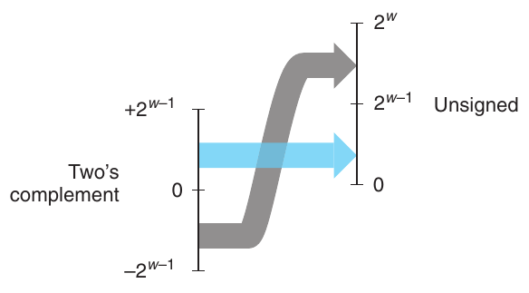

**Hình 2.17 Chuyển từ two’s complement sang unsigned. Function T2U chuyển số âm thành số dương lớn.**

Hình 2.17 minh họa hành vi tổng quát của function T2U. Như hình cho thấy, khi ánh xạ số signed sang unsigned tương ứng, số âm được chuyển thành số dương lớn, còn số không âm giữ nguyên.

#### Bài tập thực hành 2.20 (lời giải trang 185)

Giải thích cách áp dụng Phương trình 2.5 cho các mục trong bảng đã tạo khi giải Bài tập 2.19.

Theo chiều ngược lại, có thể phát biểu mối liên hệ giữa số unsigned u và số signed tương ứng U2T<sub>w</sub>(u):

nguyên lý: Chuyển unsigned sang two’s-complement

Với u thỏa 0 ≤ u ≤ UMax<sub>w</sub>:

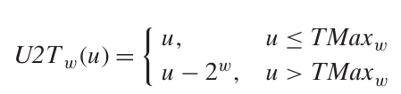 (2.7)

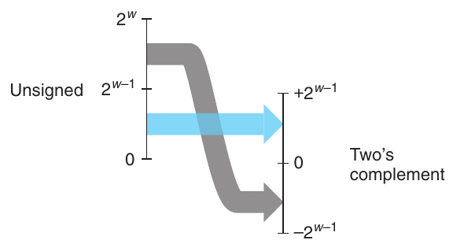

**Hình 2.18 Chuyển từ unsigned sang two’s complement. Function U2T chuyển số lớn hơn 2<sup>w−1</sup> − 1 thành giá trị âm.**

Có thể giải thích nguyên lý này như sau:

suy dẫn: Chuyển unsigned sang two’s-complement

Cho u⃗ = U2B<sub>w</sub>(u). Bit vector này cũng là biểu diễn two’s-complement của U2T<sub>w</sub>(u). Có thể kết hợp Phương trình 2.1 và 2.3 để thu được

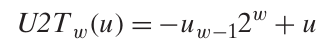 (2.8)

Trong biểu diễn unsigned của u, bit u<sub>w−1</sub> quyết định u có lớn hơn TMax<sub>w</sub> = 2<sup>w−1</sup> − 1 hay không, cho hai trường hợp của Phương trình 2.7.

Hành vi của function U2T được minh họa trong Hình 2.18. Với số nhỏ (≤ TMax<sub>w</sub>), chuyển từ unsigned sang signed giữ nguyên giá trị số. Số lớn (> TMax<sub>w</sub>) được chuyển thành giá trị âm.

Tổng kết lại, chúng ta đã xem xét tác động chuyển đổi theo cả hai chiều giữa biểu diễn unsigned và two’s-complement. Với giá trị x trong phạm vi 0 ≤ x ≤ TMax<sub>w</sub>, ta có T2U<sub>w</sub>(x) = x và U2T<sub>w</sub>(x) = x. Nghĩa là các số trong phạm vi này có biểu diễn unsigned và two’s-complement giống nhau. Với giá trị ngoài phạm vi, chuyển đổi cộng hoặc trừ 2<sup>w</sup>. Ví dụ, T2U<sub>w</sub>(−1) = −1 + 2<sup>w</sup> = UMax<sub>w</sub>—số âm gần 0 nhất ánh xạ sang số unsigned lớn nhất. Ở cực còn lại, T2U<sub>w</sub>(TMin<sub>w</sub>) = −2<sup>w−1</sup> + 2<sup>w</sup> = 2<sup>w−1</sup> = TMax<sub>w</sub> + 1—số âm nhỏ nhất ánh xạ sang số unsigned ngay ngoài phạm vi số dương two’s-complement. Dùng ví dụ Hình 2.15, ta thấy T2U<sub>16</sub>(−12,345) = 65,536 + −12,345 = 53,191.

### 2.2.5 Signed và unsigned trong C

Như Hình 2.9 và 2.10 cho thấy, C hỗ trợ số học signed lẫn unsigned cho mọi integer data type. Mặc dù chuẩn C không quy định cách biểu diễn số signed cụ thể, gần như mọi máy dùng two’s complement. Nhìn chung, phần lớn số mặc định là signed. Ví dụ, khi khai báo hằng số như 12345 hoặc 0x1A2B, giá trị được coi là signed. Thêm ký tự ‘U’ hoặc ‘u’ làm hậu tố tạo hằng số unsigned; ví dụ 12345U hoặc 0x1A2Bu.

C cho phép chuyển đổi giữa unsigned và signed. Mặc dù chuẩn C không quy định chính xác cách chuyển đổi, phần lớn hệ thống tuân theo quy tắc không thay đổi biểu diễn bit bên dưới. Quy tắc này có tác dụng áp dụng function U2T<sub>w</sub> khi chuyển unsigned sang signed và T2U<sub>w</sub> khi chuyển signed sang unsigned, trong đó w là số bit của data type.

Chuyển đổi có thể xảy ra do casting tường minh, như code sau:

```
1       int tx, ty;
2       unsigned ux, uy;
3
4       tx = (int) ux;
5       uy = (unsigned) ty;
```

Hoặc có thể xảy ra ngầm định khi gán biểu thức thuộc kiểu này cho variable thuộc kiểu khác, như code sau:

```
1       int tx, ty;
2       unsigned ux, uy;
3
4       tx = ux; /* Cast to signed */
5       uy = ty; /* Cast to unsigned */
```

Khi in giá trị số bằng printf, các directive %d, %u và %x lần lượt in số dưới dạng signed decimal, unsigned decimal và hexadecimal. Lưu ý printf không dùng thông tin kiểu, nên có thể in giá trị kiểu int bằng directive %u và giá trị kiểu unsigned bằng directive %d. Ví dụ, xét code sau:

```
1       int x = -1;
2       unsigned u = 2147483648; /* 2 to the 31st */
3
4       printf("x = %u = %d\n", x, x);
5       printf("u = %u = %d\n", u, u);
```

Khi biên dịch thành chương trình 32-bit, code in như sau:

```
x = 4294967295 = -1
u = 2147483648 = -2147483648
```

Trong cả hai trường hợp, printf trước tiên in word như thể biểu diễn số unsigned, rồi như thể biểu diễn số signed. Ta thấy các routine chuyển đổi hoạt động: T2U<sub>32</sub>(−1) = UMax<sub>32</sub> = 2<sup>32</sup> − 1 và U2T<sub>32</sub>(2<sup>31</sup>) = 2<sup>31</sup> − 2<sup>32</sup> = −2<sup>31</sup> = TMin<sub>32</sub>.

Một số hành vi có thể trái trực giác xuất hiện do cách C xử lý biểu thức kết hợp các lượng signed và unsigned. Khi thực hiện phép toán có một operand signed và một operand unsigned, C ngầm cast argument signed sang unsigned, rồi thực hiện phép toán với giả định các số không âm. Như sẽ thấy, quy ước này ít tạo khác biệt với arithmetic operation thông thường, nhưng dẫn đến kết quả trái trực giác cho relational operator như < và >. Hình 2.19 trình bày một số relational expression mẫu và kết quả khi data type int có biểu diễn two’s-complement 32-bit. Xét so sánh -1 < 0U. Vì operand thứ hai là unsigned, operand đầu được ngầm cast sang unsigned, nên biểu thức tương đương so sánh 4294967295U < 0U (nhớ rằng T2U<sub>w</sub>(−1) = UMax<sub>w</sub>), rõ ràng là false. Có thể hiểu các trường hợp khác bằng phân tích tương tự.

| Biểu thức | Kiểu | Kết quả |
|---|---|---|
| 0 == 0U | Unsigned | 1 |
| -1 < 0 | Signed | 1 |
| -1 < 0U | Unsigned | 0 * |
| 2147483647 > -2147483647-1 | Signed | 1 |
| 2147483647U > -2147483647-1 | Unsigned | 0 * |
| 2147483647 > (int) 2147483648U | Signed | 1 * |
| -1 > -2 | Signed | 1 |
| (unsigned) -1 > -2 | Unsigned | 1 |

**Hình 2.19 Tác động của các quy tắc promotion trong C. Trường hợp trái trực giác được đánh dấu ‘*’. Khi một operand trong phép so sánh là unsigned, operand kia được ngầm cast sang unsigned. Xem Web Aside data:tmin để biết vì sao viết TMin<sub>32</sub> thành -2,147,483,647-1 .**

#### Bài tập thực hành 2.21 (lời giải trang 185)

Giả sử các biểu thức được tính khi thực thi chương trình 32-bit trên máy dùng số học two’s-complement, điền bảng sau mô tả tác động của casting và relational operation, theo cách trình bày của Hình 2.19:

| Biểu thức | Kiểu | Kết quả |
|---|---|---|
| -2147483647-1 == 2147483648U | ______ | ______ |
| -2147483647-1 < 2147483647 | ______ | ______ |
| -2147483647-1U < 2147483647 | ______ | ______ |
| -2147483647-1 < -2147483647 | ______ | ______ |
| -2147483647-1U < -2147483647 | ______ | ______ |

### 2.2.6 Mở rộng biểu diễn bit của một số

Một thao tác phổ biến là chuyển đổi giữa các số nguyên có word size khác nhau mà vẫn giữ nguyên giá trị số. Dĩ nhiên, điều này có thể không thực hiện được khi data type đích quá nhỏ để biểu diễn giá trị mong muốn. Tuy nhiên, luôn có thể chuyển từ data type nhỏ hơn sang lớn hơn.

#### Ghi chú trên Web DATA:TMIN Viết TMin trong C

Trong Hình 2.19 và Bài tập 2.21, chúng ta cẩn thận viết giá trị TMin<sub>32</sub> thành -2,147,483,647-1. Vì sao không đơn giản viết -2,147,483,648 hoặc 0x80000000? Xem C header file limits.h, ta thấy cách viết TMin<sub>32</sub> và TMax<sub>32</sub> tương tự:

```
/* Minimum and maximum values a ‘signed int’ can hold.  */
#define INT_MAX   2147483647
#define INT_MIN   (-INT_MAX - 1)
```

Đáng tiếc, sự tương tác đặc biệt giữa tính bất đối xứng của biểu diễn two’s-complement và quy tắc chuyển đổi C buộc chúng ta viết TMin<sub>32</sub> theo cách khác thường này. Mặc dù hiểu vấn đề đòi hỏi tìm hiểu một góc khá khó hiểu trong chuẩn ngôn ngữ C, nó giúp chúng ta nhận thức một số điểm tinh tế của integer data type và biểu diễn.

Để chuyển số unsigned sang data type lớn hơn, chỉ cần thêm các số 0 vào đầu biểu diễn; thao tác này gọi là zero extension, được diễn đạt bằng nguyên lý sau:

nguyên lý: Mở rộng số unsigned bằng zero extension

Định nghĩa bit vector u⃗ = [u<sub>w−1</sub>, u<sub>w−2</sub>, . . . , u<sub>0</sub>] có độ rộng w và u⃗′ = [0, . . . , 0, u<sub>w−1</sub>, u<sub>w−2</sub>, . . . , u<sub>0</sub>] có độ rộng w′, trong đó w′ > w. Khi đó B2U<sub>w</sub>( u⃗) = B2U<sub>w′</sub>( u⃗′).

Có thể thấy nguyên lý này trực tiếp suy ra từ định nghĩa unsigned encoding trong Phương trình 2.1.

Để chuyển số two’s-complement sang data type lớn hơn, quy tắc là thực hiện sign extension, thêm các bản sao của most significant bit vào biểu diễn, được diễn đạt bằng nguyên lý sau. Chúng ta tô xanh sign bit x<sub>w−1</sub> để nhấn mạnh vai trò của nó trong sign extension.

nguyên lý: Mở rộng số two’s-complement bằng sign extension

Định nghĩa bit vector x⃗ = [x<sub>w−1</sub>, x<sub>w−2</sub>, . . . , x<sub>0</sub>] có độ rộng w và x⃗′ = [x<sub>w−1</sub>, . . . , x<sub>w−1</sub>, x<sub>w−1</sub>, x<sub>w−2</sub>, . . . , x<sub>0</sub>] có độ rộng w′, trong đó w′ > w. Khi đó B2T<sub>w</sub>(x⃗) = B2T<sub>w′</sub>( x⃗′).

Ví dụ, xét code sau:

```
 1    short sx = -12345;        /* -12345 */
 2    unsigned short usx = sx;  /*  53191 */
 3    int x = sx;               /* -12345 */
 4    unsigned ux = usx;        /*  53191 */
 5
 6    printf("sx  = %d:\t", sx);
 7    show_bytes((byte_pointer) &sx, sizeof(short));
 8    printf("usx = %u:\t", usx);
 9    show_bytes((byte_pointer) &usx, sizeof(unsigned short));
10    printf("x   = %d:\t", x);
11    show_bytes((byte_pointer) &x, sizeof(int));
12    printf("ux  = %u:\t", ux);
13    show_bytes((byte_pointer) &ux, sizeof(unsigned));
```

Khi chạy dưới dạng chương trình 32-bit trên một máy big-endian sử dụng biểu diễn two’s-complement, code này in ra output sau

```
sx  = -12345:  cf c7
usx = 53191:   cf c7
x   = -12345:  ff ff cf c7
ux  = 53191:   00 00 cf c7
```

Ta thấy dù biểu diễn two’s-complement của −12,345 và biểu diễn unsigned của 53,191 giống nhau với word size 16-bit, chúng khác nhau với word size 32-bit. Cụ thể, −12,345 có biểu diễn hexadecimal 0xFFFFCFC7, còn 53,191 có biểu diễn hexadecimal 0x0000CFC7. Biểu diễn thứ nhất đã được sign extension—16 bản sao của most significant bit là 1, có biểu diễn hexadecimal 0xFFFF, được thêm làm các bit đầu. Biểu diễn thứ hai được mở rộng bằng 16 số 0 ở đầu, có biểu diễn hexadecimal 0x0000.

Để minh họa, Hình 2.20 trình bày kết quả mở rộng từ word size w = 3 sang w = 4 bằng sign extension. Bit vector [101] biểu diễn giá trị −4 + 1 = −3. Áp dụng sign extension sẽ tạo ra bit vector [1101], biểu diễn giá trị −8 + 4 + 1 = −3. Có thể thấy rằng với w = 4, giá trị kết hợp của hai most significant bit, −8 + 4 = −4, bằng giá trị sign bit khi w = 3. Tương tự, các bit vector [111] và [1111] đều biểu diễn giá trị −1.

Với trực giác này, bây giờ có thể chứng minh sign extension giữ nguyên giá trị của số two’s-complement.

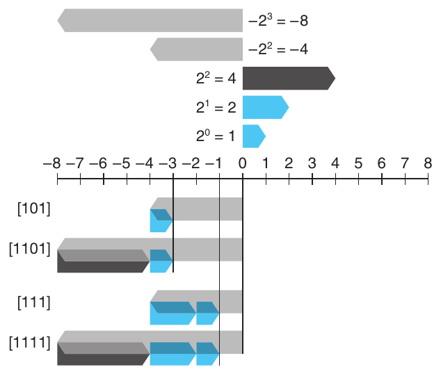

**Hình 2.20 Ví dụ sign extension từ w = 3 sang w = 4. Với w = 4, trọng số kết hợp của 2 bit trên là −8 + 4 = −4, bằng trọng số sign bit khi w = 3.**

suy dẫn: Mở rộng số two’s-complement bằng sign extension

Cho w′ = w + k. Điều cần chứng minh là

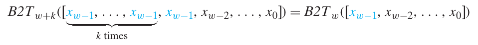

Chứng minh được thực hiện bằng quy nạp theo k. Nghĩa là nếu chúng ta chứng minh được rằng sign extension thêm 1 bit giữ nguyên giá trị số, thì tính chất này sẽ đúng khi sign extension thêm một số bit tùy ý. Vì vậy, nhiệm vụ được rút gọn thành việc chứng minh rằng

B2T<sub>w+1</sub>([x<sub>w−1</sub>, x<sub>w−1</sub>, x<sub>w−2</sub>, . . . , x<sub>0</sub>]) = B2T<sub>w</sub>([x<sub>w−1</sub>, x<sub>w−2</sub>, . . . , x<sub>0</sub>])

Khai triển biểu thức left-hand bằng Phương trình 2.3 cho kết quả sau:

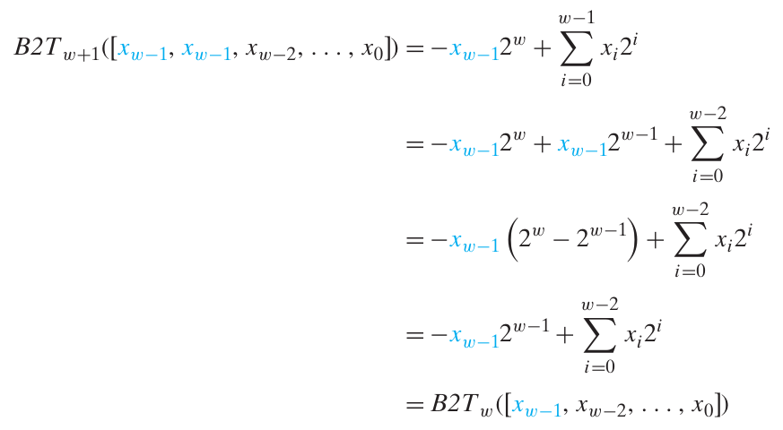

Tính chất then chốt được khai thác là 2<sup>w</sup> − 2<sup>w−1</sup> = 2<sup>w−1</sup>. Vì vậy, tác động kết hợp của việc thêm bit trọng số −2<sup>w</sup> và đổi bit trọng số −2<sup>w−1</sup> thành bit trọng số 2<sup>w−1</sup> là giữ nguyên giá trị số ban đầu.

#### Bài tập thực hành 2.22 (lời giải trang 186)

Áp dụng Phương trình 2.3 để chứng minh mỗi bit vector sau là biểu diễn two’s-complement của −4:

A. [1100]

B. [11100]

C. [111100]

Lưu ý bit vector thứ hai và thứ ba có thể suy ra từ vector đầu bằng sign extension.

Một điểm cần nêu là thứ tự tương đối giữa chuyển đổi kích thước dữ liệu và chuyển đổi unsigned với signed có thể ảnh hưởng hành vi chương trình. Xét code sau:

```
1    short sx = -12345;       /* -12345   */
2    unsigned uy = sx;        /* Mystery! */
3
4    printf("uy  = %u:\t", uy);
5    show_bytes((byte_pointer) &uy, sizeof(unsigned));
```

Khi chạy trên máy big-endian, code in output sau:

```
uy = 4294954951:  ff ff cf c7
```

Điều này cho thấy khi chuyển từ short sang unsigned, chương trình đổi kích thước trước rồi đổi kiểu. Nghĩa là (unsigned) sx tương đương (unsigned) (int) sx, cho 4,294,954,951, không phải (unsigned) (unsigned short) sx, cho 53,191. Thực tế, các chuẩn C yêu cầu quy ước này.

#### Bài tập thực hành 2.23 (lời giải trang 186)

Xét các function C sau:

```
int fun1(unsigned word) {
    return (int) ((word << 24) >> 24);
}

int fun2(unsigned word) {
    return ((int) word << 24) >> 24;
}
```

Giả sử các đoạn code này được thực thi dưới dạng chương trình 32-bit trên một máy sử dụng số học two’s-complement. Đồng thời, giả sử right shift của giá trị signed được thực hiện bằng arithmetic shift, còn right shift của giá trị unsigned được thực hiện bằng logical shift.

A. Điền bảng sau để trình bày tác động của các function này đối với một số argument ví dụ. Bạn sẽ thấy sử dụng biểu diễn hexadecimal thuận tiện hơn. Chỉ cần nhớ rằng các chữ số hex từ 8 đến F có most significant bit bằng 1.

| w | fun1(w) | fun2(w) |
|---|---|---|
| 0x00000076 | ______ | ______ |
| 0x87654321 | ______ | ______ |
| 0x000000C9 | ______ | ______ |
| 0xEDCBA987 | ______ | ______ |

B. Mô tả bằng lời phép tính hữu ích mà mỗi function thực hiện.

### 2.2.7 Cắt bớt số

Giả sử thay vì mở rộng giá trị bằng các bit bổ sung, chúng ta giảm số bit biểu diễn số. Ví dụ, điều này xảy ra trong code sau:

```
1    int x = 53191;
2    short sx = (short) x;  /* -12345 */
3    int y = sx;            /* -12345 */
```

Cast x sang short sẽ cắt int 32-bit thành short 16-bit. Như đã thấy, pattern 16-bit này là biểu diễn two’s-complement của −12,345. Khi cast trở lại int, sign extension đặt 16 bit high-order bằng 1, tạo biểu diễn two’s-complement 32-bit của −12,345.

Khi cắt số w-bit x⃗ = [x<sub>w−1</sub>, x<sub>w−2</sub>, . . . , x<sub>0</sub>] thành số k-bit, chúng ta bỏ w − k bit high-order, cho bit vector x⃗′ = [x<sub>k−1</sub>, x<sub>k−2</sub>, . . . , x<sub>0</sub>]. Cắt bớt số có thể thay đổi giá trị—một dạng overflow. Với số unsigned, có thể dễ dàng mô tả giá trị số thu được.

nguyên lý: Cắt bớt số unsigned

Cho x⃗ là bit vector [x<sub>w−1</sub>, x<sub>w−2</sub>, . . . , x<sub>0</sub>], và x⃗′ là kết quả cắt nó xuống k bit: x⃗′ = [x<sub>k−1</sub>, x<sub>k−2</sub>, . . . , x<sub>0</sub>]. Cho x = B2U<sub>w</sub>(x⃗) và x′ = B2U<sub>k</sub>( x⃗′). Khi đó x′ = x mod 2<sup>k</sup>.

Trực giác đằng sau nguyên lý này chỉ là mọi bit bị cắt đều có trọng số dạng 2<sup>i</sup>, với i ≥ k, nên mỗi trọng số đều trở thành 0 khi thực hiện phép modulo. Suy dẫn sau trình bày điều này một cách hình thức:

suy dẫn: Cắt bớt số unsigned

Áp dụng phép modulo cho Phương trình 2.1 cho

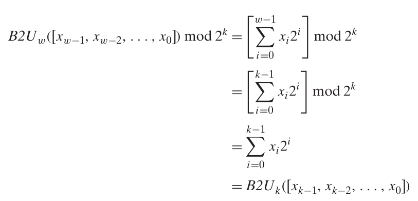

Trong suy dẫn này, chúng ta dùng tính chất 2<sup>i</sup> mod 2<sup>k</sup> = 0 với mọi i ≥ k.

Tính chất tương tự đúng khi cắt số two’s-complement, ngoại trừ việc sau đó most significant bit được chuyển thành sign bit:

nguyên lý: Cắt bớt số two’s-complement

Cho x⃗ là bit vector [x<sub>w−1</sub>, x<sub>w−2</sub>, . . . , x<sub>0</sub>], và ′x⃗ là kết quả cắt nó xuống k bit: x⃗′ = [x<sub>k−1</sub>, x<sub>k−2</sub>, . . . , x<sub>0</sub>]. Cho x = B2T<sub>w</sub>(x⃗) và x′ = B2T<sub>k</sub>(x⃗′). Khi đó x′ = U2T<sub>k</sub>(x mod 2<sup>k</sup>).

*(ghi chú: sách in ′x⃗ (dấu phẩy trên đặt trước x); đúng là x⃗′)*

Trong công thức này, x mod 2<sup>k</sup> là số từ 0 đến 2<sup>k</sup> − 1. Áp dụng function U2T<sub>k</sub> có tác dụng đổi most significant bit x<sub>k−1</sub> từ trọng số 2<sup>k−1</sup> thành −2<sup>k−1</sup>. Có thể thấy điều này qua ví dụ chuyển giá trị x = 53,191 từ int sang short. Vì 2<sup>16</sup> = 65,536 ≥ x, ta có x mod 2<sup>16</sup> = x. Nhưng khi chuyển số này sang số two’s-complement 16-bit, ta được x′ = 53,191 − 65,536 = −12,345.

suy dẫn: Cắt bớt số two’s-complement

Dùng lập luận tương tự như khi cắt số unsigned cho thấy

B2T<sub>w</sub>([x<sub>w−1</sub>, x<sub>w−2</sub>, . . . , x<sub>0</sub>]) mod 2<sup>k</sup> = B2U<sub>k</sub>([x<sub>k−1</sub>, x<sub>k−2</sub>, . . . , x<sub>0</sub>])

Nghĩa là x mod 2<sup>k</sup> có thể được biểu diễn bằng số unsigned có biểu diễn bit-level [x<sub>k−1</sub>, x<sub>k−2</sub>, . . . , x<sub>0</sub>]. Chuyển nó thành số two’s-complement cho x′ = U2T<sub>k</sub>(x mod 2<sup>k</sup>).

Tổng kết lại, tác dụng cắt bớt số unsigned là

B2U<sub>k</sub>([x<sub>k−1</sub>, x<sub>k−2</sub>, . . . , x<sub>0</sub>]) = B2U<sub>w</sub>([x<sub>w−1</sub>, x<sub>w−2</sub>, . . . , x<sub>0</sub>]) mod 2<sup>k</sup> (2.9)

còn tác dụng với số two’s-complement là

B2T<sub>k</sub>([x<sub>k−1</sub>, x<sub>k−2</sub>, . . . , x<sub>0</sub>]) = U2T<sub>k</sub>(B2U<sub>w</sub>([x<sub>w−1</sub>, x<sub>w−2</sub>, . . . , x<sub>0</sub>]) mod 2<sup>k</sup>) (2.10)

#### Bài tập thực hành 2.24 (lời giải trang 186)

Giả sử cắt giá trị 4-bit (biểu diễn bằng chữ số hex 0 đến F) xuống giá trị 3-bit (biểu diễn bằng chữ số hex 0 đến 7). Điền bảng sau cho tác động của việc cắt bớt trong một số trường hợp, theo cách diễn giải unsigned và two’s-complement của các bit pattern đó.

|  | Hex |  | Unsigned |  | Two’s complement |
|---|---|---|---|---|---|
| Ban đầu | Sau khi cắt | Ban đầu | Sau khi cắt | Ban đầu | Sau khi cắt |
| 1 | 1 | 1 | ______ | 1 | ______ |
| 3 | 3 | 3 | ______ | 3 | ______ |
| 5 | 5 | 5 | ______ | 5 | ______ |
| C | 4 | 12 | ______ | −4 | ______ |
| E | 6 | 14 | ______ | −2 | ______ |

Giải thích cách áp dụng Phương trình 2.9 và 2.10 cho các trường hợp này.

### 2.2.8 Lời khuyên về signed và unsigned

Như đã thấy, ngầm cast signed sang unsigned dẫn đến một số hành vi trái trực giác. Những đặc điểm trái trực giác thường gây bug chương trình, và bug liên quan đến điểm tinh tế của implicit casting có thể đặc biệt khó nhận ra. Vì casting diễn ra mà không có dấu hiệu rõ ràng trong code, lập trình viên thường bỏ qua tác động của nó.

Hai bài tập thực hành sau minh họa một số lỗi tinh vi có thể xuất hiện do implicit casting và data type unsigned.

#### Bài tập thực hành 2.25 (lời giải trang 187)

Xét code sau nhằm tính tổng các phần tử của array a, trong đó số phần tử được cho bởi parameter length:

```
1   /* WARNING: This is buggy code */
2   float sum_elements(float a[], unsigned length) {
3       int i;
4       float result = 0;
5
6       for (i = 0; i <= length-1; i++)
7           result += a[i];
8       return result;
9   }
```

Khi chạy với argument length bằng 0, code này lẽ ra phải trả về 0.0. Thay vào đó, nó gặp lỗi bộ nhớ. Hãy giải thích vì sao điều này xảy ra và trình bày cách sửa code.

#### Bài tập thực hành 2.26 (lời giải trang 187)

Bạn được giao viết function xác định string này có dài hơn string khác hay không. Bạn quyết định tận dụng string library function strlen có khai báo sau:

```
/* Prototype for library function strlen */
size_t strlen(const char *s);
```

Đây là lần thử viết function đầu tiên của bạn:

```
/* Determine whether string s is longer than string t */
/* WARNING: This function is buggy */
int strlonger(char *s, char *t) {
    return strlen(s) - strlen(t) > 0;
}
```

Khi thử nghiệm với một số dữ liệu mẫu, mọi thứ có vẻ hoạt động chưa đúng. Bạn tìm hiểu thêm và xác định rằng khi biên dịch thành chương trình 32-bit, data type size_t được định nghĩa (qua typedef) trong header file stdio.h là unsigned.

A. Function này cho kết quả sai trong những trường hợp nào?

B. Giải thích kết quả sai xuất hiện như thế nào.

C. Chỉ cách sửa code để hoạt động đáng tin cậy.

Chúng ta đã thấy nhiều cách mà đặc điểm tinh tế của số học unsigned, đặc biệt việc ngầm chuyển signed sang unsigned, dẫn tới lỗi hoặc lỗ hổng. Một cách tránh bug như vậy là không bao giờ dùng số unsigned. Thật vậy, ít ngôn ngữ ngoài C hỗ trợ unsigned integer. Có vẻ những nhà thiết kế ngôn ngữ khác cho rằng chúng gây phiền toái nhiều hơn lợi ích. Ví dụ, Java chỉ hỗ trợ signed integer và yêu cầu triển khai bằng số học two’s-complement. Right shift operator >> thông thường được bảo đảm thực hiện arithmetic shift. Toán tử đặc biệt >>> được định nghĩa để thực hiện logical right shift.

Các giá trị unsigned rất hữu ích khi chúng ta muốn xem word chỉ là những tập hợp bit mà không diễn giải thành giá trị số. Ví dụ, điều này xảy ra khi đóng gói các flag mô tả những điều kiện Boolean khác nhau vào một word. Địa chỉ vốn là unsigned, nên các lập trình viên hệ thống thấy các kiểu unsigned hữu ích. Các giá trị unsigned cũng hữu ích khi triển khai những gói toán học cho số học modulo và số học multiprecision, trong đó các số được biểu diễn bằng những array gồm các word.

## 2.3 Số học số nguyên

Nhiều lập trình viên mới bắt đầu ngạc nhiên khi nhận ra rằng cộng hai số dương có thể cho kết quả âm, và phép so sánh x < y có thể cho kết quả khác với phép so sánh x-y < 0. Những tính chất này là hệ quả của tính hữu hạn trong số học máy tính. Hiểu những điểm tinh tế của số học máy tính có thể giúp lập trình viên viết code đáng tin cậy hơn.

### 2.3.1 Phép cộng unsigned

Xét hai số nguyên không âm x và y sao cho 0 ≤ x, y < 2<sup>w</sup>. Mỗi giá trị này có thể được biểu diễn bằng một số unsigned w-bit. Tuy nhiên, nếu tính tổng của chúng, chúng ta có miền giá trị có thể là 0 ≤ x + y ≤ 2<sup>w+1</sup> − 2. Việc biểu diễn tổng này có thể cần w + 1 bit. Ví dụ, Hình 2.21 thể hiện đồ thị của hàm x + y khi x và y có biểu diễn 4-bit. Các đối số (thể hiện trên các trục ngang) nằm trong khoảng từ 0 đến 15, nhưng tổng nằm trong khoảng từ 0 đến 30. Hàm có dạng một mặt phẳng nghiêng (hàm tuyến tính theo cả hai chiều). Nếu giữ tổng dưới dạng một số (w + 1)-bit rồi cộng nó với một giá trị khác, chúng ta có thể cần w + 2 bit, và cứ tiếp tục như vậy. Sự “gia tăng word size” liên tục này có nghĩa là chúng ta không thể đặt bất kỳ giới hạn nào cho word size cần thiết để biểu diễn đầy đủ kết quả của các phép toán số học. Một số ngôn ngữ lập trình, chẳng hạn Lisp, thực sự hỗ trợ số học với kích thước tùy ý để cho phép số nguyên có kích thước bất kỳ (tất nhiên là trong giới hạn bộ nhớ của máy tính). Phổ biến hơn, các ngôn ngữ lập trình hỗ trợ số học fixed-size, và do đó các phép toán như “cộng” và “nhân” khác với các phép toán tương ứng trên số nguyên.

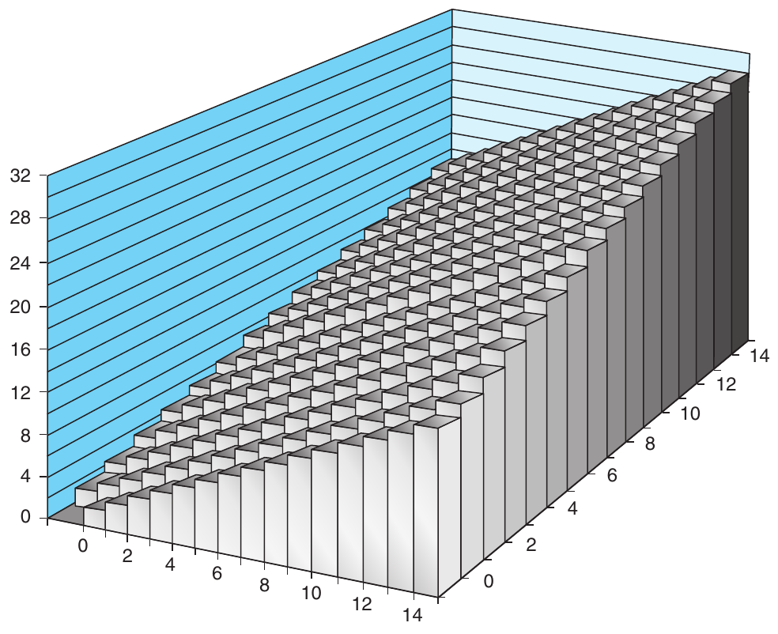

**Hình 2.21 Phép cộng số nguyên. Với word size 4-bit, tổng có thể cần 5 bit.**

Hãy định nghĩa phép toán +<sup>u</sup><sub>w</sub> cho các đối số x và y, với 0 ≤ x, y < 2<sup>w</sup>, là kết quả cắt ngắn tổng số nguyên x + y còn w bit rồi diễn giải kết quả dưới dạng số unsigned. Có thể mô tả đây là một dạng số học modulo, tính tổng modulo 2<sup>w</sup> bằng cách đơn giản loại bỏ mọi bit có trọng số lớn hơn 2<sup>w−1</sup> trong biểu diễn bit-level của x + y. Ví dụ, xét biểu diễn số 4-bit với x = 9 và y = 12, có các biểu diễn bit tương ứng là [1001] và [1100]. Tổng của chúng là 21, có biểu diễn 5-bit là [10101]. Nhưng nếu loại bỏ bit high-order, chúng ta nhận được [0101], tức giá trị thập phân 5. Kết quả này khớp với giá trị 21 mod 16 = 5.

#### Thông tin thêm: Lỗ hổng bảo mật trong getpeername

Vào năm 2002, các lập trình viên tham gia dự án hệ điều hành open-source FreeBSD nhận ra rằng phần triển khai hàm thư viện getpeername của họ có một lỗ hổng bảo mật. Một phiên bản đơn giản hóa của code đó có dạng như sau:

```
 1   /*
 2    * Illustration of code vulnerability similar to that found in
 3    * FreeBSD’s implementation of getpeername()
 4    */
 5
 6   /* Declaration of library function memcpy */
 7   void *memcpy(void *dest, void *src, size_t n);
 8
 9   /* Kernel memory region holding user-accessible data */
10   #define KSIZE 1024
11   char kbuf[KSIZE];
12
13   /* Copy at most maxlen bytes from kernel region to user buffer */
14   int copy_from_kernel(void *user_dest, int maxlen) {
15       /* Byte count len is minimum of buffer size and maxlen */
16       int len = KSIZE < maxlen ? KSIZE : maxlen;
17       memcpy(user_dest, kbuf, len);
18       return len;
19   }
```

Trong code này, chúng ta trình bày prototype của hàm thư viện memcpy ở dòng 7; hàm được thiết kế để sao chép một số byte n được chỉ định từ vùng bộ nhớ này sang vùng bộ nhớ khác.

Hàm copy_from_kernel, bắt đầu ở dòng 14, được thiết kế để sao chép một phần dữ liệu do kernel của hệ điều hành quản lý sang một vùng bộ nhớ được chỉ định mà người dùng có thể truy cập. Phần lớn các cấu trúc dữ liệu do kernel quản lý không nên cho phép người dùng đọc, vì chúng có thể chứa thông tin nhạy cảm về những người dùng khác và những công việc khác đang chạy trên hệ thống, nhưng vùng được thể hiện là kbuf được dự định cho phép người dùng đọc. Tham số maxlen được dự định là độ dài của buffer do người dùng cấp phát và được chỉ ra bằng đối số user_dest. Phép tính ở dòng 16 sau đó bảo đảm rằng số byte được sao chép không vượt quá số byte có sẵn trong buffer nguồn cũng như buffer đích.

Tuy nhiên, giả sử một lập trình viên có ý đồ xấu viết code gọi copy_from_kernel với giá trị maxlen âm. Khi đó, phép tính giá trị nhỏ nhất ở dòng 16 sẽ tính ra giá trị này cho len, rồi giá trị đó được truyền làm tham số n cho memcpy. Tuy nhiên, hãy lưu ý rằng tham số n được khai báo có kiểu dữ liệu size_t. Kiểu dữ liệu này được khai báo (thông qua typedef) trong file thư viện stdio.h. Thông thường, nó được định nghĩa là unsigned đối với chương trình 32-bit và unsigned long đối với chương trình 64-bit. Vì đối số n là unsigned, memcpy sẽ xem nó là một số dương rất lớn và cố gắng sao chép số byte tương ứng từ vùng kernel sang buffer của người dùng. Việc sao chép nhiều byte như vậy (ít nhất 2<sup>31</sup>) thực tế sẽ không thành công, vì chương trình sẽ gặp các địa chỉ không hợp lệ trong quá trình thực hiện, nhưng chương trình có thể đọc những vùng bộ nhớ kernel mà nó không được phép truy cập.

#### Thông tin thêm: Lỗ hổng bảo mật trong getpeername (tiếp theo)

Chúng ta có thể thấy rằng vấn đề này phát sinh do sự không nhất quán giữa các kiểu dữ liệu: ở một nơi tham số độ dài là signed; ở một nơi khác nó lại là unsigned. Những sự không nhất quán như vậy có thể là nguồn gây ra bug và, như ví dụ này cho thấy, thậm chí có thể dẫn đến lỗ hổng bảo mật. May mắn là không có trường hợp nào được báo cáo về việc lập trình viên đã khai thác lỗ hổng này trong FreeBSD. Họ đã phát hành khuyến cáo bảo mật “FreeBSD-SA-02:38.signed-error”, hướng dẫn quản trị viên hệ thống cách áp dụng patch để loại bỏ lỗ hổng. Có thể sửa bug bằng cách khai báo tham số maxlen của copy_from_kernel có kiểu size_t, nhất quán với tham số n của memcpy. Chúng ta cũng nên khai báo biến cục bộ len và giá trị trả về có kiểu size_t.

Chúng ta có thể mô tả phép toán +<sup>u</sup><sub>w</sub> như sau:

Nguyên lý: Phép cộng unsigned

Với x và y sao cho 0 ≤ x, y < 2<sup>w</sup>:

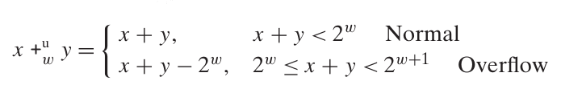 (2.11)

Hai trường hợp của Phương trình 2.11 được minh họa trong Hình 2.22, thể hiện tổng x + y bên trái được ánh xạ sang tổng unsigned w-bit x +<sup>u</sup><sub>w</sub> y bên phải. Trường hợp bình thường giữ nguyên giá trị x + y, còn trường hợp overflow có tác dụng giảm tổng này đi 2<sup>w</sup>.

Suy dẫn: Phép cộng unsigned

Nhìn chung, chúng ta có thể thấy rằng nếu x + y < 2<sup>w</sup>, bit đầu tiên trong biểu diễn (w + 1)-bit của tổng sẽ bằng 0, và do đó loại bỏ nó sẽ không làm thay đổi giá trị số. Ngược lại, nếu 2<sup>w</sup> ≤ x + y < 2<sup>w+1</sup>, bit đầu tiên trong biểu diễn (w + 1)-bit của tổng sẽ bằng 1, và do đó loại bỏ nó tương đương với việc trừ 2<sup>w</sup> khỏi tổng.

Một phép toán số học được gọi là xảy ra overflow khi kết quả số nguyên đầy đủ không nằm trong giới hạn word size của kiểu dữ liệu. Như Phương trình 2.11 chỉ ra, overflow xảy ra khi tổng hai toán hạng bằng 2<sup>w</sup> hoặc lớn hơn. Hình 2.23 thể hiện đồ thị của hàm cộng unsigned với word size w = 4. Tổng được tính modulo 2<sup>4</sup> = 16. Khi x + y < 16, không có overflow, và x +<sup>u</sup><sub>4</sub> y đơn giản là x + y. Điều này được thể hiện bằng vùng tạo thành một mặt phẳng nghiêng có nhãn “Normal”. Khi x + y ≥ 16, phép cộng xảy ra overflow, có tác dụng giảm tổng đi 16. Điều này được thể hiện bằng vùng tạo thành một mặt phẳng nghiêng có nhãn “Overflow”.

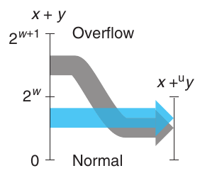

**Hình 2.22 Quan hệ giữa phép cộng số nguyên và phép cộng unsigned. Khi x + y lớn hơn 2<sup>w</sup> − 1, tổng xảy ra overflow.**

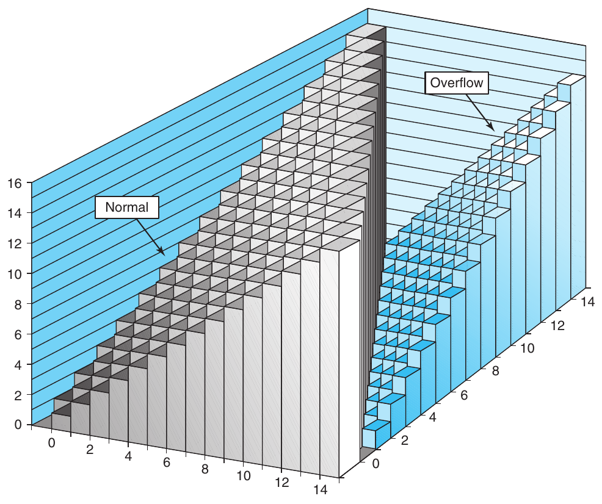

**Hình 2.23 Phép cộng unsigned. Với word size 4-bit, phép cộng được thực hiện modulo 16.**

Khi thực thi chương trình C, overflow không được báo hiệu là lỗi. Tuy nhiên, đôi khi chúng ta muốn xác định xem overflow có xảy ra hay không.

Nguyên lý: Phát hiện overflow của phép cộng unsigned

Với x và y trong miền 0 ≤ x, y ≤ UMax<sub>w</sub>, đặt s ≐ x +<sup>u</sup><sub>w</sub> y. Khi đó phép tính s xảy ra overflow khi và chỉ khi s < x (hoặc tương đương, s < y).

Để minh họa, trong ví dụ trước, chúng ta đã thấy rằng 9 +<sup>u</sup><sub>4</sub> 12 = 5. Chúng ta có thể thấy rằng overflow đã xảy ra, vì 5 < 9.

Suy dẫn: Phát hiện overflow của phép cộng unsigned

Hãy quan sát rằng x + y ≥ x, và do đó nếu s không xảy ra overflow, chắc chắn chúng ta có s ≥ x. Ngược lại, nếu s xảy ra overflow, chúng ta có s = x + y − 2<sup>w</sup>. Vì y < 2<sup>w</sup>, chúng ta có y − 2<sup>w</sup> < 0, và do đó s = x + (y − 2<sup>w</sup>) < x.

#### Bài tập thực hành 2.27 (lời giải trang 188)

Viết một hàm có prototype như sau:

```
/* Determine whether arguments can be added without overflow */
int uadd_ok(unsigned x, unsigned y);
```

Hàm này phải trả về 1 nếu có thể cộng các đối số x và y mà không gây ra overflow.

Phép cộng modulo tạo thành một cấu trúc toán học được gọi là nhóm abelian, đặt theo tên nhà toán học người Na Uy Niels Henrik Abel (1802–1829). Nghĩa là, nó có tính giao hoán (đây là ý nghĩa của phần “abelian”) và tính kết hợp; nó có phần tử đơn vị 0, và mọi phần tử đều có phần tử nghịch đảo cộng. Hãy xét tập các số unsigned w-bit với phép cộng +<sup>u</sup><sub>w</sub>. Với mọi giá trị x, phải có một giá trị -<sup>u</sup><sub>w</sub> x sao cho -<sup>u</sup><sub>w</sub> x +<sup>u</sup><sub>w</sub> x = 0. Phép toán tìm phần tử nghịch đảo cộng này có thể được mô tả như sau:

Nguyên lý: Phép đổi dấu unsigned

Với mọi số x sao cho 0 ≤ x < 2<sup>w</sup>, giá trị đổi dấu unsigned w-bit -<sup>u</sup><sub>w</sub> x được cho như sau:

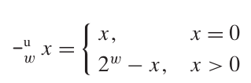 (2.12)

Có thể dễ dàng suy ra kết quả này bằng cách phân tích các trường hợp:

Suy dẫn: Phép đổi dấu unsigned

Khi x = 0, phần tử nghịch đảo cộng rõ ràng là 0. Với x > 0, xét giá trị 2<sup>w</sup> − x. Hãy quan sát rằng số này nằm trong miền 0 < 2<sup>w</sup> − x < 2<sup>w</sup>. Chúng ta cũng có thể thấy rằng (x + 2<sup>w</sup> − x) mod 2<sup>w</sup> = 2<sup>w</sup> mod 2<sup>w</sup> = 0. Do đó, đây là phần tử nghịch đảo của x đối với +<sup>u</sup><sub>w</sub>.

#### Bài tập thực hành 2.28 (lời giải trang 188)

Chúng ta có thể biểu diễn một mẫu bit có độ dài w = 4 bằng một chữ số hex duy nhất. Với cách diễn giải unsigned cho các chữ số này, hãy dùng Phương trình 2.12 để điền bảng sau, trình bày các giá trị và biểu diễn bit (ở dạng hex) của các phần tử nghịch đảo cộng unsigned của những chữ số đã cho.

|  | x | -<sup>u</sup><sub>4</sub> x |  |
|---|---|---|---|
| Hex | Thập phân | Thập phân | Hex |
| 1 | ______ | ______ | ______ |
| 4 | ______ | ______ | ______ |
| 7 | ______ | ______ | ______ |
| A | ______ | ______ | ______ |
| E | ______ | ______ | ______ |

### 2.3.2 Phép cộng Two’s-Complement

Với phép cộng two’s-complement, chúng ta phải quyết định cách xử lý khi kết quả quá lớn (dương) hoặc quá nhỏ (âm) để biểu diễn. Với các giá trị số nguyên x và y trong miền −2<sup>w−1</sup> ≤ x, y ≤ 2<sup>w−1</sup> − 1, tổng của chúng nằm trong miền −2<sup>w</sup> ≤ x + y ≤ 2<sup>w</sup> − 2, có thể cần w + 1 bit để biểu diễn chính xác. Như trước, chúng ta tránh kích thước dữ liệu ever-expanding bằng cách cắt ngắn biểu diễn còn w bit. Tuy nhiên, kết quả không quen thuộc về mặt toán học như phép cộng modulo. Hãy định nghĩa x +<sup>t</sup><sub>w</sub> y là kết quả cắt ngắn tổng số nguyên x + y còn w bit rồi diễn giải kết quả dưới dạng số two’s-complement.

Nguyên lý: Phép cộng Two’s-complement

Với các giá trị số nguyên x và y trong miền −2<sup>w−1</sup> ≤ x, y ≤ 2<sup>w−1</sup> − 1:

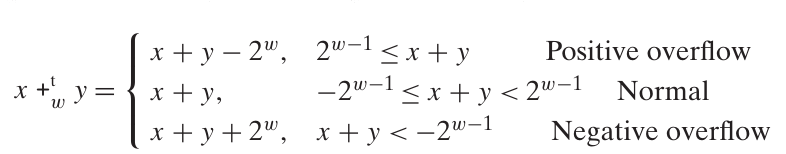 (2.13)

Nguyên lý này được minh họa trong Hình 2.24, trong đó tổng x + y được thể hiện bên trái, có giá trị trong miền −2<sup>w</sup> ≤ x + y ≤ 2<sup>w</sup> − 2, và kết quả cắt ngắn tổng thành số two’s-complement w-bit được thể hiện bên phải. (Các nhãn “Case 1” đến “Case 4” trong hình dành cho việc phân tích các trường hợp trong phần suy dẫn hình thức của nguyên lý.) Khi tổng x + y vượt quá TMax<sub>w</sub> (trường hợp 4), chúng ta nói rằng positive overflow đã xảy ra. Trong trường hợp này, việc cắt ngắn có tác dụng trừ 2<sup>w</sup> khỏi tổng. Khi tổng x + y nhỏ hơn TMin<sub>w</sub> (trường hợp 1), chúng ta nói rằng negative overflow đã xảy ra. Trong trường hợp này, việc cắt ngắn có tác dụng cộng thêm 2<sup>w</sup> vào tổng.

Tổng two’s-complement w-bit của hai số có biểu diễn bit-level hoàn toàn giống tổng unsigned. Trên thực tế, phần lớn máy tính sử dụng cùng một machine instruction để thực hiện phép cộng unsigned hoặc signed.

Suy dẫn: Phép cộng Two’s-complement

Vì phép cộng two’s-complement có biểu diễn bit-level hoàn toàn giống phép cộng unsigned, chúng ta có thể mô tả phép toán +<sup>t</sup><sub>w</sub> bằng cách chuyển các đối số sang unsigned, thực hiện phép cộng unsigned, rồi chuyển trở lại two’s complement:

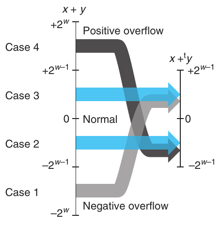

**Hình 2.24 Quan hệ giữa phép cộng số nguyên và phép cộng two’s-complement. Khi x + y nhỏ hơn −2<sup>w−1</sup>, negative overflow xảy ra. Khi nó lớn hơn hoặc bằng 2<sup>w−1</sup>, positive overflow xảy ra.**

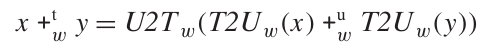 (2.14)

Theo Phương trình 2.6, chúng ta có thể viết T2U<sub>w</sub>(x) thành x<sub>w−1</sub>2<sup>w</sup> + x và T2U<sub>w</sub>(y) thành y<sub>w−1</sub>2<sup>w</sup> + y. Sử dụng tính chất +<sup>u</sup><sub>w</sub> đơn giản là phép cộng modulo 2<sup>w</sup>, cùng với các tính chất của phép cộng modulo, khi đó chúng ta có

x +<sup>t</sup><sub>w</sub> y = U2T<sub>w</sub>(T2U<sub>w</sub>(x) +<sup>u</sup><sub>w</sub> T2U<sub>w</sub>(y))

= U2T<sub>w</sub>[(x<sub>w−1</sub>2<sup>w</sup> + x + y<sub>w−1</sub>2<sup>w</sup> + y) mod 2<sup>w</sup>]

= U2T<sub>w</sub>[(x + y) mod 2<sup>w</sup>]

Các số hạng x<sub>w−1</sub>2<sup>w</sup> và y<sub>w−1</sub>2<sup>w</sup> bị loại bỏ vì chúng bằng 0 theo modulo 2<sup>w</sup>.

Để hiểu rõ hơn đại lượng này, hãy định nghĩa z là tổng số nguyên z ≐ x + y, z′ là z′ ≐ z mod 2<sup>w</sup>, và z″ là z″ ≐ U2T<sub>w</sub>(z′). Giá trị z″ bằng x +<sup>t</sup><sub>w</sub> y. Chúng ta có thể chia việc phân tích thành bốn trường hợp như minh họa trong Hình 2.24:

1. −2<sup>w</sup> ≤ z < −2<sup>w−1</sup>. Khi đó chúng ta có z′ = z + 2<sup>w</sup>. Điều này cho 0 ≤ z′ < −2<sup>w−1</sup> + 2<sup>w</sup> = 2<sup>w−1</sup>. Xét Phương trình 2.7, chúng ta thấy z′ nằm trong miền sao cho z″ = z′. Đây là trường hợp negative overflow. Chúng ta đã cộng hai số âm x và y (đây là cách duy nhất để có z < −2<sup>w−1</sup>) và nhận được kết quả không âm z″ = x + y + 2<sup>w</sup>.

2. −2<sup>w−1</sup> ≤ z < 0. Khi đó chúng ta lại có z′ = z + 2<sup>w</sup>, cho −2<sup>w−1</sup> + 2<sup>w</sup> = 2<sup>w−1</sup> ≤ z′ < 2<sup>w</sup>. Xét Phương trình 2.7, chúng ta thấy z′ nằm trong miền sao cho z″ = z′ − 2<sup>w</sup>, và do đó z″ = z′ − 2<sup>w</sup> = z + 2<sup>w</sup> − 2<sup>w</sup> = z. Nghĩa là tổng two’s-complement z″ của chúng ta bằng tổng số nguyên x + y.

3. 0 ≤ z < 2<sup>w−1</sup>. Khi đó chúng ta có z′ = z, cho 0 ≤ z′ < 2<sup>w−1</sup>, và do đó z″ = z′ = z. Một lần nữa, tổng two’s-complement z″ bằng tổng số nguyên x + y.

4. 2<sup>w−1</sup> ≤ z < 2<sup>w</sup>. Chúng ta lại có z′ = z, cho 2<sup>w−1</sup> ≤ z′ < 2<sup>w</sup>. Nhưng trong miền này chúng ta có z″ = z′ − 2<sup>w</sup>, cho z″ = x + y − 2<sup>w</sup>. Đây là trường hợp positive overflow. Chúng ta đã cộng hai số dương x và y (đây là cách duy nhất để có z ≥ 2<sup>w−1</sup>) và nhận được kết quả âm z″ = x + y − 2<sup>w</sup>.

| x | y | x + y | x +<sup>t</sup><sub>4</sub> y | Trường hợp |
|---|---|---|---|---|
| −8 | −5 | −13 | 3 | 1 |
| [1000] | [1011] | [10011] | [0011] |  |
| −8 | −8 | −16 | 0 | 1 |
| [1000] | [1000] | [10000] | [0000] |  |
| −8 | 5 | −3 | −3 | 2 |
| [1000] | [0101] | [11101] | [1101] |  |
| 2 | 5 | 7 | 7 | 3 |
| [0010] | [0101] | [00111] | [0111] |  |
| 5 | 5 | 10 | −6 | 4 |
| [0101] | [0101] | [01010] | [1010] |  |

**Hình 2.25 Các ví dụ về phép cộng Two’s-complement. Có thể thu được biểu diễn bit-level của tổng two’s-complement 4-bit bằng cách thực hiện phép cộng nhị phân các toán hạng và cắt ngắn kết quả còn 4 bit.**

Để minh họa phép cộng two’s-complement, Hình 2.25 trình bày một số ví dụ khi w = 4. Mỗi ví dụ được gắn nhãn theo trường hợp tương ứng trong phần suy dẫn Phương trình 2.13. Lưu ý rằng 2<sup>4</sup> = 16, và do đó negative overflow tạo ra kết quả lớn hơn tổng số nguyên 16 đơn vị, còn positive overflow tạo ra kết quả nhỏ hơn 16 đơn vị. Chúng ta đưa vào các biểu diễn bit-level của các toán hạng và kết quả. Hãy quan sát rằng có thể thu được kết quả bằng cách thực hiện phép cộng nhị phân các toán hạng và cắt ngắn kết quả còn 4 bit.

Hình 2.26 minh họa phép cộng two’s-complement với word size w = 4. Các toán hạng nằm trong khoảng từ −8 đến 7. Khi x + y < −8, phép cộng two’s-complement xảy ra negative overflow, khiến tổng tăng thêm 16. Khi −8 ≤ x + y < 8, phép cộng cho kết quả x + y. Khi x + y ≥ 8, phép cộng xảy ra positive overflow, khiến tổng giảm đi 16. Mỗi miền trong ba miền này tạo thành một mặt phẳng nghiêng trong hình.

Phương trình 2.13 cũng cho phép chúng ta nhận biết các trường hợp đã xảy ra overflow:

Nguyên lý: Phát hiện overflow trong phép cộng two’s-complement

Với x và y trong miền TMin<sub>w</sub> ≤ x, y ≤ TMax<sub>w</sub>, đặt s ≐ x +<sup>t</sup><sub>w</sub> y. Khi đó phép tính s xảy ra positive overflow khi và chỉ khi x > 0 và y > 0 nhưng s ≤ 0. Phép tính xảy ra negative overflow khi và chỉ khi x < 0 và y < 0 nhưng s ≥ 0.

Hình 2.25 trình bày một số minh họa cho nguyên lý này với w = 4. Mục đầu tiên thể hiện trường hợp negative overflow, trong đó hai số âm cộng lại thành một số dương. Mục cuối cùng thể hiện trường hợp positive overflow, trong đó hai số dương cộng lại thành một số âm.

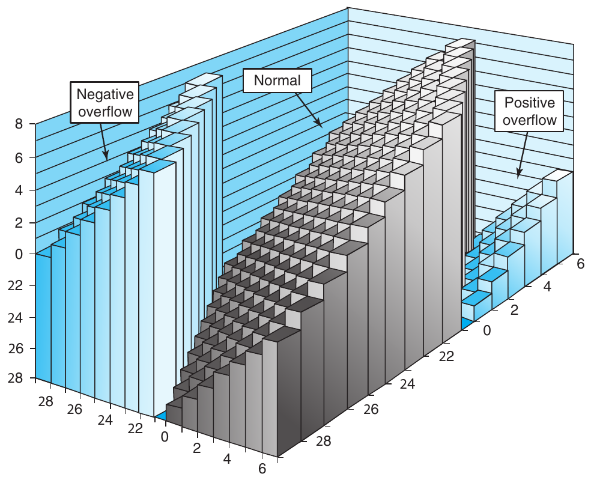

**Hình 2.26 Phép cộng Two’s-complement. Với word size 4-bit, phép cộng có thể xảy ra negative overflow khi x + y < −8 và positive overflow khi x + y ≥ 8.**

Suy dẫn: Phát hiện overflow của phép cộng two’s-complement

Trước hết hãy phân tích positive overflow. Nếu cả x > 0 và y > 0 nhưng s ≤ 0, thì rõ ràng positive overflow đã xảy ra. Ngược lại, positive overflow đòi hỏi (1) x > 0 và y > 0 (nếu không thì x + y < TMax<sub>w</sub>) và (2) s ≤ 0 (theo Phương trình 2.13). Một tập lập luận tương tự cũng áp dụng cho negative overflow.

#### Bài tập thực hành 2.29 (lời giải trang 188)

Điền bảng sau theo cách trình bày của Hình 2.25. Hãy đưa ra giá trị số nguyên của các đối số 5-bit, các giá trị của cả tổng số nguyên lẫn tổng two’s-complement của chúng, biểu diễn bit-level của tổng two’s-complement, và trường hợp tương ứng trong phần suy dẫn Phương trình 2.13.

| x | y | x + y | x +<sup>t</sup><sub>5</sub> y | Trường hợp |
|---|---|---|---|---|
| [10100] | [10001] | ______ | ______ | ______ |
| [11000] | [11000] | \_\_\_\_\_\_<br>\_\_\_\_\_\_ | \_\_\_\_\_\_<br>\_\_\_\_\_\_ | \_\_\_\_\_\_<br>\_\_\_\_\_\_ |
| [10111] | [01000] | \_\_\_\_\_\_<br>\_\_\_\_\_\_ | \_\_\_\_\_\_<br>\_\_\_\_\_\_ | \_\_\_\_\_\_<br>\_\_\_\_\_\_ |
| [00010] | [00101] | \_\_\_\_\_\_<br>\_\_\_\_\_\_ | \_\_\_\_\_\_<br>\_\_\_\_\_\_ | \_\_\_\_\_\_<br>\_\_\_\_\_\_ |
| [01100] | [00100] | ______ | ______ | ______ |

#### Bài tập thực hành 2.30 (lời giải trang 189)

Viết một hàm có prototype như sau:

```
/* Determine whether arguments can be added without overflow */
int tadd_ok(int x, int y);
```

Hàm này phải trả về 1 nếu có thể cộng các đối số x và y mà không gây ra overflow.

#### Bài tập thực hành 2.31 (lời giải trang 189)

Đồng nghiệp của bạn mất kiên nhẫn với việc bạn phân tích các điều kiện overflow cho phép cộng two’s-complement và đưa cho bạn phần triển khai tadd_ok như sau:

```
/* Determine whether arguments can be added without overflow */
/* WARNING: This code is buggy. */
int tadd_ok(int x, int y) {
    int sum = x+y;
    return (sum-x == y) && (sum-y == x);
}
```

Bạn nhìn code rồi bật cười. Hãy giải thích vì sao.

#### Bài tập thực hành 2.32 (lời giải trang 189)

Bạn được giao viết code cho hàm tsub_ok, với các đối số x và y, trả về 1 nếu phép tính x-y không gây ra overflow. Vì vừa viết code cho Bài tập 2.30, bạn viết như sau:

```
/* Determine whether arguments can be subtracted without overflow */
/* WARNING: This code is buggy. */
int tsub_ok(int x, int y) {
    return tadd_ok(x, -y);
}
```

Với những giá trị x và y nào thì hàm này cho kết quả không chính xác? Việc viết phiên bản đúng của hàm này được dành làm bài tập (Bài tập 2.74).

### 2.3.3 Phép đổi dấu Two’s-Complement

Chúng ta có thể thấy rằng mọi số x trong miền TMin<sub>w</sub> ≤ x ≤ TMax<sub>w</sub> đều có phần tử nghịch đảo cộng đối với +<sup>t</sup><sub>w</sub>, được ký hiệu là -<sup>t</sup><sub>w</sub> x như sau:

Nguyên lý: Phép đổi dấu Two’s-complement

Với x trong miền TMin<sub>w</sub> ≤ x ≤ TMax<sub>w</sub>, giá trị đổi dấu two’s-complement -<sup>t</sup><sub>w</sub> x được cho bởi công thức

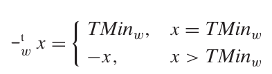 (2.15)

Nghĩa là, đối với phép cộng two’s-complement w-bit, TMin<sub>w</sub> là phần tử nghịch đảo cộng của chính nó, còn mọi giá trị x khác đều có phần tử nghịch đảo cộng là −x.

Suy dẫn: Phép đổi dấu Two’s-complement

Hãy quan sát rằng TMin<sub>w</sub> + TMin<sub>w</sub> = −2<sup>w−1</sup> + −2<sup>w−1</sup> = −2<sup>w</sup>. Điều này gây ra negative overflow, và do đó TMin<sub>w</sub> +<sup>t</sup><sub>w</sub> TMin<sub>w</sub> = −2<sup>w</sup> + 2<sup>w</sup> = 0. Với những giá trị x sao cho x > TMin<sub>w</sub>, giá trị −x cũng có thể được biểu diễn dưới dạng số two’s-complement w-bit, và tổng của chúng sẽ là −x + x = 0.

#### Bài tập thực hành 2.33 (lời giải trang 189)

Chúng ta có thể biểu diễn một mẫu bit có độ dài w = 4 bằng một chữ số hex duy nhất. Với cách diễn giải two’s-complement cho các chữ số này, hãy điền bảng sau để xác định các phần tử nghịch đảo cộng của những chữ số đã cho:

|  | x |  | -<sup>t</sup><sub>4</sub> x |
|---|---|---|---|
| Hex | Thập phân | Thập phân | Hex |
| 2 | ______ | ______ | ______ |
| 3 | ______ | ______ | ______ |
| 9 | ______ | ______ | ______ |
| B | ______ | ______ | ______ |
| C | ______ | ______ | ______ |

Bạn quan sát được điều gì về các mẫu bit được tạo ra bởi phép đổi dấu two’s-complement và unsigned (Bài tập 2.28)?

#### Thông tin thêm trên web DATA:TNEG: Biểu diễn Bit-level của phép đổi dấu two’s-complement

Có một số cách khéo léo để xác định giá trị đổi dấu two’s-complement của một giá trị được biểu diễn ở mức bit. Cả hai kỹ thuật sau đều hữu ích, chẳng hạn khi gặp giá trị 0xfffffffa trong lúc debug chương trình, và chúng giúp hiểu rõ hơn bản chất của biểu diễn two’s-complement.

Một kỹ thuật thực hiện phép đổi dấu two’s-complement ở mức bit là đảo các bit rồi tăng kết quả thêm một. Trong C, chúng ta có thể phát biểu rằng với mọi giá trị số nguyên x, việc tính các biểu thức -x và ~x + 1 sẽ cho kết quả giống hệt nhau.

Sau đây là một số ví dụ với word size 4-bit:

| x⃗ |  | ~ x⃗ |  | incr( ~ x⃗) |  |
|---|---|---|---|---|---|
| [0101] | 5 | [1010] | −6 | [1011] | −5 |
| [0111] | 7 | [1000] | −8 | [1001] | −7 |
| [1100] | −4 | [0011] | 3 | [0100] | 4 |
| [0000] | 0 | [1111] | −1 | [0000] | 0 |
| [1000] | −8 | [0111] | 7 | [1000] | −8 |

Với ví dụ trước đó, chúng ta biết rằng phần bù của 0xf là 0x0 và phần bù của 0xa là 0x5, nên 0xfffffffa là biểu diễn two’s-complement của −6.

Cách thứ hai để thực hiện phép đổi dấu two’s-complement của một số x dựa trên việc chia vector bit thành hai phần. Gọi k là vị trí của bit 1 ngoài cùng bên phải, khi đó biểu diễn bit-level của x có dạng [x<sub>w−1</sub>, x<sub>w−2</sub>, . . . , x<sub>k+1</sub>, 1, 0, . . . 0]. (Điều này thực hiện được miễn là x ≠ 0.) Giá trị đổi dấu khi đó được viết ở dạng nhị phân là [~x<sub>w−1</sub>, ~x<sub>w−2</sub>, . . . ~ x<sub>k+1</sub>, 1, 0, . . . , 0]. Nghĩa là, chúng ta đảo từng bit nằm bên trái vị trí bit k.

Chúng ta minh họa ý tưởng này bằng một số số 4-bit, trong đó mẫu ngoài cùng bên phải 1, 0, . . . , 0 được làm nổi bật bằng chữ nghiêng:

| x |  | −x |  |
|---|---|---|---|
| [1100] | −4 | [0100] | 4 |
| [1000] | −8 | [1000] | −8 |
| [0101] | 5 | [1011] | −5 |
| [0111] | 7 | [1001] | −7 |

### 2.3.4 Phép nhân unsigned

Các số nguyên x và y trong miền 0 ≤ x, y ≤ 2<sup>w</sup> − 1 có thể được biểu diễn bằng các số unsigned w-bit, nhưng tích x · y của chúng có thể nằm trong khoảng từ 0 đến (2<sup>w</sup> − 1)<sup>2</sup> = 2<sup>2w</sup> − 2<sup>w+1</sup> + 1. Việc biểu diễn tích này có thể cần đến 2w bit. Thay vào đó, phép nhân unsigned trong C được định nghĩa là tạo ra giá trị w-bit được cho bởi w bit low-order của tích số nguyên 2w-bit. Hãy ký hiệu giá trị này là x *<sup>u</sup><sub>w</sub> y.

Cắt ngắn một số unsigned còn w bit tương đương với việc tính giá trị của nó modulo 2<sup>w</sup>, cho kết quả sau:

Nguyên lý: Phép nhân unsigned

Với x và y sao cho 0 ≤ x, y ≤ UMax<sub>w</sub>:

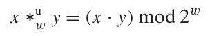 (2.16)

### 2.3.5 Phép nhân Two’s-Complement

Các số nguyên x và y trong miền −2<sup>w−1</sup> ≤ x, y ≤ 2<sup>w−1</sup> − 1 có thể được biểu diễn bằng các số two’s-complement w-bit, nhưng tích x · y của chúng có thể nằm trong khoảng từ −2<sup>w−1</sup> · (2<sup>w−1</sup> − 1) = −2<sup>2w−2</sup> + 2<sup>w−1</sup> đến −2<sup>w−1</sup> · −2<sup>w−1</sup> = 2<sup>2w−2</sup>. Việc biểu diễn tích này ở dạng two’s-complement có thể cần đến 2w bit. Thay vào đó, phép nhân signed trong C thường được thực hiện bằng cách cắt ngắn tích 2w-bit còn w bit. Chúng ta ký hiệu giá trị này là x *<sup>t</sup><sub>w</sub> y. Cắt ngắn một số two’s-complement còn w bit tương đương với việc trước hết tính giá trị của nó modulo 2<sup>w</sup>, rồi chuyển từ unsigned sang two’s complement, cho kết quả sau:

Nguyên lý: Phép nhân Two’s-complement

Với x và y sao cho TMin<sub>w</sub> ≤ x, y ≤ TMax<sub>w</sub>:

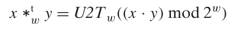 (2.17)

Chúng ta khẳng định rằng biểu diễn bit-level của phép nhân là giống hệt nhau đối với cả phép nhân unsigned lẫn two’s-complement, như được phát biểu trong nguyên lý sau:

Nguyên lý: Sự tương đương Bit-level của phép nhân unsigned và two’s-complement

Gọi x⃗ và y⃗ là các vector bit có độ dài w. Định nghĩa các số nguyên x và y là các giá trị được những bit này biểu diễn ở dạng two’s-complement: x = B2T<sub>w</sub>(x⃗) và y = B2T<sub>w</sub>( y⃗). Định nghĩa các số nguyên không âm x′ và y′ là các giá trị được những bit này biểu diễn ở dạng unsigned: x′ = B2U<sub>w</sub>(x⃗) và y′ = B2U<sub>w</sub>(y⃗). Khi đó

T2B<sub>w</sub>(x *<sup>t</sup><sub>w</sub> y) = U2B<sub>w</sub>(x′ *<sup>u</sup><sub>w</sub> y′)

Để minh họa, Hình 2.27 trình bày kết quả nhân các số 3-bit khác nhau. Với mỗi cặp toán hạng bit-level, chúng ta thực hiện cả phép nhân unsigned lẫn two’s-complement, tạo ra các tích 6-bit, rồi cắt ngắn chúng còn 3 bit. Tích unsigned sau khi cắt ngắn luôn bằng x · y mod 8. Các biểu diễn bit-level của cả hai tích đã cắt ngắn là giống hệt nhau đối với phép nhân unsigned và two’s-complement, mặc dù các biểu diễn 6-bit đầy đủ khác nhau.

| Chế độ | x | y | x · y | x · y sau cắt ngắn |
|---|---|---|---|---|
| Unsigned | 5 [101] | 3 [011] | 15 [001111] | 7 [111] |
| Two’s complement | −3 [101] | 3 [011] | −9 [110111] | −1 [111] |
| Unsigned | 4 [100] | 7 [111] | 28 [011100] | 4 [100] |
| Two’s complement | −4 [100] | −1 [111] | 4 [000100] | −4 [100] |
| Unsigned | 3 [011] | 3 [011] | 9 [001001] | 1 [001] |
| Two’s complement | 3 [011] | 3 [011] | 9 [001001] | 1 [001] |

**Hình 2.27 Các ví dụ về phép nhân unsigned và two’s-complement Three-bit. Mặc dù biểu diễn bit-level của các tích đầy đủ có thể khác nhau, biểu diễn của các tích đã cắt ngắn lại giống hệt nhau.**

Suy dẫn: Sự tương đương Bit-level của phép nhân unsigned và two’s-complement

Theo Phương trình 2.6, chúng ta có x′ = x + x<sub>w−1</sub>2<sup>w</sup> và y′ = y + y<sub>w−1</sub>2<sup>w</sup>. Tính tích của các giá trị này theo modulo 2<sup>w</sup> cho kết quả sau:

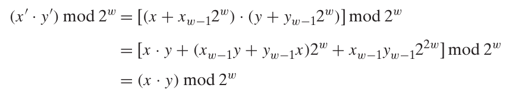 (2.18)

Các số hạng có trọng số 2<sup>w</sup> và 2<sup>2w</sup> bị loại bỏ do toán tử modulo. Theo Phương trình 2.17, chúng ta có x *<sup>t</sup><sub>w</sub> y = U2T<sub>w</sub>((x · y) mod 2<sup>w</sup>). Chúng ta có thể áp dụng phép toán T2U<sub>w</sub> cho cả hai vế để được

T2U<sub>w</sub>(x *<sup>t</sup><sub>w</sub> y) = T2U<sub>w</sub>(U2T<sub>w</sub>((x · y) mod 2<sup>w</sup>)) = (x · y) mod 2<sup>w</sup>

Kết hợp kết quả này với các Phương trình 2.16 và 2.18 cho thấy T2U<sub>w</sub>(x *<sup>t</sup><sub>w</sub> y) = (x′ · y′) mod 2<sup>w</sup> = x′ *<sup>u</sup><sub>w</sub> y′. Sau đó chúng ta có thể áp dụng U2B<sub>w</sub> cho cả hai vế để được

U2B<sub>w</sub>(T2U<sub>w</sub>(x *<sup>t</sup><sub>w</sub> y)) = T2B<sub>w</sub>(x *<sup>t</sup><sub>w</sub> y) = U2B<sub>w</sub>(x′ *<sup>u</sup><sub>w</sub> y′)

#### Bài tập thực hành 2.34 (lời giải trang 189)

Điền bảng sau để trình bày kết quả nhân các số 3-bit khác nhau, theo cách trình bày của Hình 2.27:

| Chế độ | x |  | y |  | x · y |  |  | x · y sau cắt ngắn |
|---|---|---|---|---|---|---|---|---|
| Unsigned | ______ | [100] | ______ | [101] | ______ | ______ | ______ | ______ |
| Two’s complement | ______ | [100] | ______ | [101] | ______ | ______ | ______ | ______ |
| Unsigned | ______ | [010] | ______ | [111] | ______ | ______ | ______ | ______ |
| Two’s complement | ______ | [010] | ______ | [111] | ______ | ______ | ______ | ______ |
| Unsigned | ______ | [110] | ______ | [110] | ______ | ______ | ______ | ______ |
| Two’s complement | ______ | [110] | ______ | [110] | ______ | ______ | ______ | ______ |

#### Bài tập thực hành 2.35 (lời giải trang 190)

Bạn được giao phát triển code cho hàm tmult_ok nhằm xác định xem có thể nhân hai đối số mà không gây ra overflow hay không. Sau đây là lời giải của bạn:

```
/* Determine whether arguments can be multiplied without overflow */
int tmult_ok(int x, int y) {
    int p = x*y;
    /* Either x is zero, or dividing p by x gives y */
    return !x || p/x == y;
}
```

Bạn kiểm tra code này với một số giá trị x và y, và có vẻ nó hoạt động đúng. Đồng nghiệp của bạn chất vấn: “Nếu tôi không thể dùng phép trừ để kiểm tra xem phép cộng có xảy ra overflow hay không (xem Bài tập 2.31), thì làm sao bạn có thể dùng phép chia để kiểm tra xem phép nhân có xảy ra overflow hay không?”

Hãy đưa ra lập luận toán học chứng minh cách tiếp cận của bạn theo những bước sau. Trước hết, lập luận rằng trường hợp x = 0 được xử lý đúng. Nếu không, xét các số w-bit x (x ≠ 0), y, p và q, trong đó p là kết quả thực hiện phép nhân two’s-complement trên x và y, còn q là kết quả chia p cho x.

1. Chứng minh rằng x · y, tích số nguyên của x và y, có thể được viết dưới dạng x · y = p + t2<sup>w</sup>, trong đó t ≠ 0 khi và chỉ khi phép tính p xảy ra overflow.

2. Chứng minh rằng p có thể được viết dưới dạng p = x · q + r, trong đó |r| < |x|.

3. Chứng minh rằng q = y khi và chỉ khi r = t = 0.

#### Bài tập thực hành 2.36 (lời giải trang 190)

Với trường hợp kiểu dữ liệu int có 32 bit, hãy xây dựng một phiên bản tmult_ok (Bài tập 2.35) sử dụng độ chính xác 64-bit của kiểu dữ liệu int64_t mà không dùng phép chia.

#### Bài tập thực hành 2.37 (lời giải trang 191)

Bạn được giao vá lỗ hổng trong code XDR được trình bày ở phần thông tin thêm trên trang 136, cho trường hợp cả hai kiểu dữ liệu int và size_t đều có 32 bit. Bạn quyết định loại bỏ khả năng phép nhân xảy ra overflow bằng cách tính số byte cần cấp phát sử dụng kiểu dữ liệu uint64_t. Bạn thay thế lời gọi malloc ban đầu (dòng 9) như sau:

#### Thông tin thêm: Lỗ hổng bảo mật trong thư viện XDR

Vào năm 2002, người ta phát hiện rằng code do Sun Microsystems cung cấp để triển khai thư viện XDR, một công cụ được sử dụng rộng rãi để chia sẻ cấu trúc dữ liệu giữa các chương trình, có lỗ hổng bảo mật xuất phát từ việc phép nhân có thể xảy ra overflow mà chương trình không nhận được bất kỳ thông báo nào.

Code tương tự code chứa lỗ hổng được trình bày dưới đây:

```
 1   /* Illustration of code vulnerability similar to that found in
 2    * Sun’s XDR library.
 3    */
 4   void* copy_elements(void *ele_src[], int ele_cnt, size_t ele_size) {
 5       /*
 6        * Allocate buffer for ele_cnt objects, each of ele_size bytes
 7        * and copy from locations designated by ele_src
 8        */
 9       void *result = malloc(ele_cnt * ele_size);
10       if (result == NULL)
11           /* malloc failed */
12           return NULL;
13       void *next = result;
14       int i;
15       for (i = 0; i < ele_cnt; i++) {
16           /* Copy object i to destination */
17           memcpy(next, ele_src[i], ele_size);
18           /* Move pointer to next memory region */
19           next += ele_size;
20       }
21       return result;
22   }
```

Hàm copy_elements được thiết kế để sao chép ele_cnt cấu trúc dữ liệu, mỗi cấu trúc gồm ele_size byte, vào một buffer được hàm cấp phát ở dòng 9. Số byte cần thiết được tính bằng ele_cnt * ele_size.

Tuy nhiên, hãy hình dung một lập trình viên có ý đồ xấu gọi hàm này với ele_cnt là 1,048,577 (2<sup>20</sup> + 1) và ele_size là 4,096 (2<sup>12</sup>), trong khi chương trình được biên dịch cho 32 bit. Khi đó phép nhân ở dòng 9 xảy ra overflow, khiến chỉ 4,096 byte được cấp phát, thay vì 4,294,971,392 byte cần thiết để chứa lượng dữ liệu đó. Vòng lặp bắt đầu ở dòng 15 sẽ cố gắng sao chép tất cả những byte đó, vượt quá cuối buffer được cấp phát và do đó làm hỏng các cấu trúc dữ liệu khác. Điều này có thể khiến chương trình crash hoặc hoạt động sai theo cách khác.

Code của Sun đã được hầu như mọi hệ điều hành sử dụng, cũng như trong những chương trình phổ biến như Internet Explorer và hệ thống xác thực Kerberos. Computer Emergency Response Team (CERT), một tổ chức do Carnegie Mellon Software Engineering Institute điều hành để theo dõi các lỗ hổng và vụ xâm phạm bảo mật, đã phát hành khuyến cáo “CA-2002-25”, và nhiều công ty đã nhanh chóng vá code của mình. May mắn là không có vụ xâm phạm bảo mật nào được báo cáo là do lỗ hổng này gây ra.

Một lỗ hổng tương tự từng tồn tại trong nhiều phần triển khai hàm thư viện calloc. Các phần triển khai này sau đó đã được vá. Đáng tiếc là nhiều lập trình viên gọi các hàm cấp phát, chẳng hạn malloc, sử dụng biểu thức số học làm đối số mà không kiểm tra overflow của những biểu thức đó. Việc viết một phiên bản calloc đáng tin cậy được dành làm bài tập (Bài tập 2.76).

```
uint64_t asize =
    ele_cnt * (uint64_t) ele_size;
void *result = malloc(asize);
```

Hãy nhớ rằng đối số của malloc có kiểu size_t.

A. Code của bạn có cải thiện gì so với phiên bản ban đầu không?

B. Bạn sẽ thay đổi code như thế nào để loại bỏ lỗ hổng?

### 2.3.6 Nhân với hằng số

Trước đây, integer multiply instruction trên nhiều máy khá chậm, cần 10 clock cycle trở lên, trong khi các phép toán số nguyên khác—chẳng hạn cộng, trừ, các phép toán bit-level và dịch bit—chỉ cần 1 clock cycle. Ngay cả trên Intel Core i7 Haswell mà chúng ta dùng làm máy tham chiếu, phép nhân số nguyên cũng cần 3 clock cycle. Vì vậy, một phép tối ưu hóa quan trọng được các compiler sử dụng là cố gắng thay phép nhân với thừa số hằng bằng tổ hợp các phép dịch bit và cộng. Trước hết chúng ta sẽ xét trường hợp nhân với một lũy thừa của 2, rồi khái quát cho các hằng số tùy ý.

Nguyên lý: Nhân với một lũy thừa của 2

Gọi x là số nguyên unsigned được biểu diễn bởi mẫu bit [x<sub>w−1</sub>, x<sub>w−2</sub>, . . . , x<sub>0</sub>]. Khi đó, với mọi k ≥ 0, biểu diễn unsigned w + k-bit của x2<sup>k</sup> được cho bởi [x<sub>w−1</sub>, x<sub>w−2</sub>, . . . , x<sub>0</sub>, 0, . . . , 0], trong đó k bit 0 đã được thêm vào bên phải.

Ví dụ, 11 có thể được biểu diễn với w = 4 là [1011]. Dịch mẫu này sang trái k = 2 vị trí cho vector 6-bit [101100], mã hóa số unsigned 11 · 4 = 44.

Suy dẫn: Nhân với một lũy thừa của 2

Có thể suy ra tính chất này bằng Phương trình 2.1:

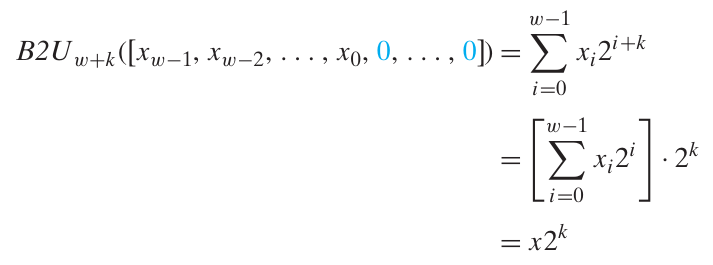

Khi dịch trái k vị trí với word size cố định, k bit high-order bị loại bỏ, cho kết quả

[x<sub>w−k−1</sub>, x<sub>w−k−2</sub>, . . . , x<sub>0</sub>, 0, . . . , 0]

nhưng điều này cũng xảy ra khi thực hiện phép nhân trên các word fixed-size. Do đó, chúng ta có thể thấy rằng dịch trái một giá trị tương đương với thực hiện phép nhân unsigned với một lũy thừa của 2:

Nguyên lý: Phép nhân unsigned với một lũy thừa của 2

Với các biến C x và k có giá trị unsigned x và k, sao cho 0 ≤ k < w, biểu thức C x << k cho giá trị x *<sup>u</sup><sub>w</sub> 2<sup>k</sup>.

Vì phép toán bit-level của số học two’s-complement fixed-size tương đương với phép toán của số học unsigned, chúng ta có thể phát biểu tương tự về quan hệ giữa dịch trái và nhân với một lũy thừa của 2 đối với số học two’s-complement:

Nguyên lý: Phép nhân Two’s-complement với một lũy thừa của 2

Với các biến C x và k có giá trị two’s-complement x và giá trị unsigned k, sao cho 0 ≤ k < w, biểu thức C x << k cho giá trị x *<sup>t</sup><sub>w</sub> 2<sup>k</sup>.

Lưu ý rằng nhân với một lũy thừa của 2 có thể gây ra overflow với cả số học unsigned lẫn two’s-complement. Kết quả của chúng ta cho thấy rằng ngay cả khi đó, dịch bit vẫn cho cùng tác dụng. Trở lại ví dụ trước, chúng ta đã dịch mẫu 4-bit [1011] (giá trị số 11) sang trái hai vị trí để được [101100] (giá trị số 44). Cắt ngắn kết quả này còn 4 bit cho [1100] (giá trị số 12 = 44 mod 16).

Vì phép nhân số nguyên tốn kém hơn dịch bit và cộng, nhiều compiler C cố gắng loại bỏ nhiều trường hợp một số nguyên được nhân với hằng số bằng cách thay bằng tổ hợp dịch bit, cộng và trừ. Ví dụ, giả sử một chương trình chứa biểu thức x*14. Nhận ra rằng 14 = 2<sup>3</sup> + 2<sup>2</sup> + 2<sup>1</sup>, compiler có thể viết lại phép nhân thành (x<<3) + (x<<2) + (x<<1), thay một phép nhân bằng ba phép dịch bit và hai phép cộng. Hai phép tính sẽ cho cùng kết quả, bất kể x là unsigned hay two’s complement, và ngay cả khi phép nhân gây ra overflow. Tốt hơn nữa, compiler còn có thể dùng tính chất 14 = 2<sup>4</sup> − 2<sup>1</sup> để viết lại phép nhân thành (x<<4) - (x<<1), chỉ cần hai phép dịch bit và một phép trừ.

#### Bài tập thực hành 2.38 (lời giải trang 191)

Như chúng ta sẽ thấy trong Chương 3, instruction lea có thể thực hiện các phép tính dạng (a<<k) + b, trong đó k là 0, 1, 2 hoặc 3, còn b là 0 hoặc một giá trị nào đó của chương trình. Compiler thường dùng instruction này để thực hiện phép nhân với thừa số hằng. Ví dụ, chúng ta có thể tính 3*a bằng (a<<1) + a.

Xét những trường hợp b bằng 0 hoặc bằng a, và tất cả giá trị có thể có của k, có thể tính những bội số nào của a bằng một instruction lea duy nhất?

Khái quát từ ví dụ của chúng ta, hãy xét nhiệm vụ sinh code cho biểu thức x * K, với một hằng số K nào đó. Compiler có thể biểu diễn dạng nhị phân của K thành một chuỗi xen kẽ các bit 0 và bit 1:

[(0 . . . 0) (1 . . . 1) (0 . . . 0) · · · (1 . . . 1)]

Ví dụ, 14 có thể được viết là [(0 . . . 0)(111)(0)]. Xét một dãy bit 1 từ vị trí bit n xuống vị trí bit m (n ≥ m). (Với trường hợp 14, chúng ta có n = 3 và m = 1.) Chúng ta có thể tính ảnh hưởng của những bit này lên tích bằng một trong hai dạng khác nhau:

Dạng A: (x<<n) + (x<<(n − 1)) + · · · + (x<<m)

Dạng B: (x<<(n + 1)) - (x<<m)

Bằng cách cộng các kết quả của từng dãy, chúng ta có thể tính x * K mà không cần phép nhân nào. Tất nhiên, sự đánh đổi trade-off giữa sử dụng tổ hợp dịch bit, cộng và trừ với sử dụng một multiply instruction duy nhất phụ thuộc vào tốc độ tương đối của những instruction này, và tốc độ đó có thể phụ thuộc rất nhiều vào máy. Phần lớn compiler chỉ thực hiện phép tối ưu hóa này khi chỉ cần một số ít phép dịch bit, cộng và trừ.

#### Bài tập thực hành 2.39 (lời giải trang 192)

Chúng ta có thể sửa biểu thức của dạng B như thế nào cho trường hợp vị trí bit n là bit có trọng số lớn nhất?

#### Bài tập thực hành 2.40 (lời giải trang 192)

Với mỗi giá trị K sau đây, hãy tìm cách biểu diễn x * K chỉ sử dụng số phép toán được chỉ định, trong đó chúng ta xem phép cộng và phép trừ có chi phí tương đương nhau. Bạn có thể cần dùng một số mẹo ngoài các quy tắc dạng A và B đơn giản mà chúng ta đã xét đến lúc này.

| K | Dịch bit | Cộng/Trừ | Biểu thức |
|---|---|---|---|
| 7 | 1 | 1 | ______ |
| 30 | 4 | 3 | ______ |
| 28 | 2 | 1 | ______ |
| 55 | 2 | 2 | ______ |

#### Bài tập thực hành 2.41 (lời giải trang 192)

Với một dãy bit 1 bắt đầu từ vị trí bit n xuống vị trí bit m (n ≥ m), chúng ta đã thấy rằng có thể sinh hai dạng code, A và B. Compiler nên quyết định sử dụng dạng nào như thế nào?

### 2.3.7 Chia cho các lũy thừa của 2

Phép chia số nguyên trên phần lớn máy còn chậm hơn phép nhân số nguyên—cần 30 clock cycle trở lên. Chia cho một lũy thừa của 2 cũng có thể được thực hiện bằng phép dịch bit, nhưng chúng ta dùng dịch phải thay cho dịch trái. Hai phép dịch phải khác nhau—logical và arithmetic—phục vụ mục đích này lần lượt cho số unsigned và two’s-complement.

| k | >> k (nhị phân) | Thập phân | 12,340/2<sup>k</sup> |
|---|---|---|---|
| 0 | 0011000000110100 | 12,340 | 12,340.0 |
| 1 | 0 001100000011010 | 6,170 | 6,170.0 |
| 4 | 0000 001100000011 | 771 | 771.25 |
| 8 | 00000000 00110000 | 48 | 48.203125 |

**Hình 2.28 Chia các số unsigned cho các lũy thừa của 2. Những ví dụ này minh họa rằng thực hiện logical right shift k vị trí có cùng tác dụng với chia cho 2 k rồi làm tròn về 0.**

Phép chia số nguyên luôn làm tròn về 0. Để định nghĩa chính xác điều này, hãy giới thiệu một số ký hiệu. Với mọi số thực a, định nghĩa ⌊a⌋ là số nguyên duy nhất a′ sao cho a′ ≤ a < a′ + 1. Ví dụ, ⌊3.14⌋ = 3, ⌊−3.14⌋ = −4, và ⌊3⌋ = 3. Tương tự, định nghĩa ⌈a⌉ là số nguyên duy nhất a′ sao cho a′ − 1 < a ≤ a′. Ví dụ, ⌈3.14⌉ = 4, ⌈−3.14⌉ = −3, và ⌈3⌉ = 3. Với x ≥ 0 và y > 0, phép chia số nguyên phải cho ⌊x/y⌋, còn với x < 0 và y > 0, nó phải cho ⌈x/y⌉. Nghĩa là, nó phải làm tròn xuống kết quả dương nhưng làm tròn lên kết quả âm.

Trường hợp dùng phép dịch bit với số học unsigned khá đơn giản, một phần vì dịch phải được bảo đảm thực hiện theo kiểu logical đối với các giá trị unsigned.

Nguyên lý: Phép chia unsigned cho một lũy thừa của 2

Với các biến C x và k có giá trị unsigned x và k, sao cho 0 ≤ k < w, biểu thức C x >> k cho giá trị ⌊x/2<sup>k</sup>⌋.

Để minh họa, Hình 2.28 trình bày tác dụng của việc thực hiện logical right shift trên biểu diễn 16-bit của 12,340 để chia cho 1, 2, 16 và 256. Các bit 0 được dịch vào từ bên trái được thể hiện bằng chữ nghiêng. Chúng ta cũng trình bày kết quả sẽ thu được nếu thực hiện những phép chia này bằng số học số thực. Những ví dụ này cho thấy kết quả dịch bit luôn làm tròn về 0, đúng với quy ước của phép chia số nguyên.

Suy dẫn: Phép chia unsigned cho một lũy thừa của 2

Gọi x là số nguyên unsigned được biểu diễn bởi mẫu bit [x<sub>w−1</sub>, x<sub>w−2</sub>, . . . , x<sub>0</sub>], và cho k nằm trong miền 0 ≤ k < w. Gọi x′ là số unsigned có biểu diễn w − k-bit [x<sub>w−1</sub>, x<sub>w−2</sub>, . . . , x<sub>k</sub>], và x″ là số unsigned có biểu diễn k-bit [x<sub>k−1</sub>, . . . , x<sub>0</sub>]. Do đó chúng ta thấy x = 2<sup>k</sup>x′ + x″, và 0 ≤ x″ < 2<sup>k</sup>. Từ đó suy ra ⌊x/2<sup>k</sup>⌋ = x′.

Thực hiện logical right shift k vị trí trên vector bit [x<sub>w−1</sub>, x<sub>w−2</sub>, . . . , x<sub>0</sub>] cho vector bit

[0, . . . , 0, x<sub>w−1</sub>, x<sub>w−2</sub>, . . . , x<sub>k</sub>]

| k | >> k (nhị phân) | Thập phân | −12,340/2<sup>k</sup> |
|---|---|---|---|
| 0 | 1100111111001100 | −12,340 | −12,340.0 |
| 1 | 1 110011111100110 | −6,170 | −6,170.0 |
| 4 | 1111 110011111100 | −772 | −771.25 |
| 8 | 11111111 11001111 | −49 | −48.203125 |

**Hình 2.29 Áp dụng arithmetic right shift. Những ví dụ này minh họa rằng arithmetic right shift tương tự phép chia cho một lũy thừa của 2, ngoại trừ việc nó làm tròn xuống thay vì làm tròn về 0.**

Vector bit này có giá trị số x′, mà như chúng ta đã thấy, chính là giá trị thu được khi tính biểu thức x >> k.

Trường hợp chia cho một lũy thừa của 2 với số học two’s-complement phức tạp hơn đôi chút. Trước hết, phải dịch bit bằng arithmetic right shift để bảo đảm các giá trị âm vẫn âm. Hãy khảo sát giá trị mà phép dịch phải như vậy tạo ra.

Nguyên lý: Phép chia Two’s-complement cho một lũy thừa của 2, làm tròn xuống

Cho các biến C x và k lần lượt có giá trị two’s-complement x và giá trị unsigned k, sao cho 0 ≤ k < w. Biểu thức C x >> k, khi phép dịch được thực hiện theo kiểu arithmetic, cho giá trị ⌊x/2<sup>k</sup> ⌋.

Với x ≥ 0, biến x có bit trọng số lớn nhất bằng 0, nên tác dụng của arithmetic shift giống logical right shift. Do đó, arithmetic right shift k vị trí giống phép chia cho 2<sup>k</sup> đối với số không âm. Để minh họa một số âm, Hình 2.29 trình bày tác dụng của việc áp dụng arithmetic right shift lên biểu diễn 16-bit của −12,340 với các lượng dịch khác nhau. Trong trường hợp không cần làm tròn (k = 1), kết quả sẽ là x/2<sup>k</sup>. Khi cần làm tròn, phép dịch khiến kết quả được làm tròn xuống. Ví dụ, dịch phải bốn vị trí có tác dụng làm tròn −771.25 xuống −772. Chúng ta sẽ cần điều chỉnh cách làm để xử lý phép chia đối với các giá trị x âm.

Suy dẫn: Phép chia Two’s-complement cho một lũy thừa của 2, làm tròn xuống

Gọi x là số nguyên two’s-complement được biểu diễn bởi mẫu bit [x<sub>w−1</sub>, x<sub>w−2</sub>, . . . , x<sub>0</sub>], và cho k nằm trong miền 0 ≤ k < w. Gọi x′ là số two’s-complement được biểu diễn bởi w − k bit [x<sub>w−1</sub>, x<sub>w−2</sub>, . . . , x<sub>k</sub>], và x″ là số unsigned được biểu diễn bởi k bit low-order [x<sub>k−1</sub>, . . . , x<sub>0</sub>]. Bằng cách phân tích tương tự trường hợp unsigned, chúng ta có x = 2<sup>k</sup>x′ + x″ và 0 ≤ x″ < 2<sup>k</sup>, cho x′ = ⌊x/2<sup>k</sup>⌋. Hơn nữa, hãy quan sát rằng dịch phải vector bit [x<sub>w−1</sub>, x<sub>w−2</sub>, . . . , x<sub>0</sub>] k vị trí theo kiểu arithmetic cho vector bit

[x<sub>w−1</sub>, . . . , x<sub>w−1</sub>, x<sub>w−1</sub>, x<sub>w−2</sub>, . . . , x<sub>k</sub>]

là sign extension từ w − k bit thành w bit của [x<sub>w−1</sub>, x<sub>w−2</sub>, . . . , x<sub>k</sub>]. Do đó, vector bit đã dịch này là biểu diễn two’s-complement của ⌊x/2<sup>k</sup>⌋.

| k | Bias | −12,340 + bias (nhị phân) | >> k (nhị phân) | Thập phân | −12,340/2<sup>k</sup> |
|---|---|---|---|---|---|
| 0 | 0 | 1100111111001100 | 1100111111001100 | −12,340 | −12,340.0 |
| 1 | 1 | 110011111100110 1 | 1 110011111100110 | −6,170 | −6,170.0 |
| 4 | 15 | 110011111101 1011 | 1111 110011111101 | −771 | −771.25 |
| 8 | 255 | 1101000011001011 | 11111111 11010000 | −48 | −48.203125 |

**Hình 2.30 Chia các số two’s-complement cho các lũy thừa của 2. Bằng cách cộng thêm bias trước phép dịch phải, kết quả được làm tròn về 0.**

Chúng ta có thể khắc phục cách làm tròn không phù hợp khi dịch phải số âm bằng cách thêm “bias” vào giá trị trước khi dịch.

Nguyên lý: Phép chia Two’s-complement cho một lũy thừa của 2, làm tròn lên

Cho các biến C x và k lần lượt có giá trị two’s-complement x và giá trị unsigned k, sao cho 0 ≤ k < w. Biểu thức C (x + (1 << k) - 1) >> k, khi phép dịch được thực hiện theo kiểu arithmetic, cho giá trị ⌈x/2<sup>k</sup>⌉.

Hình 2.30 minh họa cách cộng thêm bias thích hợp trước khi thực hiện arithmetic right shift khiến kết quả được làm tròn đúng. Trong cột thứ ba, chúng ta trình bày kết quả cộng giá trị bias vào −12,340, với k bit thấp (những bit sẽ bị dịch ra bên phải) được thể hiện bằng chữ nghiêng. Chúng ta có thể thấy rằng những bit nằm bên trái chúng có thể được tăng hoặc không được tăng. Trong trường hợp không cần làm tròn (k = 1), cộng bias chỉ ảnh hưởng những bit bị dịch ra. Trong những trường hợp cần làm tròn, cộng bias khiến các bit cao được tăng, để kết quả được làm tròn về 0.

Kỹ thuật thêm bias khai thác tính chất ⌈x/y⌉ = ⌊(x + y − 1)/y⌋ với các số nguyên x và y sao cho y > 0. Ví dụ, khi x = −30 và y = 4, chúng ta có x + y − 1 = −27 và ⌈−30/4⌉ = −7 = ⌊−27/4⌋. Khi x = −32 và y = 4, chúng ta có x + y − 1 = −29 và ⌈−32/4⌉ = −8 = ⌊−29/4⌋.

Suy dẫn: Phép chia Two’s-complement cho một lũy thừa của 2, làm tròn lên

Để thấy rằng ⌈x/y⌉ = ⌊(x + y − 1)/y⌋, giả sử x = qy + r, trong đó 0 ≤ r < y, cho (x + y − 1)/y = q + (r + y − 1)/y, và do đó ⌊(x + y − 1)/y⌋ = q + ⌊(r + y − 1)/y⌋. Số hạng sau sẽ bằng 0 khi r = 0 và bằng 1 khi r > 0. Nghĩa là, bằng cách cộng bias y − 1 vào x rồi làm tròn xuống phép chia, chúng ta sẽ nhận được q khi y chia hết x và q + 1 trong trường hợp ngược lại.

Trở lại trường hợp y = 2<sup>k</sup>, biểu thức C x + (1 << k) - 1 cho giá trị x + 2<sup>k</sup> − 1. Do đó, dịch phải giá trị này k vị trí theo kiểu arithmetic cho ⌈x/2<sup>k</sup>⌉.

Những phân tích này cho thấy rằng đối với máy two’s-complement sử dụng arithmetic right shift, biểu thức C

```
(x<0 ? x+(1<<k)-1 : x) >> k
```

sẽ tính giá trị x/2<sup>k</sup>.

#### Bài tập thực hành 2.42 (lời giải trang 192)

Viết hàm div16 trả về giá trị x/16 cho đối số số nguyên x. Hàm của bạn không được dùng phép chia, modulo, phép nhân, bất kỳ biểu thức điều kiện nào (if hoặc ?:), bất kỳ toán tử so sánh nào (ví dụ <, > hoặc ==), hay bất kỳ vòng lặp nào. Bạn có thể giả sử kiểu dữ liệu int dài 32 bit và sử dụng biểu diễn two’s-complement, và phép dịch phải được thực hiện theo kiểu arithmetic.

Đến đây chúng ta thấy rằng phép chia cho một lũy thừa của 2 có thể được triển khai bằng logical right shift hoặc arithmetic right shift. Đây chính là lý do hai loại dịch phải có sẵn trên phần lớn máy. Đáng tiếc là cách tiếp cận này không khái quát được cho phép chia cho các hằng số tùy ý. Không giống phép nhân, chúng ta không thể biểu diễn phép chia cho hằng số K tùy ý thông qua phép chia cho các lũy thừa của 2.

#### Bài tập thực hành 2.43 (lời giải trang 193)

Trong code sau, chúng ta đã lược bỏ các định nghĩa của hằng số M và N:

```
#define M      /* Mystery number 1 */
#define N      /* Mystery number 2 */
int arith(int x, int y) {
    int result = 0;
    result = x*M + y/N; /* M and N are mystery numbers. */
    return result;
}
```

Chúng ta biên dịch code này cho các giá trị cụ thể của M và N. Compiler đã tối ưu hóa phép nhân và phép chia bằng những phương pháp đã thảo luận. Sau đây là bản chuyển đổi machine code được sinh ra trở lại thành C:

```
/* Translation of assembly code for arith */
int optarith(int x, int y) {
    int t = x;
    x <<= 5;
    x -= t;
    if (y < 0) y += 7;
    y >>= 3;  /* Arithmetic shift */
    return x+y;
}
```

Các giá trị M và N là gì?

### 2.3.8 Những suy nghĩ cuối cùng về số học số nguyên

Như chúng ta đã thấy, số học “số nguyên” do máy tính thực hiện thực chất là một dạng số học modulo. Word size hữu hạn dùng để biểu diễn số giới hạn miền giá trị có thể có, và các phép toán kết quả có thể xảy ra overflow. Chúng ta cũng đã thấy rằng biểu diễn two’s-complement cung cấp một cách khéo léo để biểu diễn cả giá trị âm lẫn dương, đồng thời sử dụng cùng các phần triển khai bit-level được dùng để thực hiện số học unsigned—các phép toán như cộng, trừ, nhân và ngay cả chia có hành vi bit-level giống hệt hoặc rất giống nhau, bất kể toán hạng ở dạng unsigned hay two’s-complement.

Chúng ta đã thấy rằng một số quy ước trong ngôn ngữ C có thể cho những kết quả bất ngờ, và chúng có thể là nguồn gây ra các bug khó nhận biết hoặc khó hiểu. Đặc biệt, chúng ta đã thấy rằng kiểu dữ liệu unsigned, mặc dù đơn giản về mặt khái niệm, có thể dẫn đến những hành vi mà ngay cả lập trình viên có kinh nghiệm cũng không ngờ tới. Chúng ta cũng đã thấy rằng kiểu dữ liệu này có thể xuất hiện theo những cách bất ngờ—ví dụ, khi viết các hằng số nguyên và khi gọi các routine thư viện.

#### Bài tập thực hành 2.44 (lời giải trang 193)

Giả sử kiểu dữ liệu int dài 32 bit và sử dụng biểu diễn two’s-complement cho các giá trị signed. Các phép dịch phải được thực hiện theo kiểu arithmetic đối với các giá trị signed và theo kiểu logical đối với các giá trị unsigned. Các biến được khai báo và khởi tạo như sau:

```
int x = foo();   /* Arbitrary value */
int y = bar();   /* Arbitrary value */

unsigned ux = x;
unsigned uy = y;
```

Với mỗi biểu thức C sau đây, hãy (1) lập luận rằng nó đúng (có giá trị 1) với mọi giá trị x và y, hoặc (2) đưa ra các giá trị x và y khiến nó sai (có giá trị 0):

A. (x > 0) || (x-1 < 0)

B. (x & 7) != 7 || (x<<29 < 0)

C. (x * x) >= 0

D. x < 0 || -x <= 0

E. x > 0 || -x >= 0

F. x+y == uy+ux

G. x*~y + uy*ux == -x

## 2.4 Floating Point

Biểu diễn floating-point mã hóa các số hữu tỉ có dạng V = x × 2<sup>y</sup>. Nó hữu ích khi thực hiện các phép tính liên quan đến những số rất lớn (|V | ≫ 0), những số rất gần 0 (|V | ≪ 1), và nói chung là khi cần xấp xỉ số học trên số thực.

### Thông tin thêm IEEE

Institute of Electrical and Electronics Engineers (IEEE—phát âm là “eye-triple-ee”) là một hội nghề nghiệp bao quát toàn bộ công nghệ điện tử và máy tính. Hội xuất bản các tạp chí, tài trợ các hội nghị và thành lập các ủy ban để xác định tiêu chuẩn về những chủ đề trải dài từ truyền tải điện đến kỹ nghệ phần mềm. Một ví dụ khác về tiêu chuẩn IEEE là tiêu chuẩn 802.11 dành cho mạng không dây.

Cho đến những năm 1980, mỗi nhà sản xuất máy tính đều tự xây dựng quy ước riêng về cách biểu diễn số floating-point và chi tiết các phép toán thực hiện trên chúng. Ngoài ra, họ thường không quá quan tâm đến độ chính xác của các phép toán, mà xem tốc độ và sự dễ dàng khi triển khai là quan trọng hơn độ chính xác số học.

Tất cả điều này đã thay đổi vào khoảng năm 1985 với sự ra đời của IEEE Standard 754, một tiêu chuẩn được xây dựng công phu để biểu diễn số floating-point và các phép toán thực hiện trên chúng. Nỗ lực này bắt đầu vào năm 1976 dưới sự tài trợ của Intel, với việc thiết kế 8087, một chip cung cấp hỗ trợ floating-point cho processor 8086. Intel thuê William Kahan, giáo sư tại University of California, Berkeley, làm cố vấn để giúp thiết kế một tiêu chuẩn floating-point cho các processor tương lai của hãng. Họ cho phép Kahan hợp tác với một ủy ban đang xây dựng tiêu chuẩn industry-wide dưới sự bảo trợ của Institute of Electrical and Electronics Engineers (IEEE). Cuối cùng, ủy ban đã thông qua một tiêu chuẩn gần với tiêu chuẩn mà Kahan đã thiết kế cho Intel. Ngày nay, hầu như mọi máy tính đều hỗ trợ thứ được gọi là IEEE floating point. Điều này đã cải thiện đáng kể khả năng chuyển các chương trình ứng dụng khoa học giữa những máy khác nhau.

Trong mục này, chúng ta sẽ xem cách các số được biểu diễn trong định dạng IEEE floating-point. Chúng ta cũng sẽ tìm hiểu các vấn đề làm tròn, khi một số không thể được biểu diễn chính xác trong định dạng và do đó phải được điều chỉnh tăng hoặc giảm. Sau đó, chúng ta sẽ tìm hiểu các tính chất toán học của phép cộng, phép nhân và các toán tử quan hệ. Nhiều lập trình viên cho rằng floating point, nhẹ thì không thú vị, nặng thì bí hiểm và không thể hiểu nổi. Chúng ta sẽ thấy rằng, vì định dạng IEEE dựa trên một tập nhỏ các nguyên tắc nhất quán, nó thực ra khá tinh tế và dễ hiểu.

### 2.4.1 Số nhị phân có phần lẻ

Bước đầu tiên để hiểu số floating-point là xem xét những số nhị phân có giá trị phân số. Trước hết, hãy xem xét ký pháp thập phân quen thuộc hơn. Ký pháp thập phân sử dụng một biểu diễn có dạng

d<sub>m</sub> d<sub>m−1</sub> · · · d<sub>1</sub> d<sub>0</sub> . d<sub>−1</sub> d<sub>−2</sub> · · · d<sub>−n</sub>

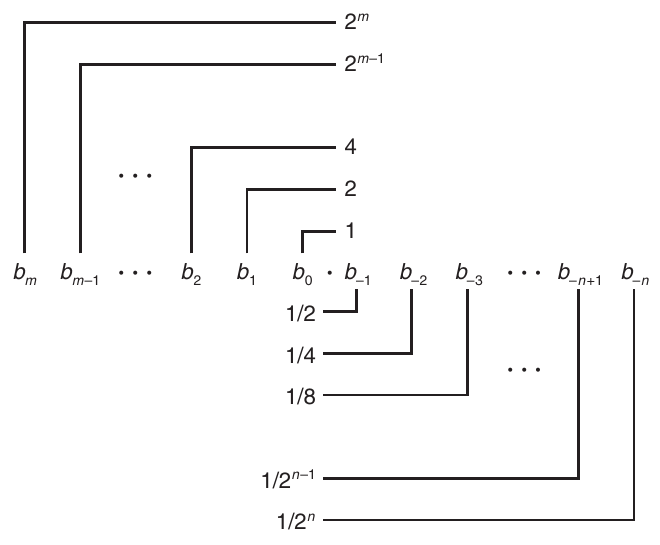

**Hình 2.31 Biểu diễn nhị phân có phần lẻ. Các chữ số bên trái binary point có trọng số dạng 2<sup>i</sup>, còn các chữ số bên phải có trọng số dạng 1/2<sup>i</sup>.**

trong đó mỗi chữ số thập phân d<sub>i</sub> nằm trong khoảng từ 0 đến 9. Ký pháp này biểu diễn một giá trị d được định nghĩa là

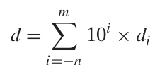

Trọng số của các chữ số được xác định tương đối so với ký hiệu dấu thập phân (‘.’), nghĩa là các chữ số bên trái có trọng số là các lũy thừa không âm của 10, tạo ra những giá trị nguyên, còn các chữ số bên phải có trọng số là các lũy thừa âm của 10, tạo ra những giá trị phân số. Ví dụ, 12.34<sub>10</sub> biểu diễn số 1 × 10<sup>1</sup> + 2 × 10<sup>0</sup> + 3 × 10<sup>−1</sup> + 4 × 10<sup>−2</sup> = 12 34/100 .

Tương tự, hãy xem xét một ký pháp có dạng

b<sub>m</sub> b<sub>m−1</sub> · · · b<sub>1</sub> b<sub>0</sub> . b<sub>−1</sub> b<sub>−2</sub> · · · b<sub>−n+1</sub> b<sub>−n</sub>

trong đó mỗi chữ số nhị phân, hay bit, b<sub>i</sub> nằm trong khoảng từ 0 đến 1, như minh họa trong Hình 2.31. Ký pháp này biểu diễn một số b được định nghĩa là

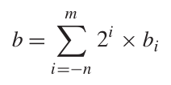 (2.19)

Ký hiệu ‘.’ lúc này trở thành binary point, với các bit bên trái có trọng số là các lũy thừa không âm của 2 và các bit bên phải có trọng số là các lũy thừa âm của 2. Ví dụ, 101.11<sub>2</sub> biểu diễn số 1 × 2<sup>2</sup> + 0 × 2<sup>1</sup> + 1 × 2<sup>0</sup> + 1 × 2<sup>−1</sup> + 1 × 2<sup>−2</sup> = 4 + 0 + 1 + 1/2 + 1/4 = 5 3/4 .

Từ Phương trình 2.19, có thể dễ dàng thấy rằng dịch binary point sang trái một vị trí có tác dụng chia số đó cho 2. Ví dụ, trong khi 101.11<sub>2</sub> biểu diễn số 5 3/4 , thì 10.111<sub>2</sub> biểu diễn số 2 + 0 + 1/2 + 1/4 + 1/8 = 2 7/8 . Tương tự, dịch binary point sang phải một vị trí có tác dụng nhân số đó với 2. Ví dụ, 1011.1<sub>2</sub> biểu diễn số 8 + 0 + 2 + 1 + 1/2 = 11 1/2 .

Lưu ý rằng các số có dạng 0.11 · · · 1<sub>2</sub> biểu diễn những số nhỏ hơn 1 một chút. Ví dụ, 0.111111<sub>2</sub> biểu diễn 63/64 . Chúng ta sẽ sử dụng ký pháp viết gọn 1.0 − ϵ để biểu diễn những giá trị như vậy.

Giả sử chúng ta chỉ xem xét các cách mã hóa finite-length, ký pháp thập phân không thể biểu diễn chính xác những số như 1/3 và 5/7. Tương tự, ký pháp nhị phân có phần lẻ chỉ có thể biểu diễn các số viết được dưới dạng x × 2<sup>y</sup>. Những giá trị khác chỉ có thể được xấp xỉ. Ví dụ, số 1/5 có thể được biểu diễn chính xác bằng số thập phân có phần lẻ 0.20. Tuy nhiên, khi dùng số nhị phân có phần lẻ, chúng ta không thể biểu diễn chính xác số này mà phải xấp xỉ nó với độ chính xác tăng dần bằng cách kéo dài biểu diễn nhị phân:

| Biểu diễn | Giá trị | Thập phân |
|---|---|---|
| 0.0<sub>2</sub> | 0/2 | 0.0<sub>10</sub> |
| 0.01<sub>2</sub> | 1/4 | 0.25<sub>10</sub> |
| 0.010<sub>2</sub> | 2/8 | 0.25<sub>10</sub> |
| 0.0011<sub>2</sub> | 3/16 | 0.1875<sub>10</sub> |
| 0.00110<sub>2</sub> | 6/32 | 0.1875<sub>10</sub> |
| 0.001101<sub>2</sub> | 13/64 | 0.203125<sub>10</sub> |
| 0.0011010<sub>2</sub> | 26/128 | 0.203125<sub>10</sub> |
| 0.00110011<sub>2</sub> | 51/256 | 0.19921875<sub>10</sub> |

#### Bài tập thực hành 2.45 (lời giải trang 193)

Điền thông tin còn thiếu vào bảng sau:

| Giá trị phân số | Biểu diễn nhị phân | Biểu diễn thập phân |
|---|---|---|
| 1/8 | 0.001 | 0.125 |
| 3/4 | ______ | ______ |
| 5/16 | ______ | ______ |
| ______ | 10.1011 | ______ |
| ______ | 1.001 | ______ |
| ______ | ______ | 5.875 |
| ______ | ______ | 3.1875 |

#### Bài tập thực hành 2.46 (lời giải trang 194)

Sự thiếu chính xác của số học floating-point có thể gây ra những hậu quả thảm khốc. Vào ngày 25 tháng 2 năm 1991, trong cuộc Chiến tranh Vùng Vịnh lần thứ nhất, một khẩu đội tên lửa Patriot của Mỹ tại Dharan, Saudi Arabia, đã không đánh chặn được một tên lửa Scud của Iraq đang bay tới. Tên lửa Scud đánh trúng một doanh trại Lục quân Mỹ và làm 28 binh sĩ thiệt mạng. US General Accounting Office (GAO) đã phân tích chi tiết sự cố này [76] và xác định nguyên nhân gốc rễ là sự thiếu chính xác trong một phép tính số. Trong bài tập này, bạn sẽ tái hiện một phần phân tích của GAO.

Hệ thống Patriot chứa một clock nội bộ, được triển khai bằng một counter tăng lên sau mỗi 0.1 giây. Để xác định thời gian theo giây, chương trình nhân giá trị counter này với một đại lượng 24-bit là giá trị nhị phân có phần lẻ xấp xỉ 1/10 . Cụ thể, biểu diễn nhị phân của 1/10 là dãy vô hạn 0.000110011[0011] · · ·<sub>2</sub>, trong đó phần trong dấu ngoặc vuông lặp lại vô hạn. Chương trình xấp xỉ 0.1 bằng một giá trị x khi chỉ xét 23 bit đầu tiên của dãy ở bên phải binary point: x = 0.00011001100110011001100. (Xem Bài tập 2.51 để tìm hiểu cách họ có thể xấp xỉ 0.1 chính xác hơn.)

A. Biểu diễn nhị phân của 0.1 − x là gì?

B. Giá trị thập phân xấp xỉ của 0.1 − x là bao nhiêu?

C. Clock bắt đầu từ 0 khi hệ thống được cấp điện lần đầu và tiếp tục đếm tăng từ đó. Trong trường hợp này, hệ thống đã chạy khoảng 100 giờ. Độ chênh lệch giữa thời gian thực tế và thời gian do phần mềm tính toán là bao nhiêu?

D. Hệ thống dự đoán vị trí xuất hiện của tên lửa đang bay tới dựa trên vận tốc của nó và thời điểm radar phát hiện gần nhất. Biết rằng tên lửa Scud di chuyển với tốc độ khoảng 2,000 mét mỗi giây, dự đoán của hệ thống sai lệch bao xa?

Thông thường, một sai số nhỏ trong thời gian tuyệt đối thu được từ một lần đọc clock sẽ không ảnh hưởng đến phép tính theo dõi. Thay vào đó, phép tính này phải phụ thuộc vào thời gian tương đối giữa hai lần đọc liên tiếp. Vấn đề là phần mềm Patriot đã được nâng cấp để sử dụng một function đọc thời gian chính xác hơn, nhưng không phải tất cả các lời gọi function đều đã được thay bằng code mới. Do đó, phần mềm theo dõi sử dụng thời gian chính xác cho một lần đọc và thời gian không chính xác cho lần đọc còn lại [103].

### 2.4.2 Biểu diễn IEEE Floating-Point

Ký pháp theo vị trí như đã xem xét trong mục trước không hiệu quả để biểu diễn những số rất lớn. Ví dụ, biểu diễn của 5 × 2<sup>100</sup> sẽ gồm mẫu bit 101 theo sau bởi 100 chữ số 0. Thay vào đó, chúng ta muốn biểu diễn các số dưới dạng x × 2<sup>y</sup> bằng cách cho biết giá trị của x và y.

Tiêu chuẩn IEEE floating-point biểu diễn một số dưới dạng V = (−1)<sup>s</sup> × M × 2<sup>E</sup>:

- Sign s xác định số đó là âm (s = 1) hay dương (s = 0), trong đó cách diễn giải sign bit cho giá trị số 0 được xử lý như một trường hợp đặc biệt.

- Significand M là một số nhị phân có phần lẻ nằm trong khoảng từ 1 đến 2 − ϵ hoặc từ 0 đến 1 − ϵ.

- Exponent E gán trọng số cho giá trị bằng một lũy thừa của 2 (có thể âm). Biểu diễn bit của một số floating-point được chia thành ba field để mã hóa những giá trị này:

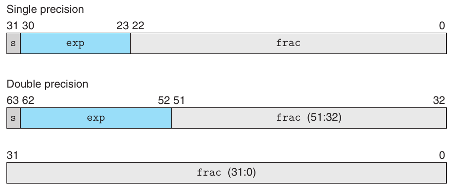

**Hình 2.32 Các định dạng floating-point tiêu chuẩn. Các số Floating-point được biểu diễn bằng ba field. Với hai định dạng phổ biến nhất, các field này được đóng gói vào những word 32-bit (single-precision) hoặc 64-bit (double-precision).**

- Một sign bit s duy nhất trực tiếp mã hóa sign s.

- Exponent field k-bit exp = e<sub>k−1</sub> · · · e<sub>1</sub>e<sub>0</sub> mã hóa exponent E.

- Fraction field n-bit frac = f<sub>n−1</sub> · · · f<sub>1</sub>f<sub>0</sub> mã hóa significand M, nhưng giá trị được mã hóa còn phụ thuộc vào việc exponent field có bằng 0 hay không.

Hình 2.32 trình bày cách đóng gói ba field này thành các word cho hai định dạng phổ biến nhất. Trong định dạng floating-point single-precision (float trong C), các field s, exp và frac lần lượt có 1, k = 8 và n = 23 bit, tạo ra một biểu diễn 32-bit. Trong định dạng floating-point double-precision (double trong C), các field s, exp và frac lần lượt có 1, k = 11 và n = 52 bit, tạo ra một biểu diễn 64-bit.

Giá trị được mã hóa bởi một biểu diễn bit cho trước có thể được chia thành ba trường hợp khác nhau (trường hợp cuối có hai biến thể), tùy thuộc vào giá trị của exp. Các trường hợp này được minh họa trong Hình 2.33 cho định dạng single-precision.

### Trường hợp 1: Các giá trị normalized

Đây là trường hợp phổ biến nhất. Nó xảy ra khi mẫu bit của exp không phải toàn chữ số 0 (giá trị số 0) cũng không phải toàn chữ số 1 (giá trị số 255 cho single precision, 2047 cho double). Trong trường hợp này, exponent field được diễn giải là biểu diễn một số nguyên có dấu ở dạng biased. Nghĩa là giá trị exponent là E = e − Bias, trong đó e là số unsigned có biểu diễn bit e<sub>k−1</sub> · · · e<sub>1</sub>e<sub>0</sub> và Bias là một giá trị độ lệch bằng 2<sup>k−1</sup> − 1 (127 cho single precision và 1023 cho double). Điều này tạo ra các khoảng exponent từ −126 đến +127 cho single precision và từ −1022 đến +1023 cho double precision.

Fraction field frac được diễn giải là biểu diễn giá trị phân số f , trong đó 0 ≤ f < 1, có biểu diễn nhị phân 0.f<sub>n−1</sub> · · · f<sub>1</sub>f<sub>0</sub>, tức binary point nằm bên trái most significant bit. Significand được định nghĩa là M = 1 + f . Đôi khi cách này được gọi là biểu diễn với chữ số 1 đứng đầu ngầm định, vì chúng ta có thể xem M là số có biểu diễn nhị phân 1.f<sub>n−1</sub>f<sub>n−2</sub> · · · f<sub>0</sub>. Biểu diễn này là một thủ thuật để có thêm một bit độ chính xác mà không tốn thêm gì, vì chúng ta luôn có thể điều chỉnh exponent E sao cho significand M nằm trong khoảng 1 ≤ M < 2 (giả sử không xảy ra overflow). Vì vậy, chúng ta không cần biểu diễn tường minh bit đứng đầu, vì nó luôn bằng 1.

#### Thông tin thêm Tại sao đặt bias theo cách này cho các giá trị denormalized?

Việc để giá trị exponent là 1 − Bias thay vì đơn giản là −Bias có thể có vẻ trái trực giác. Chúng ta sẽ sớm thấy rằng cách này tạo ra sự chuyển tiếp trơn tru từ các giá trị denormalized sang normalized.

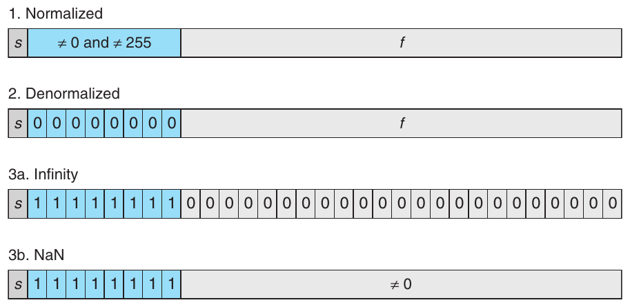

**Hình 2.33 Các nhóm giá trị floating-point single-precision. Giá trị của exponent xác định số đó là (1) normalized, (2) denormalized hay (3) một giá trị đặc biệt.**

### Trường hợp 2: Các giá trị denormalized

Khi exponent field toàn chữ số 0, số được biểu diễn ở dạng denormalized. Trong trường hợp này, giá trị exponent là E = 1 − Bias và giá trị significand là M = f , tức giá trị của fraction field không có chữ số 1 đứng đầu ngầm định.

Các số denormalized phục vụ hai mục đích. Thứ nhất, chúng cung cấp cách biểu diễn giá trị số 0, vì với số normalized, chúng ta luôn phải có M ≥ 1, nên không thể biểu diễn 0. Thực tế, biểu diễn floating-point của +0.0 có mẫu bit toàn chữ số 0: sign bit bằng 0, exponent field toàn chữ số 0 (chỉ một giá trị denormalized), và fraction field toàn chữ số 0, cho M = f = 0. Điều thú vị là khi sign bit bằng 1 nhưng các field còn lại toàn chữ số 0, chúng ta nhận được giá trị −0.0. Với định dạng IEEE floating-point, các giá trị −0.0 và +0.0 được xem là khác nhau ở một số khía cạnh và giống nhau ở những khía cạnh khác.

Chức năng thứ hai của các số denormalized là biểu diễn những số rất gần 0.0. Chúng cung cấp một tính chất được gọi là gradual underflow, trong đó các giá trị số có thể có được phân bố cách đều nhau gần 0.0.

### Trường hợp 3: Các giá trị đặc biệt

Nhóm giá trị cuối cùng xuất hiện khi exponent field toàn chữ số 1. Khi fraction field toàn chữ số 0, các giá trị kết quả biểu diễn vô cực, là +∞ khi s = 0 hoặc −∞ khi s = 1. Vô cực có thể biểu diễn các kết quả gây overflow, chẳng hạn khi nhân hai số rất lớn hoặc chia cho 0. Khi fraction field khác 0, giá trị kết quả được gọi là NaN, viết tắt của “not a number.” Những giá trị như vậy được trả về từ phép toán có kết quả không thể biểu diễn√ bằng một số thực hay vô cực, chẳng hạn khi tính −1 hoặc ∞ − ∞. Chúng cũng có thể hữu ích trong một số ứng dụng để biểu diễn dữ liệu chưa được khởi tạo.

### 2.4.3 Các số ví dụ

Hình 2.34 trình bày tập giá trị có thể biểu diễn trong một định dạng 6-bit giả định với k = 3 exponent bit và n = 2 fraction bit. Bias là 2<sup>3−1</sup> − 1 = 3. Phần (a) của hình trình bày tất cả các giá trị có thể biểu diễn (ngoại trừ NaN). Hai giá trị vô cực nằm ở hai đầu ngoài cùng. Các số normalized có độ lớn tối đa là ±14. Các số denormalized tập trung quanh 0. Có thể thấy chúng rõ hơn trong phần (b) của hình, nơi chúng ta chỉ trình bày các số nằm giữa −1.0 và +1.0. Hai giá trị 0 là các trường hợp đặc biệt của số denormalized. Hãy chú ý rằng các số có thể biểu diễn không phân bố đều—chúng dày đặc hơn khi gần gốc tọa độ.

Hình 2.35 trình bày một số ví dụ cho định dạng floating-point 8-bit giả định với k = 4 exponent bit và n = 3 fraction bit. Bias là 2<sup>4−1</sup> − 1 = 7. Hình được chia thành ba vùng biểu diễn ba nhóm số. Các cột khác nhau trình bày cách exponent field mã hóa exponent E, còn fraction field mã hóa significand M, và chúng cùng tạo nên giá trị được biểu diễn V = 2<sup>E</sup> × M. Gần 0 nhất là các số denormalized, bắt đầu từ chính 0. Các số denormalized trong định dạng này có E = 1 − 7 = −6, cho trọng số 2<sup>E</sup> = 1/64 . Các fraction f và significand M nhận các giá trị 0, 1/8 , . . . , 7/8 , tạo ra các số V trong khoảng từ 0 đến 1/64 × 7/8 = 7/512 .

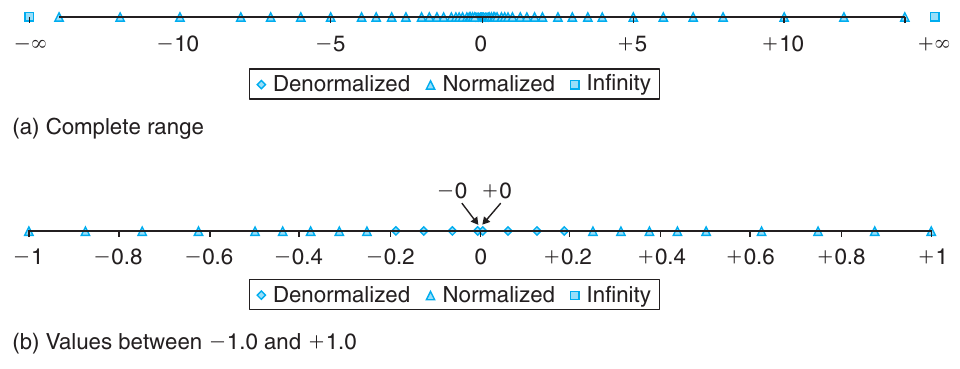

**Hình 2.34 Các giá trị có thể biểu diễn cho định dạng floating-point 6-bit. Có k = 3 exponent bit và n = 2 fraction bit. Bias là 3.**

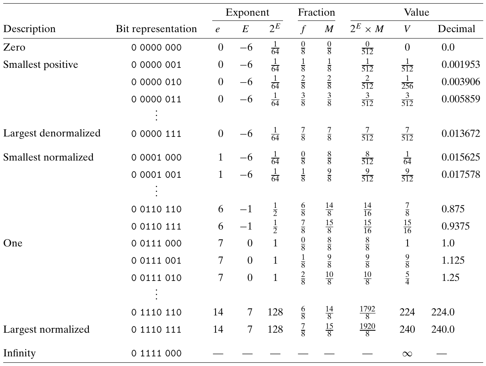

**Hình 2.35 Ví dụ về các giá trị không âm cho định dạng floating-point 8-bit. Có k = 4 exponent bit và n = 3 fraction bit. Bias là 7.**

Các số normalized nhỏ nhất trong định dạng này cũng có E = 1 − 7 = −6, và các fraction cũng nhận những giá trị 0, 1/8 , . . . 7/8 . Tuy nhiên, các significand khi đó nằm trong khoảng từ 1 + 0 = 1 đến 1 + 7/8 = 15/8 , tạo ra các số V trong khoảng từ 8/512 = 1/64 đến 15/512 .

Hãy chú ý sự chuyển tiếp trơn tru giữa số denormalized lớn nhất 7/512 và số normalized nhỏ nhất 8/512 . Sự trơn tru này là nhờ cách chúng ta định nghĩa E cho các giá trị denormalized. Bằng cách đặt nó bằng 1 − Bias thay vì −Bias, chúng ta bù lại việc significand của số denormalized không có chữ số 1 đứng đầu ngầm định.

Khi tăng exponent, chúng ta nhận được các giá trị normalized lớn dần, đi qua 1.0 rồi tới số normalized lớn nhất. Số này có exponent E = 7, cho trọng số 2<sup>E</sup> = 128. Fraction bằng 7/8 , cho significand M = 15/8 . Do đó, giá trị số là V = 240. Vượt quá giá trị này sẽ gây overflow thành +∞.

Một tính chất thú vị của biểu diễn này là nếu diễn giải các biểu diễn bit của các giá trị trong Hình 2.35 thành số nguyên unsigned, chúng sẽ xuất hiện theo thứ tự tăng dần, giống như các giá trị mà chúng biểu diễn dưới dạng số floating-point. Đây không phải là sự tình cờ—định dạng IEEE được thiết kế để có thể sắp xếp các số floating-point bằng một routine sắp xếp số nguyên. Một khó khăn nhỏ xuất hiện khi xử lý số âm, vì chúng có bit đứng đầu bằng 1 và xuất hiện theo thứ tự giảm dần, nhưng có thể khắc phục điều này mà không cần các phép toán floating-point để thực hiện so sánh (xem Bài tập 2.84).

#### Bài tập thực hành 2.47 (lời giải trang 194)

Xét một biểu diễn floating-point 5-bit dựa trên định dạng IEEE floating-point, với một sign bit, hai exponent bit (k = 2) và hai fraction bit (n = 2). Exponent bias là 2<sup>2−1</sup> − 1 = 1.

Bảng sau liệt kê toàn bộ khoảng không âm của biểu diễn floating-point 5-bit này. Hãy điền các ô trống trong bảng theo những hướng dẫn sau:

e: Giá trị được biểu diễn khi xem exponent field là một số nguyên unsigned

E: Giá trị của exponent sau khi áp dụng bias

2<sup>E</sup>: Trọng số số học của exponent

f : Giá trị của fraction

M: Giá trị của significand

2<sup>E</sup> × M: Giá trị phân số (chưa rút gọn) của số

V : Giá trị phân số đã rút gọn của số

Thập phân: Biểu diễn thập phân của số

Biểu diễn các giá trị 2<sup>E</sup>, f , M, 2<sup>E</sup> × M và V dưới dạng số nguyên (khi có thể) hoặc phân số dạng x/y , trong đó y là một lũy thừa của 2. Bạn không cần điền các ô được đánh dấu —.

| Bit | e | E | 2<sup>E</sup> | f | M | 2<sup>E</sup> × M | V | Thập phân |
|---|---|---|---|---|---|---|---|---|
| 0 00 00 | ______ | ______ | ______ | ______ | ______ | ______ | ______ | ______ |
| 0 00 01 | ______ | ______ | ______ | ______ | ______ | ______ | ______ | ______ |
| 0 00 10 | ______ | ______ | ______ | ______ | ______ | ______ | ______ | ______ |
| 0 00 11 | ______ | ______ | ______ | ______ | ______ | ______ | ______ | ______ |
| 0 01 00 | ______ | ______ | ______ | ______ | ______ | ______ | ______ | ______ |
| 0 01 01 | 1 | 0 | 1 | 1/4 | 5/4 | 5/4 | 5/4 | 1.25 |
| 0 01 10 | ______ | ______ | ______ | ______ | ______ | ______ | ______ | ______ |
| 0 01 11 | ______ | ______ | ______ | ______ | ______ | ______ | ______ | ______ |
| 0 10 00 | ______ | ______ | ______ | ______ | ______ | ______ | ______ | ______ |
| 0 10 01 | ______ | ______ | ______ | ______ | ______ | ______ | ______ | ______ |
| 0 10 10 | ______ | ______ | ______ | ______ | ______ | ______ | ______ | ______ |
| 0 10 11 | ______ | ______ | ______ | ______ | ______ | ______ | ______ | ______ |
| 0 11 00 | — | — | — | — | — | — | ______ | — |
| 0 11 01 | — | — | — | — | — | — | ______ | — |
| 0 11 10 | — | — | — | — | — | — | ______ | — |
| 0 11 11 | — | — | — | — | — | — | ______ | — |

Hình 2.36 trình bày biểu diễn và giá trị số của một số số floating-point single- và double-precision quan trọng. Tương tự định dạng 8-bit trong Hình 2.35, chúng ta có thể thấy một số tính chất chung của biểu diễn floating-point với exponent k-bit và fraction n-bit:

- Giá trị +0.0 luôn có biểu diễn bit toàn chữ số 0.

- Giá trị denormalized dương nhỏ nhất có biểu diễn bit gồm một chữ số 1 ở vị trí least significant bit và các bit còn lại đều bằng 0. Nó có giá trị fraction (và significand) M = f = 2<sup>−n</sup> và giá trị exponent E = −2<sup>k−1</sup> + 2. Do đó, giá trị số là V = 2<sup>−n−2k−1</sup>+2 .

- Giá trị denormalized lớn nhất có biểu diễn bit gồm exponent field toàn chữ số 0 và fraction field toàn chữ số 1. Nó có giá trị fraction (và significand) M = f = 1 − 2<sup>−n</sup> (mà chúng ta viết là 1 − ϵ) và giá trị exponent E = −2<sup>k−1</sup> + 2. Do đó, giá trị số là V = (1 − 2<sup>−n</sup>) × 2<sup>−2k−1+2</sup>, chỉ nhỏ hơn một chút so với giá trị normalized nhỏ nhất.

- Giá trị normalized dương nhỏ nhất có biểu diễn bit với một chữ số 1 ở least significant bit của exponent field và các bit còn lại đều bằng 0. Nó có giá trị significand M = 1 và giá trị exponent E = −2<sup>k−1</sup> + 2. Do đó, giá trị số là V = 2<sup>−2k−1+</sup>2 .

- Giá trị 1.0 có biểu diễn bit trong đó mọi bit của exponent field trừ most significant bit đều bằng 1, và tất cả các bit còn lại đều bằng 0. Giá trị significand của nó là M = 1 và giá trị exponent là E = 0.

- Giá trị normalized lớn nhất có biểu diễn bit với sign bit bằng 0, least significant bit của exponent bằng 0 và tất cả các bit khác bằng 1. Nó có giá trị fraction f = 1 − 2<sup>−n</sup>, cho significand M = 2 − 2<sup>−n</sup> (mà chúng ta viết là 2 − ϵ.) Nó có giá trị exponent E = 2<sup>k−1</sup> − 1, cho giá trị số V = (2 − 2<sup>−n</sup>) × 2<sup>2k−1−1</sup> = (1 − 2<sup>−n−1</sup>) × 2<sup>2k−1</sup>.

|  |  |  | Single precision |  | Double precision |  |
|---|---|---|---|---|---|---|
| Mô tả | exp | frac | Giá trị | Thập phân | Giá trị | Thập phân |
| Số không | 00 · · · 00 | 0 · · · 00 | 0 | 0.0 | 0 | 0.0 |
| Denormalized nhỏ nhất | 00 · · · 00 | 0 · · · 01 | 2<sup>−23</sup> × 2<sup>−126</sup> | 1.4 × 10<sup>−45</sup> | 2<sup>−52</sup> × 2<sup>−1022</sup> | 4.9 × 10<sup>−324</sup> |
| Denormalized lớn nhất | 00 · · · 00 | 1 · · · 11 | (1 − ϵ) × 2<sup>−126</sup> | 1.2 × 10<sup>−38</sup> | (1 − ϵ) × 2<sup>−1022</sup> | 2.2 × 10<sup>−308</sup> |
| Normalized nhỏ nhất | 00 · · · 01 | 0 · · · 00 | 1 × 2<sup>−126</sup> | 1.2 × 10<sup>−38</sup> | 1 × 2<sup>−1022</sup> | 2.2 × 10<sup>−308</sup> |
| Số một | 01 · · · 11 | 0 · · · 00 | 1 × 2<sup>0</sup> | 1.0 | 1 × 2<sup>0</sup> | 1.0 |
| Normalized lớn nhất | 11 · · · 10 | 1 · · · 11 | (2 − ϵ) × 2<sup>127</sup> | 3.4 × 10<sup>38</sup> | (2 − ϵ) × 2<sup>1023</sup> | 1.8 × 10<sup>308</sup> |

**Hình 2.36 Ví dụ về các số floating-point không âm.**

Một bài tập hữu ích để hiểu các biểu diễn floating-point là chuyển những giá trị số nguyên mẫu sang dạng floating-point. Ví dụ, trong Hình 2.15, chúng ta đã thấy rằng 12,345 có biểu diễn nhị phân [11000000111001]. Chúng ta tạo một biểu diễn normalized cho số này bằng cách dịch 13 vị trí sang bên phải binary point, cho 12,345 = 1.1000000111001<sub>2</sub> × 2<sup>13</sup>. Để mã hóa số này theo định dạng IEEE single-precision, chúng ta xây dựng fraction field bằng cách bỏ chữ số 1 đứng đầu và thêm 10 chữ số 0 vào cuối, thu được biểu diễn nhị phân [10000001110010000000000]. Để xây dựng exponent field, chúng ta cộng bias 127 vào 13, thu được 140, có biểu diễn nhị phân [10001100]. Chúng ta kết hợp kết quả này với sign bit bằng 0 để có biểu diễn floating-point ở dạng nhị phân [01000110010000001110010000000000]. Hãy nhớ lại rằng trong Mục 2.1.3, chúng ta đã quan sát được sự tương ứng sau trong các biểu diễn bit-level của giá trị số nguyên 12345 (0x3039) và giá trị floating-point single-precision 12345.0 (0x4640E400):

```
   0   0   0   0   3   0   3   9
00000000000000000011000000111001
                   *************
             4   6   4   0   E   4   0   0
          01000110010000001110010000000000
```

Giờ đây, chúng ta có thể thấy vùng tương ứng là các bit low-order của số nguyên, dừng ngay trước most significant bit bằng 1 (bit này tạo thành chữ số 1 đứng đầu ngầm định), khớp với các bit high-order trong phần fraction của biểu diễn floating-point.

#### Bài tập thực hành 2.48 (lời giải trang 195)

Như đã đề cập trong Bài tập 2.6, số nguyên 3,510,593 có biểu diễn hexadecimal 0x00359141, còn số floating-point single-precision 3,510,593.0 có biểu diễn hexadecimal 0x4A564504. Hãy suy ra biểu diễn floating-point này và giải thích sự tương ứng giữa các bit của biểu diễn số nguyên và biểu diễn floating-point.

#### Bài tập thực hành 2.49 (lời giải trang 195)

A. Với một định dạng floating-point có fraction n-bit, hãy đưa ra công thức cho số nguyên dương nhỏ nhất không thể được biểu diễn chính xác (vì để chính xác, nó cần một fraction (n + 1)-bit). Giả sử kích thước exponent field k đủ lớn để khoảng exponent có thể biểu diễn không tạo ra giới hạn cho bài toán này.

B. Giá trị số của số nguyên này đối với định dạng single-precision (n = 23) là bao nhiêu?

### 2.4.4 Làm tròn

Số học Floating-point chỉ có thể xấp xỉ số học trên số thực, vì biểu diễn có khoảng giá trị và độ chính xác hữu hạn. Vì vậy, với một giá trị x, nhìn chung chúng ta muốn có một phương pháp có hệ thống để tìm giá trị tương ứng “gần nhất” x′ có thể biểu diễn trong định dạng floating-point mong muốn. Đây là nhiệm vụ của phép làm tròn. Một vấn đề then chốt là xác định hướng làm tròn một giá trị nằm chính giữa hai khả năng. Ví dụ, nếu tôi có $1.50 và muốn làm tròn đến số đô la gần nhất, kết quả phải là $1 hay $2? Một cách tiếp cận khác là duy trì cận dưới và cận trên của số thực tế. Ví dụ, chúng ta có thể xác định những giá trị biểu diễn được x<sup>−</sup> và x<sup>+</sup> sao cho giá trị x được bảo đảm nằm giữa chúng: x<sup>−</sup> ≤ x ≤ x<sup>+</sup>. Định dạng IEEE floating-point định nghĩa bốn chế độ làm tròn khác nhau. Phương pháp mặc định tìm giá trị tương ứng gần nhất, còn ba phương pháp kia có thể được sử dụng để tính cận trên và cận dưới.

Hình 2.37 minh họa bốn chế độ làm tròn áp dụng cho bài toán làm tròn một khoản tiền đến số đô la nguyên gần nhất. Round-to-even (còn gọi là round-to-nearest) là chế độ mặc định. Nó cố gắng tìm giá trị tương ứng gần nhất. Do đó, nó làm tròn $1.40 thành $1 và $1.60 thành $2, vì đây là các giá trị đô la nguyên gần nhất. Quyết định thiết kế duy nhất là xác định tác động của việc làm tròn các giá trị nằm chính giữa hai kết quả có thể có. Chế độ Round-to-even sử dụng quy ước làm tròn số lên hoặc xuống sao cho chữ số ít quan trọng nhất của kết quả là số chẵn. Vì vậy, nó làm tròn cả $1.50 lẫn $2.50 thành $2.

Ba chế độ còn lại tạo ra những cận được bảo đảm cho giá trị thực tế. Chúng có thể hữu ích trong một số ứng dụng tính toán số. Chế độ Round-toward-zero làm tròn số dương xuống và số âm lên, cho một giá trị x̂ sao cho | x̂| ≤ |x|. Chế độ Round-down làm tròn cả số dương lẫn số âm xuống, cho một giá trị x<sup>−</sup> sao cho x<sup>−</sup> ≤ x. Chế độ Round-up làm tròn cả số dương lẫn số âm lên, cho một giá trị x<sup>+</sup> sao cho x ≤ x<sup>+</sup>.

| Chế độ | $1.40 | $1.60 | $1.50 | $2.50 | $–1.50 |
|---|---|---|---|---|---|
| Round-to-even | $1 | $2 | $2 | $2 | $–2 |
| Round-toward-zero | $1 | $1 | $1 | $2 | $–1 |
| Round-down | $1 | $1 | $1 | $2 | $–2 |
| Round-up | $2 | $2 | $2 | $3 | $–1 |

**Hình 2.37 Minh họa các chế độ làm tròn khi làm tròn số đô la. Chế độ đầu tiên làm tròn đến giá trị gần nhất, còn ba chế độ kia tạo cận trên hoặc cận dưới cho kết quả.**

Thoạt nhìn, Round-to-even dường như có mục tiêu khá tùy tiện—tại sao lại có lý do để ưu tiên số chẵn? Tại sao không nhất quán làm tròn lên các giá trị nằm chính giữa hai giá trị có thể biểu diễn? Vấn đề với quy ước như vậy là có thể dễ dàng hình dung những tình huống trong đó việc làm tròn một tập giá trị dữ liệu sẽ đưa độ lệch thống kê vào phép tính trung bình của các giá trị đó. Trung bình của một tập số được làm tròn theo cách này sẽ hơi lớn hơn trung bình của chính các số đó. Ngược lại, nếu luôn làm tròn xuống các số nằm chính giữa, trung bình của một tập số đã làm tròn sẽ hơi nhỏ hơn trung bình của chính các số đó. Làm tròn về số chẵn tránh được độ lệch thống kê này trong hầu hết các tình huống real-life. Nó sẽ làm tròn lên trong khoảng 50% trường hợp và làm tròn xuống trong khoảng 50% trường hợp.

Có thể áp dụng cách làm tròn Round-to-even ngay cả khi không làm tròn đến một số nguyên. Chúng ta chỉ cần xem chữ số ít quan trọng nhất là chẵn hay lẻ. Ví dụ, giả sử chúng ta muốn làm tròn các số thập phân đến hàng phần trăm gần nhất. Chúng ta sẽ làm tròn 1.2349999 thành 1.23 và 1.2350001 thành 1.24, bất kể chế độ làm tròn, vì chúng không nằm chính giữa 1.23 và 1.24. Ngược lại, chúng ta sẽ làm tròn cả 1.2350000 lẫn 1.2450000 thành 1.24, vì 4 là số chẵn.

Tương tự, có thể áp dụng cách làm tròn round-to-even cho các số nhị phân có phần lẻ. Chúng ta xem giá trị least significant bit bằng 0 là chẵn và bằng 1 là lẻ. Nói chung, chế độ làm tròn chỉ có ý nghĩa khi có một mẫu bit dạng XX · · · X.Y Y · · · Y 100 · · · , trong đó X và Y biểu thị các giá trị bit tùy ý, còn Y ngoài cùng bên phải là vị trí mà chúng ta muốn làm tròn tới. Chỉ các mẫu bit dạng này mới biểu thị những giá trị nằm chính giữa hai kết quả có thể có. Ví dụ, xét bài toán làm tròn các giá trị đến phần tư gần nhất (tức 2 bit bên phải binary point.) Chúng ta sẽ làm tròn 10.00011<sub>2</sub> (2 3/32 ) xuống 10.00<sub>2</sub> (2), và 10.00110<sub>2</sub> (2 3/16 ) lên 10.01<sub>2</sub> (2 1/4 ), vì những giá trị này không nằm chính giữa hai giá trị có thể có. Chúng ta sẽ làm tròn 10.11100<sub>2</sub> (2 7/8 ) lên 11.00<sub>2</sub> (3) và 10.10100<sub>2</sub> (2 5/8 ) xuống 10.10<sub>2</sub> (2 1/2 ), vì những giá trị này nằm chính giữa hai kết quả có thể có, và chúng ta ưu tiên để least significant bit bằng 0.

#### Bài tập thực hành 2.50 (lời giải trang 195)

Hãy trình bày cách các giá trị nhị phân có phần lẻ sau được làm tròn đến nửa đơn vị gần nhất (1 bit bên phải binary point), theo quy tắc round-to-even. Trong mỗi trường hợp, hãy trình bày giá trị số cả trước và sau khi làm tròn.

A. 10.111<sub>2</sub>

B. 11.010<sub>2</sub>

C. 11.000<sub>2</sub>

D. 10.110<sub>2</sub>

#### Bài tập thực hành 2.51 (lời giải trang 195)

Trong Bài tập 2.46, chúng ta đã thấy phần mềm tên lửa Patriot xấp xỉ 0.1 bằng x = 0.00011001100110011001100<sub>2</sub>. Thay vào đó, giả sử họ đã sử dụng chế độ IEEE round-to-even để xác định một giá trị x′ xấp xỉ 0.1 với 23 bit bên phải binary point.

A. Biểu diễn nhị phân của x′ là gì?

B. Giá trị thập phân xấp xỉ của x′ − 0.1 là bao nhiêu?

C. Clock được tính toán sẽ sai lệch bao nhiêu sau 100 giờ hoạt động?

D. Dự đoán của chương trình về vị trí tên lửa Scud sẽ sai lệch bao xa?

#### Bài tập thực hành 2.52 (lời giải trang 196)

Xét hai biểu diễn floating-point 7-bit sau đây dựa trên định dạng IEEE floating-point. Cả hai đều không có sign bit—chúng chỉ có thể biểu diễn các số không âm.

1. Định dạng A

   - Có k = 3 exponent bit. Exponent bias là 3.

   - Có n = 4 fraction bit.

2. Định dạng B

   - Có k = 4 exponent bit. Exponent bias là 7.

   - Có n = 3 fraction bit.

Dưới đây là một số mẫu bit ở định dạng A, và nhiệm vụ của bạn là chuyển chúng thành giá trị gần nhất ở định dạng B. Nếu cần, bạn nên áp dụng quy tắc làm tròn round-to-even. Ngoài ra, hãy cho biết giá trị của các số được xác định bởi các mẫu bit ở định dạng A và định dạng B. Trình bày chúng dưới dạng số nguyên (ví dụ, 17) hoặc phân số (ví dụ, 17/64).

|  | Định dạng A | Định dạng B |  |
|---|---|---|---|
| Bit | Giá trị | Bit | Giá trị |
| 011 0000 | 1 | 0111 000 | 1 |
| 101 1110 | ______ | ______ | ______ |
| 010 1001 | ______ | ______ | ______ |
| 110 1111 | ______ | ______ | ______ |
| 000 0001 | ______ | ______ | ______ |

### 2.4.5 Các phép toán Floating-Point

Tiêu chuẩn IEEE quy định một quy tắc đơn giản để xác định kết quả của phép toán số học như phép cộng hoặc phép nhân. Xem các giá trị floating-point x và y là số thực, và một phép toán ⊙ được định nghĩa trên số thực, phép tính phải cho ra Round(x ⊙ y), là kết quả của việc làm tròn kết quả chính xác của phép toán trên số thực. Trong thực tế, các nhà thiết kế floating-point unit sử dụng những thủ thuật khéo léo để tránh thực hiện phép tính chính xác này, vì phép tính chỉ cần đủ chính xác để bảo đảm kết quả được làm tròn đúng. Khi một trong các đối số là giá trị đặc biệt như −0, ∞ hoặc NaN, tiêu chuẩn quy định các quy ước nhằm đưa ra cách xử lý hợp lý. Ví dụ, 1/−0 được định nghĩa là cho ra −∞, còn 1/+0 được định nghĩa là cho ra +∞.

Một điểm mạnh trong phương pháp quy định hành vi của các phép toán floating-point theo tiêu chuẩn IEEE là nó độc lập với bất kỳ cách triển khai cụ thể nào bằng phần cứng hay phần mềm. Do đó, chúng ta có thể xem xét các tính chất toán học trừu tượng của nó mà không cần quan tâm nó thực sự được triển khai ra sao.

Trước đó, chúng ta đã thấy phép cộng số nguyên, cả unsigned lẫn two’s complement, tạo thành một nhóm Abel. Phép cộng trên số thực cũng tạo thành một nhóm Abel, nhưng chúng ta phải xem xét việc làm tròn ảnh hưởng thế nào đến các tính chất này. Hãy định nghĩa x +<sup>f</sup> y là Round(x + y). Phép toán này được định nghĩa cho mọi giá trị x và y, mặc dù nó có thể cho ra vô cực do overflow ngay cả khi cả x và y đều là số thực. Phép toán có tính giao hoán, với x +<sup>f</sup> y = y +<sup>f</sup> x cho mọi giá trị x và y. Tuy nhiên, phép toán không có tính kết hợp. Ví dụ, với floating point single-precision, biểu thức (3.14+1e10)-1e10 cho kết quả 0.0—giá trị 3.14 bị mất do làm tròn. Ngược lại, biểu thức 3.14+(1e10-1e10) cho kết quả 3.14. Tương tự một nhóm Abel, hầu hết các giá trị đều có phần tử nghịch đảo đối với phép cộng floating-point, tức x +<sup>f</sup> −x = 0. Các ngoại lệ là những giá trị vô cực (vì +∞ − ∞ = NaN), và NaN, vì NaN +<sup>f</sup> x = NaN với mọi x.

Việc phép cộng floating-point không có tính kết hợp là tính chất nhóm quan trọng nhất bị thiếu. Điều này có những hệ quả quan trọng đối với các lập trình viên khoa học và những người viết compiler. Ví dụ, giả sử compiler nhận được đoạn code sau:

```
x = a + b + c;
y = b + c + d;
```

Compiler có thể muốn tiết kiệm một phép cộng floating-point bằng cách sinh ra code sau:

```
t = b + c;
x = a + t;
y = t + d;
```

Tuy nhiên, phép tính này có thể cho ra giá trị x khác với phép tính ban đầu, vì nó sử dụng cách kết hợp các phép cộng khác. Trong hầu hết các ứng dụng, sự khác biệt sẽ nhỏ đến mức không đáng kể. Đáng tiếc là compiler không có cách nào biết người dùng sẵn sàng chấp nhận những trade-offs nào giữa hiệu quả và việc tuân thủ chính xác hành vi của chương trình ban đầu. Vì vậy, chúng thường rất thận trọng, tránh mọi tối ưu hóa có thể ảnh hưởng dù chỉ rất nhỏ đến chức năng.

Mặt khác, phép cộng floating-point thỏa mãn tính chất đơn điệu sau: nếu a ≥ b, thì x +<sup>f</sup> a ≥ x +<sup>f</sup> b với mọi giá trị a, b và x khác NaN. Tính chất này của phép cộng trên số thực (và số nguyên) không được thỏa mãn bởi phép cộng unsigned hoặc two’s-complement.

Phép nhân Floating-point cũng tuân theo nhiều tính chất mà người ta thường gắn với phép nhân. Hãy định nghĩa x \*<sup>f</sup> y là Round(x × y). Phép toán này có tính đóng đối với phép nhân (mặc dù có thể cho ra vô cực hoặc NaN), có tính giao hoán và có 1.0 là phần tử đơn vị nhân. Tuy nhiên, nó không có tính kết hợp do có thể xảy ra overflow hoặc mất độ chính xác vì làm tròn. Ví dụ, với floating point single-precision, biểu thức (1e20\*1e20)\*1e-20 cho kết quả +∞, còn 1e20\*(1e20\*1e-20) cho kết quả 1e20. Ngoài ra, phép nhân floating-point không có tính phân phối đối với phép cộng. Ví dụ, với floating point single-precision, biểu thức 1e20\*(1e20-1e20) cho kết quả 0.0, còn 1e20\*1e20-1e20\*1e20 cho kết quả NaN.

Mặt khác, phép nhân floating-point thỏa mãn các tính chất đơn điệu sau với mọi giá trị a, b và c khác NaN:

a ≥ b và c ≥ 0 ⇒ a *<sup>f</sup> c ≥ b *<sup>f</sup> c

a ≥ b và c ≤ 0 ⇒ a *<sup>f</sup> c ≤ b *<sup>f</sup> c

Ngoài ra, chúng ta còn được bảo đảm rằng a *<sup>f</sup> a ≥ 0, miễn là a ≠ NaN. Như đã thấy trước đó, không tính chất đơn điệu nào trong số này đúng với phép nhân unsigned hoặc two’s-complement.

Việc thiếu tính kết hợp và tính phân phối này là mối quan tâm nghiêm trọng đối với các lập trình viên khoa học và những người viết compiler. Ngay cả một nhiệm vụ có vẻ đơn giản như viết code xác định hai đường thẳng có giao nhau trong không gian three-dimensional hay không cũng có thể là một thách thức lớn.

### 2.4.6 Floating Point trong C

Mọi phiên bản C đều cung cấp hai kiểu dữ liệu floating-point khác nhau: float và double. Trên các máy hỗ trợ IEEE floating point, những kiểu dữ liệu này tương ứng với floating point single- và double-precision. Ngoài ra, các máy sử dụng chế độ làm tròn round-to-even. Đáng tiếc là do các tiêu chuẩn C không yêu cầu máy phải sử dụng IEEE floating point, không có phương pháp tiêu chuẩn nào để thay đổi chế độ làm tròn hoặc lấy các giá trị đặc biệt như −0, +∞, −∞ hay NaN. Hầu hết các hệ thống cung cấp kết hợp các file include (.h) và thư viện procedure để truy cập các tính năng này, nhưng chi tiết khác nhau giữa các hệ thống. Ví dụ, GNU compiler gcc định nghĩa các hằng chương trình INFINITY (cho +∞) và NAN (cho NaN) khi chuỗi sau xuất hiện trong file chương trình:

```
#define _GNU_SOURCE 1
#include <math.h>
```

#### Bài tập thực hành 2.53 (lời giải trang 196)

Điền các định nghĩa macro sau để tạo ra những giá trị double-precision +∞, −∞ và −0:

```
#define POS_INFINITY
#define NEG_INFINITY
#define NEG_ZERO
```

Bạn không được sử dụng bất kỳ file include nào (chẳng hạn math.h), nhưng có thể tận dụng việc số hữu hạn lớn nhất biểu diễn được bằng double precision là khoảng 1.8 × 10<sup>308</sup>.

Khi ép kiểu các giá trị giữa những định dạng int, float và double, chương trình thay đổi các giá trị số và biểu diễn bit như sau (giả sử kiểu dữ liệu int có 32 bit):

- Từ int sang float, số không thể gây overflow, nhưng có thể bị làm tròn.

- Từ int hoặc float sang double, giá trị số chính xác có thể được giữ nguyên vì double có cả khoảng giá trị lớn hơn (tức khoảng các giá trị có thể biểu diễn) lẫn độ chính xác cao hơn (tức số lượng bit có nghĩa).

- Từ double sang float, giá trị có thể gây overflow thành +∞ hoặc −∞, vì khoảng giá trị nhỏ hơn. Nếu không, nó có thể bị làm tròn vì độ chính xác thấp hơn.

- Từ float hoặc double sang int, giá trị sẽ được làm tròn về 0. Ví dụ, 1.999 sẽ được chuyển thành 1, còn −1.999 sẽ được chuyển thành −1. Hơn nữa, giá trị có thể gây overflow. Các tiêu chuẩn C không quy định một kết quả cố định cho trường hợp này. Các microprocessor Intel-compatible quy định mẫu bit [10 · · · 00] (TMin<sub>w</sub> với word size w) là giá trị integer indefinite. Bất kỳ phép chuyển đổi nào từ floating point sang số nguyên mà không thể gán một giá trị số nguyên xấp xỉ hợp lý đều cho ra giá trị này. Do đó, biểu thức (int) +1e10 cho ra -21483648, tạo ra giá trị âm từ một giá trị dương.

#### Bài tập thực hành 2.54 (lời giải trang 196)

Giả sử các biến x, f và d lần lượt có kiểu int, float và double. Các giá trị của chúng là tùy ý, ngoại trừ việc cả f lẫn d đều không bằng +∞, −∞ hay NaN. Với mỗi biểu thức C sau, hãy lập luận rằng nó luôn đúng (tức cho kết quả 1) hoặc đưa ra giá trị của các biến khiến nó không đúng (tức cho kết quả 0).

A. x == (int)(double) x

B. x == (int)(float) x

C. d == (double)(float) d

D. f == (float)(double) f

E. f == -(-f)

F. 1.0/2 == 1/2.0

G. d*d >= 0.0

H. (f+d)-f == d

## 2.5 Tổng kết

Máy tính biểu diễn thông tin bằng các bit, thường được tổ chức thành các chuỗi byte. Các cách biểu diễn khác nhau được dùng để biểu diễn số nguyên, số thực và chuỗi ký tự. Các dòng máy tính khác nhau sử dụng những quy ước khác nhau để biểu diễn số và sắp xếp các byte trong dữ liệu multi-byte.

Ngôn ngữ C được thiết kế để đáp ứng nhiều cách triển khai khác nhau về word size và cách biểu diễn số. Các máy có word size 64-bit ngày càng phổ biến, thay thế các máy 32-bit đã thống trị thị trường trong khoảng 30 năm. Vì máy 64-bit cũng có thể chạy các chương trình được biên dịch cho máy 32-bit, chúng ta đã tập trung vào sự khác biệt giữa chương trình 32- và 64-bit, thay vì giữa các máy. Ưu điểm của chương trình 64-bit là chúng có thể vượt qua giới hạn địa chỉ 4 GB của chương trình 32-bit.

Hầu hết các máy biểu diễn số signed bằng biểu diễn two’s-complement và biểu diễn số floating-point bằng tiêu chuẩn IEEE 754. Hiểu những cách biểu diễn này ở mức bit, cũng như hiểu các đặc tính toán học của các phép toán số học, là điều quan trọng để viết các chương trình hoạt động đúng trên toàn bộ miền giá trị số.

Khi ép kiểu giữa các số nguyên signed và unsigned có cùng kích thước, hầu hết các cách triển khai C tuân theo quy ước rằng bit pattern bên dưới không thay đổi. Trên một máy two’s-complement, hành vi này được đặc trưng bởi các hàm T2U<sub>w</sub> và U2T<sub>w</sub>, đối với một giá trị w-bit. Việc ép kiểu ngầm định của C tạo ra những kết quả mà nhiều lập trình viên không dự đoán được, thường dẫn đến lỗi chương trình.

Do độ dài hữu hạn của các cách biểu diễn, số học máy tính có những tính chất khá khác với số học thông thường trên số nguyên và số thực. Độ dài hữu hạn có thể khiến các số bị overflow khi chúng vượt quá miền giá trị của biểu diễn. Các giá trị Floating-point cũng có thể bị underflow khi chúng gần 0.0 đến mức bị đổi thành không.

Số học số nguyên hữu hạn được triển khai trong C, cũng như hầu hết các ngôn ngữ lập trình khác, có một số tính chất khác thường so với số học số nguyên thực sự. Ví dụ, biểu thức x\*x có thể cho ra một số âm do overflow. Tuy nhiên, cả số học unsigned và two’s-complement đều thỏa mãn nhiều tính chất khác của số học số nguyên, bao gồm tính kết hợp, giao hoán và phân phối. Điều này cho phép compiler thực hiện nhiều phép tối ưu hóa. Ví dụ, khi thay biểu thức 7\*x bằng (x<<3)-x, chúng ta sử dụng các tính chất kết hợp, giao hoán và phân phối, cùng với mối quan hệ giữa phép dịch bit và phép nhân với lũy thừa của 2.

Chúng ta đã thấy một số cách khéo léo để khai thác sự kết hợp giữa các phép toán bit-level và các phép toán số học. Ví dụ, chúng ta đã thấy rằng với số học two’s-complement, ~x+1 tương đương với -x. Một ví dụ khác: giả sử chúng ta muốn có một bit pattern dạng [0, . . . , 0, 1, . . . , 1], gồm w − k bit không theo sau bởi k bit một. Các bit pattern như vậy hữu ích cho các phép masking. Pattern này có thể được tạo bằng biểu thức C (1<<k)-1, khai thác tính chất rằng bit pattern mong muốn có giá trị số là 2<sup>k</sup> − 1. Ví dụ, biểu thức (1<<8)-1 sẽ tạo bit pattern 0xFF.

### Thông tin thêm Ariane 5: Cái giá đắt của floating-point overflow

Chuyển các số floating-point lớn thành số nguyên là một nguồn lỗi lập trình thường gặp. Một lỗi như vậy đã gây ra hậu quả thảm khốc cho chuyến bay đầu tiên của tên lửa Ariane 5, vào ngày 4 tháng 6 năm 1996. Chỉ 37 giây sau khi cất cánh, tên lửa lệch khỏi quỹ đạo bay, vỡ ra và phát nổ. Trên tên lửa có các vệ tinh viễn thông trị giá $500 triệu.

Một cuộc điều tra sau đó [73, 33] cho thấy máy tính điều khiển hệ thống dẫn đường quán tính đã gửi dữ liệu không hợp lệ đến máy tính điều khiển các vòi phun động cơ. Thay vì gửi thông tin điều khiển chuyến bay, nó đã gửi một bit pattern chẩn đoán cho biết đã xảy ra overflow khi chuyển một số floating-point 64-bit thành số nguyên signed 16-bit.

Giá trị bị overflow đo vận tốc ngang của tên lửa, có thể cao hơn gấp năm lần vận tốc đạt được của tên lửa Ariane 4 trước đó. Khi thiết kế phần mềm Ariane 4, họ đã phân tích kỹ các giá trị số và xác định rằng vận tốc ngang sẽ không bao giờ làm tràn một số 16-bit. Đáng tiếc là họ chỉ đơn giản sử dụng lại phần mềm này trong Ariane 5 mà không kiểm tra các giả định làm cơ sở cho nó.

Các biểu diễn Floating-point xấp xỉ số thực bằng cách biểu diễn những số có dạng x × 2<sup>y</sup>. Tiêu chuẩn IEEE 754 quy định một số độ chính xác khác nhau, trong đó phổ biến nhất là single (32 bit) và double (64 bit). IEEE floating point cũng có các biểu diễn cho những giá trị đặc biệt biểu thị dương vô cực và âm vô cực, cũng như not-a-number.

Phải sử dụng số học Floating-point rất cẩn thận, vì nó chỉ có miền giá trị và độ chính xác hữu hạn, và vì nó không tuân theo các tính chất toán học thông thường như tính kết hợp.

## Ghi chú tài liệu tham khảo

Các sách tham khảo về C [45, 61] thảo luận tính chất của những kiểu dữ liệu và phép toán khác nhau. Trong hai cuốn này, chỉ Steele và Harbison [45] trình bày các tính năng mới hơn có trong ISO C99. Dường như vẫn chưa có cuốn sách nào trình bày các tính năng có trong ISO C11. Các tiêu chuẩn C không quy định những chi tiết như word size chính xác hay cách biểu diễn số. Các chi tiết như vậy được cố ý bỏ qua để có thể triển khai C trên nhiều máy khác nhau. Một số cuốn sách đưa ra lời khuyên cho lập trình viên C [59, 74] đã cảnh báo về các vấn đề overflow, ép kiểu ngầm định sang unsigned và một số cạm bẫy khác mà chúng ta đã trình bày trong chương này. Các sách này cũng đưa ra lời khuyên hữu ích về đặt tên biến, phong cách viết code và kiểm thử code. Cuốn sách của Seacord về các vấn đề bảo mật trong chương trình C và C++ [97] kết hợp thông tin về chương trình C, cách chúng được biên dịch và thực thi, và cách các lỗ hổng có thể phát sinh. Các sách về Java (chúng tôi khuyến nghị cuốn có đồng tác giả James Gosling, người tạo ra ngôn ngữ này [5]) mô tả các định dạng dữ liệu và phép toán số học được Java hỗ trợ.

Hầu hết các sách về thiết kế logic [58, 116] có một phần về cách biểu diễn và các phép toán số học. Những sách như vậy mô tả các cách khác nhau để triển khai mạch số học. Cuốn sách của Overton về IEEE floating point [82] mô tả chi tiết định dạng cũng như các tính chất từ góc nhìn của một lập trình viên ứng dụng tính toán số.

## Bài tập về nhà

2.55 ◆ Biên dịch và chạy code mẫu sử dụng show_bytes (file show-bytes.c) trên những máy khác nhau mà bạn có thể truy cập. Xác định thứ tự byte được các máy này sử dụng.

2.56 ◆ Thử chạy code cho show_bytes với các giá trị mẫu khác nhau.

2.57 ◆ Viết các thủ tục show_short, show_long và show_double để lần lượt in biểu diễn byte của các đối tượng C có kiểu short, long và double. Thử chúng trên một số máy.

2.58 ◆◆ Viết một thủ tục is_little_endian trả về 1 khi được biên dịch và chạy trên máy little-endian, và trả về 0 khi được biên dịch và chạy trên máy big-endian. Chương trình này phải chạy trên bất kỳ máy nào, bất kể word size của máy.

2.59 ◆◆ Viết một biểu thức C cho ra một word gồm byte có trọng số thấp nhất của x và các byte còn lại của y. Với các toán hạng x = 0x89ABCDEF và y = 0x76543210, biểu thức sẽ cho ra 0x765432EF.

2.60 ◆◆ Giả sử chúng ta đánh số các byte trong một word w-bit từ 0 (trọng số thấp nhất) đến w/8 − 1 (trọng số cao nhất). Viết code cho hàm C sau, trả về một giá trị unsigned trong đó byte i của đối số x đã được thay bằng byte b:

```
unsigned replace_byte (unsigned x, int i, unsigned char b);
```

Dưới đây là một số ví dụ minh họa cách hàm phải hoạt động:

```
replace_byte(0x12345678, 2, 0xAB) --> 0x12AB5678
replace_byte(0x12345678, 0, 0xAB) --> 0x123456AB
```

### Quy tắc viết code số nguyên Bit-Level

Trong một số bài toán sau, chúng ta sẽ chủ động giới hạn những cấu trúc lập trình mà bạn có thể sử dụng để giúp bạn hiểu rõ hơn các phép toán bit-level, logic và số học của C. Khi giải các bài toán này, code của bạn phải tuân theo những quy tắc sau:

- Các giả định

  - Số nguyên được biểu diễn dưới dạng two’s-complement.

  - Các phép dịch phải đối với dữ liệu signed được thực hiện theo kiểu số học.

  - Kiểu dữ liệu int dài w bit. Với một số bài toán, bạn sẽ được cho một giá trị w cụ thể; ngoài ra, code của bạn phải hoạt động miễn là w là bội số của 8. Bạn có thể dùng biểu thức sizeof(int)<<3 để tính w.

- Những điều bị cấm

  - Các cấu trúc điều kiện (if hoặc ?:), vòng lặp, câu lệnh switch, lời gọi hàm và lời gọi macro.

  - Phép chia, phép lấy phần dư và phép nhân.

  - Các toán tử so sánh quan hệ (<, >, <= và >=).

- Những phép toán được phép

  - Tất cả các phép toán bit-level và logic.

  - Phép dịch trái và dịch phải, nhưng chỉ với số bit dịch trong khoảng từ 0 đến w − 1.

  - Phép cộng và phép trừ.

  - Kiểm tra bằng nhau (==) và khác nhau (!=). (Một số bài toán không cho phép các phép kiểm tra này.)

  - Các hằng số nguyên INT_MIN và INT_MAX.

  - Ép kiểu giữa các kiểu dữ liệu int và unsigned, một cách tường minh hoặc ngầm định.

Ngay cả với các quy tắc này, bạn vẫn nên cố gắng làm cho code dễ đọc bằng cách chọn tên biến có tính mô tả và dùng comment để giải thích logic đằng sau lời giải. Ví dụ, code sau trích xuất byte có trọng số cao nhất từ đối số số nguyên x:

```
/* Get most significant byte from x */
int get_msb(int x) {
    /* Shift by w-8 */
    int shift_val = (sizeof(int)-1)<<3;
    /* Arithmetic shift */
    int xright = x >> shift_val;
    /* Zero all but LSB */
    return xright & 0xFF;
}
```

2.61 ◆◆ Viết các biểu thức C có giá trị là 1 khi những điều kiện sau đúng và là 0 khi chúng sai. Giả sử x có kiểu int.

A. Có ít nhất một bit của x bằng 1.

B. Có ít nhất một bit của x bằng 0.

C. Có ít nhất một bit trong byte có trọng số thấp nhất của x bằng 1.

D. Có ít nhất một bit trong byte có trọng số cao nhất của x bằng 0.

Code của bạn phải tuân theo các quy tắc viết code số nguyên bit-level (trang 164), với giới hạn bổ sung là không được dùng phép kiểm tra bằng nhau (==) hoặc khác nhau (!=).

2.62 ◆◆◆ Viết một hàm int_shifts_are_arithmetic() cho ra 1 khi chạy trên máy sử dụng phép dịch phải số học cho kiểu dữ liệu int, và cho ra 0 trong trường hợp ngược lại. Code của bạn phải hoạt động trên máy có word size bất kỳ. Kiểm thử code trên một số máy.

2.63 ◆◆◆ Điền code cho các hàm C sau. Hàm srl thực hiện phép dịch phải logic bằng một phép dịch phải số học (được cho bởi giá trị xsra), theo sau bởi các phép toán khác không bao gồm dịch phải hoặc phép chia. Hàm sra thực hiện phép dịch phải số học bằng một phép dịch phải logic (được cho bởi giá trị xsrl), theo sau bởi các phép toán khác không bao gồm dịch phải hoặc phép chia. Bạn có thể dùng phép tính 8*sizeof(int) để xác định w, là số bit của kiểu dữ liệu int. Số bit dịch k có thể nằm trong khoảng từ 0 đến w − 1.

```
unsigned srl(unsigned x, int k) {
    /* Perform shift arithmetically */
    unsigned xsra = (int) x >> k;
.
.
.
.
.
.
}

int sra(int x, int k) {
    /* Perform shift logically */
    int xsrl = (unsigned) x >> k;
.
.
.
.
.
.
}
```

2.64 ◆ Viết code để triển khai hàm sau:

```
/* Return 1 when any odd bit of x equals 1; 0 otherwise.
   Assume w=32 */
int any_odd_one(unsigned x);
```

Hàm của bạn phải tuân theo các quy tắc viết code số nguyên bit-level (trang 164), ngoại trừ việc bạn có thể giả sử kiểu dữ liệu int có w = 32 bit.

2.65 ◆◆◆◆ Viết code để triển khai hàm sau:

```
/* Return 1 when x contains an odd number of 1s; 0 otherwise.
   Assume w=32 */
int odd_ones(unsigned x);
```

Hàm của bạn phải tuân theo các quy tắc viết code số nguyên bit-level (trang 164), ngoại trừ việc bạn có thể giả sử kiểu dữ liệu int có w = 32 bit.

Code của bạn phải chứa tổng cộng không quá 12 phép toán số học, bitwise và logic.

2.66 ◆◆◆ Viết code để triển khai hàm sau:

```
/*
 * Generate mask indicating leftmost 1 in x.  Assume w=32.
 * For example, 0xFF00 -> 0x8000, and 0x6600 --> 0x4000.
 * If x = 0, then return 0.
 */
int leftmost_one(unsigned x);
```

Hàm của bạn phải tuân theo các quy tắc viết code số nguyên bit-level (trang 164), ngoại trừ việc bạn có thể giả sử kiểu dữ liệu int có w = 32 bit.

Code của bạn phải chứa tổng cộng không quá 15 phép toán số học, bitwise và logic.

Gợi ý: Trước tiên, biến đổi x thành một bit vector có dạng [0 · · · 011 · · · 1].

2.67 ◆◆ Bạn được giao nhiệm vụ viết một thủ tục int_size_is_32() cho ra 1 khi chạy trên máy có int dài 32 bit, và cho ra 0 trong trường hợp ngược lại. Bạn không được dùng toán tử sizeof. Dưới đây là một lần thử đầu tiên:

```
 1   /* The following code does not run properly on some machines */
 2   int bad_int_size_is_32() {
 3       /* Set most significant bit (msb) of 32-bit machine */
 4       int set_msb = 1 << 31;
 5       /* Shift past msb of 32-bit word */
 6       int beyond_msb = 1 << 32;
 7
 8       /* set_msb is nonzero when word size >= 32
 9          beyond_msb is zero when word size <= 32  */
10       return set_msb && !beyond_msb;
11   }
```

Tuy nhiên, khi được biên dịch và chạy trên SUN SPARC 32-bit, thủ tục này trả về 0. Thông báo compiler sau cho chúng ta một gợi ý về vấn đề:

```
warning: left shift count >= width of type
```

A. Code của chúng ta không tuân thủ tiêu chuẩn C ở điểm nào?

B. Sửa code để chạy đúng trên bất kỳ máy nào có kiểu dữ liệu int dài ít nhất 32 bit.

C. Sửa code để chạy đúng trên bất kỳ máy nào có kiểu dữ liệu int dài ít nhất 16 bit.

2.68 ◆◆ Viết code cho một hàm có prototype sau:

```
/*
 * Mask with least signficant n bits set to 1
 * Examples: n = 6 --> 0x3F, n = 17 --> 0x1FFFF
 * Assume 1 <= n <= w
 */
int lower_one_mask(int n);
```

Hàm của bạn phải tuân theo các quy tắc viết code số nguyên bit-level (trang 164). Hãy cẩn thận với trường hợp n = w.

2.69 ◆◆◆ Viết code cho một hàm có prototype sau:

```
/*
 * Do rotating left shift.  Assume 0 <= n < w
 * Examples when x = 0x12345678 and w = 32:
 *    n=4 -> 0x23456781, n=20 -> 0x67812345
 */
unsigned rotate_left(unsigned x, int n);
```

Hàm của bạn phải tuân theo các quy tắc viết code số nguyên bit-level (trang 164). Hãy cẩn thận với trường hợp n = 0.

2.70 ◆◆ Viết code cho hàm có prototype sau:

```
/*
 * Return 1 when x can be represented as an n-bit, 2’s-complement
 * number; 0 otherwise
 * Assume 1 <= n <= w
 */
int fits_bits(int x, int n);
```

Hàm của bạn phải tuân theo các quy tắc viết code số nguyên bit-level (trang 164).

2.71 ◆ Bạn vừa bắt đầu làm việc cho một công ty đang triển khai một tập hợp các thủ tục để thao tác trên một cấu trúc dữ liệu, trong đó 4 byte signed được đóng gói vào một unsigned 32-bit. Các byte trong word được đánh số từ 0 (trọng số thấp nhất) đến 3 (trọng số cao nhất). Bạn được giao nhiệm vụ triển khai một hàm cho máy sử dụng số học two’s-complement và phép dịch phải số học, với prototype sau:

```
/* Declaration of data type where 4 bytes are packed
   into an unsigned */
typedef unsigned packed_t;

/* Extract byte from word.  Return as signed integer */
int xbyte(packed_t word, int bytenum);
```

Nghĩa là hàm sẽ trích xuất byte được chỉ định và thực hiện sign extension để nó trở thành một int 32-bit.

Người tiền nhiệm của bạn (đã bị sa thải vì thiếu năng lực) đã viết code sau:

```
/* Failed attempt at xbyte */
int xbyte(packed_t word, int bytenum)
{
    return (word >> (bytenum << 3)) & 0xFF;
}
```

A. Code này có gì sai?

B. Đưa ra một cách triển khai đúng của hàm, chỉ sử dụng phép dịch trái và dịch phải cùng với một phép trừ.

2.72 ◆◆ Bạn được giao nhiệm vụ viết một hàm sao chép một số nguyên val vào buffer buf, nhưng chỉ được làm như vậy nếu buffer còn đủ chỗ trống.

Đây là code bạn viết:

```
/* Copy integer into buffer if space is available */
/* WARNING: The following code is buggy */
void copy_int(int val, void *buf, int maxbytes) {
    if (maxbytes-sizeof(val) >= 0)
            memcpy(buf, (void *) &val, sizeof(val));
}
```

Code này sử dụng hàm thư viện memcpy. Mặc dù cách dùng ở đây hơi gượng ép, vì chúng ta chỉ muốn sao chép một int, nó minh họa một cách tiếp cận thường được dùng để sao chép các cấu trúc dữ liệu lớn hơn.

Bạn kiểm thử code cẩn thận và phát hiện rằng nó luôn sao chép giá trị vào buffer, ngay cả khi maxbytes quá nhỏ.

A. Giải thích vì sao phép kiểm tra điều kiện trong code luôn thành công. Gợi ý: Toán tử sizeof trả về một giá trị có kiểu size_t.

B. Chỉ ra cách viết lại phép kiểm tra điều kiện để nó hoạt động đúng.

2.73 ◆◆ Viết code cho một hàm có prototype sau:

```
/* Addition that saturates to TMin or TMax */
int saturating_add(int x, int y);
```

Thay vì overflow như phép cộng two’s-complement thông thường, saturating addition trả về TMax khi đáng lẽ xảy ra positive overflow, và TMin khi đáng lẽ xảy ra negative overflow. Số học bão hòa thường được dùng trong các chương trình thực hiện xử lý tín hiệu số.

Hàm của bạn phải tuân theo các quy tắc viết code số nguyên bit-level (trang 164).

2.74 ◆◆ Viết một hàm có prototype sau:

```
/* Determine whether arguments can be subtracted without overflow */
int tsub_ok(int x, int y);
```

Hàm này phải trả về 1 nếu phép tính x-y không bị overflow.

2.75 ◆◆◆ Giả sử chúng ta muốn tính biểu diễn 2w-bit đầy đủ của x · y, trong đó cả x và y đều là unsigned, trên một máy có kiểu dữ liệu unsigned dài w bit. Các bit low-order w của tích có thể được tính bằng biểu thức x*y, nên chúng ta chỉ cần một thủ tục có prototype

```
unsigned unsigned_high_prod(unsigned x, unsigned y);
```

tính các bit high-order w của x · y cho các biến unsigned.

Chúng ta có thể sử dụng một hàm thư viện có prototype

```
int signed_high_prod(int x, int y);
```

tính các bit high-order w của x · y trong trường hợp x và y ở dạng two’s-complement. Viết code gọi thủ tục này để triển khai hàm cho các đối số unsigned. Chứng minh tính đúng đắn của lời giải.

Gợi ý: Xem mối quan hệ giữa tích signed x · y và tích unsigned x′ · y′ trong phần suy ra Phương trình 2.18.

2.76 ◆ Hàm thư viện calloc có khai báo sau:

```
void *calloc(size_t nmemb, size_t size);
```

Theo tài liệu thư viện, “Hàm calloc cấp phát bộ nhớ cho một array gồm nmemb phần tử, mỗi phần tử có kích thước size byte. Bộ nhớ được đặt thành không. Nếu nmemb hoặc size bằng không, thì calloc trả về NULL.”

Viết một cách triển khai calloc thực hiện cấp phát bằng một lời gọi malloc và đặt bộ nhớ thành không thông qua memset. Code của bạn không được có lỗ hổng do arithmetic overflow, và phải hoạt động đúng bất kể số bit được dùng để biểu diễn dữ liệu kiểu size_t.

Để tham khảo, các hàm malloc và memset có những khai báo sau:

```
void *malloc(size_t size);
void *memset(void *s, int c, size_t n);
```

2.77 ◆◆ Giả sử chúng ta được giao nhiệm vụ tạo code để nhân biến số nguyên x với nhiều hệ số hằng K khác nhau. Để hiệu quả, chúng ta chỉ muốn dùng các phép toán +, - và <<. Với các giá trị K sau, viết các biểu thức C thực hiện phép nhân bằng nhiều nhất ba phép toán cho mỗi biểu thức.

A. K = 17

B. K = −7

C. K = 60

D. K = −112

2.78 ◆◆ Viết code cho một hàm có prototype sau:

```
/* Divide by power of 2. Assume 0 <= k < w-1 */
int divide_power2(int x, int k);
```

Hàm phải tính x/2<sup>k</sup> với cách làm tròn đúng, và phải tuân theo các quy tắc viết code số nguyên bit-level (trang 164).

2.79 ◆◆ Viết code cho một hàm mul3div4, với đối số số nguyên x, tính 3 ∗ x/4 nhưng tuân theo các quy tắc viết code số nguyên bit-level (trang 164). Code của bạn phải tái hiện thực tế rằng phép tính 3*x có thể gây overflow.

2.80 ◆◆◆ Viết code cho một hàm threefourths, với đối số số nguyên x, tính giá trị 3/4 x, làm tròn về không. Hàm không được bị overflow. Hàm của bạn phải tuân theo các quy tắc viết code số nguyên bit-level (trang 164).

2.81 ◆◆ Viết các biểu thức C để tạo những bit pattern sau, trong đó a<sup>k</sup> biểu thị k lần lặp lại ký hiệu a. Giả sử có một kiểu dữ liệu w-bit. Code của bạn có thể chứa tham chiếu đến các tham số j và k, biểu thị các giá trị j và k, nhưng không được chứa một tham số biểu thị w.

A. 1<sup>w−k</sup>0<sup>k</sup>

B. 0<sup>w−k−j</sup> 1<sup>k</sup>0<sup>j</sup>

2.82 ◆ Chúng ta đang chạy các chương trình trong đó các giá trị kiểu int dài 32 bit. Chúng được biểu diễn bằng two’s complement và được dịch phải số học. Các giá trị kiểu unsigned cũng dài 32 bit.

Chúng ta tạo các giá trị x và y tùy ý, rồi chuyển chúng thành các giá trị unsigned như sau:

```
/* Create some arbitrary values */
int x = random();
int y = random();
/* Convert to unsigned */
unsigned ux = (unsigned) x;
unsigned uy = (unsigned) y;
```

Với mỗi biểu thức C sau, bạn phải chỉ ra biểu thức có luôn cho ra 1 hay không. Nếu nó luôn cho ra 1, hãy mô tả các nguyên lý toán học bên dưới. Nếu không, hãy đưa ra một ví dụ về các đối số khiến nó cho ra 0.

A. (x<y) == (-x>-y)

B. ((x+y)<<4) + y-x == 17\*y+15\*x

C. ~x+~y+1 == ~(x+y)

D. (ux-uy) == -(unsigned)(y-x)

E. ((x >> 2) << 2) <= x

2.83 ◆◆ Xét các số có biểu diễn nhị phân gồm một chuỗi vô hạn có dạng 0.y y y y y y · · · , trong đó y là một chuỗi k-bit. Ví dụ, biểu diễn nhị phân của 1/3 là 0.01010101 · · · (y = 01), trong khi biểu diễn của 1/5 là 0.001100110011 · · · (y = 0011).

A. Cho Y = B2U<sub>k</sub>(y), tức là số có biểu diễn nhị phân y. Đưa ra một công thức theo Y và k cho giá trị được biểu diễn bởi chuỗi vô hạn. Gợi ý: Xét tác động của việc dịch dấu chấm nhị phân sang phải k vị trí.

B. Giá trị số của chuỗi là bao nhiêu với các giá trị y sau?

(a) 101

(b) 0110

(c) 010011

2.84 ◆ Điền giá trị trả về cho thủ tục sau, kiểm tra xem đối số thứ nhất có nhỏ hơn hoặc bằng đối số thứ hai hay không. Giả sử hàm f2u trả về một số unsigned 32-bit có cùng biểu diễn bit với đối số floating-point của nó. Bạn có thể giả sử không đối số nào là NaN. Hai dạng của không, +0 và −0, được xem là bằng nhau.

```
int float_le(float x, float y) {
    unsigned ux = f2u(x);
    unsigned uy = f2u(y);
    /* Get the sign bits */
    unsigned sx = ux >> 31;
    unsigned sy = uy >> 31;

    /* Give an expression using only ux, uy, sx, and sy */
    return   ;
}
```

2.85 ◆ Cho một định dạng floating-point có exponent k-bit và fraction n-bit, viết các công thức cho exponent E, significand M, fraction f và giá trị V của các đại lượng sau. Ngoài ra, mô tả biểu diễn bit.

A. Số 7.0

B. Số nguyên lẻ lớn nhất có thể biểu diễn chính xác

C. Nghịch đảo của giá trị normalized dương nhỏ nhất

2.86 ◆ Các processor Intel-compatible cũng hỗ trợ một định dạng floating-point “extended-precision” với word 80-bit được chia thành một sign bit, k = 15 bit exponent, một integer bit và n = 63 bit fraction. Integer bit là bản sao tường minh của bit ngầm định trong biểu diễn IEEE floating-point. Nghĩa là nó bằng 1 cho các giá trị normalized và bằng 0 cho các giá trị denormalized. Điền bảng sau để đưa ra các giá trị xấp xỉ của một số con số “đáng chú ý” trong định dạng này:

Độ chính xác mở rộng

| Mô tả | Giá trị | Thập phân |
|---|---|---|
| Giá trị denormalized dương nhỏ nhất | ______ | ______ |
| Giá trị normalized dương nhỏ nhất | ______ | ______ |
| Giá trị normalized lớn nhất | ______ | ______ |

Có thể sử dụng định dạng này trong các chương trình C được biên dịch cho máy Intel-compatible bằng cách khai báo dữ liệu có kiểu long double. Tuy nhiên, nó buộc compiler tạo code dựa trên các lệnh floating-point 8087 cũ. Chương trình thu được rất có thể sẽ chạy chậm hơn nhiều so với trường hợp dùng kiểu dữ liệu float hoặc double.

2.87 ◆ Phiên bản năm 2008 của tiêu chuẩn IEEE floating-point, có tên IEEE 754-2008, bao gồm một định dạng floating-point “half-precision” 16-bit. Ban đầu, định dạng này được các công ty đồ họa máy tính tạo ra để lưu dữ liệu đòi hỏi dynamic range cao hơn mức có thể đạt được với số nguyên 16-bit. Định dạng này có 1 sign bit, 5 bit exponent (k = 5) và 10 bit fraction (n = 10). Exponent bias là 2<sup>5−1</sup> − 1 = 15.

Điền bảng sau cho từng số đã cho, theo các hướng dẫn sau cho mỗi cột:

Hex: Bốn chữ số hexadecimal mô tả dạng được biểu diễn.

M: Giá trị của significand. Đây phải là một số có dạng x hoặc x/y , trong đó x là số nguyên và y là lũy thừa nguyên của 2. Các ví dụ bao gồm 0, 67/64 và 1/256 .

E: Giá trị số nguyên của exponent.

V : Giá trị số được biểu diễn. Dùng ký hiệu x hoặc x × 2<sup>z</sup>, trong đó x và z là các số nguyên.

D: Giá trị số (có thể xấp xỉ), như được in bằng đặc tả định dạng %f của printf.

Ví dụ, để biểu diễn số 7/8 , chúng ta sẽ có s = 0, M = 7/4 và E = −1. Do đó, số của chúng ta sẽ có exponent field là 01110<sub>2</sub> (giá trị thập phân 15 − 1 = 14) và significand field là 1100000000<sub>2</sub>, cho ra biểu diễn hex 3B00. Giá trị số là 0.875.

Bạn không cần điền các ô được đánh dấu —.

| Mô tả | Hex | M | E | V | D |
|---|---|---|---|---|---|
| −0 | ______ | ______ | ______ | −0 | −0.0 |
| Giá trị nhỏ nhất > 2 | ______ | ______ | ______ | ______ | ______ |
| 512 |  | ______ | ______ | ______512 | 512.0 |
| Giá trị denormalized lớn nhất | ______ | ______ | ______ | ______ | ______ |
| −∞ | ______ | — | — | −∞ | −∞ |
| Số có biểu diễn hex 3BB0 | 3BB0 | ______ | ______ | ______ | ______ |

2.88 ◆◆ Xét hai biểu diễn floating-point 9-bit sau dựa trên định dạng IEEE floating-point.

1. Định dạng A

   - Có 1 sign bit.

   - Có k = 5 bit exponent. Exponent bias là 15.

   - Có n = 3 bit fraction.

2. Định dạng B

   - Có 1 sign bit.

   - Có k = 4 bit exponent. Exponent bias là 7.

   - Có n = 4 bit fraction.

Trong bảng sau, bạn được cho một số bit pattern ở định dạng A, và nhiệm vụ của bạn là chuyển chúng sang giá trị gần nhất trong định dạng B. Nếu cần làm tròn, bạn phải làm tròn về +∞. Ngoài ra, hãy đưa ra giá trị của các số được cho bởi những bit pattern ở định dạng A và định dạng B. Viết chúng dưới dạng số nguyên (ví dụ 17) hoặc phân số (ví dụ 17/64 hoặc 17/2<sup>6</sup>).

| Định dạng A |  | Định dạng B |  |
|---|---|---|---|
| Bit | Giá trị | Bit | Giá trị |
| 1 01111 001 | −9/8 | 1 0111 0010 | −9/8 |
| 0 10110 011 | ______ | ______ | ______ |
| 1 00111 010 | ______ | ______ | ______ |
| 0 00000 111 | ______ | ______ | ______ |
| 1 11100 000 | ______ | ______ | ______ |
| 0 10111 100 | ______ | ______ | ______ |

2.89 ◆ Chúng ta đang chạy các chương trình trên một máy mà các giá trị kiểu int có biểu diễn two’s-complement 32-bit. Các giá trị kiểu float dùng định dạng IEEE 32-bit, và các giá trị kiểu double dùng định dạng IEEE 64-bit.

Chúng ta tạo các giá trị số nguyên x, y và z tùy ý, rồi chuyển chúng sang các giá trị kiểu double như sau:

```
/* Create some arbitrary values */
int x = random();
int y = random();
int z = random();
/* Convert to double */
double   dx = (double) x;
double   dy = (double) y;
double   dz = (double) z;
```

Với mỗi biểu thức C sau, bạn phải chỉ ra biểu thức có luôn cho ra 1 hay không. Nếu nó luôn cho ra 1, hãy mô tả các nguyên lý toán học bên dưới. Nếu không, hãy đưa ra một ví dụ về các đối số khiến nó cho ra 0. Lưu ý rằng bạn không thể dùng máy IA32 chạy gcc để kiểm thử đáp án, vì máy đó sẽ dùng biểu diễn extended-precision 80-bit cho cả float và double.

A. (float) x == (float) dx

B. dx - dy == (double) (x-y)

C. (dx + dy) + dz == dx + (dy + dz)

D. (dx * dy) * dz == dx * (dy * dz)

E. dx / dx == dz / dz

2.90 ◆ Bạn được giao nhiệm vụ viết một hàm C để tính biểu diễn floating-point của 2<sup>x</sup>. Bạn quyết định cách tốt nhất là trực tiếp xây dựng biểu diễn IEEE single-precision của kết quả. Khi x quá nhỏ, thủ tục sẽ trả về 0.0. Khi x quá lớn, nó sẽ trả về +∞. Điền các phần trống trong code sau để tính kết quả đúng. Giả sử hàm u2f trả về một giá trị floating-point có biểu diễn bit giống hệt đối số unsigned của nó.

```
float fpwr2(int x)
{
    /* Result exponent and fraction */
    unsigned exp, frac;
    unsigned u;

    if (x < ______) {
        /* Too small.  Return 0.0 */
        exp =  ______;
        frac = ______;
    } else if (x < ______) {
        /* Denormalized result */
        exp =  ______;
        frac = ______;
    } else if (x < ______) {
        /* Normalized result. */
        exp =  ______;
        frac = ______;
    } else {
        /* Too big.  Return +oo */
        exp =  ______;
        frac = ______;
    }

    /* Pack exp and frac into 32 bits */
    u = exp << 23 | frac;
    /* Return as float */
    return u2f(u);
}
```

2.91 ◆ Khoảng năm 250 trước Công nguyên, nhà toán học Hy Lạp Archimedes đã chứng minh rằng 223/71 < π < 22/7 . Nếu có thể sử dụng một máy tính và thư viện chuẩn <math.h>, ông đã có thể xác định rằng giá trị xấp xỉ single-precision floating-point của π có biểu diễn hexadecimal là 0x40490FDB. Tất nhiên, tất cả những giá trị này chỉ là xấp xỉ, vì π không phải số hữu tỉ.

A. Số nhị phân có phần lẻ được biểu thị bởi giá trị floating-point này là gì?

B. Biểu diễn nhị phân có phần lẻ của 22/7 là gì? Gợi ý: Xem Bài toán 2.83.

C. Hai giá trị xấp xỉ của π này bắt đầu khác nhau tại vị trí bit nào (so với dấu chấm nhị phân)?

### Quy tắc viết code Bit-Level Floating-Point

Trong những bài toán sau, bạn sẽ viết code để triển khai các hàm floating-point, thao tác trực tiếp trên những biểu diễn bit-level của số floating-point. Code của bạn phải tái hiện chính xác các quy ước cho phép toán IEEE floating-point, bao gồm việc dùng chế độ round-to-even khi cần làm tròn.

Để làm điều này, chúng ta định nghĩa kiểu dữ liệu float_bits tương đương với unsigned:

```
/* Access bit-level representation floating-point number */
typedef unsigned float_bits;
```

Thay vì dùng kiểu dữ liệu float trong code, bạn sẽ dùng float_bits. Bạn có thể dùng cả kiểu dữ liệu int và unsigned, bao gồm các hằng và phép toán unsigned và số nguyên. Bạn không được dùng bất kỳ union, struct hoặc array nào. Quan trọng nhất là bạn không được dùng bất kỳ kiểu dữ liệu, phép toán hoặc hằng floating-point nào. Thay vào đó, code của bạn phải thực hiện các thao tác bit để triển khai những phép toán floating-point được chỉ định.

Hàm sau minh họa cách sử dụng những quy tắc viết code này. Với đối số f , nó trả về ±0 nếu f là denormalized (giữ nguyên dấu của f ), và trả về f trong trường hợp ngược lại.

```
/* If f is denorm, return 0.  Otherwise, return f */
float_bits float_denorm_zero(float_bits f) {
    /* Decompose bit representation into parts */
    unsigned sign = f>>31;
    unsigned exp =  f>>23 & 0xFF;
    unsigned frac = f     & 0x7FFFFF;
    if (exp == 0) {
        /* Denormalized.  Set fraction to 0 */
        frac = 0;
    }
    /* Reassemble bits */
    return (sign << 31) | (exp << 23) | frac;
}
```

2.92 ◆◆ Tuân theo các quy tắc viết code bit-level floating-point, triển khai hàm có prototype sau:

```
/* Compute -f.  If f is NaN, then return f. */
float_bits float_negate(float_bits f);
```

Với số floating-point f , hàm này tính −f . Nếu f là NaN, hàm của bạn chỉ cần trả về f .

Kiểm thử hàm bằng cách tính nó với toàn bộ 2<sup>32</sup> giá trị của đối số f và so sánh kết quả với kết quả thu được khi sử dụng các phép toán floating-point của máy.

2.93 ◆◆ Tuân theo các quy tắc viết code bit-level floating-point, triển khai hàm có prototype sau:

```
/* Compute |f|.  If f is NaN, then return f. */
float_bits float_absval(float_bits f);
```

Với số floating-point f , hàm này tính |f |. Nếu f là NaN, hàm của bạn chỉ cần trả về f .

Kiểm thử hàm bằng cách tính nó với toàn bộ 2<sup>32</sup> giá trị của đối số f và so sánh kết quả với kết quả thu được khi sử dụng các phép toán floating-point của máy.

2.94 ◆◆◆ Tuân theo các quy tắc viết code bit-level floating-point, triển khai hàm có prototype sau:

```
/* Compute 2*f.  If f is NaN, then return f. */
float_bits float_twice(float_bits f);
```

Với số floating-point f , hàm này tính 2.0 · f . Nếu f là NaN, hàm của bạn chỉ cần trả về f .

Kiểm thử hàm bằng cách tính nó với toàn bộ 2<sup>32</sup> giá trị của đối số f và so sánh kết quả với kết quả thu được khi sử dụng các phép toán floating-point của máy.

2.95 ◆◆◆ Tuân theo các quy tắc viết code bit-level floating-point, triển khai hàm có prototype sau:

```
/* Compute 0.5*f.  If f is NaN, then return f. */
float_bits float_half(float_bits f);
```

Với số floating-point f , hàm này tính 0.5 · f . Nếu f là NaN, hàm của bạn chỉ cần trả về f .

Kiểm thử hàm bằng cách tính nó với toàn bộ 2<sup>32</sup> giá trị của đối số f và so sánh kết quả với kết quả thu được khi sử dụng các phép toán floating-point của máy.

2.96 ◆◆◆◆ Tuân theo các quy tắc viết code bit-level floating-point, triển khai hàm có prototype sau:

```
/*
 * Compute (int) f.
 * If conversion causes overflow or f is NaN, return 0x80000000
 */
int float_f2i(float_bits f);
```

Với số floating-point f , hàm này tính (int) f . Hàm của bạn phải làm tròn về không. Nếu f không thể biểu diễn bằng một số nguyên (ví dụ nó nằm ngoài miền giá trị, hoặc là NaN), hàm phải trả về 0x80000000.

Kiểm thử hàm bằng cách tính nó với toàn bộ 2<sup>32</sup> giá trị của đối số f và so sánh kết quả với kết quả thu được khi sử dụng các phép toán floating-point của máy.

2.97 ◆◆◆◆ Tuân theo các quy tắc viết code bit-level floating-point, triển khai hàm có prototype sau:

```
/* Compute (float) i */
float_bits float_i2f(int i);
```

Với đối số i, hàm này tính biểu diễn bit-level của (float) i.

Kiểm thử hàm bằng cách tính nó với toàn bộ 2<sup>32</sup> giá trị của đối số f và so sánh kết quả với kết quả thu được khi sử dụng các phép toán floating-point của máy.

## Lời giải các bài tập thực hành

Lời giải Bài toán 2.1 (trang 73) Hiểu mối quan hệ giữa định dạng hexadecimal và nhị phân sẽ rất quan trọng khi chúng ta bắt đầu xem xét các chương trình machine-level. Phương pháp chuyển đổi này đã có trong nội dung chính, nhưng cần luyện tập một chút để trở nên quen thuộc.

A. Chuyển 0x25B9D2 sang nhị phân:

| Hexadecimal | 2 | 5 | B | 9 | D | 2 |
|---|---|---|---|---|---|---|
| Nhị phân | 0010 | 0101 | 1101 | 1001 | 1101 | 0010 |

*(ghi chú: sách in B → 1101; đúng là B → 1011, tức 0x25B9D2 = 0010 0101 1011 1001 1101 0010)*

B. Chuyển số nhị phân 1100 1001 0111 1011 sang hexadecimal:

*(ghi chú: sách in số 1100 1001 0111 1011, khác với đề Practice Problem 2.1B là 1010111001001001; với số của đề, đáp án đúng là 1010 1110 0100 1001 = 0xAE49)*

| Nhị phân | 1100 | 1001 | 0111 | 1011 |
|---|---|---|---|---|
| Hexadecimal | C | 9 | 7 | B |

C. Chuyển 0xA8B3D sang nhị phân:

| Hexadecimal | A | 8 | B | 3 | D |
|---|---|---|---|---|---|
| Nhị phân | 1010 | 1000 | 1011 | 0011 | 1101 |

D. Chuyển số nhị phân 11 0010 0010 1101 1001 0110 sang hexadecimal:

| Nhị phân | 11 | 0010 | 0010 | 1101 | 1001 | 0110 |
|---|---|---|---|---|---|---|
| Hexadecimal | 3 | 2 | 2 | D | 9 | 6 |

Lời giải Bài toán 2.2 (trang 73) Bài toán này cho bạn cơ hội suy nghĩ về các lũy thừa của 2 và biểu diễn hexadecimal của chúng.

| n | 2<sup>n</sup> (thập phân) | 2<sup>n</sup> (hexadecimal) |
|---|---|---|
| 5 | 32 | 0x20 |
| 23 | 8,388,608 | 0x800000 |
| 15 | 32,768 | 0x8000 |
| 13 | 8,192 | 0x2000 |
| 12 | 4,096 | 0x1000 |
| 6 | 64 | 0x40 |
| 8 | 256 | 0x100 |

Lời giải Bài toán 2.3 (trang 74) Bài toán này cho bạn cơ hội thử chuyển đổi giữa biểu diễn hexadecimal và thập phân cho một số số nhỏ. Với các số lớn hơn, sử dụng máy tính hoặc chương trình chuyển đổi sẽ thuận tiện và đáng tin cậy hơn nhiều.

| Thập phân | Nhị phân | Hexadecimal |
|---|---|---|
| 0 | 0000 0000 | 0x00 |
| 158 = 16 · 9 + 14 | 1001 1110 | 0x9E |
| 76 = 16 · 4 + 12 | 0100 1100 | 0x4C |
| 145 = 16 · 9 + 1 | 1001 0001 | 0x91 |
| 16 · 10 + 14 = 174 | 1010 1110 | 0xAE |
| 16 · 3 + 12 = 60 | 0011 1100 | 0x3C |
| 16 · 15 + 1 = 241 | 1111 0001 | 0xF1 |
| 16 · 7 + 5 = 117 | 0111 0101 | 0x75 |
| 16 · 11 + 13 = 189 | 1011 1101 | 0xBD |
| 16 · 15 + 5 = 245 | 1111 0101 | 0xF5 |

Lời giải Bài toán 2.4 (trang 75) Khi bắt đầu debug các chương trình machine-level, bạn sẽ gặp nhiều trường hợp mà một số phép tính hexadecimal đơn giản sẽ hữu ích. Bạn luôn có thể chuyển số sang thập phân, thực hiện phép tính rồi chuyển ngược lại, nhưng có thể thao tác trực tiếp trong hệ hexadecimal sẽ hiệu quả hơn và cung cấp nhiều thông tin hơn.

A. 0x605C + 0x5 = 0x6061. Cộng 5 vào hex C cho ra 1 với số nhớ là 1.

B. 0x605C − 0x20 = 0x603C. Trừ 2 khỏi 5 ở vị trí chữ số thứ hai không cần mượn từ vị trí thứ ba. Kết quả là 3.

C. 0x605C + 32 = 0x607C. Số thập phân 32 (2<sup>5</sup>) bằng hexadecimal 0x20.

D. 0x60FA − 0x605C = 0x9E. Để trừ hex C (thập phân 12) khỏi hex A (thập phân 10), chúng ta mượn 16 từ chữ số thứ hai, cho ra hex F (thập phân 15). Ở chữ số thứ hai, giờ chúng ta trừ 5 khỏi hex E (thập phân 14), cho ra số thập phân 9.

Lời giải Bài toán 2.5 (trang 84) Bài toán này kiểm tra hiểu biết của bạn về biểu diễn byte của dữ liệu và hai thứ tự byte khác nhau.

| A. | Little endian: 78 | Big endian: 12 |
|---|---|---|
| B. | Little endian: 78 56 | Big endian: 12 34 |

C. Little endian: 78 56 34 Big endian: 12 34 56

Nhớ rằng show_bytes liệt kê một dãy byte bắt đầu từ byte có địa chỉ thấp nhất và tiến đến byte có địa chỉ cao nhất. Trên máy little-endian, nó sẽ liệt kê các byte từ trọng số thấp nhất đến cao nhất. Trên máy big-endian, nó sẽ liệt kê các byte từ byte có trọng số cao nhất đến thấp nhất.

Lời giải Bài toán 2.6 (trang 85) Bài toán này là một cơ hội khác để luyện tập chuyển đổi từ hexadecimal sang nhị phân. Nó cũng giúp bạn suy nghĩ về các biểu diễn số nguyên và floating-point. Chúng ta sẽ khám phá các biểu diễn này chi tiết hơn ở phần sau của chương.

A. Sử dụng ký hiệu của ví dụ trong nội dung chính, chúng ta viết hai chuỗi như sau:

```
0   0   2   7   C   8   F   8
00000000001001111100100011111000
**********************
4    A    1    F    2      3     E     0
01001010000111110010001111100000
```

B. Khi word thứ hai được dịch sang phải hai vị trí so với word thứ nhất, chúng ta tìm được một chuỗi gồm 21 bit khớp nhau.

C. Chúng ta tìm thấy tất cả các bit của số nguyên được nhúng trong số floating-point, ngoại trừ bit có trọng số cao nhất có giá trị 0. Ví dụ trong nội dung chính cũng như vậy. Ngoài ra, số floating-point có một số bit high-order khác không không khớp với các bit tương ứng của số nguyên.

Lời giải Bài toán 2.7 (trang 85) Nó in ra 6D 6E 6F 70 71 72. Cũng nhớ rằng thủ tục thư viện strlen không đếm ký tự null kết thúc, nên show_bytes chỉ in đến ký tự ‘r’.

Lời giải Bài toán 2.8 (trang 87) Bài toán này là một bài luyện tập giúp bạn quen thuộc hơn với các phép toán Boolean.

| Phép toán | Kết quả |
|---|---|
| a | [01001110] |
| b | [11100001] |
| ~ a | [10110001] |
| ~ b | [00011110] |
| a & b | [01000000] |
| a \| b | [11101111] |
| a ^ b | [10101111] |

Lời giải Bài toán 2.9 (trang 89) Bài toán này minh họa cách dùng đại số Boolean để mô tả và suy luận về các hệ thống real-world. Chúng ta có thể thấy đại số màu này giống hệt đại số Boolean trên các bit vector có độ dài 3.

A. Các màu được lấy phần bù bằng cách lấy phần bù các giá trị R, G và B. Từ đó, chúng ta có thể thấy trắng là phần bù của đen, vàng là phần bù của xanh lam, magenta là phần bù của xanh lục, và cyan là phần bù của đỏ.

B. Chúng ta thực hiện các phép toán Boolean dựa trên biểu diễn bit-vector của các màu. Từ đó thu được kết quả sau:

| Xanh lam (001) | \| | Xanh lục (010) | = | Cyan (011) |
|---|---|---|---|---|
| Vàng (110) | & | Cyan (011) | = | Xanh lục (010) |
| Đỏ (100) | ^ | Magenta (101) | = | Xanh lam (001) |

Lời giải Bài toán 2.10 (trang 90) Thủ tục này dựa trên tính chất rằng exclusive-or có tính giao hoán và kết hợp, và a ^ a = 0 với mọi a.

| Bước | *x | *y |
|---|---|---|
| Ban đầu | a | b |
| Bước 1 | a | a ^ b |
| Bước 2 | a ^ (a ^ b) = (a ^ a) ^ b = b | a ^ b |
| Bước 3 | b | b ^ (a ^ b) = (b ^ b) ^ a = a |

Xem Bài toán 2.11 để biết một trường hợp mà hàm này sẽ thất bại.

Lời giải Bài toán 2.11 (trang 91) Bài toán này minh họa một đặc điểm tinh tế và thú vị của thủ tục hoán đổi tại chỗ.

A. Cả first và last đều có giá trị k, nên chúng ta đang cố hoán đổi phần tử ở giữa với chính nó.

B. Trong trường hợp này, các đối số x và y của inplace_swap đều trỏ đến cùng một vị trí. Khi tính *x ^ *y, chúng ta nhận được 0. Sau đó, chúng ta lưu 0 vào phần tử ở giữa của array, và các bước tiếp theo tiếp tục đặt phần tử này thành 0. Chúng ta có thể thấy suy luận trong Bài toán 2.10 đã ngầm giả sử rằng x và y biểu thị những vị trí khác nhau.

C. Chỉ cần thay phép kiểm tra ở dòng 4 của reverse_array thành first < last, vì không cần hoán đổi phần tử ở giữa với chính nó.

Lời giải Bài toán 2.12 (trang 91) Dưới đây là các biểu thức:

A. x & 0xFF

B. x ^ ~0xFF

C. x | 0xFF

Các biểu thức này là ví dụ tiêu biểu cho loại biểu thức thường gặp khi thực hiện các phép toán bit low-level. Biểu thức ~0xFF tạo một mask trong đó 8 bit least-significant bằng 0 và các bit còn lại bằng 1. Lưu ý rằng mask như vậy sẽ được tạo bất kể word size. Ngược lại, biểu thức 0xFFFFFF00 chỉ hoạt động khi kiểu dữ liệu int dài 32 bit.

Lời giải Bài toán 2.13 (trang 92) Các bài toán này giúp bạn suy nghĩ về mối quan hệ giữa các phép toán Boolean và những cách điển hình mà lập trình viên áp dụng các phép masking. Dưới đây là code:

```
/* Declarations of functions implementing operations bis and bic */
int bis(int x, int m);
int bic(int x, int m);

/* Compute x|y using only calls to functions bis and bic */
int bool_or(int x, int y) {
  int result = bis(x,y);
  return result;
}

/* Compute x^y using only calls to functions bis and bic */
int bool_xor(int x, int y) {
  int result = bis(bic(x,y), bic(y,x));
  return result;
}
```

Phép toán bis tương đương với Boolean or—một bit được đặt trong z nếu bit đó được đặt trong x hoặc được đặt trong m. Mặt khác, bic(x, m) tương đương với x & ~m; chúng ta muốn kết quả bằng 1 chỉ khi bit tương ứng của x là 1 và của m là 0.

Với điều đó, chúng ta có thể triển khai | bằng một lời gọi bis duy nhất. Để triển khai ^, chúng ta tận dụng tính chất

x ^ y = (x & ~y) | (~x & y)

Lời giải Bài toán 2.14 (trang 93) Bài toán này làm rõ mối quan hệ giữa các phép toán Boolean bit-level và các phép toán logic trong C. Một lỗi lập trình thường gặp là dùng một phép toán bit-level khi định dùng một phép toán logic, hoặc ngược lại.

| Biểu thức | Giá trị | Biểu thức | Giá trị |
|---|---|---|---|
| a & b | 0x44 | a && b | 0x01 |
| a \| b | 0x57 | a \|\| b | 0x01 |
| ~a \| ~b | 0xBB | !a \|\| !b | 0x00 |
| a & !b | 0x00 | a && ~b | 0x01 |

Lời giải Bài toán 2.15 (trang 93) Biểu thức là !(x ^ y).

Nghĩa là x^y sẽ bằng không khi và chỉ khi mọi bit của x khớp với bit tương ứng của y. Sau đó, chúng ta khai thác khả năng của ! để xác định một word có chứa bất kỳ bit nào khác không hay không.

Không có lý do thực sự nào để dùng biểu thức này thay vì chỉ viết x == y, nhưng nó minh họa một số sắc thái của các phép toán bit-level và logic.

Lời giải Bài toán 2.16 (trang 94) Bài toán này là một bài luyện tập giúp bạn hiểu các phép dịch bit khác nhau.

|  |  |  |  | Logic |  | Số học |  |
|---|---|---|---|---|---|---|---|
|  | x | a << 2 |  | a >> 3 |  | a >> 3 |  |
| Hex | Nhị phân | Nhị phân | Hex | Nhị phân | Hex | Nhị phân | Hex |
| 0xD4 | [11010100] | [01010000] | 0x50 | [00011010] | 0x1A | [11111010] | 0xFA |
| 0x64 | [01100100] | [10010000] | 0x90 | [00001100] | 0x0C | [11101100] | 0xEC |
| 0x72 | [01110010] | [11001000] | 0xC8 | [00001110] | 0x0E | [00001110] | 0x0E |
| 0x44 | [01000100] | [00010000] | 0x10 | [00001000] | 0x08 | [11101000] | 0xE9 |

Lời giải Bài toán 2.17 (trang 101) Nói chung, giải các ví dụ với word size rất nhỏ là một cách rất tốt để hiểu số học máy tính.

Các giá trị unsigned tương ứng với những giá trị trong Hình 2.2. Với các giá trị two’s-complement, các chữ số hex từ 0 đến 7 có bit trọng số cao nhất bằng 0, cho ra các giá trị không âm, trong khi các chữ số hex từ 8 đến F có bit trọng số cao nhất bằng 1, cho ra giá trị âm.

| Hexadecimal | Nhị phân |  |  |
|---|---|---|---|
| x⃗ |  | B2U<sub>4</sub>(x⃗) | B2T<sub>4</sub>(x⃗) |
| 0xA | [1010] | 2<sup>3</sup> + 2<sup>1</sup> = 10 | −2<sup>3</sup> + 2<sup>2</sup> = −6 |
| 0x1 | [0001] | 2<sup>0</sup> = 1 | 2<sup>0</sup> = 1 |
| 0xB | [1011] | 2<sup>3</sup> + 2<sup>1</sup> + 2<sup>0</sup> = 11 | −2<sup>3</sup> + 2<sup>1</sup> + 2<sup>0</sup> = −5 |
| 0x2 | [0010] | 2<sup>1</sup> = 2 | 2<sup>1</sup> = 2 |
| 0x7 | [0111] | 2<sup>2</sup> + 2<sup>1</sup> + 2<sup>0</sup> = 7 | 2<sup>2</sup> + 2<sup>1</sup> + 2<sup>0</sup> = 7 |
| 0xC | [1100] | 2<sup>3</sup> + 2<sup>2</sup> = 12 | −2<sup>3</sup> + 2<sup>2</sup> = −4 |

Lời giải Bài toán 2.18 (trang 105) Với một word 32-bit, bất kỳ giá trị nào gồm 8 chữ số hexadecimal bắt đầu bằng một trong các chữ số từ 8 đến f đều biểu diễn một số âm. Rất thường gặp các số bắt đầu bằng một chuỗi chữ số f, vì các bit đầu của một số âm đều là một. Tuy nhiên, bạn phải quan sát cẩn thận. Ví dụ, số 0x8048337 chỉ có 7 chữ số. Bổ sung một số không ở đầu cho ra 0x08048337, là một số dương.

```
4004d0:  48 81 ec e0 02 00 00    sub   $0x2e0,%rsp              A. 736
4004d7:  48 8b 44 24 a8          mov   -0x58(%rsp),%rax         B. -88
4004dc:  48 03 47 28             add   0x28(%rdi),%rax          C.  40
4004e0:  48 89 44 24 d0          mov   %rax,-0x30(%rsp)         D. -48
4004e5:  48 8b 44 24 78          mov   0x78(%rsp),%rax          E. 120
4004ea:  48 89 87 88 00 00 00    mov   %rax,0x88(%rdi)          F. 136
4004f1:  48 8b 84 24 f8 01 00    mov   0x1f8(%rsp),%rax         G. 504
4004f8:  00
4004f9:  48 03 44 24 08          add   0x8(%rsp),%rax
4004fe:  48 89 84 24 c0 00 00    mov   %rax,0xc0(%rsp)          H. 192
400505:  00
400506:  48 8b 44 d4 b8          mov   -0x48(%rsp,%rdx,8),%rax  I. -72
```

Lời giải Bài toán 2.19 (trang 107) Các hàm T2U và U2T rất khác thường từ góc độ toán học. Hiểu cách chúng hoạt động là điều quan trọng.

Chúng ta giải bài toán này bằng cách sắp xếp lại các hàng trong lời giải Bài toán 2.17 theo giá trị two’s-complement, rồi liệt kê giá trị unsigned làm kết quả áp dụng hàm. Chúng ta trình bày các giá trị hexadecimal để làm cho quá trình này cụ thể hơn.

| x⃗ (hex) | x | T2U<sub>4</sub>(vecx) |
|---|---|---|
| 0xF | −1 | 15 |
| 0xB | −5 | 11 |
| 0xA | −6 | 10 |
| 0xC | −4 | 12 |
| 0x1 | 1 | 1 |
| 0x8 | 8 | 8 |

Lời giải Bài toán 2.20 (trang 109) Bài tập này kiểm tra hiểu biết của bạn về Phương trình 2.5.

Với bốn mục đầu, các giá trị x là âm và T2U<sub>4</sub>(x) = x + 2<sup>4</sup>. Với hai mục còn lại, các giá trị x là không âm và T2U<sub>4</sub>(x) = x.

Lời giải Bài toán 2.21 (trang 112) Bài toán này củng cố hiểu biết của bạn về mối quan hệ giữa các biểu diễn two’s-complement và unsigned, cũng như tác động của các quy tắc promotion trong C. Nhớ rằng TMin<sub>32</sub> là −2,147,483,648, và khi ép kiểu sang unsigned, nó trở thành 2,147,483,648. Ngoài ra, nếu một trong hai toán hạng là unsigned, toán hạng còn lại sẽ được ép kiểu sang unsigned trước khi so sánh.

| Biểu thức | Kiểu | Kết quả |
|---|---|---|
| -2147483647-1 == 2147483648U | Unsigned | 1 |
| -2147483647-1 < 2147483647 | Signed | 1 |
| -2147483647-1U < 2147483647 | Unsigned | 0 |
| -2147483647-1 < -2147483647 | Signed | 1 |
| -2147483647-1U < -2147483647 | Unsigned | 1 |

Lời giải Bài toán 2.22 (trang 115) Bài tập này minh họa cụ thể cách sign extension giữ nguyên giá trị số của một biểu diễn two’s-complement.

| A. | [1100] −2<sup>3</sup> + 2<sup>2</sup> | = | −8 + 4 | = | −4 |
|---|---|---|---|---|---|
| B. | [11100] −2<sup>4</sup> + 2<sup>3</sup> + 2<sup>2</sup> | = | −16 + 8 + 4 | = | −4 |
| C. | [111100] −2<sup>5</sup> + 2<sup>4</sup> + 2<sup>3</sup> + 2<sup>2</sup> | = | −32 + 16 + 8 + 4 | = | −4 |

Lời giải Bài toán 2.23 (trang 116) Các biểu thức trong những hàm này là các “idiom” lập trình phổ biến để trích xuất giá trị từ một word đã được đóng gói nhiều bit field. Chúng khai thác tính chất zero-filling và sign-extending của các phép dịch bit khác nhau. Hãy chú ý kỹ thứ tự của các phép ép kiểu và dịch bit. Trong fun1, các phép dịch được thực hiện trên biến unsigned word, do đó là phép dịch logic. Trong fun2, các phép dịch được thực hiện sau khi ép kiểu word sang int, do đó là phép dịch số học.

| A. | w | fun1(w) | fun2(w) |
|---|---|---|---|
|  | 0x00000076 | 0x00000076 | 0x00000076 |
|  | 0x87654321 | 0x00000021 | 0x00000021 |
|  | 0x000000C9 | 0x000000C9 | 0xFFFFFFC9 |
|  | 0xEDCBA987 | 0x00000087 | 0xFFFFFF87 |

B. Hàm fun1 trích xuất một giá trị từ 8 bit low-order của đối số, cho ra một số nguyên trong khoảng từ 0 đến 255. Hàm fun2 trích xuất một giá trị từ 8 bit low-order của đối số, nhưng cũng thực hiện sign extension. Kết quả sẽ là một số trong khoảng từ −128 đến 127.

Lời giải Bài toán 2.24 (trang 118) Tác động của truncation khá trực quan đối với các số unsigned, nhưng không phải đối với các số two’s-complement. Bài tập này cho phép bạn khám phá các tính chất của nó bằng những word size rất nhỏ.

|  | Hex |  | Unsigned |  | Two’s complement |
|---|---|---|---|---|---|
| Ban đầu | Sau truncation | Ban đầu | Sau truncation | Ban đầu | Sau truncation |
| 1 | 1 | 1 | 1 | 1 | 1 |
| 3 | 3 | 3 | 3 | 3 | 3 |
| 5 | 5 | 5 | 5 | 5 | 5 |
| C | 4 | 12 | 4 | −4 | 4 |
| E | 6 | 14 | 6 | −2 | 6 |

Như Phương trình 2.9 nêu, tác động của phép truncation này lên các giá trị unsigned chỉ đơn giản là tìm phần dư của chúng theo modulo 8. Tác động của truncation lên các giá trị signed phức tạp hơn một chút. Theo Phương trình 2.10, trước tiên chúng ta tính phần dư modulo 8 của đối số. Điều này cho ra các giá trị từ 0 đến 7 cho các đối số từ 0 đến 7, và cả cho các đối số từ −8 đến −1. Sau đó, chúng ta áp dụng hàm U2T<sub>3</sub> cho những phần dư này, cho ra hai lần lặp lại của các dãy từ 0 đến 3 và từ −4 đến −1.

Lời giải Bài toán 2.25 (trang 119) Bài toán này được thiết kế để minh họa việc ép kiểu ngầm định từ signed sang unsigned có thể dễ dàng gây lỗi như thế nào. Truyền tham số length dưới dạng unsigned có vẻ rất tự nhiên, vì không ai muốn dùng độ dài âm. Điều kiện dừng i <= length-1 cũng có vẻ rất tự nhiên. Nhưng kết hợp hai điều này lại tạo ra một kết quả ngoài dự kiến!

Vì tham số length là unsigned, phép tính 0 − 1 được thực hiện bằng số học unsigned, tương đương với phép cộng modulo. Khi đó kết quả là UMax. Phép so sánh ≤ cũng được thực hiện bằng phép so sánh unsigned, và vì bất kỳ số nào cũng nhỏ hơn hoặc bằng UMax, phép so sánh luôn đúng! Do đó, code cố truy cập các phần tử không hợp lệ của array a.

Có thể sửa code bằng cách khai báo length là int hoặc đổi phép kiểm tra của vòng lặp for thành i < length.

Lời giải Bài toán 2.26 (trang 119) Ví dụ này minh họa một đặc điểm tinh tế của số học unsigned, đồng thời cho thấy đôi khi chúng ta thực hiện số học unsigned mà không nhận ra. Điều này có thể dẫn đến những lỗi rất khó xử lý.

A. Trong những trường hợp nào hàm này sẽ tạo kết quả sai? Hàm sẽ trả về 1 không đúng khi s ngắn hơn t.

B. Giải thích kết quả sai này phát sinh như thế nào. Vì strlen được định nghĩa để cho ra một kết quả unsigned, cả phép trừ và phép so sánh đều được tính bằng số học unsigned. Khi s ngắn hơn t, hiệu strlen(s) - strlen(t) đáng lẽ phải âm, nhưng thay vào đó lại trở thành một số unsigned lớn, lớn hơn 0.

C. Chỉ ra cách sửa code để hoạt động đáng tin cậy. Thay phép kiểm tra bằng phần sau:

```
return strlen(s) > strlen(t);
```

Lời giải Bài toán 2.27 (trang 125) Hàm này là cách triển khai trực tiếp các quy tắc đã cho để xác định một phép cộng unsigned có bị overflow hay không.

```
/* Determine whether arguments can be added without overflow */
int uadd_ok(unsigned x, unsigned y) {
    unsigned sum = x+y;
    return sum >= x;
}
```

Lời giải Bài toán 2.28 (trang 125) Bài toán này minh họa đơn giản cho số học modulo 16. Cách dễ nhất để giải là chuyển hex pattern sang giá trị thập phân unsigned của nó. Với các giá trị x khác không, chúng ta phải có (-<sup>u</sup><sub>4</sub> x) + x = 16. Sau đó chuyển giá trị đã lấy phần bù trở lại hex.

|  | x | -<sup>u</sup><sub>4</sub> x |  |
|---|---|---|---|
| Hex | Thập phân | Thập phân | Hex |
| 1 | 1 | 15 | F |
| 4 | 4 | 12 | C |
| 7 | 7 | 9 | 9 |
| A | 10 | 6 | 6 |
| E | 14 | 2 | 2 |

Lời giải Bài toán 2.29 (trang 129) Bài toán này là một bài tập nhằm đảm bảo bạn hiểu phép cộng two’s-complement.

| x | y | x + y | x +<sup>t</sup><sub>5</sub> y | Trường hợp |
|---|---|---|---|---|
| −12 | −15 | −27 | 5 | 1 |
| [10100] | [10001] | [100101] | [00101] |  |
| −8 | −8 | −16 | −16 | 2 |
| [11000] | [11000] | [110000] | [10000] |  |
| −9 | 8 | −1 | −1 | 2 |
| [10111] | [01000] | [111111] | [11111] |  |
| 2 | 5 | 7 | 7 | 3 |
| [00010] | [00101] | [000111] | [00111] |  |
| 12 | 4 | 16 | −16 | 4 |
| [01100] | [00100] | [010000] | [10000] |  |

Lời giải Bài toán 2.30 (trang 130) Hàm này là cách triển khai trực tiếp các quy tắc đã cho để xác định một phép cộng two’s-complement có bị overflow hay không.

```
/* Determine whether arguments can be added without overflow */
int tadd_ok(int x, int y) {
    int sum = x+y;
    int neg_over = x <  0 && y <  0 && sum >= 0;
    int pos_over = x >= 0 && y >= 0 && sum <  0;
    return !neg_over && !pos_over;
}
```

Lời giải Bài toán 2.31 (trang 130) Bằng cách nghiên cứu Mục 2.3.2, đồng nghiệp của bạn có thể biết rằng phép cộng two’s-complement tạo thành một nhóm Abel, nên biểu thức (x+y)-x sẽ cho ra y bất kể phép cộng có bị overflow hay không, và (x+y)-y sẽ luôn cho ra x.

Lời giải Bài toán 2.32 (trang 130) Hàm này sẽ cho ra các giá trị đúng, ngoại trừ khi y là TMin. Trong trường hợp này, -y cũng bằng TMin, nên lời gọi hàm tadd_ok sẽ báo overflow khi x âm và không overflow khi x không âm. Thực tế, điều ngược lại mới đúng: tsub_ok(x, TMin) phải cho ra 0 khi x âm và 1 khi x không âm.

Một bài học rút ra từ bài tập này là TMin phải được đưa vào làm một trong các trường hợp trong bất kỳ thủ tục kiểm thử nào cho một hàm.

Lời giải Bài toán 2.33 (trang 131) Bài toán này giúp bạn hiểu phép lấy số đối two’s-complement bằng một word size rất nhỏ.

Với w = 4, chúng ta có TMin<sub>4</sub> = −8. Vì vậy, −8 là nghịch đảo cộng của chính nó, trong khi các giá trị khác được lấy số đối bằng phép lấy số đối số nguyên.

|  | x | -<sup>t</sup><sub>4</sub> x |  |
|---|---|---|---|
| Hex | Thập phân | Thập phân | Hex |
| 2 | 2 | −2 | E |
| 3 | 3 | −3 | D |
| 9 | −9 | −9 | 7 |
| B | −5 | 5 | 5 |
| C | −4 | 4 | 4 |

Các bit pattern giống như đối với phép lấy số đối unsigned.

Lời giải Bài toán 2.34 (trang 134) Bài toán này là một bài tập nhằm đảm bảo bạn hiểu phép nhân two’s-complement.

| Chế độ |  | x |  | y |  | x · y |  | x · y sau truncation |
|---|---|---|---|---|---|---|---|---|
| Unsigned | 4 | [100] | 5 | [101] | 20 | [010100] | 4 | [100] |
| Two’s complement | −4 | [100] | −3 | [101] | 12 | [001100] | −4 | [100] |
| Unsigned | 2 | [010] | 7 | [111] | 14 | [001110] | 6 | [110] |
| Two’s complement | 2 | [010] | −1 | [111] | −2 | [111110] | −2 | [110] |
| Unsigned | 6 | [110] | 6 | [110] | 36 | [100100] | 4 | [100] |
| Two’s complement | −2 | [110] | −2 | [110] | 4 | [000100] | −4 | [100] |

Lời giải Bài toán 2.35 (trang 135) Kiểm thử hàm này với tất cả các giá trị x và y có thể có là không thực tế. Ngay cả nếu bạn có thể chạy 10 tỷ phép kiểm thử mỗi giây, cũng cần hơn 58 năm để kiểm thử mọi tổ hợp khi kiểu dữ liệu int dài 32 bit. Mặt khác, có thể kiểm thử code bằng cách viết hàm với kiểu dữ liệu short hoặc char rồi kiểm thử vét cạn.

Dưới đây là một cách tiếp cận có cơ sở hơn, theo chuỗi lập luận được đề xuất:

1. Chúng ta biết rằng x · y có thể được viết dưới dạng một số two’s-complement 2w-bit. Gọi u là số unsigned được biểu diễn bởi w bit thấp, và v là số two’s-complement được biểu diễn bởi w bit cao. Khi đó, dựa trên Phương trình 2.3, chúng ta có thể thấy rằng x · y = v2<sup>w</sup> + u.

   Chúng ta cũng biết u = T2U<sub>w</sub>(p), vì chúng là các số unsigned và two’s-complement phát sinh từ cùng một bit pattern, nên theo Phương trình 2.6, có thể viết u = p + p<sub>w−1</sub>2<sup>w</sup>, trong đó p<sub>w−1</sub> là bit có trọng số cao nhất của p. Đặt t = v + p<sub>w−1</sub>, chúng ta có x · y = p + t2<sup>w</sup>.

   Khi t = 0, chúng ta có x · y = p; phép nhân không bị overflow. Khi t ≠ 0, chúng ta có x · y ≠ p; phép nhân bị overflow.

2. Theo định nghĩa phép chia số nguyên, chia p cho x khác không cho ra thương q và phần dư r sao cho p = x · q + r, và |r| < |x|. (Ở đây chúng ta dùng giá trị tuyệt đối vì dấu của x và r có thể khác nhau. Ví dụ, chia −7 cho 2 cho ra thương −3 và phần dư −1.)

3. Giả sử q = y. Khi đó chúng ta có x · y = x · y + r + t2<sup>w</sup>. Từ đây có thể thấy rằng r + t2<sup>w</sup> = 0. Nhưng |r| < |x| ≤ 2<sup>w</sup>, nên đẳng thức này chỉ có thể đúng nếu t = 0, và khi đó r = 0.

   Giả sử r = t = 0. Khi đó chúng ta sẽ có x · y = x · q, suy ra y = q.

Khi x bằng 0, phép nhân không bị overflow, nên chúng ta thấy code cung cấp một cách đáng tin cậy để kiểm tra phép nhân two’s-complement có gây overflow hay không.

Lời giải Bài toán 2.36 (trang 135) Với 64 bit, chúng ta có thể thực hiện phép nhân mà không bị overflow. Sau đó kiểm tra việc ép kiểu tích về 32 bit có làm thay đổi giá trị hay không:

```
1   /* Determine whether the arguments can be multiplied
2      without overflow */
3   int tmult_ok(int x, int y) {
4       /* Compute product without overflow */
5       int64_t pll = (int64_t) x*y;
6       /* See if casting to int preserves value */
7       return pll == (int) pll;
8   }
```

Lưu ý rằng phép ép kiểu ở vế right-hand của dòng 5 là rất quan trọng. Nếu thay vào đó chúng ta viết dòng này thành

```
int64_t pll = x*y;
```

thì tích sẽ được tính dưới dạng một giá trị 32-bit (có thể bị overflow), rồi sau đó được sign extension lên 64 bit.

Lời giải Bài toán 2.37 (trang 135)

A. Thay đổi này hoàn toàn không có tác dụng. Mặc dù phép tính asize sẽ chính xác, lời gọi malloc sẽ khiến giá trị này được chuyển thành một số unsigned 32-bit, nên những điều kiện overflow tương tự sẽ xảy ra.

B. Với đối số là một số unsigned 32-bit, malloc không thể cấp phát một khối lớn hơn 2<sup>32</sup> byte, nên không có lý do gì để cố cấp phát hoặc sao chép lượng bộ nhớ lớn như vậy. Thay vào đó, hàm phải dừng và trả về NULL, như minh họa trong phần thay thế sau cho lời gọi malloc ban đầu (dòng 9):

```
uint64_t required_size = ele_cnt * (uint64_t) ele_size;
size_t request_size = (size_t) required_size;
if (required_size != request_size)
    /* Overflow must have occurred. Abort operation */
    return NULL;
void *result = malloc(request_size);
if (result == NULL)
    /* malloc failed */
    return NULL;
```

Lời giải Bài toán 2.38 (trang 138) Trong Chương 3, chúng ta sẽ thấy nhiều ví dụ về hoạt động của lệnh lea. Lệnh này được cung cấp để hỗ trợ pointer arithmetic, nhưng compiler C thường dùng nó như một cách thực hiện phép nhân với các hằng số nhỏ.

Với mỗi giá trị k, chúng ta có thể tính hai bội số: 2<sup>k</sup> (khi b là 0) và 2<sup>k</sup> + 1 (khi b là a). Do đó, chúng ta có thể tính các bội số 1, 2, 3, 4, 5, 8 và 9.

Lời giải Bài toán 2.39 (trang 139) Biểu thức chỉ đơn giản trở thành -(x<<m). Để thấy điều này, cho word size là w để n = w − 1. Dạng B phát biểu rằng chúng ta phải tính (x<<w) - (x<<m), nhưng dịch x sang trái w bit sẽ cho ra giá trị 0.

Lời giải Bài toán 2.40 (trang 139) Bài toán này yêu cầu bạn thử các phép tối ưu hóa đã mô tả và cũng vận dụng một chút sự khéo léo của riêng mình.

| K | Phép dịch | Phép cộng/trừ | Biểu thức |
|---|---|---|---|
| 7 | 1 | 1 | (x<<3) - x |
| 30 | 4 | 3 | (x<<4) + (x<<3) + (x<<2) + (x<<1) |
| 28 | 2 | 1 | (x<<5) - (x<<2) |
| 55 | 2 | 2 | (x<<6) - (x<<3) - x |

Lưu ý rằng trường hợp thứ tư dùng một phiên bản sửa đổi của dạng B. Chúng ta có thể xem bit pattern [11011] là một dãy 6 bit một với một bit không ở giữa, nên áp dụng quy tắc cho dạng B, nhưng sau đó trừ đi số hạng tương ứng với bit không ở giữa.

Lời giải Bài toán 2.41 (trang 139) Giả sử phép cộng và phép trừ có cùng hiệu năng, quy tắc là chọn dạng A khi n = m, chọn một trong hai dạng khi n = m + 1, và chọn dạng B khi n > m + 1.

Lập luận cho quy tắc này như sau. Trước tiên giả sử m > 0. Khi n = m, dạng A chỉ cần một phép dịch, trong khi dạng B cần hai phép dịch và một phép trừ. Khi n = m + 1, cả hai dạng đều cần hai phép dịch và một phép cộng hoặc một phép trừ. Khi n > m + 1, dạng B chỉ cần hai phép dịch và một phép trừ, trong khi dạng A cần n − m + 1 > 2 phép dịch và n − m > 1 phép cộng. Với trường hợp m = 0, cả hai dạng A và B đều bớt đi một phép dịch, nên vẫn áp dụng các quy tắc tương tự để chọn giữa hai dạng.

Lời giải Bài toán 2.42 (trang 143) Thử thách duy nhất ở đây là tính bias mà không dùng bất kỳ phép kiểm tra hoặc phép toán điều kiện nào. Chúng ta dùng thủ thuật rằng biểu thức x >> 31 tạo một word toàn bit một nếu x âm, và toàn bit không trong trường hợp ngược lại. Bằng cách mask các bit thích hợp, chúng ta thu được giá trị bias mong muốn.

```
int div16(int x) {
    /* Compute bias to be either 0 (x >= 0) or 15 (x < 0) */
    int bias = (x >> 31) & 0xF;
    return (x + bias) >> 4;
}
```

Lời giải Bài toán 2.43 (trang 143) Chúng tôi nhận thấy mọi người gặp khó khăn với bài tập này khi làm việc trực tiếp với assembly code. Bài toán trở nên rõ ràng hơn khi được đặt dưới dạng trình bày trong optarith.

Chúng ta có thể thấy M là 31; x*M được tính bằng (x<<5)-x.

Chúng ta có thể thấy N là 8; một giá trị bias bằng 7 được cộng vào khi y âm, và phép dịch phải dịch 3 bit.

Lời giải Bài toán 2.44 (trang 144) Những bài toán “câu đố C” này minh họa rõ ràng rằng lập trình viên phải hiểu các tính chất của số học máy tính:

A. (x > 0) || (x-1 < 0)

   Sai. Cho x là −2,147,483,648 (TMin<sub>32</sub>). Khi đó x-1 sẽ bằng 2,147,483,647 (TMax<sub>32</sub>).

B. (x & 7) != 7 || (x<<29 < 0)

   Đúng. Nếu (x & 7) != 7 có giá trị 0, thì bit x<sub>2</sub> phải bằng 1. Khi được dịch trái 29 bit, nó sẽ trở thành sign bit.

C. (x * x) >= 0

   Sai. Khi x là 65,535 (0xFFFF), x*x là −131,071 (0xFFFE0001).

D. x < 0 || -x <= 0

   Đúng. Nếu x không âm thì -x không dương.

E. x > 0 || -x >= 0

   Sai. Cho x là −2,147,483,648 (TMin<sub>32</sub>). Khi đó cả x và -x đều âm.

F. x+y == uy+ux

   Đúng. Phép cộng Two’s-complement và unsigned có cùng hành vi bit-level, và chúng có tính giao hoán.

G. x\*~y + uy\*ux == -x

   Đúng. ~y bằng -y-1. uy\*ux bằng x\*y. Do đó, vế left-hand tương đương với x\*-y-x+x\*y.

Lời giải Bài toán 2.45 (trang 147) Hiểu các biểu diễn nhị phân có phần lẻ là một bước quan trọng để hiểu cách biểu diễn floating-point. Bài tập này cho phép bạn thử một số ví dụ đơn giản.

| 1/8 | 0.001 | 0.125 |
|---|---|---|
| 3/4 | 0.11 | 0.75 |
| 25/16 | 1.1001 | 1.5625 |
| 43/16 | 10.1011 | 2.6875 |
| 9/8 | 1.001 | 1.125 |
| 47/8 | 101.111 | 5.875 |
| 51/16 | 11.0011 | 3.1875 |

Một cách đơn giản để hình dung các biểu diễn nhị phân có phần lẻ là biểu diễn một số dưới dạng một phân số có dạng<sub>2</sub><sup>x</sup><sub>k</sub> . Chúng ta có thể viết dạng này trong hệ nhị phân bằng biểu diễn nhị phân của x, với dấu chấm nhị phân được chèn vào vị trí thứ k tính từ bên phải. Ví dụ, với 25/16 , chúng ta có 25<sub>10</sub> = 11001<sub>2</sub>. Sau đó đặt dấu chấm nhị phân ở vị trí thứ tư tính từ bên phải để thu được 1.1001<sub>2</sub>.

Lời giải Bài toán 2.46 (trang 147) Trong hầu hết các trường hợp, độ chính xác hữu hạn của số floating-point không phải là vấn đề lớn, vì sai số tương đối của phép tính vẫn khá thấp. Tuy nhiên, trong ví dụ này, hệ thống nhạy cảm với sai số tuyệt đối.

A. Chúng ta có thể thấy 0.1 − x có biểu diễn nhị phân

0.000000000000000000000001100[1100] · · ·<sub>2</sub>

B. So sánh biểu diễn này với biểu diễn nhị phân của 1/10 , chúng ta có thể thấy nó chỉ đơn giản là 2<sup>−20</sup> × 1/10 , xấp xỉ 9.54 × 10<sup>−8</sup>.

C. 9.54 × 10<sup>−8</sup> × 100 × 60 × 60 × 10 ≈ 0.343 giây.

D. 0.343 × 2,000 ≈ 687 mét.

Lời giải Bài toán 2.47 (trang 153) Thực hành các biểu diễn floating-point với word size rất nhỏ giúp làm rõ cách IEEE floating point hoạt động. Đặc biệt chú ý sự chuyển tiếp giữa các giá trị denormalized và normalized.

| Bit | e | E | 2<sup>E</sup> | f | M | 2<sup>E</sup> × M | V | Thập phân |
|---|---|---|---|---|---|---|---|---|
| 0 00 00 | 0 | 0 | 1 | 0/4 | 0/4 | 0/4 | 0 | 0.0 |
| 0 00 01 | 0 | 0 | 1 | 1/4 | 1/4 | 1/4 | 1/4 | 0.25 |
| 0 00 10 | 0 | 0 | 1 | 2/4 | 2/4 | 2/4 | 1/2 | 0.5 |
| 0 00 11 | 0 | 0 | 1 | 3/4 | 3/4 | 3/4 | 3/4 | 0.75 |
| 0 01 00 | 1 | 0 | 1 | 0/4 | 4/4 | 4/4 | 1 | 1.0 |
| 0 01 01 | 1 | 0 | 1 | 1/4 | 5/4 | 5/4 | 5/4 | 1.25 |
| 0 01 10 | 1 | 0 | 1 | 2/4 | 6/4 | 6/4 | 3/2 | 1.5 |
| 0 01 11 | 1 | 0 | 1 | 3/4 | 7/4 | 7/4 | 7/4 | 1.75 |
| 0 10 00 | 2 | 1 | 2 | 0/4 | 4/4 | 8/4 | 2 | 2.0 |
| 0 10 01 | 2 | 1 | 2 | 1/4 | 5/4 | 10/4 | 5/2 | 2.5 |
| 0 10 10 | 2 | 1 | 2 | 2/4 | 6/4 | 12/4 | 3 | 3.0 |
| 0 10 11 | 2 | 1 | 2 | 3/4 | 7/4 | 14/4 | 7/2 | 3.5 |
| 0 11 00 | — | — | — | — | — | — | ∞ | — |
| 0 11 01 | — | — | — | — | — | — | NaN | — |
| 0 11 10 | — | — | — | — | — | — | NaN | — |
| 0 11 11 | — | — | — | — | — | — | NaN | — |

Lời giải Bài toán 2.48 (trang 155) Số hexadecimal 0x359141 tương đương với số nhị phân [1101011001000101000001]. Dịch số này sang phải 21 vị trí cho ra 1.101011001000101000001<sub>2</sub> × 2<sup>21</sup>. Chúng ta tạo fraction field bằng cách bỏ bit 1 ở đầu và thêm hai bit không, cho ra

[10101100100010100000100]

Exponent được tạo bằng cách cộng bias 127 vào 21, cho ra 148 (nhị phân [10010100]). Chúng ta kết hợp giá trị này với sign field bằng 0 để cho ra biểu diễn nhị phân

[01001010010101100100010100000100]

Chúng ta thấy các bit khớp nhau trong hai biểu diễn tương ứng với các bit low-order của số nguyên, lên đến bit có trọng số cao nhất bằng 1, khớp với 21 bit high-order của fraction:

```
   0   0   3   5   9   1   4   1
00000000001101011001000101000001
           *********************
     4   A   5   6   4   5   0   4
  01001010010101100100010100000100
```

Lời giải Bài toán 2.49 (trang 156) Bài tập này giúp bạn suy nghĩ về những số không thể biểu diễn chính xác trong floating point.

A. Số đó có biểu diễn nhị phân là 1, theo sau bởi n bit không, rồi theo sau bởi 1, cho ra giá trị 2<sup>n+1</sup> + 1.

B. Khi n = 23, giá trị là 2<sup>24</sup> + 1 = 16,777,217.

Lời giải Bài toán 2.50 (trang 157) Thực hiện làm tròn bằng tay giúp củng cố ý tưởng round-to-even với các số nhị phân.

| Ban đầu |  | Sau làm tròn |  |
|---|---|---|---|
| 10.111<sub>2</sub> | 2 7/8 | 11.0 | 3 |
| 11.010<sub>2</sub> | 3 1/4 | 11.0 | 3 |
| 11.000<sub>2</sub> | 3 | 11.0 | 3 |
| 10.110<sub>2</sub> | 2 3/4 | 11.0 | 3 |

Lời giải Bài toán 2.51 (trang 158)

A. Nhìn vào chuỗi vô hạn của 1/10 , chúng ta thấy 2 bit bên phải vị trí làm tròn đều là 1, nên có thể thu được một giá trị xấp xỉ tốt hơn của 1/10 bằng cách tăng x để có x′ = 0.00011001100110011001101<sub>2</sub>, lớn hơn 0.1.

B. Chúng ta có thể thấy x′ − 0.1 có biểu diễn nhị phân

0.0000000000000000000000000[1100]

So sánh biểu diễn này với biểu diễn nhị phân của 1/10 , chúng ta có thể thấy nó là 2<sup>−22</sup> × 1/10 , xấp xỉ 2.38 × 10<sup>−8</sup>.

C. 2.38 × 10<sup>−8</sup> × 100 × 60 × 60 × 10 ≈ 0.086 giây, nhỏ hơn sai số trong hệ thống Patriot 4 lần.

D. 0.086 × 2,000 ≈ 171 mét.

Lời giải Bài toán 2.52 (trang 158) Bài toán này kiểm tra nhiều khái niệm về biểu diễn floating-point, bao gồm cách biểu diễn các giá trị normalized và denormalized, cũng như cách làm tròn.

| Định dạng A |  | Định dạng B |  |  |
|---|---|---|---|---|
| Bit | Giá trị | Bit | Giá trị | Nhận xét |
| 011 0000 | 1 | 0111 000 | 1 |  |
| 101 1110 | 15/2 | 1001 111 | 15/2 |  |
| 010 1001 | 25/32 | 0110 100 | 3/4 | Làm tròn xuống |
| 110 1111 | 31/2 | 1011 000 | 16 | Làm tròn lên |
| 000 0001 | 1/64 | 0001 000 | 1/64 | Denormalized → normalized |

Lời giải Bài toán 2.53 (trang 161) Nói chung, dùng một macro thư viện sẽ tốt hơn việc tự tạo code của riêng bạn. Tuy nhiên, code này có vẻ hoạt động trên nhiều loại máy.

Chúng ta giả sử rằng giá trị 1e400 bị overflow thành vô cực.

```
#define POS_INFINITY 1e400
#define NEG_INFINITY (-POS_INFINITY)
#define NEG_ZERO (-1.0/POS_INFINITY)
```

Lời giải Bài toán 2.54 (trang 161) Các bài tập như thế này giúp bạn phát triển khả năng suy luận về các phép toán floating-point từ góc nhìn của lập trình viên. Hãy đảm bảo bạn hiểu từng đáp án.

A. x == (int)(double) x

   Đúng, vì double có độ chính xác và miền giá trị lớn hơn int.

B. x == (int)(float) x

   Sai. Ví dụ, khi x là TMax.

C. d == (double)(float) d

   Sai. Ví dụ, khi d là 1e40, chúng ta sẽ thu được +∞ ở vế phải.

D. f == (float)(double) f

   Đúng, vì double có độ chính xác và miền giá trị lớn hơn float.

E. f == -(-f)

   Đúng, vì một số floating-point được lấy số đối chỉ bằng cách đảo sign bit của nó.

F. 1.0/2 == 1/2.0

   Đúng, cả tử số và mẫu số đều sẽ được chuyển sang biểu diễn floating-point trước khi thực hiện phép chia.

G. d*d >= 0.0

   Đúng, mặc dù nó có thể bị overflow thành +∞.

H. (f+d)-f == d

   Sai. Ví dụ, khi f là 1.0e20 và d là 1.0, biểu thức f+d sẽ được làm tròn thành 1.0e20, nên biểu thức ở vế left-hand sẽ có giá trị 0.0, trong khi vế right-hand sẽ là 1.0.
