# 3 Biểu diễn Machine-Level của chương trình

Máy tính thực thi machine code, những chuỗi byte mã hóa các thao tác low-level để thao tác dữ liệu, quản lý bộ nhớ, đọc và ghi dữ liệu trên thiết bị lưu trữ, và giao tiếp qua mạng. Compiler tạo machine code qua một chuỗi giai đoạn, dựa trên quy tắc của ngôn ngữ lập trình, instruction set của máy đích và các quy ước operating system tuân theo. Compiler C gcc tạo output dưới dạng assembly code, một biểu diễn văn bản của machine code trình bày từng instruction trong chương trình. Sau đó gcc gọi cả assembler lẫn linker để tạo executable machine code từ assembly code. Trong chương này, chúng ta sẽ xem xét kỹ machine code và biểu diễn human-readable của nó dưới dạng assembly code.

Khi lập trình bằng ngôn ngữ high-level như C, và càng rõ hơn với Java, chúng ta không phải trực tiếp xử lý các chi tiết triển khai machine-level của chương trình. Ngược lại, khi viết chương trình bằng assembly code (như thời kỳ đầu của điện toán), lập trình viên phải chỉ định những instruction low-level mà chương trình dùng để tính toán. Phần lớn thời gian, làm việc ở cấp abstraction cao hơn do ngôn ngữ high-level cung cấp mang lại năng suất và độ tin cậy cao hơn nhiều. Type checking của compiler giúp phát hiện nhiều lỗi chương trình và bảo đảm chúng ta tham chiếu, thao tác dữ liệu nhất quán. Với optimizing compiler hiện đại, code được tạo thường ít nhất cũng hiệu quả ngang code viết tay của lập trình viên assembly-language thành thạo. Hơn hết, chương trình viết bằng ngôn ngữ high-level có thể được biên dịch và thực thi trên nhiều máy khác nhau, trong khi assembly code phụ thuộc rất nhiều vào máy.

Vậy vì sao nên dành thời gian học machine code? Dù compiler làm phần lớn công việc tạo assembly code, khả năng đọc và hiểu nó vẫn là kỹ năng quan trọng với lập trình viên nghiêm túc. Khi gọi compiler với các parameter command-line thích hợp, compiler tạo file trình bày output ở dạng assembly-code. Đọc code này giúp hiểu khả năng tối ưu của compiler và phân tích những điểm kém hiệu quả bên dưới. Như bạn sẽ trải nghiệm trong Chương 5, lập trình viên muốn tối đa hóa hiệu năng của một đoạn code quan trọng thường thử các biến thể source code, mỗi lần đều biên dịch rồi xem assembly code được tạo để hình dung chương trình sẽ chạy hiệu quả đến đâu. Hơn nữa, đôi lúc lớp abstraction do ngôn ngữ high-level cung cấp che đi thông tin về hành vi run-time mà chúng ta cần hiểu. Ví dụ, khi viết chương trình concurrent dùng thread package như Chương 12, cần hiểu dữ liệu chương trình được chia sẻ hoặc giữ riêng giữa các thread như thế nào, cũng như chính xác cách và nơi truy cập shared data. Thông tin đó hiện rõ ở cấp machine-code. Một ví dụ khác là nhiều cách tấn công chương trình, cho phép malware xâm nhập hệ thống, liên quan đến những điểm tinh tế trong cách chương trình lưu thông tin điều khiển run-time. Nhiều cuộc tấn công khai thác điểm yếu trong chương trình hệ thống để ghi đè thông tin và qua đó giành quyền điều khiển hệ thống. Hiểu những lỗ hổng này xuất hiện thế nào và cách phòng vệ đòi hỏi kiến thức về biểu diễn machine-level của chương trình. Qua thời gian, nhu cầu học machine code của lập trình viên đã chuyển từ khả năng trực tiếp viết chương trình bằng assembly code sang khả năng đọc và hiểu code do compiler tạo ra.

Trong chương này, chúng ta học chi tiết một assembly language cụ thể và xem chương trình C được biên dịch thành dạng machine code này ra sao. Đọc assembly code do compiler tạo đòi hỏi bộ kỹ năng khác với viết tay assembly code. Chúng ta phải hiểu các biến đổi mà compiler điển hình thực hiện khi chuyển cấu trúc C sang machine code. So với phép tính trong code C, optimizing compiler có thể sắp xếp lại thứ tự thực thi, bỏ phép tính không cần thiết, thay thao tác chậm bằng thao tác nhanh hơn, thậm chí biến tính toán đệ quy thành lặp. Hiểu quan hệ giữa source code và assembly được tạo thường là thách thức—giống ghép một bộ xếp hình có thiết kế hơi khác hình trên hộp. Đó là một dạng reverse engineering: cố hiểu quá trình tạo hệ thống bằng cách nghiên cứu hệ thống rồi suy ngược. Ở đây, hệ thống là chương trình assembly-language machine-generated thay vì sản phẩm do con người thiết kế. Điều này đơn giản hóa reverse engineering vì code được tạo tuân theo các pattern khá đều đặn và chúng ta có thể thử nghiệm, cho compiler tạo code cho nhiều chương trình khác nhau. Trong phần trình bày, chúng ta đưa nhiều ví dụ và bài tập minh họa các khía cạnh khác nhau của assembly language và compiler. Đây là chủ đề mà nắm vững chi tiết là điều kiện tiên quyết để hiểu các khái niệm sâu hơn, nền tảng hơn. Những ai nói “Tôi hiểu nguyên tắc chung, tôi không muốn mất công học chi tiết” đang tự lừa mình. Bạn cần dành thời gian nghiên cứu ví dụ, giải bài tập và đối chiếu lời giải của mình với lời giải được cung cấp.

Phần trình bày dựa trên x86-64, machine language của phần lớn processor trong laptop và desktop hiện nay, cũng như các processor vận hành data center và supercomputer rất lớn. Ngôn ngữ này phát triển qua lịch sử dài, bắt đầu từ processor 16-bit đầu tiên của Intel Corporation năm 1978, rồi mở rộng sang 32 bit và gần đây nhất là 64 bit. Trong quá trình đó, các tính năng được bổ sung để tận dụng tốt hơn công nghệ bán dẫn sẵn có và đáp ứng nhu cầu thị trường. Phần lớn sự phát triển do Intel thúc đẩy, nhưng đối thủ Advanced Micro Devices (AMD) cũng có đóng góp quan trọng. Kết quả là một thiết kế khá đặc biệt với những tính năng chỉ hợp lý khi nhìn từ góc độ lịch sử. Nó còn mang nhiều tính năng tương thích ngược mà compiler và operating system hiện đại không dùng. Chúng ta tập trung vào tập con tính năng mà gcc và Linux sử dụng, qua đó tránh được phần lớn độ phức tạp và nhiều tính năng khó hiểu của x86-64.

Phần kỹ thuật bắt đầu bằng chuyến tham quan ngắn để thấy quan hệ giữa C, assembly code và machine code. Sau đó chúng ta đi vào chi tiết x86-64, bắt đầu với biểu diễn và thao tác dữ liệu cùng triển khai điều khiển. Chúng ta xem các cấu trúc điều khiển C như if, while và switch được triển khai ra sao. Tiếp theo là triển khai procedure, bao gồm cách chương trình duy trì stack run-time để hỗ trợ truyền dữ liệu và quyền điều khiển giữa các procedure, cũng như lưu local variable. Sau đó, chúng ta xét cách triển khai data structure như array, structure và union ở cấp máy. Với nền tảng lập trình machine-level này, chúng ta có thể xem các vấn đề tham chiếu bộ nhớ out-of-bounds và nguy cơ hệ thống bị tấn công buffer overflow. Chúng ta kết thúc phần trình bày này bằng một số mẹo dùng debugger gdb để kiểm tra hành vi run-time của chương trình machine-level. Chương kết thúc với phần trình bày biểu diễn machine-program của code liên quan đến dữ liệu và phép toán floating-point.

## Ghi chú trên Web ASM:IA32 Lập trình IA32

IA32, tiền thân 32-bit của x86-64, được Intel giới thiệu năm 1985. Nó là machine language được ưu tiên trong nhiều thập niên. Phần lớn microprocessor x86 bán hiện nay và phần lớn operating system cài trên những máy đó được thiết kế để chạy x86-64. Tuy nhiên, chúng cũng thực thi được chương trình IA32 trong chế độ tương thích ngược. Do đó, nhiều chương trình ứng dụng vẫn dựa trên IA32. Ngoài ra, nhiều hệ thống hiện có không thể thực thi x86-64 vì giới hạn hardware hoặc system software. IA32 tiếp tục là machine language quan trọng. Bạn sẽ thấy nền tảng x86-64 giúp học machine language IA32 khá dễ dàng.

Ngành máy tính gần đây đã chuyển từ máy 32-bit sang 64-bit. Máy 32-bit chỉ có thể dùng khoảng 4 gigabyte (2<sup>32</sup> byte) random access memory. Khi giá bộ nhớ giảm mạnh, còn nhu cầu tính toán và kích thước dữ liệu tăng lên, việc vượt qua giới hạn này trở nên khả thi về kinh tế và cần thiết về kỹ thuật. Máy 64-bit hiện tại có thể dùng tới 256 terabyte (2<sup>48</sup> byte) bộ nhớ và dễ dàng được mở rộng để dùng tới 16 exabyte (2<sup>64</sup> byte). Dù khó hình dung một máy có lượng bộ nhớ như vậy, hãy nhớ rằng 4 gigabyte từng có vẻ khổng lồ khi máy 32-bit trở nên phổ biến trong thập niên 1970 và 1980.

Phần trình bày tập trung vào những dạng chương trình machine-level được tạo khi biên dịch C và các ngôn ngữ tương tự cho operating system hiện đại. Do đó, chúng ta không cố mô tả nhiều tính năng x86-64 xuất phát từ việc hỗ trợ di sản của phong cách lập trình thời kỳ đầu microprocessor, khi phần lớn code được viết tay và lập trình viên phải vật lộn với phạm vi địa chỉ hạn chế của máy 16-bit.

## 3.1 Góc nhìn lịch sử

Dòng processor Intel, thường được gọi là x86, đã trải qua quá trình tiến hóa dài. Nó bắt đầu bằng một trong những microprocessor 16-bit single-chip đầu tiên, với nhiều đánh đổi do khả năng hạn chế của công nghệ integrated circuit khi đó. Từ đó, nó phát triển để tận dụng cải tiến công nghệ, đáp ứng nhu cầu hiệu năng cao hơn và hỗ trợ operating system tiên tiến hơn.

Danh sách sau trình bày một số mẫu processor Intel cùng các tính năng chủ chốt, đặc biệt là những tính năng ảnh hưởng đến lập trình machine-level. Chúng ta dùng số transistor cần để triển khai processor làm dấu hiệu cho sự phát triển về độ phức tạp. Trong bảng này, “K” biểu thị 1,000 (10<sup>3</sup>), “M” biểu thị 1,000,000 (10<sup>6</sup>) và “G” biểu thị 1,000,000,000 (10<sup>9</sup>).

8086 (1978, 29 K transistor). Một trong những microprocessor single-chip 16-bit đầu tiên. 8088, biến thể của 8086 với external bus 8-bit, là thành phần trung tâm của máy tính cá nhân IBM ban đầu. IBM ký hợp đồng với Microsoft khi đó còn then-tiny để phát triển operating system MS-DOS. Các mẫu ban đầu có 32,768 byte bộ nhớ và hai floppy drive (không có hard drive). Về kiến trúc, máy bị giới hạn ở address space 655,360-byte—địa chỉ chỉ dài 20 bit (định địa chỉ được 1,048,576 byte), và operating system dành 393,216 byte để sử dụng riêng. Năm 1980, Intel giới thiệu coprocessor floating-point 8087 (45 K transistor) hoạt động bên cạnh processor 8086 hoặc 8088 để thực thi instruction floating-point. 8087 thiết lập mô hình floating-point cho dòng x86, thường được gọi là “x87”.

80286 (1982, 134 K transistor). Bổ sung addressing mode (hiện đã lỗi thời). Là nền tảng của máy tính cá nhân IBM PC-AT, platform ban đầu cho MS Windows.

i386 (1985, 275 K transistor). Mở rộng kiến trúc lên 32 bit. Bổ sung mô hình flat addressing được Linux và các phiên bản Windows operating system gần đây sử dụng. Đây là máy đầu tiên trong dòng hỗ trợ đầy đủ Unix operating system.

i486 (1989, 1.2 M transistor). Cải thiện hiệu năng và tích hợp floating-point unit lên processor chip nhưng không thay đổi đáng kể instruction set.

Pentium (1993, 3.1 M transistor). Cải thiện hiệu năng nhưng chỉ bổ sung phần mở rộng nhỏ cho instruction set.

PentiumPro (1995, 5.5 M transistor). Giới thiệu thiết kế processor hoàn toàn mới, nội bộ gọi là microarchitecture P6. Bổ sung một lớp instruction “conditional move” vào instruction set.

Pentium/MMX (1997, 4.5 M transistor). Bổ sung lớp instruction mới cho processor Pentium để thao tác vector số nguyên. Mỗi mục dữ liệu có thể dài 1, 2 hoặc 4 byte. Mỗi vector có tổng cộng 64 bit.

Pentium II (1997, 7 M transistor). Tiếp nối microarchitecture P6.

Pentium III (1999, 8.2 M transistor). Giới thiệu SSE, một lớp instruction thao tác vector dữ liệu số nguyên hoặc floating-point. Mỗi mục dữ liệu có thể là 1, 2 hoặc 4 byte, được đóng gói thành vector 128 bit. Phiên bản sau của chip này lên tới 24 M transistor do đưa level-2 cache lên chip.

Pentium 4 (2000, 42 M transistor). Mở rộng SSE thành SSE2, thêm data type mới (bao gồm floating point double-precision) cùng 144 instruction mới cho các format này. Với các phần mở rộng đó, compiler có thể dùng instruction SSE thay vì x87 để biên dịch code floating-point.

Pentium 4E (2004, 125 M transistor). Bổ sung hyperthreading, một phương pháp chạy hai chương trình đồng thời trên một processor, cùng EM64T, cách Intel triển khai phần mở rộng 64-bit cho IA32 do Advanced Micro Devices (AMD) phát triển, được chúng ta gọi là x86-64.

Core 2 (2006, 291 M transistor). Trở lại microarchitecture tương tự P6. Microprocessor Intel multi-core đầu tiên, với nhiều processor trên một chip. Không hỗ trợ hyperthreading.

Core i7, Nehalem (2008, 781 M transistor). Kết hợp hyperthreading và multi-core; phiên bản đầu hỗ trợ hai chương trình thực thi trên mỗi core và tối đa bốn core trên mỗi chip.

Core i7, Sandy Bridge (2011, 1.17 G transistor). Giới thiệu AVX, phần mở rộng của SSE để hỗ trợ dữ liệu đóng gói trong vector 256-bit.

Core i7, Haswell (2013, 1.4 G transistor). Mở rộng AVX thành AVX2, thêm instruction và instruction format.

Mỗi processor kế tiếp đều được thiết kế tương thích ngược—chạy được code biên dịch cho mọi phiên bản trước. Như sẽ thấy, instruction set có nhiều dấu vết kỳ lạ do di sản tiến hóa này. Intel đã dùng nhiều tên cho dòng processor, gồm IA32, viết tắt “Intel Architecture 32-bit”, và gần đây nhất là Intel64, phần mở rộng 64-bit của IA32 mà chúng ta gọi là x86-64. Chúng ta gọi toàn bộ dòng bằng tên thông dụng “x86”, phản ánh quy ước đặt tên processor đến đời i486.

Qua nhiều năm, một số công ty sản xuất processor tương thích với processor Intel, có khả năng chạy chính xác cùng chương trình machine-level. Nổi bật nhất là Advanced Micro Devices (AMD). Trong nhiều năm, AMD luôn chậm hơn Intel một chút về công nghệ, buộc họ dùng chiến lược tiếp thị processor giá rẻ hơn nhưng hiệu năng hơi thấp hơn. Họ cạnh tranh tốt hơn khoảng năm 2002, khi là hãng đầu tiên vượt ngưỡng clock-speed 1-gigahertz cho microprocessor thương mại, đồng thời giới thiệu x86-64, phần mở rộng 64-bit được chấp nhận rộng rãi cho IA32 của Intel. Dù chúng ta nói về processor Intel, nội dung cũng áp dụng cho processor tương thích của các đối thủ Intel.

Phần lớn độ phức tạp của x86 không liên quan đến người quan tâm chương trình cho Linux operating system do compiler gcc tạo. Mô hình bộ nhớ của 8086 ban đầu và các phần mở rộng trong 80286 đã lỗi thời từ i386. Các instruction floating-point x87 ban đầu đã lỗi thời khi SSE2 xuất hiện. Dù thấy dấu tích lịch sử phát triển x86 trong chương trình x86-64, nhiều tính năng khó hiểu nhất của x86 không xuất hiện.

### Ghi chú Định luật Moore

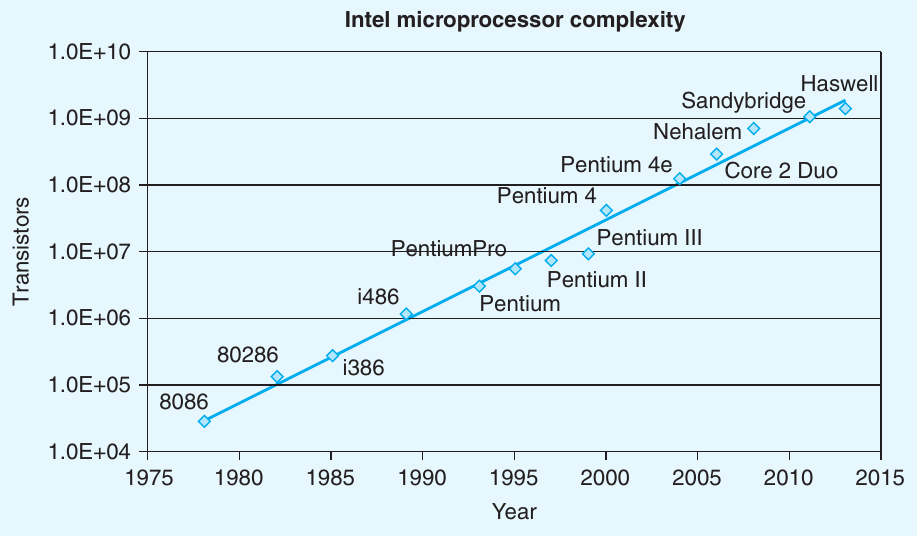

Nếu vẽ số transistor của các processor Intel khác nhau theo năm giới thiệu và dùng thang logarithmic cho y-axis, có thể thấy mức tăng trưởng phi thường. Khớp một đường thẳng qua dữ liệu cho thấy số transistor tăng khoảng 37% mỗi năm, nghĩa là gấp đôi khoảng mỗi 26 tháng. Mức tăng trưởng này được duy trì suốt lịch sử multiple-decade của microprocessor x86.

Năm 1965, Gordon Moore, một nhà sáng lập Intel Corporation, ngoại suy từ công nghệ chip khi đó (có thể chế tạo mạch khoảng 64 transistor trên một chip) để dự đoán số transistor mỗi chip sẽ gấp đôi mỗi năm trong 10 năm tiếp theo. Dự đoán này được gọi là Định luật Moore. Thực tế cho thấy dự đoán hơi lạc quan nhưng cũng quá short-sighted. Trong hơn 50 năm, ngành bán dẫn đã tăng gấp đôi số transistor trung bình mỗi 18 tháng.

Mức tăng trưởng theo hàm mũ tương tự cũng xuất hiện ở các khía cạnh khác của công nghệ máy tính, gồm dung lượng lưu trữ của đĩa từ và bộ nhớ bán dẫn. Những tốc độ tăng trưởng đáng kể này là động lực chính của cuộc cách mạng máy tính.

## 3.2 Encoding chương trình

Giả sử viết chương trình C thành hai file p1.c và p2.c. Có thể biên dịch code bằng command line Unix:

```
linux> gcc -Og -o p p1.c p2.c
```

Lệnh gcc chỉ compiler C gcc. Vì đây là compiler mặc định trên Linux, cũng có thể gọi đơn giản bằng cc. Tùy chọn command-line -Og[^1] yêu cầu compiler áp dụng mức tối ưu tạo machine code theo cấu trúc tổng thể của code C gốc. Gọi mức tối ưu cao hơn có thể tạo code được biến đổi mạnh đến mức khó hiểu quan hệ giữa machine code được tạo và source code ban đầu. Vì vậy, chúng ta dùng tối ưu -Og như tool học tập rồi xem điều gì xảy ra khi tăng mức tối ưu. Trong thực tế, các mức tối ưu cao hơn (chẳng hạn chỉ định bằng -O1 hoặc -O2) được xem là lựa chọn tốt hơn về hiệu năng chương trình kết quả.

Lệnh gcc gọi cả chuỗi chương trình để biến source code thành executable code. Đầu tiên, C preprocessor mở rộng source code để đưa vào các file được chỉ định bằng lệnh #include và mở rộng macro được chỉ định bằng khai báo #define. Thứ hai, compiler tạo phiên bản assembly-code của hai source file có tên p1.s và p2.s. Tiếp theo, assembler chuyển assembly code thành binary object-code file p1.o và p2.o. Object code là một dạng machine code—chứa biểu diễn nhị phân của mọi instruction, nhưng địa chỉ global value chưa được điền. Cuối cùng, linker hợp nhất hai object-code file cùng code triển khai library function (như printf), tạo executable code file cuối cùng p (theo directive command-line -o p). Executable code là dạng machine code thứ hai chúng ta xét—dạng code chính xác mà processor thực thi. Quan hệ giữa các dạng machine code và quá trình linking được mô tả chi tiết hơn trong Chương 7.

### 3.2.1 Code Machine-Level

Như Mục 1.9.3 mô tả, hệ thống máy tính sử dụng nhiều dạng abstraction, che chi tiết triển khai bằng mô hình trừu tượng đơn giản hơn. Trong số đó, có hai dạng đặc biệt quan trọng đối với lập trình machine-level. Thứ nhất, format và hành vi chương trình machine-level được định nghĩa bởi instruction set architecture, hay ISA, định nghĩa trạng thái processor, format instruction và tác động của mỗi instruction lên trạng thái. Phần lớn ISA, gồm x86-64, mô tả hành vi như thể instruction được thực thi tuần tự, một instruction hoàn tất trước khi instruction tiếp theo bắt đầu. Hardware processor phức tạp hơn nhiều, thực thi đồng thời nhiều instruction, nhưng dùng cơ chế bảo đảm hành vi tổng thể khớp hoạt động tuần tự do ISA quy định. Thứ hai, địa chỉ bộ nhớ trong chương trình machine-level là virtual address, cung cấp mô hình bộ nhớ trông như array byte rất lớn. Triển khai thực tế của hệ thống bộ nhớ kết hợp nhiều hardware memory và operating system software, như Chương 9 mô tả.

Compiler làm phần lớn công việc trong toàn bộ chuỗi biên dịch, chuyển chương trình được diễn đạt theo mô hình thực thi tương đối trừu tượng của C thành các instruction rất cơ bản mà processor thực thi. Biểu diễn assembly-code rất gần machine code. Đặc điểm chính là format văn bản dễ đọc hơn so với format nhị phân của machine code. Hiểu assembly code và quan hệ với code C gốc là bước then chốt để hiểu cách máy tính thực thi chương trình.

Machine code x86-64 khác nhiều so với code C gốc. Những phần trạng thái processor thường bị che khỏi lập trình viên C trở nên hiển thị:

- Program counter (thường gọi là PC, và có tên %rip trong x86-64) chỉ địa chỉ trong bộ nhớ của instruction tiếp theo sẽ được thực thi.

- Integer register file chứa 16 vị trí có tên để lưu giá trị 64-bit. Các register này có thể chứa địa chỉ (tương ứng pointer C) hoặc dữ liệu số nguyên. Một số register theo dõi những phần quan trọng của trạng thái chương trình, còn register khác giữ dữ liệu tạm, như argument và local variable của procedure, cũng như giá trị function sẽ return.

- Các condition code register chứa thông tin trạng thái về arithmetic instruction hoặc logical instruction vừa được thực thi gần nhất. Chúng được dùng để triển khai thay đổi có điều kiện trong control flow hoặc data flow, như khi triển khai câu lệnh if và while.

- Mỗi register trong tập vector register có thể chứa một hoặc nhiều giá trị số nguyên hoặc floating-point.

Trong khi C cung cấp mô hình cho phép khai báo object thuộc những data type khác nhau và cấp phát trong bộ nhớ, machine code chỉ nhìn bộ nhớ như array byte-addressable lớn. Aggregate data type trong C như array và structure được biểu diễn trong machine code bằng các tập byte liên tiếp. Ngay cả với scalar data type, assembly code không phân biệt số nguyên signed và unsigned, các loại pointer khác nhau, thậm chí pointer với số nguyên.

Bộ nhớ chương trình chứa executable machine code của chương trình, một số thông tin operating system cần, stack run-time để quản lý procedure call và return, cùng các khối bộ nhớ người dùng cấp phát (như bằng library function malloc). Như đã nói, bộ nhớ chương trình được định địa chỉ bằng virtual address. Tại mỗi thời điểm, chỉ những phạm vi con giới hạn của virtual address được xem là hợp lệ. Ví dụ, virtual address x86-64 được biểu diễn bằng word 64-bit. Trong cách triển khai hiện tại, 16 bit trên phải được đặt bằng 0, nên một địa chỉ có thể chỉ một byte trong phạm vi 2<sup>48</sup>, hay 64 terabyte. Chương trình điển hình hơn chỉ có quyền truy cập vài megabyte hoặc vài gigabyte. Operating system quản lý virtual address space này, chuyển virtual address thành physical address của các giá trị trong bộ nhớ processor thực tế.

#### Ghi chú Các dạng code được tạo ever-changing

Trong phần trình bày, chúng ta đưa code do một phiên bản gcc cụ thể tạo ra với thiết lập tùy chọn command-line cụ thể. Nếu biên dịch trên máy của mình, có thể bạn dùng compiler khác hoặc phiên bản gcc khác nên tạo code khác. Cộng đồng open-source hỗ trợ gcc liên tục thay đổi code generator, cố tạo code hiệu quả hơn theo các hướng dẫn viết code thay đổi của nhà sản xuất microprocessor.

Mục tiêu của việc nghiên cứu các ví dụ trong phần trình bày này là minh họa cách kiểm tra assembly code và ánh xạ ngược về cấu trúc trong ngôn ngữ lập trình high-level. Bạn cần điều chỉnh các kỹ thuật theo phong cách code mà compiler cụ thể của mình tạo ra.

Một machine instruction chỉ thực hiện thao tác rất cơ bản. Ví dụ, cộng hai số trong register, truyền dữ liệu giữa bộ nhớ và register, hoặc branch có điều kiện sang địa chỉ instruction mới. Compiler phải tạo chuỗi instruction như vậy để triển khai các cấu trúc chương trình như tính arithmetic expression, vòng lặp hoặc procedure call và return.

### 3.2.2 Ví dụ code

Giả sử viết file code C mstore.c chứa định nghĩa function sau:

```
long mult2(long, long);

void multstore(long x, long y, long *dest) {
    long t = mult2(x, y);
    *dest = t;
}
```

Để xem assembly code do compiler C tạo, có thể dùng tùy chọn -S trên command line:

```
linux> gcc -Og -S mstore.c
```

Lệnh này khiến gcc chạy compiler, tạo assembly file mstore.s rồi dừng. (Thông thường nó sẽ gọi assembler để tạo object-code file.)

File assembly-code chứa nhiều khai báo, bao gồm tập dòng sau:

```
multstore:
  pushq   %rbx
```

#### Ghi chú Làm sao hiển thị biểu diễn byte của chương trình?

Để hiển thị binary object code của chương trình (chẳng hạn mstore), chúng ta dùng disassembler (mô tả bên dưới) để xác định code procedure dài 14 byte. Sau đó chạy GNU debugging tool gdb trên file mstore.o và đưa lệnh

```
(gdb) x/14xb multstore
```

yêu cầu hiển thị (viết tắt ‘x’) 14 byte (‘b’) hex-formatted (cũng là ‘x’) bắt đầu tại địa chỉ function multstore. Bạn sẽ thấy gdb có nhiều tính năng hữu ích để phân tích chương trình machine-level, như sẽ thảo luận trong Mục 3.10.2.

```
movq    %rdx, %rbx
call    mult2
movq    %rax, (%rbx)
popq    %rbx
ret
```

Mỗi dòng thụt vào trong code tương ứng một machine instruction. Ví dụ, instruction pushq yêu cầu đẩy nội dung register %rbx lên program stack. Mọi thông tin tên local variable hoặc data type đã bị loại bỏ.

Nếu dùng tùy chọn command-line -c, gcc vừa biên dịch vừa assemble code

```
linux> gcc -Og -c mstore.c
```

Lệnh tạo object-code file mstore.o ở format nhị phân nên không thể xem trực tiếp. Bên trong 1,368 byte của file mstore.o có chuỗi 14-byte với biểu diễn hexadecimal

```
53 48 89 d3 e8 00 00 00 00 48 89 03 5b c3
```

Đây là object code tương ứng các assembly instruction đã liệt kê. Bài học then chốt là chương trình máy thực thi chỉ là chuỗi byte mã hóa một chuỗi instruction. Máy có rất ít thông tin về source code đã tạo ra các instruction đó.

Để kiểm tra nội dung file machine-code, các chương trình disassembler có thể vô cùng hữu ích. Chúng tạo format tương tự assembly code từ machine code. Trên Linux, chương trình objdump (viết tắt “object dump”) thực hiện vai trò này với flag command-line -d:

```
linux> objdump -d mstore.o
```

Kết quả (chúng ta đã thêm số dòng bên trái và chú giải in nghiêng) như sau:

```
    Disassembly of function sum in binary file mstore.o
1   0000000000000000 <multstore>:
    Offset  Bytes                   Equivalent assembly language
2      0:   53                      push   %rbx
3      1:   48 89 d3                mov    %rdx,%rbx
4      4:   e8 00 00 00 00          callq  9 <multstore+0x9>
5      9:   48 89 03                mov    %rax,(%rbx)
6      c:   5b                      pop    %rbx
7      d:   c3                      retq
```

Bên trái là 14 giá trị byte hexadecimal theo chuỗi byte ở trên, chia thành nhóm từ 1 đến 5 byte. Mỗi nhóm là một instruction, với assembly-language tương ứng ở bên phải.

Có một số đặc điểm của machine code và biểu diễn disassembled cần lưu ý:

- Instruction x86-64 có thể dài từ 1 đến 15 byte. Instruction encoding được thiết kế để instruction thường dùng và instruction có ít operand cần ít byte hơn instruction ít gặp hoặc có nhiều operand.

- Instruction format được thiết kế sao cho từ một vị trí bắt đầu cho trước, các byte được decode duy nhất thành machine instruction. Ví dụ, chỉ instruction pushq %rbx có thể bắt đầu bằng giá trị byte 53.

- Disassembler xác định assembly code thuần túy từ chuỗi byte trong file machine-code. Nó không cần truy cập phiên bản source hoặc assembly-code của chương trình.

- Disassembler dùng quy ước đặt tên instruction hơi khác assembly code gcc tạo. Trong ví dụ, nó bỏ hậu tố ‘q’ khỏi nhiều instruction. Các hậu tố này chỉ kích thước và thường có thể bỏ. Ngược lại, disassembler thêm hậu tố ‘q’ cho instruction call và ret. Một lần nữa, có thể bỏ các hậu tố này một cách an toàn.

Để tạo executable code thực tế, cần chạy linker trên tập object-code file, trong đó một file phải chứa function main. Giả sử file main.c có function sau:

```
#include <stdio.h>

void multstore(long, long, long *);

int main() {
    long d;
    multstore(2, 3, &d);
    printf("2 * 3 --> %ld\n", d);
    return 0;
}
long mult2(long a, long b) {
long s = a * b;
return s;
}
```

Khi đó có thể tạo executable program prog như sau:

```
linux> gcc -Og -o prog main.c mstore.c
```

File prog tăng lên 8,655 byte vì không chỉ chứa machine code của các procedure chúng ta cung cấp mà còn chứa code khởi động, kết thúc chương trình và tương tác với operating system.

Có thể disassemble file prog:

```
linux> objdump -d prog
```

Disassembler trích xuất nhiều chuỗi code, bao gồm:

```
    Disassembly of function sum in binary file prog
1   0000000000400540 <multstore>:
2     400540:  53                      push   %rbx
3     400541:  48 89 d3                mov    %rdx,%rbx
4     400544:  e8 42 00 00 00          callq  40058b <mult2>
5     400549:  48 89 03                mov    %rax,(%rbx)
6     40054c:  5b                      pop    %rbx
7     40054d:  c3                      retq
8     40054e:  90                      nop
9     40054f:  90                      nop
```

Code này gần như giống hệt kết quả disassembly của mstore.c. Khác biệt quan trọng là các địa chỉ bên trái đã thay đổi—linker chuyển vị trí code sang phạm vi địa chỉ khác. Khác biệt thứ hai là linker điền địa chỉ instruction callq cần dùng để gọi function mult2 (dòng 4 trong disassembly). Một nhiệm vụ của linker là ghép function call với vị trí executable code của function đó. Khác biệt cuối là có thêm hai dòng code (dòng 8–9). Các instruction này không ảnh hưởng chương trình vì đứng sau return instruction (dòng 7). Chúng được chèn để tăng code function lên 16 byte, giúp đặt khối code tiếp theo tốt hơn xét về hiệu năng hệ thống bộ nhớ.

### 3.2.3 Ghi chú về định dạng

Assembly code do gcc tạo khó đọc với con người. Một mặt, nó chứa thông tin mà chúng ta không cần quan tâm; mặt khác, nó không mô tả chương trình hay cách chương trình hoạt động. Ví dụ, giả sử dùng lệnh

```
linux> gcc -Og -S mstore.c
```

để tạo file mstore.s. Toàn bộ nội dung file như sau:

```
        .file   "010-mstore.c"
        .text
        .globl  multstore
        .type   multstore, @function
multstore:
        pushq   %rbx
        movq    %rdx, %rbx
        call    mult2
        movq    %rax, (%rbx)
        popq    %rbx
        ret
        .size   multstore, .-multstore
        .ident  "GCC: (Ubuntu 4.8.1-2ubuntu1~12.04) 4.8.1"
        .section        .note.GNU-stack,"",@progbits
```

Mọi dòng bắt đầu bằng ‘.’ là directive hướng dẫn assembler và linker. Nói chung có thể bỏ qua chúng. Mặt khác, không có chú giải nào cho biết các instruction làm gì hay liên hệ với source code như thế nào.

Để trình bày assembly code rõ hơn, chúng ta sẽ bỏ phần lớn directive, đồng thời thêm số dòng và chú giải giải thích. Với ví dụ này, phiên bản có chú giải như sau:

```
    void multstore(long x, long y, long *dest)
    x in %rdi, y in %rsi, dest in %rdx
1   multstore:
2     pushq   %rbx            Save %rbx
3     movq    %rdx, %rbx      Copy dest to %rbx
4     call    mult2           Call mult2(x, y)
5     movq    %rax, (%rbx)    Store result at *dest
6     popq    %rbx            Restore %rbx
7     ret                     Return
```

Chúng ta thường chỉ trình bày các dòng code liên quan nội dung đang thảo luận. Mỗi dòng được đánh số bên trái để tham chiếu và chú giải bên phải bằng mô tả ngắn về tác động instruction cùng quan hệ với phép tính trong code C gốc. Đây là phiên bản theo phong cách định dạng code của lập trình viên assembly-language.

Chúng ta còn cung cấp ghi chú trên Web cho người đam mê machine-language muốn tìm hiểu sâu. Một ghi chú mô tả machine code IA32. Có nền tảng x86-64 giúp học IA32 khá đơn giản. Ghi chú khác giới thiệu ngắn các cách đưa assembly code vào chương trình C. Với một số ứng dụng, lập trình viên phải xuống assembly code để truy cập tính năng low-level của máy. Một cách là viết toàn bộ function bằng assembly code và kết hợp với function C trong giai đoạn linking. Cách thứ hai dùng hỗ trợ của gcc để nhúng assembly code trực tiếp vào chương trình C.

#### Ghi chú Format assembly-code ATT và Intel

Trong phần trình bày, chúng ta dùng assembly code format ATT (đặt theo AT&T, công ty vận hành Bell Laboratories nhiều năm), format mặc định của gcc, objdump và các tool khác được xét. Các tool lập trình khác, bao gồm những tool của Microsoft, cũng như tài liệu của Intel, trình bày assembly code theo format Intel. Hai format khác nhau ở một số điểm. Ví dụ, gcc có thể tạo code format Intel cho function sum bằng command line sau:

```
linux> gcc -Og -S -masm=intel mstore.c
```

Lệnh này tạo ra assembly code sau:

```
multstore:
  push    rbx
  mov     rbx, rdx
  call    mult2
  mov     QWORD PTR [rbx], rax
  pop     rbx
  ret
```

Có thể thấy format Intel và ATT khác nhau như sau:

- Code Intel bỏ hậu tố chỉ kích thước. Ta thấy instruction push và mov thay cho pushq và movq.

- Code Intel bỏ ký tự ‘%’ trước tên register, dùng rbx thay vì %rbx.

- Code Intel mô tả vị trí bộ nhớ theo cách khác—ví dụ QWORD PTR [rbx] thay vì (%rbx).

- Instruction có nhiều operand liệt kê chúng theo thứ tự đảo ngược. Điều này có thể gây nhầm lẫn lớn khi chuyển giữa hai format.

Dù không dùng format Intel trong phần trình bày, bạn sẽ gặp nó trong tài liệu Intel và Microsoft.

## 3.3 Data format

Do bắt nguồn từ kiến trúc 16-bit rồi mở rộng lên 32-bit, Intel dùng thuật ngữ “word” để chỉ data type 16-bit. Dựa trên đó, họ gọi lượng 32-bit là “double word”, còn 64-bit là “quad word”. Hình 3.1 trình bày các biểu diễn x86-64 dùng cho primitive data type C. Giá trị int chuẩn được lưu bằng double word (32 bit). Pointer (ở đây là char *) được lưu bằng quad word 8-byte, đúng như dự kiến ở máy 64-bit. Với x86-64, data type long được triển khai bằng 64 bit, cho phạm vi giá trị rất rộng. Phần lớn ví dụ code trong chương dùng pointer và data type long, nên thao tác trên quad word. Instruction set x86-64 cũng có đầy đủ instruction cho byte, word và double word.

### Ghi chú trên Web ASM:EASM Kết hợp assembly code với chương trình C

Dù compiler C chuyển tốt các phép tính trong chương trình thành machine code, một số tính năng của máy không thể được truy cập từ chương trình C. Ví dụ, mỗi khi processor x86-64 thực hiện arithmetic operation hoặc logical operation, nó đặt condition code flag 1-bit có tên PF (viết tắt “parity flag”) bằng 1 khi 8 bit thấp của kết quả có số lượng bit 1 chẵn, và bằng 0 nếu không. Việc tính thông tin này bằng C cần ít nhất bảy phép toán shift, masking và exclusive-or (xem Bài tập 2.65). Dù hardware tính điều này như một phần của mọi arithmetic operation hoặc logical operation, chương trình C không có cách xác định giá trị condition code flag PF. Có thể dễ dàng thực hiện nhiệm vụ bằng cách đưa một số ít instruction assembly-code vào chương trình.

Có hai cách đưa assembly code vào chương trình C. Thứ nhất, viết toàn bộ function thành file assembly-code riêng rồi để assembler và linker kết hợp với code C đã viết. Thứ hai, dùng tính năng inline assembly của gcc, cho phép đưa các đoạn assembly code ngắn vào chương trình C qua directive asm. Cách này có ưu điểm giảm thiểu lượng code machine-specific.

Dĩ nhiên, đưa assembly code vào chương trình C khiến code phụ thuộc một lớp máy cụ thể (như x86-64), nên chỉ sử dụng khi tính năng mong muốn chỉ có thể truy cập bằng cách này.

| Khai báo C | Data type Intel | Hậu tố Assembly-code | Kích thước (byte) |
|---|---|---|---|
| char | Byte | b | 1 |
| short | Word | w | 2 |
| int | Double word | l | 4 |
| long | Quad word | q | 8 |
| char * | Quad word | q | 8 |
| float | Single precision | s | 4 |
| double | Double precision | l | 8 |

**Hình 3.1 Kích thước data type C trong x86-64. Với máy 64-bit, pointer dài 8 byte.**

Số Floating-point có hai format chính: giá trị single-precision (4-byte), tương ứng data type C float, và giá trị double-precision (8-byte), tương ứng data type C double. Trước đây, microprocessor họ x86 triển khai mọi phép toán floating-point bằng format floating-point đặc biệt 80-bit (10-byte) (xem Bài tập 2.86). Có thể chỉ định format này trong chương trình C bằng khai báo long double. Tuy nhiên, chúng tôi không khuyến nghị dùng format này. Nó không portable sang lớp máy khác, và thường không được triển khai bằng cùng hardware high-performance như số học single- và double-precision.

Như bảng Hình 3.1 cho thấy, phần lớn instruction assembly-code do gcc tạo có hậu tố single-character chỉ kích thước operand. Ví dụ, data movement instruction có bốn biến thể: movb (move byte), movw (move word), movl (move double word) và movq (move quad word). Hậu tố ‘l’ dùng cho double word vì lượng 32-bit được coi là “long word”. Assembly code dùng hậu tố ‘l’ cho cả số nguyên 4-byte lẫn số floating-point double-precision 8-byte. Điều này không gây nhập nhằng vì code floating-point dùng tập instruction và register hoàn toàn khác.

## 3.4 Truy cập thông tin

Central processing unit (CPU) x86-64 chứa tập 16 register general-purpose lưu giá trị 64-bit. Chúng được dùng để lưu dữ liệu số nguyên và pointer. Hình 3.2 mô tả 16 register. Tên đều bắt đầu bằng %r, nhưng còn lại theo nhiều quy ước khác nhau do lịch sử phát triển instruction set. 8086 ban đầu có tám register 16-bit, được thể hiện trong Hình 3.2 là %ax đến %bp. Mỗi register có mục đích cụ thể nên tên phản ánh cách sử dụng. Khi mở rộng sang IA32, chúng được mở thành register 32-bit, mang tên %eax đến %ebp. Khi mở rộng sang x86-64, tám register gốc được mở thành 64 bit, mang tên %rax đến %rbp. Ngoài ra, tám register mới được thêm vào và đặt theo quy ước tên mới: %r8 đến %r15.

Như các hộp lồng nhau trong Hình 3.2 cho thấy, instruction có thể thao tác dữ liệu kích thước khác nhau lưu trong các byte low-order của 16 register. Phép toán Byte-level có thể truy cập byte có trọng số thấp nhất; phép toán 16-bit truy cập 2 byte thấp nhất; phép toán 32-bit truy cập 4 byte thấp nhất; và phép toán 64-bit truy cập toàn bộ register.

Trong các phần sau, chúng ta trình bày một số instruction sao chép và tạo giá trị 1-, 2-, 4- và 8-byte. Khi instruction có đích là register và tạo ít hơn 8 byte, có hai quy ước về các byte còn lại: instruction tạo lượng 1-or 2-byte giữ nguyên các byte còn lại. Instruction tạo lượng 4-byte đặt 4 byte trên của register bằng 0. Quy ước thứ hai được đưa vào như một phần mở rộng từ IA32 sang x86-64.

Như chú giải ở phía right-hand của Hình 3.2 cho thấy, register khác nhau có vai trò khác nhau trong chương trình điển hình. Đặc biệt nhất là stack pointer %rsp, dùng để chỉ vị trí cuối trong stack run-time. Một số instruction đọc và ghi riêng register này. 15 register còn lại linh hoạt hơn về cách dùng. Một số ít instruction dùng cụ thể những register nhất định. Quan trọng hơn, một tập quy ước lập trình chuẩn quy định cách dùng register để quản lý stack, truyền argument cho function, return giá trị từ function và lưu dữ liệu cục bộ, tạm thời. Chúng ta sẽ trình bày các quy ước, đặc biệt trong Mục 3.7 về triển khai procedure.

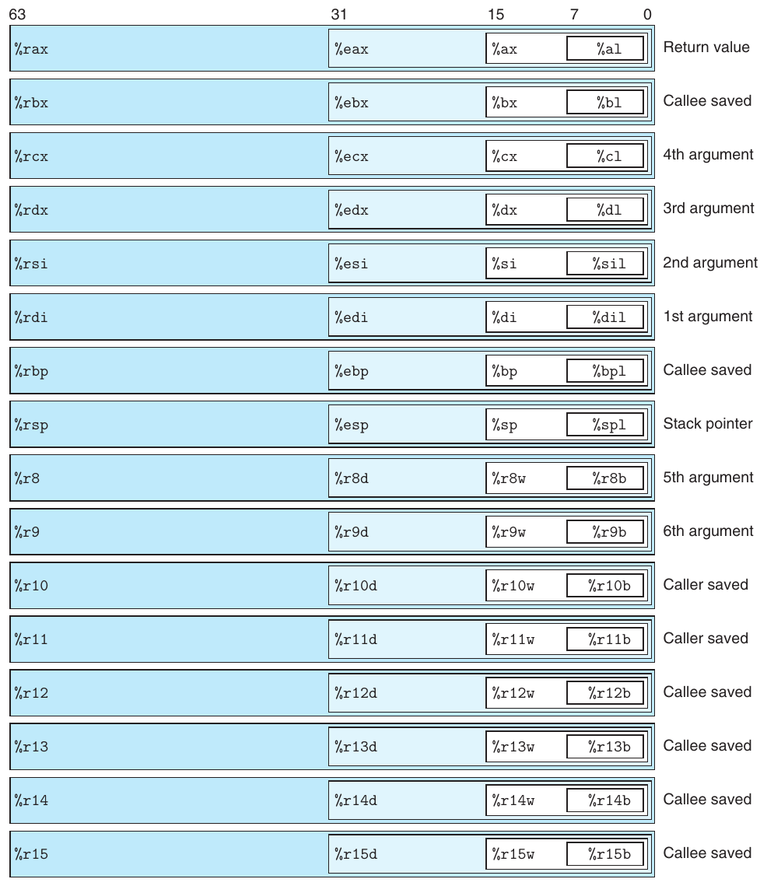

**Hình 3.2 Integer register. Phần low-order của cả 16 register có thể được truy cập dưới dạng byte, word (16-bit), double word (32-bit) và quad word (64-bit).**

### 3.4.1 Chỉ định operand

Phần lớn instruction có một hoặc nhiều operand chỉ giá trị nguồn dùng khi thực hiện phép toán và vị trí đích đặt kết quả. x86-64 hỗ trợ nhiều dạng operand (xem Hình 3.3). Giá trị nguồn có thể là hằng số hoặc đọc từ register hay bộ nhớ. Kết quả có thể lưu trong register hoặc bộ nhớ. Vì vậy, các khả năng operand được phân thành ba loại. Loại thứ nhất, immediate, dành cho giá trị hằng. Trong assembly code ATT-format, chúng được viết bằng ‘$’ theo sau bởi số nguyên theo ký pháp C chuẩn—ví dụ $-577 hoặc $0x1F. Instruction khác nhau cho phép phạm vi immediate khác nhau; assembler tự chọn cách encoding gọn nhất cho giá trị. Loại thứ hai, register, chỉ nội dung register, tức một trong các phần low-order 8-, 4-, 2- hoặc 1-byte của 16 register cho operand lần lượt có 64, 32, 16 hoặc 8 bit. Trong Hình 3.3, ký pháp r<sub>a</sub> chỉ register a bất kỳ và tham chiếu R[r<sub>a</sub>] chỉ giá trị của nó, coi tập register là array R được đánh index bằng register identifier.

| Kiểu | Dạng | Giá trị operand | Tên |
|---|---|---|---|
| Immediate | $ Imm | Imm | Immediate |
| Register | r<sub>a</sub> | R[ r<sub>a</sub>] | Register |
| Bộ nhớ | Imm | M[Imm] | Absolute |
| Bộ nhớ | (r<sub>a</sub>) | M[R[ r<sub>a</sub>]] | Indirect |
| Bộ nhớ | Imm (r<sub>b</sub>) | M[Imm + R[ r<sub>b</sub>]] | Base + displacement |
| Bộ nhớ | (r<sub>b</sub>,r<sub>i</sub>) | M[R[ r<sub>b</sub>] + R[r<sub>i</sub>]] | Indexed |
| Bộ nhớ | Imm (r<sub>b</sub>,r<sub>i</sub> ) | M[Imm + R[ r<sub>b</sub>] + R[r<sub>i</sub>]] | Indexed |
| Bộ nhớ | (,r<sub>i</sub>, s ) | M[R[ r<sub>i</sub>] · s] | Scaled indexed |
| Bộ nhớ | Imm (,r<sub>i</sub>, s ) | M[Imm + R[ r<sub>i</sub> ] · s] | Scaled indexed |
| Bộ nhớ | (r<sub>b</sub>,r<sub>i</sub>, s ) | M[R[ r<sub>b</sub>] + R[r<sub>i</sub>] · s] | Scaled indexed |
| Bộ nhớ | Imm (r<sub>b</sub>,r<sub>i</sub> , s ) | M[Imm + R[ r<sub>b</sub>] + R[r<sub>i</sub>] · s] | Scaled indexed |

**Hình 3.3 Các dạng operand. Operand có thể chỉ giá trị immediate (hằng), giá trị register hoặc giá trị từ bộ nhớ. Scaling factor s phải là 1, 2, 4 hoặc 8.**

Loại operand thứ ba là memory reference, truy cập một vị trí bộ nhớ theo địa chỉ được tính, thường gọi là effective address. Vì coi bộ nhớ là array byte lớn, chúng ta dùng ký pháp M<sub>b</sub>[Addr] để chỉ tham chiếu tới giá trị b-byte lưu trong bộ nhớ bắt đầu ở địa chỉ Addr. Để đơn giản, thông thường chúng ta bỏ chỉ số dưới b.

Như Hình 3.3 cho thấy, có nhiều addressing mode cho phép các dạng memory reference khác nhau. Dạng tổng quát nhất ở cuối bảng có cú pháp Imm(r<sub>b</sub>,r<sub>i</sub> ,s). Tham chiếu có bốn thành phần: immediate offset Imm, base register r<sub>b</sub>, index register r<sub>i</sub> và scale factor s, với s là 1, 2, 4 hoặc 8. Cả base và index phải là register 64-bit. Effective address được tính là Imm + R[r<sub>b</sub>] + R[r<sub>i</sub> ] · s. Dạng tổng quát này thường xuất hiện khi tham chiếu phần tử array. Các dạng khác chỉ là trường hợp riêng lược bớt một số thành phần. Như sẽ thấy, addressing mode phức tạp hơn hữu ích khi tham chiếu phần tử array và structure.

#### Bài tập thực hành 3.1 (lời giải trang 361)

Giả sử các giá trị sau được lưu tại địa chỉ bộ nhớ và register đã chỉ định:

| Địa chỉ | Giá trị | Register | Giá trị |
|---|---|---|---|
| 0x100 | 0xFF | %rax | 0x100 |
| 0x104 | 0xAB | %rcx | 0x1 |
| 0x108 | 0x13 | %rdx | 0x3 |
| 0x10C | 0x11 |  |  |

Điền bảng sau cho giá trị của các operand được chỉ định:

| Operand | Giá trị |
|---|---|
| %rax | ______ |
| 0x104 | ______ |
| $0x108 | ______ |
| (%rax) | ______ |
| 4(%rax) | ______ |
| 9(%rax,%rdx) | ______ |
| 260(%rcx,%rdx) | ______ |
| 0xFC(,%rcx,4) | ______ |
| (%rax,%rdx,4) | ______ |

### 3.4.2 Instruction di chuyển dữ liệu

Trong số instruction được dùng nhiều nhất là những instruction sao chép dữ liệu từ vị trí này sang vị trí khác. Tính tổng quát của ký pháp operand cho phép một data movement instruction đơn giản diễn đạt nhiều khả năng mà trên nhiều máy phải cần nhiều instruction khác nhau. Chúng ta trình bày các data movement instruction khác nhau về kiểu nguồn và đích, phép chuyển đổi thực hiện cùng những tác động phụ có thể có. Trong phần trình bày, chúng ta nhóm chúng thành instruction class, trong đó instruction cùng class thực hiện cùng thao tác nhưng với kích thước operand khác nhau.

Hình 3.4 liệt kê dạng data movement instruction đơn giản nhất—class mov. Các instruction sao chép dữ liệu từ vị trí nguồn tới vị trí đích mà không biến đổi. Class gồm bốn instruction: movb, movw, movl và movq. Cả bốn có tác dụng tương tự; khác biệt chủ yếu là thao tác trên kích thước dữ liệu khác nhau: lần lượt 1, 2, 4 và 8 byte.

| Instruction |  | Tác dụng | Mô tả |
|---|---|---|---|
| mov | S, D | D ← S | Di chuyển |
| movb |  |  | Di chuyển byte |
| movw |  |  | Di chuyển word |
| movl |  |  | Di chuyển double word |
| movq |  |  | Di chuyển quad word |
| movabsq | I , R | R ← I | Di chuyển absolute quad word |

**Hình 3.4 Các instruction di chuyển dữ liệu đơn giản.**

Source operand chỉ giá trị immediate, giá trị trong register hoặc trong bộ nhớ. Destination operand chỉ vị trí là register hoặc địa chỉ bộ nhớ. x86-64 đặt giới hạn rằng move instruction không được có cả hai operand tham chiếu vị trí bộ nhớ. Sao chép giá trị từ vị trí bộ nhớ này sang vị trí khác cần hai instruction—đầu tiên load giá trị nguồn vào register, thứ hai ghi giá trị register tới đích. Theo Hình 3.2, register operand của các instruction có thể là phần mang tên trong bất kỳ register nào của 16 register, với kích thước register khớp kích thước do ký tự cuối instruction chỉ định (‘b’, ‘w’, ‘l’ hoặc ‘q’). Trong phần lớn trường hợp, instruction mov chỉ cập nhật các byte register hoặc vị trí bộ nhớ cụ thể do destination operand chỉ ra. Ngoại lệ duy nhất là khi movl có đích là register, nó còn đặt 4 byte high-order của register bằng 0. Ngoại lệ xuất phát từ quy ước của x86-64: mọi instruction tạo giá trị 32-bit cho register cũng đặt phần high-order của register bằng 0.

Các ví dụ instruction mov sau cho thấy năm tổ hợp kiểu nguồn và đích có thể có. Nhớ rằng source operand đứng trước, destination operand đứng sau.

```
1      movl $0x4050,%eax            Immediate--Register, 4 bytes
2      movw %bp,%sp                 Register--Register,  2 bytes
3      movb (%rdi,%rcx),%al         Memory--Register,    1 byte
4      movb $-17,(%esp)             Immediate--Memory,   1 byte
5      movq %rax,-12(%rbp)          Register--Memory,    8 bytes
```

Instruction cuối trong Hình 3.4 xử lý dữ liệu immediate 64-bit. Instruction movq thông thường chỉ cho phép immediate source operand biểu diễn được bằng số two’s-complement 32-bit. Sau đó giá trị được sign extension để tạo giá trị 64-bit cho đích. Instruction movabsq có thể nhận immediate 64-bit tùy ý làm source operand và chỉ có thể dùng register làm đích.

Hình 3.5 và 3.6 mô tả hai class data movement instruction để sao chép giá trị nguồn nhỏ hơn sang đích lớn hơn. Mọi instruction này sao chép dữ liệu từ nguồn là register hoặc bộ nhớ tới đích register. Instruction class movz điền các byte còn lại của đích bằng số 0, còn class movs điền bằng sign extension, lặp các bản sao most significant bit của source operand. Lưu ý mỗi tên instruction có hai ký tự cuối chỉ kích thước—ký tự đầu chỉ kích thước nguồn, ký tự sau chỉ kích thước đích. Như có thể thấy, có ba instruction trong mỗi class, bao phủ các trường hợp kích thước nguồn 1- và 2-byte, kích thước đích 2- và 4-byte, dĩ nhiên chỉ xét đích lớn hơn nguồn.

#### Ghi chú Hiểu cách di chuyển dữ liệu làm thay đổi register đích

Như đã mô tả, có hai quy ước khác nhau về việc data movement instruction có sửa các byte trên của register đích hay không và sửa thế nào. Khác biệt được minh họa bởi chuỗi code sau:

```
1     movabsq $0x0011223344556677, %rax    %rax = 0011223344556677
2     movb    $-1, %al                     %rax = 00112233445566FF
3     movw    $-1, %ax                     %rax = 001122334455FFFF
4     movl    $-1, %eax                    %rax = 00000000FFFFFFFF
5     movq    $-1, %rax                    %rax = FFFFFFFFFFFFFFFF
```

Trong thảo luận sau, chúng ta dùng ký pháp hexadecimal. Trong ví dụ, instruction dòng 1 khởi tạo register %rax với pattern 0011223344556677. Các instruction còn lại đều có immediate −1 làm giá trị nguồn. Nhớ rằng biểu diễn hexadecimal của −1 có dạng FF · · · F, với số chữ F gấp đôi số byte trong biểu diễn. Vì vậy, movb (dòng 2) đặt byte low-order của %rax thành FF, còn movw (dòng 3) đặt 2 byte low-order thành FFFF, giữ nguyên các byte còn lại. Instruction movl (dòng 4) đặt 4 byte low-order thành FFFFFFFF, đồng thời đặt 4 byte high-order thành 00000000. Cuối cùng, movq (dòng 5) đặt toàn bộ register thành FFFFFFFFFFFFFFFF.

| Instruction | Tác dụng | Mô tả |
|---|---|---|
| movz S, R | R ← ZeroExtend(S) | Di chuyển với zero extension |
| movzbw |  | Di chuyển byte zero-extended sang word |
| movzbl |  | Di chuyển byte zero-extended sang double word |
| movzwl |  | Di chuyển word zero-extended sang double word |
| movzbq |  | Di chuyển byte zero-extended sang quad word |
| movzwq |  | Di chuyển word zero-extended sang quad word |

**Hình 3.5 Data movement instruction Zero-extending. Các instruction có nguồn là register hoặc vị trí bộ nhớ và đích là register.**

| Instruction | Tác dụng | Mô tả |
|---|---|---|
| movs S, R | R ← SignExtend(S) | Di chuyển với sign extension |
| movsbw |  | Di chuyển byte sign-extended sang word |
| movsbl |  | Di chuyển byte sign-extended sang double word |
| movswl |  | Di chuyển word sign-extended sang double word |
| movsbq |  | Di chuyển byte sign-extended sang quad word |
| movswq |  | Di chuyển word sign-extended sang quad word |
| movslq |  | Di chuyển double word sign-extended sang quad word |
| cltq | %rax ← SignExtend( %eax ) | Sign-extend %eax sang %rax |

**Hình 3.6 Data movement instruction Sign-extending. Instruction movs có nguồn là register hoặc vị trí bộ nhớ và đích là register. Instruction cltq dành riêng cho register %eax và %rax .**

Lưu ý Hình 3.5 không có instruction tường minh để zero-extend giá trị nguồn 4-byte sang đích 8-byte. Theo logic, instruction đó sẽ có tên movzlq, nhưng nó không tồn tại. Thay vào đó, có thể thực hiện dạng di chuyển dữ liệu này bằng movl có đích là register. Kỹ thuật tận dụng tính chất: instruction tạo giá trị 4-byte với đích register sẽ điền 4 byte trên bằng số 0. Ngoài ra, với đích 64-bit, di chuyển bằng sign extension được hỗ trợ cho cả ba kiểu nguồn, còn di chuyển bằng zero extension được hỗ trợ cho hai kiểu nguồn nhỏ hơn.

Hình 3.6 cũng mô tả instruction cltq. Instruction này không có operand—luôn dùng register %eax làm nguồn và %rax làm đích của kết quả sign-extended. Vì vậy nó có tác dụng đúng như movslq %eax, %rax, nhưng encoding gọn hơn.

#### Bài tập thực hành 3.2 (lời giải trang 361)

Với mỗi dòng assembly language sau, hãy xác định hậu tố instruction thích hợp dựa trên operand. (Ví dụ, mov có thể viết lại thành movb, movw, movl hoặc movq.)

```
mov     %eax, (%rsp)
mov     (%rax), %dx
mov     $0xFF, %bl
mov     (%rsp,%rdx,4), %dl
mov     (%rdx), %rax
mov     %dx, (%rax)
```

#### Ghi chú So sánh instruction di chuyển byte

Ví dụ sau minh họa cách các data movement instruction khác nhau thay đổi hoặc không thay đổi byte high-order của đích. Lưu ý ba instruction byte-movement movb, movsbq và movzbq khác nhau một cách tinh tế. Sau đây là ví dụ:

```
1     movabsq $0x0011223344556677, %rax    %rax = 0011223344556677
2     movb    $0xAA, %dl                   %dl = AA
3     movb %dl,%al                         %rax = 00112233445566AA
4     movsbq %dl,%rax                      %rax = FFFFFFFFFFFFFFAA
5     movzbq %dl,%rax                      %rax = 00000000000000AA
```

Trong thảo luận sau, chúng ta dùng ký pháp hexadecimal cho mọi giá trị. Hai dòng code đầu khởi tạo register %rax và %dl lần lượt thành 0011223344556677 và AA. Các instruction còn lại đều sao chép byte low-order của %rdx sang byte low-order của %rax. Instruction movb (dòng 3) không đổi các byte khác. Instruction movsbq (dòng 4) đặt 7 byte còn lại thành toàn bit 1 hoặc toàn bit 0 tùy bit high-order của byte nguồn. Vì hexadecimal A biểu diễn giá trị nhị phân 1010, sign extension khiến mỗi byte higher-order được đặt thành FF. Instruction movzbq (dòng 5) luôn đặt 7 byte còn lại bằng 0.

#### Bài tập thực hành 3.3 (lời giải trang 362)

Mỗi dòng code sau tạo thông báo lỗi khi gọi assembler. Giải thích lỗi của từng dòng.

```
movb $0xF, (%ebx)
movl %rax, (%rsp)
movw (%rax),4(%rsp)
movb %al,%sl
movq %rax,$0x123
movl %eax,%rdx
movb %si, 8(%rbp)
```

### 3.4.3 Ví dụ di chuyển dữ liệu

Để minh họa code dùng data movement instruction, xét routine trao đổi dữ liệu trong Hình 3.7, dưới dạng cả code C lẫn assembly code do gcc tạo.

Như Hình 3.7(b) cho thấy, function exchange được triển khai chỉ bằng ba instruction: hai instruction di chuyển dữ liệu (movq) và một instruction return về điểm gọi function (ret). Chi tiết function call và return được trình bày trong Mục 3.7. Hiện tại chỉ cần biết argument được truyền cho function qua register. Assembly code có chú giải ghi rõ điều đó. Function return giá trị bằng cách lưu vào register %rax hoặc một phần low-order của register này.

(a) Code C

```
long exchange(long *xp, long y)
{
    long x = *xp;
    *xp = y;
    return x;
}
```

(b) Assembly code

```
    long exchange(long *xp, long y)
    xp in %rdi, y in %rsi
1   exchange:
2     movq    (%rdi), %rax     Get x at xp. Set as return value.
3     movq    %rsi, (%rdi)     Store y at xp.
4     ret                      Return.
```

**Hình 3.7 Code C và assembly của routine exchange. Register %rdi và %rsi lần lượt chứa parameter xp và y .**

Khi procedure bắt đầu thực thi, parameter xp và y lần lượt được lưu trong register %rdi và %rsi. Instruction 2 đọc x từ bộ nhớ và lưu vào register %rax, triển khai trực tiếp phép x = *xp trong chương trình C. Về sau, register %rax được dùng để return giá trị từ function, nên return value là x. Instruction 3 ghi y vào vị trí bộ nhớ do xp trong register %rdi chỉ định, triển khai trực tiếp phép *xp = y. Ví dụ minh họa cách dùng instruction mov để đọc từ bộ nhớ vào register (dòng 2) và ghi từ register vào bộ nhớ (dòng 3).

Có hai đặc điểm đáng lưu ý về assembly code này. Thứ nhất, những thứ gọi là “pointer” trong C đơn giản là địa chỉ. Dereference pointer bao gồm sao chép pointer vào register rồi dùng register đó trong memory reference. Thứ hai, local variable như x thường được giữ trong register thay vì vị trí bộ nhớ. Truy cập register nhanh hơn nhiều truy cập bộ nhớ.

#### Bài tập thực hành 3.4 (lời giải trang 362)

Giả sử variable sp và dp được khai báo với kiểu

```
src_t  *sp;
dest_t *dp;
```

trong đó src_t và dest_t là data type khai báo bằng typedef. Chúng ta muốn dùng cặp data movement instruction thích hợp để triển khai phép

```
*dp = (dest_t) *sp;
```

#### Mới học C? Một số ví dụ pointer

Function exchange (Hình 3.7(a)) minh họa rõ cách dùng pointer trong C. Argument xp là pointer tới số nguyên long, còn y chính là số nguyên long. Câu lệnh

```
long x = *xp;
```

cho biết cần đọc giá trị lưu tại vị trí xp chỉ định và lưu thành local variable có tên x. Thao tác đọc này gọi là pointer dereferencing. Toán tử ‘*’ trong C thực hiện pointer dereferencing.

Câu lệnh

```
*xp = y;
```

làm điều ngược lại—ghi giá trị parameter y tại vị trí xp chỉ định. Đây cũng là một dạng pointer dereferencing (nên dùng toán tử *), nhưng chỉ thao tác ghi vì nằm ở vế left-hand của phép gán.

Sau đây là ví dụ exchange hoạt động:

```
long a = 4;
long b = exchange(&a, 3);
printf("a = %ld, b = %ld\verb@\@n", a, b);
```

*(ghi chú: sách in `printf("a = %ld, b = %ld\verb@\@n", a, b);` — phần `\verb@\@` là mã dàn trang LaTeX sót lại; đúng là `printf("a = %ld, b = %ld\n", a, b);`)*

Code này sẽ in

```
a = 3, b = 4
```

Toán tử ‘&’ của C (gọi là “address of”) tạo pointer, ở đây trỏ tới vị trí chứa local variable a. Function exchange ghi đè giá trị trong a bằng 3 nhưng return giá trị trước đó là 4 làm giá trị function. Lưu ý rằng nhờ truyền pointer tới exchange, nó có thể sửa dữ liệu tại một vị trí ở nơi khác.

Giả sử giá trị sp và dp lần lượt được lưu trong register %rdi và %rsi. Với mỗi mục trong bảng, hãy chỉ ra hai instruction triển khai data movement được yêu cầu. Instruction đầu đọc từ bộ nhớ, thực hiện chuyển đổi thích hợp và đặt phần phù hợp của register %rax. Instruction thứ hai ghi phần phù hợp của %rax vào bộ nhớ. Trong cả hai trường hợp, phần register có thể là %rax, %eax, %ax hoặc %al, và hai phần có thể khác nhau.

Nhớ rằng khi cast trong C vừa đổi kích thước vừa đổi “signedness”, thao tác cần đổi kích thước trước (Mục 2.2.6).

| src_t | dest_t | Instruction |
|---|---|---|
| long | long | movq (%rdi), %rax<br>movq %rax, (%rsi) |
| char | int | \_\_\_\_\_\_<br>\_\_\_\_\_\_ |

| char | unsigned | \_\_\_\_\_\_<br>\_\_\_\_\_\_ |
|---|---|---|
| unsigned char | long | \_\_\_\_\_\_<br>\_\_\_\_\_\_ |
| int | char | \_\_\_\_\_\_<br>\_\_\_\_\_\_ |
| unsigned | unsigned char | \_\_\_\_\_\_<br>\_\_\_\_\_\_ |
| char | short | \_\_\_\_\_\_<br>\_\_\_\_\_\_ |

#### Bài tập thực hành 3.5 (lời giải trang 363)

Bạn được cung cấp thông tin sau. Một function có prototype

```
void decode1(long *xp, long *yp, long *zp);
```

được biên dịch thành assembly code như sau:

```
  void decode1(long *xp, long *yp, long *zp)
  xp in %rdi, yp in %rsi, zp in %rdx
decode1:
  movq    (%rdi), %r8
  movq    (%rsi), %rcx
  movq    (%rdx), %rax
  movq    %r8, (%rsi)
  movq    %rcx, (%rdx)
  movq    %rax, (%rdi)
  ret
```

Parameter xp, yp và zp lần lượt được lưu trong register %rdi, %rsi và %rdx.

Viết code C cho decode1 có tác dụng tương đương assembly code đã cho.

### 3.4.4 Push và pop dữ liệu stack

Hai thao tác di chuyển dữ liệu cuối dùng để push dữ liệu lên program stack và pop dữ liệu khỏi đó, như Hình 3.8 mô tả. Như sẽ thấy, stack có vai trò thiết yếu trong xử lý procedure call. Về nền tảng, stack là data structure cho phép thêm hoặc xóa giá trị nhưng chỉ theo quy tắc “last-in, first-out”. Chúng ta thêm dữ liệu bằng push và loại bỏ bằng pop, với tính chất giá trị được pop luôn là giá trị được push gần nhất và còn trên stack. Có thể triển khai stack bằng array, trong đó luôn chèn và xóa phần tử ở một đầu array. Đầu đó gọi là top của stack. Với x86-64, program stack nằm trong một vùng bộ nhớ. Như Hình 3.9 minh họa, stack tăng xuống dưới sao cho phần tử top có địa chỉ thấp nhất trong mọi phần tử stack. (Theo quy ước, chúng ta vẽ stack đảo ngược, với “top” ở đáy hình.) Stack pointer %rsp chứa địa chỉ phần tử top.

| Instruction | Tác dụng | Mô tả |
|---|---|---|
| pushq S | R[%rsp ] ← R[ %rsp ] − 8;<br>M[R[ %rsp ]] ← S | Push quad word |
| popq D | D ← M[R[%rsp ]];<br>R[%rsp ] ← R[ %rsp ] + 8 | Pop quad word |

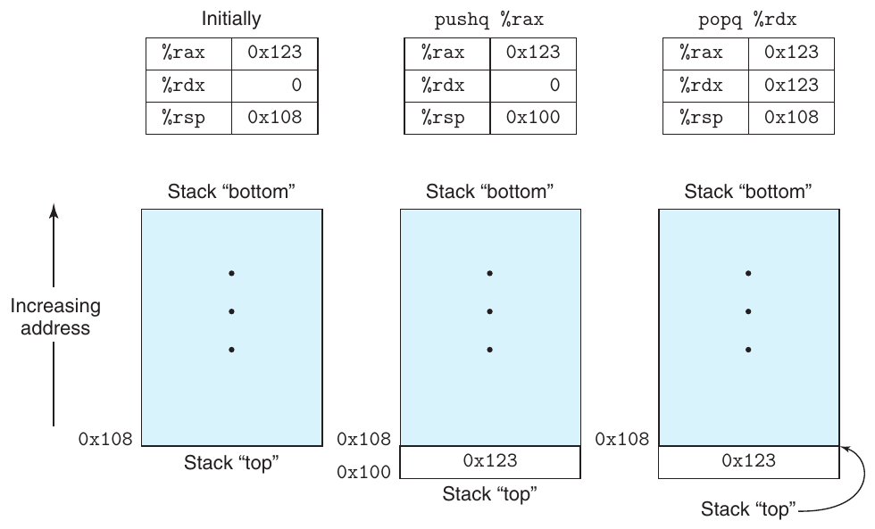

**Hình 3.8 Instruction push và pop.**

**Hình 3.9 Minh họa hoạt động stack. Theo quy ước, stack được vẽ đảo ngược nên “top” nằm ở đáy. Với x86-64, stack tăng về địa chỉ thấp hơn, nên push gồm giảm stack pointer (register %rsp ) và lưu vào bộ nhớ, còn pop gồm đọc từ bộ nhớ rồi tăng stack pointer.**

Instruction pushq cho phép push dữ liệu lên stack, còn popq lấy dữ liệu ra. Mỗi instruction nhận một operand—nguồn dữ liệu cho push và đích dữ liệu cho pop.

Push giá trị quad word lên stack gồm giảm stack pointer đi 8 trước rồi ghi giá trị tại địa chỉ top-of-stack mới. Vì vậy, hành vi instruction pushq %rbp tương đương cặp instruction

```
subq $8,%rsp              Decrement stack pointer
movq %rbp,(%rsp)          Store %rbp on stack
```

ngoại trừ pushq được mã hóa trong machine code bằng một byte, còn cặp instruction trên cần tổng cộng 8 byte. Hai cột đầu trong Hình 3.9 minh họa thực thi pushq %rax khi %rsp là 0x108 và %rax là 0x123. Trước tiên %rsp giảm 8 còn 0x100, sau đó 0x123 được lưu tại địa chỉ bộ nhớ 0x100.

Pop quad word gồm đọc tại vị trí top-of-stack rồi tăng stack pointer thêm 8. Vì vậy, popq %rax tương đương cặp instruction sau:

```
movq (%rsp),%rax          Read %rax from stack
addq $8,%rsp              Increment stack pointer
```

Cột thứ ba của Hình 3.9 minh họa tác động của việc thực thi popq %edx ngay sau pushq. Giá trị 0x123 được đọc từ bộ nhớ và ghi vào register %rdx. Register %rsp tăng trở lại 0x108. Như hình cho thấy, giá trị 0x123 còn ở vị trí bộ nhớ 0x104 cho tới khi bị ghi đè (chẳng hạn bởi push khác). Tuy nhiên, top của stack luôn được coi là địa chỉ %rsp chỉ định.

Vì stack nằm cùng bộ nhớ với program code và những dạng dữ liệu chương trình khác, chương trình có thể truy cập vị trí bất kỳ trong stack bằng phương pháp định địa chỉ bộ nhớ chuẩn. Ví dụ, giả sử phần tử top là quad word, instruction movq 8(%rsp),%rdx sao chép quad word thứ hai từ stack vào register %rdx.

## 3.5 Arithmetic operation và logical operation

Hình 3.10 liệt kê một số phép toán số nguyên và logic của x86-64. Phần lớn được trình bày dưới dạng instruction class vì có các biến thể với kích thước operand khác nhau. (Chỉ leaq không có biến thể kích thước khác.) Ví dụ, instruction class add gồm bốn instruction cộng: addb, addw, addl và addq, lần lượt cộng byte, word, double word và quad word. Thực ra, mỗi instruction class được trình bày đều có instruction hoạt động trên bốn kích thước dữ liệu này. Các phép toán chia thành bốn nhóm: load effective address, unary, binary và shift. Binary operation có hai operand, còn unary operation có một. Các operand dùng cùng ký pháp đã mô tả trong Mục 3.4.

### 3.5.1 Load effective address

Instruction load effective address leaq thực ra là một biến thể của movq. Nó có dạng instruction đọc từ bộ nhớ vào register, nhưng không hề tham chiếu bộ nhớ. Operand đầu trông như memory reference, nhưng thay vì đọc vị trí được chỉ định, instruction sao chép effective address tới đích. Trong Hình 3.10, chúng ta chỉ phép tính này bằng address operator &S của C. Instruction này có thể tạo pointer để sử dụng trong memory reference về sau. Ngoài ra, nó có thể mô tả gọn các arithmetic operation thông thường. Ví dụ, nếu register %rdx chứa x, instruction leaq 7(%rdx,%rdx,4), %rax đặt giá trị của register %rax thành 5x + 7. Compiler thường tìm được cách dùng leaq khéo léo hoàn toàn không liên quan tính effective address. Destination operand phải là register.

| Instruction | Tác dụng | Mô tả |
|---|---|---|
| leaq S, D | D ← &S | Load effective address |
| inc D | D ← D+1 | Tăng một |
| dec D | D ← D−1 | Giảm một |
| neg D | D ← - D | Lấy số đối |
| not D | D ← ~ D | Đảo bit |
| add S, D | D ← D + S | Cộng |
| sub S, D | D ← D − S | Trừ |
| imul S, D | D ← D ∗ S | Nhân |
| xor S, D | D ← D ^ S | Exclusive-or |
| or S, D | D ← D \| S | Or |
| and S, D | D ← D & S | And |
| sal k, D | D ← D << k | Left shift |
| shl k, D | D ← D << k | Left shift (giống sal) |
| sar k, D | D ← D >><sub>A</sub> k | Arithmetic right shift |
| shr k, D | D ← D >><sub>L</sub> k | Logical right shift |

**Hình 3.10 Phép toán số học số nguyên. Instruction load effective address (leaq ) thường dùng để thực hiện phép tính đơn giản. Các instruction còn lại là unary operation hoặc binary operation thông thường hơn. Ký pháp >><sub>A</sub> và >><sub>L</sub> lần lượt chỉ arithmetic right shift và logical right shift. Lưu ý thứ tự operand trái trực giác trong assembly code ATT-format.**

#### Bài tập thực hành 3.6 (lời giải trang 363)

Giả sử register %rbx chứa p và %rdx chứa q. Điền bảng sau bằng công thức chỉ giá trị sẽ lưu trong register %rax với mỗi instruction assembly-code đã cho:

| Instruction | Kết quả |
|---|---|
| leaq 9(%rdx), %rax | ______ |
| leaq (%rdx,%rbx), %rax | ______ |
| leaq (%rdx,%rbx,3), %rax | ______ |
| leaq 2(%rbx,%rbx,7), %rax | ______ |

| leaq 0xE(,%rdx,3), %rax | ______ |
|---|---|
| leaq 6(%rbx,%rdx,7), %rax | ______ |

Để minh họa cách dùng leaq trong code đã biên dịch, xét chương trình C sau:

```
long scale(long x, long y, long z) {
    long t = x + 4 * y + 12 * z;
    return t;
}
```

Khi biên dịch, arithmetic operation của function được triển khai bằng chuỗi ba function leaq, như chú giải ở phía right-hand mô tả:

```
  long scale(long x, long y, long z)
  x in %rdi, y in %rsi, z in %rdx
scale:
  leaq    (%rdi,%rsi,4), %rax     x + 4*y
  leaq    (%rdx,%rdx,2), %rdx     z + 2*z = 3*z
  leaq    (%rax,%rdx,4), %rax     (x+4*y) + 4*(3*z) = x + 4*y + 12*z
  ret
```

Khả năng thực hiện phép cộng và các dạng phép nhân có giới hạn của leaq hữu ích khi biên dịch arithmetic expression đơn giản như ví dụ này.

#### Bài tập thực hành 3.7 (lời giải trang 364)

Xét code sau, trong đó biểu thức cần tính đã được lược bỏ:

```
short scale3(short x, short y, short z) {
  short t = ______;
  return t;
}
```

Biên dịch function thực tế bằng gcc cho assembly code sau:

```
  short scale3(short x, short y, short z)
  x in %rdi, y in %rsi, z in %rdx
scale3:
  leaq (%rsi,%rsi,9), %rbx
  leaq (%rbx,%rdx), %rbx
  leaq (%rbx,%rdi,%rsi), %rbx
  ret
```

Điền biểu thức còn thiếu trong code C.

### 3.5.2 Unary operation và binary operation

Các phép toán trong nhóm thứ hai là unary operation, với operand duy nhất vừa làm nguồn vừa làm đích. Operand có thể là register hoặc vị trí bộ nhớ. Ví dụ, instruction incq (%rsp) tăng phần tử 8-byte ở top của stack. Cú pháp gợi nhớ toán tử increment (++) và decrement (--) của C.

Nhóm thứ ba gồm binary operation, trong đó operand thứ hai vừa làm nguồn vừa làm đích. Cú pháp gợi nhớ assignment operator C như x -= y. Tuy nhiên, lưu ý source operand đứng trước, đích đứng sau. Điều này có vẻ lạ với phép toán không giao hoán. Ví dụ, instruction subq %rax,%rdx giảm register %rdx đi giá trị trong %rax. (Có thể đọc là “Trừ %rax khỏi %rdx”.) Operand đầu có thể là immediate, register hoặc vị trí bộ nhớ. Operand thứ hai có thể là register hoặc vị trí bộ nhớ. Giống mov, hai operand không thể đồng thời là vị trí bộ nhớ. Khi operand thứ hai là vị trí bộ nhớ, processor phải đọc giá trị từ bộ nhớ, thực hiện phép toán rồi ghi kết quả lại bộ nhớ.

#### Bài tập thực hành 3.8 (lời giải trang 364)

Giả sử các giá trị sau được lưu tại địa chỉ bộ nhớ và register đã chỉ định:

| Địa chỉ | Giá trị | Register | Giá trị |
|---|---|---|---|
| 0x100 | 0xFF | %rax | 0x100 |
| 0x108 | 0xAB | %rcx | 0x1 |
| 0x110 | 0x13 | %rdx | 0x3 |
| 0x118 | 0x11 |  |  |

Điền bảng sau cho tác động của các instruction, gồm register hoặc vị trí bộ nhớ được cập nhật và giá trị kết quả:

| Instruction | Đích | Giá trị |
|---|---|---|
| addq %rcx,(%rax) | ______ | ______ |
| subq %rdx,8(%rax) | ______ | ______ |
| imulq $16,(%rax,%rdx,8) | ______ | ______ |
| incq 16(%rax) | ______ | ______ |
| decq %rcx | ______ | ______ |
| subq %rdx,%rax | ______ | ______ |

### 3.5.3 Phép toán shift

Nhóm cuối gồm phép toán shift, với lượng dịch được cho trước và giá trị cần dịch cho sau. Có thể thực hiện cả arithmetic right shift và logical right shift. Shift instruction có thể chỉ lượng dịch bằng immediate hoặc register single-byte %cl. (Các instruction này khác thường ở chỗ chỉ cho phép đúng register này làm operand.) Về nguyên tắc, lượng dịch 1-byte cho phép mã hóa lượng dịch tới 2<sup>8</sup> − 1 = 255. Với x86-64, shift instruction hoạt động trên giá trị dữ liệu dài w bit xác định lượng dịch từ m bit low-order của register %cl, trong đó 2<sup>m</sup> = w. Các bit higher-order bị bỏ qua. Ví dụ, khi %cl có giá trị hexadecimal 0xFF, salb dịch 7, salw dịch 15, sall dịch 31 và salq dịch 63.

Như Hình 3.10 cho thấy, left shift instruction có hai tên: sal và shl. Cả hai có cùng tác dụng, điền số 0 từ bên phải. Right shift instruction khác nhau ở chỗ sar thực hiện arithmetic shift (điền các bản sao sign bit), còn shr thực hiện logical shift (điền số 0). Destination operand của phép shift có thể là register hoặc vị trí bộ nhớ. Hai right shift operation trong Hình 3.10 được ký hiệu >><sub>A</sub> (arithmetic) và >><sub>L</sub> (logical).

#### Bài tập thực hành 3.9 (lời giải trang 364)

Giả sử muốn tạo assembly code cho function C sau:

```
long shift_left4_rightn(long x, long n)
{
    x <<= 4;
    x >>= n;
    return x;
}
```

Code tiếp theo là một phần assembly code thực hiện các phép shift thực tế và để giá trị cuối trong register %rax. Hai instruction then chốt đã bị lược bỏ. Parameter x và n lần lượt được lưu trong register %rdi và %rsi.

```
  long shift_left4_rightn(long x, long n)
  x in %rdi, n in %rsi
shift_left4_rightn:
  movq    %rdi, %rax     Get x
  ______                 x <<= 4
  movl    %esi, %ecx     Get n (4 bytes)
  ______                 x >>= n
```

Điền instruction còn thiếu theo chú giải bên phải. Right shift phải được thực hiện theo arithmetic.

(a) Code C

```
long arith(long x, long y, long z)
{
    long t1 = x ^ y;
    long t2 = z * 48;
    long t3 = t1 & 0x0F0F0F0F;
    long t4 = t2 - t3;
    return t4;
}
```

(b) Assembly code

```
    long arith(long x, long y, long z)
    x in %rdi, y in %rsi, z in %rdx
1   arith:
2     xorq    %rsi, %rdi             t1 = x ^ y
3     leaq    (%rdx,%rdx,2), %rax    3*z
4     salq    $4, %rax               t2 = 16 * (3*z) = 48*z
5     andl    $252645135, %edi       t3 = t1 & 0x0F0F0F0F
6     subq    %rdi, %rax             Return t2 - t3
7     ret
```

**Hình 3.11 Code C và assembly cho function số học.**

### 3.5.4 Thảo luận

Có thể thấy phần lớn instruction trong Hình 3.10 dùng được cho số học unsigned hoặc two’s-complement. Chỉ right shift cần instruction phân biệt dữ liệu signed với unsigned. Đây là một đặc điểm khiến số học two’s-complement trở thành cách được ưu tiên để triển khai số học signed integer.

Hình 3.11 trình bày ví dụ function thực hiện arithmetic operation và bản dịch sang assembly code. Argument x, y và z ban đầu lần lượt nằm trong register %rdi, %rsi và %rdx. Các instruction assembly-code tương ứng chặt chẽ với các dòng source code C. Dòng 2 tính x^y. Dòng 3 và 4 tính z*48 bằng cách kết hợp leaq và shift instruction. Dòng 5 tính and của t1 với 0x0F0F0F0F. Phép trừ cuối được tính ở dòng 6. Vì đích của phép trừ là register %rax, đây là giá trị function return.

Trong assembly code Hình 3.11, chuỗi giá trị trong register %rax tương ứng với các giá trị chương trình 3\*z, z\*48 và t4 (làm return value). Nói chung, compiler tạo code dùng từng register cho nhiều giá trị chương trình và di chuyển các giá trị giữa register.

#### Bài tập thực hành 3.10 (lời giải trang 365)

Xét code sau, trong đó biểu thức cần tính đã được lược bỏ:

```
short arith3(short x, short y, short z)
{
    short p1 = ______;
    short p2 = ______;
    short p3 = ______;
    short p4 = ______;
    return p4;
}
```

Phần assembly code được tạo để triển khai các biểu thức như sau:

```
  short arith3(short x, short y, short z)
  x in %rdi, y in %rsi, z in %rdx
arith3:
  orq     %rsi, %rdx
  sarq    $9, %rdx
  notq    %rdx
  movq    %rdx, %bax
  subq    %rsi, %rbx
  ret
```

Dựa trên assembly code này, điền các phần còn thiếu trong code C.

#### Bài tập thực hành 3.11 (lời giải trang 365)

Thường gặp các dòng assembly-code dạng

```
xorq %rcx,%rcx
```

trong code được tạo từ C dù không có phép toán exclusive-or nào.

A. Giải thích tác dụng của instruction exclusive-or cụ thể này và thao tác hữu ích nó triển khai.

B. Cách trực tiếp hơn để diễn đạt thao tác này bằng assembly code là gì?

C. So sánh số byte encoding của hai cách triển khai bất kỳ trong ba cách triển khai khác nhau của cùng thao tác.

### 3.5.5 Arithmetic operation đặc biệt

Như Mục 2.3 cho thấy, việc nhân hai số nguyên signed hoặc unsigned 64-bit có thể tạo ra một tích cần 128 bit để biểu diễn. Instruction set x86-64 hỗ trợ hạn chế các phép toán liên quan số 128-bit (16-byte). Tiếp tục quy ước word (2 byte), double word (4 byte) và quad word (8 byte), Intel gọi lượng 16-byte là oct word. Hình 3.12 mô tả instruction hỗ trợ tạo tích đầy đủ 128-bit của hai số 64-bit và phép chia số nguyên.

| Instruction | Tác dụng | Mô tả |
|---|---|---|
| imulq S | R[%rdx ]:R[%rax ] ← S × R[%rax ] | Phép nhân signed đầy đủ |
| mulq S | R[%rdx ]:R[%rax ] ← S × R[%rax ] | Phép nhân unsigned đầy đủ |
| cqto | R[%rdx ]:R[%rax ] ← SignExtend(R[ %rax]) | Chuyển sang oct word |
| idivq S | R[%rdx ] ← R[ %rdx ]:R[ %rax ] mod S;<br>R[%rax ] ← R[ %rdx ]:R[ %rax ] ÷ S | Phép chia signed |
| divq S | R[%rdx ] ← R[ %rdx ]:R[ %rax ] mod S;<br>R[%rax ] ← R[ %rdx ]:R[ %rax ] ÷ S | Phép chia unsigned |

**Hình 3.12 Arithmetic operation đặc biệt. Chúng cung cấp phép nhân và chia đầy đủ 128-bit cho cả số signed và unsigned. Cặp register %rdx và %rax được xem là tạo thành một oct word 128-bit duy nhất.**

Instruction imulq có hai dạng khác nhau. Một dạng, trong Hình 3.10, là thành viên instruction class imul. Trong dạng này, nó là multiply instruction “two-operand”, tạo tích 64-bit từ hai operand 64-bit. Nó triển khai phép toán *<sup>u</sup><sub>64</sub> và *<sup>t</sup><sub>64</sub> được mô tả trong Mục 2.3.4 và 2.3.5. (Nhớ rằng khi cắt tích còn 64 bit, unsigned multiply và two’s-complement multiply có cùng hành vi bit-level.)

Ngoài ra, instruction set x86-64 có hai multiply instruction “one-operand” khác nhau để tính tích đầy đủ 128-bit của hai giá trị 64-bit—một cho phép nhân unsigned (mulq), một cho two’s-complement (imulq). Với cả hai, một argument phải nằm trong register %rax, argument còn lại là source operand của instruction. Tích sau đó được lưu trong register %rdx (64 bit high-order) và %rax (64 bit low-order). Dù tên imulq dùng cho hai phép nhân khác nhau, assembler phân biệt được bằng cách đếm operand.

Ví dụ, code C sau minh họa tạo tích 128-bit của hai số unsigned 64-bit x và y:

```
#include <inttypes.h>

typedef unsigned __int128 uint128_t;

void store_uprod(uint128_t *dest, uint64_t x, uint64_t y) {
    *dest = x * (uint128_t) y;
}
```

Trong chương trình này, chúng ta khai báo tường minh x và y là số 64-bit, dùng các định nghĩa trong file inttypes.h như một phần mở rộng của chuẩn C. Đáng tiếc, chuẩn này không quy định giá trị 128-bit. Thay vào đó, chúng ta dựa vào hỗ trợ số nguyên 128-bit của gcc, khai báo bằng tên __int128. Code dùng khai báo typedef để định nghĩa data type uint128_t theo pattern đặt tên những data type khác trong inttypes.h. Code chỉ định tích kết quả phải được lưu trong 16 byte do pointer dest chỉ ra.

Assembly code do gcc tạo cho function như sau:

```
    void store_uprod(uint128_t *dest, uint64_t x, uint64_t y)
    dest in %rdi, x in %rsi, y in %rdx
1   store_uprod:
2     movq    %rsi, %rax       Copy x to multiplicand
3     mulq    %rdx             Multiply by y
4     movq    %rax, (%rdi)     Store lower 8 bytes at dest
5     movq    %rdx, 8(%rdi)    Store upper 8 bytes at dest+8
6     ret
```

Lưu ý rằng việc lưu tích cần hai instruction movq: một cho 8 byte low-order (dòng 4), một cho 8 byte high-order (dòng 5). Vì code được tạo cho máy little-endian, byte high-order được lưu ở địa chỉ cao hơn, như chỉ định địa chỉ 8(%rdi) cho thấy.

Bảng arithmetic operation trước đó (Hình 3.10) không liệt kê phép chia hoặc modulo. Các phép toán này được cung cấp bởi divide instruction single-operand tương tự multiply instruction single-operand. Instruction chia signed idivl nhận dividend là lượng 128-bit trong register %rdx (64 bit high-order) và %rax (64 bit low-order). Divisor được cho bằng operand của instruction. Instruction lưu quotient trong register %rax và remainder trong register %rdx.

Với phần lớn ứng dụng cộng 64-bit, dividend được cho dưới dạng giá trị 64-bit. Giá trị cần được lưu trong register %rax. Sau đó các bit %rdx cần được đặt thành toàn bit 0 (số học unsigned) hoặc sign bit của %rax (số học signed). Thao tác thứ hai có thể được thực hiện bằng instruction cqto.[^2] Instruction này không có operand—ngầm đọc sign bit từ %rax và sao chép ra toàn bộ %rdx.

Để minh họa triển khai phép chia với x86-64, function C sau tính quotient và remainder của hai số signed 64-bit:

```
void remdiv(long x, long y,
            long *qp, long *rp) {
    long q = x/y;
    long r = x%y;
    *qp = q;
    *rp = r;
}
```

Code được biên dịch thành assembly code sau:

```
    void remdiv(long x, long y, long *qp, long *rp)
    x in %rdi, y in %rsi, qp in %rdx, rp in %rcx
1   remdiv:
2     movq    %rdx, %r8       Copy qp
3     movq    %rdi, %rax      Move x to lower 8 bytes of dividend
4     cqto                    Sign-extend to upper 8 bytes of dividend
5     idivq   %rsi            Divide by y
6     movq    %rax, (%r8)     Store quotient at qp
7     movq    %rdx, (%rcx)    Store remainder at rp
8     ret
```

Trong code này, argument rp trước tiên phải được lưu trong register khác (dòng 2), vì argument register %rdx cần cho phép chia. Dòng 3–4 chuẩn bị dividend bằng cách sao chép và sign-extending x. Sau phép chia, quotient trong register %rax được lưu tại qp (dòng 6), còn remainder trong register %rdx được lưu tại rp (dòng 7).

Phép chia unsigned dùng instruction divq. Thông thường, register %rdx được đặt bằng 0 trước đó.

#### Bài tập thực hành 3.12 (lời giải trang 365)

Xét function sau để tính quotient và remainder của hai số unsigned 64-bit:

```
void uremdiv(unsigned long x, unsigned long y,
             unsigned long *qp, unsigned long *rp) {
    unsigned long q = x/y;
    unsigned long r = x%y;
    *qp = q;
    *rp = r;
}
```

Sửa assembly code đã trình bày cho phép chia signed để triển khai function này.

## 3.6 Điều khiển

Cho đến lúc này, chúng ta mới chỉ xét hành vi của code straight-line, trong đó các instruction nối tiếp nhau theo thứ tự. Một số cấu trúc trong C, chẳng hạn câu lệnh điều kiện, vòng lặp và switch, đòi hỏi thực thi có điều kiện, trong đó chuỗi phép toán được thực hiện phụ thuộc vào kết quả kiểm tra dữ liệu. Machine code cung cấp hai cơ chế low-level cơ bản để triển khai hành vi có điều kiện: kiểm tra các giá trị dữ liệu, rồi thay đổi control flow hoặc data flow dựa trên kết quả những phép kiểm tra này.

Control flow Data-dependent là cách tiếp cận tổng quát hơn và phổ biến hơn để triển khai hành vi có điều kiện, nên chúng ta sẽ xét cách này trước. Thông thường, cả các câu lệnh trong C lẫn các instruction trong machine code đều được thực thi tuần tự, theo thứ tự xuất hiện trong chương trình. Có thể thay đổi thứ tự thực thi của một tập hợp instruction machine-code bằng jump instruction, chỉ ra rằng quyền điều khiển cần chuyển sang phần khác của chương trình, có thể tùy thuộc vào kết quả của một phép kiểm tra. Compiler phải sinh ra những chuỗi instruction xây dựng trên cơ chế low-level này để triển khai các cấu trúc điều khiển của C.

Trong phần trình bày này, trước hết chúng ta đề cập hai cách triển khai các phép toán có điều kiện. Sau đó, chúng ta mô tả những phương pháp biểu diễn vòng lặp và câu lệnh switch.

### 3.6.1 Condition code

Ngoài các integer register, CPU còn duy trì một tập hợp condition code register single-bit, mô tả các thuộc tính của phép toán số học hoặc logic gần đây nhất. Sau đó có thể kiểm tra những register này để thực hiện các nhánh có điều kiện. Những condition code sau đây hữu ích nhất:

CF: Carry flag. Phép toán gần đây nhất sinh ra carry vượt ra ngoài bit có trọng số lớn nhất. Được dùng để phát hiện overflow cho các phép toán unsigned.

ZF: Zero flag. Phép toán gần đây nhất cho kết quả bằng không.

SF: Sign flag. Phép toán gần đây nhất cho kết quả âm.

OF: Overflow flag. Phép toán gần đây nhất gây ra overflow two’s-complement—âm hoặc dương.

Ví dụ, giả sử chúng ta dùng một trong các instruction add để thực hiện phép toán tương đương với phép gán C t = a+b, trong đó các biến a, b và t là số nguyên. Khi đó, các condition code sẽ được đặt theo những biểu thức C sau:

| CF | (unsigned) t < (unsigned) a | Overflow unsigned |
|---|---|---|
| ZF | (t == 0) | Bằng không |
| SF | (t < 0) | Âm |
| OF | (a < 0 == b < 0) && (t < 0 != a < 0) | Overflow signed |

Instruction leaq không thay đổi bất kỳ condition code nào, vì nó được dành cho việc tính địa chỉ. Ngoài ngoại lệ đó, tất cả instruction trong Hình 3.10 đều khiến các condition code được đặt. Với những phép toán logic như xor, carry flag và overflow flag được đặt bằng không. Với các phép dịch bit, carry flag được đặt bằng bit cuối cùng bị dịch ra, còn overflow flag được đặt bằng không. Vì những lý do mà chúng ta sẽ không tìm hiểu sâu ở đây, các instruction inc và dec đặt overflow flag và zero flag, nhưng giữ nguyên carry flag.

Ngoài việc các instruction trong Hình 3.10 đặt condition code, còn có hai lớp instruction (có các dạng 8-, 16-, 32- và 64-bit) đặt condition code mà không thay đổi bất kỳ register nào khác; chúng được liệt kê trong Hình 3.13. Các instruction cmp đặt condition code theo hiệu của hai toán hạng. Chúng hoạt động giống các instruction sub, ngoại trừ việc chỉ đặt condition code mà không cập nhật đích. Với format ATT, các toán hạng được liệt kê theo thứ tự ngược, khiến code khó đọc. Những instruction này đặt zero flag nếu hai toán hạng bằng nhau. Có thể dùng các flag khác để xác định quan hệ thứ tự giữa hai toán hạng. Các instruction test hoạt động giống các instruction and, ngoại trừ việc chỉ đặt condition code mà không thay đổi đích. Thông thường, cùng một toán hạng được lặp lại (ví dụ, testq %rax,%rax để xem %rax âm, bằng không hay dương), hoặc một trong các toán hạng là mask chỉ ra những bit cần kiểm tra.

| Instruction |  | Dựa trên | Mô tả |
|---|---|---|---|
| cmp | S<sub>1</sub>, S<sub>2</sub> | S<sub>2</sub> − S<sub>1</sub> | So sánh |
| cmpb |  |  | So sánh byte |
| cmpw |  |  | So sánh word |
| cmpl |  |  | So sánh double word |
| cmpq |  |  | So sánh quad word |
| test | S<sub>1</sub>, S<sub>2</sub> | S<sub>1</sub> & S<sub>2</sub> | Kiểm tra |
| testb |  |  | Kiểm tra byte |
| testw |  |  | Kiểm tra word |
| testl |  |  | Kiểm tra double word |
| testq |  |  | Kiểm tra quad word |

**Hình 3.13 Các instruction so sánh và kiểm tra. Những instruction này đặt condition code mà không cập nhật bất kỳ register nào khác.**

### 3.6.2 Truy cập condition code

Thay vì đọc trực tiếp condition code, có ba cách phổ biến để sử dụng chúng: (1) đặt một byte đơn lẻ bằng 0 hoặc 1 tùy theo một tổ hợp condition code; (2) nhảy có điều kiện sang phần khác của chương trình; hoặc (3) truyền dữ liệu có điều kiện. Với trường hợp thứ nhất, các instruction được mô tả trong Hình 3.14 đặt một byte đơn lẻ bằng 0 hoặc 1 tùy theo một tổ hợp condition code. Chúng ta gọi toàn bộ lớp instruction này là các instruction set; chúng khác nhau ở tổ hợp condition code được xét, như các hậu tố khác nhau trong tên instruction thể hiện. Điều quan trọng cần nhận ra là hậu tố của những instruction này biểu thị các điều kiện khác nhau, chứ không phải kích thước toán hạng khác nhau. Ví dụ, instruction setl và setb biểu thị “set less” và “set below”, không phải “set long word” hay “set byte”.

Một instruction set có đích là một trong các thành phần register single-byte low-order (Hình 3.2) hoặc một vị trí bộ nhớ single-byte, và đặt byte này bằng 0 hoặc 1. Để tạo kết quả 32-bit hoặc 64-bit, chúng ta còn phải xóa các bit high-order. Một chuỗi instruction điển hình để tính biểu thức C a < b, trong đó cả a và b đều có kiểu long, diễn ra như sau:

| Instruction | Tên đồng nghĩa | Tác dụng | Điều kiện đặt |
|---|---|---|---|
| sete D | setz | D ← ZF | Bằng / bằng không |
| setne D | setnz | D ← ~ ZF | Không bằng / khác không |
| sets D |  | D ← SF | Âm |
| setns D |  | D ← ~ SF | Không âm |
| setg D | setnle | D ← ~ ( SF ^ OF) & ~ZF | Lớn hơn (signed > ) |
| setge D | setnl | D ← ~ ( SF ^ OF) | Lớn hơn hoặc bằng (signed >= ) |
| setl D | setnge | D ← SF ^ OF | Nhỏ hơn (signed < ) |
| setle D | setng | D ← ( SF ^ OF ) \| ZF | Nhỏ hơn hoặc bằng (signed <= ) |
| seta D | setnbe | D ← ~ CF & ~ZF | Lớn hơn (unsigned > ) |
| setae D | setnb | D ← ~ CF | Lớn hơn hoặc bằng (unsigned >= ) |
| setb D | setnae | D ← CF | Nhỏ hơn (unsigned < ) |
| setbe D | setna | D ← CF \| ZF | Nhỏ hơn hoặc bằng (unsigned <= ) |

**Hình 3.14 Các instruction set. Mỗi instruction đặt một byte đơn lẻ bằng 0 hoặc 1 dựa trên một tổ hợp condition code. Một số instruction có “từ đồng nghĩa”, tức các tên khác nhau cho cùng một machine instruction.**

```
    int comp(data_t a, data_t b)
    a in %rdi, b in %rsi
1   comp:
2     cmpq    %rsi, %rdi     Compare a:b
3     setl    %al            Set low-order byte of %eax to 0 or 1
4     movzbl  %al, %eax      Clear rest of %eax (and rest of %rax)
5     ret
```

Hãy lưu ý thứ tự so sánh của instruction cmpq (dòng 2). Mặc dù các đối số được liệt kê theo thứ tự %rsi (b), rồi %rdi (a), phép so sánh thực sự là giữa a và b. Cũng hãy nhớ rằng, như đã thảo luận trong Mục 3.4.2, instruction movzbl (dòng 4) không chỉ xóa 3 byte high-order của %eax mà còn xóa 4 byte cao của toàn bộ register %rax.

Một số machine instruction bên dưới có nhiều tên có thể dùng, được chúng ta liệt kê là các “từ đồng nghĩa”. Ví dụ, cả setg (nghĩa là “set greater”) lẫn setnle (nghĩa là “set not less or equal”) đều chỉ cùng một machine instruction. Compiler và disassembler lựa chọn tùy ý tên để sử dụng.

Mặc dù tất cả phép toán số học và logic đều đặt condition code, phần mô tả các instruction set khác nhau áp dụng cho trường hợp đã thực thi một instruction so sánh, đặt condition code theo phép tính t = a-b. Cụ thể hơn, gọi a, b và t lần lượt là các số nguyên được các biến a, b và t biểu diễn ở dạng two’s-complement, nên t = a -<sup>t</sup><sub>w</sub> b, trong đó w phụ thuộc vào kích thước gắn với a và b.

Xét instruction sete, hay “set when equal”. Khi a = b, chúng ta có t = 0, và do đó zero flag chỉ ra sự bằng nhau. Tương tự, xét việc kiểm tra phép so sánh signed bằng instruction setl, hay “set when less”. Khi không xảy ra overflow (được chỉ ra bằng OF đặt bằng 0), chúng ta có a < b khi a -<sup>t</sup><sub>w</sub> b < 0, được chỉ ra bằng SF đặt bằng 1, và a ≥ b khi a -<sup>t</sup><sub>w</sub> b ≥ 0, được chỉ ra bằng SF đặt bằng 0. Ngược lại, khi xảy ra overflow, chúng ta có a < b khi a -<sup>t</sup><sub>w</sub> b > 0 (negative overflow) và a > b khi a -<sup>t</sup><sub>w</sub> b < 0 (positive overflow). Không thể xảy ra overflow khi a = b. Vì vậy, khi OF được đặt bằng 1, chúng ta có a < b khi và chỉ khi SF được đặt bằng 0. Kết hợp các trường hợp này, exclusive-or của các bit overflow và sign cung cấp phép kiểm tra xem a < b hay không. Những phép kiểm tra so sánh signed khác dựa trên các tổ hợp khác của SF ^ OF và ZF.

Để kiểm tra các phép so sánh unsigned, lúc này chúng ta gọi a và b là các số nguyên được các biến a và b biểu diễn ở dạng unsigned. Khi thực hiện phép tính t = a-b, instruction cmp sẽ đặt carry flag khi a − b < 0, nên các phép so sánh unsigned sử dụng những tổ hợp của carry flag và zero flag.

Điều quan trọng là lưu ý cách machine code phân biệt hoặc không phân biệt giá trị signed và unsigned. Khác C, machine code không gắn data type với từng giá trị chương trình. Thay vào đó, phần lớn nó sử dụng cùng instruction cho hai trường hợp, vì nhiều phép toán số học có cùng hành vi bit-level đối với số học unsigned và two’s-complement. Một số tình huống đòi hỏi instruction khác nhau để xử lý phép toán signed và unsigned, chẳng hạn sử dụng những phiên bản khác nhau của instruction dịch phải, chia và nhân, cùng các tổ hợp condition code khác nhau.

#### Bài tập thực hành 3.13 (lời giải trang 366)

Code C

```
int comp(data_t a, data_t b) {
    return a COMP b;
}
```

thể hiện một phép so sánh tổng quát giữa các đối số a và b, trong đó data_t, data type của các đối số, được định nghĩa (qua typedef) là một trong các integer data type liệt kê trong Hình 3.1 và có thể là signed hoặc unsigned. Phép so sánh COMP được định nghĩa qua #define.

Giả sử a nằm trong một phần của %rdx, còn b nằm trong một phần của %rsi. Với mỗi chuỗi instruction sau, hãy xác định những data type data_t và những phép so sánh COMP có thể khiến compiler sinh ra code này. (Có thể có nhiều đáp án đúng; bạn phải liệt kê tất cả.)

```
A.   cmpl    %esi, %edi
     setl    %al

B.   cmpw    %si, %di
     setge   %al
C. cmpb %sil, %dil
setbe %al

D. cmpq %rsi, %rdi
setne %a
```

#### Bài tập thực hành 3.14 (lời giải trang 366)

Code C

```
int test(data_t a) {
    return a TEST 0;
}
```

thể hiện một phép so sánh tổng quát giữa đối số a và 0, trong đó chúng ta có thể đặt data type của đối số bằng cách khai báo data_t với typedef, và đặt bản chất của phép so sánh bằng cách khai báo TEST với một khai báo #define. Những chuỗi instruction sau triển khai phép so sánh, trong đó a nằm trong một phần của register %rdi. Với mỗi chuỗi, hãy xác định những data type data_t và những phép so sánh TEST có thể khiến compiler sinh ra code này. (Có thể có nhiều đáp án đúng; hãy liệt kê tất cả đáp án đúng.)

```
A.   testq  %rdi, %rdi
     setge  %al

B.   testw   %di, %di
     sete    %al

C.   testb    %dil, %dil
     seta     %al

D.   testl    %edi, %edi
     setle    %al
```

### 3.6.3 Jump instruction

Trong quá trình thực thi bình thường, các instruction nối tiếp nhau theo thứ tự được liệt kê. Một jump instruction có thể khiến việc thực thi chuyển đến một vị trí hoàn toàn mới trong chương trình. Những đích nhảy này thường được chỉ ra trong assembly code bằng label. Xét chuỗi assembly-code sau (được dựng lên khá khiên cưỡng):

```
  movq $0,%rax              Set %rax to 0
  jmp .L1                   Goto .L1
  movq (%rax),%rdx          Null pointer dereference (skipped)
.L1:
  popq %rdx                 Jump target
```

| Instruction | Tên đồng nghĩa | Điều kiện nhảy | Mô tả |
|---|---|---|---|
| jmp Label |  | 1 | Nhảy trực tiếp |
| jmp * Operand |  | 1 | Nhảy gián tiếp |
| je Label | jz | ZF | Bằng / bằng không |
| jne Label | jnz | ~ZF | Không bằng / khác không |
| js Label |  | SF | Âm |
| jns Label |  | ~SF | Không âm |
| jg Label | jnle | ~ ( SF ^ OF ) & ~ZF | Lớn hơn (signed > ) |
| jge Label | jnl | ~ ( SF ^ OF ) | Lớn hơn hoặc bằng (signed >= ) |
| jl Label | jnge | SF ^ OF | Nhỏ hơn (signed < ) |
| jle Label | jng | ( SF ^ OF ) \| ZF | Nhỏ hơn hoặc bằng (signed <= ) |
| ja Label | jnbe | ~CF & ~ZF | Lớn hơn (unsigned > ) |
| jae Label | jnb | ~CF | Lớn hơn hoặc bằng (unsigned >= ) |
| jb Label | jnae | CF | Nhỏ hơn (unsigned < ) |
| jbe Label | jna | CF \| ZF | Nhỏ hơn hoặc bằng (unsigned <= ) |

**Hình 3.15 Các jump instruction. Những instruction này nhảy đến một đích có label khi điều kiện nhảy được thỏa mãn. Một số instruction có “từ đồng nghĩa”, tức những tên khác nhau cho cùng một machine instruction.**

Instruction jmp .L1 khiến chương trình bỏ qua instruction movq và thay vào đó tiếp tục thực thi từ instruction popq. Khi sinh file object-code, assembler xác định địa chỉ của tất cả instruction có label và mã hóa các jump target (địa chỉ các instruction đích) thành một phần của jump instruction.

Hình 3.15 trình bày các jump instruction khác nhau. Instruction jmp nhảy vô điều kiện. Nó có thể là direct jump, trong đó jump target được mã hóa thành một phần của instruction, hoặc indirect jump, trong đó jump target được đọc từ một register hoặc vị trí bộ nhớ. Direct jump được viết trong assembly code bằng cách cho một label làm jump target, chẳng hạn label .L1 trong code đã trình bày. Indirect jump được viết bằng dấu ‘*’ theo sau bởi một toán hạng sử dụng một trong các format toán hạng bộ nhớ mô tả trong Hình 3.3. Ví dụ, instruction

```
jmp *%rax
```

sử dụng giá trị trong register %rax làm jump target, còn instruction

```
jmp *(%rax)
```

đọc jump target từ bộ nhớ, sử dụng giá trị trong %rax làm địa chỉ đọc.

Những jump instruction còn lại trong bảng là có điều kiện—chúng nhảy hoặc tiếp tục thực thi instruction tiếp theo trong chuỗi code, tùy theo một tổ hợp condition code. Tên những instruction này và điều kiện để chúng nhảy tương ứng với các instruction set (xem Hình 3.14). Giống các instruction set, một số machine instruction bên dưới có nhiều tên. Conditional jump chỉ có thể là direct jump.

### 3.6.4 Encoding của jump instruction

Trong phần lớn nội dung, chúng ta sẽ không quan tâm đến format chi tiết của machine code. Tuy nhiên, hiểu cách mã hóa đích của jump instruction sẽ trở nên quan trọng khi nghiên cứu linking trong Chương 7. Ngoài ra, điều này giúp diễn giải output của disassembler. Trong assembly code, jump target được viết bằng các symbolic label. Assembler, và sau đó linker, sinh ra encoding thích hợp cho các jump target. Có một số encoding khác nhau cho jump, nhưng một số encoding phổ biến nhất là PC relative. Nghĩa là chúng mã hóa hiệu giữa địa chỉ instruction đích và địa chỉ instruction ngay sau jump. Có thể mã hóa các offset này bằng 1, 2 hoặc 4 byte. Phương pháp encoding thứ hai là cho một địa chỉ “tuyệt đối”, sử dụng 4 byte để chỉ trực tiếp đích. Assembler và linker chọn encoding thích hợp cho các đích nhảy.

Để minh họa định địa chỉ PC-relative, assembly code sau của một hàm được sinh ra bằng cách biên dịch file branch.c. Nó chứa hai jump: instruction jmp ở dòng 2 nhảy tiến đến một địa chỉ cao hơn, còn instruction jg ở dòng 7 nhảy lùi đến một địa chỉ thấp hơn.

```
1     movq    %rdi, %rax
2     jmp     .L2
3   .L3:
4     sarq    %rax
5   .L2:
6     testq   %rax, %rax
7     jg      .L3
8     rep; ret
```

Phiên bản disassembly của format .o do assembler sinh ra như sau:

```
1      0:   48 89 f8                mov    %rdi,%rax
2      3:   eb 03                   jmp    8 <loop+0x8>
3      5:   48 d1 f8                sar    %rax
4      8:   48 85 c0                test   %rax,%rax
5      b:   7f f8                   jg     5 <loop+0x5>
6      d:   f3 c3                   repz retq
```

Trong những chú giải bên phải do disassembler sinh ra, jump target được chỉ ra là 0x8 cho jump instruction ở dòng 2 và 0x5 cho jump instruction ở dòng 5 (disassembler liệt kê mọi số ở dạng hexadecimal). Tuy nhiên, nhìn vào byte encoding của các instruction, chúng ta thấy đích của jump instruction đầu tiên được mã hóa (trong byte thứ hai) là 0x03. Cộng giá trị này với 0x5, địa chỉ instruction tiếp theo, chúng ta được địa chỉ jump target 0x8, là địa chỉ instruction ở dòng 4.

#### Thông tin thêm: Các instruction rep và repz làm gì?

Dòng 8 của assembly code trình bày trên trang 243 chứa tổ hợp instruction rep; ret. Trong code disassembly (dòng 6), chúng được thể hiện là repz retq. Có thể suy ra repz là từ đồng nghĩa của rep, giống như retq là từ đồng nghĩa của ret. Khi xem tài liệu của Intel và AMD về instruction rep, chúng ta thấy nó thường được dùng để triển khai một phép toán string lặp lại [3, 51]. Ở đây nó có vẻ hoàn toàn không phù hợp. Có thể tìm thấy lời giải cho điều khó hiểu này trong hướng dẫn của AMD dành cho người viết compiler [1]. Họ khuyên dùng tổ hợp rep theo sau bởi ret để tránh biến instruction ret thành đích của một conditional jump instruction. Nếu không có instruction rep, instruction jg (dòng 7 của assembly code) sẽ đi đến instruction ret khi nhánh không được lấy. Theo AMD, các processor của họ không thể dự đoán đúng đích của instruction ret khi đến instruction đó từ jump instruction. Ở đây instruction rep đóng vai trò một dạng no-operation, nên chèn nó làm đích nhảy không làm thay đổi hành vi code, ngoại trừ khiến code nhanh hơn trên processor AMD. Chúng ta có thể bỏ qua an toàn mọi instruction rep hoặc repz xuất hiện trong phần code còn lại của sách.

Tương tự, đích của jump instruction thứ hai được mã hóa là 0xf8 (thập phân −8) bằng biểu diễn two’s-complement single-byte. Cộng giá trị này với 0xd (thập phân 13), địa chỉ instruction ở dòng 6, chúng ta được 0x5, là địa chỉ instruction ở dòng 3.

Như những ví dụ này minh họa, giá trị của program counter khi thực hiện định địa chỉ PC-relative là địa chỉ instruction sau jump, chứ không phải địa chỉ của chính jump. Quy ước này bắt nguồn từ những cách triển khai thời kỳ đầu, khi processor cập nhật program counter như bước đầu tiên để thực thi instruction.

Sau đây là phiên bản disassembly của chương trình sau linking:

```
1     4004d0:  48 89 f8                mov    %rdi,%rax
2     4004d3:  eb 03                   jmp    4004d8 <loop+0x8>
3     4004d5:  48 d1 f8                sar    %rax
4     4004d8:  48 85 c0                test   %rax,%rax
5     4004db:  7f f8                   jg     4004d5 <loop+0x5>
6     4004dd:  f3 c3                   repz retq
```

Các instruction đã được chuyển đến những địa chỉ khác, nhưng encoding của jump target ở dòng 2 và 5 vẫn giữ nguyên. Bằng cách sử dụng encoding PC-relative cho jump target, có thể mã hóa các instruction gọn hơn (chỉ cần 2 byte), và có thể dịch chuyển object code đến những vị trí khác nhau trong bộ nhớ mà không cần thay đổi.

#### Bài tập thực hành 3.15 (lời giải trang 366)

Trong những trích đoạn sau từ một binary đã disassembly, một số thông tin được thay bằng các chữ X. Hãy trả lời những câu hỏi sau về các instruction này.

A. Đích của instruction je bên dưới là gì? (Ở đây bạn không cần biết gì về instruction callq.)

```
4003fa: 74 02                 je     XXXXXX
4003fc: ff d0                 callq  *%rax
```

B. Đích của instruction je bên dưới là gì?

```
40042f: 74 f4                 je     XXXXXX
400431: 5d                    pop    %rbp
```

C. Địa chỉ của các instruction ja và pop là gì?

```
XXXXXX: 77 02                 ja     400547
XXXXXX: 5d                    pop    %rbp
```

D. Trong code tiếp theo, jump target được mã hóa ở dạng PC-relative thành một số two’s-complement 4-byte. Các byte được liệt kê từ trọng số thấp nhất đến cao nhất, phản ánh thứ tự byte little-endian của x86-64. Địa chỉ jump target là gì?

```
4005e8: e9 73 ff ff ff        jmpq   XXXXXXX
4005ed: 90                    nop
```

Jump instruction cung cấp phương tiện để triển khai thực thi có điều kiện (if), cũng như một số cấu trúc vòng lặp khác nhau.

### 3.6.5 Triển khai nhánh có điều kiện bằng conditional control

Cách tổng quát nhất để chuyển biểu thức và câu lệnh điều kiện từ C sang machine code là sử dụng tổ hợp conditional jump và unconditional jump. (Như một cách thay thế, trong Mục 3.6.6 chúng ta sẽ thấy một số câu lệnh điều kiện có thể được triển khai bằng truyền dữ liệu có điều kiện thay vì chuyển quyền điều khiển có điều kiện.) Ví dụ, Hình 3.16(a) trình bày code C của một hàm tính giá trị tuyệt đối của hiệu hai số.[^3] Hàm còn có side effect là tăng một trong hai bộ đếm, được mã hóa bằng các biến global lt_cnt và ge_cnt. Gcc sinh assembly code trình bày trong Hình 3.16(c). Bản diễn giải machine code thành C của chúng ta được thể hiện ở hàm gotodiff_se (Hình 3.16(b)). Nó dùng câu lệnh goto trong C, tương tự unconditional jump trong assembly code. Việc sử dụng câu lệnh goto thường bị xem là phong cách lập trình không tốt, vì có thể khiến code rất khó đọc và debug. Trong phần trình bày, chúng ta dùng chúng như một cách xây dựng chương trình C mô tả control flow của machine code. Chúng ta gọi phong cách lập trình này là “goto code”.

(a) Code C ban đầu

```
long lt_cnt = 0;
long ge_cnt = 0;

long absdiff_se(long x, long y)
{
    long result;
    if (x < y) {
        lt_cnt++;
        result = y - x;
    }
    else {
        ge_cnt++;
        result = x - y;
    }
    return result;
}
```

(b) Phiên bản goto tương đương

```
 1   long gotodiff_se(long x, long y)
 2   {
 3       long result;
 4       if (x >= y)
 5           goto x_ge_y;
 6       lt_cnt++;
 7       result =  y - x;
 8       return result;
 9    x_ge_y:
10       ge_cnt++;
11       result = x - y;
12       return result;
13   }
```

(c) Assembly code được sinh ra

```
     long absdiff_se(long x, long y)
     x in %rdi, y in %rsi
 1   absdiff_se:
 2     cmpq    %rsi, %rdi           Compare x:y
 3     jge     .L2                  If >= goto x_ge_y
 4     addq    $1, lt_cnt(%rip)     lt_cnt++
 5     movq    %rsi, %rax
 6     subq    %rdi, %rax           result = y - x
 7     ret                          Return
 8   .L2:                         x_ge_y:
 9     addq    $1, ge_cnt(%rip)     ge_cnt++
10     movq    %rdi, %rax
11     subq    %rsi, %rax           result = x - y
12     ret                          Return
```

**Hình 3.16 Biên dịch câu lệnh điều kiện. (a) Procedure C absdiff_se chứa câu lệnh if-else. Assembly code được sinh ra được trình bày ở (c), cùng với (b), một procedure C gotodiff_se mô phỏng control flow của assembly code.**

Trong goto code (Hình 3.16(b)), câu lệnh goto x_ge_y ở dòng 5 gây ra bước nhảy đến label x_ge_y (vì nó xảy ra khi x ≥ y) ở dòng 9. Tiếp tục thực thi từ điểm này, chương trình hoàn tất các phép tính được chỉ định bởi phần else của hàm absdiff_se rồi trả về. Ngược lại, nếu phép kiểm tra x >= y không thành công, procedure của chương trình sẽ thực hiện các bước được chỉ định bởi phần if của absdiff_se rồi trả về.

#### Thông tin thêm: Mô tả machine code bằng code C

Hình 3.16 trình bày một ví dụ về cách chúng ta minh họa việc chuyển các cấu trúc điều khiển của ngôn ngữ C thành machine code. Hình chứa một hàm C ví dụ (a) và phiên bản có chú giải của assembly code do gcc sinh ra (c). Hình cũng chứa một phiên bản C có cấu trúc khớp sát với assembly code (b). Mặc dù các phiên bản này được tạo theo thứ tự (a), (c) và (b), chúng tôi khuyên bạn đọc theo thứ tự (a), (b), rồi (c). Nghĩa là bản diễn giải machine code bằng C giúp bạn hiểu những điểm chính, từ đó hướng dẫn bạn hiểu assembly code thực tế.

Phần triển khai assembly-code (Hình 3.16(c)) trước hết so sánh hai toán hạng (dòng 2), đặt các condition code. Nếu kết quả so sánh cho biết x lớn hơn hoặc bằng y, nó nhảy đến block code bắt đầu ở dòng 8, tăng biến global ge_cnt, tính x-y làm giá trị trả về, rồi trả về. Nếu không, nó tiếp tục thực thi code bắt đầu ở dòng 4, tăng biến global lt_cnt, tính y-x làm giá trị trả về, rồi trả về. Như vậy, chúng ta thấy control flow của assembly code được sinh cho absdiff_se bám sát goto code của gotodiff_se.

Dạng tổng quát của câu lệnh if-else trong C được cho bởi khuôn mẫu

```
if (test-expr)
     then-statement
else
     else-statement
```

trong đó test-expr là biểu thức số nguyên có giá trị bằng không (được diễn giải là “false”) hoặc khác không (được diễn giải là “true”). Chỉ một trong hai câu lệnh nhánh (then-statement hoặc else-statement) được thực thi.

Với dạng tổng quát này, phần triển khai assembly thường tuân theo dạng sau, trong đó chúng ta dùng cú pháp C để mô tả control flow:

```
    t = test-expr;
    if (!t)
        goto false;
    then-statement
    goto done;
false:
    else-statement
done:
```

Nghĩa là compiler sinh các block code riêng cho then-statement và else-statement. Nó chèn những nhánh có điều kiện và vô điều kiện để bảo đảm đúng block được thực thi.

#### Bài tập thực hành 3.16 (lời giải trang 367)

Khi được cung cấp code C

```
void cond(short a, short *p)
{
    if (a && *p < a)
        *p = a;
}
```

gcc sinh assembly code sau:

```
  void cond(short a, short *p)
  a in %rdi, p in %rsi
cond:
  testq   %rdi, %rdi
  je      .L1
  cmpq    %rsi, (%rdi)
  jle     .L1
  movq    %rdi, (%rsi)
.L1:
  rep; ret
```

A. Viết một phiên bản goto bằng C thực hiện cùng phép tính và mô phỏng control flow của assembly code, theo phong cách trong Hình 3.16(b). Bạn có thể thấy hữu ích nếu trước hết chú giải assembly code như chúng ta đã làm trong các ví dụ.

B. Giải thích vì sao assembly code chứa hai nhánh có điều kiện, mặc dù code C chỉ có một câu lệnh if.

#### Bài tập thực hành 3.17 (lời giải trang 367)

Một quy tắc khác để chuyển câu lệnh if thành goto code như sau:

```
    t = test-expr;
    if (t)
        goto true;
    else-statement
    goto done;
true:
    then-statement
done:
```

A. Viết lại phiên bản goto của absdiff_se dựa trên quy tắc thay thế này.

B. Bạn có thể nghĩ ra lý do nào để chọn quy tắc này thay vì quy tắc kia không?

#### Bài tập thực hành 3.18 (lời giải trang 368)

Bắt đầu với code C có dạng

```
short test(short x, short y, short z) {
    short val = ______;
    if (______) {
        if (______)
            val = ______;
        else
            val = ______;
    } else if (______)
        val = ______;
    return val;
}
```

gcc sinh assembly code sau:

```
  short test(short x, short y, short z)
  x in %rdi, y in %rsi, z in %rdx
test:
  leaq    (%rdx,%rsi), %rax
  subq    %rdi, %rax
  cmpq    $5, %rdx
  jle     .L2
  cmpq    $2, %rsi
  jle     .L3
  movq    %rdi, %rax
  idivq   %rdx, %rax
  ret
.L3:
  movq    %rdi, %rax
  idivq   %rsi, %rax
  ret
.L2:
  cmpq    $3, %rdx
  jge     .L4
  movq    %rdx, %rax
  idivq   %rsi, %rax
.L4:
  rep; ret
```

Điền các biểu thức còn thiếu trong code C.

### 3.6.6 Triển khai nhánh có điều kiện bằng conditional move

Cách truyền thống để triển khai các phép toán có điều kiện là thông qua chuyển quyền điều khiển có điều kiện, trong đó chương trình đi theo một đường thực thi khi điều kiện được thỏa mãn và một đường khác khi không được thỏa mãn. Cơ chế này đơn giản và tổng quát, nhưng có thể rất kém hiệu quả trên các processor hiện đại.

Một chiến lược thay thế là truyền dữ liệu có điều kiện. Cách này tính cả hai kết quả của một phép toán có điều kiện, rồi chọn một kết quả dựa trên việc điều kiện có được thỏa mãn hay không. Chiến lược này chỉ có ý nghĩa trong những trường hợp giới hạn, nhưng khi đó có thể được triển khai bằng một conditional move instruction đơn giản, phù hợp hơn với đặc tính hiệu năng của processor hiện đại. Ở đây, chúng ta khảo sát chiến lược này và cách triển khai nó với x86-64.

Hình 3.17(a) trình bày một ví dụ code có thể được biên dịch bằng conditional move. Hàm tính giá trị tuyệt đối của các đối số x và y, giống ví dụ trước (Hình 3.16). Trong khi ví dụ trước có side effect trong các nhánh, thay đổi giá trị của lt_cnt hoặc ge_cnt, phiên bản này chỉ tính giá trị mà hàm sẽ trả về.

(a) Code C ban đầu

```
long absdiff(long x, long y)
{
    long result;
    if (x < y)
        result = y - x;
    else
        result = x - y;
    return result;
}
```

(b) Triển khai bằng phép gán có điều kiện

```
 1   long cmovdiff(long x, long y)
 2   {
 3       long rval = y-x;
 4       long eval = x-y;
 5       long ntest = x >= y;
 6       /* Line below requires
 7          single instruction: */
 8       if (ntest) rval = eval;
 9       return rval;
10   }
```

(c) Assembly code được sinh ra

```
    long absdiff(long x, long y)
    x in %rdi, y in %rsi
1   absdiff:
2     movq    %rsi, %rax
3     subq    %rdi, %rax       rval = y-x
4     movq    %rdi, %rdx
5     subq    %rsi, %rdx       eval = x-y
6     cmpq    %rsi, %rdi       Compare x:y
7     cmovge  %rdx, %rax       If >=, rval = eval
8     ret                      Return tval
```

**Hình 3.17 Biên dịch câu lệnh điều kiện bằng phép gán có điều kiện. (a) Hàm C absdiff chứa biểu thức điều kiện. Assembly code được sinh ra được trình bày ở (c), cùng với (b), một hàm C cmovdiff mô phỏng hoạt động của assembly code.**

Với hàm này, gcc sinh assembly code trình bày trong Hình 3.17(c), có dạng xấp xỉ được hàm C cmovdiff trong Hình 3.17(b) thể hiện. Khi nghiên cứu phiên bản C, chúng ta thấy nó tính cả y-x lẫn x-y, lần lượt đặt tên là rval và eval. Sau đó, nó kiểm tra xem x có lớn hơn hoặc bằng y không; nếu có, nó sao chép eval sang rval trước khi trả về rval. Assembly code trong Hình 3.17(c) tuân theo cùng logic. Điểm then chốt là một instruction cmovge duy nhất (dòng 7) trong assembly code triển khai phép gán có điều kiện (dòng 8) của cmovdiff. Nó chỉ truyền dữ liệu từ register nguồn đến đích nếu instruction cmpq ở dòng 6 cho biết một giá trị lớn hơn hoặc bằng giá trị kia (như hậu tố ge chỉ ra).

Để hiểu vì sao code dựa trên truyền dữ liệu có điều kiện có thể nhanh hơn code dựa trên chuyển quyền điều khiển có điều kiện (như Hình 3.16), chúng ta phải hiểu phần nào cách các processor hiện đại hoạt động. Như sẽ thấy trong Chương 4 và 5, processor đạt hiệu năng cao nhờ pipelining, trong đó một instruction được xử lý qua một chuỗi stage, mỗi stage thực hiện một phần nhỏ của những thao tác cần thiết (ví dụ, lấy instruction từ bộ nhớ, xác định loại instruction, đọc bộ nhớ, thực hiện phép toán số học, ghi bộ nhớ và cập nhật program counter). Cách này đạt hiệu năng cao bằng cách chồng lấp các bước của những instruction kế tiếp nhau, chẳng hạn lấy một instruction trong khi thực hiện phép toán số học cho instruction trước. Để làm được điều đó, cần xác định trước từ sớm chuỗi instruction sẽ thực thi nhằm giữ cho pipeline luôn đầy instruction cần thực thi. Khi máy gặp conditional jump (được gọi là “branch”), nó không thể xác định branch sẽ đi theo hướng nào cho đến khi đánh giá điều kiện branch. Processor dùng logic branch prediction phức tạp để cố đoán xem có đi theo từng jump instruction hay không. Miễn là dự đoán đáng tin cậy (các thiết kế microprocessor hiện đại cố đạt tỷ lệ thành công khoảng 90%), instruction pipeline sẽ luôn đầy instruction. Ngược lại, dự đoán sai một jump đòi hỏi processor loại bỏ phần lớn công việc đã thực hiện cho các instruction về sau, rồi bắt đầu lấp đầy pipeline bằng instruction từ đúng vị trí. Như chúng ta sẽ thấy, một lần dự đoán sai như vậy có thể gây tổn thất nghiêm trọng, chẳng hạn lãng phí 15–30 clock cycle, làm giảm mạnh hiệu năng chương trình.

Ví dụ, chúng ta đo thời gian của hàm absdiff trên processor Intel Haswell bằng cả hai phương pháp triển khai phép toán có điều kiện. Trong ứng dụng điển hình, kết quả kiểm tra x < y rất khó dự đoán, nên ngay cả hardware branch prediction phức tạp nhất cũng chỉ đoán đúng khoảng 50% số lần. Ngoài ra, các phép tính trong mỗi chuỗi code chỉ cần một clock cycle duy nhất. Vì vậy, branch misprediction penalty chi phối hiệu năng của hàm này. Với code x86-64 dùng conditional jump, chúng ta thấy hàm cần khoảng 8 clock cycle mỗi lần gọi khi mẫu rẽ nhánh dễ dự đoán, và khoảng 17.50 clock cycle mỗi lần gọi khi mẫu rẽ nhánh là ngẫu nhiên. Từ đó, chúng ta có thể suy ra branch misprediction penalty vào khoảng 19 clock cycle. Nghĩa là thời gian hàm cần nằm trong khoảng 8 đến 27 cycle, tùy vào việc branch được dự đoán đúng hay không.

#### Thông tin thêm: Làm thế nào xác định penalty này?

Giả sử xác suất dự đoán sai là p, thời gian thực thi code khi không dự đoán sai là T<sub>OK</sub>, và misprediction penalty là T<sub>MP</sub>. Khi đó, thời gian thực thi code trung bình theo p là T<sub>avg</sub>(p) = (1 − p)T<sub>OK</sub> + p(T<sub>OK</sub> + T<sub>MP</sub>) = T<sub>OK</sub> + pT<sub>MP</sub>. Chúng ta được cho T<sub>OK</sub> và T<sub>ran</sub>, thời gian trung bình khi p = 0.5, và muốn xác định T<sub>MP</sub>. Thay vào phương trình, chúng ta được T<sub>ran</sub> = T<sub>avg</sub>(0.5) = T<sub>OK</sub> + 0.5T<sub>MP</sub>, và do đó T<sub>MP</sub> = 2(T<sub>ran</sub> − T<sub>OK</sub>). Vì vậy, với T<sub>OK</sub> = 8 và T<sub>ran</sub> = 17.5, chúng ta được T<sub>MP</sub> = 19.

Ngược lại, code được biên dịch bằng conditional move cần khoảng 8 clock cycle bất kể dữ liệu được kiểm tra. Control flow không phụ thuộc dữ liệu, giúp processor dễ giữ pipeline luôn đầy hơn.

#### Bài tập thực hành 3.19 (lời giải trang 368)

Khi chạy trên một mẫu processor mới, code của chúng ta cần khoảng 45 cycle khi mẫu rẽ nhánh là ngẫu nhiên, và khoảng 25 cycle khi mẫu rất dễ dự đoán.

A. Miss penalty xấp xỉ là bao nhiêu?

B. Hàm cần bao nhiêu cycle khi branch bị dự đoán sai?

Hình 3.18 minh họa một số conditional move instruction có sẵn trên x86-64. Mỗi instruction có hai toán hạng: register nguồn hoặc vị trí bộ nhớ S, và register đích R. Giống những instruction set (Mục 3.6.2) và jump (Mục 3.6.3) khác nhau, kết quả của chúng phụ thuộc vào giá trị condition code. Giá trị nguồn được đọc từ bộ nhớ hoặc register nguồn, nhưng chỉ được sao chép đến đích nếu điều kiện được chỉ định được thỏa mãn.

Giá trị nguồn và đích có thể dài 16, 32 hoặc 64 bit. Conditional move Single-byte không được hỗ trợ. Khác những instruction vô điều kiện, trong đó độ dài toán hạng được mã hóa tường minh trong tên instruction (ví dụ movw và movl), assembler có thể suy ra độ dài toán hạng của conditional move instruction từ tên register đích, nên cùng tên instruction có thể được dùng cho tất cả độ dài toán hạng.

Khác conditional jump, processor có thể thực thi conditional move instruction mà không phải dự đoán kết quả kiểm tra. Processor chỉ cần đọc giá trị nguồn (có thể từ bộ nhớ), kiểm tra condition code, rồi cập nhật register đích hoặc giữ nguyên nó. Chúng ta sẽ tìm hiểu cách triển khai conditional move trong Chương 4.

Để hiểu cách triển khai phép toán có điều kiện bằng truyền dữ liệu có điều kiện, xét dạng tổng quát sau của biểu thức điều kiện và phép gán:

| Instruction | Tên đồng nghĩa | Điều kiện truyền | Mô tả |
|---|---|---|---|
| cmove S, R | cmovz | ZF | Bằng / bằng không |
| cmovne S, R | cmovnz | ~ZF | Không bằng / khác không |
| cmovs S, R |  | SF | Âm |
| cmovns S, R |  | ~SF | Không âm |
| cmovg S, R | cmovnle | ~ ( SF ^ OF ) & ~ZF | Lớn hơn (signed > ) |
| cmovge S, R | cmovnl | ~ ( SF ^ OF ) | Lớn hơn hoặc bằng (signed >= ) |
| cmovl S, R | cmovnge | SF ^ OF | Nhỏ hơn (signed < ) |
| cmovle S, R | cmovng | ( SF ^ OF ) \| ZF | Nhỏ hơn hoặc bằng (signed <= ) |
| cmova S, R | cmovnbe | ~CF & ~ZF | Lớn hơn (unsigned > ) |
| cmovae S, R | cmovnb | ~CF | Lớn hơn hoặc bằng (Unsigned >= ) |
| cmovb S, R | cmovnae | CF | Nhỏ hơn (unsigned < ) |
| cmovbe S, R | cmovna | CF \| ZF | Nhỏ hơn hoặc bằng (unsigned <= ) |

**Hình 3.18 Các conditional move instruction. Những instruction này sao chép giá trị nguồn S đến đích R khi điều kiện truyền được thỏa mãn. Một số instruction có “từ đồng nghĩa”, tức những tên khác nhau cho cùng một machine instruction.**

```
v = test-expr ? then-expr : else-expr;
```

Cách tiêu chuẩn để biên dịch biểu thức này bằng chuyển quyền điều khiển có điều kiện sẽ có dạng sau:

```
    if (!test-expr)
        goto false;
    v = then-expr;
    goto done;
false:
    v = else-expr;
done:
```

Code này chứa hai chuỗi code—một chuỗi đánh giá then-expr và một chuỗi đánh giá else-expr. Tổ hợp conditional jump và unconditional jump được dùng để bảo đảm chỉ một trong các chuỗi được đánh giá.

Với code dựa trên conditional move, cả then-expr lẫn else-expr đều được đánh giá, và giá trị cuối cùng được chọn dựa trên việc đánh giá test-expr. Có thể mô tả điều này bằng code trừu tượng sau:

```
v  = then-expr;
ve = else-expr;
t  = test-expr;
if (!t) v = ve;
```

Câu lệnh cuối cùng trong chuỗi này được triển khai bằng conditional move—giá trị ve chỉ được sao chép sang v nếu điều kiện kiểm tra t không được thỏa mãn.

Không phải mọi biểu thức điều kiện đều có thể được biên dịch bằng conditional move. Quan trọng nhất, code trừu tượng đã trình bày đánh giá cả then-expr và else-expr bất kể kết quả kiểm tra. Nếu một trong hai biểu thức có thể sinh ra tình trạng lỗi hoặc side effect, điều đó có thể dẫn đến hành vi không hợp lệ. Ví dụ trước của chúng ta (Hình 3.16) chính là trường hợp này. Thực ra, chúng ta đã cố ý đưa side effect vào ví dụ nhằm buộc gcc triển khai hàm bằng các phép chuyển có điều kiện.

Để minh họa thêm, xét hàm C sau:

```
long cread(long *xp) {
    return (xp ? *xp : 0);
}
```

Thoạt đầu, đây có vẻ là ứng viên tốt để biên dịch bằng conditional move nhằm đặt kết quả bằng không khi pointer là null, như assembly code sau thể hiện:

```
    long cread(long *xp)
    Invalid implementation of function cread
    xp in register %rdi
1   cread:
2     movq    (%rdi), %rax    v = *xp
3     testq   %rdi, %rdi      Test x
4     movl    $0, %edx        Set ve = 0
5     cmove   %rdx, %rax      If x==0, v = ve
6     ret                     Return v
```

Tuy nhiên, cách triển khai này không hợp lệ, vì việc dereference xp bằng instruction movq (dòng 2) vẫn xảy ra ngay cả khi phép kiểm tra không thành công, gây lỗi dereference null pointer. Thay vào đó, phải biên dịch code này bằng code rẽ nhánh.

Sử dụng conditional move cũng không phải lúc nào cũng cải thiện hiệu quả code. Ví dụ, nếu việc đánh giá then-expr hoặc else-expr đòi hỏi tính toán đáng kể, công sức này sẽ bị lãng phí khi điều kiện tương ứng không được thỏa mãn. Compiler phải cân nhắc hiệu năng tương đối giữa tính toán lãng phí và khả năng chịu tổn thất hiệu năng do branch misprediction. Thực tế, chúng không có đủ thông tin để quyết định một cách đáng tin cậy; chẳng hạn, chúng không biết các branch sẽ tuân theo mẫu dễ dự đoán đến mức nào. Thử nghiệm của chúng ta với gcc cho thấy nó chỉ dùng conditional move khi có thể tính hai biểu thức rất dễ dàng, ví dụ bằng những instruction add đơn lẻ. Theo kinh nghiệm của chúng ta, gcc dùng chuyển quyền điều khiển có điều kiện ngay cả trong nhiều trường hợp chi phí branch misprediction vượt chi phí của những phép tính phức tạp hơn.

Nhìn chung, chúng ta thấy truyền dữ liệu có điều kiện cung cấp chiến lược thay thế cho chuyển quyền điều khiển có điều kiện để triển khai các phép toán có điều kiện. Chỉ có thể dùng chúng trong những trường hợp giới hạn, nhưng các trường hợp đó khá phổ biến và phù hợp hơn nhiều với hoạt động của processor hiện đại.

#### Bài tập thực hành 3.20 (lời giải trang 369)

Trong hàm C sau, chúng ta để định nghĩa phép toán OP chưa hoàn chỉnh:

```
#define OP ______ /* Unknown operator */

short arith(short x) {
    return x OP 16;
}
```

Khi biên dịch, gcc sinh assembly code sau:

```
  short arith(short x)
  x in %rdi
arith:
  leaq    15(%rdi), %rbx
  testq   %rdi, %rdi
  cmovns  %rdi, %rbx
  sarq    $4, %rbx
  ret
```

A. OP là phép toán gì?

B. Chú giải code để giải thích cách nó hoạt động.

#### Bài tập thực hành 3.21 (lời giải trang 369)

Bắt đầu với code C có dạng

```
short test(short x, short y) {
    short val = ______;
    if (______) {
        if (______)
            val = ______;
        else
            val = ______;
    } else if (______)
        val = ______;
    return val;
}
```

gcc sinh assembly code sau:

```
  short test(short x, short y)
  x in %rdi, y in %rsi
test:
  leaq    12(%rsi), %rbx
  testq   %rdi, %rdi
  jge     .L2
              movq    %rdi, %rbx
              imulq   %rsi, %rbx
              movq    %rdi, %rdx
              orq     %rsi, %rdx
              cmpq    %rsi, %rdi
              cmovge  %rdx, %rbx
              ret
            .L2:
              idivq   %rsi, %rdi
              cmpq    $10, %rsi
              cmovge  %rdi, %rbx
              ret
```

Điền các biểu thức còn thiếu trong code C.

### 3.6.7 Vòng lặp

C cung cấp một số cấu trúc vòng lặp—cụ thể là do-while, while và for. Không có instruction tương ứng trong machine code. Thay vào đó, các tổ hợp kiểm tra điều kiện và jump được dùng để triển khai tác dụng của vòng lặp. Gcc và các compiler khác sinh code vòng lặp dựa trên hai mẫu vòng lặp cơ bản. Chúng ta sẽ nghiên cứu việc chuyển đổi vòng lặp theo từng bước, bắt đầu với do-while rồi đến những dạng có cách triển khai phức tạp hơn, bao quát cả hai mẫu.

### Vòng lặp Do-While

Dạng tổng quát của câu lệnh do-while như sau:

```
do
     body-statement
     while (test-expr);
```

Tác dụng của vòng lặp là thực thi body-statement lặp đi lặp lại, đánh giá test-expr, rồi tiếp tục vòng lặp nếu kết quả đánh giá khác không. Hãy lưu ý rằng body-statement được thực thi ít nhất một lần.

Có thể chuyển dạng tổng quát này thành các câu lệnh điều kiện và goto như sau:

```
loop:
    body-statement
    t = test-expr;
    if (t)
       goto loop;
```

Nghĩa là, ở mỗi lượt lặp, chương trình đánh giá câu lệnh thân vòng lặp rồi đánh giá biểu thức kiểm tra. Nếu phép kiểm tra thành công, chương trình quay lại thực hiện lượt lặp tiếp theo.

(a) Code C

```
long fact_do(long n)
{
    long result = 1;
    do {
        result *= n;
        n = n-1;
    } while (n > 1);
    return result;
}
```

(b) Phiên bản goto tương đương

```
long fact_do_goto(long n)
{
    long result = 1;
 loop:
    result *= n;
    n = n-1;
    if (n > 1)
        goto loop;
    return result;
}
```

(c) Code assembly-language tương ứng

```
    long fact_do(long n)
    n in %rdi
1   fact_do:
2     movl    $1, %eax       Set result = 1
3   .L2:                   loop:
4     imulq   %rdi, %rax     Compute result *= n
5     subq    $1, %rdi       Decrement n
6     cmpq    $1, %rdi       Compare n:1
7     jg      .L2            If >, goto loop
8     rep; ret               Return
```

**Hình 3.19 Code cho phiên bản do – while của chương trình tính giai thừa. Một conditional jump khiến chương trình lặp lại.**

Ví dụ, Hình 3.19(a) trình bày phần triển khai một routine tính giai thừa của đối số, được viết là n!, bằng vòng lặp do-while. Hàm này chỉ tính đúng giá trị khi n > 0.

#### Bài tập thực hành 3.22 (lời giải trang 369)

A. Thử tính 14! bằng int 32-bit. Kiểm tra xem phép tính 14! có xảy ra overflow hay không.

B. Điều gì xảy ra nếu tính bằng long int 64-bit?

Goto code trong Hình 3.19(b) cho thấy cách vòng lặp được chuyển thành tổ hợp lower-level gồm kiểm tra và conditional jump. Sau khi khởi tạo result, chương trình bắt đầu lặp. Trước hết, nó thực thi thân vòng lặp, ở đây gồm việc cập nhật các biến result và n. Sau đó, nó kiểm tra xem n > 1 hay không; nếu có, nó nhảy trở lại đầu vòng lặp. Hình 3.19(c) trình bày assembly code mà từ đó goto code được tạo ra. Conditional jump instruction jg (dòng 7) là instruction then chốt để triển khai vòng lặp. Nó quyết định tiếp tục lặp hay thoát vòng lặp.

#### Thông tin thêm: Reverse engineering vòng lặp

Một điểm then chốt để hiểu quan hệ giữa assembly code được sinh ra và source code ban đầu là tìm ánh xạ giữa các giá trị chương trình và register. Nhiệm vụ này khá đơn giản đối với vòng lặp trong Hình 3.19, nhưng có thể khó hơn nhiều với chương trình phức tạp. Compiler C thường sắp xếp lại các phép tính, khiến một số biến trong code C không có thành phần tương ứng trong machine code, và đưa vào machine code những giá trị mới không tồn tại trong source code. Hơn nữa, nó thường cố giảm thiểu việc dùng register bằng cách ánh xạ nhiều giá trị chương trình vào cùng một register.

Quy trình chúng ta mô tả cho fact_do hoạt động như một chiến lược tổng quát để reverse engineering vòng lặp. Hãy xem register được khởi tạo thế nào trước vòng lặp, được cập nhật và kiểm tra thế nào trong vòng lặp, và được dùng thế nào sau vòng lặp. Mỗi điều này cung cấp một manh mối có thể kết hợp để giải bài toán. Hãy sẵn sàng gặp những phép biến đổi bất ngờ, trong đó một số rõ ràng là trường hợp compiler tối ưu được code, còn một số khác khó giải thích vì sao compiler chọn đúng chiến lược đó.

Reverse engineering assembly code, chẳng hạn code trong Hình 3.19(c), đòi hỏi xác định register nào được dùng cho giá trị chương trình nào. Trong trường hợp này, ánh xạ khá dễ xác định: chúng ta biết n sẽ được truyền vào hàm qua register %rdi. Chúng ta thấy register %rax được khởi tạo bằng 1 (dòng 2). (Hãy nhớ rằng, mặc dù instruction có đích là %eax, nó cũng đặt 4 byte cao của %rax bằng 0.) Chúng ta thấy register này còn được cập nhật bằng phép nhân ở dòng 4. Hơn nữa, vì %rax được dùng để trả về giá trị hàm, nó thường được chọn để chứa những giá trị chương trình sẽ được trả về. Do đó, chúng ta kết luận rằng %rax tương ứng với giá trị chương trình result.

#### Bài tập thực hành 3.23 (lời giải trang 370)

Với code C

```
short dw_loop(short x) {
    short y = x/9;
    short *p = &x;
    short n = 4*x;
    do {
        x += y;
        (*p) += 5;
        n -= 2;
    } while (n > 0);
    return x;
}
```

gcc sinh assembly code sau:

```
     short dw_loop(short x)
     x initially in %rdi
 1   dw_loop:
 2     movq    %rdi, %rbx
 3     movq    %rdi, %rcx
 4     idivq   $9, %rcx
 5     leaq    (,%rdi,4), %rdx
 6   .L2:
 7     leaq    5(%rbx,%rcx), %rcx
 8     subq    $1, %rdx
 9     testq   %rdx, %rdx
10     jg      .L2
11     rep; ret
```

A. Những register nào được dùng để chứa các giá trị chương trình x, y và n?

B. Compiler đã loại bỏ nhu cầu dùng biến pointer p và việc dereference pointer được ngụ ý trong biểu thức (*p)+=5 như thế nào?

C. Thêm chú giải vào assembly code mô tả hoạt động của chương trình, tương tự những chú giải trong Hình 3.19(c).

### Vòng lặp while

Dạng tổng quát của câu lệnh while như sau:

```
while (test-expr)
     body-statement
```

Nó khác do-while ở chỗ test-expr được đánh giá và vòng lặp có thể kết thúc trước lần thực thi body-statement đầu tiên. Có nhiều cách chuyển vòng lặp while thành machine code, trong đó có hai cách được sử dụng trong code do gcc sinh ra. Cả hai dùng cùng cấu trúc vòng lặp như chúng ta đã thấy với do-while, nhưng khác ở cách triển khai phép kiểm tra ban đầu.

Phương pháp chuyển đổi thứ nhất, được chúng ta gọi là jump to middle, thực hiện phép kiểm tra ban đầu bằng unconditional jump đến phép kiểm tra ở cuối vòng lặp. Có thể biểu diễn nó bằng khuôn mẫu sau để chuyển từ dạng vòng lặp while tổng quát thành goto code:

```
    goto test;
loop:
    body-statement
test:
    t = test-expr;
    if (t)
        goto loop;
```

Ví dụ, Hình 3.20(a) trình bày phần triển khai hàm giai thừa bằng vòng lặp while. Hàm này tính đúng 0! = 1. Hàm bên cạnh fact_while_jm_goto (Hình 3.20(b)) là bản diễn giải bằng C của assembly code do gcc sinh ra khi chỉ định tối ưu hóa bằng tùy chọn command-line -Og. So sánh goto code được sinh cho fact_while (Hình 3.20(b)) với code của fact_do (Hình 3.19(b)), chúng ta thấy chúng rất giống nhau, ngoại trừ câu lệnh goto test trước vòng lặp khiến chương trình kiểm tra n trước khi thay đổi giá trị result hoặc n. Phần dưới của hình (Hình 3.20(c)) trình bày assembly code thực tế được sinh ra.

(a) Code C

```
long fact_while(long n)
{
    long result = 1;
    while (n > 1) {
        result *= n;
        n = n-1;
    }
    return result;
}
```

(b) Phiên bản goto tương đương

```
long fact_while_jm_goto(long n)
{
    long result = 1;
    goto test;
 loop:
    result *= n;
    n = n-1;
 test:
    if (n > 1)
        goto loop;
    return result;
}
```

(c) Code assembly-language tương ứng

```
  long fact_while(long n)
  n in %rdi
fact_while:
  movl    $1, %eax       Set result = 1
  jmp     .L5            Goto test
.L6:                   loop:
  imulq   %rdi, %rax     Compute result *= n
  subq    $1, %rdi       Decrement n
.L5:                   test:
  cmpq    $1, %rdi       Compare n:1
  jg      .L6            If >, goto loop
  rep; ret               Return
```

**Hình 3.20 Code C và assembly cho phiên bản while của hàm giai thừa sử dụng phép chuyển đổi jump-to-middle. Hàm C fact_while_jm_goto minh họa hoạt động của phiên bản assembly-code.**

#### Bài tập thực hành 3.24 (lời giải trang 371)

Với code C có dạng tổng quát

```
short loop_while(short a, short b)
{
short result = ______;
while (______) {
result = ______;
a = ______;
}
return result;
}
```

gcc, chạy với tùy chọn command-line -Og, tạo ra code sau:

```
     short loop_while(short a, short b)
     a in %rdi, b in %rsi
 1   loop_while:
 2     movl    $0, %eax
 3     jmp     .L2
 4   .L3:
 5     leaq    (,%rsi,%rdi), %rdx
 6     addq    %rdx, %rax
 7     subq    $1, %rdi
 8   .L2:
 9     cmpq    %rsi, %rdi
10     jg      .L3
11     rep; ret
```

Chúng ta thấy compiler dùng phép chuyển đổi jump-to-middle, sử dụng instruction jmp ở dòng 3 để nhảy đến phép kiểm tra bắt đầu bằng label .L2. Điền những phần còn thiếu trong code C.

Phương pháp chuyển đổi thứ hai, được chúng ta gọi là guarded do, trước hết biến code thành vòng lặp do-while bằng cách dùng một nhánh có điều kiện để bỏ qua vòng lặp nếu phép kiểm tra ban đầu không thành công. Gcc theo chiến lược này khi biên dịch với mức tối ưu hóa cao hơn, chẳng hạn với tùy chọn command-line -O1. Có thể biểu diễn phương pháp này bằng khuôn mẫu sau để chuyển từ dạng vòng lặp while tổng quát thành vòng lặp do-while:

```
t = test-expr;
if (!t)
    goto done;
do
    body-statement
    while (test-expr);
done:
```

Tiếp đó, có thể chuyển nó thành goto code như sau

```
t = test-expr;
if (!t)
    goto done;
        loop:
            body-statement
            t = test-expr;
            if (t)
                goto loop;
        done:
```

Với chiến lược triển khai này, compiler thường có thể tối ưu hóa phép kiểm tra ban đầu, chẳng hạn xác định rằng điều kiện kiểm tra sẽ luôn được thỏa mãn.

Ví dụ, Hình 3.21 trình bày cùng code C cho hàm giai thừa như Hình 3.20, nhưng minh họa kết quả biên dịch khi gcc nhận tùy chọn command-line -O1. Hình 3.21(c) trình bày assembly code thực tế được sinh ra, còn Hình 3.21(b) diễn giải assembly code này thành biểu diễn C dễ đọc hơn. Tham chiếu goto code này, chúng ta thấy vòng lặp sẽ bị bỏ qua nếu n ≤ 1 với giá trị n ban đầu. Bản thân vòng lặp có cùng cấu trúc tổng quát với code được sinh cho phiên bản do-while của hàm (Hình 3.19). Tuy nhiên, một điểm thú vị là phép kiểm tra vòng lặp (dòng 9 của assembly code) đã đổi từ n > 1 trong code C ban đầu thành n ≠ 1. Compiler đã xác định rằng chỉ có thể vào vòng lặp khi n > 1, và giảm n đi một sẽ cho n > 1 hoặc n = 1. Do đó, phép kiểm tra n ≠ 1 sẽ tương đương phép kiểm tra n ≤ 1.

#### Bài tập thực hành 3.25 (lời giải trang 371)

Với code C có dạng tổng quát

```
long loop_while2(long a, long b)
{
    long result = ______;
    while (______) {
        result = ______;
        b = ______;
    }
    return result;
}
```

gcc, chạy với tùy chọn command-line -O1, tạo ra code sau:

```
    a in %rdi, b in %rsi
1   loop_while2:
2     testq   %rsi, %rsi
3     jle     .L8
4     movq    %rsi, %rax
5   .L7:
6     imulq   %rdi, %rax
7     subq    %rdi, %rsi
8     testq   %rsi, %rsi
```

(a) Code C

```
long fact_while(long n)
{
    long result = 1;
    while (n > 1) {
        result *= n;
        n = n-1;
    }
    return result;
}
```

(b) Phiên bản goto tương đương

```
long fact_while_gd_goto(long n)
{
    long result = 1;
    if (n <= 1)
        goto done;
 loop:
    result *= n;
    n = n-1;
    if (n != 1)
        goto loop;
 done:
    return result;
}
```

(c) Code assembly-language tương ứng

```
     long fact_while(long n)
     n in %rdi
 1   fact_while:
 2     cmpq    $1, %rdi       Compare n:1
 3     jle     .L7            If <=, goto done
 4     movl    $1, %eax       Set result = 1
 5   .L6:                   loop:
 6     imulq   %rdi, %rax     Compute result *= n
 7     subq    $1, %rdi       Decrement n
 8     cmpq    $1, %rdi       Compare n:1
 9     jne     .L6            If !=, goto loop
10     rep; ret               Return
11   .L7:                   done:
12     movl    $1, %eax       Compute result = 1
13     ret                    Return
```

**Hình 3.21 Code C và assembly cho phiên bản while của hàm giai thừa sử dụng phép chuyển đổi guarded-do. Hàm fact_while_gd_goto minh họa hoạt động của phiên bản assembly-code.**

```
 9     jg      .L7
10     rep; ret
11   .L8:
12     movq    %rsi, %rax
13     ret
```

Chúng ta thấy compiler dùng phép chuyển đổi guarded-do, sử dụng instruction jle ở dòng 3 để bỏ qua code vòng lặp khi phép kiểm tra ban đầu không thành công. Điền những phần còn thiếu trong code C. Lưu ý rằng cấu trúc điều khiển trong assembly code không khớp chính xác với kết quả chuyển trực tiếp code C theo các quy tắc chuyển đổi của chúng ta. Cụ thể, nó có hai instruction ret khác nhau (dòng 10 và 13). Tuy nhiên, bạn có thể điền những phần còn thiếu của code C sao cho nó có hành vi tương đương assembly code.

#### Bài tập thực hành 3.26 (lời giải trang 372)

Một hàm test_one có cấu trúc tổng thể như sau:

```
short test_one(unsigned short x) {
    short val = 1;
    while ( ... ) {
        .
        .
        .
    }
    return ...;
}
```

Compiler C gcc sinh assembly code sau:

```
     short test_one(unsigned short x)
     x in %rdi
 1   test_one:
 2     movl    $1, %eax
 3     jmp     .L5
 4   .L6:
 5     xorq    %rdi, %rax
 6     shrq    %rdi          Shift right by 1
 7   .L5:
 8     testq   %rdi, %rdi
 9     jne     .L6
10     andl    $0, %eax
11     ret
```

Reverse engineer hoạt động của code này rồi thực hiện những yêu cầu sau:

A. Xác định phương pháp chuyển đổi vòng lặp được sử dụng.

B. Dùng phiên bản assembly-code để điền những phần còn thiếu trong code C.

C. Mô tả bằng tiếng Anh hàm này tính gì.

### Vòng lặp for

Dạng tổng quát của vòng lặp for như sau:

```
for (init-expr; test-expr; update-expr)
     body-statement
```

Chuẩn ngôn ngữ C quy định (với một ngoại lệ được nêu trong Bài tập 3.29) rằng hành vi của vòng lặp như vậy giống hệt code sau sử dụng vòng lặp while:

```
init-expr;
while (test-expr) {
     body-statement
     update-expr;
}
```

Chương trình trước hết đánh giá biểu thức khởi tạo init-expr. Nó đi vào vòng lặp, trước hết đánh giá điều kiện kiểm tra test-expr và thoát nếu phép kiểm tra không thành công, rồi thực thi thân vòng lặp body-statement, và cuối cùng đánh giá biểu thức cập nhật update-expr.

Code do gcc sinh cho vòng lặp for sau đó tuân theo một trong hai chiến lược chuyển đổi vòng lặp while của chúng ta, tùy mức tối ưu hóa. Nghĩa là chiến lược jump-to-middle cho goto code

```
    init-expr;
    goto test;
loop:
    body-statement
    update-expr;
test:
    t = test-expr;
    if (t)
        goto loop;
```

còn chiến lược guarded-do cho

```
    init-expr;
    t = test-expr;
    if (!t)
        goto done;
loop:
    body-statement
    update-expr;
    t = test-expr;
    if (t)
        goto loop;
done:
```

Để minh họa, xét hàm giai thừa được viết bằng vòng lặp for:

```
long fact_for(long n)
{
    long i;
    long result = 1;
                for (i = 2; i <= n; i++)
                    result *= i;
                return result;
            }
```

Như được trình bày, cách tự nhiên để viết hàm giai thừa bằng vòng lặp for là nhân các thừa số từ 2 đến n, nên hàm này khá khác code đã trình bày bằng vòng lặp while hoặc do-while.

Chúng ta có thể xác định những thành phần khác nhau của vòng lặp for trong code này như sau:

```
init-expr         i = 2
test-expr         i <= n
update-expr       i++
body-statement    result *= i;
```

Thay các thành phần này vào khuôn mẫu chuyển vòng lặp for thành vòng lặp while đã trình bày cho kết quả sau:

```
long fact_for_while(long n)
{
    long i = 2;
    long result = 1;
    while (i <= n) {
        result *= i;
        i++;
    }
    return result;
}
```

Sau đó, áp dụng phép chuyển đổi jump-to-middle cho vòng lặp while cho phiên bản goto code sau:

```
long fact_for_jm_goto(long n)
{
    long i = 2;
    long result = 1;
    goto test;
 loop:
    result *= i;
    i++;
 test:
    if (i <= n)
        goto loop;
    return result;
}
```

Thực vậy, xem kỹ assembly code do gcc tạo với tùy chọn command-line -Og cho thấy nó bám sát khuôn mẫu này:

```
  long fact_for(long n)
  n in %rdi
fact_for:
  movl    $1, %eax       Set result = 1
  movl    $2, %edx       Set i = 2
  jmp     .L8            Goto test
.L9:                   loop:
  imulq   %rdx, %rax     Compute result *= i
  addq    $1, %rdx       Increment i
.L8:                   test:
  cmpq    %rdi, %rdx     Compare i:n
  jle     .L9            If <=, goto loop
  rep; ret               Return
```

#### Bài tập thực hành 3.27 (lời giải trang 372)

Viết goto code cho một hàm tên fibonacci để in các số fibonacci bằng vòng lặp while. Áp dụng phép chuyển đổi guarded-do.

Từ phần trình bày này, chúng ta thấy cả ba dạng vòng lặp trong C—do-while, while và for—đều có thể được chuyển bằng một chiến lược đơn giản, sinh code chứa một hoặc nhiều nhánh có điều kiện. Chuyển quyền điều khiển có điều kiện cung cấp cơ chế cơ bản để chuyển vòng lặp thành machine code.

#### Bài tập thực hành 3.28 (lời giải trang 372)

Một hàm test_two có cấu trúc tổng thể như sau:

```
short test_two(unsigned short x) {
    short val = 0;
    short i;
    for ( ... ; ... ; ... ) {
        .
        .
        .
    }
    return val;
}
```

Compiler C gcc sinh assembly code sau:

```
    test fun_b(unsigned test x)
    x in %rdi
1   test_two:
2     movl    $1, %edx
            3     movl    $65, %eax
            4   .L10:
            5     movq    %rdi, %rcx
            6     andl    $1, %ecx
            7     addq    %rax, %rax
            8     orq     %rcx, %rax
            9     shrq    %rdi           Shift right by 1
           10     addq    $1, %rdx
           11     jne     .L10
           12     rep; ret
```

Reverse engineer hoạt động của code này rồi thực hiện những yêu cầu sau:

A. Dùng phiên bản assembly-code để điền những phần còn thiếu trong code C.

B. Giải thích vì sao không có phép kiểm tra ban đầu trước vòng lặp, cũng không có bước nhảy ban đầu đến phần kiểm tra của vòng lặp.

C. Mô tả bằng tiếng Anh hàm này tính gì.

#### Bài tập thực hành 3.29 (lời giải trang 373)

Thực thi câu lệnh continue trong C khiến chương trình nhảy đến cuối lượt lặp hiện tại. Quy tắc đã nêu để chuyển vòng lặp for thành vòng lặp while cần được điều chỉnh đôi chút khi xử lý câu lệnh continue. Ví dụ, xét code sau:

```
/* Example of for loop containing a continue statement */
/* Sum even numbers between 0 and 9 */
long sum = 0;
long i;
for (i = 0; i < 10; i++) {
    if (i & 1)
        continue;
    sum += i;
}
```

A. Chúng ta sẽ nhận được gì nếu áp dụng máy móc quy tắc chuyển vòng lặp for thành vòng lặp while? Code đó có vấn đề gì?

B. Bạn có thể thay câu lệnh continue bằng câu lệnh goto như thế nào để bảo đảm vòng lặp while tái hiện đúng hành vi của vòng lặp for?

### 3.6.8 Câu lệnh switch

Câu lệnh switch cung cấp khả năng rẽ nhánh nhiều hướng dựa trên giá trị của một chỉ số số nguyên. Nó đặc biệt hữu ích khi xử lý những phép kiểm tra có thể có nhiều kết quả. Nó không chỉ làm code C dễ đọc hơn mà còn cho phép triển khai hiệu quả bằng một cấu trúc dữ liệu gọi là jump table. Jump table là array trong đó entry i là địa chỉ của một đoạn code triển khai hành động mà chương trình cần thực hiện khi chỉ số switch bằng i. Code thực hiện truy cập array vào jump table bằng chỉ số switch để xác định đích cho jump instruction. Ưu điểm của jump table so với một chuỗi dài câu lệnh if-else là thời gian thực hiện switch không phụ thuộc số case của switch. Gcc chọn phương pháp chuyển câu lệnh switch dựa trên số case và mức độ thưa của các giá trị case. Jump table được dùng khi có một số case (ví dụ, từ bốn case trở lên) và chúng trải trên một miền giá trị nhỏ.

Hình 3.22(a) trình bày ví dụ về câu lệnh switch trong C. Ví dụ này có một số điểm thú vị, gồm các case label không trải trên miền liên tục (không có label cho case 101 và 105), các case có nhiều label (case 104 và 106), và các case thực thi tiếp sang case khác (case 102) vì code của case không kết thúc bằng câu lệnh break.

Hình 3.23 trình bày assembly code được sinh khi biên dịch switch_eg. Hành vi của code này được thể hiện bằng C dưới dạng procedure switch_eg_impl trong Hình 3.22(b). Code này tận dụng sự hỗ trợ jump table mà gcc cung cấp như một phần mở rộng của ngôn ngữ C. Array jt chứa bảy entry, mỗi entry là địa chỉ của một block code. Những vị trí này được định nghĩa bằng label trong code và được chỉ ra trong các entry của jt bằng code pointer, gồm label có tiền tố &&. (Hãy nhớ rằng toán tử ‘&’ tạo pointer cho một giá trị dữ liệu. Khi tạo phần mở rộng này, các tác giả gcc đã tạo toán tử mới && để tạo pointer cho một vị trí code.) Chúng tôi khuyên bạn nghiên cứu procedure C switch_eg_impl và quan hệ của nó với phiên bản assembly-code.

Code C ban đầu của chúng ta có các case cho giá trị 100, 102–104 và 106, nhưng biến switch n có thể là số nguyên tùy ý. Trước hết compiler dịch miền giá trị về khoảng 0 đến 6 bằng cách trừ 100 khỏi n, tạo một biến chương trình mới được gọi là index trong phiên bản C. Nó tiếp tục đơn giản hóa các khả năng rẽ nhánh bằng cách xem index là giá trị unsigned, tận dụng việc số âm trong biểu diễn two’s-complement ánh xạ thành số dương lớn trong biểu diễn unsigned. Do đó, nó có thể kiểm tra index có nằm ngoài miền 0–6 không bằng cách kiểm tra xem nó có lớn hơn 6 không. Trong code C và assembly, có năm vị trí riêng biệt để nhảy đến dựa trên giá trị index. Chúng là loc_A (được xác định trong assembly code là .L3), loc_B (.L5), loc_C (.L6), loc_D (.L7) và loc_def (.L8), trong đó vị trí cuối là đích cho default case. Mỗi label này xác định một block code triển khai một trong các nhánh case. Trong cả code C lẫn assembly, chương trình so sánh index với 6 và nhảy đến code cho default case nếu nó lớn hơn.

Bước then chốt để thực thi câu lệnh switch là truy cập một vị trí code thông qua jump table. Điều này xảy ra ở dòng 16 trong code C, với một câu lệnh goto tham chiếu jump table jt. Computed goto này được gcc hỗ trợ như một phần mở rộng của ngôn ngữ C. Trong phiên bản assembly-code, thao tác tương tự diễn ra ở dòng 5, nơi toán hạng của instruction jmp có tiền tố ‘*’, chỉ ra indirect jump, và toán hạng chỉ định một vị trí bộ nhớ được đánh chỉ số bằng register %eax, chứa giá trị index. (Trong Mục 3.8, chúng ta sẽ thấy cách truy cập array được chuyển thành machine code.)

(a) Câu lệnh switch

```
void switch_eg(long x, long n,
               long *dest)
{
    long val = x;

    switch (n) {

    case 100:
        val *= 13;
        break;

    case 102:
        val += 10;
        /* Fall through */

    case 103:
        val += 11;
        break;

    case 104:
    case 106:
        val *= val;
        break;

    default:
        val = 0;
    }
    *dest = val;
}
```

(b) Chuyển sang C mở rộng

```
 1   void switch_eg_impl(long x, long n,
 2                       long *dest)
 3   {
 4       /* Table of code pointers */
 5       static void *jt[7] = {
 6           &&loc_A, &&loc_def, &&loc_B,
 7           &&loc_C, &&loc_D, &&loc_def,
 8           &&loc_D
 9       };
10       unsigned long index = n - 100;
11       long val;
12
13       if (index > 6)
14           goto loc_def;
15       /* Multiway branch */
16       goto *jt[index];
17
18    loc_A:    /* Case 100 */
19       val = x * 13;
20       goto done;
21    loc_B:    /* Case 102 */
22       x = x + 10;
23       /* Fall through */
24    loc_C:     /* Case 103 */
25       val = x + 11;
26       goto done;
27    loc_D:    /* Cases 104, 106 */
28       val = x * x;
29       goto done;
30    loc_def:  /* Default case */
31       val = 0;
32    done:
33       *dest = val;
34   }
```

**Hình 3.22 Ví dụ câu lệnh switch và bản chuyển sang C mở rộng. Bản chuyển thể hiện cấu trúc jump table jt và cách truy cập nó. Các bảng như vậy được gcc hỗ trợ như một phần mở rộng của ngôn ngữ C.**

Code C của chúng ta khai báo jump table là array bảy phần tử, mỗi phần tử là pointer đến một vị trí code. Các phần tử này trải trên giá trị 0–6 của index, tương ứng giá trị 100–106 của n. Hãy quan sát rằng jump table xử lý các case trùng bằng cách đơn giản dùng cùng code label (loc_D) cho entry 4 và 6, và xử lý các case thiếu bằng cách dùng label của default case (loc_def) làm entry 1 và 5.

```
     void switch_eg(long x, long n, long *dest)
     x in %rdi, n in %rsi, dest in %rdx
 1   switch_eg:
 2     subq    $100, %rsi              Compute index = n-100
 3     cmpq    $6, %rsi                Compare index:6
 4     ja      .L8                     If >, goto loc_def
 5     jmp     *.L4(,%rsi,8)           Goto *jg[index]
 6   .L3:                            loc_A:
 7     leaq    (%rdi,%rdi,2), %rax     3*x
 8     leaq    (%rdi,%rax,4), %rdi     val = 13*x
 9     jmp     .L2                     Goto done
10   .L5:                            loc_B:
11     addq    $10, %rdi               x = x + 10
12   .L6:                            loc_C:
13     addq    $11, %rdi               val = x + 11
14     jmp     .L2                     Goto done
15   .L7:                            loc_D:
16     imulq   %rdi, %rdi              val = x * x
17     jmp     .L2                     Goto done
18   .L8:                            loc_def:
19     movl    $0, %edi                val = 0
20   .L2:                            done:
21     movq    %rdi, (%rdx)            *dest = val
22     ret                             Return
```

**Hình 3.23 Assembly code cho ví dụ câu lệnh switch trong Hình 3.22.**

Trong assembly code, jump table được chỉ ra bằng các khai báo sau, mà chúng ta đã thêm chú thích:

```
 1     .section        .rodata
 2     .align 8           Align address to multiple of 8
 3   .L4:
 4     .quad   .L3        Case 100: loc_A
 5     .quad   .L8        Case 101: loc_def
 6     .quad   .L5        Case 102: loc_B
 7     .quad   .L6        Case 103: loc_C
 8     .quad   .L7        Case 104: loc_D
 9     .quad   .L8        Case 105: loc_def
10     .quad   .L7        Case 106: loc_D
```

Những khai báo này quy định rằng trong segment của file object-code có tên .rodata (nghĩa là “dữ liệu read-only”), phải có một chuỗi bảy word “quad” (8-byte), trong đó giá trị mỗi word được cho bởi địa chỉ instruction gắn với những label assembly-code được chỉ định (ví dụ .L3). Label .L4 đánh dấu đầu vùng cấp phát này. Địa chỉ gắn với label này được dùng làm địa chỉ cơ sở cho indirect jump (dòng 5).

Các block code khác nhau (label C loc_A đến loc_D và loc_def) triển khai những nhánh khác nhau của câu lệnh switch. Phần lớn chỉ tính giá trị cho val rồi đi đến cuối hàm. Tương tự, các block assembly-code tính giá trị cho register %rdi rồi nhảy đến vị trí chỉ định bằng label .L2 ở cuối hàm. Chỉ code cho case label 102 không theo mẫu này, để phản ánh cách code của case này thực thi tiếp sang block có label 103 trong code C ban đầu. Điều này được xử lý trong block assembly-code bắt đầu bằng label .L5, bằng cách bỏ instruction jmp ở cuối block để code tiếp tục thực thi block tiếp theo. Tương tự, phiên bản C switch_eg_impl không có câu lệnh goto ở cuối block bắt đầu bằng label loc_B.

Xem xét toàn bộ code này đòi hỏi nghiên cứu cẩn thận, nhưng điểm then chốt là nhận ra việc sử dụng jump table cho phép triển khai rẽ nhánh nhiều hướng rất hiệu quả. Trong trường hợp của chúng ta, chương trình có thể rẽ nhánh đến năm vị trí riêng biệt chỉ bằng một lần tham chiếu jump table. Ngay cả khi câu lệnh switch có hàng trăm case, vẫn có thể xử lý chúng bằng một lần truy cập jump table duy nhất.

#### Bài tập thực hành 3.30 (lời giải trang 374)

Trong hàm C tiếp theo, chúng ta đã lược bỏ thân câu lệnh switch. Trong code C, các case label không trải trên miền liên tục, và một số case có nhiều label.

```
void switch2(short x, short *dest) {
    short val = 0;
    switch (x) {
        .
        .  Body of switch statement omitted
        .
    }
    *dest = val;
}
```

Khi biên dịch hàm, gcc sinh assembly code sau cho phần đầu của procedure, với biến x nằm trong %rdi:

```
    void switch2(short x, short *dest)
    x in %rdi
1   switch2:
2     addq    $2, %rdi
3     cmpq    $8, %rdi
4     ja      .L2
5     jmp     *.L4(,%rdi,8)
```

Nó sinh code sau cho jump table:

```
 1   .L4:
 2     .quad   .L9
 3     .quad   .L5
 4     .quad   .L6
 5     .quad   .L7
 6     .quad   .L2
 7     .quad   .L7
 8     .quad   .L8
 9     .quad   .L2
10     .quad   .L5
```

Dựa trên thông tin này, hãy trả lời những câu hỏi sau:

A. Các case label trong câu lệnh switch có những giá trị nào?

B. Những case nào có nhiều label trong code C?

#### Bài tập thực hành 3.31 (lời giải trang 374)

Với hàm C switcher có cấu trúc tổng quát

```
void switcher(long a, long b, long c, long *dest)
{
    long val;
    switch(a) {
    case ______:          /* Case A */
        c = ______;
        /* Fall through */
    case ______:          /* Case B */
        val = ______;
        break;
    case ______:          /* Case C */
    case ______:          /* Case D */
        val = ______;
        break;
    case ______:          /* Case E */
        val = ______;
        break;
    default:
        val = ______;
    }
    *dest = val;
}
```

gcc sinh assembly code và jump table được trình bày trong Hình 3.24.

Điền những phần còn thiếu trong code C. Ngoại trừ thứ tự của các case label C và D, chỉ có một cách để ghép các case khác nhau vào khuôn mẫu.

(a) Code

```
     void switcher(long a, long b, long c, long *dest)
     a in %rsi, b in %rdi, c in %rdx, d in %rcx
 1   switcher:
 2     cmpq    $7, %rdi
 3     ja      .L2
 4     jmp     *.L4(,%rdi,8)
 5     .section        .rodata
 6   .L7:
 7     xorq    $15, %rsi
 8     movq    %rsi, %rdx
 9   .L3:
10     leaq    112(%rdx), %rdi
11     jmp     .L6
12   .L5:
13     leaq    (%rdx,%rsi), %rdi
14     salq    $2, %rdi
15     jmp     .L6
16   .L2:
17     movq    %rsi, %rdi
18   .L6:
19     movq    %rdi, (%rcx)
20     ret
```

(b) Jump table

```
1   .L4:
2     .quad   .L3
3     .quad   .L2
4     .quad   .L5
5     .quad   .L2
6     .quad   .L6
7     .quad   .L7
8     .quad   .L2
9     .quad   .L5
```

**Hình 3.24 Assembly code và jump table cho Bài tập 3.31.**

## 3.7 Procedure

Procedure là một cơ chế trừu tượng hóa then chốt trong phần mềm. Nó cung cấp cách đóng gói code triển khai một chức năng nào đó với một tập argument được chỉ định và một giá trị trả về tùy chọn. Sau đó, có thể gọi chức năng này từ các vị trí khác nhau trong chương trình. Phần mềm Well-designed sử dụng procedure như một cơ chế trừu tượng hóa, che giấu chi tiết triển khai của một hành động nhưng vẫn cung cấp định nghĩa interface rõ ràng và ngắn gọn về những giá trị sẽ được tính toán và những tác động mà procedure sẽ gây ra đối với trạng thái chương trình. Procedure xuất hiện dưới nhiều hình thức trong các ngôn ngữ lập trình khác nhau—function, method, subroutine, handler, v.v.—nhưng tất cả đều có chung một tập đặc điểm tổng quát.

Có nhiều thuộc tính khác nhau cần xử lý khi cung cấp hỗ trợ machine-level cho procedure. Để tiện thảo luận, giả sử procedure P gọi procedure Q, rồi Q thực thi và trả về P. Các hành động này liên quan đến một hoặc nhiều cơ chế sau:

Truyền quyền điều khiển. Program counter phải được đặt thành địa chỉ bắt đầu của code cho Q khi đi vào, rồi được đặt thành instruction trong P nằm sau lời gọi Q khi trả về.

Truyền dữ liệu. P phải có khả năng cung cấp một hoặc nhiều parameter cho Q, và Q phải có khả năng trả lại một giá trị cho P.

Cấp phát và giải phóng bộ nhớ. Q có thể cần cấp phát không gian cho các biến cục bộ khi bắt đầu, rồi giải phóng vùng lưu trữ đó trước khi trả về.

Cách triển khai procedure của x86-64 kết hợp các instruction đặc biệt với một tập quy ước về cách sử dụng tài nguyên máy, chẳng hạn các register và bộ nhớ chương trình. Người ta đã bỏ nhiều công sức để giảm thiểu overhead khi gọi procedure. Do đó, cách triển khai này tuân theo một chiến lược có thể xem là tối giản: chỉ triển khai các cơ chế nêu trên ở mức cần thiết cho từng procedure cụ thể. Trong phần trình bày này, chúng ta sẽ xây dựng từng cơ chế theo từng bước, trước hết mô tả việc điều khiển, sau đó là truyền dữ liệu và cuối cùng là quản lý bộ nhớ.

### 3.7.1 Run-Time Stack

Một đặc điểm then chốt của cơ chế procedure-calling trong C và hầu hết các ngôn ngữ khác là nó có thể tận dụng nguyên tắc quản lý bộ nhớ last-in, first-out do cấu trúc dữ liệu stack cung cấp. Với ví dụ procedure P gọi procedure Q, có thể thấy rằng khi Q thực thi, P cùng mọi procedure trong chuỗi lời gọi dẫn đến P đều tạm dừng. Trong lúc Q chạy, chỉ Q cần có khả năng cấp phát vùng lưu trữ mới cho các biến cục bộ hoặc thiết lập lời gọi đến procedure khác. Mặt khác, khi Q trả về, mọi vùng lưu trữ cục bộ mà nó đã cấp phát đều có thể được giải phóng. Do đó, chương trình có thể quản lý vùng lưu trữ cần thiết cho các procedure bằng stack, trong đó stack và các register của chương trình lưu thông tin cần thiết để truyền quyền điều khiển, truyền dữ liệu và cấp phát bộ nhớ. Khi P gọi Q, thông tin điều khiển và dữ liệu được thêm vào cuối stack. Thông tin này được giải phóng khi P trả về.

Như mô tả trong Mục 3.4.4, stack x86-64 phát triển về phía các địa chỉ thấp hơn, và stack pointer %rsp trỏ đến phần tử trên cùng của stack. Có thể lưu dữ liệu lên stack và lấy dữ liệu từ stack bằng các instruction pushq và popq. Không gian cho dữ liệu chưa có giá trị khởi tạo cụ thể có thể được cấp phát trên stack chỉ bằng cách giảm stack pointer một lượng phù hợp. Tương tự, có thể giải phóng không gian bằng cách tăng stack pointer.

Khi một procedure x86-64 cần vùng lưu trữ vượt quá khả năng chứa của các register, nó cấp phát không gian trên stack. Vùng này được gọi là stack frame của procedure. Hình 3.25 trình bày cấu trúc tổng thể của run-time stack, bao gồm cách chia thành các stack frame, ở dạng tổng quát nhất. Frame của procedure đang thực thi luôn nằm trên cùng của stack. Khi procedure P gọi procedure Q, nó sẽ đẩy return address lên stack, chỉ ra vị trí trong P mà chương trình phải tiếp tục thực thi khi Q trả về. Chúng ta xem return address là một phần của stack frame của P vì nó lưu trạng thái liên quan đến P. Code của Q cấp phát không gian cần thiết cho stack frame của nó bằng cách mở rộng ranh giới stack hiện tại. Trong không gian đó, nó có thể lưu giá trị các register, cấp phát không gian cho biến cục bộ và thiết lập argument cho các procedure mà nó gọi. Stack frame của hầu hết các procedure có kích thước cố định và được cấp phát khi procedure bắt đầu. Tuy nhiên, một số procedure cần frame variable-size. Vấn đề này được thảo luận trong Mục 3.10.5. Procedure P có thể truyền tối đa sáu giá trị thuộc kiểu nguyên (tức pointer và số nguyên) trên stack, nhưng nếu Q cần thêm argument, P có thể lưu chúng trong stack frame của mình trước lời gọi.

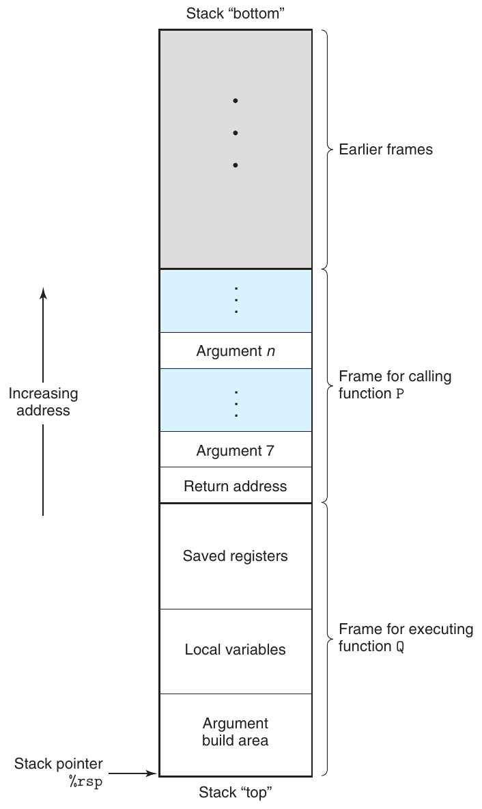

**Hình 3.25 Cấu trúc stack frame tổng quát. Stack có thể được sử dụng để truyền argument, lưu thông tin trả về, lưu register và lưu trữ cục bộ. Có thể bỏ qua những phần không cần thiết.**

Để sử dụng không gian và thời gian hiệu quả, các procedure x86-64 chỉ cấp phát những phần stack frame mà chúng cần. Ví dụ, nhiều procedure có không quá sáu argument, nên tất cả parameter đều có thể được truyền trong register. Vì vậy, có thể bỏ qua một số phần stack frame được vẽ trong Hình 3.25. Thực tế, nhiều function thậm chí không cần stack frame. Điều này xảy ra khi tất cả các biến cục bộ có thể được giữ trong register và function không gọi bất kỳ function nào khác (đôi khi được gọi là leaf procedure, liên hệ với cấu trúc cây của các lời gọi procedure). Ví dụ, không function nào chúng ta đã xem xét cho đến nay cần stack frame.

### 3.7.2 Chuyển quyền điều khiển

Việc truyền quyền điều khiển từ function P sang function Q đơn giản là đặt program counter (PC) thành địa chỉ bắt đầu code của Q. Tuy nhiên, sau đó khi Q cần trả về, processor phải lưu được vị trí code mà nó cần tiếp tục thực thi P. Máy x86-64 ghi lại thông tin này bằng cách gọi procedure Q với instruction call Q. Instruction này đẩy một địa chỉ A lên stack và đặt PC về đầu Q. Địa chỉ A được đẩy lên được gọi là return address và được tính bằng địa chỉ của instruction ngay sau instruction call. Instruction tương ứng ret lấy một địa chỉ A ra khỏi stack và đặt PC thành A.

Dạng tổng quát của các instruction call và ret được mô tả như sau:

| Instruction | Mô tả |
|---|---|
| call Label | Gọi procedure |
| call * Operand | Gọi procedure |
| ret | Trả về từ lời gọi |

(Các instruction này được gọi là callq và retq trong output disassembly do chương trình objdump tạo ra. Hậu tố ‘q’ được thêm vào chỉ nhấn mạnh rằng đây là các phiên bản x86-64 của instruction gọi và trả về, chứ không phải IA32. Trong assembly code x86-64, có thể sử dụng hai phiên bản thay thế cho nhau.)

Instruction call có một đích chỉ địa chỉ của instruction nơi procedure được gọi bắt đầu. Giống như jump, lời gọi có thể trực tiếp hoặc gián tiếp. Trong assembly code, đích của lời gọi trực tiếp được cho bằng một label, còn đích của lời gọi gián tiếp được cho bằng ‘*’ theo sau bởi một operand specifier sử dụng một trong các định dạng mô tả trong Hình 3.3.

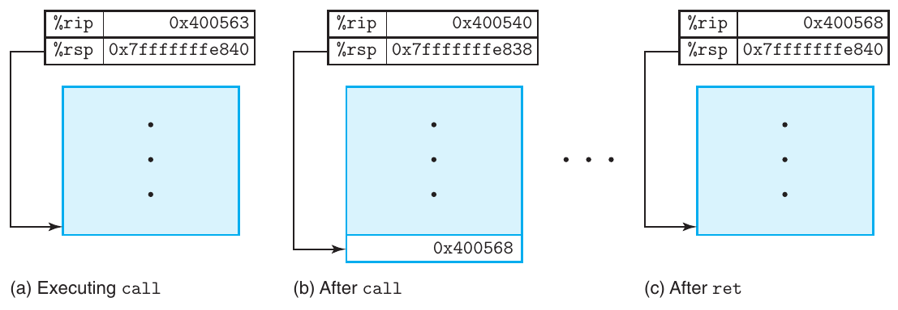

**Hình 3.26 Minh họa chức năng của call và ret. Instruction call chuyển quyền điều khiển đến đầu một function, còn instruction ret quay lại instruction ngay sau call.**

Hình 3.26 minh họa việc thực thi các instruction call và ret cho các function multstore và main được giới thiệu trong Mục 3.2.2. Sau đây là các đoạn trích disassembled code của hai function:

```
     Beginning of function multstore
1   0000000000400540 <multstore>:
2     400540:  53                      push   %rbx
3     400541:  48 89 d3                mov    %rdx,%rbx
     . . .
     Return from function multstore
4     40054d:  c3                      retq
     . . .
     Call to multstore from main
5     400563:  e8 d8 ff ff ff          callq  400540 <multstore>
6     400568:  48 8b 54 24 08          mov    0x8(%rsp),%rdx
```

Trong code này, có thể thấy instruction call tại địa chỉ 0x400563 trong main gọi function multstore. Trạng thái này được thể hiện trong Hình 3.26(a), với các giá trị stack pointer %rsp và program counter %rip được ghi rõ. Tác dụng của call là đẩy return address 0x400568 lên stack và nhảy đến instruction đầu tiên trong function multstore, tại địa chỉ 0x0400540 (3.26(b)). Function multstore tiếp tục thực thi cho đến khi gặp instruction ret tại địa chỉ 0x40054d. Instruction này lấy giá trị 0x400568 ra khỏi stack và nhảy đến địa chỉ đó, tiếp tục thực thi main ngay sau instruction call (3.26(c)).

Để có ví dụ chi tiết hơn về việc truyền quyền điều khiển đến và đi từ procedure, Hình 3.27(a) trình bày disassembled code của hai function top và leaf, cùng phần code trong function main nơi top được gọi. Mỗi instruction được nhận diện bằng các label L1–L2 (trong leaf), T1–T4 (trong top) và M1–M2 trong main. Phần (b) của hình trình bày một trace thực thi code chi tiết, trong đó main gọi top(100), khiến top gọi leaf(95). Function leaf trả về 97 cho top, sau đó top trả về 194 cho main. Ba cột đầu mô tả instruction đang thực thi, bao gồm label, địa chỉ và loại instruction. Bốn cột tiếp theo thể hiện trạng thái chương trình trước khi instruction thực thi, bao gồm nội dung các register %rdi, %rax và %rsp, cùng giá trị tại đỉnh stack. Cần nghiên cứu kỹ nội dung bảng này, vì nó thể hiện vai trò quan trọng của run-time stack trong việc quản lý vùng lưu trữ cần thiết để hỗ trợ gọi và trả về từ procedure.

(a) Disassembled code minh họa gọi và trả về từ procedure

```
      Disassembly of leaf(long y)
      y in %rdi
 1   0000000000400540 <leaf>:
 2     400540:  48 8d 47 02             lea    0x2(%rdi),%rax    L1: z+2
 3     400544:  c3                      retq                     L2: Return

 4   0000000000400545 <top>:
      Disassembly of top(long x)
      x in %rdi
 5     400545:  48 83 ef 05             sub    $0x5,%rdi         T1: x-5
 6     400549:  e8 f2 ff ff ff          callq  400540 <leaf>     T2: Call leaf(x-5)
 7     40054e:  48 01 c0                add    %rax,%rax         T3: Double result
 8     400551:  c3                      retq                     T4: Return

      . . .
        Call to top from function main
 9     40055b:  e8 e5 ff ff ff          callq  400545 <top>      M1: Call top(100)
10     400560:  48 89 c2                mov    %rax,%rdx         M2: Resume
```

(b) Trace thực thi của code ví dụ

|  | Instruction |  |  |  | Giá trị trạng thái (lúc bắt đầu) |  |  |
|---|---|---|---|---|---|---|---|
| Label | PC | Instruction | %rdi | %rax | %rsp | *%rsp | Mô tả |
| M1 | 0x40055b | callq | 100 | — | 0x7fffffffe820 | — | Gọi top(100) |
| T1 | 0x400545 | sub | 100 | — | 0x7fffffffe818 | 0x400560 | Đi vào top |
| T2 | 0x400549 | callq | 95 | — | 0x7fffffffe818 | 0x400560 | Gọi leaf(95) |
| L1 | 0x400540 | lea | 95 | — | 0x7fffffffe810 | 0x40054e | Đi vào leaf |
| L2 | 0x400544 | retq | — | 97 | 0x7fffffffe810 | 0x40054e | Trả về 97 từ leaf |
| T3 | 0x40054e | add | — | 97 | 0x7fffffffe818 | 0x400560 | Tiếp tục top |
| T4 | 0x400551 | retq | — | 194 | 0x7fffffffe818 | 0x400560 | Trả về 194 từ top |
| M2 | 0x400560 | mov | — | 194 | 0x7fffffffe820 | — | Tiếp tục main |

**Hình 3.27 Việc thực thi chi tiết một chương trình có gọi và trả về từ procedure. Sử dụng stack để lưu return address cho phép quay lại đúng vị trí trong các procedure.**

Instruction L1 của leaf đặt %rax thành 97, là giá trị cần trả về. Sau đó, instruction L2 thực hiện trả về. Nó lấy 0x400054e ra khỏi stack. Khi đặt PC thành giá trị vừa lấy ra này, quyền điều khiển chuyển trở lại instruction T3 của top. Chương trình đã hoàn tất lời gọi leaf và quay lại top thành công.

Instruction T3 đặt %rax thành 194, là giá trị cần trả về từ top. Sau đó, instruction T4 thực hiện trả về. Nó lấy 0x4000560 ra khỏi stack, qua đó đặt PC thành instruction M2 của main. Chương trình đã hoàn tất lời gọi top và quay lại main thành công. Chúng ta thấy stack pointer cũng đã được khôi phục về 0x7fffffffe820, là giá trị của nó trước lời gọi top.

Có thể thấy cơ chế đơn giản đẩy return address lên stack này cho phép function sau đó quay lại đúng vị trí trong chương trình. Cơ chế gọi/trả về tiêu chuẩn của C (và hầu hết các ngôn ngữ lập trình) phù hợp một cách thuận tiện với nguyên tắc quản lý bộ nhớ last-in, first-out do stack cung cấp.

#### Bài tập thực hành 3.32 (lời giải trang 375)

Disassembled code của hai function first và last được trình bày dưới đây, cùng với code cho lời gọi first từ function main:

```
      Disassembly of last(long u, long v)
      u in %rdi, v in %rsi
 1   0000000000400540 <last>:
 2     400540:  48 89 f8                mov    %rdi,%rax         L1: u
 3     400543:  48 0f af c6             imul   %rsi,%rax         L2: u*v
 4     400547:  c3                      retq                     L3: Return

      Disassembly of last(long x)
      x in %rdi
 5   0000000000400548 <first>:
 6     400548:  48 8d 77 01             lea    0x1(%rdi),%rsi    F1: x+1
 7     40054c:  48 83 ef 01             sub    $0x1,%rdi         F2: x-1
 8     400550:  e8 eb ff ff ff          callq  400540 <last>     F3: Call last(x-1,x+1)
 9     400555:  f3 c3                   repz retq                F4: Return
       .
       .
       .
10     400560:  e8 e3 ff ff ff          callq  400548 <first>    M1: Call first(10)
11     400565:  48 89 c2                mov    %rax,%rdx         M2: Resume
```

Mỗi instruction này được gán một label, tương tự các label trong Hình 3.27(a). Bắt đầu với việc main gọi first(10), hãy điền bảng sau để theo dõi việc thực thi instruction cho đến khi chương trình quay lại main.

| Instruction | Giá trị trạng thái (lúc bắt đầu) |  |
|---|---|---|
| Label PC Instruction | %rdi %rsi %rax %rsp | *%rsp Mô tả |
| M1 0x400560 callq | 10 — — 0x7fffffffe820 | — Gọi first(10) |
| F1 ______ ______ | ______ ______ ______ ______ | ______ ______ |
| F2 ______ ______ | ______ ______ ______ ______ | ______ ______ |
| F3 ______ ______ | ______ ______ ______ ______ | ______ ______ |
| L1 ______ ______ | ______ ______ ______ ______ | ______ ______ |
| L2 ______ ______ | ______ ______ ______ ______ | ______ ______ |
| L3 ______ ______ | ______ ______ ______ ______ | ______ ______ |
| F4 ______ ______ | ______ ______ ______ ______ | ______ ______ |
| M2 ______ ______ | ______ ______ ______ ______ | ______ ______ |

### 3.7.3 Truyền dữ liệu

Ngoài việc truyền quyền điều khiển đến procedure khi được gọi rồi truyền ngược lại khi procedure trả về, lời gọi procedure có thể truyền dữ liệu dưới dạng argument, và việc trả về từ procedure cũng có thể trả lại một giá trị. Với x86-64, phần lớn dữ liệu truyền đến và đi từ procedure được chuyển qua register. Ví dụ, chúng ta đã thấy nhiều function truyền argument trong các register %rdi, %rsi và các register khác, đồng thời trả giá trị trong register %rax. Khi procedure P gọi procedure Q, code của P trước tiên phải sao chép các argument vào đúng register. Tương tự, khi Q trả về P, code của P có thể truy cập giá trị trả về trong register %rax. Trong mục này, chúng ta tìm hiểu chi tiết hơn các quy ước này.

Với x86-64, tối đa sáu argument thuộc kiểu nguyên (tức số nguyên và pointer) có thể được truyền qua register. Các register được sử dụng theo một thứ tự quy định, với tên register phụ thuộc vào kích thước data type được truyền. Chúng được trình bày trong Hình 3.28. Các argument được phân bổ vào những register này theo thứ tự trong danh sách argument. Có thể truy cập các argument nhỏ hơn 64 bit bằng phần tương ứng của register 64-bit. Ví dụ, nếu argument đầu tiên có 32 bit, có thể truy cập nó bằng %edi.

Số thứ tự argument

| Kích thước operand (bit) | 1 | 2 | 3 | 4 | 5 | 6 |
|---|---|---|---|---|---|---|
| 64 | %rdi | %rsi | %rdx | %rcx | %r8 | %r9 |
| 32 | %edi | %esi | %edx | %ecx | %r8d | %r9d |
| 16 | %di | %si | %dx | %cx | %r8w | %r9w |
| 8 | %dil | %sil | %dl | %cl | %r8b | %r9b |

**Hình 3.28 Các register dùng để truyền argument cho function. Các register được sử dụng theo thứ tự quy định và được gọi tên theo kích thước argument.**

Khi một function có hơn sáu argument thuộc kiểu nguyên, các argument còn lại được truyền trên stack. Giả sử procedure P gọi procedure Q với n argument thuộc kiểu nguyên, trong đó n > 6. Khi đó, code của P phải cấp phát một stack frame có đủ vùng lưu trữ cho các argument từ 7 đến n, như minh họa trong Hình 3.25. Nó sao chép các argument 1–6 vào đúng register và đặt các argument từ 7 đến n lên stack, với argument 7 ở đỉnh stack. Khi truyền parameter trên stack, mọi kích thước dữ liệu đều được làm tròn lên thành bội số của tám. Sau khi các argument đã ở đúng vị trí, chương trình có thể thực thi instruction call để chuyển quyền điều khiển đến procedure Q. Procedure Q có thể truy cập các argument qua register và có thể cả từ stack. Nếu đến lượt Q gọi một function có hơn sáu argument, nó có thể cấp phát không gian cho chúng trong stack frame của mình, như minh họa bằng vùng có nhãn “Argument build area” trong Hình 3.25.

Để có ví dụ về truyền argument, xét function C proc trong Hình 3.29(a). Function này có tám argument, bao gồm các số nguyên có số byte khác nhau (8, 4, 2 và 1), cùng các kiểu pointer khác nhau, mỗi pointer có 8 byte.

Assembly code được sinh ra cho proc được trình bày trong Hình 3.29(b). Sáu argument đầu tiên được truyền trong register. Hai argument cuối được truyền trên stack, như mô tả trong sơ đồ Hình 3.30. Sơ đồ thể hiện trạng thái stack trong khi proc thực thi. Có thể thấy return address được đẩy lên stack như một phần của lời gọi procedure. Vì vậy, hai argument nằm ở các vị trí 8 và 16 tương đối với stack pointer. Trong code, có thể thấy các phiên bản khác nhau của instruction add được sử dụng tùy theo kích thước operand: addq cho a1 (long), addl cho a2 (int), addw cho a3 (short) và addb cho a4 (char). Lưu ý instruction movl ở dòng 6 đọc 4 byte từ bộ nhớ; instruction addb tiếp theo chỉ sử dụng byte low-order.

#### Bài tập thực hành 3.33 (lời giải trang 375)

Một function C procprob có bốn argument u, a, v và b. Mỗi argument là một số signed hoặc một pointer đến số signed, trong đó các số có kích thước khác nhau. Function có phần thân như sau:

```
*u += a;
*v += b;
return sizeof(a) + sizeof(b);
```

Nó được biên dịch thành code x86-64 sau:

```
1   procprob:
2     movslq  %edi, %rdi
3     addq    %rdi, (%rdx)
4     addb    %sil, (%rcx)
```

(a) Code C

```
void proc(long  a1, long  *a1p,
          int   a2, int   *a2p,
          short a3, short *a3p,
          char  a4, char  *a4p)
{
    *a1p += a1;
    *a2p += a2;
    *a3p += a3;
    *a4p += a4;
}
```

(b) Assembly code được sinh ra

```
     void proc(a1, a1p, a2, a2p, a3, a3p, a4, a4p)
     Arguments passed as follows:
      a1   in %rdi          (64 bits)
      a1p in %rsi           (64 bits)
      a2   in %edx          (32 bits)
      a2p in %rcx           (64 bits)
      a3   in %r8w          (16 bits)
      a3p in %r9            (64 bits)
      a4   at %rsp+8        ( 8 bits)
      a4p at %rsp+16        (64 bits)
1    proc:
2      movq     16(%rsp), %rax       Fetch a4p   (64 bits)
3      addq     %rdi, (%rsi)         *a1p += a1  (64 bits)
4      addl     %edx, (%rcx)         *a2p += a2  (32 bits)
5      addw     %r8w, (%r9)          *a3p += a3  (16 bits)
6      movl     8(%rsp), %edx        Fetch a4    ( 8 bits)
7      addb     %dl, (%rax)          *a4p += a4  ( 8 bits)
8      ret                           Return
```

**Hình 3.29 Ví dụ về function có nhiều argument thuộc các kiểu khác nhau. Các argument 1–6 được truyền trong register, còn các argument 7–8 được truyền trên stack.**

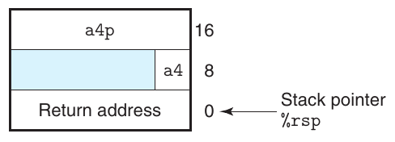

**Hình 3.30 Cấu trúc stack frame của function proc . Các argument a4 và a4p được truyền trên stack.**

```
5     movl    $6, %eax
6     ret
```

Xác định một thứ tự và các kiểu hợp lệ của bốn parameter. Có hai đáp án đúng.

### 3.7.4 Lưu trữ cục bộ trên stack

Hầu hết các ví dụ procedure chúng ta đã thấy cho đến nay không cần vùng lưu trữ cục bộ nào ngoài những gì có thể giữ trong register. Tuy nhiên, đôi khi dữ liệu cục bộ phải được lưu trong bộ nhớ. Các trường hợp phổ biến bao gồm:

- Không có đủ register để giữ toàn bộ dữ liệu cục bộ.

- Toán tử địa chỉ ‘&’ được áp dụng cho một biến cục bộ, nên chúng ta phải có khả năng tạo địa chỉ cho biến đó.

- Một số biến cục bộ là array hoặc structure, do đó phải được truy cập bằng các tham chiếu array hoặc structure. Chúng ta sẽ thảo luận khả năng này khi mô tả cách cấp phát array và structure.

Thông thường, procedure cấp phát không gian trên stack frame bằng cách giảm stack pointer. Việc này tạo ra phần stack frame có nhãn “Local variables” trong Hình 3.25.

Để có ví dụ về cách xử lý toán tử địa chỉ, xét hai function trong Hình 3.31(a). Function swap_add hoán đổi hai giá trị được chỉ định bởi các pointer xp và yp, đồng thời trả về tổng hai giá trị đó. Function caller tạo các pointer đến những biến cục bộ arg1 và arg2 rồi truyền chúng cho swap_add. Hình 3.31(b) trình bày cách caller sử dụng stack frame để triển khai các biến cục bộ này. Code của caller bắt đầu bằng cách giảm stack pointer đi 16; thao tác này thực chất cấp phát 16 byte trên stack. Gọi S là giá trị stack pointer, có thể thấy code tính &arg2 bằng S + 8 (dòng 5), &arg1 bằng S (dòng 6). Vì vậy, có thể suy ra các biến cục bộ arg1 và arg2 được lưu trong stack frame tại các offset 0 và 8 tương đối với stack pointer. Khi lời gọi swap_add hoàn tất, code của caller lấy hai giá trị từ stack (dòng 8–9), tính hiệu của chúng và nhân hiệu này với giá trị do swap_add trả về trong register %rax (dòng 10). Cuối cùng, function giải phóng stack frame bằng cách tăng stack pointer thêm 16 (dòng 11.) Qua ví dụ này, có thể thấy run-time stack cung cấp một cơ chế đơn giản để cấp phát vùng lưu trữ cục bộ khi cần và giải phóng nó khi function hoàn tất.

Là một ví dụ phức tạp hơn, function call_proc trong Hình 3.32 minh họa nhiều khía cạnh của nguyên tắc sử dụng stack x86-64. Mặc dù ví dụ này dài, nó đáng để nghiên cứu kỹ. Nó thể hiện một function phải cấp phát vùng lưu trữ trên stack cho các biến cục bộ, đồng thời truyền giá trị đến function proc có 8-argument (Hình 3.29). Function tạo một stack frame được vẽ trong Hình 3.33.

Xem assembly code của call_proc (Hình 3.32(b)), có thể thấy phần lớn code (dòng 2–15) chuẩn bị cho việc gọi function proc. Việc này bao gồm thiết lập stack frame cho các biến cục bộ và parameter của function, đồng thời nạp argument của function vào register. Như Hình 3.33 cho thấy, các biến cục bộ x1–x4 được cấp phát trên stack và có kích thước khác nhau. Biểu diễn vị trí của chúng bằng offset tương đối với stack pointer, chúng chiếm các byte 24–31 (x1), 20–23 (x2), 18–19 (x3) và 17 (s3). Các pointer đến những vị trí này được tạo bằng instruction leaq (dòng 7, 10, 12 và 14). Các argument 7 (có giá trị 4) và 8 (pointer đến vị trí của x4) được lưu trên stack tại offset 0 và 8 tương đối với stack pointer.

(a) Code cho swap_add và function gọi nó

```
long swap_add(long *xp, long *yp)
{
    long x = *xp;
    long y = *yp;
    *xp = y;
    *yp = x;
    return x + y;
}

long caller()
{
    long arg1 = 534;
    long arg2 = 1057;
    long sum = swap_add(&arg1, &arg2);
    long diff = arg1 - arg2;
    return sum * diff;
}
```

(b) Assembly code được sinh ra cho function gọi

```
     long caller()
 1   caller:
 2     subq    $16, %rsp         Allocate 16 bytes for stack frame
 3     movq    $534, (%rsp)      Store 534 in arg1
 4     movq    $1057, 8(%rsp)    Store 1057 in arg2
 5     leaq    8(%rsp), %rsi     Compute &arg2 as second argument
 6     movq    %rsp, %rdi        Compute &arg1 as first argument
 7     call    swap_add          Call swap_add(&arg1, &arg2)
 8     movq    (%rsp), %rdx      Get arg1
 9     subq    8(%rsp), %rdx     Compute diff = arg1 - arg2
10     imulq   %rdx, %rax        Compute sum * diff
11     addq    $16, %rsp         Deallocate stack frame
12     ret                       Return
```

**Hình 3.31 Ví dụ về định nghĩa và gọi procedure. Code gọi phải cấp phát stack frame do có các toán tử địa chỉ.**

(a) Code C cho function gọi

```
long call_proc()
{
    long  x1 = 1; int  x2 = 2;
    short x3 = 3; char x4 = 4;
    proc(x1, &x1, x2, &x2, x3, &x3, x4, &x4);
    return (x1+x2)*(x3-x4);
}
```

(b) Assembly code được sinh ra

```
     long call_proc()
 1   call_proc:
       Set up arguments to proc
 2     subq    $32, %rsp          Allocate 32-byte stack frame
 3     movq    $1, 24(%rsp)       Store 1 in &x1
 4     movl    $2, 20(%rsp)       Store 2 in &x2
 5     movw    $3, 18(%rsp)       Store 3 in &x3
 6     movb    $4, 17(%rsp)       Store 4 in &x4
 7     leaq    17(%rsp), %rax     Create &x4
 8     movq    %rax, 8(%rsp)      Store &x4 as argument 8
 9     movl    $4, (%rsp)         Store 4 as argument 7
10     leaq    18(%rsp), %r9      Pass &x3 as argument 6
11     movl    $3, %r8d           Pass 3 as argument 5
12     leaq    20(%rsp), %rcx     Pass &x2 as argument 4
13     movl    $2, %edx           Pass 2 as argument 3
14     leaq    24(%rsp), %rsi     Pass &x1 as argument 2
15     movl    $1, %edi           Pass 1 as argument 1
       Call proc
16     call    proc
       Retrieve changes to memory
17     movslq  20(%rsp), %rdx     Get x2 and convert to long
18     addq    24(%rsp), %rdx     Compute x1+x2
19     movswl  18(%rsp), %eax     Get x3 and convert to int
20     movsbl  17(%rsp), %ecx     Get x4 and convert to int
21     subl    %ecx, %eax         Compute x3-x4
22     cltq                       Convert to long
23     imulq   %rdx, %rax         Compute (x1+x2) * (x3-x4)
24     addq    $32, %rsp          Deallocate stack frame
25     ret                        Return
```

**Hình 3.32 Ví dụ code gọi function proc , được định nghĩa trong Hình 3.29. Code này tạo một stack frame.**

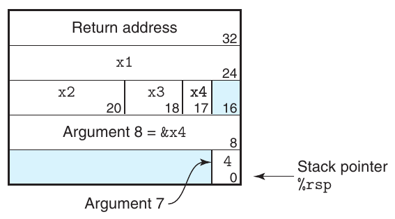

**Hình 3.33 Stack frame của function call_proc . Stack frame chứa các biến cục bộ, cũng như hai argument cần truyền cho function proc .**

Khi procedure proc được gọi, chương trình sẽ bắt đầu thực thi code trong Hình 3.29(b). Như thể hiện trong Hình 3.30, các argument 7 và 8 lúc này nằm ở offset 8 và 16 tương đối với stack pointer, vì return address đã được đẩy lên stack.

Khi chương trình quay lại call_proc, code lấy giá trị của bốn biến cục bộ (dòng 17–20) và thực hiện các phép tính cuối cùng. Nó kết thúc bằng cách tăng stack pointer thêm 32 để giải phóng stack frame.

### 3.7.5 Lưu trữ cục bộ trong register

Tập register của chương trình hoạt động như một tài nguyên chung được chia sẻ bởi tất cả procedure. Mặc dù chỉ một procedure có thể hoạt động tại một thời điểm, chúng ta phải bảo đảm rằng khi một procedure (caller) gọi một procedure khác (callee), callee không ghi đè một giá trị register mà caller dự định sử dụng sau đó. Vì lý do này, x86-64 áp dụng một tập quy ước thống nhất về sử dụng register mà mọi procedure đều phải tuân thủ, bao gồm các procedure trong thư viện chương trình.

Theo quy ước, các register %rbx, %rbp và %r12–%r15 được phân loại là register callee-saved. Khi procedure P gọi procedure Q, Q phải giữ nguyên giá trị của những register này, bảo đảm chúng có cùng giá trị khi Q trả về P như lúc Q được gọi. Procedure Q có thể bảo toàn giá trị register bằng cách hoàn toàn không thay đổi nó, hoặc đẩy giá trị ban đầu lên stack, thay đổi register, rồi lấy giá trị cũ từ stack trước khi trả về. Việc đẩy các giá trị register tạo ra phần stack frame có nhãn “Saved registers” trong Hình 3.25. Với quy ước này, code của P có thể an toàn lưu một giá trị vào register callee-saved (dĩ nhiên, sau khi lưu giá trị trước đó lên stack), gọi Q rồi sử dụng giá trị trong register mà không lo nó bị làm hỏng.

Tất cả register khác, ngoại trừ stack pointer %rsp, được phân loại là register caller-saved. Điều này có nghĩa là chúng có thể bị thay đổi bởi bất kỳ function nào. Có thể hiểu tên “caller saved” trong bối cảnh procedure P có một số dữ liệu cục bộ trong register như vậy và gọi procedure Q. Vì Q được tự do thay đổi register này, P (caller) có trách nhiệm lưu dữ liệu trước khi thực hiện lời gọi.

Ví dụ, xét function P trong Hình 3.34(a). Nó gọi Q hai lần. Trong lời gọi đầu tiên, nó phải giữ lại giá trị x để sử dụng sau đó. Tương tự, trong lời gọi thứ hai, nó phải giữ lại giá trị đã tính cho Q(y). Trong Hình 3.34(b), có thể thấy code do gcc sinh ra sử dụng hai register callee-saved: %rbp giữ x và %rbx giữ giá trị đã tính của Q(y). Khi function bắt đầu, nó lưu giá trị hai register này lên stack (dòng 2–3). Nó sao chép argument x vào %rbp trước lời gọi Q đầu tiên (dòng 5). Nó sao chép kết quả của lời gọi này vào %rbx trước lời gọi Q thứ hai (dòng 8). Ở cuối function (dòng 13– 14), nó khôi phục giá trị hai register callee-saved bằng cách lấy chúng ra khỏi stack. Lưu ý chúng được lấy ra theo thứ tự ngược với thứ tự đẩy vào để phù hợp với nguyên tắc last-in, first-out của stack.

(a) Function gọi

```
long P(long x, long y)
{
    long u = Q(y);
    long v = Q(x);
    return u + v;
}
```

(b) Assembly code được sinh ra cho function gọi

```
     long P(long x, long y)
     x in %rdi, y in %rsi
 1   P:
 2     pushq   %rbp             Save %rbp
 3     pushq   %rbx             Save %rbx
 4     subq    $8, %rsp         Align stack frame
 5     movq    %rdi, %rbp       Save x
 6     movq    %rsi, %rdi       Move y to first argument
 7     call    Q                Call Q(y)
 8     movq    %rax, %rbx       Save result
 9     movq    %rbp, %rdi       Move x to first argument
10     call    Q                Call Q(x)
11     addq    %rbx, %rax       Add saved Q(y) to Q(x)
12     addq    $8, %rsp         Deallocate last part of stack
13     popq    %rbx             Restore %rbx
14     popq    %rbp             Restore %rbp
15     ret
```

**Hình 3.34 Code minh họa việc sử dụng register callee-saved. Giá trị x phải được giữ nguyên trong lời gọi đầu tiên, và giá trị Q(y) phải được giữ nguyên trong lời gọi thứ hai.**

#### Bài tập thực hành 3.34 (lời giải trang 376)

Xét function P tạo ra các giá trị cục bộ có tên a0–a8. Sau đó, nó gọi function Q với các giá trị vừa tạo làm argument. Gcc tạo ra code sau cho phần đầu của P:

```
     long P(long x)
     x in %rdi
 1   P:
 2     pushq   %r15
 3     pushq   %r14
 4     pushq   %r13
 5     pushq   %r12
 6     pushq   %rbp
 7     pushq   %rbx
 8     subq    $24, %rsp
 9     movq    %rdi, %rbx
10     leaq    1(%rdi), %r15
11     leaq    2(%rdi), %r14
12     leaq    3(%rdi), %r13
13     leaq    4(%rdi), %r12
14     leaq    5(%rdi), %rbp
15     leaq    6(%rdi), %rax
16     movq    %rax, (%rsp)
17     leaq    7(%rdi), %rdx
18     movq    %rdx, 8(%rsp)
19     movl    $0, %eax
20     call    Q
          . . .
```

A. Xác định những giá trị cục bộ nào được lưu trong register callee-saved.

B. Xác định những giá trị cục bộ nào được lưu trên stack.

C. Giải thích vì sao chương trình không thể lưu tất cả giá trị cục bộ trong register callee-saved.

### 3.7.6 Procedure đệ quy

Các quy ước sử dụng register và stack mà chúng ta đã mô tả cho phép các procedure x86-64 gọi chính chúng theo cách đệ quy. Mỗi lời gọi procedure có không gian riêng trên stack, nên các biến cục bộ của nhiều lời gọi chưa hoàn tất không ảnh hưởng lẫn nhau. Hơn nữa, nguyên tắc sử dụng stack tự nhiên cung cấp chính sách phù hợp để cấp phát vùng lưu trữ cục bộ khi procedure được gọi và giải phóng nó trước khi trả về.

Hình 3.35 trình bày cả code C lẫn assembly code được sinh ra cho một function tính giai thừa đệ quy. Có thể thấy assembly code sử dụng register %rbx để giữ parameter n, sau khi trước tiên lưu giá trị hiện có lên stack (dòng 2), rồi sau đó khôi phục giá trị trước khi trả về (dòng 11). Nhờ nguyên tắc sử dụng stack và các quy ước register-saving, chúng ta có thể bảo đảm rằng khi lời gọi đệ quy rfact(n-1) trả về (dòng 9), (1) kết quả lời gọi sẽ nằm trong register %rax và (2) giá trị argument n sẽ nằm trong register %rbx. Nhân hai giá trị này sẽ tính được kết quả mong muốn.

(a) Code C

```
long rfact(long n)
{
    long result;
    if (n <= 1)
        result = 1;
    else
        result = n * rfact(n-1);
    return result;
}
```

(b) Assembly code được sinh ra

```
     long rfact(long n)
     n in %rdi
 1   rfact:
 2     pushq   %rbx               Save %rbx
 3     movq    %rdi, %rbx         Store n in callee-saved register
 4     movl    $1, %eax           Set return value = 1
 5     cmpq    $1, %rdi           Compare n:1
 6     jle     .L35               If <=, goto done
 7     leaq    -1(%rdi), %rdi     Compute n-1
 8     call    rfact              Call rfact(n-1)
 9     imulq   %rbx, %rax         Multiply result by n
10   .L35:                       done:
11     popq    %rbx               Restore %rbx
12     ret                        Return
```

**Hình 3.35 Code cho chương trình tính giai thừa đệ quy. Các cơ chế xử lý procedure tiêu chuẩn là đủ để triển khai function đệ quy.**

Qua ví dụ này, có thể thấy việc gọi function đệ quy diễn ra giống như bất kỳ lời gọi function nào khác. Nguyên tắc sử dụng stack cung cấp cơ chế để mỗi lần gọi function có vùng lưu trữ riêng cho thông tin trạng thái (các giá trị đã lưu của vị trí trả về và các register callee-saved). Nếu cần, nó cũng có thể cung cấp vùng lưu trữ cho biến cục bộ. Nguyên tắc cấp phát và giải phóng trên stack tự nhiên khớp với thứ tự call-return của các function. Phương pháp triển khai gọi và trả về từ function này thậm chí hoạt động với các mẫu phức tạp hơn, bao gồm đệ quy tương hỗ (ví dụ, procedure P gọi Q, rồi Q lại gọi P).

#### Bài tập thực hành 3.35 (lời giải trang 376)

Với một function C có cấu trúc tổng quát

```
long rfun(unsigned long x) {
    if ( ______ )
        return ______;
    unsigned long nx = ______;
    long rv = rfun(nx);
    return ______;
}
```

gcc sinh ra assembly code sau:

```
     long rfun(unsigned long x)
     x in %rdi
 1   rfun:
 2     pushq   %rbx
 3     movq    %rdi, %rbx
 4     movl    $0, %eax
 5     testq   %rdi, %rdi
 6     je      .L2
 7     shrq    $2, %rdi
 8     call    rfun
 9     addq    %rbx, %rax
10   .L2:
11     popq    %rbx
12     ret
```

A. rfun lưu giá trị nào trong register callee-saved %rbx?

B. Điền các biểu thức còn thiếu trong code C ở trên.

## 3.8 Cấp phát và truy cập array

Array trong C là một cách tổng hợp dữ liệu scalar thành các data type lớn hơn. C sử dụng cách triển khai array đặc biệt đơn giản, nên việc chuyển sang machine code khá trực tiếp. Một đặc điểm khác thường của C là chúng ta có thể tạo các pointer đến phần tử trong array và thực hiện phép toán số học trên các pointer này. Những thao tác đó được chuyển thành các phép tính địa chỉ trong machine code.

Các compiler tối ưu hóa đặc biệt giỏi đơn giản hóa những phép tính địa chỉ dùng khi đánh chỉ số array. Điều này có thể khiến sự tương ứng giữa code C và bản chuyển đổi thành machine code của nó hơi khó giải mã.

### 3.8.1 Các nguyên tắc cơ bản

Với data type T và hằng số nguyên N , xét khai báo dạng

```
T A[N];
```

Gọi vị trí bắt đầu là x<sub>A</sub>. Khai báo có hai tác dụng. Thứ nhất, nó cấp phát một vùng liên tục gồm L · N byte trong bộ nhớ, trong đó L là kích thước (tính bằng byte) của data type T . Thứ hai, nó giới thiệu một identifier A có thể được sử dụng như pointer đến đầu array. Giá trị pointer này là x<sub>A</sub>. Có thể truy cập các phần tử array bằng chỉ số nguyên từ 0 đến N −1. Phần tử array i sẽ được lưu tại địa chỉ x<sub>A</sub> + L · i.

Ví dụ, xét các khai báo sau:

```
char    A[12];
char   *B[8];
int     C[6];
double *D[5];
```

Các khai báo này sẽ tạo các array với những parameter sau:

| Array | Kích thước phần tử | Tổng kích thước | Địa chỉ bắt đầu | Phần tử i |
|---|---|---|---|---|
| A | 1 | 12 | x<sub>A</sub> | x<sub>A</sub> + i |
| B | 8 | 64 | x<sub>B</sub> | x<sub>B</sub> + 8i |
| C | 4 | 24 | x<sub>C</sub> | x<sub>C</sub> + 4i |
| D | 8 | 40 | x<sub>D</sub> | x<sub>D</sub> + 8i |

Array A gồm 12 phần tử single-byte (char). Array C gồm 6 số nguyên, mỗi số cần 4 byte. B và D đều là array các pointer, nên mỗi phần tử array có 8 byte.

Các instruction tham chiếu bộ nhớ của x86-64 được thiết kế để đơn giản hóa việc truy cập array. Ví dụ, giả sử E là array các giá trị kiểu int và chúng ta muốn tính E[i], trong đó địa chỉ E được lưu trong register %rdx và i được lưu trong register %rcx. Khi đó, instruction

```
movl (%rdx,%rcx,4),%eax
```

sẽ thực hiện phép tính địa chỉ x<sub>E</sub> + 4i, đọc vị trí bộ nhớ đó và sao chép kết quả vào register %eax. Các hệ số tỷ lệ được phép là 1, 2, 4 và 8 bao phủ kích thước của những primitive data type thông dụng.

#### Bài tập thực hành 3.36 (lời giải trang 377)

Xét các khai báo sau:

```
int    P[5];
short  Q[2];
int    **R[9];
double *S[10];
short  *T[2];
```

Điền bảng sau để mô tả kích thước phần tử, tổng kích thước và địa chỉ phần tử i cho từng array này.

| Array | Kích thước phần tử | Tổng kích thước | Địa chỉ bắt đầu | Phần tử i |
|---|---|---|---|---|
| P | ______ | ______ | x<sub>P</sub> | ______ |
| Q | ______ | ______ | x<sub>Q</sub> | ______ |
| R | ______ | ______ | x<sub>R</sub> | ______ |
| S | ______ | ______ | x<sub>S</sub> | ______ |
| T | ______ | ______ | x<sub>T</sub> | ______ |

### 3.8.2 Số học pointer

C cho phép thực hiện số học trên pointer, trong đó giá trị tính được được nhân tỷ lệ theo kích thước data type mà pointer tham chiếu đến. Nghĩa là nếu p là pointer đến dữ liệu kiểu T và giá trị p là x<sub>p</sub>, thì biểu thức p+i có giá trị x<sub>p</sub> + L · i, trong đó L là kích thước data type T .

Các toán tử một ngôi ‘&’ và ‘*’ cho phép tạo và dereference pointer. Nghĩa là với một biểu thức Expr biểu thị một đối tượng, &Expr là pointer cho biết địa chỉ của đối tượng đó. Với một biểu thức AExpr biểu thị địa chỉ, *AExpr cho biết giá trị tại địa chỉ đó. Vì vậy, các biểu thức Expr và *&Expr tương đương nhau. Thao tác đánh chỉ số array có thể được áp dụng cho cả array lẫn pointer. Tham chiếu array A[i] giống hệt biểu thức *(A+i). Nó tính địa chỉ phần tử array thứ i, rồi truy cập vị trí bộ nhớ này.

Mở rộng ví dụ trước, giả sử địa chỉ bắt đầu của array số nguyên E và chỉ số nguyên i lần lượt được lưu trong các register %rdx và %rcx. Sau đây là một số biểu thức liên quan đến E. Chúng ta cũng trình bày cách triển khai assembly-code cho mỗi biểu thức, với kết quả được lưu trong register %eax (cho dữ liệu) hoặc register %rax (cho pointer).

| Biểu thức | Kiểu | Giá trị | Assembly code |
|---|---|---|---|
| E | int * | x<sub>E</sub> | movl %rdx,%rax |
| E[0] | int | M[x<sub>E</sub>] | movl (%rdx),%eax |
| E[i] | int | M[x<sub>E</sub> + 4i] | movl (%rdx,%rcx,4),%eax |
| &E[2] | int * | x<sub>E</sub> + 8 | leaq 8(%rdx),%rax |
| E+i-1 | int * | x<sub>E</sub> + 4i − 4 | leaq -4(%rdx,%rcx,4),%rax |
| *(E+i-3) | int | M[x<sub>E</sub> + 4i − 12] | movl -12(%rdx,%rcx,4),%eax |
| &E[i]-E | long | i | movq %rcx,%rax |

Trong các ví dụ này, có thể thấy các phép toán trả về giá trị array có kiểu int, do đó sử dụng các phép toán 4-byte (ví dụ, movl) và register (ví dụ, %eax). Các phép toán trả về pointer có kiểu int *, do đó sử dụng các phép toán 8-byte (ví dụ, leaq) và register (ví dụ, %rax). Ví dụ cuối cho thấy có thể tính hiệu của hai pointer trong cùng một cấu trúc dữ liệu, với kết quả là dữ liệu kiểu long có giá trị bằng hiệu của hai địa chỉ chia cho kích thước data type.

#### Bài tập thực hành 3.37 (lời giải trang 377)

Giả sử x<sub>P</sub>, địa chỉ của array số nguyên short P, và chỉ số nguyên long i lần lượt được lưu trong các register %rdx và %rcx. Với mỗi biểu thức sau, hãy cho biết kiểu của nó, công thức tính giá trị và cách triển khai assembly-code. Kết quả phải được lưu trong register %rax nếu nó là pointer và trong phần register %ax nếu có data type short.

| Biểu thức | Kiểu | Giá trị | Assembly code |
|---|---|---|---|
| P[1] | ______ | ______ | ______ |
| P + 3 + i | ______ | ______ | ______ |
| P[i * 6 - 5] | ______ | ______ | ______ |
| P[2] | ______ | ______ | ______ |
| &P[i + 2] | ______ | ______ | ______ |

### 3.8.3 Array lồng nhau

Các nguyên tắc tổng quát về cấp phát và tham chiếu array vẫn đúng ngay cả khi tạo array gồm các array. Ví dụ, khai báo

```
int A[5][3];
```

tương đương với khai báo

```
typedef int row3_t[3];
row3_t A[5];
```

Data type row3_t được định nghĩa là một array gồm ba số nguyên. Array A chứa năm phần tử như vậy, mỗi phần tử cần 12 byte để lưu ba số nguyên. Vì vậy, tổng kích thước array là 4 · 5 · 3 = 60 byte.

Array A cũng có thể được xem là array two-dimensional gồm năm hàng và ba cột, được tham chiếu từ A[0][0] đến A[4][2]. Các phần tử array được sắp xếp trong bộ nhớ theo thứ tự row-major, nghĩa là tất cả phần tử của hàng 0, có thể viết là A[0], được theo sau bởi tất cả phần tử của hàng 1 (A[1]), v.v. Điều này được minh họa trong Hình 3.36.

Thứ tự này là hệ quả của khai báo lồng nhau. Xem A như array gồm năm phần tử, mỗi phần tử là array gồm ba int, trước hết chúng ta có A[0], tiếp theo là A[1], v.v.

Để truy cập các phần tử array đa chiều, compiler sinh code tính offset của phần tử mong muốn, rồi sử dụng một trong các instruction mov với đầu array làm base address và offset (có thể được nhân tỷ lệ) làm chỉ số. Nói chung, với array được khai báo là

```
T D[R][C];
```

phần tử array D[i][j] nằm tại địa chỉ bộ nhớ

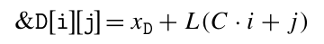 (3.1)

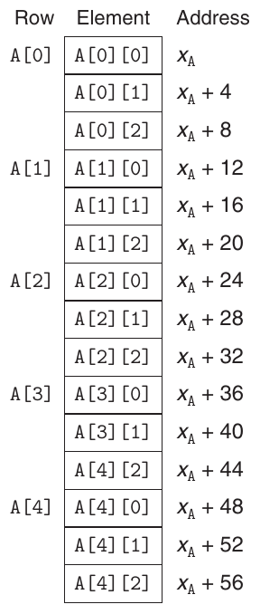

**Hình 3.36 Các phần tử array theo thứ tự row-major.**

trong đó L là kích thước data type T tính bằng byte. Ví dụ, xét array số nguyên A có kích thước 5 × 3 đã định nghĩa trước đó. Giả sử x<sub>A</sub>, i và j lần lượt nằm trong các register %rdi, %rsi và %rdx. Khi đó, có thể sao chép phần tử array A[i][j] vào register %eax bằng code sau:

<pre>    A in %rdi, i in %rsi, and j in %rdx
1     leaq    (%rsi,%rsi,2), %rax     Compute 3i
2     leaq    (%rdi,%rax,4), %rax     Compute x<sub>A</sub> + 12i
3     movl    (%rax,%rdx,4), %eax     Read from M[x<sub>A</sub> + 12i + 4]</pre>

Có thể thấy code này tính địa chỉ phần tử là x<sub>A</sub> + 12i + 4j = x<sub>A</sub> + 4(3i + j ) bằng khả năng nhân tỷ lệ và cộng của số học địa chỉ x86-64.

#### Bài tập thực hành 3.38 (lời giải trang 377)

Xét source code sau, trong đó M và N là các hằng số được khai báo bằng #define:

```
long P[M][N];
long Q[N][M];

long sum_element(long i, long j) {
    return P[i][j] + Q[j][i];
}
```

Khi biên dịch chương trình này, gcc sinh ra assembly code sau:

```
    long sum_element(long i, long j)
    i in %rdi, j in %rsi
1   sum_element:
2     leaq    0(,%rdi,8), %rdx
3     subq    %rdi, %rdx
4     addq    %rsi, %rdx
5     leaq    (%rsi,%rsi,4), %rax
6     addq    %rax, %rdi
7     movq    Q(,%rdi,8), %rax
8     addq    P(,%rdx,8), %rax
9     ret
```

Sử dụng kỹ năng reverse engineering để xác định các giá trị M và N dựa trên assembly code này.

### 3.8.4 Array Fixed-Size

Compiler C có thể thực hiện nhiều tối ưu hóa cho code thao tác trên array đa chiều có kích thước cố định. Ở đây, chúng ta minh họa một số tối ưu hóa do gcc thực hiện khi mức tối ưu hóa được đặt bằng flag -O1. Giả sử chúng ta khai báo data type fix_matrix là array số nguyên 16 × 16 như sau:

```
#define N 16
typedef int fix_matrix[N][N];
```

(Ví dụ này minh họa một thói quen viết code tốt. Bất cứ khi nào chương trình sử dụng một hằng số làm kích thước chiều của array hoặc kích thước buffer, tốt nhất nên gán cho nó một tên thông qua khai báo #define, rồi sử dụng tên này nhất quán thay cho giá trị số. Như vậy, nếu cần thay đổi giá trị, chỉ cần sửa khai báo #define.) Code trong Hình 3.37(a) tính phần tử i, k của tích các array A và B—tức tích vô hướng của hàng i từ A và cột k từ B. Tích này được cho bởi công thức ∑<sub>0≤j <N</sub> a<sub>i,j</sub> · b<sub>j,k</sub>. Gcc sinh ra code mà sau đó chúng ta viết lại thành C, được trình bày dưới dạng function fix_prod_ele_opt trong Hình 3.37(b). Code này chứa một số tối ưu hóa khéo léo. Nó loại bỏ chỉ số nguyên j và chuyển mọi tham chiếu array thành dereference pointer. Việc này bao gồm (1) tạo một pointer được đặt tên là Aptr, trỏ đến các phần tử liên tiếp trong hàng i của A, (2) tạo một pointer được đặt tên là Bptr, trỏ đến các phần tử liên tiếp trong cột k của B và (3) tạo một pointer được đặt tên là Bend, bằng giá trị mà Bptr sẽ có khi cần kết thúc vòng lặp. Giá trị ban đầu của Aptr là địa chỉ phần tử đầu tiên của hàng i của A, được cho bởi biểu thức C &A[i][0]. Giá trị ban đầu của Bptr là địa chỉ phần tử đầu tiên của cột k của B, được cho bởi biểu thức C &B[0][k]. Giá trị Bend là chỉ số của vị trí sẽ là phần tử thứ (n + 1) trong cột j của B, được cho bởi biểu thức C &B[N][k].

(a) Code C ban đầu

```
/* Compute i,k of fixed matrix product */
int fix_prod_ele (fix_matrix A, fix_matrix B, long i, long k) {
    long j;
    int result = 0;

    for (j = 0; j < N; j++)
        result += A[i][j] * B[j][k];

    return result;
}
```

(b) Code C đã tối ưu hóa

```
 1   /* Compute i,k of fixed matrix product */
 2   int fix_prod_ele_opt(fix_matrix A, fix_matrix B, long i, long k) {
 3       int *Aptr = &A[i][0];    /* Points to elements in row i of A    */
 4       int *Bptr = &B[0][k];    /* Points to elements in column k of B */
 5       int *Bend = &B[N][k];    /* Marks stopping point for Bptr       */
 6       int result = 0;
 7       do {                          /* No need for initial test */
 8           result += *Aptr * *Bptr;  /* Add next product to sum  */
 9           Aptr ++;                  /* Move Aptr to next column */
10           Bptr += N;                /* Move Bptr to next row    */
11       } while (Bptr != Bend);       /* Test for stopping point  */
12       return result;
13   }
```

**Hình 3.37 Code ban đầu và code đã tối ưu hóa để tính phần tử i, k của tích ma trận cho các array fixed-length. Compiler tự động thực hiện những tối ưu hóa này.**

Sau đây là assembly code thực tế do gcc sinh ra cho function fix_prod_ele. Có thể thấy bốn register được sử dụng như sau: %eax giữ result, %rdi giữ Aptr, %rcx giữ Bptr và %rsi giữ Bend.

<pre>     int fix_prod_ele_opt(fix_matrix A, fix_matrix B, long i, long k)
     A in %rdi, B in %rsi, i in %rdx, k in %rcx
 1   fix_prod_ele:
 2     salq    $6, %rdx              Compute 64 * i
 3     addq    %rdx, %rdi            Compute Aptr = x<sub>A</sub> + 64i = &amp;A[i][0]
 4     leaq    (%rsi,%rcx,4), %rcx   Compute Bptr = x<sub>B</sub> + 4k = &amp;B[0][k]
 5     leaq    1024(%rcx), %rsi      Compute Bend = x<sub>B</sub> + 4k + 1024 = &amp;B[N][k]
 6     movl    $0, %eax              Set result = 0
 7   .L7:                          loop:
 8     movl    (%rdi), %edx          Read *Aptr
 9     imull   (%rcx), %edx          Multiply by *Bptr
10     addl    %edx, %eax            Add to result
            11     addq    $4, %rdi              Increment Aptr ++
            12     addq    $64, %rcx             Increment Bptr += N
            13     cmpq    %rsi, %rcx            Compare Bptr:Bend
            14     jne     .L7                   If !=, goto loop
            15     rep; ret                      Return</pre>

#### Bài tập thực hành 3.39 (lời giải trang 378)

Sử dụng Phương trình 3.1 để giải thích cách các phép tính giá trị ban đầu của Aptr, Bptr và Bend trong code C của Hình 3.37(b) (dòng 3–5) mô tả đúng những phép tính tương ứng trong assembly code được sinh ra cho fix_prod_ele (dòng 3–5).

#### Bài tập thực hành 3.40 (lời giải trang 378)

Code C sau đặt các phần tử đường chéo của một trong các array fixed-size thành val:

```
/* Set all diagonal elements to val */
void fix_set_diag(fix_matrix A, int val) {
    long i;
    for (i = 0; i < N; i++)
        A[i][i] = val;
}
```

Khi được biên dịch với mức tối ưu hóa -O1, gcc sinh ra assembly code sau:

```
1   fix_set_diag:
    void fix_set_diag(fix_matrix A, int val)
    A in %rdi, val in %rsi
2     movl    $0, %eax
3   .L13:
4     movl    %esi, (%rdi,%rax)
5     addq    $68, %rax
6     cmpq    $1088, %rax
7     jne     .L13
8     rep; ret
```

Tạo một chương trình code C fix_set_diag_opt sử dụng các tối ưu hóa tương tự assembly code, theo cùng phong cách với code trong Hình 3.37(b). Sử dụng các biểu thức có parameter N thay vì hằng số nguyên để code vẫn hoạt động đúng nếu N được định nghĩa lại.

### 3.8.5 Array Variable-Size

Trước đây, C chỉ hỗ trợ array đa chiều có kích thước (có thể ngoại trừ chiều đầu tiên) xác định được tại thời điểm biên dịch. Các lập trình viên cần array variable-size phải cấp phát vùng lưu trữ cho những array này bằng các function như malloc hoặc calloc, đồng thời phải mã hóa tường minh ánh xạ từ array đa chiều sang array single-dimension thông qua đánh chỉ số row-major, như thể hiện trong Phương trình 3.1. ISO C99 giới thiệu khả năng sử dụng các biểu thức kích thước chiều của array được tính khi array đang được cấp phát.

Trong phiên bản array variable-size của C, chúng ta có thể khai báo array

```
int A[expr1][expr2]
```

dưới dạng biến cục bộ hoặc argument của function, rồi kích thước các chiều của array được xác định bằng cách tính các biểu thức expr1 và expr2 tại thời điểm gặp khai báo. Vì vậy, chẳng hạn chúng ta có thể viết function truy cập phần tử i, j của array n × n như sau:

```
int var_ele(long n, int A[n][n], long i, long j) {
    return A[i][j];
}
```

Parameter n phải đứng trước parameter A[n][n] để function có thể tính kích thước các chiều của array khi gặp parameter này.

Gcc sinh code cho function tham chiếu này như sau

<pre>    int var_ele(long n, int A[n][n], long i, long j)
    n in %rdi, A in %rsi, i in %rdx, j in %rcx
1   var_ele:
2     imulq   %rdx, %rdi                Compute n · i
3     leaq    (%rsi,%rdi,4), %rax       Compute x<sub>A</sub> + 4(n · i
4     movl    (%rax,%rcx,4), %eax       Read from M[x<sub>A</sub> + 4(n · i) + 4j]
5     ret</pre>

Như các chú thích cho thấy, code này tính địa chỉ phần tử i, j là x<sub>A</sub> + 4(n · i) + 4j = x<sub>A</sub> + 4(n · i + j ). Phép tính địa chỉ tương tự array fixed-size (Mục 3.8.3), ngoại trừ (1) việc sử dụng register thay đổi do có thêm parameter n và (2) một instruction nhân được sử dụng (dòng 2) để tính n · i, thay cho instruction leaq tính 3i. Vì vậy, có thể thấy việc tham chiếu array variable-size chỉ cần mở rộng một chút so với array fixed-size. Phiên bản động phải dùng instruction nhân để nhân i với n, thay vì một chuỗi phép dịch và cộng. Trên một số processor, phép nhân này có thể làm giảm hiệu năng đáng kể, nhưng trong trường hợp này không thể tránh được.

Khi các array variable-size được tham chiếu trong vòng lặp, compiler thường có thể tối ưu hóa các phép tính chỉ số bằng cách tận dụng tính đều đặn của mẫu truy cập. Ví dụ, Hình 3.38(a) trình bày code C tính phần tử i, k của tích hai array n × n là A và B. Gcc sinh assembly code mà chúng ta đã chuyển lại thành C (Hình 3.38(b)). Code này theo phong cách khác với code tối ưu hóa cho array fixed-size (Hình 3.37), nhưng điều đó chủ yếu là hệ quả của những lựa chọn do compiler thực hiện, thay vì là yêu cầu cơ bản của hai function khác nhau. Code trong Hình 3.38(b) giữ lại biến vòng lặp j, vừa để phát hiện khi vòng lặp kết thúc, vừa để đánh chỉ số vào array gồm các phần tử của hàng i của A.

(a) Code C ban đầu

```
 1   /* Compute i,k of variable matrix product */
 2   int var_prod_ele(long n, int A[n][n], int B[n][n], long i, long k) {
 3       long j;
 4       int result = 0;
 5
 6       for (j = 0; j < n; j++)
 7           result += A[i][j] * B[j][k];
 8
 9       return result;
10   }
```

(b) Code C đã tối ưu hóa

```
/* Compute i,k of variable matrix product */
int var_prod_ele_opt(long n, int A[n][n], int B[n][n], long i, long k) {
    int *Arow = A[i];
    int *Bptr = &B[0][k];
    int result = 0;
    long j;
    for (j = 0; j < n; j++) {
        result += Arow[j] * *Bptr;
        Bptr += n;
    }
    return result;
}
```

**Hình 3.38 Code ban đầu và code đã tối ưu hóa để tính phần tử i, k của tích ma trận cho các array variable-size. Compiler tự động thực hiện những tối ưu hóa này.**

Sau đây là assembly code cho vòng lặp của var_prod_ele:

```
    Registers: n in %rdi, Arow in %rsi, Bptr in %rcx
              4n in %r9, result in %eax, j in %edx
1   .L24:                               loop:
2     movl    (%rsi,%rdx,4), %r8d         Read Arow[j]
3     imull   (%rcx), %r8d                Multiply by *Bptr
4     addl    %r8d, %eax                  Add to result
5     addq    $1, %rdx                    j++
6     addq    %r9, %rcx                   Bptr += n
7     cmpq    %rdi, %rdx                  Compare j:n
8     jne     .L24                        If !=, goto loop
```

Có thể thấy chương trình sử dụng cả giá trị đã nhân tỷ lệ 4n (register %r9) để tăng Bptr lẫn giá trị n (register %rdi) để kiểm tra giới hạn vòng lặp. Nhu cầu dùng hai giá trị không thể hiện trong code C do phép nhân tỷ lệ của số học pointer.

Chúng ta đã thấy rằng khi bật tối ưu hóa, gcc có thể nhận diện các mẫu xuất hiện khi chương trình đi qua các phần tử của array đa chiều. Sau đó, nó có thể sinh code tránh phép nhân vốn sẽ xuất hiện nếu áp dụng trực tiếp Phương trình 3.1. Dù sinh code pointer-based của Hình 3.37(b) hay code array-based của Hình 3.38(b), các tối ưu hóa này đều cải thiện đáng kể hiệu năng chương trình.

## 3.9 Cấu trúc dữ liệu không đồng nhất

C cung cấp hai cơ chế tạo data type bằng cách kết hợp những đối tượng thuộc các kiểu khác nhau: structure, được khai báo bằng keyword struct, tổng hợp nhiều đối tượng thành một đơn vị; union, được khai báo bằng keyword union, cho phép tham chiếu một đối tượng bằng nhiều kiểu khác nhau.

### 3.9.1 Structure

Khai báo struct trong C tạo một data type nhóm các đối tượng có thể khác kiểu thành một đối tượng duy nhất. Các thành phần khác nhau của structure được tham chiếu bằng tên. Cách triển khai structure giống array ở chỗ tất cả thành phần của structure đều được lưu trong một vùng bộ nhớ liên tục, và pointer đến structure là địa chỉ byte đầu tiên của nó. Compiler duy trì thông tin về mỗi kiểu structure, chỉ ra byte offset của từng field. Nó sinh các tham chiếu đến phần tử structure bằng cách sử dụng những offset này làm displacement trong các instruction tham chiếu bộ nhớ.

Ví dụ, xét khai báo structure sau:

```
struct rec {
    int i;
    int j;
    int a[2];
    int *p;
};
```

Structure này chứa bốn field: hai giá trị 4-byte kiểu int, một array two-element kiểu int và một pointer số nguyên 8-byte, tổng cộng 24 byte:

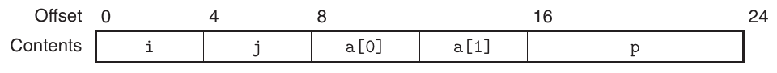

Lưu ý array a được nhúng trong structure. Các số phía trên sơ đồ cho biết byte offset của các field tính từ đầu structure.

Để truy cập các field của structure, compiler sinh code cộng offset phù hợp vào địa chỉ structure. Ví dụ, giả sử biến r kiểu struct rec * nằm trong register %rdi. Khi đó, code sau sao chép phần tử r->i sang phần tử r->j:

#### Mới học C? Biểu diễn một đối tượng dưới dạng struct

Bộ tạo data type struct là thứ gần với đối tượng của C++ và Java nhất mà C cung cấp. Nó cho phép lập trình viên giữ thông tin về một thực thể trong một cấu trúc dữ liệu duy nhất và tham chiếu thông tin đó bằng tên.

Ví dụ, một chương trình đồ họa có thể biểu diễn hình chữ nhật bằng structure:

```
struct rect {
    long llx;         /* X coordinate of lower-left corner */
    long lly;         /* Y coordinate of lower-left corner */
    unsigned long width;  /* Width (in pixels)                 */
    unsigned long height; /* Height (in pixels)                */
    unsigned color;       /* Coding of color                   */
};
```

Chúng ta có thể khai báo biến r kiểu struct rect và đặt giá trị các field của nó như sau:

```
struct rect r;
r.llx = r.lly = 0;
r.color = 0xFF00FF;
r.width = 10;
r.height = 20;
```

trong đó biểu thức r.llx chọn field llx của structure r.

Ngoài ra, chúng ta có thể vừa khai báo biến vừa khởi tạo các field bằng một câu lệnh duy nhất:

```
struct rect r = { 0, 0, 0xFF00FF, 10, 20 };
```

Người ta thường truyền pointer đến structure từ nơi này sang nơi khác thay vì sao chép structure. Ví dụ, function sau tính diện tích hình chữ nhật, trong đó một pointer đến struct hình chữ nhật được truyền cho function:

```
long area(struct rect *rp) {
    return (*rp).width * (*rp).height;
}
```

Biểu thức (*rp).width dereference pointer và chọn field width của structure nhận được. Cần có dấu ngoặc đơn vì compiler sẽ diễn giải biểu thức *rp.width thành *(rp.width), vốn không hợp lệ. Sự kết hợp giữa dereference và chọn field phổ biến đến mức C cung cấp một ký pháp thay thế bằng ->. Nghĩa là rp->width tương đương biểu thức (*rp).width. Ví dụ, chúng ta có thể viết một function xoay hình chữ nhật ngược chiều kim đồng hồ 90 độ như sau

```
void rotate_left(struct rect *rp) {
    /* Exchange width and height */
    long t = rp->height;
    rp->height = rp->width;
    rp->width  = t;
    /* Shift to new lower-left corner */
    rp->llx   -= t;
}
```

#### Mới học C? Biểu diễn một đối tượng dưới dạng struct (tiếp theo)

Các đối tượng của C++ và Java phức tạp hơn structure trong C ở chỗ chúng còn gắn một tập method với đối tượng để có thể gọi thực hiện tính toán. Trong C, chúng ta đơn giản viết chúng thành các function thông thường, chẳng hạn các function area và rotate_left đã trình bày trước đó.

```
      Registers: r in %rdi
1     movl    (%rdi), %eax         Get r->i
2     movl    %eax, 4(%rdi)        Store in r->j
```

Vì offset của field i là 0, địa chỉ field này đơn giản là giá trị của r. Để lưu vào field j, code cộng offset 4 vào địa chỉ r.

Để tạo pointer đến một đối tượng trong structure, chúng ta chỉ cần cộng offset của field vào địa chỉ structure. Ví dụ, có thể tạo pointer &(r->a[1]) bằng cách cộng offset 8 + 4 · 1 = 12. Với pointer r trong register %rdi và biến số nguyên long i trong register %rsi, chúng ta có thể tạo giá trị pointer &(r->a[i]) bằng một instruction duy nhất

```
      Registers: r in %rdi, i %rsi
1     leaq    8(%rdi,%rsi,4), %rax    Set %rax to &r->a[i]
```

Là ví dụ cuối cùng, code sau triển khai câu lệnh

```
r->p = &r->a[r->i + r->j];
```

bắt đầu với r trong register %rdi:

```
      Registers: r in %rdi
1     movl    4(%rdi), %eax             Get r->j
2     addl    (%rdi), %eax              Add r->i
3     cltq                              Extend to 8 bytes
4     leaq    8(%rdi,%rax,4), %rax      Compute &r->a[r->i + r->j]
5     movq    %rax, 16(%rdi)            Store in r->p
```

Như các ví dụ cho thấy, việc chọn các field khác nhau của structure được xử lý hoàn toàn tại thời điểm biên dịch. Machine code không chứa thông tin về khai báo field hoặc tên các field.

#### Bài tập thực hành 3.41 (lời giải trang 379)

Xét khai báo structure sau:

```
struct test {
    short *p;
    struct {
        short x;
        short y;
    } s;
    struct test *next;
};
```

Khai báo này minh họa rằng một structure có thể được nhúng trong structure khác, giống như array có thể được nhúng trong structure và array có thể được nhúng trong array.

Procedure sau (đã bỏ một số biểu thức) thao tác trên structure này:

```
void st_init(struct test *st) {
    st->s.y  = ______;
    st->p    = ______;
    st->next = ______;
}
```

A. Offset (tính bằng byte) của các field sau là bao nhiêu?

| p : | ______ |
|---|---|
| s.x : | ______ |
| s.y : | ______ |
| next: | ______ |

B. Structure cần tổng cộng bao nhiêu byte?

C. Compiler sinh ra assembly code sau cho st_init:

```
    void st_init(struct test *st)
    st in %rdi
1   st_init:
2     movl    8(%rdi), %eax
3     movl    %eax, 10(%rdi)
4     leaq    10(%rdi), %rax
5     movq    %rax, (%rdi)
6     movq    %rdi, 12(%rdi)
7     ret
```

Dựa trên thông tin này, điền các biểu thức còn thiếu trong code của st_init.

#### Bài tập thực hành 3.42 (lời giải trang 379)

Code sau trình bày khai báo một structure kiểu ACE và prototype của function test:

```
struct ACE {
    short      v;
    struct ACE *p;
};

short test(struct ACE *ptr);
```

Khi code của fun được biên dịch, gcc sinh ra assembly code sau:

```
     short test(struct ACE *ptr)
     ptr in %rdi
 1   test:
 2     movl    $1, %eax
 3     jmp     .L2
 4   .L3:
 5     imulq   (%rdi), %rax
 6     movq    2(%rdi), %rdi
 7   .L2:
 8     testq   %rdi, %rdi
 9     jne     .L3
10     rep; ret
```

A. Sử dụng kỹ năng reverse engineering để viết code C cho test.

B. Mô tả cấu trúc dữ liệu mà structure này triển khai và thao tác do test thực hiện.

### 3.9.2 Union

Union cung cấp cách vượt qua hệ thống kiểu của C, cho phép tham chiếu một đối tượng duy nhất theo nhiều kiểu. Cú pháp khai báo union giống hệt khai báo structure, nhưng ngữ nghĩa rất khác nhau. Thay vì các field khác nhau tham chiếu những block bộ nhớ khác nhau, tất cả đều tham chiếu cùng một block.

Xét các khai báo sau:

```
struct S3 {
    char c;
    int i[2];
    double v;
};
            union U3 {
                char c;
                int i[2];
                double v;
            };
```

Khi được biên dịch trên máy Linux x86-64, offset của các field cùng tổng kích thước của các data type S3 và U3 như trong bảng sau:

| Kiểu | c | i | v | Kích thước |
|---|---|---|---|---|
| S3 | 0 | 4 | 16 | 24 |
| U3 | 0 | 0 | 0 | 8 |

(Chúng ta sẽ sớm thấy vì sao i có offset 4 trong S3 thay vì 1, và vì sao v có offset 16 thay vì 9 hoặc 12.) Với pointer p kiểu union U3 *, các tham chiếu p->c, p->i[0] và p->v đều tham chiếu đến đầu cấu trúc dữ liệu. Cũng lưu ý rằng tổng kích thước union bằng kích thước lớn nhất trong các field của nó.

Union có thể hữu ích trong nhiều bối cảnh. Tuy nhiên, chúng cũng có thể gây ra những bug khó chịu vì bỏ qua sự an toàn do hệ thống kiểu C cung cấp. Một ứng dụng là khi biết trước rằng việc sử dụng hai field khác nhau trong cấu trúc dữ liệu sẽ loại trừ lẫn nhau. Khi đó, khai báo hai field này trong union thay vì structure sẽ giảm tổng không gian cấp phát.

Ví dụ, giả sử chúng ta muốn triển khai cấu trúc dữ liệu cây nhị phân, trong đó mỗi node lá có hai giá trị dữ liệu double, còn mỗi node bên trong có pointer đến hai node con nhưng không có dữ liệu. Nếu khai báo như sau

```
struct node_s {
    struct node_s *left;
    struct node_s *right;
    double data[2];
};
```

thì mỗi node cần 32 byte, với một nửa số byte bị lãng phí cho mỗi loại node. Ngược lại, nếu khai báo node là

```
union node_u {
    struct {
        union node_u *left;
        union node_u *right;
    } internal;
    double data[2];
};
```

thì mỗi node chỉ cần 16 byte. Nếu n là pointer đến một node thuộc kiểu union node_u *, chúng ta sẽ tham chiếu dữ liệu của node lá bằng n->data[0] và n->data[1], còn các node con của node bên trong bằng n->internal.left và n->internal.right.

Tuy nhiên, với cách mã hóa này, không có cách xác định một node cho trước là node lá hay node bên trong. Phương pháp phổ biến là giới thiệu một kiểu liệt kê xác định các lựa chọn khác nhau có thể có cho union, rồi tạo structure chứa một tag field và union:

```
typedef enum { N_LEAF, N_INTERNAL } nodetype_t;

struct node_t {
    nodetype_t type;
    union {
        struct {
            struct node_t *left;
            struct node_t *right;
        } internal;
        double data[2];
    } info;
};
```

Structure này cần tổng cộng 24 byte: 4 cho type, và hoặc mỗi field info.internal.left và info.internal.right có 8 byte, hoặc info.data có 16 byte. Như chúng ta sẽ sớm thảo luận, cần thêm 4 byte padding giữa field type và các phần tử union, đưa tổng kích thước structure thành 4 + 4 + 16 = 24. Trong trường hợp này, lượng tiết kiệm nhờ union nhỏ so với sự bất tiện của code tạo ra. Với cấu trúc dữ liệu có nhiều field hơn, lượng tiết kiệm có thể thuyết phục hơn.

Union cũng có thể được sử dụng để truy cập bit pattern của các data type khác nhau. Ví dụ, giả sử chúng ta sử dụng cast đơn giản để chuyển một giá trị d kiểu double thành giá trị u kiểu unsigned long:

```
unsigned long u = (unsigned long) d;
```

Giá trị u sẽ là biểu diễn số nguyên của d. Ngoại trừ trường hợp d bằng 0.0, biểu diễn bit của u sẽ rất khác với d. Bây giờ, xét code sau tạo giá trị kiểu unsigned long từ double:

```
unsigned long double2bits(double d) {
    union {
        double d;
        unsigned long u;
    } temp;
    temp.d = d;
    return temp.u;
};
```

Trong code này, chúng ta lưu argument vào union bằng một data type và truy cập nó bằng một data type khác. Kết quả là u sẽ có cùng biểu diễn bit với d, bao gồm các field cho sign bit, exponent và significand, như mô tả trong Mục 3.11. Giá trị số của u không liên quan đến d, ngoại trừ trường hợp d bằng 0.0.

Khi sử dụng union để kết hợp các data type có kích thước khác nhau, vấn đề byte-ordering có thể trở nên quan trọng. Ví dụ, giả sử chúng ta viết procedure tạo một double 8-byte bằng các bit pattern được cho bởi hai giá trị unsigned 4-byte:

```
double uu2double(unsigned word0, unsigned word1)
{
    union {
        double d;
        unsigned u[2];
    } temp;

    temp.u[0] = word0;
    temp.u[1] = word1;
    return temp.d;
}
```

Trên máy little-endian, chẳng hạn processor x86-64, argument word0 sẽ trở thành 4 byte low-order của d, còn word1 sẽ trở thành 4 byte high-order. Trên máy big-endian, vai trò của hai argument sẽ đảo ngược.

#### Bài tập thực hành 3.43 (lời giải trang 380)

Giả sử bạn được giao kiểm tra xem compiler C có sinh đúng code cho việc truy cập structure và union hay không. Bạn viết khai báo structure sau:

```
typedef union {
    struct {
        long   u;
        short  v;
        char   w;
    } t1;
    struct {
        int a[2];
        char  *p;
    } t2;
} u_type;
```

Bạn viết một loạt function có dạng

```
void get(u_type *up, type *dest) {
    *dest =  expr;
}
```

với các biểu thức truy cập expr khác nhau và data type đích type được đặt theo kiểu gắn với expr. Sau đó, bạn xem code được sinh ra khi biên dịch các function để kiểm tra xem chúng có khớp kỳ vọng hay không.

Giả sử trong các function này, up và dest lần lượt được nạp vào register %rdi và %rsi. Điền bảng sau với data type type và chuỗi từ một đến ba instruction để tính biểu thức và lưu kết quả tại dest.

| expr | type | Code |
|---|---|---|
| up->t1.u | long | movq (%rdi), %rax<br>movq %rax, (%rsi) |
| up->t1.v | \_\_\_\_\_\_ | \_\_\_\_\_\_<br>\_\_\_\_\_\_<br>\_\_\_\_\_\_ |
| &up->t1.w | \_\_\_\_\_\_ | \_\_\_\_\_\_<br>\_\_\_\_\_\_<br>\_\_\_\_\_\_ |
| up->t2.a | \_\_\_\_\_\_ | \_\_\_\_\_\_<br>\_\_\_\_\_\_<br>\_\_\_\_\_\_ |
| up->t2.a[up->t1.u] | \_\_\_\_\_\_ | \_\_\_\_\_\_<br>\_\_\_\_\_\_<br>\_\_\_\_\_\_ |
| \*up->t2.p | \_\_\_\_\_\_ | \_\_\_\_\_\_<br>\_\_\_\_\_\_<br>\_\_\_\_\_\_ |

### 3.9.3 Data alignment

Nhiều hệ thống máy tính đặt ra hạn chế về địa chỉ được phép cho các primitive data type, yêu cầu địa chỉ của một số đối tượng phải là bội số của một giá trị K (thường là 2, 4 hoặc 8). Những hạn chế alignment này đơn giản hóa thiết kế phần cứng tạo interface giữa processor và hệ thống bộ nhớ. Ví dụ, giả sử processor luôn lấy 8 byte từ bộ nhớ với địa chỉ phải là bội số của 8. Nếu có thể bảo đảm mọi double đều được alignment để có địa chỉ là bội số của 8, giá trị có thể được đọc hoặc ghi bằng một thao tác bộ nhớ duy nhất. Nếu không, có thể cần thực hiện hai lần truy cập bộ nhớ vì đối tượng có thể bị chia qua hai block bộ nhớ 8-byte.

Phần cứng x86-64 hoạt động đúng bất kể alignment của dữ liệu. Tuy nhiên, Intel khuyến nghị alignment dữ liệu để cải thiện hiệu năng hệ thống bộ nhớ. Quy tắc alignment của họ dựa trên nguyên tắc mọi đối tượng primitive có K byte phải có địa chỉ là bội số của K. Có thể thấy quy tắc này dẫn đến các alignment sau:

| K | Kiểu |
|---|---|
| 1 | char |
| 2 | short |
| 4 | int , float |
| 8 | long , double , char * |

Alignment được thực thi bằng cách bảo đảm mỗi data type được tổ chức và cấp phát sao cho mọi đối tượng trong kiểu đều thỏa mãn các hạn chế alignment của nó. Compiler đặt directive trong assembly code để chỉ ra alignment mong muốn cho dữ liệu toàn cục. Ví dụ, khai báo assembly-code của jump table trên trang 271 chứa directive sau ở dòng 2:

```
.align 8
```

Điều này bảo đảm dữ liệu theo sau (trong trường hợp này là đầu jump table) bắt đầu tại địa chỉ là bội số của 8. Vì mỗi entry của bảng dài 8 byte, các phần tử liên tiếp sẽ tuân thủ hạn chế alignment 8-byte.

Với code liên quan đến structure, compiler có thể cần chèn khoảng trống trong việc cấp phát field để bảo đảm mỗi phần tử structure thỏa mãn yêu cầu alignment. Khi đó, structure sẽ có một yêu cầu alignment cho địa chỉ bắt đầu.

Ví dụ, xét khai báo structure

```
struct S1 {
    int  i;
    char c;
    int  j;
};
```

Giả sử compiler sử dụng cách cấp phát 9-byte tối thiểu, được vẽ như sau: Khi đó không thể thỏa mãn yêu cầu alignment 4-byte cho cả hai field i (offset 0) và j (offset 5). Thay vào đó, compiler chèn một khoảng trống 3-byte (ở đây được tô màu xanh) giữa các field c và j: Kết quả là j có offset 8 và tổng kích thước structure là 12 byte. Hơn nữa, compiler phải bảo đảm mọi pointer p kiểu struct S1* đều thỏa mãn alignment 4-byte. Dùng ký pháp trước đó, gọi giá trị pointer p là x<sub>p</sub>. Khi đó x<sub>p</sub> phải là bội số của 4. Điều này bảo đảm cả p->i (địa chỉ x<sub>p</sub>) và p->j (địa chỉ x<sub>p</sub> + 8) đều thỏa mãn yêu cầu alignment 4-byte.

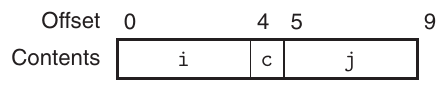

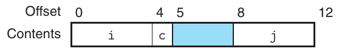

Ngoài ra, compiler có thể cần thêm padding vào cuối structure để mỗi phần tử trong array các structure thỏa mãn yêu cầu alignment. Ví dụ, xét khai báo structure sau:

```
struct S2 {
    int  i;
    int  j;
    char c;
};
```

Nếu đóng gói structure này trong 9 byte, chúng ta vẫn có thể thỏa mãn yêu cầu alignment cho các field i và j bằng cách bảo đảm địa chỉ bắt đầu structure thỏa mãn alignment 4-byte. Tuy nhiên, xét khai báo sau:

```
struct S2 d[4];
```

Với cách cấp phát 9-byte, không thể thỏa mãn yêu cầu alignment cho mỗi phần tử của d, vì những phần tử này sẽ có địa chỉ x<sub>d</sub>, x<sub>d</sub> + 9, x<sub>d</sub> + 18 và x<sub>d</sub> + 27. Thay vào đó, compiler cấp phát 12 byte cho structure S2, với 3 byte cuối là không gian lãng phí: Như vậy, các phần tử của d sẽ có địa chỉ x<sub>d</sub>, x<sub>d</sub> + 12, x<sub>d</sub> + 24 và x<sub>d</sub> + 36. Miễn là x<sub>d</sub> là bội số của 4, mọi hạn chế alignment đều được thỏa mãn.

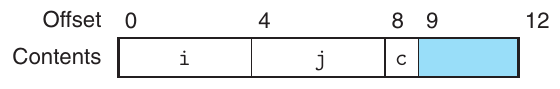

#### Bài tập thực hành 3.44 (lời giải trang 381)

Với mỗi khai báo structure sau, xác định offset của từng field, tổng kích thước structure và yêu cầu alignment của nó cho x86-64:

A. struct P1 { short i; int c; int *j; short *d; };

B. struct P2 { int i[2]; char c[8]; short s[4]; long *j; };

C. struct P3 { long w[2]; int *c[2] };

D. struct P4 { char w[16]; char *c[2] };

E. struct P5 { struct P4 a[2]; struct P1 t };

#### Bài tập thực hành 3.45 (lời giải trang 381)

Trả lời các câu hỏi sau cho khai báo structure

```
struct {
  int    *a;
  float  b;
  char   c;
  short  d;
  long   e;
  double f;
```

#### Thông tin thêm Một trường hợp alignment bắt buộc

Với hầu hết instruction x86-64, giữ alignment cho dữ liệu cải thiện hiệu quả nhưng không ảnh hưởng hành vi chương trình. Tuy nhiên, một số mẫu processor Intel và AMD sẽ không hoạt động đúng với dữ liệu không alignment đối với một số instruction SSE triển khai các thao tác đa phương tiện. Các instruction này thao tác trên những block dữ liệu 16-byte, và những instruction truyền dữ liệu giữa SSE unit và bộ nhớ yêu cầu địa chỉ bộ nhớ là bội số của 16. Mọi nỗ lực truy cập bộ nhớ bằng địa chỉ không thỏa mãn alignment này đều dẫn đến exception (xem Mục 8.1), với hành vi mặc định là chấm dứt chương trình.

Do đó, mọi compiler và hệ thống run-time cho processor x86-64 phải bảo đảm rằng mọi vùng bộ nhớ cấp phát để chứa cấu trúc dữ liệu có thể được đọc từ hoặc lưu vào register SSE đều thỏa mãn alignment 16-byte. Yêu cầu này có hai hệ quả sau:

- Địa chỉ bắt đầu của mọi block do function cấp phát bộ nhớ tạo ra (alloca, malloc, calloc hoặc realloc) phải là bội số của 16.

- Stack frame của hầu hết function phải được alignment theo ranh giới 16-byte. (Yêu cầu này có một số ngoại lệ.)

Các phiên bản processor x86-64 gần đây hơn triển khai các instruction đa phương tiện AVX. Ngoài việc cung cấp một tập bao hàm các instruction SSE, những processor hỗ trợ AVX còn không có yêu cầu alignment bắt buộc.

```
  int    g;
  char   *h;
} rec;
```

A. Byte offset của tất cả field trong structure là bao nhiêu?

B. Tổng kích thước structure là bao nhiêu?

C. Sắp xếp lại các field của structure để giảm thiểu không gian lãng phí, rồi trình bày byte offset và tổng kích thước của structure đã sắp xếp lại.

## 3.10 Kết hợp điều khiển và dữ liệu trong chương trình Machine-Level

Cho đến nay, chúng ta đã xem xét riêng cách machine-level code triển khai các khía cạnh điều khiển của chương trình và cách nó triển khai những cấu trúc dữ liệu khác nhau. Trong mục này, chúng ta xem xét những cách dữ liệu và điều khiển tương tác với nhau. Trước tiên, chúng ta tìm hiểu sâu về pointer, một trong những khái niệm quan trọng nhất của ngôn ngữ lập trình C nhưng lại là khái niệm mà nhiều lập trình viên chỉ hiểu sơ lược. Chúng ta xem lại cách sử dụng symbolic debugger gdb để khảo sát hoạt động chi tiết của chương trình machine-level. Tiếp theo, chúng ta thấy việc hiểu chương trình machine-level cho phép nghiên cứu buffer overflow, một lỗ hổng bảo mật quan trọng trong nhiều hệ thống real-world. Cuối cùng, chúng ta xem cách chương trình machine-level triển khai các trường hợp mà lượng vùng lưu trữ stack do function yêu cầu có thể thay đổi giữa các lần thực thi.

### 3.10.1 Hiểu về pointer

Pointer là một đặc điểm trung tâm của ngôn ngữ lập trình C. Chúng đóng vai trò một cách thống nhất để tạo tham chiếu đến phần tử trong các cấu trúc dữ liệu khác nhau. Pointer gây bối rối cho người mới lập trình, nhưng các khái niệm nền tảng khá đơn giản. Ở đây, chúng ta nhấn mạnh một số nguyên tắc then chốt của pointer và cách ánh xạ chúng sang machine code.

- Mỗi pointer có một kiểu gắn với nó. Kiểu này cho biết loại đối tượng mà pointer trỏ đến. Dùng các khai báo pointer sau để minh họa

```
int *ip;
char **cpp;
```

biến ip là pointer đến đối tượng kiểu int, còn cpp là pointer đến một đối tượng mà bản thân nó là pointer đến đối tượng kiểu char. Nói chung, nếu đối tượng có kiểu T , pointer có kiểu *T . Kiểu đặc biệt void * biểu diễn pointer tổng quát. Ví dụ, function malloc trả về pointer tổng quát, được chuyển thành pointer có kiểu qua cast tường minh hoặc casting ngầm định của phép gán. Kiểu pointer không phải thành phần của machine code; chúng là một sự trừu tượng hóa do C cung cấp để giúp lập trình viên tránh lỗi địa chỉ.

- Mỗi pointer có một giá trị. Giá trị này là địa chỉ của một đối tượng thuộc kiểu được chỉ định. Giá trị đặc biệt NULL (0) cho biết pointer không trỏ đến đâu cả.

- Pointer được tạo bằng toán tử ‘&’. Toán tử này có thể áp dụng cho mọi biểu thức C được phân loại là lvalue, nghĩa là biểu thức có thể xuất hiện ở vế trái phép gán. Ví dụ bao gồm biến và các phần tử của structure, union và array. Chúng ta đã thấy cách hiện thực machine-code của toán tử ‘&’ thường dùng instruction leaq để tính giá trị biểu thức, vì instruction này được thiết kế để tính địa chỉ của một tham chiếu bộ nhớ.

- Pointer được dereference bằng toán tử ‘*’. Kết quả là một giá trị có kiểu gắn với pointer. Dereference được triển khai bằng một tham chiếu bộ nhớ, để lưu vào hoặc lấy dữ liệu từ địa chỉ được chỉ định.

- Array và pointer có quan hệ chặt chẽ. Tên array có thể được tham chiếu (nhưng không cập nhật) như thể nó là biến pointer. Tham chiếu array (ví dụ, a[3]) có tác dụng giống hệt số học pointer kết hợp dereference (ví dụ, *(a+3)). Cả tham chiếu array lẫn số học pointer đều yêu cầu nhân tỷ lệ các offset theo kích thước đối tượng. Khi viết biểu thức p+i cho pointer p có giá trị p, địa chỉ kết quả được tính là p + L · i, trong đó L là kích thước data type gắn với p.

- Cast từ một kiểu pointer sang kiểu khác thay đổi kiểu nhưng không thay đổi giá trị của nó. Một tác dụng của casting là thay đổi phép nhân tỷ lệ trong số học pointer. Vì vậy, chẳng hạn nếu p là pointer kiểu char * có giá trị p, biểu thức (int *) p+7 tính p + 28, còn (int *) (p+7) tính p + 7. (Nhớ rằng casting có độ ưu tiên cao hơn phép cộng.)

- Pointer cũng có thể trỏ đến function. Điều này cung cấp khả năng mạnh mẽ để lưu và truyền các tham chiếu đến code, có thể được gọi trong phần khác của chương trình. Ví dụ, nếu có một function được định nghĩa bằng prototype

```
int fun(int x, int *p);
```

thì chúng ta có thể khai báo và gán pointer fp đến function này bằng chuỗi code sau:

```
int (*fp)(int, int *);
fp  = fun;
```

Sau đó, chúng ta có thể gọi function bằng pointer này:

```
int y = 1;
int result = fp(3, &y);
```

Giá trị function pointer là địa chỉ instruction đầu tiên trong biểu diễn machine-code của function.

#### Mới học C? Function pointer

Cú pháp khai báo function pointer đặc biệt khó hiểu đối với người mới lập trình. Với một khai báo như

```
int (*f)(int*);
```

sẽ hữu ích nếu đọc nó bắt đầu từ bên trong (bắt đầu bằng ‘f’) rồi đi dần ra ngoài. Do đó, có thể thấy f là pointer, như biểu thị bởi (\*f). Nó là pointer đến function có một int \* duy nhất làm argument, như biểu thị bởi (\*f)(int\*). Cuối cùng, chúng ta thấy nó là pointer đến function nhận int \* làm argument và trả về int.

Cần dấu ngoặc đơn quanh *f, vì nếu không, khai báo

```
int *f(int*);
```

sẽ được đọc thành

```
(int *) f(int*);
```

Nghĩa là nó sẽ được diễn giải thành function prototype, khai báo function f có int * làm argument và trả về int *.

Kernighan và Ritchie [61, Mục 5.12] trình bày một hướng dẫn hữu ích về cách đọc khai báo C.

### 3.10.2 Trong thực tế: Sử dụng debugger gdb

GNU debugger gdb cung cấp một số tính năng hữu ích để hỗ trợ đánh giá và phân tích chương trình machine-level tại run-time. Với các ví dụ và bài tập trong sách, chúng ta cố gắng suy ra hành vi chương trình chỉ bằng cách xem code. Sử dụng gdb cho phép nghiên cứu hành vi bằng cách quan sát chương trình hoạt động, đồng thời có khả năng kiểm soát đáng kể việc thực thi.

Hình 3.39 trình bày ví dụ về một số lệnh gdb hữu ích khi làm việc với chương trình x86-64 machine-level. Trước tiên chạy objdump để có phiên bản disassembled của chương trình rất hữu ích. Các ví dụ dựa trên việc chạy gdb trên file prog, được mô tả và disassemble ở trang 211. Chúng ta khởi động gdb bằng dòng lệnh sau:

```
linux> gdb prog
```

Cách làm tổng quát là đặt breakpoint gần các vị trí cần quan tâm trong chương trình. Có thể đặt chúng ngay sau điểm vào function hoặc tại một địa chỉ chương trình. Khi gặp một breakpoint trong quá trình thực thi, chương trình sẽ dừng và trả quyền điều khiển cho người dùng. Từ breakpoint, chúng ta có thể khảo sát các register và vị trí bộ nhớ khác nhau bằng nhiều định dạng. Chúng ta cũng có thể single-step chương trình, mỗi lần chỉ chạy vài instruction, hoặc tiếp tục đến breakpoint tiếp theo.

Như các ví dụ cho thấy, gdb có cú pháp lệnh khó hiểu, nhưng thông tin trợ giúp trực tuyến (được gọi trong gdb bằng lệnh help) khắc phục nhược điểm này. Thay vì dùng interface command-line của gdb, nhiều lập trình viên thích sử dụng ddd, một phần mở rộng của gdb cung cấp interface người dùng đồ họa.

### 3.10.3 Tham chiếu bộ nhớ Out-of-Bounds và buffer overflow

Chúng ta đã thấy C không thực hiện kiểm tra giới hạn khi tham chiếu array, và các biến cục bộ được lưu trên stack cùng thông tin trạng thái như giá trị register đã lưu và return address. Sự kết hợp này có thể gây lỗi chương trình nghiêm trọng, khi trạng thái lưu trên stack bị hỏng do ghi vào một phần tử array out-of-bounds. Sau đó, khi chương trình cố nạp lại register hoặc thực thi instruction ret với trạng thái hỏng này, những sự cố nghiêm trọng có thể xảy ra.

Một nguồn gây hỏng trạng thái đặc biệt phổ biến được gọi là buffer overflow. Thông thường, một array ký tự được cấp phát trên stack để chứa string, nhưng kích thước string vượt quá không gian được cấp phát cho array. Điều này được minh họa bằng ví dụ chương trình sau:

```
/* Implementation of library function gets() */
char *gets(char *s)
{
    int c;
    char *dest = s;
```

| Lệnh | Tác dụng |
|---|---|
| Khởi động và dừng |  |
| quit | Thoát gdb |
| run | Chạy chương trình của bạn (cung cấp argument command-line tại đây) |
| kill | Dừng chương trình của bạn |
| Breakpoint |  |
| break multstore | Đặt breakpoint tại điểm vào function multstore |
| break *0x400540 | Đặt breakpoint tại địa chỉ 0x400540 |
| delete 1 | Xóa breakpoint 1 |
| delete | Xóa mọi breakpoint |
| Thực thi |  |
| stepi | Thực thi một instruction |
| stepi 4 | Thực thi bốn instruction |
| nexti | Giống stepi , nhưng chạy qua các lời gọi function |
| continue | Tiếp tục thực thi |
| finish | Chạy đến khi function hiện tại trả về |
| Khảo sát code |  |
| disas | Disassemble function hiện tại |
| disas multstore | Disassemble function multstore |
| disas 0x400544 | Disassemble function quanh địa chỉ 0x400544 |
| disas 0x400540, 0x40054d | Disassemble code trong khoảng địa chỉ được chỉ định |
| print /x $rip | In program counter ở dạng hex |
| Khảo sát dữ liệu |  |
| print $rax | In nội dung %rax ở dạng thập phân |
| print /x $rax | In nội dung %rax ở dạng hex |
| print /t $rax | In nội dung %rax ở dạng nhị phân |
| print 0x100 | In biểu diễn thập phân của 0x100 |
| print /x 555 | In biểu diễn hex của 555 |
| print /x ($rsp+8) | In nội dung %rsp cộng 8 ở dạng hex |
| print *(long *) 0x7fffffffe818 | In số nguyên long tại địa chỉ 0x7fffffffe818 |
| print *(long *) ($rsp+8) | In số nguyên long tại địa chỉ %rsp + 8 |
| x/2g 0x7fffffffe818 | Khảo sát hai word (8-byte) bắt đầu tại địa chỉ 0x7fffffffe818 |
| x/20b multstore | Khảo sát 20 byte đầu tiên của function multstore |
| Thông tin hữu ích |  |
| info frame | Thông tin về stack frame hiện tại |
| info registers | Giá trị của tất cả register |
| help | Lấy thông tin về gdb |

**Hình 3.39 Ví dụ các lệnh gdb. Các ví dụ minh họa một số cách gdb hỗ trợ debug chương trình machine-level.**

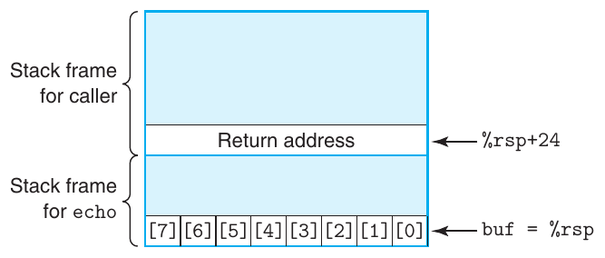

**Hình 3.40 Tổ chức stack cho function echo. Array ký tự buf chỉ là một phần của trạng thái được lưu. Một thao tác ghi out-of-bounds vào buf có thể làm hỏng trạng thái chương trình.**

```
    while ((c = getchar()) != ’\n’ && c != EOF)
        *dest++ = c;
    if (c == EOF && dest == s)
        /* No characters read */
        return NULL;
    *dest++ = ’\0’; /* Terminate string */
    return s;
}

/* Read input line and write it back */
void echo()
{
    char buf[8];  /* Way too small! */
    gets(buf);
    puts(buf);
}
```

Code trước đó trình bày một cách triển khai function thư viện gets để minh họa vấn đề nghiêm trọng với function này. Nó đọc một dòng từ standard input, dừng khi gặp ký tự newline kết thúc hoặc một điều kiện lỗi nào đó. Nó sao chép string này đến vị trí được chỉ định bởi argument s và kết thúc string bằng ký tự null. Chúng ta trình bày cách sử dụng gets trong function echo, chỉ đơn giản đọc một dòng từ standard input rồi lặp lại dòng đó ra standard output.

Vấn đề của gets là nó không có cách xác định đã cấp phát đủ không gian chứa toàn bộ string hay chưa. Trong ví dụ echo, chúng ta cố ý làm buffer rất nhỏ—chỉ dài tám ký tự. Mọi string dài hơn bảy ký tự đều gây ra thao tác ghi out-of-bounds.

Bằng cách xem assembly code do gcc sinh ra cho echo, chúng ta có thể suy ra cách stack được tổ chức:

```
    void echo()
1   echo:
2     subq    $24, %rsp         Allocate 24 bytes on stack
3     movq    %rsp, %rdi        Compute buf as %rsp
4     call    gets              Call gets
5     movq    %rsp, %rdi        Compute buf as %rsp
            6     call    puts             Call puts
            7     addq    $24, %rsp        Deallocate stack space
            8     ret                      Return
```

Hình 3.40 minh họa tổ chức stack trong khi echo thực thi. Chương trình cấp phát 24 byte trên stack bằng cách trừ 24 khỏi stack pointer (dòng 2). Ký tự buf được đặt tại đỉnh stack, có thể thấy qua việc %rsp được sao chép sang %rdi để dùng làm argument cho cả lời gọi gets lẫn puts. 16 byte giữa buf và return pointer được lưu không được sử dụng. Miễn là người dùng nhập tối đa bảy ký tự, string do gets trả về (bao gồm ký tự null kết thúc) sẽ vừa trong không gian cấp phát cho buf. Tuy nhiên, string dài hơn sẽ khiến gets ghi đè một số thông tin lưu trên stack. Khi string dài dần, các thông tin sau sẽ bị hỏng:

| Số ký tự đã nhập | Trạng thái bổ sung bị hỏng |
|---|---|
| 0–7 | Không có |
| 9–23 | Không gian stack chưa sử dụng |
| 24–31 | Return address |
| 32+ | Trạng thái đã lưu trong caller |

Không có hậu quả nghiêm trọng với string dài tối đa 23 ký tự, nhưng vượt quá mức đó, giá trị return pointer và có thể cả trạng thái đã lưu khác sẽ bị hỏng. Nếu giá trị return address đã lưu bị hỏng, instruction ret (dòng 8) sẽ khiến chương trình nhảy đến một vị trí hoàn toàn bất ngờ. Không hành vi nào trong số này có vẻ khả thi nếu chỉ dựa trên code C. Chỉ có thể hiểu tác động của việc ghi bộ nhớ out-of-bounds do các function như gets gây ra bằng cách nghiên cứu chương trình ở mức machine-code.

Code echo của chúng ta đơn giản nhưng cẩu thả. Phiên bản tốt hơn sử dụng function fgets, có một argument chỉ số byte tối đa cần đọc. Bài tập 3.71 yêu cầu bạn viết function echo xử lý được input string dài tùy ý. Nói chung, sử dụng gets hay bất kỳ function nào có thể gây overflow vùng lưu trữ đều bị xem là thói quen lập trình xấu. Đáng tiếc, một số function thư viện thường dùng, bao gồm strcpy, strcat và sprintf, có đặc điểm là có thể tạo một chuỗi byte mà không được cung cấp chỉ dẫn nào về kích thước buffer đích [97]. Những điều kiện như vậy có thể dẫn đến lỗ hổng buffer overflow.

#### Bài tập thực hành 3.46 (lời giải trang 382)

Hình 3.41 trình bày một cách triển khai (low-quality) của function đọc một dòng từ standard input, sao chép string vào vùng lưu trữ mới cấp phát và trả về pointer đến kết quả.

Xét tình huống sau. Procedure get_line được gọi với return address bằng 0x400776 và register %rbx bằng 0x0123456789ABCDEF. Bạn nhập string

```
0123456789012345678901234
```

(a) Code C

```
/* This is very low-quality code.
   It is intended to illustrate bad programming practices.
   See Practice Problem 3.46. */
char *get_line()
{
    char buf[4];
    char *result;
    gets(buf);
    result = malloc(strlen(buf));
    strcpy(result, buf);
    return result;
}
```

(b) Disassembly đến hết lời gọi gets

```
     char *get_line()
1   0000000000400720 <get_line>:
2     400720:  53                      push   %rbx
3     400721:  48 83 ec 10             sub    $0x10,%rsp
     Diagram stack at this point
4     400725:  48 89 e7                mov    %rsp,%rdi
5     400728:  e8 73 ff ff ff          callq  4006a0 <gets>
     Modify diagram to show stack contents at this point
```

**Hình 3.41 Code C và disassembled code cho Bài tập thực hành 3.46.**

Chương trình chấm dứt với segmentation fault. Bạn chạy gdb và xác định lỗi xảy ra trong khi thực thi instruction ret của get_line.

A. Điền sơ đồ sau, chỉ ra càng nhiều thông tin càng tốt về stack ngay sau khi thực thi instruction ở dòng 3 trong disassembly. Gắn nhãn cho các đại lượng lưu trên stack (ví dụ, “Return address”) ở bên phải, và điền giá trị hexadecimal của chúng (nếu biết) trong ô. Mỗi ô biểu diễn 8 byte. Chỉ ra vị trí %rsp. Nhớ rằng mã ASCII cho các ký tự 0–9 là 0x30–0x39.

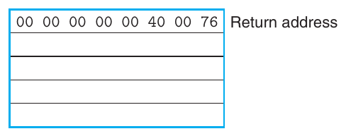

B. Sửa sơ đồ để thể hiện tác động của lời gọi gets (dòng 5).

C. Chương trình cố gắng trả về địa chỉ nào?

D. Register nào có giá trị bị hỏng khi get_line trả về?

E. Ngoài khả năng buffer overflow, còn hai vấn đề nào khác với code của get_line?

Một cách sử dụng buffer overflow nguy hiểm hơn là khiến chương trình thực hiện một chức năng mà bình thường nó sẽ không sẵn lòng thực hiện. Đây là một trong những phương pháp phổ biến nhất để tấn công bảo mật hệ thống qua mạng máy tính. Thông thường, chương trình được cung cấp một string chứa mã hóa byte của executable code nào đó, gọi là exploit code, cộng một số byte bổ sung ghi đè return address bằng pointer đến exploit code. Khi đó, tác dụng của việc thực thi instruction ret là nhảy đến exploit code.

Trong một dạng tấn công, exploit code tiếp đó dùng system call để khởi động shell program, cung cấp cho kẻ tấn công nhiều chức năng của operating system. Trong dạng khác, exploit code thực hiện một nhiệm vụ không được phép nào đó, sửa lại hư hại trên stack rồi thực thi ret lần thứ hai, tạo ra một lần trả về caller có vẻ bình thường.

Ví dụ, Internet worm nổi tiếng tháng 11 năm 1988 sử dụng bốn cách khác nhau để truy cập nhiều máy tính trên Internet. Một cách là tấn công buffer overflow vào finger daemon fingerd, vốn phục vụ các yêu cầu từ lệnh finger. Bằng cách gọi finger với string phù hợp, worm có thể khiến daemon ở máy từ xa gặp buffer overflow và thực thi code cho phép worm truy cập hệ thống từ xa. Khi worm truy cập được một hệ thống, nó tự nhân bản và tiêu thụ gần như toàn bộ tài nguyên tính toán của máy. Do đó, hàng trăm máy gần như bị tê liệt cho đến khi các chuyên gia bảo mật xác định được cách loại bỏ worm. Tác giả worm bị bắt và truy tố. Người này bị kết án 3 năm quản chế, 400 giờ phục vụ cộng đồng và phạt $10,500. Tuy nhiên, ngay cả đến ngày nay, người ta vẫn tiếp tục tìm thấy những lỗ hổng bảo mật khiến hệ thống dễ bị tấn công buffer overflow. Điều này nhấn mạnh nhu cầu lập trình cẩn thận. Mọi interface với môi trường bên ngoài cần được làm cho “bulletproof”, để không hành vi nào của tác nhân bên ngoài có thể khiến hệ thống hoạt động sai.

### 3.10.4 Ngăn chặn tấn công buffer overflow

Các cuộc tấn công buffer overflow đã trở nên phổ biến và gây ra nhiều vấn đề cho hệ thống máy tính đến mức compiler và operating system hiện đại đã triển khai các cơ chế khiến việc thực hiện những cuộc tấn công này khó khăn hơn, đồng thời giới hạn những cách kẻ xâm nhập có thể chiếm quyền điều khiển hệ thống qua buffer overflow. Trong mục này, chúng ta trình bày các cơ chế do những phiên bản gcc gần đây cho Linux cung cấp.

### Stack randomization

Để chèn exploit code vào hệ thống, kẻ tấn công cần đưa cả code lẫn pointer đến code này vào attack string. Việc tạo pointer đòi hỏi biết địa chỉ stack nơi string sẽ nằm. Trước đây, địa chỉ stack của chương trình rất dễ dự đoán. Với tất cả hệ thống chạy cùng tổ hợp chương trình và phiên bản operating system, các vị trí stack khá ổn định trên nhiều máy. Vì vậy, chẳng hạn nếu kẻ tấn công xác định được những địa chỉ stack mà một Web server phổ biến sử dụng, chúng có thể xây dựng cuộc tấn công hoạt động trên nhiều máy. Ví von với bệnh truyền nhiễm, nhiều hệ thống dễ bị tổn thương bởi chính cùng một chủng virus, hiện tượng thường gọi là security monoculture [96].

#### Thông tin thêm Worm và virus

Cả worm và virus đều là những đoạn code cố gắng tự lan truyền giữa các máy tính. Theo mô tả của Spafford [105], worm là chương trình có thể tự chạy và lan truyền một phiên bản hoạt động đầy đủ của chính nó sang các máy khác. Virus là đoạn code tự thêm mình vào các chương trình khác, bao gồm operating system. Nó không thể chạy độc lập. Trên báo chí phổ thông, thuật ngữ “virus” được dùng để chỉ nhiều chiến lược khác nhau nhằm lan truyền code tấn công giữa các hệ thống, nên bạn sẽ nghe người ta nói “virus” cho thứ đúng ra nên được gọi là “worm.”

Ý tưởng của stack randomization là khiến vị trí stack thay đổi giữa các lần chạy chương trình. Vì vậy, ngay cả khi nhiều máy chạy code giống hệt nhau, tất cả vẫn sử dụng các địa chỉ stack khác nhau. Điều này được triển khai bằng cách cấp phát một lượng không gian ngẫu nhiên từ 0 đến n byte trên stack khi chương trình bắt đầu, chẳng hạn sử dụng function cấp phát alloca, vốn cấp phát không gian cho một số byte chỉ định trên stack. Chương trình không sử dụng vùng cấp phát này, nhưng nó khiến mọi vị trí stack tiếp theo thay đổi giữa các lần thực thi chương trình. Khoảng cấp phát n cần đủ lớn để tạo đủ sự biến thiên trong địa chỉ stack, nhưng cũng đủ nhỏ để không lãng phí quá nhiều không gian trong chương trình.

Code sau trình bày cách đơn giản để xác định một địa chỉ stack “điển hình”:

```
int main() {
    long local;
    printf("local at %p\n", &local);
    return 0;
}
```

Code này chỉ đơn giản in địa chỉ của một biến cục bộ trong function main. Chạy code 10,000 lần trên một máy Linux ở chế độ 32-bit, các địa chỉ nằm trong khoảng từ 0xff7fc59c đến 0xffffd09c, khoảng rộng chừng 2<sup>23</sup>. Chạy ở chế độ 64-bit trên máy mới hơn, các địa chỉ nằm trong khoảng từ 0x7fff0001b698 đến 0x7ffffffaa4a8, khoảng rộng gần 2<sup>32</sup>.

Stack randomization đã trở thành thông lệ tiêu chuẩn trong hệ thống Linux. Nó thuộc một lớp kỹ thuật lớn hơn được gọi là address-space layout randomization, hay ASLR [99]. Với ASLR, các phần khác nhau của chương trình, bao gồm program code, library code, stack, biến toàn cục và dữ liệu heap, được nạp vào những vùng bộ nhớ khác nhau mỗi lần chương trình chạy. Điều đó nghĩa là chương trình chạy trên một máy sẽ có ánh xạ địa chỉ rất khác so với cùng chương trình chạy trên máy khác. Việc này có thể ngăn chặn một số dạng tấn công.

Tuy nhiên, nhìn chung, kẻ tấn công kiên trì có thể vượt qua randomization bằng vét cạn, liên tục thử tấn công với các địa chỉ khác nhau. Thủ thuật phổ biến là đặt một chuỗi dài instruction nop (phát âm “no op”, viết tắt của “no operation”) trước exploit code thực tế. Thực thi instruction này không có tác dụng nào ngoài việc tăng program counter sang instruction tiếp theo. Miễn là kẻ tấn công đoán được một địa chỉ nằm trong chuỗi này, chương trình sẽ chạy qua chuỗi rồi đến exploit code. Thuật ngữ phổ biến cho chuỗi này là “nop sled” [97], diễn tả ý tưởng chương trình “trượt” qua chuỗi. Nếu thiết lập nop sled 256-byte, randomization trên n = 2<sup>23</sup> có thể bị phá bằng cách liệt kê 2<sup>15</sup> = 32,768 địa chỉ bắt đầu, hoàn toàn khả thi với kẻ tấn công quyết tâm. Trong trường hợp 64-bit, việc thử liệt kê 2<sup>24</sup> = 16,777,216 khó khăn hơn đôi chút. Có thể thấy stack randomization và các khía cạnh khác của ASLR có thể tăng công sức cần để tấn công hệ thống thành công, từ đó giảm đáng kể tốc độ lan truyền của virus hoặc worm, nhưng không thể cung cấp sự bảo vệ hoàn toàn.

#### Bài tập thực hành 3.47 (lời giải trang 383)

Chạy code stack-checking của chúng ta 10,000 lần trên hệ thống dùng Linux phiên bản 2.6.16, chúng ta thu được các địa chỉ từ tối thiểu 0xffffb754 đến tối đa 0xffffd754.

A. Độ rộng xấp xỉ của khoảng địa chỉ là bao nhiêu?

B. Nếu thử buffer overrun với nop sled 128-byte, cần khoảng bao nhiêu lần thử để kiểm tra tất cả địa chỉ bắt đầu?

### Phát hiện stack bị hỏng

Tuyến phòng thủ thứ hai là có khả năng phát hiện stack đã bị hỏng. Trong ví dụ function echo (Hình 3.40), chúng ta đã thấy việc hỏng trạng thái thường xảy ra khi chương trình vượt quá giới hạn buffer cục bộ. Trong C, không có cách đáng tin cậy để ngăn ghi vượt giới hạn array. Thay vào đó, chương trình có thể cố phát hiện khi thao tác ghi như vậy đã xảy ra, trước khi nó gây tác động có hại.

Các phiên bản gcc gần đây tích hợp một cơ chế gọi là stack protector vào code được sinh ra để phát hiện buffer overrun. Ý tưởng là lưu một giá trị canary đặc biệt[^4] trong stack frame, giữa mọi buffer cục bộ và phần trạng thái stack còn lại, như minh họa trong Hình 3.42 [26, 97]. Giá trị canary này, còn gọi là guard value, được tạo ngẫu nhiên mỗi lần chương trình chạy, nên kẻ tấn công không dễ xác định nó. Trước khi khôi phục trạng thái register và trả về từ function, chương trình kiểm tra xem canary có bị thay đổi bởi một thao tác của function này hoặc của function mà nó gọi hay không. Nếu có, chương trình hủy thực thi với lỗi.

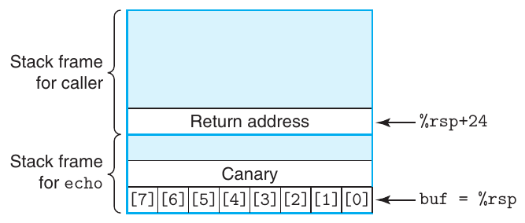

**Hình 3.42 Tổ chức stack cho function echo khi bật stack protector. Một giá trị “canary” đặc biệt được đặt giữa array buf và trạng thái đã lưu. Code kiểm tra giá trị canary để xác định trạng thái stack có bị hỏng hay không.**

Các phiên bản gcc gần đây cố xác định function có dễ gặp stack overflow hay không và tự động chèn cơ chế phát hiện overflow kiểu này. Thực tế, để minh họa stack overflow trước đó, chúng ta phải cung cấp tùy chọn command-line -fno-stack-protector nhằm ngăn gcc chèn code này. Biên dịch function echo mà không có tùy chọn này, tức bật stack protector, tạo ra assembly code sau:

```
     void echo()
 1   echo:
 2     subq    $24, %rsp            Allocate 24 bytes on stack
 3     movq    %fs:40, %rax         Retrieve canary
 4     movq    %rax, 8(%rsp)        Store on stack
 5     xorl    %eax, %eax           Zero out register
 6     movq    %rsp, %rdi           Compute buf as %rsp
 7     call    gets                 Call gets
 8     movq    %rsp, %rdi           Compute buf as %rsp
 9     call    puts                 Call puts
10     movq    8(%rsp), %rax        Retrieve canary
11     xorq    %fs:40, %rax         Compare to stored value
12     je      .L9                  If =, goto ok
13     call    __stack_chk_fail     Stack corrupted!
14   .L9:                          ok:
15     addq    $24, %rsp            Deallocate stack space
16     ret
```

Có thể thấy phiên bản function này lấy một giá trị từ bộ nhớ (dòng 3) và lưu lên stack tại offset 8 tính từ %rsp, ngay sau vùng cấp phát cho buf. Argument instruction %fs:40 cho biết giá trị canary được đọc từ bộ nhớ bằng segmented addressing, một cơ chế định địa chỉ có từ thời 80286 và ít gặp trong các chương trình chạy trên hệ thống hiện đại. Bằng cách lưu canary trong một segment đặc biệt, nó có thể được đánh dấu “read only”, để kẻ tấn công không thể ghi đè giá trị canary đã lưu. Trước khi khôi phục trạng thái register và trả về, function so sánh giá trị lưu tại vị trí stack với giá trị canary (qua instruction xorq ở dòng 11). Nếu hai giá trị giống nhau, instruction xorq cho ra 0 và function hoàn tất bình thường. Giá trị khác 0 cho biết canary trên stack đã bị thay đổi, do đó code sẽ gọi một routine xử lý lỗi.

Stack protection ngăn chặn hiệu quả việc tấn công buffer overflow làm hỏng trạng thái lưu trên stack chương trình. Nó chỉ gây giảm hiệu năng nhỏ, đặc biệt vì gcc chỉ chèn cơ chế này khi function có buffer cục bộ kiểu char. Dĩ nhiên, còn những cách khác để làm hỏng trạng thái của chương trình đang thực thi, nhưng giảm tính dễ bị tổn thương của stack ngăn chặn được nhiều chiến lược tấn công phổ biến.

#### Bài tập thực hành 3.48 (lời giải trang 383)

Các function intlen, len và iptoa cung cấp một cách rất vòng vèo để tính số chữ số thập phân cần thiết nhằm biểu diễn số nguyên. Chúng ta sẽ sử dụng ví dụ này để nghiên cứu một số khía cạnh của tính năng stack protector trong gcc.

```
int len(char *s) {
    return strlen(s);
}

void iptoa(char *s, long *p) {
    long val = *p;
    sprintf(s, "%ld", val);
}

int intlen(long x) {
    long v;
    char buf[12];
    v = x;
    iptoa(buf, &v);
    return len(buf);
}
```

Sau đây là các phần code của intlen, được biên dịch cả khi có và khi không có stack protector:

(a) Không có protector

```
    int intlen(long x)
    x in %rdi
1   intlen:
2     subq    $40, %rsp
3     movq    %rdi, 24(%rsp)
4     leaq    24(%rsp), %rsi
5     movq    %rsp, %rdi
6     call    iptoa
```

(b) Có protector

```
    int intlen(long x)
    x in %rdi
1   intlen:
2     subq    $56, %rsp
3     movq    %fs:40, %rax
4     movq    %rax, 40(%rsp)
5     xorl    %eax, %eax
6     movq    %rdi, 8(%rsp)
7     leaq    8(%rsp), %rsi
8     leaq    16(%rsp), %rdi
9     call    iptoa
```

A. Với cả hai phiên bản: buf, v và giá trị canary (khi có) nằm ở những vị trí nào trong stack frame?

B. Việc sắp xếp lại thứ tự biến cục bộ trong code được bảo vệ cung cấp mức bảo mật cao hơn trước tấn công buffer overrun như thế nào?

### Giới hạn các vùng executable code

Bước cuối cùng là loại bỏ khả năng kẻ tấn công chèn executable code vào hệ thống. Một phương pháp là giới hạn những vùng bộ nhớ chứa executable code. Trong chương trình điển hình, chỉ phần bộ nhớ giữ code do compiler sinh ra mới cần được thực thi. Các phần khác có thể bị giới hạn chỉ cho phép đọc và ghi. Như chúng ta sẽ thấy trong Chương 9, không gian virtual memory được chia về mặt logic thành các page, thường có 2,048 hoặc 4,096 byte mỗi page. Phần cứng hỗ trợ nhiều dạng bảo vệ bộ nhớ, chỉ ra các dạng truy cập được phép đối với cả chương trình người dùng lẫn kernel của operating system. Nhiều hệ thống cho phép kiểm soát ba dạng truy cập: read (đọc dữ liệu từ bộ nhớ), write (lưu dữ liệu vào bộ nhớ) và execute (xem nội dung bộ nhớ là machine-level code). Trước đây, kiến trúc x86 gộp kiểm soát truy cập read và execute vào một flag 1-bit, nên mọi page được đánh dấu có thể đọc cũng có thể thực thi. Stack phải được giữ ở trạng thái vừa đọc vừa ghi được, do đó các byte trên stack cũng có thể thực thi. Nhiều phương án đã được triển khai để có thể giới hạn một số page chỉ đọc được mà không thực thi được, nhưng nhìn chung chúng gây ra sự kém hiệu quả đáng kể.

Gần đây hơn, AMD thêm một bit NX (viết tắt của “no-execute”) vào cơ chế bảo vệ bộ nhớ cho các processor 64-bit của mình, tách riêng chế độ truy cập read và execute, rồi Intel cũng làm theo. Với tính năng này, stack có thể được đánh dấu là đọc và ghi được nhưng không thực thi được, và việc kiểm tra page có thể thực thi hay không được thực hiện bằng phần cứng, không làm giảm hiệu quả.

Một số loại chương trình cần khả năng sinh và thực thi code động. Ví dụ, các kỹ thuật biên dịch “just-in-time” sinh code động cho chương trình viết bằng ngôn ngữ thông dịch như Java để cải thiện hiệu năng thực thi. Việc hệ thống run-time có thể giới hạn executable code chỉ trong phần do compiler sinh ra khi tạo chương trình ban đầu hay không phụ thuộc vào ngôn ngữ và operating system.

Các kỹ thuật chúng ta vừa phác thảo—randomization, stack protection và giới hạn những phần bộ nhớ có thể chứa executable code—là ba trong số các cơ chế phổ biến nhất để giảm thiểu tính dễ bị tổn thương của chương trình trước tấn công buffer overflow. Tất cả đều có đặc điểm là không đòi hỏi công sức đặc biệt từ lập trình viên và gây rất ít hoặc không gây giảm hiệu năng. Mỗi cơ chế riêng lẻ đều giảm mức độ dễ bị tổn thương, và khi kết hợp, chúng còn hiệu quả hơn. Đáng tiếc, vẫn có những cách tấn công máy tính [85, 97], nên worm và virus tiếp tục xâm phạm tính toàn vẹn của nhiều máy.

### 3.10.5 Hỗ trợ stack frame Variable-Size

Cho đến nay, chúng ta đã xem xét machine-level code cho nhiều function, nhưng tất cả đều có đặc điểm là compiler có thể xác định trước lượng không gian phải cấp phát cho stack frame. Tuy nhiên, một số function cần lượng vùng lưu trữ cục bộ thay đổi. Ví dụ, điều này có thể xảy ra khi function gọi alloca, một function thư viện tiêu chuẩn có thể cấp phát số byte lưu trữ tùy ý trên stack. Nó cũng có thể xảy ra khi code khai báo array cục bộ có kích thước thay đổi.

Mặc dù thông tin trong mục này đúng ra nên được xem là một khía cạnh của cách triển khai procedure, chúng ta đã hoãn trình bày đến đây vì nó đòi hỏi hiểu biết về array và alignment.

Code trong Hình 3.43(a) đưa ra ví dụ function chứa array variable-size. Function khai báo array cục bộ p gồm n pointer, trong đó n được cho bởi argument đầu tiên. Việc này yêu cầu cấp phát 8n byte trên stack, và giá trị n có thể thay đổi giữa các lần gọi function. Vì vậy, compiler không thể xác định cần cấp phát bao nhiêu không gian cho stack frame của function. Ngoài ra, chương trình tạo một tham chiếu đến địa chỉ biến cục bộ i, nên biến này cũng phải được lưu trên stack. Trong khi thực thi, chương trình phải có khả năng truy cập cả biến cục bộ i lẫn các phần tử array p. Khi trả về, function phải giải phóng stack frame và đặt stack pointer về vị trí return address đã lưu.

Để quản lý stack frame variable-size, code x86-64 sử dụng register %rbp làm frame pointer (đôi khi được gọi là base pointer, do đó có các chữ bp trong %rbp). Khi sử dụng frame pointer, stack frame được tổ chức như trường hợp function vframe trong Hình 3.44. Có thể thấy code phải lưu giá trị trước đó của %rbp lên stack vì đây là register callee-saved. Sau đó, nó giữ %rbp trỏ đến vị trí này trong suốt quá trình thực thi function và tham chiếu các biến cục bộ fixed-length, như i, tại offset tương đối với %rbp.

(a) Code C

```
long vframe(long n, long idx, long *q)  {
    long i;
    long *p[n];
    p[0] = &i;
    for (i = 1; i < n; i++)
        p[i] = q;
    return *p[idx];
}
```

(b) Các phần assembly code được sinh ra

<pre>     long vframe(long n, long idx, long *q)
     n in %rdi, idx in %rsi, q in %rdx
     Only portions of code shown
 1   vframe:
 2     pushq   %rbp                      Save old %rbp
 3     movq    %rsp, %rbp                Set frame pointer
 4     subq    $16, %rsp                 Allocate space for i (%rsp = s<sub>1</sub>)
 5     leaq    22(,%rdi,8), %rax
 6     andq    $-16, %rax
 7     subq    %rax, %rsp                Allocate space for array p (%rsp = s<sub>2</sub>)
 8     leaq    7(%rsp), %rax
 9     shrq    $3, %rax
10     leaq    0(,%rax,8), %r8           Set %r8 to &amp;p[0]
11     movq    %r8, %rcx                 Set %rcx to &amp;p[0] (%rcx = p)
          . . .
     Code for initialization loop
     i in %rax and on stack, n in %rdi, p in %rcx, q in %rdx
12   .L3:                               loop:
13     movq    %rdx, (%rcx,%rax,8)       Set p[i] to q
14     addq    $1, %rax                  Increment i
15     movq    %rax, -8(%rbp)            Store on stack
16   .L2:
17     movq    -8(%rbp), %rax            Retrieve i from stack
18     cmpq    %rdi, %rax                Compare i:n
19     jl      .L3                       If &lt;, goto loop
          . . .
     Code for function exit
20     leave                              Restore %rbp and %rsp
21     ret                                Return</pre>

**Hình 3.43 Function cần sử dụng frame pointer. Array variable-size khiến kích thước stack frame không thể xác định tại thời điểm biên dịch.**

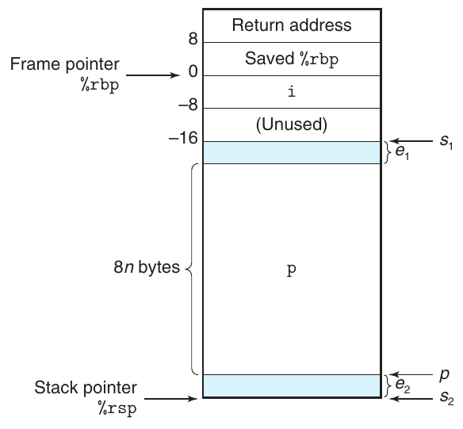

**Hình 3.44 Cấu trúc stack frame cho function vframe . Function sử dụng register %rbp làm frame pointer. Các chú thích dọc phía right-hand liên quan đến Bài tập thực hành 3.49.**

Hình 3.43(b) trình bày các phần code do gcc sinh ra cho function vframe. Khi function bắt đầu, chúng ta thấy code thiết lập stack frame và cấp phát không gian cho array p. Code bắt đầu bằng cách đẩy giá trị hiện tại của %rbp lên stack và đặt %rbp trỏ đến vị trí stack này (dòng 2–3). Tiếp theo, nó cấp phát 16 byte trên stack, trong đó 8 byte đầu dùng lưu biến cục bộ i và 8 byte sau không được sử dụng. Sau đó, nó cấp phát không gian cho array p (dòng 5–11). Chi tiết về lượng không gian được cấp phát và vị trí p trong không gian đó được khảo sát trong Bài tập thực hành 3.49. Chỉ cần biết rằng khi chương trình đến dòng 11, nó đã (1) cấp phát ít nhất 8n byte trên stack và (2) đặt array p trong vùng được cấp phát sao cho có ít nhất 8n byte khả dụng cho array.

Code của vòng lặp khởi tạo trình bày ví dụ về cách tham chiếu các biến cục bộ i và p. Dòng 13 cho thấy phần tử array p[i] được đặt thành q. Instruction này sử dụng giá trị trong register %rcx làm địa chỉ đầu p. Có thể thấy những chỗ biến cục bộ i được cập nhật (dòng 15) và được đọc (dòng 17). Địa chỉ i được cho bởi tham chiếu -8(%rbp)—tức tại offset −8 tương đối với frame pointer.

Ở cuối function, frame pointer được khôi phục về giá trị trước đó bằng instruction leave (dòng 20). Instruction này không nhận argument. Nó tương đương với việc thực thi hai instruction sau:

```
movq %rbp, %rsp       Set stack pointer to beginning of frame
popq %rbp             Restore saved %rbp and set stack ptr
                        to end of caller’s frame
```

Nghĩa là stack pointer trước tiên được đặt về vị trí giá trị %rbp đã lưu, rồi giá trị này được lấy từ stack vào %rbp. Sự kết hợp instruction này có tác dụng giải phóng toàn bộ stack frame.

Trong các phiên bản code x86 trước đây, frame pointer được sử dụng với mọi lời gọi function. Với code x86-64, nó chỉ được sử dụng khi stack frame có thể thay đổi kích thước, như trường hợp function vframe. Trước đây, hầu hết compiler sử dụng frame pointer khi sinh code IA32. Các phiên bản gcc gần đây đã bỏ quy ước này. Lưu ý rằng có thể trộn code dùng frame pointer với code không dùng, miễn là mọi function đều xem %rbp là register callee-saved.

#### Bài tập thực hành 3.49 (lời giải trang 383)

Trong bài tập này, chúng ta tìm hiểu logic phía sau code ở dòng 5–11 của Hình 3.43(b), nơi không gian được cấp phát cho array variable-size p. Theo các chú thích trong code, gọi s<sub>1</sub> là địa chỉ stack pointer sau khi thực thi instruction subq ở dòng 4. Instruction này cấp phát không gian cho biến cục bộ i. Gọi s<sub>2</sub> là giá trị stack pointer sau khi thực thi instruction subq ở dòng 7. Instruction này cấp phát vùng lưu trữ cho array cục bộ p. Cuối cùng, gọi p là giá trị được gán cho các register %r8 và %rcx trong instruction ở dòng 10–11. Cả hai register này đều được sử dụng để tham chiếu array p.

Phía right-hand của Hình 3.44 vẽ các vị trí được chỉ ra bởi s<sub>1</sub>, s<sub>2</sub> và p. Nó cũng cho thấy có thể có offset e<sub>2</sub> byte giữa các giá trị s<sub>1</sub> và p. Không gian này sẽ không được sử dụng. Cũng có thể có offset e<sub>1</sub> byte giữa cuối array p và vị trí được chỉ ra bởi s<sub>1</sub>.

A. Giải thích bằng thuật ngữ toán học logic của phép tính s<sub>2</sub> ở dòng 5–7. Gợi ý: Nghĩ về biểu diễn bit-level của −16 và tác dụng của nó trong instruction andq ở dòng 6.

B. Giải thích bằng thuật ngữ toán học logic của phép tính p ở dòng 8–10. Gợi ý: Bạn có thể muốn xem lại thảo luận về chia cho lũy thừa của 2 trong Mục 2.3.7.

C. Với các giá trị n và s<sub>1</sub> sau, theo dõi việc thực thi code để xác định các giá trị kết quả của s<sub>2</sub>, p, e<sub>1</sub> và e<sub>2</sub>.

| n | s<sub>1</sub> | s<sub>2</sub> | p | e<sub>1</sub> | e<sub>2</sub> |
|---|---|---|---|---|---|
| 5 | 2,065 | ______ | ______ | ______ | ______ |
| 6 | 2,064 | ______ | ______ | ______ | ______ |

D. Code này bảo đảm những tính chất alignment nào cho các giá trị s<sub>2</sub> và p?

## 3.11 Code Floating-Point

Kiến trúc floating-point của một processor bao gồm các khía cạnh khác nhau ảnh hưởng đến cách các chương trình thao tác trên dữ liệu floating-point được ánh xạ lên máy, bao gồm

- Cách lưu trữ và truy cập các giá trị floating-point. Thông thường, việc này được thực hiện thông qua một dạng register nào đó.

- Các instruction thao tác trên dữ liệu floating-point.

- Các quy ước dùng để truyền giá trị floating-point làm đối số cho hàm và trả về chúng làm kết quả.

- Các quy ước về cách bảo toàn register trong các lời gọi hàm—ví dụ, một số register được chỉ định là caller saved, còn những register khác là callee saved.

Để hiểu kiến trúc floating-point x86-64, việc nhìn lại ngắn gọn lịch sử sẽ hữu ích. Kể từ khi Pentium/MMX ra mắt năm 1997, cả Intel và AMD đã tích hợp các thế hệ media instruction kế tiếp nhau để hỗ trợ xử lý đồ họa và hình ảnh. Ban đầu, các instruction này tập trung vào việc cho phép thực hiện nhiều phép toán trong một chế độ song song gọi là single instruction, multiple data, hay SIMD (phát âm là sim-dee). Trong chế độ này, cùng một phép toán được thực hiện song song trên một số giá trị dữ liệu khác nhau. Qua nhiều năm, các phần mở rộng này đã không ngừng phát triển. Tên gọi đã thay đổi qua một loạt bản sửa đổi lớn, từ MMX sang SSE (viết tắt của “streaming SIMD extensions”) và gần đây nhất là AVX (viết tắt của “advanced vector extensions”). Trong mỗi thế hệ cũng có những phiên bản khác nhau. Mỗi phần mở rộng này quản lý dữ liệu trong các tập register, được gọi là register “MM” cho MMX, “XMM” cho SSE và “YMM” cho AVX, với độ rộng từ 64 bit cho register MM, đến 128 cho XMM và 256 cho YMM. Vì vậy, chẳng hạn, mỗi register YMM có thể chứa tám giá trị 32-bit hoặc bốn giá trị 64-bit, trong đó các giá trị này có thể là số nguyên hoặc floating point.

Bắt đầu từ SSE2, được giới thiệu cùng Pentium 4 năm 2000, các media instruction đã bao gồm những instruction thao tác trên dữ liệu scalar floating-point, sử dụng các giá trị đơn trong 32 hoặc 64 bit low-order của register XMM hoặc YMM. Chế độ scalar này cung cấp một tập register và instruction gần với cách các processor khác hỗ trợ floating point hơn. Tất cả các processor có khả năng thực thi code x86-64 đều hỗ trợ SSE2 hoặc cao hơn, nên floating point x86-64 dựa trên SSE hoặc AVX, bao gồm cả các quy ước truyền đối số và giá trị trả về của thủ tục [77].

Phần trình bày của chúng ta dựa trên AVX2, phiên bản thứ hai của AVX, được giới thiệu cùng processor Core i7 Haswell năm 2013. Gcc sẽ tạo code AVX2 khi được cung cấp tham số command-line -mavx2. Code dựa trên các phiên bản SSE khác nhau, cũng như phiên bản đầu tiên của AVX, tương tự nhau về mặt khái niệm, mặc dù khác nhau về tên và định dạng instruction. Chúng ta chỉ trình bày những instruction xuất hiện khi biên dịch các chương trình floating-point bằng gcc. Phần lớn đây là các scalar AVX instruction, mặc dù chúng ta cũng ghi nhận những trường hợp xuất hiện instruction vốn được thiết kế để thao tác trên toàn bộ vector dữ liệu. Nội dung đầy đủ hơn về cách khai thác khả năng SIMD của SSE và AVX được trình bày trong phần Thông tin thêm trên Web opt:simd ở trang 582. Bạn đọc có thể tham khảo tài liệu AMD và Intel cho từng instruction [4, 51]. Tương tự các phép toán số nguyên, lưu ý rằng định dạng ATT chúng ta sử dụng trong phần trình bày khác với định dạng Intel được dùng trong các tài liệu này. Cụ thể, các toán hạng instruction được liệt kê theo thứ tự khác nhau trong hai phiên bản này.

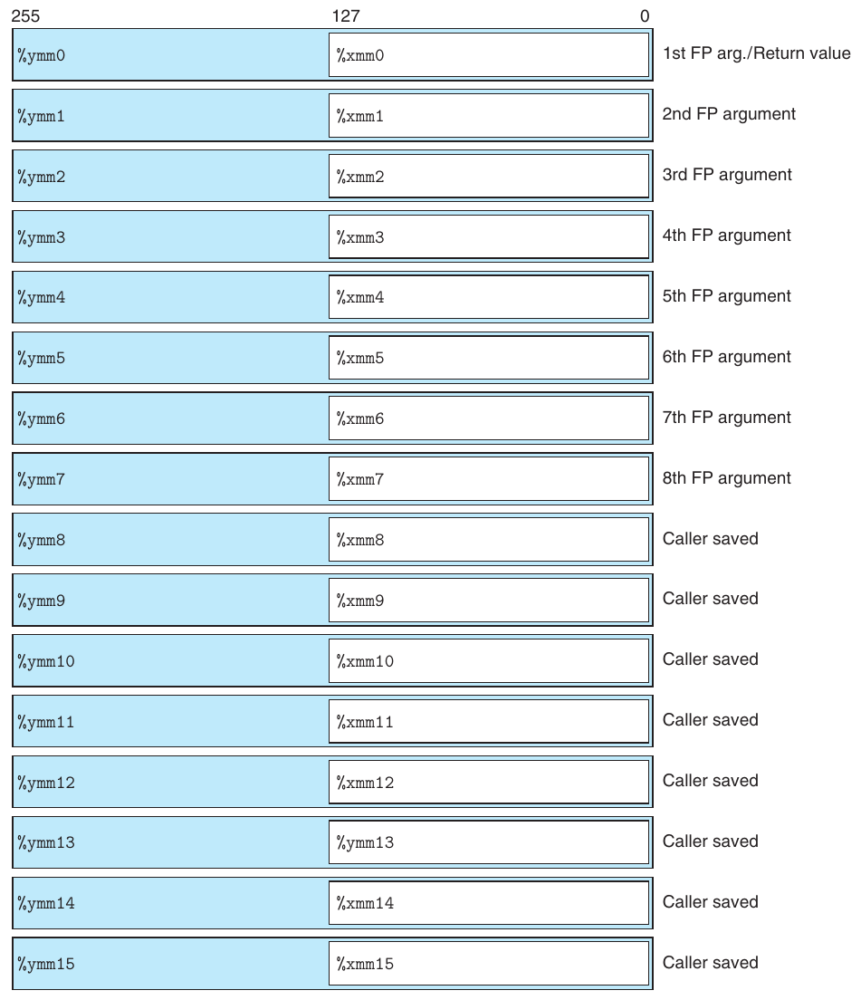

**Hình 3.45 Các media register. Các register này được dùng để chứa dữ liệu floating-point. Mỗi register YMM chứa 32 byte. Có thể truy cập 16 byte low-order như một register XMM.**

Như minh họa trong Hình 3.45, kiến trúc floating-point AVX cho phép lưu dữ liệu trong 16 register YMM, có tên %ymm0–%ymm15. Mỗi register YMM dài 256 bit (32 byte). Khi thao tác trên dữ liệu scalar, các register này chỉ chứa dữ liệu floating-point, và chỉ 32 bit low-order (cho float) hoặc 64 bit (cho double) được sử dụng. Assembly code tham chiếu đến các register bằng tên register SSE XMM của chúng, %xmm0–%xmm15, trong đó mỗi register XMM là 128 bit low-order (16 byte) của register YMM tương ứng.

| Instruction | Nguồn | Đích | Mô tả |
|---|---|---|---|
| vmovss | M<sub>32</sub> | X | Di chuyển giá trị single precision |
| vmovss | X | M<sub>32</sub> | Di chuyển giá trị single precision |
| vmovsd | M<sub>64</sub> | X | Di chuyển giá trị double precision |
| vmovsd | X | M<sub>64</sub> | Di chuyển giá trị double precision |
| vmovaps | X | X | Di chuyển các giá trị aligned, packed single precision |
| vmovapd | X | X | Di chuyển các giá trị aligned, packed double precision |

**Hình 3.46 Các instruction di chuyển Floating-point. Các phép toán này chuyển giá trị giữa bộ nhớ và register, cũng như giữa các cặp register. (X: register XMM (ví dụ %xmm3 ); M<sub>32</sub>: vùng bộ nhớ 32-bit; M<sub>64</sub>: vùng bộ nhớ 64-bit)**

### 3.11.1 Các phép di chuyển và chuyển đổi Floating-Point

Hình 3.46 trình bày một tập instruction để chuyển dữ liệu floating-point giữa bộ nhớ và register XMM, cũng như từ register XMM này sang register XMM khác mà không thực hiện chuyển đổi. Những instruction tham chiếu bộ nhớ là scalar instruction, nghĩa là chúng thao tác trên các giá trị dữ liệu riêng lẻ thay vì packed. Dữ liệu được chứa trong bộ nhớ (được ký hiệu trong bảng là M<sub>32</sub> và M<sub>64</sub>) hoặc trong register XMM (được trình bày trong bảng là X). Các instruction này sẽ hoạt động đúng bất kể alignment của dữ liệu, mặc dù hướng dẫn tối ưu code khuyến nghị dữ liệu bộ nhớ 32-bit đáp ứng alignment 4-byte và dữ liệu 64-bit đáp ứng alignment 8-byte. Các tham chiếu bộ nhớ được chỉ định giống như đối với các instruction mov số nguyên, với tất cả những tổ hợp có thể có của displacement, base register, index register và scaling factor.

Gcc chỉ dùng các phép di chuyển scalar để chuyển dữ liệu từ bộ nhớ vào register XMM hoặc từ register XMM ra bộ nhớ. Để chuyển dữ liệu giữa hai register XMM, nó dùng một trong hai instruction khác nhau để sao chép toàn bộ nội dung của register XMM này sang register XMM khác—cụ thể là vmovaps cho giá trị single-precision và vmovapd cho giá trị double-precision. Trong những trường hợp này, việc chương trình sao chép toàn bộ register hay chỉ giá trị low-order không ảnh hưởng đến chức năng chương trình cũng như tốc độ thực thi, nên việc sử dụng các instruction này thay vì các instruction dành riêng cho dữ liệu scalar không tạo ra khác biệt thực sự. Chữ ‘a’ trong các tên instruction này viết tắt cho “aligned”. Khi được dùng để đọc và ghi bộ nhớ, chúng sẽ gây ra exception nếu địa chỉ không đáp ứng alignment 16-byte. Khi chuyển dữ liệu giữa hai register, không thể xảy ra alignment không đúng.

Để minh họa các phép di chuyển floating-point khác nhau, hãy xét hàm C

```
float float_mov(float v1, float *src, float *dst) {
    float v2 = *src;
    *dst = v1;
    return v2;
}
```

| Instruction | Nguồn | Đích | Mô tả |
|---|---|---|---|
| vcvttss2si | X/M<sub>32</sub> | R<sub>32</sub> | Chuyển single precision thành số nguyên với truncation |
| vcvttsd2si | X/M<sub>64</sub> | R<sub>32</sub> | Chuyển double precision thành số nguyên với truncation |
| vcvttss2siq | X/M<sub>32</sub> | R<sub>64</sub> | Chuyển single precision thành số nguyên quad word với truncation |
| vcvttsd2siq | X/M<sub>64</sub> | R<sub>64</sub> | Chuyển double precision thành số nguyên quad word với truncation |

**Hình 3.47 Các phép chuyển đổi floating-point Two-operand. Chúng chuyển dữ liệu floating-point thành số nguyên. (X: register XMM (ví dụ %xmm3 ); R<sub>32</sub>: register general-purpose 32-bit (ví dụ %eax ); R<sub>64</sub>: register general-purpose 64-bit (ví dụ %rax ); M<sub>32</sub>: vùng bộ nhớ 32-bit; M<sub>64</sub>: vùng bộ nhớ 64-bit)**

| Instruction | Nguồn 1 | Nguồn 2 | Đích | Mô tả |
|---|---|---|---|---|
| vcvtsi2ss | M<sub>32</sub>/R<sub>32</sub> | X | X | Chuyển số nguyên thành single precision |
| vcvtsi2sd | M<sub>32</sub>/R<sub>32</sub> | X | X | Chuyển số nguyên thành double precision |
| vcvtsi2ssq | M<sub>64</sub>/R<sub>64</sub> | X | X | Chuyển số nguyên quad word thành single precision |
| vcvtsi2sdq | M<sub>64</sub>/R<sub>64</sub> | X | X | Chuyển số nguyên quad word thành double precision |

**Hình 3.48 Các phép chuyển đổi floating-point Three-operand. Những instruction này chuyển từ kiểu dữ liệu của nguồn thứ nhất sang kiểu dữ liệu của đích. Giá trị nguồn thứ hai không ảnh hưởng đến các byte low-order của kết quả. (X: register XMM (ví dụ %xmm3 ); M<sub>32</sub>: vùng bộ nhớ 32-bit; M<sub>64</sub>: vùng bộ nhớ 64-bit)**

và assembly code x86-64 tương ứng của nó

```
    float float_mov(float v1, float *src, float *dst)
    v1 in %xmm0, src in %rdi, dst in %rsi
1   float_mov:
2     vmovaps %xmm0, %xmm1      Copy v1
3     vmovss  (%rdi), %xmm0     Read v2 from src
4     vmovss  %xmm1, (%rsi)     Write v1 to dst
5     ret                       Return v2 in %xmm0
```

Trong ví dụ này, chúng ta có thể thấy instruction vmovaps được dùng để sao chép dữ liệu từ register này sang register khác, và instruction vmovss được dùng để sao chép dữ liệu từ bộ nhớ vào register XMM và từ register XMM ra bộ nhớ.

Hình 3.47 và 3.48 trình bày các tập instruction để chuyển đổi giữa các kiểu dữ liệu floating-point và số nguyên, cũng như giữa các định dạng floating-point khác nhau. Tất cả đều là scalar instruction thao tác trên các giá trị dữ liệu riêng lẻ. Những instruction trong Hình 3.47 chuyển từ một giá trị floating-point được đọc từ register XMM hoặc bộ nhớ, và ghi kết quả vào một register general-purpose (ví dụ %rax, %ebx, v.v.). Khi chuyển giá trị floating-point thành số nguyên, chúng thực hiện truncation, làm tròn giá trị về không, đúng như yêu cầu của C và hầu hết các ngôn ngữ lập trình khác.

Các instruction trong Hình 3.48 chuyển từ số nguyên sang floating point. Chúng dùng một định dạng three-operand khác thường, với hai nguồn và một đích. Toán hạng thứ nhất được đọc từ bộ nhớ hoặc một register general-purpose. Với mục đích của chúng ta, có thể bỏ qua toán hạng thứ hai, vì giá trị của nó chỉ ảnh hưởng đến các byte cao của kết quả. Đích phải là một register XMM. Trong cách sử dụng thông thường, toán hạng nguồn thứ hai và toán hạng đích giống nhau, như trong instruction

```
vcvtsi2sdq   %rax, %xmm1, %xmm1
```

Instruction này đọc một số nguyên long từ register %rax, chuyển nó sang kiểu dữ liệu double và lưu kết quả vào các byte thấp của register XMM %xmm1.

Cuối cùng, để chuyển đổi giữa hai định dạng floating-point khác nhau, các phiên bản gcc hiện tại tạo ra code cần được giải thích riêng. Giả sử 4 byte low-order của %xmm0 chứa một giá trị single-precision; khi đó có vẻ đơn giản là dùng instruction

```
vcvtss2sd   %xmm0, %xmm0, %xmm0
```

để chuyển nó thành một giá trị double-precision và lưu kết quả vào 8 byte thấp của register %xmm0. Thay vào đó, chúng ta thấy gcc tạo code sau:

```
    Conversion from single to double precision
1   vunpcklps  %xmm0, %xmm0, %xmm0   Replicate first vector element
2   vcvtps2pd  %xmm0, %xmm0          Convert two vector elements to double
```

Instruction vunpcklps thường được dùng để đan xen các giá trị trong hai register XMM và lưu chúng vào register thứ ba. Nghĩa là, nếu một register nguồn chứa các word [s<sub>3</sub>, s<sub>2</sub>, s<sub>1</sub>, s<sub>0</sub>] và register còn lại chứa các word [d<sub>3</sub>, d<sub>2</sub>, d<sub>1</sub>, d<sub>0</sub>], thì giá trị của register đích sẽ là [s<sub>1</sub>, d<sub>1</sub>, s<sub>0</sub>, d<sub>0</sub>]. Trong code trên, chúng ta thấy cùng một register được dùng cho cả ba toán hạng, nên nếu register ban đầu chứa các giá trị [x<sub>3</sub>, x<sub>2</sub>, x<sub>1</sub>, x<sub>0</sub>], thì instruction sẽ cập nhật register để chứa các giá trị [x<sub>1</sub>, x<sub>1</sub>, x<sub>0</sub>, x<sub>0</sub>]. Instruction vcvtps2pd mở rộng hai giá trị single-precision low-order trong register XMM nguồn thành hai giá trị double-precision trong register XMM đích. Áp dụng nó cho kết quả của instruction vunpcklps trước đó sẽ cho các giá trị [dx<sub>0</sub>, dx<sub>0</sub>], trong đó dx<sub>0</sub> là kết quả chuyển x sang double precision. Nghĩa là tác động cuối cùng của hai instruction là chuyển giá trị single-precision ban đầu trong 4 byte low-order của %xmm0 sang double precision và lưu hai bản sao của nó trong %xmm0. Không rõ vì sao gcc tạo code này. Việc nhân đôi giá trị trong register XMM không mang lại lợi ích và cũng không cần thiết.

Gcc tạo code tương tự để chuyển từ double precision sang single precision:

```
    Conversion from double to single precision
1   vmovddup     %xmm0, %xmm0      Replicate first vector element
2   vcvtpd2psx   %xmm0, %xmm0      Convert two vector elements to single
```

Giả sử các instruction này bắt đầu với register %xmm0 chứa hai giá trị double-precision [x<sub>1</sub>, x<sub>0</sub>]. Khi đó instruction vmovddup sẽ đặt register thành [x<sub>0</sub>, x<sub>0</sub>]. Instruction vcvtpd2psx sẽ chuyển các giá trị này sang single precision, đóng gói chúng vào nửa low-order của register và đặt nửa cao thành 0, cho ra kết quả [0.0, 0.0, x<sub>0</sub>, x<sub>0</sub>] (nhớ rằng giá trị floating-point 0.0 được biểu diễn bằng một bit pattern toàn bit không). Một lần nữa, không thấy lợi ích rõ ràng nào khi tính phép chuyển đổi giữa hai độ chính xác theo cách này thay vì dùng instruction duy nhất

```
vcvtsd2ss %xmm0, %xmm0, %xmm0
```

Để minh họa các phép chuyển đổi floating-point khác nhau, hãy xét hàm C

```
double fcvt(int i, float *fp, double *dp, long *lp)
{
    float f = *fp; double d = *dp; long l = *lp;
    *lp = (long)    d;
    *fp = (float)   i;
    *dp = (double)  l;
    return (double) f;
}
```

và assembly code x86-64 tương ứng của nó

```
     double fcvt(int i, float *fp, double *dp, long *lp)
     i in %edi, fp in %rsi, dp in %rdx, lp in %rcx
 1   fcvt:
 2     vmovss  (%rsi), %xmm0                     Get f = *fp
 3     movq    (%rcx), %rax                      Get l = *lp
 4     vcvttsd2siq     (%rdx), %r8               Get d = *dp and convert to long
 5     movq    %r8, (%rcx)                       Store at lp
 6     vcvtsi2ss       %edi, %xmm1, %xmm1        Convert i to float
 7     vmovss  %xmm1, (%rsi)                     Store at fp
 8     vcvtsi2sdq      %rax, %xmm1, %xmm1        Convert l to double
 9     vmovsd  %xmm1, (%rdx)                     Store at dp
       The following two instructions convert f to double
10     vunpcklps       %xmm0, %xmm0, %xmm0
11     vcvtps2pd       %xmm0, %xmm0
12     ret                                       Return f
```

Tất cả các đối số của fcvt được truyền qua các register general-purpose, vì chúng là số nguyên hoặc pointer. Kết quả được trả về trong register %xmm0. Như đã mô tả trong Hình 3.45, đây là register trả về được chỉ định cho các giá trị float hoặc double. Trong code này, chúng ta thấy một số instruction di chuyển và chuyển đổi ở Hình 3.46–3.48, cũng như phương pháp mà gcc ưu tiên để chuyển từ single sang double precision.

#### Bài tập thực hành 3.50 (lời giải trang 383)

Với code C sau, các biểu thức val1–val4 đều ánh xạ đến các giá trị chương trình i, f, d và l:

```
double fcvt2(int *ip, float *fp, double *dp, long l)
{
    int i = *ip; float f = *fp; double d = *dp;
    *ip = (int)     val1;
    *fp = (float)   val2;
    *dp = (double)  val3;
    return (double) val4;
}
```

Xác định ánh xạ dựa trên code x86-64 sau của hàm:

```
     double fcvt2(int *ip, float *fp, double *dp, long l)
     ip in %rdi, fp in %rsi, dp in %rdx, l in %rcx
     Result returned in %xmm0
 1   fcvt2:
 2     movl    (%rdi), %eax
 3     vmovss  (%rsi), %xmm0
 4     vcvttsd2si      (%rdx), %r8d
 5     movl    %r8d, (%rdi)
 6     vcvtsi2ss       %eax, %xmm1, %xmm1
 7     vmovss  %xmm1, (%rsi)
 8     vcvtsi2sdq      %rcx, %xmm1, %xmm1
 9     vmovsd  %xmm1, (%rdx)
10     vunpcklps       %xmm0, %xmm0, %xmm0
11     vcvtps2pd       %xmm0, %xmm0
12     ret
```

#### Bài tập thực hành 3.51 (lời giải trang 384)

Hàm C sau chuyển một đối số kiểu src_t thành một giá trị trả về kiểu dst_t, trong đó hai kiểu này được định nghĩa bằng typedef:

```
dest_t cvt(src_t x)
{
    dest_t y = (dest_t) x;
    return y;
}
```

Đối với thực thi trên x86-64, giả sử đối số x nằm trong %xmm0 hoặc trong phần có tên thích hợp của register %rdi (tức %rdi hoặc %edi). Một hoặc hai instruction sẽ được dùng để thực hiện chuyển đổi kiểu và sao chép giá trị vào phần có tên thích hợp của register %rax (kết quả số nguyên) hoặc %xmm0 (kết quả floating-point). Đưa ra instruction hoặc các instruction, bao gồm register nguồn và đích.

| T<sub>x</sub> | T<sub>y</sub> | Instruction |
|---|---|---|
| long | double | vcvtsi2sdq %rdi, %xmm0 |
| double | int |  |
| double | float |  |
| long | float |  |
| float | long |  |

### 3.11.2 Code Floating-Point trong thủ tục

Với x86-64, các register XMM được dùng để truyền đối số floating-point cho hàm và trả về các giá trị floating-point từ hàm. Như minh họa trong Hình 3.45, các quy ước sau được tuân theo:

- Có thể truyền tối đa tám đối số floating-point trong các register XMM %xmm0– %xmm7. Các register này được dùng theo thứ tự liệt kê các đối số. Các đối số floating-point bổ sung có thể được truyền trên stack.

- Một hàm trả về giá trị floating-point sẽ trả nó trong register %xmm0.

- Tất cả các register XMM đều là caller saved. Callee có thể ghi đè bất kỳ register nào trong số này mà không cần lưu nó trước.

Khi một hàm chứa tổ hợp các đối số pointer, số nguyên và floating-point, các pointer và số nguyên được truyền trong các register general-purpose, còn các giá trị floating-point được truyền trong register XMM. Điều này có nghĩa ánh xạ từ đối số đến register phụ thuộc vào cả kiểu và thứ tự của chúng. Dưới đây là một số ví dụ:

```
double f1(int x, double y, long z);
```

Hàm này sẽ có x trong %edi, y trong %xmm0 và z trong %rsi.

```
double f2(double y, int x, long z);
```

Hàm này sẽ có cùng cách phân bổ register như hàm f1.

```
double f1(float x, double *y, long *z);
```

Hàm này sẽ có x trong %xmm0, y trong %rdi và z trong %rsi.

#### Bài tập thực hành 3.52 (lời giải trang 384)

Với mỗi khai báo hàm sau, xác định cách phân bổ register cho các đối số:

A. double g1(double a, long b, float c, int d);

B. double g2(int a, double *b, float *c, long d);

C. double g3(double *a, double b, int c, float d);

D. double g4(float a, int *b, float c, double d);

### 3.11.3 Các phép toán số học Floating-Point

Hình 3.49 mô tả một tập scalar instruction AVX2 floating-point thực hiện các phép toán số học. Mỗi instruction có một (S<sub>1</sub>) hoặc hai (S<sub>1</sub>, S<sub>2</sub>) toán hạng nguồn và một toán hạng đích D. Toán hạng nguồn thứ nhất S<sub>1</sub> có thể là một register XMM hoặc một vị trí bộ nhớ. Toán hạng nguồn thứ hai và toán hạng đích phải là các register XMM. Mỗi phép toán có một instruction cho single precision và một instruction cho double precision. Kết quả được lưu trong register đích.

Ví dụ, xét hàm floating-point sau:

```
double funct(double a, float x, double b, int i)
{
    return a*x - b/i;
}
```

Code x86-64 như sau:

```
    double funct(double a, float x, double b, int i)
    a in %xmm0, x in %xmm1, b in %xmm2, i in %edi
1   funct:
      The following two instructions convert x to double
2     vunpcklps       %xmm1, %xmm1, %xmm1
3     vcvtps2pd       %xmm1, %xmm1
4     vmulsd  %xmm0, %xmm1, %xmm0           Multiply a by x
5     vcvtsi2sd       %edi, %xmm1, %xmm1    Convert i to double
6     vdivsd  %xmm1, %xmm2, %xmm2           Compute b/i
```

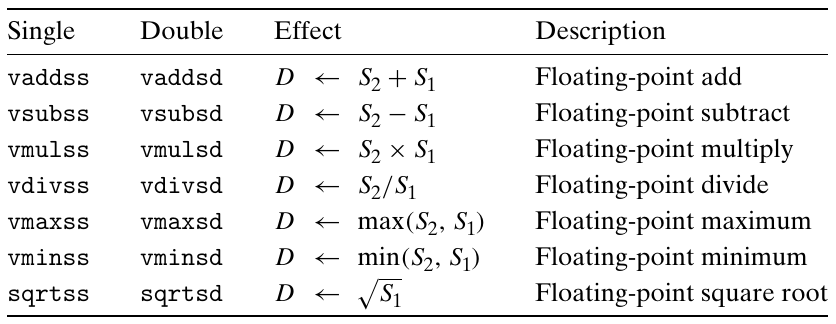

**Hình 3.49 Các phép toán số học scalar floating-point. Chúng có một hoặc hai toán hạng nguồn và một toán hạng đích.**

```
7     vsubsd  %xmm2, %xmm0, %xmm0           Subtract from a*x
8     ret                                   Return
```

Ba đối số floating-point a, x và b được truyền trong các register XMM %xmm0–%xmm2, còn đối số số nguyên i được truyền trong register %edi. Chuỗi two-instruction chuẩn được dùng để chuyển đối số x sang double (dòng 2–3). Cần thêm một instruction chuyển đổi để chuyển đối số i sang double (dòng 5). Giá trị hàm được trả về trong register %xmm0.

#### Bài tập thực hành 3.53 (lời giải trang 384)

Với hàm C sau, kiểu của bốn đối số được định nghĩa bằng typedef:

```
double funct1(arg1_t p, arg2_t q, arg3_t r, arg4_t s)
{
    return p/(q+r) - s;
}
```

Khi biên dịch, gcc tạo code sau:

```
    double funct1(arg1_t p, arg2_t q, arg3_t r, arg4_t s)
1   funct1:
2     vcvtsi2ssq      %rsi, %xmm2, %xmm2
3     vaddss  %xmm0, %xmm2, %xmm0
4     vcvtsi2ss       %edi, %xmm2, %xmm2
5     vdivss  %xmm0, %xmm2, %xmm0
6     vunpcklps       %xmm0, %xmm0, %xmm0
7     vcvtps2pd       %xmm0, %xmm0
8     vsubsd  %xmm1, %xmm0, %xmm0
9     ret
```

Xác định các tổ hợp kiểu có thể có của bốn đối số (có thể có nhiều hơn một tổ hợp).

#### Bài tập thực hành 3.54 (lời giải trang 385)

Hàm funct2 có prototype sau:

```
double funct2(double w, int x, float y, long z);
```

Gcc tạo code sau cho hàm:

```
    double funct2(double w, int x, float y, long z)
    w in %xmm0, x in %edi, y in %xmm1, z in %rsi
1   funct2:
2     vcvtsi2ss       %edi, %xmm2, %xmm2
3     vmulss  %xmm1, %xmm2, %xmm1
            4     vunpcklps       %xmm1, %xmm1, %xmm1
            5     vcvtps2pd       %xmm1, %xmm2
            6     vcvtsi2sdq      %rsi, %xmm1, %xmm1
            7     vdivsd  %xmm1, %xmm0, %xmm0
            8     vsubsd  %xmm0, %xmm2, %xmm0
            9     ret
```

Viết một phiên bản C của funct2.

### 3.11.4 Định nghĩa và sử dụng hằng Floating-Point

Không giống các phép toán số học số nguyên, các phép toán AVX floating-point không thể có toán hạng là giá trị immediate. Thay vào đó, compiler phải cấp phát và khởi tạo vùng lưu trữ cho mọi giá trị hằng. Sau đó code đọc các giá trị từ bộ nhớ. Điều này được minh họa bằng hàm chuyển đổi từ độ Celsius sang Fahrenheit sau:

```
double cel2fahr(double temp)
{
    return 1.8 * temp + 32.0;
}
```

Các phần liên quan của assembly code x86-64 như sau:

```
     double cel2fahr(double temp)
     temp in %xmm0
 1   cel2fahr:
 2     vmulsd  .LC2(%rip), %xmm0, %xmm0    Multiply by 1.8
 3     vaddsd  .LC3(%rip), %xmm0, %xmm0    Add 32.0
 4     ret
 5   .LC2:
 6     .long   3435973837                  Low-order 4 bytes of 1.8
 7     .long   1073532108                  High-order 4 bytes of 1.8
 8   .LC3:
 9     .long   0                           Low-order 4 bytes of 32.0
10     .long   1077936128                  High-order 4 bytes of 32.0
```

Chúng ta thấy hàm đọc giá trị 1.8 từ vị trí bộ nhớ có nhãn .LC2 và giá trị 32.0 từ vị trí bộ nhớ có nhãn .LC3. Nhìn vào các giá trị gắn với những nhãn này, chúng ta thấy mỗi giá trị được chỉ định bằng một cặp khai báo .long với các giá trị cho ở dạng thập phân. Cần diễn giải chúng thành giá trị floating-point như thế nào? Nhìn vào khai báo có nhãn .LC2, chúng ta thấy hai giá trị là 3435973837 (0xcccccccd) và 1073532108 (0x3ffccccc.) Vì máy dùng thứ tự byte little-endian, giá trị thứ nhất cho 4 byte low-order, còn giá trị thứ hai cho 4 byte high-order. Từ các byte high-order, chúng ta có thể trích xuất exponent field là 0x3ff (1023), rồi trừ bias 1023 để thu được exponent bằng 0. Ghép các bit fraction của hai giá trị, chúng ta thu được fraction field là 0xccccccccccccd, có thể chứng minh là biểu diễn nhị phân có phần lẻ của 0.8; chúng ta cộng thêm bit một ngầm định ở đầu để có 1.8.

| Single | Double | Tác động | Mô tả |
|---|---|---|---|
| vxorps | xorpd | D ← S<sub>2</sub> ^ S<sub>1</sub> | Phép bitwise exclusive-or |
| vandps | andpd | D ← S<sub>2</sub> & S<sub>1</sub> | Phép bitwise and |

**Hình 3.50 Các phép toán bitwise trên dữ liệu packed. Các instruction này thực hiện phép toán Boolean trên toàn bộ 128 bit trong một register XMM.**

#### Bài tập thực hành 3.55 (lời giải trang 385)

Chỉ ra cách các số được khai báo tại nhãn .LC3 biểu diễn số 32.0.

### 3.11.5 Sử dụng các phép toán bitwise trong code Floating-Point

Đôi khi, chúng ta thấy gcc tạo code thực hiện các phép toán bitwise trên register XMM để tạo ra những kết quả floating-point hữu ích. Hình 3.50 trình bày một số instruction liên quan, tương tự các instruction tương ứng thao tác trên register general-purpose. Tất cả các phép toán này đều thao tác trên dữ liệu packed, nghĩa là chúng cập nhật toàn bộ register XMM đích, áp dụng phép toán bitwise cho tất cả dữ liệu trong hai register nguồn. Một lần nữa, đối với dữ liệu scalar, chúng ta chỉ quan tâm đến tác động của các instruction này lên 4 hoặc 8 byte low-order của đích. Các phép toán này thường là những cách đơn giản và thuận tiện để thao tác giá trị floating-point, như được khám phá trong bài toán sau.

#### Bài tập thực hành 3.56 (lời giải trang 386)

Xét hàm C sau, trong đó EXPR là một macro được định nghĩa bằng #define:

```
double simplefun(double x) {
    return EXPR(x);
}
```

Dưới đây, chúng ta trình bày code AVX2 được tạo cho các định nghĩa EXPR khác nhau, trong đó giá trị x được chứa trong %xmm0. Tất cả đều tương ứng với một phép toán hữu ích nào đó trên các giá trị floating-point. Xác định đó là những phép toán gì. Để trả lời, bạn sẽ cần hiểu các bit pattern của những word hằng đang được đọc từ bộ nhớ.

```
A. 1      vmovsd  .LC1(%rip), %xmm1
    2     vandpd  %xmm1, %xmm0, %xmm0
    3   .LC1:
    4     .long   4294967295
    5     .long   2147483647
    6     .long   0
    7     .long   0

B.  1     vxorpd  %xmm0, %xmm0, %xmm0
            C.  1     vmovsd  .LC2(%rip), %xmm1
                2     vxorpd  %xmm1, %xmm0, %xmm0
                3   .LC2:
                4     .long   0
                5     .long   -2147483648
                6     .long   0
                7     .long   0
```

### 3.11.6 Các phép so sánh Floating-Point

AVX2 cung cấp hai instruction để so sánh các giá trị floating-point:

| Instruction | Dựa trên | Mô tả |
|---|---|---|
| ucomiss S<sub>1</sub>, S<sub>2</sub> | S<sub>2</sub>−S<sub>1</sub> | So sánh single precision |
| ucomisd S<sub>1</sub>, S<sub>2</sub> | S<sub>2</sub>−S<sub>1</sub> | So sánh double precision |

Các instruction này tương tự instruction cmp (xem Mục 3.6), ở chỗ chúng so sánh các toán hạng S<sub>1</sub> và S<sub>2</sub> (nhưng theo thứ tự ngược với điều người ta có thể mong đợi) và đặt các condition code để biểu thị giá trị tương đối của chúng. Cũng như cmpq, chúng tuân theo quy ước ATT-format liệt kê toán hạng theo thứ tự ngược. Đối số S<sub>2</sub> phải ở trong một register XMM, còn S<sub>1</sub> có thể nằm trong register XMM hoặc bộ nhớ.

Các instruction so sánh floating-point đặt ba condition code: zero flag ZF, carry flag CF và parity flag PF. Chúng ta chưa mô tả parity flag trong Mục 3.6.1 vì nó không thường xuất hiện trong code x86 gcc-generated. Đối với các phép toán số nguyên, flag này được đặt khi phép toán số học hoặc logic gần nhất cho ra một giá trị có byte trọng số thấp nhất có even parity (tức số bit một trong byte là số chẵn). Tuy nhiên, đối với so sánh floating-point, flag được đặt khi một trong hai toán hạng là NaN. Theo quy ước, bất kỳ phép so sánh nào trong C đều được coi là không thỏa mãn khi một trong các đối số là NaN, và flag này được dùng để phát hiện điều kiện đó. Ví dụ, ngay cả phép so sánh x == x cũng cho ra 0 khi x là NaN.

Các condition code được đặt như sau:

| Quan hệ thứ tự S<sub>2</sub>:S<sub>1</sub> | CF | ZF | PF |
|---|---|---|---|
| Unordered | 1 | 1 | 1 |
| S<sub>2</sub> < S<sub>1</sub> | 1 | 0 | 0 |
| S<sub>2</sub> = S<sub>1</sub> | 0 | 1 | 0 |
| S<sub>2</sub> > S<sub>1</sub> | 0 | 0 | 0 |

Trường hợp unordered xảy ra khi một trong hai toán hạng là NaN. Có thể phát hiện trường hợp này bằng parity flag. Thông thường, instruction jp (viết tắt của “jump on parity”) được dùng để nhảy có điều kiện khi một phép so sánh floating-point cho kết quả unordered. Ngoại trừ trường hợp này, các giá trị của carry flag và zero flag giống như đối với phép so sánh unsigned: ZF được đặt khi hai toán hạng bằng nhau, và CF được đặt khi S<sub>2</sub> < S<sub>1</sub>. Những instruction như ja và jb được dùng để nhảy có điều kiện theo các tổ hợp khác nhau của các flag này.

(a) Code C

```
typedef enum {NEG, ZERO, POS, OTHER} range_t;

range_t find_range(float x)
{
    int result;
    if (x < 0)
        result = NEG;
    else if (x == 0)
        result = ZERO;
    else if (x > 0)
        result = POS;
    else
        result = OTHER;
    return result;
}
```

(b) Assembly code được tạo

```
     range_t find_range(float x)
     x in %xmm0
 1   find_range:
 2     vxorps  %xmm1, %xmm1, %xmm1            Set %xmm1 = 0
 3     vucomiss        %xmm0, %xmm1           Compare 0:x
 4     ja      .L5                            If >, goto neg
 5     vucomiss        %xmm1, %xmm0           Compare x:0
 6     jp      .L8                            If NaN, goto posornan
 7     movl    $1, %eax                       result = ZERO
 8     je      .L3                            If =, goto done
 9   .L8:                                   posornan:
10     vucomiss        .LC0(%rip), %xmm0      Compare x:0
11     setbe   %al                            Set result = NaN ? 1 : 0
12     movzbl  %al, %eax                      Zero-extend
13     addl    $2, %eax                       result += 2 (POS for > 0, OTHER for NaN)
14     ret                                    Return
15   .L5:                                   neg:
16     movl    $0, %eax                       result = NEG
17   .L3:                                   done:
18     rep; ret                               Return
```

**Hình 3.51 Minh họa phân nhánh có điều kiện trong code floating-point.**

Để minh họa phép so sánh floating-point, hàm C trong Hình 3.51(a) phân loại đối số x theo quan hệ của nó với 0.0, trả về một kiểu liệt kê làm kết quả. Các kiểu liệt kê trong C được biểu diễn dưới dạng số nguyên, nên các giá trị hàm có thể có là: 0 (NEG), 1 (ZERO), 2 (POS) và 3 (OTHER). Kết quả cuối cùng này xảy ra khi giá trị của x là NaN.

Gcc tạo code được trình bày trong Hình 3.51(b) cho find_range. Code không hiệu quả lắm—nó so sánh x với 0.0 ba lần, mặc dù có thể thu được thông tin cần thiết chỉ bằng một phép so sánh. Nó cũng tạo hằng floating-point 0.0 hai lần—một lần dùng vxorps và một lần bằng cách đọc giá trị từ bộ nhớ. Hãy lần theo luồng thực thi của hàm cho bốn kết quả so sánh có thể có:

x < 0.0 Nhánh ja ở dòng 4 sẽ được thực hiện, nhảy đến cuối với giá trị trả về là 0.

x = 0.0 Các nhánh ja (dòng 4) và jp (dòng 6) sẽ không được thực hiện, nhưng nhánh je (dòng 8) sẽ được thực hiện, trả về với %eax bằng 1.

x > 0.0 Không nhánh nào trong ba nhánh được thực hiện. Instruction setbe (dòng 11) sẽ cho ra 0, và giá trị này được tăng bởi instruction addl (dòng 13) để cho giá trị trả về là 2.

x = NaN Nhánh jp (dòng 6) sẽ được thực hiện. Instruction vucomiss thứ ba (dòng 10) sẽ đặt cả carry flag và zero flag, nên instruction setbe (dòng 11) và instruction tiếp theo sẽ đặt %eax thành 1. Giá trị này được tăng bởi instruction addl (dòng 13) để cho giá trị trả về là 3.

Trong Bài tập về nhà 3.73 và 3.74, bạn được yêu cầu hand-generate các cách triển khai find_range hiệu quả hơn.

#### Bài tập thực hành 3.57 (lời giải trang 386)

Hàm funct3 có prototype sau:

```
double funct3(int *ap, double b, long c, float *dp);
```

Với hàm này, gcc tạo code sau:

```
    double funct3(int *ap, double b, long c, float *dp)
    ap in %rdi, b in %xmm0, c in %rsi, dp in %rdx
 1   funct3:
 2     vmovss  (%rdx), %xmm1
 3     vcvtsi2sd       (%rdi), %xmm2, %xmm2
 4     vucomisd        %xmm2, %xmm0
 5     jbe     .L8
 6     vcvtsi2ssq      %rsi, %xmm0, %xmm0
 7     vmulss  %xmm1, %xmm0, %xmm1
 8     vunpcklps       %xmm1, %xmm1, %xmm1
 9     vcvtps2pd       %xmm1, %xmm0
10     ret
11   .L8:
12     vaddss  %xmm1, %xmm1, %xmm1
13     vcvtsi2ssq      %rsi, %xmm0, %xmm0
14     vaddss  %xmm1, %xmm0, %xmm0
15     vunpcklps       %xmm0, %xmm0, %xmm0
16     vcvtps2pd       %xmm0, %xmm0
17     ret
```

Viết một phiên bản C của funct3.

### 3.11.7 Nhận xét về code Floating-Point

Chúng ta thấy phong cách tổng thể của machine code được tạo để thao tác trên dữ liệu floating-point bằng AVX2 tương tự những gì đã thấy khi thao tác trên dữ liệu số nguyên. Cả hai đều sử dụng một tập hợp register để chứa và thao tác các giá trị, và dùng các register này để truyền đối số hàm.

Tất nhiên, việc xử lý các kiểu dữ liệu khác nhau và các quy tắc đánh giá biểu thức chứa hỗn hợp kiểu dữ liệu có nhiều điều phức tạp, và code AVX2 liên quan đến nhiều instruction và định dạng khác nhau hơn so với những gì thường thấy ở các hàm chỉ thực hiện số học số nguyên.

AVX2 cũng có tiềm năng làm cho phép tính chạy nhanh hơn bằng cách thực hiện các phép toán song song trên dữ liệu packed. Các nhà phát triển compiler đang nghiên cứu tự động hóa việc chuyển code scalar thành code song song, nhưng hiện tại cách đáng tin cậy nhất để đạt hiệu năng cao hơn nhờ tính song song là dùng các phần mở rộng ngôn ngữ C được gcc hỗ trợ để thao tác trên vector dữ liệu. Xem phần Thông tin thêm trên Web opt:simd ở trang 582 để biết cách thực hiện.

## 3.12 Tổng kết

Trong chương này, chúng ta đã nhìn xuống bên dưới lớp trừu tượng do ngôn ngữ C cung cấp để tìm hiểu lập trình machine-level. Bằng cách để compiler tạo một biểu diễn assembly-code của chương trình machine-level, chúng ta hiểu sâu hơn về cả compiler và khả năng tối ưu hóa của nó, cùng với máy, các kiểu dữ liệu và tập instruction của máy. Trong Chương 5, chúng ta sẽ thấy việc biết đặc điểm của compiler có thể giúp ích khi cố gắng viết những chương trình ánh xạ hiệu quả lên máy. Chúng ta cũng đã có một bức tranh đầy đủ hơn về cách chương trình lưu dữ liệu trong các vùng bộ nhớ khác nhau. Trong Chương 12, chúng ta sẽ thấy nhiều ví dụ mà lập trình viên ứng dụng cần biết một biến chương trình nằm trên run-time stack, trong một cấu trúc dữ liệu được cấp phát động, hay là một phần của dữ liệu chương trình toàn cục. Hiểu cách chương trình ánh xạ lên máy giúp dễ hiểu hơn sự khác biệt giữa những dạng lưu trữ này.

Các chương trình Machine-level, cùng biểu diễn của chúng bằng assembly code, khác với chương trình C ở nhiều điểm. Sự phân biệt giữa các kiểu dữ liệu khác nhau là rất ít. Chương trình được diễn đạt thành một chuỗi instruction, mỗi instruction thực hiện một thao tác duy nhất. Các phần của trạng thái chương trình, như register và run-time stack, hiển thị trực tiếp với lập trình viên. Chỉ các phép toán low-level được cung cấp để hỗ trợ thao tác dữ liệu và điều khiển chương trình. Compiler phải dùng nhiều instruction để tạo và thao tác trên các cấu trúc dữ liệu khác nhau và triển khai những cấu trúc điều khiển như điều kiện, vòng lặp và thủ tục. Chúng ta đã trình bày nhiều khía cạnh khác nhau của C và cách nó được biên dịch. Chúng ta đã thấy việc thiếu kiểm tra giới hạn trong C khiến nhiều chương trình dễ bị buffer overflow. Điều này làm nhiều hệ thống dễ bị kẻ xâm nhập độc hại tấn công, mặc dù các biện pháp bảo vệ gần đây do hệ thống run-time và compiler cung cấp giúp chương trình an toàn hơn.

Chúng ta chỉ xem xét cách ánh xạ C lên x86-64, nhưng nhiều nội dung đã trình bày cũng được xử lý tương tự đối với các tổ hợp ngôn ngữ và máy khác. Ví dụ, biên dịch C++ rất giống biên dịch C. Thực tế, các cách triển khai C++ ban đầu trước hết thực hiện chuyển đổi source-to-source từ C++ sang C và tạo object code bằng cách chạy compiler C trên kết quả. Các object C++ được biểu diễn bằng các cấu trúc, tương tự một struct C. Các method được biểu diễn bằng pointer tới code triển khai method đó. Ngược lại, Java được triển khai theo một cách hoàn toàn khác. Object code của Java là một biểu diễn nhị phân đặc biệt gọi là Java byte code. Code này có thể được xem như một chương trình machine-level cho một virtual machine. Đúng như tên gọi, máy này không được triển khai trực tiếp trong phần cứng. Thay vào đó, các trình thông dịch phần mềm xử lý byte code, mô phỏng hành vi của virtual machine. Một cách khác, gọi là biên dịch just-in-time, chuyển đổi động các chuỗi byte code thành machine instruction. Cách tiếp cận này cung cấp khả năng thực thi nhanh hơn khi code được thực thi nhiều lần, chẳng hạn trong vòng lặp. Ưu điểm của việc dùng byte code làm biểu diễn low-level của chương trình là có thể “thực thi” cùng một code trên nhiều máy khác nhau, trong khi machine code chúng ta đã xem xét chỉ chạy trên các máy x86-64.

## Ghi chú tài liệu tham khảo

Cả Intel và AMD đều cung cấp tài liệu phong phú về processor của họ. Chúng bao gồm các mô tả tổng quát về góc nhìn phần cứng của lập trình viên assembly-language [2, 50], cũng như những tài liệu tham khảo chi tiết về từng instruction [3, 51]. Đọc mô tả instruction trở nên phức tạp vì (1) toàn bộ tài liệu dựa trên định dạng assembly-code Intel, (2) mỗi instruction có nhiều biến thể do các chế độ định địa chỉ và thực thi khác nhau, và (3) không có ví dụ minh họa. Tuy vậy, đây vẫn là những tài liệu tham khảo có thẩm quyền về hành vi của từng instruction.

Tổ chức x86-64.org chịu trách nhiệm định nghĩa application binary interface (ABI) cho code x86-64 chạy trên các hệ thống Linux [77]. Interface này mô tả các chi tiết về liên kết thủ tục, file code nhị phân và một số tính năng khác cần thiết để các chương trình machine-code thực thi đúng.

Như đã thảo luận, định dạng ATT được gcc sử dụng rất khác định dạng Intel được dùng trong tài liệu Intel và bởi các compiler khác (bao gồm compiler Microsoft).

Cuốn sách của Muchnick về thiết kế compiler [80] được xem là tài liệu tham khảo đầy đủ nhất về các kỹ thuật code-optimization. Nó trình bày nhiều kỹ thuật chúng ta thảo luận ở đây, chẳng hạn các quy ước sử dụng register.

Đã có nhiều tài liệu viết về việc sử dụng buffer overflow để tấn công các hệ thống qua Internet. Các phân tích chi tiết về Internet worm năm 1988 đã được Spafford [105], cũng như các thành viên trong nhóm tại MIT đã giúp ngăn chặn sự lây lan của nó [35], công bố. Kể từ đó, một số bài báo và dự án đã đưa ra các cách vừa để tạo ra vừa để ngăn chặn những cuộc tấn công buffer overflow. Cuốn sách của Seacord [97] cung cấp nhiều thông tin về buffer overflow và những kiểu tấn công khác vào code được các compiler C tạo ra.

## Bài tập về nhà

3.58 ◆ Với một hàm có prototype

```
long decode2(long x, long y, long z);
```

gcc tạo assembly code sau:

```
1   decode2:
2     subq    %rdx, %rsi
3     imulq   %rsi, %rdi
4     movq    %rsi, %rax
5     salq    $63, %rax
6     sarq    $63, %rax
7     xorq    %rdi, %rax
8     ret
```

Các tham số x, y và z được truyền trong các register %rdi, %rsi và %rdx. Code lưu giá trị trả về trong register %rax.

Viết code C cho decode2 có tác động tương đương với assembly code được trình bày.

3.59 ◆◆ Code sau tính tích 128-bit của hai giá trị signed 64-bit x và y rồi lưu kết quả trong bộ nhớ:

```
1   typedef __int128 int128_t;
2
3   void store_prod(int128_t *dest, int64_t x, int64_t y) {
4       *dest = x * (int128_t) y;
5   }
```

Gcc tạo assembly code sau để triển khai phép tính:

```
 1   store_prod:
 2     movq    %rdx, %rax
 3     cqto
 4     movq    %rsi, %rcx
 5     sarq    $63, %rcx
 6     imulq   %rax, %rcx
 7     imulq   %rsi, %rdx
 8     addq    %rdx, %rcx
 9     mulq    %rsi
10     addq    %rcx, %rdx
11     movq    %rax, (%rdi)
12     movq    %rdx, 8(%rdi)
13     ret
```

Code này dùng ba phép nhân cho số học đa độ chính xác cần thiết để triển khai số học 128-bit trên máy 64-bit. Mô tả thuật toán được dùng để tính tích và chú thích assembly code để cho thấy nó thực hiện thuật toán của bạn như thế nào. Gợi ý: Khi mở rộng các đối số x và y lên 128 bit, có thể viết lại chúng thành x = 2<sup>64</sup> · x<sub>h</sub> + x<sub>l</sub> và y = 2<sup>64</sup> · y<sub>h</sub> + y<sub>l</sub>, trong đó x<sub>h</sub>, x<sub>l</sub>, y<sub>h</sub> và y<sub>l</sub> là các giá trị 64-bit. Tương tự, có thể viết tích 128-bit thành p = 2<sup>64</sup> · p<sub>h</sub> + p<sub>l</sub>, trong đó p<sub>h</sub> và p<sub>l</sub> là các giá trị 64-bit. Chỉ ra cách code tính các giá trị p<sub>h</sub> và p<sub>l</sub> theo x<sub>h</sub>, x<sub>l</sub>, y<sub>h</sub> và y<sub>l</sub>.

3.60 ◆◆ Xét assembly code sau:

```
     long loop(long x, int n)
     x in %rdi, n in %esi
 1   loop:
 2     movl    %esi, %ecx
 3     movl    $1, %edx
 4     movl    $0, %eax
 5     jmp     .L2
 6   .L3:
 7     movq    %rdi, %r8
 8     andq    %rdx, %r8
 9     orq     %r8, %rax
10     salq    %cl, %rdx
11   .L2:
12     testq   %rdx, %rdx
13     jne     .L3
14     rep; ret
```

Code trên được tạo bằng cách biên dịch code C có dạng tổng thể sau:

```
1   long loop(long x, long n)
2   {
3       long result = ______;
4       long mask;
5       for (mask = ______; mask     ______ ; mask = ______ ) {
6           result |= ______ ;
7       }
8       return result;
9   }
```

Nhiệm vụ của bạn là điền các phần còn thiếu của code C để thu được một chương trình tương đương với assembly code được tạo. Nhớ rằng kết quả của hàm được trả về trong register %rax. Bạn sẽ thấy hữu ích khi xem xét assembly code trước, trong và sau vòng lặp để hình thành một ánh xạ nhất quán giữa các register và biến chương trình.

A. Những register nào chứa các giá trị chương trình x, n, result và mask?

B. Giá trị ban đầu của result và mask là gì?

C. Điều kiện kiểm tra cho mask là gì?

D. mask được cập nhật như thế nào?

E. result được cập nhật như thế nào?

F. Điền tất cả các phần còn thiếu của code C.

3.61 ◆◆ Trong Mục 3.6.6, chúng ta đã xem xét code sau như một ứng viên để sử dụng truyền dữ liệu có điều kiện:

```
long cread(long *xp) {
    return (xp ? *xp : 0);
}
```

Chúng ta đã trình bày một cách triển khai thử bằng conditional move instruction nhưng lập luận rằng nó không hợp lệ, vì có thể cố đọc từ địa chỉ null.

Viết một hàm C cread_alt có hành vi giống cread, ngoại trừ việc có thể biên dịch nó để dùng truyền dữ liệu có điều kiện. Khi được biên dịch, code được tạo phải dùng conditional move instruction thay vì một trong các jump instruction.

3.62 ◆◆ Code sau trình bày một ví dụ phân nhánh theo giá trị kiểu liệt kê trong câu lệnh switch. Nhớ rằng kiểu liệt kê trong C chỉ đơn giản là một cách đưa vào một tập tên có các giá trị số nguyên tương ứng. Theo mặc định, các giá trị gán cho tên được đếm tăng dần từ không. Trong code của chúng ta, các thao tác gắn với những nhãn case khác nhau đã bị lược bỏ.

```
 1   /* Enumerated type creates set of constants numbered 0 and upward */
 2   typedef enum {MODE_A, MODE_B, MODE_C, MODE_D, MODE_E} mode_t;
 3
 4   long switch3(long *p1, long *p2, mode_t action)
 5   {
 6       long result = 0;
 7       switch(action) {
 8       case MODE_A:
 9
10       case MODE_B:
11
12       case MODE_C:
13
14       case MODE_D:
15
16       case MODE_E:
17
18       default:
19
20       }
21       return result;
22   }
```

Phần assembly code được tạo để triển khai các thao tác khác nhau được trình bày trong Hình 3.52. Các chú thích chỉ ra vị trí đối số, các giá trị register và các nhãn case cho những đích nhảy khác nhau.

Điền các phần còn thiếu của code C. Nó chứa một case rơi tiếp xuống case khác—hãy cố gắng dựng lại điều này.

3.63 ◆◆ Bài toán này sẽ cho bạn cơ hội reverse engineer một câu lệnh switch từ machine code đã disassemble. Trong thủ tục sau, thân của câu lệnh switch đã bị lược bỏ:

```
1   long switch_prob(long x, long n) {
2       long result = x;
3       switch(n) {
4           /* Fill in code here */
5
6       }
7       return result;
8   }
     p1 in %rdi, p2 in %rsi, action in %edx
 1   .L8:                        MODE_E
 2     movl    $27, %eax
 3     ret
 4   .L3:                        MODE_A
 5     movq    (%rsi), %rax
 6     movq    (%rdi), %rdx
 7     movq    %rdx, (%rsi)
 8     ret
 9   .L5:                        MODE_B
10     movq    (%rdi), %rax
11     addq    (%rsi), %rax
12     movq    %rax, (%rdi)
13     ret
14   .L6:                        MODE_C
15     movq    $59, (%rdi)
16     movq    (%rsi), %rax
17     ret
18   .L7:                        MODE_D
19     movq    (%rsi), %rax
20     movq    %rax, (%rdi)
21     movl    $27, %eax
22     ret
23   .L9:                        default
24     movl    $12, %eax
25     ret
```

**Hình 3.52 Assembly code cho Bài toán 3.62. Code này triển khai các nhánh khác nhau của một câu lệnh switch.**

Hình 3.53 trình bày machine code đã disassemble của thủ tục.

Jump table nằm trong một vùng bộ nhớ khác. Từ phép nhảy gián tiếp ở dòng 5, chúng ta có thể thấy jump table bắt đầu tại địa chỉ 0x4006f8. Dùng debugger gdb, chúng ta có thể kiểm tra sáu word bộ nhớ 8-byte tạo thành jump table bằng lệnh x/6gx 0x4006f8. Gdb in ra như sau:

```
(gdb) x/6gx 0x4006f8
0x4006f8:    0x00000000004005a1    0x00000000004005c3
0x400708:    0x00000000004005a1    0x00000000004005aa
0x400718:    0x00000000004005b2    0x00000000004005bf
```

Điền vào thân câu lệnh switch bằng code C có cùng hành vi với machine code.

```
      long switch_prob(long x, long n)
      x in %rdi, n in %rsi
 1   0000000000400590 <switch_prob>:
 2     400590:  48 83 ee 3c             sub    $0x3c,%rsi
 3     400594:  48 83 fe 05             cmp    $0x5,%rsi
 4     400598:  77 29                   ja     4005c3 <switch_prob+0x33>
 5     40059a:  ff 24 f5 f8 06 40 00    jmpq   *0x4006f8(,%rsi,8)
 6     4005a1:  48 8d 04 fd 00 00 00    lea    0x0(,%rdi,8),%rax
 7     4005a8:  00
 8     4005a9:  c3                      retq
 9     4005aa:  48 89 f8                mov    %rdi,%rax
10     4005ad:  48 c1 f8 03             sar    $0x3,%rax
11     4005b1:  c3                      retq
12     4005b2:  48 89 f8                mov    %rdi,%rax
13     4005b5:  48 c1 e0 04             shl    $0x4,%rax
14     4005b9:  48 29 f8                sub    %rdi,%rax
15     4005bc:  48 89 c7                mov    %rax,%rdi
16     4005bf:  48 0f af ff             imul   %rdi,%rdi
17     4005c3:  48 8d 47 4b             lea    0x4b(%rdi),%rax
18     4005c7:  c3                      retq
```

**Hình 3.53 Code đã disassemble cho Bài toán 3.63.**

3.64 ◆◆◆ Xét source code sau, trong đó R, S và T là các hằng được khai báo bằng #define:

```
1   long A[R][S][T];
2
3   long store_ele(long i, long j, long k, long *dest)
4   {
5       *dest = A[i][j][k];
6       return sizeof(A);
7   }
```

Khi biên dịch chương trình này, gcc tạo assembly code sau:

```
    long store_ele(long i, long j, long k, long *dest)
    i in %rdi, j in %rsi, k in %rdx, dest in %rcx
 1   store_ele:
 2     leaq    (%rsi,%rsi,2), %rax
 3     leaq    (%rsi,%rax,4), %rax
 4     movq    %rdi, %rsi
 5     salq    $6, %rsi
 6     addq    %rsi, %rdi
 7     addq    %rax, %rdi
 8     addq    %rdi, %rdx
 9     movq    A(,%rdx,8), %rax
10     movq    %rax, (%rcx)
11     movl    $3640, %eax
12     ret
```

A. Mở rộng Phương trình 3.1 từ hai chiều lên ba chiều để đưa ra công thức cho vị trí của phần tử array A[i][j][k].

B. Sử dụng kỹ năng reverse engineering để xác định các giá trị R, S và T dựa trên assembly code.

3.65 ◆ Code sau chuyển vị các phần tử của một array M × M, trong đó M là hằng được định nghĩa bằng #define:

```
1   void transpose(long A[M][M]) {
2       long i, j;
3       for (i = 0; i < M; i++)
4           for (j = 0; j < i; j++) {
5               long t = A[i][j];
6               A[i][j] = A[j][i];
7               A[j][i] = t;
8           }
9   }
```

Khi biên dịch với mức tối ưu hóa -O1, gcc tạo code sau cho vòng lặp bên trong của hàm:

```
1   .L6:
2     movq    (%rdx), %rcx
3     movq    (%rax), %rsi
4     movq    %rsi, (%rdx)
5     movq    %rcx, (%rax)
6     addq    $8, %rdx
7     addq    $120, %rax
8     cmpq    %rdi, %rax
9     jne     .L6
```

Chúng ta có thể thấy gcc đã chuyển cách đánh chỉ số array thành code pointer.

A. Register nào chứa pointer tới phần tử array A[i][j]?

B. Register nào chứa pointer tới phần tử array A[j][i]?

C. Giá trị của M là bao nhiêu?

3.66 ◆ Xét source code sau, trong đó NR và NC là các biểu thức macro được khai báo bằng #define để tính các kích thước của array A theo tham số n. Code này tính tổng các phần tử của cột j trong array.

```
1   long sum_col(long n, long A[NR(n)][NC(n)], long j) {
2       long i;
3       long result = 0;
4       for (i = 0; i < NR(n); i++)
5           result += A[i][j];
6       return result;
7   }
```

Khi biên dịch chương trình này, gcc tạo assembly code sau:

```
     long sum_col(long n, long A[NR(n)][NC(n)], long j)
     n in %rdi, A in %rsi, j in %rdx
 1   sum_col:
 2     leaq    1(,%rdi,4), %r8
 3     leaq    (%rdi,%rdi,2), %rax
 4     movq    %rax, %rdi
 5     testq   %rax, %rax
 6     jle     .L4
 7     salq    $3, %r8
 8     leaq    (%rsi,%rdx,8), %rcx
 9     movl    $0, %eax
10     movl    $0, %edx
11   .L3:
12     addq    (%rcx), %rax
13     addq    $1, %rdx
14     addq    %r8, %rcx
15     cmpq    %rdi, %rdx
16     jne     .L3
17     rep; ret
18   .L4:
19     movl    $0, %eax
20     ret
```

Sử dụng kỹ năng reverse engineering để xác định các định nghĩa của NR và NC.

3.67 ◆◆ Trong bài tập này, chúng ta sẽ xem xét code được gcc tạo cho các hàm có đối số và giá trị trả về là cấu trúc, và từ đó thấy cách các tính năng ngôn ngữ này thường được triển khai.

Code C sau có một hàm process nhận đối số và trả về giá trị là cấu trúc, và một hàm eval gọi process:

```
 1   typedef struct {
 2       long a[2];
 3       long *p;
 4   } strA;
5
 6   typedef struct {
 7       long u[2];
 8       long q;
 9   } strB;
10
11   strB process(strA s) {
12       strB r;
13       r.u[0] = s.a[1];
14       r.u[1] = s.a[0];
15       r.q =    *s.p;
16       return r;
17   }
18
19   long eval(long x, long y, long z) {
20       strA s;
21       s.a[0] = x;
22       s.a[1] = y;
23       s.p = &z;
24       strB r = process(s);
25       return r.u[0] + r.u[1] + r.q;
26   }
```

Gcc tạo code sau cho hai hàm này:

```
     strB process(strA s)
 1   process:
 2     movq    %rdi, %rax
 3     movq    24(%rsp), %rdx
 4     movq    (%rdx), %rdx
 5     movq    16(%rsp), %rcx
 6     movq    %rcx, (%rdi)
 7     movq    8(%rsp), %rcx
 8     movq    %rcx, 8(%rdi)
 9     movq    %rdx, 16(%rdi)
10     ret

     long eval(long x, long y, long z)
     x in %rdi, y in %rsi, z in %rdx
 1   eval:
 2     subq    $104, %rsp
 3     movq    %rdx, 24(%rsp)
 4     leaq    24(%rsp), %rax
 5     movq    %rdi, (%rsp)
 6     movq    %rsi, 8(%rsp)
 7     movq    %rax, 16(%rsp)
 8     leaq    64(%rsp), %rdi
 9     call    process
            10    movq    72(%rsp), %rax
            11    addq    64(%rsp), %rax
            12    addq    80(%rsp), %rax
            13    addq    $104, %rsp
            14    ret
```

A. Ở dòng 2 của hàm eval, chúng ta có thể thấy nó cấp phát 104 byte trên stack. Vẽ sơ đồ stack frame của eval, thể hiện các giá trị mà nó lưu trên stack trước khi gọi process.

B. eval truyền giá trị nào trong lời gọi process?

C. Code của process truy cập các phần tử của đối số cấu trúc s như thế nào?

D. Code của process thiết lập các field của cấu trúc kết quả r như thế nào?

E. Hoàn thiện sơ đồ stack frame của eval, thể hiện cách eval truy cập các phần tử của cấu trúc r sau khi process trả về.

F. Bạn có thể rút ra những nguyên tắc tổng quát nào về cách các giá trị cấu trúc được truyền làm đối số hàm và cách chúng được trả về làm kết quả hàm?

3.68 ◆◆◆ Trong code sau, A và B là các hằng được định nghĩa bằng #define:

```
 1   typedef struct {
 2       int x[A][B]; /* Unknown constants A and B */
 3       long y;
 4   } str1;
 5
 6   typedef struct {
 7       char array[B];
 8       int t;
 9       short s[A];
10       long u;
11   } str2;
12
13   void setVal(str1 *p, str2 *q) {
14       long v1 = q->t;
15       long v2 = q->u;
16       p->y = v1+v2;
17   }
```

Gcc tạo code sau cho setVal:

```
    void setVal(str1 *p, str2 *q)
    p in %rdi, q in %rsi
1   setVal:
2     movslq  8(%rsi), %rax
3     addq    32(%rsi), %rax
4     movq    %rax, 184(%rdi)
5     ret
```

Các giá trị A và B là bao nhiêu? (Lời giải là duy nhất.)

3.69 ◆◆◆ Bạn được giao bảo trì một chương trình C lớn và bắt gặp code sau:

```
 1   typedef struct {
 2       int first;
 3       a_struct a[CNT];
 4       int last;
 5   } b_struct;
 6
 7   void test(long i, b_struct *bp)
 8   {
 9       int n = bp->first + bp->last;
10       a_struct *ap = &bp->a[i];
11       ap->x[ap->idx] = n;
12   }
```

Các khai báo của hằng compile-time CNT và cấu trúc a_struct nằm trong một file mà bạn không có quyền truy cập cần thiết. May mắn là bạn có bản code phiên bản .o, có thể disassemble bằng chương trình objdump để thu được phần disassembly sau:

```
     void test(long i, b_struct *bp)
     i in %rdi, bp in %rsi
1   0000000000000000 <test>:
2      0:   8b 8e 20 01 00 00       mov    0x120(%rsi),%ecx
3      6:   03 0e                   add    (%rsi),%ecx
4      8:   48 8d 04 bf             lea    (%rdi,%rdi,4),%rax
5      c:   48 8d 04 c6             lea    (%rsi,%rax,8),%rax
6     10:   48 8b 50 08             mov    0x8(%rax),%rdx
7     14:   48 63 c9                movslq %ecx,%rcx
8     17:   48 89 4c d0 10          mov    %rcx,0x10(%rax,%rdx,8)
9     1c:   c3                      retq
```

Sử dụng kỹ năng reverse engineering, suy ra những điều sau:

A. Giá trị của CNT.

B. Khai báo đầy đủ của cấu trúc a_struct. Giả sử các field duy nhất trong cấu trúc này là idx và x, và cả hai đều chứa giá trị signed.

3.70 ◆◆◆ Xét khai báo union sau:

```
 1   union ele {
 2       struct {
 3           long *p;
 4           long y;
 5       } e1;
 6       struct {
 7           long x;
 8           union ele *next;
 9       } e2;
10   };
```

Khai báo này minh họa việc các cấu trúc có thể được nhúng bên trong union.

Hàm sau (với một số biểu thức bị lược bỏ) thao tác trên một linked list có các union này làm phần tử danh sách:

```
1   void proc (union ele *up) {
2       up->______ = *(______) - ______;
3   }
```

A. Offset (tính bằng byte) của các field sau là bao nhiêu:

| e1.p | ______ |
|---|---|
| e1.y | ______ |
| e2.x | ______ |
| e2.next | ______ |

B. Cấu trúc cần tổng cộng bao nhiêu byte?

C. Compiler tạo assembly code sau cho proc:

```
    void proc (union ele *up)
    up in %rdi
1   proc:
2     movq    8(%rdi), %rax
3     movq    (%rax), %rdx
4     movq    (%rdx), %rdx
5     subq    8(%rax), %rdx
6     movq    %rdx, (%rdi)
7     ret
```

Dựa trên thông tin này, điền các biểu thức còn thiếu trong code của proc. Gợi ý: Một số tham chiếu union có thể có cách diễn giải không rõ ràng. Những điểm mơ hồ này sẽ được giải quyết khi bạn thấy các tham chiếu dẫn đến đâu. Chỉ có một đáp án không thực hiện bất kỳ phép ép kiểu nào và không vi phạm bất kỳ ràng buộc kiểu nào.

3.71 ◆ Viết một hàm good_echo đọc một dòng từ standard input và ghi nó ra standard output. Cách triển khai của bạn phải hoạt động với một dòng đầu vào có độ dài bất kỳ. Bạn có thể dùng hàm thư viện fgets, nhưng phải đảm bảo hàm hoạt động đúng ngay cả khi dòng đầu vào cần nhiều chỗ hơn lượng đã cấp phát cho buffer. Code của bạn cũng phải kiểm tra các điều kiện lỗi và trả về khi gặp lỗi. Hãy tham khảo định nghĩa của các hàm I/O chuẩn trong các tài liệu [45, 61].

3.72 ◆◆ Hình 3.54(a) trình bày code của một hàm tương tự hàm vfunct (Hình 3.43(a)). Chúng ta đã dùng vfunct để minh họa việc sử dụng frame pointer trong quản lý các stack frame variable-size. Hàm mới aframe cấp phát vùng nhớ cho array cục bộ p bằng cách gọi hàm thư viện alloca. Hàm này tương tự hàm malloc thường được dùng hơn, ngoại trừ việc nó cấp phát vùng nhớ trên run-time stack. Vùng nhớ tự động được giải phóng khi thủ tục đang thực thi trả về.

(a) Code C

```
 1   #include <alloca.h>
 2
 3   long aframe(long n, long idx, long *q)  {
 4       long i;
 5       long **p = alloca(n * sizeof(long *));
 6       p[0] = &i;
 7       for (i = 1; i < n; i++)
 8           p[i] = q;
 9       return *p[idx];
10   }
```

(b) Các phần của assembly code được tạo

<pre>    long aframe(long n, long idx, long *q)
    n in %rdi, idx in %rsi, q in %rdx
1   aframe:
2     pushq   %rbp
3     movq    %rsp, %rbp
4     subq    $16, %rsp             Allocate space for i (%rsp = s<sub>1</sub>)
5     leaq    30(,%rdi,8), %rax
6     andq    $-16, %rax
7     subq    %rax, %rsp            Allocate space for array p (%rsp = s<sub>2</sub>)
8     leaq    15(%rsp), %r8
9     andq    $-16, %r8             Set %r8 to &amp;p[0]
      .
      .
      .</pre>

**Hình 3.54 Code cho Bài toán 3.72. Hàm này tương tự hàm trong Hình 3.43.**

Hình 3.54(b) trình bày phần assembly code thiết lập frame pointer và cấp phát vùng nhớ cho các biến cục bộ i và p. Nó rất giống code tương ứng của vframe. Hãy dùng cùng ký hiệu như trong Bài toán 3.49: Stack pointer được đặt thành các giá trị s<sub>1</sub> ở dòng 4 và s<sub>2</sub> ở dòng 7. Địa chỉ bắt đầu của array p được đặt thành giá trị p ở dòng 9. Vùng nhớ dư e<sub>2</sub> có thể xuất hiện giữa s<sub>2</sub> và p, và vùng nhớ dư e<sub>1</sub> có thể xuất hiện giữa cuối array p và s<sub>1</sub>.

A. Giải thích bằng toán học logic của phép tính s<sub>2</sub>.

B. Giải thích bằng toán học logic của phép tính p.

C. Tìm các giá trị n và s<sub>1</sub> dẫn đến giá trị nhỏ nhất và lớn nhất của e<sub>1</sub>.

D. Code này đảm bảo những tính chất alignment nào cho các giá trị s<sub>2</sub> và p?

3.73 ◆ Viết một hàm bằng assembly code có hành vi giống hàm find_range trong Hình 3.51. Code của bạn chỉ được chứa một instruction so sánh floating-point, rồi phải dùng các nhánh có điều kiện để tạo kết quả đúng. Kiểm thử code với tất cả 2<sup>32</sup> giá trị đối số có thể có. Phần Thông tin thêm trên Web asm:easm ở trang 214 mô tả cách tích hợp các hàm viết bằng assembly code vào chương trình C.

3.74 ◆◆ Viết một hàm bằng assembly code có hành vi giống hàm find_range trong Hình 3.51. Code của bạn chỉ được chứa một instruction so sánh floating-point, rồi phải dùng các conditional move để tạo kết quả đúng. Bạn có thể muốn sử dụng instruction cmovp (di chuyển nếu even parity). Kiểm thử code với tất cả 2<sup>32</sup> giá trị đối số có thể có. Phần Thông tin thêm trên Web asm:easm ở trang 214 mô tả cách tích hợp các hàm viết bằng assembly code vào chương trình C.

3.75 ◆ ISO C99 bao gồm các phần mở rộng hỗ trợ số phức. Bất kỳ kiểu floating-point nào cũng có thể được bổ sung bằng từ khóa complex. Dưới đây là một số hàm mẫu thao tác trên dữ liệu số phức và gọi một số hàm thư viện liên quan:

```
 1   #include <complex.h>
 2
 3   double c_imag(double complex x) {
 4       return cimag(x);
 5   }
 6
 7   double c_real(double complex x) {
 8       return creal(x);
 9   }
10
11   double complex c_sub(double complex x, double complex y) {
12       return x - y;
13   }
```

Khi biên dịch, gcc tạo assembly code sau cho các hàm này:

```
    double c_imag(double complex x)
1   c_imag:
2     movapd  %xmm1, %xmm0
3     ret

    double c_real(double complex x)
4   c_real:
5     rep; ret

    double complex c_sub(double complex x, double complex y)
6   c_sub:
7     subsd   %xmm2, %xmm0
8     subsd   %xmm3, %xmm1
9     ret
```

Dựa trên các ví dụ này, xác định những điều sau:

A. Các đối số số phức được truyền cho hàm như thế nào?

B. Các giá trị số phức được trả về từ hàm như thế nào?

## Lời giải các bài tập thực hành

Lời giải Bài toán 3.1 (trang 218) Bài tập này giúp bạn luyện tập với các dạng toán hạng khác nhau.

| Toán hạng | Giá trị | Nhận xét |
|---|---|---|
| %rax | 0x100 | Register |
| 0x104 | 0xAB | Địa chỉ tuyệt đối |
| $0x108 | 0x108 | Immediate |
| (%rax) | 0xFF | Địa chỉ 0x100 |
| 4(%rax) | 0xAB | Địa chỉ 0x104 |
| 9(%rax,%rdx) | 0x11 | Địa chỉ 0x10C |
| 260(%rcx,%rdx) | 0x13 | Địa chỉ 0x108 |
| 0xFC(,%rcx,4) | 0xFF | Địa chỉ 0x100 |
| (%rax,%rdx,4) | 0x11 | Địa chỉ 0x10C |

Lời giải Bài toán 3.2 (trang 221) Như đã thấy, assembly code do gcc tạo có các hậu tố trong instruction, còn disassembler thì không. Khả năng chuyển đổi qua lại giữa hai dạng này là một kỹ năng quan trọng cần học. Một đặc điểm quan trọng là các tham chiếu bộ nhớ trong x86-64 luôn được viết với register quad word, như %rax, ngay cả khi toán hạng là byte, single word hoặc double word.

Dưới đây là code được viết có hậu tố:

```
movl   %eax, (%rsp)
movw   (%rax), %dx
movb   $0xFF, %bl
movb   (%rsp,%rdx,4), %dl
movq  (%rdx), %rax
movw   %dx, (%rax)
```

Lời giải Bài toán 3.3 (trang 222) Vì chúng ta sẽ dựa vào gcc để tạo phần lớn assembly code, khả năng viết assembly code đúng không phải một kỹ năng thiết yếu. Tuy nhiên, bài tập này sẽ giúp bạn quen thuộc hơn với các loại instruction và toán hạng khác nhau.

Dưới đây là code cùng phần giải thích các lỗi:

```
movb $0xF, (%ebx)       Cannot use %ebx as address register
movl %rax, (%rsp)       Mismatch between instruction suffix and register ID
movw (%rax),4(%rsp)     Cannot have both source and destination be memory references
movb %al,%sl            No register named %sl
movl %eax,$0x123        Cannot have immediate as destination
movl %eax,%dx           Destination operand incorrect size
movb %si, 8(%rbp)       Mismatch between instruction suffix and register ID
```

Lời giải Bài toán 3.4 (trang 223) Bài tập này giúp bạn có thêm kinh nghiệm với những instruction di chuyển dữ liệu khác nhau và mối liên hệ của chúng với các kiểu dữ liệu và quy tắc chuyển đổi của C. Những điểm tinh tế trong chuyển đổi cả signedness lẫn kích thước, cũng như integral promotion, làm bài toán này thêm thử thách.

| src_t | dest_t | Instruction | Nhận xét |
|---|---|---|---|
| long | long | movq (%rdi), %rax<br>movq %rax, (%rsi) | Đọc 8 byte<br>Lưu 8 byte |
| char | int | movsbl (%rdi), %eax<br>movl %eax, (%rsi) | Chuyển char thành int<br>Lưu 4 byte |
| char | unsigned | movsbl (%rdi), %eax<br>movl %eax, (%rsi) | Chuyển char thành int<br>Lưu 4 byte |
| unsigned char | long | movzbl (%rdi), %eax<br>movq %rax, (%rsi) | Đọc byte và thực hiện zero-extend<br>Lưu 8 byte |

| int | char | movl (%rdi), %eax<br>movb %al, (%rsi) | Đọc 4 byte<br>Lưu byte low-order |
|---|---|---|---|
| unsigned | unsigned | movl (%rdi), %eax | Đọc 4 byte |
|  | char | movb %al, (%rsi) | Lưu byte low-order |
| char | short | movsbw (%rdi), %ax<br>movw %ax, (%rsi) | Đọc byte và thực hiện sign-extend<br>Lưu 2 byte |

Lời giải Bài toán 3.5 (trang 225) Reverse engineering là một cách tốt để hiểu hệ thống. Trong trường hợp này, chúng ta muốn đảo ngược tác động của compiler C để xác định code C nào đã tạo ra assembly code này. Cách tốt nhất là chạy một “mô phỏng”, bắt đầu với các giá trị x, y và z lần lượt ở các vị trí được chỉ định bởi các pointer xp, yp và zp. Khi đó chúng ta sẽ có hành vi sau:

```
  void decode1(long *xp, long *yp, long *zp)
  xp in %rdi, yp in %rsi, zp in %rdx
decode1:
  movq    (%rdi), %r8     Get x = *xp
  movq    (%rsi), %rcx    Get y = *yp
  movq    (%rdx), %rax    Get z = *zp
  movq    %r8, (%rsi)     Store x at yp
  movq    %rcx, (%rdx)    Store y at zp
  movq    %rax, (%rdi)    Store z at xp
  ret
```

Từ đây, chúng ta có thể tạo code C sau:

```
void decode1(long *xp, long *yp, long *zp)
{
    long x = *xp;
    long y = *yp;
    long z = *zp;

    *yp = x;
    *zp = y;
    *xp = z;
}
```

Lời giải Bài toán 3.6 (trang 228) Bài tập này minh họa tính linh hoạt của instruction leaq và giúp bạn luyện tập thêm việc giải mã các dạng toán hạng khác nhau. Mặc dù các dạng toán hạng được phân loại là kiểu “Memory” trong Hình 3.3, không có truy cập bộ nhớ nào xảy ra.

| Instruction | Kết quả |
|---|---|
| leaq 9(%rdx), %rax | 9 + q |
| leaq (%rdx,%rbx), %rax | q + p |
| leaq (%rdx,%rbx,3), %rax | q + 3p |
| leaq 2(%rbx,%rbx,7), %rax | 2 + 8p |
| leaq 0xE(,%rdx,3), %rax | 14 + 3q |
| leaq 6(%rbx,%rdx,7), %rdx | 6 + p + 7q |

Lời giải Bài toán 3.7 (trang 229) Một lần nữa, reverse engineering chứng tỏ là một cách hữu ích để tìm hiểu mối quan hệ giữa code C và assembly code được tạo.

Cách tốt nhất để giải các bài toán dạng này là chú thích các dòng assembly code với thông tin về những thao tác đang được thực hiện. Dưới đây là một ví dụ:

```
  short scale3(short x, short y, short z)
  x in %rdi, y in %rsi, z in %rdx
scale3:
  leaq    (%rsi,%rsi,9), %rbx      10 * y
  leaq    (%rbx,%rdx), %rbx        10 * y + z
  leaq    (%rbx,%rdi,%rsi), %rbx   10 * y + z + y * x
  ret
```

Từ đây, có thể dễ dàng tạo biểu thức còn thiếu:

```
short t = 10 * y + z + y * x;
```

Lời giải Bài toán 3.8 (trang 230) Bài toán này cho bạn cơ hội kiểm tra hiểu biết về toán hạng và các instruction số học. Chuỗi instruction được thiết kế sao cho kết quả của mỗi instruction không ảnh hưởng đến hành vi của những instruction sau.

| Instruction | Đích | Giá trị |
|---|---|---|
| addq %rcx,(%rax) | 0x100 | 0x100 |
| subq %rdx,8(%rax) | 0x108 | 0xA8 |
| imulq $16,(%rax,%rdx,8) | 0x118 | 0x110 |
| incq 16(%rax) | 0x110 | 0x14 |
| decq %rcx | %rcx | 0x0 |
| subq %rdx,%rax | %rax | 0xFD |

Lời giải Bài toán 3.9 (trang 231) Bài tập này cho bạn cơ hội tạo một ít assembly code. Code lời giải do gcc tạo. Bằng cách nạp tham số n vào register %ecx, sau đó có thể dùng byte register %cl để chỉ định số bit dịch cho instruction sarq. Có vẻ lạ khi dùng instruction movl, vì n dài tám byte, nhưng nhớ rằng chỉ cần byte có trọng số thấp nhất để chỉ định số bit dịch.

```
  long shift_left4_rightn(long x, long n)
  x in %rdi, n in %rsi
shift_left4_rightn:
  movq    %rdi, %rax    Get x
  salq    $4, %rax      x <<= 4
  movl    %esi, %ecx    Get n (4 bytes)
  sarq    %cl, %rax     x >>= n
```

Lời giải Bài toán 3.10 (trang 232) Bài toán này khá đơn giản, vì assembly code bám sát cấu trúc của code C.

```
short p1 = y | z;
short p2 = p1 >> 9;
short p3 = ~p2;
short p4 = y - p3;
```

Lời giải Bài toán 3.11 (trang 233)

A. Instruction này được dùng để đặt register %rcx thành không, khai thác tính chất x ^ x = 0 với mọi x. Nó tương ứng với câu lệnh C x = 0.

B. Một cách trực tiếp hơn để đặt register %rcx thành không là dùng instruction movq $0,%rcx.

C. Tuy nhiên, khi assemble và disassemble code này, chúng ta thấy phiên bản dùng xorq chỉ cần 3 byte, còn phiên bản dùng movq cần 7. Những cách khác để đặt %rcx thành không dựa trên tính chất rằng bất kỳ instruction nào cập nhật 4 byte thấp sẽ khiến các byte high-order được đặt thành không. Do đó, chúng ta có thể dùng xorl %ecx,%ecx (2 byte) hoặc movl $0,%ecx (5 byte).

Lời giải Bài toán 3.12 (trang 236) Chúng ta chỉ cần thay instruction cqto bằng một instruction đặt register %rdx thành không và dùng divq thay vì idivq làm instruction chia, thu được code sau:

```
    void uremdiv(unsigned long x, unsigned long y,
               unsigned long *qp, unsigned long *rp)
    x in %rdi, y in %rsi, qp in %rdx, rp in %rcx
1   uremdiv:
2     movq    %rdx, %r8       Copy qp
3     movq    %rdi, %rax      Move x to lower 8 bytes of dividend
4     movl    $0, %edx        Set upper 8 bytes of dividend to 0
5     divq    %rsi            Divide by y
6     movq    %rax, (%r8)     Store quotient at qp
7     movq    %rdx, (%rcx)    Store remainder at rp
8     ret
```

Lời giải Bài toán 3.13 (trang 240) Điều quan trọng cần hiểu là assembly code không theo dõi kiểu của một giá trị chương trình. Thay vào đó, các instruction khác nhau xác định kích thước toán hạng và việc chúng là signed hay unsigned. Khi ánh xạ từ các chuỗi instruction trở lại code C, chúng ta phải tìm hiểu một chút để suy ra kiểu dữ liệu của những giá trị chương trình.

A. Hậu tố ‘l’ và các tên register cho biết các toán hạng 32-bit, còn phép so sánh là phép < two’s-complement. Chúng ta có thể suy ra data_t phải là int.

B. Hậu tố ‘w’ và các tên register cho biết các toán hạng 16-bit, còn phép so sánh là phép >= two’s-complement. Chúng ta có thể suy ra data_t phải là short.

C. Hậu tố ‘b’ và các tên register cho biết các toán hạng 8-bit, còn phép so sánh là phép <= unsigned. Chúng ta có thể suy ra data_t phải là unsigned char.

D. Hậu tố ‘q’ và các tên register cho biết các toán hạng 64-bit, còn phép so sánh là !=, giống nhau bất kể các đối số là signed, unsigned hay pointer. Chúng ta có thể suy ra data_t có thể là long, unsigned long hoặc một dạng pointer nào đó.

Lời giải Bài toán 3.14 (trang 241) Bài toán này tương tự Bài toán 3.13, ngoại trừ việc nó liên quan đến instruction test thay vì instruction cmp.

A. Hậu tố ‘q’ và các tên register cho biết một toán hạng 64-bit, còn phép so sánh là >=, phải là signed. Chúng ta có thể suy ra data_t phải là long.

B. Hậu tố ‘w’ và tên register cho biết một toán hạng 16-bit, còn phép so sánh là ==, giống nhau cho signed hoặc unsigned. Chúng ta có thể suy ra data_t phải là short hoặc unsigned short.

C. Hậu tố ‘b’ và tên register cho biết một toán hạng 8-bit, còn phép so sánh là > unsigned. Chúng ta có thể suy ra data_t phải là unsigned char.

D. Hậu tố ‘l’ và tên register cho biết các toán hạng 32-bit, còn phép so sánh là <. Chúng ta có thể suy ra data_t phải là int.

Lời giải Bài toán 3.15 (trang 245) Bài tập này yêu cầu bạn xem xét chi tiết code đã disassemble và suy luận về cách biểu diễn các đích nhảy. Nó cũng giúp bạn luyện tập số học hexadecimal.

A. Instruction je có đích là 0x4003fc + 0x02. Như code đã disassemble ban đầu cho thấy, giá trị này là 0x4003fe:

```
4003fa: 74 02                 je     4003fe
4003fc: ff d0                 callq  *%rax
```

B. Instruction je có đích là 0x0x400431 − 12 (vì 0xf4 là biểu diễn two’s-complement 1-byte của −12). Như code đã disassemble ban đầu cho thấy, giá trị này là 0x400425:

```
40042f: 74 f4                 je     400425
400431: 5d                    pop    %rbp
```

C. Theo chú thích do disassembler tạo, đích nhảy ở địa chỉ tuyệt đối 0x400547. Theo biểu diễn byte, địa chỉ này phải nằm sau địa chỉ của instruction pop một khoảng 0x2 byte. Lấy hiệu hai giá trị này cho địa chỉ 0x400545. Lưu ý rằng biểu diễn của instruction ja cần 2 byte, nên nó phải nằm ở địa chỉ 0x400543. Những điều này được xác nhận khi xem xét disassembly ban đầu:

```
400543: 77 02                 ja     400547
400545: 5d                    pop    %rbp
```

D. Đọc các byte theo thứ tự ngược, chúng ta có thể thấy offset đích là 0xffffff73, hay số thập phân −141. Cộng nó với 0x0x4005ed (địa chỉ của instruction nop) cho ra địa chỉ 0x400560:

```
4005e8: e9 73 ff ff ff        jmpq   400560
4005ed: 90                    nop
```

Lời giải Bài toán 3.16 (trang 248) Chú thích assembly code và viết code C mô phỏng control flow của nó là những bước đầu tốt để hiểu các chương trình assembly-language. Bài toán này cho bạn luyện tập với một ví dụ có control flow đơn giản. Nó cũng cho bạn cơ hội xem xét cách triển khai các phép toán logic.

A. Dưới đây là code C:

```
void goto_cond(short a, short *p) {
    if (a == 0)
        goto done;
    if (a >= *p)
        goto done;
    *p = a;
 done:
    return;
}
```

B. Nhánh có điều kiện đầu tiên là một phần của cách triển khai biểu thức &&. Nếu phép kiểm tra a là non-null không thỏa mãn, code sẽ bỏ qua phép kiểm tra a >= *p.

Lời giải Bài toán 3.17 (trang 248) Đây là một bài tập giúp bạn suy nghĩ về ý tưởng quy tắc chuyển đổi tổng quát và cách áp dụng nó.

A. Chuyển sang dạng thay thế này chỉ cần đổi vị trí một vài dòng code:

```
long gotodiff_se_alt(long x, long y) {
    long result;
    if (x < y)
        goto x_lt_y;
    ge_cnt++;
    result = x - y;
    return result;
 x_lt_y:
    lt_cnt++;
    result =  y - x;
    return result;
}
```

B. Ở hầu hết các khía cạnh, việc lựa chọn là tùy ý. Nhưng quy tắc ban đầu hoạt động tốt hơn cho trường hợp phổ biến là không có câu lệnh else. Với trường hợp này, chúng ta chỉ cần sửa quy tắc chuyển đổi thành như sau:

```
    t = test-expr;
    if (!t)
        goto done;
    then-statement
done:
```

Một cách chuyển đổi dựa trên quy tắc thay thế sẽ rườm rà hơn.

Lời giải Bài toán 3.18 (trang 249) Bài toán này yêu cầu bạn giải quyết một cấu trúc nhánh lồng nhau, qua đó thấy cách quy tắc chuyển đổi câu lệnh if của chúng ta đã được áp dụng. Nhìn chung, machine code là một bản chuyển đổi trực tiếp của code C.

```
short test(short x, short y, short z) {
    short val = z+y-x;
    if (z > 5) {
        if (y > 2)
            val = x/z;
        else
            val = x/y;
    } else if (z < 3)
        val = z/y;
    return val;
}
```

Lời giải Bài toán 3.19 (trang 252) Bài toán này củng cố phương pháp tính misprediction penalty của chúng ta.

A. Chúng ta có thể áp dụng trực tiếp công thức để có T<sub>MP</sub> = 2(45 − 25) = 40.

B. Khi xảy ra misprediction, hàm sẽ cần khoảng 25 + 40 = 65 chu kỳ.

Lời giải Bài toán 3.20 (trang 255) Bài toán này cho cơ hội nghiên cứu việc sử dụng conditional move.

A. Toán tử là ‘/’. Chúng ta thấy đây là một ví dụ chia cho lũy thừa của 4 bằng phép dịch phải (xem Mục 2.3.7). Trước khi dịch k = 4 bit, chúng ta phải cộng bias 2<sup>k</sup> − 1 = 15 khi số bị chia âm.

B. Dưới đây là một phiên bản assembly code có chú thích:

```
  short arith(short x)
  x in %rdi
arith:
  leaq    15(%rdi), %rbx    temp = x+15
  testq   %rdi, %rdi        Text x
  cmovns  %rdi, %rbx        If x>= 0, temp = x
  sarq    $4, %rbx          result = temp >> 4 (= x/16)
  ret
```

Chương trình tạo một giá trị tạm bằng x + 15, dự trù trường hợp x âm và do đó cần cộng bias. Instruction cmovns thay đổi có điều kiện số này thành x khi x ≥ 0, rồi nó được dịch 4 bit để tạo x/16.

Lời giải Bài toán 3.21 (trang 255) Bài toán này tương tự Bài toán 3.18, ngoại trừ việc một số điều kiện đã được triển khai bằng các phép truyền dữ liệu có điều kiện. Mặc dù việc đặt code này vào khuôn dạng của code C ban đầu có vẻ khó khăn, bạn sẽ thấy nó tuân theo khá sát các quy tắc chuyển đổi.

```
short test(short x, short y) {
    short val = y + 12;
    if (x < 0) {
        if (x < y)
            val = x * y;
        else
            val = x | y;
    } else if (y > 10)
        val = x / y;
    return val;
}
```

Lời giải Bài toán 3.22 (trang 257)

A. Phép tính 14! sẽ bị overflow với int 32-bit. Như đã học trong Bài toán 2.35, khi nhận được giá trị x trong lúc cố tính n!, chúng ta có thể kiểm tra overflow bằng cách tính x/n và xem nó có bằng (n − 1)! hay không (giả sử đã đảm bảo phép tính (n − 1)! không bị overflow). Trong trường hợp này, chúng ta có 1,278,945,280/14 = 91353234.286. Một cách kiểm tra thứ hai là thấy rằng bất kỳ giai thừa nào lớn hơn 10! đều phải là bội số của 100 và do đó có hai chữ số cuối bằng không. Giá trị đúng của 14! là 87,178,291,200. Ngoài ra, chúng ta có thể lập một bảng các giai thừa được tính đến 14! với kiểu dữ liệu int, như bên dưới:

| n | n! | Đúng? |
|---|---|---|
| 1 | 1 | Y |
| 2 | 2 | Y |
| 3 | 6 | Y |
| 4 | 24 | Y |
| 5 | 120 | Y |
| 6 | 720 | Y |
| 7 | 5,040 | Y |
| 8 | 40,320 | Y |
| 9 | 362,880 | Y |
| 10 | 3,628,800 | Y |
| 11 | 39,916,800 | Y |
| 12 | 479,001,600 | Y |
| 13 | 1,932,053,504 | N |
| 14 | 1,278,945,280 | N |

B. Thực hiện phép tính với kiểu dữ liệu long cho phép chúng ta tính đến 20!, do đó phép tính 14! không bị overflow.

Lời giải Bài toán 3.23 (trang 258) Code được tạo khi biên dịch vòng lặp có thể khó phân tích, vì compiler có thể thực hiện nhiều phép tối ưu hóa khác nhau trên code vòng lặp, và vì việc khớp các biến chương trình với register có thể khó khăn. Ví dụ cụ thể này minh họa một số chỗ assembly code không chỉ là bản chuyển đổi trực tiếp của code C.

A. Mặc dù tham số x được truyền cho hàm trong register %rdi, chúng ta có thể thấy register này không bao giờ được tham chiếu sau khi đi vào vòng lặp. Thay vào đó, chúng ta có thể thấy các register %rbx, %rcx và %rdx được khởi tạo ở dòng 2–5 lần lượt thành x, x/9 và 4*x. Do đó có thể kết luận các register này chứa các biến chương trình.

B. Compiler xác định pointer p luôn trỏ đến x, nên biểu thức (*p)+=5 chỉ đơn giản tăng x. Nó kết hợp việc tăng thêm 5 này với việc tăng y thông qua instruction leaq ở dòng 7.

C. Code có chú thích như sau:

```
     short dw_loop(short x)
     x initially in %rdi
 1   dw_loop:
 2     movq    %rdi, %rbx             Copy x to %rbx
 3     movq    %rdi, %rcx
 4     idivq   $9, %rcx               Compute y = x/9
 5     leaq    (,%rdi,4), %rdx        Compute n = 4*x
 6   .L2:                          loop:
 7     leaq    5(%rbx,%rcx), %rcx     Compute y += x + 5
 8     subq    $2, %rdx               Decrement n by 2
 9     testq   %rdx, %rdx             Test n
10     jg      .L2                    If > 0, goto loop
11     rep; ret                    Return
```

Lời giải Bài toán 3.24 (trang 260) Assembly code này là một bản chuyển đổi khá trực tiếp của vòng lặp bằng phương pháp jump-to-middle. Code C đầy đủ như sau:

```
short loop_while(short a, short b)
{
    short result = 0;
    while (a > b) {
        result = result + (a*b);
        a = a-1;
    }
    return result;
}
```

Lời giải Bài toán 3.25 (trang 262) Mặc dù code được tạo không tuân theo chính xác khuôn mẫu của phép chuyển đổi guarded-do, chúng ta có thể thấy nó tương đương với code C sau:

```
long loop_while2(long a, long b)
{
    long result = b;
    while (b > 0) {
        result = result * a;
        b = b-a;
    }
    return result;
}
```

Chúng ta thường gặp các trường hợp, đặc biệt khi biên dịch với mức tối ưu hóa cao hơn, mà gcc có thể linh hoạt phần nào về hình thức chính xác của code được tạo, trong khi vẫn giữ nguyên chức năng cần thiết.

Lời giải Bài toán 3.26 (trang 264) Khả năng suy ngược từ assembly code về code C là một ví dụ điển hình của reverse engineering.

A. Chúng ta có thể thấy code dùng phép chuyển đổi jump-to-middle, sử dụng instruction jmp ở dòng 3.

B. Dưới đây là code C ban đầu:

```
short test_one(unsigned short x) {
    short val = 1;
    while (x) {
        val ^= x;
        x >>= 1;
    }
    return val & 0;
}
```

C. Code này tính parity của đối số x. Nghĩa là nó trả về 1 nếu x có số bit một là số lẻ và 0 nếu số bit một là số chẵn.

Lời giải Bài toán 3.27 (trang 267) Bài tập này nhằm củng cố hiểu biết của bạn về cách triển khai vòng lặp.

```
long fibonacci_gd_goto(long n)
{
    long i = 2;
    long next, first = 0, second = 1;
    if (n <= 1)
        goto done;
 loop:
    next = first + second;
    first = second; second = next;
    i++;
    if (i <= n)
        goto loop;
 done:
    return n;
}
```

Lời giải Bài toán 3.28 (trang 267) Bài toán này khó hơn Bài toán 3.26, vì code trong vòng lặp phức tạp hơn và thao tác tổng thể ít quen thuộc hơn.

A. Dưới đây là code C ban đầu:

```
long fun_b(unsigned long x) {
    long val = 0;
    long i;
for (i = 64; i != 0; i--) {
val = (val << 1) | (x & 0x1);
x >>= 1;
}
return val;
}
```

B. Code được tạo bằng phép biến đổi guarded-do, nhưng compiler phát hiện rằng vì i được khởi tạo thành 64 nên nó sẽ thỏa mãn phép kiểm tra i ≠ 0, do đó không cần phép kiểm tra ban đầu.

C. Code này đảo thứ tự các bit trong x, tạo ra một ảnh gương. Nó làm điều này bằng cách dịch các bit của x từ trái sang phải, rồi điền các bit này vào khi dịch val từ phải sang trái.

Lời giải Bài toán 3.29 (trang 268) Quy tắc đã nêu để chuyển vòng lặp for thành vòng lặp while hơi quá đơn giản—đây là khía cạnh duy nhất cần xem xét đặc biệt.

A. Áp dụng quy tắc chuyển đổi của chúng ta sẽ cho code sau:

```
/* Naive translation of for loop into while loop */
/* WARNING: This is buggy code */
long sum = 0;
long i = 0;
while (i < 10) {
    if (i & 1)
        /* This will cause an infinite loop */
        continue;
    sum += i;
    i++;
}
```

Code này có vòng lặp vô hạn, vì câu lệnh continue ngăn biến chỉ số i được cập nhật.

B. Lời giải tổng quát là thay câu lệnh continue bằng câu lệnh goto bỏ qua phần còn lại của thân vòng lặp và đi thẳng đến phần cập nhật:

```
/* Correct translation of for loop into while loop */
long sum = 0;
long i = 0;
while (i < 10) {
    if (i & 1)
        goto update;
    sum += i;
update:
    i++;
}
```

Lời giải Bài toán 3.30 (trang 272) Bài toán này cho bạn cơ hội suy luận về control flow của câu lệnh switch. Trả lời các câu hỏi yêu cầu bạn kết hợp thông tin từ nhiều vị trí trong assembly code.

- Dòng 2 của assembly code cộng 2 vào x để đặt đầu dưới miền các case thành không. Điều đó có nghĩa nhãn case nhỏ nhất là −2.

- Dòng 3 và 4 khiến chương trình nhảy đến default case khi giá trị case đã điều chỉnh lớn hơn 8. Từ đó có thể suy ra rằng nhãn case lớn nhất là −2 + 8 = 6.

- Trong jump table, chúng ta thấy các mục ở dòng 6 (giá trị case 2) và 9 (giá trị case 5) có cùng đích (.L2) với jump instruction ở dòng 4, biểu thị hành vi của default case. Do đó, các nhãn case 2 và 5 không có trong thân câu lệnh switch.

- Trong jump table, chúng ta thấy các mục ở dòng 3 và 10 có cùng đích. Chúng tương ứng với các case −1 và 6.

- Trong jump table, chúng ta thấy các mục ở dòng 5 và 7 có cùng đích. Chúng tương ứng với các case 1 và 3.

Từ lập luận này, chúng ta rút ra các kết luận sau:

A. Các nhãn case trong thân câu lệnh switch có giá trị −2, −1, 0, 1, 3, 4 và 6.

B. Case có đích .L5 có các nhãn −1 và 6.

C. Case có đích .L7 có các nhãn 1 và 3.

Lời giải Bài toán 3.31 (trang 273) Chìa khóa để reverse engineer các câu lệnh switch đã biên dịch là kết hợp thông tin từ assembly code và jump table để phân biệt các case khác nhau. Từ instruction ja (dòng 3), chúng ta có thể thấy code cho default case có nhãn .L2. Có thể thấy nhãn lặp lại duy nhất khác trong jump table là .L5, nên đây phải là code cho các case C và D. Có thể thấy code rơi tiếp xuống ở dòng 8, nên nhãn .L7 phải khớp với case A và nhãn .L3 phải khớp với case B. Như vậy chỉ còn nhãn .L6 để khớp với case E.

Code C ban đầu như sau:

```
void switcher(long a, long b, long c, long *dest)
{
    long val;
    switch(a) {
    case 5:
        c = b ^ 15;
        /* Fall through */
    case 0:
        val = c + 112;
        break;
case 2:
case 7:
val = (c + b) << 2;
break;
case 4:
val = a;
break;
default:
val = b;
}
*dest = val;
}
```

Lời giải Bài toán 3.32 (trang 280) Lần theo thực thi chương trình ở mức chi tiết này củng cố nhiều khía cạnh của việc gọi và trả về từ thủ tục. Chúng ta có thể thấy rõ cách điều khiển được truyền cho hàm khi nó được gọi, và cách hàm gọi tiếp tục khi hàm được gọi trả về. Cũng có thể thấy cách các đối số được truyền qua register %rdi và %rsi, và cách kết quả được trả về qua register %rax.

Instruction Các giá trị trạng thái (lúc bắt đầu)

| Nhãn PC Instruction %rdi %rsi %rax | %rsp *%rsp Mô tả |
|---|---|
| M1 0x400560 callq 10 — — | 0x7fffffffe820 — Gọi first(10) |
| F1 0x400548 lea 10 — — | 0x7fffffffe818 0x400565 Bắt đầu first |
| F2 0x40054c sub 10 11 — | 0x7fffffffe818 0x400565 |
| F3 0x400550 callq 9 11 — | 0x7fffffffe818 0x400565 Gọi last(9, 11) |
| L1 0x400540 mov 9 11 — | 0x7fffffffe810 0x400555 Bắt đầu last |
| L2 0x400543 imul 9 11 9 | 0x7fffffffe810 0x400555 |
| L3 0x400547 retq 9 11 99 | 0x7fffffffe810 0x400555 Trả về 99 từ last |
| F4 0x400555 repz repq 9 11 99 | 0x7fffffffe818 0x400565 Trả về 99 từ first |
| M2 0x400565 mov 9 11 99 | 0x7fffffffe820 — Tiếp tục main |

Lời giải Bài toán 3.33 (trang 282) Bài toán này hơi khó do sự pha trộn các kích thước dữ liệu khác nhau.

Trước tiên hãy mô tả một đáp án rồi giải thích khả năng thứ hai. Nếu giả sử phép cộng thứ nhất (dòng 3) triển khai *u += a, còn phép cộng thứ hai (dòng 4) triển khai v += b, thì chúng ta có thể thấy a đã được truyền làm đối số thứ nhất trong %edi và được chuyển từ 4 byte thành 8 trước khi cộng với 8 byte được %rdx trỏ tới. Từ đó có thể suy ra rằng a phải có kiểu int và u phải có kiểu long *. Chúng ta cũng có thể thấy byte low-order của đối số b được cộng vào byte được %rcx trỏ tới. Từ đó có thể suy ra rằng v phải có kiểu char *, nhưng kiểu của b chưa rõ—nó có thể dài 1, 2, 4 hoặc 8 byte. Điểm mơ hồ này được giải quyết bằng cách lưu ý giá trị trả về là 6, được tính bằng tổng kích thước của a và b. Vì biết a dài 4 byte, chúng ta có thể suy ra b phải là 2.

Một phiên bản có chú thích của hàm này giải thích những chi tiết đó:

```
    int procprobl(int a, short b, long *u, char *v)
    a in %edi, b in %si, u in %rdx, v in %rcx
1   procprob:
2     movslq  %edi, %rdi        Convert a to long
3     addq    %rdi, (%rdx)      Add to *u (long)
4     addb    %sil, (%rcx)      Add low-order byte of b to *v
5     movl    $6, %eax          Return 4+2
6     ret
```

Ngoài ra, chúng ta có thể thấy cùng assembly code vẫn hợp lệ nếu hai phép cộng được tính trong assembly code theo thứ tự ngược với code C. Điều này sẽ hoán đổi các đối số a và b, cũng như các đối số u và v, cho ra prototype sau:

```
int procprob(int b, short a, long *v, char *u);
```

Lời giải Bài toán 3.34 (trang 288) Ví dụ này minh họa việc dùng các register callee-saved cũng như stack để chứa dữ liệu cục bộ.

A. Chúng ta có thể thấy các dòng 9–14 lưu những giá trị cục bộ a0–a5 lần lượt vào các register callee-saved %rbx, %r15, %r14, %r13, %r12 và %rbp.

B. Các giá trị cục bộ a6 và a7 được lưu trên stack tại offset 0 và 8 so với stack pointer (dòng 16 và 18).

C. Sau khi lưu sáu biến cục bộ, chương trình đã dùng hết các register callee-saved. Nó lưu hai giá trị cục bộ còn lại trên stack.

Lời giải Bài toán 3.35 (trang 290) Bài toán này cho cơ hội xem xét code của một hàm đệ quy. Một bài học quan trọng cần rút ra là code đệ quy có cấu trúc giống hệt các hàm khác mà chúng ta đã thấy. Stack và các quy tắc register-saving đủ để làm cho hàm đệ quy hoạt động đúng.

A. Register %rbx chứa giá trị của tham số x, để có thể dùng nó tính biểu thức kết quả.

B. Assembly code được tạo từ code C sau:

```
long rfun(unsigned long x) {
    if (x == 0)
        return 0;
    unsigned long nx = x>>2;
    long rv = rfun(nx);
    return x + rv;
}
```

Lời giải Bài toán 3.36 (trang 292) Bài tập này kiểm tra hiểu biết về kích thước dữ liệu và đánh chỉ số array. Lưu ý rằng pointer thuộc bất kỳ loại nào đều dài 8 byte. Kiểu dữ liệu short cần 2 byte, còn int cần 4.

| Array | Kích thước phần tử | Tổng kích thước | Địa chỉ bắt đầu | Phần tử i |
|---|---|---|---|---|
| P | 4 | 20 | x<sub>P</sub> | x<sub>P</sub> + 4i |
| Q | 2 | 4 | x<sub>Q</sub> | x<sub>Q</sub> + 2i |
| R | 8 | 72 | x<sub>R</sub> | x<sub>R</sub> + 8i |
| S | 8 | 80 | x<sub>S</sub> | x<sub>S</sub> + 8i |
| T | 8 | 16 | x<sub>T</sub> | x<sub>T</sub> + 8i |

Lời giải Bài toán 3.37 (trang 294) Bài toán này là một biến thể của ví dụ đã trình bày cho array số nguyên E. Điều quan trọng là hiểu sự khác biệt giữa pointer và object được trỏ tới. Vì kiểu dữ liệu short cần 2 byte, tất cả các chỉ số array được nhân với hệ số 2. Thay vì dùng movl như trước, giờ chúng ta dùng movw.

| Biểu thức | Kiểu | Giá trị | Assembly Code |
|---|---|---|---|
| P[1] | short | M[x<sub>P</sub> + 2] | movw 2(%rdx),%ax |
| P+3+i | short * | x<sub>P</sub> + 6 + 2i | leaq 6(%rdx,%rcx,2),%rax |
| P[i*6-5] | short | M[x<sub>P</sub> + 12i − 10] | movw -10(%rdx,%rcx,12),%ax |
| P[2] | short | M[x<sub>P</sub> + 4] | movw 4(%rdx),%ax |
| &P[i+2] | short * | x<sub>P</sub> + 2i + 4 | leaq 4(%rdx,%rcx,2),%rax |

Lời giải Bài toán 3.38 (trang 295) Bài toán này yêu cầu bạn lần theo các phép scaling để xác định cách tính địa chỉ, và áp dụng Phương trình 3.1 cho cách đánh chỉ số row-major. Bước đầu tiên là chú thích assembly code để xác định cách tính các tham chiếu địa chỉ:

<pre>    long sum_element(long i, long j)
    i in %rdi, j in %rsi
1   sum_element:
2     leaq    0(,%rdi,8), %rdx          Compute 8i
3     subq    %rdi, %rdx                Compute 7i
4     addq    %rsi, %rdx                Compute 7i + j
5     leaq    (%rsi,%rsi,4), %rax       Compute 5j
6     addq    %rax, %rdi                Compute i + 5j
7     movq    Q(,%rdi,8), %rax          Retrieve M[x<sub>Q</sub> + 8 (5j + i)]
8     addq    P(,%rdx,8), %rax          Add M[x<sub>P</sub> + 8 (7i + j )]
9     ret</pre>

Chúng ta có thể thấy tham chiếu đến ma trận P ở byte offset 8 · (7i + j ), còn tham chiếu đến ma trận Q ở byte offset 8 · (5j + i). Từ đây, có thể xác định P có 7 cột, còn Q có 5 cột, cho M = 5 và N = 7.

Lời giải Bài toán 3.39 (trang 298) Các phép tính này là ứng dụng trực tiếp của Phương trình 3.1:

- Với L = 4, C = 16 và j = 0, pointer Aptr được tính là x<sub>A</sub> + 4 · (16i + 0) = x<sub>A</sub> + 64i.

- Với L = 4, C = 16, i = 0 và j = k, Bptr được tính là x<sub>B</sub> + 4 · (16 · 0 + k) = x<sub>B</sub> + 4k.

- Với L = 4, C = 16, i = 16 và j = k, Bend được tính là x<sub>B</sub> + 4 · (16 · 16 + k) = x<sub>B</sub> + 1,024 + 4k.

Lời giải Bài toán 3.40 (trang 298) Bài tập này yêu cầu bạn có khả năng nghiên cứu assembly code compiler-generated để hiểu những phép tối ưu hóa đã được thực hiện. Trong trường hợp này, compiler đã tối ưu hóa rất khéo léo.

Trước tiên hãy nghiên cứu code C sau, rồi xem cách nó được suy ra từ assembly code được tạo cho hàm ban đầu.

```
/* Set all diagonal elements to val */
void fix_set_diag_opt(fix_matrix A, int val) {
    int *Abase = &A[0][0];
    long i = 0;
    long iend = N*(N+1);
    do {
        Abase[i] = val;
        i += (N+1);
    } while (i != iend);
}
```

Hàm này đưa vào một biến Abase có kiểu int *, trỏ đến đầu array A. Pointer này chỉ định một dãy số nguyên 4-byte gồm các phần tử của A theo thứ tự row-major. Chúng ta đưa vào một biến số nguyên index duyệt qua các phần tử trên đường chéo của A, với tính chất rằng các phần tử đường chéo i và i + 1 cách nhau N + 1 phần tử trong dãy, và khi đến phần tử đường chéo N (giá trị index N (N + 1)), chúng ta đã vượt quá cuối dãy.

Assembly code thực tế tuân theo dạng tổng quát này, nhưng giờ các mức tăng pointer phải được nhân với hệ số 4. Chúng ta ghi chú register %rax là chứa giá trị index4 bằng index trong phiên bản C nhưng được nhân với hệ số 4. Với N = 16, có thể thấy điểm dừng của index4 sẽ là 4 · 16(16 + 1) = 1,088.

```
1   fix_set_diag:
    void fix_set_diag(fix_matrix A, int val)
    A in %rdi, val in %rsi
2     movl    $0, %eax                 Set index4 = 0
3   .L13:                             loop:
4     movl    %esi, (%rdi,%rax)        Set Abase[index4/4] to val
5     addq    $68, %rax                Increment index4 += 4(N+1)
6     cmpq    $1088, %rax               Compare index4: 4N(N+1)
7     jne     .L13                      If !=, goto loop
8     rep; ret                          Return
```

Lời giải Bài toán 3.41 (trang 304) Bài toán này giúp bạn suy nghĩ về bố trí cấu trúc và code được dùng để truy cập các field của cấu trúc. Khai báo cấu trúc là một biến thể của ví dụ trình bày trong nội dung chính. Nó cho thấy các cấu trúc lồng nhau được cấp phát bằng cách nhúng cấu trúc bên trong vào cấu trúc bên ngoài.

A. Bố trí của cấu trúc như sau:

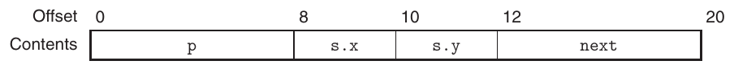

B. Nó dùng 20 byte.

C. Như mọi khi, chúng ta bắt đầu bằng cách chú thích assembly code:

```
    void st_init(struct test *st)
    st in %rdi
1   st_init:
2     movl    8(%rdi), %eax      Get st->s.x
3     movl    %eax, 10(%rdi)     Save in st->s.y
4     leaq    10(%rdi), %rax     Compute &(st->s.y)
5     movq    %rax, (%rdi)       Store in st->p
6     movq    %rdi, 12(%rdi)     Store st in st->next
7     ret
```

Từ đây, chúng ta có thể tạo code C như sau:

```
void st_init(struct test *st)
{
    st->s.y   = st->s.x;
    st->p     = &(st->s.y);
    st->next  = st;
}
```

Lời giải Bài toán 3.42 (trang 305) Bài toán này minh họa cách một cấu trúc dữ liệu rất phổ biến và thao tác trên nó được triển khai trong machine code. Chúng ta giải bài toán bằng cách trước tiên chú thích assembly code, nhận ra rằng hai field của cấu trúc nằm tại offset 0 (cho v) và 2 (cho p).

```
    short test(struct ACE *ptr)
    ptr in %rdi
1   test:
2     movl    $1, %eax            result = 1
3     jmp     .L2                 Goto middle
            4   .L3:                        loop:
            5     imulq   (%rdi), %rax        result *= ptr->v
            6     movq    2(%rdi), %rdi       ptr = ptr->p
            7   .L2:                        middle:
            8     testq   %rdi, %rdi          Test ptr
            9     jne     .L3                 If != NULL, goto loop
           10     rep; ret
```

A. Dựa trên code có chú thích, chúng ta có thể tạo một phiên bản C:

```
short test(struct ACE *ptr) {
    short val = 1;
    while (ptr) {
        val *= ptr->v;
        ptr  = ptr->p;
    }
    return val;
}
```

B. Chúng ta có thể thấy mỗi cấu trúc là một phần tử trong singly linked list, với field v là giá trị của phần tử và p là pointer tới phần tử tiếp theo. Hàm fun tính tổng các giá trị phần tử trong danh sách.

Lời giải Bài toán 3.43 (trang 308) Cấu trúc và union liên quan đến một tập khái niệm đơn giản, nhưng cần luyện tập để quen với những mẫu tham chiếu khác nhau và cách triển khai chúng.

| EXPR | TYPE | Code |
|---|---|---|
| up->t1.u | long | movq (%rdi), %rax<br>movq %rax, (%rsi) |
| up->t1.v | short | movw 8(%rdi), %ax<br>movw %ax, (%rsi) |
| &up->t1.w | char * | addq $10, %rdi<br>movq %rdi, (%rsi) |
| up->t2.a | int * | movq %rdi, (%rsi) |
| up->t2.a[up->t1.u] | int | movq (%rdi), %rax<br>movl (%rdi,%rax,4), %eax<br>movl %eax, (%rsi) |
| *up->t2.p | char | movq 8(%rdi), %rax<br>movb (%rax), %al<br>movb %al, (%rsi) |

Lời giải Bài toán 3.44 (trang 311) Hiểu bố trí cấu trúc và alignment rất quan trọng để hiểu các cấu trúc dữ liệu khác nhau cần bao nhiêu vùng lưu trữ và để hiểu code do compiler tạo để truy cập cấu trúc. Bài toán này cho bạn tìm hiểu chi tiết một số cấu trúc ví dụ.

A. struct P1 { short i; int c; int *j; short *d; };

| i | c | j | d | Tổng | Alignment |
|---|---|---|---|---|---|
| 0 | 2 | 6 | 14 | 16 | 8 |

B. struct P2 { int i[2]; char c[8]; short [4]; long *j; };

| i | c | d | j | Tổng | Alignment |
|---|---|---|---|---|---|
| 0 | 8 | 16 | 24 | 32 | 8 |

C. struct P3 { long w[2]; int *c[2] };

| w | c | Tổng | Alignment |
|---|---|---|---|
| 0 | 16 | 32 | 8 |

D. struct P4 { char w[16]; char *c[2] };

| w | c | Tổng | Alignment |
|---|---|---|---|
| 0 | 16 | 32 | 8 |

E. struct P5 { struct P4 a[2]; struct P1 t };

| a | t | Tổng | Alignment |
|---|---|---|---|
| 0 | 24 | 40 | 8 |

Lời giải Bài toán 3.45 (trang 311) Đây là một bài tập để hiểu bố trí cấu trúc và alignment.

A. Dưới đây là các kích thước object và byte offset:

| Field | a | b | c | d | e | f | g | h |
|---|---|---|---|---|---|---|---|---|
| Kích thước | 8 | 4 | 1 | 2 | 8 | 8 | 4 | 8 |
| Offset | 0 | 8 | 12 | 16 | 24 | 32 | 40 | 48 |

B. Cấu trúc dài tổng cộng 56 byte. Cuối cấu trúc không cần padding để đáp ứng yêu cầu alignment 8-byte.

C. Một chiến lược hiệu quả khi mọi phần tử dữ liệu có độ dài bằng một lũy thừa của 2 là sắp xếp các phần tử cấu trúc theo thứ tự kích thước giảm dần. Điều này dẫn đến khai báo:

```
struct {
    int    *a;
    char   *h;
    double f;
    long   e;
    float  b;
    int    g;
    short  d;
    char   c;
} rec;
```

với các offset sau:

Field

|  | a | h | f | e | b | g | d | c |
|---|---|---|---|---|---|---|---|---|
| Kích thước | 8 | 8 | 8 | 8 | 4 | 4 | 2 | 1 |
| Offset | 0 | 8 | 16 | 24 | 32 | 36 | 40 | 42 |

Cấu trúc phải được thêm padding 5 byte để đáp ứng yêu cầu alignment 8-byte, cho tổng cộng 48 byte.

Lời giải Bài toán 3.46 (trang 318) Bài toán này bao quát nhiều chủ đề, như stack frame, biểu diễn chuỗi, code ASCII và thứ tự byte. Nó minh họa nguy hiểm của các tham chiếu bộ nhớ out-of-bounds và những ý tưởng cơ bản đằng sau buffer overflow.

A. Stack sau dòng 3:

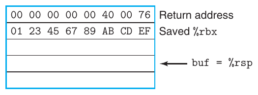

B. Stack sau dòng 5:

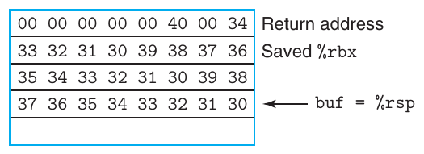

C. Chương trình đang cố trả về địa chỉ 0x040034. 2 byte low-order đã bị ghi đè bởi code của ký tự ‘4’ và ký tự null kết thúc.

D. Giá trị đã lưu của register %rbx được đặt thành 0x3332313039383736. Giá trị này sẽ được nạp vào register trước khi get_line trả về.

E. Lời gọi malloc đáng lẽ phải có đối số strlen(buf)+1, và code cũng phải kiểm tra giá trị trả về không bằng NULL.

Lời giải Bài toán 3.47 (trang 322)

A. Điều này tương ứng với một miền khoảng 2<sup>13</sup> địa chỉ.

B. Một nop sled 128-byte sẽ bao phủ 2<sup>7</sup> địa chỉ với mỗi phép thử, nên chúng ta chỉ cần khoảng 2<sup>6</sup> = 64 lần thử.

Ví dụ này cho thấy rõ mức độ ngẫu nhiên hóa trong phiên bản Linux này chỉ cung cấp khả năng cản trở tối thiểu đối với một cuộc tấn công overflow.

Lời giải Bài toán 3.48 (trang 324) Bài toán này cho bạn thêm một cơ hội xem cách code x86-64 quản lý stack, đồng thời hiểu rõ hơn cách phòng vệ trước các cuộc tấn công buffer overflow.

A. Với code không được bảo vệ, chúng ta có thể thấy các dòng 4 và 5 tính vị trí v và buf lần lượt tại offset 24 và 0 so với %rsp. Trong code được bảo vệ, canary được lưu tại offset 40 (dòng 4), còn v và buf nằm tại offset 8 và 16 (dòng 7 và 8).

B. Trong code được bảo vệ, biến cục bộ v được đặt gần đỉnh stack hơn buf, nên việc buf bị tràn sẽ không làm hỏng giá trị của v.

Lời giải Bài toán 3.49 (trang 329) Code này kết hợp nhiều thủ thuật chúng ta đã thấy để thực hiện số học bit-level. Cần nghiên cứu cẩn thận để hiểu được nó.

A. Instruction leaq ở dòng 5 tính giá trị 8n + 22, sau đó giá trị được làm tròn xuống bội số của 16 gần nhất bằng instruction andq ở dòng 6. Giá trị thu được sẽ là 8n + 8 khi n lẻ và 8n + 16 khi n chẵn, rồi giá trị này được trừ khỏi s<sub>1</sub> để cho s<sub>2</sub>.

B. Ba instruction trong chuỗi này làm tròn s<sub>2</sub> lên bội số của 8 gần nhất. Chúng tận dụng sự kết hợp giữa cộng bias và dịch bit mà chúng ta đã thấy để chia cho một lũy thừa của 2 trong Mục 2.3.7.

C. Có thể xem hai ví dụ này là những trường hợp làm nhỏ nhất và lớn nhất các giá trị e<sub>1</sub> và e<sub>2</sub>.

| n | s<sub>1</sub> | s<sub>2</sub> | p | e<sub>1</sub> | e<sub>2</sub> |
|---|---|---|---|---|---|
| 5 | 2,065 | 2,017 | 2,024 | 1 | 7 |
| 6 | 2,064 | 2,000 | 2,000 | 16 | 0 |

D. Chúng ta có thể thấy s<sub>2</sub> được tính theo cách giữ nguyên offset mà s<sub>1</sub> có so với bội số của 16 gần nhất. Cũng có thể thấy p sẽ được align theo một bội số của 8, như được khuyến nghị cho một array gồm các phần tử 8-byte.

Lời giải Bài toán 3.50 (trang 336) Bài tập này yêu cầu bạn lần qua code, chú ý cẩn thận những instruction chuyển đổi và di chuyển dữ liệu nào được dùng. Chúng ta có thể thấy các giá trị được đọc và chuyển đổi như sau:

- Giá trị tại dp được đọc, chuyển thành int (dòng 4), rồi lưu tại ip. Do đó có thể suy ra val1 là d.

- Giá trị tại ip được đọc, chuyển thành float (dòng 6), rồi lưu tại fp. Do đó có thể suy ra val2 là i.

- Giá trị của l được chuyển thành double (dòng 8) và lưu tại dp. Do đó có thể suy ra val3 là l.

- Giá trị tại fp được đọc ở dòng 3. Hai instruction ở dòng 10–11 chuyển nó sang double precision làm giá trị trả về trong register %xmm0. Do đó có thể suy ra val4 là f.

Lời giải Bài toán 3.51 (trang 336) Có thể xử lý các trường hợp này bằng cách chọn những mục thích hợp từ các bảng trong Hình 3.47 và 3.48, hoặc dùng một trong các chuỗi code để chuyển đổi giữa các định dạng floating-point.

| T<sub>x</sub> | T<sub>y</sub> | Instruction |
|---|---|---|
| long | double | vcvtsi2sdq %rdi, %xmm0, %xmm0 |
| double | int | vcvttsd2si %xmm0, %eax |
| float | double | vunpcklpd %xmm0, %xmm0, %xmm0<br>vcvtpd2ps %xmm0, %xmm0 |
| long | float | vcvtsi2ssq %rdi, %xmm0, %xmm0 |
| float | long | vcvttss2siq %xmm0, %rax |

Lời giải Bài toán 3.52 (trang 337) Các quy tắc cơ bản để ánh xạ đối số vào register khá đơn giản (mặc dù trở nên phức tạp hơn nhiều khi có thêm đối số và những loại đối số khác [77]).

A. double g1(double a, long b, float c, int d);

Các register: a trong %xmm0, b trong %rdi c trong %xmm1, d trong %esi *(ghi chú: sách in thiếu dấu phẩy sau “b in %rdi”)*

B. double g2(int a, double *b, float *c, long d);

Các register: a trong %edi, b trong %rsi, c trong %rdx, d trong %rcx

C. double g3(double *a, double b, int c, float d);

Các register: a trong %rdi, b trong %xmm0, c trong %esi, d trong %xmm1

D. double g4(float a, int *b, float c, double d);

Các register: a trong %xmm0, b trong %rdi, c trong %xmm1, d trong %xmm2

Lời giải Bài toán 3.53 (trang 339) Từ assembly code, chúng ta có thể thấy có hai đối số số nguyên, được truyền trong các register %rdi và %rsi. Hãy đặt tên chúng là i1 và i2. Tương tự, có hai đối số floating-point, được truyền trong các register %xmm0 và %xmm1, mà chúng ta đặt tên là f1 và f2.

Sau đó có thể chú thích assembly code:

```
    Refer to arguments as i1 (%rdi), i2 (%esi)
                       f1 (%xmm0), and f2 (%xmm1)

    double funct1(arg1_t p, arg2_t q, arg3_t r, arg4_t s)
1   funct1:
2     vcvtsi2ssq      %rsi, %xmm2, %xmm2    Get i2 and convert from long to float
3     vaddss  %xmm0, %xmm2, %xmm0           Add f1 (type float)
4     vcvtsi2ss       %edi, %xmm2, %xmm2    Get i1 and convert from int to float
5     vdivss  %xmm0, %xmm2, %xmm0           Compute i1 / (i2 + f1)
6     vunpcklps       %xmm0, %xmm0, %xmm0
7     vcvtps2pd       %xmm0, %xmm0          Convert to double
8     vsubsd  %xmm1, %xmm0, %xmm0           Compute i1 / (i2 + f1) - f2 (double)
9     ret
```

Từ đây, chúng ta thấy code tính giá trị i1/(i2+f1)-f2. Cũng có thể thấy i1 có kiểu int, i2 có kiểu long, f1 có kiểu float và f2 có kiểu double. Điểm mơ hồ duy nhất khi khớp các đối số với những giá trị đã đặt tên xuất phát từ tính giao hoán của phép nhân—cho ra hai kết quả có thể có:

```
double funct1a(int p, float q, long r, double s);
double funct1b(int p, long q, float r, double s);
```

Lời giải Bài toán 3.54 (trang 339) Có thể dễ dàng giải bài toán này bằng cách lần qua assembly code và xác định những gì được tính ở mỗi bước, như thể hiện qua các chú thích bên dưới:

```
    double funct2(double w, int x, float y, long z)
    w in %xmm0, x in %edi, y in %xmm1, z in %rsi
1   funct2:
2     vcvtsi2ss       %edi, %xmm2, %xmm2     Convert x to float
3     vmulss  %xmm1, %xmm2, %xmm1            Multiply by y
4     vunpcklps       %xmm1, %xmm1, %xmm1
5     vcvtps2pd       %xmm1, %xmm2           Convert x*y to double
6     vcvtsi2sdq      %rsi, %xmm1, %xmm1     Convert z to double
7     vdivsd  %xmm1, %xmm0, %xmm0            Compute w/z
8     vsubsd  %xmm0, %xmm2, %xmm0            Subtract from x*y
9     ret                                    Return
```

Từ phân tích này, chúng ta có thể kết luận hàm tính y ∗ x − w/z.

Lời giải Bài toán 3.55 (trang 341) Bài toán này liên quan đến cách suy luận giống như khi xác định các số khai báo tại nhãn .LC2 biểu diễn 1.8, nhưng với một ví dụ đơn giản hơn.

Chúng ta thấy hai giá trị là 0 và 1077936128 (0x40400000). Từ các byte high-order, có thể trích xuất exponent field 0x404 (1028), rồi trừ bias 1023 để có exponent bằng 5. Ghép các bit fraction của hai giá trị, chúng ta có fraction field bằng 0, nhưng với giá trị ngầm định ở đầu cho giá trị 1.0. Do đó hằng là 1.0 × 2<sup>5</sup> = 32.0.

Lời giải Bài toán 3.56 (trang 341)

A. Ở đây chúng ta thấy 16 byte bắt đầu tại địa chỉ .LC1 tạo thành một mask, trong đó 8 byte low-order chứa toàn bit một, ngoại trừ bit có trọng số cao nhất, là sign bit của một giá trị double-precision. Khi tính and của mask này với %xmm0, nó sẽ xóa sign bit của x, cho ra giá trị tuyệt đối. Thực tế, chúng tôi đã tạo code này bằng cách định nghĩa EXPR(x) là fabs(x), trong đó fabs được định nghĩa trong <math.h>.

B. Chúng ta thấy instruction vxorpd đặt toàn bộ register thành không, nên đây là một cách tạo hằng floating-point 0.0.

C. Chúng ta thấy 16 byte bắt đầu tại địa chỉ .LC2 tạo thành một mask với một bit 1 duy nhất, tại vị trí sign bit của giá trị low-order trong register XMM. Khi tính exclusive-or của mask này với %xmm0, chúng ta đổi dấu của x, tính biểu thức -x.

Lời giải Bài toán 3.57 (trang 344) Một lần nữa, chúng ta chú thích code, bao gồm cả việc xử lý nhánh có điều kiện:

```
     double funct3(int *ap, double b, long c, float *dp)
     ap in %rdi, b in %xmm0, c in %rsi, dp in %rdx
 1   funct3:
 2     vmovss  (%rdx), %xmm1                       Get d = *dp
 3     vcvtsi2sd       (%rdi), %xmm2, %xmm2        Get a = *ap and convert to double
 4     vucomisd        %xmm2, %xmm0                Compare b:a
 5     jbe     .L8                                 If <=, goto lesseq
 6     vcvtsi2ssq      %rsi, %xmm0, %xmm0          Convert c to float
 7     vmulss  %xmm1, %xmm0, %xmm1                 Multiply by d
 8     vunpcklps       %xmm1, %xmm1, %xmm1
 9     vcvtps2pd       %xmm1, %xmm0                Convert to double
10     ret                                         Return
11   .L8:                                        lesseq:
12     vaddss  %xmm1, %xmm1, %xmm1                 Compute d+d = 2.0 * d
13     vcvtsi2ssq      %rsi, %xmm0, %xmm0          Convert c to float
14     vaddss  %xmm1, %xmm0, %xmm0                 Compute c + 2*d
15     vunpcklps       %xmm0, %xmm0, %xmm0
16     vcvtps2pd       %xmm0, %xmm0                Convert to double
17     ret                                         Return
```

Từ đây, chúng ta có thể viết code sau cho funct3:

```
double funct3(int *ap, double b, long c, float *dp) {
    int a = *ap;
    float d = *dp;
    if (a < b)
        return c*d;
    else
        return c+2*d;
}
```

---

[^1]: Mức tối ưu hóa này được giới thiệu trong gcc phiên bản 4.8. Các phiên bản gcc trước đó, cũng như các compiler non- GNU, sẽ không nhận ra tùy chọn này. Với chúng, sử dụng mức tối ưu hóa một (được chỉ định bằng flag command-line -O1 ) có lẽ là lựa chọn tốt nhất để tạo code tuân theo cấu trúc chương trình ban đầu.

[^2]: Instruction này được gọi là cqo trong tài liệu Intel, một trong số ít trường hợp mà tên ATT-format của instruction không khớp tên Intel.

[^3]: Thực ra, nó có thể trả về giá trị âm nếu một trong các phép trừ bị overflow. Mục đích của chúng ta ở đây là minh họa machine code, chứ không phải triển khai code vững chắc.

[^4]: Thuật ngữ “canary” đề cập đến việc trước đây người ta dùng những con chim này để phát hiện sự hiện diện của khí nguy hiểm trong các mỏ than.
