# 4 Processor architecture

Microprocessor hiện đại nằm trong số những hệ thống phức tạp nhất con người từng tạo ra. Một silicon chip duy nhất, cỡ móng tay, có thể chứa nhiều processor high-performance, cache memory lớn và logic cần để kết nối chúng với thiết bị ngoài. Về hiệu năng, các processor được triển khai trên một chip hiện nay vượt xa những supercomputer room-size có giá hơn $10 triệu chỉ 20 năm trước. Ngay cả embedded processor trong các thiết bị hằng ngày như điện thoại, hệ thống dẫn đường và bộ điều nhiệt lập trình được cũng mạnh hơn rất nhiều so với điều những người phát triển máy tính thời đầu có thể hình dung.

Đến đây, chúng ta mới xem hệ thống máy tính xuống tới cấp chương trình machine-language. Chúng ta đã thấy processor phải thực thi một chuỗi instruction, mỗi instruction thực hiện thao tác cơ bản như cộng hai số. Instruction được mã hóa nhị phân thành chuỗi từ 1 byte trở lên. Những instruction một processor cụ thể hỗ trợ cùng encoding byte-level của chúng được gọi là instruction set architecture (ISA). Các “họ” processor khác nhau, như Intel IA32 và x86-64, IBM/Freescale Power và họ ARM, có ISA khác nhau. Chương trình biên dịch cho loại máy này không chạy trên loại máy khác. Mặt khác, trong cùng một họ có nhiều mẫu processor. Mỗi nhà sản xuất tạo ra processor có hiệu năng và độ phức tạp ever-growing, nhưng các mẫu vẫn tương thích ở cấp ISA. Các họ phổ biến như x86-64 có processor do nhiều nhà sản xuất cung cấp. Vì vậy, ISA tạo lớp abstraction khái niệm giữa người viết compiler, chỉ cần biết instruction nào được phép và cách encoding, với người thiết kế processor, phải xây máy thực thi các instruction đó.

Trong chương này, chúng ta xem khái quát thiết kế hardware processor. Chúng ta nghiên cứu cách hệ thống hardware thực thi instruction của một ISA cụ thể. Góc nhìn này giúp hiểu rõ hơn cách máy tính hoạt động và thách thức công nghệ mà nhà sản xuất gặp phải. Khái niệm quan trọng là cách processor hiện đại thực sự hoạt động có thể khác hẳn mô hình tính toán ISA gợi ra. Mô hình ISA dường như hàm ý thực thi instruction tuần tự, mỗi instruction được fetch và thực thi hoàn tất trước khi instruction tiếp theo bắt đầu. Bằng cách thực thi đồng thời các phần khác nhau của nhiều instruction, processor đạt hiệu năng cao hơn so với chỉ thực thi từng instruction. Những cơ chế đặc biệt bảo đảm processor tính cùng kết quả như khi thực thi tuần tự. Ý tưởng dùng kỹ thuật khéo léo để cải thiện hiệu năng mà vẫn giữ chức năng của mô hình đơn giản, trừu tượng hơn rất quen thuộc trong khoa học máy tính. Ví dụ gồm caching trong Web browser và các data structure truy xuất thông tin như balanced binary tree, hash table.

Có lẽ bạn sẽ không bao giờ tự thiết kế processor. Đây là công việc của chuyên gia tại chưa tới 100 công ty trên thế giới. Vậy vì sao cần học thiết kế processor?

- Chủ đề thú vị và quan trọng về mặt trí tuệ. Học cách mọi thứ hoạt động tự nó đã có giá trị. Đặc biệt thú vị là tìm hiểu hoạt động bên trong của một hệ thống gắn với đời sống hằng ngày của nhà khoa học máy tính và kỹ sư nhưng vẫn bí ẩn với nhiều người. Thiết kế processor thể hiện nhiều nguyên tắc thực hành kỹ thuật tốt: cần tạo cấu trúc đơn giản, đều đặn để thực hiện nhiệm vụ phức tạp.

- Hiểu hoạt động processor giúp hiểu toàn bộ hệ thống máy tính. Trong Chương 6, chúng ta xem hệ thống bộ nhớ và kỹ thuật tạo hình ảnh của bộ nhớ rất lớn với thời gian truy cập rất nhanh. Hiểu phía processor của interface processor–memory sẽ làm phần trình bày hoàn chỉnh hơn.

- Dù ít người thiết kế processor, nhiều người thiết kế hệ thống hardware chứa processor. Điều này trở nên phổ biến khi processor được nhúng vào hệ thống real-world như ô tô và thiết bị gia dụng. Người thiết kế Embedded-system phải hiểu cách processor hoạt động, vì các hệ thống này thường được thiết kế và lập trình ở cấp abstraction thấp hơn hệ thống desktop và server-based.

- Bạn cũng có thể làm việc trong dự án thiết kế processor. Dù ít công ty sản xuất microprocessor, các nhóm thiết kế processor đã lớn và đang tiếp tục phát triển. Có thể có hơn 1,000 người tham gia những khía cạnh khác nhau của một thiết kế processor lớn.

## Ghi chú Sự tiến bộ của công nghệ máy tính

Để hình dung công nghệ máy tính đã tiến bộ đến mức nào trong bốn thập niên qua, xét hai processor sau.

Supercomputer Cray 1 đầu tiên được giao cho Los Alamos National Laboratory năm 1976. Nó là máy tính nhanh nhất thế giới, có thể thực hiện tới 250 triệu arithmetic operation mỗi giây. Máy có 8 megabyte random access memory, cấu hình tối đa hardware cho phép. Máy cũng rất lớn—nặng 5,000 kg, tiêu thụ 115 kilowatt và có giá $9 triệu. Tổng cộng khoảng 80 máy được sản xuất.

Chip microprocessor Apple ARM A7, giới thiệu năm 2013 để vận hành iPhone 5S, chứa hai CPU, mỗi CPU thực hiện được vài tỷ arithmetic operation mỗi giây, cùng 1 gigabyte random access memory. Toàn bộ điện thoại chỉ nặng 112 gram, tiêu thụ khoảng 1 watt và có giá dưới $800. Hơn 9 triệu máy được bán trong cuối tuần đầu tiên ra mắt. Ngoài là máy tính mạnh, nó còn chụp ảnh, gọi điện và chỉ đường lái xe, những tính năng chưa từng được xem xét cho Cray 1.

Hai hệ thống cách nhau chỉ 37 năm thể hiện tiến bộ to lớn của công nghệ bán dẫn. Trong khi CPU Cray 1 được xây từ khoảng 100,000 chip bán dẫn, mỗi chip chứa dưới 20 transistor, Apple A7 có hơn 1 tỷ transistor trên một chip. Bộ nhớ 8-megabyte của Cray 1 cần 8,192 chip, còn bộ nhớ gigabyte của iPhone nằm trong một chip duy nhất.

Chương này bắt đầu bằng việc định nghĩa instruction set đơn giản làm ví dụ xuyên suốt cho các triển khai processor. Chúng ta gọi là instruction set “Y86-64” vì nó lấy cảm hứng từ x86-64. So với x86-64, Y86-64 có ít data type, instruction và addressing mode hơn. Nó cũng có encoding byte-level đơn giản, khiến machine code kém gọn hơn code x86-64 tương đương nhưng việc thiết kế logic decode của CPU dễ hơn nhiều. Dù rất đơn giản, instruction set Y86-64 đủ hoàn chỉnh để viết chương trình thao tác dữ liệu số nguyên. Thiết kế processor triển khai Y86-64 đòi hỏi xử lý nhiều thách thức mà người thiết kế processor gặp phải.

Sau đó, chúng ta cung cấp nền tảng về thiết kế digital hardware. Chúng ta mô tả các building block cơ bản trong processor, cách nối chúng và vận hành. Phần này dựa trên thảo luận Boolean algebra và phép toán bit-level trong Chương 2. Chúng ta cũng giới thiệu ngôn ngữ đơn giản HCL (viết tắt “hardware control language”) để mô tả các phần điều khiển của hệ thống hardware. Sau này, ngôn ngữ được dùng mô tả các thiết kế processor. Dù đã có nền tảng logic design, bạn vẫn nên đọc phần này để hiểu ký pháp cụ thể chúng ta sử dụng.

Bước đầu thiết kế processor là trình bày processor Y86-64 đúng chức năng nhưng hơi thiếu thực tế, dựa trên hoạt động tuần tự. Processor này thực thi một instruction Y86-64 hoàn chỉnh mỗi clock cycle. Clock phải đủ chậm để cả chuỗi hành động hoàn tất trong một cycle. Có thể triển khai processor như vậy, nhưng hiệu năng thấp hơn nhiều so với khả năng của lượng hardware đó.

Dựa trên thiết kế tuần tự, chúng ta áp dụng một chuỗi biến đổi để tạo pipelined processor. Processor chia thực thi mỗi instruction thành năm bước, mỗi bước được xử lý bởi một phần hoặc stage hardware riêng. Instruction đi qua các stage pipeline, mỗi clock cycle có một instruction vào pipeline. Kết quả là processor thực thi đồng thời các bước khác nhau của tối đa năm instruction. Để giữ hành vi tuần tự của ISA Y86-64, phải xử lý nhiều hazard condition, khi vị trí hoặc operand của instruction này phụ thuộc instruction khác vẫn đang trong pipeline.

Chúng ta đã xây dựng nhiều tool để nghiên cứu và thử nghiệm thiết kế processor, gồm assembler Y86-64, simulator chạy chương trình Y86-64 trên máy của bạn, cùng simulator cho hai thiết kế processor tuần tự và một thiết kế pipelined. Control logic được mô tả bằng file theo ký pháp HCL. Sửa các file rồi biên dịch lại simulator cho phép thay đổi và mở rộng hành vi simulator. Nhiều bài tập yêu cầu triển khai instruction mới và sửa cách máy xử lý instruction. Testing code được cung cấp để giúp đánh giá tính đúng đắn của sửa đổi. Các bài tập giúp hiểu nội dung rõ hơn nhiều và nhận thức các phương án thiết kế khác nhau mà người thiết kế processor đối mặt.

Web Aside arch:vlog ở trang 503 trình bày biểu diễn pipelined processor Y86-64 bằng Verilog hardware description language. Việc này gồm tạo module cho các building block hardware cơ bản và cấu trúc processor tổng thể. Chúng ta tự động chuyển mô tả control logic HCL sang Verilog. Bằng cách debug mô tả HCL trước với simulator, chúng ta loại nhiều bug khó vốn sẽ xuất hiện trong hardware design. Với mô tả Verilog, có tool thương mại và open-source hỗ trợ simulation và logic synthesis, tạo thiết kế mạch thực tế cho microprocessor. Vì vậy, dù phần lớn nỗ lực ở đây là tạo mô tả hệ thống bằng hình và văn bản giống khi viết software, khả năng tự động synthesize các thiết kế cho thấy chúng ta thực sự tạo hệ thống hiện thực hóa được bằng hardware.

## 4.1 Instruction set architecture Y86-64

Việc định nghĩa instruction set architecture như Y86-64 bao gồm định nghĩa các thành phần trạng thái khác nhau, tập instruction và encoding của chúng, các quy ước lập trình và cách xử lý sự kiện ngoại lệ.

### 4.1.1 Trạng thái Programmer-Visible

Như Hình 4.1 minh họa, mỗi instruction trong chương trình Y86-64 có thể đọc và sửa một phần trạng thái processor. Đây là trạng thái programmer-visible; “lập trình viên” ở đây là người viết chương trình bằng assembly code hoặc compiler tạo code machine-level. Trong các triển khai processor, chúng ta sẽ thấy không cần biểu diễn và tổ chức trạng thái đúng như ISA gợi ra, miễn là bảo đảm chương trình machine-level có vẻ truy cập được trạng thái programmer-visible. Trạng thái Y86-64 tương tự x86-64. Có 15 program register: %rax, %rcx, %rdx, %rbx, %rsp, %rbp, %rsi, %rdi và %r8 đến %r14. (Chúng ta bỏ register %r15 của x86-64 để đơn giản instruction encoding.) Mỗi register lưu word 64-bit. Register %rsp làm stack pointer cho instruction push, pop, call và return. Ngoài ra, register không có ý nghĩa hoặc giá trị cố định. Có ba condition code single-bit, ZF, SF và OF, lưu thông tin về tác động của arithmetic instruction hoặc logical instruction gần nhất. Program counter (PC) chứa địa chỉ instruction hiện đang được thực thi.

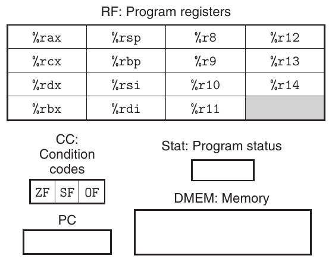

**Hình 4.1 Trạng thái programmer-visible của Y86-64. Giống x86-64, chương trình Y86-64 truy cập và sửa program register, condition code, program counter (PC) và bộ nhớ. Status code cho biết chương trình chạy bình thường hay đã có sự kiện đặc biệt.**

Về khái niệm, bộ nhớ là array byte lớn chứa cả chương trình và dữ liệu. Chương trình Y86-64 tham chiếu vị trí bộ nhớ bằng virtual address. Hardware kết hợp operating system software chuyển chúng thành địa chỉ thực tế, hay physical address, chỉ nơi giá trị thực sự được lưu trong bộ nhớ. Chúng ta nghiên cứu virtual memory chi tiết hơn trong Chương 9. Hiện tại, có thể coi hệ thống virtual memory cung cấp cho chương trình Y86-64 hình ảnh một array byte nguyên khối.

Phần cuối của trạng thái chương trình là status code Stat, cho biết trạng thái tổng thể của việc thực thi. Nó chỉ hoạt động bình thường hoặc có exception, như khi instruction cố đọc địa chỉ bộ nhớ không hợp lệ. Các status code có thể có và cách xử lý exception được mô tả trong Mục 4.1.4.

### 4.1.2 Instruction Y86-64

Hình 4.2 mô tả ngắn gọn từng instruction trong ISA Y86-64. Chúng ta dùng instruction set này làm đích cho các triển khai processor. Tập instruction Y86-64 phần lớn là tập con instruction set x86-64. Nó chỉ gồm phép toán số nguyên 8-byte, có ít addressing mode và tập phép toán nhỏ hơn. Vì chỉ dùng dữ liệu 8-byte, có thể gọi là “word” mà không nhập nhằng. Trong hình, biểu diễn assembly-code ở bên trái và byte encoding bên phải. Hình 4.3 trình bày chi tiết hơn một số instruction. Format assembly-code tương tự format ATT của x86-64.

Sau đây là một số chi tiết về instruction Y86-64.

- Instruction movq của x86-64 được tách thành bốn instruction: irmovq, rrmovq, mrmovq và rmmovq, chỉ rõ dạng nguồn và đích. Nguồn là immediate (i), register (r) hoặc memory (m), được chỉ bởi ký tự đầu tên instruction. Đích là register (r) hoặc memory (m), được chỉ bởi ký tự thứ hai tên instruction. Xác định rõ bốn dạng truyền dữ liệu sẽ hữu ích khi quyết định cách triển khai.

  Memory reference của hai instruction di chuyển bộ nhớ có format base và displacement đơn giản. Chúng ta không hỗ trợ index register thứ hai hoặc scale giá trị register khi tính địa chỉ.

  Giống x86-64, không cho phép truyền trực tiếp từ vị trí bộ nhớ này sang vị trí khác. Ngoài ra, không cho phép truyền dữ liệu immediate tới bộ nhớ.

- Có bốn instruction phép toán số nguyên, được ghi là OPq trong Hình 4.2: addq, subq, andq và xorq. Chúng chỉ thao tác dữ liệu register, trong khi x86-64 cho phép cả dữ liệu bộ nhớ. Các instruction đặt ba condition code ZF, SF và OF (zero, sign và overflow).

- Bảy jump instruction (ghi là jXX trong Hình 4.2) là jmp, jle, jl, je, jne, jge và jg. Branch được thực hiện tùy loại branch và thiết lập condition code. Điều kiện branch giống x86-64 (Hình 3.15).

- Có sáu conditional move instruction (ghi là cmovXX trong Hình 4.2): cmovle, cmovl, cmove, cmovne, cmovge và cmovg. Chúng có cùng format với instruction di chuyển register–register rrmovq, nhưng chỉ cập nhật register đích nếu condition code thỏa ràng buộc yêu cầu.

- Instruction call push return address lên stack rồi nhảy tới địa chỉ đích. Instruction ret return từ lời gọi đó.

- Instruction pushq và popq triển khai push và pop giống trong x86-64.

- Instruction halt dừng thực thi instruction. x86-64 có instruction tương tự tên hlt. Chương trình ứng dụng x86-64 không được phép dùng vì nó khiến cả hệ thống tạm dừng hoạt động. Với Y86-64, thực thi halt khiến processor dừng, status code đặt thành HLT. (Xem Mục 4.1.4.)

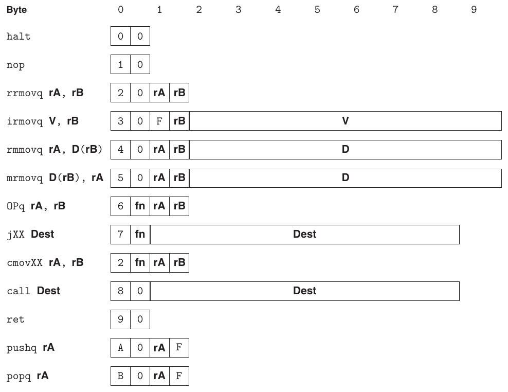

**Hình 4.2 Instruction set Y86-64. Instruction encoding dài từ 1 đến 10 byte. Instruction gồm instruction specifier 1-byte, có thể có register specifier 1-byte và có thể có constant word 8-byte. Field fn chỉ một integer operation ( OPq ), điều kiện di chuyển dữ liệu ( cmovXX ) hoặc điều kiện branch ( jXX ) cụ thể. Mọi giá trị số được trình bày theo hexadecimal.**

### 4.1.3 Instruction encoding

Hình 4.2 cũng trình bày encoding byte-level của instruction. Mỗi instruction cần từ 1 đến 10 byte, tùy field cần thiết. Mọi instruction có byte đầu xác định loại instruction. Byte chia thành hai phần 4-bit: phần high-order, hay code, và phần low-order, hay function. Như Hình 4.2 cho thấy, giá trị code từ 0 đến 0xB. Giá trị function chỉ có ý nghĩa khi một nhóm instruction liên quan dùng chung code. Chúng được đưa ra trong Hình 4.3, với encoding cụ thể của integer operation, branch và conditional move instruction. Lưu ý rrmovq có cùng instruction code với conditional move. Có thể xem là “unconditional move”, giống jmp là unconditional jump, cả hai có function code 0.

Như Hình 4.4 cho thấy, mỗi program register trong số 15 register có register identifier (ID) từ 0 đến 0xE. Cách đánh số register Y86-64 khớp x86-64. Program register nằm trong CPU, trong một register file—random access memory nhỏ với register ID làm địa chỉ. Giá trị ID 0xF được dùng trong instruction encoding và thiết kế hardware khi cần chỉ rằng không register nào được truy cập.

Một số instruction chỉ dài 1 byte, nhưng những instruction cần operand có encoding dài hơn. Trước tiên, có thể có byte register specifier bổ sung, chỉ một hoặc hai register. Các field register gọi là rA và rB trong Hình 4.2. Như phiên bản assembly-code cho thấy, tùy loại instruction, chúng có thể chỉ register làm nguồn và đích dữ liệu, cùng base register khi tính địa chỉ. Instruction không có register operand, như branch và call, không có byte register specifier. Instruction chỉ cần một register operand (irmovq, pushq và popq) đặt register specifier còn lại thành 0xF. Quy ước này sẽ hữu ích trong triển khai processor.

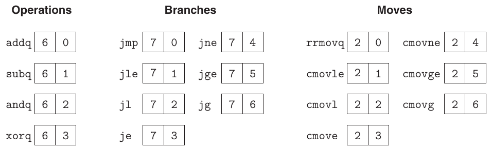

**Hình 4.3 Function code cho instruction set Y86-64. Code chỉ integer operation, điều kiện branch hoặc điều kiện truyền dữ liệu cụ thể. Các instruction này được ghi là OPq, jXX và cmovXX trong Hình 4.2.**

| Số | Tên register | Số | Tên register |
|---|---|---|---|
| 0 | %rax | 8 | %r8 |
| 1 | %rcx | 9 | %r9 |
| 2 | %rdx | A | %r10 |
| 3 | %rbx | B | %r11 |
| 4 | %rsp | C | %r12 |
| 5 | %rbp | D | %r13 |
| 6 | %rsi | E | %r14 |
| 7 | %rdi | F | Không có register |

**Hình 4.4 Identifier của program register Y86-64. Mỗi register trong số 15 program register có identifier (ID) từ 0 đến 0xE. ID 0xF trong field register của instruction chỉ rằng không có register operand.**

Một số instruction cần thêm constant word 8-byte. Word này có thể là dữ liệu immediate cho irmovq, displacement trong chỉ định địa chỉ của rmmovq và mrmovq, hoặc đích của branch và call. Lưu ý đích branch và call là absolute address, thay vì PC-relative addressing như x86-64. Processor dùng PC-relative addressing để encoding branch instruction gọn hơn và cho phép dịch chuyển code từ vùng bộ nhớ này sang vùng khác mà không cần cập nhật mọi branch target address. Vì ở đây quan tâm tính đơn giản hơn, chúng ta dùng absolute addressing. Giống x86-64, mọi số nguyên có encoding little-endian. Khi instruction được viết dạng disassembled, các byte xuất hiện theo thứ tự đảo ngược.

Ví dụ, hãy tạo byte encoding hexadecimal của instruction rmmovq %rsp,0x123456789abcd(%rdx). Từ Hình 4.2, rmmovq có byte đầu 40. Source register %rsp cần mã hóa trong field rA, còn base register %rdx trong field rB. Dùng số register ở Hình 4.4, ta được byte register specifier 42. Cuối cùng, displacement được mã hóa trong constant word 8-byte. Trước hết thêm số 0 ở đầu 0x123456789abcd để đủ 8 byte, cho chuỗi byte 00 01 23 45 67 89 ab cd. Viết theo thứ tự byte-reversed thành cd ab 89 67 45 23 01 00. Kết hợp lại, ta có instruction encoding 4042cdab896745230100.

Một tính chất quan trọng của mọi instruction set là byte encoding phải có cách diễn giải duy nhất. Chuỗi byte tùy ý hoặc mã hóa một chuỗi instruction duy nhất, hoặc không hợp lệ. Y86-64 có tính chất này vì mọi instruction có tổ hợp code và function duy nhất trong byte đầu, và từ byte đó có thể xác định độ dài, ý nghĩa của các byte bổ sung. Tính chất bảo đảm processor thực thi chương trình object-code mà không nhập nhằng về ý nghĩa code. Ngay cả khi code nằm giữa các byte khác trong chương trình, vẫn dễ xác định chuỗi instruction miễn bắt đầu đúng byte đầu chuỗi. Ngược lại, nếu không biết vị trí bắt đầu chuỗi code, không thể xác định tin cậy cách chia chuỗi thành từng instruction. Điều này gây khó cho disassembler và tool khác cố trích xuất chương trình machine-level trực tiếp từ chuỗi byte object-code.

#### Ghi chú So sánh instruction encoding x86-64 và Y86-64

So với instruction encoding x86-64, encoding Y86-64 đơn giản hơn nhiều nhưng kém gọn hơn. Field register chỉ nằm ở vị trí cố định trong mọi instruction Y86-64, còn trong các instruction x86-64 được đóng gói ở nhiều vị trí. Instruction x86-64 mã hóa giá trị hằng bằng 1, 2, 4 hoặc 8 byte, còn Y86-64 luôn cần 8 byte.

#### Bài tập thực hành 4.1 (lời giải trang 516)

Xác định byte encoding của chuỗi instruction Y86-64 sau. Dòng .pos 0x100 chỉ địa chỉ bắt đầu object code phải là 0x100.

```
.pos 0x100  # Start code at address 0x100
    irmovq $15,%rbx
    rrmovq %rbx,%rcx
loop:
    rmmovq %rcx,-3(%rbx)
    addq   %rbx,%rcx
    jmp loop
```

#### Bài tập thực hành 4.2 (lời giải trang 517)

Với mỗi chuỗi byte được liệt kê, hãy xác định chuỗi instruction Y86-64 mà nó mã hóa. Nếu có byte không hợp lệ, trình bày chuỗi instruction đến điểm đó và chỉ vị trí giá trị không hợp lệ. Mỗi chuỗi được ghi bằng địa chỉ bắt đầu, dấu hai chấm rồi chuỗi byte.

A. 0x100: 30f3fcffffffffffffff40630008000000000000

B. 0x200: a06f800c020000000000000030f30a00000000000000

C. 0x300: 5054070000000000000010f0b01f

D. 0x400: 611373000400000000000000

E. 0x500: 6362a0f0

#### Ghi chú Instruction set RISC và CISC

x86-64 đôi khi được gọi là “complex instruction set computer” (CISC—đọc “sisk”), đối lập với ISA được phân loại “reduced instruction set computer” (RISC—đọc “risk”). Về lịch sử, máy CISC xuất hiện trước, phát triển từ những máy tính đầu tiên. Đầu thập niên 1980, instruction set của mainframe và minicomputer đã khá lớn khi người thiết kế thêm instruction mới hỗ trợ tác vụ high-level, như thao tác circular buffer, số học thập phân và tính đa thức. Microprocessor đầu tiên xuất hiện đầu thập niên 1970 với instruction set hạn chế, vì công nghệ integrated-circuit khi đó giới hạn nghiêm ngặt những gì triển khai được trên một chip. Microprocessor phát triển nhanh và đầu thập niên 1980 đi theo cùng hướng tăng độ phức tạp instruction set như mainframe và minicomputer. Họ x86 đi theo hướng đó, phát triển thành IA32 và gần đây hơn là x86-64. Dòng x86 tiếp tục phát triển khi thêm các class instruction mới theo nhu cầu ứng dụng mới nổi.

Triết lý thiết kế RISC phát triển đầu thập niên 1980 như phương án thay thế các xu hướng này. Nhóm chuyên gia hardware và compiler tại IBM, chịu ảnh hưởng mạnh từ ý tưởng của nhà nghiên cứu IBM John Cocke, nhận ra có thể tạo code hiệu quả cho instruction set đơn giản hơn nhiều. Thực ra, nhiều instruction high-level được thêm vào instruction set rất khó được compiler tạo ra và ít được dùng. Instruction set đơn giản hơn triển khai được với ít hardware hơn nhiều và tổ chức thành pipeline hiệu quả, tương tự những cấu trúc mô tả sau trong chương. IBM chỉ thương mại hóa ý tưởng nhiều năm sau, khi phát triển ISA Power và PowerPC.

Khái niệm RISC được Giáo sư David Patterson tại University of California, Berkeley và John Hennessy tại Stanford University phát triển thêm. Patterson đặt tên RISC cho lớp máy mới và CISC cho lớp hiện có, vì trước đó không cần tên riêng cho một dạng instruction set gần như phổ quát.

So sánh CISC với các instruction set RISC ban đầu, ta thấy các đặc điểm tổng quát sau:

| CISC | RISC thời kỳ đầu |
|---|---|
| Có nhiều instruction. Tài liệu Intel mô tả toàn bộ instruction set [51] dài hơn 1,200 trang. | Ít instruction hơn nhiều—thường dưới 100. |
| Một số instruction có thời gian thực thi dài, gồm instruction sao chép cả khối từ vùng bộ nhớ này sang vùng khác, và instruction sao chép nhiều register tới hoặc từ bộ nhớ. | Không có instruction thực thi lâu. Một số máy RISC ban đầu thậm chí không có instruction nhân số nguyên, buộc compiler triển khai phép nhân bằng chuỗi phép cộng. |
| Encoding Variable-size. Instruction x86-64 dài từ 1 đến 15 byte. | Encoding Fixed-length. Thông thường mọi instruction được mã hóa bằng 4 byte. |

#### Ghi chú Instruction set RISC và CISC (tiếp theo)

| CISC | RISC thời kỳ đầu |
|---|---|
| Nhiều format chỉ định operand. Trong x86-64, memory operand specifier có nhiều tổ hợp displacement, base register, index register và scale factor. | Addressing format đơn giản. Thường chỉ base và displacement addressing. |
| Arithmetic operation và logical operation có thể áp dụng cho cả memory operand và register operand. | Arithmetic operation và logical operation chỉ dùng register operand. Chỉ load instruction đọc từ bộ nhớ vào register và store instruction ghi từ register vào bộ nhớ được tham chiếu bộ nhớ. Quy ước này gọi là load/store architecture. |
| Dấu vết triển khai được che khỏi chương trình machine-level. ISA tạo abstraction rõ ràng giữa chương trình và cách thực thi. | Dấu vết triển khai được lộ cho chương trình machine-level. Một số máy RISC cấm chuỗi instruction nhất định và có jump chỉ có hiệu lực sau khi instruction kế tiếp được thực thi. Compiler được giao nhiệm vụ tối ưu hiệu năng trong các ràng buộc này. |
| Condition code. Các flag đặc biệt được đặt như tác động phụ của instruction rồi dùng để kiểm tra conditional branch. | Không có condition code. Thay vào đó, test instruction tường minh lưu kết quả vào register thông thường để dùng đánh giá điều kiện. |
| Procedure linkage Stack-intensive. Stack dùng cho procedure argument và return address. | Procedure linkage Register-intensive. Register dùng cho procedure argument và return address. Vì vậy, một số procedure tránh mọi memory reference. Thông thường processor có nhiều register hơn hẳn (tới 32). |

Instruction set Y86-64 mang đặc điểm của cả CISC lẫn RISC. Về phía CISC, nó có condition code và instruction variable-length, dùng stack lưu return address. Về phía RISC, nó dùng load/store architecture và instruction encoding đều đặn, truyền procedure argument qua register. Có thể xem nó lấy instruction set CISC (x86) rồi đơn giản hóa bằng một số nguyên tắc RISC.

#### Ghi chú Tranh luận RISC và CISC

Suốt thập niên 1980, cộng đồng computer architecture tranh luận gay gắt về ưu điểm instruction set RISC so với CISC. Người ủng hộ RISC khẳng định có thể đạt năng lực tính toán cao hơn với cùng lượng hardware nhờ kết hợp thiết kế instruction set tinh gọn, công nghệ compiler tiên tiến và triển khai pipelined processor. Người ủng hộ CISC phản bác rằng một tác vụ cần ít instruction CISC hơn, nên máy của họ có thể đạt hiệu năng tổng thể cao hơn.

Các công ty lớn giới thiệu dòng processor RISC, gồm Sun Microsystems (SPARC), IBM và Motorola (PowerPC), Digital Equipment Corporation (Alpha). Công ty Anh Acorn Computers Ltd. phát triển kiến trúc ARM riêng (ban đầu viết tắt “Acorn RISC machine”), được dùng rộng rãi trong ứng dụng nhúng như điện thoại.

Đầu thập niên 1990, tranh luận lắng xuống khi rõ rằng RISC hay CISC ở dạng thuần túy nhất đều không tốt hơn thiết kế kết hợp ý tưởng hay nhất của cả hai. Máy RISC phát triển, thêm instruction, nhiều instruction cần nhiều cycle để thực thi. Máy RISC hiện có hàng trăm instruction, khó còn hợp tên “reduced instruction set machine”. Ý tưởng để lộ dấu vết triển khai cho chương trình machine-level tỏ ra thiển cận. Khi mẫu processor mới dùng cấu trúc hardware tiên tiến hơn xuất hiện, nhiều dấu vết không còn liên quan nhưng vẫn là một phần instruction set. Dù vậy, cốt lõi thiết kế RISC là instruction set phù hợp thực thi trên pipelined machine.

Máy CISC gần đây cũng tận dụng cấu trúc pipeline high-performance. Như Mục 5.7 sẽ thảo luận, chúng fetch instruction CISC và dịch động thành chuỗi thao tác RISC-like đơn giản hơn. Ví dụ, instruction cộng register vào bộ nhớ được chuyển thành ba thao tác: đọc giá trị bộ nhớ gốc, thực hiện phép cộng và ghi tổng về bộ nhớ. Vì chuyển đổi động thường thực hiện được từ lâu trước khi instruction thực sự thực thi, processor có thể duy trì tốc độ thực thi rất cao.

Ngoài vấn đề kỹ thuật, vấn đề tiếp thị cũng đóng vai trò lớn quyết định thành công của instruction set. Nhờ giữ tương thích với processor hiện có, Intel với x86 giúp chuyển dễ dàng từ thế hệ processor này sang thế hệ tiếp theo. Khi công nghệ integrated-circuit tiến bộ, Intel và các nhà sản xuất x86 khác khắc phục điểm kém hiệu quả do thiết kế instruction set 8086 gốc, dùng kỹ thuật RISC để tạo hiệu năng ngang những máy RISC tốt nhất. Như Mục 3.1 cho thấy, phát triển IA32 thành x86-64 tạo cơ hội đưa một số tính năng RISC vào họ x86. Trong điện toán desktop, laptop và server-based, x86 gần như thống trị hoàn toàn.

Processor RISC rất thành công ở thị trường embedded processor, điều khiển các hệ thống như điện thoại di động, phanh ô tô và thiết bị Internet. Trong ứng dụng này, tiết kiệm chi phí và công suất quan trọng hơn giữ tương thích ngược. Xét số lượng processor bán ra, đây là thị trường rất lớn và đang phát triển.

### 4.1.4 Exception Y86-64

Trạng thái programmer-visible của Y86-64 (Hình 4.1) gồm status code Stat mô tả trạng thái tổng thể của chương trình đang thực thi. Các giá trị code có thể có nằm trong Hình 4.5. Code 1, tên AOK, cho biết chương trình thực thi bình thường; các code khác chỉ một loại exception đã xảy ra. Code 2, tên HLT, cho biết processor thực thi instruction halt. Code 3, tên ADR, cho biết processor cố đọc hoặc ghi địa chỉ bộ nhớ không hợp lệ, khi fetch instruction hoặc khi đọc, ghi dữ liệu. Chúng ta giới hạn địa chỉ tối đa (giới hạn chính xác tùy triển khai), và truy cập địa chỉ vượt giới hạn sẽ kích hoạt exception ADR. Code 4, tên INS, cho biết gặp instruction code không hợp lệ.

| Giá trị | Tên | Ý nghĩa |
|---|---|---|
| 1 | AOK | Hoạt động bình thường |
| 2 | HLT | Gặp instruction halt |
| 3 | ADR | Gặp địa chỉ không hợp lệ |
| 4 | INS | Gặp instruction không hợp lệ |

**Hình 4.5 Status code Y86-64. Trong thiết kế này, processor halt với mọi code khác AOK.**

Với Y86-64, chúng ta đơn giản cho processor dừng thực thi instruction khi gặp bất kỳ exception đã liệt kê. Trong thiết kế hoàn chỉnh hơn, processor thường gọi exception handler, một procedure được chỉ định xử lý loại exception cụ thể gặp phải. Như Chương 8 mô tả, có thể cấu hình exception handler để tạo tác động khác nhau, như hủy chương trình hoặc gọi signal handler user-defined.

### 4.1.5 Chương trình Y86-64

Hình 4.6 trình bày assembly code x86-64 và Y86-64 cho function C sau:

```
 1   long sum(long *start, long count)
 2   {
 3       long sum = 0;
 4       while (count) {
 5           sum += *start;
 6           start++;
 7           count--;
 8       }
 9       return sum;
10   }
```

Code x86-64 do compiler gcc tạo. Code Y86-64 tương tự, nhưng khác ở các điểm sau:

- Code Y86-64 load hằng số vào register (dòng 2–3), vì không thể dùng dữ liệu immediate trong arithmetic instruction.

- Code Y86-64 cần hai instruction (dòng 8–9) để đọc giá trị từ bộ nhớ và cộng vào register, còn x86-64 làm được bằng một instruction addq (dòng 5).

- Triển khai Y86-64 hand-coded tận dụng tính chất instruction subq (dòng 11) cũng đặt condition code, nên không cần instruction testq của code gcc-generated (dòng 9). Tuy nhiên, để làm vậy, code Y86-64 phải đặt condition code trước khi vào vòng lặp bằng instruction andq (dòng 5).

Code x86-64

```
     long sum(long *start, long count)
     start in %rdi, count in %rsi
 1   sum:
 2     movl     $0, %eax         sum = 0
 3     jmp      .L2              Goto test
 4   .L3:                      loop:
 5     addq     (%rdi), %rax     Add *start to sum
 6     addq     $8, %rdi         start++
 7     subq     $1, %rsi         count--
 8   .L2:                      test:
 9     testq    %rsi, %rsi       Test sum
10     jne      .L3              If !=0, goto loop
11     rep; ret                  Return
```

Code Y86-64

```
     long sum(long *start, long count)
     start in %rdi, count in %rsi
 1   sum:
 2     irmovq $8,%r8           Constant 8
 3     irmovq $1,%r9           Constant 1
 4     xorq %rax,%rax          sum = 0
 5     andq %rsi,%rsi          Set CC
 6     jmp      test           Goto test
 7   loop:
 8     mrmovq (%rdi),%r10      Get *start
 9     addq %r10,%rax          Add to sum
10     addq %r8,%rdi           start++
11     subq %r9,%rsi           count--. Set CC
12   test:
13     jne     loop            Stop when 0
14     ret                     Return
```

**Hình 4.6 So sánh chương trình assembly Y86-64 và x86-64. Function sum tính tổng array số nguyên. Code Y86-64 theo cùng pattern tổng quát như code x86-64.**

Hình 4.7 trình bày ví dụ program file hoàn chỉnh viết bằng assembly code Y86-64. Chương trình chứa cả dữ liệu và instruction. Directive chỉ nơi đặt code hoặc dữ liệu và cách align. Chương trình chỉ định các vấn đề như vị trí stack, khởi tạo dữ liệu, khởi tạo chương trình và kết thúc chương trình.

Trong chương trình, từ bắt đầu bằng ‘.’ là assembler directive yêu cầu assembler điều chỉnh địa chỉ đang tạo code hoặc chèn các word dữ liệu. Directive .pos 0 (dòng 2) yêu cầu assembler bắt đầu tạo code tại địa chỉ 0. Đây là địa chỉ bắt đầu của mọi chương trình Y86-64. Instruction tiếp theo (dòng 3) khởi tạo stack pointer. Có thể thấy label stack khai báo cuối chương trình (dòng 40), chỉ địa chỉ 0x200 bằng directive .pos (dòng 39). Vì vậy, stack bắt đầu tại địa chỉ này và tăng về địa chỉ thấp hơn. Cần bảo đảm stack không tăng quá lớn đến mức ghi đè code hoặc dữ liệu chương trình khác.

Dòng 8 đến 13 khai báo array bốn word có các giá trị

```
0x000d000d000d000d, 0x00c000c000c000c0,
0x0b000b000b000b00, 0xa000a000a000a000
```

Label array chỉ điểm bắt đầu array và được align theo ranh giới 8-byte (dùng directive .align). Dòng 16 đến 19 trình bày procedure “main” gọi function sum trên array four-word rồi halt.

Như ví dụ cho thấy, vì tool duy nhất để tạo code Y86-64 là assembler, lập trình viên phải làm những nhiệm vụ thường giao cho compiler, linker và hệ thống run-time. May mắn là chúng ta chỉ làm với chương trình nhỏ, nơi cơ chế đơn giản là đủ.

Hình 4.8 trình bày kết quả assemble code Hình 4.7 bằng assembler tên yas. Output assembler ở format ASCII để dễ đọc hơn. Với dòng assembly file chứa instruction hoặc dữ liệu, object code chứa địa chỉ theo sau bởi giá trị từ 1 đến 10 byte.

Chúng ta đã triển khai instruction set simulator tên yis để mô hình hóa thực thi chương trình machine-code Y86-64 mà không cố mô hình hành vi của bất kỳ triển khai processor cụ thể nào. Dạng mô phỏng này hữu ích khi debug trước khi có hardware thực tế, và khi kiểm tra kết quả mô phỏng hardware hoặc chạy chương trình trên chính hardware. Chạy trên object code mẫu, yis tạo output sau:

```
 1   # Execution begins at address 0
 2           .pos 0
 3           irmovq stack, %rsp      # Set up stack pointer
 4           call main               # Execute main program
 5           halt                    # Terminate program
 6
 7   # Array of 4 elements
 8           .align 8
 9   array:
10           .quad 0x000d000d000d
11           .quad 0x00c000c000c0
12           .quad 0x0b000b000b00
13           .quad 0xa000a000a000
14
15   main:
16           irmovq array,%rdi
17           irmovq $4,%rsi
18           call sum                # sum(array, 4)
19           ret
20
21   # long sum(long *start, long count)
22   # start in %rdi, count in %rsi
23   sum:
24           irmovq $8,%r8        # Constant 8
25           irmovq $1,%r9        # Constant 1
26           xorq %rax,%rax       # sum = 0
27           andq %rsi,%rsi       # Set CC
28           jmp     test         # Goto test
29   loop:
30           mrmovq (%rdi),%r10   # Get *start
31           addq %r10,%rax       # Add to sum
32           addq %r8,%rdi        # start++
33           subq %r9,%rsi        # count--.  Set CC
34   test:
35           jne    loop          # Stop when 0
36           ret                  # Return
37
38   # Stack starts here and grows to lower addresses
39           .pos 0x200
40   stack:
```

**Hình 4.7 Chương trình mẫu viết bằng assembly code Y86-64. Function sum được gọi để tính tổng array four-element.**

```
                            | # Execution begins at address 0
0x000:                      |   .pos 0
0x000: 30f40002000000000000 |   irmovq stack, %rsp      # Set up stack pointer
0x00a: 803800000000000000   |   call main               # Execute main program
0x013: 00                   |   halt                    # Terminate program
                            |
                            | # Array of 4 elements
0x018:                      |   .align 8
0x018:                      | array:
0x018: 0d000d000d000000     |   .quad 0x000d000d000d
0x020: c000c000c0000000     |   .quad 0x00c000c000c0
0x028: 000b000b000b0000     |   .quad 0x0b000b000b00
0x030: 00a000a000a00000     |   .quad 0xa000a000a000
                            |
0x038:                      | main:
0x038: 30f71800000000000000 |   irmovq array,%rdi
0x042: 30f60400000000000000 |   irmovq $4,%rsi
0x04c: 805600000000000000   |   call sum                # sum(array, 4)
0x055: 90                   |   ret
                            |
                            | # long sum(long *start, long count)
                            | # start in %rdi, count in %rsi
0x056:                      | sum:
0x056: 30f80800000000000000 |   irmovq $8,%r8        # Constant 8
0x060: 30f90100000000000000 |   irmovq $1,%r9        # Constant 1
0x06a: 6300                 |   xorq %rax,%rax       # sum = 0
0x06c: 6266                 |   andq %rsi,%rsi       # Set CC
0x06e: 708700000000000000   |   jmp     test         # Goto test
0x077:                      | loop:
0x077: 50a70000000000000000 |   mrmovq (%rdi),%r10   # Get *start
0x081: 60a0                 |   addq %r10,%rax       # Add to sum
0x083: 6087                 |   addq %r8,%rdi        # start++
0x085: 6196                 |   subq %r9,%rsi        # count--.  Set CC
0x087:                      | test:
0x087: 747700000000000000   |   jne    loop          # Stop when 0
0x090: 90                   |   ret                  # Return
                            |
                            | # Stack starts here and grows to lower addresses
0x200:                      |   .pos 0x200
0x200:                      | stack:
```

**Hình 4.8 Output của assembler yas. Mỗi dòng gồm địa chỉ hexadecimal và từ 1 đến 10 byte object code.**

```
Stopped in 34 steps at PC = 0x13.  Status ’HLT’, CC Z=1 S=0 O=0
Changes to registers:
%rax:   0x0000000000000000      0x0000abcdabcdabcd
%rsp:   0x0000000000000000      0x0000000000000200
%rdi:   0x0000000000000000      0x0000000000000038
%r8:    0x0000000000000000      0x0000000000000008
%r9:    0x0000000000000000      0x0000000000000001
%r10:   0x0000000000000000      0x0000a000a000a000

Changes to memory:
0x01f0: 0x0000000000000000      0x0000000000000055
0x01f8: 0x0000000000000000      0x0000000000000013
```

Dòng đầu output simulation tổng kết thực thi cùng giá trị kết quả của PC và trạng thái chương trình. Khi in giá trị register và bộ nhớ, chỉ những word thay đổi trong simulation, ở register hoặc bộ nhớ, được in. Giá trị ban đầu (ở đây đều bằng 0) ở bên trái, giá trị cuối ở bên phải. Có thể thấy register %rax chứa 0xabcdabcdabcdabcd, tổng array 4-element truyền cho procedure sum. Ngoài ra, stack bắt đầu tại 0x200 và tăng về địa chỉ thấp hơn đã được sử dụng, làm thay đổi word bộ nhớ tại các địa chỉ 0x1f0–0x1f8. Địa chỉ tối đa của executable code là 0x090, nên push và pop giá trị trên stack không làm hỏng executable code.

#### Bài tập thực hành 4.3 (lời giải trang 518)

Một pattern thường gặp trong chương trình machine-level là cộng hằng số vào register. Với các instruction Y86-64 đã trình bày, trước tiên cần dùng irmovq đặt register bằng hằng số, rồi addq cộng vào register đích. Giả sử muốn thêm instruction iaddq mới có format sau: instruction cộng hằng số V vào register rB.

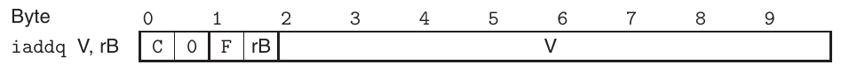

Hãy viết lại function sum Y86-64 trong Hình 4.6 để dùng instruction iaddq. Trong bản gốc, register %r8 và %r9 được dành để chứa hằng số. Giờ có thể tránh hoàn toàn việc dùng chúng.

#### Bài tập thực hành 4.4 (lời giải trang 518)

Viết code Y86-64 triển khai function tích đệ quy rproduct, dựa trên code C sau:

```
long rproduct(long *start, long count)
{
    if (count <= 1)
        return 1;
    return *start * rproduct(start+1, count-1);
}
```

Dùng cùng quy ước truyền argument và lưu register như code x86-64. Bạn có thể thấy hữu ích khi biên dịch code C trên máy x86-64 rồi chuyển các instruction sang Y86-64.

#### Bài tập thực hành 4.5 (lời giải trang 519)

Sửa code Y86-64 của function sum (Hình 4.6) để triển khai function absSum tính tổng giá trị tuyệt đối của array. Dùng conditional jump instruction trong inner loop.

#### Bài tập thực hành 4.6 (lời giải trang 519)

Sửa code Y86-64 của function sum (Hình 4.6) để triển khai function absSum tính tổng giá trị tuyệt đối của array. Dùng conditional move instruction trong inner loop.

### 4.1.6 Một số chi tiết instruction Y86-64

Phần lớn instruction Y86-64 biến đổi trạng thái chương trình theo cách rõ ràng, nên định nghĩa tác động mong muốn không khó. Tuy nhiên, hai tổ hợp instruction khác thường cần đặc biệt chú ý.

Instruction pushq vừa giảm stack pointer đi 8 vừa ghi giá trị register vào bộ nhớ. Vì vậy, chưa hoàn toàn rõ processor cần làm gì khi thực thi pushq %rsp, do register được push cũng bị chính instruction đó thay đổi. Có hai quy ước khả dĩ: (1) push giá trị %rsp ban đầu, hoặc (2) push giá trị %rsp đã giảm.

Với processor Y86-64, chúng ta áp dụng cùng quy ước x86-64, được xác định trong bài tập sau.

#### Bài tập thực hành 4.7 (lời giải trang 520)

Hãy xác định hành vi instruction pushq %rsp trên processor x86-64. Có thể đọc tài liệu Intel, nhưng cách đơn giản hơn là thử nghiệm trên máy thực tế. Compiler C thường không tạo instruction này, nên phải dùng assembly code hand-generated. Sau đây là test function chúng ta đã viết (Web Aside asm:easm ở trang 214 mô tả cách viết chương trình kết hợp code C và assembly code viết tay):

```
1     .text
2   .globl pushtest
3   pushtest:
4     movq    %rsp, %rax    Copy stack pointer
5     pushq   %rsp          Push stack pointer
6     popq    %rdx          Pop it back
7     subq    %rdx, %rax    Return 0 or 4
8     ret
```

Trong thử nghiệm, function pushtest luôn return 0. Điều này hàm ý gì về hành vi instruction pushq %rsp trên x86-64?

Nhập nhằng tương tự xảy ra với popq %rsp. Nó có thể đặt %rsp bằng giá trị đọc từ bộ nhớ hoặc stack pointer đã tăng. Như Bài tập 4.7, hãy thử nghiệm để xác định cách máy x86-64 xử lý instruction, rồi thiết kế máy Y86-64 theo cùng quy ước.

#### Bài tập thực hành 4.8 (lời giải trang 520)

Function assembly-code sau cho phép xác định hành vi instruction popq %rsp trên x86-64:

```
1     .text
2   .globl poptest
3   poptest:
4     movq    %rsp, %rdi    Save stack pointer
5     pushq   $0xabcd       Push test value
6     popq    %rsp          Pop to stack pointer
7     movq    %rsp, %rax    Set popped value as return value
8     movq    %rdi, %rsp    Restore stack pointer
9     ret
```

Function này luôn return 0xabcd. Điều đó hàm ý gì về hành vi popq %rsp? Instruction Y86-64 nào khác có hành vi đúng như vậy?

#### Ghi chú Làm đúng chi tiết: Bất nhất giữa các mẫu x86

Bài tập thực hành 4.7 và 4.8 giúp xây dựng tập quy ước nhất quán cho instruction push hoặc pop stack pointer. Có vẻ không có nhiều lý do để thực hiện một trong hai thao tác này, nên câu hỏi tự nhiên là “Vì sao phải lo những chi tiết nhỏ nhặt như vậy?”

Có thể rút ra một số bài học hữu ích về tầm quan trọng của tính nhất quán từ đoạn trích tài liệu Intel về instruction push [51]:

Với processor IA-32 từ Intel 286 trở đi, instruction PUSH ESP push giá trị register ESP như trước lúc instruction thực thi. (Điều này cũng đúng với kiến trúc Intel 64, chế độ real-address và virtual-8086 của kiến trúc IA-32.) Với processor Intel<sup>®</sup> 8086, instruction PUSH SP push giá trị mới của register SP (tức sau khi giảm đi 2). (Instruction PUSH ESP. Intel Corporation. 50.)

Dù chi tiết chính xác của ghi chú có thể khó theo dõi, ta thấy nó nói rằng tùy chế độ hoạt động, processor x86 sẽ làm việc khác nhau khi được yêu cầu push register stack pointer. Một số chế độ push giá trị ban đầu, số khác push giá trị đã giảm. (Thú vị là không có nhập nhằng tương ứng khi pop vào register stack pointer.) Sự bất nhất có hai nhược điểm:

- Giảm tính portable của code. Chương trình có thể có hành vi khác nhau tùy chế độ processor. Dù instruction này không phổ biến chút nào, chỉ khả năng không tương thích cũng có thể gây hậu quả nghiêm trọng.

- Làm tài liệu phức tạp hơn. Như thấy ở đây, cần ghi chú đặc biệt để cố làm rõ khác biệt. Tài liệu x86 vốn đã đủ phức tạp ngay cả khi không có trường hợp đặc biệt này.

Vì vậy, có thể kết luận rằng giải quyết chi tiết từ trước và cố gắng nhất quán hoàn toàn sẽ tránh được nhiều rắc rối về lâu dài.

## 4.2 Thiết kế logic và hardware control language HCL

Trong thiết kế hardware, các mạch điện tử được dùng để tính các hàm trên bit và lưu bit trong những loại phần tử nhớ khác nhau. Phần lớn công nghệ mạch hiện nay biểu diễn các giá trị bit khác nhau bằng điện áp cao hoặc thấp trên dây tín hiệu. Với công nghệ hiện tại, giá trị logic 1 được biểu diễn bằng điện áp cao khoảng 1.0 volt, còn giá trị logic 0 được biểu diễn bằng điện áp thấp khoảng 0.0 volt. Cần ba thành phần chính để triển khai hệ thống số: combinational logic để tính các hàm trên bit, phần tử nhớ để lưu bit, và tín hiệu clock để điều phối việc cập nhật phần tử nhớ.

Trong mục này, chúng ta mô tả ngắn gọn những thành phần khác nhau đó. Chúng ta cũng giới thiệu HCL (viết tắt của “hardware control language”), ngôn ngữ dùng để mô tả control logic của những thiết kế processor khác nhau. Ở đây chúng ta chỉ mô tả HCL một cách không hình thức. Có thể tìm tài liệu tham khảo đầy đủ về HCL trong phần thông tin thêm trên Web arch:hcl ở trang 508.

### Thông tin thêm: Thiết kế logic hiện đại

Trước đây, người thiết kế hardware tạo thiết kế mạch bằng cách vẽ sơ đồ nguyên lý của các mạch logic (ban đầu bằng giấy và bút chì, sau đó bằng terminal đồ họa máy tính). Ngày nay, phần lớn thiết kế được biểu diễn bằng hardware description language (HDL), một ký pháp văn bản trông giống ngôn ngữ lập trình nhưng dùng để mô tả cấu trúc hardware thay vì hành vi chương trình. Những ngôn ngữ phổ biến nhất là Verilog, có cú pháp giống C, và VHDL, có cú pháp giống ngôn ngữ lập trình Ada. Ban đầu, các ngôn ngữ này được thiết kế để tạo mô hình mô phỏng mạch số. Vào mid-1980s, các nhà nghiên cứu phát triển chương trình logic synthesis có thể sinh thiết kế mạch hiệu quả từ mô tả HDL. Hiện có một số chương trình synthesis thương mại, và đây đã trở thành kỹ thuật chủ đạo để tạo mạch số. Sự chuyển đổi từ mạch hand-designed sang mạch được tổng hợp có thể được ví với việc chuyển từ viết chương trình bằng assembly code sang viết bằng ngôn ngữ high-level rồi để compiler sinh machine code.

Ngôn ngữ HCL của chúng ta chỉ biểu diễn các phần điều khiển của thiết kế hardware, với tập phép toán hạn chế và không có tính module. Tuy nhiên, như sẽ thấy, control logic là phần khó nhất khi thiết kế microprocessor. Chúng ta đã phát triển những tool có thể chuyển trực tiếp HCL sang Verilog, và bằng cách kết hợp code này với code Verilog cho các hardware unit cơ bản, có thể tạo mô tả HDL để từ đó tổng hợp ra các microprocessor hoạt động thực tế. Bằng cách cẩn thận tách riêng, thiết kế và kiểm tra control logic, chúng ta có thể tạo microprocessor hoạt động với công sức hợp lý. Phần thông tin thêm trên Web arch:vlog ở trang 503 mô tả cách sinh các phiên bản Verilog của processor Y86-64.

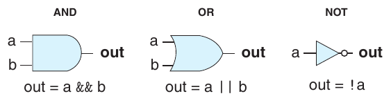

**Hình 4.9 Các loại logic gate. Mỗi gate sinh output bằng một hàm Boolean nào đó của các input.**

### 4.2.1 Logic gate

Logic gate là phần tử tính toán cơ bản của mạch số. Chúng sinh output bằng một hàm Boolean nào đó của các giá trị bit tại input. Hình 4.9 trình bày những ký hiệu chuẩn dùng cho các hàm Boolean and, or và not. Các biểu thức HCL được trình bày bên dưới gate cho những toán tử trong C (Mục 2.1.8): && cho and, || cho or và ! cho not. Chúng ta dùng chúng thay cho các toán tử C bit-level &, | và ~, vì logic gate thao tác trên đại lượng single-bit, không phải toàn bộ word. Mặc dù hình chỉ minh họa phiên bản two-input của gate and và or, người ta thường dùng chúng như phép toán n-way với n > 2. Tuy nhiên, chúng ta vẫn viết chúng trong HCL bằng toán tử nhị phân, nên hoạt động của gate and three-input với các input a, b và c được mô tả bằng biểu thức HCL a && b && c.

Logic gate luôn hoạt động. Nếu một input của gate thay đổi, thì sau một khoảng thời gian ngắn, output sẽ thay đổi tương ứng.

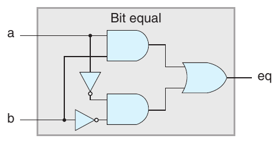

**Hình 4.10 Combinational circuit kiểm tra hai bit bằng nhau. Output bằng 1 khi cả hai input đều là 0 hoặc đều là 1.**

### 4.2.2 Combinational circuit và biểu thức Boolean HCL

Bằng cách ghép một số logic gate thành mạng, chúng ta có thể xây dựng các block tính toán gọi là combinational circuit. Cách xây dựng mạng phải tuân theo một số hạn chế:

- Mọi input của logic gate phải được nối với đúng một trong những thành phần sau: (1) một input của hệ thống (gọi là primary input), (2) đầu nối output của một phần tử nhớ, hoặc (3) output của một logic gate.

- Không được nối output của hai hoặc nhiều logic gate với nhau. Nếu không, hai gate có thể cố điều khiển dây về những điện áp khác nhau, có thể gây điện áp không hợp lệ hoặc trục trặc mạch.

- Mạng phải không có chu trình. Nghĩa là không được có đường đi qua một chuỗi gate tạo thành vòng trong mạng. Những vòng như vậy có thể gây sự không xác định trong hàm mà mạng tính.

Hình 4.10 trình bày một ví dụ combinational circuit đơn giản mà chúng ta sẽ thấy hữu ích. Nó có hai input a và b. Nó sinh một output eq, sao cho output bằng 1 nếu cả a và b đều là 1 (được gate and phía trên phát hiện) hoặc đều là 0 (được gate and phía dưới phát hiện). Chúng ta viết hàm của mạng này trong HCL như sau

```
bool eq = (a && b) || (!a && !b);
```

Code này chỉ định nghĩa tín hiệu bit-level (được kiểu dữ liệu bool biểu thị) eq là một hàm của các input a và b. Như ví dụ này cho thấy, HCL dùng cú pháp C-style, trong đó ‘=’ liên kết tên tín hiệu với biểu thức. Tuy nhiên, khác C, chúng ta không xem đây là thực hiện phép tính rồi gán kết quả vào vị trí bộ nhớ. Thay vào đó, đây đơn giản là cách đặt tên cho biểu thức.

#### Bài tập thực hành 4.9 (lời giải trang 520)

Viết biểu thức HCL cho tín hiệu xor, bằng exclusive-or của các input a và b. Quan hệ giữa các tín hiệu xor và eq được định nghĩa bên trên là gì?

Hình 4.11 trình bày một ví dụ khác về combinational circuit đơn giản nhưng hữu ích, gọi là multiplexor (thường gọi là “MUX”). Multiplexor chọn một giá trị trong tập các tín hiệu dữ liệu khác nhau, tùy giá trị của tín hiệu input điều khiển. Trong multiplexor single-bit này, hai tín hiệu dữ liệu là các bit input a và b, còn tín hiệu điều khiển là bit input s. Output bằng a khi s là 1 và bằng b khi s là 0. Trong mạch này, chúng ta thấy hai gate and quyết định có truyền input dữ liệu tương ứng đến gate or hay không. Gate and phía trên truyền tín hiệu b khi s là 0 (vì input còn lại của gate là !s), còn gate and phía dưới truyền tín hiệu a khi s là 1. Một lần nữa, chúng ta có thể viết biểu thức HCL cho tín hiệu output, dùng cùng các phép toán hiện diện trong combinational circuit:

```
bool out = (s && a) || (!s && b);
```

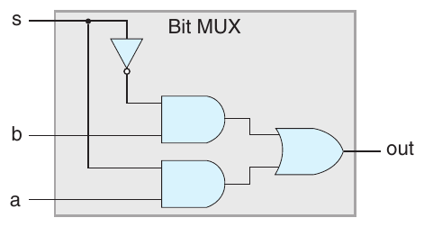

**Hình 4.11 Mạch multiplexor Single-bit. Output bằng input a nếu tín hiệu điều khiển s là 1 và bằng input b khi s là 0.**

Các biểu thức HCL của chúng ta cho thấy sự tương ứng rõ ràng giữa mạch combinational logic và biểu thức logic trong C. Cả hai dùng phép toán Boolean để tính hàm trên các input. Cần lưu ý một số khác biệt giữa hai cách biểu diễn tính toán này:

- Vì combinational circuit gồm một chuỗi logic gate, nó có tính chất output liên tục phản ứng với thay đổi tại input. Nếu một input của mạch thay đổi, thì sau một độ trễ, các output thay đổi tương ứng. Ngược lại, biểu thức C chỉ được đánh giá khi gặp nó trong quá trình thực thi chương trình.

- Biểu thức logic trong C cho phép đối số là số nguyên tùy ý, diễn giải 0 là false và mọi giá trị khác là true. Ngược lại, logic gate của chúng ta chỉ thao tác trên giá trị bit 0 và 1.

- Biểu thức logic trong C có tính chất có thể chỉ được đánh giá một phần. Nếu kết quả của phép toán and hoặc or có thể được xác định chỉ bằng việc đánh giá đối số thứ nhất, thì đối số thứ hai không được đánh giá. Ví dụ, với biểu thức C

```
(a && !a) && func(b,c)
```

hàm func không được gọi, vì biểu thức (a && !a) cho giá trị 0. Ngược lại, combinational logic không có quy tắc đánh giá một phần nào. Các gate chỉ phản ứng với input thay đổi.

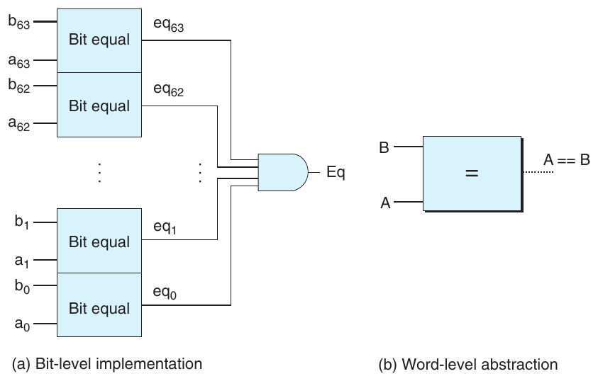

**Hình 4.12 Mạch kiểm tra bằng nhau Word-level. Output bằng 1 khi mỗi bit của word A bằng bit tương ứng của word B. Phép kiểm tra bằng nhau Word-level là một trong những phép toán của HCL.**

### 4.2.3 Combinational circuit Word-Level và biểu thức số nguyên HCL

Bằng cách ghép những mạng logic gate lớn, chúng ta có thể xây dựng combinational circuit tính các hàm phức tạp hơn nhiều. Thông thường, chúng ta thiết kế mạch thao tác trên data word. Đây là các nhóm tín hiệu bit-level biểu diễn một số nguyên hoặc một mẫu điều khiển. Ví dụ, thiết kế processor của chúng ta sẽ chứa nhiều word, với word size từ 4 đến 64 bit, biểu diễn số nguyên, địa chỉ, instruction code và register identifier.

Combinational circuit thực hiện tính toán word-level được xây dựng bằng logic gate để tính từng bit của word output, dựa trên từng bit của các word input. Ví dụ, Hình 4.12 trình bày combinational circuit kiểm tra xem hai word 64-bit A và B có bằng nhau không. Nghĩa là output bằng 1 khi và chỉ khi từng bit của A bằng bit tương ứng của B. Mạch này được triển khai bằng 64 mạch kiểm tra bằng nhau single-bit trong Hình 4.10. Output của những mạch single-bit này được kết hợp bằng gate and để tạo output của mạch.

Trong HCL, chúng ta khai báo mọi tín hiệu word-level là int mà không chỉ rõ word size. Điều này nhằm đơn giản hóa. Trong hardware description language full-featured, có thể khai báo mỗi word có số bit cụ thể. HCL cho phép so sánh các word bằng nhau, nên chức năng của mạch trong Hình 4.12 có thể được biểu diễn ở mức word như sau

```
bool Eq = (A == B);
```

trong đó các đối số A và B có kiểu int. Lưu ý rằng chúng ta dùng cùng quy ước cú pháp như C, trong đó ‘=’ biểu thị phép gán và ‘==’ biểu thị toán tử bằng nhau.

Như thể hiện bên phải Hình 4.12, chúng ta vẽ mạch word-level bằng các đường medium-thickness để biểu diễn tập dây mang từng bit của word, và thể hiện tín hiệu single-bit bằng đường nét đứt.

#### Bài tập thực hành 4.10 (lời giải trang 520)

Giả sử bạn muốn triển khai mạch kiểm tra bằng nhau word-level bằng các mạch exclusive-or từ Bài tập 4.9 thay vì các mạch kiểm tra bằng nhau bit-level. Thiết kế mạch như vậy cho một word 64-bit, gồm 64 mạch exclusive-or bit-level và hai logic gate bổ sung.

Hình 4.13 trình bày mạch multiplexor word-level. Mạch sinh một word 64-bit Out bằng một trong hai word input A hoặc B, tùy bit input điều khiển s. Mạch gồm 64 mạch con giống nhau, mỗi mạch có cấu trúc tương tự multiplexor bit-level trong Hình 4.11. Thay vì lặp multiplexor bit-level 64 lần, phiên bản word-level giảm số inverter bằng cách sinh !s một lần rồi tái sử dụng ở từng vị trí bit.

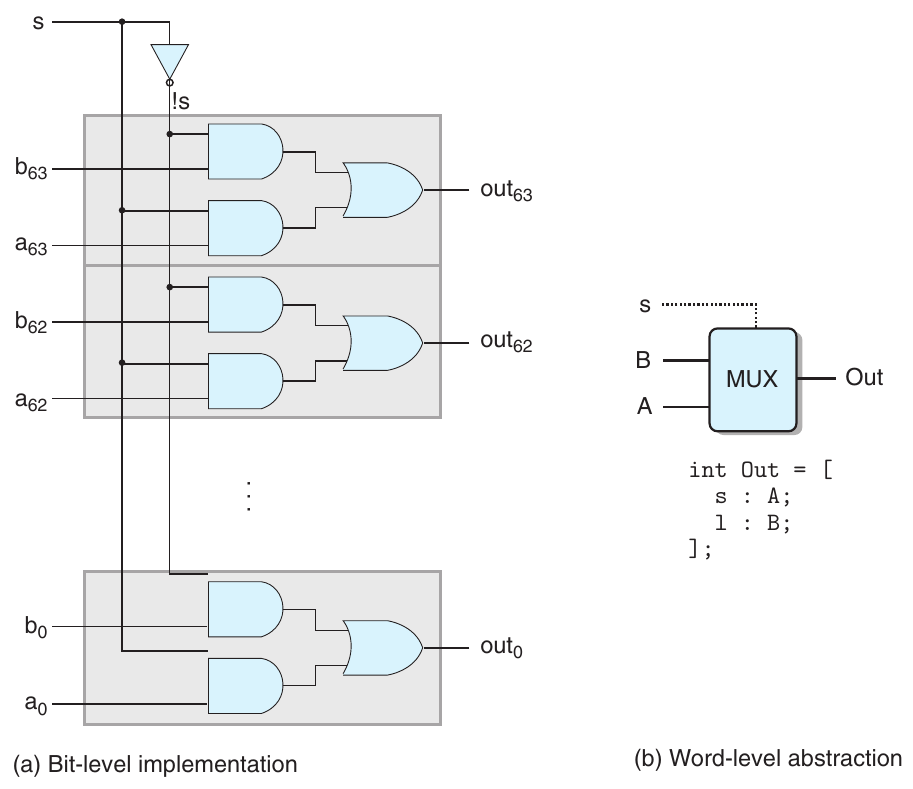

**Hình 4.13 Mạch multiplexor Word-level. Output bằng word input A khi tín hiệu điều khiển s là 1, và bằng B trong trường hợp ngược lại. Multiplexor được mô tả trong HCL bằng case expression.**

Chúng ta sẽ dùng nhiều dạng multiplexor trong thiết kế processor. Chúng cho phép chọn một word từ nhiều nguồn tùy theo một điều kiện điều khiển. Các hàm multiplexing được mô tả trong HCL bằng case expression. Case expression có dạng tổng quát sau:

<pre>[
    select<sub>1</sub> : expr<sub>1</sub>;
    select<sub>2</sub> : expr<sub>2</sub>;
    .
    .
    .
    select<sub>k</sub> : expr<sub>k</sub>;
]</pre>

Biểu thức chứa một chuỗi case, trong đó mỗi case i gồm biểu thức Boolean select<sub>i</sub>, chỉ ra khi nào cần chọn case này, và biểu thức số nguyên expr<sub>i</sub> , chỉ ra giá trị kết quả.

Khác câu lệnh switch trong C, chúng ta không yêu cầu những biểu thức lựa chọn khác nhau phải loại trừ lẫn nhau. Về mặt logic, các biểu thức lựa chọn được đánh giá theo thứ tự, và case của biểu thức đầu tiên cho giá trị 1 được chọn. Ví dụ, multiplexor word-level trong Hình 4.13 có thể được mô tả bằng HCL như sau

```
word Out = [
        s: A;
        1: B;
];
```

Trong code này, biểu thức lựa chọn thứ hai chỉ là 1, chỉ ra rằng cần chọn case này nếu chưa chọn case nào trước đó. Đây là cách chỉ định default case trong HCL. Hầu như mọi case expression đều kết thúc theo cách này.

Cho phép biểu thức lựa chọn không loại trừ lẫn nhau làm code HCL dễ đọc hơn. Multiplexor hardware thực tế phải có các tín hiệu loại trừ lẫn nhau để điều khiển word input nào được truyền đến output, chẳng hạn tín hiệu s và !s trong Hình 4.13. Để chuyển case expression HCL thành hardware, chương trình logic synthesis phải phân tích tập biểu thức lựa chọn và giải quyết mọi xung đột có thể có bằng cách bảo đảm chỉ case khớp đầu tiên được chọn.

Các biểu thức lựa chọn có thể là biểu thức Boolean tùy ý, và số case có thể tùy ý. Điều này cho phép case expression mô tả những block có nhiều lựa chọn tín hiệu input với tiêu chí lựa chọn phức tạp. Ví dụ, xét sơ đồ multiplexor 4-way trong Hình 4.14. Mạch chọn một trong bốn word input A, B, C và D dựa trên tín hiệu điều khiển s1 và s0, xem chúng là số nhị phân 2-bit. Chúng ta có thể biểu diễn điều này trong HCL bằng biểu thức Boolean mô tả các tổ hợp mẫu bit điều khiển khác nhau:

```
word Out4 = [
        !s1 && !s0 : A; # 00
        !s1        : B; # 01
        !s0        : C; # 10
        1          : D; # 11
];
```

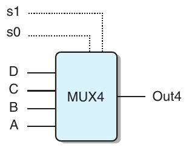

**Hình 4.14 Multiplexor Four-way. Những tổ hợp khác nhau của tín hiệu điều khiển s1 và s0 quyết định input dữ liệu nào được truyền đến output.**

Các chú thích bên phải (mọi văn bản bắt đầu bằng # và kéo dài đến hết dòng đều là chú thích) cho biết tổ hợp s1 và s0 nào khiến case được chọn. Hãy quan sát rằng đôi khi có thể đơn giản hóa biểu thức lựa chọn, vì chỉ case khớp đầu tiên được chọn. Ví dụ, có thể viết biểu thức thứ hai là !s1 thay vì dạng đầy đủ hơn !s1&& s0, vì khả năng duy nhất khác có s1 bằng 0 đã được cho trong biểu thức lựa chọn thứ nhất. Tương tự, có thể viết biểu thức thứ ba là !s0, còn biểu thức thứ tư chỉ cần viết là 1.

Làm ví dụ cuối, giả sử chúng ta muốn thiết kế mạch logic tìm giá trị nhỏ nhất trong tập các word A, B và C, với sơ đồ như sau:

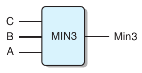

Chúng ta có thể biểu diễn điều này bằng case expression HCL như sau

```
word Min3 = [
        A <= B && A <= C : A;
        B <= A && B <= C : B;
        1                : C;
];
```

#### Bài tập thực hành 4.11 (lời giải trang 520)

Code HCL đã cho để tính giá trị nhỏ nhất của ba word chứa bốn biểu thức so sánh dạng X <= Y . Viết lại code để tính cùng kết quả nhưng chỉ sử dụng ba phép so sánh.

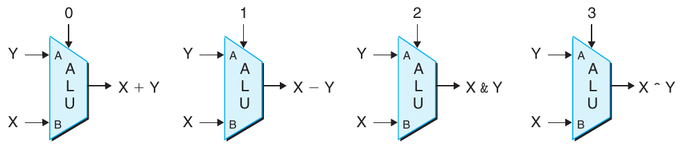

**Hình 4.15 Arithmetic/logic unit (ALU). Tùy thiết lập của function input, mạch thực hiện một trong bốn phép toán số học và logic khác nhau.**

#### Bài tập thực hành 4.12 (lời giải trang 520)

Viết code HCL mô tả mạch nhận các word input A, B và C rồi chọn trung vị của ba giá trị. Nghĩa là output bằng word nằm giữa giá trị nhỏ nhất và lớn nhất trong ba input.

Có thể thiết kế mạch combinational logic để thực hiện nhiều loại phép toán khác nhau trên dữ liệu word-level. Thiết kế chi tiết vượt phạm vi trình bày của chúng ta. Một combinational circuit quan trọng, gọi là arithmetic/logic unit (ALU), được thể hiện ở mức trừu tượng trong Hình 4.15. Trong phiên bản của chúng ta, mạch có ba input: hai input dữ liệu mang nhãn A và B, cùng một input điều khiển. Tùy thiết lập input điều khiển, mạch thực hiện những phép toán số học hoặc logic khác nhau trên các input dữ liệu. Hãy quan sát rằng bốn phép toán được vẽ cho ALU này tương ứng bốn phép toán số nguyên khác nhau mà instruction set Y86-64 hỗ trợ, và các giá trị điều khiển khớp function code của những instruction này (Hình 4.3). Cũng lưu ý thứ tự toán hạng của phép trừ, trong đó input A bị trừ khỏi input B. Thứ tự này được chọn để phù hợp với thứ tự đối số trong instruction subq.

### 4.2.4 Kiểm tra thuộc tập hợp

Trong thiết kế processor, chúng ta gặp nhiều ví dụ muốn so sánh một tín hiệu với nhiều tín hiệu có thể khớp, chẳng hạn kiểm tra xem code của instruction đang được xử lý có khớp một nhóm instruction code nào không. Làm ví dụ đơn giản, giả sử chúng ta muốn sinh tín hiệu s1 và s0 cho multiplexor 4-way trong Hình 4.14 bằng cách chọn các bit high- và low-order từ tín hiệu 2-bit code, như sau:

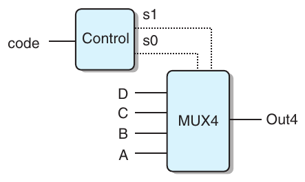

Trong mạch này, tín hiệu 2-bit code điều khiển việc chọn giữa bốn data word A, B, C và D. Chúng ta có thể biểu diễn việc sinh tín hiệu s1 và s0 bằng các phép kiểm tra bằng nhau dựa trên những giá trị có thể có của code:

```
bool s1 = code == 2 || code == 3;
bool s0 = code == 1 || code == 3;
```

Có thể viết biểu thức ngắn gọn hơn để biểu diễn tính chất s1 bằng 1 khi code nằm trong tập {2, 3}, và s0 bằng 1 khi code nằm trong tập {1, 3}:

```
bool s1 = code in { 2, 3 };
bool s0 = code in { 1, 3 };
```

Dạng tổng quát của phép kiểm tra thuộc tập hợp là

<pre>iexpr in {iexpr<sub>1</sub>, iexpr<sub>2</sub>, . . . , iexpr<sub>k</sub>}</pre>

trong đó giá trị được kiểm tra (iexpr) và những giá trị ứng viên để so khớp (iexpr<sub>1</sub> đến iexpr<sub>k</sub>) đều là biểu thức số nguyên.

### 4.2.5 Bộ nhớ và clocking

Về bản chất, combinational circuit không lưu bất kỳ thông tin nào. Thay vào đó, chúng chỉ phản ứng với tín hiệu tại input, sinh output bằng một hàm nào đó của input. Để tạo sequential circuit—tức hệ thống có trạng thái và tính toán trên trạng thái đó—chúng ta phải thêm thiết bị lưu thông tin được biểu diễn bằng bit. Các thiết bị lưu trữ của chúng ta đều được điều khiển bằng một clock duy nhất, một tín hiệu tuần hoàn xác định khi nào nạp giá trị mới vào thiết bị. Chúng ta xét hai lớp thiết bị nhớ:

Clocked register (hay đơn giản là register) lưu từng bit hoặc word. Tín hiệu clock điều khiển việc nạp giá trị tại input vào register.

Random access memory (hay đơn giản là bộ nhớ) lưu nhiều word, dùng địa chỉ để chọn word cần đọc hoặc ghi. Ví dụ về random access memory gồm (1) hệ thống virtual memory của processor, trong đó tổ hợp hardware và operating system software khiến processor có cảm giác có thể truy cập mọi word trong một address space lớn; và (2) register file, trong đó register identifier đóng vai trò địa chỉ. Trong processor Y86-64, register file chứa 15 program register (%rax đến %r14).

Như chúng ta thấy, từ “register” mang hai nghĩa hơi khác nhau khi nói về hardware và lập trình machine-language. Trong hardware, register được nối trực tiếp với phần còn lại của mạch bằng các dây input và output. Trong lập trình machine-level, register biểu diễn một tập nhỏ các word có thể định địa chỉ trong CPU, trong đó địa chỉ là register ID. Những word này thường được lưu trong register file, mặc dù chúng ta sẽ thấy hardware đôi khi có thể truyền word trực tiếp từ instruction này sang instruction khác để tránh độ trễ của việc ghi rồi đọc register file. Khi cần tránh nhập nhằng, chúng ta lần lượt gọi hai lớp register là “hardware register” và “program register”.

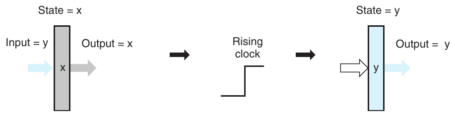

**Hình 4.16 Hoạt động của register. Các output của register giữ nguyên trạng thái hiện tại cho đến khi tín hiệu clock lên cao. Khi clock lên cao, các giá trị tại input của register được chốt để trở thành trạng thái mới.**

Hình 4.16 trình bày chi tiết hơn hardware register và cách hoạt động của nó. Trong phần lớn thời gian, register giữ trạng thái cố định (thể hiện là x), sinh output bằng trạng thái hiện tại. Các tín hiệu lan truyền qua combinational logic trước register, tạo giá trị mới cho input của register (thể hiện là y), nhưng output của register vẫn cố định miễn là clock ở mức thấp. Khi clock lên cao, các tín hiệu input được nạp vào register làm trạng thái tiếp theo (y), và đây trở thành output mới cho đến cạnh lên clock tiếp theo. Điểm then chốt là register đóng vai trò rào chắn giữa combinational logic trong các phần khác nhau của mạch. Các giá trị chỉ lan truyền từ input của register đến output mỗi clock cycle một lần tại cạnh lên clock. Processor Y86-64 của chúng ta dùng clocked register để chứa program counter (PC), condition code (CC) và trạng thái chương trình (Stat).

Sơ đồ sau trình bày một register file điển hình:

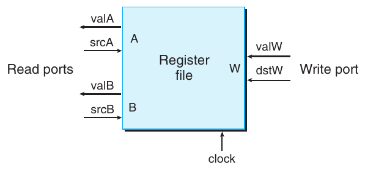

Register file này có hai read port tên A và B, cùng một write port tên W. Random access memory nhiều port như vậy cho phép nhiều phép đọc và ghi diễn ra đồng thời. Trong register file được vẽ, mạch có thể đọc giá trị của hai program register và cập nhật trạng thái của register thứ ba. Mỗi port có input địa chỉ, cho biết program register cần chọn, và output hoặc input dữ liệu cung cấp giá trị cho program register đó. Các địa chỉ là register identifier, dùng encoding trong Hình 4.4. Hai read port có input địa chỉ srcA và srcB (viết tắt “source A” và “source B”), cùng output dữ liệu valA và valB (viết tắt “value A” và “value B”). Write port có input địa chỉ dstW (viết tắt “destination W”) và input dữ liệu valW (viết tắt “value W”).

Register file không phải combinational circuit vì nó có lưu trữ nội bộ. Tuy nhiên, trong cách triển khai của chúng ta, có thể đọc dữ liệu từ register file như thể nó là block combinational logic có địa chỉ làm input và dữ liệu làm output. Khi srcA hoặc srcB được đặt thành một register ID, sau một độ trễ, giá trị lưu trong program register tương ứng xuất hiện trên valA hoặc valB. Ví dụ, đặt srcA thành 3 khiến giá trị program register %rbx được đọc, và giá trị này xuất hiện tại output valA.

Việc ghi word vào register file được tín hiệu clock điều khiển tương tự việc nạp giá trị vào clocked register. Mỗi khi clock lên cao, giá trị trên input valW được ghi vào program register do register ID tại input dstW chỉ định. Khi dstW được đặt thành ID đặc biệt 0xF, không program register nào được ghi. Vì register file có thể được đọc và ghi, câu hỏi tự nhiên là: “Điều gì xảy ra nếu mạch cố đọc và ghi cùng một register đồng thời?” Câu trả lời khá đơn giản: nếu cùng register ID được dùng cho cả read port và write port, khi clock lên cao, output dữ liệu của read port chuyển từ giá trị cũ sang mới. Khi đưa register file vào thiết kế processor, chúng ta sẽ bảo đảm tính đến tính chất này.

Processor có random access memory để lưu dữ liệu chương trình, như minh họa bên dưới: Bộ nhớ này có một input địa chỉ, một input dữ liệu để ghi và một output dữ liệu để đọc. Giống register file, việc đọc bộ nhớ hoạt động tương tự combinational logic: nếu cung cấp địa chỉ tại input address và đặt tín hiệu điều khiển write bằng 0, thì sau một độ trễ, giá trị lưu tại địa chỉ đó xuất hiện ở data out. Tín hiệu error được đặt bằng 1 nếu địa chỉ ngoài phạm vi, và bằng 0 nếu không. Việc ghi bộ nhớ được clock điều khiển: chúng ta đặt address thành địa chỉ mong muốn, data in thành giá trị mong muốn và write bằng 1. Khi vận hành clock, vị trí bộ nhớ được chỉ định được cập nhật, miễn là địa chỉ hợp lệ. Giống phép đọc, tín hiệu error được đặt bằng 1 nếu địa chỉ không hợp lệ. Tín hiệu này được combinational logic sinh ra, vì việc kiểm tra giới hạn chỉ là hàm của input địa chỉ và không liên quan đến lưu trạng thái.

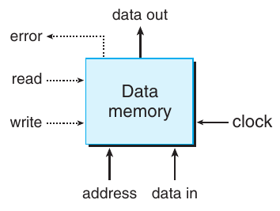

#### Thông tin thêm: Thiết kế bộ nhớ Real-life

Hệ thống bộ nhớ trong microprocessor full-scale phức tạp hơn nhiều bộ nhớ đơn giản mà chúng ta giả định trong thiết kế. Nó gồm nhiều dạng hardware memory, bao gồm một số random access memory, cùng nonvolatile memory hoặc đĩa từ, cũng như nhiều cơ chế hardware và software để quản lý những thiết bị này. Thiết kế và đặc tính của hệ thống bộ nhớ được mô tả trong Chương 6.

Dù vậy, thiết kế bộ nhớ đơn giản của chúng ta có thể dùng cho hệ thống nhỏ hơn, và cung cấp một abstraction của interface giữa processor và bộ nhớ trong hệ thống phức tạp hơn.

Processor còn có thêm bộ nhớ read-only để đọc instruction. Trong phần lớn hệ thống thực tế, những bộ nhớ này được hợp nhất thành một bộ nhớ với hai port: một port đọc instruction và port còn lại đọc hoặc ghi dữ liệu.

## 4.3 Các cách triển khai Y86-64 tuần tự

Đến đây, chúng ta có những thành phần cần thiết để triển khai processor Y86-64. Bước đầu tiên là mô tả processor tên SEQ (nghĩa là processor “sequential”). Trong mỗi clock cycle, SEQ thực hiện mọi bước cần thiết để xử lý trọn vẹn một instruction. Tuy nhiên, điều này đòi hỏi cycle time rất dài, nên clock rate sẽ thấp đến mức không chấp nhận được. Mục đích phát triển SEQ là cung cấp bước khởi đầu hướng đến mục tiêu cuối cùng: triển khai pipelined processor hiệu quả.

### 4.3.1 Tổ chức xử lý thành các stage

Nhìn chung, xử lý một instruction liên quan đến một số thao tác. Chúng ta tổ chức chúng theo chuỗi stage cụ thể, cố gắng làm mọi instruction tuân theo chuỗi thống nhất, mặc dù hành động của chúng rất khác nhau. Việc xử lý chi tiết tại mỗi bước phụ thuộc instruction cụ thể đang được thực thi. Tạo khuôn khổ này cho phép thiết kế processor tận dụng hardware tốt nhất. Sau đây là mô tả không hình thức về các stage và thao tác trong từng stage:

Fetch. Fetch stage đọc các byte của instruction từ bộ nhớ, dùng program counter (PC) làm địa chỉ bộ nhớ. Từ instruction, nó trích xuất hai phần 4-bit của instruction specifier byte, gọi là icode (instruction code) và ifun (instruction function). Nó có thể lấy thêm register specifier byte, cung cấp một hoặc cả hai bộ chỉ định toán hạng register rA và rB. Nó cũng có thể lấy word hằng 8-byte valC. Nó tính valP là địa chỉ instruction theo sau instruction hiện tại theo thứ tự tuần tự. Nghĩa là valP bằng giá trị PC cộng độ dài instruction vừa lấy.

Decode. Decode stage đọc tối đa hai toán hạng từ register file, cho giá trị valA và/hoặc valB. Thông thường, nó đọc những register được field instruction rA và rB chỉ định, nhưng với một số instruction nó đọc register %rsp.

Execute. Trong execute stage, arithmetic/logic unit (ALU) thực hiện phép toán được instruction chỉ định (theo giá trị ifun), tính effective address của memory reference, hoặc tăng hay giảm stack pointer. Chúng ta gọi giá trị kết quả là valE. Condition code có thể được đặt. Với conditional move instruction, stage đánh giá condition code và điều kiện move (do ifun cho biết), và chỉ cho phép cập nhật register đích nếu điều kiện được thỏa mãn. Tương tự, với jump instruction, nó xác định có lấy branch hay không.

Memory. Memory stage có thể ghi dữ liệu vào bộ nhớ hoặc đọc dữ liệu từ bộ nhớ. Chúng ta gọi giá trị đọc được là valM.

Write back. write-back stage ghi tối đa hai kết quả vào register file.

PC update. PC được đặt thành địa chỉ instruction tiếp theo.

Processor lặp vô hạn để thực hiện các stage này. Trong cách triển khai đơn giản hóa, processor dừng khi xảy ra bất kỳ exception nào—nghĩa là khi thực thi halt hoặc instruction không hợp lệ, hay cố đọc hoặc ghi địa chỉ không hợp lệ. Trong thiết kế đầy đủ hơn, processor chuyển vào chế độ exception-handling và bắt đầu thực thi code đặc biệt được loại exception xác định.

Như mô tả trên cho thấy, số thao tác xử lý cần để thực thi một instruction nhiều đến đáng ngạc nhiên. Chúng ta không chỉ thực hiện phép toán được instruction nêu ra, mà còn phải tính địa chỉ, cập nhật stack pointer và xác định địa chỉ instruction tiếp theo. May mắn là flow tổng thể có thể tương tự cho mọi instruction. Dùng cấu trúc rất đơn giản và thống nhất rất quan trọng khi thiết kế hardware, vì chúng ta muốn giảm thiểu tổng lượng hardware và cuối cùng phải ánh xạ nó lên bề mặt two-dimensional của chip integrated-circuit. Một cách giảm độ phức tạp là để các instruction khác nhau chia sẻ nhiều hardware nhất có thể. Ví dụ, mỗi thiết kế processor có một arithmetic/logic unit duy nhất được dùng theo nhiều cách tùy loại instruction đang thực thi. Chi phí nhân đôi các block logic trong hardware cao hơn nhiều chi phí có nhiều bản sao code trong software. Xử lý nhiều trường hợp đặc biệt và đặc tính riêng trong hệ thống hardware cũng khó hơn trong software.

Thách thức là sắp xếp việc tính toán cần cho từng instruction khác nhau để phù hợp khuôn khổ tổng quát này. Chúng ta dùng code trong Hình 4.17 để minh họa xử lý các instruction Y86-64 khác nhau. Hình 4.18 đến 4.21 chứa các bảng mô tả cách instruction Y86-64 đi qua các stage. Rất đáng dành công sức nghiên cứu kỹ những bảng này. Chúng có dạng cho phép ánh xạ thẳng sang hardware. Mỗi dòng trong bảng mô tả phép gán cho một tín hiệu hoặc trạng thái lưu trữ (được biểu thị bằng phép gán ‘←’). Cần đọc như thể chúng được đánh giá tuần tự từ trên xuống dưới. Khi sau này ánh xạ tính toán sang hardware, chúng ta sẽ thấy không cần thực hiện những phép đánh giá này theo thứ tự tuần tự nghiêm ngặt.

```
 1   0x000: 30f20900000000000000 |     irmovq $9,  %rdx
 2   0x00a: 30f31500000000000000 |     irmovq $21, %rbx
 3   0x014: 6123                 |     subq %rdx, %rbx          # subtract
 4   0x016: 30f48000000000000000 |     irmovq $128,%rsp         # Problem 4.13
 5   0x020: 40436400000000000000 |     rmmovq %rsp, 100(%rbx)   # store
 6   0x02a: a02f                 |     pushq %rdx               # push
 7   0x02c: b00f                 |     popq  %rax               # Problem 4.14
 8   0x02e: 734000000000000000   |     je done                  # Not taken
 9   0x037: 804100000000000000   |     call proc                # Problem 4.18
10   0x040:                      | done:
11   0x040: 00                   |     halt
12   0x041:                      | proc:
13   0x041: 90                   |     ret                      # Return
14                               |
```

**Hình 4.17 Chuỗi instruction Y86-64 mẫu. Chúng ta sẽ lần theo việc xử lý các instruction này qua những stage khác nhau.**

Hình 4.18 trình bày việc xử lý cần cho các loại instruction OPq (phép toán số nguyên và logic), rrmovq (move register-register) và irmovq (move immediate-register). Trước hết hãy xét các phép toán số nguyên. Xem Hình 4.2, chúng ta thấy encoding instruction đã được chọn cẩn thận để bốn phép toán số nguyên (addq, subq, andq và xorq) đều có cùng giá trị icode. Có thể xử lý tất cả bằng chuỗi bước giống nhau, ngoại trừ phép tính ALU phải được đặt theo phép toán instruction cụ thể, được mã hóa trong ifun.

Việc xử lý instruction integer-operation tuân theo mẫu tổng quát nêu trên. Trong fetch stage, chúng ta không cần word hằng, nên valP được tính là PC + 2. Trong decode stage, chúng ta đọc cả hai toán hạng. Chúng được cung cấp cho ALU trong execute stage cùng bộ chỉ định hàm ifun, để valE trở thành kết quả instruction. Phép tính này được thể hiện bằng biểu thức valB OP valA, trong đó OP chỉ phép toán do ifun xác định. Lưu ý thứ tự hai đối số—thứ tự này nhất quán với quy ước Y86-64 (và x86-64). Ví dụ, instruction subq %rax,%rdx cần tính giá trị R[%rdx] − R[%rax]. Không có thao tác nào trong memory stage đối với những instruction này, nhưng valE được ghi vào register rB trong write-back stage, và PC được đặt thành valP để hoàn tất thực thi instruction.

Thực thi instruction rrmovq diễn ra khá giống phép toán số học. Tuy nhiên, chúng ta không cần lấy toán hạng register thứ hai. Thay vào đó, đặt input ALU thứ hai bằng không rồi cộng với input thứ nhất, cho valE = valA, sau đó giá trị này được Memory ghi vào register file. Việc xử lý tương tự diễn ra với irmovq, ngoại trừ dùng giá trị hằng valC cho input ALU thứ nhất. Ngoài ra, phải tăng program counter thêm 10 cho irmovq do format instruction dài. Không instruction nào trong hai instruction này thay đổi condition code.

| Stage | OPq rA , rB | rrmovq rA , rB | irmovq V , rB |
|---|---|---|---|
| Fetch | icode : ifun ← M<sub>1</sub>[PC] | icode : ifun ← M<sub>1</sub>[PC] | icode : ifun ← M<sub>1</sub>[PC] |
|  | rA : rB ← M<sub>1</sub>[PC + 1] | rA : rB ← M<sub>1</sub>[PC + 1] | rA : rB ← M<sub>1</sub>[PC + 1] |
|  |  |  | valC ← M<sub>8</sub>[PC + 2] |
|  | valP ← PC + 2 | valP ← PC + 2 | valP ← PC + 10 |
| Decode | valA ← R[rA]<br>valB ← R[rB] | valA ← R[rA] |  |
| Execute | valE ← valB OP valA<br>Đặt CC | valE ← 0 + valA | valE ← 0 + valC |
| Memory |  |  |  |
| Write back | R[rB] ← valE | R[rB] ← valE | R[rB] ← valE |
| PC update | PC ← valP | PC ← valP | PC ← valP |

**Hình 4.18 Các phép tính trong triển khai tuần tự của instruction Y86-64 OPq, rrmovq và irmovq. Những instruction này tính giá trị và lưu kết quả vào register. Ký pháp icode : ifun chỉ hai thành phần của instruction byte, còn rA : rB chỉ hai thành phần của register specifier byte. Ký pháp M<sub>1</sub>[x] chỉ truy cập (đọc hoặc ghi) 1 byte tại vị trí bộ nhớ x, còn M<sub>8</sub>[x] chỉ truy cập 8 byte.**

#### Bài tập thực hành 4.13 (lời giải trang 521)

Điền cột right-hand của bảng sau để mô tả xử lý instruction irmovq ở dòng 4 của object code trong Hình 4.17:

|  | Generic | Specific |
|---|---|---|
| Stage | irmovq V , rB | irmovq $128, %rsp |
| Fetch | icode : ifun ← M<sub>1</sub>[PC] |  |
|  | rA : rB ← M<sub>1</sub>[PC + 1] |  |
|  | valC ← M<sub>8</sub>[PC + 2] |  |
|  | valP ← PC + 10 |  |
| Decode |  |  |
| Execute | valE ← 0 + valC |  |
| Memory |  |  |
| Write back | R[rB] ← valE |  |
| PC update | PC ← valP |  |

Việc thực thi instruction này thay đổi các register và PC như thế nào?

#### Thông tin thêm: Lần theo thực thi instruction subq

Ví dụ, hãy theo dõi việc xử lý instruction subq ở dòng 3 của object code trong Hình 4.17. Chúng ta thấy hai instruction trước khởi tạo các register %rdx và %rbx lần lượt bằng 9 và 21. Cũng có thể thấy instruction nằm tại địa chỉ 0x014 và gồm 2 byte có giá trị 0x61 và 0x23. Các stage diễn ra như trong bảng sau, liệt kê quy tắc tổng quát để xử lý instruction OPq (Hình 4.18) bên trái, và tính toán cho instruction cụ thể này bên phải.

| Stage | OPq rA , rB | subq %rdx, %rbx |
|---|---|---|
| Fetch | icode : ifun ← M<sub>1</sub>[PC] | icode : ifun ← M<sub>1</sub>[ 0x014 ] = 6:1 |
|  | rA : rB ← M<sub>1</sub>[PC + 1] | rA : rB ← M<sub>1</sub>[ 0x015 ] = 2:3 |
|  | valP ← PC + 2 | valP ← 0x014 + 2 = 0x016 |
| Decode | valA ← R[rA] | valA ← R[ %rdx ] = 9 |
|  | valB ← R[rB] | valB ← R[ %rbx] = 21 |
| Execute | valE ← valB OP valA | valE ← 21 − 9 = 12 |
|  | Đặt CC | ZF ← 0 , SF ← 0 , OF ← 0 |
| Memory |  |  |
| Write back | R[rB] ← valE | R[%rbx ] ← valE = 12 |
| PC update | PC ← valP | PC ← valP = 0x016 |

Như quá trình lần theo này cho thấy, chúng ta đạt tác dụng mong muốn là đặt register %rbx bằng 12, đặt cả ba condition code bằng không, và tăng PC thêm 2.

Hình 4.19 trình bày việc xử lý cần cho instruction ghi và đọc bộ nhớ rmmovq và mrmovq. Chúng ta thấy flow cơ bản giống trước, nhưng dùng ALU cộng valC với valB, tạo effective address (tổng displacement và giá trị base register) cho phép toán bộ nhớ. Trong memory stage, chúng ta ghi giá trị register valA vào bộ nhớ hoặc đọc valM từ bộ nhớ.

| Stage | rmmovq rA , D ( rB ) | mrmovq D ( rB ), rA |
|---|---|---|
| Fetch | icode : ifun ← M<sub>1</sub>[PC] | icode : ifun ← M<sub>1</sub>[PC] |
|  | rA : rB ← M<sub>1</sub>[PC + 1] | rA : rB ← M<sub>1</sub>[PC + 1] |
|  | valC ← M<sub>8</sub>[PC + 2] | valC ← M<sub>8</sub>[PC + 2] |
|  | valP ← PC + 10 | valP ← PC + 10 |
| Decode | valA ← R[rA] |  |
|  | valB ← R[rB] | valB ← R[rB] |
| Execute | valE ← valB + valC | valE ← valB + valC |
| Memory | M<sub>8</sub>[valE] ← valA | valM ← M<sub>8</sub>[valE] |
| Write back |  |  |
|  |  | R[rA] ← valM |
| PC update | PC ← valP | PC ← valP |

**Hình 4.19 Các phép tính trong triển khai tuần tự của instruction Y86-64 rmmovq và mrmovq. Những instruction này đọc hoặc ghi bộ nhớ.**

Hình 4.20 trình bày các bước cần để xử lý instruction pushq và popq. Đây là những instruction Y86-64 khó triển khai nhất, vì liên quan đến cả truy cập bộ nhớ lẫn tăng hoặc giảm stack pointer. Mặc dù hai instruction có flow tương tự, chúng có những khác biệt quan trọng.

Instruction pushq bắt đầu khá giống các instruction trước, nhưng trong decode stage, chúng ta dùng %rsp làm bộ chỉ định cho toán hạng register thứ hai, cung cấp stack pointer làm giá trị valB. Trong execute stage, chúng ta dùng ALU giảm stack pointer đi 8. Giá trị đã giảm được dùng làm địa chỉ ghi bộ nhớ và cũng được lưu trở lại %rsp trong write-back stage. Dùng valE làm địa chỉ phép ghi bảo đảm tuân theo quy ước Y86-64 (và x86-64) rằng pushq phải giảm stack pointer trước khi ghi, mặc dù việc cập nhật stack pointer thực tế chỉ diễn ra sau khi phép toán bộ nhớ hoàn tất.

Instruction popq diễn ra khá giống pushq, ngoại trừ đọc hai bản sao stack pointer trong decode stage. Điều này rõ ràng dư thừa, nhưng chúng ta sẽ thấy có stack pointer ở cả valA và valB khiến flow về sau giống các instruction khác hơn, nâng cao tính thống nhất tổng thể của thiết kế. Chúng ta dùng ALU tăng stack pointer thêm 8 trong execute stage, nhưng dùng giá trị chưa tăng làm địa chỉ phép toán bộ nhớ. Trong write-back stage, chúng ta cập nhật cả register stack pointer bằng stack pointer đã tăng, lẫn register rA bằng giá trị đọc từ bộ nhớ. Dùng stack pointer chưa tăng làm địa chỉ đọc bộ nhớ bảo toàn quy ước Y86-64 (và x86-64) rằng popq phải đọc bộ nhớ trước rồi tăng stack pointer.

#### Thông tin thêm: Lần theo thực thi instruction rmmovq

Hãy lần theo việc xử lý instruction rmmovq ở dòng 5 của object code trong Hình 4.17. Chúng ta thấy instruction trước khởi tạo register %rsp bằng 128, còn %rbx vẫn chứa 12 do instruction subq (dòng 3) tính. Cũng thấy instruction nằm tại địa chỉ 0x020 và gồm 10 byte. 2 byte đầu có giá trị 0x40 và 0x43, còn 8 byte cuối là phiên bản byte-reversed của số 0x0000000000000064 (thập phân 100). Các stage diễn ra như sau:

|  | Generic | Specific |
|---|---|---|
| Stage | rmmovq rA , D ( rB ) | rmmovq %rsp, 100(%rbx) |
| Fetch | icode : ifun ← M<sub>1</sub>[PC] | icode : ifun ← M<sub>1</sub>[ 0x020 ] = 4:0 |
|  | rA : rB ← M<sub>1</sub>[PC + 1] | rA : rB ← M<sub>1</sub>[ 0x021 ] = 4:3 |
|  | valC ← M<sub>8</sub>[PC + 2] | valC ← M<sub>8</sub>[ 0x022 ] = 100 |
|  | valP ← PC + 10 | valP ← 0x020 + 10 = 0x02a |
| Decode | valA ← R[rA] | valA ← R[ %rsp ] = 128 |
|  | valB ← R[rB] | valB ← R[ %rbx] = 12 |
| Execute | valE ← valB + valC | valE ← 12 + 100 = 112 |
| Memory | M<sub>8</sub>[valE] ← valA | M<sub>8</sub>[ 112 ] ← 128 |
| Write back |  |  |
| PC update | PC ← valP | PC ← 0x02a |

Như quá trình lần theo này cho thấy, instruction ghi 128 vào địa chỉ bộ nhớ 112 và tăng PC thêm 10.

#### Bài tập thực hành 4.14 (lời giải trang 522)

Điền cột right-hand của bảng sau để mô tả xử lý instruction popq ở dòng 7 của object code trong Hình 4.17.

|  | Generic | Specific |
|---|---|---|
| Stage | popq rA | popq %rax |
| Fetch | icode : ifun ← M<sub>1</sub>[PC] |  |
|  | rA : rB ← M<sub>1</sub>[PC + 1] |  |
|  | valP ← PC + 2 |  |
| Decode | valA ← R[ %rsp] |  |
|  | valB ← R[%rsp ] |  |
| Execute | valE ← valB + 8 |  |
| Memory | valM ← M<sub>8</sub>[valA] |  |
| Write back | R[ %rsp ] ← valE |  |
|  | R[rA] ← valM |  |
| PC update | PC ← valP |  |

Việc thực thi instruction này tác động thế nào đến các register và PC?

| Stage | pushq rA | popq rA |
|---|---|---|
| Fetch | icode : ifun ← M<sub>1</sub>[PC] | icode : ifun ← M<sub>1</sub>[PC] |
|  | rA : rB ← M<sub>1</sub>[PC + 1] | rA : rB ← M<sub>1</sub>[PC + 1] |
|  | valP ← PC + 2 | valP ← PC + 2 |
| Decode | valA ← R[rA] | valA ← R[ %rsp ] |
|  | valB ← R[%rsp ] | valB ← R[ %rsp ] |
| Execute | valE ← valB + (−8) | valE ← valB + 8 |
| Memory | M<sub>8</sub>[valE] ← valA | valM ← M<sub>8</sub>[valA] |
| Write back | R[ %rsp ] ← valE | R[%rsp ] ← valE<br>R[rA] ← valM |
| PC update | PC ← valP | PC ← valP |

**Hình 4.20 Các phép tính trong triển khai tuần tự của instruction Y86-64 pushq và popq. Những instruction này push và pop stack.**

#### Bài tập thực hành 4.15 (lời giải trang 522)

Tác dụng của instruction pushq %rsp theo các bước trong Hình 4.20 là gì? Nó có tuân theo hành vi mong muốn cho Y86-64 được xác định trong Bài tập 4.7 không?

#### Thông tin thêm: Lần theo thực thi instruction pushq

Hãy lần theo việc xử lý instruction pushq ở dòng 6 của object code trong Hình 4.17. Lúc này, register %rdx chứa 9 và register %rsp chứa 128. Chúng ta cũng thấy instruction nằm tại địa chỉ 0x02a và gồm 2 byte có giá trị 0xa0 và 0x2f. Các stage diễn ra như sau:

|  | Generic | Specific |
|---|---|---|
| Stage | pushq rA | pushq %rdx |
| Fetch | icode : ifun ← M<sub>1</sub>[PC] | icode : ifun ← M<sub>1</sub>[ 0x02a ] = a:0 |
|  | rA : rB ← M<sub>1</sub>[PC + 1] | rA : rB ← M<sub>1</sub>[0x02b ] = 2:f |
|  | valP ← PC + 2 | valP ← 0x02a + 2 = 0x02c |
| Decode | valA ← R[rA] | valA ← R[ %rdx ] = 9 |
|  | valB ← R[%rsp ] | valB ← R[ %rsp] = 128 |
| Execute | valE ← valB + (−8) | valE ← 128 + (−8) = 120 |
| Memory | M<sub>8</sub>[valE] ← valA | M<sub>8</sub>[ 120 ] ← 9 |
| Write back | R[ %rsp ] ← valE | R[%rsp ] ← 120 |
| PC update | PC ← valP | PC ← 0x02c |

Như quá trình lần theo này cho thấy, instruction đặt %rsp bằng 120, ghi 9 vào địa chỉ 120 và tăng PC thêm 2.

#### Bài tập thực hành 4.16 (lời giải trang 522)

Giả sử hai phép ghi register trong write-back stage cho popq diễn ra theo thứ tự liệt kê trong Hình 4.20. Thực thi popq %rsp sẽ có tác dụng gì? Nó có tuân theo hành vi mong muốn cho Y86-64 được xác định trong Bài tập 4.8 không?

Hình 4.21 cho biết việc xử lý ba loại instruction chuyển quyền điều khiển: các jump khác nhau, call và ret. Chúng ta thấy có thể triển khai những instruction này bằng cùng flow tổng thể như trước.

Giống phép toán số nguyên, chúng ta có thể xử lý mọi jump theo cách thống nhất, vì chúng chỉ khác nhau khi xác định có lấy branch hay không. Jump instruction đi qua fetch và decode khá giống những instruction trước, ngoại trừ không cần register specifier byte. Trong execute stage, chúng ta kiểm tra condition code và điều kiện jump để xác định có lấy branch hay không, tạo tín hiệu 1-bit Cnd. Trong PC update stage, chúng ta kiểm tra flag này và đặt PC bằng valC (jump target) nếu flag là 1, hoặc valP (địa chỉ instruction tiếp theo) nếu flag là 0. Ký pháp x ? a : b tương tự biểu thức điều kiện trong C—nó cho a khi x là 1 và b khi x là 0.

| Stage | jXX Dest | call Dest | ret |
|---|---|---|---|
| Fetch | icode : ifun ← M<sub>1</sub>[PC]<br>valC ← M<sub>8</sub>[PC + 1] | icode : ifun ← M<sub>1</sub>[PC]<br>valC ← M<sub>8</sub>[PC + 1] | icode : ifun ← M<sub>1</sub>[PC] |
|  | valP ← PC + 9 | valP ← PC + 9 | valP ← PC + 1 |
| Decode |  |  | valA ← R[%rsp ] |
|  |  | valB ← R[ %rsp ] | valB ← R[%rsp ] |
| Execute |  | valE ← valB + (−8) | valE ← valB + 8 |
|  | Cnd ← Cond(CC, ifun) |  |  |
| Memory |  | M<sub>8</sub>[valE] ← valP | valM ← M<sub>8</sub>[valA] |
| Write back |  | R[%rsp ] ← valE | R[ %rsp ] ← valE |
| PC update | PC ← Cnd ? valC : valP | PC ← valC | PC ← valM |

**Hình 4.21 Các phép tính trong triển khai tuần tự của instruction Y86-64 jXX, call và ret. Những instruction này chuyển quyền điều khiển.**

#### Bài tập thực hành 4.17 (lời giải trang 522)

Qua encoding instruction (Hình 4.2 và 4.3), chúng ta thấy instruction rrmovq là phiên bản vô điều kiện của lớp instruction tổng quát hơn có cả conditional move. Hãy chỉ ra cách sửa các bước cho instruction rrmovq bên dưới để xử lý cả sáu conditional move instruction. Bạn có thể thấy hữu ích khi xem cách triển khai các instruction jXX (Hình 4.21) xử lý hành vi có điều kiện.

| Stage | cmovXX rA , rB |
|---|---|
| Fetch | icode : ifun ← M<sub>1</sub>[PC] |
|  | rA : rB ← M<sub>1</sub>[PC + 1] |
|  | valP ← PC + 2 |
| Decode | valA ← R[rA] |
| Execute | valE ← 0 + valA |
| Memory |  |
| Write back |  |
|  | R[rB] ← valE |
| PC update | PC ← valP |

#### Thông tin thêm: Lần theo thực thi instruction je

Hãy lần theo việc xử lý instruction je ở dòng 8 của object code trong Hình 4.17. Mọi condition code đã được instruction subq (dòng 3) đặt bằng không, nên branch không được lấy. Instruction nằm tại địa chỉ 0x02e và gồm 9 byte. Byte đầu có giá trị 0x73, còn 8 byte còn lại là phiên bản byte-reversed của số 0x0000000000000040, là jump target. Các stage diễn ra như sau:

|  | Generic | Specific |
|---|---|---|
| Stage | jXX Dest | je 0x040 |
| Fetch | icode : ifun ← M<sub>1</sub>[PC] | icode : ifun ← M<sub>1</sub>[ 0x02e ] = 7:3 |
|  | valC ← M<sub>8</sub>[PC + 1] | valC ← M<sub>8</sub>[ 0x02f ] = 0x040 |
|  | valP ← PC + 9 | valP ← 0x02e + 9 = 0x037 |
| Decode |  |  |
| Execute |  |  |
|  | Cnd ← Cond(CC, ifun) | Cnd ← Cond(⟨0, 0, 0⟩, 3 ) = 0 |
| Memory |  |  |
| Write back |  |  |
| PC update | PC ← Cnd ? valC : valP | PC ← 0 ? 0x040 : 0x037 = 0x037 |

Như quá trình lần theo này cho thấy, instruction tăng PC thêm 9.

Instruction call và ret phần nào tương tự pushq và popq, ngoại trừ chúng ta push và pop giá trị program counter. Với instruction call, chúng ta push valP, địa chỉ instruction sau call. Trong PC update stage, đặt PC bằng valC, là đích call. Với instruction ret, chúng ta gán valM, giá trị được pop từ stack, cho PC trong PC update stage.

#### Bài tập thực hành 4.18 (lời giải trang 523)

Điền cột right-hand của bảng sau để mô tả xử lý instruction call ở dòng 9 của object code trong Hình 4.17:

|  | Generic | Specific |
|---|---|---|
| Stage | call Dest | call 0x041 |
| Fetch | icode : ifun ← M<sub>1</sub>[PC] |  |
|  | valC ← M<sub>8</sub>[PC + 1] |  |
|  | valP ← PC + 9 |  |
| Decode |  |  |
|  | valB ← R[%rsp ] |  |
| Execute | valE ← valB + (−8) |  |
| Memory | M<sub>8</sub>[valE] ← valP |  |
| Write back | R[%rsp ] ← valE |  |
| PC update | PC ← valC |  |

Việc thực thi instruction này tác động thế nào đến các register, PC và bộ nhớ?

#### Thông tin thêm: Lần theo thực thi instruction ret

Hãy lần theo việc xử lý instruction ret ở dòng 13 của object code trong Hình 4.17. Địa chỉ instruction là 0x041 và được mã hóa bằng một byte duy nhất 0x90. Instruction call trước đó đặt %rsp bằng 120 và lưu địa chỉ trả về 0x040 tại địa chỉ bộ nhớ 120. Các stage diễn ra như sau:

|  | Generic | Specific |
|---|---|---|
| Stage | ret | ret |
| Fetch | icode : ifun ← M<sub>1</sub>[PC] | icode : ifun ← M<sub>1</sub>[ 0x041 ] = 9:0 |
|  | valP ← PC + 1 | valP ← 0x041 + 1 = 0x042 |
| Decode | valA ← R[ %rsp] | valA ← R[ %rsp ] = 120 |
|  | valB ← R[%rsp ] | valB ← R[ %rsp] = 120 |
| Execute | valE ← valB + 8 | valE ← 120 + 8 = 128 |
| Memory | valM ← M<sub>8</sub>[valA] | valM ← M<sub>8</sub>[ 120 ] = 0x040 |
| Write back | R[ %rsp ] ← valE | R[%rsp ] ← 128 |
| PC update | PC ← valM | PC ← 0x040 |

Như quá trình lần theo này cho thấy, instruction đặt PC bằng 0x040, địa chỉ instruction halt. Nó cũng đặt %rsp bằng 128.

Chúng ta đã tạo khuôn khổ thống nhất xử lý mọi loại instruction Y86-64 khác nhau. Mặc dù hành vi instruction rất đa dạng, chúng ta có thể tổ chức xử lý thành sáu stage. Nhiệm vụ tiếp theo là tạo thiết kế hardware triển khai các stage và nối chúng với nhau.

### 4.3.2 Cấu trúc hardware SEQ

Có thể tổ chức tính toán cần để triển khai mọi instruction Y86-64 thành chuỗi sáu stage cơ bản: fetch, decode, execute, memory, write back và PC update. Hình 4.22 trình bày góc nhìn trừu tượng về cấu trúc hardware thực hiện các phép tính này. Program counter được lưu trong register ở góc left-hand phía dưới (nhãn “PC”). Thông tin sau đó đi theo dây (được nhóm lại thành đường màu xám đậm), trước hết lên trên rồi vòng sang phải. Các hardware unit gắn với stage khác nhau thực hiện xử lý. Những đường phản hồi quay xuống phía right-hand chứa giá trị cập nhật để ghi register file và program counter cập nhật. Trong SEQ, mọi xử lý của hardware unit diễn ra trong một clock cycle, như Mục 4.3.3 thảo luận. Sơ đồ lược bỏ một số block combinational logic nhỏ cũng như mọi control logic cần để vận hành các hardware unit và định tuyến giá trị thích hợp tới chúng. Chúng ta sẽ thêm chi tiết này sau. Cách vẽ processor với flow từ dưới lên trên không theo thông lệ. Chúng ta sẽ giải thích lý do khi bắt đầu thiết kế pipelined processor.

Các hardware unit gắn với những stage xử lý khác nhau:

Fetch. Dùng register program counter làm địa chỉ, instruction memory đọc các byte instruction. PC incrementer tính valP, program counter đã tăng.

Decode. Register file có hai read port A và B, qua đó các giá trị register valA và valB được đọc đồng thời.

Execute. Execute stage dùng arithmetic/logic unit (ALU) cho các mục đích khác nhau tùy loại instruction. Với phép toán số nguyên, nó thực hiện phép toán chỉ định. Với instruction khác, nó làm adder để tính stack pointer đã tăng hoặc giảm, tính effective address, hoặc đơn giản truyền một input đến output bằng cách cộng không.

Condition code register (CC) chứa ba bit condition code. Các giá trị mới cho condition code được ALU tính. Khi thực thi conditional move instruction, quyết định có cập nhật register đích không được tính dựa trên condition code và điều kiện move. Tương tự, khi thực thi jump instruction, tín hiệu branch Cnd được tính dựa trên condition code và loại jump.

Memory. Data memory đọc hoặc ghi một word bộ nhớ khi thực thi memory instruction. Instruction memory và data memory truy cập cùng các vị trí bộ nhớ nhưng cho mục đích khác nhau.

Write back. Register file có hai write port. Port E dùng để ghi giá trị do ALU tính, còn port M dùng để ghi giá trị đọc từ data memory.

PC update. Giá trị mới của program counter được chọn là valP, địa chỉ instruction tiếp theo, valC, địa chỉ đích do call hoặc jump instruction chỉ định, hoặc valM, địa chỉ trả về đọc từ bộ nhớ.

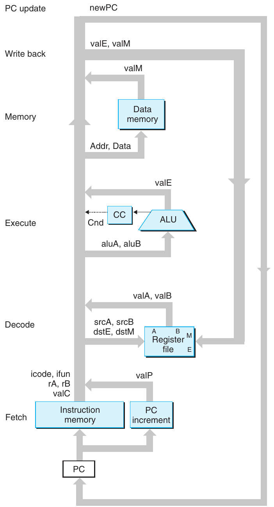

**Hình 4.22 Góc nhìn trừu tượng của SEQ, một cách triển khai tuần tự. Thông tin được xử lý trong khi thực thi instruction đi theo flow chiều kim đồng hồ, bắt đầu bằng instruction fetch dùng program counter (PC), thể hiện ở góc left-hand phía dưới của hình.**

Hình 4.23 trình bày chi tiết hơn hardware cần để triển khai SEQ (mặc dù chưa thấy đầy đủ chi tiết cho đến khi xét từng stage). Chúng ta thấy cùng tập hardware unit như trước, nhưng giờ dây được vẽ tường minh. Trong hình này và những sơ đồ hardware khác, chúng ta dùng các quy ước vẽ sau:

- Clocked register được thể hiện bằng hình chữ nhật trắng. Program counter PC là clocked register duy nhất trong SEQ.

- Hardware unit được thể hiện bằng khối màu xanh nhạt. Chúng gồm bộ nhớ, ALU và các unit khác. Chúng ta dùng cùng tập unit cơ bản cho mọi cách triển khai processor. Chúng ta xem những unit này là “hộp đen” và không đi sâu thiết kế chi tiết.

- Control logic block được vẽ bằng hình chữ nhật bo góc màu xám. Chúng chọn một nguồn trong tập nguồn tín hiệu hoặc tính một hàm Boolean. Chúng ta sẽ xem xét đầy đủ chi tiết những block này, bao gồm phát triển mô tả HCL.

- Tên dây được ghi trong vòng tròn trắng. Đây chỉ là nhãn trên dây, không phải phần tử hardware.

- Kết nối dữ liệu Word-wide được vẽ bằng đường vừa. Mỗi đường thực ra biểu diễn bó 64 dây nối song song để truyền một word từ phần hardware này sang phần khác.

- Kết nối dữ liệu byte và hẹp hơn được vẽ bằng đường mảnh. Mỗi đường thực ra biểu diễn bó bốn hoặc tám dây, tùy loại giá trị cần truyền trên dây.

- Kết nối Single-bit được vẽ bằng đường chấm. Chúng biểu diễn giá trị điều khiển truyền giữa các unit và block trên chip.

Mọi phép tính trong Hình 4.18 đến 4.21 có tính chất mỗi dòng biểu diễn việc tính một giá trị cụ thể như valP, hoặc kích hoạt một hardware unit như bộ nhớ. Những tính toán và hành động này được liệt kê ở cột thứ hai của Hình 4.24. Ngoài tín hiệu đã mô tả, danh sách còn có bốn tín hiệu register ID: srcA, nguồn của valA; srcB, nguồn của valB; dstE, register nhận valE; và dstM, register nhận valM.

Hai cột right-hand của hình trình bày tính toán cho instruction OPq và mrmovq để minh họa các giá trị được tính. Để ánh xạ tính toán sang hardware, chúng ta muốn triển khai control logic truyền dữ liệu giữa những hardware unit khác nhau và vận hành chúng sao cho thực hiện đúng thao tác chỉ định cho từng loại instruction. Đó là mục đích của các control logic block, được vẽ bằng khối bo góc màu xám trong Hình 4.23. Nhiệm vụ là đi qua từng stage và tạo thiết kế chi tiết cho những block này.

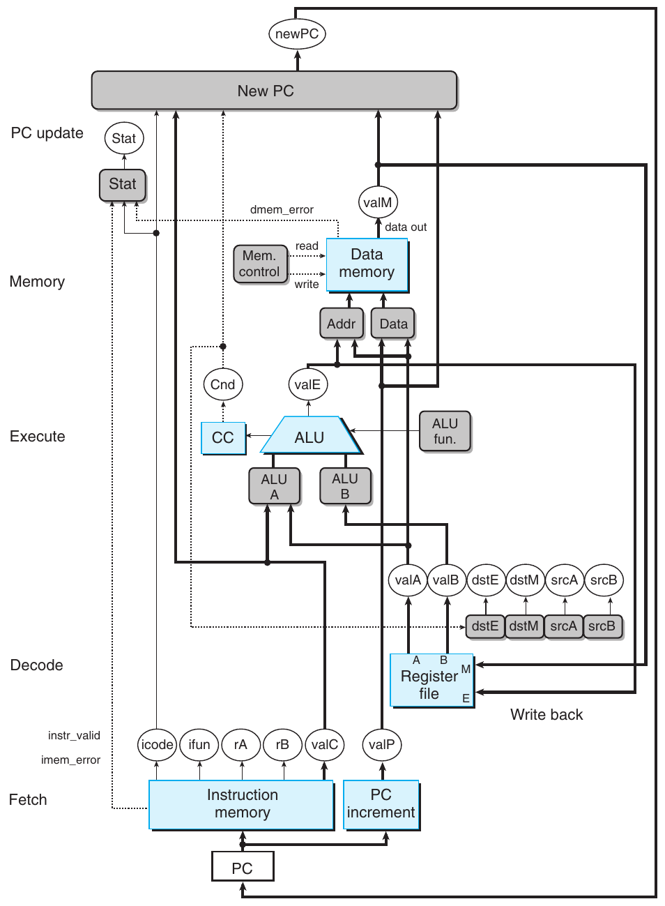

**Hình 4.23 Cấu trúc hardware của SEQ, một cách triển khai tuần tự. Một số tín hiệu điều khiển, cũng như kết nối register và control word, không được thể hiện.**

| Stage | Phép tính | OPq rA , rB | mrmovq D ( rB), rA |
|---|---|---|---|
| Fetch | icode, ifun | icode : ifun ← M<sub>1</sub>[PC] | icode : ifun ← M<sub>1</sub>[PC] |
|  | rA, rB | rA : rB ← M<sub>1</sub>[PC + 1] | rA : rB ← M<sub>1</sub>[PC + 1] |
|  | valC |  | valC ← M<sub>8</sub>[PC + 2] |
|  | valP | valP ← PC + 2 | valP ← PC + 10 |
| Decode | valA, srcA | valA ← R[rA] |  |
|  | valB, srcB | valB ← R[rB] | valB ← R[rB] |
| Execute | valE<br>Condition code | valE ← valB OP valA<br>Đặt CC | valE ← valB + valC |
| Memory | Đọc/ghi |  | valM ← M<sub>8</sub>[valE] |
| Write back | Port E, dstE | R[rB] ← valE |  |
|  | Port M, dstM |  | R[rA] ← valM |
| PC update | PC | PC ← valP | PC ← valP |

**Hình 4.24 Xác định các bước tính toán khác nhau trong triển khai tuần tự. Cột thứ hai xác định giá trị được tính hoặc thao tác được thực hiện trong các stage của SEQ. Các phép tính cho instruction OPq và mrmovq được trình bày làm ví dụ.**

### 4.3.3 Timing của SEQ

Khi giới thiệu bảng trong Hình 4.18 đến 4.21, chúng ta nói rằng cần đọc chúng như ký pháp lập trình, trong đó phép gán được thực hiện tuần tự từ trên xuống dưới. Ngược lại, cấu trúc hardware trong Hình 4.23 hoạt động khác về căn bản, với một lần chuyển clock kích hoạt flow qua combinational logic để thực thi trọn một instruction. Hãy xem hardware triển khai hành vi liệt kê trong những bảng này thế nào.

Cách triển khai SEQ gồm combinational logic và hai dạng thiết bị nhớ: clocked register (program counter và condition code register) và random access memory (register file, instruction memory và data memory). Combinational logic không đòi hỏi sắp thứ tự hay điều khiển—các giá trị lan truyền qua mạng logic gate mỗi khi input thay đổi. Như đã mô tả, chúng ta cũng giả định đọc random access memory hoạt động khá giống combinational logic, với word output được sinh dựa trên input địa chỉ. Đây là giả định hợp lý cho bộ nhớ nhỏ (như register file), và có thể mô phỏng hiệu ứng này cho mạch lớn hơn bằng mạch clock đặc biệt. Vì instruction memory chỉ dùng để đọc instruction, chúng ta có thể xem unit này như combinational logic.

Chỉ còn bốn hardware unit cần điều khiển tường minh thứ tự hoạt động—program counter, condition code register, data memory và register file. Chúng được điều khiển bằng một tín hiệu clock duy nhất, kích hoạt nạp giá trị mới vào register và ghi giá trị vào random access memory. Program counter được nạp địa chỉ instruction mới mỗi clock cycle. Condition code register chỉ được nạp khi thực thi instruction phép toán số nguyên. Data memory chỉ được ghi khi thực thi instruction rmmovq, pushq hoặc call. Hai write port của register file cho phép cập nhật hai program register mỗi cycle, nhưng có thể dùng register ID đặc biệt 0xF làm địa chỉ port để chỉ ra không thực hiện ghi trên port đó.

Việc dùng clock cho register và bộ nhớ như vậy là tất cả những gì cần để điều khiển thứ tự hoạt động trong processor. Hardware đạt cùng tác dụng như thực thi tuần tự các phép gán trong Hình 4.18 đến 4.21, mặc dù mọi cập nhật trạng thái thực tế diễn ra đồng thời và chỉ khi clock lên cao để bắt đầu cycle tiếp theo. Sự tương đương này đúng nhờ bản chất instruction set Y86-64 và vì chúng ta tổ chức tính toán để thiết kế tuân theo nguyên lý sau:

Nguyên lý: Không đọc lại

Processor không bao giờ cần đọc lại trạng thái đã được instruction cập nhật để hoàn tất xử lý chính instruction đó.

Nguyên lý này rất quan trọng cho thành công của cách triển khai. Để minh họa, giả sử triển khai pushq bằng cách trước hết giảm %rsp đi 8 rồi dùng giá trị %rsp cập nhật làm địa chỉ phép ghi. Cách này vi phạm nguyên lý trên. Nó đòi hỏi đọc stack pointer cập nhật từ register file để thực hiện phép toán bộ nhớ. Thay vào đó, cách triển khai của chúng ta (Hình 4.20) sinh giá trị stack pointer đã giảm làm tín hiệu valE rồi dùng tín hiệu này vừa làm dữ liệu ghi register vừa làm địa chỉ ghi bộ nhớ. Nhờ vậy, có thể ghi register và bộ nhớ đồng thời khi clock lên cao bắt đầu clock cycle tiếp theo.

Làm minh họa khác cho nguyên lý này, chúng ta thấy một số instruction (phép toán số nguyên) đặt condition code, và một số instruction (conditional move và jump) đọc chúng, nhưng không instruction nào vừa phải đặt rồi đọc condition code. Mặc dù condition code chỉ được đặt khi clock lên cao bắt đầu clock cycle tiếp theo, chúng được cập nhật trước khi bất kỳ instruction nào cố đọc.

Hình 4.25 trình bày cách hardware SEQ xử lý instruction ở dòng 3 và 4 trong chuỗi code sau, được thể hiện bằng assembly code với địa chỉ instruction liệt kê bên trái:

```
1     0x000:   irmovq $0x100,%rbx   # %rbx <-- 0x100
2     0x00a:   irmovq $0x200,%rdx   # %rdx <-- 0x200
3     0x014:   addq %rdx,%rbx       # %rbx <-- 0x300 CC <-- 000
4     0x016:   je dest              # Not taken
5     0x01f:   rmmovq %rbx,0(%rdx)  # M[0x200] <-- 0x300
6     0x029: dest: halt
```

Mỗi sơ đồ đánh số 1 đến 4 thể hiện bốn phần tử trạng thái cùng combinational logic và các kết nối giữa chúng. Chúng ta vẽ combinational logic bao quanh condition code register, vì một số combinational logic (như ALU) sinh input cho condition code register, còn phần khác (như tính branch và logic chọn PC) nhận condition code register làm input. Register file và data memory được vẽ có kết nối đọc và ghi riêng, vì phép đọc lan truyền qua chúng như combinational logic, còn phép ghi được clock điều khiển.

Màu trong Hình 4.25 cho biết quan hệ giữa các tín hiệu mạch và instruction khác nhau đang thực thi. Chúng ta giả định xử lý bắt đầu với condition code, theo thứ tự ZF, SF và OF, được đặt bằng 100. Đầu clock cycle 3 (điểm 1), các phần tử trạng thái chứa trạng thái được instruction irmovq thứ hai (dòng 2 trong danh sách) cập nhật, thể hiện bằng xám nhạt. Combinational logic được vẽ màu trắng, chỉ ra chưa có thời gian phản ứng với trạng thái thay đổi. Clock cycle bắt đầu với địa chỉ 0x014 được nạp vào program counter. Điều này khiến instruction addq (dòng 3), thể hiện màu xanh, được lấy và xử lý. Các giá trị đi qua combinational logic, bao gồm đọc random access memory. Cuối cycle (điểm 2), combinational logic sinh giá trị mới (000) cho condition code, cập nhật cho program register %rbx và giá trị mới (0x016) cho program counter. Lúc này, combinational logic đã được cập nhật theo instruction addq (màu xanh), nhưng trạng thái vẫn giữ giá trị do instruction irmovq thứ hai đặt (xám nhạt).

Khi clock lên cao bắt đầu cycle 4 (điểm 3), việc cập nhật program counter, register file và condition code register diễn ra, nên chúng được vẽ màu xanh; nhưng combinational logic chưa phản ứng với thay đổi này nên được vẽ màu trắng. Trong cycle này, instruction je (dòng 4), màu xám đậm, được lấy và thực thi. Vì condition code ZF là 0, branch không được lấy. Cuối cycle (điểm 4), giá trị mới 0x01f được sinh cho program counter. Combinational logic đã được cập nhật theo instruction je (xám đậm), nhưng trạng thái vẫn giữ giá trị do instruction addq đặt (màu xanh) cho đến khi cycle tiếp theo bắt đầu.

Như ví dụ minh họa, dùng clock để điều khiển cập nhật phần tử trạng thái, kết hợp lan truyền giá trị qua combinational logic, là đủ để điều khiển tính toán cho từng instruction trong cách triển khai SEQ. Mỗi khi clock chuyển từ thấp lên cao, processor bắt đầu thực thi instruction mới.

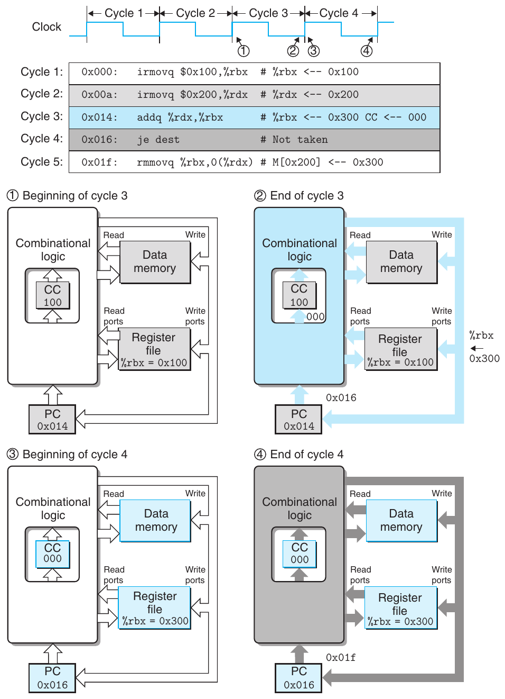

**Hình 4.25 Lần theo hai cycle thực thi của SEQ. Mỗi cycle bắt đầu với các phần tử trạng thái (program counter, condition code register, register file và data memory) được đặt theo instruction trước. Tín hiệu lan truyền qua combinational logic, tạo giá trị mới cho các phần tử trạng thái. Những giá trị này được nạp vào phần tử trạng thái để bắt đầu cycle tiếp theo.**

### 4.3.4 Triển khai các stage SEQ

Trong mục này, chúng ta xây dựng mô tả HCL cho các control logic block cần để triển khai SEQ. Mô tả HCL đầy đủ cho SEQ được cho trong phần thông tin thêm trên Web arch:hcl ở trang 508. Ở đây trình bày một số block ví dụ, còn các block khác được đưa thành bài tập thực hành. Chúng tôi khuyên bạn làm những bài này để kiểm tra hiểu biết về quan hệ giữa block và yêu cầu tính toán của các instruction khác nhau.

Một phần mô tả HCL của SEQ không được trình bày ở đây là định nghĩa những tín hiệu số nguyên và Boolean có thể dùng làm đối số phép toán HCL. Chúng bao gồm tên tín hiệu hardware khác nhau, cùng giá trị hằng cho instruction code, function code, tên register, phép toán ALU và status code. Chỉ những giá trị cần tham chiếu tường minh trong control logic được trình bày. Các hằng sử dụng được mô tả trong Hình 4.26. Theo quy ước, chúng ta dùng tên chữ hoa cho giá trị hằng.

| Tên | Giá trị (hex) | Ý nghĩa |
|---|---|---|
| IHALT | 0 | Code cho halt instruction |
| INOP | 1 | Code cho nop instruction |
| IRRMOVQ | 2 | Code cho rrmovq instruction |
| IIRMOVQ | 3 | Code cho irmovq instruction |
| IRMMOVQ | 4 | Code cho rmmovq instruction |
| IMRMOVQ | 5 | Code cho mrmovq instruction |
| IOPL | 6 | Code cho các instruction phép toán số nguyên |
| IJXX | 7 | Code cho các jump instruction |
| ICALL | 8 | Code cho call instruction |
| IRET | 9 | Code cho ret instruction |
| IPUSHQ | A | Code cho pushq instruction |
| IPOPQ | B | Code cho popq instruction |
| FNONE | 0 | Function code mặc định |
| RESP | 4 | Register ID của %rsp |
| RNONE | F | Indicates no register file access |
| ALUADD | 0 | Hàm cho phép cộng |
| SAOK | 1 | Status code cho hoạt động bình thường |
| SADR | 2 | Status code cho address exception |
| SINS | 3 | Status code cho exception instruction không hợp lệ |
| SHLT | 4 | Status code cho halt |

**Hình 4.26 Các giá trị hằng dùng trong mô tả HCL. Chúng biểu diễn encoding của instruction, function code, register ID, phép toán ALU và status code.**

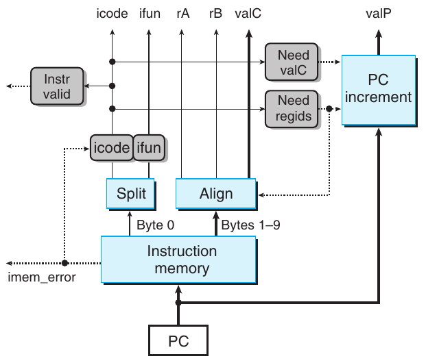

**Hình 4.27 Fetch stage của SEQ. Sáu byte được đọc từ instruction memory với PC làm địa chỉ đầu. Từ các byte này, chúng ta sinh những field instruction khác nhau. Block tăng PC tính tín hiệu valP.**

Ngoài instruction trong Hình 4.18 đến 4.21, chúng ta còn xử lý nop và halt. Instruction nop chỉ đi qua các stage mà không xử lý nhiều, ngoại trừ tăng PC thêm 1. Instruction halt khiến trạng thái processor được đặt thành HLT, làm nó dừng hoạt động.

### Fetch stage

Như Hình 4.27 cho thấy, fetch stage chứa hardware unit instruction memory. Unit này đọc 10 byte bộ nhớ mỗi lần, dùng PC làm địa chỉ byte đầu (byte 0). Byte này được diễn giải là instruction byte và được tách (bởi unit mang nhãn “Split”) thành hai đại lượng 4-bit. Các control logic block mang nhãn “icode” và “ifun” sau đó tính instruction code và function code bằng giá trị đọc từ bộ nhớ, hoặc trong trường hợp địa chỉ instruction không hợp lệ (được tín hiệu imem_error chỉ ra), bằng giá trị tương ứng instruction nop. Dựa trên icode, có thể tính ba tín hiệu 1-bit (vẽ bằng nét đứt):

instr_valid. Byte này có tương ứng instruction Y86-64 hợp lệ không? Tín hiệu này dùng để phát hiện instruction không hợp lệ.

need_regids. Instruction này có register specifier byte không?

need_valC. Instruction này có word hằng không?

Các tín hiệu instr_valid và imem_error (được sinh khi địa chỉ instruction ngoài giới hạn) được dùng để sinh status code trong memory stage.

Ví dụ, mô tả HCL của need_regids chỉ xác định xem giá trị icode có phải một trong những instruction có register specifier byte không:

```
bool need_regids =
        icode in { IRRMOVQ, IOPQ, IPUSHQ, IPOPQ,
                   IIRMOVQ, IRMMOVQ, IMRMOVQ };
```

#### Bài tập thực hành 4.19 (lời giải trang 523)

Viết code HCL cho tín hiệu need_valC trong cách triển khai SEQ.

Như Hình 4.27 cho thấy, 9 byte còn lại đọc từ instruction memory mã hóa một tổ hợp register specifier byte và word hằng. Các byte này được hardware unit mang nhãn “Align” xử lý thành field register và word hằng. Byte 1 được tách thành các bộ chỉ định register rA và rB khi tín hiệu need_regids tính được là 1. Nếu need_regids là 0, cả hai bộ chỉ định register được đặt bằng 0xF (RNONE), cho biết instruction không chỉ định register. Cũng hãy nhớ (Hình 4.2) rằng với instruction chỉ có một toán hạng register, field còn lại trong register specifier byte là 0xF (RNONE). Vì vậy, có thể giả định tín hiệu rA và rB mã hóa register muốn truy cập hoặc chỉ ra không cần truy cập register. Unit “Align” cũng sinh word hằng valC. Nó là byte 1–8 hoặc byte 2–9, tùy giá trị need_regids.

Hardware unit PC incrementer sinh tín hiệu valP dựa trên giá trị PC hiện tại và hai tín hiệu need_regids, need_valC. Với giá trị PC p, giá trị need_regids r và giá trị need_valC i, incrementer sinh giá trị p + 1 + r + 8i.

### Decode stage và Write-Back stage

Hình 4.28 trình bày chi tiết logic triển khai cả decode stage lẫn write-back stage trong SEQ. Hai stage được kết hợp vì đều truy cập register file.

Register file có bốn port. Nó hỗ trợ tối đa hai phép đọc đồng thời (ở port A và B) và hai phép ghi đồng thời (ở port E và M). Mỗi port có cả kết nối địa chỉ và dữ liệu, trong đó kết nối địa chỉ là register ID, còn kết nối dữ liệu là tập 64 dây đóng vai trò word output (cho read port) hoặc word input (cho write port) của register file. Hai read port có input địa chỉ srcA và srcB, còn hai write port có input địa chỉ dstE và dstM. Identifier đặc biệt 0xF (RNONE) trên address port chỉ ra không truy cập register nào.

Bốn block ở dưới Hình 4.28 sinh bốn register ID khác nhau cho register file, dựa trên instruction code icode, các bộ chỉ định register rA và rB, và có thể cả tín hiệu điều kiện Cnd được tính trong execute stage. Register ID srcA cho biết cần đọc register nào để sinh valA. Giá trị mong muốn phụ thuộc loại instruction, như hàng đầu của decode stage trong Hình 4.18 đến 4.21 thể hiện. Kết hợp mọi mục thành một phép tính cho mô tả HCL của srcA sau (nhớ rằng RESP là register ID của %rsp):

```
word srcA = [
        icode in { IRRMOVQ, IRMMOVQ, IOPQ, IPUSHQ  } : rA;
        icode in { IPOPQ, IRET } : RRSP;
        1 : RNONE; # Don’t need register
];
```

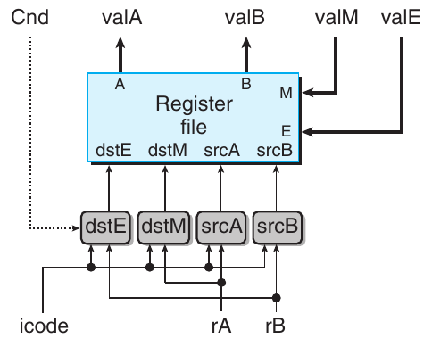

**Hình 4.28 Decode stage và write-back stage của SEQ. Các field instruction được decode để sinh register identifier cho bốn địa chỉ (hai đọc, hai ghi) do register file dùng. Các giá trị đọc từ register file trở thành tín hiệu valA và valB. Hai giá trị write-back valE và valM làm dữ liệu cho phép ghi.**

#### Bài tập thực hành 4.20 (lời giải trang 524)

Tín hiệu register srcB cho biết cần đọc register nào để sinh tín hiệu valB. Giá trị mong muốn được thể hiện là bước thứ hai trong decode stage của Hình 4.18 đến 4.21. Viết code HCL cho srcB.

Register ID dstE chỉ register đích cho write port E, nơi lưu giá trị tính được valE. Điều này được thể hiện trong Hình 4.18 đến 4.21 là bước đầu của write-back stage. Nếu tạm bỏ qua conditional move instruction, có thể kết hợp register đích của mọi instruction khác nhau để có mô tả HCL của dstE sau:

```
# WARNING: Conditional move not implemented correctly here
word dstE = [
        icode in { IRRMOVQ } : rB;
        icode in { IIRMOVQ, IOPQ} : rB;
        icode in { IPUSHQ, IPOPQ, ICALL, IRET } : RRSP;
        1 : RNONE;  # Don’t write any register
];
```

Chúng ta sẽ quay lại tín hiệu này và cách triển khai conditional move khi xét execute stage.

#### Bài tập thực hành 4.21 (lời giải trang 524)

Register ID dstM chỉ register đích cho write port M, nơi lưu valM, giá trị đọc từ bộ nhớ. Điều này được thể hiện trong Hình 4.18 đến 4.21 là bước thứ hai của write-back stage. Viết code HCL cho dstM.

#### Bài tập thực hành 4.22 (lời giải trang 524)

Chỉ instruction popq dùng đồng thời cả hai write port của register file. Với instruction popq %rsp, cùng địa chỉ được dùng cho write port E và M nhưng dữ liệu khác nhau. Để xử lý xung đột, phải đặt độ ưu tiên giữa hai write port sao cho khi cả hai cố ghi cùng register trong cùng cycle, chỉ phép ghi từ port higher-priority diễn ra. Cần ưu tiên port nào để triển khai hành vi mong muốn đã xác định trong Bài tập thực hành 4.8?

### Execute stage

Execute stage chứa arithmetic/logic unit (ALU). Unit thực hiện phép cộng, trừ, and hoặc exclusive-or trên input aluA và aluB dựa trên thiết lập tín hiệu alufun. Các tín hiệu dữ liệu và điều khiển này được ba control block sinh ra, như sơ đồ Hình 4.29. Output ALU trở thành tín hiệu valE.

Trong Hình 4.18 đến 4.21, phép tính ALU cho mỗi instruction là bước đầu của execute stage. Toán hạng được liệt kê với aluB trước rồi aluA để bảo đảm instruction subq trừ valA khỏi valB. Chúng ta thấy giá trị aluA có thể là valA, valC, hoặc −8 hay +8, tùy loại instruction. Do đó có thể biểu diễn hành vi control block sinh aluA như sau:

```
word aluA = [
        icode in { IRRMOVQ, IOPQ } : valA;
        icode in { IIRMOVQ, IRMMOVQ, IMRMOVQ } : valC;
        icode in { ICALL, IPUSHQ } : -8;
        icode in { IRET, IPOPQ } : 8;
        # Other instructions don’t need ALU
];
```

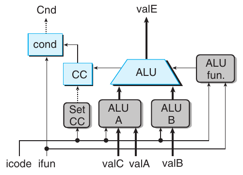

**Hình 4.29 Execute stage của SEQ. ALU thực hiện phép toán cho instruction phép toán số nguyên hoặc hoạt động như adder. Các condition code register được đặt theo giá trị ALU. Giá trị condition code được kiểm tra để xác định có lấy branch không.**

#### Bài tập thực hành 4.23 (lời giải trang 524)

Dựa trên toán hạng đầu của bước đầu execute stage trong Hình 4.18 đến 4.21, viết mô tả HCL cho tín hiệu aluB trong SEQ.

Nhìn vào các phép toán ALU thực hiện trong execute stage, chúng ta thấy nó chủ yếu dùng làm adder. Tuy nhiên, với instruction OPq, chúng ta muốn dùng phép toán được mã hóa trong field ifun của instruction. Do đó có thể viết mô tả HCL cho điều khiển ALU như sau:

```
word alufun = [
        icode == IOPQ : ifun;
        1 : ALUADD;
];
```

Execute stage còn chứa condition code register. Mỗi lần hoạt động, ALU sinh ba tín hiệu làm cơ sở cho condition code—zero, sign và overflow. Tuy nhiên, chúng ta chỉ muốn đặt condition code khi thực thi instruction OPq. Do đó, sinh tín hiệu set_cc để điều khiển có cập nhật condition code register hay không:

```
bool set_cc = icode in { IOPQ };
```

Hardware unit mang nhãn “cond” dùng tổ hợp condition code và function code để xác định có thực hiện conditional branch hoặc truyền dữ liệu hay không (Hình 4.3). Nó sinh tín hiệu Cnd dùng cho cả việc đặt dstE với conditional move lẫn logic next PC cho conditional branch. Với instruction khác, Cnd có thể được đặt bằng 1 hoặc 0 tùy function code và thiết lập condition code, nhưng bị control logic bỏ qua. Chúng ta không trình bày thiết kế chi tiết unit này.

#### Bài tập thực hành 4.24 (lời giải trang 524)

Các conditional move instruction, viết tắt cmovXX, có instruction code IRRMOVQ. Như Hình 4.28 cho thấy, có thể triển khai chúng bằng tín hiệu Cnd được sinh trong execute stage. Sửa code HCL của dstE để triển khai các instruction này.

### Memory stage

Memory stage có nhiệm vụ đọc hoặc ghi dữ liệu chương trình. Như Hình 4.30 cho thấy, hai control block sinh giá trị cho địa chỉ bộ nhớ và dữ liệu input bộ nhớ (cho phép ghi). Hai block khác sinh tín hiệu điều khiển chỉ ra thực hiện phép đọc hay ghi. Khi thực hiện phép đọc, data memory sinh giá trị valM.

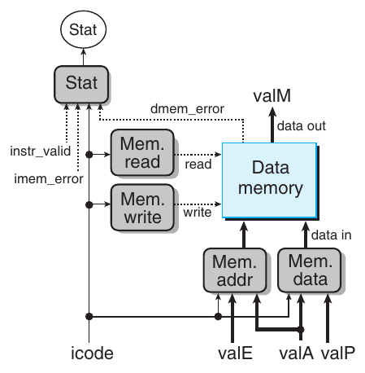

**Hình 4.30 Memory stage của SEQ. Data memory có thể ghi hoặc đọc giá trị bộ nhớ. Giá trị đọc từ bộ nhớ tạo thành tín hiệu valM.**

Phép toán bộ nhớ mong muốn cho mỗi loại instruction được thể hiện trong memory stage của Hình 4.18 đến 4.21. Hãy quan sát rằng địa chỉ đọc và ghi bộ nhớ luôn là valE hoặc valA. Chúng ta có thể mô tả block này bằng HCL như sau:

```
word mem_addr = [
        icode in { IRMMOVQ, IPUSHQ, ICALL, IMRMOVQ } : valE;
        icode in { IPOPQ, IRET } : valA;
        # Other instructions don’t need address
];
```

#### Bài tập thực hành 4.25 (lời giải trang 524)

Nhìn vào phép toán bộ nhớ cho các instruction khác nhau trong Hình 4.18 đến 4.21, chúng ta thấy dữ liệu ghi bộ nhớ luôn là valA hoặc valP. Viết code HCL cho tín hiệu mem_data trong SEQ.

Chúng ta chỉ muốn đặt tín hiệu điều khiển mem_read cho những instruction đọc dữ liệu từ bộ nhớ, như code HCL sau biểu diễn:

```
bool mem_read = icode in { IMRMOVQ, IPOPQ, IRET };
```

#### Bài tập thực hành 4.26 (lời giải trang 525)

Chúng ta chỉ muốn đặt tín hiệu điều khiển mem_write cho những instruction ghi dữ liệu vào bộ nhớ. Viết code HCL cho tín hiệu mem_write trong SEQ.

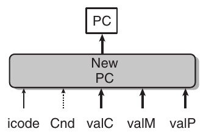

**Hình 4.31 PC update stage của SEQ. Giá trị PC tiếp theo được chọn từ các tín hiệu valC, valM và valP, tùy instruction code và branch flag.**

Chức năng cuối của memory stage là tính status code Stat do thực thi instruction tạo ra, theo các giá trị icode, imem_error và instr_valid được sinh trong fetch stage cùng tín hiệu dmem_error do data memory sinh ra.

#### Bài tập thực hành 4.27 (lời giải trang 525)

Viết code HCL cho Stat, sinh bốn status code SAOK, SADR, SINS và SHLT (xem Hình 4.26).

### PC update stage

Stage cuối trong SEQ sinh giá trị mới của program counter (xem Hình 4.31). Như các bước cuối trong Hình 4.18 đến 4.21 cho thấy, PC mới là valC, valM hoặc valP, tùy loại instruction và việc có lấy branch hay không. Có thể mô tả lựa chọn này bằng HCL như sau:

```
word new_pc = [
        # Call.  Use instruction constant
        icode == ICALL : valC;
        # Taken branch.  Use instruction constant
        icode == IJXX && Cnd : valC;
        # Completion of RET instruction.  Use value from stack
        icode == IRET : valM;
        # Default: Use incremented PC
        1 : valP;
];
```

### Nhìn lại SEQ

Đến đây, chúng ta đã đi qua thiết kế hoàn chỉnh của processor Y86-64. Chúng ta thấy rằng bằng cách tổ chức các bước cần để thực thi từng instruction khác nhau thành flow thống nhất, có thể triển khai toàn bộ processor bằng số ít hardware unit khác nhau cùng một clock duy nhất để điều khiển thứ tự tính toán. Control logic sau đó phải định tuyến tín hiệu giữa các unit và sinh đúng tín hiệu điều khiển dựa trên loại instruction và điều kiện branch.

Vấn đề duy nhất của SEQ là quá chậm. Clock phải chạy đủ chậm để tín hiệu lan truyền qua mọi stage trong một cycle. Ví dụ, xét xử lý instruction ret. Bắt đầu với program counter cập nhật ở đầu clock cycle, instruction phải được đọc từ instruction memory, stack pointer phải được đọc từ register file, ALU phải tăng stack pointer thêm 8, và địa chỉ trả về phải được đọc từ bộ nhớ để xác định giá trị program counter tiếp theo. Mọi việc này phải hoàn tất trước cuối clock cycle.

Phong cách triển khai này không tận dụng hardware unit hiệu quả, vì mỗi unit chỉ hoạt động trong một phần của toàn bộ clock cycle. Chúng ta sẽ thấy có thể đạt hiệu năng tốt hơn nhiều bằng cách đưa vào pipelining.

## 4.4 Các nguyên tắc tổng quát của pipelining

Trước khi thiết kế một processor Y86-64 có pipeline, hãy xem xét một số tính chất và nguyên tắc tổng quát của hệ thống pipeline. Những hệ thống như vậy quen thuộc với bất kỳ ai từng đi qua hàng phục vụ trong căn tin hoặc đưa ô tô qua hệ thống rửa xe tự động. Trong hệ thống pipeline, nhiệm vụ cần thực hiện được chia thành một chuỗi stage riêng biệt. Trong căn tin, đó là cung cấp salad, món chính, món tráng miệng và đồ uống. Trong hệ thống rửa xe, đó là phun nước và xà phòng, cọ rửa, phủ sáp và sấy khô. Thay vì để một khách hàng đi qua toàn bộ chuỗi từ đầu đến cuối trước khi khách tiếp theo có thể bắt đầu, chúng ta cho phép nhiều khách cùng đi qua hệ thống. Trong hàng phục vụ căn tin truyền thống, khách hàng giữ nguyên thứ tự trong pipeline và đi qua mọi stage, ngay cả khi không muốn một số món. Với hệ thống rửa xe, một xe mới được phép đi vào stage phun nước khi xe trước chuyển từ stage phun nước sang stage cọ rửa. Nói chung, các xe phải di chuyển qua hệ thống với cùng tốc độ để tránh xe này đâm vào xe tiếp theo.

Đặc điểm then chốt của pipelining là nó tăng throughput của hệ thống (tức số khách hàng được phục vụ trên mỗi đơn vị thời gian), nhưng cũng có thể tăng nhẹ latency (tức thời gian cần để phục vụ một khách hàng riêng lẻ). Ví dụ, khách hàng trong căn tin chỉ muốn món tráng miệng có thể đi qua hệ thống không pipeline rất nhanh, chỉ dừng ở stage tráng miệng. Khách hàng trong hệ thống pipeline cố đi thẳng đến stage tráng miệng có nguy cơ khiến các khách hàng khác nổi giận.

### 4.4.1 Pipeline tính toán

Chuyển trọng tâm sang pipeline tính toán, “khách hàng” là các instruction và các stage thực hiện một phần quá trình thực thi instruction. Hình 4.32(a) trình bày ví dụ về hệ thống phần cứng đơn giản không pipeline. Nó gồm một phần logic thực hiện phép tính, theo sau là register giữ kết quả phép tính đó. Tín hiệu clock điều khiển việc nạp register theo khoảng thời gian đều đặn. Ví dụ về hệ thống như vậy là decoder trong máy phát compact disk (CD). Tín hiệu đầu vào là các bit đọc từ bề mặt CD, và logic giải mã chúng để tạo tín hiệu âm thanh. Block tính toán trong hình được triển khai dưới dạng combinational logic, nghĩa là các tín hiệu đi qua một chuỗi logic gate, và output trở thành một function nào đó của input sau một khoảng trễ.

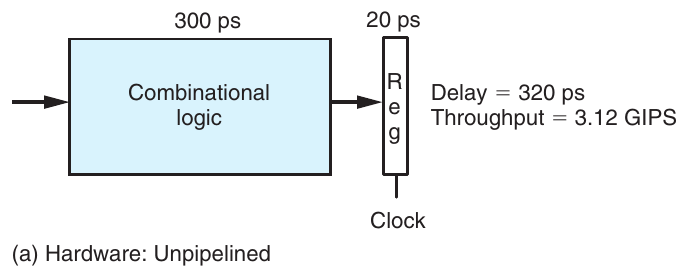

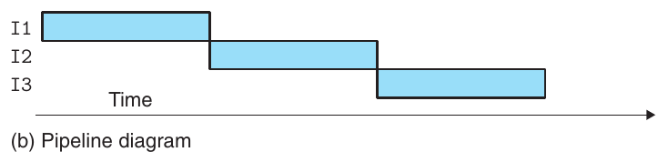

**Hình 4.32 Phần cứng tính toán không pipeline. Trong mỗi chu kỳ 320 ps, hệ thống dành 300 ps để tính một function combinational logic và 20 ps để lưu kết quả vào output register.**

Trong thiết kế logic hiện đại, chúng ta đo độ trễ circuit bằng đơn vị picosecond (viết tắt “ps”), tức 10<sup>−12</sup> giây. Trong ví dụ này, giả sử combinational logic cần 300 ps, còn việc nạp register cần 20 ps. Hình 4.32 trình bày một dạng timing diagram gọi là pipeline diagram. Trong sơ đồ này, thời gian trôi từ trái sang phải. Một chuỗi instruction (ở đây đặt tên I1, I2 và I3) được viết từ trên xuống dưới. Các hình chữ nhật đặc biểu thị thời gian những instruction này được thực thi. Trong cách triển khai này, phải hoàn tất một instruction trước khi bắt đầu instruction tiếp theo. Vì vậy, các ô không chồng lấn nhau theo chiều dọc. Công thức sau cho tốc độ tối đa mà chúng ta có thể vận hành hệ thống:


Chúng ta biểu diễn throughput bằng đơn vị giga-instructions mỗi giây (viết tắt GIPS), tức hàng tỷ instruction mỗi giây. Tổng thời gian cần để thực hiện một instruction từ đầu đến cuối được gọi là latency. Trong hệ thống này, latency là 320 ps, bằng nghịch đảo của throughput.

Giả sử có thể chia phép tính do hệ thống thực hiện thành ba stage A, B và C, mỗi stage cần 100 ps, như minh họa trong Hình 4.33. Khi đó, có thể đặt pipeline register giữa các stage để mỗi instruction di chuyển qua hệ thống theo ba bước, cần ba chu kỳ clock hoàn chỉnh từ đầu đến cuối. Như pipeline diagram trong Hình 4.33 minh họa, chúng ta có thể cho I2 đi vào stage A ngay khi I1 chuyển từ A sang B, v.v. Ở trạng thái ổn định, cả ba stage đều hoạt động, với một instruction rời hệ thống và một instruction mới đi vào mỗi chu kỳ clock. Có thể thấy điều này ở chu kỳ clock thứ ba trong pipeline diagram, khi I1 ở stage C, I2 ở stage B và I3 ở stage A. Trong hệ thống này, chúng ta có thể tạo một chu kỳ clock mỗi 100 + 20 = 120 picosecond, cho throughput khoảng 8.33 GIPS. Vì xử lý một instruction cần 3 chu kỳ clock, latency của pipeline là 3 × 120 = 360 ps. Chúng ta đã tăng throughput hệ thống lên hệ số 8.33/3.12 = 2.67, đổi lại là thêm một ít phần cứng và latency tăng nhẹ (360/320 = 1.12). Latency tăng do overhead thời gian của các pipeline register được thêm vào.

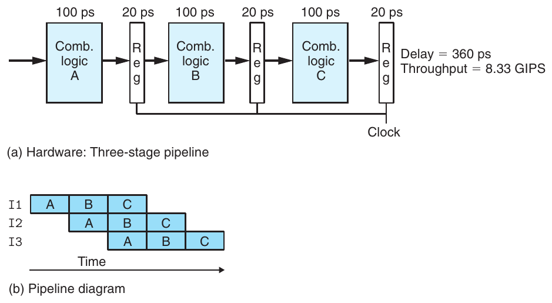

**Hình 4.33 Phần cứng tính toán pipeline Three-stage. Phép tính được chia thành các stage A, B và C. Trong mỗi chu kỳ 120 ps, mỗi instruction tiến qua một stage.**

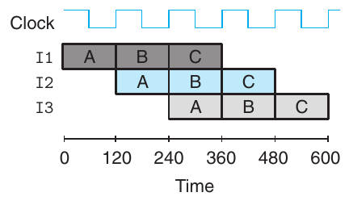

**Hình 4.34 Timing của pipeline Three-stage. Cạnh lên của tín hiệu clock điều khiển việc chuyển instruction từ một stage pipeline sang stage kế tiếp.**

### 4.4.2 Xem xét chi tiết hoạt động pipeline

Để hiểu rõ hơn pipelining hoạt động ra sao, hãy xem xét chi tiết timing và hoạt động của các phép tính pipeline. Hình 4.34 trình bày pipeline diagram cho pipeline three-stage mà chúng ta đã xem xét (Hình 4.33). Việc chuyển instruction giữa các stage pipeline được điều khiển bằng tín hiệu clock, như thể hiện phía trên pipeline diagram. Cứ mỗi 120 ps, tín hiệu này tăng từ 0 lên 1, khởi đầu tập phép tính stage pipeline tiếp theo.

Hình 4.35 theo dõi hoạt động circuit giữa các thời điểm 240 và 360, khi instruction I1 (màu xám đậm) lan truyền qua stage C, I2 (màu xanh) lan truyền qua stage B và I3 (màu xám nhạt) lan truyền qua stage

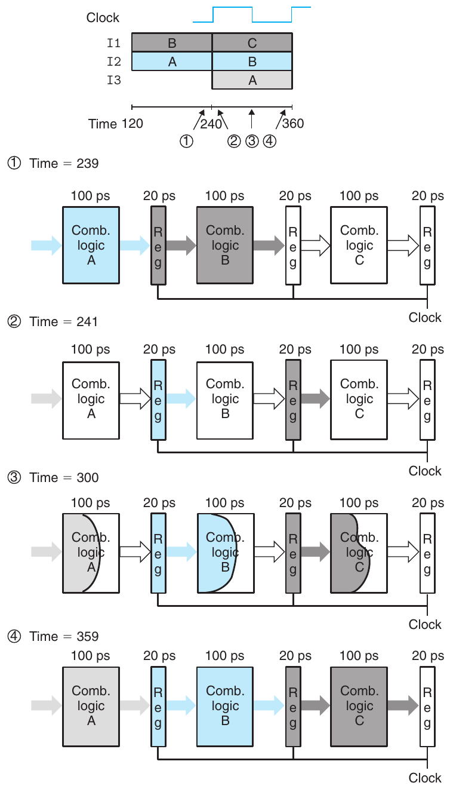

**Hình 4.35 Một chu kỳ clock của hoạt động pipeline. Ngay trước khi clock lên tại thời điểm 240 (điểm 1), các instruction I1 (màu xám đậm) và I2 (màu xanh) đã hoàn tất các stage B và A. Sau khi clock lên, các instruction này bắt đầu lan truyền qua các stage C và B, trong khi instruction I3 (màu xám nhạt) bắt đầu lan truyền qua stage A (điểm 2 và 3). Ngay trước khi clock lên lần nữa, các kết quả instruction đã lan truyền đến input của các pipeline register (điểm 4).**

A. Ngay trước cạnh lên clock tại thời điểm 240 (điểm 1), các giá trị tính được ở stage A cho instruction I2 đã đến input của pipeline register đầu tiên, nhưng trạng thái và output của nó vẫn là các giá trị tính được trong stage A cho instruction I1. Các giá trị tính được ở stage B cho instruction I1 đã đến input của pipeline register thứ hai. Khi clock lên, các input này được nạp vào pipeline register, trở thành output của register (điểm 2). Ngoài ra, input của stage A được đặt để khởi đầu phép tính cho instruction I3. Sau đó, các tín hiệu lan truyền qua combinational logic của các stage khác nhau (điểm 3). Như các mặt sóng cong trong sơ đồ ở điểm 3 gợi ý, tín hiệu có thể lan truyền qua các phần khác nhau với tốc độ khác nhau. Trước thời điểm 360, các giá trị kết quả đến input của pipeline register (điểm 4). Khi clock lên tại thời điểm 360, mỗi instruction đã tiến qua một stage pipeline.

Qua góc nhìn chi tiết về hoạt động pipeline này, có thể thấy giảm tốc clock sẽ không thay đổi hành vi pipeline. Tín hiệu lan truyền đến input của pipeline register, nhưng trạng thái register không thay đổi cho đến khi clock lên. Ngược lại, có thể xảy ra hậu quả nghiêm trọng nếu clock chạy quá nhanh. Các giá trị không có đủ thời gian lan truyền qua combinational logic, nên input của register chưa hợp lệ khi clock lên.

Như trong thảo luận về timing của processor SEQ (Mục 4.3.3), có thể thấy cơ chế đơn giản đặt register điều khiển bằng clock giữa các block combinational logic là đủ để điều khiển luồng instruction trong pipeline. Khi clock liên tục lên xuống, các instruction khác nhau đi qua các stage pipeline mà không ảnh hưởng lẫn nhau.

### 4.4.3 Các giới hạn của pipelining

Ví dụ Hình 4.33 thể hiện hệ thống pipeline lý tưởng, trong đó có thể chia phép tính thành ba stage độc lập, mỗi stage cần one-third thời gian của logic ban đầu. Đáng tiếc, các yếu tố khác thường xuất hiện và làm giảm hiệu quả của pipelining.

### Phân chia không đồng đều

Hình 4.36 trình bày hệ thống trong đó phép tính được chia thành ba stage như trước, nhưng độ trễ qua các stage dao động từ 50 đến 150 ps. Tổng độ trễ qua tất cả stage vẫn là 300 ps. Tuy nhiên, tốc độ vận hành clock bị giới hạn bởi độ trễ của stage chậm nhất. Như pipeline diagram trong hình cho thấy, stage A sẽ nhàn rỗi (ô màu trắng) trong 100 ps mỗi chu kỳ clock, còn stage C nhàn rỗi trong 50 ps mỗi chu kỳ clock. Chỉ stage B hoạt động liên tục. Chúng ta phải đặt chu kỳ clock thành 150 + 20 = 170 picosecond, cho throughput 5.88 GIPS. Ngoài ra, latency sẽ tăng lên 510 ps do clock chậm hơn.

Thiết kế cách phân chia phép tính của hệ thống thành chuỗi stage có độ trễ đồng đều có thể là thách thức lớn đối với người thiết kế phần cứng. Thường thì một số đơn vị phần cứng trong processor, như ALU và bộ nhớ, không thể chia nhỏ thành nhiều đơn vị có độ trễ ngắn hơn. Điều này khiến việc tạo một tập stage cân bằng trở nên khó khăn. Chúng ta sẽ không quan tâm đến mức chi tiết này khi thiết kế processor Y86-64 pipeline, nhưng cần hiểu tầm quan trọng của tối ưu hóa timing trong thiết kế hệ thống thực tế.

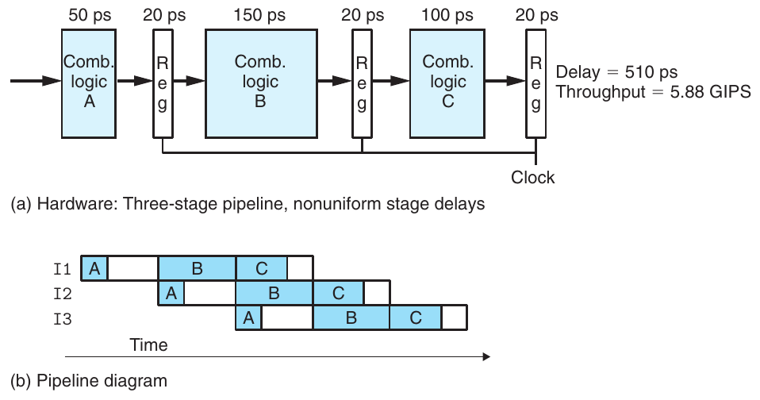

**Hình 4.36 Giới hạn của pipelining do độ trễ stage không đồng đều. Throughput hệ thống bị giới hạn bởi tốc độ stage chậm nhất.**

#### Bài tập thực hành 4.28 (lời giải trang 525)

Giả sử chúng ta phân tích combinational logic trong Hình 4.32 và xác định có thể tách nó thành chuỗi sáu block, đặt tên A đến F, có độ trễ lần lượt là 80, 30, 60, 50, 70 và 10 ps, như minh họa sau:

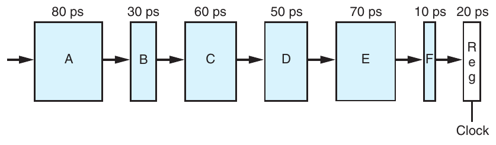

Chúng ta có thể tạo các phiên bản pipeline của thiết kế này bằng cách chèn pipeline register giữa các cặp block. Những tổ hợp khác nhau giữa độ sâu pipeline (số stage) và throughput tối đa xuất hiện tùy theo vị trí chèn pipeline register. Giả sử pipeline register có độ trễ 20 ps.

A. Chèn một register duy nhất tạo ra pipeline two-stage. Nên chèn register ở đâu để tối đa hóa throughput? Throughput và latency sẽ là bao nhiêu?

B. Nên chèn hai register ở đâu để tối đa hóa throughput của pipeline three-stage? Throughput và latency sẽ là bao nhiêu?

C. Nên chèn ba register ở đâu để tối đa hóa throughput của pipeline 4-stage? Throughput và latency sẽ là bao nhiêu?

D. Số stage tối thiểu để có thiết kế đạt throughput tối đa có thể là bao nhiêu? Mô tả thiết kế này, throughput và latency của nó.

### Lợi ích giảm dần của pipelining sâu

Hình 4.37 minh họa một giới hạn khác của pipelining. Trong ví dụ này, chúng ta chia phép tính thành sáu stage, mỗi stage cần 50 ps. Chèn pipeline register giữa mỗi cặp stage tạo ra pipeline six-stage. Chu kỳ clock tối thiểu cho hệ thống này là 50 + 20 = 70 picosecond, cho throughput 14.29 GIPS. Vì vậy, khi tăng gấp đôi số stage pipeline, hiệu năng cải thiện theo hệ số 14.29/8.33 = 1.71. Mặc dù thời gian cần cho mỗi block tính toán đã giảm theo hệ số 2, throughput không tăng gấp đôi do độ trễ qua pipeline register. Độ trễ này trở thành yếu tố giới hạn throughput pipeline. Trong thiết kế mới, độ trễ này chiếm 28.6% tổng chu kỳ clock.

Các processor hiện đại sử dụng pipeline rất sâu (15 stage trở lên) nhằm tối đa hóa tần số clock processor. Kiến trúc sư processor chia việc thực thi instruction thành nhiều bước rất đơn giản để mỗi stage có độ trễ rất nhỏ. Người thiết kế circuit thiết kế pipeline register cẩn thận để giảm thiểu độ trễ. Người thiết kế chip cũng phải thiết kế mạng phân phối clock cẩn thận để bảo đảm clock thay đổi chính xác cùng thời điểm trên toàn chip. Tất cả yếu tố này góp phần tạo nên thách thức thiết kế microprocessor high-speed.

#### Bài tập thực hành 4.29 (lời giải trang 526)

Giả sử có thể lấy hệ thống Hình 4.32 và chia nó thành số stage pipeline k tùy ý, mỗi stage có độ trễ 300/ k, và mỗi pipeline register có độ trễ 20 ps.

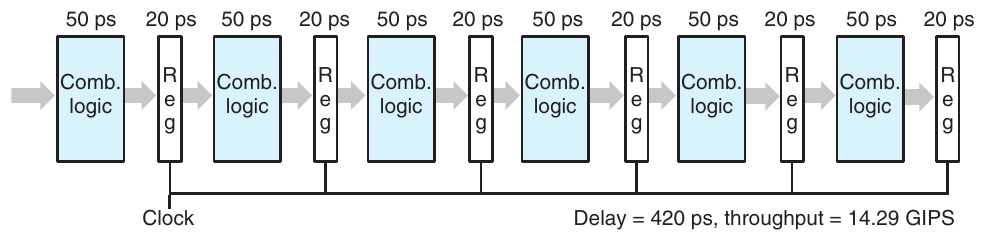

**Hình 4.37 Giới hạn của pipelining do overhead. Khi combinational logic được chia thành các block ngắn hơn, độ trễ do cập nhật register trở thành yếu tố giới hạn.**

A. Latency và throughput của hệ thống dưới dạng các function của k sẽ là bao nhiêu?

B. Giới hạn cuối cùng của throughput sẽ là bao nhiêu?

### 4.4.4 Pipelining cho hệ thống có feedback

Cho đến đây, chúng ta chỉ xem xét những hệ thống trong đó các đối tượng đi qua pipeline—dù là xe, người hay instruction—hoàn toàn độc lập với nhau. Tuy nhiên, với hệ thống thực thi chương trình máy như x86-64 hoặc Y86-64, có thể tồn tại dependency giữa những instruction liên tiếp. Ví dụ, xét chuỗi instruction Y86-64 sau:

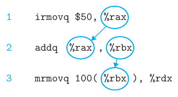

Trong chuỗi three-instruction này, có data dependency giữa mỗi cặp instruction liên tiếp, như chỉ ra bằng các tên register được khoanh tròn và mũi tên giữa chúng. Instruction irmovq (dòng 1) lưu kết quả trong %rax, sau đó instruction addq (dòng 2) phải đọc giá trị đó; và instruction này lưu kết quả trong %rbx, tiếp theo instruction mrmovq (dòng 3) phải đọc giá trị đó.

Một nguồn dependency tuần tự khác xuất hiện do control flow của instruction. Xét chuỗi instruction Y86-64 sau:

```
1   loop:
2       subq %rdx,%rbx
3       jne targ
4       irmovq $10,%rdx
5       jmp loop
6   targ:
7       halt
```

Instruction jne (dòng 3) tạo control dependency vì kết quả phép kiểm tra điều kiện xác định instruction tiếp theo cần thực thi sẽ là irmovq (dòng 4) hay halt (dòng 7). Trong thiết kế SEQ, các dependency này được xử lý bằng những đường feedback ở phía right-hand của Hình 4.22. Feedback này đưa các giá trị register đã cập nhật xuống register file và giá trị PC mới xuống PC register.

Hình 4.38 minh họa nguy cơ khi đưa pipelining vào hệ thống chứa các đường feedback. Trong hệ thống ban đầu (Hình 4.38(a)), kết quả của mỗi instruction được đưa vòng lại làm feedback cho instruction tiếp theo. Pipeline diagram (Hình 4.38(b)) minh họa điều này, khi kết quả I1 trở thành input cho I2, v.v. Nếu cố chuyển nó thành pipeline three-stage theo cách trực tiếp nhất (Hình 4.38(c)), chúng ta thay đổi hành vi hệ thống. Như Hình 4.38(c) cho thấy, kết quả I1 trở thành input cho I4. Trong nỗ lực tăng tốc hệ thống bằng pipelining, chúng ta đã thay đổi hành vi hệ thống.

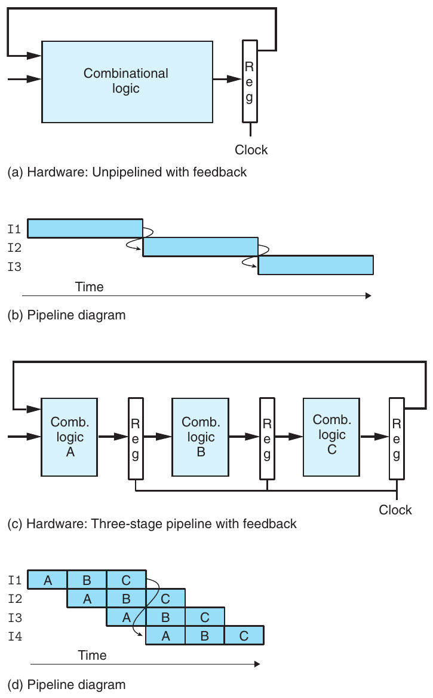

**Hình 4.38 Giới hạn của pipelining do dependency logic. Khi chuyển từ hệ thống không pipeline có feedback (a) sang hệ thống pipeline (c), chúng ta thay đổi hành vi tính toán của nó, như thể hiện qua hai pipeline diagram (b và d).**

Khi đưa pipelining vào processor Y86-64, phải xử lý đúng các tác động feedback. Rõ ràng, không thể chấp nhận việc thay đổi hành vi hệ thống như trong ví dụ Hình 4.38. Chúng ta phải có cách xử lý data dependency và control dependency giữa các instruction để hành vi thu được khớp mô hình do ISA định nghĩa.

## 4.5 Các cách triển khai Y86-64 pipeline

Cuối cùng, chúng ta đã sẵn sàng cho nhiệm vụ chính của chương—thiết kế processor Y86-64 pipeline. Chúng ta bắt đầu bằng một điều chỉnh nhỏ của processor tuần tự SEQ để chuyển phép tính PC vào fetch stage. Sau đó, thêm pipeline register giữa các stage. Nỗ lực đầu tiên này chưa xử lý đúng các data dependency và control dependency khác nhau. Tuy nhiên, qua một số sửa đổi, chúng ta đạt mục tiêu processor pipeline hiệu quả triển khai ISA Y86-64.

### 4.5.1 SEQ+: Sắp xếp lại các stage tính toán

Là bước chuyển tiếp đến thiết kế pipeline, chúng ta phải sắp xếp lại một chút thứ tự năm stage trong SEQ để stage cập nhật PC xuất hiện ở đầu chu kỳ clock thay vì cuối. Phép biến đổi này chỉ yêu cầu thay đổi tối thiểu cấu trúc phần cứng tổng thể và phù hợp hơn với thứ tự hoạt động trong các stage pipeline. Chúng ta gọi thiết kế được sửa đổi này là SEQ+.

Có thể di chuyển stage cập nhật PC để logic của nó hoạt động ở đầu chu kỳ clock bằng cách để nó tính giá trị PC cho instruction hiện tại. Hình 4.39 trình bày sự khác nhau giữa SEQ và SEQ+ trong phép tính PC. Với SEQ (Hình 4.39(a)), phép tính PC diễn ra ở cuối chu kỳ clock, tính giá trị mới cho PC register dựa trên giá trị các tín hiệu được tính trong chu kỳ clock hiện tại. Với SEQ+ (Hình 4.39(b)), chúng ta tạo state register để giữ các tín hiệu được tính trong một instruction. Sau đó, khi chu kỳ clock mới bắt đầu, các giá trị lan truyền qua đúng phần logic đó để tính PC cho instruction now-current. Chúng ta gắn nhãn các register là “pIcode”, “pCnd”, v.v., để chỉ rằng tại bất kỳ chu kỳ nào, chúng giữ các tín hiệu điều khiển được tạo trong chu kỳ trước.

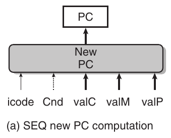

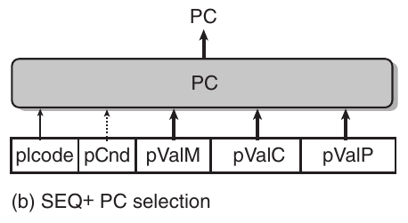

**Hình 4.39 Dịch thời điểm tính PC. Với SEQ+, chúng ta tính giá trị program counter cho trạng thái hiện tại làm bước đầu tiên của việc thực thi instruction.**

#### Thông tin thêm PC nằm ở đâu trong SEQ+?

Một đặc điểm thú vị của SEQ+ là không có hardware register lưu program counter. Thay vào đó, PC được tính động dựa trên một số thông tin trạng thái lưu từ instruction trước. Đây là minh họa nhỏ cho việc có thể triển khai processor khác với mô hình khái niệm do ISA gợi ra, miễn là processor thực thi đúng mọi chương trình machine-language. Không cần mã hóa trạng thái theo hình thức mà trạng thái programmer-visible chỉ ra, miễn là processor có thể tạo giá trị đúng cho mọi phần của trạng thái programmer-visible (chẳng hạn program counter). Chúng ta sẽ tận dụng nguyên tắc này nhiều hơn khi tạo thiết kế pipeline. Các kỹ thuật xử lý Out-of-order, như mô tả trong Mục 5.7, đẩy ý tưởng này đến cực điểm bằng cách thực thi instruction theo thứ tự hoàn toàn khác với thứ tự trong chương trình machine-level.

Hình 4.40 trình bày chi tiết hơn phần cứng SEQ+. Có thể thấy nó chứa đúng các đơn vị phần cứng và control block như trong SEQ (Hình 4.23), nhưng logic PC được chuyển từ trên cùng, nơi nó hoạt động ở cuối chu kỳ clock, xuống dưới cùng, nơi nó hoạt động ở đầu chu kỳ.

Việc dịch các phần tử trạng thái từ SEQ sang SEQ+ là ví dụ về phép biến đổi tổng quát gọi là circuit retiming [68]. Retiming thay đổi biểu diễn trạng thái của hệ thống mà không thay đổi hành vi logic. Nó thường được sử dụng để cân bằng độ trễ giữa các stage khác nhau của hệ thống pipeline.

### 4.5.2 Chèn pipeline register

Trong nỗ lực đầu tiên tạo processor Y86-64 pipeline, chúng ta chèn pipeline register giữa các stage của SEQ+ và sắp xếp lại đôi chút các tín hiệu, tạo thành processor PIPE−, trong đó dấu “−” trong tên biểu thị processor này có hiệu năng thấp hơn đôi chút so với thiết kế processor cuối cùng. Cấu trúc PIPE− được minh họa trong Hình 4.41. Các pipeline register được thể hiện bằng ô màu xanh, mỗi ô chứa những field khác nhau được thể hiện bằng ô màu trắng. Như nhiều field chỉ ra, mỗi pipeline register giữ nhiều byte và word. Khác với các nhãn trong ô bo tròn ở cấu trúc phần cứng của hai processor tuần tự (Hình 4.23 và 4.40), những ô màu trắng này biểu diễn các thành phần phần cứng thực tế.

Lưu ý PIPE− sử dụng gần như cùng tập đơn vị phần cứng với thiết kế tuần tự SEQ (Hình 4.40), nhưng có pipeline register phân tách các stage. Khác biệt giữa tín hiệu của hai hệ thống được thảo luận trong Mục 4.5.3.

Các pipeline register được gắn nhãn như sau:

F giữ giá trị dự đoán của program counter, sẽ được thảo luận ngay sau đây.

D nằm giữa fetch stage và decode stage. Nó giữ thông tin về instruction vừa được fetch để decode stage xử lý.

E nằm giữa decode stage và execute stage. Nó giữ thông tin về instruction vừa được decode và các giá trị đọc từ register file để execute stage xử lý.

M nằm giữa execute stage và memory stage. Nó giữ kết quả của instruction vừa được thực thi để memory stage xử lý. Nó cũng giữ thông tin về điều kiện nhánh và đích nhánh để xử lý conditional jump.

W nằm giữa memory stage và các đường feedback cung cấp kết quả tính được cho register file để ghi, đồng thời cung cấp return address cho logic chọn PC khi hoàn tất instruction ret.

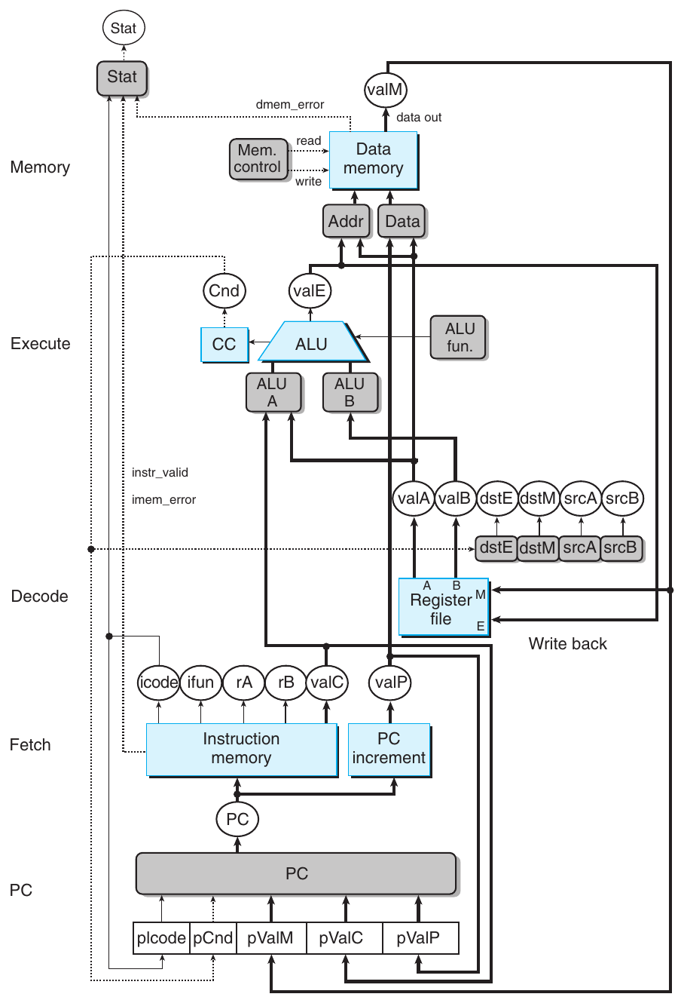

**Hình 4.40 Cấu trúc phần cứng SEQ+. Chuyển phép tính PC từ cuối chu kỳ clock lên đầu khiến thiết kế phù hợp hơn với pipelining.**

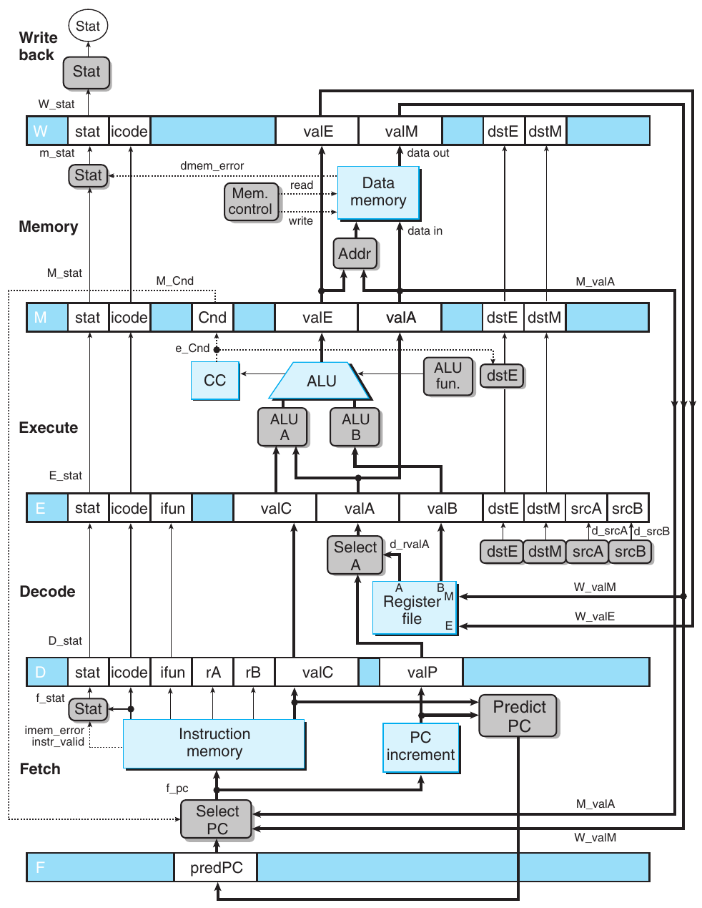

**Hình 4.41 Cấu trúc phần cứng PIPE−, một cách triển khai pipeline ban đầu. Bằng cách chèn pipeline register vào SEQ+ (Hình 4.40), chúng ta tạo pipeline five-stage. Phiên bản này có một số thiếu sót sẽ được xử lý ngay sau đây.**

Hình 4.42 trình bày cách chuỗi code sau đi qua pipeline five-stage của chúng ta, trong đó các comment nhận diện instruction từ I1 đến I5 để tiện tham chiếu:

```
1     irmovq  $1,%rax  # I1
2     irmovq  $2,%rbx  # I2
3     irmovq  $3,%rcx  # I3
4     irmovq  $4,%rdx  # I4
5     halt             # I5
```

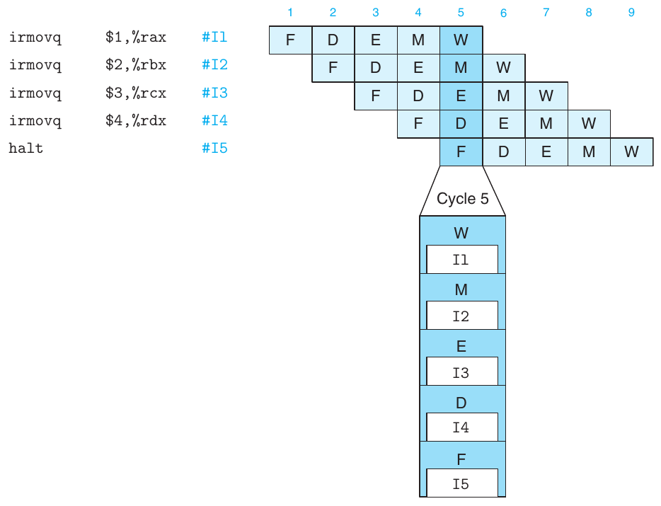

**Hình 4.42 Ví dụ về luồng instruction qua pipeline.**

Phía phải của hình trình bày pipeline diagram cho chuỗi instruction này. Giống pipeline diagram của các đơn vị tính toán pipeline đơn giản trong Mục 4.4, sơ đồ này thể hiện tiến trình của từng instruction qua các stage pipeline, với thời gian tăng từ trái sang phải. Các số phía trên chỉ các chu kỳ clock diễn ra những stage khác nhau. Ví dụ, ở chu kỳ 1, instruction I1 được fetch rồi đi qua các stage pipeline, với kết quả được ghi vào register file sau cuối chu kỳ 5. Instruction I2 được fetch ở chu kỳ 2 và kết quả được ghi lại sau cuối chu kỳ 6, v.v. Ở phía dưới, chúng ta trình bày góc nhìn mở rộng của pipeline trong chu kỳ 5. Tại thời điểm này, mỗi stage pipeline đều có một instruction.

Từ Hình 4.42, cũng có thể giải thích quy ước vẽ processor sao cho instruction đi từ dưới lên trên. Góc nhìn mở rộng của chu kỳ 5 thể hiện các stage pipeline với fetch stage ở dưới cùng và write-back stage ở trên cùng, giống các sơ đồ phần cứng pipeline (Hình 4.41). Nếu xem thứ tự instruction trong các stage pipeline, chúng xuất hiện cùng thứ tự như trong program listing. Vì luồng chương trình bình thường đi từ trên xuống dưới listing, chúng ta giữ thứ tự này bằng cách để luồng pipeline đi từ dưới lên trên. Quy ước này đặc biệt hữu ích khi làm việc với các simulator đi kèm sách.

### 4.5.3 Sắp xếp lại và gắn lại nhãn tín hiệu

Các cách triển khai tuần tự SEQ và SEQ+ chỉ xử lý một instruction tại một thời điểm, nên các tín hiệu như valC, srcA và valE có giá trị duy nhất. Trong thiết kế pipeline, có nhiều phiên bản của những giá trị này gắn với các instruction khác nhau đi qua hệ thống. Ví dụ, trong cấu trúc chi tiết của PIPE−, có bốn ô trắng mang nhãn “Stat” giữ status code cho bốn instruction khác nhau (xem Hình 4.41). Phải hết sức cẩn thận để bảo đảm sử dụng đúng phiên bản tín hiệu; nếu không, có thể xảy ra lỗi nghiêm trọng, chẳng hạn lưu kết quả tính cho một instruction vào destination register do instruction khác chỉ định. Chúng ta áp dụng cách đặt tên trong đó tín hiệu lưu trong pipeline register được nhận diện duy nhất bằng cách thêm tên pipe register viết hoa làm tiền tố. Ví dụ, bốn status code có tên D_stat, E_stat, M_stat và W_stat. Chúng ta cũng cần tham chiếu một số tín hiệu vừa được tính trong stage. Chúng được gắn nhãn bằng cách thêm ký tự đầu tiên của tên stage, viết thường, làm tiền tố tên tín hiệu. Lấy status code làm ví dụ, có thể thấy các control logic block mang nhãn “Stat” trong fetch stage và memory stage. Vì vậy, output của các block này có tên f_stat và m_stat. Cũng có thể thấy trạng thái thực tế của toàn processor Stat được tính bởi một block trong write-back stage, dựa trên giá trị trạng thái trong pipeline register W.

Decode stage của SEQ+ và PIPE− đều tạo các tín hiệu dstE và dstM chỉ destination register cho các giá trị valE và valM. Trong SEQ+, có thể nối trực tiếp những tín hiệu này với input địa chỉ của các write port của register file. Với PIPE−, những tín hiệu này được mang theo trong pipeline qua execute stage và memory stage, rồi chỉ được đưa tới register file khi đến write-back stage (thể hiện trong các góc nhìn chi tiết hơn của các stage). Chúng ta làm vậy để bảo đảm input địa chỉ và dữ liệu của write port giữ các giá trị từ cùng instruction. Nếu không, thao tác write back sẽ ghi các giá trị cho instruction trong write-back stage nhưng lại dùng register ID từ instruction trong decode stage. Nguyên tắc tổng quát là giữ toàn bộ thông tin về một instruction cụ thể trong cùng một stage pipeline.

#### Thông tin thêm Các tín hiệu M_stat và m_stat khác nhau ở đâu?

Với hệ thống đặt tên này, các tiền tố viết hoa ‘D’, ‘E’, ‘M’ và ‘W’ chỉ pipeline register, nên M_stat chỉ status code field của pipeline register M. Các tiền tố viết thường ‘f’, ‘d’, ‘e’, ‘m’ và ‘w’ chỉ stage pipeline, nên m_stat chỉ tín hiệu trạng thái được control logic block tạo ra trong memory stage.

Hiểu quy ước đặt tên này là điều thiết yếu để hiểu hoạt động của các processor pipeline.

Một block của PIPE− không có trong SEQ+ dưới đúng hình thức tương tự là block mang nhãn “Select A” trong decode stage. Có thể thấy block này tạo giá trị valA cho pipeline register E bằng cách chọn valP từ pipeline register D hoặc giá trị đọc từ port A của register file. Block này được đưa vào để giảm lượng trạng thái phải chuyển tiếp đến pipeline register E và M. Trong tất cả instruction, chỉ call cần valP trong memory stage. Chỉ các instruction jump cần giá trị valP trong execute stage (khi jump không được lấy). Không instruction nào trong số này cần giá trị đọc từ register file. Vì vậy, có thể giảm lượng trạng thái pipeline register bằng cách gộp hai tín hiệu này và mang chúng qua pipeline dưới một tín hiệu valA duy nhất. Điều này loại bỏ nhu cầu về block mang nhãn “Data” trong SEQ (Hình 4.23) và SEQ+ (Hình 4.40), vốn phục vụ mục đích tương tự. Trong thiết kế phần cứng, người ta thường xác định cẩn thận cách sử dụng tín hiệu rồi giảm lượng trạng thái register và dây nối bằng cách gộp các tín hiệu như vậy.

Như Hình 4.41 thể hiện, các pipeline register có một field cho status code stat, ban đầu được tính trong fetch stage và có thể được sửa trong memory stage. Chúng ta sẽ thảo luận cách triển khai xử lý các sự kiện exception trong Mục 4.5.6, sau khi trình bày cách triển khai thực thi instruction bình thường. Ở đây, chỉ cần nói rằng cách tiếp cận có hệ thống nhất là gắn một status code với mỗi instruction khi nó đi qua pipeline, như đã thể hiện trong hình.

### 4.5.4 Dự đoán PC tiếp theo

Chúng ta đã thực hiện một số biện pháp trong thiết kế PIPE− để xử lý đúng control dependency. Mục tiêu của thiết kế pipeline là phát hành một instruction mới ở mỗi chu kỳ clock, nghĩa là mỗi chu kỳ clock có một instruction mới đi vào execute stage và cuối cùng sẽ được hoàn tất. Đạt mục tiêu này sẽ cho throughput một instruction mỗi chu kỳ. Để làm vậy, phải xác định vị trí instruction tiếp theo ngay sau khi fetch instruction hiện tại. Đáng tiếc, nếu instruction được fetch là conditional branch, chúng ta chưa biết có nên lấy nhánh hay không cho đến vài chu kỳ sau, khi instruction đã đi qua execute stage. Tương tự, nếu instruction được fetch là ret, không thể xác định vị trí trả về cho đến khi instruction đi qua memory stage.

#### Thông tin thêm Các chiến lược branch prediction khác

Thiết kế của chúng ta sử dụng chiến lược branch prediction always taken. Các nghiên cứu cho thấy chiến lược này có tỷ lệ thành công khoảng 60% [44, 122]. Ngược lại, chiến lược never taken (NT) có tỷ lệ thành công khoảng 40%. Chiến lược tinh vi hơn đôi chút, gọi là backward taken, forward not taken (BTFNT), dự đoán các nhánh đến địa chỉ thấp hơn instruction tiếp theo sẽ được lấy, còn các nhánh đến địa chỉ cao hơn sẽ không được lấy. Chiến lược này có tỷ lệ thành công khoảng 65%. Sự cải thiện bắt nguồn từ việc vòng lặp được khép lại bằng nhánh ngược và thường thực thi nhiều lần. Nhánh tiến được sử dụng cho các thao tác điều kiện và ít có khả năng được lấy hơn. Trong Bài tập 4.55 và 4.56, bạn có thể sửa processor pipeline Y86-64 để triển khai các chiến lược branch prediction NT và BTFNT.

Như đã thấy trong Mục 3.6.6, nhánh dự đoán sai có thể làm giảm đáng kể hiệu năng chương trình, do đó thúc đẩy việc sử dụng truyền dữ liệu có điều kiện thay cho truyền quyền điều khiển có điều kiện khi có thể.

Ngoại trừ các instruction conditional jump và ret, có thể xác định địa chỉ instruction tiếp theo dựa trên thông tin tính được trong fetch stage. Với call và jmp (jump vô điều kiện), địa chỉ là valC, word hằng trong instruction; với mọi instruction khác, địa chỉ là valP, địa chỉ instruction tiếp theo. Vì vậy, trong hầu hết trường hợp, có thể đạt mục tiêu phát hành instruction mới mỗi chu kỳ clock bằng cách dự đoán giá trị PC tiếp theo. Với phần lớn loại instruction, dự đoán hoàn toàn đáng tin cậy. Với conditional jump, có thể dự đoán jump được lấy, khi đó PC mới là valC, hoặc không được lấy, khi đó PC mới là valP. Trong cả hai trường hợp, phải có cách xử lý tình huống dự đoán sai, dẫn đến đã fetch và thực thi một phần những instruction không đúng. Chúng ta sẽ quay lại vấn đề này trong Mục 4.5.8.

Kỹ thuật đoán hướng nhánh rồi bắt đầu fetch instruction theo dự đoán được gọi là branch prediction. Hầu như mọi processor đều sử dụng một hình thức của kỹ thuật này. Nhiều thực nghiệm đã được thực hiện về các chiến lược hiệu quả để dự đoán nhánh có được lấy hay không [46, Mục 2.3]. Một số hệ thống dành lượng lớn phần cứng cho nhiệm vụ này. Trong thiết kế này, chúng ta sử dụng chiến lược đơn giản là dự đoán conditional branch luôn được lấy, nên dự đoán giá trị PC mới là valC.

Chúng ta vẫn còn phải dự đoán giá trị PC mới do instruction ret tạo ra. Khác conditional jump, tập kết quả có thể có gần như không giới hạn, vì return address là bất kỳ word nào đang nằm ở đỉnh stack. Trong thiết kế này, chúng ta không cố dự đoán giá trị return address. Thay vào đó, chỉ trì hoãn việc xử lý thêm instruction cho đến khi ret đi qua write-back stage. Chúng ta sẽ quay lại phần triển khai này trong Mục 4.5.8.

#### Thông tin thêm Dự đoán return address bằng stack

Với hầu hết chương trình, rất dễ dự đoán return address vì lời gọi và việc trả về từ procedure xuất hiện thành các cặp tương ứng. Phần lớn trường hợp, khi procedure được gọi, nó trả về instruction ngay sau call. Các processor high-performance tận dụng tính chất này bằng cách đưa một hardware stack vào instruction fetch unit để giữ return address do instruction gọi procedure tạo ra. Mỗi lần instruction gọi procedure được thực thi, return address của nó được đẩy lên stack. Khi instruction trả về được fetch, giá trị trên cùng được lấy khỏi stack này và dùng làm return address dự đoán. Giống branch prediction, phải có cơ chế khôi phục khi dự đoán sai, vì đôi khi lời gọi và việc trả về không khớp nhau. Nói chung, dự đoán rất đáng tin cậy. Hardware stack này không thuộc trạng thái programmer-visible.

Fetch stage của PIPE−, được vẽ ở cuối Hình 4.41, chịu trách nhiệm cả dự đoán giá trị PC tiếp theo lẫn chọn PC thực tế cho việc fetch instruction. Có thể thấy block mang nhãn “Predict PC” có thể chọn valP (do PC incrementer tính) hoặc valC (từ instruction đã fetch). Giá trị này được lưu trong pipeline register F làm giá trị dự đoán của program counter. Block mang nhãn “Select PC” tương tự block mang nhãn “PC” trong stage chọn PC của SEQ+ (Hình 4.40). Nó chọn một trong ba giá trị làm địa chỉ cho instruction memory: PC dự đoán, giá trị valP của instruction branch not-taken đến pipeline register M (lưu trong register M_valA), hoặc giá trị return address khi instruction ret đến pipeline register W (lưu trong W_valM).

### 4.5.5 Pipeline hazard

Cấu trúc PIPE− là bước khởi đầu tốt để tạo processor Y86-64 pipeline. Tuy nhiên, nhớ lại thảo luận trong Mục 4.4.4 rằng đưa pipelining vào hệ thống có feedback có thể gây vấn đề khi tồn tại dependency giữa các instruction liên tiếp. Phải giải quyết vấn đề này trước khi hoàn tất thiết kế. Các dependency có hai dạng: (1) data dependency, khi kết quả do một instruction tính được dùng làm dữ liệu cho instruction sau, và (2) control dependency, khi một instruction xác định vị trí instruction tiếp theo, chẳng hạn khi thực thi jump, call hoặc return. Khi các dependency như vậy có khả năng khiến pipeline tính sai, chúng được gọi là hazard. Giống dependency, hazard được phân loại thành data hazard hoặc control hazard. Trước tiên, chúng ta xem xét data hazard, sau đó là control hazard.

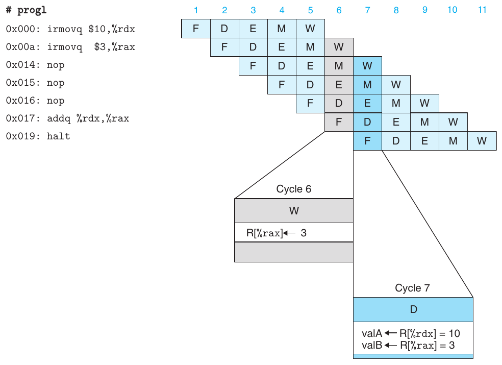

**Hình 4.43 Thực thi pipeline prog1 không có điều khiển pipeline đặc biệt. Ở chu kỳ 6, irmovq thứ hai ghi kết quả vào program register %rax . Instruction addq đọc source operand ở chu kỳ 7 nên nhận đúng giá trị cho cả %rdx và %rax .**

Hình 4.43 minh họa processor PIPE− xử lý chuỗi instruction được gọi là prog1. Trong ví dụ này và các ví dụ tiếp theo, giả sử mọi program register ban đầu đều bằng 0. Code nạp các giá trị 10 và 3 vào program register %rdx và %rax, thực thi ba instruction nop, rồi cộng register %rdx vào %rax. Chúng ta tập trung vào các data hazard có thể xuất hiện do data dependency giữa hai instruction irmovq và instruction addq. Phía right-hand của hình trình bày pipeline diagram cho chuỗi instruction. Các stage pipeline ở chu kỳ 6 và 7 được tô nổi bật. Bên dưới là góc nhìn mở rộng của hoạt động write-back ở chu kỳ 6 và decode ở chu kỳ 7. Sau khi chu kỳ 7 bắt đầu, cả hai instruction irmovq đã đi qua write-back stage, nên register file giữ các giá trị %rdx và %rax đã cập nhật. Vì vậy, khi addq đi qua decode stage trong chu kỳ 7, nó đọc được đúng giá trị source operand. Các data dependency giữa hai irmovq và addq không tạo data hazard trong ví dụ này.

Chúng ta đã thấy prog1 đi qua pipeline và cho kết quả đúng vì ba instruction nop tạo khoảng trễ giữa các instruction có data dependency. Hãy xem điều gì xảy ra khi loại bỏ các nop này. Hình 4.44 minh họa luồng pipeline của chương trình prog2, chứa hai nop giữa hai irmovq tạo giá trị cho register %rdx và %rax và instruction addq dùng hai register này làm operand. Bước quyết định xảy ra ở chu kỳ 6 khi addq đọc operand từ register file. Góc nhìn mở rộng hoạt động pipeline trong chu kỳ này nằm phía dưới hình. Irmovq đầu tiên đã đi qua write-back stage, nên program register %rdx được cập nhật trong register file. Irmovq thứ hai ở write-back stage trong chu kỳ này, nên thao tác ghi program register %rax chỉ xảy ra ở đầu chu kỳ 7 khi clock lên. Vì vậy, register %rax sẽ được đọc thành giá trị 0 không đúng (nhớ rằng giả sử mọi register ban đầu bằng 0), vì thao tác ghi đang chờ cho register này chưa xảy ra. Rõ ràng, chúng ta phải điều chỉnh pipeline để xử lý đúng hazard này.

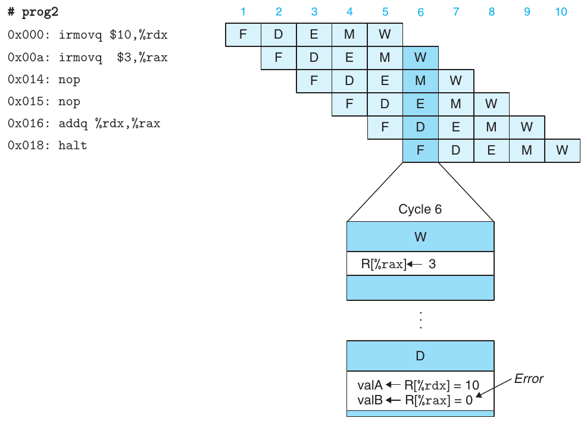

**Hình 4.44 Thực thi pipeline prog2 không có điều khiển pipeline đặc biệt. Việc ghi program register %rax không xảy ra cho đến đầu chu kỳ 7, nên instruction addq nhận giá trị không đúng của register này trong decode stage.**

Hình 4.45 thể hiện điều xảy ra khi chỉ có một instruction nop giữa các irmovq và addq, tạo chương trình prog3. Lúc này phải xem xét hành vi pipeline ở chu kỳ 5 khi addq đi qua decode stage. Đáng tiếc, thao tác ghi đang chờ vào register %rdx vẫn ở write-back stage, còn thao tác ghi đang chờ vào %rax vẫn ở memory stage. Do đó, addq sẽ nhận giá trị không đúng cho cả hai operand.

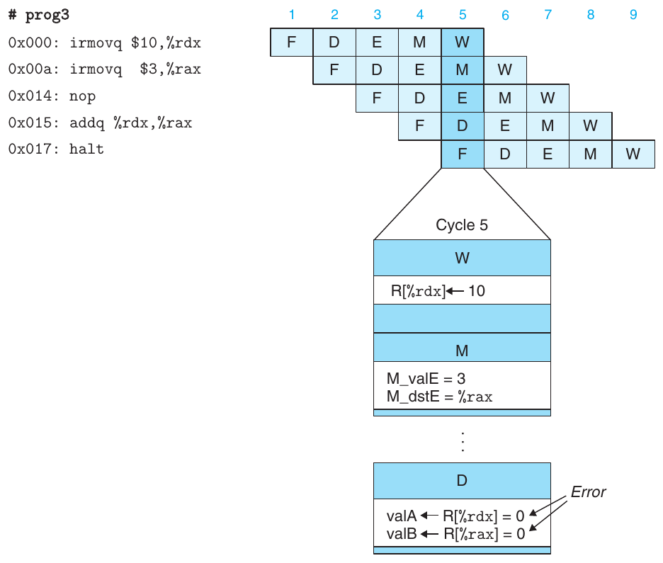

**Hình 4.45 Thực thi pipeline prog3 không có điều khiển pipeline đặc biệt. Ở chu kỳ 5, addq đọc source operand từ register file. Thao tác ghi đang chờ vào %rdx vẫn ở write-back stage, còn thao tác ghi đang chờ vào %rax vẫn ở memory stage. Cả operand valA lẫn valB đều nhận giá trị không đúng.**

Hình 4.46 thể hiện điều xảy ra khi loại bỏ mọi nop giữa các irmovq và addq, tạo chương trình prog4. Lúc này phải xem xét hành vi pipeline ở chu kỳ 4 khi addq đi qua decode stage. Đáng tiếc, thao tác ghi đang chờ vào %rdx vẫn ở memory stage, còn giá trị mới cho %rax vừa được tính trong execute stage. Do đó, addq sẽ nhận giá trị không đúng cho cả hai operand.

Các ví dụ minh họa rằng data hazard có thể xảy ra với instruction khi một operand được cập nhật bởi bất kỳ instruction nào trong ba instruction trước nó. Hazard xuất hiện vì processor pipeline đọc operand của instruction từ register file ở decode stage nhưng chỉ ghi kết quả của instruction vào register file ba chu kỳ sau, khi instruction đi qua write-back stage.

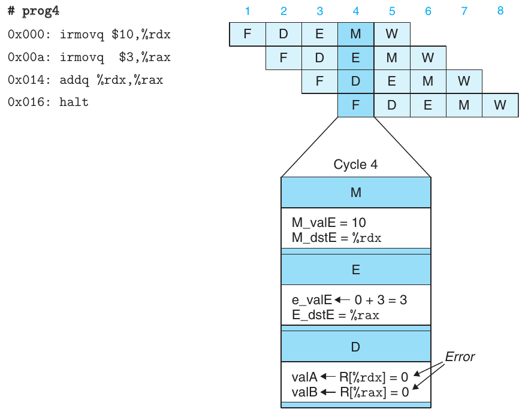

**Hình 4.46 Thực thi pipeline prog4 không có điều khiển pipeline đặc biệt. Ở chu kỳ 4, addq đọc source operand từ register file. Thao tác ghi đang chờ vào %rdx vẫn ở memory stage, còn giá trị mới cho %rax vừa được tính trong execute stage. Cả operand valA lẫn valB đều nhận giá trị không đúng.**

### Tránh data hazard bằng stalling

Một kỹ thuật rất tổng quát để tránh hazard là stalling, trong đó processor giữ lại một hoặc nhiều instruction trong pipeline cho đến khi điều kiện hazard không còn. Processor có thể tránh data hazard bằng cách giữ instruction ở decode stage cho đến khi các instruction tạo source operand của nó đã đi qua write-back stage. Chi tiết cơ chế này được thảo luận trong Mục 4.5.8. Nó chỉ cần các cải tiến đơn giản cho control logic của pipeline. Tác dụng của stalling được vẽ trong Hình 4.47 (prog2) và Hình 4.48 (prog4). (Bỏ qua prog3 vì nó hoạt động tương tự hai ví dụ kia.) Khi addq ở decode stage, control logic phát hiện ít nhất một instruction trong execute, memory hoặc write-back stage sẽ cập nhật register %rdx hoặc %rax. Thay vì cho addq đi qua stage với kết quả sai, nó stall instruction, giữ lại trong decode stage thêm một chu kỳ (prog2) hoặc ba chu kỳ (prog4). Với cả ba chương trình, cuối cùng addq nhận đúng hai source operand ở chu kỳ 7 rồi tiếp tục đi qua pipeline.

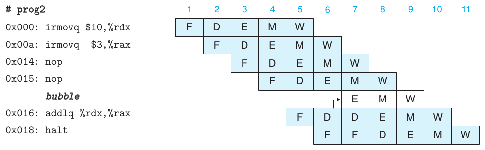

**Hình 4.47 Thực thi pipeline prog2 bằng stall. Sau khi decode addq ở chu kỳ 6, stall control logic phát hiện data hazard do thao tác ghi %rax đang chờ trong write-back stage. Nó chèn bubble vào execute stage và lặp lại decode addq ở chu kỳ 7. Thực chất, máy đã chèn động một nop, tạo luồng tương tự prog1 (Hình 4.43).**

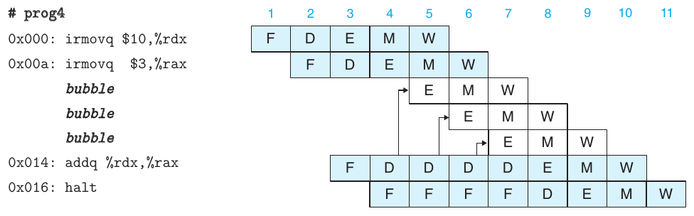

**Hình 4.48 Thực thi pipeline prog4 bằng stall. Sau khi decode addq ở chu kỳ 4, stall control logic phát hiện data hazard cho cả hai source register. Nó chèn bubble vào execute stage và lặp lại decode addq ở chu kỳ 5. Nó lại phát hiện hazard cho cả hai source register, chèn bubble vào execute stage và lặp lại decode addq ở chu kỳ 6. Nó vẫn phát hiện hazard cho source register %rax , chèn bubble vào execute stage và lặp lại decode addq ở chu kỳ 7. Thực chất, máy đã chèn động ba nop, tạo luồng tương tự prog1 (Hình 4.43).**

Khi giữ addq ở decode stage, chúng ta cũng phải giữ instruction halt theo sau nó ở fetch stage. Có thể làm điều này bằng cách giữ program counter ở giá trị cố định để halt được fetch lặp lại cho đến khi stall kết thúc.

Stalling giữ một nhóm instruction trong các stage của chúng nhưng cho phép instruction khác tiếp tục đi qua pipeline. Vậy phải làm gì ở các stage vốn xử lý addq? Chúng ta xử lý bằng cách chèn bubble vào execute stage mỗi lần giữ instruction ở decode stage. Bubble giống một nop được sinh động—nó không thay đổi register, bộ nhớ, condition code hay trạng thái chương trình. Chúng được thể hiện bằng ô trắng trong pipeline diagram của Hình 4.47 và 4.48. Trong các hình này, mũi tên giữa ô “D” của addq và ô “E” của một pipeline bubble biểu thị bubble được chèn vào execute stage thay cho addq vốn bình thường đi từ decode sang execute stage. Chúng ta sẽ xem cơ chế chi tiết để stall pipeline và chèn bubble trong Mục 4.5.8.

#### Thông tin thêm Liệt kê các nhóm data hazard

Hazard có thể xảy ra khi một instruction cập nhật phần trạng thái chương trình mà instruction sau sẽ đọc. Với Y86-64, trạng thái gồm program register, program counter, bộ nhớ, condition code register và status register. Hãy xem khả năng hazard trong thiết kế đề xuất cho từng dạng trạng thái này.

Program register. Đây là những hazard đã nhận diện. Chúng xuất hiện vì register file được đọc ở một stage và ghi ở stage khác, dẫn đến khả năng tương tác ngoài ý muốn giữa các instruction.

Program counter. Xung đột giữa cập nhật và đọc program counter gây control hazard. Không xảy ra hazard khi logic fetch-stage dự đoán đúng giá trị program counter mới trước khi fetch instruction tiếp theo. Nhánh dự đoán sai và instruction ret cần xử lý đặc biệt, như sẽ thảo luận trong Mục 4.5.5.

Bộ nhớ. Ghi và đọc data memory đều xảy ra trong memory stage. Khi instruction đọc bộ nhớ đến stage này, mọi instruction ghi bộ nhớ trước nó đều đã ghi xong. Tuy nhiên, có thể xảy ra can thiệp giữa instruction ghi dữ liệu trong memory stage và việc đọc instruction trong fetch stage, vì instruction memory và data memory tham chiếu cùng không gian địa chỉ. Điều này chỉ xảy ra với chương trình chứa code self-modifying, khi instruction ghi vào phần bộ nhớ mà instruction sau đó được fetch từ đó. Một số hệ thống có cơ chế phức tạp phát hiện và tránh hazard này, còn hệ thống khác đơn giản yêu cầu chương trình không sử dụng code self-modifying. Để đơn giản, giả sử chương trình không tự sửa đổi, nên không cần biện pháp đặc biệt cập nhật instruction memory dựa trên thay đổi data memory trong lúc thực thi.

Condition code register. Chúng được các phép toán số nguyên ghi trong execute stage. Chúng được conditional move đọc trong execute stage và conditional jump đọc trong memory stage. Khi conditional move hoặc jump đến execute stage, mọi phép toán số nguyên trước đó đã hoàn tất stage này. Không thể xảy ra hazard.

Status register. Trạng thái chương trình có thể bị instruction tác động khi đi qua pipeline. Cơ chế gắn status code với mỗi instruction trong pipeline cho phép processor dừng có trật tự khi xảy ra exception, như sẽ thảo luận trong Mục 4.5.6.

Phân tích này cho thấy chỉ cần xử lý register data hazard, control hazard và bảo đảm exception được xử lý đúng. Phân tích có hệ thống như vậy quan trọng khi thiết kế hệ thống phức tạp. Nó nhận diện khó khăn tiềm ẩn trong triển khai và hướng dẫn tạo các chương trình kiểm thử để kiểm tra tính đúng đắn của hệ thống.

Khi sử dụng stalling xử lý data hazard, thực chất chúng ta thực thi prog2 và prog4 bằng cách sinh động luồng pipeline của prog1 (Hình 4.43). Chèn một bubble cho prog2 và ba bubble cho prog4 có tác dụng như đặt ba nop giữa irmovq thứ hai và addq. Cơ chế này khá dễ triển khai (xem Bài tập 4.53), nhưng hiệu năng không tốt. Có nhiều trường hợp một instruction cập nhật register và instruction theo sát sử dụng cùng register. Điều này khiến pipeline stall tối đa ba chu kỳ, giảm đáng kể throughput tổng thể.

### Tránh data hazard bằng forwarding

Thiết kế PIPE− đọc source operand từ register file ở decode stage, nhưng cũng có thể có thao tác ghi đang chờ vào một source register trong write-back stage. Thay vì stall cho đến khi ghi xong, có thể truyền thẳng giá trị sắp được ghi tới pipeline register E làm source operand. Hình 4.49 minh họa chiến lược này bằng góc nhìn mở rộng pipeline diagram cho chu kỳ 6 của prog2. Logic decode-stage phát hiện %rax là source register cho operand valB và cũng có thao tác ghi %rax đang chờ ở write port E. Do đó, có thể tránh stall bằng cách dùng word dữ liệu cấp cho port E (tín hiệu W_valE) làm giá trị valB. Kỹ thuật truyền trực tiếp giá trị kết quả từ một stage pipeline tới stage trước nó thường gọi là data forwarding (hoặc đơn giản forwarding, đôi khi bypassing). Nó cho phép instruction của prog2 đi qua pipeline mà không stall. Data forwarding yêu cầu thêm kết nối dữ liệu và control logic vào cấu trúc phần cứng cơ bản.

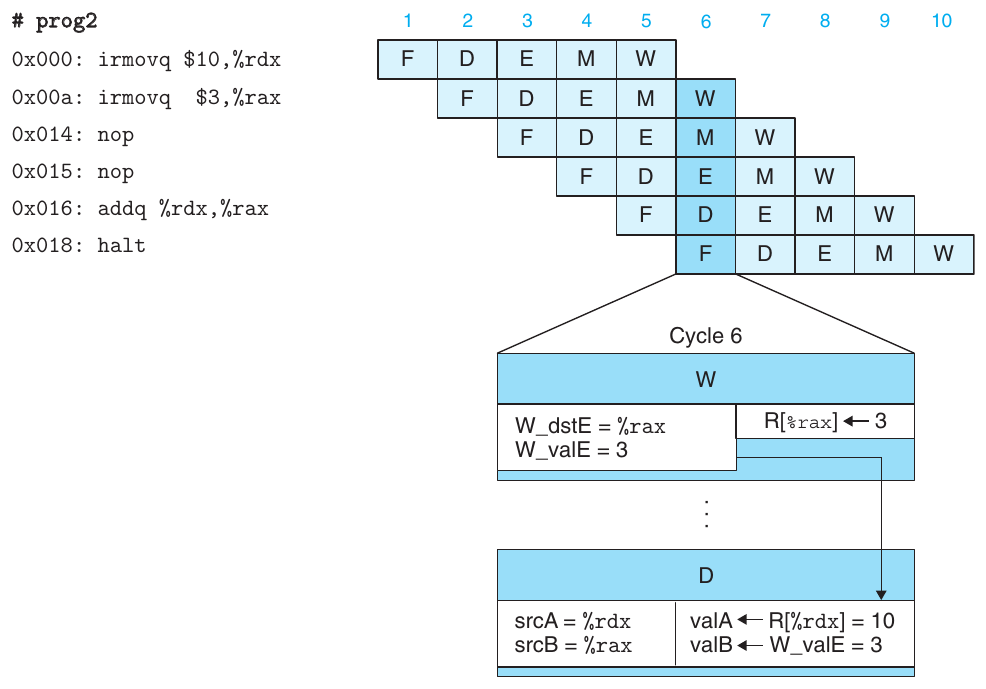

**Hình 4.49 Thực thi pipeline prog2 bằng forwarding. Ở chu kỳ 6, logic decode-stage phát hiện thao tác ghi %rax đang chờ trong write-back stage. Nó dùng giá trị này cho source operand valB thay vì giá trị đọc từ register file.**

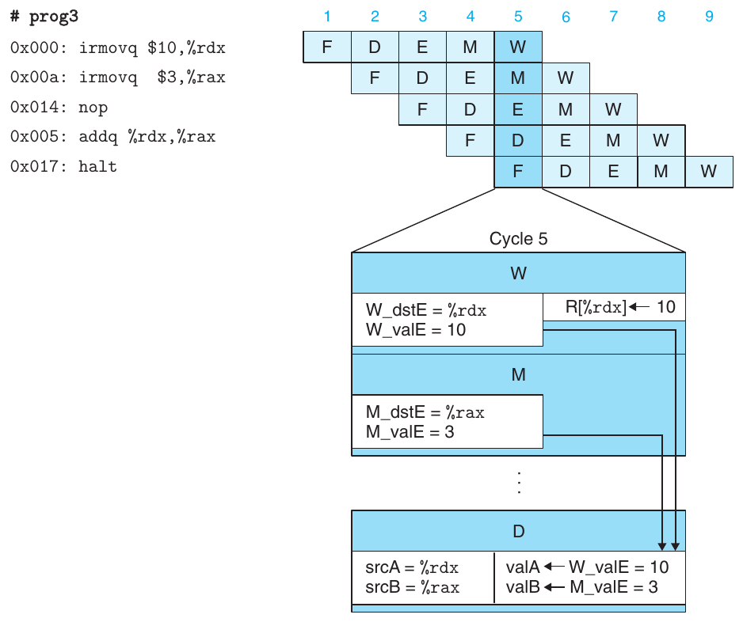

**Hình 4.50 Thực thi pipeline prog3 bằng forwarding. Ở chu kỳ 5, logic decode-stage phát hiện thao tác ghi %rdx đang chờ trong write-back stage và %rax trong memory stage. Nó dùng chúng làm giá trị valA và valB thay cho giá trị đọc từ register file.**

Như Hình 4.50 minh họa, data forwarding cũng dùng được khi có thao tác ghi register đang chờ ở memory stage, tránh stall cho prog3. Ở chu kỳ 5, logic decode-stage phát hiện thao tác ghi %rdx đang chờ tại port E trong write-back stage, cùng thao tác ghi %rax đang trên đường đến port E nhưng vẫn ở memory stage. Thay vì stall đến khi ghi xong, nó dùng giá trị trong write-back stage (tín hiệu W_valE) cho operand valA và giá trị trong memory stage (tín hiệu M_valE) cho operand valB.

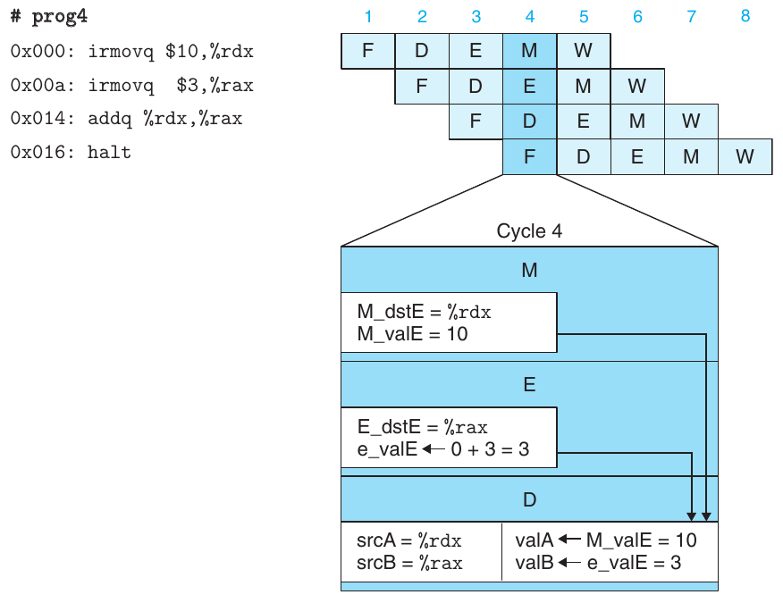

**Hình 4.51 Thực thi pipeline prog4 bằng forwarding. Ở chu kỳ 4, logic decode-stage phát hiện thao tác ghi %rdx đang chờ trong memory stage. Nó cũng phát hiện giá trị mới đang được tính cho %rax trong execute stage. Nó dùng chúng làm giá trị valA và valB thay cho giá trị đọc từ register file.**

Để tận dụng tối đa data forwarding, cũng có thể truyền giá trị vừa tính từ execute stage tới decode stage, tránh stall cho prog4 như Hình 4.51 minh họa. Ở chu kỳ 4, logic decode-stage phát hiện thao tác ghi %rdx đang chờ trong memory stage và giá trị do ALU tính trong execute stage sẽ được ghi vào %rax. Nó có thể dùng giá trị memory stage (tín hiệu M_valE) cho operand valA, và output ALU (tín hiệu e_valE) cho operand valB. Lưu ý dùng output ALU không gây vấn đề timing. Decode stage chỉ cần tạo valA và valB trước cuối chu kỳ clock để pipeline register E được nạp kết quả decode khi clock lên bắt đầu chu kỳ sau. Output ALU sẽ hợp lệ trước thời điểm này.

Các trường hợp forwarding minh họa trong prog2 đến prog4 đều truyền giá trị do ALU tạo và hướng tới write port E. Forwarding cũng dùng được với giá trị đọc từ bộ nhớ và hướng tới write port M. Từ memory stage, có thể forward giá trị vừa đọc từ data memory (tín hiệu m_valM). Từ write-back stage, có thể forward giá trị ghi đang chờ tới port M (tín hiệu W_valM). Tổng cộng có năm nguồn forwarding khác nhau (e_valE, m_valM, M_valE, W_valM và W_valE) và hai đích forwarding (valA và valB).

Các sơ đồ mở rộng từ Hình 4.49 đến 4.51 cũng thể hiện cách logic decode-stage xác định nên dùng giá trị từ register file hay giá trị forward. Mỗi giá trị sẽ được ghi lại vào register file đều có destination register ID đi kèm. Logic so sánh các ID này với source register ID srcA và srcB để phát hiện trường hợp forwarding. Có thể nhiều destination register ID cùng khớp một source ID. Phải thiết lập độ ưu tiên giữa các nguồn forwarding để xử lý trường hợp đó. Điều này sẽ được thảo luận khi xem thiết kế chi tiết forwarding logic.

Hình 4.52 trình bày cấu trúc PIPE, phần mở rộng PIPE− có thể xử lý data hazard bằng forwarding. So với cấu trúc PIPE− (Hình 4.41), có thể thấy giá trị từ năm nguồn forwarding được feedback tới hai block “Sel+Fwd A” và “Fwd B” trong decode stage. Block “Sel+Fwd A” kết hợp vai trò block “Select A” trong PIPE− với forwarding logic. Nó cho phép valA của pipeline register E là program counter đã tăng valP, giá trị đọc từ port A của register file hoặc một giá trị forward. Block “Fwd B” triển khai forwarding logic cho source operand valB.

### Data hazard Load/Use

Một nhóm data hazard không thể xử lý chỉ bằng forwarding vì việc đọc bộ nhớ xảy ra muộn trong pipeline. Hình 4.53 minh họa load/use hazard, khi một instruction (mrmovq tại 0x028) đọc giá trị từ bộ nhớ cho register %rax, còn instruction tiếp theo (addq tại 0x032) cần giá trị này làm source operand. Góc nhìn mở rộng của chu kỳ 7 và 8 nằm phía dưới hình, với giả định mọi program register ban đầu bằng 0. Addq cần giá trị register ở chu kỳ 7, nhưng mrmovq chỉ tạo nó ở chu kỳ 8. Để “forward” từ mrmovq sang addq, forwarding logic phải đưa giá trị đi ngược thời gian! Vì rõ ràng không thể, phải tìm cơ chế khác xử lý dạng data hazard này. (Data hazard cho %rbx, với giá trị do irmovq tại 0x01e tạo và addq tại 0x032 sử dụng, có thể xử lý bằng forwarding.)

Như Hình 4.54 thể hiện, có thể tránh load/use data hazard bằng kết hợp stalling và forwarding. Việc này cần sửa control logic nhưng dùng được các bypass path hiện có. Khi mrmovq đi qua execute stage, pipeline control logic phát hiện instruction trong decode stage (addq) cần kết quả đọc từ bộ nhớ. Nó stall instruction trong decode stage một chu kỳ, khiến một bubble được chèn vào execute stage. Như góc nhìn mở rộng chu kỳ 8 cho thấy, giá trị đọc từ bộ nhớ lúc này có thể được forward từ memory stage đến addq trong decode stage. Giá trị cho %rbx cũng được forward từ write-back tới memory stage. Như mũi tên từ ô “D” ở chu kỳ 7 tới ô “E” ở chu kỳ 8 trong pipeline diagram chỉ ra, bubble được chèn thay cho addq vốn bình thường tiếp tục đi qua pipeline.

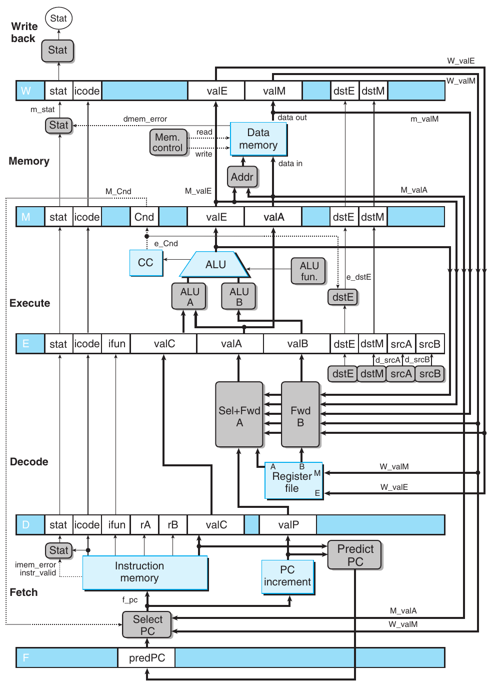

**Hình 4.52 Cấu trúc phần cứng PIPE, cách triển khai pipeline cuối cùng. Các bypass path bổ sung cho phép forward kết quả từ ba instruction trước. Nhờ đó có thể xử lý phần lớn dạng data hazard mà không stall pipeline.**

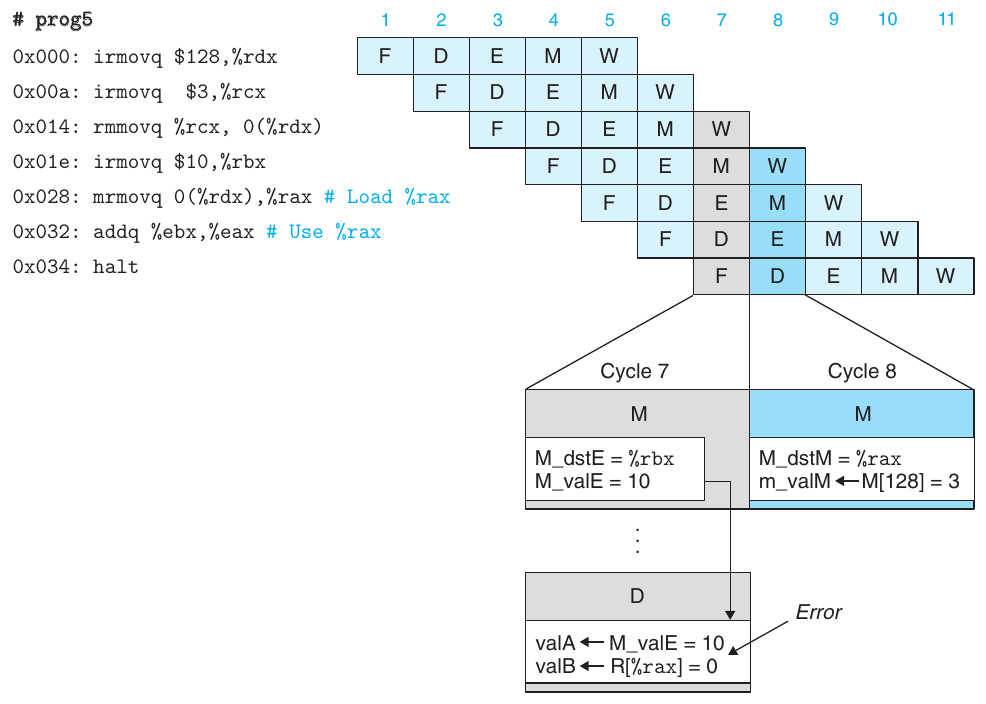

**Hình 4.53 Ví dụ load/use data hazard. Addq cần giá trị %rax trong decode stage ở chu kỳ 7. Mrmovq trước nó đọc giá trị mới cho register này trong memory stage ở chu kỳ 8, quá muộn cho addq.**

Việc dùng stall để xử lý load/use hazard như vậy được gọi là load interlock. Load interlock kết hợp forwarding đủ để xử lý mọi dạng data hazard có thể có. Vì chỉ load interlock làm giảm throughput pipeline, chúng ta gần đạt mục tiêu throughput phát hành một instruction mới mỗi chu kỳ clock.


**Hình 4.54 Xử lý load/use hazard bằng stalling. Khi stall addq một chu kỳ trong decode stage, giá trị valB có thể được forward từ mrmovq trong memory stage sang addq trong decode stage.**

### Tránh control hazard

Control hazard xuất hiện khi processor không thể xác định đáng tin cậy địa chỉ instruction tiếp theo dựa trên instruction hiện tại trong fetch stage. Như thảo luận trong Mục 4.5.4, control hazard chỉ có thể xuất hiện trong processor pipeline này với các instruction ret và jump. Hơn nữa, trường hợp sau chỉ gây khó khăn khi hướng conditional jump bị dự đoán sai. Trong mục này, chúng ta trình bày góc nhìn high-level về cách xử lý các hazard này. Cách triển khai chi tiết nằm trong Mục 4.5.8, trong thảo luận tổng quát hơn về điều khiển pipeline.

Với instruction ret, xét chương trình ví dụ sau. Chương trình được viết bằng assembly code nhưng có địa chỉ instruction khác nhau ở bên trái để tiện tham chiếu:

```
0x000:    irmovq stack,%rsp  #   Initialize stack pointer
0x00a:    call proc          #   Procedure call
0x013:    irmovq $10,%rdx    #   Return point
0x01d:    halt
0x020: .pos 0x20
0x020: proc:                 # proc:
0x020:    ret                #   Return immediately
0x021:    rrmovq %rdx,%rbx   #   Not executed
0x030: .pos 0x30
0x030: stack:                # stack: Stack pointer
```

Hình 4.55 thể hiện cách chúng ta muốn pipeline xử lý ret. Giống pipeline diagram trước đó, hình thể hiện hoạt động pipeline với thời gian tăng sang phải. Khác trước, instruction không được liệt kê cùng thứ tự trong chương trình vì chương trình này có control flow mà instruction không thực thi theo chuỗi tuyến tính. Xem địa chỉ instruction giúp nhận diện các instruction khác nhau trong chương trình.


**Hình 4.55 Góc nhìn đơn giản hóa về xử lý ret. Pipeline nên stall khi ret đi qua decode, execute và memory stage, chèn ba bubble trong quá trình đó. Logic chọn PC sẽ chọn return address làm địa chỉ fetch instruction khi ret đến write-back stage (chu kỳ 7).**

Như sơ đồ thể hiện, ret được fetch trong chu kỳ 3 rồi đi qua pipeline, đến write-back stage ở chu kỳ 7. Khi nó đi qua decode, execute và memory stage, pipeline không thể thực hiện hoạt động hữu ích nào. Thay vào đó, chúng ta muốn chèn ba bubble vào pipeline. Khi ret đến write-back stage, logic chọn PC đặt program counter thành return address, do đó fetch stage sẽ fetch irmovq tại điểm trả về (địa chỉ 0x013).

Để xử lý nhánh dự đoán sai, xét chương trình sau viết bằng assembly code, với địa chỉ instruction bên trái để tiện tham chiếu:

```
0x000:    xorq %rax,%rax
0x002:    jne  target        # Not taken
0x00b:    irmovq $1, %rax    # Fall through
0x015:    halt
0x016: target:
0x016:    irmovq $2, %rdx    # Target
0x020:    irmovq $3, %rbx    # Target+1
0x02a:    halt
```

Hình 4.56 thể hiện cách các instruction được xử lý. Như trước, chúng được liệt kê theo thứ tự vào pipeline thay vì thứ tự trong chương trình. Vì jump được dự đoán là lấy nhánh, instruction tại đích jump được fetch ở chu kỳ 3, còn instruction ngay sau nó được fetch ở chu kỳ 4. Khi logic nhánh phát hiện jump không nên lấy nhánh trong chu kỳ 4, hai instruction không nên tiếp tục thực thi đã được fetch. May mắn là chưa instruction nào thay đổi trạng thái programmer-visible. Điều đó chỉ có thể xảy ra khi instruction đến execute stage, nơi nó có thể thay đổi condition code. Tại đây, pipeline có thể đơn giản hủy (đôi khi gọi là instruction squashing) hai instruction fetch sai bằng cách chèn bubble vào decode và execute stage ở chu kỳ tiếp theo, đồng thời fetch instruction ngay sau jump. Hai instruction fetch sai biến mất khỏi pipeline nên không ảnh hưởng trạng thái programmer-visible. Nhược điểm duy nhất là đã lãng phí năng lực xử lý instruction tương đương hai chu kỳ clock.


**Hình 4.56 Xử lý instruction branch dự đoán sai. Pipeline dự đoán lấy nhánh nên bắt đầu fetch instruction tại đích jump. Hai instruction được fetch trước khi phát hiện dự đoán sai ở chu kỳ 4 khi jump đi qua execute stage. Ở chu kỳ 5, pipeline hủy hai instruction ở đích bằng cách chèn bubble vào decode và execute stage, đồng thời fetch instruction sau jump.**

Thảo luận về control hazard cho thấy có thể xử lý chúng bằng cách xem xét cẩn thận pipeline control logic. Các kỹ thuật như stalling và chèn bubble vào pipeline điều chỉnh động luồng pipeline khi có điều kiện đặc biệt. Như sẽ thảo luận trong Mục 4.5.8, một mở rộng đơn giản của thiết kế register điều khiển bằng clock cơ bản cho phép stall stage và chèn bubble vào pipeline register như một phần pipeline control logic.

### 4.5.6 Xử lý exception

Như sẽ thảo luận trong Chương 8, nhiều hoạt động trong processor có thể dẫn đến exceptional control flow, phá vỡ chuỗi thực thi chương trình bình thường. Exception có thể được tạo nội bộ bởi chương trình đang thực thi hoặc từ bên ngoài bởi tín hiệu nào đó. Kiến trúc tập instruction này có ba exception nội bộ khác nhau, do (1) instruction halt, (2) instruction có tổ hợp instruction code và function code không hợp lệ và (3) cố truy cập địa chỉ không hợp lệ khi fetch instruction hoặc đọc hay ghi dữ liệu. Thiết kế processor đầy đủ hơn cũng xử lý exception bên ngoài, chẳng hạn processor nhận tín hiệu network interface vừa nhận packet mới hoặc người dùng nhấn nút chuột. Xử lý đúng exception là khía cạnh đầy thách thức của mọi thiết kế microprocessor. Chúng có thể xuất hiện lúc không thể dự đoán và đòi hỏi ngắt sạch luồng instruction qua pipeline. Cách xử lý ba exception nội bộ chỉ cho thấy phần nhỏ độ phức tạp thực sự của việc phát hiện và xử lý đúng exception.

Gọi instruction gây exception là excepting instruction. Với địa chỉ instruction không hợp lệ, không có excepting instruction thực tế, nhưng hữu ích khi xem như có một dạng “instruction ảo” tại địa chỉ đó. Trong mô hình ISA đơn giản hóa, chúng ta muốn processor dừng khi gặp exception và đặt status code phù hợp như Hình 4.5 liệt kê. Phải thể hiện như tất cả instruction cho đến excepting instruction đã hoàn tất, nhưng không instruction nào sau đó được ảnh hưởng trạng thái programmer-visible. Trong thiết kế đầy đủ hơn, processor tiếp tục bằng cách gọi exception handler, một procedure thuộc operating system, nhưng triển khai phần xử lý exception này vượt ngoài phạm vi trình bày.

Trong hệ thống pipeline, xử lý exception có nhiều điểm tinh tế. Thứ nhất, có thể nhiều instruction đồng thời kích hoạt exception. Ví dụ, trong một chu kỳ hoạt động pipeline có thể có halt trong fetch stage, trong khi data memory báo địa chỉ dữ liệu out-of-bounds cho instruction trong memory stage. Phải xác định processor nên báo exception nào cho operating system. Quy tắc cơ bản là ưu tiên exception do instruction đã đi xa nhất trong pipeline kích hoạt. Trong ví dụ trên, đó là địa chỉ out-of-bounds mà instruction trong memory stage cố truy cập. Xét chương trình machine-language, instruction trong memory stage phải thể hiện như thực thi trước instruction trong fetch stage, nên chỉ exception này được báo cho operating system.

Điểm tinh tế thứ hai xuất hiện khi instruction ban đầu được fetch và bắt đầu thực thi, gây exception, rồi sau đó bị hủy do nhánh dự đoán sai. Sau đây là ví dụ chương trình như vậy ở dạng object-code:

```
0x000: 6300                 |    xorq %rax,%rax
0x002: 741600000000000000   |    jne  target      # Not taken
0x00b: 30f00100000000000000 |    irmovq $1, %rax  # Fall through
0x015: 00                   |    halt
0x016:                      | target:
0x016: ff                   |    .byte 0xFF       # Invalid instruction code
```

Trong chương trình này, pipeline dự đoán lấy nhánh nên fetch và cố sử dụng byte có giá trị 0xFF làm instruction (được tạo trong assembly code bằng directive .byte). Do đó decode stage phát hiện exception instruction không hợp lệ. Sau đó pipeline phát hiện không nên lấy nhánh, nên instruction tại 0x016 đáng ra chưa bao giờ được fetch. Pipeline control logic hủy instruction này, nhưng chúng ta muốn tránh phát sinh exception.

Điểm tinh tế thứ ba xuất hiện vì processor pipeline cập nhật những phần khác nhau của trạng thái hệ thống ở các stage khác nhau. Một instruction sau instruction gây exception có thể thay đổi một phần trạng thái trước khi excepting instruction hoàn tất. Ví dụ, xét chuỗi code sau, giả sử chương trình người dùng không được truy cập địa chỉ ở đầu trên của khoảng 64-bit:

```
1     irmovq $1,%rax
2     xorq %rsp,%rsp   # Set stack pointer to 0 and CC to 100
3     pushq %rax       # Attempt to write to 0xfffffffffffffff8
4     addq  %rax,%rax  # (Should not be executed) Would set CC to 000
```

Pushq gây address exception vì giảm stack pointer khiến nó quay vòng về 0xfffffffffffffff8. Exception được phát hiện trong memory stage. Trong cùng chu kỳ, addq ở execute stage và sẽ đặt condition code thành giá trị mới. Điều này vi phạm yêu cầu không instruction nào sau excepting instruction được ảnh hưởng trạng thái hệ thống.

Nói chung, có thể vừa chọn đúng giữa các exception khác nhau vừa tránh phát sinh exception cho instruction được fetch do dự đoán sai nhánh bằng cách tích hợp logic exception-handling vào cấu trúc pipeline. Đó là lý do đưa status code stat vào mỗi pipeline register (Hình 4.41 và 4.52). Nếu instruction tạo exception ở một stage xử lý, status field được đặt để chỉ bản chất exception. Trạng thái exception lan truyền qua pipeline cùng các thông tin khác của instruction cho đến write-back stage. Tại đây, pipeline control logic phát hiện exception và dừng thực thi.

Để tránh mọi cập nhật trạng thái programmer-visible bởi instruction sau excepting instruction, pipeline control logic phải vô hiệu hóa cập nhật condition code register hoặc data memory khi instruction trong memory hoặc write-back stage đã gây exception. Trong ví dụ trên, control logic phát hiện pushq trong memory stage gây exception, nên cập nhật condition code register do addq trong execute stage sẽ bị vô hiệu hóa.

Hãy xem cách xử lý exception này giải quyết các điểm tinh tế đã nêu. Khi exception xảy ra ở một hoặc nhiều stage pipeline, thông tin chỉ được lưu vào status field của pipeline register. Sự kiện không ảnh hưởng luồng instruction cho đến khi excepting instruction đến stage cuối, ngoại trừ vô hiệu hóa cập nhật trạng thái programmer-visible (condition code register và bộ nhớ) bởi instruction sau nó. Vì instruction đến write-back stage theo cùng thứ tự thực thi trong processor không pipeline, instruction đầu tiên gặp exception được bảo đảm đến write-back stage đầu tiên; lúc đó có thể dừng chương trình và ghi status code trong pipeline register W làm trạng thái chương trình. Nếu instruction được fetch nhưng sau đó bị hủy, thông tin trạng thái exception của nó cũng bị hủy. Không instruction nào sau instruction gây exception được thay đổi trạng thái programmer-visible. Quy tắc đơn giản mang trạng thái exception cùng mọi thông tin instruction khác qua pipeline cung cấp cơ chế xử lý exception đơn giản và đáng tin cậy.

### 4.5.7 Triển khai các stage PIPE

Chúng ta đã tạo cấu trúc tổng thể cho PIPE, processor Y86-64 pipeline có forwarding. Nó dùng cùng tập đơn vị phần cứng với các thiết kế tuần tự trước, bổ sung pipeline register, một số logic block được cấu hình lại và pipeline control logic. Trong mục này, chúng ta xem thiết kế các logic block khác nhau, để việc thiết kế pipeline control logic sang mục sau. Nhiều block giống hệt phần tương ứng trong SEQ và SEQ+, ngoại trừ phải chọn đúng phiên bản tín hiệu từ pipeline register (tiền tố là tên register viết hoa) hoặc từ các phép tính stage (tiền tố là chữ cái đầu tên stage viết thường).

Ví dụ, so sánh code HCL của logic tạo tín hiệu srcA trong SEQ với code tương ứng trong PIPE:

```
    # Code from SEQ

word srcA = [
        icode in { IRRMOVQ, IRMMOVQ, IOPQ, IPUSHQ  } : rA;
        icode in { IPOPQ, IRET } : RRSP;
        1 : RNONE; # Don’t need register
];

    # Code from PIPE

word d_srcA = [
        D_icode in { IRRMOVQ, IRMMOVQ, IOPQ, IPUSHQ  } : D_rA;
        D_icode in { IPOPQ, IRET } : RRSP;
        1 : RNONE; # Don’t need register
];
```

Chúng chỉ khác ở tiền tố thêm vào tín hiệu PIPE: D_ cho giá trị nguồn, chỉ tín hiệu đến từ pipeline register D, và d_ cho giá trị kết quả, chỉ nó được tạo trong decode stage. Để tránh lặp lại, ở đây không trình bày code HCL của các block chỉ khác SEQ ở tiền tố tên. Để tham khảo, code HCL hoàn chỉnh của PIPE nằm trong Web Aside arch:hcl ở trang 508.

### Chọn PC và fetch stage

Hình 4.57 trình bày chi tiết logic fetch stage của PIPE. Như đã thảo luận, stage này còn phải chọn giá trị hiện tại cho program counter và dự đoán PC tiếp theo. Các đơn vị phần cứng đọc instruction từ bộ nhớ và trích các instruction field giống những đơn vị đã xem trong SEQ (xem fetch stage trong Mục 4.3.4).


**Hình 4.57 Logic chọn PC và fetch của PIPE. Trong giới hạn một chu kỳ, processor chỉ có thể dự đoán địa chỉ instruction tiếp theo.**

Logic chọn PC chọn giữa ba nguồn program counter. Khi nhánh dự đoán sai đi vào memory stage, giá trị valP của instruction này (chỉ địa chỉ instruction sau nó) được đọc từ pipeline register M (tín hiệu M_valA). Khi ret đi vào write-back stage, return address được đọc từ pipeline register W (tín hiệu W_valM). Mọi trường hợp khác dùng giá trị PC dự đoán, lưu trong pipeline register F (tín hiệu F_predPC):

```
word f_pc = [
        # Mispredicted branch.  Fetch at incremented PC
        M_icode == IJXX && !M_Cnd : M_valA;
        # Completion of RET instruction
        W_icode == IRET : W_valM;
        # Default: Use predicted value of PC
        1 : F_predPC;
];
```

Logic dự đoán PC chọn valC cho instruction được fetch nếu đó là call hoặc jump, còn lại chọn valP:

```
word f_predPC = [
        f_icode in { IJXX, ICALL } : f_valC;
        1 : f_valP;
];
```

Các logic block “Instr valid”, “Need regids” và “Need valC” giống SEQ, với tín hiệu nguồn được đặt tên phù hợp.

Khác SEQ, phải chia phép tính trạng thái instruction thành hai phần. Trong fetch stage, có thể kiểm tra lỗi bộ nhớ do địa chỉ instruction out-of-range và phát hiện instruction bất hợp lệ hoặc halt. Việc phát hiện địa chỉ dữ liệu không hợp lệ phải hoãn đến memory stage.

#### Bài tập thực hành 4.30 (lời giải trang 526)

Viết code HCL cho tín hiệu f_stat, cung cấp trạng thái tạm thời cho instruction được fetch.

### Decode stage và Write-Back stage

Hình 4.58 trình bày chi tiết logic decode và write-back của PIPE. Các block dstE, dstM, srcA và srcB rất giống phần tương ứng trong SEQ. Lưu ý register ID cấp cho write port đến từ write-back stage (tín hiệu W_dstE và W_dstM), thay vì decode stage. Đó là vì chúng ta muốn ghi vào destination register do instruction trong write-back stage chỉ định.

#### Bài tập thực hành 4.31 (lời giải trang 526)

Block “dstE” trong decode stage tạo register ID cho port E của register file, dựa trên các field của instruction đã fetch trong pipeline register D. Tín hiệu kết quả có tên d_dstE trong mô tả HCL của PIPE. Viết code HCL cho tín hiệu này dựa trên mô tả HCL của tín hiệu dstE trong SEQ. (Xem decode stage của SEQ trong Mục 4.3.4.) Chưa cần quan tâm logic triển khai conditional move.

Phần lớn độ phức tạp của stage này gắn với forwarding logic. Như đã nêu, block “Sel+Fwd A” có hai vai trò. Nó gộp valP vào valA cho các stage sau để giảm lượng trạng thái trong pipeline register. Nó cũng triển khai forwarding logic cho source operand valA.

Việc gộp valA và valP tận dụng thực tế chỉ instruction call và jump cần valP ở các stage sau, và chúng không cần giá trị đọc từ port A của register file. Lựa chọn được điều khiển bởi tín hiệu icode của stage này. Khi D_icode khớp instruction code của call hoặc jXX, block nên chọn D_valP làm output.


**Hình 4.58 Logic decode stage và write-back stage của PIPE. Không instruction nào cần cả valP lẫn giá trị đọc từ register port A, nên có thể gộp chúng thành valA cho các stage sau. Block “Sel+Fwd A” thực hiện nhiệm vụ này, đồng thời triển khai forwarding logic cho source operand valA. Block “Fwd B” triển khai forwarding logic cho source operand valB. Vị trí ghi register được chỉ định bởi dstE và dstM từ write-back stage thay vì decode stage, vì đang ghi kết quả của instruction hiện ở write-back stage.**

Như đã nêu trong Mục 4.5.5, có năm nguồn forwarding khác nhau, mỗi nguồn có một data word và destination register ID:

| Data word | Register ID | Mô tả nguồn |
|---|---|---|
| e_valE | e_dstE | Output ALU |
| m_valM | M_dstM | Output bộ nhớ |
| M_valE | M_dstE | Thao tác ghi port E đang chờ trong memory stage |
| W_valM | W_dstM | Thao tác ghi port M đang chờ trong write-back stage |
| W_valE | W_dstE | Thao tác ghi port E đang chờ trong write-back stage |

Nếu không điều kiện forwarding nào đúng, block nên chọn d_rvalA, giá trị đọc từ register port A, làm output.

Kết hợp tất cả, ta có mô tả HCL sau cho giá trị valA mới của pipeline register E:

```
word d_valA = [
        D_icode in { ICALL, IJXX } : D_valP; # Use incremented PC
        d_srcA == e_dstE : e_valE;    # Forward valE from execute
        d_srcA == M_dstM : m_valM;    # Forward valM from memory
        d_srcA == M_dstE : M_valE;    # Forward valE from memory
        d_srcA == W_dstM : W_valM;    # Forward valM from write back
        d_srcA == W_dstE : W_valE;    # Forward valE from write back
        1 : d_rvalA;  # Use value read from register file
];
```

Độ ưu tiên giữa năm nguồn forwarding trong code HCL trên rất quan trọng. Code xác định ưu tiên theo thứ tự kiểm tra năm destination register ID. Nếu chọn thứ tự khác, pipeline sẽ hoạt động sai với một số chương trình. Hình 4.59 đưa ra ví dụ cần đặt đúng ưu tiên giữa nguồn forwarding trong execute stage và memory stage. Hai instruction đầu ghi vào %rdx, còn instruction thứ ba dùng register này làm source operand. Khi rrmovq đến decode stage ở chu kỳ 4, forwarding logic phải chọn giữa hai giá trị hướng đến source register. Nên chọn giá trị nào? Để đặt ưu tiên, phải xét hành vi chương trình machine-language khi thực thi từng instruction. Irmovq đầu đặt %rdx thành 10, irmovq thứ hai đặt thành 3, rồi rrmovq đọc 3 từ %rdx. Để mô phỏng hành vi này, cách triển khai pipeline luôn nên ưu tiên nguồn forwarding ở stage sớm nhất, vì nó giữ instruction mới nhất trong chuỗi chương trình đặt register đó. Do đó logic HCL trên kiểm tra nguồn trong execute stage trước, tiếp theo memory stage, cuối cùng write-back stage. Ưu tiên giữa hai nguồn trong memory hoặc write-back stage chỉ đáng quan tâm với popq %rsp, vì chỉ instruction này có thể thử ghi đồng thời hai lần vào cùng register.


**Hình 4.59 Minh họa ưu tiên forwarding. Ở chu kỳ 4, giá trị cho %rdx có sẵn từ cả execute và memory stage. Forwarding logic nên chọn giá trị ở execute stage vì đó là giá trị được tạo gần nhất cho register này.**

#### Bài tập thực hành 4.32 (lời giải trang 526)

Giả sử đảo thứ tự trường hợp thứ ba và thứ tư (hai nguồn forwarding từ memory stage) trong code HCL của d_valA. Mô tả hành vi kết quả của rrmovq (dòng 5) trong chương trình sau:

```
1       irmovq $5, %rdx
2       irmovq $0x100,%rsp
3       rmmovq %rdx,0(%rsp)
4       popq %rsp
5       rrmovq %rsp,%rax
```

#### Bài tập thực hành 4.33 (lời giải trang 527)

Giả sử đảo thứ tự trường hợp thứ năm và thứ sáu (hai nguồn forwarding từ write-back stage) trong code HCL của d_valA. Viết chương trình Y86-64 sẽ bị thực thi sai. Mô tả cách lỗi xảy ra và tác động của nó lên hành vi chương trình.

#### Bài tập thực hành 4.34 (lời giải trang 527)

Viết code HCL cho tín hiệu d_valB, cho giá trị source operand valB cấp tới pipeline register E.

Còn một phần nhỏ của write-back stage. Như Hình 4.52 thể hiện, trạng thái toàn processor Stat được một block tính dựa trên giá trị trạng thái trong pipeline register W. Nhớ từ Mục 4.1.1 rằng code phải chỉ hoạt động bình thường (AOK) hoặc một trong ba điều kiện exception. Vì W giữ trạng thái instruction vừa hoàn tất, tự nhiên có thể dùng giá trị này chỉ trạng thái toàn processor. Trường hợp đặc biệt duy nhất là bubble trong write-back stage. Đây là hoạt động bình thường, nên cũng muốn status code AOK cho trường hợp này:

```
word Stat = [
        W_stat == SBUB : SAOK;
        1 : W_stat;
];
```

### Execute stage

Hình 4.60 trình bày logic execute stage của PIPE. Các đơn vị phần cứng và logic block giống hệt SEQ, với tên tín hiệu được đổi phù hợp. Có thể thấy e_valE và e_dstE hướng tới decode stage làm một nguồn forwarding. Khác biệt là logic “Set CC”, xác định có cập nhật condition code hay không, nhận m_stat và W_stat làm input. Các tín hiệu này phát hiện trường hợp instruction gây exception đang qua các stage sau, nên mọi cập nhật condition code phải bị chặn. Khía cạnh này được thảo luận trong Mục 4.5.8.


**Hình 4.60 Logic execute stage của PIPE. Phần thiết kế này rất giống logic trong cách triển khai SEQ.**


**Hình 4.61 Logic memory stage của PIPE. Nhiều tín hiệu từ pipeline register M và W được chuyển xuống stage trước để cung cấp kết quả write-back, địa chỉ instruction và kết quả forward.**

#### Bài tập thực hành 4.35 (lời giải trang 527)

Trường hợp thứ hai trong code HCL của d_valA dùng e_dstE để quyết định có chọn output ALU e_valE làm nguồn forwarding hay không. Giả sử thay vào đó dùng E_dstE, destination register ID trong pipeline register E, cho lựa chọn này. Viết chương trình Y86-64 cho kết quả sai với forwarding logic đã sửa.

### Memory stage

Hình 4.61 trình bày logic memory stage của PIPE. So với memory stage của SEQ (Hình 4.30), như đã lưu ý, block “Mem. data” trong SEQ không có trong PIPE. Block này chọn giữa nguồn dữ liệu valP (cho call) và valA, nhưng lựa chọn nay do block “Sel+Fwd A” trong decode stage thực hiện. Hầu hết block khác giống phần tương ứng trong SEQ, với tên tín hiệu đổi phù hợp. Trong hình cũng thấy nhiều giá trị trong pipeline register M và W được cung cấp cho phần circuit khác làm thành phần forwarding và pipeline control logic.

#### Bài tập thực hành 4.36 (lời giải trang 528)

Trong stage này, có thể hoàn tất tính status code Stat bằng cách phát hiện địa chỉ data memory không hợp lệ. Viết code HCL cho tín hiệu m_stat.

### 4.5.8 Pipeline control logic

Giờ chúng ta sẵn sàng hoàn tất thiết kế PIPE bằng cách tạo pipeline control logic. Logic này phải xử lý bốn trường hợp điều khiển mà các cơ chế khác như data forwarding và branch prediction không đủ:

Load/use hazard. Pipeline phải stall một chu kỳ giữa instruction đọc giá trị từ bộ nhớ và instruction dùng giá trị đó.

Xử lý ret. Pipeline phải stall cho đến khi ret đến write-back stage.

Nhánh dự đoán sai. Khi logic nhánh phát hiện jump đáng ra không nên lấy nhánh, nhiều instruction tại đích nhánh đã bắt đầu đi qua pipeline. Phải hủy chúng và bắt đầu fetch tại instruction sau jump.

Exception. Khi instruction gây exception, chúng ta muốn vô hiệu hóa cập nhật trạng thái programmer-visible bởi instruction sau và dừng thực thi khi excepting instruction đến write-back stage.

Chúng ta sẽ xem hành động mong muốn cho từng trường hợp rồi phát triển control logic xử lý tất cả.

### Cách xử lý mong muốn cho trường hợp điều khiển đặc biệt

Với load/use hazard, hoạt động pipeline mong muốn đã được mô tả trong Mục 4.5.5, minh họa ở Hình 4.54. Chỉ mrmovq và popq đọc dữ liệu từ bộ nhớ. Khi (1) một trong hai ở execute stage và (2) instruction cần destination register ở decode stage, chúng ta muốn giữ instruction thứ hai trong decode stage và chèn bubble vào execute stage ở chu kỳ sau. Sau đó forwarding logic giải quyết data hazard. Pipeline giữ instruction trong decode stage bằng cách giữ pipeline register D ở trạng thái cố định. Đồng thời cũng phải giữ F cố định để instruction tiếp theo được fetch lần thứ hai. Tóm lại, triển khai luồng này yêu cầu phát hiện hazard, giữ cố định F và D, đồng thời chèn bubble vào execute stage.

Với xử lý ret, hoạt động pipeline mong muốn đã được mô tả trong Mục 4.5.5. Pipeline nên stall ba chu kỳ cho đến khi return address được đọc khi ret đi qua memory stage. Pipeline diagram đơn giản trong Hình 4.55 minh họa điều này khi xử lý chương trình sau:

```
0x000:    irmovq stack,%rsp  #   Initialize stack pointer
0x00a:    call proc          #   Procedure call
0x013:    irmovq $10,%rdx    #   Return point
0x01d:    halt
0x020: .pos 0x20
0x020: proc:                 # proc:
0x020:    ret                #   Return immediately
0x021:    rrmovq %rdx,%rbx   #   Not executed
0x030: .pos 0x30
0x030: stack:                # stack: Stack pointer
```

Hình 4.62 trình bày chi tiết xử lý ret cho chương trình ví dụ. Điểm quan trọng là không có cách chèn bubble vào fetch stage của pipeline. Mỗi chu kỳ, fetch stage đọc một instruction từ instruction memory. Xem code HCL triển khai logic dự đoán PC trong Mục 4.5.7, với ret, PC mới được dự đoán là valP, địa chỉ instruction sau nó. Trong ví dụ, đó là 0x021, địa chỉ rrmovq sau ret. Dự đoán này không đúng cho ví dụ, cũng không đúng với hầu hết trường hợp, nhưng thiết kế không cố dự đoán return address đúng. Trong ba chu kỳ clock, fetch stage stall, khiến rrmovq được fetch nhưng rồi thay bằng bubble ở decode stage. Hình 4.62 minh họa bằng ba lần fetch, có mũi tên dẫn xuống các bubble đi qua các stage còn lại. Cuối cùng irmovq được fetch ở chu kỳ 7. So sánh Hình 4.62 với Hình 4.55, cách triển khai đạt tác dụng mong muốn nhưng có việc fetch instruction sai hơi kỳ lạ trong ba chu kỳ liên tiếp.


**Hình 4.62 Xử lý chi tiết ret. Fetch stage liên tục fetch rrmovq sau ret, nhưng pipeline control logic chèn bubble vào decode stage thay vì để rrmovq tiếp tục. Hành vi tương đương Hình 4.55.**

Khi có nhánh dự đoán sai, hoạt động mong muốn đã được mô tả trong Mục 4.5.5 và minh họa trong Hình 4.56. Dự đoán sai được phát hiện khi jump đến execute stage. Control logic chèn bubble vào decode và execute stage ở chu kỳ sau, hủy hai instruction fetch sai. Trong cùng chu kỳ, pipeline đọc instruction đúng vào fetch stage.

Với instruction gây exception, phải khiến cách triển khai pipeline khớp hành vi ISA mong muốn: mọi instruction trước hoàn tất và không instruction sau nào ảnh hưởng trạng thái chương trình. Điều này phức tạp bởi (1) exception được phát hiện ở hai stage khác nhau (fetch và memory) và (2) trạng thái chương trình được cập nhật ở ba stage (execute, memory và write-back).

Thiết kế stage có status code stat trong mỗi pipeline register để theo dõi trạng thái từng instruction khi đi qua pipeline. Khi exception xảy ra, thông tin được ghi làm một phần trạng thái instruction và tiếp tục fetch, decode, thực thi như không có vấn đề. Khi excepting instruction đến memory stage, chúng ta ngăn instruction sau sửa trạng thái programmer-visible bằng (1) vô hiệu hóa đặt condition code bởi instruction trong execute stage, (2) chèn bubble vào memory stage để vô hiệu hóa mọi ghi data memory và (3) stall write-back stage khi chứa excepting instruction, qua đó dừng pipeline.

Pipeline diagram trong Hình 4.63 minh họa control xử lý tình huống instruction gây exception được theo sau bởi instruction sẽ thay đổi condition code. Ở chu kỳ 6, pushq đến memory stage và gây lỗi bộ nhớ. Cùng chu kỳ, addq trong execute stage tạo giá trị condition code mới. Chúng ta vô hiệu hóa đặt condition code khi excepting instruction ở memory hoặc write-back stage (bằng cách xét m_stat và W_stat rồi đặt set_cc bằng 0). Cũng có thể thấy việc kết hợp chèn bubble vào memory stage và stall excepting instruction trong write-back stage trong ví dụ Hình 4.63: pushq vẫn bị stall tại write-back stage, và không instruction tiếp theo nào vượt qua execute stage.

Bằng kết hợp pipelining tín hiệu trạng thái, điều khiển đặt condition code và điều khiển các stage, chúng ta đạt hành vi exception mong muốn: mọi instruction trước excepting instruction hoàn tất, còn không instruction nào sau đó ảnh hưởng trạng thái programmer-visible.

### Phát hiện điều kiện điều khiển đặc biệt

Hình 4.64 tóm tắt các điều kiện cần điều khiển pipeline đặc biệt. Nó đưa ra biểu thức mô tả điều kiện xuất hiện ba trường hợp đặc biệt. Các biểu thức được triển khai bằng block combinational logic đơn giản phải cho kết quả trước cuối chu kỳ clock để điều khiển pipeline register khi clock lên bắt đầu chu kỳ sau. Trong một chu kỳ, D, E và M lần lượt giữ trạng thái instruction trong decode, execute và memory stage. Gần cuối chu kỳ, d_srcA và d_srcB được đặt thành register ID của source operand cho instruction trong decode stage. Phát hiện ret qua pipeline chỉ cần kiểm tra instruction code trong decode, execute và memory stage. Phát hiện load/use hazard cần kiểm tra loại instruction (mrmovq hoặc popq) ở execute stage và so sánh destination register của nó với source register của instruction trong decode stage. Control logic phải phát hiện nhánh dự đoán sai khi jump ở execute stage, để thiết lập điều kiện khôi phục khi instruction đi vào memory stage. Khi jump ở execute stage, e_Cnd chỉ nhánh có nên được lấy hay không. Phát hiện excepting instruction bằng cách xét trạng thái instruction trong memory và write-back stage. Với memory stage, dùng m_stat tính trong stage thay vì M_stat từ pipeline register. Tín hiệu nội bộ này bao gồm khả năng lỗi địa chỉ data memory.


**Hình 4.63 Xử lý exception tham chiếu bộ nhớ không hợp lệ. Ở chu kỳ 6, tham chiếu bộ nhớ không hợp lệ của pushq khiến cập nhật condition code bị vô hiệu hóa. Pipeline bắt đầu chèn bubble vào memory stage và stall excepting instruction trong write-back stage.**


**Hình 4.64 Điều kiện phát hiện cho pipeline control logic. Bốn điều kiện khác nhau đòi hỏi thay đổi luồng pipeline bằng stall hoặc hủy instruction đã thực thi một phần.**

### Các cơ chế điều khiển pipeline

Hình 4.65 trình bày cơ chế low-level cho phép control logic giữ instruction trong pipeline register hoặc chèn bubble. Chúng mở rộng nhỏ register điều khiển bằng clock cơ bản trong Mục 4.2.5. Giả sử mỗi pipeline register có hai control input stall và bubble. Thiết lập của chúng quyết định cách cập nhật register khi clock lên. Bình thường (Hình 4.65(a)), cả hai bằng 0, khiến register nạp input làm trạng thái mới. Khi stall bằng 1 (Hình 4.65(b)), cập nhật trạng thái bị vô hiệu hóa, register giữ trạng thái cũ. Nhờ đó có thể giữ instruction ở một stage. Khi bubble bằng 1 (Hình 4.65(c)), trạng thái được đặt thành cấu hình reset cố định, tương đương nop. Mẫu bit 1 và 0 cụ thể cho cấu hình reset phụ thuộc tập field trong pipeline register. Ví dụ, để chèn bubble vào D, cần đặt icode thành hằng INOP (Hình 4.26). Để chèn bubble vào E, cần đặt icode thành INOP và dstE, dstM, srcA, srcB thành RNONE. Xác định cấu hình reset là nhiệm vụ người thiết kế phần cứng khi thiết kế pipeline register. Chúng ta không xét chi tiết ở đây. Đặt cả bubble và stall bằng 1 được xem là lỗi.


**Hình 4.65 Các thao tác pipeline register bổ sung. (a) Bình thường, trạng thái và output được đặt bằng giá trị input khi clock lên. (b) Ở chế độ stall, trạng thái giữ nguyên giá trị trước. (c) Ở chế độ bubble, trạng thái bị ghi đè bằng trạng thái nop.**

Pipeline register

| Điều kiện | F | D | E | M | W |
|---|---|---|---|---|---|
| Xử lý ret | stall | bubble | normal | normal | normal |
| Load/use hazard | stall | stall | bubble | normal | normal |
| Nhánh dự đoán sai | normal | bubble | bubble | normal | normal |

**Hình 4.66 Hành động cho pipeline control logic. Các điều kiện khác nhau yêu cầu thay đổi luồng pipeline bằng stall hoặc hủy instruction đã thực thi một phần.**

Bảng trong Hình 4.66 thể hiện hành động từng stage nên thực hiện cho ba điều kiện đặc biệt. Mỗi trường hợp kết hợp thao tác normal, stall và bubble cho pipeline register. Về timing, tín hiệu stall và bubble được các block combinational logic tạo. Chúng phải hợp lệ khi clock lên, khiến mỗi register nạp, stall hoặc bubble khi chu kỳ mới bắt đầu. Với mở rộng nhỏ này, có thể triển khai pipeline hoàn chỉnh gồm toàn bộ điều khiển, dùng các block cơ bản là combinational logic, register điều khiển bằng clock và random access memory.

### Kết hợp các điều kiện điều khiển

Trong thảo luận các điều kiện điều khiển đặc biệt cho đến đây, giả sử tối đa một trường hợp đặc biệt xảy ra trong mỗi chu kỳ. Bug thiết kế phổ biến là không xử lý tình huống nhiều điều kiện đồng thời xuất hiện. Hãy phân tích những khả năng này. Không cần lo tổ hợp liên quan exception vì đã thiết kế cẩn thận cơ chế exception-handling có xét instruction khác trong pipeline. Hình 4.67 vẽ trạng thái pipeline gây ba điều kiện còn lại. Các sơ đồ thể hiện block cho decode, execute và memory stage. Ô tô màu biểu diễn ràng buộc cụ thể phải thỏa mãn để điều kiện xuất hiện. Load/use hazard yêu cầu instruction trong execute stage đọc giá trị bộ nhớ vào register, và instruction trong decode stage dùng register đó làm source operand. Nhánh dự đoán sai yêu cầu instruction trong execute stage là jump. Có ba trường hợp ret: instruction có thể ở decode, execute hoặc memory stage. Khi ret đi qua pipeline, các stage trước có bubble.


**Hình 4.67 Trạng thái pipeline cho các điều kiện điều khiển đặc biệt. Hai cặp được chỉ ra có thể đồng thời xuất hiện.**

Qua sơ đồ có thể thấy phần lớn điều kiện loại trừ lẫn nhau. Ví dụ không thể đồng thời có load/use hazard và nhánh dự đoán sai, vì một trường hợp cần load (mrmovq hoặc popq) trong execute stage, còn trường hợp kia cần jump. Tương tự, tổ hợp ret thứ hai và thứ ba không thể đồng thời xuất hiện với load/use hazard hoặc nhánh dự đoán sai. Chỉ hai tổ hợp có mũi tên chỉ ra có thể xuất hiện đồng thời.

Tổ hợp A gồm jump not-taken trong execute stage và ret trong decode stage. Để thiết lập tổ hợp, ret phải ở đích của nhánh not-taken. Control logic phải phát hiện nhánh dự đoán sai và hủy ret.

#### Bài tập thực hành 4.37 (lời giải trang 528)

Viết chương trình assembly-language Y86-64 gây tổ hợp A và xác định control logic có xử lý đúng hay không.

Kết hợp hành động điều khiển cho các điều kiện tổ hợp A (Hình 4.66), ta có những hành động sau (giả sử bubble hoặc stall đều ghi đè trường hợp normal):

Pipeline register

| Điều kiện | F | D | E | M | W |
|---|---|---|---|---|---|
| Xử lý ret | stall | bubble | normal | normal | normal |
| Nhánh dự đoán sai | normal | bubble | bubble | normal | normal |
| Tổ hợp | stall | bubble | bubble | normal | normal |

Nghĩa là xử lý như nhánh dự đoán sai nhưng có stall trong fetch stage. May mắn là ở chu kỳ sau, logic chọn PC sẽ chọn địa chỉ instruction sau jump thay vì program counter dự đoán, nên việc gì xảy ra với F cũng không quan trọng. Kết luận pipeline xử lý đúng tổ hợp này.

Tổ hợp B gồm load/use hazard, trong đó instruction load đặt %rsp và ret sau đó dùng register này làm source operand vì phải lấy return address từ stack. Control logic nên giữ ret trong decode stage.

#### Bài tập thực hành 4.38 (lời giải trang 528)

Viết chương trình assembly-language Y86-64 gây tổ hợp B và hoàn tất bằng halt nếu pipeline hoạt động đúng.

Kết hợp hành động điều khiển cho các điều kiện tổ hợp B (Hình 4.66), ta có những hành động sau:

Pipeline register

| Điều kiện | F | D | E | M | W |
|---|---|---|---|---|---|
| Xử lý ret | stall | bubble | normal | normal | normal |
| Load/use hazard | stall | stall | bubble | normal | normal |
| Tổ hợp | stall | bubble+stall | bubble | normal | normal |
| Mong muốn | stall | stall | bubble | normal | normal |

Nếu cả hai tập hành động được kích hoạt, control logic vừa cố stall ret để tránh load/use hazard, vừa chèn bubble vào decode stage vì ret. Rõ ràng không muốn pipeline làm cả hai. Thay vào đó, chỉ muốn hành động cho load/use hazard. Hành động xử lý ret nên hoãn một chu kỳ.

Phân tích cho thấy tổ hợp B cần xử lý đặc biệt. Thực tế, triển khai control logic PIPE ban đầu không xử lý đúng tổ hợp này. Dù đã vượt qua nhiều kiểm thử mô phỏng, thiết kế có bug tinh vi chỉ được phát hiện bằng phân tích vừa trình bày. Khi thực thi chương trình có tổ hợp B, control logic đặt cả bubble và stall của D bằng 1. Ví dụ cho thấy tầm quan trọng của phân tích có hệ thống. Khó phát hiện bug này chỉ bằng chạy chương trình bình thường. Nếu không phát hiện, pipeline sẽ không triển khai trung thực hành vi ISA.

### Triển khai control logic

Hình 4.68 trình bày cấu trúc tổng thể pipeline control logic. Dựa trên tín hiệu từ pipeline register và stage, control logic tạo stall và bubble cho pipeline register, đồng thời quyết định có cập nhật condition code register hay không. Có thể kết hợp điều kiện phát hiện Hình 4.64 với hành động Hình 4.66 để tạo mô tả HCL cho các tín hiệu điều khiển khác nhau.


**Hình 4.68 Pipeline control logic của PIPE. Logic này ghi đè luồng instruction bình thường để xử lý điều kiện đặc biệt như trả về procedure, nhánh dự đoán sai, load/use hazard và exception chương trình.**

Pipeline register F phải stall khi có load/use hazard hoặc instruction ret:

```
bool F_stall =
        # Conditions for a load/use hazard
        E_icode in { IMRMOVQ, IPOPQ } &&
         E_dstM in { d_srcA, d_srcB } ||
        # Stalling at fetch while ret passes through pipeline
        IRET in { D_icode, E_icode, M_icode };
```

#### Bài tập thực hành 4.39 (lời giải trang 529)

Viết code HCL cho tín hiệu D_stall trong cách triển khai PIPE.

Pipeline register D phải được đặt thành bubble với nhánh dự đoán sai hoặc ret. Tuy nhiên, như phân tích mục trước cho thấy, không nên chèn bubble khi có load/use hazard kết hợp ret:

```
bool D_bubble =
        # Mispredicted branch
        (E_icode == IJXX && !e_Cnd) ||
        # Stalling at fetch while ret passes through pipeline
        # but not condition for a load/use hazard
        !(E_icode in { IMRMOVQ, IPOPQ } && E_dstM in { d_srcA, d_srcB }) &&
          IRET in { D_icode, E_icode, M_icode };
```

#### Bài tập thực hành 4.40 (lời giải trang 529)

Viết code HCL cho tín hiệu E_bubble trong cách triển khai PIPE.

#### Bài tập thực hành 4.41 (lời giải trang 529)

Viết code HCL cho tín hiệu set_cc trong cách triển khai PIPE. Việc này chỉ nên xảy ra với instruction OPq và phải xét tác động của exception chương trình.

#### Bài tập thực hành 4.42 (lời giải trang 529)

Viết code HCL cho các tín hiệu M_bubble và W_stall trong cách triển khai PIPE. Tín hiệu sau yêu cầu sửa điều kiện exception liệt kê trong Hình 4.64.

Đến đây đã bao quát tất cả giá trị tín hiệu điều khiển pipeline đặc biệt. Trong code HCL hoàn chỉnh của PIPE, mọi tín hiệu điều khiển pipeline khác đều được đặt bằng 0.

### 4.5.9 Phân tích hiệu năng

Có thể thấy các điều kiện cần hành động đặc biệt từ pipeline control logic đều khiến pipeline không đạt mục tiêu phát hành instruction mới mỗi chu kỳ clock. Có thể đo sự kém hiệu quả bằng tần suất chèn bubble, vì chúng tạo chu kỳ pipeline không sử dụng. Return tạo ba bubble, load/use hazard tạo một và nhánh dự đoán sai tạo hai. Có thể định lượng tác động các penalty lên hiệu năng tổng thể bằng cách ước tính số chu kỳ clock trung bình PIPE cần cho mỗi instruction thực thi, đại lượng gọi là CPI (viết tắt “cycles per instruction”). Đại lượng này là nghịch đảo throughput trung bình của pipeline, nhưng thời gian đo bằng chu kỳ clock thay vì picosecond. Nó hữu ích để đo hiệu quả kiến trúc của thiết kế.

Nếu bỏ qua tác động hiệu năng của exception (theo định nghĩa, hiếm khi xảy ra), một cách hiểu CPI là tưởng tượng chạy processor với chương trình benchmark và quan sát execute stage. Mỗi chu kỳ, execute stage hoặc (1) xử lý instruction và instruction đó tiếp tục qua các stage còn lại đến hoàn tất, hoặc (2) xử lý bubble được chèn do một trong ba trường hợp đặc biệt. Nếu stage xử lý tổng cộng C<sub>i</sub> instruction và C<sub>b</sub> bubble, processor cần khoảng C<sub>i</sub> + C<sub>b</sub> chu kỳ clock để thực thi C<sub>i</sub> instruction. Chúng ta nói “khoảng” vì bỏ qua các chu kỳ cần để bắt đầu đưa instruction qua pipeline. Khi đó có thể tính CPI cho benchmark như sau:


Nghĩa là CPI bằng 1.0 cộng số hạng penalty C<sub>b</sub>/C<sub>i</sub>, chỉ số bubble trung bình được chèn trên mỗi instruction thực thi. Vì chỉ ba loại instruction khác nhau có thể gây chèn bubble, có thể chia số hạng penalty thành ba thành phần:

CPI = 1.0 + lp + mp + rp

trong đó lp (viết tắt “load penalty”) là tần suất trung bình bubble được chèn khi stall do load/use hazard, mp (viết tắt “mispredicted branch penalty”) là tần suất trung bình bubble được chèn khi hủy instruction do nhánh dự đoán sai và rp (viết tắt “return penalty”) là tần suất trung bình bubble được chèn khi stall do ret. Mỗi penalty chỉ tổng số bubble chèn vì lý do nêu trên (một phần C<sub>b</sub>) chia cho tổng instruction đã thực thi (C<sub>i</sub> .)

Để ước tính mỗi penalty, cần biết tần suất các instruction liên quan (load, conditional branch và return) xuất hiện, và với mỗi loại, tần suất xuất hiện điều kiện cụ thể. Hãy chọn các tần suất sau để tính CPI (tương đương số đo được báo cáo trong [44] và [46]):

- Instruction load (mrmovq và popq) chiếm 25% tổng instruction thực thi. Trong đó, 20% gây load/use hazard.

- Conditional branch chiếm 20% tổng instruction thực thi. Trong đó, 60% được lấy và 40% không được lấy.

- Instruction return chiếm 2% tổng instruction thực thi.

Vì vậy, có thể ước tính mỗi penalty bằng tích tần suất loại instruction, tần suất điều kiện xuất hiện và số bubble được chèn khi điều kiện xảy ra:

|  |  | Instruction | Điều kiện |  |  |
|---|---|---|---|---|---|
| Nguyên nhân | Tên | tần suất | tần suất | Bubble | Tích |
| Load/use | lp | 0.25 | 0.20 | 1 | 0.05 |
| Dự đoán sai | mp | 0.20 | 0.40 | 2 | 0.16 |
| Return | rp | 0.02 | 1.00 | 3 | 0.06 |
| Tổng penalty |  |  |  |  | 0.27 |

Tổng ba penalty là 0.27, cho CPI bằng 1.27.

Mục tiêu là thiết kế pipeline phát hành một instruction mỗi chu kỳ, cho CPI 1.0. Chúng ta chưa hoàn toàn đạt mục tiêu, nhưng hiệu năng tổng thể vẫn khá tốt. Cũng có thể thấy mọi nỗ lực giảm CPI thêm nên tập trung vào nhánh dự đoán sai. Chúng chiếm 0.16 trong tổng penalty 0.27 vì conditional branch phổ biến, chiến lược dự đoán thường thất bại và mỗi dự đoán sai hủy hai instruction.

#### Thông tin thêm Kiểm thử thiết kế

Như đã thấy, có nhiều cách đưa bug vào thiết kế, ngay cả microprocessor đơn giản. Với pipelining, có nhiều tương tác tinh tế giữa instruction ở các stage khác nhau. Nhiều thách thức thiết kế liên quan instruction khác thường (như pop vào stack pointer) hoặc tổ hợp instruction khác thường (như jump not-taken theo sau bởi ret). Xử lý exception còn thêm một chiều hoàn toàn mới vào các hành vi pipeline có thể có. Vậy làm sao chắc thiết kế đúng? Với nhà sản xuất phần cứng, đây là mối quan tâm hàng đầu, vì họ không thể đơn giản báo lỗi rồi để người dùng tải bản vá code qua Internet. Ngay cả lỗi thiết kế logic đơn giản cũng có thể gây hậu quả nghiêm trọng, nhất là khi microprocessor ngày càng được dùng để vận hành hệ thống thiết yếu với cuộc sống và sức khỏe, như phanh chống bó cứng ô tô, máy tạo nhịp tim và hệ thống điều khiển máy bay.

Chỉ mô phỏng thiết kế bằng một số chương trình “điển hình” không đủ để kiểm thử hệ thống. Kiểm thử kỹ lưỡng đòi hỏi tìm cách sinh có hệ thống nhiều kiểm thử, bao phủ càng nhiều instruction và tổ hợp instruction khác nhau càng tốt. Khi tạo thiết kế processor Y86-64, chúng ta cũng xây dựng các script kiểm thử; mỗi script sinh nhiều kiểm thử khác nhau, chạy mô phỏng processor và so sánh giá trị register, bộ nhớ thu được với kết quả từ instruction set simulator yis. Sau đây là mô tả ngắn các script:

optest. Chạy 49 kiểm thử cho các instruction Y86-64 khác nhau với source register và destination register khác nhau

jtest. Chạy 64 kiểm thử cho các instruction jump và call khác nhau, với các tổ hợp nhánh được lấy hoặc không được lấy

cmtest. Chạy 28 kiểm thử cho các instruction conditional move khác nhau, với các tổ hợp điều khiển khác nhau

htest. Chạy 600 kiểm thử cho các khả năng data hazard khác nhau, với tổ hợp instruction nguồn và đích khác nhau, cùng số instruction nop khác nhau giữa các cặp instruction

ctest. Kiểm thử 22 tổ hợp điều khiển khác nhau, dựa trên phân tích tương tự Mục 4.5.8

etest. Kiểm thử 12 tổ hợp khác nhau trong đó instruction gây exception và các instruction sau nó có thể thay đổi trạng thái programmer-visible

Ý tưởng then chốt của phương pháp kiểm thử này là thực hiện có hệ thống nhất có thể, tạo kiểm thử sinh ra các điều kiện khác nhau có khả năng gây lỗi pipeline.

#### Thông tin thêm Kiểm chứng hình thức thiết kế

Ngay cả khi thiết kế vượt qua tập kiểm thử rộng, không thể chắc nó hoạt động đúng với mọi chương trình có thể. Số chương trình có thể kiểm thử lớn đến mức không thể hình dung, ngay cả chỉ xét các kiểm thử gồm đoạn code ngắn. Tuy nhiên, các phương pháp formal verification mới hơn hứa hẹn công cụ xem xét nghiêm ngặt mọi hành vi hệ thống có thể có và xác định có lỗi thiết kế hay không.

Chúng ta đã áp dụng được formal verification cho phiên bản trước của processor Y86-64 [13]. Chúng ta thiết lập framework so sánh hành vi thiết kế pipeline PIPE với phiên bản không pipeline SEQ. Nghĩa là nó chứng minh được với chương trình machine-language tùy ý, hai processor có tác động giống hệt lên trạng thái programmer-visible. Dĩ nhiên verifier không thực sự chạy mọi chương trình vì có vô hạn chương trình. Thay vào đó, nó dùng một dạng chứng minh quy nạp, thể hiện tính nhất quán giữa hai processor trên cơ sở cycle-by-cycle. Phân tích đòi hỏi suy luận về phần cứng bằng phương pháp symbolic, trong đó mọi giá trị chương trình được xem là số nguyên tùy ý, còn ALU được trừu tượng thành một dạng “hộp đen” tính function không chỉ định trên các argument. Chỉ giả sử ALU của SEQ và PIPE tính function giống hệt nhau.

Chúng ta dùng mô tả HCL của control logic để tạo control logic cho mô hình processor symbolic, nên có thể phát hiện mọi bug trong code HCL. Chứng minh SEQ và PIPE giống nhau không bảo đảm một trong hai triển khai trung thực kiến trúc tập instruction. Tuy nhiên, nó sẽ phát hiện mọi bug do thiết kế pipeline sai, nguồn lỗi thiết kế chính.

Trong thực nghiệm, chúng ta kiểm chứng không chỉ phiên bản PIPE tương tự phiên bản trong chương mà còn nhiều biến thể cho dưới dạng bài tập về nhà, trong đó thêm instruction, sửa khả năng phần cứng hoặc dùng chiến lược branch prediction khác. Điều thú vị là chỉ tìm thấy một bug trong tất cả thiết kế, liên quan tổ hợp điều khiển B (mô tả trong Mục 4.5.8) cho lời giải biến thể ở Bài tập 4.58. Nó phơi bày điểm yếu trong quy trình kiểm thử, khiến chúng ta thêm trường hợp vào script ctest.

Formal verification vẫn ở giai đoạn phát triển ban đầu. Công cụ thường khó dùng và không đủ khả năng kiểm chứng thiết kế large-scale. Chúng ta kiểm chứng được processor một phần nhờ chúng tương đối đơn giản. Ngay cả vậy, vẫn cần nhiều tuần nỗ lực và nhiều lần chạy công cụ, mỗi lần cần tới 8 giờ tính toán. Đây là lĩnh vực nghiên cứu sôi động, với một số công cụ bắt đầu được thương mại hóa và một số đang dùng tại Intel, AMD và IBM.

#### Ghi chú Web ARCH:VLOG Triển khai Verilog của processor Y86-64 pipeline

Như đã đề cập, thiết kế logic hiện đại bao gồm viết biểu diễn văn bản của thiết kế phần cứng bằng hardware description language. Sau đó có thể kiểm thử thiết kế bằng mô phỏng và nhiều công cụ formal verification. Khi tin tưởng thiết kế, có thể dùng logic synthesis để chuyển thiết kế thành logic circuit thực tế.

Chúng ta đã phát triển mô hình các thiết kế processor Y86-64 bằng hardware description language Verilog. Các thiết kế kết hợp module triển khai những block cơ bản của processor với control logic được sinh trực tiếp từ mô tả HCL. Chúng ta đã tổng hợp được một số thiết kế, tải mô tả logic circuit lên phần cứng field-programmable gate array (FPGA) và chạy processor với chương trình thực tế.

#### Bài tập thực hành 4.43 (lời giải trang 530)

Giả sử dùng chiến lược branch prediction đạt tỷ lệ thành công 65%, như backward taken, forward not taken (BTFNT), mô tả trong Mục 4.5.4. CPI sẽ bị tác động thế nào, giả sử mọi tần suất khác không đổi?

#### Bài tập thực hành 4.44 (lời giải trang 530)

Hãy phân tích hiệu năng tương đối của truyền dữ liệu có điều kiện so với truyền quyền điều khiển có điều kiện trong các chương trình bạn viết cho Bài tập 4.5 và 4.6. Giả sử dùng chúng để tính tổng giá trị tuyệt đối của array rất dài, nên hiệu năng tổng thể chủ yếu được quyết định bởi số chu kỳ vòng lặp trong cùng cần. Giả sử jump được dự đoán là lấy nhánh và khoảng 50% giá trị array là dương.

A. Trung bình có bao nhiêu instruction được thực thi trong vòng lặp trong cùng của hai chương trình?

B. Trung bình có bao nhiêu bubble được chèn vào vòng lặp trong cùng của hai chương trình?

C. Số chu kỳ clock trung bình cần cho mỗi phần tử array của hai chương trình là bao nhiêu?

### 4.5.10 Những việc chưa hoàn tất

Chúng ta đã tạo cấu trúc microprocessor pipeline PIPE, thiết kế các control logic block và triển khai pipeline control logic để xử lý trường hợp luồng pipeline bình thường không đủ. Tuy vậy, PIPE còn thiếu nhiều tính năng then chốt cần có trong thiết kế microprocessor thực tế. Chúng ta nhấn mạnh một số tính năng và thảo luận những gì cần để thêm chúng.

### Instruction nhiều chu kỳ

Mọi instruction trong tập Y86-64 đều gồm thao tác đơn giản như cộng số. Chúng có thể xử lý trong một chu kỳ clock tại execute stage. Trong tập instruction đầy đủ hơn, còn cần triển khai instruction yêu cầu thao tác phức tạp như nhân, chia số nguyên và phép toán floating-point. Với processor medium-performance như PIPE, thời gian thực thi điển hình từ 3 hoặc 4 chu kỳ cho cộng floating-point đến 64 chu kỳ cho chia số nguyên. Để triển khai, cần cả phần cứng bổ sung thực hiện tính toán lẫn cơ chế phối hợp xử lý các instruction này với phần pipeline còn lại.

Cách đơn giản để triển khai instruction nhiều chu kỳ là mở rộng khả năng execute stage bằng đơn vị số học nguyên và floating-point. Instruction ở lại execute stage đủ số chu kỳ cần thiết, khiến fetch và decode stage stall. Cách này dễ triển khai nhưng hiệu năng không tốt.

Có thể đạt hiệu năng tốt hơn bằng cách xử lý phép toán phức tạp với các hardware functional unit đặc biệt hoạt động độc lập pipeline chính. Thường có một functional unit cho nhân, chia số nguyên và một đơn vị khác cho phép toán floating-point. Khi instruction vào decode stage, có thể phát hành tới đơn vị đặc biệt. Trong lúc đơn vị thực hiện thao tác, pipeline tiếp tục xử lý instruction khác. Thông thường floating-point unit bản thân cũng có pipeline, nên nhiều thao tác có thể thực thi đồng thời trong pipeline chính và các đơn vị khác.

Hoạt động của các đơn vị phải được đồng bộ để tránh hành vi sai. Ví dụ, nếu có data dependency giữa các thao tác do những đơn vị khác nhau xử lý, control logic có thể cần stall một phần hệ thống cho đến khi thao tác do phần khác xử lý hoàn tất kết quả. Các dạng forwarding khác nhau thường được dùng truyền kết quả từ phần này sang phần khác, giống giữa các stage PIPE. Thiết kế tổng thể phức tạp hơn PIPE, nhưng cùng kỹ thuật stalling, forwarding và điều khiển pipeline có thể khiến hành vi tổng thể khớp mô hình ISA tuần tự.

### Giao tiếp với hệ thống bộ nhớ

Khi trình bày PIPE, giả sử cả instruction fetch unit lẫn data memory đều có thể đọc hoặc ghi mọi vị trí bộ nhớ trong một chu kỳ clock. Chúng ta cũng bỏ qua hazard có thể do code self-modifying, khi một instruction ghi vào vùng bộ nhớ mà instruction sau được fetch từ đó. Hơn nữa, các vị trí bộ nhớ được tham chiếu bằng virtual address, cần chuyển sang physical address trước khi đọc hoặc ghi thực tế. Rõ ràng, thực hiện toàn bộ xử lý trong một chu kỳ là không thực tế. Tệ hơn, giá trị bộ nhớ đang truy cập có thể nằm trên đĩa, cần hàng triệu chu kỳ để đọc vào bộ nhớ processor.

Như sẽ thảo luận trong Chương 6 và 9, hệ thống bộ nhớ processor kết hợp nhiều bộ nhớ phần cứng và phần mềm operating system để quản lý virtual memory. Hệ thống được tổ chức thành phân cấp, với bộ nhớ nhanh hơn nhưng nhỏ hơn giữ một tập con dữ liệu, được hậu thuẫn bởi bộ nhớ chậm hơn và lớn hơn. Ở mức gần processor nhất, cache memory cung cấp truy cập nhanh đến vị trí được tham chiếu nhiều nhất. Processor điển hình có hai cache first-level—một để đọc instruction và một để đọc, ghi dữ liệu. Loại cache memory khác, gọi là translation look-aside buffer hay TLB, cung cấp chuyển đổi nhanh từ virtual sang physical address. Kết hợp TLB và cache thực sự cho phép đọc instruction và đọc hoặc ghi dữ liệu trong một chu kỳ clock phần lớn thời gian. Vì vậy, cách nhìn đơn giản hóa về tham chiếu bộ nhớ của processor thực ra khá hợp lý.

Mặc dù cache giữ vị trí bộ nhớ được tham chiếu nhiều nhất, đôi khi xảy ra cache miss, khi tham chiếu đến vị trí không có trong cache. Trường hợp tốt nhất, dữ liệu thiếu được lấy từ cache higher-level hoặc main memory của processor, cần 3 đến 20 chu kỳ clock. Trong lúc đó, pipeline chỉ stall, giữ instruction ở fetch hoặc memory stage cho đến khi cache thực hiện được đọc hoặc ghi. Với thiết kế pipeline, có thể triển khai bằng cách thêm điều kiện stall vào control logic. Cache miss và đồng bộ pipeline sau đó được xử lý hoàn toàn bằng phần cứng, giữ thời gian cần thiết ở một số ít chu kỳ clock.

Trong một số trường hợp, vị trí bộ nhớ được tham chiếu thực tế nằm trên đĩa hoặc nonvolatile memory. Khi đó, phần cứng báo page fault exception. Giống exception khác, nó khiến processor gọi code exception handler của operating system. Code này thiết lập truyền từ đĩa tới main memory. Khi hoàn tất, operating system quay lại chương trình ban đầu, nơi instruction gây page fault được re-executed. Lần này, tham chiếu bộ nhớ thành công dù có thể gây cache miss. Để phần cứng gọi routine operating system rồi routine trả quyền điều khiển lại phần cứng cho phép phần cứng và phần mềm hệ thống phối hợp xử lý page fault. Vì truy cập đĩa có thể cần hàng triệu chu kỳ, vài nghìn chu kỳ xử lý của OS page fault handler ít ảnh hưởng hiệu năng.

Từ góc nhìn processor, kết hợp stalling để xử lý cache miss short-duration và xử lý exception để xử lý page fault long-duration giải quyết mọi sự không thể dự đoán của thời gian truy cập bộ nhớ do cấu trúc phân cấp bộ nhớ.

## 4.6 Tổng kết

Chúng ta đã thấy instruction set architecture, hay ISA, cung cấp một lớp trừu tượng giữa hành vi của processor—xét theo tập instruction và cách biểu diễn chúng—và cách processor được triển khai. ISA cung cấp một góc nhìn rất tuần tự về thực thi chương trình, trong đó một instruction được thực thi hoàn tất trước khi instruction tiếp theo bắt đầu.

### Thông tin thêm Thiết kế microprocessor State-of-the-art

Một pipeline five-stage, như chúng ta đã trình bày với processor PIPE, đại diện cho trình độ tiên tiến nhất trong thiết kế processor vào mid-1980s. Processor RISC nguyên mẫu do nhóm nghiên cứu của Patterson tại Berkeley phát triển đã tạo nền tảng cho processor SPARC đầu tiên, được Sun Microsystems phát triển năm 1987. Processor do nhóm nghiên cứu của Hennessy tại Stanford phát triển đã được MIPS Technologies (một công ty do Hennessy thành lập) thương mại hóa năm 1986. Cả hai đều sử dụng pipeline five-stage. Processor Intel i486 cũng dùng pipeline five-stage, mặc dù phân chia trách nhiệm giữa các stage khác đi, với hai decode stage và một execute/memory stage kết hợp [27].

Các thiết kế pipeline này bị giới hạn ở throughput nhiều nhất một instruction mỗi clock cycle. Đại lượng CPI (viết tắt của “cycles per instruction”) được mô tả trong Mục 4.5.9 không bao giờ có thể nhỏ hơn 1.0. Mỗi stage khác nhau chỉ có thể xử lý một instruction tại một thời điểm. Các processor gần đây hơn hỗ trợ hoạt động superscalar, nghĩa là chúng có thể đạt CPI nhỏ hơn 1.0 bằng cách fetch, decode và execute nhiều instruction song song. Khi các processor superscalar trở nên phổ biến, đại lượng hiệu năng được chấp nhận đã chuyển từ CPI sang nghịch đảo của nó—số instruction được thực thi trung bình mỗi chu kỳ, hay IPC. Đại lượng này có thể vượt quá 1.0 với processor superscalar. Các thiết kế tiên tiến nhất dùng một kỹ thuật gọi là out-of-order execution để thực thi nhiều instruction song song, có thể theo thứ tự hoàn toàn khác với thứ tự xuất hiện trong chương trình, trong khi vẫn giữ nguyên hành vi tổng thể do mô hình ISA tuần tự quy định. Dạng thực thi này được mô tả trong Chương 5 như một phần của nội dung thảo luận về tối ưu hóa chương trình.

Tuy nhiên, các processor pipeline không chỉ là sản phẩm của quá khứ. Phần lớn processor được bán được sử dụng trong các hệ thống embedded, điều khiển các chức năng ô tô, sản phẩm tiêu dùng và những thiết bị khác mà processor không trực tiếp hiển thị với người dùng hệ thống. Trong những ứng dụng này, tính đơn giản của một processor pipeline, như processor chúng ta đã tìm hiểu trong chương này, giúp giảm chi phí và yêu cầu năng lượng so với các mẫu higher-performance.

Gần đây hơn, khi các processor multicore được ưa chuộng, một số người lập luận rằng chúng ta có thể đạt tổng năng lực tính toán cao hơn bằng cách tích hợp nhiều processor đơn giản trên một chip thay vì số lượng ít hơn các processor phức tạp hơn. Chiến lược này đôi khi được gọi là processor “many-core” [10].

Chúng ta đã định nghĩa tập instruction Y86-64 bằng cách bắt đầu từ các instruction x86-64 và đơn giản hóa đáng kể các kiểu dữ liệu, chế độ định địa chỉ và cách biểu diễn instruction. ISA thu được có các đặc điểm của cả tập instruction RISC và CISC. Sau đó chúng ta tổ chức việc xử lý cần thiết cho các instruction khác nhau thành một chuỗi năm stage, trong đó các thao tác ở mỗi stage thay đổi theo instruction đang được thực thi. Từ đây, chúng ta xây dựng processor SEQ, trong đó một instruction hoàn chỉnh được thực thi mỗi clock cycle bằng cách cho nó đi qua cả năm stage.

Pipelining cải thiện hiệu năng throughput của một hệ thống bằng cách cho phép các stage khác nhau hoạt động đồng thời. Tại một thời điểm bất kỳ, nhiều thao tác đang được các stage khác nhau xử lý. Khi đưa vào tính đồng thời này, chúng ta phải cẩn thận để cung cấp cùng hành vi program-level như khi thực thi chương trình tuần tự. Chúng ta đã đưa vào pipelining bằng cách sắp xếp lại các phần của SEQ để có SEQ+, rồi thêm các pipeline register để tạo pipeline PIPE−. Chúng ta cải thiện hiệu năng pipeline bằng cách thêm forwarding logic để tăng tốc việc gửi kết quả từ instruction này sang instruction khác. Một số trường hợp đặc biệt yêu cầu thêm pipeline control logic để stall hoặc hủy một số pipeline stage.

### Thông tin thêm trên Web ARCH:HCL Các mô tả HCL của processor Y86-64

Trong chương này, chúng ta đã xem xét các phần code HCL cho một số thiết kế logic đơn giản và cho control logic của các processor Y86-64 SEQ và PIPE. Để tham khảo, chúng tôi cung cấp tài liệu về ngôn ngữ HCL và các mô tả HCL đầy đủ cho control logic của hai processor. Mỗi mô tả này chỉ cần từ năm đến bảy trang code HCL, và việc nghiên cứu toàn bộ chúng rất đáng làm.

Thiết kế của chúng ta bao gồm các cơ chế sơ khai để xử lý exception, trong đó chúng ta đảm bảo chỉ những instruction tính đến instruction gây exception mới ảnh hưởng đến trạng thái programmer-visible. Triển khai khả năng xử lý exception đầy đủ sẽ khó khăn hơn đáng kể. Xử lý exception đúng còn trở nên phức tạp hơn trong các hệ thống sử dụng mức pipelining và tính song song cao hơn.

Trong chương này, chúng ta đã học một số bài học quan trọng về thiết kế processor:

- Quản lý độ phức tạp là ưu tiên hàng đầu. Chúng ta muốn tận dụng tối ưu các tài nguyên phần cứng để đạt hiệu năng tối đa với chi phí tối thiểu. Chúng ta đã làm điều này bằng cách tạo ra một khuôn khổ rất đơn giản và đồng nhất để xử lý mọi loại instruction khác nhau. Với khuôn khổ này, chúng ta có thể chia sẻ các đơn vị phần cứng giữa những phần logic xử lý các loại instruction khác nhau.

- Chúng ta không cần triển khai ISA một cách trực tiếp. Triển khai trực tiếp ISA sẽ dẫn đến một thiết kế rất tuần tự. Để đạt hiệu năng cao hơn, chúng ta muốn khai thác khả năng thực hiện nhiều thao tác đồng thời của phần cứng. Điều này dẫn đến việc sử dụng thiết kế pipeline. Bằng cách thiết kế và phân tích cẩn thận, chúng ta có thể xử lý các pipeline hazard khác nhau để tác động tổng thể của việc chạy chương trình khớp chính xác với kết quả thu được từ mô hình ISA.

- Các nhà thiết kế phần cứng phải tỉ mỉ. Một khi chip đã được chế tạo, gần như không thể sửa bất kỳ lỗi nào. Có được thiết kế đúng ngay lần đầu là điều rất quan trọng. Điều này có nghĩa phải phân tích cẩn thận các loại instruction và tổ hợp khác nhau, kể cả những tổ hợp có vẻ không hợp lý, như pop vào stack pointer. Các thiết kế phải được kiểm thử kỹ bằng các chương trình kiểm thử mô phỏng có hệ thống. Trong quá trình phát triển control logic cho PIPE, thiết kế của chúng ta có một lỗi tinh tế chỉ được phát hiện sau khi phân tích các tổ hợp điều khiển một cách cẩn thận và có hệ thống.

### 4.6.1 Các simulator Y86-64

Tài liệu thực hành cho chương này bao gồm các simulator cho processor SEQ và PIPE. Mỗi simulator có hai phiên bản:

- Phiên bản GUI (graphic user interface) hiển thị bộ nhớ, code chương trình và trạng thái processor trong các cửa sổ đồ họa. Điều này cung cấp một cách dễ dàng quan sát các instruction đi qua processor như thế nào. Bảng điều khiển cũng cho phép bạn reset, single-step hoặc chạy simulator một cách tương tác.

- Phiên bản văn bản chạy cùng simulator, nhưng chỉ hiển thị thông tin bằng cách in ra terminal. Phiên bản này không hữu ích bằng cho việc debug, nhưng cho phép kiểm thử tự động processor.

Control logic cho các simulator được tạo bằng cách chuyển các khai báo HCL của logic block thành code C. Code này sau đó được biên dịch và liên kết với phần còn lại của code mô phỏng. Sự kết hợp này cho phép bạn thử các biến thể của thiết kế ban đầu bằng các simulator. Các script kiểm thử cũng có sẵn để kiểm tra kỹ những instruction khác nhau và các khả năng hazard khác nhau.

## Ghi chú tài liệu tham khảo

Với những ai muốn tìm hiểu thêm về thiết kế logic, giáo trình thiết kế logic của Katz và Borriello [58] là một tài liệu nhập môn chuẩn, nhấn mạnh việc sử dụng ngôn ngữ mô tả phần cứng. Giáo trình kiến trúc máy tính của Hennessy và Patterson [46] trình bày rộng về thiết kế processor, bao gồm cả pipeline đơn giản như pipeline chúng ta trình bày ở đây và các processor tiên tiến thực thi nhiều instruction song song hơn. Shriver và Smith [101] trình bày rất kỹ về một processor x86-64 Intel-compatible do AMD sản xuất.

## Bài tập về nhà

4.45 ◆ Trong Mục 3.4.2, instruction pushq của x86-64 được mô tả là giảm stack pointer rồi lưu register tại vị trí stack pointer. Vì vậy, nếu có một instruction dạng pushq REG, với một register REG nào đó, nó sẽ tương đương với chuỗi code

```
subq $8,%rsp           Decrement stack pointer
movq REG, (%rsp)       Store REG on stack
```

A. Dựa trên phân tích đã thực hiện trong Bài tập thực hành 4.7, chuỗi code này có mô tả đúng hành vi của instruction pushq %rsp không? Giải thích.

B. Bạn có thể viết lại chuỗi code như thế nào để nó mô tả đúng cả trường hợp REG là %rsp lẫn bất kỳ register nào khác?

4.46 ◆ Trong Mục 3.4.2, instruction popq của x86-64 được mô tả là sao chép kết quả từ đỉnh stack vào register đích rồi tăng stack pointer. Vì vậy, nếu có một instruction dạng popq REG, nó sẽ tương đương với chuỗi code

```
movq (%rsp), REG       Read REG from stack
addq $8,%rsp           Increment stack pointer
```

A. Dựa trên phân tích đã thực hiện trong Bài tập thực hành 4.8, chuỗi code này có mô tả đúng hành vi của instruction popq %rsp không? Giải thích.

B. Bạn có thể viết lại chuỗi code như thế nào để nó mô tả đúng cả trường hợp REG là %rsp lẫn bất kỳ register nào khác?

4.47 ◆◆◆ Nhiệm vụ của bạn là viết một chương trình Y86-64 để thực hiện bubblesort. Để tham khảo, hàm C sau triển khai bubblesort bằng cách tham chiếu array:

```
 1   /* Bubble sort: Array version */
 2   void bubble_a(long *data, long count) {
 3       long i, last;
 4       for (last = count-1; last > 0; last--) {
 5           for (i = 0; i < last; i++)
 6               if (data[i+1] < data[i]) {
 7                   /* Swap adjacent elements */
 8                   long t = data[i+1];
 9                   data[i+1] = data[i];
10                   data[i] = t;
11               }
12       }
13   }
```

A. Viết và kiểm thử một phiên bản C tham chiếu các phần tử array bằng pointer thay vì dùng chỉ số array.

B. Viết và kiểm thử một chương trình Y86-64 gồm hàm và code kiểm thử. Bạn có thể thấy hữu ích khi xây dựng cách triển khai theo code x86-64 được tạo khi biên dịch code C của mình. Mặc dù phép so sánh pointer thường được thực hiện bằng số học unsigned, bạn có thể dùng số học signed cho bài tập này.

4.48 ◆◆ Sửa code đã viết cho Bài toán 4.47 để triển khai phép kiểm tra và hoán đổi trong hàm bubblesort (dòng 6–11) mà không dùng jump và dùng nhiều nhất ba conditional move.

4.49 ◆◆◆ Sửa code đã viết cho Bài toán 4.47 để triển khai phép kiểm tra và hoán đổi trong hàm bubblesort (dòng 6–11) mà không dùng jump và chỉ dùng một conditional move.

4.50 ◆◆◆ Trong Mục 3.6.8, chúng ta đã thấy một cách phổ biến để triển khai câu lệnh switch là tạo một tập các code block rồi đánh chỉ số những block đó bằng jump table. Xét code C trong Hình 4.69 cho hàm switchv, cùng với code kiểm thử liên quan.

```
#include <stdio.h>
/* Example use of switch statement */

long switchv(long idx) {
    long result = 0;
    switch(idx) {
    case 0:
        result = 0xaaa;
        break;
    case 2:
    case 5:
        result = 0xbbb;
        break;
    case 3:
        result = 0xccc;
        break;
    default:
        result = 0xddd;

    }
    return result;
 }

/* Testing Code */
#define CNT 8
#define MINVAL -1

int main() {
    long vals[CNT];
    long i;
    for (i = 0; i < CNT; i++) {
        vals[i] = switchv(i + MINVAL);
        printf("idx = %ld, val = 0x%lx\n", i + MINVAL, vals[i]);
    }
    return 0;
}
```

**Hình 4.69 Có thể chuyển các câu lệnh switch thành code Y86-64. Điều này yêu cầu triển khai một jump table.**

Triển khai switchv trong Y86-64 bằng jump table. Mặc dù tập instruction Y86-64 không bao gồm indirect jump instruction, bạn có thể có cùng tác động bằng cách push một địa chỉ đã tính lên stack rồi thực thi instruction ret. Triển khai code kiểm thử tương tự phần được trình bày bằng C để chứng minh cách triển khai switchv của bạn xử lý được cả những trường hợp được xử lý tường minh lẫn các trường hợp kích hoạt default case.

4.51 ◆ Bài tập thực hành 4.3 đã giới thiệu instruction iaddq để cộng dữ liệu immediate vào register. Mô tả các phép tính được thực hiện để triển khai instruction này. Dùng các phép tính cho irmovq và OPq (Hình 4.18) làm hướng dẫn.

4.52 ◆◆ File seq-full.hcl chứa mô tả HCL của SEQ, cùng với khai báo hằng IIADDQ có giá trị hexadecimal C, là instruction code của iaddq. Sửa các mô tả HCL của các control logic block để triển khai instruction iaddq, như mô tả trong Bài tập thực hành 4.3 và Bài toán 4.51. Xem tài liệu thực hành để biết hướng dẫn tạo simulator cho lời giải của bạn và cách kiểm thử nó.

4.53 ◆◆◆ Giả sử chúng ta muốn tạo một processor pipeline lower-cost dựa trên cấu trúc đã thiết kế cho PIPE− (Hình 4.41), không có bypassing. Thiết kế này sẽ xử lý mọi phụ thuộc dữ liệu bằng cách stall đến khi instruction tạo ra giá trị cần thiết đã đi qua write-back stage.

File pipe-stall.hcl chứa một phiên bản sửa đổi của code HCL cho PIPE, trong đó bypassing logic đã bị vô hiệu hóa. Nghĩa là các tín hiệu e_valA và e_valB chỉ đơn giản được khai báo như sau:

```
##  DO NOT MODIFY THE FOLLOWING CODE.
## No forwarding.  valA is either valP or value from register file
word d_valA = [
        D_icode in { ICALL, IJXX } : D_valP; # Use incremented PC
        1 : d_rvalA;  # Use value read from register file
];

## No forwarding.  valB is value from register file
word d_valB = d_rvalB;
```

Sửa pipeline control logic ở cuối file này để nó xử lý đúng mọi control hazard và data hazard có thể có. Trong quá trình thiết kế, bạn nên phân tích các tổ hợp trường hợp điều khiển khác nhau, như chúng ta đã làm khi thiết kế pipeline control logic cho PIPE. Bạn sẽ thấy nhiều tổ hợp khác nhau có thể xảy ra, vì nhiều điều kiện hơn yêu cầu pipeline stall. Đảm bảo control logic xử lý đúng từng tổ hợp. Xem tài liệu thực hành để biết hướng dẫn tạo simulator cho lời giải của bạn và cách kiểm thử nó.

4.54 ◆◆ File pipe-full.hcl chứa một bản sao mô tả HCL của PIPE, cùng với khai báo giá trị hằng IIADDQ. Sửa file này để triển khai instruction iaddq, như mô tả trong Bài tập thực hành 4.3 và Bài toán 4.51. Xem tài liệu thực hành để biết hướng dẫn tạo simulator cho lời giải của bạn và cách kiểm thử nó.

4.55 ◆◆◆ File pipe-nt.hcl chứa một bản sao code HCL cho PIPE, cùng khai báo hằng J_YES có giá trị 0, là function code của unconditional jump instruction. Sửa branch prediction logic để dự đoán các conditional jump là không được thực hiện, trong khi tiếp tục dự đoán unconditional jump và call là được thực hiện. Bạn sẽ cần nghĩ ra cách đưa valC, là địa chỉ đích nhảy, đến pipeline register M để khôi phục sau các nhánh bị dự đoán sai. Xem tài liệu thực hành để biết hướng dẫn tạo simulator cho lời giải của bạn và cách kiểm thử nó.

4.56 ◆◆◆ File pipe-btfnt.hcl chứa một bản sao code HCL cho PIPE, cùng khai báo hằng J_YES có giá trị 0, là function code của unconditional jump instruction. Sửa branch prediction logic để dự đoán các conditional jump là được thực hiện khi valC < valP (nhánh lùi) và không được thực hiện khi valC ≥ valP (nhánh tiến). (Vì Y86-64 không hỗ trợ số học unsigned, bạn phải triển khai phép kiểm tra này bằng phép so sánh signed.) Tiếp tục dự đoán unconditional jump và call là được thực hiện. Bạn sẽ cần nghĩ ra cách đưa cả valC và valP đến pipeline register M để khôi phục sau các nhánh bị dự đoán sai. Xem tài liệu thực hành để biết hướng dẫn tạo simulator cho lời giải của bạn và cách kiểm thử nó.

4.57 ◆◆◆ Trong thiết kế PIPE của chúng ta, một stall được tạo bất cứ khi nào một instruction thực hiện load, đọc một giá trị từ bộ nhớ vào register, và instruction tiếp theo có register này làm toán hạng nguồn. Khi nguồn được dùng trong execute stage, stall là cách duy nhất để tránh hazard. Với những trường hợp instruction thứ hai lưu toán hạng nguồn vào bộ nhớ, chẳng hạn instruction rmmovq hoặc pushq, stall này không cần thiết. Xét các ví dụ code sau:

```
1       mrmovq 0(%rcx),%rdx   # Load  1
2       pushq  %rdx           # Store 1
3       nop
4       popq %rdx             # Load  2
5       rmmovq %rax,0(%rdx)   # Store 2
```

Trong dòng 1 và 2, instruction mrmovq đọc một giá trị từ bộ nhớ vào %rdx, rồi instruction pushq push giá trị này lên stack. Thiết kế PIPE của chúng ta sẽ stall instruction pushq để tránh load/use hazard. Tuy nhiên, lưu ý rằng instruction pushq chưa cần giá trị của %rdx cho đến khi đến memory stage. Chúng ta có thể thêm một bypass path bổ sung, như sơ đồ trong Hình 4.70, để forward đầu ra bộ nhớ (tín hiệu m_valM) đến field valA trong pipeline register M. Ở clock cycle tiếp theo, giá trị được forward này sau đó có thể được ghi vào bộ nhớ. Kỹ thuật này được gọi là load forwarding.

Lưu ý rằng ví dụ thứ hai (dòng 4 và 5) trong chuỗi code trên không thể tận dụng load forwarding. Giá trị được instruction popq load được dùng làm một phần của phép tính địa chỉ bởi instruction tiếp theo, và giá trị này cần thiết trong execute stage thay vì memory stage.


**Hình 4.70 Execute stage và memory stage có khả năng load forwarding. Bằng cách thêm một bypass path từ đầu ra bộ nhớ đến nguồn của valA trong pipeline register M, chúng ta có thể dùng forwarding thay vì stalling cho một dạng load/use hazard. Đây là chủ đề của Bài toán 4.57.**

A. Viết một công thức logic mô tả điều kiện phát hiện load/use hazard, tương tự công thức trong Hình 4.64, ngoại trừ việc nó sẽ không gây stall trong những trường hợp có thể dùng load forwarding.

B. File pipe-lf.hcl chứa một phiên bản sửa đổi của control logic cho PIPE. Nó chứa định nghĩa tín hiệu e_valA để triển khai block có nhãn “Fwd A” trong Hình 4.70. Nó cũng đặt các điều kiện load/use hazard trong pipeline control logic thành không, nên pipeline control logic sẽ không phát hiện bất kỳ dạng load/use hazard nào. Sửa mô tả HCL này để triển khai load forwarding. Xem tài liệu thực hành để biết hướng dẫn tạo simulator cho lời giải của bạn và cách kiểm thử nó.

4.58 ◆◆◆ Thiết kế pipeline của chúng ta có phần không thực tế ở chỗ chúng ta có hai write port cho register file, nhưng chỉ instruction popq cần hai phép ghi đồng thời vào register file. Do đó, các instruction khác có thể dùng một write port duy nhất, chia sẻ nó để ghi valE và valM. Hình sau trình bày một phiên bản sửa đổi của write-back logic, trong đó chúng ta gộp các register ID write-back (W_dstE và W_dstM) thành một tín hiệu duy nhất w_dstE, và các giá trị write-back (W_valE và W_valM) thành một tín hiệu duy nhất w_valE:


Logic thực hiện các phép gộp được viết bằng HCL như sau:

```
## Set E port register ID
word w_dstE = [
        ## writing from valM
        W_dstM != RNONE : W_dstM;
        1: W_dstE;
];

## Set E port value
word w_valE = [
        W_dstM != RNONE : W_valM;
        1: W_valE;
];
```

Điều khiển các multiplexor này được xác định bởi dstE—khi nó chỉ ra một register nào đó, nó chọn giá trị cho port E; ngược lại, nó chọn giá trị cho port M.

Trong mô hình mô phỏng, sau đó chúng ta có thể vô hiệu hóa register port M, như code HCL sau:

```
## Disable register port M
## Set M port register ID
word w_dstM = RNONE;

## Set M port value
word w_valM = 0;
```

Khi đó, thử thách trở thành nghĩ ra cách xử lý popq. Một phương pháp là dùng control logic để xử lý động instruction popq rA sao cho nó có cùng tác động với chuỗi two-instruction

```
iaddq  $8, %rsp
mrmovq -8(%rsp), rA
```

(Xem Bài tập thực hành 4.3 để biết mô tả instruction iaddq.) Lưu ý thứ tự của hai instruction để đảm bảo popq %rsp hoạt động đúng. Bạn có thể làm điều này bằng cách để logic trong decode stage xử lý popq giống instruction iaddq được liệt kê ở trên, ngoại trừ việc nó dự đoán PC tiếp theo bằng PC hiện tại. Ở chu kỳ tiếp theo, instruction popq được fetch lại, nhưng instruction code được chuyển thành một giá trị đặc biệt IPOP2. Nó được xử lý như một instruction đặc biệt có cùng hành vi với instruction mrmovq được liệt kê ở trên.

File pipe-1w.hcl chứa write port logic đã sửa đổi như mô tả ở trên. Nó chứa khai báo hằng IPOP2 có giá trị hexadecimal E. Nó cũng chứa định nghĩa tín hiệu f_icode tạo field icode cho pipeline register D. Có thể sửa định nghĩa này để chèn instruction code IPOP2 vào lần thứ hai instruction popq được fetch. File HCL cũng chứa khai báo tín hiệu f_pc, là giá trị program counter được tạo trong fetch stage bởi block có nhãn “Select PC” (Hình 4.57).

Sửa control logic trong file này để xử lý các instruction popq theo cách đã mô tả. Xem tài liệu thực hành để biết hướng dẫn tạo simulator cho lời giải của bạn và cách kiểm thử nó.

4.59 ◆◆ So sánh hiệu năng của ba phiên bản bubblesort (Bài toán 4.47, 4.48 và 4.49). Giải thích vì sao một phiên bản hoạt động tốt hơn phiên bản khác.

## Lời giải các bài tập thực hành

Lời giải Bài toán 4.1 (trang 396) Biểu diễn instruction bằng tay khá tẻ nhạt, nhưng sẽ củng cố hiểu biết của bạn về ý tưởng rằng assembly code được assembler chuyển thành các chuỗi byte. Trong đầu ra sau từ assembler Y86-64 của chúng ta, mỗi dòng thể hiện một địa chỉ và một chuỗi byte bắt đầu tại địa chỉ đó:

```
 1   0x100:                      | .pos 0x100  # Start code at address
0x100
 2   0x100: 30f30f00000000000000 |     irmovq $15,%rbx
 3   0x10a: 2031                 |     rrmovq %rbx,%rcx
 4   0x10c:                      | loop:
 5   0x10c: 4013fdffffffffffffff |     rmmovq %rcx,-3(%rbx)
 6   0x116: 6031                 |     addq   %rbx,%rcx
 7   0x118: 700c01000000000000   |     jmp loop
```

Một số đặc điểm của cách biểu diễn này đáng chú ý:

- Số thập phân 15 (dòng 2) có biểu diễn hex 0x000000000000000f. Viết các byte theo thứ tự ngược cho ra 0f 00 00 00 00 00 00 00.

- Số thập phân −3 (dòng 5) có biểu diễn hex 0xfffffffffffffffd. Viết các byte theo thứ tự ngược cho ra fd ff ff ff ff ff ff ff.

- Code bắt đầu tại địa chỉ 0x100. Instruction đầu tiên cần 10 byte, còn instruction thứ hai cần 2. Do đó, đích vòng lặp sẽ là 0x0000010c. Viết các byte này theo thứ tự ngược cho ra 0c 01 00 00 00 00 00 00.

Lời giải Bài toán 4.2 (trang 396) Giải mã một chuỗi byte bằng tay giúp bạn hiểu nhiệm vụ mà processor đối mặt. Nó phải đọc các chuỗi byte và xác định những instruction nào sẽ được thực thi. Dưới đây, chúng ta trình bày assembly code được dùng để tạo mỗi chuỗi byte. Bên trái assembly code, bạn có thể thấy địa chỉ và chuỗi byte của mỗi instruction.

A. Một số phép toán với dữ liệu immediate và address displacement:

```
0x100: 30f3fcffffffffffffff |     irmovq $-4,%rbx
0x10a: 40630008000000000000 |     rmmovq %rsi,0x800(%rbx)
0x114: 00                   |     halt
```

B. Code bao gồm một lời gọi hàm:

```
0x200: a06f                 |     pushq %rsi
0x202: 800c02000000000000   |     call proc
0x20b: 00                   |     halt
0x20c:                      | proc:
0x20c: 30f30a00000000000000 |     irmovq $10,%rbx
0x216: 90                   |     ret
```

C. Code chứa instruction specifier byte không hợp lệ 0xf0:

```
0x300: 50540700000000000000 |     mrmovq 7(%rsp),%rbp
0x30a: 10                   |     nop
0x30b: f0                   | .byte 0xf0  # Invalid instruction code
0x30c: b01f                 |     popq %rcx
```

D. Code chứa một phép nhảy:

```
0x400:                      | loop:
0x400: 6113                 |     subq %rcx, %rbx
0x402: 730004000000000000   |     je loop
0x40b: 00                   |     halt
```

E. Code chứa byte thứ hai không hợp lệ trong một instruction pushq:

```
0x500: 6362                 |     xorq %rsi,%rdx
0x502: a0                   |     .byte 0xa0  # pushq instruction
code
0x503: f0                   |     .byte 0xf0  # Invalid register
specifier byte
```

Lời giải Bài toán 4.3 (trang 405) Sử dụng instruction iaddq, chúng ta có thể viết lại hàm sum thành

```
# long sum(long *start, long count)
# start in %rdi, count in %rsi
sum:
        xorq %rax,%rax          # sum = 0
        andq %rsi,%rsi          # Set condition codes
        jmp    test
loop:
        mrmovq (%rdi),%r10      # Get *start
        addq %r10,%rax          # Add to sum
        iaddq $8,%rdi           # start++
        iaddq $-1,%rsi          # count--
test:
        jne    loop             # Stop when 0
        ret
```

Lời giải Bài toán 4.4 (trang 406) Gcc chạy trên máy x86-64 tạo code sau cho rproduct:

```
  long rproduct(long *start, long count)
  start in %rdi, count in %rsi
rproduct:
  movl    $1, %eax
  testq   %rsi, %rsi
  jle     .L9
  pushq   %rbx
  movq    (%rdi), %rbx
  subq    $1, %rsi
  addq    $8, %rdi
  call    rproduct
  imulq   %rbx, %rax
  popq    %rbx
.L9:
  rep; ret
```

Có thể dễ dàng điều chỉnh code này để tạo code Y86-64:

```
# long rproduct(long *start, long count)
# start in %rdi, count in %rsi
rproduct:
        xorq   %rax,%rax        # Set return value to 1
        andq   %rsi,%rsi        # Set condition codes
        je     return           # If count <= 0, return 1
        pushq  %rbx             # Save callee-saved register
        mrmovq (%rdi),%rbx      # Get *start
        irmovq $-1,%r10
        addq   %r10,%rsi        # count--
        irmovq $8,%r10
        addq   %r10,%rdi        # start++
        call   rproduct
        imulq  %rbx,%rax        # Multiply *start to product
        popq   %rbx             # Restore callee-saved register
return:
        ret
```

Lời giải Bài toán 4.5 (trang 406) Bài toán này cho bạn cơ hội thử viết assembly code.

```
 1   # long absSum(long *start, long count)
 2   # start in %rdi, count in %rsi
 3   absSum:
 4           irmovq $8,%r8           # Constant 8
 5           irmovq $1,%r9           # Constant 1
 6           xorq %rax,%rax          # sum = 0
 7           andq %rsi,%rsi          # Set condition codes
 8           jmp  test
 9   loop:
10           mrmovq (%rdi),%r10      # x = *start
11           xorq %r11,%r11          # Constant 0
12           subq %r10,%r11          # -x
13           jle pos                 # Skip if -x <= 0
14           rrmovq %r11,%r10        # x = -x
15   pos:
16           addq %r10,%rax          # Add to sum
17           addq %r8,%rdi           # start++
18           subq %r9,%rsi           # count--
19   test:
20           jne    loop             # Stop when 0
21           ret
```

Lời giải Bài toán 4.6 (trang 406) Bài toán này cho bạn cơ hội thử viết assembly code có conditional move. Chúng ta chỉ trình bày code cho vòng lặp. Phần còn lại giống Bài toán 4.5:

```
 9   loop:
10           mrmovq (%rdi),%r10      # x = *start
11           xorq %r11,%r11          # Constant 0
12           subq %r10,%r11          # -x
13           cmovg %r11,%r10         # If -x > 0 then x = -x
14           addq %r10,%rax          # Add to sum
15           addq %r8,%rdi           # start++
16           subq %r9,%rsi           # count--
17   test:
18           jne    loop             # Stop when 0
```

Lời giải Bài toán 4.7 (trang 406) Mặc dù khó hình dung một cách sử dụng thực tế nào cho instruction cụ thể này, khi thiết kế hệ thống, điều quan trọng là tránh mọi điểm mơ hồ trong đặc tả. Chúng ta muốn xác định một quy ước hợp lý cho hành vi của instruction và đảm bảo mỗi cách triển khai đều tuân theo quy ước này.

Instruction subq trong phép kiểm thử này so sánh giá trị ban đầu của %rsp với giá trị được push lên stack. Kết quả phép trừ này bằng không cho thấy giá trị cũ của %rsp được push.

Lời giải Bài toán 4.8 (trang 407) Còn khó hình dung hơn vì sao ai đó muốn pop vào stack pointer. Dù vậy, chúng ta vẫn nên quyết định một quy ước và tuân theo nó. Chuỗi code này push 0xabcd lên stack, pop vào %rsp và trả về giá trị đã pop. Vì kết quả bằng 0xabcd, có thể suy ra popq %rsp đặt stack pointer thành giá trị đọc từ bộ nhớ. Do đó nó tương đương instruction mrmovq (%rsp),%rsp.

Lời giải Bài toán 4.9 (trang 410) Hàm exclusive-or yêu cầu 2 bit có giá trị đối nhau:

```
bool xor = (!a && b) || (a && !b);
```

Nói chung, các tín hiệu eq và xor sẽ là phần bù của nhau. Nghĩa là một tín hiệu bằng 1 bất cứ khi nào tín hiệu còn lại bằng 0.

Lời giải Bài toán 4.10 (trang 413) Đầu ra của các mạch exclusive-or sẽ là phần bù của các giá trị bằng nhau của bit. Dùng các định luật DeMorgan (phần Thông tin thêm trên Web data:bool ở trang 88), chúng ta có thể triển khai and bằng or và not, cho ra mạch trong Hình 4.71.


**Hình 4.71 Lời giải cho Bài toán 4.10.**

Lời giải Bài toán 4.11 (trang 415) Chúng ta có thể thấy phần thứ hai của biểu thức case có thể được viết thành

```
B <= C           : B;
```

Vì dòng đầu tiên sẽ phát hiện trường hợp A là phần tử nhỏ nhất, dòng thứ hai chỉ cần xác định B hay C là nhỏ nhất.

Lời giải Bài toán 4.12 (trang 416) Thiết kế này là một biến thể của thiết kế tìm giá trị nhỏ nhất trong ba đầu vào:

```
word Med3 = [
        A <= B && B <= C : B;
        C <= B && B <= A : B;
        B <= A && A <= C : A;
        C <= A && A <= B : A;
        1                : C;
];
```

Lời giải Bài toán 4.13 (trang 423) Các bài tập này giúp các phép tính trong stage trở nên cụ thể hơn. Từ object code, chúng ta có thể thấy instruction này nằm tại địa chỉ 0x016. Nó gồm 10 byte, với hai byte đầu là 0x30 và 0xf4. 8 byte cuối là phiên bản byte-reversed của 0x0000000000000080 (thập phân 128).

|  | Tổng quát | Cụ thể |
|---|---|---|
| Stage | irmovq V , rB | irmovq $128, %rsp |
| Fetch | icode : ifun ← M<sub>1</sub>[PC] | icode : ifun ← M<sub>1</sub>[ 0x016 ] = 3:0 |
|  | rA : rB ← M<sub>1</sub>[PC + 1] | rA : rB ← M<sub>1</sub>[0x017 ] = f:4 |
|  | valC ← M<sub>8</sub>[PC + 2] | valC ← M<sub>8</sub>[ 0x018 ] = 128 |
|  | valP ← PC + 10 | valP ← 0x016 + 10 = 0x020 |
| Decode |  |  |
| Execute | valE ← 0 + valC | valE ← 0 + 128 = 128 |
| Memory |  |  |
| Write back | R[rB] ← valE | R[%rsp ] ← valE = 128 |
| Cập nhật PC | PC ← valP | PC ← valP = 0x020 |

Instruction này đặt register %rsp thành 128 và tăng PC thêm 10.

Lời giải Bài toán 4.14 (trang 426) Chúng ta có thể thấy instruction nằm tại địa chỉ 0x02c và gồm 2 byte có giá trị 0xb0 và 0x00f. Register %rsp đã được đặt thành 120 bởi instruction pushq (dòng 6), instruction này cũng lưu 9 tại vị trí bộ nhớ này.

|  | Tổng quát | Cụ thể |
|---|---|---|
| Stage | popq rA | popq %rax |
| Fetch | icode : ifun ← M<sub>1</sub>[PC] | icode : ifun ← M<sub>1</sub>[0x02c ] = b:0 |
|  | rA : rB ← M<sub>1</sub>[PC + 1] | rA : rB ← M<sub>1</sub>[ 0x02d ] = 0:f |
|  | valP ← PC + 2 | valP ← 0x02c + 2 = 0x02e |
| Decode | valA ← R[ %rsp ] | valA ← R[%rsp ] = 120 |
|  | valB ← R[ %rsp ] | valB ← R[%rsp ] = 120 |
| Execute | valE ← valB + 8 | valE ← 120 + 8 = 128 |
| Memory | valM ← M<sub>8</sub>[valA] | valM ← M<sub>8</sub>[ 120 ] = 9 |
| Write back | R[ %rsp] ← valE | R[ %rsp ] ← 128 |
|  | R[rA] ← valM | R[ %rax ] ← 9 |
| Cập nhật PC | PC ← valP | PC ← 0x02e |

Instruction đặt %rax thành 9, đặt %rsp thành 128 và tăng PC thêm 2.

Lời giải Bài toán 4.15 (trang 427) Lần theo các bước được liệt kê trong Hình 4.20 với rA bằng %rsp, chúng ta có thể thấy trong memory stage, instruction sẽ lưu valA, là giá trị ban đầu của stack pointer, vào bộ nhớ, đúng như đã thấy với x86-64.

Lời giải Bài toán 4.16 (trang 428) Lần theo các bước được liệt kê trong Hình 4.20 với rA bằng %rsp, chúng ta có thể thấy cả hai phép write-back sẽ cập nhật %rsp. Vì phép ghi valM sẽ xảy ra sau cùng, tác động cuối cùng của instruction sẽ là ghi giá trị đọc từ bộ nhớ vào %rsp, đúng như đã thấy với x86-64.

Lời giải Bài toán 4.17 (trang 429) Triển khai conditional move chỉ cần thay đổi nhỏ so với di chuyển register-to-register. Chúng ta chỉ đơn giản cho bước write-back phụ thuộc vào kết quả của phép kiểm tra điều kiện:

| Stage | cmovXX rA , rB |
|---|---|
| Fetch | icode : ifun ← M<sub>1</sub>[PC] |
|  | rA : rB ← M<sub>1</sub>[PC + 1] |
|  | valP ← PC + 2 |
| Decode | valA ← R[rA] |
| Execute | valE ← 0 + valA |
|  | Cnd ← Cond(CC, ifun) |
| Memory |  |
| Write back | if (Cnd ) R[rB] ← valE |
| Cập nhật PC | PC ← valP |

Lời giải Bài toán 4.18 (trang 430) Chúng ta có thể thấy instruction này nằm tại địa chỉ 0x037 và dài 9 byte. Byte đầu có giá trị 0x80, còn 8 byte cuối là phiên bản byte-reversed của 0x0000000000000041, là đích của call. Stack pointer đã được đặt thành 128 bởi instruction popq (dòng 7).

|  | Tổng quát | Cụ thể |
|---|---|---|
| Stage | call Dest | call 0x041 |
| Fetch | icode : ifun ← M<sub>1</sub>[PC] | icode : ifun ← M<sub>1</sub>[ 0x037 ] = 8:0 |
|  | valC ← M<sub>8</sub>[PC + 1] | valC ← M<sub>8</sub>[ 0x038 ] = 0x041 |
|  | valP ← PC + 9 | valP ← 0x037 + 9 = 0x040 |
| Decode |  |  |
|  | valB ← R[%rsp ] | valB ← R[ %rsp ] = 128 |
| Execute | valE ← valB + −8 | valE ← 128 + −8 = 120 |
| Memory | M<sub>8</sub>[valE] ← valP | M<sub>8</sub>[ 120 ] ← 0x040 |
| Write back | R[ %rsp ] ← valE | R[%rsp ] ← 120 |
| Cập nhật PC | PC ← valC | PC ← 0x041 |

Tác động của instruction này là đặt %rsp thành 120, lưu 0x040 (địa chỉ trả về) tại địa chỉ bộ nhớ này và đặt PC thành 0x041 (đích của call).

Lời giải Bài toán 4.19 (trang 442) Tất cả code HCL trong bài này và các bài tập thực hành khác đều đơn giản, nhưng việc tự thử tạo ra nó sẽ giúp bạn suy nghĩ về những instruction khác nhau và cách chúng được xử lý. Với bài toán này, chúng ta chỉ cần nhìn vào tập instruction Y86-64 (Hình 4.2) và xác định những instruction nào có constant field.

```
bool need_valC =
        icode in { IIRMOVQ, IRMMOVQ, IMRMOVQ, IJXX, ICALL };
```

Lời giải Bài toán 4.20 (trang 443) Code này tương tự code cho srcA.

```
word srcB = [
        icode in { IOPQ, IRMMOVQ, IMRMOVQ  } : rB;
        icode in { IPUSHQ, IPOPQ, ICALL, IRET } : RRSP;
        1 : RNONE;  # Don’t need register
];
```

Lời giải Bài toán 4.21 (trang 444) Code này tương tự code cho dstE.

```
word dstM = [
        icode in { IMRMOVQ, IPOPQ } : rA;
        1 : RNONE;  # Don’t write any register
];
```

Lời giải Bài toán 4.22 (trang 444) Như đã thấy trong Bài tập thực hành 4.16, chúng ta muốn phép ghi qua port M được ưu tiên hơn phép ghi qua port E để lưu giá trị đọc từ bộ nhớ vào %rsp.

Lời giải Bài toán 4.23 (trang 445) Code này tương tự code cho aluA.

```
word aluB = [
        icode in { IRMMOVQ, IMRMOVQ, IOPQ, ICALL,
                      IPUSHQ, IRET, IPOPQ } : valB;
        icode in { IRRMOVQ, IIRMOVQ } : 0;
        # Other instructions don’t need ALU
];
```

Lời giải Bài toán 4.24 (trang 445) Triển khai conditional move đơn giản đến ngạc nhiên: chúng ta vô hiệu hóa việc ghi vào register file bằng cách đặt register đích thành RNONE khi điều kiện không thỏa mãn.

```
word dstE = [
        icode in { IRRMOVQ } && Cnd : rB;
        icode in { IIRMOVQ, IOPQ} : rB;
        icode in { IPUSHQ, IPOPQ, ICALL, IRET } : RRSP;
        1 : RNONE;  # Don’t write any register
];
```

Lời giải Bài toán 4.25 (trang 446) Code này tương tự code cho mem_addr.

```
word mem_data = [
        # Value from register
        icode in { IRMMOVQ, IPUSHQ } : valA;
        # Return PC
        icode == ICALL : valP;
        # Default: Don’t write anything
];
```

Lời giải Bài toán 4.26 (trang 446) Code này tương tự code cho mem_read.

```
bool mem_write = icode in { IRMMOVQ, IPUSHQ, ICALL };
```

Lời giải Bài toán 4.27 (trang 447) Tính field Stat yêu cầu thu thập thông tin trạng thái từ một số stage:

```
## Determine instruction status
word Stat = [
        imem_error || dmem_error : SADR;
        !instr_valid: SINS;
        icode == IHALT : SHLT;
        1 : SAOK;
];
```

Lời giải Bài toán 4.28 (trang 453) Bài toán này là một bài tập thú vị về việc tìm sự cân bằng tối ưu giữa một tập các phần được phân chia. Nó cung cấp một số cơ hội tính throughput và latency trong pipeline.

A. Với pipeline two-stage, cách phân chia tốt nhất là đặt các block A, B và C trong stage thứ nhất, và D, E và F trong stage thứ hai. Stage thứ nhất có độ trễ 170 ps, cho tổng thời gian chu kỳ là 170 + 20 = 190 ps. Do đó chúng ta có throughput 5.26 GIPS và latency 380 ps.

B. Với pipeline three-stage, chúng ta nên đặt các block A và B trong stage thứ nhất, các block C và D trong stage thứ hai, và các block E và F trong stage thứ ba. Hai stage đầu có độ trễ 110 ps, cho tổng thời gian chu kỳ 130 ps và throughput 7.69 GIPS. Latency là 390 ps.

C. Với pipeline four-stage, chúng ta nên đặt block A trong stage thứ nhất, các block B và C trong stage thứ hai, block D trong stage thứ ba, và các block E và F trong stage thứ tư. Stage thứ hai cần 90 ps, cho tổng thời gian chu kỳ 110 ps và throughput 9.09 GIPS. Latency là 440 ps.

D. Thiết kế tối ưu sẽ là một pipeline five-stage, với mỗi block trong một stage riêng, ngoại trừ stage thứ năm có các block E và F. Thời gian chu kỳ là 80 + 20 = 100 ps, cho throughput khoảng 10.00 GIPS và latency 500 ps. Thêm nhiều stage hơn sẽ không giúp ích, vì chúng ta không thể chạy pipeline nhanh hơn một chu kỳ mỗi 100 ps.

Lời giải Bài toán 4.29 (trang 454) Mỗi stage sẽ có combinational logic cần 300/ k ps và một pipeline register cần 20 ps.

A. Tổng latency sẽ là 300 + 20k ps, còn throughput (tính bằng GIPS) sẽ là


B. Khi cho k tiến đến vô cực, throughput trở thành 1,000/20 = 50 GIPS. Tất nhiên, latency cũng sẽ tiến đến vô cực.

Bài tập này định lượng mức lợi ích giảm dần của deep pipelining. Khi cố chia nhỏ logic thành nhiều stage, latency của các pipeline register trở thành yếu tố giới hạn.

Lời giải Bài toán 4.30 (trang 485) Code này rất giống code tương ứng cho SEQ, ngoại trừ việc chúng ta chưa thể xác định data memory có tạo tín hiệu lỗi cho instruction này hay không.

```
# Determine status code for fetched instruction
word f_stat = [
        imem_error: SADR;
        !instr_valid : SINS;
        f_icode == IHALT : SHLT;
        1 : SAOK;
];
```

Lời giải Bài toán 4.31 (trang 485) Code này chỉ đơn giản thêm các tiền tố d_và D_ vào tên tín hiệu trong code cho SEQ.

```
word d_dstE = [
        D_icode in { IRRMOVQ, IIRMOVQ, IOPQ} : D_rB;
        D_icode in { IPUSHQ, IPOPQ, ICALL, IRET } : RRSP;
        1 : RNONE;  # Don’t write any register
];
```

Lời giải Bài toán 4.32 (trang 488) Instruction rrmovq (dòng 5) sẽ stall một chu kỳ do load/use hazard gây ra bởi instruction popq (dòng 4). Khi nó đi vào decode stage, instruction popq sẽ ở memory stage, khiến cả M_dstE và M_dstM đều bằng %rsp. Nếu hai trường hợp bị đảo ngược, write back từ M_valE sẽ được ưu tiên, khiến stack pointer đã tăng được truyền làm đối số cho instruction rrmovq. Điều này sẽ không nhất quán với quy ước xử lý popq %rsp được xác định trong Bài tập thực hành 4.8.

Lời giải Bài toán 4.33 (trang 488) Bài toán này cho bạn trải nghiệm một trong các nhiệm vụ quan trọng trong thiết kế processor—nghĩ ra các chương trình kiểm thử cho processor mới. Nói chung, chúng ta nên có các chương trình kiểm thử bao quát mọi khả năng hazard khác nhau và tạo kết quả sai nếu một phụ thuộc nào đó không được xử lý đúng.

Với ví dụ này, chúng ta có thể dùng một phiên bản chỉnh sửa đôi chút của chương trình trong Bài tập thực hành 4.32:

```
1       irmovq $5, %rdx
2       irmovq $0x100,%rsp
3       rmmovq %rdx,0(%rsp)
4       popq %rsp
5       nop
6       nop
7       rrmovq %rsp,%rax
```

Hai instruction nop sẽ khiến instruction popq ở write-back stage khi instruction rrmovq ở decode stage. Nếu hai nguồn forwarding trong write-back stage được gán thứ tự ưu tiên sai, register %rax sẽ được đặt thành program counter đã tăng thay vì giá trị đọc từ bộ nhớ.

Lời giải Bài toán 4.34 (trang 489) Logic này chỉ cần kiểm tra năm nguồn forwarding:

```
word d_valB = [
        d_srcB == e_dstE : e_valE;    # Forward valE from execute
        d_srcB == M_dstM : m_valM;    # Forward valM from memory
        d_srcB == M_dstE : M_valE;    # Forward valE from memory
        d_srcB == W_dstM : W_valM;    # Forward valM from write back
        d_srcB == W_dstE : W_valE;    # Forward valE from write back
        1 : d_rvalB;  # Use value read from register file
];
```

Lời giải Bài toán 4.35 (trang 490) Thay đổi này sẽ không xử lý trường hợp conditional move không thỏa mãn điều kiện và do đó đặt giá trị dstE thành RNONE. Giá trị thu được có thể bị forward đến instruction tiếp theo, mặc dù phép truyền có điều kiện không xảy ra.

```
1           irmovq $0x123,%rax
2           irmovq $0x321,%rdx
3           xorq %rcx,%rcx          # CC = 100
4           cmovne  %rax,%rdx       # Not transferred
5           addq %rdx,%rdx          # Should be 0x642
6           halt
```

Code này khởi tạo register %rdx thành 0x321. Phép truyền dữ liệu có điều kiện không diễn ra, nên instruction addq cuối cùng phải nhân đôi giá trị trong %rdx thành 0x642. Tuy nhiên, với thiết kế đã thay đổi, giá trị nguồn 0x321 của conditional move được forward vào đầu vào ALU valA, còn đầu vào valB nhận đúng giá trị toán hạng 0x123. Các đầu vào này được cộng lại để tạo kết quả 0x444.

Lời giải Bài toán 4.36 (trang 491) Code này hoàn tất việc tính status code cho instruction này.

```
## Update the status
word m_stat = [
        dmem_error : SADR;
        1 : M_stat;
];
```

Lời giải Bài toán 4.37 (trang 497) Chương trình kiểm thử sau được thiết kế để tạo tổ hợp điều khiển A (Hình 4.67) và phát hiện xem có điều gì sai hay không:

```
 1   # Code to generate a combination of not-taken branch and ret
 2           irmovq Stack, %rsp
 3           irmovq rtnp,%rax
 4           pushq %rax       # Set up return pointer
 5           xorq %rax,%rax   # Set Z condition code
 6           jne target       # Not taken (First part of combination)
 7           irmovq $1,%rax   # Should execute this
 8           halt
 9   target: ret              # Second part of combination
10           irmovq $2,%rbx   # Should not execute this
11           halt
12   rtnp:   irmovq $3,%rdx   # Should not execute this
13           halt
14   .pos 0x40
15   Stack:
```

Chương trình này được thiết kế sao cho nếu có điều gì sai (ví dụ instruction ret thực sự được thực thi), chương trình sẽ thực thi một trong những instruction irmovq bổ sung rồi halt. Do đó, một lỗi trong pipeline sẽ khiến register nào đó bị cập nhật sai. Code này minh họa sự cẩn thận cần có khi triển khai chương trình kiểm thử. Nó phải tạo ra một điều kiện có thể gây lỗi rồi phát hiện có xảy ra lỗi hay không.

Lời giải Bài toán 4.38 (trang 498) Chương trình kiểm thử sau được thiết kế để tạo tổ hợp điều khiển B (Hình 4.67). Simulator sẽ phát hiện trường hợp các tín hiệu điều khiển bubble và stall cho một pipeline register đều được đặt thành không, nên chương trình kiểm thử chỉ cần tạo tổ hợp để nó được phát hiện. Thử thách lớn nhất là làm cho chương trình thực hiện điều gì đó hợp lý khi được xử lý đúng.

```
 1   # Test instruction that modifies %esp followed by ret
 2           irmovq mem,%rbx
 3           mrmovq  0(%rbx),%rsp # Sets %rsp to point to return point
 4           ret                  # Returns to return point
 5           halt                 #
 6   rtnpt:  irmovq $5,%rsi       # Return point
 7           halt
 8   .pos 0x40
 9   mem:    .quad stack          # Holds desired stack pointer
10   .pos 0x50
11   stack:  .quad rtnpt          # Top of stack: Holds return point
```

Chương trình này dùng hai word đã khởi tạo trong bộ nhớ. Word thứ nhất (mem) chứa địa chỉ của word thứ hai (stack—stack pointer mong muốn). Word thứ hai chứa địa chỉ của điểm trả về mong muốn cho instruction ret. Chương trình load stack pointer vào %rsp và thực thi instruction ret.

Lời giải Bài toán 4.39 (trang 499) Từ Hình 4.66, chúng ta có thể thấy pipeline register D phải được stall khi có load/use hazard:

```
bool D_stall =
        # Conditions for a load/use hazard
        E_icode in { IMRMOVQ, IPOPQ } &&
         E_dstM in { d_srcA, d_srcB };
```

Lời giải Bài toán 4.40 (trang 500) Từ Hình 4.66, chúng ta có thể thấy pipeline register E phải được đặt thành bubble khi có load/use hazard hoặc nhánh bị dự đoán sai:

```
bool E_bubble =
        # Mispredicted branch
        (E_icode == IJXX && !e_Cnd) ||
        # Conditions for a load/use hazard
        E_icode in { IMRMOVQ, IPOPQ } &&
         E_dstM in { d_srcA, d_srcB};
```

Lời giải Bài toán 4.41 (trang 500) Điều khiển này yêu cầu xem xét code của instruction đang thực thi và kiểm tra exception ở phần sau của pipeline.

```
## Should the condition codes be updated?
bool set_cc = E_icode == IOPQ &&
       # State changes only during normal operation
       !m_stat in { SADR, SINS, SHLT } && !W_stat in { SADR, SINS, SHLT };
```

Lời giải Bài toán 4.42 (trang 500) Chèn một bubble vào memory stage ở chu kỳ tiếp theo yêu cầu kiểm tra exception trong memory stage hoặc write-back stage trong chu kỳ hiện tại.

```
# Start injecting bubbles as soon as exception passes through memory stage
bool M_bubble = m_stat in { SADR, SINS, SHLT } || W_stat in { SADR, SINS, SHLT };
```

Để stall write-back stage, chúng ta chỉ kiểm tra trạng thái instruction trong stage này. Nếu cũng stall khi một instruction gây exception ở memory stage, instruction này sẽ không thể đi vào write-back stage.

```
bool W_stall = W_stat in { SADR, SINS, SHLT };
```

Lời giải Bài toán 4.43 (trang 504) Khi đó chúng ta sẽ có tần suất dự đoán sai 0.35, cho mp = 0.20 × 0.35 × 2 = 0.14 và CPI tổng thể là 1.25. Mức cải thiện này có vẻ khá nhỏ, nhưng vẫn đáng thực hiện nếu chi phí triển khai chiến lược branch prediction mới không quá cao.

Lời giải Bài toán 4.44 (trang 504) Phân tích đơn giản hóa này, trong đó chúng ta tập trung vào vòng lặp bên trong, là một cách hữu ích để ước tính hiệu năng chương trình. Miễn là array đủ lớn, thời gian ở các phần code khác sẽ không đáng kể.

A. Vòng lặp bên trong của code dùng conditional jump có 11 instruction, tất cả đều được thực thi khi phần tử array bằng không hoặc âm, và 10 instruction được thực thi khi phần tử array dương. Trung bình là 10.5. Vòng lặp bên trong của code dùng conditional move có 10 instruction, tất cả đều được thực thi mỗi lần.

B. Jump loop-closing sẽ được dự đoán đúng, ngoại trừ khi vòng lặp kết thúc. Với một array rất dài, một lần dự đoán sai này có tác động không đáng kể đến hiệu năng. Nguồn bubble duy nhất khác trong code jump-based là conditional jump, phụ thuộc vào việc phần tử array có dương hay không. Điều này sẽ gây ra hai bubble, nhưng chỉ xảy ra 50% thời gian, nên trung bình là 1.0. Không có bubble trong code conditional move.

C. Code conditional jump của chúng ta cần trung bình 10.5 + 1.0 = 11.5 chu kỳ cho mỗi phần tử array (11 chu kỳ trong trường hợp tốt nhất và 12 chu kỳ trong trường hợp xấu nhất), còn code conditional move cần 10.0 chu kỳ trong mọi trường hợp.

Pipeline của chúng ta có branch misprediction penalty chỉ hai chu kỳ—tốt hơn nhiều so với các deep pipeline của processor higher-performance. Do đó, việc sử dụng conditional move không ảnh hưởng nhiều đến hiệu năng chương trình.
