# 5 Tối ưu hiệu năng chương trình

Mục tiêu chính khi viết chương trình phải là làm cho nó hoạt động đúng trong mọi điều kiện có thể có. Chương trình chạy nhanh nhưng cho kết quả sai không có ích. Lập trình viên phải viết code rõ ràng, súc tích, không chỉ để bản thân hiểu được mà còn để người khác đọc và hiểu trong code review và khi cần sửa đổi về sau.

Mặt khác, nhiều khi làm chương trình chạy nhanh cũng là điều quan trọng. Nếu chương trình phải xử lý video frame hoặc network packet theo thời gian thực, chương trình slow-running không cung cấp được chức năng cần thiết. Khi tác vụ tính toán nặng đến mức cần nhiều ngày hoặc nhiều tuần để thực thi, làm nó nhanh hơn chỉ 20% cũng có tác động đáng kể. Trong chương này, chúng ta tìm hiểu cách làm chương trình chạy nhanh hơn bằng những dạng tối ưu khác nhau.

Viết chương trình hiệu quả đòi hỏi nhiều loại hoạt động. Thứ nhất, phải chọn tập thuật toán và data structure phù hợp. Thứ hai, phải viết source code để compiler tối ưu hiệu quả thành executable code hiệu quả. Với phần thứ hai, cần hiểu khả năng và giới hạn của optimizing compiler. Những thay đổi có vẻ nhỏ trong cách viết có thể tạo khác biệt lớn về khả năng tối ưu của compiler. Một số ngôn ngữ dễ tối ưu hơn ngôn ngữ khác. Những tính năng C như pointer arithmetic và casting khiến compiler khó tối ưu. Lập trình viên thường có thể viết theo cách giúp compiler dễ tạo code hiệu quả hơn. Kỹ thuật thứ ba cho tính toán đặc biệt nặng là chia tác vụ thành phần có thể tính song song trên tổ hợp nhiều core và nhiều processor. Chúng ta để khía cạnh nâng cao hiệu năng này tới Chương 12. Ngay cả khi khai thác parallelism, mỗi parallel thread vẫn cần thực thi với hiệu năng tối đa, nên nội dung chương này luôn có liên quan.

Khi phát triển và tối ưu chương trình, phải xem xét code được sử dụng thế nào và yếu tố quan trọng nào ảnh hưởng nó. Nói chung, lập trình viên phải trade-off giữa mức dễ triển khai, bảo trì với tốc độ chạy. Ở cấp thuật toán, có thể viết insertion sort đơn giản trong vài phút, còn sort routine hiệu quả cao có thể mất một ngày hoặc hơn để triển khai và tối ưu. Ở cấp code, nhiều tối ưu low-level làm giảm tính dễ đọc và modularity, khiến chương trình dễ có bug và khó sửa đổi, mở rộng hơn. Với code chạy lặp lại trong môi trường performance-critical, tối ưu sâu có thể phù hợp. Một thách thức là duy trì mức thanh nhã và dễ đọc nhất định dù code trải qua nhiều biến đổi.

Chúng ta mô tả một số kỹ thuật cải thiện hiệu năng code. Lý tưởng là compiler nhận bất kỳ code nào và tạo chương trình machine-level hiệu quả nhất có thể với hành vi đã chỉ định. Compiler hiện đại sử dụng các dạng phân tích và tối ưu tinh vi, ngày càng tiến bộ. Tuy nhiên, ngay cả compiler tốt nhất cũng có thể bị cản bởi optimization blocker—những khía cạnh hành vi chương trình phụ thuộc mạnh vào môi trường thực thi. Lập trình viên phải hỗ trợ compiler bằng cách viết code dễ tối ưu.

Bước đầu tối ưu chương trình là loại công việc không cần thiết, giúp code thực hiện nhiệm vụ hiệu quả nhất có thể. Điều này gồm bỏ function call, kiểm tra điều kiện và memory reference không cần thiết. Những tối ưu này không phụ thuộc đặc tính cụ thể của máy đích.

Để tối đa hóa hiệu năng, cả lập trình viên và compiler cần mô hình máy đích chỉ cách xử lý instruction và đặc tính thời gian của các phép toán. Ví dụ, compiler cần biết thời gian để quyết định dùng multiply instruction hay tổ hợp shift và add. Máy tính hiện đại dùng kỹ thuật tinh vi xử lý chương trình machine-level, thực thi nhiều instruction song song và có thể theo thứ tự khác thứ tự trong chương trình. Lập trình viên phải hiểu cách processor hoạt động để điều chỉnh chương trình đạt tốc độ tối đa. Chúng ta trình bày mô hình high-level của máy như vậy dựa trên thiết kế Intel và AMD gần đây. Chúng ta cũng xây dựng ký pháp đồ họa data-flow để hình dung processor thực thi instruction, qua đó dự đoán hiệu năng chương trình.

Với hiểu biết về hoạt động processor, có thể thực hiện bước tối ưu thứ hai: khai thác khả năng instruction-level parallelism, thực thi nhiều instruction đồng thời. Chúng ta trình bày một số biến đổi chương trình giảm data dependency giữa các phần khác nhau của phép tính, tăng mức parallelism khi thực thi.

Chương kết thúc bằng thảo luận vấn đề tối ưu chương trình lớn. Chúng ta mô tả code profiler—tool đo hiệu năng các phần khác nhau của chương trình. Phân tích này giúp tìm điểm kém hiệu quả và xác định phần nên tập trung tối ưu.

Trong phần trình bày, tối ưu code trông như quá trình tuyến tính đơn giản áp dụng chuỗi biến đổi theo thứ tự cụ thể. Thực tế không đơn giản như vậy. Cần khá nhiều thử nghiệm trial-and-error. Điều này đặc biệt đúng ở các giai đoạn tối ưu sau, khi thay đổi nhỏ có thể gây khác biệt hiệu năng lớn và một số kỹ thuật đầy hứa hẹn lại không hiệu quả. Như các ví dụ sau cho thấy, có thể khó giải thích chính xác vì sao một chuỗi code có thời gian thực thi cụ thể. Hiệu năng phụ thuộc nhiều chi tiết thiết kế processor mà chúng ta có tương đối ít tài liệu hoặc hiểu biết. Đây là lý do nữa để thử nhiều biến thể và tổ hợp kỹ thuật.

Nghiên cứu biểu diễn assembly-code là một trong những cách hiệu quả nhất để hiểu compiler và cách code được tạo sẽ chạy. Chiến lược tốt là bắt đầu xem kỹ code inner loop, tìm các thuộc tính performance-reducing như quá nhiều memory reference và dùng register kém. Từ assembly code, cũng có thể dự đoán thao tác nào chạy song song và tận dụng tài nguyên processor ra sao. Như sẽ thấy, thường có thể xác định thời gian (hoặc ít nhất cận dưới thời gian) thực thi vòng lặp bằng cách nhận diện critical path, những chuỗi data dependency hình thành khi lặp nhiều lần. Sau đó quay lại sửa source code để hướng compiler tới cách triển khai hiệu quả hơn.

Phần lớn compiler chủ đạo, gồm gcc, liên tục được cập nhật và cải thiện, đặc biệt về khả năng tối ưu. Chiến lược hữu ích là chỉ viết lại chương trình đủ để compiler tạo code hiệu quả. Bằng cách này, không phải hy sinh tính dễ đọc, modularity và portability nhiều như khi làm với compiler chỉ có khả năng tối thiểu. Một lần nữa, sửa code lặp đi lặp lại và phân tích hiệu năng bằng đo lường lẫn xem assembly code được tạo sẽ hữu ích.

Với lập trình viên mới, liên tục sửa source code để dẫn dắt compiler tạo code hiệu quả có vẻ lạ, nhưng đó thực sự là cách viết nhiều chương trình high-performance. So với viết bằng assembly language, cách gián tiếp này có ưu điểm code kết quả vẫn chạy trên máy khác, dù có thể không đạt hiệu năng đỉnh.

## 5.1 Khả năng và giới hạn của optimizing compiler

Compiler hiện đại dùng thuật toán tinh vi xác định giá trị được tính và cách sử dụng trong chương trình. Sau đó có thể khai thác cơ hội đơn giản hóa biểu thức, dùng một phép tính tại nhiều chỗ và giảm số lần phải thực hiện phép tính. Phần lớn compiler, gồm gcc, cho người dùng kiểm soát một phần những tối ưu được áp dụng. Như Chương 3, cách đơn giản nhất là chỉ định mức tối ưu. Ví dụ, gọi gcc với tùy chọn command-line -Og chỉ định áp dụng tập tối ưu cơ bản.

Gọi gcc với -O1 hoặc cao hơn (như -O2, -O3) khiến nó áp dụng tối ưu rộng hơn. Chúng có thể cải thiện thêm hiệu năng nhưng tăng kích thước chương trình và làm debug bằng tool chuẩn khó hơn. Trong phần trình bày, chúng ta chủ yếu xét code biên dịch mức -O1, dù -O2 đã trở thành chuẩn được chấp nhận cho phần lớn dự án software dùng gcc. Chúng ta cố ý giới hạn mức tối ưu để minh họa cách viết function C khác nhau ảnh hưởng hiệu quả code compiler tạo. Chúng ta sẽ thấy có thể viết code C chỉ biên dịch bằng -O1 mà vượt xa phiên bản đơn giản hơn được biên dịch với mức tối ưu cao nhất.

Compiler phải cẩn thận chỉ áp dụng tối ưu an toàn, nghĩa là chương trình kết quả có đúng hành vi như bản chưa tối ưu trong mọi trường hợp có thể gặp, trong giới hạn bảo đảm của chuẩn C. Hạn chế compiler ở tối ưu an toàn loại các nguồn có thể gây hành vi run-time không mong muốn, nhưng cũng đòi hỏi lập trình viên nỗ lực hơn để viết chương trình mà compiler chuyển được thành code machine-level hiệu quả. Để hiểu thách thức xác định biến đổi nào an toàn, xét hai procedure sau:

```
 1   void twiddle1(long *xp, long *yp)
 2   {
 3       *xp += *yp;
 4       *xp += *yp;
 5   }
 6
 7   void twiddle2(long *xp, long *yp)
 8   {
 9       *xp += 2* *yp;
10   }
```

Thoạt nhìn, hai procedure có vẻ có cùng hành vi. Cả hai cộng hai lần giá trị tại vị trí pointer yp chỉ định vào giá trị tại vị trí pointer xp chỉ định. Mặt khác, twiddle2 hiệu quả hơn. Nó chỉ cần ba memory reference (đọc *xp, đọc *yp, ghi *xp), còn twiddle1 cần sáu (hai lần đọc *xp, hai lần đọc *yp, hai lần ghi *xp). Vì vậy, khi nhận twiddle1 để biên dịch, có thể nghĩ compiler sẽ tạo code hiệu quả hơn dựa trên tính toán twiddle2.

Tuy nhiên, xét trường hợp xp và yp bằng nhau. Khi đó twiddle1 thực hiện các phép tính:

```
3       *xp += *xp;  /* Double value at xp */
4       *xp += *xp;  /* Double value at xp */
```

Kết quả là giá trị tại xp tăng 4 lần. Mặt khác, twiddle2 thực hiện phép tính sau:

```
9       *xp += 2* *xp;  /* Triple value at xp */
```

Kết quả là giá trị tại xp tăng 3 lần. Compiler không biết cách twiddle1 được gọi, nên phải giả định argument xp và yp có thể bằng nhau. Vì vậy, không thể tạo code theo kiểu twiddle2 làm phiên bản tối ưu của twiddle1.

Trường hợp hai pointer có thể chỉ cùng vị trí bộ nhớ gọi là memory aliasing. Khi chỉ thực hiện tối ưu an toàn, compiler phải giả định pointer khác nhau có thể aliased. Ví dụ khác, với chương trình có pointer variable p và q, xét chuỗi code:

```
x = 1000; y = 3000;
*q = y;   /* 3000 */
*p = x;   /* 1000 */
t1 = *q;  /* 1000 or 3000 */
```

Giá trị tính cho t1 phụ thuộc pointer p và q có aliased hay không—nếu không thì bằng 3,000, nếu có thì bằng 1,000. Đây là một optimization blocker lớn, tức khía cạnh chương trình giới hạn nghiêm trọng cơ hội compiler tạo code tối ưu. Nếu không xác định được hai pointer có thể aliased hay không, compiler phải giả định cả hai khả năng, giới hạn tập tối ưu có thể thực hiện.

### Bài tập thực hành 5.1 (lời giải trang 609)

Bài tập sau minh họa cách memory aliasing gây hành vi chương trình bất ngờ. Xét procedure hoán đổi hai giá trị:

```
1   /* Swap value x at xp with value y at yp */
2   void swap(long *xp, long *yp)
3   {
4       *xp = *xp + *yp; /* x+y       */
5       *yp = *xp - *yp; /* x+y-y = x */
6       *xp = *xp - *yp; /* x+y-x = y */
7   }
```

Nếu gọi procedure với xp bằng yp, tác động là gì?

Optimization blocker thứ hai xuất phát từ function call. Ví dụ, xét hai procedure:

```
1   long f();
2
3   long func1() {
4       return f() + f() + f() + f();
5   }
6
7   long func2() {
8       return 4*f();
9   }
```

Thoạt nhìn, cả hai có vẻ tính cùng kết quả, nhưng func2 chỉ gọi f một lần còn func1 gọi bốn lần. Khi nhận source func1, dễ muốn tạo code theo kiểu func2.

Tuy nhiên, xét code sau cho f:

```
1   long counter = 0;
2
3   long f() {
4       return counter++;
5   }
```

Function này có side effect—sửa một phần trạng thái global của chương trình. Đổi số lần gọi thay đổi hành vi. Cụ thể, gọi func1 return 0 + 1 + 2 + 3 = 6, còn func2 return 4 · 0 = 0, giả sử cả hai bắt đầu với global variable counter bằng 0.

### Ghi chú Tối ưu function call bằng inline substitution

Code có function call được tối ưu bằng quá trình inline substitution (hoặc “inlining”), thay function call bằng code phần thân function. Ví dụ, có thể mở rộng func1 bằng cách thay vào bốn instance của f:

```
1   /* Result of inlining f in func1 */
2   long func1in() {
3       long t = counter++; /* +0 */
4       t += counter++;     /* +1 */
5       t += counter++;     /* +2 */
6       t += counter++;     /* +3 */
7       return t;
8   }
```

Biến đổi vừa giảm overhead function call vừa cho phép tối ưu thêm code mở rộng. Ví dụ, compiler gộp cập nhật global variable counter trong func1in để tạo phiên bản tối ưu:

```
1   /* Optimization of inlined code */
2   long func1opt() {
3       long t = 4 * counter + 6;
4       counter += 4;
5       return t;
6   }
```

Code này tái hiện chính xác hành vi func1 với định nghĩa f cụ thể.

Phiên bản gcc gần đây cố thực hiện dạng tối ưu này khi có tùy chọn command-line -finline hoặc mức -O1 trở lên. Đáng tiếc, gcc chỉ thử inlining với function định nghĩa trong một file. Nghĩa là không áp dụng cho trường hợp phổ biến: tập library function định nghĩa trong file này nhưng được function file khác gọi.

Đôi khi tốt nhất là ngăn compiler thực hiện inline substitution. Một trường hợp là code được kiểm tra bằng symbolic debugger như gdb, mô tả ở Mục 3.10.2. Nếu function call bị tối ưu loại bỏ qua inline substitution, mọi nỗ lực trace hoặc đặt breakpoint cho lời gọi sẽ thất bại. Trường hợp thứ hai là đánh giá hiệu năng bằng profiling, như Mục 5.14.1. Lời gọi function bị inline substitution loại bỏ không được profile chính xác.

Phần lớn compiler không cố xác định function có side effect hay không để xem có thể tối ưu như func2. Thay vào đó, compiler giả định trường hợp xấu nhất và giữ nguyên function call.

Trong số compiler, gcc được coi là đủ tốt nhưng không xuất sắc về tối ưu. Nó làm tối ưu cơ bản nhưng không biến đổi chương trình mạnh như compiler “tích cực” hơn. Vì vậy, lập trình viên dùng gcc phải nỗ lực viết chương trình theo cách đơn giản hóa nhiệm vụ tạo code hiệu quả của compiler.

## 5.2 Biểu diễn hiệu năng chương trình

Chúng ta giới thiệu metric cycles per element, viết tắt CPE, để biểu diễn hiệu năng theo cách hướng dẫn cải thiện code. Phép đo CPE giúp hiểu chi tiết hiệu năng vòng lặp của chương trình lặp. Nó phù hợp với chương trình thực hiện tính toán lặp lại như xử lý pixel trong ảnh hoặc tính phần tử tích ma trận.

Thứ tự hoạt động processor được điều khiển bằng clock cung cấp signal đều đặn theo một tần số, thường tính bằng gigahertz (GHz), hàng tỷ cycle mỗi giây. Ví dụ, khi tài liệu sản phẩm mô tả processor “4 GHz”, nghĩa là clock chạy 4.0 × 10<sup>9</sup> cycle mỗi giây. Thời gian mỗi clock cycle là nghịch đảo tần số, thường tính bằng nanosecond (1 nanosecond là 10<sup>−9</sup> giây) hoặc picosecond (1 picosecond là 10<sup>−12</sup> giây). Ví dụ, chu kỳ clock 4 GHz là 0.25 nanosecond hoặc 250 picosecond. Từ góc nhìn lập trình viên, biểu diễn phép đo bằng clock cycle hữu ích hơn nanosecond hoặc picosecond: phép đo phản ánh bao nhiêu instruction được thực thi thay vì clock chạy nhanh đến đâu.

Nhiều procedure có vòng lặp qua tập phần tử. Ví dụ, function psum1 và psum2 trong Hình 5.1 đều tính prefix sum của vector độ dài n. Với vector a⃗ = ⟨a<sub>0</sub>, a<sub>1</sub>, . . . , a<sub>n−1</sub>⟩, prefix sum p⃗ = ⟨p<sub>0</sub>, p<sub>1</sub>, . . . , p<sub>n−1</sub>⟩ được định nghĩa là

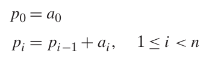 (5.1)

Function psum1 tính một phần tử vector kết quả mỗi iteration. Function psum2 dùng kỹ thuật loop unrolling để tính hai phần tử mỗi iteration. Chúng ta tìm hiểu lợi ích loop unrolling sau trong chương. (Xem Bài tập 5.11, 5.12 và 5.19 để biết thêm về phân tích và tối ưu phép tính prefix-sum.)

Thời gian procedure như vậy được mô tả bằng hằng số cộng hệ số tỷ lệ với số phần tử xử lý. Ví dụ, Hình 5.2 vẽ số clock cycle hai function cần với nhiều giá trị n. Dùng least squares fit, ta thấy run time (theo clock cycle) của psum1 và psum2 xấp xỉ lần lượt 368 + 9.0n và 368 + 6.0n. Các phương trình cho overhead 368 cycle do code đo thời gian và việc bắt đầu procedure, thiết lập vòng lặp, hoàn tất procedure, cộng thành phần tuyến tính 6.0 hoặc 9.0 cycle mỗi phần tử. Với n lớn (chẳng hạn hơn 200), run time bị chi phối bởi thành phần tuyến tính. Hệ số của thành phần này được gọi là số cycle hiệu dụng mỗi phần tử. Chúng ta ưu tiên đo cycle mỗi phần tử thay vì mỗi iteration, vì kỹ thuật như loop unrolling cho phép dùng ít iteration hơn để tính xong, nhưng quan tâm cuối cùng là tốc độ procedure với độ dài vector cho trước. Chúng ta tập trung giảm CPE. Theo metric này, psum2 có CPE 6.0 tốt hơn psum1 có CPE 9.0.

```
 1   /* Compute prefix sum of vector a */
 2   void psum1(float a[], float p[], long n)
 3   {
 4       long i;
 5       p[0] = a[0];
 6       for (i = 1; i < n; i++)
 7           p[i] = p[i-1] + a[i];
 8   }
 9
10   void psum2(float a[], float p[], long n)
11   {
12       long i;
13       p[0] = a[0];
14       for (i = 1; i < n-1; i+=2) {
15           float mid_val = p[i-1] + a[i];
16           p[i]    = mid_val;
17           p[i+1]  = mid_val + a[i+1];
18       }
19       /* For even n, finish remaining element */
20       if (i < n)
21           p[i] = p[i-1] + a[i];
22   }
```

**Hình 5.1 Function Prefix-sum. Các function này minh họa cách biểu diễn hiệu năng chương trình.**

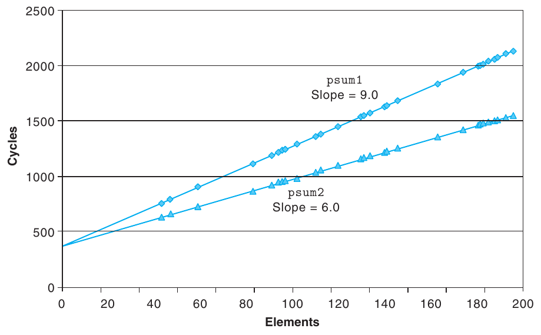

**Hình 5.2 Hiệu năng function prefix-sum. Độ dốc đường biểu diễn số clock cycle mỗi phần tử (CPE).**

### Ghi chú Least squares fit là gì?

Với tập điểm dữ liệu (x<sub>1</sub>, y<sub>1</sub>), . . . (x<sub>n</sub>, y<sub>n</sub>), chúng ta thường cố vẽ đường thẳng xấp xỉ tốt nhất xu hướng X– Y của dữ liệu. Với least squares fit, ta tìm đường y = mx + b tối thiểu hóa phép đo sai số sau:

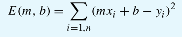

Có thể suy ra thuật toán tính m và b bằng cách lấy đạo hàm E(m, b) theo m và b rồi cho bằng 0.

### Bài tập thực hành 5.2 (lời giải trang 609)

Sau trong chương, chúng ta bắt đầu từ một function và tạo nhiều biến thể giữ nguyên hành vi nhưng có đặc tính hiệu năng khác nhau. Với ba biến thể, chúng ta thấy run time (clock cycle) xấp xỉ bởi các function sau:

Phiên bản 1: 60 + 35n

Phiên bản 2: 136 + 4n

Phiên bản 3: 157 + 1.25n

Với giá trị n nào mỗi phiên bản nhanh nhất trong ba phiên bản? Nhớ rằng n luôn là số nguyên.

## 5.3 Ví dụ chương trình

Để minh họa cách biến đổi có hệ thống một chương trình trừu tượng thành code hiệu quả hơn, chúng ta dùng ví dụ xuyên suốt dựa trên vector data structure ở Hình 5.3. Vector được biểu diễn bằng hai khối bộ nhớ: header và data array. Header là structure khai báo như sau:

```
                                                          code/opt/vec.h
1   /* Create abstract data type for vector */
2   typedef struct {
3       long len;
4       data_t *data;
5   } vec_rec, *vec_ptr;
                                                          code/opt/vec.h
```

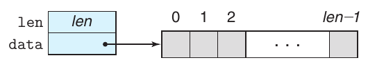

**Hình 5.3 Abstract data type vector. Vector được biểu diễn bằng thông tin header cùng array có độ dài chỉ định.**

Khai báo dùng data_t chỉ data type của các phần tử bên dưới. Khi đánh giá, chúng ta đo hiệu năng code với dữ liệu số nguyên (int, long trong C) và floating-point (float, double trong C). Điều này được thực hiện bằng biên dịch và chạy riêng với các khai báo kiểu khác nhau, như khai báo data type long sau:

```
typedef long data_t;
```

Chúng ta cấp phát khối data array để lưu phần tử vector thành array gồm len object kiểu data_t.

Hình 5.4 trình bày procedure cơ bản tạo vector, truy cập phần tử và xác định độ dài vector. Đặc điểm quan trọng là get_vec_element, routine truy cập vector, thực hiện bounds checking với mọi vector reference. Code tương tự cách biểu diễn array trong nhiều ngôn ngữ khác, gồm Java. Bounds checking giảm khả năng lỗi nhưng cũng có thể làm chậm thực thi.

Để minh họa tối ưu, xét code Hình 5.5 kết hợp mọi phần tử vector thành một giá trị theo một phép toán. Dùng định nghĩa khác nhau của hằng số compile-time IDENT và OP cho phép biên dịch lại để thực hiện các phép toán khác nhau. Cụ thể, dùng các khai báo

```
#define IDENT 0
#define OP  +
```

code tính tổng phần tử vector. Dùng khai báo

```
#define IDENT 1
#define OP  *
```

code tính tích các phần tử vector.

Trong phần trình bày, chúng ta thực hiện chuỗi biến đổi code, viết các phiên bản combining function khác nhau. Để đánh giá tiến triển, chúng ta đo CPE trên máy có processor Intel Core i7 Haswell, gọi là reference machine. Một số đặc tính processor đã nêu ở Mục 3.1. Những phép đo mô tả hiệu năng trên một máy cụ thể, nên không bảo đảm hiệu năng tương đương với tổ hợp máy và compiler khác. Tuy nhiên, chúng ta đã so sánh với nhiều tổ hợp compiler/processor và thấy nhìn chung nhất quán với kết quả ở đây.

```
                                                           code/opt/vec.c
 1   /* Create vector of specified length */
 2   vec_ptr new_vec(long len)
 3   {
 4       /* Allocate header structure */
 5       vec_ptr result = (vec_ptr) malloc(sizeof(vec_rec));
 6       data_t *data = NULL;
 7       if (!result)
 8           return NULL;  /* Couldn’t allocate storage */
 9       result->len = len;
10       /* Allocate array */
11       if (len > 0) {
12           data = (data_t *)calloc(len, sizeof(data_t));
13           if (!data) {
14               free((void *) result);
15               return NULL; /* Couldn’t allocate storage */
16           }
17       }
18       /* Data will either be NULL or allocated array */
19       result->data = data;
20       return result;
21   }
22
23   /*
24    * Retrieve vector element and store at dest.
25    * Return 0 (out of bounds) or 1 (successful)
26    */
27   int get_vec_element(vec_ptr v, long index, data_t *dest)
28   {
29       if (index < 0 || index >= v->len)
30           return 0;
31       *dest = v->data[index];
32       return 1;
33   }
34
35   /* Return length of vector */
36   long vec_length(vec_ptr v)
37   {
38       return v->len;
39   }
                                                           code/opt/vec.c
```

**Hình 5.4 Triển khai abstract data type vector. Trong chương trình thực tế, data type data_t được khai báo là int , long , float hoặc double .**

```
 1   /* Implementation with maximum use of data abstraction */
 2   void combine1(vec_ptr v, data_t *dest)
 3   {
 4       long i;
 5
 6       *dest = IDENT;
 7       for (i = 0; i < vec_length(v); i++) {
 8           data_t val;
 9           get_vec_element(v, i, &val);
10           *dest = *dest OP val;
11       }
12   }
```

**Hình 5.5 Triển khai ban đầu của combining operation. Với khai báo khác nhau của identity element IDENT và combining operation OP , có thể đo routine với các phép toán khác nhau.**

Qua các biến đổi, chúng ta thấy nhiều biến đổi chỉ cải thiện rất ít, còn một số tác động mạnh hơn. Xác định tổ hợp biến đổi thực sự là một phần “nghệ thuật bí truyền” của viết code nhanh. Một số tổ hợp không có lợi ích đo được thực sự không hiệu quả, còn số khác quan trọng vì tạo điều kiện cho compiler tối ưu thêm. Theo kinh nghiệm, cách tốt nhất kết hợp thử nghiệm và phân tích: liên tục thử phương án khác, đo lường và xem biểu diễn assembly-code để tìm performance bottleneck bên dưới.

Để bắt đầu, bảng sau cho phép đo CPE của combine1 trên reference machine với tổ hợp phép toán (cộng hoặc nhân) và data type (số nguyên long, floating point double-precision) khác nhau. Thử nghiệm nhiều chương trình cho thấy phép toán số nguyên 32-bit và 64-bit có cùng hiệu năng, trừ code phép chia. Tương tự, chương trình thao tác dữ liệu floating-point single- hoặc double-precision có hiệu năng như nhau. Vì vậy, bảng chỉ tách kết quả cho dữ liệu số nguyên và floating-point.

|  |  |  | Số nguyên |  |  | Floating point |
|---|---|---|---|---|---|---|
| Function | Trang | Phương pháp | + | * | + | * |
| combine1 | 543 | Trừu tượng, chưa tối ưu | 22.68 | 20.02 | 19.98 | 20.18 |
| combine1 | 543 | Trừu tượng -O1 | 10.12 | 10.12 | 10.17 | 11.14 |

Có thể thấy phép đo hơi thiếu chính xác. CPE hợp lý hơn cho tổng số nguyên là 23.00 thay vì 22.68, còn cho tích số nguyên có lẽ 20.0 thay vì 20.02. Thay vì “chỉnh” số cho đẹp, chúng ta trình bày đúng kết quả đo thực tế. Nhiều yếu tố làm phức tạp việc đo đáng tin cậy số clock cycle chính xác mà chuỗi code cần. Khi xem số liệu, có thể nhẩm làm tròn lên hoặc xuống vài phần trăm của một clock cycle.

Code chưa tối ưu chuyển trực tiếp code C sang machine code, thường có điểm kém hiệu quả rõ ràng. Chỉ cần tùy chọn command-line -O1, ta bật tập tối ưu cơ bản. Như thấy, hiệu năng cải thiện đáng kể—hơn 2 lần—mà lập trình viên không phải làm gì thêm. Nói chung, nên tạo thói quen bật mức tối ưu nào đó. (Mức -Og cho kết quả tương tự.) Với các phép đo còn lại, chúng ta dùng -O1 và -O2 khi tạo, đo chương trình.

## 5.4 Loại bỏ những điểm kém hiệu quả của vòng lặp

Hãy quan sát rằng procedure combine1 trong Hình 5.5 gọi hàm vec_length làm điều kiện kiểm tra của vòng lặp for. Nhớ lại phần thảo luận về cách chuyển code chứa vòng lặp thành chương trình machine-level (Mục 3.6.7), điều kiện kiểm tra phải được đánh giá ở mỗi lượt lặp. Ngược lại, độ dài vector không thay đổi khi vòng lặp chạy. Do đó, chúng ta có thể tính độ dài vector chỉ một lần và dùng giá trị đó trong điều kiện kiểm tra.

Hình 5.6 trình bày phiên bản đã sửa tên combine2. Nó gọi vec_length ngay đầu và gán kết quả cho biến cục bộ length. Phép biến đổi này ảnh hưởng rõ rệt đến hiệu năng tổng thể với một số data type và phép toán, nhưng ảnh hưởng tối thiểu hoặc thậm chí không ảnh hưởng với những trường hợp khác. Dù vậy, phép biến đổi này cần thiết để loại bỏ những điểm kém hiệu quả sẽ trở thành bottleneck khi tiếp tục tối ưu hóa.

|  |  |  |  | Integer | Floating point |  |
|---|---|---|---|---|---|---|
| Hàm | Page | Phương pháp | + | * | + | * |
| combine1 | 543 | Abstract -O1 | 10.12 | 10.12 | 10.17 | 11.14 |
| combine2 | 545 | Move vec_length | 7.02 | 9.03 | 9.02 | 11.03 |

Phép tối ưu này thuộc một lớp tối ưu hóa tổng quát gọi là code motion. Chúng xác định một phép tính được thực hiện nhiều lần (ví dụ trong vòng lặp), nhưng kết quả không thay đổi. Vì thế, có thể chuyển phép tính đến phần code trước đó, ít được đánh giá hơn. Trong trường hợp này, chúng ta chuyển lời gọi vec_length từ bên trong vòng lặp đến ngay trước vòng lặp.

```
 1   /* Move call to vec_length out of loop */
 2   void combine2(vec_ptr v, data_t *dest)
 3   {
 4       long i;
 5       long length = vec_length(v);
 6
 7       *dest = IDENT;
 8       for (i = 0; i < length; i++) {
 9           data_t val;
10           get_vec_element(v, i, &val);
11           *dest = *dest OP val;
12       }
13   }
```

**Hình 5.6 Cải thiện hiệu quả kiểm tra vòng lặp. Bằng cách đưa lời gọi vec_length ra khỏi phép kiểm tra vòng lặp, chúng ta loại bỏ nhu cầu thực thi nó ở mỗi lượt lặp.**

Optimizing compiler cố thực hiện code motion. Đáng tiếc, như đã thảo luận, chúng thường rất thận trọng với phép biến đổi thay đổi nơi hoặc số lần gọi procedure. Chúng không thể phát hiện đáng tin cậy hàm có side effect hay không, nên giả định có thể có. Ví dụ, nếu vec_length có side effect, combine1 và combine2 có thể có hành vi khác nhau. Để cải thiện code, lập trình viên thường phải giúp compiler bằng cách thực hiện code motion một cách tường minh.

Làm ví dụ cực đoan về điểm kém hiệu quả của vòng lặp trong combine1, xét procedure lower1 trong Hình 5.7. Procedure này được viết theo các routine do một số sinh viên nộp trong dự án lập trình mạng. Mục đích là chuyển mọi chữ hoa trong string thành chữ thường. Procedure duyệt string, chuyển từng ký tự hoa thành thường. Việc chuyển kiểu chữ dịch các ký tự trong khoảng ‘A’ đến ‘Z’ sang khoảng ‘a’ đến ‘z’.

Hàm thư viện strlen được gọi trong phép kiểm tra vòng lặp của lower1. Mặc dù strlen thường được triển khai bằng instruction string-processing đặc biệt của x86, cách thực thi tổng thể tương tự phiên bản đơn giản cũng trình bày trong Hình 5.7. Vì string trong C là chuỗi ký tự null-terminated, strlen chỉ có thể xác định độ dài bằng cách duyệt chuỗi đến khi gặp ký tự null. Với string dài n, strlen cần thời gian tỷ lệ với n. Vì strlen được gọi ở mỗi lượt trong n lượt lặp của lower1, tổng thời gian chạy của lower1 tăng bậc hai theo độ dài string, tỷ lệ với n<sup>2</sup>.

```
 1   /* Convert string to lowercase: slow */
 2   void lower1(char *s)
 3   {
 4       long i;
 5
 6       for (i = 0; i < strlen(s); i++)
 7           if (s[i] >= ’A’ && s[i] <= ’Z’)
 8               s[i] -= (’A’ - ’a’);
 9   }
10
11   /* Convert string to lowercase: faster */
12   void lower2(char *s)
13   {
14       long i;
15       long len = strlen(s);
16
17       for (i = 0; i < len; i++)
18           if (s[i] >= ’A’ && s[i] <= ’Z’)
19               s[i] -= (’A’ - ’a’);
20   }
21
22   /* Sample implementation of library function strlen */
23   /* Compute length of string */
24   size_t strlen(const char *s)
25   {
26       long length = 0;
27       while (*s != ’\0’) {
28           s++;
29           length++;
30       }
31       return length;
32   }
```

**Hình 5.7 Các routine chuyển chữ thường. Hai procedure có hiệu năng rất khác nhau.**

Phân tích này được xác nhận bằng đo thực tế các hàm với string có độ dài khác nhau, như Hình 5.8 (và dùng phiên bản thư viện của strlen). Đồ thị thời gian chạy lower1 tăng dốc khi độ dài string tăng (Hình 5.8(a)). Hình 5.8(b) trình bày thời gian chạy cho bảy độ dài khác nhau (không giống độ dài trong đồ thị), mỗi độ dài là lũy thừa của 2. Hãy quan sát rằng với lower1, mỗi lần tăng gấp đôi độ dài string khiến thời gian chạy tăng gấp bốn. Đây là dấu hiệu rõ ràng của thời gian chạy bậc hai. Với string dài 1,048,576, lower1 cần hơn 17 phút CPU time.

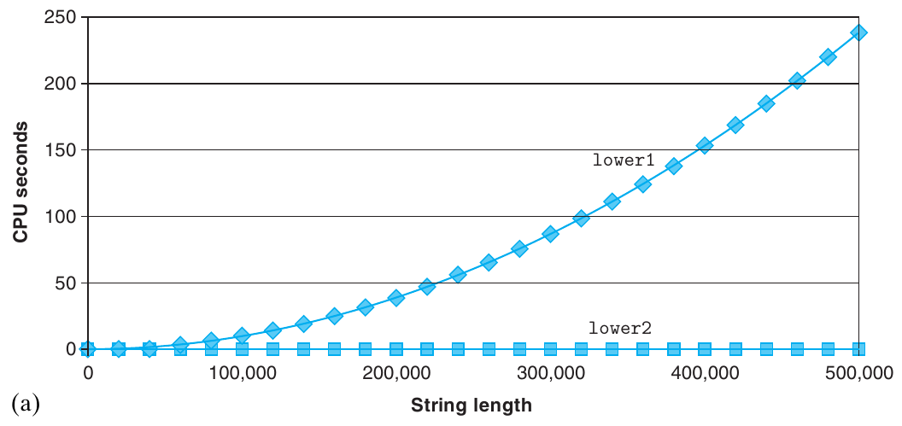

Độ dài string

| Hàm | 16,384 | 32,768 | 65,536 | 131,072 | 262,144 | 524,288 | 1,048,576 |
|---|---|---|---|---|---|---|---|
| lower1 | 0.26 | 1.03 | 4.10 | 16.41 | 65.62 | 262.48 | 1,049.89 |
| lower2 | 0.0000 | 0.0001 | 0.0001 | 0.0003 | 0.0005 | 0.0010 | 0.0020 |

(b)

**Hình 5.8 So sánh hiệu năng các routine chuyển chữ thường. Code ban đầu lower1 có thời gian chạy bậc hai do cấu trúc vòng lặp kém hiệu quả. Code đã sửa lower2 có thời gian chạy tuyến tính.**

Hàm lower2 trong Hình 5.7 giống hệt lower1, ngoại trừ việc đưa lời gọi strlen ra ngoài vòng lặp. Hiệu năng cải thiện mạnh. Với string dài 1,048,576, hàm chỉ cần 2.0 millisecond—nhanh hơn lower1 hơn 500,000 lần. Mỗi lần tăng gấp đôi độ dài string khiến thời gian chạy tăng gấp đôi—dấu hiệu rõ ràng của thời gian chạy tuyến tính. Với string dài hơn, mức cải thiện run-time còn lớn hơn.

Trong điều kiện lý tưởng, compiler nhận ra mỗi lời gọi strlen trong phép kiểm tra vòng lặp đều trả về cùng kết quả, nên có thể đưa lời gọi ra ngoài. Điều này đòi hỏi phân tích rất phức tạp, vì strlen kiểm tra các phần tử string và chúng thay đổi khi lower1 chạy. Compiler cần phát hiện rằng mặc dù ký tự trong string thay đổi, không ký tự nào đổi từ khác không thành không hoặc ngược lại. Phân tích như vậy vượt xa khả năng ngay cả compiler phức tạp nhất, kể cả khi dùng inlining, nên lập trình viên phải tự thực hiện phép biến đổi.

Ví dụ minh họa vấn đề phổ biến khi viết chương trình: một đoạn code tưởng như tầm thường lại ẩn chứa tính kém hiệu quả tiệm cận. Người ta không nghĩ routine chuyển chữ thường sẽ giới hạn hiệu năng chương trình. Thông thường, chương trình được kiểm tra và phân tích trên tập dữ liệu nhỏ, với hiệu năng lower1 đủ tốt. Tuy nhiên, khi triển khai thực tế, procedure hoàn toàn có thể được áp dụng cho string hơn một triệu ký tự. Đột nhiên, đoạn code vô hại này trở thành performance bottleneck lớn. Ngược lại, hiệu năng lower2 vẫn đủ tốt với string dài tùy ý. Có vô số câu chuyện về dự án lập trình lớn gặp vấn đề dạng này. Một phần công việc của lập trình viên có năng lực là tránh đưa vào những điểm kém hiệu quả tiệm cận như vậy.

### Bài tập thực hành 5.3 (lời giải trang 609)

Xét các hàm sau:

```
long min(long x, long y) { return x < y ? x : y; }
long max(long x, long y) { return x < y ? y : x; }
void incr(long *xp, long v) { *xp += v; }
long square(long x) { return x*x; }
```

Ba đoạn code sau gọi các hàm này:

```
A.     for (i = min(x, y); i < max(x, y); incr(&i, 1))
           t += square(i);

B.     for (i = max(x, y) - 1; i >= min(x, y); incr(&i, -1))
           t += square(i);

C.     long low = min(x, y);
       long high = max(x, y);

       for (i = low; i < high; incr(&i, 1))
           t += square(i);
```

Giả sử x bằng 10 và y bằng 100. Điền bảng sau để cho biết số lần mỗi hàm trong bốn hàm được gọi ở các đoạn code A–C:

| Code | min | max | incr | square |
|---|---|---|---|---|
| A. | ______ | ______ | ______ | ______ |
| B. | ______ | ______ | ______ | ______ |
| C. | ______ | ______ | ______ | ______ |

## 5.5 Giảm lời gọi procedure

Như đã thấy, lời gọi procedure có thể gây overhead và cản trở phần lớn dạng tối ưu hóa chương trình. Trong code combine2 (Hình 5.6), get_vec_element được gọi mỗi lượt lặp để lấy phần tử vector tiếp theo. Hàm kiểm tra chỉ số vector i với giới hạn vòng lặp mỗi lần tham chiếu vector, một nguồn kém hiệu quả rõ ràng. Kiểm tra giới hạn có thể hữu ích với truy cập array tùy ý, nhưng phân tích đơn giản code combine2 cho thấy mọi tham chiếu đều hợp lệ.

```
                                                           code/opt/vec.c
 1   data_t *get_vec_start(vec_ptr v)
 2   {
 3       return v->data;
 4   }
                                                           code/opt/vec.c
 1   /* Direct access to vector data */
 2   void combine3(vec_ptr v, data_t *dest)
 3   {
 4       long i;
 5       long length = vec_length(v);
 6       data_t *data = get_vec_start(v);
 7
 8       *dest = IDENT;
 9       for (i = 0; i < length; i++) {
10           *dest = *dest OP data[i];
11       }
12   }
```

**Hình 5.9 Loại bỏ lời gọi hàm trong vòng lặp. Code kết quả không cải thiện hiệu năng, nhưng cho phép tối ưu hóa thêm.**

Thay vào đó, giả sử thêm hàm get_vec_start vào abstract data type. Hàm trả về địa chỉ đầu của array dữ liệu, như Hình 5.9. Khi đó có thể viết procedure combine3 trong hình, không có lời gọi hàm ở vòng lặp trong. Thay vì gọi hàm để lấy từng phần tử vector, nó truy cập array trực tiếp. Người theo nguyên tắc chặt chẽ có thể nói phép biến đổi làm tổn hại nghiêm trọng tính module của chương trình. Về nguyên tắc, người dùng vector abstract data type thậm chí không cần biết nội dung vector lưu bằng array thay vì cấu trúc khác như linked list. Lập trình viên thực dụng hơn sẽ cho rằng đây là bước cần thiết để đạt kết quả high-performance.

|  |  |  | Integer |  |  | Floating point |
|---|---|---|---|---|---|---|
| Hàm | Page | Phương pháp | + | * | + | * |
| combine2 | 545 | Move vec_length | 7.02 | 9.03 | 9.02 | 11.03 |
| combine3 | 549 | Direct data access | 7.17 | 9.02 | 9.02 | 11.03 |

Đáng ngạc nhiên, không thấy cải thiện hiệu năng rõ ràng. Thực tế, hiệu năng phép cộng số nguyên còn hơi tệ hơn. Rõ ràng các phép toán khác trong vòng lặp trong tạo bottleneck giới hạn hiệu năng nhiều hơn lời gọi get_vec_element. Chúng ta sẽ trở lại hàm này sau (Mục 5.11.2) và xem vì sao kiểm tra giới hạn lặp lại của combine2 không gây tổn thất hiệu năng. Hiện tại, có thể xem phép biến đổi này là một bước trong chuỗi bước cuối cùng sẽ cải thiện hiệu năng rất nhiều.

## 5.6 Loại bỏ tham chiếu bộ nhớ không cần thiết

Code combine3 tích lũy giá trị do phép kết hợp tính tại vị trí pointer dest chỉ định. Có thể thấy đặc tính này bằng cách xem assembly code được sinh cho vòng lặp trong của code đã biên dịch. Ở đây trình bày code x86-64 được sinh cho data type double và phép nhân làm phép kết hợp:

```
    Inner loop of combine3. data_t = double, OP = *
    dest in %rbx, data+i in %rdx, data+length in %rax
1   .L17:                            loop:
2     vmovsd  (%rbx), %xmm0            Read product from dest
3     vmulsd  (%rdx), %xmm0, %xmm0     Multiply product by data[i]
4     vmovsd  %xmm0, (%rbx)            Store product at dest
5     addq    $8, %rdx                 Increment data+i
6     cmpq    %rax, %rdx               Compare to data+length
7     jne     .L17                     If !=, goto loop
```

Trong code vòng lặp này, địa chỉ tương ứng pointer dest nằm trong register %rbx. Code cũng đã được biến đổi để duy trì pointer tới phần tử dữ liệu thứ i trong register %rdx, thể hiện trong chú giải là data+i. Pointer này tăng thêm 8 mỗi lượt lặp. Việc kết thúc vòng lặp được phát hiện bằng cách so sánh pointer này với pointer lưu trong register %rax. Chúng ta thấy giá trị tích lũy được đọc và ghi bộ nhớ mỗi lượt lặp. Việc đọc ghi này lãng phí, vì giá trị đọc từ dest ở đầu mỗi lượt lặp đơn giản phải là giá trị được ghi ở cuối lượt lặp trước.

Có thể loại bỏ việc đọc ghi bộ nhớ không cần thiết bằng cách viết lại code theo phong cách combine4 trong Hình 5.10. Chúng ta thêm biến tạm acc dùng trong vòng lặp để tích lũy giá trị tính được. Kết quả chỉ lưu tại dest sau khi vòng lặp hoàn tất. Như assembly code tiếp theo cho thấy, compiler giờ có thể dùng register %xmm0 giữ giá trị tích lũy. So với vòng lặp combine3, chúng ta giảm phép toán bộ nhớ mỗi lượt từ hai lần đọc và một lần ghi xuống chỉ một lần đọc.

```
    Inner loop of combine4. data_t = double, OP = *
    acc in %xmm0, data+i in %rdx, data+length in %rax
1   .L25:                            loop:
2     vmulsd  (%rdx), %xmm0, %xmm0     Multiply acc by data[i]
3     addq    $8, %rdx                 Increment data+i
4     cmpq    %rax, %rdx               Compare to data+length
5     jne     .L25                     If !=, goto loop
```

Chúng ta thấy hiệu năng chương trình cải thiện đáng kể, như bảng sau:

```
 1   /* Accumulate result in local variable */
 2   void combine4(vec_ptr v, data_t *dest)
 3   {
 4       long i;
 5       long length = vec_length(v);
 6       data_t *data = get_vec_start(v);
 7       data_t acc = IDENT;
 8
 9       for (i = 0; i < length; i++) {
10           acc = acc OP data[i];
11       }
12       *dest = acc;
13   }
```

**Hình 5.10 Tích lũy kết quả trong biến tạm. Giữ giá trị tích lũy trong biến cục bộ acc (viết tắt “accumulator”) loại bỏ nhu cầu lấy nó từ bộ nhớ rồi ghi lại giá trị cập nhật ở mỗi lượt lặp.**

|  |  |  | Integer |  |  | Floating point |
|---|---|---|---|---|---|---|
| Hàm | Page | Phương pháp | + | * | + | * |
| combine3 | 549 | Direct data access | 7.17 | 9.02 | 9.02 | 11.03 |
| combine4 | 551 | Accumulate in temporary | 1.27 | 3.01 | 3.01 | 5.01 |

Mọi thời gian đều cải thiện với hệ số từ 2.2× đến 5.7×, trong đó phép cộng số nguyên giảm xuống chỉ 1.27 clock cycle mỗi phần tử.

Một lần nữa, người ta có thể nghĩ compiler nên tự biến đổi code combine3 trong Hình 5.9 để tích lũy giá trị trong register, như với code combine4 trong Hình 5.10. Tuy nhiên, thực tế hai hàm có thể có hành vi khác nhau do memory aliasing. Ví dụ, xét dữ liệu số nguyên với phép nhân và phần tử đơn vị 1. Gọi v = [2, 3, 5] là vector ba phần tử và xét hai lời gọi hàm sau:

```
combine3(v, get_vec_start(v) + 2);
combine4(v, get_vec_start(v) + 2);
```

Nghĩa là, chúng ta tạo alias giữa phần tử cuối của vector và đích lưu kết quả. Hai hàm khi đó thực thi như sau:

| Hàm | Initial | Before loop | i = 0 | i = 1 | i = 2 | Final |
|---|---|---|---|---|---|---|
| combine3 | [2, 3, 5] | [2, 3, 1] | [2, 3, 2] | [2, 3, 6] | [2, 3, 36] | [2, 3, 36] |
| combine4 | [2, 3, 5] | [2, 3, 5] | [2, 3, 5] | [2, 3, 5] | [2, 3, 5] | [2, 3, 30] |

Như đã trình bày, combine3 tích lũy kết quả tại đích, trong trường hợp này là phần tử vector cuối. Vì vậy, giá trị này được đặt đầu tiên bằng 1, rồi 2 · 1 = 2, rồi 3 · 2 = 6. Ở lượt lặp cuối, giá trị này được nhân với chính nó để cho kết quả cuối 36. Với combine4, vector không đổi đến cuối, khi phần tử cuối được đặt thành kết quả tính được 1 · 2 · 3 · 5 = 30.

Tất nhiên, ví dụ phân biệt combine3 và combine4 được cố ý dựng lên. Có thể lập luận hành vi combine4 phù hợp ý định mô tả hàm hơn. Đáng tiếc, compiler không thể phán đoán điều kiện hàm có thể được dùng và ý định lập trình viên. Thay vào đó, khi biên dịch combine3, cách bảo thủ là tiếp tục đọc ghi bộ nhớ, dù kém hiệu quả hơn.

### Bài tập thực hành 5.4 (lời giải trang 610)

Khi dùng gcc biên dịch combine3 với tùy chọn command-line -O2, chúng ta nhận code có hiệu năng CPE tốt hơn đáng kể so với -O1:

|  |  |  | Integer |  | Floating point |  |
|---|---|---|---|---|---|---|
| Hàm | Page | Phương pháp | + | * | + | * |
| combine3 | 549 | Compiled -O1 | 7.17 | 9.02 | 9.02 | 11.03 |
| combine3 | 549 | Compiled -O2 | 1.60 | 3.01 | 3.01 | 5.01 |
| combine4 | 551 | Accumulate in temporary | 1.27 | 3.01 | 3.01 | 5.01 |

Chúng ta đạt hiệu năng tương đương combine4, ngoại trừ phép cộng số nguyên, nhưng ngay cả trường hợp đó cũng cải thiện đáng kể. Khi xem assembly code compiler sinh, chúng ta thấy biến thể thú vị của vòng lặp trong:

```
    Inner loop of combine3.  data_t = double, OP = *.  Compiled -O2
    dest in %rbx, data+i in %rdx, data+length in %rax
    Accumulated product in %xmm0
1    .L22:                                loop:
2      vmulsd   (%rdx), %xmm0, %xmm0        Multiply product by data[i]
3      addq     $8, %rdx                    Increment data+i
4      cmpq     %rax, %rdx                  Compare to data+length
5      vmovsd   %xmm0, (%rbx)               Store product at dest
6      jne      .L22                        If !=, goto loop
```

Có thể so sánh với phiên bản tạo ở mức tối ưu hóa 1:

```
    Inner loop of combine3.  data_t = double, OP = *.  Compiled -O1
    dest in %rbx, data+i in %rdx, data+length in %rax
1    .L17:                                loop:
2      vmovsd   (%rbx), %xmm0               Read product from dest
3      vmulsd   (%rdx), %xmm0, %xmm0        Multiply product by data[i]
4      vmovsd   %xmm0, (%rbx)               Store product at dest
5      addq     $8, %rdx                    Increment data+i
6      cmpq     %rax, %rdx                  Compare to data+length
7      jne      .L17                        If !=, goto loop
```

Chúng ta thấy ngoài sắp xếp lại vài instruction, khác biệt duy nhất là phiên bản tối ưu hơn không chứa vmovsd triển khai việc đọc từ vị trí dest chỉ định (dòng 2).

A. Vai trò register %xmm0 khác nhau thế nào trong hai vòng lặp?

B. Phiên bản tối ưu hơn có triển khai trung thành code C của combine3, kể cả khi có memory aliasing giữa dest và dữ liệu vector không?

C. Giải thích vì sao phép tối ưu bảo toàn hành vi mong muốn, hoặc cho ví dụ nó tạo kết quả khác code ít tối ưu hơn.

Với phép biến đổi cuối này, chúng ta đạt mức chỉ cần 1.25–5 clock cycle cho mỗi phần tử được tính. Đây là cải thiện đáng kể so với 9–11 cycle ban đầu khi mới bật tối ưu hóa. Giờ chúng ta muốn xem chính xác yếu tố nào đang giới hạn hiệu năng code và cách cải thiện hơn nữa.

## 5.7 Hiểu processor hiện đại

Cho đến đây, chúng ta áp dụng tối ưu hóa không dựa vào đặc tính máy đích. Chúng chỉ giảm overhead lời gọi procedure và loại bỏ vài “optimization blocker” quan trọng gây khó khăn cho optimizing compiler. Khi muốn đẩy hiệu năng cao hơn, phải xét tối ưu hóa tận dụng microarchitecture của processor—tức thiết kế hệ thống nền tảng mà processor dùng để thực thi instruction. Khai thác đến mức hiệu năng cuối cùng đòi hỏi phân tích chương trình chi tiết và sinh code điều chỉnh cho processor đích. Dù vậy, có thể áp dụng vài tối ưu hóa cơ bản để cải thiện hiệu năng tổng thể trên lớp processor rộng. Kết quả hiệu năng chi tiết ở đây có thể không đúng cho máy khác, nhưng nguyên lý hoạt động và tối ưu hóa tổng quát áp dụng cho nhiều loại máy.

Để hiểu cách cải thiện hiệu năng, cần hiểu cơ bản microarchitecture của processor hiện đại. Nhờ số lượng transistor lớn có thể tích hợp trên một chip, microprocessor hiện đại dùng hardware phức tạp nhằm tối đa hóa hiệu năng chương trình. Một hệ quả là hoạt động thực tế rất khác góc nhìn có được khi xem chương trình machine-level. Ở mức code, có vẻ instruction thực thi lần lượt, mỗi instruction lấy giá trị từ register hoặc bộ nhớ, thực hiện phép toán và lưu kết quả về register hoặc bộ nhớ. Trong processor thực tế, nhiều instruction được đánh giá đồng thời, hiện tượng gọi là instruction-level parallelism. Trong một số thiết kế, có thể có 100 instruction trở lên “đang xử lý”. Cơ chế phức tạp bảo đảm hành vi thực thi song song này nắm bắt chính xác mô hình ngữ nghĩa tuần tự mà chương trình machine-level yêu cầu. Đây là thành tựu nổi bật của microprocessor hiện đại: dùng microarchitecture phức tạp và khác thường, cho phép nhiều instruction thực thi song song, nhưng thể hiện góc nhìn hoạt động đơn giản là thực thi instruction tuần tự.

Mặc dù thiết kế chi tiết microprocessor hiện đại vượt xa phạm vi sách, hiểu khái quát nguyên lý hoạt động là đủ để hiểu cách đạt instruction-level parallelism. Chúng ta sẽ thấy hai cận dưới khác nhau đặc trưng cho hiệu năng tối đa của chương trình. Latency bound xuất hiện khi chuỗi phép toán phải thực hiện theo thứ tự nghiêm ngặt, vì cần kết quả phép toán trước rồi mới bắt đầu phép tiếp theo. Cận này có thể giới hạn hiệu năng khi data dependency trong code hạn chế khả năng processor khai thác instruction-level parallelism. Throughput bound đặc trưng cho năng lực tính toán thuần của các functional unit. Cận này trở thành giới hạn cuối cùng cho hiệu năng chương trình.

### 5.7.1 Hoạt động tổng thể

Hình 5.11 trình bày góc nhìn rất đơn giản hóa về microprocessor hiện đại. Thiết kế processor giả định của chúng ta dựa khái quát trên cấu trúc các processor Intel gần đây. Trong ngành, chúng được mô tả là superscalar, nghĩa là thực hiện nhiều phép toán mỗi clock cycle, và out of order, nghĩa là thứ tự instruction thực thi không nhất thiết theo thứ tự trong chương trình machine-level. Thiết kế tổng thể có hai phần chính: instruction control unit (ICU), chịu trách nhiệm đọc chuỗi instruction từ bộ nhớ và sinh tập phép toán cơ bản trên dữ liệu chương trình, cùng execution unit (EU), thực thi những phép toán đó. So với pipeline in-order đơn giản ở Chương 4, processor out-of-order cần hardware lớn và phức tạp hơn nhiều, nhưng có khả năng đạt mức instruction-level parallelism cao hơn.

ICU đọc instruction từ instruction cache—bộ nhớ high-speed đặc biệt chứa instruction được truy cập gần nhất. Nhìn chung, ICU lấy instruction trước khá xa so với instruction hiện đang thực thi, để có đủ thời gian decode và gửi phép toán xuống EU. Tuy nhiên, một vấn đề là khi chương trình gặp branch,[^1] nó có thể đi theo hai hướng. Branch có thể được lấy, với quyền điều khiển chuyển đến branch target. Hoặc branch không được lấy, quyền điều khiển chuyển đến instruction tiếp theo trong chuỗi. Processor hiện đại dùng kỹ thuật branch prediction, đoán branch có được lấy không và dự đoán cả địa chỉ đích. Bằng speculative execution, processor bắt đầu lấy và decode instruction tại nơi nó dự đoán branch sẽ đi đến, thậm chí bắt đầu thực thi trước khi xác định dự đoán có đúng không. Nếu sau đó xác định dự đoán sai, nó đặt lại trạng thái về điểm branch rồi bắt đầu lấy và thực thi instruction theo hướng kia. Block “Fetch control” kết hợp branch prediction để xác định instruction cần lấy.

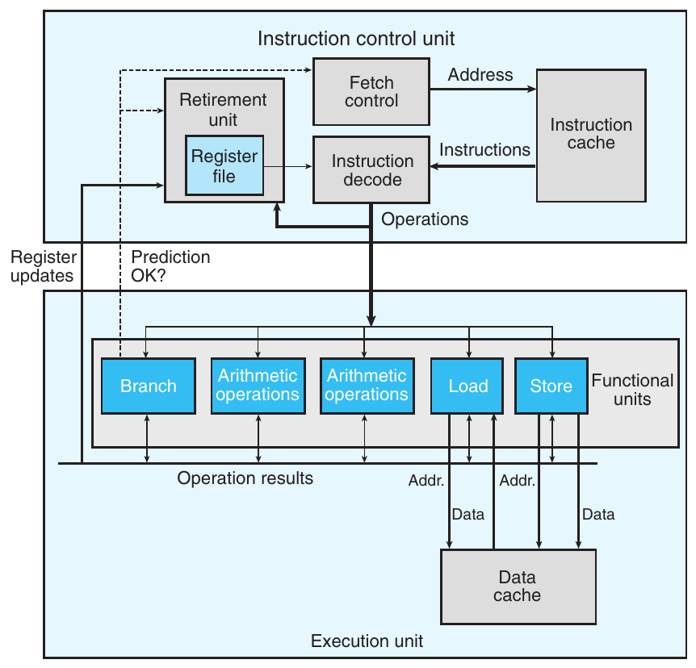

**Hình 5.11 Block diagram của processor out-of-order. Instruction control unit chịu trách nhiệm đọc instruction từ bộ nhớ và sinh chuỗi phép toán cơ bản. Execution unit sau đó thực hiện các phép toán và cho biết branch được dự đoán đúng hay không.**

Logic decode instruction nhận instruction thực tế của chương trình và chuyển thành tập phép toán cơ bản (đôi khi gọi là micro-operations). Mỗi phép toán thực hiện nhiệm vụ tính toán đơn giản như cộng hai số, đọc dữ liệu bộ nhớ hoặc ghi dữ liệu bộ nhớ. Với máy có instruction phức tạp như processor x86, một instruction có thể được decode thành nhiều phép toán. Chi tiết decode instruction thành chuỗi phép toán khác nhau giữa máy và được xem là thông tin độc quyền cao. May mắn là có thể tối ưu chương trình mà không biết chi tiết low-level của cách triển khai máy cụ thể.

Trong cách triển khai x86 điển hình, instruction chỉ thao tác register, như

```
addq %rax,%rdx
```

được chuyển thành một phép toán duy nhất. Ngược lại, instruction có một hoặc nhiều memory reference, như

```
addq %rax,8(%rdx)
```

tạo nhiều phép toán, tách memory reference khỏi phép toán số học. Instruction cụ thể này được decode thành ba phép toán: một load giá trị từ bộ nhớ vào processor, một cộng giá trị đã load với giá trị register %eax, và một lưu kết quả về bộ nhớ. Decode tách instruction để phân công giữa các hardware unit chuyên dụng. Những unit này sau đó có thể thực thi các phần khác nhau của nhiều instruction song song.

EU nhận phép toán từ instruction fetch unit. Thông thường, nó có thể nhận nhiều phép toán mỗi clock cycle. Chúng được phân phối đến tập functional unit thực hiện phép toán thực tế. Những functional unit được chuyên biệt hóa để xử lý loại phép toán khác nhau.

Đọc ghi bộ nhớ được load unit và store unit triển khai. Load unit xử lý phép toán đọc dữ liệu bộ nhớ vào processor. Unit có adder để tính địa chỉ. Tương tự, store unit xử lý phép toán ghi dữ liệu từ processor vào bộ nhớ. Nó cũng có adder để tính địa chỉ. Như hình cho thấy, load unit và store unit truy cập bộ nhớ qua data cache, bộ nhớ high-speed chứa giá trị dữ liệu được truy cập gần nhất.

Với speculative execution, các phép toán được đánh giá, nhưng kết quả cuối không lưu vào program register hoặc data memory cho đến khi processor chắc chắn instruction thực sự cần được thực thi. Phép toán branch được gửi đến EU không phải để xác định branch cần đi đâu, mà để xác định dự đoán có đúng không. Nếu dự đoán sai, EU loại bỏ kết quả đã tính sau điểm branch. Nó cũng báo cho branch unit rằng dự đoán sai và cho biết đích đúng. Khi đó, branch unit bắt đầu lấy instruction tại vị trí mới. Như Mục 3.6.6 cho thấy, dự đoán sai gây chi phí hiệu năng đáng kể. Phải mất một lúc mới lấy, decode và gửi được instruction mới đến functional unit.

Hình 5.11 cho thấy các functional unit được thiết kế để thực hiện phép toán khác nhau. Những unit được ghi là thực hiện “phép toán số học” thường chuyên thực hiện những tổ hợp phép toán số nguyên và floating-point khác nhau. Khi số transistor tích hợp trên một chip microprocessor tăng theo thời gian, những mẫu kế tiếp tăng tổng số functional unit, tổ hợp phép toán mỗi unit thực hiện và hiệu năng từng unit. Các arithmetic unit được cố ý thiết kế thực hiện nhiều phép toán vì nhu cầu thay đổi nhiều giữa các chương trình. Ví dụ, chương trình này có nhiều phép toán số nguyên, chương trình khác cần nhiều phép toán floating-point. Nếu một functional unit chuyên số nguyên còn unit khác chỉ floating-point, thì không chương trình nào tận dụng đầy đủ lợi ích có nhiều functional unit.

Ví dụ, máy tham chiếu Intel Core i7 Haswell có tám functional unit, đánh số 0–7. Sau đây là danh sách một phần khả năng từng unit:

0. Số học số nguyên, nhân floating-point, chia số nguyên và floating-point, branch

1. Số học số nguyên, cộng floating-point, nhân số nguyên, nhân floating-point

2. Load, tính địa chỉ

3. Load, tính địa chỉ

4. Store

5. Số học số nguyên

6. Số học số nguyên, branch

7. Tính địa chỉ store

Trong danh sách trên, “số học số nguyên” chỉ phép toán cơ bản như cộng, bitwise và dịch bit. Nhân và chia đòi hỏi tài nguyên chuyên biệt hơn. Chúng ta thấy phép store cần hai functional unit—một tính địa chỉ store và một thực sự lưu dữ liệu. Chúng ta sẽ thảo luận cơ chế store (và load) trong Mục 5.12.

Chúng ta thấy tổ hợp functional unit này có tiềm năng thực hiện nhiều phép toán cùng loại đồng thời. Nó có bốn unit thực hiện phép toán số nguyên, hai unit thực hiện load và hai unit thực hiện nhân floating-point. Sau này chúng ta sẽ thấy tác động của những tài nguyên này lên hiệu năng tối đa chương trình đạt được.

Trong ICU, retirement unit theo dõi xử lý đang diễn ra và bảo đảm tuân theo ngữ nghĩa tuần tự của chương trình machine-level. Hình vẽ register file chứa register số nguyên, floating-point và gần đây hơn SSE, AVX như một phần retirement unit, vì unit này điều khiển cập nhật register. Khi instruction được decode, thông tin về nó được đưa vào queue first-in, first-out. Thông tin nằm trong queue đến khi một trong hai kết quả xảy ra. Thứ nhất, khi các phép toán của instruction hoàn tất và mọi điểm branch dẫn đến nó được xác nhận dự đoán đúng, instruction có thể được retired, thực hiện mọi cập nhật program register. Ngược lại, nếu một điểm branch dẫn đến instruction bị dự đoán sai, instruction được flushed, loại bỏ mọi kết quả có thể đã tính. Nhờ vậy, dự đoán sai không làm thay đổi trạng thái chương trình.

#### Thông tin thêm: Lịch sử xử lý out-of-order

Xử lý Out-of-order lần đầu được triển khai trong processor Control Data Corporation 6600 năm 1964. Instruction được xử lý bởi 10 functional unit khác nhau, mỗi unit có thể hoạt động độc lập. Vào thời đó, máy có clock rate 10 MHz này được xem là máy hàng đầu cho tính toán khoa học.

IBM lần đầu triển khai xử lý out-of-order với processor IBM 360/91 năm 1966, nhưng chỉ để thực thi instruction floating-point. Trong khoảng 25 năm, xử lý out-of-order được xem là công nghệ khác thường, chỉ có trong máy hướng đến hiệu năng cao nhất, đến khi IBM đưa trở lại dòng workstation RS/6000 năm 1990. Thiết kế trở thành cơ sở cho dòng IBM/Motorola PowerPC, với mẫu 601 ra mắt năm 1993 là microprocessor single-chip đầu tiên dùng xử lý out-of-order. Intel giới thiệu xử lý out-of-order ở mẫu PentiumPro năm 1995, với microarchitecture nền tảng tương tự máy tham chiếu của chúng ta.

Như đã mô tả, program register chỉ được cập nhật khi instruction được retired, và chỉ sau khi processor chắc chắn mọi branch dẫn đến instruction đã được dự đoán đúng. Để đẩy nhanh truyền kết quả từ instruction này sang instruction khác, phần lớn thông tin được trao đổi giữa các execution unit, thể hiện trong hình là “Operation results”. Như các mũi tên cho thấy, execution unit có thể gửi kết quả trực tiếp cho nhau. Đây là dạng phức tạp hơn của kỹ thuật data-forwarding đã đưa vào thiết kế processor đơn giản trong Mục 4.5.5.

Cơ chế phổ biến nhất để điều khiển truyền toán hạng giữa execution unit gọi là register renaming. Khi decode instruction cập nhật register r, tag t được sinh để cung cấp identifier duy nhất cho kết quả phép toán. Entry (r, t ) được thêm vào bảng duy trì liên kết giữa program register r và tag t của phép toán sẽ cập nhật register. Khi decode instruction về sau dùng register r làm toán hạng, phép toán gửi đến execution unit chứa t làm nguồn giá trị toán hạng. Khi execution unit hoàn tất phép toán đầu, nó sinh kết quả (v, t ), chỉ ra phép toán có tag t tạo giá trị v. Mọi phép toán chờ t làm nguồn sẽ dùng v làm giá trị nguồn, một dạng data forwarding. Nhờ cơ chế này, giá trị được chuyển trực tiếp từ phép toán này sang phép toán khác thay vì ghi và đọc register file, cho phép phép toán thứ hai bắt đầu ngay khi phép thứ nhất hoàn tất. Renaming table chỉ chứa entry cho register có phép ghi chờ xử lý. Khi instruction được decode cần register r mà không có tag liên kết, toán hạng được lấy trực tiếp từ register file. Với register renaming, toàn bộ chuỗi phép toán có thể được thực hiện theo speculative execution, mặc dù register chỉ được cập nhật sau khi processor chắc chắn kết quả branch.

|  |  | Integer |  |  | Floating point |  |
|---|---|---|---|---|---|---|
| Phép toán | Latency | Issue | Capacity | Latency | Issue | Capacity |
| Cộng | 1 | 1 | 4 | 3 | 1 | 1 |
| Nhân | 3 | 1 | 1 | 5 | 1 | 2 |
| Chia | 3–30 | 3–30 | 1 | 3–15 | 3–15 | 1 |

**Hình 5.12 Đặc tính latency, issue time và capacity của các phép toán trên máy tham chiếu. Latency chỉ tổng clock cycle cần để thực hiện phép toán thực tế, còn issue time chỉ số cycle tối thiểu giữa hai phép toán độc lập. Capacity cho biết bao nhiêu phép toán có thể được phát hành đồng thời. Thời gian phép chia phụ thuộc giá trị dữ liệu.**

### 5.7.2 Hiệu năng functional unit

Hình 5.12 mô tả hiệu năng một số phép toán số học của máy tham chiếu Intel Core i7 Haswell, xác định bằng cả đo đạc lẫn tham khảo tài liệu Intel [49]. Những thời gian này cũng điển hình cho processor khác. Mỗi phép toán có latency, nghĩa là tổng thời gian thực hiện, issue time, nghĩa là số clock cycle tối thiểu giữa hai phép toán cùng loại độc lập, và capacity, chỉ số functional unit có thể thực hiện phép toán đó.

Chúng ta thấy latency tăng khi chuyển từ phép toán số nguyên sang floating-point. Cũng thấy mọi phép cộng và nhân có issue time 1, nghĩa là mỗi clock cycle processor có thể bắt đầu một phép toán mới. Issue time ngắn đạt được nhờ pipelining. Pipelined functional unit được triển khai thành chuỗi stage, mỗi stage thực hiện một phần phép toán. Ví dụ, floating-point adder điển hình gồm ba stage (do đó latency three-cycle): một xử lý exponent, một cộng fraction và một làm tròn kết quả. Các phép toán số học có thể đi qua stage nối tiếp sát nhau thay vì đợi phép trước hoàn tất mới bắt đầu phép sau. Chỉ có thể tận dụng khả năng này nếu có các phép toán liên tiếp độc lập về logic. Functional unit có issue time 1 cycle được gọi là fully pipelined: có thể bắt đầu phép toán mới mỗi clock cycle. Phép toán có capacity lớn hơn 1 xuất phát từ khả năng của nhiều functional unit, như đã mô tả cho máy tham chiếu.

Chúng ta cũng thấy divider (dùng cho chia số nguyên và floating-point, cũng như căn bậc hai floating-point) không pipelined—issue time bằng latency. Nghĩa là divider phải hoàn tất một phép chia trước khi bắt đầu phép mới. Latency và issue time phép chia được cho theo khoảng, vì một số tổ hợp số bị chia và số chia cần nhiều bước hơn. Latency và issue time dài khiến phép chia tương đối tốn kém.

Cách biểu diễn issue time phổ biến hơn là chỉ định throughput tối đa của unit, định nghĩa là nghịch đảo issue time. Functional unit fully pipelined có throughput tối đa 1 phép toán mỗi clock cycle, còn unit có issue time cao hơn có throughput tối đa thấp hơn. Nhiều functional unit có thể tăng throughput hơn nữa. Với phép toán có capacity C và issue time I , processor có thể đạt throughput C/I phép toán mỗi clock cycle. Ví dụ, máy tham chiếu thực hiện được phép nhân floating-point với tốc độ 2 phép mỗi clock cycle. Chúng ta sẽ thấy cách khai thác khả năng này để tăng hiệu năng chương trình.

Người thiết kế mạch có thể tạo functional unit với đặc tính hiệu năng rất đa dạng. Tạo unit có latency ngắn hoặc pipelining cần nhiều hardware hơn, đặc biệt với hàm phức tạp như nhân và phép toán floating-point. Vì không gian trên chip microprocessor cho các unit có hạn, người thiết kế CPU phải cân bằng cẩn thận số functional unit và hiệu năng riêng để tối ưu hiệu năng tổng thể. Họ đánh giá nhiều chương trình benchmark và dành nhiều tài nguyên nhất cho phép toán quan trọng nhất. Như Hình 5.12 cho thấy, nhân số nguyên cùng nhân và cộng floating-point được xem là phép toán quan trọng trong thiết kế Core i7 Haswell, mặc dù cần nhiều hardware để đạt latency thấp và mức pipelining cao đã trình bày. Ngược lại, phép chia tương đối ít gặp và khó triển khai với latency ngắn hoặc pipelining đầy đủ.

Latency, issue time và capacity của những phép toán số học này có thể ảnh hưởng hiệu năng hàm kết hợp. Có thể biểu diễn ảnh hưởng bằng hai cận cơ bản của giá trị CPE:

|  |  | Integer |  | Floating point |
|---|---|---|---|---|
| Bound | + | * | + | * |
| Latency | 1.00 | 3.00 | 3.00 | 5.00 |
| Throughput | 0.50 | 1.00 | 1.00 | 0.50 |

Latency bound cho giá trị CPE tối thiểu của mọi hàm phải thực hiện phép kết hợp theo thứ tự nghiêm ngặt. Throughput bound cho cận CPE tối thiểu dựa trên tốc độ tối đa functional unit tạo kết quả. Ví dụ, vì chỉ có một integer multiplier với issue time 1 clock cycle, processor không thể duy trì tốc độ hơn 1 phép nhân mỗi clock cycle. Ngược lại, với bốn functional unit có thể cộng số nguyên, processor có thể duy trì tốc độ 4 phép toán mỗi cycle. Đáng tiếc, nhu cầu đọc phần tử bộ nhớ tạo thêm throughput bound. Hai load unit giới hạn processor đọc tối đa 2 giá trị dữ liệu mỗi clock cycle, cho throughput bound 0.50. Chúng ta sẽ minh họa ảnh hưởng của cả latency bound lẫn throughput bound bằng các phiên bản hàm kết hợp khác nhau.

### 5.7.3 Mô hình trừu tượng hoạt động processor

Để phân tích hiệu năng chương trình machine-level chạy trên processor hiện đại, chúng ta dùng biểu diễn data-flow của chương trình, một ký pháp đồ họa cho thấy data dependency giữa các phép toán ràng buộc thứ tự thực thi thế nào. Những ràng buộc dẫn đến critical path trong đồ thị, đặt cận dưới cho số clock cycle cần thực thi tập machine instruction.

Trước khi đi vào chi tiết kỹ thuật, nên xem các phép đo CPE thu được cho combine4, code nhanh nhất đến lúc này:

|  |  |  |  | Integer | Floating point |  |
|---|---|---|---|---|---|---|
| Hàm | Page | Phương pháp | + | * | + | * |
| combine4 | 551 | Accumulate in temporary | 1.27 | 3.01 | 3.01 | 5.01 |
| Latency bound |  |  | 1.00 | 3.00 | 3.00 | 5.00 |
| Throughput bound |  |  | 0.50 | 1.00 | 1.00 | 0.50 |

Chúng ta thấy các phép đo khớp latency bound của processor, ngoại trừ phép cộng số nguyên. Đây không phải trùng hợp—nó cho biết hiệu năng hàm được quyết định bởi latency phép tính tổng hoặc tích đang thực hiện. Tính tích hoặc tổng n phần tử cần khoảng L · n + K clock cycle, trong đó L là latency phép kết hợp, còn K biểu diễn overhead gọi hàm, khởi tạo và kết thúc vòng lặp. Vì vậy, CPE bằng latency bound L.

### Từ code Machine-Level đến đồ thị Data-Flow

Biểu diễn data-flow của chương trình ở đây không hình thức. Chúng ta dùng nó để trực quan hóa cách data dependency quyết định hiệu năng. Chúng ta trình bày ký pháp data-flow bằng combine4 (Hình 5.10) làm ví dụ. Chỉ tập trung tính toán trong vòng lặp vì đây là yếu tố chi phối hiệu năng với vector lớn. Xét data type double và phép nhân làm phép kết hợp. Những tổ hợp data type và phép toán khác cho code tương tự. Code biên dịch của vòng lặp gồm bốn instruction, trong đó register %rdx chứa pointer đến phần tử thứ i của array data, %rax chứa pointer đến cuối array và %xmm0 chứa giá trị tích lũy acc.

```
    Inner loop of combine4. data_t = double, OP = *
    acc in %xmm0, data+i in %rdx, data+length in %rax
1   .L25:                            loop:
2     vmulsd  (%rdx), %xmm0, %xmm0     Multiply acc by data[i]
3     addq    $8, %rdx                 Increment data+i
4     cmpq    %rax, %rdx               Compare to data+length
5     jne     .L25                     If !=, goto loop
```

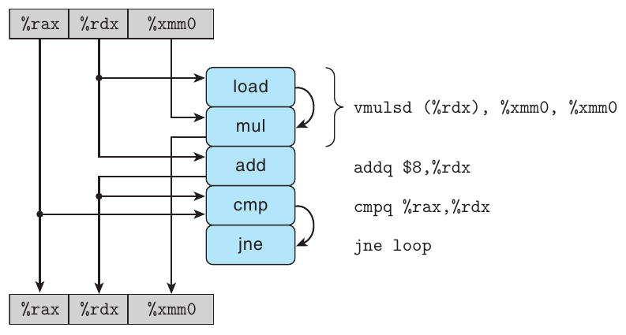

**Hình 5.13 Biểu diễn đồ họa code inner-loop của combine4. Instruction được chuyển đổi động thành một hoặc hai phép toán, mỗi phép nhận giá trị từ phép toán khác hoặc register và tạo giá trị cho phép toán khác và register. Đích instruction cuối được thể hiện là label loop. Nó nhảy đến instruction đầu tiên trong hình.**

Như Hình 5.13 cho thấy, với thiết kế processor giả định, bốn instruction được instruction decoder mở rộng thành chuỗi năm phép toán; instruction nhân đầu tiên được mở rộng thành load để đọc toán hạng nguồn từ bộ nhớ và mul để thực hiện phép nhân.

Để tiến tới biểu diễn đồ thị data-flow, các khối và đường phía left-hand Hình 5.13 cho thấy register được các phép toán dùng và cập nhật thế nào; các khối trên cùng biểu diễn giá trị register đầu vòng lặp, còn dưới cùng là giá trị cuối vòng lặp. Ví dụ, register %rax chỉ dùng làm giá trị nguồn cho cmp nên có cùng giá trị ở cuối và đầu vòng lặp. Ngược lại, %rdx vừa được dùng vừa được cập nhật trong vòng lặp. Giá trị ban đầu dùng cho load và add; giá trị mới được add sinh rồi cmp dùng. %xmm0 cũng được mul cập nhật trong vòng lặp, trước hết dùng giá trị ban đầu làm nguồn.

Một số phép toán trong Hình 5.13 tạo giá trị không tương ứng register. Chúng được vẽ bằng cung nối giữa phép toán ở phía right-hand. Load đọc giá trị từ bộ nhớ và truyền trực tiếp cho mul. Vì hai phép toán xuất phát từ decode một instruction vmulsd duy nhất, không có register gắn với giá trị trung gian giữa chúng. Cmp cập nhật condition code, rồi jne kiểm tra chúng.

Với đoạn code tạo vòng lặp, có thể phân loại register được truy cập thành bốn nhóm:

Read-only. Chúng được dùng làm giá trị nguồn, dưới dạng dữ liệu hoặc để tính địa chỉ bộ nhớ, nhưng không bị sửa trong vòng lặp. Register read-only duy nhất trong vòng lặp combine4 là %rax.

Write-only. Chúng làm đích của các phép toán data-movement. Không có register như vậy trong vòng lặp này.

Local. Chúng được cập nhật và dùng trong vòng lặp, nhưng không có phụ thuộc từ lượt này sang lượt khác. Các condition code register là ví dụ: chúng được cmp cập nhật và jne dùng, nhưng phụ thuộc chỉ nằm trong từng lượt lặp.

Loop. Chúng vừa làm giá trị nguồn vừa làm đích cho vòng lặp, với giá trị sinh ở một lượt được dùng ở lượt khác. Chúng ta thấy %rdx và %xmm0 là loop register của combine4, tương ứng giá trị chương trình data+i và acc.

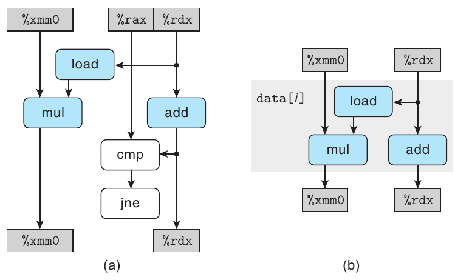

**Hình 5.14 Trừu tượng hóa phép toán combine4 thành đồ thị data-flow. Chúng ta sắp xếp lại các toán tử trong Hình 5.13 để thể hiện data dependency rõ hơn (a), rồi chỉ giữ các phép toán dùng giá trị của lượt lặp này để tạo giá trị mới cho lượt tiếp theo (b).**

Như sẽ thấy, chuỗi phép toán giữa các loop register quyết định data dependency performance-limiting.

Hình 5.14 tinh chỉnh thêm biểu diễn đồ họa Hình 5.13, nhằm chỉ thể hiện phép toán và data dependency ảnh hưởng thời gian thực thi. Trong Hình 5.14(a), chúng ta sắp xếp lại toán tử để thể hiện rõ hơn flow dữ liệu từ register nguồn trên cùng (cả read-only và loop register) đến register đích dưới cùng (cả write-only và loop register).

Trong Hình 5.14(a), chúng ta cũng tô trắng toán tử không thuộc chuỗi phụ thuộc nào giữa loop register. Trong ví dụ, phép so sánh (cmp) và branch (jne) không trực tiếp ảnh hưởng data flow. Chúng ta giả định instruction control unit dự đoán branch được lấy, nên chương trình tiếp tục lặp. Mục đích compare và branch là kiểm tra điều kiện branch và báo ICU nếu branch không được lấy. Chúng ta giả định kiểm tra đủ nhanh để không làm chậm processor.

Trong Hình 5.14(b), chúng ta bỏ toán tử tô trắng bên trái và chỉ giữ loop register. Còn lại là khuôn mẫu trừu tượng cho data dependency hình thành giữa loop register do một lượt lặp. Có thể thấy hai data dependency từ lượt này sang lượt tiếp theo. Một bên là phụ thuộc giữa các giá trị kế tiếp của acc, lưu trong %xmm0. Vòng lặp tính acc mới bằng cách nhân giá trị cũ với phần tử dữ liệu do load sinh ra. Bên kia là phụ thuộc giữa các giá trị kế tiếp của pointer đến phần tử dữ liệu thứ i. Mỗi lượt, giá trị cũ dùng làm địa chỉ cho load và cũng được add tăng để tính giá trị mới.

Hình 5.15 trình bày biểu diễn data-flow của n lượt vòng lặp trong hàm combine4. Đồ thị được tạo bằng cách lặp khuôn mẫu Hình 5.14(b) n lần. Chương trình có hai chuỗi data dependency, tương ứng cập nhật acc và data+i lần lượt bằng mul và add. Vì nhân floating-point có latency 5 cycle còn cộng số nguyên có latency 1 cycle, chuỗi bên trái tạo critical path, cần 5n cycle thực thi. Chuỗi bên phải chỉ cần n cycle nên không giới hạn hiệu năng chương trình.

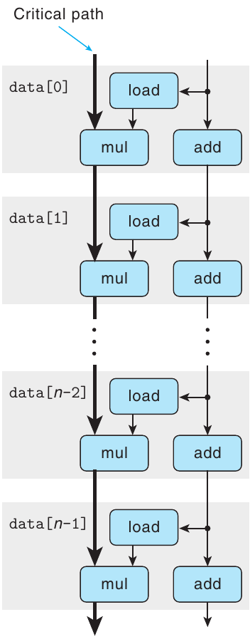

**Hình 5.15 Biểu diễn Data-flow của tính toán qua n lượt vòng lặp trong combine4. Chuỗi phép nhân tạo critical path giới hạn hiệu năng chương trình.**

Hình 5.15 giải thích vì sao CPE của combine4 bằng latency bound 5 cycle khi thực hiện phép nhân floating-point. Khi thực thi hàm, floating-point multiplier trở thành tài nguyên giới hạn. Những thao tác khác cần trong vòng lặp—thao tác và kiểm tra pointer data+i cùng đọc dữ liệu bộ nhớ—diễn ra song song với phép nhân. Khi mỗi giá trị acc kế tiếp được tính, nó được hồi tiếp để tính giá trị sau, nhưng điều đó chỉ xảy ra 5 cycle sau.

Flow cho những tổ hợp data type và phép toán khác giống Hình 5.15, nhưng có phép toán dữ liệu khác tạo chuỗi phụ thuộc bên trái. Trong mọi trường hợp phép toán có latency L lớn hơn 1, CPE đo được đơn giản là L, cho biết chuỗi này tạo critical path performance-limiting.

### Những yếu tố hiệu năng khác

Ngược lại, với phép cộng số nguyên, phép đo combine4 cho CPE 1.27, chậm hơn CPE 1.00 dự đoán dựa trên chuỗi phụ thuộc ở phía left- hoặc right-hand của đồ thị Hình 5.15. Điều này minh họa nguyên lý critical path trong biểu diễn data-flow chỉ cung cấp cận dưới cho số cycle chương trình cần. Những yếu tố khác cũng giới hạn hiệu năng, gồm tổng functional unit có sẵn và số giá trị dữ liệu có thể truyền giữa chúng tại mỗi bước. Với cộng số nguyên làm phép kết hợp, phép toán dữ liệu đủ nhanh khiến các thao tác còn lại không cung cấp dữ liệu kịp. Xác định chính xác vì sao chương trình cần 1.27 cycle mỗi phần tử đòi hỏi hiểu thiết kế hardware chi tiết hơn nhiều so với thông tin công khai.

Tổng kết phân tích hiệu năng combine4: biểu diễn data-flow trừu tượng cho hoạt động chương trình cho thấy combine4 có critical path dài L · n do cập nhật liên tiếp acc, và đường này giới hạn CPE ít nhất là L. Đây đúng là CPE đo được cho mọi trường hợp trừ cộng số nguyên, có CPE 1.27 thay vì 1.00 kỳ vọng từ độ dài critical path.

Có vẻ latency bound tạo giới hạn cơ bản cho tốc độ thực hiện phép kết hợp. Nhiệm vụ tiếp theo là tái cấu trúc phép toán để tăng instruction-level parallelism. Chúng ta muốn biến đổi chương trình sao cho giới hạn duy nhất là throughput bound, cho CPE dưới hoặc gần 1.00.

#### Bài tập thực hành 5.5 (lời giải trang 611)

Giả sử muốn viết hàm tính giá trị đa thức, trong đó đa thức bậc n được định nghĩa có tập hệ số a<sub>0</sub>, a<sub>1</sub>, a<sub>2</sub>, . . . , a<sub>n</sub>. Với giá trị x, chúng ta tính giá trị đa thức bằng cách tính

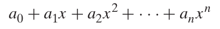 (5.2)

Có thể triển khai việc tính này bằng hàm sau, nhận đối số là array hệ số a, giá trị x và bậc đa thức degree (giá trị n trong Phương trình 5.2). Trong hàm, chúng ta tính cả các số hạng liên tiếp của phương trình lẫn các lũy thừa liên tiếp của x trong một vòng lặp:

```
 1   double poly(double a[], double x, long degree)
 2   {
 3       long i;
 4       double result = a[0];
 5       double xpwr = x;  /* Equals x^i at start of loop */
 6       for (i = 1; i <= degree; i++) {
 7           result += a[i] * xpwr;
 8           xpwr = x * xpwr;
 9       }
10       return result;
11   }
```

A. Với bậc n, code thực hiện bao nhiêu phép cộng và phép nhân?

B. Trên máy tham chiếu, với phép toán số học có latency trong Hình 5.12, chúng ta đo CPE của hàm là 5.00. Giải thích CPE này dựa trên data dependency giữa các lượt lặp do thao tác triển khai dòng 7–8 của hàm.

#### Bài tập thực hành 5.6 (lời giải trang 611)

Hãy tiếp tục khám phá cách tính giá trị đa thức như Bài tập thực hành 5.5. Có thể giảm số phép nhân bằng phương pháp Horner, đặt theo nhà toán học Anh William G. Horner (1786–1837). Ý tưởng là liên tục đưa các lũy thừa x ra làm thừa số để thu được cách tính sau:

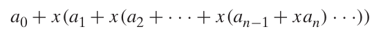 (5.3)

Dùng phương pháp Horner, có thể triển khai tính giá trị đa thức bằng code sau:

```
1   /* Apply Horner’s method */
2   double polyh(double a[], double x, long degree)
3   {
4       long i;
5       double result = a[degree];
6       for (i = degree-1; i >= 0; i--)
7           result = a[i] + x*result;
8       return result;
9   }
```

A. Với bậc n, code thực hiện bao nhiêu phép cộng và phép nhân?

B. Trên máy tham chiếu, với phép toán số học có latency trong Hình 5.12, chúng ta đo CPE của hàm là 8.00. Giải thích CPE này dựa trên data dependency giữa các lượt lặp do thao tác triển khai dòng 7 của hàm.

C. Giải thích vì sao hàm trong Bài tập thực hành 5.5 chạy nhanh hơn, dù cần nhiều phép toán hơn.

## 5.8 Loop unrolling

Loop unrolling là phép biến đổi chương trình giảm số lần lặp bằng cách tăng số phần tử được tính trong mỗi lần lặp. Chúng ta đã thấy ví dụ với function psum2 (Hình 5.1), trong đó mỗi lần lặp tính hai phần tử prefix sum, qua đó giảm một nửa tổng số lần lặp cần thiết. Loop unrolling có thể cải thiện hiệu năng theo hai cách. Thứ nhất, nó giảm số thao tác không trực tiếp đóng góp vào kết quả chương trình, chẳng hạn đánh chỉ số vòng lặp và rẽ nhánh có điều kiện. Thứ hai, nó làm lộ ra cách biến đổi code thêm để giảm số thao tác trên critical path của toàn bộ phép tính. Trong mục này, chúng ta xem xét loop unrolling đơn giản, không có phép biến đổi bổ sung.

Hình 5.16 trình bày một phiên bản code kết hợp sử dụng thứ được gọi là “2 × 1 loop unrolling.” Vòng lặp đầu đi qua array hai phần tử mỗi lần. Nghĩa là chỉ số vòng lặp i tăng 2 mỗi lần lặp, và phép toán kết hợp được áp dụng cho các phần tử array i và i + 1 trong cùng lần lặp.

Nói chung, độ dài vector không phải bội số của 2. Chúng ta muốn code hoạt động đúng với độ dài vector tùy ý. Yêu cầu này được xử lý theo hai cách. Trước tiên, bảo đảm vòng lặp đầu không vượt giới hạn array. Với vector độ dài n, đặt giới hạn vòng lặp là n − 1. Khi đó bảo đảm vòng lặp chỉ thực thi khi chỉ số i thỏa mãn i < n − 1, nên chỉ số array lớn nhất i + 1 thỏa mãn i + 1 < (n − 1) + 1 = n.

Có thể tổng quát ý tưởng này để unroll vòng lặp theo hệ số k tùy ý, tạo k × 1 loop unrolling. Để làm vậy, đặt giới hạn trên là n − k + 1 và trong vòng lặp áp dụng phép toán kết hợp cho các phần tử từ i đến i + k − 1. Chỉ số i tăng k mỗi lần lặp. Khi đó chỉ số array lớn nhất i + k − 1 nhỏ hơn n. Chúng ta thêm vòng lặp thứ hai để đi qua từng phần tử cuối còn lại của vector. Thân vòng lặp này thực thi từ 0 đến k − 1 lần. Với k = 2, có thể dùng câu lệnh điều kiện đơn giản để tùy chọn thêm lần lặp cuối, như với function psum2 (Hình 5.1). Với k > 2, các trường hợp kết thúc được biểu diễn tốt hơn bằng vòng lặp, nên cũng áp dụng quy ước này cho k = 2. Phép biến đổi được gọi là “k × 1 loop unrolling,” vì unroll theo hệ số k nhưng tích lũy giá trị trong một biến acc.

```
 1   /* 2 x 1 loop unrolling */
 2   void combine5(vec_ptr v, data_t *dest)
 3   {
 4       long i;
 5       long length = vec_length(v);
 6       long limit = length-1;
 7       data_t *data = get_vec_start(v);
 8       data_t acc = IDENT;
 9
10       /* Combine 2 elements at a time */
11       for (i = 0; i < limit; i+=2) {
12           acc = (acc OP data[i]) OP data[i+1];
13       }
14
15       /* Finish any remaining elements */
16       for (; i < length; i++) {
17           acc = acc OP data[i];
18       }
19       *dest = acc;
20   }
```

**Hình 5.16 Áp dụng 2 × 1 loop unrolling. Phép biến đổi này có thể giảm tác động của loop overhead.**

### Bài tập thực hành 5.7 (lời giải trang 611)

Sửa code combine5 để unroll vòng lặp theo hệ số k = 5.

Khi đo hiệu năng code đã unroll với hệ số k = 2 (combine5) và k = 3, chúng ta thu được các kết quả sau:

|  |  |  |  | Số nguyên | Floating point |  |
|---|---|---|---|---|---|---|
| Function | Trang | Phương pháp | + | * | + | * |
| combine4 | 551 | Không unroll | 1.27 | 3.01 | 3.01 | 5.01 |
| combine5 | 568 | Unroll 2 × 1 | 1.01 | 3.01 | 3.01 | 5.01 |
|  |  | Unroll 3 × 1 | 1.01 | 3.01 | 3.01 | 5.01 |
| Giới hạn latency |  |  | 1.00 | 3.00 | 3.00 | 5.00 |
| Giới hạn throughput |  |  | 0.50 | 1.00 | 1.00 | 0.50 |

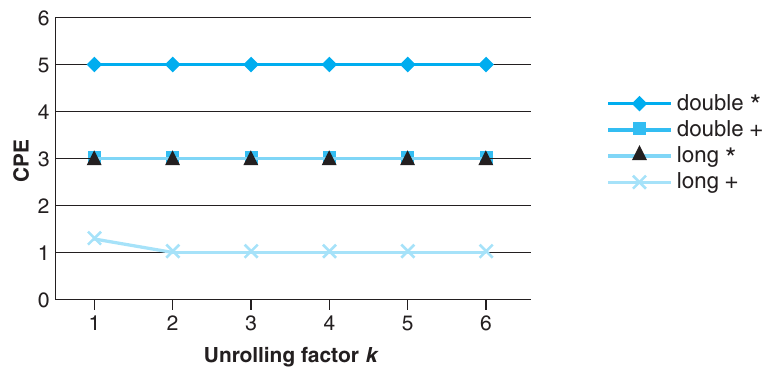

**Hình 5.17 Hiệu năng CPE với các mức k × 1 loop unrolling khác nhau. Chỉ phép cộng số nguyên được cải thiện bởi phép biến đổi này.**

Có thể thấy CPE của cộng số nguyên cải thiện, đạt giới hạn latency 1.00. Kết quả này có thể quy cho lợi ích giảm các thao tác loop overhead. Giảm số thao tác overhead tương đối với số phép cộng cần để tính tổng vector cho phép đạt đến điểm mà latency 1-cycle của cộng số nguyên trở thành yếu tố performance-limiting. Ngược lại, không trường hợp nào khác cải thiện—chúng đã ở giới hạn latency. Hình 5.17 thể hiện số đo CPE khi unroll vòng lặp theo hệ số tới 10. Xu hướng quan sát được với hệ số 2 và 3 vẫn tiếp tục—không trường hợp nào thấp hơn giới hạn latency.

Để hiểu vì sao unroll k × 1 không thể cải thiện hiệu năng vượt giới hạn latency, hãy xem machine-level code của vòng lặp trong combine5 với k = 2. Code sau được sinh khi kiểu data_t là double và phép toán là nhân:

```
    Inner loop of combine5. data_t = double, OP = *
    i in %rdx, data %rax, limit in %rbx, acc in %xmm0
1   .L35:                                    loop:
2     vmulsd  (%rax,%rdx,8), %xmm0, %xmm0      Multiply acc by data[i]
3     vmulsd  8(%rax,%rdx,8), %xmm0, %xmm0     Multiply acc by data[i+1]
4     addq    $2, %rdx                         Increment i by 2
5     cmpq    %rdx, %rbp                       Compare to limit:i
6     jg      .L35                             If >, goto loop
```

Có thể thấy gcc chuyển đổi tham chiếu array trong code C trực tiếp hơn so với code pointer-based sinh cho combine4.[^2] Chỉ số i được giữ trong %rdx và địa chỉ data trong %rax. Như trước, giá trị tích lũy acc nằm trong vector register %xmm0. Loop unrolling tạo hai instruction vmulsd—một để cộng data[i] vào acc và một để cộng data[i+1] vào acc. Hình 5.18 trình bày biểu diễn đồ họa của code. Mỗi vmulsd được chuyển thành hai thao tác: load phần tử array từ bộ nhớ và nhân giá trị đó với giá trị tích lũy. Ở đây %xmm0 được đọc và ghi hai lần mỗi lần thực thi vòng lặp. Có thể sắp xếp lại, đơn giản hóa và trừu tượng hóa đồ thị theo Hình 5.19(a) để thu được template Hình 5.19(b). Sau đó lặp lại template n/2 lần để thể hiện phép tính cho vector độ dài n, thu được biểu diễn data-flow Hình 5.20. Đồ thị vẫn có critical path gồm n thao tác mul—số lần lặp giảm một nửa nhưng mỗi lần có hai phép nhân tuần tự. Vì critical path giới hạn hiệu năng code chưa unroll, nó vẫn giới hạn với k × 1 loop unrolling.

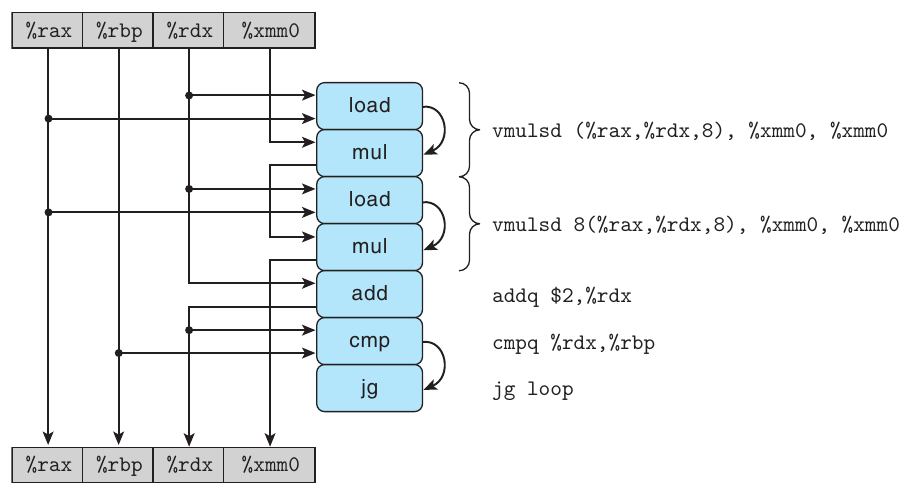

**Hình 5.18 Biểu diễn đồ họa của code inner-loop trong combine5 . Mỗi lần lặp có hai vmulsd, mỗi instruction được chuyển thành thao tác load và mul.**

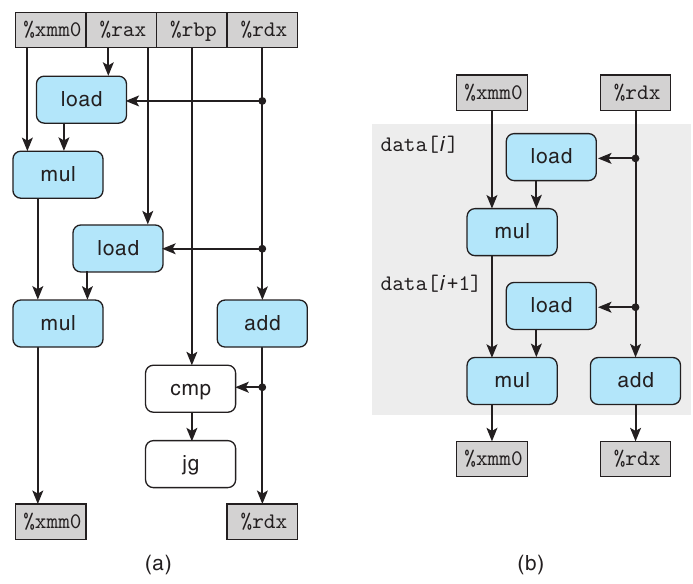

**Hình 5.19 Trừu tượng hóa thao tác combine5 thành đồ thị data-flow. Chúng ta sắp xếp lại, đơn giản hóa và trừu tượng hóa biểu diễn Hình 5.18 để thể hiện data dependency giữa các lần lặp liên tiếp (a). Mỗi lần lặp phải thực hiện hai phép nhân tuần tự (b).**

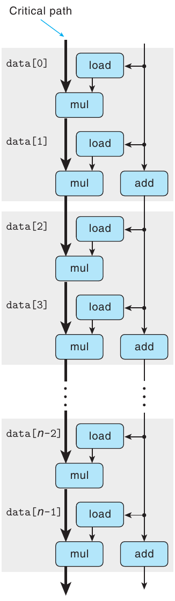

**Hình 5.20 Biểu diễn Data-flow của combine5 trên vector độ dài n. Dù vòng lặp đã unroll theo hệ số 2, vẫn có n thao tác mul trên critical path.**

### Thông tin thêm Để compiler unroll vòng lặp

Compiler có thể dễ dàng thực hiện loop unrolling. Nhiều compiler làm việc này trong tập các tối ưu hóa. gcc thực hiện một số dạng loop unrolling khi được gọi với mức tối ưu hóa 3 trở lên.

## 5.9 Tăng cường tính song song

Đến đây, các function đã chạm giới hạn do latency của các đơn vị số học áp đặt. Tuy nhiên, như đã lưu ý, functional unit cộng và nhân đều được pipeline đầy đủ, nghĩa là chúng có thể bắt đầu thao tác mới mỗi chu kỳ clock, và một số thao tác có thể do nhiều functional unit thực hiện. Phần cứng có khả năng thực hiện nhân và cộng với tốc độ cao hơn nhiều, nhưng code không tận dụng được, ngay cả khi loop unrolling, vì tích lũy giá trị trong một biến acc duy nhất. Không thể tính giá trị acc mới trước khi phép tính trước hoàn tất. Dù functional unit tính acc mới có thể bắt đầu thao tác mới mỗi chu kỳ, nó chỉ bắt đầu một thao tác mỗi L chu kỳ, trong đó L là latency của phép toán kết hợp. Giờ chúng ta tìm cách phá dependency tuần tự này và đạt hiệu năng tốt hơn giới hạn latency.

### 5.9.1 Nhiều accumulator

Với phép toán kết hợp có tính kết hợp và giao hoán, như cộng hoặc nhân số nguyên, có thể cải thiện hiệu năng bằng cách chia tập thao tác kết hợp thành hai phần trở lên rồi kết hợp kết quả ở cuối. Ví dụ, gọi P<sub>n</sub> là tích các phần tử a<sub>0</sub>, a<sub>1</sub>, . . . , a<sub>n−1</sub>:

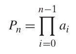

Giả sử n chẵn, cũng có thể viết P<sub>n</sub> = PE<sub>n</sub> × PO<sub>n</sub>, trong đó PE<sub>n</sub> là tích các phần tử có chỉ số chẵn, còn PO<sub>n</sub> là tích các phần tử có chỉ số lẻ:

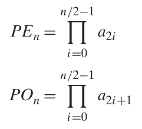

Hình 5.21 trình bày code dùng phương pháp này. Nó dùng cả loop unrolling two-way để kết hợp nhiều phần tử hơn mỗi lần lặp và tính song song two-way, tích lũy phần tử chỉ số chẵn trong acc0 và chỉ số lẻ trong acc1. Vì vậy gọi đây là “2 × 2 loop unrolling.” Như trước, thêm vòng lặp thứ hai tích lũy phần tử array còn lại khi độ dài vector không phải bội số của 2. Sau đó áp dụng phép toán kết hợp cho acc0 và acc1 để tính kết quả cuối.

So sánh chỉ loop unrolling với loop unrolling có tính song song two-way, ta có hiệu năng sau:

```
 1   /* 2 x 2 loop unrolling */
 2   void combine6(vec_ptr v, data_t *dest)
 3   {
 4       long i;
 5       long length = vec_length(v);
 6       long limit = length-1;
 7       data_t *data = get_vec_start(v);
 8       data_t acc0 = IDENT;
 9       data_t acc1 = IDENT;
10
11       /* Combine 2 elements at a time */
12       for (i = 0; i < limit; i+=2) {
13           acc0 = acc0 OP data[i];
14           acc1 = acc1 OP data[i+1];
15       }
16
17       /* Finish any remaining elements */
18       for (; i < length; i++) {
19           acc0 = acc0 OP data[i];
20       }
21       *dest = acc0 OP acc1;
22   }
```

**Hình 5.21 Áp dụng 2 × 2 loop unrolling. Bằng cách duy trì nhiều accumulator, cách này tận dụng tốt hơn nhiều functional unit và khả năng pipelining của chúng.**

|  |  |  |  | Số nguyên | Floating point |  |
|---|---|---|---|---|---|---|
| Function | Trang | Phương pháp | + | * | + | * |
| combine4 | 551 | Tích lũy trong biến tạm | 1.27 | 3.01 | 3.01 | 5.01 |
| combine5 | 568 | Unroll 2 × 1 | 1.01 | 3.01 | 3.01 | 5.01 |
| combine6 | 573 | Unroll 2 × 2 | 0.81 | 1.51 | 1.51 | 2.51 |
| Giới hạn latency |  |  | 1.00 | 3.00 | 3.00 | 5.00 |
| Giới hạn throughput |  |  | 0.50 | 1.00 | 1.00 | 0.50 |

Có thể thấy hiệu năng cải thiện trong mọi trường hợp, với nhân số nguyên, cộng floating-point và nhân floating-point cải thiện theo hệ số khoảng 2, còn cộng số nguyên cũng cải thiện phần nào. Đáng chú ý nhất, chúng ta đã vượt rào cản do giới hạn latency áp đặt. Processor không còn phải trì hoãn bắt đầu phép cộng hoặc nhân cho đến khi phép trước hoàn tất.

Để hiểu hiệu năng combine6, bắt đầu với code và chuỗi thao tác trong Hình 5.22. Có thể suy ra template thể hiện data dependency giữa các lần lặp theo quá trình Hình 5.23. Giống combine5, vòng lặp trong chứa hai vmulsd, nhưng chúng chuyển thành thao tác mul đọc và ghi register riêng, không có data dependency giữa chúng (Hình 5.23(b)). Lặp lại template n/2 lần (Hình 5.24) để mô hình hóa thực thi function trên vector độ dài n. Giờ có hai critical path, một tính tích phần tử even-numbered (giá trị chương trình acc0), một cho phần tử odd-numbered (giá trị chương trình acc1). Mỗi critical path chỉ chứa n/2 thao tác, dẫn đến CPE khoảng 5.00/2 = 2.50. Phân tích tương tự giải thích CPE quan sát khoảng L/2 cho thao tác latency L ở các tổ hợp data type và phép toán kết hợp khác nhau. Về hoạt động, chương trình tận dụng khả năng functional unit để tăng mức sử dụng theo hệ số 2. Ngoại lệ duy nhất là cộng số nguyên. CPE đã dưới 1.0 nhưng loop overhead vẫn quá lớn để đạt giới hạn lý thuyết 0.50.

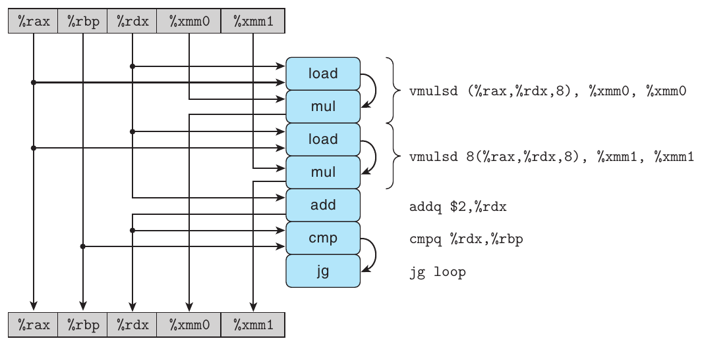

**Hình 5.22 Biểu diễn đồ họa của code inner-loop trong combine6. Mỗi lần lặp có hai vmulsd, mỗi instruction được chuyển thành thao tác load và mul.**

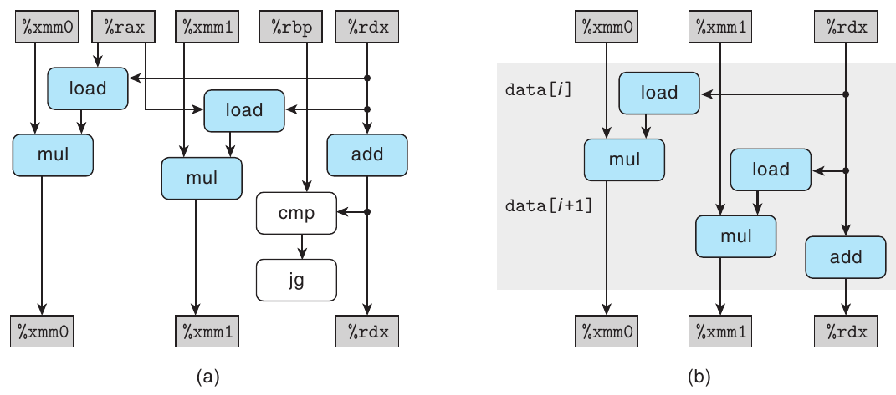

**Hình 5.23 Trừu tượng hóa thao tác combine6 thành đồ thị data-flow. Chúng ta sắp xếp lại, đơn giản hóa và trừu tượng hóa biểu diễn Hình 5.22 để thể hiện data dependency giữa các lần lặp liên tiếp (a). Không có dependency giữa hai thao tác mul (b).**

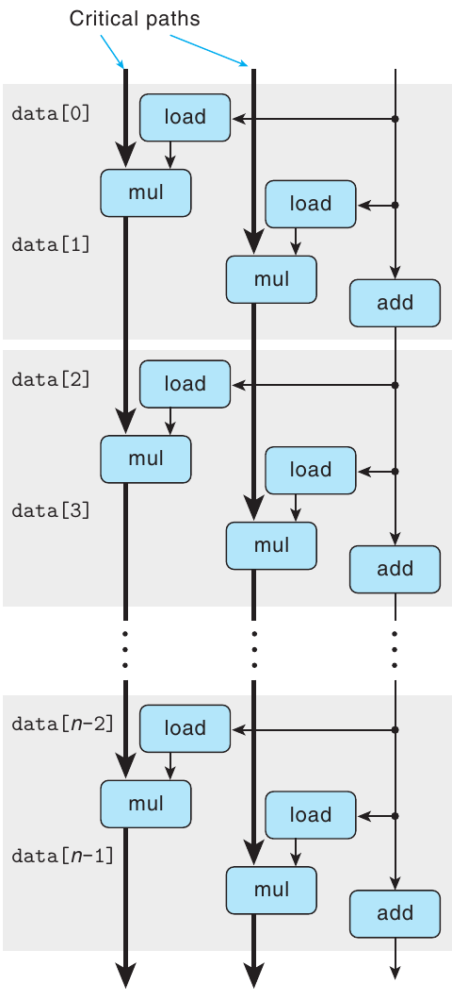

**Hình 5.24 Biểu diễn Data-flow của combine6 trên vector độ dài n. Giờ có hai critical path, mỗi đường chứa n/2 thao tác.**

Có thể tổng quát phép biến đổi nhiều accumulator để unroll theo hệ số k và tích lũy song song k giá trị, tạo k × k loop unrolling. Hình 5.25 thể hiện tác động khi áp dụng với giá trị tới k = 10. Với k đủ lớn, chương trình có thể gần đạt giới hạn throughput trong mọi trường hợp. Cộng số nguyên đạt CPE 0.54 với k = 7, gần giới hạn throughput 0.50 do hai load unit gây ra. Nhân số nguyên và cộng floating-point đạt CPE 1.01 khi k ≥ 3, tiến gần giới hạn throughput 1.00 do functional unit đặt ra. Nhân Floating-point đạt CPE 0.51 với k ≥ 10, gần giới hạn throughput 0.50 do hai bộ nhân floating-point và hai load unit đặt ra. Đáng chú ý, code đạt throughput với nhân floating-point gần gấp đôi cộng floating-point, dù nhân là thao tác phức tạp hơn.

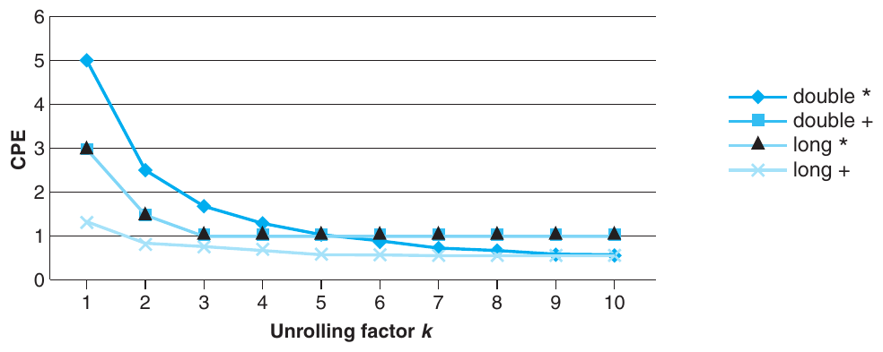

**Hình 5.25 Hiệu năng CPE của k × k loop unrolling. Mọi CPE đều cải thiện, gần đạt hoặc đạt giới hạn throughput.**

Nói chung, chương trình chỉ đạt giới hạn throughput của thao tác khi giữ đầy pipeline cho tất cả functional unit có khả năng thực hiện thao tác đó. Với thao tác có latency L và capacity C, cần hệ số unroll k ≥ C · L. Ví dụ nhân floating-point có C = 2 và L = 5, đòi hỏi k ≥ 10. Cộng Floating-point có C = 1 và L = 3, đạt throughput tối đa với k ≥ 3.

Khi thực hiện biến đổi unroll k × k, phải xem nó có bảo toàn chức năng function ban đầu không. Chương 2 đã cho thấy số học two’s-complement có tính giao hoán và kết hợp, ngay cả khi overflow. Vì vậy, với data type số nguyên, kết quả combine6 giống hệt combine5 trong mọi điều kiện. Do đó, optimizing compiler có thể chuyển code combine4 trước tiên sang biến thể combine5 được unroll two-way bằng loop unrolling, rồi sang combine6 bằng cách đưa tính song song vào. Một số compiler thực hiện phép biến đổi này hoặc tương tự để cải thiện hiệu năng dữ liệu số nguyên.

Ngược lại, nhân và cộng floating-point không có tính kết hợp. Vì vậy combine5 và combine6 có thể cho kết quả khác do làm tròn hoặc overflow. Ví dụ, hình dung phép tính tích mà mọi phần tử chỉ số chẵn có giá trị tuyệt đối rất lớn, còn phần tử chỉ số lẻ rất gần 0.0. Khi đó PE<sub>n</sub> có thể overflow hoặc PO<sub>n</sub> underflow, dù tính P<sub>n</sub> bình thường. Tuy nhiên, trong hầu hết ứng dụng real-life, những mẫu như vậy khó xuất hiện. Vì đa số hiện tượng vật lý liên tục, dữ liệu số thường khá trơn và có hành vi phù hợp. Ngay cả khi có gián đoạn, thường chúng không gây mẫu tuần hoàn dẫn đến tình huống nêu trên. Khó có khả năng nhân các phần tử đúng thứ tự cho độ chính xác tốt hơn về cơ bản so với nhân độc lập hai nhóm rồi nhân hai tích. Với hầu hết ứng dụng, lợi ích hiệu năng 2× lớn hơn rủi ro kết quả khác với mẫu dữ liệu kỳ lạ. Tuy nhiên, người phát triển nên hỏi người dùng tiềm năng xem có điều kiện cụ thể khiến thuật toán sửa đổi không thể chấp nhận không. Hầu hết compiler không thử biến đổi như vậy với code floating-point vì không thể đánh giá rủi ro thay đổi hành vi chương trình dù nhỏ đến đâu.

### 5.9.2 Phép biến đổi reassociation

Giờ chúng ta tìm cách khác phá dependency tuần tự để cải thiện hiệu năng vượt giới hạn latency. Chúng ta đã thấy k × 1 loop unrolling của combine5 không thay đổi tập thao tác kết hợp phần tử vector thành tổng hoặc tích. Tuy nhiên, thay đổi rất nhỏ trong code có thể thay đổi căn bản cách kết hợp và tăng đáng kể hiệu năng.

Hình 5.26 trình bày function combine7 chỉ khác code unroll của combine5 (Hình 5.16) ở cách kết hợp các phần tử trong vòng lặp trong. Trong combine5, phép kết hợp được thực hiện bằng câu lệnh

```
12     acc = (acc OP data[i]) OP data[i+1];
```

còn trong combine7 được thực hiện bằng câu lệnh

```
12     acc = acc OP (data[i] OP data[i+1]);
```

chỉ khác vị trí đặt hai dấu ngoặc đơn. Chúng ta gọi đây là reassociation transformation, vì dấu ngoặc dịch thứ tự kết hợp phần tử vector với giá trị tích lũy acc, tạo một dạng loop unrolling gọi là “2 × 1a.”

Với người chưa quen, hai câu lệnh có vẻ về cơ bản giống nhau, nhưng khi đo CPE, ta thu được kết quả bất ngờ:

|  |  |  |  | Số nguyên | Floating point |  |
|---|---|---|---|---|---|---|
| Function | Trang | Phương pháp | + | * | + | * |
| combine4 | 551 | Tích lũy trong biến tạm | 1.27 | 3.01 | 3.01 | 5.01 |
| combine5 | 568 | Unroll 2 × 1 | 1.01 | 3.01 | 3.01 | 5.01 |
| combine6 | 573 | Unroll 2 × 2 | 0.81 | 1.51 | 1.51 | 2.51 |
| combine7 | 578 | Unroll 2 × 1a | 1.01 | 1.51 | 1.51 | 2.51 |
| Giới hạn latency |  |  | 1.00 | 3.00 | 3.00 | 5.00 |
| Giới hạn throughput |  |  | 0.50 | 1.00 | 1.00 | 0.50 |

```
 1   /* 2 x 1a loop unrolling */
 2   void combine7(vec_ptr v, data_t *dest)
 3   {
 4       long i;
 5       long length = vec_length(v);
 6       long limit = length-1;
 7       data_t *data = get_vec_start(v);
 8       data_t acc = IDENT;
 9
10       /* Combine 2 elements at a time */
11       for (i = 0; i < limit; i+=2) {
12           acc = acc OP (data[i] OP data[i+1]);
13       }
14
15       /* Finish any remaining elements */
16       for (; i < length; i++) {
17           acc = acc OP data[i];
18       }
19       *dest = acc;
20   }
```

**Hình 5.26 Áp dụng unroll 2 × 1a. Bằng cách reassociate phép toán số học, cách này tăng số thao tác có thể thực hiện song song.**

Trường hợp cộng số nguyên khớp hiệu năng unroll k × 1 (combine5), còn ba trường hợp kia khớp các phiên bản có accumulator song song (combine6), tăng gấp đôi hiệu năng so với unroll k × 1. Những trường hợp này đã vượt rào cản giới hạn latency.

Hình 5.27 minh họa cách code vòng lặp trong combine7 (với nhân là phép toán kết hợp và double là data type) được decode thành các thao tác và data dependency thu được. Các thao tác load từ vmovsd và vmulsd đầu tiên nạp phần tử vector i và i + 1 từ bộ nhớ, rồi thao tác mul đầu tiên nhân chúng với nhau. Mul thứ hai nhân kết quả này với giá trị tích lũy acc. Hình 5.28(a) thể hiện cách sắp xếp lại, tinh chỉnh và trừu tượng hóa thao tác Hình 5.27 thành template biểu diễn data dependency cho một lần lặp (Hình 5.28(b)). Giống template combine5 và combine7, có hai load và hai mul, nhưng chỉ một mul tạo chuỗi data-dependency giữa các loop register. Khi lặp template n/2 lần để thể hiện các phép tính nhân n phần tử vector (Hình 5.29), chỉ có n/2 thao tác trên critical path. Phép nhân đầu mỗi lần lặp có thể thực hiện mà không chờ giá trị tích lũy từ lần trước. Vì vậy giảm CPE tối thiểu có thể theo hệ số khoảng 2.

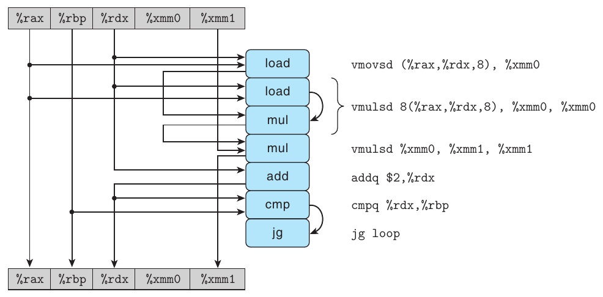

**Hình 5.27 Biểu diễn đồ họa của code inner-loop trong combine7 . Mỗi lần lặp được decode thành thao tác tương tự combine5 hoặc combine6 , nhưng có data dependency khác nhau.**

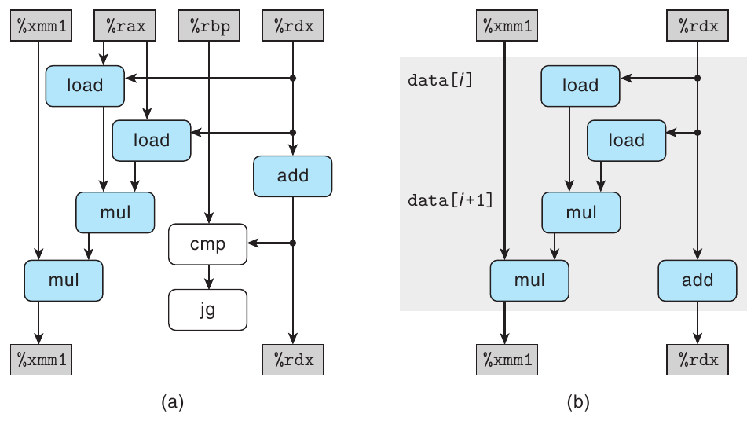

**Hình 5.28 Trừu tượng hóa thao tác combine7 thành đồ thị data-flow. Chúng ta sắp xếp lại, đơn giản hóa và trừu tượng hóa biểu diễn Hình 5.27 để thể hiện data dependency giữa các lần lặp liên tiếp. Mul phía trên nhân hai phần tử 2-vector với nhau, còn mul phía dưới nhân kết quả với biến vòng lặp acc.**

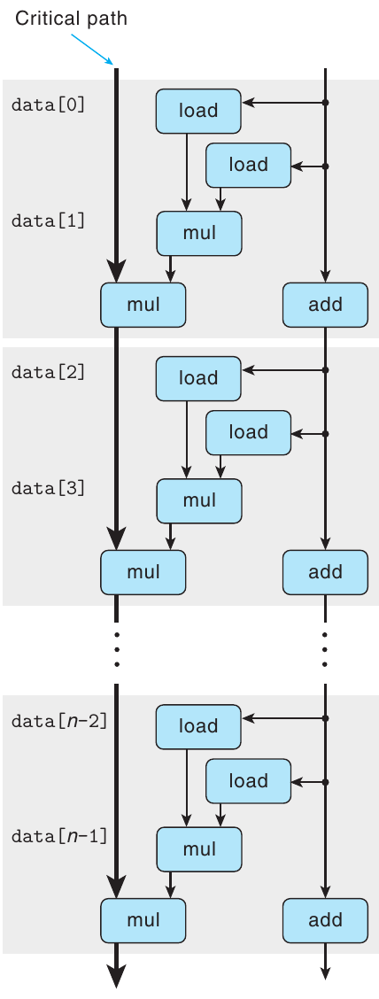

**Hình 5.29 Biểu diễn Data-flow của combine7 trên vector độ dài n. Có một critical path duy nhất nhưng chỉ chứa n/2 thao tác.**

Hình 5.30 thể hiện tác động áp dụng reassociation transformation để đạt k × 1a loop unrolling với giá trị tới k = 10. Phép biến đổi cho hiệu năng tương tự duy trì k accumulator riêng với unroll k × k. Trong mọi trường hợp, chúng ta gần đạt giới hạn throughput do functional unit áp đặt.

Khi thực hiện reassociation transformation, một lần nữa thay đổi thứ tự kết hợp các phần tử vector. Với cộng và nhân số nguyên, tính kết hợp bảo đảm sắp xếp lại không ảnh hưởng kết quả. Với các trường hợp floating-point, lại phải đánh giá reassociation có khả năng ảnh hưởng đáng kể kết quả hay không. Chúng ta cho rằng khác biệt không đáng kể với hầu hết ứng dụng.

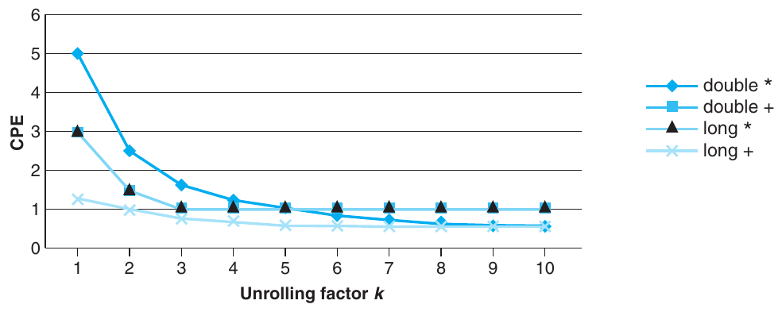

**Hình 5.30 Hiệu năng CPE của k × 1a loop unrolling. Mọi CPE cải thiện với phép biến đổi này, gần tiến đến giới hạn throughput.**

Tóm lại, reassociation transformation có thể giảm số thao tác trên critical path của phép tính, cho hiệu năng tốt hơn nhờ tận dụng tốt hơn nhiều functional unit và khả năng pipelining. Hầu hết compiler không thử reassociation các phép toán floating-point vì chúng không được bảo đảm có tính kết hợp. Các phiên bản gcc hiện tại thực hiện reassociation phép toán số nguyên nhưng không phải luôn có tác dụng tốt. Nói chung, chúng ta thấy unroll vòng lặp và tích lũy song song nhiều giá trị là cách đáng tin cậy hơn để cải thiện hiệu năng.

#### Bài tập thực hành 5.8 (lời giải trang 612)

Xét function sau tính tích một array gồm n số double-precision. Chúng ta đã unroll vòng lặp theo hệ số 3.

```
double aprod(double a[], long n)
{
    long i;
    double x, y, z;
    double r = 1;
    for (i = 0; i < n-2; i+= 3) {
        x = a[i]; y = a[i+1]; z = a[i+2];
        r = r * x * y * z; /* Product computation */
    }
    for (; i < n; i++)
        r *= a[i];
    return r;
}
```

Với dòng mang nhãn “Product computation”, có thể dùng dấu ngoặc để tạo năm cách kết hợp phép tính khác nhau như sau:

```
r = ((r * x) * y) * z; /* A1 */
r = (r * (x * y)) * z; /* A2 */
r = r * ((x * y) * z); /* A3 */
r = r * (x * (y * z)); /* A4 */
r = (r * x) * (y * z); /* A5 */
```

Giả sử chạy các function này trên máy có latency nhân floating-point là 5 chu kỳ clock. Xác định cận dưới CPE do data dependency của phép nhân đặt ra. (Gợi ý: Vẽ biểu diễn data-flow về cách r được tính mỗi lần lặp sẽ hữu ích.)

#### Ghi chú Web OPT:SIMD Đạt tính song song cao hơn bằng vector instruction

Như mô tả trong Mục 3.1, Intel giới thiệu instruction SSE năm 1999, trong đó SSE viết tắt của “streaming SIMD extensions” và SIMD (phát âm “sim-dee”) viết tắt của “single instruction, multiple data.” Khả năng SSE đã trải qua nhiều thế hệ, với các phiên bản gần đây mang tên advanced vector extensions, hay AVX. Mô hình thực thi SIMD thao tác trên toàn vector dữ liệu bằng một instruction. Các vector được giữ trong tập vector register đặc biệt mang tên %ymm0–%ymm15. Vector register AVX hiện tại dài 32 byte, nên mỗi register chứa tám số 32-bit hoặc bốn số 64-bit, có thể là số nguyên hoặc floating-point. Instruction AVX có thể thực hiện vector operation trên register, chẳng hạn cộng hoặc nhân song song tám hoặc bốn tập giá trị. Ví dụ, nếu YMM register %ymm0 chứa tám số floating-point single-precision, ký hiệu a<sub>0</sub>, . . . , a<sub>7</sub>, và %rcx chứa địa chỉ bộ nhớ của chuỗi tám số floating-point single-precision, ký hiệu b<sub>0</sub>, . . . , b<sub>7</sub>, thì instruction

```
vmulps  (%rcs), %ymm0, %ymm1
```

sẽ đọc tám giá trị từ bộ nhớ và thực hiện tám phép nhân song song, tính a<sub>i</sub> ← a<sub>i</sub> · b<sub>i</sub> , với 0 ≤ i ≤ 7, rồi lưu tám tích thu được trong vector register %ymm1. Một instruction duy nhất tạo phép tính trên nhiều giá trị dữ liệu, do đó có thuật ngữ “SIMD.”

gcc hỗ trợ các mở rộng ngôn ngữ C cho phép lập trình viên biểu diễn chương trình bằng vector operation có thể biên dịch thành vector instruction AVX (cũng như code dựa trên SSE trước đó). Phong cách này được ưu tiên hơn viết code trực tiếp bằng assembly vì gcc còn có thể sinh code cho vector instruction trên processor khác.

Kết hợp instruction gcc, loop unrolling và nhiều accumulator, chúng ta đạt hiệu năng sau cho các function kết hợp:

#### Ghi chú Web OPT:SIMD Đạt tính song song cao hơn bằng vector instruction (tiếp theo)

|  | Số nguyên |  |  |  | Floating point |  |  |  |
|---|---|---|---|---|---|---|---|---|
|  | int |  | long |  | int |  | long |  |
| Phương pháp | + | * | + | * | + | * | + | * |
| Scalar 10 × 10 | 0.54 | 1.01 | 0.55 | 1.00 | 1.01 | 0.51 | 1.01 | 0.52 |
| Giới hạn throughput scalar | 0.50 | 0.50 | 1.00 | 1.00 | 1.00 | 1.00 | 0.50 | 0.50 |
| Vector 8 × 8 | 0.05 | 0.24 | 0.13 | 1.51 | 0.12 | 0.08 | 0.25 | 0.16 |
| Giới hạn throughput vector | 0.06 | 0.12 | 0.12 | — | 0.12 | 0.06 | 0.25 | 0.12 |

Trong bảng này, tập số đầu dành cho scalar code thông thường viết theo phong cách combine6, unroll hệ số 10 và duy trì 10 accumulator. Tập số thứ hai dành cho code ở dạng gcc có thể biên dịch thành vector code AVX. Ngoài vector operation, phiên bản này unroll vòng lặp chính hệ số 8 và duy trì tám vector accumulator riêng. Chúng ta trình bày kết quả cho cả số 32-bit lẫn 64-bit vì vector instruction đạt tính song song 8-way trong trường hợp đầu nhưng chỉ 4-way trong trường hợp sau.

Có thể thấy vector code cải thiện gần tám lần trong bốn trường hợp 32-bit và bốn lần trong ba trong bốn trường hợp 64-bit. Chỉ code nhân số nguyên long không hoạt động tốt khi biểu diễn bằng vector code. Tập instruction AVX không có instruction nhân song song số nguyên 64-bit nên gcc không thể sinh vector code cho trường hợp này. Vector instruction tạo giới hạn throughput mới cho các phép toán kết hợp: thấp hơn tám lần với thao tác 32-bit và bốn lần với thao tác 64-bit so với giới hạn scalar. Code gần đạt các giới hạn với nhiều tổ hợp data type và phép toán.

## 5.10 Tổng hợp kết quả tối ưu hóa code kết hợp

Nỗ lực tối đa hóa hiệu năng routine cộng hoặc nhân phần tử vector rõ ràng đã mang lại kết quả. Sau đây tổng hợp kết quả thu được với scalar code, không tận dụng tính song song vector do instruction AVX cung cấp:

|  |  |  |  | Số nguyên | Floating point |  |
|---|---|---|---|---|---|---|
| Function | Trang | Phương pháp | + | * | + | * |
| combine1 | 543 | Trừu tượng -O1 | 10.12 | 10.12 | 10.17 | 11.14 |
| combine6 | 573 | Unroll 2 × 2 | 0.81 | 1.51 | 1.51 | 2.51 |
|  |  | Unroll 10 × 10 | 0.55 | 1.00 | 1.01 | 0.52 |
| Giới hạn latency |  |  | 1.00 | 3.00 | 3.00 | 5.00 |
| Giới hạn throughput |  |  | 0.50 | 1.00 | 1.00 | 0.50 |

Bằng nhiều tối ưu hóa, chúng ta đạt CPE gần giới hạn throughput 0.50 và 1.00, chỉ bị giới hạn bởi capacity functional unit. Đây là cải thiện 10–20× so với code ban đầu. Tất cả dùng code C thông thường và compiler tiêu chuẩn. Viết lại để tận dụng instruction SIMD mới cho thêm lợi ích gần 4× hoặc 8×. Ví dụ với nhân single-precision, CPE giảm từ 11.14 ban đầu xuống 0.06, cải thiện hiệu năng tổng thể hơn 180×. Ví dụ cho thấy processor hiện đại có sức mạnh tính toán đáng kể nhưng có thể phải khai thác bằng cách viết chương trình theo phong cách rất cụ thể.

## 5.11 Một số yếu tố giới hạn

Chúng ta đã thấy critical path trong biểu diễn đồ thị data-flow của chương trình chỉ ra cận dưới cơ bản cho thời gian thực thi. Nghĩa là nếu chương trình có chuỗi data dependency với tổng mọi latency trên chuỗi bằng T , chương trình cần ít nhất T chu kỳ để thực thi.

Chúng ta cũng thấy giới hạn throughput của functional unit áp đặt cận dưới cho thời gian thực thi. Giả sử chương trình cần tổng cộng N phép tính của thao tác nào đó, microprocessor có C functional unit thực hiện được thao tác và các đơn vị có issue time I . Khi đó chương trình cần ít nhất N · I /C chu kỳ để thực thi.

Trong mục này, chúng ta xem xét một số yếu tố khác giới hạn hiệu năng chương trình trên máy thực tế.

### 5.11.1 Register spilling

Lợi ích của tính song song vòng lặp bị giới hạn bởi khả năng biểu diễn phép tính bằng assembly code. Nếu mức song song P vượt số register sẵn có, compiler phải dùng spilling, lưu một số giá trị tạm vào bộ nhớ, thường bằng cách cấp phát không gian trên stack run-time. Ví dụ, các số đo sau so sánh kết quả mở rộng phương án nhiều accumulator của combine6 tới k = 10 và k = 20:

|  |  |  | Số nguyên |  |  | Floating point |
|---|---|---|---|---|---|---|
| Function | Trang | Phương pháp | + | * | + | * |
| combine6 | 573 |  |  |  |  |  |
|  |  | Unroll 10 × 10 | 0.55 | 1.00 | 1.01 | 0.52 |
|  |  | Unroll 20 × 20 | 0.83 | 1.03 | 1.02 | 0.68 |
| Giới hạn throughput |  |  | 0.50 | 1.00 | 1.00 | 0.50 |

Có thể thấy không CPE nào cải thiện khi tăng mức unroll và một số còn tệ hơn. Processor x86-64 hiện đại có 16 integer register và có thể dùng 16 YMM register lưu dữ liệu floating-point. Khi số biến vòng lặp vượt số register sẵn có, chương trình phải cấp phát một số biến trên stack.

Ví dụ, đoạn code sau thể hiện cách cập nhật accumulator acc0 trong vòng lặp trong của code unroll 10 × 10:

```
Updating of accumulator acc0 in 10 x 10 urolling
vmulsd  (%rdx), %xmm0, %xmm0     acc0 *= data[i]
```

Có thể thấy accumulator được giữ trong %xmm0, nên chương trình chỉ cần đọc data[i] từ bộ nhớ và nhân với register này.

Phần tương ứng của code unroll 20 × 20 có dạng rất khác:

```
Updating of accumulator acc0 in 20 x 20 unrolling
vmovsd  40(%rsp), %xmm0
vmulsd  (%rdx), %xmm0, %xmm0
vmovsd  %xmm0, 40(%rsp)
```

Accumulator được giữ dưới dạng biến cục bộ trên stack, tại offset 40 tính từ stack pointer. Chương trình phải đọc cả giá trị đó lẫn data[i] từ bộ nhớ, nhân chúng và lưu kết quả lại bộ nhớ.

Khi compiler phải dùng register spilling, mọi lợi ích duy trì nhiều accumulator rất có thể mất đi. May mắn, x86-64 có đủ register để hầu hết vòng lặp bị giới hạn throughput trước khi điều này xảy ra.

### 5.11.2 Branch prediction và penalty do dự đoán sai

Qua thực nghiệm Mục 3.6.6, chúng ta đã chứng minh conditional branch có thể chịu misprediction penalty đáng kể khi branch prediction logic không đoán đúng nhánh có được lấy không. Giờ đã biết phần nào processor hoạt động ra sao, chúng ta có thể hiểu penalty xuất hiện từ đâu.

Processor hiện đại làm việc trước khá xa instruction đang thực thi, đọc instruction mới từ bộ nhớ và decode để xác định thao tác nào trên operand nào. Instruction pipelining hoạt động tốt chừng nào instruction đi theo chuỗi đơn giản. Khi gặp branch, processor phải đoán hướng đi. Với conditional jump, đó là dự đoán có lấy nhánh không. Với instruction như indirect jump (như code nhảy đến địa chỉ do jump table entry chỉ định) hoặc trả về procedure, đó là dự đoán target address. Trong thảo luận này, chúng ta tập trung vào conditional branch.

Với speculative execution, processor bắt đầu thực thi instruction tại đích nhánh dự đoán. Nó tránh sửa mọi register hay vị trí bộ nhớ thực tế cho đến khi xác định kết quả thật. Nếu dự đoán đúng, processor có thể “commit” kết quả instruction thực thi suy đoán bằng cách lưu vào register hoặc bộ nhớ. Nếu sai, processor phải loại bỏ mọi kết quả suy đoán và khởi động lại fetch instruction tại vị trí đúng. Misprediction penalty phát sinh vì pipeline instruction phải được nạp đầy lại trước khi tạo kết quả hữu ích.

Trong Mục 3.6.6, chúng ta đã thấy các phiên bản processor x86 gần đây, gồm mọi processor thực thi được chương trình x86-64, có instruction conditional move. gcc có thể sinh code dùng chúng khi biên dịch câu lệnh và biểu thức điều kiện thay cho cách truyền thống dựa trên truyền quyền điều khiển có điều kiện. Ý tưởng cơ bản là tính giá trị trên cả hai nhánh của biểu thức hoặc câu lệnh, rồi dùng conditional move chọn giá trị mong muốn. Mục 4.5.7 đã cho thấy conditional move triển khai được như một phần xử lý pipeline của instruction thông thường. Không cần đoán điều kiện có đúng không nên không bị penalty vì đoán sai.

Vậy lập trình viên C làm sao bảo đảm penalty dự đoán sai không cản trở hiệu quả chương trình? Với misprediction penalty 19-cycle đo trên máy tham chiếu, tác động rất lớn. Không có câu trả lời đơn giản nhưng có các nguyên tắc tổng quát sau.

### Đừng quá lo về các nhánh có thể dự đoán

Chúng ta đã thấy tác động nhánh dự đoán sai có thể rất lớn, nhưng không có nghĩa mọi nhánh đều làm chậm chương trình. Thực tế, branch prediction logic của processor hiện đại rất giỏi nhận diện mẫu đều đặn và xu hướng long-term của các branch instruction. Ví dụ các nhánh loop-closing trong routine kết hợp thường được dự đoán là lấy nhánh, nên chỉ chịu misprediction penalty ở lần cuối.

Là ví dụ khác, xét kết quả quan sát khi chuyển từ combine2 sang combine3, đưa function get_vec_element ra khỏi vòng lặp trong, được nhắc lại dưới đây:

|  |  |  | Số nguyên |  | Floating point |  |
|---|---|---|---|---|---|---|
| Function | Trang | Phương pháp | + | * | + | * |
| combine2 | 545 | Di chuyển vec_length | 7.02 | 9.03 | 9.02 | 11.03 |
| combine3 | 549 | Truy cập dữ liệu trực tiếp | 7.17 | 9.02 | 9.02 | 11.03 |

CPE không cải thiện dù phép biến đổi loại bỏ hai phép kiểm tra điều kiện mỗi lần lặp để xác nhận chỉ số vector nằm trong giới hạn. Với function này, kiểm tra luôn thành công nên rất dễ dự đoán.

Để đo tác động hiệu năng của kiểm tra giới hạn, xét code kết hợp sau, trong đó vòng lặp trong combine4 được sửa bằng cách thay truy cập phần tử dữ liệu bằng kết quả inline substitution code của get_vec_element. Phiên bản mới gọi là combine4b. Code kiểm tra giới hạn và tham chiếu phần tử vector qua cấu trúc dữ liệu vector.

```
 1   /* Include bounds check in loop */
 2   void combine4b(vec_ptr v, data_t *dest)
 3   {
 4       long i;
 5       long length = vec_length(v);
 6       data_t acc = IDENT;
 7
 8       for (i = 0; i < length; i++) {
 9           if (i >= 0 && i < v->len) {
10               acc = acc OP v->data[i];
11           }
12       }
13       *dest = acc;
14   }
```

Sau đó có thể trực tiếp so sánh CPE các function có và không kiểm tra giới hạn:

|  |  |  | Số nguyên |  | Floating point |  |
|---|---|---|---|---|---|---|
| Function | Trang | Phương pháp | + | * | + | * |
| combine4 | 551 | Không kiểm tra giới hạn | 1.27 | 3.01 | 3.01 | 5.01 |
| combine4b | 551 | Kiểm tra giới hạn | 2.02 | 3.01 | 3.01 | 5.01 |

Phiên bản kiểm tra giới hạn chậm hơn một chút với cộng số nguyên, nhưng đạt cùng hiệu năng ở ba trường hợp còn lại. Hiệu năng những trường hợp đó bị giới hạn bởi latency phép toán kết hợp tương ứng. Phép tính bổ sung để kiểm tra giới hạn có thể diễn ra song song với phép toán kết hợp. Processor dự đoán được kết quả nhánh, nên việc đánh giá này không ảnh hưởng nhiều đến fetch và xử lý instruction tạo critical path trong thực thi chương trình.

### Viết code phù hợp triển khai bằng conditional move

Branch prediction chỉ đáng tin với mẫu đều đặn. Nhiều phép kiểm tra hoàn toàn không thể dự đoán, phụ thuộc đặc điểm dữ liệu tùy ý như số âm hay dương. Với chúng, branch prediction logic hoạt động rất kém. Trong các trường hợp vốn không thể dự đoán, hiệu năng cải thiện đáng kể nếu compiler sinh được code dùng truyền dữ liệu có điều kiện thay cho truyền quyền điều khiển có điều kiện. Lập trình viên C không thể điều khiển trực tiếp điều này, nhưng một số cách biểu diễn hành vi điều kiện chuyển sang conditional move trực tiếp hơn cách khác.

Chúng ta thấy gcc sinh được conditional move cho code viết theo phong cách “functional” hơn, dùng thao tác điều kiện tính giá trị rồi cập nhật trạng thái chương trình bằng các giá trị đó, thay vì phong cách “imperative” hơn, dùng điều kiện để chọn lọc cập nhật trạng thái.

Không có quy tắc cứng cho hai phong cách, nên minh họa bằng ví dụ. Giả sử có hai array số nguyên a và b, và tại mỗi vị trí i muốn đặt a[i] thành giá trị nhỏ nhất của a[i], b[i], còn b[i] thành giá trị lớn nhất.

Phong cách imperative triển khai function này là kiểm tra từng vị trí i và hoán đổi hai phần tử nếu chúng sai thứ tự:

```
 1   /* Rearrange two vectors so that for each i, b[i] >= a[i] */
 2   void minmax1(long a[], long b[], long n) {
 3       long i;
 4       for (i = 0; i < n; i++) {
 5           if (a[i] > b[i]) {
 6               long t = a[i];
 7               a[i] = b[i];
 8               b[i] = t;
 9           }
10       }
11   }
```

Số đo function này cho CPE khoảng 13.5 với dữ liệu ngẫu nhiên và 2.5–3.5 với dữ liệu có thể dự đoán, chỉ ra misprediction penalty khoảng 20 chu kỳ.

Phong cách functional triển khai function này là tính giá trị nhỏ nhất và lớn nhất tại mỗi vị trí i, rồi lần lượt gán chúng cho a[i] và b[i]:

```
 1   /* Rearrange two vectors so that for each i, b[i] >= a[i] */
 2   void minmax2(long a[], long b[], long n) {
 3       long i;
 4       for (i = 0; i < n; i++) {
 5           long min = a[i] < b[i] ? a[i] : b[i];
 6           long max = a[i] < b[i] ? b[i] : a[i];
 7           a[i] = min;
 8           b[i] = max;
 9       }
10   }
```

Số đo function này cho CPE khoảng 4.0 bất kể dữ liệu tùy ý hay có thể dự đoán. (Chúng ta cũng xem assembly code sinh ra để chắc rằng nó thực sự dùng conditional move.)

Như thảo luận trong Mục 3.6.6, không phải mọi hành vi điều kiện đều triển khai được bằng truyền dữ liệu có điều kiện, nên tất yếu có trường hợp lập trình viên không tránh được viết code dẫn đến conditional branch mà processor dự đoán kém. Tuy nhiên, như đã thấy, một chút khéo léo đôi khi khiến code dễ chuyển sang truyền dữ liệu có điều kiện hơn. Điều này đòi hỏi thử nghiệm: viết các phiên bản function khác nhau rồi xem assembly code sinh ra và đo hiệu năng.

#### Bài tập thực hành 5.9 (lời giải trang 612)

Cách triển khai truyền thống của bước merge trong mergesort cần ba vòng lặp [98]:

```
 1   void merge(long src1[], long src2[], long dest[], long n) {
 2       long i1 = 0;
 3       long i2 = 0;
 4       long id = 0;
 5       while (i1 < n && i2 < n) {
 6           if (src1[i1] < src2[i2])
 7               dest[id++] = src1[i1++];
 8           else
 9               dest[id++] = src2[i2++];
10       }
11       while (i1 < n)
12           dest[id++] = src1[i1++];
13       while (i2 < n)
14           dest[id++] = src2[i2++];
15   }
```

Các nhánh do so sánh i1 và i2 với n có hiệu năng dự đoán tốt—chỉ dự đoán sai khi chúng lần đầu trở thành false. Ngược lại, so sánh src1[i1] với src2[i2] (dòng 6) rất khó dự đoán với dữ liệu điển hình. So sánh này điều khiển conditional branch, cho CPE (với số phần tử là 2n) khoảng 15.0 khi chạy trên dữ liệu ngẫu nhiên.

Viết lại code để tác dụng câu lệnh điều kiện trong vòng lặp đầu (dòng 6–9) có thể được triển khai bằng conditional move.

## 5.12 Hiểu hiệu năng bộ nhớ

Mọi code đã viết và thử nghiệm đã chạy đến đây đều truy cập lượng bộ nhớ tương đối nhỏ. Ví dụ, combining routine được đo trên vector dưới 1,000 phần tử, cần không quá 8,000 byte dữ liệu. Mọi processor hiện đại có một hoặc nhiều cache memory để truy cập nhanh lượng nhỏ dữ liệu như vậy. Trong phần này, chúng ta khảo sát thêm hiệu năng chương trình có load (đọc bộ nhớ vào register) và store (ghi register vào bộ nhớ), chỉ xét khi mọi dữ liệu nằm trong cache. Chương 6 trình bày chi tiết hơn cách cache hoạt động, đặc tính hiệu năng và cách viết code tận dụng cache tốt nhất.

Như Hình 5.11, processor hiện đại có functional unit chuyên thực hiện load và store, với internal buffer chứa các tập yêu cầu thao tác bộ nhớ chưa hoàn tất. Ví dụ, reference machine có hai load unit, mỗi unit giữ tối đa 72 yêu cầu đọc chờ xử lý. Nó có một store unit với store buffer chứa tối đa 42 yêu cầu ghi. Mỗi unit có thể bắt đầu 1 thao tác mỗi clock cycle.

### 5.12.1 Hiệu năng load

Hiệu năng chương trình chứa load phụ thuộc cả khả năng pipelining lẫn latency load unit. Trong thử nghiệm combining operation trên reference machine, CPE không bao giờ dưới 0.50 với mọi tổ hợp data type và phép toán, trừ khi dùng SIMD. Một yếu tố giới hạn CPE là mọi ví dụ cần đọc một giá trị bộ nhớ cho mỗi phần tử tính toán. Với hai load unit, mỗi unit bắt đầu tối đa 1 load mỗi clock cycle, CPE không thể dưới 0.50. Với ứng dụng phải load k giá trị cho mỗi phần tử tính, không bao giờ đạt CPE dưới k/2 (xem Bài tập 5.15).

Đến đây, chúng ta chưa thấy tác động hiệu năng do latency load. Địa chỉ load chỉ phụ thuộc loop index i, nên load không thuộc critical path performance-limiting.

Để xác định latency load trên máy, có thể tạo phép tính gồm chuỗi load, trong đó kết quả thao tác này quyết định địa chỉ thao tác tiếp theo. Ví dụ, function list_len trong Hình 5.31 tính độ dài linked list. Trong vòng lặp, mỗi giá trị tiếp theo của variable ls phụ thuộc giá trị đọc qua pointer reference ls->next. Phép đo cho CPE 4.00, được xem là chỉ báo trực tiếp latency load. Để hiểu, xét assembly code của vòng lặp:

```
 1   typedef struct ELE {
 2       struct ELE *next;
 3       long data;
 4   } list_ele, *list_ptr;
 5
 6   long list_len(list_ptr ls) {
 7       long len = 0;
 8       while (ls) {
 9         len++;
10         ls = ls->next;
11       }
12       return len;
13   }
```

**Hình 5.31 Function linked list. Hiệu năng bị giới hạn bởi latency load.**

```
    Inner loop of list_len
    ls in %rdi, len in %rax
1   .L3:                     loop:
2     addq    $1, %rax         Increment len
3     movq    (%rdi), %rdi     ls = ls->next
4     testq   %rdi, %rdi       Test ls
5     jne     .L3              If nonnull, goto loop
```

Instruction movq ở dòng 3 tạo bottleneck quan trọng. Mỗi giá trị kế tiếp của register %rdi phụ thuộc kết quả load dùng giá trị %rdi làm địa chỉ. Vì vậy, load của iteration này không thể bắt đầu cho đến khi load iteration trước hoàn tất. CPE 4.00 do latency load quyết định. Thực tế, phép đo khớp thời gian truy cập L1 cache 4 cycle được tài liệu reference machine nêu, như Mục 6.4.

### 5.12.2 Hiệu năng store

Trong mọi ví dụ đến đây, chúng ta chỉ phân tích function tham chiếu bộ nhớ chủ yếu bằng load, đọc vị trí bộ nhớ vào register. Thao tác đối ứng store ghi giá trị register vào bộ nhớ. Hiệu năng thao tác này, đặc biệt tương tác với load, có nhiều vấn đề tinh tế.

Giống load, phần lớn trường hợp store hoạt động hoàn toàn pipelined, bắt đầu store mới mỗi cycle. Ví dụ, function Hình 5.32 đặt phần tử array dest độ dài n bằng 0. Phép đo cho CPE 1.0, mức tốt nhất trên máy có một store functional unit.

Khác những thao tác đã xét, store không ảnh hưởng giá trị register nào. Vì vậy, bản chất chuỗi store không tạo data dependency. Chỉ load bị ảnh hưởng bởi kết quả store, vì chỉ load đọc lại được giá trị bộ nhớ đã ghi. Function write_read trong Hình 5.33 minh họa tương tác tiềm năng giữa load và store. Hình còn có hai lần thực thi ví dụ, khi gọi với array a two-element có nội dung ban đầu −10 và 17, argument cnt bằng 3. Những lần thực thi minh họa điểm tinh tế của load và store.

```
1   /* Set elements of array to 0 */
2   void clear_array(long *dest, long n) {
3       long i;
4       for (i = 0; i < n; i++)
5           dest[i] = 0;
6   }
```

**Hình 5.32 Function đặt phần tử array bằng 0. Code đạt CPE 1.0.**

```
 1   /* Write to dest, read from src */
 2   void write_read(long *src, long *dst, long n)
 3   {
 4       long cnt = n;
 5       long val = 0;
 6
 7       while (cnt) {
 8           *dst = val;
 9           val = (*src)+1;
10           cnt--;
11       }
12   }
```

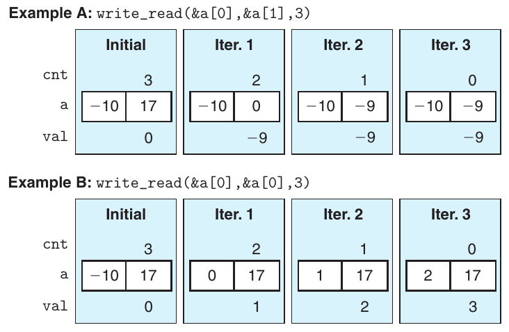

**Hình 5.33 Code ghi, đọc vị trí bộ nhớ và các lần thực thi minh họa. Function nhấn mạnh tương tác giữa store và load khi argument src và dest bằng nhau.**

Trong Ví dụ A Hình 5.33, argument src trỏ tới phần tử a[0], còn dest trỏ tới a[1]. Mỗi load bằng pointer reference *src cho giá trị −10. Vì vậy, sau hai iteration, phần tử array giữ cố định lần lượt −10 và −9. Đọc src không bị ảnh hưởng bởi ghi dest. Đo ví dụ với nhiều iteration hơn cho CPE 1.3.

Trong Ví dụ B Hình 5.33, cả src và dest đều trỏ tới a[0]. Mỗi load qua *src cho giá trị do lần thực thi *dest trước lưu. Vì vậy, chuỗi giá trị tăng dần được lưu tại vị trí này. Nói chung, nếu write_read được gọi với src và dest cùng trỏ một vị trí bộ nhớ, cnt có giá trị n > 0, tác động tổng thể là đặt vị trí đó bằng n − 1. Đây là hiện tượng gọi là write/read dependency—kết quả đọc bộ nhớ phụ thuộc lần ghi gần đây. Phép đo cho Ví dụ B CPE 7.3. Write/read dependency làm xử lý chậm thêm khoảng 6 clock cycle.

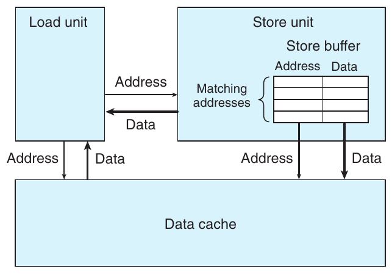

**Hình 5.34 Chi tiết load unit và store unit. Store unit duy trì buffer các lần ghi chưa hoàn tất. Load unit phải so sánh địa chỉ với địa chỉ trong store unit để phát hiện write/read dependency.**

Để hiểu processor phân biệt hai trường hợp ra sao và vì sao một trường hợp chậm hơn, cần xem kỹ load execution unit và store execution unit như Hình 5.34. Store unit có store buffer chứa địa chỉ và dữ liệu của store đã được issue nhưng chưa hoàn tất, trong đó hoàn tất gồm cập nhật data cache. Buffer cho phép chuỗi store thực thi mà không cần đợi từng thao tác cập nhật cache. Khi có load, nó phải kiểm tra entry trong store buffer để tìm địa chỉ trùng. Nếu khớp (bất kỳ byte được ghi có cùng địa chỉ với bất kỳ byte được đọc), nó lấy data entry tương ứng làm kết quả load.

gcc tạo code sau cho inner loop của write_read:

```
  Inner loop of write_read
  src in %rdi, dst in %rsi, val in %rax
.L3:                      loop:
  movq    %rax, (%rsi)      Write val to dst
  movq    (%rdi), %rax      t = *src
  addq    $1, %rax          val = t+1
  subq    $1, %rdx          cnt--
  jne     .L3               If != 0, goto loop
```

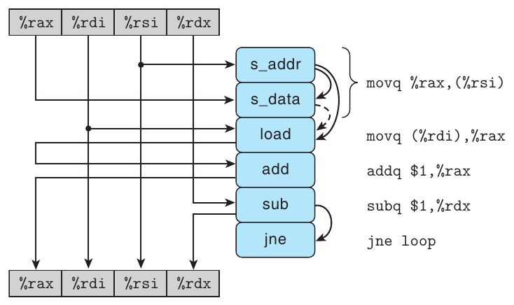

**Hình 5.35 Biểu diễn đồ họa code inner-loop của write_read . Instruction movl đầu được decode thành các thao tác riêng để tính store address và lưu dữ liệu vào bộ nhớ.**

Hình 5.35 trình bày biểu diễn data-flow của code vòng lặp. Instruction movq %rax,(%rsi) được dịch thành hai thao tác: instruction s_addr tính địa chỉ store, tạo entry trong store buffer và đặt address field; thao tác s_data đặt data field của entry. Như sẽ thấy, việc hai phép tính diễn ra độc lập có thể quan trọng với hiệu năng. Điều này giải thích các functional unit riêng cho chúng trong reference machine.

Ngoài data dependency giữa thao tác do ghi và đọc register, các cung bên phải toán tử biểu thị tập dependency ngầm. Cụ thể, tính địa chỉ s_addr rõ ràng phải trước s_data. Ngoài ra, load do decode movq (%rdi), %rax phải kiểm tra địa chỉ mọi store đang chờ, tạo data dependency giữa nó và s_addr. Hình có cung nét đứt giữa s_data và load. Dependency có điều kiện: nếu hai địa chỉ khớp, load phải đợi s_data đặt kết quả vào store buffer; nếu khác nhau, hai thao tác tiến hành độc lập.

Hình 5.36 minh họa data dependency giữa các thao tác inner loop write_read. Hình 5.36(a) sắp xếp lại để thấy dependency rõ hơn. Ba dependency liên quan load và store được gắn nhãn để chú ý. Cung “1” chỉ yêu cầu tính store address trước khi lưu dữ liệu. Cung “2” chỉ load cần so sánh địa chỉ với các store đang chờ. Cung nét đứt “3” biểu thị data dependency có điều kiện khi địa chỉ load và store khớp.

Hình 5.36(b) minh họa khi bỏ thao tác không trực tiếp ảnh hưởng dòng dữ liệu giữa các iteration. Đồ thị data-flow chỉ có hai chuỗi dependency: bên trái gồm lưu, load và tăng giá trị dữ liệu (chỉ khi địa chỉ khớp); bên phải giảm variable cnt.

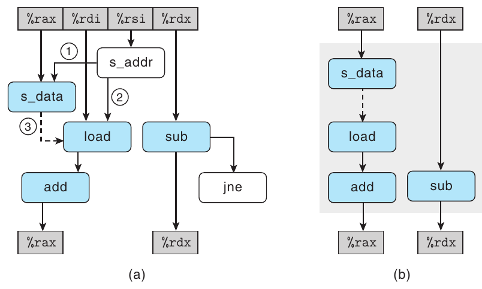

**Hình 5.36 Trừu tượng hóa thao tác write_read . Trước hết sắp xếp lại toán tử Hình 5.35(a), rồi chỉ giữ thao tác dùng giá trị iteration này tạo giá trị mới cho iteration tiếp theo (b).**

Giờ có thể hiểu đặc tính hiệu năng write_read. Hình 5.37 minh họa data dependency qua nhiều iteration inner loop. Với Ví dụ A Hình 5.33, địa chỉ nguồn và đích khác nhau, load và store độc lập, nên critical path duy nhất là giảm cnt, cho cận CPE 1.0. Với Ví dụ B, địa chỉ khớp, dependency giữa s_data và load tạo critical path gồm lưu, load và tăng dữ liệu. Chúng ta thấy ba thao tác tuần tự này cần tổng cộng khoảng 7 clock cycle.

Như hai ví dụ cho thấy, triển khai memory operation có nhiều điểm tinh tế. Với register operation, processor xác định instruction nào ảnh hưởng instruction nào khi decode. Với memory operation, processor không thể dự đoán tương tác cho đến khi tính địa chỉ load và store. Xử lý memory operation hiệu quả là then chốt cho nhiều chương trình. Memory subsystem dùng nhiều tối ưu, như parallelism tiềm năng khi thao tác độc lập.

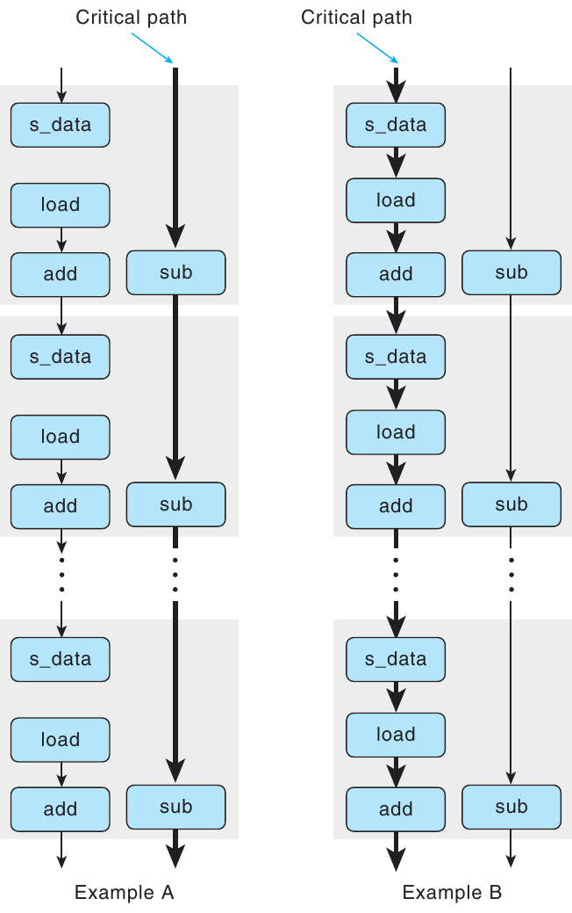

**Hình 5.37 Biểu diễn Data-flow của write_read. Khi hai địa chỉ không khớp, critical path duy nhất là giảm cnt (Ví dụ A). Khi khớp, chuỗi lưu, load và tăng dữ liệu tạo critical path (Ví dụ B).**

#### Bài tập thực hành 5.10 (lời giải trang 613)

Ví dụ khác về code có tương tác load-store tiềm năng là function sao chép nội dung array sau:

```
1   void copy_array(long *src, long *dest, long n)
2   {
3       long i;
4       for (i = 0; i < n; i++)
5           dest[i] = src[i];
6   }
```

Giả sử a là array độ dài 1,000, khởi tạo để mỗi phần tử a[i] bằng i.

A. Lời gọi copy_array(a+1,a,999) có tác dụng gì?

B. Lời gọi copy_array(a,a+1,999) có tác dụng gì?

C. Phép đo cho thấy lời gọi phần A có CPE 1.2 (giảm xuống 1.0 khi loop unrolling hệ số 4), còn phần B có CPE 5.0. Bạn cho rằng yếu tố nào gây khác biệt hiệu năng?

D. Bạn dự đoán hiệu năng lời gọi copy_array(a,a,999) thế nào?

#### Bài tập thực hành 5.11 (lời giải trang 613)

Phép đo function prefix-sum psum1 (Hình 5.1) cho CPE 9.00 trên máy mà phép toán cơ bản floating-point addition chỉ có latency 3 clock cycle. Hãy tìm hiểu vì sao function hoạt động kém như vậy.

Sau đây là assembly code inner loop của function:

```
    Inner loop of psum1
    a in %rdi, i in %rax, cnt in %rdx
1   .L5:                                      loop:
2     vmovss  -4(%rsi,%rax,4), %xmm0            Get p[i-1]
3     vaddss  (%rdi,%rax,4), %xmm0, %xmm0       Add a[i]
4     vmovss  %xmm0, (%rsi,%rax,4)              Store at p[i]
5     addq    $1, %rax                          Increment i
6     cmpq    %rdx, %rax                        Compare i:cnt
7     jne     .L5                               If !=, goto loop
```

Phân tích tương tự combine3 (Hình 5.14) và write_read (Hình 5.36) để vẽ data dependency do vòng lặp tạo, từ đó xác định critical path khi tính toán tiếp diễn. Giải thích vì sao CPE cao như vậy.

#### Bài tập thực hành 5.12 (lời giải trang 613)

Viết lại psum1 (Hình 5.1) để không cần liên tục lấy p[i] từ bộ nhớ. Không cần loop unrolling. Code kết quả đo được CPE 3.00, giới hạn bởi latency floating-point addition.

## 5.13 Trong thực tế: Kỹ thuật cải thiện hiệu năng

Dù chỉ xét tập ứng dụng hạn chế, có thể rút ra bài học quan trọng để viết code hiệu quả. Chúng ta đã mô tả các chiến lược cơ bản tối ưu hiệu năng:

Thiết kế High-level. Chọn thuật toán và data structure phù hợp bài toán. Đặc biệt thận trọng tránh thuật toán hoặc kỹ thuật code có hiệu năng tiệm cận kém.

Nguyên tắc viết code cơ bản. Tránh optimization blocker để compiler tạo code hiệu quả.

- Loại function call dư thừa. Đưa phép tính ra ngoài vòng lặp khi có thể. Cân nhắc đánh đổi có chọn lọc modularity để đạt hiệu quả cao hơn.

- Loại memory reference không cần thiết. Tạo temporary variable giữ kết quả trung gian. Chỉ lưu kết quả vào array hoặc global variable khi đã tính xong giá trị cuối.

Tối ưu Low-level. Tổ chức code để tận dụng khả năng hardware.

- Unroll loop để giảm overhead và cho phép tối ưu thêm.

- Tìm cách tăng instruction-level parallelism bằng kỹ thuật như multiple accumulator và reassociation.

- Viết lại conditional operation theo functional style để compiler dùng conditional data transfer.

Lời khuyên cuối là thận trọng tránh đưa lỗi vào khi viết lại chương trình nhằm tăng hiệu quả. Rất dễ sai khi thêm variable mới, đổi loop bound và làm code phức tạp hơn. Kỹ thuật hữu ích là dùng checking code kiểm thử mỗi phiên bản function trong quá trình tối ưu, bảo đảm không đưa bug vào. Checking code áp dụng chuỗi test cho phiên bản mới và bảo đảm kết quả giống bản gốc. Tập test case phải rộng hơn với code tối ưu cao vì có nhiều trường hợp hơn. Ví dụ, code dùng loop unrolling cần thử nhiều loop bound để bảo đảm xử lý mọi số iteration single-step có thể cần ở cuối.

## 5.14 Xác định và loại bỏ performance bottleneck

Đến đây, chúng ta chỉ tối ưu chương trình nhỏ có vị trí giới hạn hiệu năng khá rõ để tập trung tối ưu. Với chương trình lớn, ngay cả xác định nơi tập trung cũng khó. Phần này mô tả code profiler, tool phân tích thu thập dữ liệu hiệu năng khi chương trình chạy. Chúng ta còn thảo luận nguyên tắc tối ưu tổng quát, gồm hệ quả định luật Amdahl ở Mục 1.9.1.

### 5.14.1 Program profiling

Program profiling là chạy phiên bản chương trình có instrumentation code để xác định thời gian cần cho từng phần. Nó hữu ích để nhận diện phần nên tập trung tối ưu. Một điểm mạnh là có thể thực hiện khi chạy chương trình thực tế với dữ liệu benchmark thực tế.

Hệ thống Unix cung cấp chương trình profiling gprof, tạo hai dạng thông tin. Thứ nhất, thời gian CPU dành cho mỗi function. Thứ hai, số lần gọi từng function, phân loại theo function gọi nó. Cả hai đều hữu ích. Thời gian cho biết tầm quan trọng tương đối của từng function với run time tổng thể. Thông tin lời gọi giúp hiểu hành vi động của chương trình.

Profiling bằng gprof cần ba bước, minh họa với chương trình C prog.c chạy bằng argument command-line file.txt:

1. Chương trình phải được biên dịch và link cho profiling. Với gcc (và compiler C khác), chỉ cần thêm flag run-time -pg vào command line. Cần bảo đảm compiler không tối ưu bằng inline substitution, nếu không số lần gọi function có thể không được thống kê đúng. Chúng ta dùng flag -Og bảo đảm theo dõi function call đúng.

```
linux> gcc -Og -pg prog.c -o prog
```

2. Sau đó thực thi chương trình như bình thường:

```
linux> ./prog file.txt
```

Nó chạy chậm hơn một chút (khoảng 2 lần), nhưng khác biệt duy nhất còn lại là tạo file gmon.out.

3. Gọi gprof để phân tích dữ liệu gmon.out:

```
linux> gprof prog
```

Phần đầu profile report liệt kê thời gian thực thi các function theo thứ tự giảm dần. Ví dụ sau trình bày phần báo cáo cho ba function time-consuming nhất:

```
 %   cumulative   self              self     total
time   seconds   seconds    calls   s/call   s/call  name
97.58    203.66   203.66        1   203.66   203.66  sort_words
 2.32    208.50     4.85   965027     0.00     0.00  find_ele_rec
 0.14    208.81     0.30 12511031     0.00     0.00  Strlen
```

Mỗi hàng biểu diễn thời gian dành cho mọi lời gọi một function. Cột đầu là phần trăm tổng thời gian dành cho function. Cột thứ hai là thời gian tích lũy của các function tới và gồm hàng này. Cột thứ ba là thời gian riêng function, cột thứ tư là số lần gọi (không tính đệ quy). Trong ví dụ, sort_words được gọi một lần nhưng cần 203.66 giây, còn find_ele_rec được gọi 965,027 lần (không gồm đệ quy), cần tổng 4.85 giây. Function Strlen tính độ dài string bằng library function strlen. Gprof thường không hiển thị lời gọi library function; thời gian thường tính vào function gọi chúng. Bằng “wrapper function” Strlen, có thể theo dõi strlen đáng tin cậy: được gọi 12,511,031 lần nhưng chỉ cần tổng 0.30 giây.

Phần thứ hai profile report trình bày lịch sử gọi function. Sau đây là lịch sử recursive function find_ele_rec:

```
                             158655725             find_ele_rec [5]
                4.85    0.10  965027/965027      insert_string [4]
[5]      2.4    4.85    0.10  965027+158655725 find_ele_rec [5]
                0.08    0.01  363039/363039      save_string [8]
                0.00    0.01  363039/363039      new_ele [12]
                             158655725             find_ele_rec [5]
```

Lịch sử cho cả function gọi find_ele_rec lẫn các function nó gọi. Hai dòng đầu cho số lần được gọi: 158,655,725 lần tự gọi đệ quy và 965,027 lần từ insert_string (bản thân cũng được gọi 965,027 lần). Đến lượt mình, find_ele_rec gọi save_string và new_ele, mỗi function 363,039 lần.

Từ dữ liệu lời gọi, thường suy ra được thông tin hữu ích về hành vi. Ví dụ, find_ele_rec là recursive procedure duyệt linked list của hash bucket để tìm string cụ thể. So sánh số lời gọi đệ quy với top-level cho thông tin thống kê độ dài duyệt list. Với tỷ số 164.4:1, có thể suy ra chương trình duyệt trung bình khoảng 164 phần tử mỗi lần.

Có một số đặc tính gprof cần lưu ý:

- Đo thời gian không thật chính xác. Nó dựa trên đếm khoảng thời gian đơn giản: chương trình đã biên dịch duy trì counter cho mỗi function ghi thời gian thực thi. Operating system ngắt chương trình theo khoảng đều δ. Giá trị δ điển hình từ 1.0 đến 10.0 millisecond. Sau đó xác định function đang thực thi lúc interrupt và tăng counter tương ứng thêm δ. Dĩ nhiên, function có thể vừa bắt đầu và sắp xong nhưng vẫn bị tính toàn bộ thời gian từ interrupt trước. Function khác có thể chạy giữa hai interrupt nên không bị tính thời gian nào.

  Trong thời gian dài, cơ chế hoạt động khá tốt: về thống kê, mỗi function được tính theo thời gian thực thi tương đối. Tuy nhiên, với chương trình chạy dưới khoảng 1 giây, các số chỉ nên coi là ước lượng thô.

- Thông tin lời gọi khá tin cậy nếu không có inline substitution. Chương trình đã biên dịch duy trì counter cho mỗi tổ hợp caller và callee. Counter phù hợp tăng mỗi lần gọi procedure.

- Mặc định không hiển thị thời gian library function. Thay vào đó, chúng được tính vào thời gian function gọi.

### 5.14.2 Dùng profiler hướng dẫn tối ưu

Để minh họa dùng profiler hướng dẫn tối ưu, chúng ta tạo ứng dụng có nhiều tác vụ và data structure. Ứng dụng phân tích thống kê n-gram của tài liệu văn bản; n-gram là chuỗi n từ xuất hiện trong tài liệu. Với n = 1, thu thập thống kê từng từ; n = 2 là cặp từ, v.v. Với n cho trước, chương trình đọc text file, tạo bảng n-grams duy nhất cùng số lần xuất hiện, rồi sắp n-grams theo tần suất giảm dần.

Làm benchmark, chúng ta chạy trên file toàn bộ tác phẩm William Shakespeare, tổng 965,028 từ, trong đó 23,706 từ khác nhau. Với n = 1, ngay cả chương trình phân tích kém cũng xử lý cả file dưới 1 giây, nên đặt n = 2 để khó hơn. Với n = 2, n-grams được gọi là bigram (đọc “bye-grams”). Tác phẩm Shakespeare có 363,039 bigram khác nhau. Phổ biến nhất là “I am”, xuất hiện 1,892 lần. Bigram có lẽ nổi tiếng nhất, “to be”, xuất hiện 1,020 lần. Có tới 266,018 bigram chỉ xuất hiện một lần.

Chương trình gồm các phần sau. Chúng ta tạo nhiều phiên bản, bắt đầu bằng thuật toán đơn giản cho từng phần rồi thay bằng thuật toán tinh vi hơn:

1. Đọc từng từ trong file và chuyển thành chữ thường. Bản đầu dùng lower1 (Hình 5.7), đã biết có run time bậc hai do gọi strlen lặp lại.

2. Áp dụng hash function lên string để tạo số từ 0 đến s − 1 cho hash table có s bucket. Function đầu chỉ cộng ASCII code các ký tự theo modulo s.

3. Mỗi hash bucket là linked list. Chương trình duyệt list tìm entry khớp. Nếu có, tăng tần suất n-gram. Nếu không, tạo phần tử list mới. Bản đầu thực hiện đệ quy, chèn phần tử mới cuối list.

4. Sau khi tạo bảng, sắp mọi phần tử theo tần suất. Bản đầu dùng insertion sort.

Hình 5.38 trình bày kết quả profile sáu phiên bản chương trình phân tích n-gram-frequency. Với mỗi phiên bản, thời gian chia thành:

Sort. Sắp n-grams theo tần suất

List. Duyệt linked list tìm n-gram khớp, chèn phần tử mới nếu cần

Lower. Chuyển string thành chữ thường

Strlen. Tính độ dài string

Hash. Tính hash function

Rest. Tổng mọi function còn lại

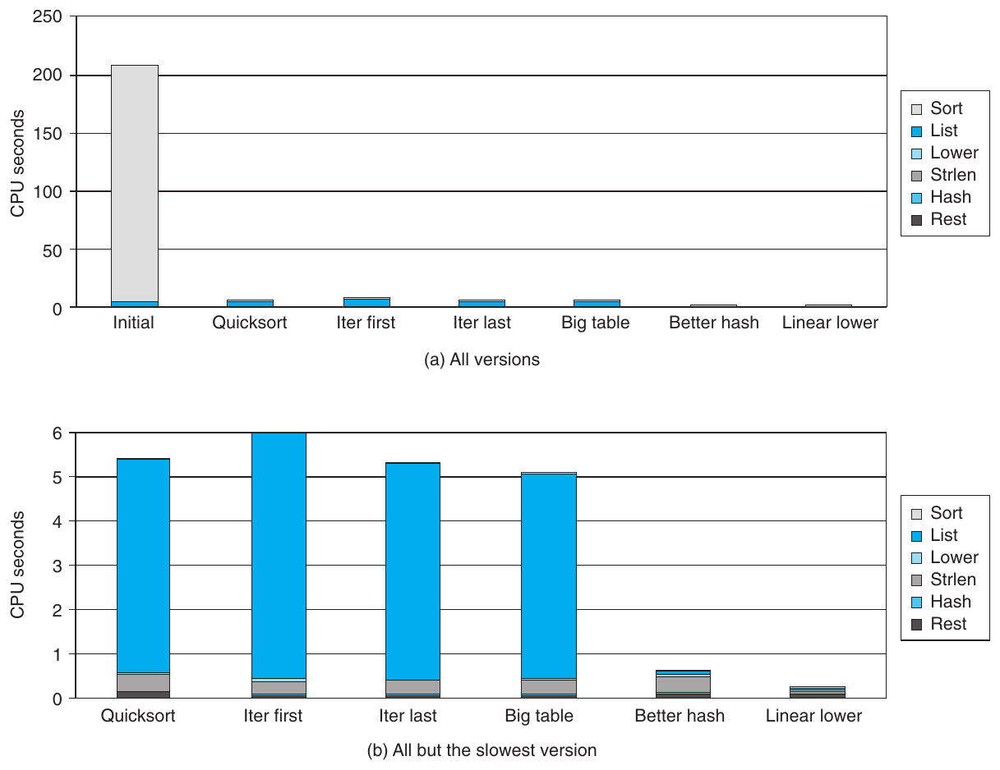

**Hình 5.38 Kết quả profile các phiên bản chương trình đếm bigram-frequency. Thời gian được chia theo các thao tác chính khác nhau.**

Như phần (a) cho thấy, bản đầu cần 3.5 phút, phần lớn thời gian dành cho sắp xếp. Không bất ngờ vì insertion sort có run time bậc hai và chương trình sắp 363,039 giá trị.

Ở bản tiếp theo, chúng ta sắp bằng library function qsort dựa trên quicksort [98], có run time kỳ vọng O(n log n). Bản này mang nhãn “Quicksort”. Thuật toán hiệu quả hơn làm thời gian sắp xếp không đáng kể, run time tổng khoảng 5.4 giây. Phần (b) thể hiện thời gian các phiên bản còn lại trên thang rõ hơn.

Sau khi cải thiện sắp xếp, duyệt list thành bottleneck. Cho rằng không hiệu quả do cấu trúc đệ quy, chúng ta thay bằng lặp, ghi “Iter first”. Bất ngờ, run time tăng khoảng 7.5 giây. Nghiên cứu kỹ thấy khác biệt tinh tế: bản đệ quy chèn phần tử mới cuối list, bản lặp chèn đầu. Để tối đa hiệu năng, muốn n-grams thường gặp gần đầu list để function nhanh tìm trường hợp phổ biến. Giả sử n-grams phân bố đều trong tài liệu, lần đầu gặp mục thường xuyên dự kiến sớm hơn mục ít gặp. Chèn n-grams mới cuối list khiến function đầu có xu hướng sắp n-grams theo tần suất giảm, còn function thứ hai ngược lại. Vì vậy, chúng ta tạo function list-scanning thứ ba dùng lặp nhưng chèn cuối list. Bản “Iter last” giảm thời gian còn khoảng 5.3 giây, hơi tốt hơn đệ quy. Phép đo cho thấy tầm quan trọng của thử nghiệm chương trình trong tối ưu. Ban đầu, chúng ta giả định chuyển đệ quy thành lặp sẽ cải thiện mà không xét khác biệt chèn đầu hay cuối list.

Tiếp theo xét hash table. Bản đầu chỉ có 1,021 bucket (thường chọn số nguyên tố để tăng khả năng hash function phân phối key đều). Với 363,039 entry, tải trung bình 363,039/1,021 = 355.6. Điều này giải thích vì sao nhiều thời gian dành cho list operation—tìm kiếm phải kiểm tra nhiều n-grams ứng viên, và vì sao hiệu năng nhạy với thứ tự list. Sau đó tăng số bucket lên 199,999, giảm tải trung bình còn 1.8. Tuy nhiên lạ là run time chỉ giảm còn 5.1 giây, chênh lệch 0.2 giây.

Kiểm tra thêm cho thấy cải thiện nhỏ với bảng lớn hơn do chọn hash function kém. Chỉ cộng character code của string không tạo phạm vi giá trị rộng. Cụ thể, code tối đa của chữ cái là 122, nên string n ký tự tạo tổng tối đa 122n. Bigram dài nhất, “honorificabilitudinitatibus thou”, chỉ có tổng 3,371, nên phần lớn bucket không dùng. Ngoài ra, hash function giao hoán như phép cộng không phân biệt thứ tự ký tự trong string. Ví dụ, “rat” và “tar” cho cùng tổng.

Chúng ta đổi sang hash function dùng shift và exclusive-or. Bản “Better hash” giảm thời gian còn 0.6 giây. Cách có hệ thống hơn là nghiên cứu kỹ phân bố key giữa bucket, bảo đảm gần kỳ vọng khi hash function có phân bố output đều.

Cuối cùng, run time giảm tới mức phần lớn thời gian ở strlen, mà phần lớn lời gọi strlen thuộc chuyển chữ thường. Chúng ta đã thấy lower1 có hiệu năng bậc hai, đặc biệt với string dài. Từ trong tài liệu đủ ngắn để tránh hậu quả tai hại: bigram dài nhất chỉ 32 ký tự. Dù vậy, đổi sang lower2, ghi “Linear lower”, vẫn cải thiện đáng kể, tổng thời gian khoảng 0.2 giây.

Bài thực hành cho thấy code profiling giúp giảm thời gian ứng dụng đơn giản từ 3.5 phút còn 0.2 giây, tăng hiệu năng khoảng 1,000×. Profiler hướng tập trung vào phần time-consuming nhất và cho thông tin hữu ích về cấu trúc procedure call. Một số bottleneck như sort routine bậc hai dễ dự đoán, còn số khác như chèn đầu hay cuối list chỉ lộ qua phân tích cẩn thận.

Profiling là tool hữu ích nhưng không nên là tool duy nhất. Phép đo thời gian không hoàn hảo, nhất là run time ngắn (dưới 1 giây). Quan trọng hơn, kết quả chỉ áp dụng dữ liệu cụ thể đã thử. Ví dụ, nếu chạy function đầu với ít string hơn nhưng dài hơn, chuyển chữ thường sẽ là bottleneck chính. Tệ hơn, nếu chỉ profile tài liệu có từ ngắn, có thể không bao giờ thấy bottleneck ẩn như hiệu năng bậc hai của lower1. Nhìn chung, profiling giúp tối ưu trường hợp điển hình nếu chạy dữ liệu đại diện, nhưng cũng phải bảo đảm hiệu năng chấp nhận được trong mọi trường hợp. Chủ yếu là tránh thuật toán như insertion sort và thực hành kém như lower1 có hiệu năng tiệm cận tệ.

Định luật Amdahl ở Mục 1.9.1 cung cấp hiểu biết thêm về lợi ích tối ưu có mục tiêu. Với code n-gram, tổng thời gian giảm từ 209.0 xuống 5.4 giây khi thay insertion sort bằng quicksort. Bản đầu dành 203.7 trong 209.0 giây cho insertion sort, cho α = 0.974, tỷ lệ thời gian được tăng tốc. Với quicksort, thời gian sắp không đáng kể, cho dự đoán tăng tốc 209/α = 39.0, gần phép đo 38.5. Tăng tốc lớn đạt được vì sắp xếp chiếm tỷ lệ rất lớn. Tuy nhiên, loại bottleneck này lại xuất hiện bottleneck mới, nên tăng tốc thêm cần tập trung phần khác.

## 5.15 Tổng kết

Dù phần lớn nội dung tối ưu code mô tả cách compiler tạo code hiệu quả, lập trình viên ứng dụng có thể hỗ trợ rất nhiều. Không compiler nào thay được thuật toán hoặc data structure kém bằng loại tốt, nên những khía cạnh thiết kế này vẫn là quan tâm chính. Chúng ta cũng thấy optimization blocker như memory aliasing và procedure call hạn chế nghiêm trọng tối ưu sâu của compiler. Lập trình viên phải chịu trách nhiệm chính loại bỏ chúng. Đây nên được xem là thực hành lập trình tốt vì loại công việc không cần thiết.

Điều chỉnh hiệu năng vượt mức cơ bản cần hiểu microarchitecture của processor, tức cơ chế bên dưới để triển khai ISA. Với processor out-of-order, chỉ cần biết thao tác, khả năng, latency và issue time của functional unit đã tạo nền tảng dự đoán hiệu năng.

Chúng ta đã nghiên cứu các kỹ thuật—loop unrolling, multiple accumulator và reassociation—khai thác instruction-level parallelism của processor hiện đại. Càng tối ưu sâu, càng cần xem assembly code và hiểu cách máy tính toán. Nhận diện critical path do data dependency quyết định, nhất là giữa iteration, mang lại nhiều lợi ích. Cũng có thể tính throughput bound dựa trên số thao tác cần thực hiện cùng số lượng, issue time của unit thực hiện chúng.

Chương trình có conditional branch hoặc tương tác bộ nhớ phức tạp khó phân tích, tối ưu hơn chương trình vòng lặp đơn giản ban đầu. Chiến lược cơ bản là làm branch dễ dự đoán hơn hoặc phù hợp triển khai bằng conditional data transfer. Cũng phải chú ý tương tác store và load. Giữ giá trị trong local variable để lưu được trong register thường hữu ích.

Với chương trình lớn, cần tập trung tối ưu phần tốn thời gian nhất. Code profiler và tool liên quan giúp đánh giá, cải thiện có hệ thống. Chúng ta đã mô tả gprof, tool profiling Unix chuẩn. Có profiler tinh vi hơn như hệ thống phát triển vtune của Intel và valgrind thường có trên Linux. Chúng phân rã thời gian xuống dưới cấp procedure để ước lượng hiệu năng mỗi basic block. (Basic block là chuỗi instruction không có chuyển điều khiển ra giữa block, nên luôn thực thi toàn bộ.)

## Ghi chú tài liệu tham khảo

Chúng ta tập trung mô tả tối ưu từ góc nhìn lập trình viên, minh họa cách viết code giúp compiler dễ tạo code hiệu quả. Bài báo dài của Chellappa, Franchetti và P ¨uschel [19] có cách tiếp cận tương tự nhưng chi tiết hơn về đặc tính processor.

Nhiều ấn phẩm mô tả tối ưu từ góc nhìn compiler, xây dựng cách tạo code hiệu quả hơn. Sách Muchnick được xem là toàn diện nhất [80]. Sách tối ưu software của Wadleigh và Crawford [115] có một số nội dung chúng ta trình bày và quá trình đạt hiệu năng cao trên máy song song. Bài báo sớm của Mahlke và cộng sự [75] mô tả cách thích ứng các kỹ thuật compiler ánh xạ chương trình lên máy song song để khai thác instruction-level parallelism của processor hiện đại. Bài báo có các biến đổi đã trình bày: loop unrolling, multiple accumulator (gọi là accumulator variable expansion) và reassociation (gọi là tree height reduction).

Phần trình bày hoạt động processor out-of-order khá ngắn và trừu tượng. Mô tả nguyên tắc đầy đủ hơn có trong giáo trình computer architecture nâng cao như Hennessy và Patterson [46, Ch. 2–3]. Sách Shen và Lipasti [100] trình bày in-depth thiết kế processor hiện đại.

## Bài tập về nhà

5.13 ◆◆ Giả sử muốn viết procedure tính inner product hai vector u và v. Phiên bản trừu tượng có CPE 14–18 với x86-64 cho các loại dữ liệu số nguyên và floating-point. Qua cùng loại biến đổi đã dùng chuyển combine1 trừu tượng thành combine4 hiệu quả hơn, ta có code sau:

```
 1   /* Inner product.  Accumulate in temporary */
 2   void inner4(vec_ptr u, vec_ptr v, data_t *dest)
 3   {
 4       long i;
 5       long length = vec_length(u);
 6       data_t *udata = get_vec_start(u);
 7       data_t *vdata = get_vec_start(v);
 8       data_t sum = (data_t) 0;
 9
10       for (i = 0; i < length; i++) {
11           sum = sum + udata[i] * vdata[i];
12       }
13       *dest = sum;
14   }
```

Phép đo cho function này CPE 1.50 với dữ liệu số nguyên và 3.00 với floating-point. Với data type double, assembly code x86-64 inner loop như sau:

```
    Inner loop of inner4. data_t = double, OP = *
    udata in %rbp, vdata in %rax, sum in %xmm0
    i in %rcx, limit in %rbx
1   .L15:                                   loop:
2     vmovsd  0(%rbp,%rcx,8), %xmm1           Get udata[i]
3     vmulsd  (%rax,%rcx,8), %xmm1, %xmm1     Multiply by vdata[i]
4     vaddsd  %xmm1, %xmm0, %xmm0             Add to sum
5     addq    $1, %rcx                        Increment i
6     cmpq    %rbx, %rcx                      Compare i:limit
7     jne     .L15                            If !=, goto loop
```

Giả sử functional unit có đặc tính trong Hình 5.12.

A. Vẽ cách chuỗi instruction được decode thành thao tác, chỉ cách data dependency tạo critical path, theo Hình 5.13 và 5.14.

B. Với double, critical path quyết định cận dưới CPE nào?

C. Giả sử code số nguyên có chuỗi instruction tương tự, critical path quyết định cận dưới CPE nào cho dữ liệu số nguyên?

D. Giải thích vì sao phiên bản floating-point đạt CPE 3.00 dù phép nhân cần 5 clock cycle.

5.14 ◆ Viết phiên bản inner product ở Bài tập 5.13 dùng loop unrolling 6 × 1. Với x86-64, phép đo bản unrolled cho CPE 1.07 với số nguyên nhưng vẫn 3.01 với cả hai kiểu floating-point.

A. Giải thích vì sao mọi phiên bản scalar của inner product trên Intel Core i7 Haswell không thể đạt CPE dưới 1.00.

B. Giải thích vì sao hiệu năng floating-point không cải thiện với loop unrolling.

5.15 ◆ Viết phiên bản inner product ở Bài tập 5.13 dùng loop unrolling 6 × 6. Phép đo x86-64 cho CPE 1.06 với số nguyên và 1.01 với floating-point.

Yếu tố nào giới hạn hiệu năng ở CPE 1.00?

5.16 ◆ Viết phiên bản inner product Bài tập 5.13 dùng loop unrolling 6 × 1a để tăng parallelism. Phép đo cho CPE 1.10 với số nguyên và 1.05 với floating-point.

5.17 ◆◆ Library function memset có prototype sau:

```
void *memset(void *s, int c, size_t n);
```

Function điền n byte vùng bộ nhớ bắt đầu tại s bằng các bản sao byte low-order của c. Ví dụ, dùng argument c bằng 0 để xóa vùng bộ nhớ về 0, nhưng cũng dùng được giá trị khác.

Sau đây là triển khai memset trực tiếp:

```
 1   /* Basic implementation of memset */
 2   void *basic_memset(void *s, int c, size_t n)
 3   {
 4       size_t cnt = 0;
 5       unsigned char *schar = s;
 6       while (cnt < n) {
 7           *schar++ = (unsigned char) c;
 8           cnt++;
 9       }
10       return s;
11   }
```

Triển khai phiên bản hiệu quả hơn bằng word kiểu unsigned long đóng gói tám bản sao c, rồi duyệt vùng bằng phép ghi word-level. Có thể hữu ích nếu loop unrolling thêm. Trên reference machine, chúng ta giảm CPE từ 1.00 của bản trực tiếp xuống 0.127. Nghĩa là chương trình ghi được 8 byte mỗi clock cycle.

Sau đây là hướng dẫn bổ sung. Để bảo đảm portability, cho K là giá trị sizeof(unsigned long) trên máy chạy chương trình.

- Không được gọi library function.

- Code phải hoạt động với n tùy ý, kể cả không là bội số K. Có thể xử lý như những iteration cuối trong loop unrolling.

- Viết code để biên dịch và chạy đúng trên mọi máy bất kể K. Dùng sizeof để làm điều đó.

- Trên một số máy, ghi unaligned chậm hơn nhiều aligned. (Một số máy non-x86 thậm chí có thể gây segmentation fault.) Viết code bắt đầu bằng ghi byte-level cho đến khi địa chỉ đích là bội số K, rồi ghi word-level, cuối cùng nếu cần ghi byte-level.

- Chú ý trường hợp cnt đủ nhỏ khiến cận trên một số vòng lặp âm. Với biểu thức có sizeof, kiểm tra có thể dùng số học unsigned. (Xem Mục 2.2.8 và Bài tập 2.72.)

5.18 ◆◆◆ Chúng ta đã xét polynomial evaluation trong Bài tập thực hành 5.5 và 5.6 bằng cách trực tiếp và phương pháp Horner. Thử viết phiên bản nhanh hơn bằng các kỹ thuật đã khảo sát, gồm loop unrolling, parallel accumulation và reassociation. Bạn sẽ thấy nhiều cách kết hợp phương pháp Horner và tính trực tiếp với các kỹ thuật này.

Lý tưởng là đạt CPE gần throughput limit của máy. Phiên bản tốt nhất của chúng ta đạt CPE 1.07 trên reference machine.

5.19 ◆◆◆ Trong Bài tập 5.12, chúng ta giảm CPE phép tính prefix-sum xuống 3.00, giới hạn bởi latency floating-point addition trên máy này. Loop unrolling đơn giản không cải thiện.

Kết hợp loop unrolling và reassociation để viết prefix sum đạt CPE dưới latency floating-point addition trên máy bạn. Điều này thực ra đòi hỏi tăng số phép cộng. Ví dụ, bản unrolling two-way cần ba phép cộng mỗi iteration, còn four-way cần năm. Triển khai tốt nhất đạt CPE 1.67 trên reference machine.

Xác định throughput limit và latency limit của máy giới hạn CPE tối thiểu đạt được cho phép toán prefix-sum thế nào.

## Lời giải bài tập thực hành

Lời giải Bài tập 5.1 (trang 536) Bài tập minh họa tác động tinh tế của memory aliasing.

Như code có chú giải sau cho thấy, tác động là đặt giá trị tại xp bằng 0:

```
4       *xp = *xp + *xp; /* 2x */
5       *xp = *xp - *xp; /* 2x-2x = 0 */
6       *xp = *xp - *xp; /* 0-0 = 0 */
```

Ví dụ cho thấy trực giác về hành vi chương trình thường sai. Chúng ta tự nhiên nghĩ xp và yp khác nhau mà bỏ qua khả năng bằng nhau. Bug thường xuất hiện do điều kiện lập trình viên không dự liệu.

Lời giải Bài tập 5.2 (trang 540) Bài tập minh họa quan hệ CPE và hiệu năng tuyệt đối. Có thể giải bằng đại số cơ bản. Với n ≤ 2, phiên bản 1 nhanh nhất. Phiên bản 2 nhanh nhất khi 3 ≤ n ≤ 7; phiên bản 3 khi n ≥ 8.

Lời giải Bài tập 5.3 (trang 548) Bài tập đơn giản nhưng cần nhận ra bốn câu lệnh for—khởi tạo, kiểm tra, cập nhật và thân—được thực thi số lần khác nhau.

| Code | min | max | incr | square |
|---|---|---|---|---|
| A. | 1 | 91 | 90 | 90 |
| B. | 91 | 1 | 90 | 90 |
| C. | 1 | 1 | 90 | 90 |

Lời giải Bài tập 5.4 (trang 552) Assembly code cho thấy cơ hội tối ưu khéo léo mà gcc phát hiện. Nên nghiên cứu kỹ để hiểu điểm tinh tế của tối ưu code.

A. Trong code ít tối ưu, register %xmm0 chỉ làm giá trị tạm, được đặt và dùng mỗi iteration. Trong code tối ưu hơn, nó giống variable acc của combine4, tích lũy tích các phần tử vector. Tuy nhiên, khác combine4 là vị trí dest được cập nhật mỗi iteration bởi vmovsd thứ hai.

   Có thể thấy bản tối ưu hoạt động như code C sau:

```
 1   /* Make sure dest updated on each iteration */
 2   void combine3w(vec_ptr v, data_t *dest)
 3   {
 4       long i;
 5       long length = vec_length(v);
 6       data_t *data = get_vec_start(v);
 7       data_t acc = IDENT;
 8
 9       /* Initialize in event length <= 0 */
10       *dest = acc;
11
12       for (i = 0; i < length; i++) {
13           acc = acc OP data[i];
14           *dest = acc;
15       }
16   }
```

B. Hai phiên bản combine3 có chức năng giống nhau, ngay cả với memory aliasing.

C. Biến đổi không đổi hành vi, vì trừ iteration đầu, giá trị đọc từ dest đầu mỗi iteration giống giá trị ghi vào register này cuối iteration trước. Vì vậy, combining instruction chỉ cần dùng giá trị đã có trong %xmm0 đầu vòng lặp.

Lời giải Bài tập 5.5 (trang 566) Polynomial evaluation là kỹ thuật cốt lõi giải nhiều bài toán. Ví dụ, polynomial function thường dùng xấp xỉ trigonometric function trong math library.

A. Function thực hiện 2n phép nhân và n phép cộng.

B. Phép tính performance-limiting là lặp lại xpwr = x * xpwr. Nó cần một phép nhân floating-point (5 clock cycle), và iteration này chỉ bắt đầu khi iteration trước hoàn tất. Cập nhật result chỉ cần một phép cộng floating-point (3 clock cycle) giữa các iteration kế tiếp.

Lời giải Bài tập 5.6 (trang 566) Bài tập cho thấy giảm số phép toán không nhất thiết cải thiện hiệu năng.

A. Function thực hiện n phép nhân và n phép cộng, số phép nhân bằng nửa function poly gốc.

B. Phép tính performance-limiting là lặp result = a[i] + x*result. Bắt đầu từ result của iteration trước, phải nhân x (5 clock cycle) rồi cộng a[i] (3 cycle) mới có giá trị iteration này. Vì vậy, mỗi iteration có latency tối thiểu 8 cycle, đúng CPE đo được.

C. Dù mỗi iteration poly cần hai phép nhân thay vì một, chỉ một phép nhân nằm trên critical path mỗi iteration.

Lời giải Bài tập 5.7 (trang 568) Code sau trực tiếp theo quy tắc đã nêu để unroll vòng lặp hệ số k:

```
 1   void unroll5(vec_ptr v, data_t *dest)
 2   {
 3       long i;
 4       long length = vec_length(v);
 5       long limit = length-4;
 6       data_t *data = get_vec_start(v);
 7       data_t acc = IDENT;
 8
 9       /* Combine 5 elements at a time */
10       for (i = 0; i < limit; i+=5) {
11           acc = acc OP data[i]   OP data[i+1];
12           acc = acc OP data[i+2] OP data[i+3];
13           acc = acc OP data[i+4];
14       }
15
16       /* Finish any remaining elements */
17       for (; i < length; i++) {
18           acc = acc OP data[i];
19       }
20       *dest = acc;
21   }
```

Lời giải Bài tập 5.8 (trang 581) Bài tập cho thấy thay đổi nhỏ tạo khác biệt hiệu năng lớn, nhất là máy out-of-order. Hình 5.39 vẽ ba phép nhân cho một iteration. Ô xanh nằm trên critical path—phải tính tuần tự để tạo giá trị mới cho loop variable r. Ô nhạt có thể tính song song với critical path. Với vòng lặp có P phép toán trên critical path, mỗi iteration cần ít nhất 5P clock cycle và tính tích ba phần tử, cho cận dưới CPE 5P /3. Từ đó, cận dưới là 5.00 cho A1, 3.33 cho A2 và A5, 1.67 cho A3 và A4. Chúng ta chạy trên Intel Core i7 Haswell và thấy đạt được các CPE này.

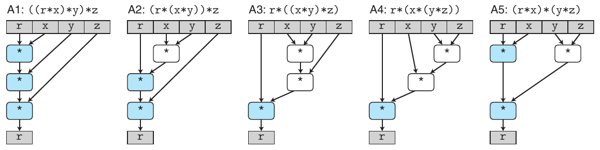

**Hình 5.39 Data dependency giữa phép nhân cho các trường hợp Bài tập 5.8. Các thao tác trong ô xanh tạo critical path của iteration.**

Lời giải Bài tập 5.9 (trang 589) Đây là ví dụ nữa: thay đổi nhỏ phong cách code giúp compiler dễ nhận cơ hội dùng conditional move:

```
while (i1 < n && i2 < n) {
    long v1 = src1[i1];
    long v2 = src2[i2];
    long take1 = v1 < v2;
    dest[id++] = take1 ? v1 : v2;
    i1 += take1;
    i2 += (1-take1);
}
```

CPE đo được khoảng 12.0 cho phiên bản này, cải thiện vừa phải so với 15.0 ban đầu.

Lời giải Bài tập 5.10 (trang 595) Bài tập yêu cầu phân tích tương tác load-store tiềm năng.

A. Đặt mỗi a[i] bằng i + 1, với 0 ≤ i ≤ 998.

B. Đặt mỗi a[i] bằng 0, với 1 ≤ i ≤ 999.

C. Trong trường hợp thứ hai, load iteration này phụ thuộc kết quả store iteration trước. Vì vậy có write/read dependency giữa các iteration kế tiếp.

D. CPE là 1.2 giống Ví dụ A, vì không có dependency giữa store và load về sau.

Lời giải Bài tập 5.11 (trang 597) Function có write/read dependency giữa iteration—đích p[i] ở iteration này khớp nguồn p[i-1] iteration sau. Critical path mỗi iteration gồm store (từ iteration trước), load và floating-point addition. CPE 9.0 nhất quán với CPE 7.3 của write_read khi có data dependency, vì write_read gồm integer addition (latency 1 clock-cycle), còn psum1 gồm floating-point addition (latency 3 clock-cycle).

Lời giải Bài tập 5.12 (trang 597) Sau đây là phiên bản function đã sửa:

```
 1   void psum1a(float a[], float p[], long n)
 2   {
 3       long i;
 4       /* last_val holds p[i-1]; val holds p[i] */
 5       float last_val, val;
 6       last_val = p[0] = a[0];
 7       for (i = 1; i < n; i++) {
 8           val  = last_val + a[i];
 9           p[i] = val;
10           last_val = val;
11       }
12   }
```

Chúng ta thêm local variable last_val. Đầu iteration i, nó chứa p[i-1]. Sau đó tính val là giá trị p[i] và giá trị mới của last_val.

Phiên bản được biên dịch thành assembly code sau:

```
    Inner loop of psum1a
    a in %rdi, i in %rax, cnt in %rdx, last_val in %xmm0
1   .L16:                                     loop:
2     vaddss  (%rdi,%rax,4), %xmm0, %xmm0       last_val = val = last_val + a[i]
3     vmovss  %xmm0, (%rsi,%rax,4)              Store val in p[i]
4     addq    $1, %rax                          Increment i
5     cmpq    %rdx, %rax                        Compare i:cnt
6     jne     .L16                              If !=, goto loop
```

Code giữ last_val trong %xmm0, tránh đọc p[i-1] từ bộ nhớ và loại write/read dependency trong psum1.

---

[^1]: Chúng ta dùng “branch” để chỉ riêng conditional jump instruction. Instruction khác chuyển điều khiển tới nhiều đích, như procedure return và indirect jump, tạo thách thức tương tự cho processor.

[^2]: Gcc optimizer tạo nhiều biến thể function rồi chọn bản dự đoán có hiệu năng tốt nhất và kích thước code nhỏ nhất. Vì vậy, thay đổi nhỏ source code có thể tạo dạng machine code rất khác. Chúng ta thấy chọn code pointer-based hoặc array-based không ảnh hưởng hiệu năng chương trình trên reference machine.
